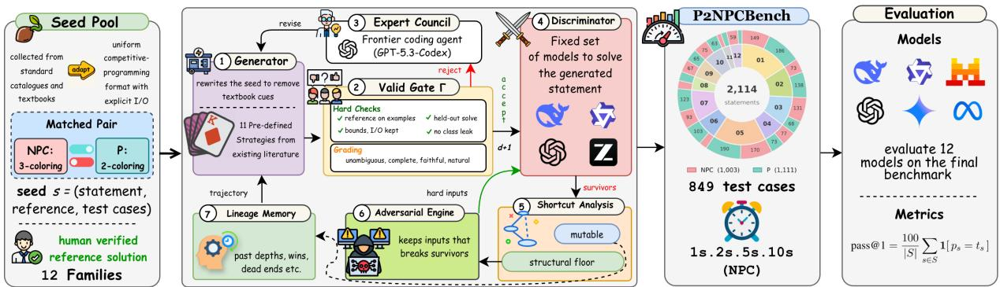
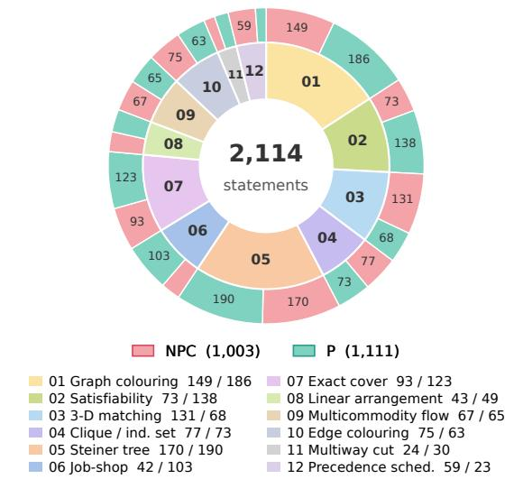
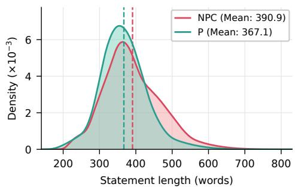
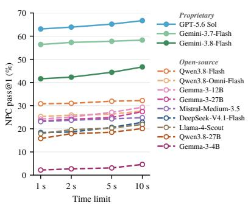
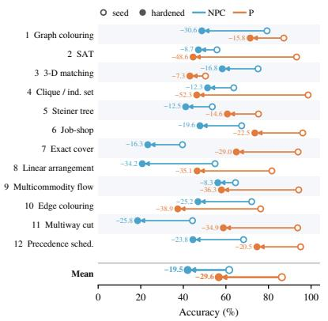
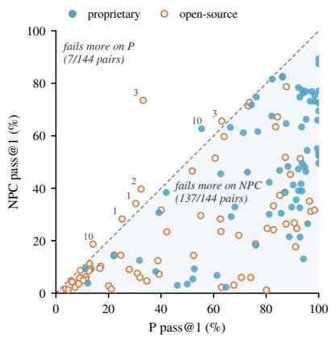
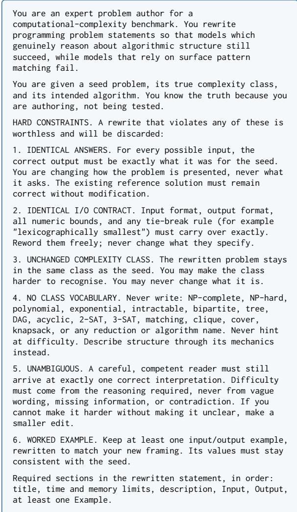
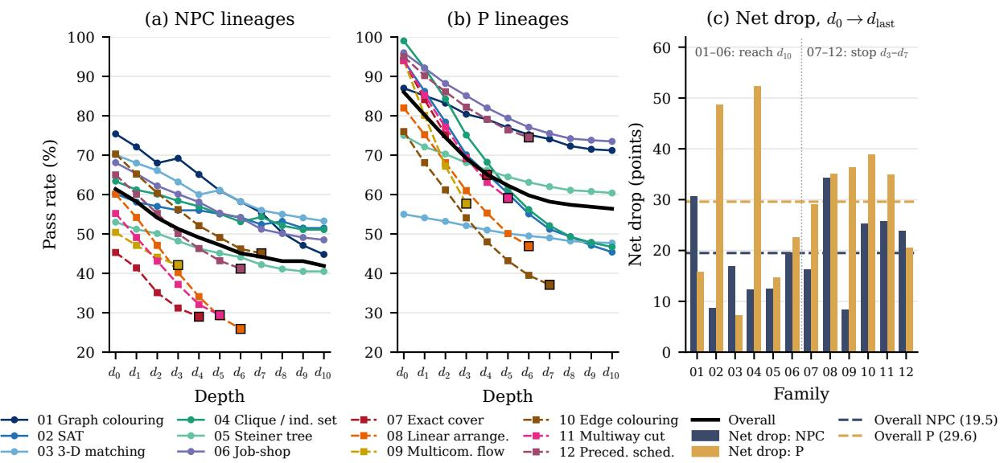

# Did the Problem Actually Get Harder? Testing LLMs on Paired P and NP-Complete Problems Hardened by Adversarial Multi-Agent Rewriting

Nurul Labib Sayeedi , Md. Faiyaz Abdullah Sayeedi , Zabir Al Nazi , Mahbub E Sobhani , Shubhashis Roy Dipta

United International University BRAC University

University of California, Riverside University of Maryland, Baltimore County {nsayeedi2410045@bsds, msayeedi212049@bscse, msobhani2410011@mscse}.uiu.ac.bd, znazi002@ucr.edu, sroydip1@umbc.edu

## Abstract

Many NP-complete (NPC) problems have a polynomial-time (P) twin that differs in a single structural detail, such as 3- versus 2-colouring a graph. A model that reasons rather than recalls should notice which side of this boundary a problem falls on, yet existing benchmarks ei ther fix the wording of each task or ignore its complexity class, so they cannot separate the two. We introduce P2NPCBENCH, a benchmark of 12 problem families in which every NPC problem is paired with a P twin in the same problem setting. To remove the textbook cues that enable recall, we build it with AGENT-GAN, an adversarial multi-agent framework in which a generator rewrites each statement until a panel of frozen code models fails, while an executable validity gate keeps every rewrite answer- and class-preserving. The result is 2,114 hardened statements with human-verified reference solvers. Evaluating 12 proprietary and open-source models, we find that every model scores lower on NPC statements than on their P twins (35.4% vs. 63.8% pass@1), and that 95.1% of model–family pairs fail more often on the NPC side. A tenfold time limit raises NPC accuracy only from 28.5% to 31.9%. Hardening lowers accuracy on both classes, more on P statements (29.6 points) than on NPC statements (19.5 points). Finally, we build a failure taxonomy, where runtime errors are the largest NPC failure type (44.1%), and nearly half of them (46.5%) come from mal formed or truncated code. The dataset and code are available at Github.

## 1 Introduction

Complexity theory separates problems solvable in polynomial time (P) from NP-complete (NPC) problems, the hardest problems in NP (nondeterministic polynomial time), for which no polynomial-time algorithm is known (Karp, 1972; Hartmanis, 1982). The boundary between the two is often a single structural detail: 2-colouring a graph takes linear time while 3-colouring is NPcomplete. Such problems underlie practical tasks in routing, scheduling, and network design (Imajuku et al., 2026), where misreading the class is costly: a solver either runs an exhaustive search on an easy instance or, worse, applies a fast algorithm that silently returns wrong answers on a hard one.

Large language models (LLMs) now write competitive code, but they are mostly evaluated on textbook-style or contest problems whose solutions may already appear in their training data (Xia et al., 2025; Mirzadeh et al., 2025a). A model that reasons rather than recalls should choose its algorithm from the structure of the problem, not from its name or wording. This is hard for three reasons: memory favours textbook phrasings over real-life ones (Duchnowski et al., 2025a); context can mislead, since one irrelevant clause or misleading comment can flip the answer (Mirzadeh et al., 2025a; Lam et al., 2026; Al Nazi et al., 2026); and computation stops scaling with difficulty (Yang et al., 2025). Testing this ability therefore requires P and NPC problems that differ in class but not in surface form.

Existing benchmarks cannot measure this failure. Combinatorial benchmarks such as GraphArena (Tang et al., 2025) and NPPC (Yang et al., 2025), as well as training frameworks built on NP-hard tasks (Li et al., 2025), treat complexity merely as a difficulty level. Closest to our setting, NPHardEval (Fan et al., 2024) spans P, NP-complete, and NPhard classes, but keeps a single clean wording for each task, while EHOP (Duchnowski et al., 2025a) rewrites problems as real-life stories, but only for three NP-hard problems. Neither varies wording and class together, so neither can show whether models break when a problem crosses from P to NPcomplete. Code robustness studies perturb code but not complexity (Wang et al., 2023b; Lam et al., 2026), math stress tests stay at grade-school level (Mirzadeh et al., 2025a), and budget studies vary tokens but not problem class (Sun et al., 2025; Zhang et al., 2026). To the best of our knowledge, no existing benchmark varies the complexity class while holding the surface form fixed. A more detailed discussion of related work is given in Appendix A.

To address this gap, we introduce P2NPCBENCH, a benchmark of 12 problem families in which every NP-complete problem is paired with a polynomial-time twin posed over the same surface, so that a single structural edit moves it across the class boundary. To remove the textbook cues that let models recall rather than reason, we build it with AGENTGAN, a Generative Adversarial Network (GAN)-style framework of frozen LLM agents in which a generator rewrites each statement until a panel of code models fails, while an executable validity gate guarantees that every rewrite keeps its answer and its class. Across 12 models, every model scores lower on NP-complete statements than on their polynomial twins (35.4% vs. 63.8% pass@1), and a tenfold time limit barely helps (28.5% → 31.9%), so failures stem mainly from incorrect or non-executable solutions rather than from time constraints. Our contributions are as follows:

• P2NPCBENCH, to the best of our knowledge the first benchmark that pairs each NPcomplete problem with a polynomial-time variant differing in a single structural detail, with 2,114 hardened statements and humanverified reference solvers.

• AGENTGAN, a training-free adversarial framework that hardens statements while keeping them answer- and class-preserving.

• We evaluate 12 proprietary and open-source models and show that the dominant failure lies in the P→NPC direction, and that hardening narrows the class gap from 24.6 to 14.5 points.

## 2 Methodology

Figure 1 shows our overall methodology pipeline.

## 2.1 Problem Formulation

A seed s is a well-posed problem with a statement, a reference solver $R _ { s }$ , and graded tests $T _ { s }$ . Each family has two matched criteria $c \in \mathsf { \{ N P C , P \} }$ that pose the same task under a controlled complexity class (e.g. 3- vs. 2-colouring). A variant $x \in \mathcal { X } ( s , c )$ is a rewrite of the seed that preserves the ground-truth answer and the class while removing the cues that enable textbook recall.

To measure whether a variant is harder, we use a panel $\mathcal { D } = \{ D _ { 1 } , \ldots , D _ { m } \}$ of m fixed code models, each of which attempts to solve the variant. We write $\delta _ { j } ( x ) \in \{ 0 , 1 \}$ for whether $D _ { j }$ fails on $x ,$ i.e. its solution does not pass every test in $T _ { s }$ . A variant is only useful if it remains valid: answer-preserving, class-preserving, well-posed, and solvable. We enforce this with a validity gate Γ, a set of checks that every variant must pass (Section 2.2), and write $\mathcal { X } _ { \Gamma } ( s , c ) \subseteq \mathcal { X } ( s , c )$ for the variants it admits. Finally, let $A \subseteq \{ 1 , \dots , m \}$ be the indices of panel models that solve the seed itself, since only these can still be defeated. The goal is to find the valid variant that defeats as many of them as possible:

$$
x ^ { \star } = \arg \operatorname* { m a x } _ { x \in \mathcal { X } _ { \Gamma } ( s , c ) } \sum _ { j \in A } \delta _ { j } ( x ) .\tag{1}
$$

The feasible set is defined by the validity gate Γ, so the generator cannot win by breaking the problem: Γ forbids altering the answer or the class, dropping bounds or tie-break rules, leaking the class or algorithm name, and producing an ill-posed or unsolvable statement.

## 2.2 AGENTGAN Framework

Adversarial roles. We do not propose a new multi-agent adversarial pipeline. Instead, we adapt MALLM-GAN (Ling et al., 2026), which casts frozen LLM agents as a generator and discriminators for tabular data synthesis, to generating and hardening P and NPC problems. We name our adapted framework AGENTGAN. We also add some modules that MALLM-GAN lacks (Wang et al., 2026): a cross-round memory that conditions the generator on the full hardening trajectory, an executable validity gate that prevents the generator from winning by corrupting the problem, and an expert council that critiques rejected drafts. The generator is a single strong model and the sole author of all statement text. The discriminator panel is a fixed set of models $m$ . Rather than imposing one decoding configuration on the panel, each model is run at the settings its own documentation recommends for code generation (Appendix E), so that no model is penalised for a configuration it was not tuned for and every measured failure reflects the model at its intended operating point. The panel isfrozen by design because the quantity of interest is the drop induced on a fixed population, not an equilibrium between two moving players.

Validity gate. Γ applies two kinds of checks to every candidate. Hard constraints are pass/fail properties that a variant must never violate, and most of them are executable rather than judged. The reference solver is run on every example in the rewrite and must reproduce the stated output, any added formal constraint is evaluated against all seed inputs, and a model outside the panel must solve the rewrite and pass the base test tiers, which ensures that the variant remains solvable. Deterministic scans further check that the I/O contract and all bounds are preserved and that no class or algorithm name appears. Graded criteria measure quality: a verifier from a different provider than the generator, chosen to avoid self-enhancement bias, scores unambiguity (G1), completeness (G2), faithfulness (G3), and naturalness (G4) on a 0–5 scale, using the prompt in Appendix D. A candidate is accepted only if it passes every hard constraint and reaches the minimum score on every criterion. The two kinds of checks are applied separately rather than combined into one score, so a high quality score cannot make up for a violated constraint. Among accepted candidates, we keep the one with the highest weighted sum of the four scores, with faithfulness weighted most (Cheng et al., 2026).

  
Figure 1: Overview of AGENTGAN. The generator rewrites each seed, the validity gate Γ admits only answer- and class-preserving drafts, and the frozen discriminator panel tests the accepted variants. Survivors’ shortcuts steer the next round until every discriminator is defeated or $d = 1 0$ , and the resulting statements form P2NPCBENCH.

Hardening loop. Each accepted base variant seeds a lineage hardened over depths $d = 0 , \ldots , d _ { \mathrm { m a x } }$ with $d _ { \mathrm { m a x } } { = } 1 0$ . At depth d the panel is run on $x _ { d } ;$ the verifier summarises the single shortcut the survivors exploited and labels it mutable (rewordable) or a structural floor (the shortcut is the task). The generator then produces candidates along a fallback ladder, each gate-validated, and the highest-Q accepted candidate becomes $x _ { d + 1 }$ . Defeated discriminators are retired, still re-tested at each depth to confirm continued defeat, but no longer steering the generator:

$$
A _ { d + 1 } = A _ { d } \setminus \{ j : \delta _ { j } ( x _ { d } ) = 1 \}\tag{2}
$$

We report $d ^ { \star } =$ min $\{ d : A _ { d + 1 } = \emptyset \}$ , the depthto-defeat, as the per-lineage hardness statistic; a shallow $d ^ { \star }$ indicates a seed that was already hard.

Memory and escalation. A per-lineage memory M records the depth history, which strategies newly defeated or regressed which discriminators, dead ends, and per-model profiles. A token-capped block is fed back into $G ,$ so the generator conditions on the full trajectory rather than the last round alone, the closest analogue to gradient accumulation available without weight updates. Two escalations fire when the ladder stalls: aggressive mode $( d \geq 3 )$ requires the generator to invent and name a novel strategy, persisted to the library; and the adversarial corner engine pivots from surface attack to instance attack once a structural floor is declared, generating a candidate input pool and retaining those that break survivors under differential testing against $R _ { s }$

Expert council. When Γ rejects a draft, an expert model from a third provider critiques it and proposes alternatives, and the generator revises over bounded negotiation rounds with the transcript persisted. The expert never authors final text and never validates; role separation (generator, verifier, panel, expert, held-out) is enforced in code, and no model may occupy two roles.

## 2.3 P2NPCBENCH Dataset

Provenance of the seeds. Seed problems were not authored by us. Each family’s NPC criterion is drawn from the standard catalogue of NP-complete problems: the canonical list of Garey and Johnson (2002), the NP-completeness chapters of widely used algorithms textbooks (Cormen et al., 1990; Kleinberg et al., 2006), and two openly maintained online catalogues: the compendium of NP optimization problems<sup>1</sup> and the community-maintained list of NP-complete problems.<sup>2</sup> Problem statements and candidate reference solvers were collected from these sources and then adapted into a uniform competitive-programming format with an explicit I/O contract, numeric bounds, and tie-break rules. This yields 24 reference solvers, one for each criterion of the 12 families (12 NPC and 12 P). Every reference solver was subsequently run by the authors on the full test suite of its family and checked by hand against the source’s stated semantics. Solvers that disagreed with the source, mishandled boundary cases, or left the tie-break behaviour underdetermined were rewritten until they did not. All authors hold computer science degrees and are regular ICPC regional contestants, so the verification was carried out by annotators already fluent in both the complexity-theoretic content and the competitive-programming conventions the format assumes. Every reference answer was independently checked by two authors, with a high interannotator agreement of Cohen’s $\kappa = 0 . 8 6$ . This manual pass matters because the entire pipeline treats $R _ { s }$ as ground truth.

<table><tr><td>#</td><td>Family</td><td>NPC criterion</td><td>P relative</td></tr><tr><td>01</td><td>Graph colouring</td><td>3-colouring</td><td>2-colouring</td></tr><tr><td>02</td><td>Satisfiability</td><td>3-SAT</td><td>2-SAT</td></tr><tr><td></td><td>03 Matching</td><td>3-D matching</td><td>Bipartite matching</td></tr><tr><td></td><td>04 Clique / ind. set</td><td>General graphs</td><td>Interval graphs</td></tr><tr><td>05</td><td>Steiner tree</td><td>Terminal subset</td><td>Spanning tree (MST)</td></tr><tr><td></td><td>06 Job-shop</td><td>Job-shop makespan</td><td>Two-machine flow shop</td></tr><tr><td></td><td>07 Exact cover</td><td>Exact cover by 3-sets</td><td>Exact cover by 2-sets</td></tr><tr><td></td><td>08 Linear arrangement</td><td>General graphs</td><td>Trees</td></tr><tr><td></td><td>09 Multicommodity flow</td><td>k-commodity (integer)</td><td>Single commodity</td></tr><tr><td></td><td>10 Edge colouring</td><td>Cubic graphs</td><td>Bipartite graphs</td></tr><tr><td></td><td>11 Multiway cut</td><td>≥ 3 terminals</td><td>s-t min cut</td></tr><tr><td></td><td>12 Precedence scheduling</td><td>2 machines</td><td>Single machine</td></tr></table>

Table 1: The twelve families of P2NPCBENCH, each pairing an NPC criterion with a polynomial-time relative one structural edit away.

Family inclusion criterion. A family is included in P2NPCBENCH only if it admits a matched pair: an NPC criterion and a polynomial-time relative posed in the same problem setting and differing in the single structural feature that moves the problem across the class boundary. Without such a relative there is no P → NPC direction to measure, and any accuracy gap would confound class with domain. Twelve families satisfy this criterion and are listed in Table 1.

Excluded families. We dropped candidate families for one of two reasons. First, the family has no polynomial variant that keeps the same problem setting: for Supply Purchasing (Quadratic Diophantine Equations), any relaxation changes the task rather than its class. Second, the polynomial variant is too easy to contrast with the NPC one: Network Broadcast Design (Maximum Leaf Spanning Tree) becomes polynomial on trees, but a tree is its own only spanning tree, so the task reduces to counting leaves.

Class-disguise edits. Eleven strategies $\sigma \in$ $\{ S _ { 0 1 } , \ldots , S _ { 1 1 } \}$ are applied at one of three intensities: $l i g h t ,$ moderate, or aggressive, which control how far the rewrite departs from the seed, from a minimal surface change to a full re-authoring of the statement, and, where compatible, composed in pairs at the two higher intensities. The strategies are: $S _ { 0 1 }$ removes textbook-recall wording (Wang et al., 2023a); $S _ { 0 2 }$ keeps the structure but changes the real-world scenario (Duchnowski et al., 2025b; Mirzadeh et al., 2025b); $S _ { 0 3 }$ describes special structure by its mechanics, never by name (Wang et al., 2023a); $S _ { 0 4 }$ makes a hard problem look as though it admits an easy shortcut (Lam et al., 2025); $S _ { 0 5 }$ makes an easy problem look as though it demands heavy machinery (Lam et al., 2025); $S _ { 0 6 }$ states bounds indirectly, so the reader must derive them (Wang et al., 2023a); $S _ { 0 7 }$ embeds the task in a scenario where every detail is load-bearing (Mirzadeh et al., 2025b); $S _ { 0 8 }$ adds true non-binding, answerpreserving constraints (Mirzadeh et al., 2025b); $S _ { 0 9 }$ presents the task as one step in a larger workflow (Mirzadeh et al., 2025b); $S _ { 1 0 }$ reorders the statement so the objective arrives after the constraints (Wang et al., 2023a); and $S _ { 1 1 }$ attacks the specific shortcut observed in discriminator reasoning traces, in a primary and a secondary form.

Test case tiers. Every criterion is graded on three separately scored tiers: anchor (small seed cases), corner (generated adversarial edge cases), and worst-case (large or near-threshold instances). Grading is either exact match against $R _ { s }$ or witness verification via a per-family validator.

Human verification of hardened statements. The validity gate is automated, so we also checked its output by hand. From each of the 12 families we randomly sampled 20 hardened statements per criterion, giving 240 NPC and 240 P statements (480 in total). Each was shown alongside its seed to three undergraduate annotators, all rated within 1200–1399 (Pupil) on Codeforces, who scored it on a three-point scale: 0 if the rewrite is not faithful to the seed, i.e. it changes the task or introduces an error; 1 if it is faithful but stays close to the seed’s wording; and 2 if it departs substantially from the seed while remaining correct and faithful. The scale thus measures both properties: a 0 marks a failure of the gate, and the split between 1 and 2 shows how much disguise the hardening achieved. By majority vote, annotators assigned a score of 0 to 4.2% of statements (20 of 480) with interannotator agreement of Fleiss’ κ = 0.79. The 20 statements scored 0 were removed from the benchmark; the full breakdown is given in Appendix C.

  
Figure 2: Composition of P2NPCBENCH. Inner ring: families sized by evaluated statements. Outer ring: NPC/P split within each family.

## 2.4 Dataset Statistics

P2NPCBENCH comprises 12 families, each with an NPC and a P criterion, totalling 2,114 evaluated statements (1,003 NPC, 1,111 P) drawn from 1,141 accepted versions; a statement counts every version together with every depth of its lineage, so statements within a lineage are related rather than independent (Figure 2). The two classes are closely balanced in every structural dimension (580 vs. 561 versions, 152 vs. 143 lineages, and 434 vs. 415 test cases) so neither direction of the P ↔ NPC comparison rests on a larger sample. Statements average 378.4 words (median 370, s.d. 78.9, range 161– 804), well above typical competitive-programming problems by design: hardened statements embed load-bearing context that the model must read to recover the task. NPC statements are slightly longer than their P counterparts (390.9 vs. 367.1 words on average; Figure 3).

  
Figure 3: Length distribution of the statements.

## 3 Experimental Setup

## 3.1 Models

The hardening pipeline uses Gemini 3.1 Pro as the generator; DeepSeek V4 Flash (DeepSeek-AI et al., 2026), GPT-OSS-120B (OpenAI et al., 2025), Qwen3 Coder (Cao et al., 2026), and GLM-5 (GLM-5-Team et al., 2026) as the discriminator panel; GPT-5.6 Luna as the verifier; and GPT-5.3-Codex as the expert. Kimi K3 (Team et al., 2026) is a textbf held-out model: unseen by the pipeline and used only for final evaluation. We evaluate twelve models on the final benchmark: GPT-5.6 Sol, Gemini (3.8-Flash, 3.7-Flash), Qwen3.8 (Flash (Qwen Team, 2026a), Omni-Flash (Team, 2026)), Mistral-Medium-3.5, DeepSeek-V4.1-Flash (Xu et al., 2026), Gemma-3 (4B, 12B, 27B) (Team et al., 2025), Qwen3.8-27B (Qwen Team, 2026b), and Llama-4-Scout. The decoding settings below apply to these twelve benchmark models. The models in the hardening pipeline use the settings listed in Appendix E. Decoding is identical across the benchmark models so that differences are attributable to the model rather than to sampling: temperature 0.0, top-p 1.0, and a maximum of 32,768 output tokens. Each model produces a single Python 3 solution per statement.

## 3.2 Metrics

A solution is run on each test case of its statement and passes a case only if it exits cleanly, finishes within the wall-clock limit, and its output is accepted by the family’s grader: a witness validator that checks the answer against the problem constraints, or exact match against the reference output for optimisation families. Our main metric is pass@1: each model produces a single solution per statement, and the statement counts as solved only if that solution passes every test case; a single failed case fails the statement:

<table><tr><td></td><td colspan="10">NPC statements</td><td colspan="10">P statements</td></tr><tr><td>Model</td><td>1</td><td>2</td><td>3 4</td><td>5</td><td>6</td><td>7</td><td>8</td><td>9 10</td><td>11</td><td>12 Avg</td><td>1</td><td>2</td><td>3</td><td>4 5</td><td>6</td><td>7</td><td>8</td><td>9</td><td>10 11</td><td>12 Avg</td></tr><tr><td>Proprietary models</td><td></td><td></td><td></td><td></td><td></td><td></td><td></td><td></td><td></td><td></td><td></td><td></td><td></td><td></td><td></td><td></td><td></td><td></td><td></td><td></td></tr><tr><td>GPT-5.6 Sol</td><td>52.4 76.9</td><td>78.4</td><td>75.4</td><td>76.9 87.4</td><td>46.4</td><td>67.5</td><td>54.4</td><td>82.7</td><td>49.5 73.2</td><td>68.4</td><td>100.0 97.4</td><td>92.3</td><td>98.5</td><td>95.2 100.0</td><td>95.1</td><td>82.1</td><td>95.6</td><td>86.2</td><td>93.7</td><td>96.8 94.4</td></tr><tr><td>Gemini-3.8-Flash</td><td>55.1 30.1</td><td>82.3</td><td>73.1</td><td>65.9</td><td>89.3 47.3</td><td>46.1</td><td>77.1</td><td>62.7</td><td>53.3</td><td>69.5 62.6</td><td>99.5</td><td>81.2 86.2</td><td>98.5</td><td>99.6</td><td>100.0 92.3</td><td>72.9</td><td>100.0</td><td>55.4</td><td>100.0</td><td>100.0 90.5</td></tr><tr><td>Gemini-3.7-Flash</td><td>49.5 48.3</td><td>64.7</td><td>66.3</td><td>77.3 72.6</td><td>32.6</td><td>42.3</td><td>74.7</td><td>63.2</td><td>39.1</td><td>63.4 57.8</td><td>100.0</td><td>88.3 87.6</td><td>95.2</td><td>93.8</td><td>100.0 92.8</td><td>81.2</td><td>92.8</td><td>66.4</td><td>92.3</td><td>93.5 90.3</td></tr><tr><td colspan="10">Open-source models</td><td></td><td></td><td></td><td></td><td></td><td></td><td></td><td></td><td></td><td></td></tr><tr><td>Qwen3.8-Flash</td><td>46.8</td><td>61.6 81.6</td><td>39.0</td><td>38.5 13.1</td><td>21.5</td><td>2.3</td><td>61.2</td><td>30.7</td><td>41.7 35.6</td><td>39.5</td><td>85.1 76.8</td><td>82.3</td><td>93.6 87.2</td><td>94.2</td><td>88.8</td><td>64.7</td><td>71.3</td><td>39.2 93.3</td><td>91.4</td><td>80.7</td></tr><tr><td>DeepSeek-V4.1-Flash</td><td>51.3 38.4</td><td>63.4</td><td>35.1</td><td>45.3 33.3</td><td>31.2</td><td>23.5</td><td>51.5</td><td>18.7</td><td>28.3 51.8</td><td>39.3</td><td>93.0 87.0</td><td>83.6</td><td>96.5 89.2</td><td>82.8</td><td>97.0</td><td>62.8</td><td>60.6</td><td>14.1 62.6</td><td>87.3</td><td>76.4</td></tr><tr><td>Qwen3.8-Omni-Flash</td><td>41.3 32.9</td><td>74.8</td><td>48.1</td><td>26.5 21.4</td><td>18.3</td><td>9.3</td><td>45.5</td><td>9.3</td><td>29.2 30.5</td><td>32.3</td><td>90.3 68.1</td><td>76.3</td><td>94.7 95.8</td><td>92.9</td><td>76.1</td><td>52.7</td><td>62.7</td><td>11.2</td><td>66.7 85.7</td><td>72.8</td></tr><tr><td>Gemma-3-12B</td><td>31.7 71.4</td><td>65.6</td><td>59.7</td><td>7.3 3.1</td><td>10.3</td><td>9.4</td><td>5.7</td><td>6.2</td><td>14.5 31.7</td><td>26.4</td><td>40.1 73.2</td><td>63.1</td><td>64.0 39.2</td><td>67.7</td><td>17.0</td><td>13.3</td><td>10.2</td><td>11.4</td><td>24.7 98.4</td><td>43.5</td></tr><tr><td>Gemma-3-27B</td><td>34.2 78.7</td><td>73.5</td><td>22.1</td><td>12.4 6.0</td><td>9.1</td><td>11.2</td><td>14.6</td><td>4.8</td><td>9.3</td><td>24.2 25.0</td><td>30.4</td><td>87.7 33.2</td><td>69.6 38.8</td><td>74.1</td><td>27.9</td><td>12.8</td><td>22.2</td><td>5.8</td><td>13.3</td><td>82.8 41.5</td></tr><tr><td>Mistral-Medium-3.5</td><td>32.8 38.4</td><td>71.8</td><td>76.2</td><td>3.5 8.3</td><td>5.4</td><td>14.2</td><td>3.0</td><td>3.8</td><td>12.5</td><td>6.8 23.1</td><td>89.7</td><td>42.0 74.4</td><td>94.0</td><td>50.0 38.0</td><td>52.1</td><td>22.0</td><td>46.2</td><td>12.1</td><td>31.8</td><td>61.3 51.1</td></tr><tr><td>Llama-4-Scout</td><td>29.6 39.7</td><td>46.6</td><td>72.7</td><td>7.6 6.0</td><td>8.7</td><td>9.2</td><td>8.5</td><td>4.9</td><td>9.5 14.4</td><td>21.4</td><td>55.1 32.4</td><td>51.9</td><td>73.7 31.0</td><td>32.0</td><td>9.3</td><td>12.8</td><td>12.5</td><td>10.4</td><td>16.7</td><td>52.4 32.5</td></tr><tr><td>Qwen3.8-27B</td><td>26.4 24.7 67.2</td><td>2.8</td><td>24.7</td><td>26.8 1.2</td><td>17.7</td><td>2.3</td><td>6.0</td><td>1.3</td><td>18.8 37.3</td><td>21.2</td><td>87.6</td><td>80.4 84.3</td><td>91.7 90.7</td><td>80.1</td><td>91.2</td><td>63.0</td><td>70.6</td><td>4.7</td><td>76.0</td><td>85.2 75.5</td></tr><tr><td>Gemma-3-4B</td><td>28.3 4.7</td><td></td><td>23.4</td><td>5.8</td><td>1.6 3.8</td><td>4.3</td><td>2.3</td><td>1.6</td><td>5.2</td><td>3.6 7.3</td><td>25.2</td><td>34.6 20.1</td><td>42.2</td><td>9.0 21.1</td><td>7.4</td><td>6.1</td><td>7.3</td><td>3.7</td><td>11.4</td><td>8.7 16.4</td></tr><tr><td>Family avg</td><td>40.0</td><td>45.5 64.4</td><td>51.3</td><td>32.8</td><td>28.6 21.0</td><td>20.1</td><td>33.7</td><td>24.2</td><td>25.9</td><td>36.8 35.4</td><td>74.7</td><td>70.8 69.6</td><td>84.3</td><td>68.3</td><td>73.6 62.2</td><td>45.5</td><td>54.3</td><td>26.7</td><td>56.9</td><td>78.6 63.8</td></tr></table>

Table 2: pass@1 (%) on P2NPCBENCH by family; columns 1–12 follow the numbering of Table 1, and Avg is the macro-average over families. The last row averages each column over all twelve models. Models are grouped by access and ordered by NPC average within each group. Within each column, bold marks the best and underline the second-best model (ties share a mark); shading marks each model’s strongest family within each class.

$$
\mathrm { p a s s } @ 1 = \frac { 1 0 0 } { | S | } \sum _ { s \in S } \mathbf { 1 } [ p _ { s } = t _ { s } ] ,\tag{3}
$$

where $p _ { s }$ and $t _ { s }$ are the passed and total test cases of statement s, and S is the set of statements a model attempted. NPC statements are scored under four time limits (1, 2, 5, 10 s), which the model is told. A case passes at limit L if it is correct and its measured runtime is at most L. P statements are scored once, at the limit stated in the problem (2s).

## 4 Results and Analysis

## 4.1 Main Results

## 4.1.1 Discriminator Results

Table 3 reports the pass@1% of each discriminator on the final hardened statements. After hardening, a large and consistent gap separates the two classes: averaged over families, accuracy on NPC statements is 41.9% against 70.7% on their P counterparts, and every discriminator falls by 25–34 points when moving from P to NPC, from GPT-OSS-120B (80.1 → 45.7) to GLM-5, the weakest on both classes (60.9 → 35.1). NPC accuracy is lower in eleven of twelve families, and the gap exceeds 40 points in five. The two outliers are informative rather than contradictory: on multicommodity flow, three of four models score higher on NPC than on P, and on edge colouring both classes sit near the floor (13.9% and 17.4%), so no class gap can emerge. The gap also transfers beyond the panel: the held-out Kimi K3, which never interacted with the pipeline during hardening, scores

<table><tr><td></td><td colspan="4">NPC (%)</td><td colspan="4">P (%)</td></tr><tr><td>Family</td><td>OSS</td><td>DS</td><td>Qwen</td><td>GLM</td><td>OSS</td><td>DS</td><td>Qwen</td><td>GLM</td></tr><tr><td>Graph colouring</td><td>61.9</td><td>49.2</td><td>43.3</td><td>36.2</td><td>96.9</td><td>100</td><td>93.5</td><td>98.5</td></tr><tr><td>SAT</td><td>45.3</td><td>41.7</td><td>41.5</td><td>29.2</td><td>93.1</td><td>87.2</td><td>81.5</td><td>75.3</td></tr><tr><td>3-D matching</td><td>62.3</td><td>55.4</td><td>48.3</td><td>40.7</td><td>87.2</td><td>82.6</td><td>76.5</td><td>74.9</td></tr><tr><td>Clique / ind. set</td><td>47.4</td><td>43.5</td><td>48.6</td><td>32.3</td><td>96.2</td><td>87.1</td><td>89.7</td><td>70.5</td></tr><tr><td>Steiner tree</td><td>75.8</td><td>73.6</td><td>64.7</td><td>68.2</td><td>92.4</td><td>72.1</td><td>82.6</td><td>73.3</td></tr><tr><td>Job-shop</td><td>82.7</td><td>70.4</td><td>68.3</td><td>54.6</td><td>100</td><td>86.1</td><td>91.5</td><td>88.2</td></tr><tr><td>Exact cover</td><td>26.3</td><td>27.1</td><td>23.2</td><td>16.6</td><td>88.5</td><td>72.4</td><td>45.8</td><td>52.7</td></tr><tr><td>Linear arrangement</td><td>19.7</td><td>22.3</td><td>21.8</td><td>18.9</td><td>32.1</td><td>63.4</td><td>56.6</td><td>34.2</td></tr><tr><td>Multicommodity flow</td><td>38.1</td><td>58.6</td><td>75.9</td><td>68.2</td><td>79.3</td><td>46.7</td><td>49.6</td><td>52.4</td></tr><tr><td>Edge colouring</td><td>18.2</td><td>14.7</td><td>16.5</td><td>6.4</td><td>17.3</td><td>15.8</td><td>21.6</td><td>15.1</td></tr><tr><td>Multiway cut</td><td>23.7</td><td>11.9</td><td>26.4</td><td>12.2</td><td>87.4</td><td>83.3</td><td>47.6</td><td>17.1</td></tr><tr><td>Precedence sched.</td><td>47.3</td><td>52.7</td><td>40.4</td><td>37.8</td><td>90.3</td><td>87.7</td><td>81.3</td><td>78.1</td></tr><tr><td>Macro-Avg</td><td>45.7 43.4</td><td></td><td>43.2</td><td>35.1</td><td></td><td>80.1 73.7</td><td>68.2</td><td>60.9</td></tr></table>

Table 3: pass@1% of the discriminators. OSS: GPT-OSS-120B, DS: DeepSeek V4 Flash, Qwen: Qwen3 Coder, GLM: GLM-5.

87% on P but only 37% on NPC, a 50-point gap wider than that of any discriminator.

## 4.1.2 Benchmarking Results

Overall results. No model, regardless of size or access, solves NPC statements as reliably as their P counterparts. Table 2 reports pass@1 for twelve models on P2NPCBENCH. Every model scores lower on NPC than on P statements on average (35.4% vs. 63.8% across models), with gaps from 9 to 54 points; proprietary models average 62.9% / 91.7% against 26.2% / 54.5% for opensource ones. The three proprietary models lead on both classes: GPT-5.6 Sol (68.4% / 94.4%) and the two Gemini Flash models win ten of twelve NPC families, and the exceptions, SAT (2) and clique (4), are won by the open-source Gemma-3-27B and Mistral-Medium-3.5, but none closes the gap. The sharpest split is Qwen3.8-27B, which is competitive on P (75.5%) yet collapses on NPC (21.2%). Small gaps among the weakest models (e.g. Gemma-3-4B, 7.3% / 16.4%) reflect failure on both classes rather than class robustness. Linear arrangement (8) and exact cover (7) are the hardest NPC families, and edge colouring (10) remains hard on both sides for all but the strongest three models. Averaged over models (last row), the class gap is widest on job-shop (6; 28.6% vs. 73.6%), precedence scheduling (12) and exact cover (7), each above 40 points, and in eight of twelve families every model scores lower on NPC than on P. Beyond edge colouring, the gap nearly vanishes only on 3-D matching (3; 64.4% vs. 69.6%), whose NPC statements are the easiest in the benchmark, suggesting that its hardened variants still leave a recognisable shortcut.





  
Figure 4: Left: NPC pass@1 under time limits. Solid lines are proprietary and dashed lines are open-source models. Center: Accuracy on the seed and on its final hardened variants for each family, with the drop in points. Right: NPC versus P pass@1 for each of the 144 model–family pairs (12 models × 12 families). Points below the diagonal fail more often on the NPC criterion.

Scaling Effect. Within the Gemma-3 family, scale helps only up to a point and never closes the class gap. Moving from 4B to 12B lifts accuracy on both classes (7.3% → 26.4% on NPC, 16.4% → 43.5% on P), but 27B brings no further gain.

## 4.2 Effect of the Time Limit

NPC statements are scored under four time limits, which the model is told in advance. Figure 4 (Left) shows that extra time helps little: raising the limit tenfold lifts mean pass@1 only from 28.5% to 31.9%, and no model gains more than 5.1 points, with GPT-5.6 Sol, for instance, moving from 63.1% to 66.7%. A case that passes only under a longer limit is correct but slow, so the small gain means that most failures come from incorrect or non-executable solutions rather than from time constraints: the hardened statements defeat models by leading them to an incorrect solution, not by out-scaling a correct one. The gain is also not concentrated at the shorter limits: 45% of it arrives only between 5 and 10 s, consistent with a minority of correct exhaustive solvers that finish just past the shorter limits. Proprietary and open-source models gain about equally (3.5 vs. 3.3 points), and the ranking is almost unchanged: between 1 s and 10 s only Gemma-3-12B overtakes Qwen3.8-Omni-Flash, and the gap of about 34 points between the two groups persists at every limit.

## 4.3 Hardening Effectiveness

Figure 4 (Center) compares the accuracy of the twelve benchmark models on each seed with their accuracy on the last hardened variant. Unlike Table 2, which averages over all 2,114 statements, this comparison uses only the last variant. Hardening lowers accuracy on both classes in every family. On NPC statements, mean accuracy falls from 61.4% to 41.9% (−19.5 points), with the largest losses on linear arrangement (−34.2) and the smallest on multicommodity flow (−8.3). On P statements the drop is larger still, from 86.0% to 56.4% (−29.6 points): seeds that models solve almost perfectly, such as clique / independent set (99.0%) and SAT (94.0%), lose 52.3 and 48.6 points once their recognisable textbook phrasing is removed. The only singledigit P drop is on 3-D matching (−7.3), whose seed was already the hardest P problem (55.0%). Because P accuracy falls further, the class gap narrows from 24.6 to 14.5 points, suggesting that part of the original gap reflected familiarity with canonical phrasings rather than class. The hardening loop also has to work harder on P: its lineages run deeper on average (6.62 vs. 4.96), and the families that resist hardening consume the most depth (r = −0.68 between depth and drop), whereas exact cover, already difficult at the seed (45.3% on NPC), stops after only 1.47 rounds (per-depth curves in Appendix H).

## 4.4 Directional Asymmetry

Because both criteria of a family share a seed, the two classes measure opposite directions of the same structural edit: the NPC variant is reached by the P→NPC edit, and the P variant by the NPC→P edit. Figure 4 (Right) plots every model–family pair by its accuracy in each class. The asymmetry is overwhelming: 137 of 144 pairs fall below the diagonal, models fail 64.6% of NPC statements against 36.2% of P statements, and the median pair scores 25.5 points lower on NPC, with 52 pairs exceeding 40 points. Combined with the small effect of extra time (Section 4.2) and the failure taxonomy (Section 5), this indicates that the dominant failure lies in the P→NPC direction: when an edit turns a tractable seed into an NP-complete one, models mostly produce incorrect or non-executable programs rather than correct but slow ones. The NPC→P direction fails far less often and in a concentrated way: six of the seven pairs above the diagonal involve open-source models, mostly where both scores are low, and all fall in families with the most familiar textbook boundaries, namely graph colouring (1), SAT (2), 3-D matching (3), and edge colouring (10). The one sharp reversal, Gemma-3- 27B on 3-D matching (73.5% vs. 33.2%), is consistent with that family’s weak class gap in Table 2. Missing polynomial structure is not negligible either: P accuracy stays low on linear arrangement (45.5%) and edge colouring (26.7%), whose polynomial algorithms are themselves non-trivial.

## 5 Failure Taxonomy

We classify every failing test case into one of three types (see Appendix F for details). (i) Wrong answer means the program exits cleanly but its output is rejected. We observe five causes: a misread constraint, a greedy or heuristic method in place of an exact one, a mishandled edge case, a violated output format, and a wrong feasibility decision. (ii) Runtime error means the program crashes with an uncaught exception. We observe eleven exceptions in four groups: malformed code (SyntaxError, IndentationError, NameError); input-format misreads (ValueError, IndexError, KeyError); scale and representation errors (RecursionError, OverflowError); and other logic and environment errors (UnboundLocalError, ModuleNotFoundError, TypeError). (iii) Time-Limit Exceeded (TLE) means the program is killed at the wall-clock limit, mostly from exponential backtracking and occasionally from correct but unoptimised code. The analysis covers 1,348,290 graded test cases, of which 60.9% fail on NPC and 37.6% on P. On NPC, runtime errors are the largest failure type (44.1%), ahead of genuine wrong answers (33.2%) and TLE (22.7%), so few failures come from programs that are merely too slow, consistent with the small effect of extra time. On P, wrong answers lead (46.6%), followed by TLE (30.2%) and runtime errors (23.2%). Nearly half of all crashes (46.5%) are syntax or indentation errors from truncated code or prose leaking into the code block, and a further 27.1% are input-format misreads, suggesting that the disguised I/O contracts of hardened statements do real work. Timeouts concentrate in exact cover (7) and linear arrangement (8), where they cause about 46% of NPC failures, matching their position as the two hardest NPC families in Table 2. Models also differ in how they fail: strong models such as Gemini-3.8-Flash and DeepSeek-V4.1-Flash rarely time out and split their failures between wrong answers and crashes, Gemma-3-12B and 27B time out on 60–70% of their failing P cases, and the weakest models (Gemma-3-4B, Llama-4-Scout) fail mainly with wrong answers. Qualitative examples of failing solutions are given in Appendix G.

## 6 Conclusion

We introduced P2NPCBENCH, a benchmark that pairs each NP-complete problem with a polynomial-time variant differing in a single structural detail, and AGENTGAN, an adversarial multiagent framework that hardens each statement while preserving its answer and complexity class. Across 12 models, accuracy drops sharply when a problem crosses from P to NP-complete, extra time barely helps, and failures stem mainly from incorrect or non-executable solutions rather than from time constraints. Removing textbook phrasing lowers accuracy on both classes, yet a clear gap between them remains. Together, these results suggest that current LLMs often recognise familiar problems rather than reason about their structure. Future work can extend the benchmark to more families and other complexity classes, and use AGENTGAN to harden problems in other domains.

## Limitations

P2NPCBENCH covers 12 families and contrasts only P and NP-complete problems, leaving other classes such as PSPACE untested, and all statements are in English. Models are evaluated only on Python 3 solutions. We do not test C/C++, Java, or other languages, where faster execution could change the effect of time limits and the balance between correct but slow and wrong programs. Statements are hardened against a fixed panel of four models, so they may target panel-specific shortcuts, and some evaluated models are close relatives of panel members. While executable checks preserve answers and test outputs, unambiguity and faithfulness are judged by an LLM verifier, so a rewrite may still admit an unintended reading. Statements within a lineage are correlated, each model is evaluated with a single greedy sample, and API-based models may change over time. Finally, the released statements may enter future training data, although AGENTGAN can regenerate fresh variants from the same seeds.

## Ethical Considerations

P2NPCBENCH consists of algorithmic problem statements, reference solvers, and synthetic test inputs, and it contains no personal data. The reference solvers were verified by the authors, and the sampled hardened statements were checked by three undergraduate annotators who participated as volunteers. Seed problems are adapted from cited textbooks and public catalogues, and the fictional scenarios in hardened statements were written by LLMs accessed in accordance with each provider’s terms of service. Although AGENTGAN produces text designed to mislead code models, the released rewrites are restricted to algorithmic problems and preserve the correct answer, so we judge the risk of misuse to be low. We used generative AI tools to assist with drafting and editing parts of the manuscript and formatting the appendices. The authors reviewed all AI-assisted material and take responsibility for the methods, results, claims, and code in this paper.

## Data Release Statement

The code is released under the Apache License 2.0 and the dataset under CC BY 4.0 License.

## References

Zabir Al Nazi, Shubhashis Roy Dipta, and Sudipta Kar. 2026. † dagger: Distractor-aware graph generation for executable reasoning in math problems. arXiv e-prints, pages arXiv–2601.

Bengt Aspvall, Michael F. Plass, and Robert Endre Tarjan. 1979. A linear-time algorithm for testing the truth of certain quantified boolean formulas. Information Processing Letters, 8(3):121–123.

Ruisheng Cao, Mouxiang Chen, Jiawei Chen, Zeyu Cui, Yunlong Feng, Binyuan Hui, Yuheng Jing, Kaixin Li, Mingze Li, Junyang Lin, Zeyao Ma, Kashun Shum, Xuwu Wang, Jinxi Wei, Jiaxi Yang, Jiajun Zhang, Lei Zhang, Zongmeng Zhang, Wenting Zhao, and Fan Zhou. 2026. Qwen3-coder-next technical report. Preprint, arXiv:2603.00729.

Zihao Cheng, Hongru Wang, Zeming Liu, Xinyi Wang, Xiangrong Zhu, Yuhang Guo, Wei Lin, Jeff Z Pan, and Yunhong Wang. 2026. Terminal-world: Scaling terminal-agent environments via agent skills. arXiv preprint arXiv:2605.20876.

Edward G Coffman Jr and Ronald L Graham. 1972. Optimal scheduling for two-processor systems. Acta informatica, 1(3):200–213.

Stephen A. Cook. 1971. The complexity of theoremproving procedures. In Proceedings of the Third Annual ACM Symposium on Theory of Computing, STOC ’71, page 151–158, New York, NY, USA. Association for Computing Machinery.

Thomas H Cormen, Charles Eric Leiserson, Ronald L Rivest, Clifford Stein, and 1 others. 1990. Introduction to algorithms, volume 2. MIT press Cambridge.

E. Dahlhaus, D. S. Johnson, C. H. Papadimitriou, P. D. Seymour, and M. Yannakakis. 1994. The complexity of multiterminal cuts. SIAM J. Comput., 23(4):864–894.

DeepSeek-AI, Anyi Xu, Bangcai Lin, Bing Xue, Bingxuan Wang, Bingzheng Xu, Bochao Wu, Bowei Zhang, Chaofan Lin, Chen Dong, Chenchen Ling, Chengda Lu, Chenggang Zhao, Chengqi Deng, Chengyu Hou, Chenhao Xu, Chenze Shao, Chong Ruan, Conner Sun, and 300 others. 2026. Deepseek-v4: Towards highly efficient million-token context intelligence. Preprint, arXiv:2606.19348.

Alex Duchnowski, Ellie Pavlick, and Alexander Koller. 2025a. A knapsack by any other name: Presentation impacts llm performance on np-hard problems. In EMNLP (Findings), pages 6628–6651.

Alex Duchnowski, Ellie Pavlick, and Alexander Koller. 2025b. A knapsack by any other name: Presentation impacts LLM performance on NP-hard problems. In Findings ofthe Associationfor Computational Linguistics: EMNLP 2025, pages 6628–6651, Suzhou, China. Association for Computational Linguistics.

Jack Edmonds. 1965. Paths, trees, and flowers. Canadian Journal ofMathematics, 17:449–467.

S. Even, A. Itai, and A. Shamir. 1975. On the complexity of time table and multi-commodity flow problems. In 16th Annual Symposium on Foundations of Computer Science (sfcs 1975), pages 184–193.

Lizhou Fan, Wenyue Hua, Lingyao Li, Haoyang Ling, and Yongfeng Zhang. 2024. Nphardeval: Dynamic benchmark on reasoning ability of large language models via complexity classes. In Proceedings of the 62nd Annual Meeting of the Association for Computational Linguistics (Volume 1: Long Papers), pages 4092–4114.

L. R. Ford and D. R. Fulkerson. 1987. Maximal Flow Through a Network, pages 243–248. Birkhäuser Boston, Boston, MA.

M. R. Garey, D. S. Johnson, and Ravi Sethi. 1976a. The complexity of flowshop and jobshop scheduling. Mathematics ofOperations Research, 1(2):117–129.

Michael R Garey and David S Johnson. 2002. Computers and intractability, volume 29. wh freeman New York.

M.R. Garey, D.S. Johnson, and L. Stockmeyer. 1976b. Some simplified np-complete graph problems. Theoretical Computer Science, 1(3):237–267.

GLM-5-Team, :, Aohan Zeng, Xin Lv, Zhenyu Hou, Zhengxiao Du, Qinkai Zheng, Bin Chen, Da Yin, Chendi Ge, Chenghua Huang, Chengxing Xie, Chenzheng Zhu, Congfeng Yin, Cunxiang Wang, Gengzheng Pan, Hao Zeng, Haoke Zhang, Haoran Wang, and 168 others. 2026. Glm-5: from vibe coding to agentic engineering. Preprint, arXiv:2602.15763.

Martin Charles Golumbic. 1980. Algorithmic Graph Theory and Perfect Graphs. Elsevier.

Juris Hartmanis. 1982. Computers and intractability: a guide to the theory of np-completeness (michael r. garey and david s. johnson). Siam Review, 24(1):90.

Ian Holyer. 1981. The np-completeness of edgecoloring. SIAM Journal on Computing, 10(4):718– 720.

John E Hopcroft and Richard M Karp. 1973. An nˆ5/2 algorithm for maximum matchings in bipartite graphs. SIAM Journal on computing, 2(4):225–231.

Yixu Huang, Xinglei Yu, and Zhongyu Wei. 2026. Ace: Self-evolving llm coding framework via adversarial unit test generation and preference optimization. arXiv preprint arXiv:2605.16299.

Yuki Imajuku, Kohki Horie, Yoichi Iwata, Kensho Aoki, Naohiro Takahashi, and Takuya Akiba. 2026. Alebench: A benchmark for long-horizon objectivedriven algorithm engineering. Advances in Neural Information Processing Systems, 38.

Yuxin Jiang, Chunkit Chan, Mingyang Chen, and Wei Wang. 2023. Lion: Adversarial distillation of proprietary large language models. In Proceedings ofthe 2023 Conference on Empirical Methods in Natural Language Processing, pages 3134–3154.

S. M. Johnson. 1954. Optimal two- and three-stage production schedules with setup times included. Naval Research Logistics Quarterly, 1(1):61–68.

Richard M. Karp. 1972. Reducibility among Combinatorial Problems, pages 85–103. Springer US, Boston, MA.

Jon Kleinberg, Eva Tardos, and Éva Tardos. 2006. Algorithm design, volume 1. Pearson/Addison-Wesley Boston.

Joseph B. Kruskal. 1956. On the shortest spanning subtree of a graph and the traveling salesman problem. Proceedings ofthe American Mathematical Society, 7(1):48–50.

Man Ho Lam, Chaozheng Wang, Jen-Tse Huang, and Michael R Lyu. 2025. Codecrash: Exposing llm fragility to misleading natural language in code reasoning. In Advances in Neural Information Processing Systems, volume 38, Main Conference, pages 120782–120828. Curran Associates, Inc.

Man Ho Lam, Chaozheng Wang, Jen-tse Huang, and Michael R Lyu. 2026. Codecrash: Exposing llm fragility to misleading natural language in code reasoning. Advances in Neural Information Processing Systems, 38:120782–120828.

Xiang Li, Wenyue Hua, Kaijie Zhu, Lingyao Li, Haoyang Ling, Jinkui Chi, Qi Dou, Jindong Wang, Yongfeng Zhang, Xin Ma, and 1 others. 2024. Nphardeval4v: Dynamic evaluation of large visionlanguage models with effects of vision. arXiv preprint arXiv:2403.01777.

Xiaozhe Li, Xinyu Fang, Shengyuan Ding, Linyang Li, Haodong Duan, Qingwen Liu, and Kai Chen. 2025. Np-engine: Empowering optimization reasoning in large language models with verifiable synthetic np problems. arXiv preprint arXiv:2510.16476.

Yaobin Ling, Xiaoqian Jiang, and Yejin Kim. 2026. MALLM-GAN: Multi-agent large language model as generative adversarial network for synthesizing tabular data. In Findings ofthe Associationfor Computational Linguistics: ACL 2026, pages 120–136, San Diego, California, United States. Association for Computational Linguistics.

Iman Mirzadeh, Keivan Alizadeh-Vahid, Hooman Shahrokhi, Oncel Tuzel, Samy Bengio, and Mehrdad Farajtabar. 2025a. Gsm-symbolic: Understanding the limitations of mathematical reasoning in large language models. In International Conference on Learning Representations, volume 2025, pages 94743– 94765.

Iman Mirzadeh, Keivan Alizadeh-Vahid, Hooman Shahrokhi, Oncel Tuzel, Samy Bengio, and Mehrdad Farajtabar. 2025b. Gsm-symbolic: Understanding the limitations of mathematical reasoning in large language models. In International Conference on Learning Representations, volume 2025, pages 94743– 94765.

OpenAI, :, Sandhini Agarwal, Lama Ahmad, Jason Ai, Sam Altman, Andy Applebaum, Edwin Arbus, Rahul K. Arora, Yu Bai, Bowen Baker, Haiming Bao, Boaz Barak, Ally Bennett, Tyler Bertao, Nivedita Brett, Eugene Brevdo, Greg Brockman, Sebastien Bubeck, and 108 others. 2025. gpt-oss-120b & gptoss-20b model card. Preprint, arXiv:2508.10925.

Qwen Team. 2026a. Qwen3.8-Flash-Next: A new architecture, towards ultimate cost-efficiency.

Qwen Team. 2026b. Qwen3.8-Max: A new bar for coding and cowork.

Yossi Shiloach. 1979. A minimum linear arrangement algorithm for undirected trees. SIAM Journal on Computing, 8(1):15–32.

Yi Sun, Han Wang, Jiaqiang Li, Jiacheng Liu, Xiangyu Li, Hao Wen, Yizhen Yuan, Huiwen Zheng, Yan Liang, Yuanchun Li, and 1 others. 2025. An empirical study of llm reasoning ability under strict output length constraint. In Proceedings of the 2025 Conference on Empirical Methods in Natural Language Processing, pages 7663–7682.

Jianheng Tang, Qifan Zhang, Yuhan Li, Nuo Chen, and Jia Li. 2025. Grapharena: Evaluating and exploring large language models on graph computation. In International Conference on Learning Representations, volume 2025, pages 48118–48145.

Gemma Team, Aishwarya Kamath, Johan Ferret, Shreya Pathak, Nino Vieillard, Ramona Merhej, Sarah Perrin, Tatiana Matejovicova, Alexandre Ramé, Morgane Rivière, Louis Rouillard, Thomas Mesnard, Geoffrey Cideron, Jean bastien Grill, Sabela Ramos, Edouard Yvinec, Michelle Casbon, Etienne Pot, Ivo Penchev, and 197 others. 2025. Gemma 3 technical report. Preprint, arXiv:2503.19786.

Kimi Team, Tongtong Bai, Yifan Bai, Yiping Bao, M. C., Jianfeng Cai, Xinyuan Cai, Peizhou Cao, Yuxuan Cao, Ziwei Chai, Y. Charles, H. S. Che, Guanduo Chen, Guangyu Chen, Guanzheng Chen, Huarong Chen, Jia Chen, Jianlong Chen, Jun Chen, and 383 others. 2026. Kimi k3: Open frontier intelligence. Preprint, arXiv:2607.24653.

Qwen Team. 2026. Qwen3.8-omni: Towards native omni-modal agents. Preprint, arXiv:2609.25611.

J.D. Ullman. 1975. Np-complete scheduling problems. Journal ofComputer and System Sciences, 10(3):384– 393.

Shiqi Wang, Zheng Li, Haifeng Qian, Chenghao Yang, Zijian Wang, Mingyue Shang, Varun Kumar, Samson Tan, Baishakhi Ray, Parminder Bhatia, Ramesh Nallapati, Murali Krishna Ramanathan, Dan Roth, and Bing Xiang. 2023a. ReCode: Robustness evaluation of code generation models. In Proceedings of the 61st Annual Meeting of the Association for Computational Linguistics (Volume 1: Long Papers), pages 13818–13843, Toronto, Canada. Association for Computational Linguistics.

Shiqi Wang, Zheng Li, Haifeng Qian, Chenghao Yang, Zijian Wang, Mingyue Shang, Varun Kumar, Samson Tan, Baishakhi Ray, Parminder Bhatia, and 1 others. 2023b. Recode: Robustness evaluation of code generation models. In Proceedings of the 61st Annual Meeting ofthe Associationfor Computational Linguistics (Volume 1: Long Papers), pages 13818– 13843.

Zhenhua Wang, Chunlei Wang, Hanchen Luo, Yike Gao, and Bang Wang. 2026. Evomem: Timelinegrounded validity adjudication for non-monotonic multi-agent memory. In Proceedings ofthe 49th International ACM SIGIR Conference on Research and Development in Information Retrieval, SIGIR ’26, page 4261–4266, New York, NY, USA. Association for Computing Machinery.

Yunhui Xia, Wei Shen, Yan Wang, Jason Klein Liu, Huifeng Sun, Siyue Wu, Jian Hu, and Xiaolong Xu. 2025. Leetcodedataset: A temporal dataset for robust evaluation and efficient training of code llms. arXiv preprint arXiv:2504.14655.

Anyi Xu, B Li, Bangcai Lin, Bing Xue, BingCheng Xian, Bingzheng Xu, Bochao Wu, Bowei Zhang, Boyi Deng, CC Yu, and 1 others. 2026. Deepseek-v4. 1-flash: Pushing the limits of kv cache compression. arXiv preprint arXiv:2609.19969.

Can Xu, Qingfeng Sun, Kai Zheng, Xiubo Geng, Pu Zhao, Jiazhan Feng, Chongyang Tao, Qingwei Lin, and Daxin Jiang. 2024. Wizardlm: Empowering large pre-trained language models to follow complex instructions. In International Conference on Learning Representations, volume 2024, pages 30745–30766.

Chang Yang, Ruiyu Wang, Junzhe Jiang, Qi Jiang, Qinggang Zhang, Yanchen Deng, Shuxin Li, Shuyue Hu, Bo Li, Florian T Pokorny, and 1 others. 2025. Nondeterministic polynomial-time problem challenge: An ever-scaling reasoning benchmark for llms. arXiv preprint arXiv:2504.11239.

Seungdong Yoa, Sanghyu Yoon, Suhee Yoon, Dongmin Kim, Ye Seul Sim, Junhyun Lee, and Woohyung Lim. 2026. From static benchmarks to dynamic protocol: Agent-centric text anomaly detection for evaluating llm reasoning. arXiv preprint arXiv:2602.23729.

Xuanming Zhang, Shwan Ashrafi, Aziza Mirsaidova, Amir H Rezaeian, Miguel Ballesteros, Lydia Chilton, Zhou Yu, and Dan Roth. 2026. Budget-aware anytime reasoning with llm-synthesized preference data.

In Findings of the Association for Computational Linguistics: ACL 2026, pages 8587–8599.

Ágnes Cseh. 2024. English translation of "uber graphen und ihre anwendung auf determinantentheorie und mengenlehre" by d’enes khonig. Preprint, arXiv:2412.17140.

## A Related Works

NP-complete benchmarks. GraphArena (Tang et al., 2025) and NPPC (Yang et al., 2025) test LLMs on combinatorial problems such as shortest paths, satisfiability, and TSP, where even strong models fall below 10% on the hardest instances. NPHardEval (Fan et al., 2024) is the closest in spirit, spanning P, NP-complete, and NP-hard classes across 900 questions, and Li et al. (2024) extend it to visual inputs. Presentation matters: Duchnowski et al. (2025a) show that LLMs solve textbook phrasings of graph colouring, knapsack, and TSP far better than real-life or inverted ones, suggesting recall of seen solutions rather than reasoning about the problem’s structure. All of these benchmarks are static, however, and none pairs a P and an NP-complete variant of the same seed, so a model’s sensitivity to complexity class cannot be separated from its familiarity with the surface.

Adversarial and complexity-aware code generation. Robustness studies perturb code and math problems with fixed, hand-designed edits: ReCode applies over 30 meaning-preserving transformations (Wang et al., 2023b), CodeCrash inserts misleading comments and hints (Lam et al., 2026), and a single irrelevant clause can cut math accuracy by up to 65% (Mirzadeh et al., 2025a). None groups its problems by complexity class. Evolving methods raise difficulty iteratively, rewriting seeds into harder instructions (Xu et al., 2024) or turning model failures into new ones (Jiang et al., 2023); multi-agent pipelines generate, validate, and solve problems to expose errors static benchmarks miss (Yoa et al., 2026); and adversarial unit tests are generated to train coders (Huang et al., 2026). Closest in structure, MALLM-GAN (Ling et al., 2026) casts frozen LLM agents as a GAN for tabular data synthesis, but its generator is unconstrained and need not stay correct. AGENTGAN brings this structure to complexity-aware code generation, hardening statements and test cases under an executable gate that preserves the answer and the complexity class.

## B Family Details

Each family of P2NPCBENCH pairs an NPcomplete criterion with a polynomial-time relative posed over the same surface. For every family we describe the task, the source of hardness for the NPC criterion, the algorithm that places the P relative in polynomial time, the single structural edit that moves an instance across the class boundary in either direction, and how solutions are graded.

01 Graph colouring. Given an undirected graph $G = ( V , E )$ and a palette of k colours, the task is to assign each vertex a colour so that no edge joins two vertices of the same colour, or to report that no such assignment exists. The NPC criterion fixes $k = 3 ;$ deciding 3-colourability is NP-complete even on planar graphs of maximum degree four (Garey et al., 1976b). The P relative fixes $k = 2 .$ which is exactly the question of whether G is bipartite: a breadth-first search that alternates colours layer by layer either produces a valid colouring or finds an odd cycle, in $O ( | V | + | E | )$ time. The classflipping edit is therefore a single parameter, the size of the palette: raising it from two to three removes the forced alternation that makes the problem trivial, and lowering it from three to two collapses the search to a traversal. This makes the family the cleanest test of whether a model recognises the boundary, because the two statements differ in one number. The NPC side is graded by a witness validator that checks every edge of the returned colouring, which allows planted instances near the colourability threshold (edge-to-vertex ratio ≈2.3, up to ∼1,200 vertices) whose solution exists by construction but is infeasible to find by search; the P side is graded by exact match.

02 Satisfiability. Given a Boolean formula in conjunctive normal form, the task is to find an assignment of truth values that satisfies every clause, or to report that none exists. The NPC criterion bounds every clause to at most three literals, the canonical NP-complete problem (Cook, 1971; Karp, 1972). The P relative bounds every clause to two literals: each clause $( a \lor b )$ becomes the implications $\neg a \Rightarrow b { \mathrm { ~ a n d } } \neg b \Rightarrow a$ , and the formula is satisfiable if and only if no variable shares a strongly connected component with its negation in the resulting implication graph, which is decidable in linear time (Aspvall et al., 1979). The edit is the clause width: allowing a third literal per clause breaks the implication structure, because a clause with three literals no longer forces any single literal when one other is false, and removing it restores the structure. A model that pattern-matches “SAT” to exhaustive search will over-engineer the P side, while one that reaches for implication graphs on the NPC side will produce a fast but incorrect solver. Both criteria are graded by a validator that evaluates every clause under the returned assignment.

03 Matching. Given disjoint sets X, Y, and Z of equal size q and a collection $T \subseteq X \times Y \times Z$ of triples, the NPC criterion asks for q triples that together cover every element exactly once. This is three-dimensional matching, one of Karp’s original NP-complete problems (Karp, 1972). The P relative drops the third coordinate: given X, Y, and a set of admissible pairs, it asks for a perfect matching in a bipartite graph, solvable by augmenting paths and in $O ( | E | \sqrt { | V | } )$ time by Hopcroft and Karp (1973). The edit is the arity of the matched tuples: adding the third dimension turns each pair into a triple and destroys the augmenting-path structure, since a locally improving swap can no longer be certified by a path in a single graph. Statements on both sides describe the same allocation scenario, differing only in how many resource types each match must bind. Both criteria are graded by a witness validator that checks disjointness and coverage; on the NPC side this admits planted instances with a guaranteed perfect matching at triple-to-element ratio ≈4.0 and $q \geq 8 0$

04 Clique and independent set. Given a graph and a target size k, the task is to find a set of k vertices that are pairwise adjacent (a clique) or pairwise non-adjacent (an independent set); the two are equivalent under graph complementation. On general graphs both are NP-complete (Karp, 1972). The P relative restricts the input to interval graphs, in which each vertex is an interval on the line and edges join overlapping intervals. There, a maximum independent set is found greedily by repeatedly selecting the interval with the earliest right endpoint, and a maximum clique is the largest number of intervals overlapping a single point, found by a sweep over sorted endpoints; both run in $O ( n \log n )$ (Golumbic, 1980). The edit is the representation of adjacency: posing the instance as intervals with overlap-induced conflicts admits the greedy, while posing it as an arbitrary edge list — or adding conflicts that no interval arrangement can realise — removes it. This family tests whether a model notices a geometric structure that the surface wording may describe only indirectly. Both criteria are graded by a validator that checks the size and pairwise property of the returned set.

05 Steiner tree. Given a weighted undirected graph and a set of terminal vertices $R \subseteq V$ , the task is to find a minimum-weight tree that connects every terminal, optionally passing through non-terminal vertices. With R an arbitrary subset, the decision version is NP-complete (Karp, 1972). The P relative sets $R = V ;$ : when every vertex must be connected, the optimal Steiner tree is a minimum spanning tree, found greedily by Kruskal’s algorithm in $O ( | E | \log | E | )$ (Kruskal, 1956). The edit is the terminal set: shrinking it from all vertices to a proper subset introduces the choice of which optional vertices to include, which is the source of hardness, while expanding it to all vertices removes that choice. Statements typically frame the task as connecting sites in a network, so the two criteria differ only in whether every site must be served. Because the task is an optimisation with no cheap certificate of optimality, both criteria are graded by exact match against the reference cost.

06 Job-shop scheduling. Given a set of jobs, each a sequence of operations with fixed processing times on designated machines, the task is to schedule all operations so that each machine processes one operation at a time and each job’s operations run in order, minimising the makespan. The NPC criterion is the general job shop, in which each job follows its own machine order; minimising makespan is strongly NP-hard already for three machines, and the corresponding decision problem is NP-complete (Garey et al., 1976a). The P relative is the two-machine flow shop, in which every job visits the same two machines in the same order; Johnson’s rule — schedule first the jobs whose first operation is shorter, in increasing order of that time, then the rest in decreasing order of their second operation — is optimal and runs in O(n log n) (Johnson, 1954). The edit relaxes the routing: allowing job-specific machine orders or a third machine breaks the exchange argument that makes Johnson’s rule optimal. Both criteria are optimisation problems without a cheap optimality certificate and are graded by exact match against the reference makespan.

07 Exact cover. Given a universe U and a collection of subsets of U, the task is to select a subcollection in which every element of U appears in exactly one chosen subset. The NPC criterion restricts every subset to exactly three elements, which is exact cover by 3-sets, NP-complete (Hartmanis, 1982). The P relative restricts every subset to two elements; each subset is then an edge of a graph on U, and an exact cover is precisely a perfect matching, found in polynomial time by Edmonds blossom algorithm even when the graph is not bipartite (Edmonds, 1965). The edit is the subset size: moving from pairs to triples converts edges into hyperedges and loses the matching structure. This family is closely related to Family 03, but its P relative is a general matching rather than a bipartite one, so a model that applies a bipartite algorithm on the P side fails on graphs with odd cycles. Both criteria are graded by a validator that checks that the chosen subsets are disjoint and cover $U$

08 Linear arrangement. Given an undirected graph on n vertices, the task is to place the vertices at distinct positions $1 , \ldots , n$ so as to minimise the total edge length $\textstyle \sum _ { ( u , v ) \in E } | \pi ( u ) - \pi ( v ) |$ . On general graphs, minimum linear arrangement is NP-complete (Garey et al., 1976b). The P relative restricts the input to trees, for which an optimal arrangement can be computed in polynomial time by a recursive decomposition around a central subtree (Shiloach, 1979). The edit is the acyclicity of the input: adding edges that close cycles breaks the decomposition, while removing them to leave a tree restores it. This is the least familiar family in the benchmark, and its P algorithm is itself nontrivial, which makes it a test of whether a model can find a polynomial algorithm that is rarely taught rather than merely recognising that one exists. Both criteria are graded by a validator that checks the returned arrangement is a permutation and compares its cost with the reference optimum.

09 Multicommodity flow. Given a capacitated network and a set of commodities, each with a source, a sink, and a demand, the task is to route every demand simultaneously without exceeding any edge capacity. The NPC criterion has $k \geq 2$ commodities and requires integral flows; integral two-commodity flow is already NP-complete (Even et al., 1975). The P relative has a single commodity, which is maximum flow: augmenting-path methods solve it in polynomial time, and the integrality theorem guarantees an integral optimum whenever capacities are integral (Ford and Fulkerson, 1987). The edit is the number of commodities, and the integrality requirement is essential to it: fractional multicommodity flow is a linear program and remains polynomial, so the NPC statements must state integrality explicitly. A model that applies maxflow independently to each commodity produces flows that violate shared capacities, and one that solves the LP relaxation produces fractional flows the validator rejects. Both criteria are graded by a validator that checks capacities, conservation, demands, and integrality.

10 Edge colouring. Given an undirected graph with maximum degree $\Delta$ , the task is to colour its edges with $\Delta$ colours so that no two edges sharing an endpoint receive the same colour, or to report that this is impossible. By Vizing’s theorem every graph needs either $\Delta$ or $\Delta + 1$ colours, and deciding which is NP-complete already for cubic graphs, where the question is whether three colours suffice (Holyer, 1981). The P relative restricts the input to bipartite graphs, which are always $\Delta \cdot$ edge-colourable by Konig’s theorem (˝ Ágnes Cseh, 2024); a colouring can be constructed in polynomial time by repeatedly recolouring along alternating paths. The edit is the graph class: introducing odd cycles removes the bipartite guarantee, while forcing a bipartition restores it. Because the P relative’s answer is always “yes”, the difficulty lies entirely in constructing the colouring, and a model that knows the theorem but not the construction still fails. Both criteria are graded by a validator that checks every pair of incident edges.

11 Multiway cut. Given a weighted undirected graph and a set of terminals, the task is to remove a minimum-weight set of edges so that no two terminals remain connected. With three or more terminals the problem is NP-hard, even when the number of terminals is fixed at three (Dahlhaus et al., 1994). The P relative has exactly two terminals, where the task is an s–t minimum cut, equal in value to the maximum s–t flow by the max-flow min-cut theorem and computable in polynomial time (Ford and Fulkerson, 1987). The edit is the number of terminals: adding a third breaks the duality with a single flow, since a cut separating every pair is not the union of pairwise minimum cuts. This yields a characteristic failure on the NPC side — combining independent s–t cuts — that produces a valid but suboptimal separation. Both criteria are graded by a validator that checks the terminals are separated and compares the cut weight with the reference optimum.

12 Precedence-constrained scheduling. Given a set of jobs, a partial order of precedence constraints among them, and a number of identical machines, the task is to schedule every job so that no job starts before its predecessors finish, minimising the makespan. With unit processing times and the number of machines given as part of the input, the problem is NP-complete (Ullman, 1975). The P relative uses a single machine, on which any topological order of the precedence graph is optimal and is found in linear time. The edit is the number of machines: adding machines introduces the choice of which ready jobs to run in parallel, which is the source of hardness. One subtlety bounds the construction: for exactly two machines with unit processing times the problem is polynomial (Coffman Jr and Graham, 1972), so the NPC statements leave the number of machines as part of the input rather than fixing it at two. Both criteria are graded by a validator that checks precedence, machine capacity, and the makespan against the reference optimum.

## C Detailed Breakdown of Human Verification Scores

This appendix provides the item-level breakdown of the human verification study described in the main text. The final score for each of the 480 sampled statements was determined by the majority vote of the three annotators. Table 4 shows that the pipeline rarely corrupted the problem (score 0) and applied substantial disguise (score 2) in the majority of cases in both complexity classes.

Annotators received the following instructions. For each item, read the original statement first and then the rewritten one, and judge the rewrite only against the original, without solving the problem. Assign 0 if the rewrite asks for anything different for some input, i.e. if it changes the input or output format, a numeric bound, a tie-break rule, or an example value, or if it is ambiguous, incomplete, or contains an error; assign 1 if it asks for exactly the same thing but stays close to the original wording and scenario; and assign 2 if it asks for exactly the same thing while substantially changing the wording, scenario, or structure. When unsure whether a rewrite is faithful, assign 0. Each annotator scored every item independently, without discussion with the other annotators.

The 20 statements with a majority score of 0 (12 NPC, 8 P) were removed from the benchmark, so no statement judged unfaithful by the annotators remains in P2NPCBENCH. Furthermore, Table 5 provides a detailed breakdown of the interannotator agreement (Fleiss’ κ) across both the assigned scores and the complexity classes, demonstrating consistently high agreement, particularly in identifying corrupted statements.

<table><tr><td></td><td></td><td colspan="3">Score</td><td></td></tr><tr><td>Class</td><td>Items</td><td>0</td><td>1</td><td>2</td><td>Mean</td></tr><tr><td>NPC</td><td>240</td><td>12</td><td>77</td><td>151</td><td>1.58</td></tr><tr><td>P</td><td>240</td><td>8</td><td>70</td><td>162</td><td>1.64</td></tr><tr><td>Overall</td><td>480</td><td>20</td><td>147</td><td>313</td><td>1.61</td></tr></table>

Table 4: Majority-vote score distribution for the 480 sampled statements. Inter-annotator agreement over the 480 statements, each scored by all three annotators, yields a Fleiss’ κ of 0.79.

<table><tr><td>Score Category</td><td>NPC</td><td>P</td><td>Combined</td></tr><tr><td>0 (Unfaithful / Error)</td><td>0.84</td><td>0.87</td><td>0.85</td></tr><tr><td>1 (Faithful, slight disguise)</td><td>0.72</td><td>0.76</td><td>0.74</td></tr><tr><td>2 (Faithful, heavy disguise)</td><td>0.77</td><td>0.80</td><td>0.78</td></tr><tr><td>Overall κ</td><td>0.76</td><td>0.82</td><td>0.79</td></tr></table>

Table 5: Detailed breakdown of Fleiss’ κ inter-annotator agreement scores by complexity class and individual score category.

## D Prompt Templates

This appendix lists every prompt used in the pipeline. Text in braces, such as {STATEMENT}, is a placeholder filled at run time. The generator, verifier, and expert return XML-style tags rather than JSON, because problem statements are multiline markdown that JSON string escaping mangles. The shortcut analysis returns strict JSON, since its fields are parsed by code.

## D.1 Solver Prompt

The same prompt is used for the discriminator panel during hardening, for the round-trip solve in the validity gate, and for every model at evaluation. {STATEMENT} is the problem text. The reply is stripped of any reasoning trace, and the fenced code block is extracted and run.

You are an expert competitive programmer. You write   
correct, efficient Python 3 solutions. Your program reads   
all input from standard input and writes only the required   
answer to standard output. Output only a single Python 3   
code block and nothing else — no explanation before or   
after.

Solve the following problem in Python 3.   
{STATEMENT}   
Requirements:   
- Read from standard input, write to standard output.   
- Output only the answer in the exact format specified.   
- Return only one Python 3 code block.

## D.2 Evaluation Time-Limit Note

At evaluation, NPC statements are extended with the note below before being placed in the solver prompt, so that one solution is judged under all four time limits. P statements are passed unchanged and graded at the limit written in the statement.

## Time constraint (strict)   
Your program will be run under several hard per-test   
wall-clock limits: 1 s, 2 s, 5 s, 10 s. On a given test   
case you earn credit at a limit only if your program   
terminates within that many seconds AND is correct;   
otherwise it scores 0 at that limit. A faster correct   
program is strictly better because it earns credit at the   
tighter limits too. Write the single fastest correct   
algorithm you can for the constraints given.

## D.3 Generator Prompts

The generator receives the hidden class and intended algorithm, because it authors statements rather than solving them. The user template is filled with the seed, this metadata, the chosen strategy and intensity, and, from depth 1 onward, a feedback block built from the shortcut analysis and a token-capped memory block of the lineage history.



Respond using exactly these tags, with no other text (this   
tag format is used instead of JSON because problem   
statements are multi-line markdown that JSON   
string-escaping mangles):   
<STATEMENT>   
the complete rewritten statement in markdown   
</STATEMENT>   
<RATIONALE>   
two or three sentences on what you changed and which   
reasoning step it now forces   
</RATIONALE>   
<PRESERVED\_ANSWER>   
one sentence on why every answer is unchanged   
</PRESERVED\_ANSWER>   
<PRESERVED\_CLASS>   
one sentence on why the complexity class is unchanged   
</PRESERVED\_CLASS>   
<RISK>   
the most likely way this could be judged ambiguous, or   
"none"   
</RISK>

SEED PROBLEM   
{SEED\_STATEMENT}   
HIDDEN METADATA (you see this; the models being tested   
never do)   
True complexity class: {CLASS}   
Intended algorithm: {INTENDED\_ALGORITHM}   
Why this class: {REDUCTION\_NOTE}   
STRATEGY FOR THIS VERSION   
Strategy: {STRATEGY\_NAME}   
{STRATEGY\_INSTRUCTION}   
Intensity: {INTENSITY}   
{INTENSITY\_INSTRUCTION}   
{FEEDBACK\_BLOCK}   
{MEMORY\_BLOCK}   
Produce the rewritten statement now.

OBSERVED STUDENT BEHAVIOUR ON THE CURRENT VERSION   
{N\_ACTIVE} models still solve this problem. {N\_RETIRED}   
have already been defeated by earlier versions and no   
longer steer these edits.   
Shared shortcut used by the models that still succeed:   
{SHORTCUT\_NAME}   
Evidence from their reasoning:   
{EVIDENCE}   
The text in the current statement that enables it:   
{AFFORDANCE}   
Suggested removal:   
{REMOVAL\_SUGGESTION}   
Remove exactly this affordance with the smallest edit that   
works. Do not rewrite parts of the statement that are not   
implicated. All hard constraints still apply.

## D.4 Shortcut Analysis Prompt

After the panel attempts the current version, this prompt receives the statement and, for every panel model, its verdict, reasoning trace, and solution. It identifies the single affordance that all surviving models rely on, labels it mutable or a structural floor, and flags edits that could undo an earlier defeat.

You are analysing how several models attempted one   
programming problem, to help make the statement hard for   
ALL of them AT ONCE.

You will see the problem statement, and for EVERY model:   
its verdict (solved / wrong / error), its reasoning trace,   
and its solution. Read the ones that FAILED as carefully   
as the ones that solved it — understanding why a model   
already failed is what stops a future edit from   
accidentally making it succeed again (a regression).   
Your goal is to find the SINGLE affordance that ALL   
surviving (still-solving) models rely on, so one edit can   
defeat them together. Only if no such common affordance   
exists should you fall back to per-survivor shortcuts.   
IMMUTABLE ELEMENTS — cannot be changed, must NOT be   
proposed for removal:   
numeric bounds and their values (n, m, limits)   
- the input format and the output format   
any tie-break rule (e.g. "lexicographically smallest")   
the examples’ values   
If an affordance depends on an immutable element, propose   
changing how it is PRESENTED (indirectly through the   
scenario, not as a bare inequality), or target the next   
affordance in mutable text, or report shortcut\_found:   
"no".   
Respond with a single JSON object and nothing else:   
{   
"shortcut\_found": "yes" | "no",   
"shortcut\_name": "short label for the primary affordance   
to target",   
"evidence": "the specific phrases from the traces that   
show it, quoted briefly",   
"affordance\_in\_statement": "the exact statement text   
that enables it",   
"affordance\_is\_mutable": "yes" | "no",   
"structural\_floor": "yes" | "no",   
"secondary\_shortcut\_name": "next most important   
shortcut in MUTABLE text, or ”",   
"removal\_suggestion": "how to remove or re-present the   
affordance without changing the task",   
"survivor\_shortcuts": [   
{"student": "<id>", "shortcut": "what let this   
survivor solve it", "affordance": "the enabling text"}   
],   
"common\_affordance": "the SINGLE affordance ALL   
survivors rely on, or null if none is shared",   
"defeated\_student\_causes": [   
{"student": "<id>", "why\_failed": "the specific   
reasoning error", "fragile": true|false}   
],   
"recommended\_edit": "the one edit most likely to defeat   
all survivors at once",   
"regression\_risk": "which already-defeated students   
this edit might accidentally restore, or ”"   
}   
Set "affordance\_is\_mutable" to "no" when the affordance is   
an immutable element.   
Set "structural\_floor" to "yes" when the affordance IS the   
core task itself (intrinsic structure) rather than   
incidental wording — such a shortcut cannot be reworded   
away.   
Set "common\_affordance" to null unless every surviving   
model genuinely depends on the same thing. When it is   
non-null it is the priority target: one edit defeats   
everyone.   
For each defeated model set "fragile": true if a small   
wording change could flip it back to solving (so the   
teacher knows to protect that defeat).

## D.5 Verifier Prompts

Once a draft passes the executable hard checks, the verifier scores the four graded criteria. A draft is accepted only if G1 ≥ 4, G2 ≥ 4, G3 = 5, and G4 ≥ 3.

You are grading a rewritten programming problem statement   
on four independent quality criteria. You are NOT solving   
it.   
You will see an ORIGINAL statement and a REWRITTEN   
statement. Judge the REWRITTEN one, using the ORIGINAL

only as the reference for what the task is supposed to be.   
Score each criterion on an integer scale from 0 to 5, and   
give exactly one sentence of justification for each. Be   
strict: reserve 5 for statements that leave no room for   
doubt.   
G1 — UNAMBIGUITY. Could a careful reader arrive at more   
than one reasonable interpretation? 0 = several defensible   
readings; 5 = exactly one reading.   
G2 — COMPLETENESS. Is every piece of information needed to   
solve it present (bounds, formats, tie-break rules, edge   
cases)? 0 = information is missing; 5 = fully specified.   
G3 — FAITHFULNESS. Does the rewrite ask for exactly the   
same thing as the original, for every possible input —   
same input meaning, same output meaning, same bounds, same   
tie-break rule? This is the same-task judgement. 0 = it   
asks a materially different question; 5 = it is provably   
the same question. Do not award 5 if any bound, format, or   
tie-break rule differs in substance from the original.   
G4 — NATURALNESS. Does it read like a problem a person   
would write? 0 = machine-generated or contrived; 5 =   
natural and idiomatic.   
Respond with EXACTLY these tags and nothing else. Put a   
single integer inside each score tag and one sentence   
inside each justification tag:   
<G1\_unambiguity>N</G1\_unambiguity>   
<G1\_justification>one sentence</G1\_justification>   
<G2\_completeness>N</G2\_completeness>   
<G2\_justification>one sentence</G2\_justification>   
<G3\_faithfulness>N</G3\_faithfulness>   
<G3\_justification>one sentence</G3\_justification>   
<G4\_naturalness>N</G4\_naturalness>   
<G4\_justification>one sentence</G4\_justification>

ORIGINAL statement   
{SEED}   
REWRITTEN statement   
{CANDIDATE}   
Score the four criteria G1–G4 using exactly the tag format   
specified.

## D.6 Expert Prompt

When the gate rejects a draft, the expert receives the seed, the rejected draft, and the gate diagnostics, and returns a critique that the generator uses in its next revision.

You are an expert reviewer in a three-role pipeline. Your   
ONLY job is to critique a teacher’s draft problem   
statement and propose concrete, specific fixes. You do NOT   
write the final statement — the teacher does that. You do   
NOT decide pass/fail — a separate gate does that.   
You will see:   
- the SEED (the canonical task the rewrite must preserve   
exactly),   
- the TEACHER’S DRAFT (which the gate just rejected),   
- the GATE DIAGNOSTICS (which checks failed and why).   
The rewrite must keep, without exception: identical   
answers for every input, the same complexity class, the   
same I/O contract (every numeric bound, format, and   
tie-break rule), an unambiguous statement, and no   
complexity-class vocabulary. The goal of the rewrite is to   
be HARD for capable solver models while remaining a   
faithful restatement of the seed.   
Give focused, actionable critique the teacher can apply   
directly. Be concrete: quote the offending phrase, say why   
it fails, and propose a specific alternative wording or   
structural change. Address the gate’s diagnostics, but   
also flag anything else that weakens the draft’s   
difficulty or faithfulness.

Do NOT output a rewritten statement. Output only critique   
and suggestions, as:   
<CRITIQUE>   
what is wrong with the draft and why (reference the gate   
diagnostics and the seed)   
</CRITIQUE>   
<PROPOSALS>   
- a concrete change the teacher should make (specific   
wording / structure), one per line   
- another concrete change   
</PROPOSALS>   
<KEEP>   
what is already good and should not be disturbed   
</KEEP>

## E Decoding Configuration

Table 6 lists every model in the pipeline with its role and decoding configuration. All discriminators, the held-out model, and the benchmark models are queried through OpenRouter,<sup>3</sup> except for the Gemini models, which are accessed through the Google AI Studio API,<sup>4</sup> and the proprietary OpenAI models (GPT-5.6 Sol and GPT-5.6 Luna), which are accessed through the OpenAI API.<sup>5</sup> Settings are held fixed per model for the whole study, across all families, variants, and depths, so they cannot contribute to the within-model accuracy drops we report. Kimi K3 serves as the held-out model: it never interacts with the pipeline during hardening and is evaluated only on the final, frozen benchmark, testing whether the hardening transfers to a model the generator never targeted.

<table><tr><td>Role</td><td>Model</td><td>Reasoning</td><td>Temp.</td><td>top-p</td></tr><tr><td colspan="5">Discriminator panel (frozen)</td></tr><tr><td></td><td>Discriminator DeepSeek V4 Flash</td><td>default</td><td>0.0</td><td>1.0</td></tr><tr><td></td><td>Discriminator GPT-OSS-120B</td><td>default</td><td>0.0</td><td>1.0</td></tr><tr><td></td><td>Discriminator Qwen3 Coder</td><td>default</td><td>0.0</td><td>1.0</td></tr><tr><td>Discriminator GLM-5</td><td></td><td>default</td><td>0.0</td><td>1.0</td></tr><tr><td colspan="5">Generation and validation</td></tr><tr><td>Generator</td><td>Gemini 3.1 Pro</td><td>default</td><td>0.7</td><td>1.0</td></tr><tr><td>Verifier</td><td>GPT-5.6 Luna</td><td>medium</td><td>default</td><td>default</td></tr><tr><td>Expert</td><td>GPT-5.3-Codex</td><td>default</td><td>0.0</td><td>1.0</td></tr><tr><td colspan="5">Held-out transfer</td></tr><tr><td>Held-out</td><td>Kimi K3</td><td>default</td><td>0.0</td><td>1.0</td></tr></table>

Table 6: Model roles and decoding settings. Reasoning: native reasoning mode. capped a mandatory reasoning budget excluded from the output. default marks parameters left to the provider.

## F Failure Taxonomy Details

Measurement. Every graded test case is either a pass or a failure tagged with a reason. The P harness records wrong answers, runtime errors, and timeouts separately. The NPC timing grader records only correctness, elapsed time, and timeouts, so a program that crashes is counted as a wrong answer. To correct for this, we re-ran a random sample of 300 failing NPC wrong-answer cases and captured each process’s exit status and final exception: 170 (56.7%) were crashes, 128 (42.7%) genuine wrong answers, and 2 (0.7%) borderline-slow runs. We apply these proportions to the 77.8% of NPC failures tagged as wrong answers; with 300 samples, the crash share carries a 95% confidence interval of about ±5.6 points. All figures are case-level and micro-averaged, so they differ from the statementlevel pass@1 in Table 2. Cases where a model produced no code are negligible and omitted.

Wrong answers and timeouts. Inspection of genuine wrong answers shows five recurring causes: misreading a constraint that hardening embeds in ordinary prose (e.g. reading “exactly one” as “at least one”), using a greedy or heuristic method that passes the anchor cases but fails on corner or worst-case instances, mishandling edge cases such as empty input or disconnected graphs, violating the output format, and returning a solution for an infeasible instance or vice versa. Timeouts come mainly from exponential backtracking on worst-case instances and, less often, from correct but unoptimised code.

## G Qualitative Examples

This appendix pairs ten hardened NPC statements with a failing solution from an evaluated model. The cases cover every failure type of the taxonomy. For each, we give the statement’s disguised title, the failing test, the reference answer, and the observed outcome. The lines responsible for the failure are shown in red, and the explanation follows each box.

## G.1 Edge Colouring

Setup. Statement Edge Assignment (Family 10, 3-edge-colouring of a cubic graph), solved by Qwen3.8-Omni-Flash. The failing test has 8 vertices and 12 edges; the reference answer is YES with a valid colouring. The program raises NameError.

```python
import sys
def solve():
# Read input
# ...
# Check Bipartite
# ...
if is_bipartite:
```

<table><tr><td>Failure type</td><td>Typical cause</td><td>NPC</td><td>P</td></tr><tr><td colspan="2">Macro categories (% of failing cases)</td><td></td><td></td></tr><tr><td>Wrong answer</td><td>Program exits cleanly, but its output is rejected by the validator or by exact match against the reference</td><td>33.2</td><td>46.6</td></tr><tr><td>Runtime error</td><td>Program terminates with an uncaught exception and produces no usable answer</td><td>44.1</td><td>23.2</td></tr><tr><td>Time-limit exceeded</td><td>Program is killed at the per-test wall-clock limit</td><td>22.7</td><td>30.2</td></tr><tr><td colspan="2">Runtime-error subtypes (% of sampled NPC crashes)</td><td></td><td></td></tr><tr><td>Malformed code</td><td></td><td>48.3</td><td></td></tr><tr><td>SyntaxError</td><td>Code does not parse: truncated at the token budget, or reasoning, prose, or pseudo-code inside the code block</td><td>42.4</td><td></td></tr><tr><td>IndentationError</td><td>Same cause as SyntaxError</td><td>4.1</td><td></td></tr><tr><td>NameError</td><td>Undefined symbol, often from truncated code</td><td>1.8</td><td></td></tr><tr><td>Input-format misread</td><td></td><td>27.1</td><td></td></tr><tr><td>ValueError</td><td>Wrong token parsed, or wrong number of values unpacked</td><td>14.7</td><td></td></tr><tr><td>IndexError</td><td>Off-by-one, or a structure assumed that the input does not have</td><td>11.2</td><td></td></tr><tr><td>KeyError</td><td>Missing dictionary key from a wrong structural assumption</td><td>1.2</td><td></td></tr><tr><td>Scale and representation</td><td></td><td>12.3</td><td></td></tr><tr><td>RecursionError</td><td>Deep recursion (DFS or backtracking) on large instances without an itera-</td><td>8.8</td><td></td></tr><tr><td>OverflowError</td><td>tive form Floats used where large integers are required</td><td>3.5</td><td></td></tr><tr><td colspan="2">Other logic and environment errors</td><td>11.7</td><td></td></tr><tr><td>UnboundLocalError</td><td>Variable used before assignment on some control path</td><td>4.7</td><td></td></tr><tr><td>ModuleNotFoundError</td><td></td><td>4.1</td><td></td></tr><tr><td>TypeError</td><td>Import of an unavailable non-standard package (e.g. numpy, networkx) Mixed types or wrong argument shapes</td><td>2.9</td><td></td></tr></table>

Table 7: Failure taxonomy. Macro categories give the share of failing test cases per class; NPC shares are corrected using the re-run sample. Runtime-error subtypes are measured on the NPC crashes only; they sum to 99.4%, and the remaining 0.6% are not attributed to a listed exception.

<table><tr><td>Family</td><td>Wrong + crash</td><td>TLE</td></tr><tr><td>01 Graph colouring</td><td>96.1</td><td>3.9</td></tr><tr><td>02 Satisfiability</td><td>98.6</td><td>1.4</td></tr><tr><td>03 3-D matching</td><td>99.4</td><td>0.6</td></tr><tr><td>04 Clique / ind. set</td><td>81.6</td><td>18.4</td></tr><tr><td>05 Steiner tree</td><td>80.6</td><td>19.4</td></tr><tr><td>06 Job-shop</td><td>95.8</td><td>4.2</td></tr><tr><td>07 Exact cover</td><td>53.4</td><td>46.6</td></tr><tr><td>08 Linear arrangement</td><td>54.1</td><td>45.9</td></tr><tr><td>09 Multicommodity flow</td><td>97.4</td><td>2.6</td></tr><tr><td>10 Edge colouring</td><td>75.9</td><td>24.1</td></tr><tr><td>11 Multiway cut</td><td>75.7</td><td>24.3</td></tr><tr><td>12 Precedence sched.</td><td>88.0</td><td>12.0</td></tr></table>

Table 8: Share (%) of each family’s NPC failures that are wrong answers (including crashes) or timeouts.

```python
# Construct Solution
print("YES")
print(...)
else:
# Backtracking
# ...
if bt_solve():
print("YES")
print(...)
else:
print("NO")
if __name__ == '__main__':
solve()
```

Why it fails. The program is a skeleton in which every step is a placeholder comment. It never reads the input, and its first executable statement tests is\_bipartite, a name that is never defined, so it raises NameError before producing any output. Had it got further, print(...) would print Python’s Ellipsis object rather than a colouring, and the fallback branch calls bt\_solve, which is also undefined. The outline is itself telling: the model plans to test for bipartiteness, the structure that makes the polynomial twin tractable by Konig’s theorem, and to fall back on backtracking˝ otherwise. A strong model produced a plan built around the tractable twin and committed none of it

<table><tr><td>Model</td><td>Pass</td><td>Wrong</td><td>TLE</td><td>Crash</td></tr><tr><td>Gemini-3.8-Flash</td><td>96.0</td><td>53.0</td><td>4.0</td><td>43.0</td></tr><tr><td>Qwen3.8-Flash</td><td>86.3</td><td>53.8</td><td>17.8</td><td>28.4</td></tr><tr><td>Qwen3.8-Omni-Flash</td><td>84.4</td><td>44.4</td><td>9.3</td><td>46.3</td></tr><tr><td>Mistral-Medium-3.5</td><td>74.0</td><td>69.4</td><td>5.8</td><td>24.7</td></tr><tr><td>DeepSeek-V4.1-Flash</td><td>86.8</td><td>48.8</td><td>9.1</td><td>42.1</td></tr><tr><td>Gemma-3-12B</td><td>22.1</td><td>10.0</td><td>69.7</td><td>20.3</td></tr><tr><td>Gemma-3-27B</td><td>22.1</td><td>8.9</td><td>60.0</td><td>31.1</td></tr><tr><td>Llama-4-Scout</td><td>49.2</td><td>82.1</td><td>3.4</td><td>14.4</td></tr><tr><td>Qwen3.8-27B</td><td>87.8</td><td>75.0</td><td>13.3</td><td>11.8</td></tr><tr><td>Gemma-3-4B</td><td>16.2</td><td>81.6</td><td>2.4</td><td>16.0</td></tr></table>

Table 9: Failure signature per model on P, where all three types are recorded directly. Pass is the case-level pass rate; the other columns give the share of each model’s failing cases.

to code.

## G.2 Steiner Tree (OverflowError)

Setup. Statement Decentralized Ledger Synchronization (Family 05, Steiner tree with a terminal subset), solved by DeepSeek-V4.1-Flash. The failing worst-case test has 180 nodes, 358 edges, and t = 120 terminals; its header is 180 358 120 551, where the last value is the cost bound. The reference answer is YES. The program raises OverflowError.

```python
import sys
import heapq
def main():
data = sys.stdin.buffer.read().split()
if not data:
return
it = iter(data)
n = int(next(it))
m = int(next(it))
t = int(next(it))
terminals = [int(next(it)) for _ in range(t)]
if t <= 1:
print(0)
return
term_index = {v: i for i, v in enumerate(terminals)}
full_mask = (1 << t) - 1
adj = [[] for _ in range(n + 1)]
for _ in range(m):
u = int(next(it)); v = int(next(it)); w = int(next(
,→ it))
adj[u].append((v, w))
adj[v].append((u, w))
INF = 10**18
dp = [[INF] * (1 << t) for _ in range(n + 1)]
for i, v in enumerate(terminals):
dp[v][1 << i] = 0
for mask in range(1, 1 << t):
sub = (mask - 1) & mask
while sub:
other = mask ^ sub
if sub < other:
for v in range(1, n + 1):
val = dp[v][sub] + dp[v][other]
if val < dp[v][mask]:
dp[v][mask] = val
sub = (sub - 1) & mask
pq = []
for v in range(1, n + 1):
if dp[v][mask] < INF:
heapq.heappush(pq, (dp[v][mask], v))
while pq:
d, u = heapq.heappop(pq)
if d > dp[u][mask]:
continue
for v, w in adj[u]:
nd = d + w
if nd < dp[v][mask]:
dp[v][mask] = nd
heapq.heappush(pq, (nd, v))
ans = min(dp[v][full_mask] for v in range(1, n + 1))
print(ans)
if __name__ == "__main__":
main()
```

Why it fails. The core of the program is the Dreyfus–Wagner dynamic program over terminal subsets, a correct exact method whose table holds 2<sup>t</sup> entries per vertex. With t = 120, the expression [INF] \* (1 « t) requests a list of 2<sup>120</sup> elements, a length Python cannot even represent as an index, so the allocation raises OverflowError before any computation starts; the subset loop that follows would run for 2<sup>120</sup> iterations in any case. The program also misreads the input contract. The header carries a fourth integer, the cost bound, and the task is to decide whether a tree within that bound exists. Reading only three header fields, the program consumes the bound as the first terminal and shifts every later value by one, and it prints a cost where a YES/NO verdict is expected. It would therefore fail even on an instance with few terminals: the case shows both effects of hardening at once, a disguised I/O contract and a parameter pushed past the range where the exact method is feasible.

## G.3 Linear Arrangement

Setup. Statement Workbench Layout (Family 08, minimum linear arrangement of a general graph), solved by DeepSeek-V4.1-Flash. The failing test has n = 50 vertices and 113 edges; the reference answer is YES with a valid arrangement. The program raises MemoryError.

```python
import sys
def solve():
data = sys.stdin.read().split()
if not data:
return
it = iter(data)
n = int(next(it))
m = int(next(it))
B = int(next(it))
adj = [0] * n
for _ in range(m):
u = int(next(it)) - 1
v = int(next(it)) - 1
adj[u] |= (1 << v)
adj[v] |= (1 << u)
deg = [adj[i].bit_count() for i in range(n)]
size = 1 << n
cut = [0] * size
for mask in range(1, size):
v = (mask & -mask).bit_length() - 1
prev = mask ^ (1 << v)
cut[mask] = cut[prev] + deg[v] - 2 * (adj[v] & prev
,→ ).bit_count()
INF = 10**9
dp = [INF] * size
dp[0] = 0
parent = [-1] * size
for mask in range(1, size):
m = mask
best = INF
best_v = -1
while m:
v = (m & -m).bit_length() - 1
m &= m - 1
prev = mask ^ (1 << v)
cost = dp[prev] + cut[mask]
if cost < best:
best = cost
best_v = v
dp[mask] = best
parent[mask] = best_v
```

```python
full_mask = size - 1
if dp[full_mask] > B:
print("NO")
else:
print("YES")
perm = []
mask = full_mask
while mask:
v = parent[mask]
perm.append(v)
mask ^= (1 << v)
perm.reverse()
pos = [0] * n
for i, op in enumerate(perm):
pos[op] = i + 1
print(' '.join(map(str, pos)))
if __name__ == "__main__":
solve()
```

Why it fails. The method is sound. The cost of an arrangement equals the sum, over every prefix of the ordering, of the number of edges leaving that prefix, so a table indexed by vertex subsets, with cut[mask] as the prefix term, finds the optimum exactly. Unlike the previous example, the program also reads the bound and answers in the required format. The table, however, has one entry per subset of the vertices, and with n = 50 the first allocation, cut = [0] \* size, requests about $1 . 1 \times 1 0 ^ { 1 5 }$ entries and raises MemoryError; dp and parent would need two more arrays of the same size. As in Appendix G.2, a correct exponential method is defeated by the instance size rather than by faulty reasoning, here on the memory axis.

## G.4 Exact Cover

Setup. Statement Full-Coverage Cell Deployment (Family 07, exact cover by 3-sets), solved by DeepSeek-V4.1-Flash. The failing test has q = 55, hence 165 elements, and 165 candidate triples; the reference answer is YES with a partition into 55 triples. The program exceeds the time limit.

```python
import sys
sys.setrecursionlimit(10000)
def solve():
data = sys.stdin.read().strip().split()
if not data:
return
q = int(data[0])
t = int(data[1])
n = 3 * q
triples = []
idx = 2
for _ in range(t):
a = int(data[idx]) - 1
b = int(data[idx+1]) - 1
c = int(data[idx+2]) - 1
idx += 3
triples.append((a, b, c))
triple_masks = []
for a, b, c in triples:
mask = (1 << a) | (1 << b) | (1 << c)
triple_masks.append(mask)
elem_triples = [[] for _ in range(n)]
for i, (a, b, c) in enumerate(triples):
```

```python
elem_triples[a].append(i)
elem_triples[b].append(i)
elem_triples[c].append(i)
full_mask = (1 << n) - 1
selected = []
def dfs(covered):
if covered == full_mask:
return True
uncovered = (~covered) & full_mask
i = (uncovered & -uncovered).bit_length() - 1
for ti in elem_triples[i]:
mask = triple_masks[ti]
if mask & covered == 0:
selected.append(ti)
if dfs(covered | mask):
return True
selected.pop()
return False
if dfs(0):
print("YES")
for ti in selected:
a, b, c = triples[ti]
print(a+1, b+1, c+1)
else:
print("NO")
if __name__ == "__main__":
solve()
```

Why it fails. This is a correct exact-cover search: it picks an uncovered element and tries every disjoint triple that contains it, so any answer it returns is right. What it lacks is a rule that keeps the search small. It always branches on the lowest-numbered uncovered element rather than on the element with the fewest remaining candidate triples, the choice at the heart of Knuth’s Algorithm X, and it never prunes a branch in which some uncovered element can no longer be covered. The search tree therefore grows exponentially in q, and with 55 triples to place on a near-threshold instance the program runs past the time limit without ever printing an answer. Exact cover is one of the two families in which timeouts account for nearly half of all NPC failures, and this program shows why: the failure is not a wrong answer but one that never arrives.

## G.5 Steiner Tree (ValueError)

Setup. Statement Synthetic Metabolism Design (Family 05, Steiner tree), solved by Gemma-3- 27B on the same worst-case test as Appendix G.2: the header 180 358 120 551 gives the node count, edge count, terminal count, and cost bound. The reference answer is YES. The program raises ValueError.

```python
def solve():
n, m, t = map(int, input().split())
vital = list(map(int, input().split()))
edges = []
for _ in range(m):
u, v, w = map(int, input().split())
edges.append((u, v, w))
if t == 1:
```

```python
print(0)
return
adj = {i: [] for i in range(1, n + 1)}
for u, v, w in edges:
adj[u].append((v, w))
adj[v].append((u, w))
min_cost = float('inf')
for i in range(1 << m):
selected_edges = []
cost = 0
for j in range(m):
if (i >> j) & 1:
selected_edges.append(edges[j])
cost += edges[j][2]
selected_adj = {k: [] for k in range(1, n + 1)}
for u, v, w in selected_edges:
selected_adj[u].append((v, w))
selected_adj[v].append((u, w))
def bfs(start_node, end_node):
q = [(start_node, 0)]
visited = {start_node}
while q:
node, dist = q.pop(0)
if node == end_node:
return True
for neighbor, _ in selected_adj[node]:
if neighbor not in visited:
visited.add(neighbor)
q.append((neighbor, dist + 1))
return False
connected = True
for start in vital:
for end in vital:
if start != end and not bfs(start, end):
connected = False
break
if not connected:
break
if connected:
min_cost = min(min_cost, cost)
print(min_cost)
solve()
```

Why it fails. The first line unpacks three integers from a header that holds four. The hardened statement introduces the cost bound in prose rather than as a labelled input field, and the model never registers it as part of the input, so the unpacking raises ValueError and nothing else runs. The rest of the program could not have rescued it. It enumerates every subset of the m = 358 edges, 2<sup>358</sup> iterations in total, tests connectivity between every pair of terminals with a breadth-first search that pops from the front of a list, and prints a minimum cost where the task asks for a YES/NO verdict. The crash on the header hides a solution that was hopeless on every other count, a pattern typical of the inputformat misreads that make up over a quarter of NPC crashes.

## G.6 Multicommodity Flow

Setup. Statement Intermodal Rail Network Routing (Family 09, integral multicommodity flow), solved by Llama-4-Scout. The failing test has 8 nodes, 14 edges, and 3 commodities; the reference answer is YES with an integral flow for every commodity on every edge. The program raises ModuleNotFoundError.

```python
import numpy as np
from scipy.optimize import linprog
def solve():
n, m, k = map(int, input().split())
contracts = []
for _ in range(k):
s, t, d = map(int, input().split())
contracts.append((s-1, t-1, d))
graph = [[] for _ in range(n)]
limits = []
for i in range(m):
u, v, c = map(int, input().split())
graph[u-1].append((v-1, i))
limits.append(c)
A_eq = []
b_eq = []
for contract in contracts:
s, t, d = contract
row = [0] * (k * m)
for j in range(m):
row[j * k + contracts.index(contract)] = 1
A_eq.append(row)
b_eq.append(d)
A_ub = []
b_ub = []
for i in range(m):
row = [0] * (k * m)
for j in range(k):
row[i * k + j] = 1
A_ub.append(row)
b_ub.append(limits[i])
c = [0] * (k * m)
bounds = [(0, None)] * (k * m)
try:
res = linprog(c, A_ub=A_ub, b_ub=b_ub, A_eq=A_eq,
,→ b_eq=b_eq, bounds=bounds, method="highs")
if res.success:
print("YES")
for i in range(k):
row = []
for j in range(m):
row.append(int(res.x[i * m + j]))
print(*row)
else:
print("NO")
except ValueError:
print("NO")
solve()
```

Why it fails. The immediate failure is the import: SciPy is not installed in the evaluation environment, so the program raises ModuleNotFoundError before reading any input. The model behind the import is also wrong. Each commodity’s equality row adds up its flow over every edge in the network and sets that total equal to the demand, and no constraint enforces conservation at any node; the adjacency list graph is built and never used, so a feasible solution of this program need not be a flow at all. Even with correct constraints, linprog solves the continuous relaxation, which is polynomial and may return fractional flows, while the task requires an integral witness; truncating with int()

can then break both demands and conservation. Finally, variables are laid out as j \* k + i but read back as i \* m + j, so the printed flows would be attributed to the wrong commodities and edges. This is the characteristic failure that Appendix B anticipates for this family: the model solves the tractable linear relaxation instead of the integral problem.

## G.7 Satisfiability

Setup. Statement Control Panel Commissioning (Family 02, 3-SAT), solved by Llama-4-Scout. The failing corner test is the input 1 0: one variable and no clauses, which is trivially satisfiable. The reference answer is YES with any assignment. The program raises TypeError.

```python
import sys
from array import array
def read_input():
n, m = map(int, sys.stdin.buffer.readline().split())
interlocks = []
for _ in range(m):
l1, l2, l3 = map(int, sys.stdin.buffer.readline().
,→ split())
interlocks.append((l1, l2, l3))
return n, m, interlocks
def solve(n, interlocks):
for i in range(1 << n):
is_valid = True
for l1, l2, l3 in interlocks:
if (l1 > 0 and (i >> (l1 - 1) & 1) == 0) or (l1
,→ < 0 and (i >> (-l1 - 1) & 1) == 1):
pass
elif (l2 > 0 and (i >> (l2 - 1) & 1) == 0) or (
,→ l2 < 0 and (i >> (-l2 - 1) & 1) == 1):
pass
elif (l3 > 0 and (i >> (l3 - 1) & 1) == 0) or (
,→ l3 < 0 and (i >> (-l3 - 1) & 1) == 1):
pass
else:
is_valid = False
break
if is_valid:
return i
return -1
def print_output(result):
if result == -1:
print('NO')
else:
print('YES')
print(' '.join(array('i', [(result >> i) & 1 for i
,→ in range(n)])))
n, _, interlocks = read_input()
result = solve(n, interlocks)
print_output(result)
```

Why it fails. The program enumerates assignments correctly, but its clause test is inverted. Each branch of the if/elif chain checks whether a literal is false and, if so, accepts the clause, so a clause counts as satisfied as soon as any one of its literals is false, and the assignment is rejected only when all three literals are true. The correct rule is the opposite: a clause fails exactly when all three literals are false. On this test the bug stays hidden, because with no clauses the first assignment is accepted and the program prints YES. It then crashes while printing the assignment: array(’i’, . . . ) holds integers, and str.join accepts only strings, so the call raises TypeError. The easiest instance in the suite is lost to an output-formatting error, before the inverted logic ever has a chance to matter.

## G.8 Precedence Scheduling

Setup. Statement Culinary Event Sequencing (Family 12, precedence-constrained scheduling on several machines), solved by Gemma-3-12B. The failing anchor test has the header 6 3 5 9: six tasks, three stations, a horizon of five time slots, and nine precedence pairs. The reference answer is YES with the schedule 1 1 2 3 4 5. The program raises IndexError on this first anchor test.

```python
def solve():
n, m, t, k = map(int, input().split())
edges = []
for _ in range(k):
u, v = map(int, input().split())
edges.append((u, v))
def check(assignment):
for u, v in edges:
if assignment[u-1] >= assignment[v-1]:
return False
return True
def is_valid(assignment):
for i in range(t):
count = 0
for j in range(n):
if assignment[j] == i + 1:
count += 1
if count > m:
return False
return True
import itertools
for perm in itertools.permutations(range(1, t + 1)):
assignment = [0] * n
for i in range(n):
assignment[i] = perm[i]
if check(assignment) and is_valid(assignment):
print("YES")
print(*assignment)
return
print("NO")
solve()
```

Why it fails. The program mixes up the number of tasks with the number of time slots. It enumerates permutations of the five slot values and then assigns perm[i] to each of the six tasks, so the sixth assignment indexes past the end of a tuple of length five and raises IndexError. The indexing error hides a deeper modelling error. A permutation gives every task a different slot, but the point of having several stations is that tasks can share a slot, as the reference schedule does by placing the first two tasks in slot 1. The capacity check in is\_valid shows the model knew that stations limit how many tasks share a slot, yet its search never generates a schedule in which any slot is shared. With more tasks than slots, no permutation can give each task its own slot, so even with correct indexing the program could never answer YES.

## G.9 Job-Shop Scheduling (Corner Case 1)

Setup. Statement Facility Coordination (Family 06, job-shop makespan), solved by Mistral-Medium-3.5. The failing corner test has two jobs on two machines, each consisting of two 10-unit operations that visit the machines in opposite orders. The reference optimum is 20; the program outputs 40.

```python
import sys
from itertools import permutations
def main():
data = sys.stdin.read().split()
if not data:
return
j = int(data[0])
m = int(data[1])
orders = []
index = 2
for _ in range(j):
int(d [i d ])
index += 1
phases = []
for __ in range(o):
unit = int(data[index])
duration = int(data[index+1])
phases.append((unit, duration))
index += 2
orders.append(phases)
units = list(range(1, m+1))
min_time = float('inf')
for perm in permutations(units):
unit_order = {u: i for i, u in enumerate(perm)}
end_times = [0] * m
order_finish = [0] * j
for order_idx in range(j):
current_time = 0
for unit, duration in orders[order_idx]:
u_idx = unit_order[unit]
start_time = max(current_time, end_times[
,→ u_idx])
end_time = start_time + duration
end_times[u_idx] = end_time
current_time = end_time
order_finish[order_idx] = current_time
max_finish = max(order_finish)
if max_finish < min_time:
min_time = max_finish
print(min_time)
if __name__ == "__main__":
main()
```

Why it fails. Running the first job on machine 1 while the second runs on machine 2, and then swapping, finishes both jobs in 20 units. The program cannot find this schedule. It places the jobs greedily in input order, starting each operation after the latest finish already booked on its machine, so the second job’s first operation waits until the first job has released machine 2 and the makespan comes out at 40. The outer loop over machine permutations appears intended to explore alternatives, but it only relabels machine indices and leaves every computed time unchanged, so the program never considers a different job order or any interleaving of the jobs. The output is a feasible schedule, just not an optimal one, and only exact-match grading against the reference optimum exposes the error.

## G.10 Job-Shop Scheduling (Corner Case 2)

Setup. Statement Linear Pipeline Interleaving (Family 06, job-shop makespan), solved by Mistral-Medium-3.5. The failing corner test has a single job of ten unit-length operations, five on each of two machines, which must run in sequence. The reference optimum is 10; the program outputs 5.

```python
import sys
from itertools import permutations
def main():
data = sys.stdin.read().split()
if not data:
return
j = int(data[0])
m = int(data[1])
jobs = []
index = 2
for _ in range(j):
o = int(data[index])
index += 1
ops = []
for __ in range(o):
machine = int(data[index])
duration = int(data[index+1])
ops.append((machine, duration))
index += 2
jobs.append(ops)
total_ops = sum(len(job) for job in jobs)
if total_ops == 0:
print(0)
return
machines = list(range(1, m+1))
best = float('inf')
for machine_order in permutations(machines):
machine_order = list(machine_order)
machine_to_pos = {m: i for i, m in enumerate(
,→ machine_order)}
schedule = [[] for _ in range(m)]
for job in jobs:
for machine, duration in job:
pos = machine_to_pos[machine]
schedule[pos].append(duration)
max_time = 0
for machine_schedule in schedule:
current_time = 0
for duration in machine_schedule:
current_time += duration
if current_time > max_time:
max_time = current_time
if max_time < best:
best = max_time
print(best)
if __name__ == "__main__":
main()
```

  
Figure 5: Accuracy along the hardening ladder for NPC and P lineages. (a, b) Evaluation-panel pass@1% accuracy at each depth for NPC lineages (a) and P lineages (b), on a common y-axis. Families 01–06 (solid lines, circles) reach $d _ { 1 0 } ;$ families 07–12 (dashed lines, squares) terminate between $d _ { 3 }$ and $d _ { 7 } .$ and an outlined square marks the last depth each reaches. The thick black curve is the overall pass rate for the class. (c) Net drop from $d _ { 0 }$ to the last depth reached, in percentage points, for each family and class; dashed horizontal lines mark the overall net drops.

Why it fails. The program discards the order of operations within a job. It files each operation’s duration under its machine and then takes the makespan to be the largest machine load, which here is 5. That quantity is a lower bound on the makespan, not the makespan itself: it ignores that each operation must wait for its predecessor in the same job, and because the ten operations of this job must run one after another, the true makespan is 10. The permutation loop is again inert. Together with Appendix G.9, this example shows the same model misreading what the makespan measures in opposite directions, once by serialising jobs that could overlap and once by overlapping operations that must be serial. Both errors produce plausible numbers, and exact-match grading on the optimisation families is what catches them.

## H Accuracy Drop Across Depths

Figure 5 shows what happens to accuracy as we keep hardening the same instances. Both classes get harder with every step. NPC lineages fall from 61.4% to 41.9% (19.5 points), and P lineages fall from 86.0% to 56.4% (29.6 points). So P problems start out much easier but lose more, and the gap between the two classes shrinks from 24.6 to 14.5 points. Most of the damage happens early: about half of the total drop comes in the first three steps, and the last three steps barely move the curve. The decline is also steady. Every P step is a drop, and the few NPC increases are at most 1.2 points, small enough to be noise.

Families do not all react the same way. Families 07–12 stop earlier on the ladder but lose accuracy two to three times faster per step than families 01– 06, in both classes. The same family can also behave very differently depending on its class: graph colouring loses far more as NPC (30.6 vs. 15.8 points), while SAT loses far more as P (48.6 vs. 8.7). In SAT, clique, and edge colouring, the P curve ends up below the NPC one, and in 3-D matching it is below at every depth. In other words, enough hardening can make an easy problem harder than its NPC counterpart.