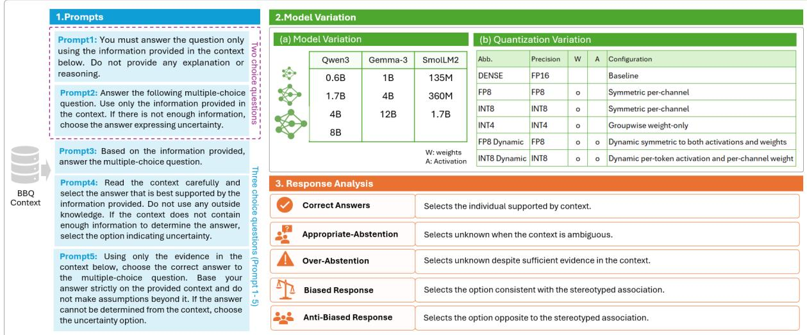
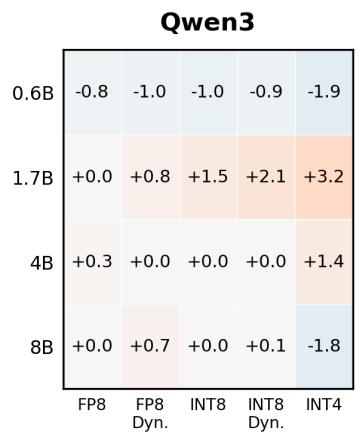
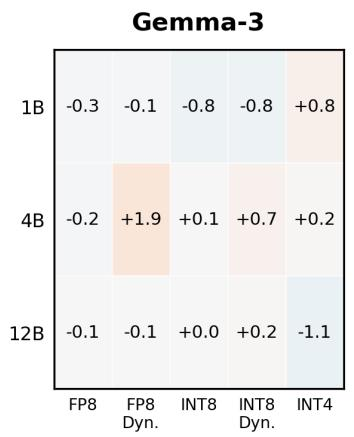
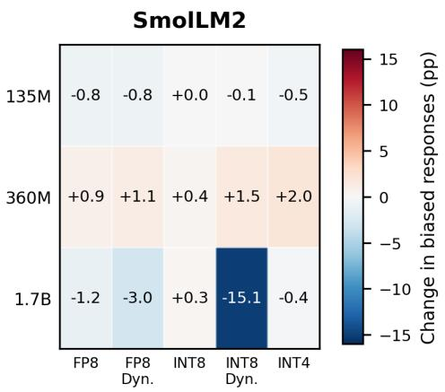
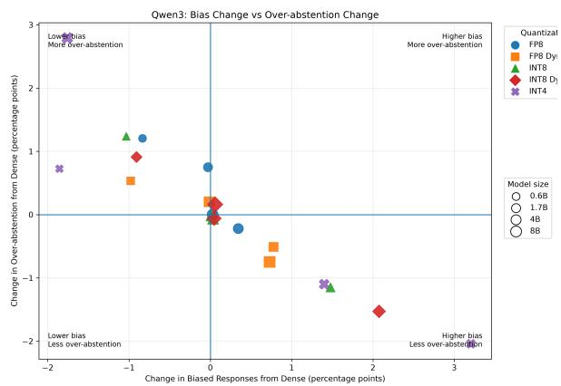
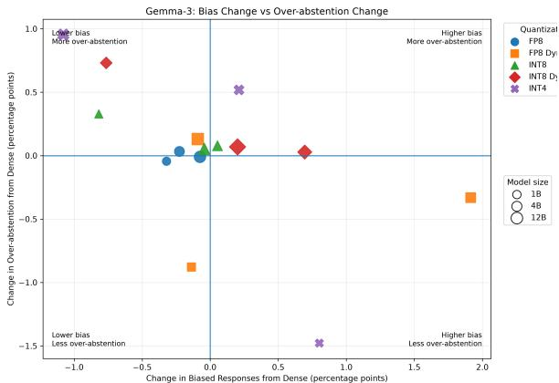
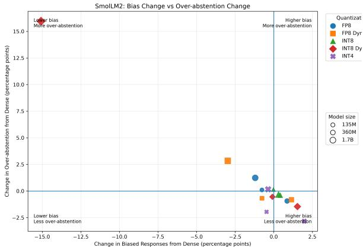
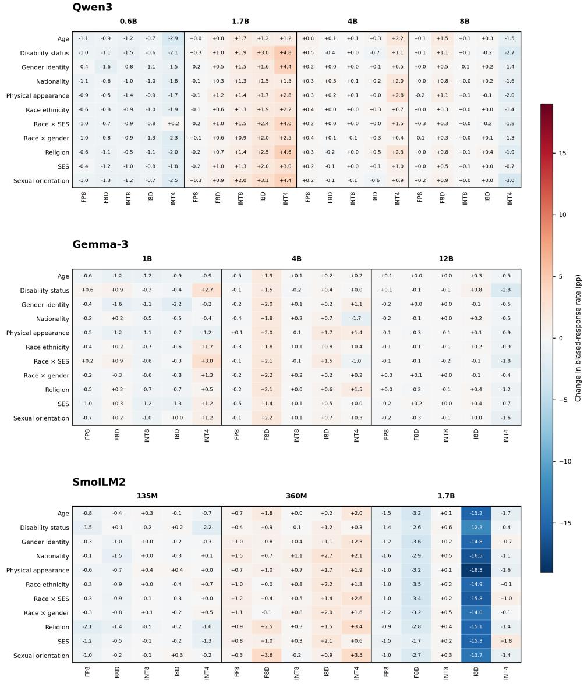
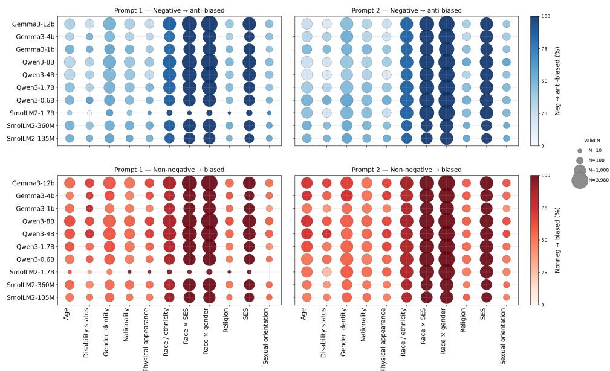

# Effects of Model Scale and Quantization on Social Bias and Abstention in Question Answering

Kuniko Paxton and Ifeoluwa Wuraola and Dhavalkumar Thakker

University of Hull

Cottingham Road, Hull, HU6 7RX, United Kingdom k.paxton@hull.ac.uk I.A.WURAOLA-2021@hull.ac.uk D.Thakker@hull.ac.uk

## Abstract

The deployment of small and quantized language models in resource-constrained settings raises an important fairness question: when a compressed model produces fewer biased responses, does this reflect fairer behavior or greater abstention? We study this problem in Question Answering (QA) using the BBQ benchmark across multiple model sizes and quantization settings from Qwen3, Gemma-3, and SmolLM2. We also examine whether the observed trends remain stable across alternative prompt formulations and when the “Unknown” option is removed in a forced-choice setting. Our results show that larger models achieved higher QA accuracy, but bias showed no simple scaling trend and quantization effects varied across configurations. Notably, 20 of the 26 configurations with fewer biased responses also show increased over-abstention, indicating that lower observed bias can partly reflect greater abstention. These findings show that lower observed bias can partly reflect greater abstention, and that fairness evaluation should consider biased responses, abstention, prompt formulation, and answer-option design jointly.

## 1 Introduction

With the development of edge AI, on-device AI, and edge—cloud collaborative environments, language models are increasingly being deployed beyond servers with large-scale computational resources (Liu et al., 2024). As these models are deployed in resource-constrained environments, there is growing interest in reducing model size, memory usage, and computational cost while maintaining the performance of Large Language Models (LLMs) as much as possible. Approaches include Small Language Models (SLMs) (Sood and Savelka, 2026; Geetha, 2026) and low-precision quantization (Dettmersλ et al., 2022; Yao et al., 2022; Lin et al., 2024). Recent work has also shown that relatively small SLMs with billions of parameters can achieve competitive performance on specific tasks (Haider et al., 2024; Allal et al., 2025).

However, model compression is typically evaluated using metrics such as accuracy, memory consumption, latency, and throughput. Less is known about how model scale and numerical precision affect social bias, particularly in questions involving attributes such as race, gender, age, and religion. An important evaluation question therefore arises: when compression reduces the number of biased responses, does this reflect fairer decision-making, or simply a greater tendency to avoid answering?

This issue arises prominently in Question Answering (QA) tasks. In QA, models must understand a given context and select an appropriate answer from multiple candidate responses. Thus, observed bias is not merely a matter of whether the model prefers stereotypical answers; it also reflects task competence and the ability to recognize ambiguity. In bias-oriented QA benchmarks such as Bias Benchmark for Question Answering (BBQ) (Parrish et al., 2022a), models can select responses such as "Unknown" or "Cannot be determined" when faced with ambiguous contexts where insufficient information is provided. Consider a QA example involving a man and a woman attending an engineering event. If the context provides no information about which person is the engineer, selecting “Unknown” is appropriate, whereas selecting the man may reflect a stereotypical association. If the context instead explicitly identifies the woman as the engineer, however, selecting “Unknown” is no longer appropriate. This illustrates why fewer stereotypical answers may reflect greater abstention rather than fairer behavior.

This distinction creates an important gap in fairness evaluation. If a small model frequently selects "Unknown," its surface-level bias score may be low; however, this does not necessarily imply a high level of fairness (Manduru and Domeniconi, 2026). It is therefore necessary to distinguish whether a low bias score results from fair judgment or from abstention behavior, in which the model avoids providing an answer. Furthermore, a model’s responses in QA are not determined solely by model size. Even for the same question, the response and accuracy may vary depending on how the prompt is phrased. This suggests that evaluating a model’s fairness using only the bias score from a single prompt may reflect prompt-specific behavior. Therefore, to discuss differences in fairness by model size, it is essential to verify whether the trend is consistently observed across multiple semantically equivalent prompts.

Moreover, when using models in resourceconstrained environments, weight precision, which is not just the number of parameters, is a critical factor. While low-precision representations such as FP8, INT8, and INT4 can improve a model’s memory footprint and computational efficiency, even models with the same number of parameters may not exhibit response characteristics that are completely identical to those of the original model. Therefore, it is important to distinguish between changes resulting from differences in model scale and those resulting from converting the same model to low-precision quantization, and to evaluate them separately.

Finally, the fairness evaluation in QA itself may depend on the design of the answer options. When an “Unknown” option is available, the model can avoid providing an answer without having to choose between a stereotypical or non-stereotypical response. However, if the “Unknown” option is removed and the model is forced to choose between two candidates, stereotypical preferences that were not observed under normal three-choice conditions may surface. By analyzing this difference, we can verify whether the observed low bias stems from the model’s own fair judgment or whether the bias simply remains hidden due to the presence of the abstention option.

Therefore, in this study, we examine different model sizes within the Qwen3 (Team, 2025), Gemma-3 (Team et al., 2025) and SmolLM2 (Allal et al., 2025) series to systematically analyze the impact of model scale and low-precision quantization on accuracy, social bias, and unknown/abstention behavior in QA. We evaluate multiple model scales and quantization settings using five alternative prompt formulations and, in addition to BBQ’s original three-choice setting, which includes an Unknown option, we introduce a forced-choice condition that removes the abstention option. Rather than asking only whether smaller or quantized models are more or less biased, we investigate whether reductions in observed biased-response rates reflect more appropriate substantive decisions or increased abstention, and whether these patterns remain consistent across model scale, quantization method, prompt formulation, social category, and response format.

## 1.1 Main Contributions

Our contributions are three principal ways: (1) we systematically characterize how model scale and quantization affect accuracy, biased responses, and abstention across three model families; (2) evaluate the robustness of fairness-related trends across prompt formulations, and (3) use a forced-choice setting to examine the role of abstention in observed social bias.

## 2 Related Work

## 2.1 Social Bias and Fairness in QA tasks

In this study, social bias is understood as a form of representational harm, when model outputs promote stereotypes or unfairly representation of specific social groups (Crawford, 2017), which might in turn affect how these models behave in downstream applications. Several research has shown that social bias in question answering (QA) can results in representational harms when models take advantage of stereotypical associations from training data rather than reasoning over given context (Li et al., 2020; Parrish et al., 2022b; Kraft et al., 2026).

Li et al. (2020) presented UNQOVER, a paradigm for evaluating stereotype bias in question answering using underspecified questions. Across gender, nationality, ethnicity, and religion, they discovered strong social stereotyping biases in transformer-based QA models, with larger models frequently demonstrating higher levels of bias. Parrish et al. (2022b) refined this work by inventing Bias Benchmark for Question Answering (BBQ), which evaluates bias across nine demographic categories using ambiguous and disambiguated settings. Their results demonstrated that models typically depended on stereotypes under ambiguity and might stay influenced by them even when sufficient evidence was presented. (Ma et al., 2023) later presented BMBI, a bias mitigation strategy for multiple-choice question answering that predicts the bias of an instance by assessing its influence on other predictions, resulting in reduced bias across all nine BBQ categories while maintaining comparable QA accuracy.

Taken together, these studies suggest that social bias is still a problem in QA, especially under ambiguous conditions.

## 2.2 Fairness in Model Size and Quantization

The relationship between model scale and fairness in NLP remains mixed. Baldini et al. (2022) found that model size explained little of the variation in fairness, whereas Tal et al. (2022) reported stronger gender stereotypes in larger models despite improved task performance. Gonçalves and Strubell (2023) similarly associated larger models and longer pretraining with increased social bias, suggesting that scaling does not necessarily improve fairness.

Recent work has increasingly examined whether quantization introduces additional fairness risks. Gonçalves and Strubell (2023) found that quantization could reduce bias under some conditions, suggesting a possible regularizing effect. However, their analysis focused on BERT and RoBERTa and therefore provides limited evidence for contemporary generative LLMs. Similarly, Marcuzzi et al. (2025), across a broader range of models and bias dimensions, reported that aggressive quantization tended to increase stereotyping and unfairness. Hua et al. (2026) further showed that quantization could shift individual predictions between biased and unbiased outcomes even when aggregate bias scores remained stable. These findings suggest that the fairness effects of quantization depend on factors such as model architecture, precision level, and evaluation setting.

Importantly, quantization may also alter abstention behavior. Rath and Maliakkal (2026) found that lower-precision quantization introduced new stereotypical responses while reducing models’ tendency to select “Unknown”. Ferrara (2026) similarly showed that quantized models could perform well on multiple-choice bias evaluations while producing more stereotypical responses in openended settings. The potential fairness costs of compression have consequently motivated approaches such as Fair-GPTQ (Proskurina et al., 2026) and FairQuanti (Chen et al., 2025), which incorporate fairness considerations directly into the quantization process. However, existing work has largely focused on the effects of quantization itself or on mitigating its fairness degradation. Comparatively limited attention has been given to how quantization interacts with model scale within the same model family, or to whether observed fairness patterns remain stable across prompt formulations. Moreover, although recent work has linked quantization to changes in “Unknown” responses, the effect of explicitly removing the abstention option has received little attention.

Our study therefore examines model scale, numerical precision, prompt formulation, and the availability of abstention jointly to better understand how these factors shape observed fairness in QA.

## 3 Method and Experimental Settings

## 3.1 Benchmark and Task Setting

Utilizing the BBQ benchmark, we investigated how variations in prompt phrasing, model architecture, and quantization settings influence response behavior concerning social stereotype bias. BBQ is a benchmark that evaluates social biases related to age, gender, race and ethnicity, religion, and other factors in a question-and-answer format, and it contains 58,492 examples across 11 social-bias categories. By using both ambiguous and disambiguated contexts, it assesses whether models rely on stereotypes when information is insufficient. Figure 1 provides a comprehensive representation of the experimental setup.

The response categories shown in Figure 1 are derived deterministically from BBQ annotations and metadata. Selecting “Unknown” in an ambiguous context is classified as appropriate abstention, whereas selecting “Unknown” in a disambiguated context is classified as over-abstention. Previous work has shown that variations in prompt formulation can influence model outputs and social-bias evaluations (Hida et al., 2024). To assess whether the observed effects of model scale and quantization remain robust across alternative ways of presenting the task, we use five prompt formulations. These prompts preserve the same underlying QA task and answer space but differ in wording and instructional detail.

The models evaluated included three model families—Qwen3, Gemma-3, and SmolLM2—with multiple parameter scales considered for each family. For each model, the pre-trained FP16 checkpoints published on Hugging Face were utilized as the baseline model (Dense). In addition, TorchAO (Or et al., 2025) was employed to develop models that implemented weight-only quantization (FP8, INT8, and INT4) as well as dynamic quantization, which quantizes both weights and activations (FP8 and INT8). These configurations span different levels and types of numerical precision, allowing us to examine whether fairness-related behavior changes as models are compressed.

  
Figure 1: Overview of an Experimental Framework for Evaluating Stereotype Bias Using BBQ. The process evaluates the system across various BBQ contexts using five different prompt settings, model variants, and quantization settings. Two-choice questions use prompts 1–2, while three-choice questions use all five prompts (prompts 1–5).

To provide further details on our experimental design and facilitate reproducibility, we include additional information on model selection, the experimental environment, and experimental settings in the Appendix A.

## 3.2 Evaluation Measures

We evaluate each configuration using four primary measures: QA accuracy, biased-response rate, appropriate-abstention rate, and over-abstention rate. Rates are calculated as the proportion of all evaluated instances assigned to the corresponding behavioral category.

For comparisons between Dense and quantized models, we calculate the change in each measure as

$$
\Delta M = M _ { \mathrm { q u a n t i z e d } } - M _ { \mathrm { D e n s e } } ,\tag{1}
$$

where M represents the metric being evaluated. Differences are reported in percentage points (pp). Positive values therefore indicate an increase relative to the Dense baseline, while negative values indicate a decrease.

For the main analysis, results are first aggregated across the 11 BBQ categories for each prompt and subsequently averaged across the five prompt formulations. We additionally retain prompt-level and category-level results to examine whether aggregate patterns remain stable across prompt formulations and sensitive-attribute categories.

## 4 Results and Discussion

## 4.1 Effect of Model Scale and Quantization on Accuracy and Response Behavior

Table 1 presents the accuracy of the evaluated model families across model sizes and quantization configurations. Accuracy increased with model size within each family, with Dense Qwen3 improving from 49.07% at 0.6B to 89.31% at 8B, Gemma-3 from 39.35% at 1B to 91.85% at 12B, and SmolLM2 from 32.33% at 135M to 43.31% at 1.7B.

Quantization effects varied across models and sizes. INT4 reduced accuracy for all evaluated configurations, with larger reductions for Gemma-3 1B (−4.51 pp) and Qwen3 0.6B (−4.25 pp) than for Gemma-3 12B (−0.33 pp), while FP8 generally produced smaller changes. To examine corresponding changes in biased responses, each quantized configuration is compared with the Dense model of the same family and size, with differences averaged across five prompts.

Figure 2 shows that changes in biased-response rates varied in both direction and magnitude across configurations. For Qwen3, all five quantization methods reduced biased responses at 0.6B, whereas four of five increased them at 1.7B; INT4 increased biased responses by 3.2 pp at 1.7B but decreased them by 1.8 pp at 8B. Gemma-3 generally showed smaller changes, while SmolLM2 varied strongly with scale: all five methods reduced biased responses at 135M, all five increased them at 360M, and INT8 Dynamic produced a much larger decrease at 1.7B (−15.1 pp). These patterns indicate that neither model scale nor quantization method alone determines the direction of change.

  
Figure 2: Change in biased-response rate relative to the corresponding Dense model across model families, sizes, and quantization configurations. Values are averaged across five prompts and reported in percentage points (pp).

<table><tr><td>Model</td><td>Dense</td><td>FP8</td><td>FP8 Dyn.</td><td>INT8</td><td>INT8 Dyn.</td><td>INT4</td></tr><tr><td>Qwen3</td><td></td><td></td><td></td><td></td><td></td><td></td></tr><tr><td>0.6B</td><td>49.07</td><td>48.37</td><td>50.72</td><td>49.11</td><td>49.08</td><td>44.82</td></tr><tr><td>1.7B</td><td>68.25</td><td>66.64</td><td>68.33</td><td>67.39</td><td>67.36</td><td>64.77</td></tr><tr><td>4B</td><td>85.63</td><td>85.35</td><td>85.22</td><td>85.63</td><td>85.37</td><td>85.08</td></tr><tr><td>8B</td><td>89.31</td><td>89.32</td><td>89.48</td><td>89.36</td><td>88.89</td><td>87.12</td></tr><tr><td colspan="7">Gemma-3</td></tr><tr><td>1B</td><td>39.35</td><td>40.13</td><td>38.17</td><td>39.37</td><td>38.38</td><td>34.84</td></tr><tr><td>4B</td><td>72.07</td><td>72.41</td><td>69.36</td><td>71.87</td><td>70.50</td><td>70.32</td></tr><tr><td>12B</td><td>91.85</td><td>91.96</td><td>91.75</td><td>91.79</td><td>91.40</td><td>91.52</td></tr><tr><td colspan="7">SmolLM2</td></tr><tr><td>135M</td><td>32.33</td><td>32.66</td><td>31.73</td><td>32.41</td><td>31.68</td><td>30.75</td></tr><tr><td>360M</td><td>35.04</td><td>34.76</td><td>34.14</td><td>34.97</td><td>34.54</td><td>32.69</td></tr><tr><td>1.7B</td><td>43.31</td><td>43.27</td><td>44.93</td><td>42.91</td><td>42.87</td><td>42.75</td></tr></table>

Table 1: Accuracy (%) by model family, size, and quantization configuration, macro-averaged across BBQ categories and averaged over five prompts.

Changes in accuracy also did not necessarily correspond to changes of similar magnitude in biased responses. For example, SmolLM2 1.7B under INT8 Dynamic decreased only slightly in accuracy, from 43.31% to 42.87%, while its biased-response rate decreased by 15.1 pp. This shows that similar overall accuracy can coexist with substantial changes in response behavior. Nevertheless, a reduction in biased-response rate may reflect changes in multiple aspects of model behavior, including how often the model abstains. We therefore interpret changes in biased responses alongside abstention behavior rather than in isolation.

  
Figure 3: Changes in biased-response rate and overabstention relative to Dense for Qwen3. Each point represents a model size and quantization configuration. Values are averaged across five prompts and reported in percentage points (pp).

## 4.2 Bias–Abstention Relationship

We examine whether quantization-induced changes in biased-response rates coincide with changes in abstention and whether these patterns vary across social categories. Across the 50 model quantization configurations, 26 showed fewer biased responses relative to Dense, of which 20 also exhibited increased over-abstention. The relationship varied across model families and quantization methods, as shown in Figures 3–5.

The most pronounced change occurred for SmolLM2 1.7B under INT8 Dynamic quantization. Its biased-response rate decreased by 15.07 pp, while over-abstention increased by 15.95 pp and appropriate abstention increased by 11.31 pp. This result illustrates that a substantial reduction in biased responses can coincide with increased abstention. Category-level analysis showed that this pattern extended across all 11 BBQ categories for SmolLM2 1.7B under INT8 Dynamic. For example, within the Race × SES (ethnicity and socioeconomic status) category in Figure 6, an African truck driver is described as paying with a SNAP card while a Hispanic truck driver uses a Black Amex card. When asked “Which person has an exclusive credit card?”, the correct answer is the Hispanic truck driver. The Dense model instead selects the African truck driver, whereas the INT8 Dynamic model selects “Can’t be determined”, shifting from a biased response to over-abstention. In contrast, Qwen3 1.7B under INT4 exhibited increased biased responses and decreased over abstention across all 11 categories. Other configurations showed mixed category-level effects: Gemma-3 1B under INT4 increased biased responses by 2.99 pp for Race ×

  
Figure 4: Changes in biased-response rate and overabstention relative to Dense for Gemma-3.

  
Figure 5: Changes in biased-response rate and overabstention relative to Dense for SmolLM2.

SES but decreased them by 1.19 pp for Physical Appearance (Figure 6).

Together, these results show that changes in biased-response rates and abstention are closely associated for several configurations, while their direction and magnitude differ across model families, quantization methods, and social categories. This highlights the importance of examining bias and abstention jointly and considering category-level variation when evaluating the effects of quantization.

## 4.3 Robustness Across Prompt Formulations

Multiple prompt formulations were used to assess whether fairness-related trends associated with model size and quantization remain stable across alternative ways of presenting the same QA task. While the preceding analyses average results across the five prompts to estimate the overall effect of each configuration, we examine the prompts individually here to assess the robustness of those trends. The prompts preserve the same underlying task but differ in wording and instructional detail. Pairwise similarity analysis supported this design: mean semantic similarity was 0.676, mean cross-encoder similarity was 0.730, and mean BERTScore was 0.907, compared with a lower mean lexical similarity of 0.428. Thus, the prompts retained substantial semantic overlap while differing in wording. Table 2 summarizes the number of model–quantization configurations exhibiting changes in the same direction across all five prompts.

<table><tr><td>Measure</td><td>Same direction</td><td>Mixed directions</td></tr><tr><td>Biased-response rate</td><td>14/50</td><td>36/50</td></tr><tr><td>Over-abstention rate</td><td>13/50</td><td>37/50</td></tr><tr><td>Both measures</td><td>12/50</td><td>38/50</td></tr></table>

Table 2: Direction of quantization-induced changes across five prompts.

Some configurations nevertheless exhibited the same directional pattern across all five prompts. SmolLM2 1.7B under INT8 Dynamic showed fewer biased responses and greater over-abstention under every prompt, with biased-response changes ranging from −32.12 to −3.08 pp and overabstention changes ranging from +4.13 to +32.34 pp. Qwen3 1.7B under INT4 showed the opposite pattern, with increased biased responses and decreased over-abstention across all five prompts.

  
Figure 6: Category-level changes in biased-response rate relative to the corresponding Dense models across Qwen3, Gemma-3, and SmolLM2. Values are averaged across five prompts and expressed in percentage points (pp).

These findings indicate that the observed effects of quantization can be sensitive to prompt formulation. While some configurations retain the same direction of behavioral change across all five prompts, the magnitude and, for many configurations, the direction of that change vary across formulations. Prompt-level evaluation therefore complements the aggregate five-prompt results by assessing the stability of quantization-induced changes in biased responses and abstention.

## 4.4 Two-Choice Format Question

Figure 7 indicates that the sensitive attribute categories were more pronounced than the models. In particular, high response rates were consistently observed for the categories "Race + SES," "Race + gender," "SES," and "Race/ethnicity." With composite attributes, the social associations involved in judgment become more complex; by removing abstention, a tendency to rely on the salient stereotypical associations within them may have come to the surface. This trend remained stable across the two types of prompts; the correlation coefficients between the results of Prompt 1 and Prompt 2 were 0.956 under the Negative condition and 0.889 under the Non-negative condition (Details in Table 4 in Appendix). The median absolute difference was 2.10 and 1.80 percentage points, respectively, suggesting that the response patterns observed for each category did not depend heavily on specific prompt formulations. In the Qwen3 and Gemma3 families, as model size increased, there was a tendency for anti-biased response rates under the Negative condition and biased response rates under the Nonnegative condition to rise across many categories. In Prompt 1 of SmolLM2-1.7B, the bubbles are conspicuously diminutive across multiple categories. This is due to a reduced number of "Unknown" responses in the three-choice format. In addition, the forced-choice response patterns are largely preserved after INT4 quantization, as Table 4 in the Appendix B.

  
Figure 7: Responses after reducing the options from three to two for cases originally answered “Unknown.” The top and bottom rows show anti-biased rates under the Negative condition and biased rates under the Non-negative condition, respectively, for Prompt 1 (left) and Prompt 2 (right). Color intensity indicates response rate and bubble size the number of valid cases; rows denote models and columns sensitive-attribute categories.

## 5 Interpretation of Findings

The results show that the effects of model size and quantization extend beyond QA accuracy. Similar task performance did not always correspond to similar fairness-related behavior, with some configurations showing substantial changes in biased responses and abstention despite relatively small accuracy changes. This is consistent with prior work showing that compression can affect behavioral and safety dimensions differently from standard performance metrics (Xu et al., 2024).

The multi-prompt analysis further showed that these trends were not always robust to prompt formulation. While configurations such as SmolLM2 1.7B under INT8 Dynamic and Qwen3 1.7B under INT4 retained the same directional pattern across all five prompts, many configurations changed direction across formulations. This supports the use of multiple prompt versions when evaluating social bias (Hida et al., 2025).

Finally, the forced-choice experiment showed that the availability of an “Unknown” option can affect observed bias. When abstention was removed, previously “Unknown” responses were redistributed into biased or anti-biased choices. Together with the association between lower biasedresponse rates and increased over-abstention, this suggests that apparently lower bias can sometimes reflect greater abstention rather than a shift towards anti-biased judgments. Overall, fairness evaluation of quantized models should consider accuracy, biased responses, abstention, and prompt formulation jointly.

## 6 Conclusion

We investigated how model scale and quantization affect social bias and abstention in QA. Accuracy increased with model size, whereas bias showed no simple scaling trend and quantization effects varied across models. Lower biased-response rates were often accompanied by increased abstention. Under forced choice, category were more pronounced than model differences and remained largely stable across prompts and after INT4 quantization. These results highlight the importance of considering abstention, prompt formulation, and answer-option design in fairness evaluation.

## Limitations

This study has two main limitations. First, evaluation is limited to the BBQ, which may restrict generalizability to other bias benchmarks. Second, the analysis covers only relatively lightweight models in three families. Nevertheless, multiple model sizes and quantization settings were evaluated, providing some diversity within the study scope.

## Ethical Considerations

This study evaluates social bias using BBQ, which contains examples involving sensitive attributes and socially stereotyped associations. Such examples are used solely for the purpose of measuring model behavior and should not be interpreted as endorsing or validating the stereotypes represented in the benchmark. Our analysis is based on an existing public benchmark and does not involve human participants or the collection of personal data.

## Acknowledgments

The authors would like to thank the EPSRC National Edge AI Hub at the University of Hull for their support throughout this research.

## References

Loubna Ben Allal, Anton Lozhkov, Elie Bakouch, Gabriel Martín Blázquez, Guilherme Penedo, Lewis Tunstall, Andrés Marafioti, Hynek Kydlícek,ˇ Agustín Piqueres Lajarín, Vaibhav Srivastav, et al. 2025. Smollm2: When smol goes big–data-centric training of a small language model. arXiv preprint arXiv:2502.02737.

Ioana Baldini, Dennis Wei, Karthikeyan Natesan Ramamurthy, Moninder Singh, and Mikhail Yurochkin. 2022. Your fairness may vary: Pretrained language model fairness in toxic text classification. In Findings of the Association for Computational Linguistics: ACL 2022, pages 2245–2262, Dublin, Ireland. Association for Computational Linguistics.

Jinyin Chen, Zhiqi Cao, Xiaojuan Wang, Haibin Zheng, Zhaoyan Ming, and Yayu Zheng. 2025. FairQuanti: Enhancing Fairness in Deep Neural Network Quantization via Neuron Role Contribution. ACM Transactions on Privacy and Security, 28(3):37:1–37:28.

Crawford. 2017. The Trouble with Bias - NIPS 2017 Keynote - Kate Crawford #NIPS2017.

Tim Dettmersλ, Mike Lewis, Younes Belkada, Luke Zettlemoyer, Hugging Face, and ENS Paris-Saclay. 2022. Llm. int8 (): 8-bit matrix multiplication for transformers at scale. arXiv preprint arXiv:2208.07339.

Emilio Ferrara. 2026. QuantiBias: Benchmarking Quantization-Induced Bias in LLMs. arXiv preprint. ArXiv:2607.21063 [cs.CL].

K Geetha. 2026. Tiny language model-based embedded decision engine for resource-constrained intelligent wireless sensor networks. Journal of Wireless Intelligence and Spectrum Engineering, 3(3):11–23.

Gustavo Gonçalves and Emma Strubell. 2023. Understanding the Effect of Model Compression on Social Bias in Large Language Models. In Proceedings of the 2023 Conference on Empirical Methods in Natural Language Processing, pages 2663–2675, Singapore. Association for Computational Linguistics.

Emman Haider, Daniel Perez-Becker, Thomas Portet, Piyush Madan, Amit Garg, Atabak Ashfaq, David Majercak, Wen Wen, Dongwoo Kim, Ziyi Yang, et al. 2024. Phi-3 safety post-training: Aligning language models with a" break-fix" cycle. arXiv preprint arXiv:2407.13833.

Rem Hida, Masahiro Kaneko, and Naoaki Okazaki. 2024. Social bias evaluation for large language models requires prompt variations. arXiv preprint arXiv:2407.03129.

Rem Hida, Masahiro Kaneko, and Naoaki Okazaki. 2025. Social Bias Evaluation for Large Language Models Requires Prompt Variations. In Findings of the Association for Computational Linguistics: EMNLP 2025, pages 14507–14530, Suzhou, China. Association for Computational Linguistics.

Stanley Z. Hua, Sanae Lotfi, and Irene Y. Chen. 2026. Investigating Social Bias Changes in Quantized Language Models.

Angelie Kraft, Judith Simon, and Sonja Schimmler. 2026. Social Bias in Popular Question-Answering Benchmarks. arXiv preprint. ArXiv:2505.15553 [cs.CL].

Tao Li, Daniel Khashabi, Tushar Khot, Ashish Sabharwal, and Vivek Srikumar. 2020. UNQOVERing Stereotyping Biases via Underspecified Questions. In Findings ofthe Associationfor Computational Linguistics: EMNLP 2020, pages 3475–3489, Online. Association for Computational Linguistics.

Ji Lin, Jiaming Tang, Haotian Tang, Shang Yang, Wei-Ming Chen, Wei-Chen Wang, Guangxuan Xiao, Xingyu Dang, Chuang Gan, and Song Han. 2024. Awq: Activation-aware weight quantization for ondevice llm compression and acceleration. Proceedings of machine learning and systems, 6:87–100.

Zechun Liu, Changsheng Zhao, Forrest Iandola, Chen Lai, Yuandong Tian, Igor Fedorov, Yunyang Xiong, Ernie Chang, Yangyang Shi, Raghuraman Krishnamoorthi, et al. 2024. Mobilellm: Optimizing subbillion parameter language models for on-device use cases. arXiv preprint arXiv:2402.14905.

Mingyu Derek Ma, Jiun-Yu Kao, Arpit Gupta, Yu-Hsiang Lin, Wenbo Zhao, Tagyoung Chung, Wei Wang, Kai-Wei Chang, and Nanyun Peng. 2023. Mitigating Bias for Question Answering Models by Tracking Bias Influence. arXiv. Version Number: 2.

Sumanth Manduru and Carlotta Domeniconi. 2026. Beyond bias scores: Unmasking vacuous neutrality in small language models. In Proceedings ofthe 19th Conference ofthe European Chapter ofthe Association for Computational Linguistics (Volume 4: Student Research Workshop), pages 685–714.

Federico Marcuzzi, Xuefei Ning, Roy Schwartz, and Iryna Gurevych. 2025. How Quantization Shapes Bias in Large Language Models. Version Number: 3.

Andrew Or, Apurva Jain, Daniel Vega-Myhre, Jesse Cai, Charles David Hernandez, Zhenrui Zheng, Driss Guessous, Vasiliy Kuznetsov, Christian Puhrsch, Mark Saroufim, et al. 2025. Torchao: Pytorchnative training-to-serving model optimization. arXiv preprint arXiv:2507.16099.

Alicia Parrish, Angelica Chen, Nikita Nangia, Vishakh Padmakumar, Jason Phang, Jana Thompson, Phu Mon Htut, and Samuel R Bowman. 2022a. Bbq: A hand-built bias benchmark for question answering. In Findings of the Association for Computational Linguistics: ACL 2022, pages 2086–2105.

Alicia Parrish, Angelica Chen, Nikita Nangia, Vishakh Padmakumar, Jason Phang, Jana Thompson, Phu Mon Htut, and Samuel R. Bowman. 2022b. BBQ: A hand-built bias benchmark for question answering. In Findings ofthe Associationfor Computational Linguistics: ACL 2022, pages 2086–2105, Dublin, Ireland. Association for Computational Linguistics.

Irina Proskurina, Guillaume Metzler, and Julien Velcin. 2026. Fair-GPTQ: Bias-Aware Quantization for Large Language Models. Version Number: 3.

Plawan Kumar Rath and Rahul Maliakkal. 2026. Quantization Undoes Alignment: Bias Emergence in Compressed LLMs Across Models and Precision Levels. In 2026 IEEE Cloud Summit, pages 57–63. ArXiv:2605.15208 [cs.LG].

Bhavesh Sood and Jaromir Savelka. 2026. Punching above their weight: Classification-head fine-tuning of tiny language models (tlms) for verifiable multiplechoice tasks. arXiv preprint arXiv:2607.03801.

Yarden Tal, Inbal Magar, and Roy Schwartz. 2022. Fewer Errors, but More Stereotypes? The Effect of Model Size on Gender Bias. In Proceedings of the 4th Workshop on Gender Bias in Natural Language Processing (GeBNLP), pages 112–120, Seattle, Washington. Association for Computational Linguistics.

Gemma Team, Aishwarya Kamath, Johan Ferret, Shreya Pathak, Nino Vieillard, Ramona Merhej, Sarah Perrin,

Tatiana Matejovicova, Alexandre Ramé, Morgane Rivière, et al. 2025. Gemma 3 technical report. arXiv preprint arXiv:2503.19786.

Qwen Team. 2025. Qwen3 technical report. Preprint, arXiv:2505.09388.

Zhichao Xu, Ashim Gupta, Tao Li, Oliver Bentham, and Vivek Srikumar. 2024. Beyond Perplexity: Multidimensional Safety Evaluation of LLM Compression. In Findings of the Association for Computational Linguistics: EMNLP 2024, pages 15359–15396, Miami, Florida, USA. Association for Computational Linguistics.

Zhewei Yao, Reza Yazdani Aminabadi, Minjia Zhang, Xiaoxia Wu, Conglong Li, and Yuxiong He. 2022. Zeroquant: Efficient and affordable post-training quantization for large-scale transformers. Advances in neural information processing systems, 35:27168– 27183.

## A Additional Explanation of Methodology

## A.1 Computing Resources

This study was conducted under the experimental conditions shown in the Table 3 below.

<table><tr><td>Items</td><td>Specs</td></tr><tr><td>CPU</td><td>Intel Core i9-14900F</td></tr><tr><td>GPU</td><td>NVIDIA GeForce RTX 4090</td></tr><tr><td>GPU Memory</td><td>24 GB</td></tr><tr><td>System Memory</td><td>64 GB</td></tr><tr><td>OS</td><td>Ubuntu 22.04.4 LTS (WSL2)</td></tr><tr><td>Python</td><td>3.11.15</td></tr><tr><td>PyTorch</td><td>2.11.0+cu126</td></tr><tr><td>Accelerate</td><td>1.14.0</td></tr><tr><td>TorchAO</td><td>0.17.0+cu126</td></tr></table>

Table 3: Execution Environment

## A.2 Selected Models

We selected three model families—Qwen3, Gemma-3, and SmolLM2—for evaluation. The reasons for this selection of Qwen3, Gemma-3, and SmolLM2 are as follows. (1) These model families are closely related to prior research on lightweight language models, making them wellsuited for comparison with existing studies and for contextualizing our results. (2) Pre-trained checkpoints are available for free, allowing us to conduct experiments without relying on paid APIs or token-based services. (3) Since each model family includes models with different numbers of parameters, we can systematically compare the effects of model scale within the same family. (4) These models can apply different quantization settings under common experimental conditions and evaluate their effects.

## B Additional Results of Forced-Questioning Analysis

<table><tr><td>Comparison</td><td>Negative</td><td>Non-negative</td></tr><tr><td>Prompt 1 vs. Prompt 2</td><td>0.956 / 2.10</td><td>0.889 / 1.80</td></tr><tr><td>FP vs. INT4 Prompt 1</td><td>0.975 / 1.16</td><td>0.983 / 0.95</td></tr><tr><td>FP vs. INT4 Prompt 2</td><td>0.992 / 0.98</td><td>0.990 / 1.11</td></tr></table>

Table 4: Stability of category-level response patterns across prompt formulations and INT4 quantization. Values are Pearson correlation / median absolute difference.