# ExpEvolve: Structuring and Reusing Experience for Open-Ended Discovery

Yongqiang Chen\*†1,2, Chenxi Liu\*3, Deyu Zou\*4, Zhenhao Chen1, Tongliang Liu5,1, Bo Han3 and Kun Zhang1,2 1MBZUAI, 2Carnegie Mellon University, 3TMLR Group, Hong Kong Baptist University, 4The Chinese University of Hong Kong, 5SAIC Centre, The University of Sydney

Core contributors. †Project lead. yqchen24@gmail.com

Evolutionary coding agents such as AlphaEvolve are one of the notable successes in using Large Language Models (LLMs) to build AI Scientists. These agents tackle open-ended scientific problems by iteratively improving and evolving programs, leveraging the prior knowledge and reasoning capabilities of LLMs. Despite their success, mutations over programs are mostly low-level upon surface heuristics, without a persistent unit of control. In contrast, science compounds through ideas. In this work, we propose ExpEvolve, which injects idea-level extraction and control into evolution: it discovers and leverages the high-level factors from programs that explain scoring diferences among diferent programs. We characterize theoretical conditions on when discovery with idea factors improves sample eficiency. We also build a practical framework to show that the extracted high-level idea factors are helpful for guiding exploitation from experience and exploration when discovery comes to a plateau. Across 11 open-ended mathematical tasks, ExpEvolve significantly improves the final performance and sample eficiency up to 5.0×. The improvements also transfer to 4 other LLMs and to 6 machine learning tasks from MLS-Bench. Analysis shows that ExpEvolve can discover idea-level factors to provide better exploration and exploitation for evolutionary discovery.

## 1. Introduction

Large language models (LLMs) are now widely used to build agents that operate on increasingly longhorizon tasks (Plaat et al., 2025). One of the most ambitious applications is AI scientist agents (Zheng et al., 2025a), in which LLMs automate the scientific discovery process, including literature surveys (Asai et al., 2026), hypothesis generation (Wang et al., 2024; Yang et al., 2024), data-driven analysis (Majumder et al., 2025), experiment design (Li et al., 2025a), or even the whole discovery workflow (Gottweis et al., 2026; Lu et al., 2024; Mitchener et al., 2025; Yamada et al., 2025). LLM-driven discovery has shown strong results in a variety of domains, such as mathematics (OpenAI, 2026b,c), de novo protein design (Anthropic, 2026), algorithm discovery (Lange et al., 2026; Novikov et al., 2025), and the research that develops LLMs themselves, an early form of recursive self-improvement (RSI) (Favaro and Clark, 2026; Karpathy, 2026; Lyu et al., 2026a; OpenAI, 2026a). At the heart of the discovery loop is the iteration over scientific hypotheses, where scientific ideas compound throughout the evaluation of promising hypotheses (Wallace et al., 2026). Therefore, it is essential to reuse the discovery experience to generate high-quality hypotheses, e.g., avoiding getting stuck in repetitive mistakes or suboptimal solutions and encoding promising exploratory proposals.

In this work, we study experience reuse in open-ended discovery with evolutionary coding agents, where hypotheses are represented as solution programs to the underlying scientific problem, and experiences are accumulated as evaluated programs and their scores given by an explicit evaluator (Novikov et al., 2025). Typically, existing evolutionary coding agents such as ShinkaEvolve directly incorporate successful programs or rely on LLMs to summarize reusable insights and incorporate them as memory for future mutations with LLMs (Gideoni et al., 2026; Karpathy, 2026; Lange et al., 2026). However, program mutation contains an open-ended search space including low-level details such as hyperparameters and high-level insights such as optimization strategies. LLM-driven guidance is prone to focusing on low-level details (Karpathy, 2026; Pelleriti et al., 2026), which may not bring genuine new scientific discoveries. In contrast, human scientists tend to recognize the high-level contrasts among programs, accumulate and exploit scientific ideas from experience (Douven, 2025; Kuhn and Hawkins, 1963). The gap raises a challenging research question:

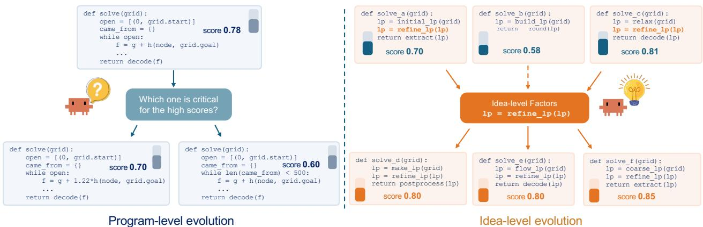  
Figure 1 | Comparison between experience reuse at program-level and idea-level. All programs solve the same grid task. Left: Experience reuse at program-level is prone to low-level edits. Programlevel evolution derives new programs from a high-scoring parent, such as changing the heuristic weight or bounding the search loop. Both edited programs score lower. Right: Experience reuse at idea-level compares structurally diferent programs through a shared procedure-level factor, lp = refine\_lp(lp). Programs that contain the factor score higher than the program that omits it. This contrast singles out the factor, which is then inserted into new programs of diferent structures.

## How can we reuse experience for evolutionary discovery like human scientists?

To tackle the question, we formulate evolutionary discovery as a Partially Observable Markov Decision Process (POMDP) (Kaelbling et al., 1998) (Sec. 3). In each turn, the agent needs to propose meaningful solutions to uncover the underlying causal mechanism for solving the scientific problem, i.e., maximizing the evaluation score (Glymour; Wallace, 1981). Under the formulation, we introduce the notion of ideas as high-level mechanistic properties of the programs that determine the evaluation scores, e.g., the construction family or the optimization strategy (Def. 3.2). Without uncovering the ideas, the agent has to treat programs as unrelated and cannot tell whether a revision changes an idea or only a low-level detail, so discovery degenerates into exhaustive search (Thm. 3.1). Meanwhile, the identification of ideas also requires suficient exploration to contrast programs with and without each idea (Thm. 3.3). Hence, an efective discovery agent needs to extract ideas from experience, and keep exploring programs where the ideas vary.

Motivated by the analysis, we propose ExpEvolve, which recognizes, structures, and leverages the high-level idea factors from discovery experience (Fig. 1). Specifically, ExpEvolve realizes the discovery of ideas via identifying high-level factors that help explain the program scoring diferences. Built upon COAT (Liu et al., 2025), the discovered idea factors are expected to predict which program performs better given any pair of programs in the experience. Then, the admitted idea factors will be incorporated as an action of a multi-armed bandit that controls the exploration and exploitation of diferent ideas during discovery. To enable suficient exploration, ExpEvolve also allocates slots for random exploration (Gideoni et al., 2026), and idea-guided exploration when the evolution comes to a plateau. The idea-guided exploration enforces LLMs to explore diverse ideas other than those widely used in top-scoring programs. The idea-based control in ExpEvolve allows eficient exploitation of promising ideas while continuing to explore programs with varied ideas.

We evaluate ExpEvolve on 11 open-ended mathematical discovery tasks with a budget of 200 evaluated programs, using SCS as the backbone and the main baseline (Sec. 5). Under two configurations that split the budget into 20 generations of 10 programs and 10 generations of 20 programs, ExpEvolve improves the final performance over SCS and ShinkaEvolve in most settings with smaller budgets up to 5.0×. Further analyses show that the discovered idea factors order the archived programs better than their code length on all 11 tasks. We further integrate ExpEvolve into OpenRSI (Yang et al., 2026b) on six tasks from MLS-Bench (Lyu et al., 2026a), where it improves the mean final best-so-far score of OpenRSI on all six tasks.

## 2. Related Work

In this section, we discuss the closest related works and defer a more detailed one in Appendix B.

AI Scientist agents. With the significant advancement in LLM capacity and the development of agentic systems, building LLM-based AI scientists has gained increasing attention (Zhou et al., 2025). One research line automates part or the whole of the pipelines in scientific activities through agentic workflows (Feng et al., 2026b; Ghareeb et al., 2026; Gottweis et al., 2026; Lu et al., 2026; Lyu et al., 2026b; Mitchener et al., 2025; Yamada et al., 2025). Evolutionary coding agents are one of the most representative AI scientist agents that integrate LLMs into evolutionary search over programs scored by an explicit evaluator (Novikov et al., 2025; Romera-Paredes et al., 2024). AI scientist agents, including evolutionary coding agents, have made impact in a variety of domains, such as mathematics (OpenAI, 2026b), materials science (Ghafarollahi and Buehler, 2025), biology (Anthropic, 2026), and the development of LLMs themselves, e.g., accelerating LLM training and research toward recursive self-improvement (Favaro and Clark, 2026; Karpathy, 2026; Lyu et al., 2026a; OpenAI, 2026a; Zhang et al., 2026). As generation scales up, validating the generated hypotheses becomes the main cost (Wallace et al., 2026), and ideas that look promising often degrade once executed (Si et al., 2026). The expanding paradigm of LLM-driven scientific discovery makes the reuse of experience increasingly more essential, which is central to our work.

Experience reuse in evolutionary coding agents. Existing evolutionary coding agents typically reuse experience via conditioning on evaluated programs (Gideoni et al., 2026; Novikov et al., 2025) or summarizing textual insights from programs into memory for future mutations (Lange et al., 2026; Liu et al., 2024; Volkov et al., 2026; Ye et al., 2024). The useful experience can also be exploited for future search control, e.g., selection inspirations across diverse strategy clusters (Lange et al., 2026; Luo et al., 2026). Diferent from existing works that concentrate on the unit of experience as texts or programs, ExpEvolve discovers and exploits high-level idea factors to guide program mutations.

## 3. Theoretical Formulation of Evolutionary Discovery

In this section, we formalize evolutionary discovery and introduce the notion of ideas.

## 3.1. Evolutionary Discovery as a POMDP

Scientific discovery aims to uncover the causal mechanisms underlying a problem through interactions with the world (Kuhn and Hawkins, 1963). In evolutionary discovery, the agent interacts with the problem through an evaluator. We denote by $\theta _ { \mathrm { { s c i } } } \in \Theta$ the hidden mechanism of the problem, which is

## A. Evolutionary coding agent loop

## B. Temporal graphical model

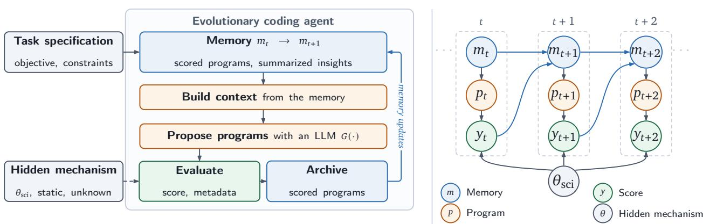  
Figure 2 | Evolutionary discovery as a POMDP. (A) In each iteration, an evolutionary coding agent builds the proposal context from its memory, $\mathrm { e . g . , }$ parent and inspiration programs or summarized insights, and generates candidate programs with an LLM �. The evaluator scores every program, whose outcome depends on the hidden mechanism $\theta _ { s \mathrm { c i } }$ , and the scored programs enter the archive and update the memory. (B) The corresponding temporal graphical model. The memory $m _ { t }$ guides the next program $p _ { t } ,$ and the score $y _ { t }$ depends on both $p _ { t }$ and the static but unknown mechanism $\theta _ { \mathrm { s c i } }$ which in turn updates $m _ { t + 1 }$

fixed during the search and unknown to the agent. At turn $t ,$ the agent proposes a program $p _ { t } \in \mathcal { P }$ and observes a score $y _ { t }$ with $\mathbb { E } [ y _ { t } \mid p _ { t } ] = F ( p _ { t } ; \theta _ { \mathrm { s c i } } )$ , where $F : \mathcal { P } \times \Theta  \mathbb { R }$ is the objective, $\mathrm { e . g . }$ , the value of a mathematical construction, the eficiency of a kernel, or the performance of a trained model (Novikov et al., 2025). The goal is to uncover $\theta _ { s \mathrm { c i } }$ by optimizing for the evaluation score.

POMDP. As shown in Fig. 2B, the interaction forms a Partially Observable Markov Decision Process (POMDP) (Kaelbling et al., 1998) with a static hidden state $s _ { t } = \theta _ { s \mathrm { c i } }$ , actions $a _ { t } = p _ { t }$ , observations $o _ { t } = y _ { t }$ , an identity transition kernel, and the observation kernel $O ( y _ { t } \mid \theta _ { \mathrm { s c i } } , p _ { t } )$ . Given a budget of � evaluations, the agent chooses $p _ { 0 } , \ldots , p _ { T - 1 }$ to find a program $\hat { p }$ with high $F ( \hat { p } ; \theta _ { \mathrm { { s c i } } } )$

Evaluation as intervention. $\theta _ { \mathrm { s c i } }$ can be parameterized as a structural causal model over variables of interest (Spirtes et al., 2000), in which a program specifies a configuration $x _ { p }$ of design variables �. Each evaluation can be considered as the expected outcome of the intervention:

$$
F \big ( p ; \theta _ { \mathrm { s c i } } \big ) = \mathbb { E } \big [ Y \big | \mathrm { d o } ( X = x _ { p } ) , \theta _ { \mathrm { s c i } } \big ] .\tag{1}
$$

In this work, we leverage the causal view to provide a more in-depth understanding, while neither the analysis nor the method requires recovering the causal graph. A full discussion on the relations with causality can be found in Appendix C.

Experience-driven discovery. We define $b _ { t }$ as the agent’s Bayesian belief after accumulating experience $h _ { t } = \{ ( p _ { 0 } , y _ { 0 } ) , \ldots , ( p _ { t - 1 } , y _ { t - 1 } ) \}$ , which is essentially a probability distribution on $\Theta , b _ { t } ( B ) =$ $\operatorname* { P r } ( \Theta _ { \mathrm { s c i } } \in \textit { B } | \ h _ { t } )$ for $B \subseteq \Theta$ . In the ideal Bayesian formalism, the belief $b _ { t }$ is a suficient statistic for decision-making (Kaelbling et al., 1998). In practice, the AI Scientist maintains an internal belief within LLMs, or an external one realized as memory $m _ { t } = \Phi ( h _ { t } )$ for some (possibly learnable) summarization function $\Phi$ (Lange et al., 2026), to represent the approximate representation of its knowledge about $\theta _ { \mathrm { s c i } }$ and the landscape of $F ( \cdot ; \theta _ { \mathrm { s c i } } )$ . Each evaluation step $( p _ { t } , y _ { t } )$ thus updates $m _ { t }$ which in turn updates the agent’s belief about $\theta _ { s \mathrm { c i } }$ and determines the next action $p _ { t + 1 }$

## 3.2. Reusing Experience with Ideas

If the evaluator fully reveals $\theta _ { s \mathrm { c i } }$ and the evaluation budget is unlimited, then enumerating every possible program can directly lead to discovery. However, in reality, the evaluation score only reveals partial information about $\theta _ { s \mathrm { c i } }$ and evaluations can be expensive, e.g., training a model or running a physical experiment, so the agent can aford only a limited number of them (Wallace et al., 2026). Therefore, it is essential to reuse experience from past evaluations.

Without properly reusing experience, a single evaluation cannot reveal further insights about other unseen programs, and the agent then has to evaluate every candidate program to find the best one. Reusing experience requires some structure shared across programs, so that the evaluation of one program also informs the others. We formalize the contrast as follows.

Theorem 3.1 (Structured experience reuse, informal). Let $\mathcal { P } = \{ p 1 , \ldots , p _ { K } \}$ , and let each evaluation return $y _ { t } = F ( p _ { t } ; \theta _ { \mathrm { s c i } } ) + \varepsilon _ { t }$ with $\varepsilon _ { t } \sim { \cal N } ( 0 , \sigma ^ { 2 } )$ i.i.d.

(a) With reuse. If each program has a known representation $\phi ( p ) \in \mathbb { R } ^ { d }$ with $\| \phi ( p ) \| _ { 2 } ~ \le ~ 1$ and $F ( p ; \theta _ { \mathrm { { s c i } } } ) = \langle \phi ( p ) , w ^ { \star } \rangle$ for an unknown $\boldsymbol { w } ^ { \star } \in \mathbb { R } ^ { d } .$ , then under a coverage condition on the representation, there exists a policy that, with probability at least $1 - \delta ,$ outputs a program within � of the optimal value after $\begin{array} { r } { O \big ( d \frac { \sigma ^ { 2 } } { \epsilon ^ { 2 } } \log \frac { K } { \delta } \big ) } \end{array}$ evaluations.

(b) Without reuse. If programs are unrelated, i.e., $F ( p _ { i } ; \theta _ { \mathrm { { s c i } } } ) = \mu _ { i }$ for an arbitrary $\boldsymbol { \mu } \in \mathbb { R } ^ { K }$ , then any policy with the same guarantee for every � needs $\Omega \big ( K \frac { \sigma ^ { 2 } } { \epsilon ^ { 2 } } \log \frac { 1 } { \delta } \big )$ evaluations.

The formal statement and proof are given in Appendix E. Theorem 3.1 implies that reusing experience at the high-level design choices can significantly improve sample eficiency from Ω(�) to �(� log �), where $K \gg d$ . In evolutionary discovery, � counts the candidate program space, which grow combinatorially with the high-level design choices and further with the ways of implementing each choice, while � is determined by the design choices that afect the score. Most existing agents retain experience at the level of programs (Lange et al., 2026; Novikov et al., 2025), which ignores the high-level design choices. In contrast, human scientists recognize and record what they learn from experiments in terms of reusable concepts, e.g., a construction or an optimization technique, which carry over to later experiments. We are hence inspired to introduce the notion of ideas.

Definition 3.2 (Idea). An idea is an interpretable mapping $z : \mathcal { P }  \mathcal { V }$ from programs to a binary or categorical value. It describes a high-level mechanistic property that can be shared by syntactically diferent programs, such as the construction family, initialization, or optimization procedure. A set of ideas $\{ z _ { 1 } , \ldots , z _ { r } \}$ defines the idea representation $Z ( p ) = ( z _ { 1 } ( p ) , \ldots , z _ { r } ( p ) )$

A program realizes a set of ideas together with low-level details. We call an idea representation � faithful if the score depends on a program only through its ideas, i.e., $F ( p ; \theta _ { \mathrm { { s c i } } } ) = g ( Z ( p ) )$ for some function � determined by $\theta _ { s \mathrm { c i } }$ . Under a faithful idea representation, the hidden mechanism acts on a program only through its ideas, and Theorem 3.1 applies with $\phi ( p )$ being the one-hot encoding of $Z ( p )$ , whose dimension is determined by the number of ideas.

Identifiability of ideas. However, the agent does not know in advance which representation is faithful, and the ideas have to be identified from the evaluated programs, while which programs are evaluated is decided by the search itself. When the search stops varying the candidate ideas, the exploration of ideas degenerates, as formalized below.

Theorem 3.3 (Degenerated exploration of ideas). Consider two candidate ideas $\scriptstyle z _ { 0 }$ and $\ z _ { 1 } ,$ , and two mechanisms $\theta _ { 0 }$ and $\theta _ { 1 }$ under which the score depends on $\scriptstyle z _ { 0 }$ and $\mathfrak { z } _ { 1 : }$ , respectively, i.e., $F ( p ; \theta _ { i } ) =$ $g ( Z ( p ) , z _ { i } ( p ) )$ for a common representation � and function $^ { g , }$ with the same observation noise. Suppose the optimal programs under $\theta _ { 0 }$ and $\theta _ { 1 }$ are diferent and unique with a margin $\Delta > 0 .$ . Thenfor any policy that only evaluates programs on which $\scriptstyle z _ { 0 }$ and $z _ { 1 }$ agree, there exists $i \in \{ 0 , 1 \}$ such that for every budget $T ,$ the output $\hat { p }$ satisfies $\begin{array} { r } { \mathbb { E } \big [ \operatorname* { m a x } _ { p \in \mathcal { P } } F ( p ; \theta _ { i } ) - F ( \hat { p } ; \theta _ { i } ) \big ] \geq \Delta / 2 . } \end{array}$

The formal statement and proof are given in Appendix F. Theorem 3.3 can be considered as a consequence of the partial observability of $\theta _ { s \mathrm { c i } }$ , since the scores reveal $\theta _ { \mathrm { s c i } }$ only through the evaluated programs. If two candidate ideas agree on all explored programs, the two mechanisms produce the same observations, and one cannot distinguish which idea determines the score. This situation is common in evolutionary search: as the search concentrates around its current best programs, the ideas shared by these programs stop varying. Identifying ideas thus requires suficient exploration to contrast programs with and without each idea, to isolate contributions of ideas in the program space.

## 4. ExpEvolve: Discovering and Exploiting Ideas from Experience

Theoretical analysis in Sec. 3 suggests that a discovery agent should extract ideas from its experience, and keep exploring programs where the ideas vary. We realize the theoretical principles in ExpEvolve. The full procedure and implementation details are given in Alg. 1 and Appendix H.

## 4.1. Discovering Ideas from Experience

We leverage the discovery loop of the COAT framework (Liu et al., 2025) to find idea factors according to their theoretical properties.

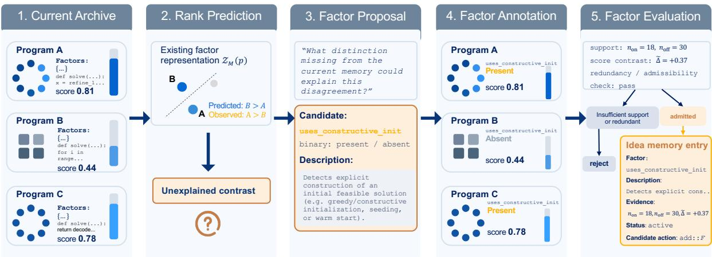  
Figure 3 | Illustration of idea factor discovery.

Idea memory. During the discovery, ExpEvolve maintains an idea memory M which is a set of idea factors. Each idea factor is stored with a name, a description of its code pattern, a type, i.e., binary or categorical, and a value set V. For each program in the experience archive, the values of idea factors are annotated by an annotator LLM, which instantiates the idea representation �(�).

Explainability of idea factors. A faithful idea representation is expected to be able to predict the score of a program, i.e., $F ( p ; \theta _ { \mathrm { { s c i } } } ) = g ( Z ( p ) )$ (Sec. 3.2). However, predicting the exact scores from ideas is dificult, since the scores of diferent tasks lie on diferent scales, the unknown function � can be highly nonlinear, and the archive only contains a limited number of noisy evaluations. Therefore, we define the explainability of an idea representation by its pairwise predictability, i.e., whether $Z ( p )$ and $Z ( p ^ { \prime } )$ predict which of two programs $p$ and $p ^ { \prime }$ is better. The ranking is already informative for optimizing the objective, invariant to the scale of the scores, and more robust to noise than the scores.

Discovering idea factors from unexplained pairs. The idea discovery process in ExpEvolve is an iterative loop: each time the discovery is triggered, ExpEvolve fits a pairwise ranker on the annotated idea factors, and selects the pairs of archived programs with a large score gap that the current idea factors fail to explain. The unexplained pairs suggest the existence of missing idea factors that separate the programs in each pair. For the selected pairs, a separate proposer LLM reads the programs to propose candidate idea factors that distinguish them. Each candidate is then annotated on the whole archive, and is admitted into the idea memory if each of its values is supported by enough programs and its values separate the scores.

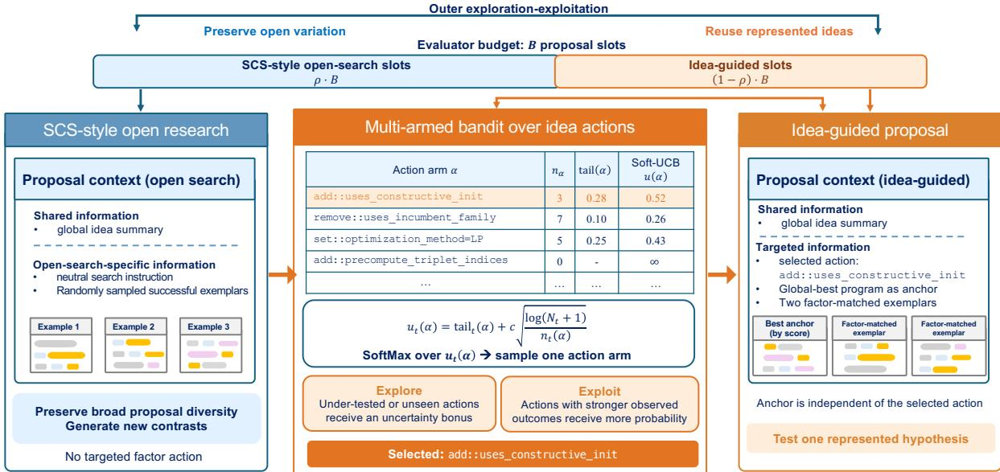  
Figure 4 | Illustration of two-level exploration-exploitation with discovered idea factors.

## 4.2. Exploiting Idea Factors for Discovery

We build a two-level exploration and exploitation framework with a multi-armed bandit (MAB) to fully exploit discovered idea factors while exploring varying design spaces.

Exploration and MAB exploitation. In each generation, ExpEvolve keeps at least a fraction � of the slots for random exploration that follows SCS (Gideoni et al., 2026) with randomly sampled example programs, which explores programs beyond the current ideas and provides new material for discovery. The remaining slots are allocated to idea-guided actions by MAB.

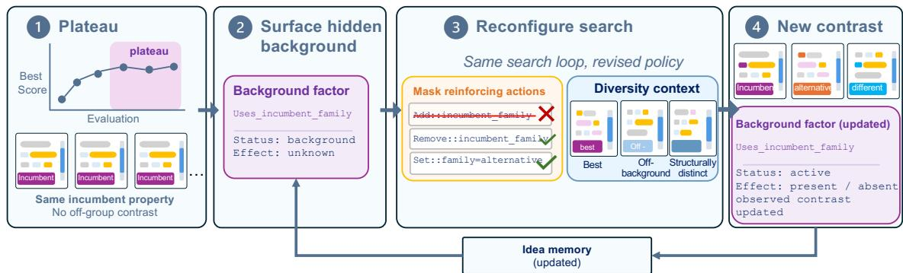  
Figure 5 | Illustration of idea-guided exploration at plateaus.

Idea factors as MAB actions. To exploit an idea factor �, ExpEvolve compiles it into edit actions, e.g., ADD(�) and REMOVE(�) for a binary idea factor. An action adds to the context an instruction that describes �, together with demonstration programs in the target state, to ask the mutator LLM to realize the action in the new program. The MAB selects the action for each idea-guided slot. The reward of an action is the score of the program generated under the action relative to the random exploration in the same generation, i. $\begin{array} { r } { \dot { \mathbf { e } } _ { \cdot , r } = \frac { y - \bar { y } _ { \mathrm { r a n d } } } { \sigma _ { \mathrm { r a n d } } } } \end{array}$ , where $y$ is the score of the generated program, and $\bar { y } _ { \mathrm { r a n d } }$ and $\sigma _ { \mathrm { r a n d } }$ are the mean and the standard deviation of the scores of random exploration in the same generation. The normalization removes the drift of scores across generations and the diferences of score scales across tasks. The MAB selects the actions with an upper confidence bound (UCB) rule on the maximum reward of each action (Appendix H.3).

Exploration at plateaus. Oftentimes, evolutionary discovery can concentrate around its best programs and a single strategy. Consequently, the ideas widely used in top-scoring programs stop varying, and their roles cannot be identified from the archive (Thm. 3.3). When the best score does not improve for � generations, ExpEvolve switches to idea-guided exploration, which enforces the mutator LLM to explore diverse ideas other than those widely used in top-scoring programs. Specifically, a separate LLM probes the properties shared by the top-scoring programs as background idea factors, and an LLM judge determines which idea factors in the memory depend on the background. ExpEvolve then masks the actions of the dependent idea factors, instructs the mutator LLM to avoid them, and assigns more slots to random exploration with diversified demonstrations.

## 5. Experiments

We evaluate ExpEvolve on 11 open-ended mathematical discovery tasks and further integrate it into an evolutionary agent for Machine Learning Engineering (MLE) tasks.

## 5.1. Experimental Setup

Tasks. We evaluate on 11 open-ended mathematical discovery tasks. Nine tasks are the problems studied by SCS (Gideoni et al., 2026), which are taken from AlphaEvolve (Novikov et al., 2025), including the first and second autocorrelation inequalities, the uncertainty inequality, the Erdős minimum overlap problem, sums and diferences of sets, the max–min distance ratio, the Heilbronn problem for triangles, the kissing number in 11 dimensions, and circle packing. The other two tasks are the Hadamard matrix problem (Wang et al., 2026) and a variant of circle packing that recovers the radii by linear programming. We report the best score at the end of the budget, as the mean and standard deviation over seeds, and the best seed. Full details of the tasks are given in Appendix I.1.

Budget. Each run evaluates 200 programs. We consider two configurations with the same budget, i.e., 10 generations of 20 programs as in SCS (Gideoni et al., 2026) and 20 generations of 10 programs, which presents more challenges to accumulating reusable knowledge from experience.

Implementation. We compare ExpEvolve with SCS (Gideoni et al., 2026), which is the backbone of ExpEvolve and shows competitive results against more elaborate evolutionary coding agents. We further compare with ShinkaEvolve (Lange et al., 2026), which maintains an island-based archive and summarizes the insights of recent programs with a meta-summary. Details are given in Appendix I.2. We use DeepSeek-V4-Flash by default, and each setting is run with 3 seeds. ExpEvolve uses a random-exploration fraction $\rho = 0 . 6 0$ for 20-gen. and $\rho = 0 . 4 0$ for 10-gen. to keep a similar number of random-exploration slots, i.e., 6 and 8. We donot tune other hyperparameters.

Table 1 | Final performance at the budget of 200 evaluated programs. Mean reports the seed mean ± seed standard deviation over 3 seeds, and Best reports the best seed.
<table><tr><td rowspan="2">Task</td><td colspan="4">20 generations × 10 programs</td><td colspan="4">10 generations × 20 programs</td><td rowspan="2">ShinkaEvolve</td><td rowspan="2" colspan="2"></td></tr><tr><td colspan="2">ExpEvolve</td><td colspan="2">SCS</td><td colspan="2">ExpEvolve</td><td colspan="2">SCS</td></tr><tr><td></td><td>Mean</td><td>Best</td><td>Mean</td><td>Best</td><td>Mean</td><td>Best</td><td>Mean</td><td>Best</td><td>Mean</td><td>Best</td></tr><tr><td>Hadamard ↑</td><td> $\mathbf { 0 . 9 2 1 1 \pm 0 . 0 0 0 }$ </td><td>0.9211</td><td> $0 . 6 6 4 1 \pm 0 . 1 6 9$ </td><td>0.8596</td><td> $\mathbf { 0 . 9 2 5 9 \pm 0 . 0 0 8 }$ </td><td>0.9357</td><td>0.8349 ± 0.101</td><td>0.9211</td><td>0.6467 ± 0.139</td><td>0.8066</td></tr><tr><td>Pack ↑</td><td>2.63542 ± 0.001</td><td>2.63598</td><td>2.61697 ± 0.028</td><td>2.63572</td><td>2.63499 ± 0.002</td><td>2.63598</td><td>2.62305 ± 0.011</td><td>2.63104</td><td>2.58201 ± 0.037</td><td>2.61408</td></tr><tr><td>Linprog ↑</td><td>2.63542 ± 0.001</td><td>2.63598</td><td>2.63542 ± 0.001</td><td>2.63598</td><td>2.63542 ± 0.001</td><td>2.63598</td><td>2.55161 ± 0.006</td><td>2.55608</td><td>2.51434 ± 0.026</td><td>2.54142</td></tr><tr><td>SumDiff ↑</td><td>1.11609 ± 0.006</td><td>1.11937</td><td>1.11087 ± 0.001</td><td>1.11143</td><td>1.12224 ± 0.001</td><td>1.12281</td><td>1.11608 ± 0.005</td><td>1.12006</td><td>1.10954 ± 0.000</td><td>1.10954</td></tr><tr><td>Heilbronn ↑</td><td>0.0353 ± 0.001</td><td>0.0359</td><td>0.0313 ± 0.003</td><td>0.0340</td><td>0.0358 ± 0.001</td><td>0.0365</td><td>0.0336 ± 0.001</td><td>0.0343</td><td>0.0303 ± 0.002</td><td>0.0324</td></tr><tr><td>Min overlap ↓</td><td>0.3810 ± 0.000</td><td>0.3810</td><td>0.3816 ± 0.001</td><td>0.3810</td><td>0.3810 ± 0.000</td><td>0.3810</td><td>0.3810 ± 0.000</td><td>0.3810</td><td>0.3824 ± 0.000</td><td>0.3824</td></tr><tr><td>Kissing ↑</td><td>526 ± 97</td><td>582</td><td>413 ± 23</td><td>438</td><td>582 ± 0</td><td>582</td><td>582 ± 0</td><td>582</td><td>462 ± 90</td><td>566</td></tr><tr><td>Second autocorr. ↑</td><td>0.8825 ± 0.000</td><td>0.8825</td><td>0.8398 ± 0.016</td><td>0.8499</td><td>0.8825 ± 0.000</td><td>0.8825</td><td>0.8825 ± 0.000</td><td>0.8825</td><td>0.8745 ± 0.008</td><td>0.8825</td></tr><tr><td>First autocorr. ↓</td><td>1.5113 ± 0.002</td><td>1.5098</td><td>1.5235 ± 0.011</td><td>1.5151</td><td>1.5195 ± 0.006</td><td>1.5151</td><td>1.5508 ± 0.011</td><td>1.5378</td><td>1.5540 ± 0.029</td><td>1.5203</td></tr><tr><td>Max-min ratio ↓</td><td>12.9262 ± 0.064</td><td>12.8892</td><td>12.9338 ± 0.077</td><td>12.8892</td><td>12.8892 ± 0.000</td><td>12.8892</td><td>12.9808 ± 0.033</td><td>12.9425</td><td>13.0000 ± 0.000</td><td>13.0000</td></tr><tr><td>Hermite ↓</td><td>0.35473 ± 0.003</td><td>0.35263</td><td>0.39431 ± 0.059</td><td>0.35945</td><td>0.35089 ± 0.002</td><td>0.34820</td><td>0.35956 ± 0.005</td><td>0.35394</td><td>4.72779 ± 3.788</td><td>0.35429</td></tr></table>

## 5.2. Main Results

ExpEvolve consistently improves the final performance. Table 1 shows the final performance at the budget of 200 programs. ExpEvolve improves the mean and best final performances across most settings over SCS and ShinkaEvolve. Moreover, the improvements are robust to how the budget is parallelized. From 10 generations of 20 programs to 20 generations of 10 programs, the mean final score of SCS can drop dramatically because of limited capability in experience reuse, while ExpEvolve still maintains competitive performance. More details are given in Appendix J.

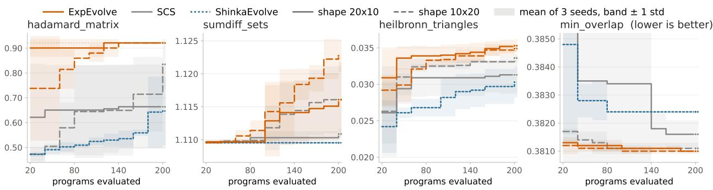  
Figure 6 | Best-so-far scores along the budget of 200 evaluated programs.

ExpEvolve improves sample eficiency. Fig. 6 shows the best-so-far scores along the budget on Hadamard, Sums and diferences, Heilbronn, and Minimum overlap. On these four tasks, ExpEvolve needs 1.7× to 26.2× fewer evaluations than SCS under both configurations.

The improvements transfer to other LLMs. Fig. 7 (a) shows that the advantages of ExpEvolve over SCS transfers to other LLMs such as DeepSeek-v4-pro, GLM-5.2 and Gemini-3.7-Flash.

Summarizing experience as memory helps the early search but saturates. ShinkaEvolve and SCS+meta retain the experience as a textual summary of recent programs, which provides additional context to the mutator LLM without controlling which ideas are evaluated. Fig. 7 (b) shows that SCS+meta improves over SCS in the early stage. However, its improvement slows down afterwards while ExpEvolve keep improving. It again verifies the advantages of idea-guided evolution.

The discovered idea factors explain the order of archived programs. Following the definition of explainability in Sec. 4.1, we measure the fraction of archived program pairs that discovered factors can order correctly. As shown in Fig. 8(a), the discovered idea factors reach an accuracy of 0.79 to

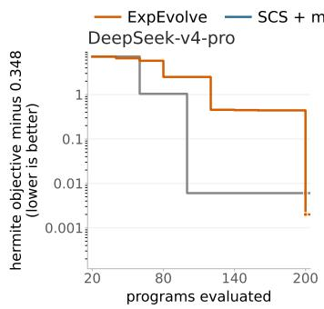

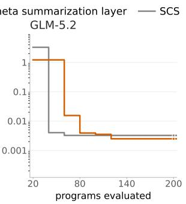

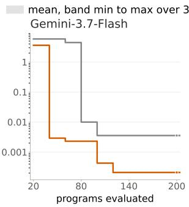

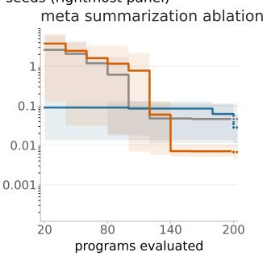

Figure 7 | (a) Best-so-far scores of SCS and ExpEvolve with other LLMs. (b) Best-so-far scores of SCS, SCS+meta, and ExpEvolve.  
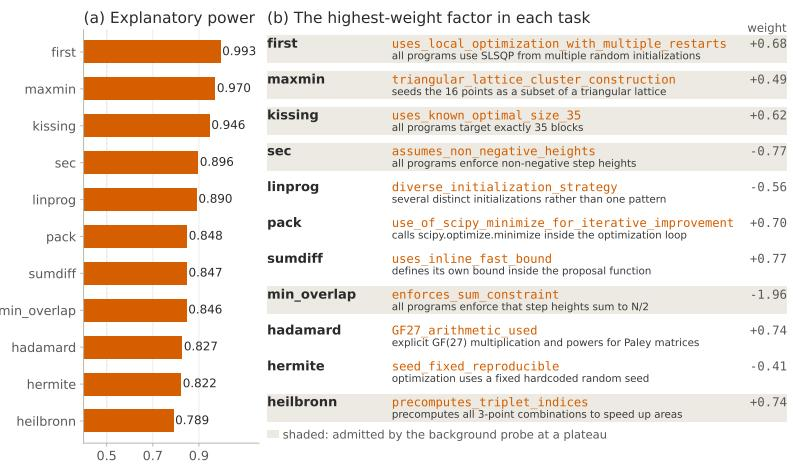  
pairwise ordering accuracy, in sample

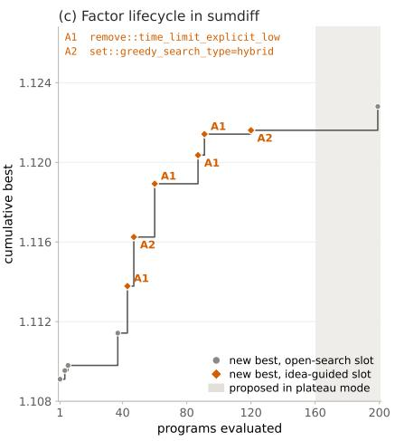  
Figure 8 | Quality of discovered idea factors. (a) Pairwise accuracy of the discovered idea factors. (b) The idea factor with the largest weight. (c) Illustration of usage of factors in sumdif task.

0.99. Fig. 8(b) shows the idea factor with the largest weight on each task.

In an example run, idea-guided actions produce about half of the new best programs. Fig. 8(c) shows a run on Sums and diferences with 10 generations of 20 programs. 6 of the 11 new best programs come from idea-guided slots. The 92 idea-guided slots of the run select 7 distinct actions, and all the new best programs from idea-guided slots come from 2 of them.

## 5.3. Additional Experiments on Machine Learning Engineering Tasks

We further study whether the efectiveness of ExpEvolve transfers to MLE by integrating it into OpenRSI (Yang et al., 2026b) and evaluating it on 6 tasks from MLS-Bench (Lyu et al., 2026a): Online bandit, Anomaly detection, Clustering, Multi-objective optimization, Subgroup calibration shift, and Evolution strategy. Search leverages the scores and execution feedback from each task.

Experimental setup. We use the evolutionary harness from OpenRSI, which organizes search through Draft, Improve, Debug, and Crossover operators. For each task, we retain a fixed history containing 20 completed search slots from an earlier OpenRSI run. The OpenRSI baseline and OpenRSI equipped with ExpEvolve continue from this same history for 50 additional evaluator calls, with 3 seeds. Both methods use 5 search slots per generation. All program generation uses Qwen3.6-35B-A3B. The same checkpoint performs factor discovery and annotation in ExpEvolve.

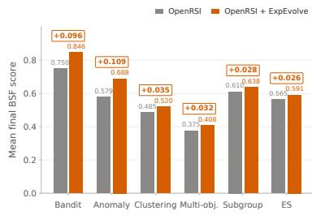  
(a) Final BSF performance

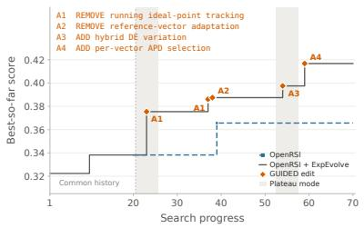  
(b) Multi-objective optimization

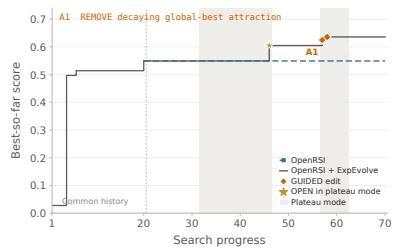  
(c) Evolution strategy  
Figure 9 | Results on MLS-Bench. (a) Mean final scores. $^ { ( \mathrm { b , c } ) }$ Trajectories on two example tasks.

For each task and method, we average the final best-so-far (BSF) scores over three seeds.

Idea-guided evolution transfers to MLE tasks. Fig. 9(a) compares OpenRSI with OpenRSI+ ExpEvolve across the six tasks, where ExpEvolve shows superior performance on all six tasks, with the largest gains on Online bandit and Anomaly detection.

Idea-guided actions produce better exploration and exploitation on MLE tasks. Fig. 9(b) and Fig. 9(c) show two concrete trajectories in the tasks of multi-objective optimization and evolution strategy, respectively. We can find that ExpEvolve can efectively discover useful ideas such as removing running ideal-point tracking (A1), removing reference-vector adaptation (A2), and adding hybrid diferential-evolution variation (A3) to efectively boost the performance. When the evolution gets stuck at plateaus, exploiting useful strategies proposed by ExpEvolve in multi-objective optimization, or exploration guided by idea factors in ExpEvolve can efectively break the plateaus and lead to improvements. More details about the implementation can be found in Appendix K.1.

## 6. Conclusions

We introduced ExpEvolve, which structures the experience of evolutionary discovery into idea factors and reuses them to guide the search. ExpEvolve discovers idea factors from the pairs of programs that the current idea factors fail to explain, exploits them as the actions of a multi-armed bandit, and keeps exploring programs where the ideas vary, through random exploration and idea-guided exploration at plateaus. Our analysis shows that reusing a faithful idea representation reduces the number of evaluations from Ω(�) to �(� log �), and that identifying ideas requires exploring programs where the ideas vary. On 11 mathematical discovery tasks and 6 tasks from MLS-Bench, ExpEvolve improves the final performance and the sample eficiency of evolutionary discovery under the same evaluation budget.

## References

K. Ahuja, D. Mahajan, Y. Wang, and Y. Bengio. Interventional causal representation learning. In International Conference on Machine Learning (ICML), 2023. (Cited on page 23)

Anthropic. Claude accelerates protein design and analytical chemistry. https://www.anthropic. com/research/Claude-accelerates-protein-design, Aug. 2026. 354 binders against 14 of 15 targets from 1,320 designs, produced and tested independently by Adaptyv Bio and Twist Bioscience. (Cited on pages 1, 3 and 20)

A. Asai, J. He, R. Shao, W. Shi, A. Singh, J. C. Chang, K. Lo, L. Soldaini, S. Feldman, et al. Synthesizing

scientific literature with retrieval-augmented language models. Nature, 2026. doi: 10.1038/s415 86-025-10072-4. (Cited on pages 1 and 20)

H. Assumpção, D. Ferreira, L. Campos, and F. Murai. CodeEvolve: an open source evolutionary coding agent for algorithm discovery and optimization. arXiv preprint arXiv:2510.14150, 2025. (Cited on page 20)

D. A. Boiko, R. MacKnight, B. Kline, and G. Gomes. Autonomous chemical research with large language models. Nature, 624(7992):570–578, 2023. (Cited on page 20)

P. Brouillard, S. Lachapelle, A. Lacoste, S. Lacoste-Julien, and A. Drouin. Diferentiable causal discovery from interventional data. Advances in Neural Information Processing Systems, 33:21865–21877, 2020. (Cited on page 21)

S. Bubeck, C. Coester, R. Eldan, T. Gowers, Y. T. Lee, A. Lupsasca, M. Sawhney, R. Scherrer, M. Sellke, B. K. Spears, D. Unutmaz, K. Weil, S. Yin, and N. Zhivotovskiy. Early science acceleration experiments with gpt-5. ArXiv, abs/2511.16072, 2025. (Cited on page 20)

M. Cemri et al. AdaEvolve: Adaptive LLM driven zeroth-order optimization. arXiv preprint arXiv:2602.20133, 2026. (Cited on page 20)

K. Chalupka, P. Perona, and F. Eberhardt. Visual causal feature learning. In Proceedings of the Thirty-First Conference on Uncertainty in Artificial Intelligence, 2015. (Cited on page 23)

J. S. Chan, N. Chowdhury, O. Jafe, J. Aung, D. Sherburn, E. Mays, G. Starace, K. Liu, L. Maksin, T. Patwardhan, A. Madry, and L. Weng. MLE-bench: Evaluating machine learning agents on machine learning engineering. In ICLR, 2025. arXiv:2410.07095. (Cited on page 20)

Y. Chen, W. Huang, K. Zhou, Y. Bian, B. Han, and J. Cheng. Understanding and improving feature learning for out-of-distribution generalization. In Advances in Neural Information Processing Systems, 2023. (Cited on page 24)

A. Cheng, S. Liu, M. Z. Pan, Z. Li, B. Wang, A. Krentsel, T. Xia, M. Cemri, J. Park, S. Yang, J. Chen, L. A. Agrawal, A. Desai, J. Xing, K. Sen, M. Zaharia, and I. Stoica. Barbarians at the gate: How ai is upending systems research. ArXiv, abs/2510.06189, 2025. (Cited on page 20)

L. Da Costa, Á. Fialho, M. Schoenauer, and M. Sebag. Adaptive operator selection with dynamic multiarmed bandits. In Proceedings of the Genetic and Evolutionary Computation Conference (GECCO), pages 913–920, 2008. (Cited on page 21)

N. Dhawan, L. Cotta, K. Ullrich, R. G. Krishnan, and C. J. Maddison. End-to-end causal efect estimation from unstructured natural language data. Advances in Neural Information Processing Systems, 37: 77165–77199, 2024. (Cited on page 21)

I. Douven. Abduction. In E. N. Zalta and U. Nodelman, editors, The Stanford Encyclopedia ofPhilosophy. Metaphysics Research Lab, Stanford University, Winter 2025 edition, 2025. (Cited on page 2)

M. Favaro and J. Clark. When AI builds itself: Our progress toward recursive self-improvement and its implications. Anthropic Institute, https://www.anthropic.com/institute/recursiv e-self-improvement, June 2026. (Cited on pages 1, 3 and 20)

P. Feng, Z. Lv, J. Ye, X. Wang, X. Huo, J. Yu, W. Xu, W. Zhang, L. Bai, C. He, and W. Li. Earth-Agent: Unlocking the full landscape of earth observation with agents. In ICLR, 2026a. arXiv:2509.23141. (Cited on page 20)

S. Feng, R. Ma, X. Yan, et al. InternAgent-1.5: A unified agentic framework for long-horizon autonomous scientific discovery. arXiv preprint arXiv:2602.08990, 2026b. (Cited on pages 3 and 20)

B. Georgiev, J. Gómez-Serrano, T. Tao, and A. Z. Wagner. Mathematical exploration and discovery at scale. ArXiv, abs/2511.02864, 2025. (Cited on page 20)

A. Ghafarollahi and M. J. Buehler. Sciagents: automating scientific discovery through bioinspired multi-agent intelligent graph reasoning. Advanced Materials, 37(22):2413523, 2025. (Cited on pages 3 and 20)

A. E. Ghareeb et al. A multi-agent system for automating scientific discovery. Nature, 655(8122): 497–505, 2026. doi: 10.1038/s41586-026-10652-y. (Cited on pages 3 and 20)

Y. Gideoni, S. Risi, and Y. Gal. Simple baselines are competitive with code evolution. In ICLR 2026 Workshop on AI with Recursive Self-Improvement, 2026. arXiv:2602.16805. (Cited on pages 2, 3, 7, 8, 20, 32, 37, 38 and 39)

C. Glymour. An outline of the history of methods of discovering causality. URL https://www.cmu. edu/dietrich/philosophy/docs/glymour/an-outline-of-the-history-of-metho ds-of-discovering-causality.pdf. Accessed: 2026-01-29. (Cited on page 2)

J. Gottweis et al. Accelerating scientific discovery with co-scientist. Nature, 655(8122):487–496, 2026. doi: 10.1038/s41586-026-10644-y. (Cited on pages 1, 3 and 20)

S. Greenland, J. Pearl, and J. M. Robins. Causal diagrams for epidemiologic research. Epidemiology, 10(1):37–48, 1999. (Cited on page 21)

P. Hoyer, D. Janzing, J. M. Mooij, J. Peters, and B. Schölkopf. Nonlinear causal discovery with additive noise models. Advances in neural information processing systems, 21, 2008. (Cited on page 21)

B. Huang, K. Zhang, J. Zhang, J. Ramsey, R. Sanchez-Romero, C. Glymour, and B. Schölkopf. Causal discovery from heterogeneous/nonstationary data. Journal of Machine Learning Research, 21(89): 1–53, 2020. (Cited on page 21)

K. Huang, Y. Jin, R. Li, M. Y. Li, E. Candes, and J. Leskovec. Automated hypothesis validation with agentic sequential falsifications. In ICML, 2025a. (Cited on page 20)

Y. Huang, Y. Chen, H. Zhang, K. Li, H. Zhou, M. Fang, L. Yang, X. Li, L. Shang, S. Xu, et al. Deep research agents: A systematic examination and roadmap. arXiv preprint arXiv:2506.18096, 2025b. (Cited on page 20)

A. Hyttinen, F. Eberhardt, and P. O. Hoyer. Experiment selection for causal discovery. The Journal of Machine Learning Research, 14(1):3041–3071, 2013. (Cited on page 21)

L. Jing, Z. Huang, X. Wang, W. Yao, W. Yu, K. Ma, H. Zhang, X. Du, and D. Yu. DSBench: How far are data science agents from becoming data science experts? In ICLR, 2025. arXiv:2409.07703. (Cited on page 20)

L. P. Kaelbling, M. L. Littman, and A. R. Cassandra. Planning and acting in partially observable stochastic domains. Artificial intelligence, 101(1-2):99–134, 1998. (Cited on pages 2, 4 and 21)

A. Karpathy. autoresearch: session reports of an autonomous single-GPU training-loop agent. GitHub discussions #32 and #43, https://github.com/karpathy/autoresearch/discussions /32, https://github.com/karpathy/autoresearch/discussions/43, 2026. Discussion

#43 is the 126-experiment log classified in the paper; discussion #32 (8 March 2026) is an 89-experiment log with the same format. (Cited on pages 1, 2, 3 and 20)

E. Kaufmann, O. Cappé, and A. Garivier. On the complexity of best-arm identification in multi-armed bandit models. Journal of Machine Learning Research, 17(1):1–42, 2016. (Cited on page 30)

V. Khrulkov, A. V. Galichin, et al. GigaEvo: An open source optimization framework powered by LLMs and evolution algorithms. arXiv preprint arXiv:2511.17592, 2025. (Cited on page 20)

T. S. Kuhn and D. Hawkins. The structure of scientific revolutions. American Journal of Physics, 31: 554–555, 1963. (Cited on pages 2, 3 and 21)

R. T. Lange, Y. Imajuku, and E. Cetin. ShinkaEvolve: Towards open-ended and sample-eficient program evolution. In ICLR, 2026. arXiv:2509.19349. (Cited on pages 1, 2, 3, 4, 5, 8, 20 and 39)

J. M. Laurent, J. D. Janizek, M. Ruzo, M. M. Hinks, M. J. Hammerling, S. Narayanan, M. Ponnapati, A. D. White, and S. G. Rodriques. Lab-bench: Measuring capabilities of language models for biology research. arXiv preprint arXiv:2407.10362, 2024. (Cited on page 20)

J. Lehman and K. O. Stanley. Abandoning objectives: Evolution through the search for novelty alone. Evolutionary Computation, 19(2):189–223, 2011. (Cited on page 21)

J. Li, Y. Chen, C. Liu, Q. Cai, T. Liu, B. Han, K. Zhang, and H. Xiong. Can large language models help experimental design for causal discovery? ArXiv, abs/2503.01139, 2025a. URL https: //arxiv.org/abs/2503.01139. (Cited on pages 1 and 21)

J. Li, S. Wang, Q. Zhang, F. Liu, T. Liu, L. Cao, S. Yu, and F. Chen. Revealing multimodal causality with large language models. In The Thirty-ninth Annual Conference on Neural Information Processing Systems, 2025b. (Cited on pages 21 and 23)

L. Li, W. Xu, J. Guo, R. Zhao, X. Li, Y. Yuan, B. Zhang, Y. Jiang, Y. Xin, R. Dang, Y. Rong, D. Zhao, T. Feng, and L. Bing. Chain of ideas: Revolutionizing research via novel idea development with LLM agents. In Findings of the Associationfor Computational Linguistics: EMNLP 2025, pages 8971–9004, 2025c. doi: 10.18653/v1/2025.findings-emnlp.477. (Cited on page 20)

M. Y. Li, V. Vajipey, N. D. Goodman, and E. B. Fox. Critical: Critic automation with language models. arXiv preprint arXiv:2411.06590, 2024. (Cited on page 20)

X.-C. Li and T. Liu. Eficient and trustworthy causal discovery with latent variables and complex relations. In The Thirteenth International Conference on Learning Representations, 2025. (Cited on page 21)

X.-C. Li, J. Wang, and T. Liu. Recovery of causal graph involving latent variables via homologous surrogates. In The Thirteenth International Conference on Learning Representations, 2025d. (Cited on page 21)

W. Liang, Y. Zhang, H. Cao, B. Wang, D. Y. Ding, X. Yang, K. Vodrahalli, S. He, D. S. Smith, Y. Yin, et al. Can large language models provide useful feedback on research papers? a large-scale empirical analysis. NEJM AI, 1(8):AIoa2400196, 2024. (Cited on page 20)

C. Liu, Y. Chen, T. Liu, M. Gong, J. Cheng, B. Han, and K. Zhang. Discovering and reasoning of causality in the hidden world with large language models, 2025. URL https://arxiv.org/ab s/2402.03941. (Cited on pages 2, 6, 21 and 23)

F. Liu, X. Tong, M. Yuan, X. Lin, F. Luo, Z. Wang, Z. Lu, and Q. Zhang. Evolution of heuristics: Towards eficient automatic algorithm design using large language model. In International Conference on Machine Learning (ICML), 2024. (Cited on page 3)

Y. Liu, Z. Yang, T. Xie, J. Ni, B. Gao, Y. Li, S. Tang, W. Ouyang, E. Cambria, and D. Zhou. ResearchBench: Benchmarking LLMs in scientific discovery via inspiration-based task decomposition. In Findings of the Associationfor Computational Linguistics: ACL 2026, pages 13187–13207, 2026. (Cited on page 20)

C. Lu, C. Lu, R. T. Lange, J. Foerster, J. Clune, and D. Ha. The ai scientist: Towards fully automated open-ended scientific discovery. arXiv preprint arXiv:2408.06292, 2024. (Cited on page 1)

C. Lu, C. Lu, R. T. Lange, Y. Yamada, S. Hu, J. Foerster, D. Ha, and J. Clune. Towards end-to-end automation of AI research. Nature, 651(8107):914–919, 2026. doi: 10.1038/s41586-026-10265-5. (Cited on pages 3 and 20)

S. Luo, Y. Huang, H. Luo, F. Liu, G. Deng, L. Li, Q. Yao, Z. Hu, J. Feng, and Q. Liu. SeaEvo: Advancing algorithm discovery with strategy space evolution. arXiv preprint arXiv:2604.24372, 2026. (Cited on page 3)

H. Lv, N. Lu, S. Liu, S. Zhang, and K. Tang. MuEvo: LLM-driven evolution of multi-heuristic ensemble. arXiv preprint arXiv:2608.03636, 2026. (Cited on page 21)

B. Lyu, Y. Yang, S. Huang, J. Zhang, Q. Xu, X. Li, X. Han, Y. Zhang, H. Zhang, R. Huang, K. Yang, Z. Chen, W. Guo, J. Yang, X. Ai, W. Chai, Y. Cao, Z. Yang, K. Wang, D. Jiang, H.-a. Gao, S. Tang, C. Shi, S. S. Du, M. Simchowitz, J. Jiao, D. Song, and C. Jin. MLS-Bench: A holistic and rigorous assessment of AI systems on building better AI. arXiv preprint arXiv:2605.08678, 2026a. (Cited on pages 1, 3, 10, 20 and 45)

Y. Lyu, X. Zhang, X. Yi, Y. Zhao, S. Guo, W. Hu, J. Piotrowski, J. Kaliski, J. Urbani, Z. Meng, L. Zhou, and X. Yan. EvoScientist: Towards multi-agent evolving AI scientists for end-to-end scientific discovery. arXiv preprint arXiv:2603.08127, 2026b. (Cited on pages 3 and 20)

B. P. Majumder, H. Surana, D. Agarwal, B. D. Mishra, A. Meena, A. Prakhar, T. Vora, T. Khot, A. Sabharwal, and P. Clark. DiscoveryBench: Towards data-driven discovery with large language models. In International Conference on Learning Representations (ICLR), 2025. (Cited on pages 1 and 20)

I. Mandal, J. Soni, M. Zaki, M. M. Smedskjaer, K. Wondraczek, L. Wondraczek, N. N. Gosvami, and N. A. Krishnan. Evaluating large language model agents for automation of atomic force microscopy. Nature Communications, 16(1):9104, 2025. (Cited on page 20)

L. Mitchener, A. Yiu, B. Chang, M. Bourdenx, T. Nadolski, A. Sulovari, E. C. Landsness, D. L. Barabási, S. Narayanan, N. Evans, S. Reddy, M. S. Foiani, A. Kamal, L. P. Shriver, F. Cao, A. T. Wassie, J. M. Laurent, E. Melville-Green, M. C. Ramos, A. Bou, K. F. Roberts, S. Zagorac, T. C. Orr, M. E. Orr, K. J. Zwezdaryk, A. E. Ghareeb, L. McCoy, B. Gomes, E. A. Ashley, K. E. Duf, T. Buonassisi, T. Rainforth, R. J. Bateman, M. Skarlinski, S. G. Rodriques, M. M. Hinks, and A. D. White. Kosmos: An ai scientist for autonomous discovery. ArXiv, abs/2511.02824, 2025. (Cited on pages 1, 3 and 20)

J. M. Mooij, S. Magliacane, and T. Claassen. Joint causal inference from multiple contexts. Journal of machine learning research, 21(99):1–108, 2020. (Cited on page 21)

J.-B. Mouret and J. Clune. Illuminating search spaces by mapping elites. arXiv preprint arXiv:1504.04909, 2015. (Cited on page 21)

A. Novikov, N. Vu, M. Eisenberger, E. Dupont, P.-S. Huang, A. Z. Wagner, S. Shirobokov, B. Kozlovskii,˜ F. J. Ruiz, A. Mehrabian, et al. Alphaevolve: A coding agent for scientific and algorithmic discovery. arXiv preprint arXiv:2506.13131, 2025. (Cited on pages 1, 3, 4, 5, 8, 20, 22 and 37)

OpenAI. Research acceleration: The view inside OpenAI. OpenAI blog, 6 September 2026, Sept. 2026a. Reports the automated research intern milestone and 3.1 agent-workdays per human workday in the research organization. (Cited on pages 1, 3 and 20)

OpenAI. Ten advances in mathematics and theoretical computer science. https://openai.com /index/ten-advances-in-mathematics/, Aug. 2026b. Results on ten open problems with Lean 4 formal proofs; peer review pending at the time of writing. (Cited on pages 1, 3 and 20)

OpenAI. An OpenAI model has disproved a central conjecture in discrete geometry. https://op enai.com/index/model-disproves-discrete-geometry-conjecture/, May 2026c. Counterexample to the Erdős unit distance conjecture, verified by external mathematicians with a companion paper. (Cited on pages 1 and 20)

J. Pearl. Causality. Cambridge university press, 2009. (Cited on page 21)

N. Pelleriti et al. What do evolutionary coding agents evolve? arXiv preprint arXiv:2605.20086, 2026. (Cited on page 2)

R. Perry, J. Von Kügelgen, and B. Schölkopf. Causal discovery in heterogeneous environments under the sparse mechanism shift hypothesis. Advances in Neural Information Processing Systems, 35: 10904–10917, 2022. (Cited on page 21)

A. Plaat, M. van Duijn, N. van Stein, M. Preuss, P. van der Putten, and K. J. Batenburg. Agentic large language models, a survey. arXiv preprint arXiv:2503.23037, 2025. (Cited on page 1)

J. Quinonero-Candela, M. Sugiyama, A. Schwaighofer, and N. D. Lawrence. Dataset shift in machine learning. Mit Press, 2008. (Cited on page 24)

L. M. Roch et al. Chemos: An orchestration software to democratize autonomous discovery. PLOS ONE, 15(4):e0229862, 2020. (Cited on page 20)

B. Romera-Paredes et al. Mathematical discoveries from program search with large language models. Nature, 625:468–475, 2024. (Cited on pages 3 and 20)

P. K. Rubenstein, S. Weichwald, S. Bongers, J. M. Mooij, D. Janzing, M. Grosse-Wentrup, and B. Schölkopf. Causal consistency of structural equation models. In Proceedings of the Thirty-Third Conference on Uncertainty in Artificial Intelligence, 2017. (Cited on page 23)

B. Schölkopf, F. Locatello, S. Bauer, N. R. Ke, N. Kalchbrenner, A. Goyal, and Y. Bengio. Toward causal representation learning. Proceedings of the IEEE, 109(5):612–634, 2021. (Cited on page 23)

A. Sharma. Openevolve: an open-source evolutionary coding agent, 2025. URL https://github .com/algorithmicsuperintelligence/openevolve. (Cited on page 20)

I. Sheth, Z. Jin, B. Wilder, D. Janzing, and M. Fritz. Can llms propose instrumental variables for causal reasoning? In NeurIPS 2025 Workshop on CauScien: Uncovering Causality in Science, 2025. (Cited on page 21)

S. Shimizu, P. O. Hoyer, A. Hyvärinen, A. Kerminen, and M. Jordan. A linear non-gaussian acyclic model for causal discovery. Journal of Machine Learning Research, 7(10), 2006. (Cited on page 21)

P. Shojaee, K. Meidani, S. Gupta, A. Barati Farimani, and C. K. Reddy. LLM-SR: Scientific equation discovery via programming with large language models. In ICLR, 2025a. (Cited on page 20)

P. Shojaee, N.-H. Nguyen, K. Meidani, A. B. Farimani, K. D. Doan, and C. K. Reddy. Llm-srbench: A new benchmark for scientific equation discovery with large language models. In ICML, 2025b. (Cited on page 20)

C. Si, T. Hashimoto, and D. Yang. The ideation–execution gap: Execution outcomes of LLM-generated versus human research ideas. In International Conference on Learning Representations (ICLR), 2026. (Cited on pages 3 and 20)

M. Soare, A. Lazaric, and R. Munos. Best-arm identification in linear bandits. In Advances in Neural Information Processing Systems (NeurIPS), 2014. (Cited on page 30)

P. Spirtes, C. Meek, and T. Richardson. Causal inference in the presence of latent variables and selection bias. In Proceedings of the Eleventh conference on Uncertainty in artificial intelligence, pages 499–506, 1995. (Cited on page 21)

P. Spirtes, C. N. Glymour, and R. Scheines. Causation, prediction, and search. MIT press, 2000. (Cited on pages 4 and 21)

G. Starace, O. Jafe, D. Sherburn, J. Aung, J. S. Chan, L. Maksin, R. Dias, E. Mays, B. Kinsella, W. Thompson, et al. Paperbench: Evaluating ai’s ability to replicate ai research. In Proceedings of the 42nd International Conference on Machine Learning, volume 267, pages 56843–56873, 2025. (Cited on page 20)

A. Šurina, A. Mansouri, L. C. P. M. Quaedvlieg, A. Seddas, M. Viazovska, E. Abbe, and C. Gulcehre. Algorithm discovery with LLMs: Evolutionary search meets reinforcement learning. In Conference on Language Modeling (COLM), 2025. arXiv:2504.05108. (Cited on page 21)

K. Swanson, W. Wu, N. L. Bulaong, J. E. Pak, and J. Zou. The virtual lab of ai agents designs new sars-cov-2 nanobodies. Nature, 646(8085):716–723, 2025. (Cited on page 20)

G. Tie, P. Zhou, and L. Sun. A survey of AI scientists. arXiv preprint arXiv:2510.23045, 2025. (Cited on page 20)

G. Tom, S. P. Schmid, S. G. Baird, Y. Cao, K. Darvish, H. Hao, S. Lo, S. Pablo-García, E. M. Rajaonson, M. Skreta, et al. Self-driving laboratories for chemistry and materials science. Chemical Reviews, 124(16):9633–9732, 2024. (Cited on page 20)

D. Truhn, S. Azizi, J. Zou, L. Cerda-Alberich, F. Mahmood, and J. N. Kather. Artificial intelligence agents in cancer research and oncology. Nature Reviews Cancer, 26(4):256–269, 2026. (Cited on page 20)

V. Volkov, V. Khrulkov, A. V. Galichin, D. Sivtsov, N. Glazkov, O. Volkova, K. Pchelin, I. Bespalov, D. V. Dylov, P. Anokhin, and I. Oseledets. EvoMem: Memory-augmented evolution for code optimization. arXiv preprint arXiv:2608.10795, 2026. (Cited on page 3)

D. Wallace, C. Grifin, S. O’Neill, T. Luong, and O. Larter. Conjecture machines: AI agents and the new validation bottleneck in science. Google DeepMind, https://deepmind.google/public-pol icy/conjecture-machines-ai-agents-and-the-new-validation-bottleneck-in-s cience/, July 2026. (Cited on pages 1, 3, 5 and 20)

W. Wallace. Causality and Scientific Explanation. Number v. 2 in Causality and Scientific Explanation. University Press of America, 1981. ISBN 9780819114815. (Cited on page 2)

H. Wan, C. Yang, J. Yu, M. Tu, J. Lu, D. Yu, J. Cao, B. Gao, J. Xie, A. Wang, et al. Deepresearch arena: The first exam of llms’ research abilities via seminar-grounded tasks. In Proceedings of the AAAI Conference on Artificial Intelligence, volume 40, pages 33341–33349, 2026. (Cited on page 20)

H. Wang, Y. He, P. P. Coelho, M. Bucci, A. Nazir, B. Chen, L. T. Trinh, S. Zhang, Z. Lu, K. Huang, et al. SpatialAgent: An autonomous AI agent for spatial biology. bioRxiv, 2025a. doi: 10.1101/2025.04. 03.646459. (Cited on page 20)

Q. Wang, D. Downey, H. Ji, and T. Hope. Scimon: Scientific inspiration machines optimized for novelty. In Proceedings of the 62nd Annual Meeting of the Association for Computational Linguistics (Volume 1: Long Papers), pages 279–299, 2024. (Cited on pages 1 and 20)

W. Wang, P. Piękos, L. Nanbo, F. Laakom, Y. Chen, M. Ostaszewski, M. Zhuge, and J. Schmidhuber. Huxley-Gödel Machine: Human-level coding agent development by an approximation of the optimal self-improving machine. arXiv preprint arXiv:2510.21614, 2025b. (Cited on page 21)

Y. Wang, S.-R. Su, Z. Zeng, E. Xu, L. Ren, X. Yang, Z. Huang, X. He, L. Ma, B. Peng, H. Cheng, P. He, W. Chen, S. Wang, S. S. Du, and Y. Shen. Thetaevolve: Test-time learning on open problems. In International Conference on Machine Learning (ICML), 2026. arXiv:2511.23473. (Cited on pages 8, 21 and 39)

Z. Wang, B. Danek, and J. Sun. Biodsa-1k: Benchmarking data science agents for biomedical research. arXiv preprint arXiv:2505.16100, 2025c. (Cited on page 20)

D. P. Woodruf, V. Cohen-Addad, L. Jain, J. Mao, S. Zuo, M. Bateni, S. Brânzei, M. P. Brenner, L. Chen, Y. Feng, L. Fortnow, G. Fu, Z. Guan, Z. Hadizadeh, M. T. Hajiaghayi, M. JafariRaviz, A. Javanmard, Karthik C. S., K. ichi Kawarabayashi, R. Kumar, S. Lattanzi, E. Lee, Y. Li, I. Panageas, D. Paparas, B. Przybocki, B. Subercaseaux, O. Svensson, S. Taherijam, X. Wu, E. Yogev, M. Zadimoghaddam, S. Zhou, Y. Matias, J. Manyika, and V. S. Mirrokni. Accelerating scientific research with gemini: Case studies and common techniques. ArXiv, abs/2602.03837, 2026. (Cited on page 20)

Y. Wu, D. Fu, W. Si, Z. Huang, M. Jiang, K. Li, S. Xia, J. Sun, T. Xu, Y. Xiao, P. Lu, X. Cai, L. Ye, W. Zhu, X. Hu, and P. Liu. InnovatorBench: Evaluating agents’ ability to conduct innovative AI research. In ICLR, 2026. arXiv:2510.27598. (Cited on page 20)

Y. Yamada, R. T. Lange, C. Lu, S. Hu, C. Lu, J. Foerster, J. Clune, and D. Ha. The ai scientistv2: Workshop-level automated scientific discovery via agentic tree search. arXiv preprint arXiv:2504.08066, 2025. (Cited on pages 1, 3 and 20)

C. Yang, J. Lu, H. Wan, J. Yu, and F. Qin. From what to why: A multi-agent system for evidence-based chemical reaction condition reasoning. In ICLR, 2026a. (Cited on page 20)

J. Yang, C. Jiang, Y. Fu, T. Luo, C. Ren, W. Wang, K. Zhao, H. Liu, Y. Zuo, Y. Wang, et al. Frontis-ma1: Training an ai4ai model towards recursive self-improvement in machine learning engineering. arXiv preprint arXiv:2607.28568, 2026b. (Cited on pages 3, 10 and 45)

K. Yang, A. Katcof, and C. Uhler. Characterizing and learning equivalence classes of causal dags under interventions. In International Conference on Machine Learning, pages 5541–5550. PMLR, 2018. (Cited on page 21)

Z. Yang, X. Du, J. Li, J. Zheng, S. Poria, and E. Cambria. Large language models for automated open-domain scientific hypotheses discovery. In Findings of the Association for Computational Linguistics: ACL 2024, pages 13545–13565, 2024. (Cited on pages 1 and 20)

Z. Yang, W. Liu, B. Gao, T. Xie, Y. Li, W. Ouyang, S. Poria, E. Cambria, and D. Zhou. Moose-chem: Large language models for rediscovering unseen chemistry scientific hypotheses. In ICLR, 2025. (Cited on page 20)

H. Ye, J. Wang, Z. Cao, F. Berto, C. Hua, H. Kim, J. Park, and G. Song. ReEvo: Large language models as hyper-heuristics with reflective evolution. In Advances in Neural Information Processing Systems (NeurIPS), volume 37, pages 43571–43608, 2024. (Cited on page 3)

C. Yu, R. Liang, C.-T. Ho, and H. Ren. Autonomous code evolution meets NP-completeness. arXiv preprint arXiv:2509.07367, 2025a. (Cited on page 21)

Z. Yu, K. Feng, Y. Zhao, S. He, X.-P. Zhang, and A. Cohan. AlphaResearch: Accelerating new algorithm discovery with language models. arXiv preprint arXiv:2511.08522, 2025b. (Cited on page 21)

M. Yuksekgonul, D. Koceja, X. Li, F. Bianchi, J. McCaleb, X. Wang, J. Kautz, Y. Choi, J. Zou, C. Guestrin, and Y. Sun. Learning to discover at test time. In International Conference on Machine Learning (ICML), 2026. arXiv:2601.16175. (Cited on page 21)

J. Zhang, S. Hu, C. Lu, R. T. Lange, and J. Clune. Darwin gödel machine: Open-ended evolution of self-improving agents. In International Conference on Learning Representations (ICLR), 2026. arXiv:2505.22954. (Cited on pages 3 and 21)

S. Zhang, S. Yang, T. Xie, X. Xue, Z. Hu, R. Li, W. Qu, Z. Yin, T. Fu, D. Hu, et al. Position: Intelligent science laboratory requires the integration of cognitive and embodied ai. arXiv preprint arXiv:2506.19613, 2025. (Cited on page 20)

T. Zheng, Z. Deng, H. T. Tsang, W. Wang, J. Bai, Z. Wang, and Y. Song. From automation to autonomy: A survey on large language models in scientific discovery. In Proceedings of the 2025 Conference on Empirical Methods in Natural Language Processing, pages 17733–17750, 2025a. (Cited on pages 1 and 20)

T. Zheng, K. K.-W. Tam, N. H.-N. K. Nguyen, B. Xu, Z. Wang, J. Cheng, H. T. Tsang, W. Wang, J. Bai, T. Fang, Y. Song, G. Y. Wong, and S. See. NewtonBench: Benchmarking generalizable scientific law discovery in LLM agents. In ICLR, 2026. arXiv:2510.07172. (Cited on page 20)

Z. Zheng, Z. Xie, Z. Wang, and B. Hooi. Monte carlo tree search for comprehensive exploration in LLM-based automatic heuristic design. In International Conference on Machine Learning (ICML), 2025b. arXiv:2501.08603. (Cited on page 20)

L. Zhou, H. Ling, C. Fu, Y. Huang, M. Sun, W. Yu, X. Wang, X. Li, X. Su, J. Zhang, X. Chen, C. Liang, X. Qian, H. Ji, W. Wang, M. Zitnik, and S. Ji. Autonomous agents for scientific discovery: Orchestrating scientists, language, code, and physics. ArXiv, abs/2510.09901, 2025. (Cited on pages 3 and 20)

Q. Zhu, F. Zhang, Y. Huang, H. Xiao, L. Zhao, X. Zhang, T. Song, X. Tang, X. Li, G. He, et al. An all-round ai-chemist with a scientific mind. National Science Review, 9(10):nwac190, 2022. (Cited on page 20)

## A. Limitations and Future directions

Due to the resource constraints, the tasks studied in this work remain limited to small-scale verification and are relatively simple. There remains a broader scope of scientific problems to be explored where verification signals can be expensive, such as biology, medicine, etc.. Meanwhile, the factor discovery can also be guided with additional background knowledge of the task.

## B. Related Work

In this section, we present more detailed discussions of related works in the literature.

AI Scientist agents. With the significant advancement in LLM capacity and the development of agentic systems, a rising number of works develop agents to help scientific discovery (Tie et al., 2025; Zheng et al., 2025a; Zhou et al., 2025). Some systems automate the whole research workflow, from idea generation to experimentation and paper writing (Feng et al., 2026b; Ghareeb et al., 2026; Gottweis et al., 2026; Lu et al., 2026; Lyu et al., 2026b; Mitchener et al., 2025; Yamada et al., 2025). One research line automates specific scientific activities, including literature review and deep research (Asai et al., 2026; Huang et al., 2025b), hypothesis generation (Li et al., 2025c; Wang et al., 2024; Yang et al., 2024, 2025), hypothesis verification (Huang et al., 2025a; Li et al., 2024), and feedback on scientific papers (Liang et al., 2024). Another line targets data-driven discovery and machine learning engineering (Chan et al., 2025; Jing et al., 2025; Majumder et al., 2025; Wang et al., 2025c), as well as embodied agents in self-driving laboratories that conduct real-world experiments (Mandal et al., 2025; Roch et al., 2020; Tom et al., 2024; Zhang et al., 2025; Zhu et al., 2022). A growing set of benchmarks evaluates the research abilities of these agents, e.g., replicating and conducting AI research (Lyu et al., 2026a; Starace et al., 2025; Wu et al., 2026), generating hypotheses from inspirations (Liu et al., 2026), discovering scientific laws and equations (Shojaee et al., 2025b; Zheng et al., 2026), and conducting research tasks in biology (Laurent et al., 2024), together with broader evaluations of research abilities (Wan et al., 2026). These lines of work have made impact in mathematics (Bubeck et al., 2025; OpenAI, 2026b,c; Woodruf et al., 2026), chemistry (Boiko et al., 2023; Yang et al., 2026a), materials science (Ghafarollahi and Buehler, 2025), earth science (Feng et al., 2026a), biology (Anthropic, 2026; Swanson et al., 2025; Truhn et al., 2026; Wang et al., 2025a), and the development of LLMs themselves (Favaro and Clark, 2026; Karpathy, 2026; OpenAI, 2026a). As generation scales up, validating the generated hypotheses becomes the main cost (Wallace et al., 2026), and ideas that look promising often degrade once executed (Si et al., 2026), which motivates us to study how to reuse experience to reduce the evaluations needed in evolutionary discovery.

Evolutionary coding agents. FunSearch (Romera-Paredes et al., 2024) pairs an LLM with an evaluator and a program database to discover new constructions in extremal combinatorics, and AlphaEvolve (Novikov et al., 2025) extends the loop to full codebases with an ensemble of LLMs, with applications to a large set of mathematical problems (Georgiev et al., 2025). Follow-up frameworks improve the search process: OpenEvolve provides an open-source implementation (Sharma, 2025); ShinkaEvolve improves sample eficiency with parent sampling, novelty rejection, banditbased LLM selection, and a meta-scratchpad that summarizes insights of recent programs (Lange et al., 2026); CodeEvolve and GigaEvo maintain diversity with island models and quality-diversity archives (Assumpção et al., 2025; Khrulkov et al., 2025); MCTS-AHD organizes heuristics in a Monte Carlo search tree (Zheng et al., 2025b); and AdaEvolve adapts search intensity and resource allocation from the history of improvements (Cemri et al., 2026). The paradigm has also been applied to equation discovery (Shojaee et al., 2025a) and systems research (Cheng et al., 2025). SCS shows that simply conditioning on previous solutions is competitive with more elaborate pipelines (Gideoni et al., 2026), which we adopt as the backbone and main baseline. Classical evolutionary computation also reuses experience through credit assignment over predefined units: adaptive operator selection allocates budget across operators with multi-armed bandits (Da Costa et al., 2008), quality-diversity methods maintain elites across behavior niches (Mouret and Clune, 2015) or search for novelty alone (Lehman and Stanley, 2011), and MuEvo revises the priorities of heuristic components with short-budget probing (Lv et al., 2026). In ExpEvolve, the units receiving credit are ideas discovered during the search, and plateau handling targets the ideas shared by top programs.

Learned mutators and self-improving agents. Another line trains the LLM mutator with reinforcement learning, either during evolution (Šurina et al., 2025) or at test time on a single problem (Wang et al., 2026; Yuksekgonul et al., 2026), where experience is stored in model weights. Self-improving agents such as the Darwin Gödel Machine and the Huxley-Gödel Machine evolve the code of the agent itself (Wang et al., 2025b; Zhang et al., 2026), SATLUTION evolves a solver repository together with its own rulebase (Yu et al., 2025a), and AlphaResearch alternates between idea proposal and program verification (Yu et al., 2025b). These directions are orthogonal to ours, which uses a fixed LLM and a fixed harness.

Causality for scientific discovery. There is a long history of discussions on how to understand the world through observations (Greenland et al., 1999; Pearl, 2009; Spirtes et al., 2000). One research line is causal discovery, which learns the causal structure among variables from observational data under assumptions such as conditional independence or constrained functional forms (Hoyer et al., 2008; Shimizu et al., 2006; Spirtes et al., 1995), from interventional data and data of multiple domains (Brouillard et al., 2020; Huang et al., 2020; Mooij et al., 2020; Perry et al., 2022; Yang et al., 2018), and in the presence of latent variables (Li and Liu, 2025; Li et al., 2025d), while experiment design selects the interventions that make the causal structure identifiable (Hyttinen et al., 2013; Li et al., 2025a). Recently, LLMs have been used to construct structured variables out of unstructured data (Li et al., 2025b; Liu et al., 2025), to estimate treatment efects from unstructured data (Dhawan et al., 2024), and to propose instrumental variables (Sheth et al., 2025). Compared with these works, the variables in ExpEvolve, i.e., ideas, are constructed from unstructured programs, and are evaluated through interventions that the search itself chooses adaptively; Sec. 3.2 characterizes what such an archive can identify.

## C. A Causal View of the Formulation

In this section, we present a more detailed discussion of the causal view of evolutionary discovery in Sec. 3.1.

## C.1. Formulation of Scientific Discovery

Scientific discovery aims to uncover the underlying scientific knowledge or the causal mechanisms from interactions with the world (Kuhn and Hawkins, 1963), which can be formulated as a Partially Observed Markov Decision Process (POMDP) (Kaelbling et al., 1998) (Fig. 10).

Scientific knowledge. The primary objective of an AI Scientist is to uncover the underlying scientific knowledge about the task-world, represented by a latent variable $\Theta _ { \mathrm { s c i } } \in \Theta$ , where Θ may encode causal structure, mechanisms, inductive biases, constraints, etc. Specifically, $\Theta _ { \mathrm { s c i } } = \theta _ { \mathrm { s c i } }$ can be parameterized as a Structural Causal Model (SCM) $\theta _ { \mathrm { s c i } } = ( \mathcal { G } , \mathcal { F } , P _ { U } )$ (Spirtes et al., 2000), where $\mathcal { G } = ( V , E )$ is a directed graph whose nodes � represent variables of interest and whose edges � encode direct causal dependencies; $\mathcal { F } = \{ f _ { \nu } \} _ { \nu \in V }$ is a collection of structural equations $\nu = f _ { \nu } ( \mathrm { P a } ( \nu ) , u _ { \nu } )$ , where Pa(�)

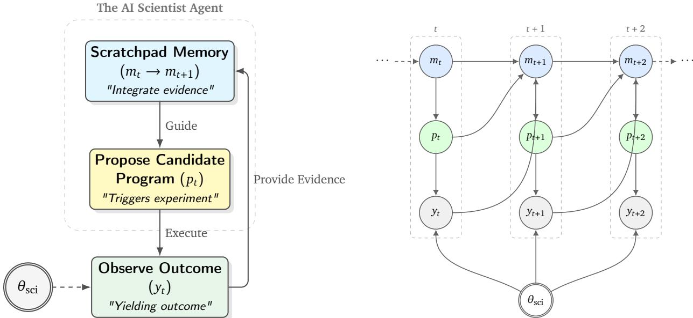  
Figure 10 | The iterative scientific discovery loop. Left: Conceptual flow of the agent. The agent maintains a scratchpad memory (�), proposes a program (�), and observes the outcome (�) which is constrained by the unknown world state $( \theta _ { \mathrm { { s c i } } } )$ . The outcome feeds back into the memory for the next step. Right: The diagram illustrates how the AI Scientist probes the unknown world state $\theta _ { s \mathrm { c i } }$ By proposing a candidate program $p _ { t } ,$ the agent triggers an experiment yielding outcome $y _ { t }$ . This observation provides evidence about $\theta _ { s \mathrm { c i } }$ , which is integrated into the agent’s scratchpad memory $m _ { t + 1 }$ . Over time steps �, � + 1, . . . , this recurrent process allows the agent to navigate the performance landscape and converge towards optimal programs despite the static but unknown nature of $\theta _ { s \mathrm { c i } }$

denotes the parents of � in $\mathcal { G }$ and $u _ { \upsilon }$ is an exogenous noise variable; $P _ { U }$ is a distribution over the exogenous variables $U = \{ u _ { \nu } \} _ { \nu \in V }$

Evaluation as intervention on SCM. Given the SCM parametrization of $\theta _ { s \mathrm { c i } }$ , we can consider that a program $p \in \mathcal { P }$ is encoded as a particular configuration of design variables $X = x _ { p }$ . Then, � can be implemented as

$$
F \big ( p ; \theta _ { \mathrm { s c i } } \big ) : = \mathbb { E } \big [ Y \big | \mathrm { d o } ( X = x _ { p } ) , \theta _ { \mathrm { s c i } } \big ] ,
$$

i.e., the expected outcome under the intervention do $( X = x _ { p } )$ in the true causal model $\theta _ { \mathrm { s c i } }$ . Typical implementations of � can be the objective value of a combinatorial optimization problem, the eficiency of a kernel program, or the performance of a machine learning model (Novikov et al., 2025).

Belief as revealed knowledge. As in Sec. 3.1, the AI Scientist maintains a memory $m _ { t } = \Phi ( h _ { t } )$ as an approximate belief about $\theta _ { s \mathrm { c i } }$ . Each evaluation step $( p _ { t } , y _ { t } )$ thus updates $m _ { t } ,$ , which in turn updates the agent’s efective belief about $\theta _ { \mathrm { s c i } }$ . In this sense, each step reveals part of the underlying scientific knowledge, which in turn determines the next action $p _ { t + 1 }$

## C.2. Ideas and Causal Representation Learning

Ideas as high-level causal variables. In the SCM view above, a program specifies a configuration $x _ { p }$ of design variables �, which are low-level and high-dimensional, e.g., every line of the code. An idea � (Definition 3.2) is a function of the program, and hence of $x _ { p } ,$ that summarizes the design variables at a higher level. A faithful idea representation (Sec. 3.2) requires that $\mathbb { E } [ Y \mid { \mathrm { d o } } ( X = x _ { p } ) , \theta _ { \mathrm { s c i } } ]$ depends on $x _ { p }$ only through $Z ( p )$ , i.e., interventions on the design variables that keep all ideas fixed leave the expected outcome unchanged. Hence, an intervention on the ideas is well defined at the level of expected outcomes. This condition is related to causal feature learning (Chalupka et al., 2015), which constructs macro-level causal variables by grouping the micro-level states that induce the same outcome distribution under intervention, and to causal abstraction (Rubenstein et al., 2017), which studies when a high-level causal model is consistent with a low-level one. Faithfulness is a mean-level version of these conditions, restricted to the score of interest.

Relation to causal representation learning. Causal representation learning (CRL) aims to recover high-level causal variables from low-level observations (Schölkopf et al., 2021), where identifiability usually relies on additional information such as interventions on the latent variables (Ahuja et al., 2023). Ideas can be viewed as the high-level causal variables of programs, and the two settings difer in three aspects. (i) In CRL, the representation is usually an encoder learned from the observations, while an idea is an interpretable function of the program that an LLM can annotate, similar to how LLMs construct high-level variables from unstructured data (Li et al., 2025b; Liu et al., 2025). (ii) CRL usually aims to recover all latent variables, while ideas only need to be faithful to the score. (iii) The agent decides which programs to evaluate, and an edit that changes one idea and keeps the others fixed acts as an intervention on that idea, although an LLM edit may also change other ideas. Theorem 3.3 shows that when the evaluated programs do not vary the candidate ideas, the ideas that matter cannot be identified from the scores.

## C.3. Essentiality of Causal Knowledge for AI Scientists

If the evaluation revealed the scientific knowledge completely, then with more experiment turns, the agent’s revealed scientific knowledge would converge to $\theta _ { s \mathrm { c i } }$ . However, the observation from the evaluation is usually only a proxy of the scientific knowledge $\Theta _ { \mathrm { s c i } }$ : each evaluation returns a scalar score of the program that the agent chooses to evaluate. Diferent hypotheses about $\theta _ { \mathrm { s c i } } , \mathrm { e . g . , }$ ones under which diferent ideas determine the score, can produce the same scores on all evaluated programs. For example, if all evaluated programs in circle packing share the same initialization and the same refinement, the scores cannot tell which of the two accounts for the performance. Therefore, the causal knowledge often cannot be identified from the scores of the programs explored so far, and it is essential for an AI Scientist to explore suficiently, i.e., to evaluate programs that distinguish the competing hypotheses. We denote by $e _ { \mathrm { s r c } }$ the environment in which the evaluation is conducted.

Definition C.1 (Causal AI Scientist). A Causal AI Scientist is an agent specified by: (i) a policy $\pi _ { t } ( \cdot \mid \theta _ { t } , e _ { \mathrm { s r c } } )$ selecting $p _ { t } , ~ ( i i )$ a counterfactual / explanatory operator CF, that answer interventional queries $( e , p )$ via $\operatorname { C F } ( \theta _ { t } ; e , p )$ as an “explanation” ofpredicted performance, where $\theta _ { t }$ is the knowledge revealed at turn �.

Without the revealing of the causal knowledge, the discovery process sufers from significant ineficiency and suboptimality issues. We discuss the two issues more concretely below.

Evolutionary eficiency of Causal AI Scientist. The eficiency issue is characterized by Theorem 3.1. In the linear setting of Theorem 3.1, a Causal AI Scientist can be implemented via estimating the $w ^ { \star }$ and optimizing for $\hat { p }$ from the history, while the black-box baseline does not consider the interactions between the historical observations. Theorem 3.1 shows that, when $K \gg d _ { \mathrm { : } }$ , which is usually the case as the space for all programs is significantly larger than the underlying SCM, encoding (correct) causal structure, e.g., a faithful idea representation, yields an exponential (or at least multiplicative) gain in sample eficiency under finite budgets. For example, if � grows exponentially with $d , \mathsf { e . g . } , K = 2 ^ { d }$ , the upper bound in Theorem 3.1 grows polynomially in �, as $\begin{array} { r } { O \big ( d ( d + \log \frac { 1 } { \delta } ) \frac { \sigma ^ { 2 } } { \epsilon ^ { 2 } } \big ) } \end{array}$ , while the lower bound for the black-box baseline grows exponentially in $d ,$ as $\begin{array} { r } { \Omega \big ( 2 ^ { d } \log \frac { 1 } { \delta } \frac { \sigma ^ { 2 } } { \epsilon ^ { 2 } } \big ) } \end{array}$

Suficient exploration of Causal AI Scientist. The suboptimality issue is characterized by Theorem 3.3. Let $S \subseteq { \mathcal { P } }$ be the set of programs evaluated by the agent. Two hypotheses $\theta _ { 0 }$ and $\theta _ { 1 }$ can be distinguished from the history only if their observation models difer on some program in $S ;$ otherwise, the history has the same distribution under both hypotheses. Under the idea-level mechanisms in Theorem 3.3, i.e., $F ( p ; \theta _ { i } ) = g ( Z ( p ) , z _ { i } ( p ) )$ for $i \in \{ 0 , 1 \}$ , the two hypotheses agree on every program where $\scriptstyle z _ { 0 }$ and $\mathfrak { z } _ { 1 }$ agree, so only the programs where the two ideas difer can distinguish them. Intuitively, Theorem 3.3 implies that if the evaluated programs do not distinguish the corresponding $\theta _ { s \mathrm { c i } }$ among $\{ \theta _ { 0 } , \theta _ { 1 } \}$ , then the solution $\hat { p }$ incurs an expected regret of at least $\Delta / 2$ under one of them, regardless of the budget. This situation is common in evolutionary search: as the search concentrates around its current best programs, the ideas shared by these programs stop varying among the evaluated programs, and the scores cannot tell whether these ideas are the ones that matter. Hence, a Causal AI Scientist needs to explore the programs in which the competing ideas difer, so that the scores can distinguish the hypotheses. This barrier can be removed by exploration within the same evaluator, which difers from the transfer across environments discussed below.

## C.4. Transfer of Scientific Knowledge across Environments

Beyond a single evaluator, the revealed scientific knowledge is also expected to transfer to other environments. If the objective function � is static universally, then with more experiment turns, the optimized solution $p _ { t }$ and the agent’s revealed scientific knowledge can also be applied universally. However, the evaluation is usually conducted at some specific environment $e \in { \mathcal { E } } _ { z }$ , which only gives a proxy knowledge $\theta _ { e }$ about the scientific knowledge $\Theta _ { \mathrm { s c i } }$ . For example, the performance of a machine learning model is usually assessed on finite samples from the test distribution, and there also exist distribution shifts from the test distribution when deploying the model in the real world (Quinonero-Candela et al., 2008). Diferent from $\Theta _ { \mathrm { s c i } }$ that characterizes the complete causal structure about the scientific problem, optimization under environment $\theta _ { e }$ may introduce some spurious correlations that maximize the objective value $F _ { e }$ (Chen et al., 2023). Therefore, to retain the optimality of $\hat { p }$ beyond the source environment $e _ { \mathrm { { s r c } } }$ to some target $e _ { \mathrm { t g t } }$ , it is essential to reveal the causal knowledge and answer causal questions for an AI Scientist, $\mathrm { e . g . }$ , through the operator CF in Definition C.1. Let $P _ { e } ( \cdot \mid p , \theta )$ denote the observation model of the evaluator in environment $e ,$ with mean $F _ { e } ( p ; \theta )$ . We have the following:

Theorem C.2. Consider $e _ { \mathrm { s r c } } , e _ { \mathrm { t g t } } \in \mathcal { E }$ and $\theta _ { 0 } , \theta _ { 1 } \in \Theta$ such that $P _ { e _ { \mathrm { s r c } } } ( \cdot \mid p , \theta _ { 0 } ) = P _ { e _ { \mathrm { s r c } } } ( \cdot \mid p , \theta _ { 1 } )$ for all $p \in { \mathcal { P } } _ { z }$ , and the optimal programs in $e _ { \mathrm { t g t } }$ under $\theta _ { 0 }$ and $\theta _ { 1 }$ are diferent and unique, each better than all other programs by at least $\Delta > 0$ . Then for any policy � that can interact only with $e _ { \mathrm { { s r c } } } ,$ there exists $i \in \{ 0 , 1 \}$ such that for every budget $\begin{array} { r } { T , \mathbb { E } \big [ \operatorname* { m a x } _ { p \in \mathcal { P } } F _ { \mathrm { e t g t } } ( p ; \theta _ { i } ) - F _ { \mathrm { e t g t } } ( \hat { p } ; \theta _ { i } ) \big ] \geq \Delta / 2 } \end{array}$

The formal description and the proof are given in Appendix G. Intuitively, Theorem C.2 implies that if the source environment does not distinguish the corresponding $\theta _ { \mathrm { s c i } }$ among $\{ \theta _ { 0 } , \theta _ { 1 } \}$ , then the solution $\hat { p }$ solved given source environment is suboptimal in the target environment under one of them, no matter how many evaluations are made in the source environment. In the real world, it is usually the case that two machine learning models will have similar performances under the public test benchmarks, but exhibit significantly diferent behaviors when generalizing to distributions from other environments. Diferent from Theorem 3.3, this barrier cannot be removed by more exploration in the source environment, since the two hypotheses agree on every program there. We leave a full study of the transfer of scientific knowledge across environments to future work.

## D. Additional Technical Details

## D.1. Notation

Table 2 | Notation used in the formulation and theorems.
<table><tr><td>Symbol</td><td>Meaning</td></tr><tr><td> $\overline { { \mathcal { P } } }$ </td><td>Program / pipeline / model space (candidate designs)</td></tr><tr><td> $K$ </td><td>Number of candidate programs,  $K : = | { \mathcal { P } } |$  (finite in Theorem 3.1)</td></tr><tr><td> $p \in \mathcal { P }$ </td><td>A program to evaluate (action)</td></tr><tr><td> $\chi$ </td><td>Design-variable space (encoding of programs)</td></tr><tr><td> $x _ { p } \in X$ </td><td>Encoding of program p (e.g., design variables  $X = x _ { p } )$ </td></tr><tr><td> $z , Z ( p )$ </td><td>An idea and the idea representation of program  $p$  (Definition 3.2)</td></tr><tr><td> $r$ </td><td>Number of ideas in an idea representation</td></tr><tr><td> $\phi ( p ) \in \mathbb { R } ^ { d }$ </td><td>Known representation of program  $p$  in Theorem 3.1,  $\mathrm { e . g . }$  , the one-hot encoding of  $Z ( p )$ </td></tr><tr><td> $d$ </td><td>Dimension of the representation, e.g., the number of value combinations of the ideas</td></tr><tr><td> $\Theta$ </td><td>Hypothesis space of scientific knowledge  $( \mathrm { e . g . } ,$  SCMs / mechanisms)</td></tr><tr><td> $\Theta _ { \mathrm { s c i } }$ </td><td>Latent RV taking values in Θ (Bayesian view)</td></tr><tr><td> $\theta ^ { \star } \in \Theta$ </td><td>True (fixed but unknown) scientific knowledge instance (realization)</td></tr><tr><td> $\mu _ { 0 }$   $\varepsilon$ </td><td>Prior over  $\Theta \left( \mathrm { i . e . , } \Theta _ { \mathrm { s c i } } \sim \mu _ { 0 } \right)$ </td></tr><tr><td> $e \in { \mathcal { E } }$ </td><td>Environment / protocol index set (evaluation regimes, deployments)</td></tr><tr><td></td><td>Environment index; 2  $e _ { \mathrm { s r c } }$  source,  $e _ { \mathrm { t g t } }$  target</td></tr><tr><td> $F _ { e } ( p ; \theta )$ </td><td>True performance in env e (scalar objective)</td></tr><tr><td> $P _ { e } ( \cdot \mid p , \theta )$ </td><td>Observation model (likelihood) for evaluator output in env  $e$ </td></tr><tr><td> $y _ { t }$ </td><td>Observed evaluator outcome at round t</td></tr><tr><td> $h _ { t }$ </td><td>History  $\{ ( p _ { 0 } , y _ { 0 } ) , \dotsc , ( p _ { t - 1 } , y _ { t - 1 } ) \}$ </td></tr><tr><td> $b _ { t }$ </td><td>Bayesian belief/posterior over θ:  $b _ { t } ( \cdot ) = \operatorname* { P r } ( \Theta _ { \mathrm { s c i } } \in \cdot \ : | \ : h _ { t } , e _ { \mathrm { s r c } } )$ </td></tr><tr><td> $T$ </td><td>Evaluation budget / horizon (number of program evaluations)</td></tr></table>

## D.2. Random variable, space, and realization (to avoid notation confusion)

We use the following (standard) convention.

(i) Hypothesis space. Θ is a set that contains all candidate scientific-knowledge hypotheses.

(ii) True but unknown instance. The real world is governed by a fixed but unknown $\theta ^ { \star } \in \Theta$

(iii) Bayesian view (optional but convenient). A Bayesian agent models uncertainty by treating $\theta ^ { \star }$ as a realization of a latent random variable $\Theta _ { \mathrm { s c i } }$ with prior $\mu _ { 0 }$ , i.e. $\Theta _ { \mathrm { s c i } } \sim \mu _ { 0 }$ and $\theta ^ { \star }$ is one draw from it. The belief $b _ { t }$ is simply the posterior distribution of $\Theta _ { \mathrm { s c i } }$ after seeing history $h _ { t }$

(iv) Does scientific knowledge change across environments? In our formulation, the underlying scientific knowledge $\theta ^ { \star }$ is static across rounds. Diferent environments $e \in { \mathcal { E } }$ represent diferent evaluation/deployment protocols (distribution shifts, constraint changes, measurement noise, private vs public tests, etc.). Formally, environments afect either the true performance map $F _ { e } ( \cdot ; \theta )$ and/or the observation kernel $P _ { e } ( \cdot \mid p , \theta )$ , while $\theta ^ { \star }$ itself remains the same hidden instance.

## D.3. Evaluator as an observation model (covers deterministic and stochastic evaluators)

Fix an environment $e \in { \mathcal { E } }$ . When the agent evaluates program $p ,$ it receives an observation $y \in \mathcal { Y }$ drawn from

$$
y \sim P _ { e } ( \cdot \mid p , \theta ^ { \star } ) ,
$$

where $P _ { e } ( \cdot \mid p , \theta )$ is a conditional distribution on $y$

Deterministic evaluator. A deterministic evaluator is the special case where there exists a function $g _ { e }$ such that

$$
P _ { e } ( \cdot \mid p , \theta ) = \delta _ { g _ { e } ( p ; \theta ) } ( \cdot ) , \mathrm { i . e . , } y = g _ { e } ( p ; \theta ^ { \star } ) \mathrm { a . s . }
$$

In many program-evolution settings, the evaluator is designed to deterministically check validity and compute an objective score (e.g., via a verifier and a scoring routine).

Stochastic/noisy evaluator. A common instantiation is additive noise:

$$
y = F _ { e } ( p ; \theta ^ { \star } ) + \varepsilon , \qquad \varepsilon \sim N ( 0 , \sigma ^ { 2 } ) ,
$$

but only the proof of Theorem 3.1 relies on the Gaussian form; the other results hold for any noise distribution shared by the hypotheses.

## D.4. Belief and Bayes update: kernel form and undergraduate-friendly special cases

Let $h _ { t } = \{ ( p _ { 0 } , y _ { 0 } ) , \ldots , ( p _ { t - 1 } , y _ { t - 1 } ) \}$ be the history. The Bayesian belief (posterior) is

$$
b _ { t } ( B ) = \operatorname* { P r } ( \Theta _ { \mathrm { s c i } } \in B \mid h _ { t } , e _ { \mathrm { s r c } } ) , \qquad B \subseteq \Theta .
$$

General Bayes update (kernel form). After choosing $p _ { t }$ and observing $y _ { t }$ in $e _ { \mathrm { { s r c } } } ,$ the posterior is

$$
b _ { t + 1 } ( B ) = \frac { \int _ { B } P _ { e _ { \mathrm { s r c } } } ( d y _ { t } \mid p _ { t } , \theta ) b _ { t } ( d \theta ) } { \int _ { \Theta } P _ { e _ { \mathrm { s r c } } } ( d y _ { t } \mid p _ { t } , \theta ) b _ { t } ( d \theta ) } .\tag{2}
$$

Finite hypothesis space (sum form). If $\Theta = \{ \theta _ { 1 } , \ldots , \theta _ { N } \}$ is finite and the likelihood has a pmf $P _ { e _ { \mathrm { s r c } } } ( y _ { t } \mid p _ { t } , \theta _ { i } )$ , then

$$
b _ { t + 1 } ( \theta _ { i } ) = \frac { b _ { t } ( \theta _ { i } ) P _ { e _ { \mathrm { s r c } } } ( y _ { t } \mid p _ { t } , \theta _ { i } ) } { \sum _ { j = 1 } ^ { N } b _ { t } ( \theta _ { j } ) P _ { e _ { \mathrm { s r c } } } ( y _ { t } \mid p _ { t } , \theta _ { j } ) } .
$$

Continuous hypothesis space (density form). If $P _ { e _ { \mathrm { s r c } } } ( d y \mid p , \theta )$ has a density $p _ { e _ { \mathrm { s r c } } } ( y \mid p , \theta )$ , then

$$
b _ { t + 1 } ( \theta ) = \frac { b _ { t } ( \theta ) p _ { e _ { \mathrm { s r c } } } ( y _ { t } \mid p _ { t } , \theta ) } { \int _ { \Theta } b _ { t } ( \theta ^ { \prime } ) p _ { e _ { \mathrm { s r c } } } ( y _ { t } \mid p _ { t } , \theta ^ { \prime } ) d \theta ^ { \prime } } .
$$

Deterministic evaluator (indicator/filter form). If $y = g _ { e _ { \mathrm { s r c } } } ( p ; \theta )$ deterministically, then the update becomes

$$
b _ { t + 1 } ( d \theta ) \propto 1 \{ g _ { e _ { \mathrm { s r c } } } ( p _ { t } ; \theta ) = y _ { t } \} b _ { t } ( d \theta ) ,
$$

i.e. the posterior is the prior restricted to hypotheses consistent with the observed outcome.

## E. Proof of Theorem 3.1 (Structured experience reuse)

Throughout this section we fix a single static environment (drop � from notation), and assume $\mathcal { P } = \{ p _ { 1 } , \ldots , p _ { K } \}$ is finite.

## E.1. Protocol and performance criterion

Experiment–then–commit protocol. A policy � interacts for � rounds. At each round $t = 0 , \ldots , T - 1$ it selects a program $p _ { t } \in \mathcal { P }$ (possibly randomized) based on the past history $h _ { t } ,$ then observes $y _ { t } \in \mathbb R$ After � evaluations it outputs a final recommendation $\hat { p } \in \mathcal { S }$

Simple regret. Let $f ( p )$ denote the true mean performance of program � in this environment. Define the (random) simple regret

$$
\mathsf { S R } _ { T } : = \operatorname* { m a x } _ { p \in \mathcal { P } } f ( p ) \ - \ f ( \hat { p } ) .\tag{3}
$$

$( \epsilon , \delta )$ -correctness (uniform). Fix $\epsilon > 0$ and $\delta \in ( 0 , 1 )$ . We say a policy � is $( \epsilon , \delta )$ -correct uniformly on a hypothesis class H if for every instance in $\mathcal { H } _ { \perp }$

$$
\begin{array} { r } { \operatorname* { P r } \left( \mathbb { S } \mathbb { R } _ { T } \leq \epsilon \right) \geq 1 - \delta . } \end{array}
$$

“Uniformly” means the guarantee must hold for all instances in the class, not only on average.

## E.2. Two hypothesis classes

(1) Structured class. Each program � has a known representation $\phi ( p ) \in \mathbb { R } ^ { d }$ with $\| \phi ( p ) \| _ { 2 } \leq 1 , \mathrm { e . g . }$ , a faithful linear idea representation $\phi ( p ) = Z ( p )$ (Sec. 3.2). The unknown instance is a weight vector $\boldsymbol { w } ^ { \star } \in \mathbb { R } ^ { d }$ and

$$
f ( p ) = \langle \phi ( p ) , \boldsymbol { w } ^ { \star } \rangle .\tag{4}
$$

Observations follow a Gaussian noise model

$$
y _ { t } = f ( p _ { t } ) + \varepsilon _ { t } , \qquad \varepsilon _ { t } \sim N ( 0 , \sigma ^ { 2 } ) \ \mathrm { i . i . d . }\tag{5}
$$

Coverage condition. Assume there exist � basis programs $p ^ { ( 1 ) } , \ldots , p ^ { ( d ) }$ whose representations are the standard basis:

$$
\phi ( p ^ { ( i ) } ) = e _ { i } , \qquad i = 1 , \ldots , d .\tag{6}
$$

(2) Unstructured black-box class (baseline). The unknown instance is an arbitrary vector of means

$$
\mu = ( \mu _ { 1 } , \ldots , \mu _ { K } ) \in \mathbb { R } ^ { K } , \qquad f ( p _ { i } ) = \mu _ { i } ,
$$

and observations are

$$
y _ { t } = \mu _ { I _ { t } } + \varepsilon _ { t } , \qquad \varepsilon _ { t } \sim N ( 0 , \sigma ^ { 2 } ) \mathrm { i . i . d . } ,\tag{7}
$$

where $I _ { t } \in \{ 1 , \ldots , K \}$ is the index of the chosen program $p _ { t } = p _ { I _ { t } }$ . Crucially, there is no assumed relation between $\mu _ { i }$ and $\mu _ { j }$ for $i \neq j$

## E.3. Formal statement and proof

Theorem E.1 (Formal version of Theorem 3.1). Fix $\epsilon > 0$ and $\delta \in ( 0 , 1 / 4 )$ .

1. (Upper bound under the structured linear class). Under equation 4–equation 6 and equation $5 ,$ there exists a policy $\pi _ { \mathrm { l i n } }$ such that

$$
\operatorname* { P r } { \left( { \mathrm { S R } } _ { T } \leq 2 \epsilon \right) } \geq 1 - \delta \quad w h e n e \nu e r \quad T \ \geq \ 2 d { \frac { \sigma ^ { 2 } } { \epsilon ^ { 2 } } } \log \left( { \frac { 2 K } { \delta } } \right) .
$$

2. (Lower bound for the unstructured black-box class). For the black-box class equation $7 ,$ any policy that is $( \epsilon , \delta )$ -correct uniformly for all $\boldsymbol { \mu } \in \mathbb { R } ^ { K }$ must satisfy

$$
T \geq ( K - 1 ) \frac { \sigma ^ { 2 } } { 8 \epsilon ^ { 2 } } \log \Bigl ( \frac { 1 } { 2 \delta } \Bigr ) .
$$

Replacing � with $\epsilon / 2$ in part (1) gives the informal statement in Theorem 3.1.

Proof. We prove the two parts separately.

Part (1): constructive upper bound (estimate $w ^ { \star }$ then commit). Evaluate each basis program $\boldsymbol { p } ^ { ( i ) }$ exactly � times (total $T = n d )$ . Let $y _ { 1 } ^ { ( i ) } , \ldots , y _ { n } ^ { ( i ) }$ be the observations for basis �, and define

$$
\hat { w } _ { i } : = \frac { 1 } { n } \sum _ { j = 1 } ^ { n } y _ { j } ^ { ( i ) } .
$$

By equation 4–equation $6 , f ( { \boldsymbol { p } } ^ { ( i ) } ) = \boldsymbol { w } _ { i } ^ { \star }$ . By equation 5, $\hat { w } _ { i } \sim \mathcal N ( w _ { i } ^ { \star } , \sigma ^ { 2 } / n )$ and these coordinates are independent.

Define for any program �:

$$
\widehat { f } ( p ) : = \langle \phi ( p ) , \hat { w } \rangle , \qquad \hat { w } = ( \hat { w } _ { 1 } , \dots , \hat { w } _ { d } ) .
$$

Then

$$
\widehat { f } ( p ) - f ( p ) = \langle \phi ( p ) , \hat { w } - w ^ { \star } \rangle \sim N \Big ( 0 , ~ \frac { \sigma ^ { 2 } } { n } \| \phi ( p ) \| _ { 2 } ^ { 2 } \Big ) ,
$$

so since $\| \phi ( p ) \| _ { 2 } \leq 1$

$$
\operatorname* { P r } \big ( | \widehat { f } ( p ) - f ( p ) | \geq \epsilon \big ) \leq 2 \exp \Big ( - \frac { n \epsilon ^ { 2 } } { 2 \sigma ^ { 2 } } \Big ) .
$$

Union bound over � programs gives

$$
\operatorname* { P r } \Big ( \operatorname* { m a x } _ { p \in \mathcal { P } } | \widehat { f } ( p ) - f ( p ) | \geq \epsilon \Big ) \leq 2 K \exp \Big ( - \frac { n \epsilon ^ { 2 } } { 2 \sigma ^ { 2 } } \Big ) .
$$

Choose

$$
n \ge 2 \frac { \sigma ^ { 2 } } { \epsilon ^ { 2 } } \log \biggl ( \frac { 2 K } { \delta } \biggr ) ,
$$

so that with probability at least 1 − � we have $\begin{array} { r } { \operatorname* { m a x } _ { p } | \widehat { f } ( p ) - f ( p ) | \leq \epsilon . } \end{array}$

Now output ${ \hat { p } } : = \arg \operatorname* { m a x } _ { p \in { \mathcal { P } } } { \widehat { f } } ( p )$ . Let $p ^ { \star } : = \arg \operatorname* { m a x } _ { p } f ( p )$ . On the above high-probability event,

$$
f ( p ^ { \star } ) - f ( \widehat { p } ) \leq \big ( f ( p ^ { \star } ) - \widehat { f } ( p ^ { \star } ) \big ) + \big ( \widehat { f } ( \widehat { p } ) - f ( \widehat { p } ) \big ) \leq \epsilon + \epsilon = 2 \epsilon .
$$

Thus $\mathrm { P r } ( \mathrm { S R } _ { T } \leq 2 \epsilon ) \geq 1 - \delta$ for $T = n d$ as stated.

Part (2): lower bound for the black-box class. We construct � hard instances and lower bound any uniformly $( \epsilon , \delta )$ -correct policy.

Let the programs be $p 1 , \ldots , p _ { K }$ . Define a base instance $\boldsymbol { \mu } ^ { ( 0 ) } \in \mathbb { R } ^ { K }$

$$
\mu _ { 1 } ^ { ( 0 ) } = 0 , \qquad \mu _ { i } ^ { ( 0 ) } = - 2 \epsilon ( i = 2 , \ldots , K ) .
$$

For each $i \in \{ 2 , \ldots , K \}$ , define an alternative instance $\mu ^ { ( i ) }$ :

$$
\mu _ { 1 } ^ { ( i ) } = 0 , \qquad \mu _ { i } ^ { ( i ) } = + 2 \epsilon , \qquad \mu _ { j } ^ { ( i ) } = - 2 \epsilon ( j \notin \{ 1 , i \} ) .
$$

Under $\mu ^ { ( 0 ) }$ , the unique best program is $p _ { 1 }$ , and choosing any $p _ { i }$ with $i \geq 2$ incurs regret $2 \epsilon > \epsilon$ . Under $\mu ^ { ( i ) }$ , the unique best program is $p _ { i }$ , and choosing $p _ { 1 }$ incurs regret $2 \epsilon > \epsilon$

Let $P _ { 0 }$ be the distribution of the full transcript $\mathcal { T } : = ( p _ { 0 : T - 1 } , y _ { 0 : T - 1 } , \hat { p } )$ under $\mu ^ { ( 0 ) }$ , and $P _ { i }$ the analogous distribution under $\mu ^ { ( i ) }$ . Uniform $( \epsilon , \delta )$ -correctness implies

$$
\begin{array} { r } { \begin{array} { r l } { P _ { 0 } \big ( \widehat { p } = p _ { 1 } \big ) \geq 1 - \delta , } & { { } \quad P _ { i } \big ( \widehat { p } = p _ { 1 } \big ) \leq \delta \quad ( i = 2 , \ldots , K ) . } \end{array} } \end{array}
$$

Step 1: a KL lower bound from an event. For any event � and distributions $P , Q ,$ one has

$$
\mathrm { K L } ( P \| Q ) \geq P ( A ) \log { \frac { P ( A ) } { Q ( A ) } } + ( 1 - P ( A ) ) \log { \frac { 1 - P ( A ) } { 1 - Q ( A ) } } .
$$

Apply it with $A = \{ \hat { p } = p _ { 1 } \} , P = P _ { 0 } , Q = P _ { i }$ . Let $p : = P _ { 0 } ( A ) \geq 1 - \delta$ and $q : = P _ { i } ( A ) \leq \delta$ . For $\delta \in ( 0 , 1 / 4 )$ this yields

$$
\mathrm { K L } ( P _ { 0 } \| P _ { i } ) \geq \log \Big ( \frac { 1 } { 2 \delta } \Big ) .\tag{8}
$$

Step 2: compute $\mathbb { K L } ( P _ { 0 } \| P _ { i } )$ via number of pulls of arm �. Under $\mu ^ { ( 0 ) }$ and $\mu ^ { ( i ) }$ , the policy is identical; only observations when playing $p _ { i }$ difer:

$$
y \sim { \cal N } ( - 2 \epsilon , \sigma ^ { 2 } ) ~ { \mathrm { u n d e r } } ~ \mu ^ { ( 0 ) } , \qquad y \sim { \cal N } ( + 2 \epsilon , \sigma ^ { 2 } ) ~ { \mathrm { u n d e r } } ~ \mu ^ { ( i ) } .
$$

For Gaussians with equal variance, $\begin{array} { r } { \mathrm { K L } ( N ( m _ { 0 } , \sigma ^ { 2 } ) | | N ( m _ { 1 } , \sigma ^ { 2 } ) ) = \frac { ( m _ { 0 } - m _ { 1 } ) ^ { 2 } } { 2 \sigma ^ { 2 } } } \end{array}$ , so each pull of $p _ { i }$ contributes KL $\begin{array} { r } { \frac { ( 4 \epsilon ) ^ { 2 } } { 2 \sigma ^ { 2 } } = \frac { 8 \epsilon ^ { 2 } } { \sigma ^ { 2 } } } \end{array}$

Let $N _ { i }$ be the (random) number of times $p _ { i }$ is evaluated in � rounds. Additivity of log-likelihood ratios over independent Gaussian samples yields

$$
\mathrm { K L } ( P _ { 0 } \| P _ { i } ) = { \frac { 8 \epsilon ^ { 2 } } { \sigma ^ { 2 } } } \ \mathbb { E } _ { P _ { 0 } } [ N _ { i } ] .\tag{9}
$$

Step 3: conclude the lower bound on �. Combine equation 8 and equation $9 { \mathrm { : } }$

$$
\mathbb { E } _ { P _ { 0 } } \big [ N _ { i } \big ] \ \ge \ \frac { \sigma ^ { 2 } } { 8 \epsilon ^ { 2 } } \log \Big ( \frac { 1 } { 2 \delta } \Big ) , \qquad i = 2 , \dots , K .
$$

Summing over $i = 2 , \dots , K$ gives

$$
T = \sum _ { i = 1 } ^ { K } N _ { i } \ \ge \ \sum _ { i = 2 } ^ { K } \mathbb { E } _ { P _ { 0 } } [ N _ { i } ] \ \ge \ ( K - 1 ) \frac { \sigma ^ { 2 } } { 8 \epsilon ^ { 2 } } \log \Bigl ( \frac { 1 } { 2 \delta } \Bigr ) .
$$

This completes the proof.

□

Remark (deterministic evaluator). If $\sigma = 0$ , the structured linear class can recover $w ^ { \star }$ exactly from � basis evaluations and achieve $\mathrm { S R } _ { T } = 0 $ , while in the unstructured black-box class a uniform worst-case guarantee requires evaluating all � programs at least once.

Relation to best-arm identification. The lower bound follows the standard change-of-measure argument for best-arm identification in �-armed Gaussian bandits (Kaufmann et al., 2016), and the upper bound is a simple instance of best-arm identification in linear bandits (Soare et al., 2014).

## F. Proof of Theorem 3.3 (Degenerated exploration of ideas)

## F.1. Formal statement and proof

For a policy that interacts for � rounds and outputs $\hat { p } ,$ define the simple regret under mechanism � as $\begin{array} { r } { \mathbf { S } \mathrm { R } _ { T } ( \theta ) : = \mathrm { m a x } _ { p \in \mathcal { P } } F ( p ; \theta ) - F ( \widehat { p } ; \theta ) } \end{array}$

Theorem F.1 (Formal version of Theorem 3.3). Let $z _ { 0 } , z _ { 1 } : \mathcal { P }  \mathcal { V }$ be two ideas, and let $A : = \{ p \in { \mathcal { P } }$ $z _ { 0 } ( p ) = z _ { 1 } ( p ) \}$ be the set ofprograms on which they agree. Assume there exist $\theta _ { 0 } , \theta _ { 1 } \in \Theta$ such that:

(i) (Idea-level mechanisms) $F ( p ; \theta _ { i } ) = g ( Z ( p ) , z _ { i } ( p ) )$ for all $p \in \mathcal { P }$ and $i \in \{ 0 , 1 \}$ , for a common representation � and function �, and each evaluation returns $y = F ( p ; \theta _ { i } ) + \varepsilon$ with the same noise distribution under $\theta _ { 0 }$ and $\theta _ { 1 , }$

(ii) (Optimal program flips with margin Δ) there exist $p _ { 0 } \neq p _ { 1 }$ and $\Delta > 0$ such that $F \big ( p _ { i } ; \theta _ { i } \big ) -$ $F ( p ; \theta _ { i } ) \ge \Delta$ for all $p \neq p _ { i }$ and $i \in \{ 0 , 1 \}$

Then for any policy that only evaluates programs in �, there exists $i \in \{ 0 , 1 \}$ such that for every budget �,

$$
\mathbb { E } \big [ { \sf S R } _ { T } ( \theta _ { i } ) \big ] \ \geq \ \Delta / 2 .
$$

Moreover, at least one of $p _ { 0 }$ and $p _ { 1 }$ lies outside �.

Proof. For every $p \in A , z _ { 0 } ( p ) = z _ { 1 } ( p )$ gives $F ( p ; \theta _ { 0 } ) = g ( Z ( p ) , z _ { 0 } ( p ) ) = g ( Z ( p ) , z _ { 1 } ( p ) ) = F ( p ; \theta _ { 1 } )$ Together with the common noise distribution in (i), the observation model $O ( \cdot \mid \theta _ { i } , p )$ is identical under $\theta _ { 0 }$ and $\theta _ { 1 }$ for every $p \in A$

Let $\mathbb { P } _ { i }$ be the distribution of the transcript $( p _ { 0 : T - 1 } , y _ { 0 : T - 1 } , \hat { p } )$ when the true mechanism is $\theta _ { i }$ . Since the policy only evaluates programs in $A ,$ , for any history and any chosen $p _ { t } \in A$ , the conditional distribution of $y _ { t }$ is identical under $\theta _ { 0 }$ and $\theta _ { 1 : }$ , and the policy chooses $p _ { t + 1 }$ and $\hat { p }$ with the same randomization given the same history. By induction on $t , \mathbb { P } _ { 0 } = \mathbb { P } _ { 1 }$ . In particular, the output $\hat { p }$ has the same distribution $Q$ on $\mathcal { P }$ under both mechanisms.

By (ii), any output $\hat { p } \neq p _ { i }$ incurs regret at least Δ under $\theta _ { i } ,$ so

$$
\begin{array} { r } { \mathbb { E } [ { \mathrm { S R } } _ { T } ( \theta _ { 0 } ) ] \ \geq \ \Delta \big ( 1 - Q ( \hat { p } = p _ { 0 } ) \big ) , \qquad \mathbb { E } [ { \mathrm { S R } } _ { T } ( \theta _ { 1 } ) ] \ \geq \ \Delta \big ( 1 - Q ( \hat { p } = p _ { 1 } ) \big ) . } \end{array}
$$

Since $p _ { 0 } \neq p _ { 1 } , Q ( { \hat { p } } = p _ { 0 } ) + Q ( { \hat { p } } = p _ { 1 } ) \leq 1$ , so at least one of the two probabilities is at most $1 / 2 ,$ , and the corresponding expected regret is at least $\Delta / 2$

For the last claim, suppose both $p _ { 0 } , p _ { 1 } \in A$ . Then $F ( p _ { 1 } ; \theta _ { 0 } ) \ = \ F ( p _ { 1 } ; \theta _ { 1 } ) \ \ge \ F ( p _ { 0 } ; \theta _ { 1 } ) \ + \ \Delta \ =$ $F \left( p _ { 0 } ; \theta _ { 0 } \right) + \Delta$ , which contradicts the optimality of $p _ { 0 }$ under $\theta _ { 0 }$ . □

The theorem holds for any budget, since the barrier comes from the programs that the policy evaluates. To identify which of $\scriptstyle { \mathfrak { z } } _ { 0 }$ and $z _ { 1 }$ matters, the policy has to evaluate a program outside $A ,$ i.e., a program on which the two ideas difer. In ExpEvolve, this is the role of plateau-aware revision, which changes the proposal distribution to evaluate programs where the ideas shared by the leading programs difer.

## G. Proof of Theorem C.2 (Non-identifiability under environment shifts)

## G.1. Setup: source interaction, target evaluation, and target regret

The agent can only interact with the source environment $e _ { \mathrm { { s r c } } }$ :

$$
y _ { t } \sim P _ { e _ { \mathrm { s r c } } } ( \cdot \mid p _ { t } , \theta ^ { \star } ) .
$$

After � rounds it outputs a final program ${ \hat { p } } .$ . Performance is judged in a target environment $e _ { \mathrm { t g t } }$ via $F _ { { e _ { \mathrm { t g t } } } } ( p ; \theta ^ { \star } )$ . Define the target (simple) regret:

$$
\mathrm { G R } _ { T } ( \theta ^ { \star } ) : = \operatorname* { m a x } _ { p \in \mathcal { P } } F _ { e _ { \mathrm { t g t } } } ( p ; \theta ^ { \star } ) - F _ { e _ { \mathrm { t g t } } } ( \hat { p } ; \theta ^ { \star } ) .
$$

## G.2. Formal statement and proof

Theorem G.1 (Non-identifiability barrier under shifts). Fix $e _ { \mathrm { s r c } } , e _ { \mathrm { t g t } } \in \mathcal { E }$ . Assume there exist two hypotheses $\theta _ { 0 } , \theta _ { 1 } \in \Theta$ such that:

$$
( S o u r c e ~ i n d i s t i n g u i s h a b i l i t y ) \quad P _ { e _ { \mathrm { s r c } } } ( \cdot \mid p , \theta _ { 0 } ) = P _ { e _ { \mathrm { s r c } } } ( \cdot \mid p , \theta _ { 1 } ) , \quad \forall p \in \mathcal { P } .\tag{10}
$$

(Target optimal action flips with margin Δ) ∃ �0, �1 ∈ P and $\Delta > 0 s . t$

$$
p _ { 0 } \in \arg \operatorname* { m a x } _ { p \in \mathcal { P } } F _ { e _ { \mathrm { t g t } } } ( p ; \theta _ { 0 } ) , \quad p _ { 1 } \in \arg \operatorname* { m a x } _ { p \in \mathcal { P } } F _ { e _ { \mathrm { t g t } } } ( p ; \theta _ { 1 } ) ,\tag{11}
$$

$$
F _ { \mathrm { e q t } } ( p _ { 0 } ; \theta _ { 0 } ) - F _ { \mathrm { e q t } } ( p ; \theta _ { 0 } ) \ge \Delta , ~ \forall p \ne p _ { 0 } , ~ F _ { \mathrm { e q t } } ( p _ { 1 } ; \theta _ { 1 } ) - F _ { \mathrm { e q t } } ( p ; \theta _ { 1 } ) \ge \Delta , ~ \forall p \ne p _ { 1 } .\tag{12}
$$

Then for any policy � that can interact only with $e _ { \mathrm { { s r c } } } ,$ there exists $i \in \{ 0 , 1 \}$ such that for every budget $T ,$

$$
\mathbb { E } \big [ \mathbf { G } \mathrm { R } _ { T } ( \theta _ { i } ) \big ] \ \geq \ \Delta / 2 .
$$

This impossibility holds whether the evaluator is stochastic $o r$ deterministic, since equation 10 is stated at the level of the full observation model $P _ { e _ { \mathrm { s r c } } }$

Proof. Let $\mathbb { P } _ { i }$ be the distribution over the full transcript

$$
\mathcal { T } : = ( p _ { 0 : T - 1 } , y _ { 0 : T - 1 } , \hat { p } )
$$

when the true hypothesis is $\theta _ { i }$ and interaction is only with $e _ { \mathrm { s r c } }$

By equation 10, for any history and any chosen action $p _ { t }$ , the conditional distribution of $y _ { t }$ is identical under $\theta _ { 0 }$ and $\theta _ { 1 }$ . By induction on $t ,$ the entire transcript distribution is identical:

$$
\mathbb { P } _ { 0 } = \mathbb { P } _ { 1 } .
$$

In particular, the marginal distribution of the final output $\hat { p }$ is the same under $\theta _ { 0 }$ and $\theta _ { 1 }$ . Let this common distribution be denoted by $Q$ on $\mathcal { P }$ .

Now consider the expected target regret under $\theta _ { 0 } { \mathrm { : } }$ by equation 12, any output $\hat { p } \neq p _ { 0 }$ incurs regret at least $\Delta$ under $\theta _ { 0 }$ :

$$
\mathrm { \mathrm { G R } } _ { T } ( \theta _ { 0 } ) = F _ { e _ { \mathrm { t g t } } } ( p _ { 0 } ; \theta _ { 0 } ) - F _ { e _ { \mathrm { t g t } } } ( \hat { p } ; \theta _ { 0 } ) \ \geq \ \Delta \cdot { \bf 1 } \{ \hat { p } \neq p _ { 0 } \} .
$$

Taking expectation w.r.t. � yields

$$
\begin{array} { r } { \mathbb { E } [ { \mathrm { G R } } _ { T } ( \theta _ { 0 } ) ] ~ \geq ~ \Delta \cdot ( 1 - Q ( \hat { p } = p _ { 0 } ) ) . } \end{array}
$$

Similarly,

$$
\begin{array} { r } { \mathbb { E } [ { \sf G } { \sf R } _ { T } ( \theta _ { 1 } ) ] \ \geq \ \Delta \cdot ( 1 - Q ( \hat { p } = p _ { 1 } ) ) . } \end{array}
$$

Since $Q \big ( \widehat { p } = p _ { 0 } \big ) + Q \big ( \widehat { p } = p _ { 1 } \big ) \leq 1$ , at least one of these probabilities is at most ${ 1 / 2 } ,$ , so at least one of the two expected regrets is at least $\Delta / 2$ :

$$
\operatorname* { m a x } \{ \mathbb { E } [ \mathrm { G R } _ { T } ( \theta _ { 0 } ) ] , \ \mathbb { E } [ \mathrm { G R } _ { T } ( \theta _ { 1 } ) ] \} \ \geq \ \Delta / 2 .
$$

This proves the claim.

## G.3. Concrete examples satisfying the conditions

We give two illustrative examples where source data cannot distinguish two hypotheses, yet the target-optimal decision difers.

Example 1: public test vs private (distribution shift / shortcut feature). Let $\theta \in \{ \theta _ { 0 } , \theta _ { 1 } \}$ encode which feature is truly stable/causal. Programs correspond to two model families: $p _ { 0 }$ uses a stable causal feature; $p _ { 1 }$ uses a shortcut feature. In the source environment (public benchmark), the shortcut feature is perfectly correlated with labels, so both hypotheses yield the same evaluator distribution for every program, satisfying equation 10. In the target environment (deployment/private), the shortcut correlation breaks: under $\theta _ { 0 } , p _ { 0 }$ is uniquely optimal; under $\theta _ { 1 } , p _ { 1 }$ is uniquely optimal, with margin $\Delta _ { z }$ satisfying equation 12. No amount of interaction with $e _ { \mathrm { s r c } }$ can identify which world holds.

Example 2: relaxed verification (slack) vs exact verification (constraint shift). In combinatorial optimization, it is common to evaluate candidate programs using a relaxed verifier $( \mathrm { e . g . }$ , allowing numerical slack), then validate with an exact verifier. For instance, in circle packing, one may verify non-overlap with a numerical slack such as $1 0 ^ { - 6 }$ , and later validate with an exact checker; converting a relaxed-feasible solution into an exact-feasible one may require tiny but nonzero modifications, and rankings can change when switching verifiers. This is explicitly discussed in the context of circle packing verification with slack vs exact validation. The source environment $e _ { \mathrm { s r c } }$ can correspond to the relaxed evaluator, while the target environment $e _ { \mathrm { t g t } }$ corresponds to the exact evaluator. Then two hypotheses $\theta _ { 0 } , \theta _ { 1 }$ can be constructed so that they are indistinguishable under the relaxed evaluator for all queried programs, yet the exact evaluator reverses which program is truly best (with gap Δ), matching Theorem G.1.

## H. Implementation Details of ExpEvolve

This section describes the implementation of ExpEvolve used in our experiments. Alg. 1 summarizes the search loop, and Alg. 2 details the discovery of idea factors. We implement ExpEvolve on the backbone of SCS (Gideoni et al., 2026). In each generation, ExpEvolve generates � programs in parallel slots. The prompt of each slot contains the task instruction, an optional strategy instruction from an idea-guided action, a summary of the idea memory, and a few example programs, and the mutator LLM � writes a new program from the prompt. All LLM calls use DeepSeek-V4-Flash, and the hyperparameters are listed in Table 3. Each generated program is evaluated once. A program is treated as failed if the evaluation fails or returns a non-finite objective, and failed programs are neither repaired nor retried. The LLM calls for generation are not retried in our experiments either, so a failed call, e.g., due to rate limits, yields a failed program that still counts toward the evaluation budget.

Algorithm 1 ExpEvolve   
Require: initial archive $\mathcal { A } _ { 0 }$ of the task; mutator LLM �; generations �; batch size �; random-exploration   
fraction $\rho ;$ plateau window �   
1: $M _ { 0 } \gets \emptyset$   
2: for $t = 0 , \ldots , N - 1$ do   
Exploit idea factors (Sec. 4.2)   
3: $( u _ { t , 1 } , \dotsc , u _ { t , B } )  \mathrm { A }$ llocate $( M _ { t } , B , \rho )$ {⊥: random exploration}   
4: for $b = 1 , \ldots , B$ do   
5: $p _ { t , b } \sim G ( \cdot \mid$ BuildContext $( u _ { t , b } , \mathcal { A } _ { t } , \mathcal { M } _ { t } ) ) ; y _ { t , b } \gets$ Evaluate( ��,�)   
6: end for   
Discover ideas from experience (Sec. 4.1)   
7: $\mathcal { A } _ { t + 1 } \gets \mathcal { A } _ { t } \cup \{ ( p _ { t , b } , y _ { t , b } , u _ { t , b } ) \} _ { b = 1 } ^ { B }$   
8: $\boldsymbol { \mathcal { M } } _ { t + 1 }$ ← UpdateMemory $( \breve { M } _ { t } , \breve { \nparallel } _ { t + 1 } )$ {annotate; merge; update rewards}   
9: if DiscoverScheduled(�) then   
10: $\boldsymbol { \mathcal { M } } _ { t + 1 } \gets \boldsymbol { \mathrm { D } }$ iscoverIdeas $( \mathcal { A } _ { t + 1 } , \mathcal { M } _ { t + 1 } )$ {Alg. 2}   
11: end if   
Revise at plateaus $( \mathsf { S e c } , 4 . 2 )$   
12: if Enters $\operatorname { P L A T E A U } ( \mathcal { A } _ { t + 1 } , \kappa )$ then   
13: $\boldsymbol { \mathcal { M } } _ { t + 1 }$ ← ReviseAtPlateau $( \mathcal { A } _ { t + 1 } , \mathcal { M } _ { t + 1 } )$ {probe; judge; mask}   
14: end if   
15: end for   
16: return arg $\boldsymbol { \mathrm { m a x } } _ { ( p , y , \cdot ) \in \mathcal { A } _ { N } } { y }$ and $M _ { N }$

## H.1. Idea Memory and Annotation

Idea factors. Each idea factor � in the idea memory $\textstyle { \mathcal { M } } _ { t }$ is stored with a name, a description of its code pattern, a type, i.e., binary or categorical, and a value set V. The description is also used by the annotator LLM to recognize the idea factor from the source code. The annotator LLM labels each program with $z ( p ) \in \mathcal { V } \cup$ {unknown}, where the label is unknown if the idea factor cannot be recognized. The annotation of a program is a separate LLM call, independent of the proposal of idea factors, with the source code truncated to 4000 characters.

Score contrast. For a binary idea factor, the score contrast is the diference of the mean scores between the successful programs labeled true and those labeled false. For a categorical idea factor, the score contrast is the diference of the mean scores between the value with the highest mean score and the value with the lowest mean score. Programs labeled unknown are excluded from the score contrast.

Updating the memory. After each generation, UpdateMemory labels the new programs with all existing idea factors, recomputes the score contrasts, and merges two idea factors if the Pearson correlation of their labels on the archive exceeds 0.85 (Alg. 1, line 8). Degenerate evaluations, whose scores collapse to extreme values, are excluded from the statistics. It also updates the statistics of the actions (Appendix H.3).

Algorithm 2 DiscoverIdeas   
Require: archive A; idea memory M; pair budget ℓ; minimum support $n _ { \mathrm { { m i n } } } ;$ admission threshold �   
Ensure: updated idea memory M   
Select unexplained contrasts   
1: if $M = \emptyset$ then   
2: � ← LargestScoreGaps $( \mathcal { A } , \ell )$   
3: else   
4: � ← MisrankedPairs(A, M, ℓ) {pairwise ranker on $Z ( p ) \}$   
5: end if   
Propose candidate ideas   
6: M ← f ProposeIdeas(�) {name, description, type, values}   
Annotate, test, and admit   
7: for each $z \in \widetilde { M }$ do   
8: �( �) ← Annotate $( p , z )$ for all $p \in \mathcal A$ {in V ∪ {unknown}}   
9: if Supported(�, A, � i ) and |ScoreContrast $( z , { \mathcal { A } } ) | \geq \eta$ and not Duplicate(�, M) then   
10: M ← M ∪ {�}   
11: end if   
12: end for   
13: return M

Memory summary in the prompt. Every slot, including random exploration, receives a summary of the idea memory (line 5). The summary lists the six idea factors with the largest absolute score contrasts, each with its name, description, direction of efect, numbers of programs with and without it, and score contrast, and gives the mean score of each value for categorical idea factors. It also contains the outlier programs that the current idea factors fail to explain, i.e., one program with a large positive residual and one with a large negative residual $( | z | \geq 1 . 5 )$ , with their source code truncated to 1500 characters.

## H.2. Idea Discovery

Trigger. Discovery is triggered every $n _ { \mathrm { d i s c } }$ generations after the first generation, when the archive contains at least 15 successful programs and the idea memory contains fewer than 12 idea factors, excluding the background idea factors (Alg. 1, line 9).

Pairwise ranker. Let $\sigma _ { Y }$ be the standard deviation of the scores of the successful programs in the archive. ExpEvolve builds all pairs of successful programs $( p , p ^ { \prime } )$ with $| y ( p ) - y ( p ^ { \prime } ) | \geq 0 . 2 5 \sigma _ { Y }$ , and labels each pair by sign $( y ( p ) - y ( p ^ { \prime } ) )$ . The feature of a pair is the diference of the binary encodings of the idea factors, where a factor is encoded as 1 if it is labeled true and 0 otherwise, together with the standardized diference of the code lengths as a covariate. The ranker is a ridge least-squares model without intercept $( \lambda = 1 0 ^ { - 3 } )$ , refit in each discovery round.

Selecting unexplained pairs. ExpEvolve selects the pairs that the ranker orders incorrectly (Alg. 2, line 4), and excludes the pairs on which the current idea factors take identical values. The selected pairs are ranked by $\operatorname { a c c } _ { 0 } ( p , p ^ { \prime } ) \cdot w ( p , p ^ { \prime } )$ , where $w ( p , p ^ { \prime } ) = 1 . 5$ if the two programs come from the same generation and 1 otherwise. The null accuracy $\mathtt { a c c } _ { 0 } ( p , p ^ { \prime } )$ is the fraction of 500 random permutations of the scores over programs, under which a ranker refit on the permuted labels still predicts the true order of the pair. A pair with a high null accuracy is easy to order from the idea factors, so that its misranking indicates a missing idea factor. The null accuracy uses the diferences of the idea factors without the code-length covariate. Up to $\ell = 6$ pairs are used, with each program appearing in at most two pairs. If fewer than 3 pairs are available, the discovery round is skipped. When the idea memory is empty, ExpEvolve selects the ℓ pairs with the largest score gaps under

the same constraints (lines 1–2).

Proposing candidates. For each selected pair, the prompt of the proposer LLM contains the score gap in raw units and in units of $\sigma _ { Y . }$ , the scores, the predicted scores and the residuals of both programs, the order predicted by the ranker, the idea factors on which the two programs difer, and the source code of both programs truncated to 1500 characters each. The proposer LLM is asked to explain the unexpected order, and proposes 8 candidates in each round, each with a name, a description, a type, a value set, and a predicted direction (line 6).

Annotation and admission. Each candidate is annotated on the whole archive (line 8). ExpEvolve admits a candidate if the two values compared by its score contrast are each taken by at least $n _ { \mathrm { m i n } } = 5$ programs, the absolute score contrast is at least $\eta = \operatorname* { m a x } ( 0 . 2 5 \sigma _ { Y } , 1 0 ^ { - 3 } )$ , and the candidate does not duplicate an idea factor in the memory, an idea factor removed before, or another selected candidate (line 9). Two idea factors are considered duplicates if their names are identical, the token Jaccard similarity of their names is at least 0.6, or the token overlap of their descriptions is at least 0.45. Since the archive is collected adaptively by the search, the score contrast is an association within the archive and does not identify the efect of the idea factor. Admission therefore makes an idea factor available for testing, and the search examines it through the actions (Appendix H.3).

## H.3. Idea-Guided Actions

Actions. Allocate compiles the idea factors into actions, i.e., ADD(�) and REMOVE(�) for a binary idea factor, and SET(�=�) for each value � of a categorical idea factor (Alg. 1, line 3). The action set is rebuilt in every generation, and keeps at most three actions of the idea factors with the largest absolute score contrasts, together with a baseline action without instruction. An action that has stayed in the action set for $N _ { \mathrm { r o t } }$ consecutive generations is rotated out to give way to other actions, and its records are kept for when it enters the action set again. Before an admitted idea factor is compiled into actions, its absolute score contrast must exceed the 95th percentile of a null distribution obtained from 200 permutations of the scores, and a threshold on the absolute score contrast is used instead when the permutation test cannot be run. Background idea factors (Appendix H.4) are not compiled into actions, until they satisfy the admission conditions of Appendix H.2 and are promoted to regular idea factors.

Prompt of an action. An idea-guided slot difers from random exploration in two parts of the prompt (line 5). First, a strategy instruction asks the mutator LLM to use or avoid the pattern of �, or to set � to �, with the description of � and its estimated efect. Second, the example programs consist of the best program in the archive as an anchor, followed by the best programs in the target state of the action, where ties between programs with similar scores are broken in favor of programs with rare combinations of idea factors, and � = 3 example programs are used in total. There is no explicit parent program, since SCS conditions the mutator LLM on a set of example programs.

Random exploration. A random exploration slot uses the prompt of SCS without strategy instruction, with 3 example programs sampled uniformly at random from the successful programs, and the summary of the idea memory.

Diversification in the warm-up. In the warm-up generations, the slots of the baseline action in the second half of each generation receive a diversification instruction, which asks the mutator LLM to first list three to five distinct families of well-established approaches to the task as code comments, and to note which families the example programs use.

Allocating slots. In each generation, Allocate assigns max(2, round(��)) slots to random exploration, and the remaining slots to idea-guided actions, where $u _ { t , b }$ denotes the action of slot � and $u _ { t , b } = \perp$ denotes random exploration (line 3). An idea-guided slot falls back to random exploration if no action is available, $\mathrm { e . g . } ,$ , before any idea factor is admitted, or if the actions have reached the limit of slots per generation. The fraction of random exploration is thus at least $\rho .$

Bandit. The bandit selects the actions of idea-guided slots with a soft UCB rule,

$$
s ( a ) = \tilde { r } _ { \mathrm { m a x } } ( a ) + c \sqrt { \frac { \ln ( N _ { \mathrm { t o t } } + 1 ) } { n _ { a } } } , \qquad \mathrm { P r } ( a ) \propto \exp { \left( s ( a ) \right) } ,
$$

where $n _ { a }$ is the number of times that � has been selected, $\begin{array} { r } { N _ { \mathrm { t o t } } = \sum _ { a } n _ { a } . } \end{array}$ , and $c = 1$ . Actions that have not been selected are tried first. The value $\tilde { r } _ { \mathrm { m a x } } ( a )$ is the maximum reward of $^ { a , }$ minus a bootstrap estimate of the expected maximum of $n _ { a }$ rewards drawn from all actions, which corrects the growth of the maximum with the number of samples. The reward of a program generated under an action follows the normalized reward in Sec. 4.2, where the standard deviation is lower bounded as $\sigma _ { \mathrm { r a n d } } = \operatorname* { m a x } { \left( { \mathrm { s t d } } ( y _ { \mathrm { r a n d } } ) , 0 . 0 5 | { \bar { y } } _ { \mathrm { r a n d } } | , 1 0 ^ { - 6 } \right) }$ (line 8). If fewer than two random exploration programs are available in the generation, the adjacent generations are included. A failed program receives a penalty score below the worst successful program.

## H.4. Idea-Guided Exploration at Plateaus

Entering and leaving a plateau. ExpEvolve records the best-so-far score at the end of each generation, and the search is in a plateau if the best-so-far scores of the last � + 1 generations are equal up to a relative tolerance of $1 0 ^ { - 4 }$ , after the warm-up generations. When the search enters a plateau, ReviseAtPlateau runs the background probe and the dependency judge below (Alg. 1, lines 12–13). The plateau ends as soon as the best-so-far score improves, and all the changes during the plateau are reverted in the same generation. Each time the search enters a plateau again, the probe and the judge are run again, since the background of a new plateau can difer from the previous one.

Background probe. An LLM reads the 8 successful programs with the highest scores, with the source code truncated to 1500 characters and the names of the current idea factors, and proposes 2 to 4 binary properties that these programs share. Each property is annotated on the archive, and is recorded as a background idea factor if at least 5 of the 8 top programs are annotated and at least 80% of them realize the property. A background idea factor stays in the memory after the plateau, and is promoted to a regular idea factor once enough programs without it appear in the archive and its score contrast passes the admission threshold.

Dependency judge. The background is described by the three idea factors with the largest absolute score contrasts. For each idea factor in the memory, and for each value of a categorical idea factor, an LLM judge decides, with three calls, whether it depends on the background, i.e., loses its meaning or reverses its efect once the defining property of the background no longer holds.

Changes during a plateau. While the search is in a plateau, ExpEvolve applies the following changes.

• Reversing and masking actions. For a binary idea factor judged dependent, ADD(�) is replaced by REMOVE(�) in the action set, with the same description and score contrast, so that the bandit can only move away from �. For a categorical idea factor, the actions of the values judged dependent are masked, while the other values are kept as escape actions. The dependent idea factors are also removed from the summary of the idea memory. After the plateau, the original actions are restored, and the records of the reversed and masked actions are kept.

Table 3 | Hyperparameters of ExpEvolve in the main experiments. The budget of 200 evaluations is run with two configurations of generations � and batch size �. Both configurations are run on all 11 tasks, each with 3 seeds.
<table><tr><td>Hyperparameter</td><td> $N = 2 0 , B = 1 0 N = 1 0 , B = 2 0$ </td></tr><tr><td>Fraction of random exploration ρ</td><td>0.6 0.4</td></tr><tr><td>Discovery interval  $n _ { \mathrm { d i s c } }$  (generations)</td><td>2 1</td></tr><tr><td>Plateau window κ(generations)</td><td>4 2</td></tr><tr><td>Warm-up generations</td><td>2 1</td></tr><tr><td>Action rotation  $N _ { \mathrm { r o t } }$  (generations)</td><td>6 3</td></tr><tr><td>Shared by both configurations</td><td></td></tr><tr><td>Minimum archive size for discovery Maximum number of idea factors</td><td>15 12</td></tr><tr><td>Score gap of candidate pairs</td><td>0.25  $\sigma _ { Y }$ </td></tr><tr><td>Pair budget l</td><td>6</td></tr><tr><td>Weight of same-generation pairs</td><td>1.5</td></tr><tr><td>Permutations for the null accuracy</td><td>500</td></tr><tr><td>Permutations and quantile of the action gate</td><td></td></tr><tr><td>Candidates per discovery round</td><td>200,0.95</td></tr><tr><td></td><td>8</td></tr><tr><td>Minimum support nmin</td><td>5</td></tr><tr><td>Admission threshold η</td><td> $\operatorname* { m a x } ( 0 . 2 5 \sigma _ { Y } , 1 0 ^ { - 3 } )$ </td></tr><tr><td>Actions in the action set</td><td> $\leq 3$  and a baseline action</td></tr><tr><td>Example programs per prompt k</td><td>3</td></tr><tr><td>UCB coefficient c</td><td>1</td></tr><tr><td>Top programs in the background probe</td><td>8</td></tr><tr><td>Reassignment probability at plateaus</td><td>0.9, then 0.3</td></tr><tr><td>Bandit exploration window (generations)</td><td>2</td></tr><tr><td>LLM of all calls</td><td>DeepSeek-V4-Flash</td></tr><tr><td>Temperature of proposer / annotator / judge</td><td> $\bar { 0 . 7 } / 0 . 2 / 0 . 3$ </td></tr></table>

• Stall note. A note on the current state is prepended to the prompt of every slot. The note reports the best score and the number of generations without improvement, lists the dependent idea factors with their names and shortened descriptions, states that the search has stalled on this combination, and asks whether other constructions or combinations can reach a higher score.

• More random exploration. Each idea-guided slot is reassigned to random exploration with probability 0.9. Since the judge runs at the end of the first plateau generation, the probability is lowered to 0.3 from the next generation.

• Diversified demonstrations. Random exploration uses the best program of the background as the first example, and fills the other examples with programs outside the background, which are selected greedily to diversify their idea factors. A program is considered in the background if it realizes any dependent idea factor.

• Exploration of the bandit. In the first 2 generations of a plateau, the bandit selects the actions by the exploration bonus only.

## I. Experimental Details

## I.1. Tasks

Table 4 summarizes the 11 tasks. Nine tasks are the mathematical problems studied by SCS (Gideoni et al., 2026), which are taken from AlphaEvolve (Novikov et al., 2025), and we report their reference values as collected by Gideoni et al. (2026). All methods use the same evaluator for each task, and each evaluation is limited to 60 seconds, except the uncertainty inequality with 300 seconds.

Table 4 | Tasks, optimization directions, and reference values. The previous best values and the values of AlphaEvolve are collected by Gideoni et al. (2026). For the uncertainty inequality, all methods in Gideoni et al. (2026) reach 0.3482 under their reformulated parameterization, which we use in our experiments. For the Hadamard matrix, the previous best is the normalized score of the best-known construction.
<table><tr><td>Task</td><td>Direction</td><td>Previous best</td><td>AlphaEvolve</td></tr><tr><td>First autocorrelation inequality</td><td>↓</td><td>1.5098</td><td>1.5053</td></tr><tr><td>Second autocorrelation inequality</td><td>↑</td><td>0.88922</td><td>0.8962</td></tr><tr><td>Uncertainty inequality</td><td>↓</td><td>0.3523</td><td>0.3521</td></tr><tr><td>Erdős minimum overlap</td><td>↓</td><td>0.380927</td><td>0.380924</td></tr><tr><td>Sums and differences of sets</td><td>↑</td><td>1.14465</td><td>1.1584</td></tr><tr><td>Max-min distance ratio (16 points)</td><td>↓</td><td>12.890</td><td>12.88927</td></tr><tr><td>Heilbronn for triangles (n = 11)</td><td>↑</td><td>0.036</td><td>0.0365</td></tr><tr><td>Kissing number (11 dimensions)</td><td>↑</td><td>592</td><td>593</td></tr><tr><td>Circle packing (26 circles)</td><td>↑</td><td>2.634</td><td>2.63586</td></tr><tr><td>Circle packing via LP (26 circles)</td><td>↑</td><td></td><td></td></tr><tr><td>Hadamard matrix (n = 29)</td><td>↑</td><td>0.9357</td><td></td></tr></table>

First autocorrelation inequality. Let $C _ { 1 }$ be the largest constant such that max� $( f * f ) ( t ) \geq C _ { 1 } { \bigl ( } \int f { \bigr ) } ^ { 2 }$ for all non-negative functions � supported on $[ - 1 / 4 , 1 / 4 ]$ , where $f * f$ is the autoconvolution. A nonnegative step function � gives an upper bound $C _ { 1 } \leq \operatorname* { m a x } _ { t } ( f * f ) ( t ) / ( \int f ) ^ { 2 }$ , which the task minimizes. The number of steps is chosen by the program, and for a step function with � steps and values $h ,$ the score is computed as 2� max $( h * h ) / ( \Sigma h ) ^ { 2 }$ , which is invariant to the scale of $h .$

Second autocorrelation inequality. Let $C _ { 2 }$ be the smallest constant such that $\left\| { f * f } \right\| _ { 2 } ^ { 2 } \leq C _ { 2 } \left\| { f * \operatorname { m i n } } \right\|$ ∗ $f \| _ { 1 } \| f * f \| _ { \infty }$ for all non-negative functions $f .$ A non-negative step function � gives a lower bound $C _ { 2 } \geq \| f * f \| _ { 2 } ^ { 2 } / ( \| f * f \| _ { 1 } \| f * f \| _ { \infty } )$ , which the task maximizes. The evaluator rejects step functions with more than $1 { \bar { 0 } } ^ { 4 }$ steps.

Uncertainty inequality. For a function $g _ { \mathrm { : } }$ , let $A ( g ) = \operatorname* { i n f } \{ r > 0 : g ( x ) \geq 0$ for all $\left| x \right| \geq r \}$ . For even functions � with $f ( 0 ) \leq 0$ and ${ \hat { f } } ( 0 ) \leq 0 .$ , the task minimizes $A ( f ) A ( \hat { f } )$ , which upper bounds the largest constant � such that $A ( f ) A ( { \hat { f } } ) \geq C$ . Following the reformulation of Gideoni et al. (2026), � is a Hermite–Gaussian expansion over the monic (probabilist’s) Hermite polynomials $H _ { 0 } , H _ { 4 } , \dots , H _ { 2 8 }$ with 7 free coeficients, which represents a larger class of functions than the original formulation over $H _ { 0 } , H _ { 4 } , H _ { 8 } , H _ { 1 2 }$ with 3 free coeficients. The sign conditions are checked on a grid of $2 \times 1 0 ^ { 5 }$ points in $[ 1 0 ^ { - 6 } , 3 0 ]$ , which is refined to $2 \times 1 0 ^ { 6 }$ points with extended precision when the score is below $0 . 6 ,$ and each evaluation is limited to 300 seconds. Since the reformulation enlarges the search space, the resulting values are not comparable with the values of the original formulation in Table 4. In the implementation, the score is $r ^ { 2 } / ( 2 \pi )$ , where � is the largest root at which � changes sign.

Erdős minimum overlap problem. For a partition of $\left\{ 1 , \ldots , 2 n \right\}$ into two sets � and � of equal size, let $M ( n ) = \operatorname* { m i n } _ { A , B } \operatorname* { m a x } _ { k } | \{ ( a , b ) \in A \times B : a - b = k \} |$ . The task constructs a step function ℎ with values in [0, 1], whose number of steps is chosen by the program, and minimizes the upper bound on $\scriptstyle \operatorname* { l i m } _ { n \to \infty } M ( n ) / n$ given by twice the maximum correlation between ℎ and 1 − ℎ divided by the number of steps.

Sums and diferences of sets. Following the framework of Gyarmati, Hennecart, and Ruzsa, the task constructs a set $U \subset \mathbb { N } _ { \geq 0 }$ with $0 \in U$ that maximizes $\theta ( U ) = 1 + \log ( | U - U | / | U + U | ) / \log ( 2 \operatorname* { m a x } ( U ) +$

1), which lower bounds the largest exponent � such that $| A - B | \geq c ( K ) | A + B | ^ { \theta }$ for arbitrarily large sets �, � with $| A + B | \leq K | A |$

Max–min distance ratio. The task places 16 points in the plane to minimize the squared ratio between the maximum and the minimum pairwise distances. For example, the squared ratios 12.889 and 13.0 in Table 1 correspond to the ratios 3.5902 and 3.6056.

Heilbronn problem for triangles. The task places 11 points in the equilateral triangle with vertices $( 0 , 0 ) , ( 1 , 0 )$ , and $( 1 / 2 , { \sqrt { 3 } } / 2 )$ to maximize the smallest area of the triangles formed by any three of the points, normalized by the area $\sqrt { 3 } / 4$ of the equilateral triangle.

Kissing number in 11 dimensions. A set of points $C \subset \mathbb { R } ^ { 1 1 }$ with $0 \not \in C$ and $\begin{array} { r } { \operatorname* { m i n } _ { x \neq y } \| x - y \| \geq } \end{array}$ max� ∥�∥ over $x , y \in C$ yields a kissing configuration of |�| unit spheres. The task constructs such a set, and the score is the number of points |�|. The distances and norms are only used to check the validity of the configuration, and a configuration with more points than the known upper bound 868 is rejected.

Circle packing. The task places 26 non-overlapping circles in the unit square to maximize the sum of their radii. The evaluator checks the non-overlap and the containment of all circles, including that every radius is at most 0.5 and every center lies in the unit square, and checks that the sum of radii reported by the program agrees with the radii up to a relative and absolute tolerance of $1 0 ^ { - 3 }$

Circle packing via linear programming. A variant of circle packing where the program proposes only the 26 centers $C _ { i } \in [ 0 , 1 ] ^ { 2 } .$ , and the radii are recovered by a linear program that maximizes $\textstyle \sum _ { i } r _ { i }$ subject to $r _ { i } + r _ { j } \leq \| C _ { i } - C _ { j } \|$ and $r _ { i } \le \operatorname* { m i n } ( C _ { i } ^ { x } , C _ { i } ^ { y } , 1 - C _ { i } ^ { x } , 1 - C _ { i } ^ { y } )$ . The variant isolates the layout of the circles from the assignment of the radii. The starting code in the prompt solves the linear program with the HiGHS solver of SciPy.

Hadamard matrix. The task constructs a matrix $H \in \{ \pm 1 \} ^ { 2 9 \times 2 9 }$ that maximizes $| \operatorname* { d e t } ( H ) | / ( 2 ^ { 2 8 }$ $7 ^ { 1 2 } \cdot 3 4 2 )$ . Following the convention of Wang et al. (2026), the best-known construction with $| \operatorname* { d e t } ( H ) | = 2 ^ { 2 8 } \cdot 7 ^ { 1 2 }$ · 320 scores $3 2 0 / 3 4 2 \approx 0 . 9 3 5 7$

## I.2. Baselines

SCS. We use the implementation of SCS (Gideoni et al., 2026), which generates each program from a prompt containing the task instruction and 3 example programs sampled uniformly at random without replacement from the archive. SCS does not maintain an idea memory, and its prompt does not contain the summary of the idea memory used by ExpEvolve.

SCS+meta. SCS+meta adds the meta-summary of ShinkaEvolve to the prompt of SCS, i.e., a textual summary of the insights of recent programs with at most 5 recommendations, which is rewritten by DeepSeek-V4-Flash at temperature 0 after every generation, without the idea memory, the idea-guided actions, and the exploration at plateaus of ExpEvolve. It is run on First autocorrelation, Heilbronn, and Kissing with 10 generations of 20 programs, and on Uncertainty inequality with 20 generations of 10 programs.

ShinkaEvolve. We run ShinkaEvolve (Lange et al., 2026) with 5 islands and migration every 10 generations, weighted parent sampling, an archive of 40 programs, a meta-summary every 10 generations with 5 recommendations, and both dif-based and full rewrites. ShinkaEvolve generates one program per generation, and does not distinguish the two configurations of ExpEvolve and SCS.

## I.3. Budget and Resources

All methods evaluate each generated program once, and a failed program consumes the budget. The LLM calls of ExpEvolve for proposing, annotating, probing, and judging idea factors do not evaluate programs and do not consume the budget. Each run of ShinkaEvolve starts from 5 copies of the initial program, one for each island, and then generates 199 programs, so its final performance is reported at 199 generated programs. The evaluations of ExpEvolve and SCS are not limited in CPUs, while the runs of ShinkaEvolve on First autocorrelation, Second autocorrelation, Kissing, and Max–min distance ratio evaluate each program with at most 8 CPUs. The LLM is accessed either through the oficial API of DeepSeek or through OpenRouter, depending on the time of the run.

## J. Additional Results

Per-seed results. Tables 5 and 6 report the final best score of each seed for the cells of Table 1, and Tables 7 and 8 report the best-so-far scores along the budget.

Sample eficiency. For each setting, �ExpEvolve is the first number of evaluated programs at which the best-so-far score of ExpEvolve, averaged over the seeds that have produced a successful program, reaches the final best score of SCS averaged over seeds, and �SCS is the first number of evaluated programs at which the best-so-far score of SCS, averaged in the same way, reaches its final value. The programs within a generation are ordered by their slots. Table 9 reports the four tasks in Fig. 6.

## K. Prompts

Prompt of a slot. The prompt of each slot is assembled as follows, where the strategy instruction is present only for idea-guided slots, and the summary of the idea memory is present for all slots.

{base\_instruction}   
# Strategy for this attempt   
{directive}   
{causal\_info\_block}   
# Successful examples (to improve on):   
## Solution {i+1} ({metric} = {value}):   
  
{code}   
  
Please now provide your new, better implementation of the required   
function (exact signature from the task statement above). Address the   
strategy above and avoid the failure patterns shown.

Strategy instructions. The strategy instruction of an action on a binary idea factor and on a categorical idea factor are as follows, with lines wrapped for display.

STRATEGY (this batch is targeting a discovered code factor):   
{USE|AVOID} the ‘{feature\_name}‘ pattern{ ({desc})}. Past data on this   
run estimates its effect on {conf\_metric\_name} at ATE={+}{ate:.3f}.   
The first example below is the highest-Y program (anchor, regardless   
of this pattern); subsequent examples {USE this pattern|DO NOT use this   
pattern}. Keep the pattern direction while improving on the anchor’s   
overall quality.

Table 5 | Final best score of each seed at the budget of 200, and the mean ± standard deviation over seeds.
<table><tr><td>Task</td><td>Method</td><td>Config.</td><td>Seed 1</td><td>Seed 2</td><td>Seed 3</td><td>Mean</td></tr><tr><td rowspan="5">Hadamard ↑</td><td>ExpEvolve</td><td>10× 20</td><td>0.9211</td><td>0.9357</td><td>0.9211</td><td> $0 . 9 2 5 9 \pm 0 . 0 0 8 4$ </td></tr><tr><td>ExpEvolve</td><td>20 × 10</td><td>0.9211</td><td>0.9211</td><td>0.9211</td><td> $0 . 9 2 1 1 \pm 0 . 0 0 0 0$ </td></tr><tr><td>SCS</td><td>10 × 20</td><td>0.8596</td><td>0.9211</td><td>0.7240</td><td>0.8349 ± 0.1008</td></tr><tr><td>SCS</td><td>20 × 10</td><td>0.8596</td><td>0.5665</td><td>0.5662</td><td> $0 . 6 6 4 1 \pm 0 . 1 6 9 3$ </td></tr><tr><td>ShinkaEvolve</td><td></td><td>0.5603</td><td>0.5733</td><td>0.8066</td><td>0.6467 ± 0.1386</td></tr><tr><td rowspan="5">Pack ↑</td><td>ExpEvolve</td><td>10× 20</td><td>2.63304</td><td>2.63598</td><td>2.63595</td><td>2.63499 ± 0.00169</td></tr><tr><td>ExpEvolve</td><td>20×10</td><td>2.63598</td><td>2.63429</td><td>2.63598</td><td>2.63542 ± 0.00098</td></tr><tr><td>SCS</td><td>10× 20</td><td>2.62760</td><td>2.63104</td><td>2.61050</td><td>2.62305 ± 0.01100</td></tr><tr><td>SCS</td><td>20 × 10</td><td>2.63017</td><td>2.63572</td><td>2.58501</td><td> $2 . 6 1 6 9 7 \pm 0 . 0 2 7 8 1$ </td></tr><tr><td>ShinkaEvolve</td><td></td><td>2.61408</td><td>2.54142</td><td>2.59052</td><td>2.58201 ± 0.03707</td></tr><tr><td rowspan="5">Linprog ↑</td><td>ExpEvolve</td><td>10× 20</td><td>2.63598</td><td>2.63429</td><td>2.63598</td><td>2.63542 ± 0.00098</td></tr><tr><td>ExpEvolve</td><td>20×10</td><td>2.63429</td><td>2.63598</td><td>2.63598</td><td>2.63542 ± 0.00098</td></tr><tr><td>SCS</td><td>10 ×20</td><td>2.55342</td><td>2.54533</td><td>2.55608</td><td>2.55161 ± 0.00560</td></tr><tr><td>SCS</td><td>20 × 10</td><td>2.63598</td><td>2.63429</td><td>2.63598</td><td>2.63542 ± 0.00098</td></tr><tr><td>ShinkaEvolve</td><td>一</td><td>2.51192</td><td>2.54142</td><td>2.48969</td><td>2.51434 ± 0.02595</td></tr><tr><td rowspan="5">SumDiff ↑</td><td>ExpEvolve</td><td>10× 20</td><td>1.12281</td><td>1.12142</td><td>1.12250</td><td>1.12224 ± 0.00073</td></tr><tr><td>ExpEvolve</td><td>20 × 10</td><td>1.11937</td><td>1.10954</td><td>1.11937</td><td>1.11609 ± 0.00567</td></tr><tr><td>SCS</td><td>10× 20</td><td>1.11033</td><td>1.12006</td><td>1.11786</td><td>1.11608 ± 0.00510</td></tr><tr><td>SCS</td><td>20 ×10</td><td>1.11143</td><td>1.11123</td><td>1.10995</td><td>1.11087 ± 0.00080</td></tr><tr><td>ShinkaEvolve</td><td></td><td>1.10954</td><td>1.10954</td><td>1.10954</td><td>1.10954 ± 0.00000</td></tr><tr><td rowspan="5">Heilbronn ↑</td><td>ExpEvolve</td><td>10 × 20</td><td>0.0359</td><td>0.0365</td><td>0.0351</td><td>0.0358 ± 0.0007</td></tr><tr><td>ExpEvolve</td><td>20× 10</td><td>0.0357</td><td>0.0359</td><td>0.0342</td><td>0.0353 ± 0.0009</td></tr><tr><td>SCS</td><td>10 × 20</td><td>0.0343</td><td>0.0333</td><td>0.0331</td><td>0.0336 ± 0.0006</td></tr><tr><td>SCS</td><td>20 × 10</td><td>0.0340</td><td>0.0288</td><td>0.0312</td><td>0.0313 ± 0.0026</td></tr><tr><td>ShinkaEvolve</td><td></td><td>0.0303</td><td>0.0324</td><td>0.0283</td><td>0.0303 ± 0.0021</td></tr><tr><td rowspan="5">Min overlap ↓</td><td>ExpEvolve</td><td>10× 20</td><td>0.38096</td><td>0.38102</td><td>0.38095</td><td>0.38098 ± 0.00004</td></tr><tr><td>ExpEvolve</td><td>20 × 10</td><td>0.38096</td><td>0.38095</td><td>0.38100</td><td>0.38097 ± 0.00003</td></tr><tr><td>SCS</td><td>10×20</td><td>0.38130</td><td>0.38094</td><td>0.38097</td><td>0.38107 ± 0.00020</td></tr><tr><td>SCS</td><td>20 × 10</td><td>0.38104</td><td>0.38210</td><td>0.38154</td><td> $0 . 3 8 1 5 6 \pm 0 . 0 0 0 5 3$ </td></tr><tr><td>ShinkaEvolve</td><td></td><td>0.38239</td><td>0.38243</td><td>0.38246</td><td> $0 . 3 8 2 4 2 \pm 0 . 0 0 0 0 3$ </td></tr><tr><td rowspan="5">Kissing ↑</td><td>ExpEvolve</td><td>10 × 20</td><td>582</td><td>582</td><td>582</td><td> $5 8 2 \pm 0$ </td></tr><tr><td>ExpEvolve</td><td>20 × 10</td><td>414</td><td>582</td><td>582</td><td> $5 2 6 \pm 9 7$ </td></tr><tr><td>SCS</td><td>10 × 20</td><td>582</td><td>582</td><td>582</td><td> $5 8 2 \pm 0$ </td></tr><tr><td>SCS</td><td>20× 10</td><td>406</td><td>438</td><td>394</td><td> $4 1 3 \pm 2 3$ </td></tr><tr><td>ShinkaEvolve</td><td></td><td>414</td><td>406</td><td>566</td><td> $4 6 2 \pm 9 0$ </td></tr><tr><td rowspan="5">Second autocorr. ↑</td><td>ExpEvolve</td><td>10×20</td><td>0.8825</td><td>0.8825</td><td>0.8825</td><td> $0 . 8 8 2 5 \pm 0 . 0 0 0 0$ </td></tr><tr><td>ExpEvolve</td><td>20 ×10</td><td>0.8825</td><td>0.8825</td><td>0.8825</td><td> $0 . 8 8 2 5 \pm 0 . 0 0 0 0$ </td></tr><tr><td>SCS</td><td>10×20</td><td>0.8825</td><td>0.8825</td><td>0.8825</td><td>0.8825 ± 0.0000</td></tr><tr><td>SCS</td><td>20 × 10</td><td>0.8499</td><td>0.8485</td><td>0.8210</td><td> $0 . 8 3 9 8 \pm 0 . 0 1 6 3$ </td></tr><tr><td>ShinkaEvolve</td><td></td><td>0.8739</td><td>0.8825</td><td>0.8671</td><td>0.8745 ± 0.0077</td></tr><tr><td rowspan="5">First autocorr. ↓</td><td>ExpEvolve</td><td>10 × 20</td><td>1.5151</td><td>1.5176</td><td>1.5257</td><td>1.5195 ± 0.0055</td></tr><tr><td>ExpEvolve</td><td>20 × 10</td><td>1.5104</td><td>1.5098</td><td>1.5137</td><td>1.5113 ± 0.0021</td></tr><tr><td>SCS</td><td>10 × 20</td><td>1.5587</td><td>1.5560</td><td>1.5378</td><td>1.5508 ± 0.0113</td></tr><tr><td>SCS</td><td>20 × 10</td><td>1.5151</td><td>1.5354</td><td>1.5202</td><td>1.5235 ± 0.0106</td></tr><tr><td>ShinkaEvolve</td><td></td><td>1.5203</td><td>1.5708</td><td>1.5708</td><td>1.5540 ± 0.0292</td></tr><tr><td rowspan="5">Max-min ratio ↓</td><td>ExpEvolve</td><td>10×20</td><td>12.8892</td><td>12.8892</td><td>12.8892</td><td>12.8892 ± 0.0000</td></tr><tr><td>ExpEvolve</td><td>20 × 10</td><td>13.0000</td><td>12.8892</td><td>12.8892</td><td>12.9262 ± 0.0640</td></tr><tr><td>SCS</td><td>10 × 20</td><td>12.9425</td><td>13.0000</td><td>13.0000</td><td>12.9808 ± 0.0332</td></tr><tr><td>SCS</td><td>20 ×10</td><td>13.0229</td><td>12.8892</td><td>12.8892</td><td> $1 2 . 9 3 3 8 \pm 0 . 0 7 7 2$ </td></tr><tr><td>ShinkaEvolve</td><td></td><td>13.0000</td><td>13.0000</td><td>13.0000</td><td> $1 3 . 0 0 0 0 \pm 0 . 0 0 0 0$ </td></tr><tr><td rowspan="5">Hermite ↓</td><td>ExpEvolve</td><td>10×20</td><td>0.34820</td><td>0.35172</td><td></td><td>0.35089 ± 0.00238</td></tr><tr><td>ExpEvolve</td><td>20 ×10</td><td>0.35321</td><td>0.35263</td><td>0.35274 0.35834</td><td>0.35473 ± 0.00314</td></tr><tr><td>SCS</td><td>10 × 20</td><td>0.35394</td><td>0.36109</td><td>0.36365</td><td>0.35956 ± 0.00503</td></tr><tr><td>SCS</td><td>20 × 10</td><td>0.46232</td><td>0.35945</td><td>0.36116</td><td>0.39431 ± 0.05890</td></tr><tr><td>ShinkaEvolve</td><td></td><td>6.91428</td><td>0.35429</td><td>6.91480</td><td> $4 . 7 2 7 7 9 \pm 3 . 7 8 7 5 6$ </td></tr></table>

Table 7 | Best-so-far scores along the budget, as the mean ± standard deviation over 3 seeds after 40, 80, 120, 160, and 200 evaluated programs.
<table><tr><td>Task</td><td>Method</td><td>Config.</td><td>40</td><td>80</td><td>120</td><td>160</td><td>200</td></tr><tr><td rowspan="5">Hadamard ↑</td><td>ExpEvolve</td><td> $1 0 \times 2 0$ </td><td>0.8801 ± 0.0355</td><td> $0 . 9 2 1 1 \pm 0 . 0 0 0 0$ </td><td> $0 . 9 2 5 9 \pm 0 . 0 0 8 4$ </td><td>0.9259 ± 0.0084</td><td>0.9259 ± 0.0084</td></tr><tr><td>ExpEvolve</td><td> $2 0 \times 1 0$ </td><td> $0 . 9 0 0 6 \pm 0 . 0 3 5 5$ </td><td> $0 . 9 0 0 6 \pm 0 . 0 3 5 5$ </td><td> $0 . 9 2 1 1 \pm 0 . 0 0 0 0$ </td><td>0.9211 ± 0.0000</td><td> $0 . 9 2 1 1 \pm 0 . 0 0 0 0$ </td></tr><tr><td>SCS</td><td> $1 0 \times 2 0$ </td><td> $0 . 5 0 4 7 \pm 0 . 0 1 1 3$ </td><td> $0 . 6 4 4 6 \pm 0 . 1 8 6 6$ </td><td> $0 . 6 4 9 4 \pm 0 . 1 8 2 8$ </td><td> $0 . 7 1 4 4 \pm 0 . 1 5 0 2$ </td><td> $0 . 8 3 4 9 \pm 0 . 1 0 0 8$ </td></tr><tr><td>SCS</td><td> $2 0 \times 1 0$ </td><td> $0 . 6 5 0 6 \pm 0 . 1 8 2 1$ </td><td> $0 . 6 5 0 6 \pm 0 . 1 8 2 1$ </td><td> $0 . 6 5 5 6 \pm 0 . 1 7 7 1$ </td><td> $0 . 6 6 4 1 \pm 0 . 1 6 9 3$ </td><td> $0 . 6 6 4 1 \pm 0 . 1 6 9 3$ </td></tr><tr><td>ShinkaEvolve</td><td></td><td> $0 . 4 9 0 9 \pm 0 . 0 1 7 1$ </td><td> $0 . 5 0 9 3 \pm 0 . 0 0 9 3$ </td><td> $0 . 5 2 9 7 \pm 0 . 0 2 5 8$ </td><td> $0 . 5 5 8 8 \pm 0 . 0 1 3 1$ </td><td>0.6467 ± 0.1386</td></tr><tr><td rowspan="5">Pack ↑</td><td>ExpEvolve</td><td> $1 0 \times 2 0$ </td><td> $2 . 6 2 2 7 5 \pm 0 . 0 0 8 2 0$ </td><td> $2 . 6 2 7 2 1 \pm 0 . 0 0 5 6 7$ </td><td> $2 . 6 3 2 0 1 \pm 0 . 0 0 0 9 0$ </td><td> $2 . 6 3 4 9 9 \pm 0 . 0 0 1 6 9$ </td><td> $2 . 6 3 4 9 9 \pm 0 . 0 0 1 6 9$ </td></tr><tr><td>ExpEvolve</td><td> $2 0 \times 1 0$ </td><td> $2 . 6 3 0 4 6 \pm 0 . 0 0 3 4 7$ </td><td> $2 . 6 3 2 8 9 \pm 0 . 0 0 3 9 7$ </td><td> $2 . 6 3 3 2 6 \pm 0 . 0 0 3 3 6$ </td><td> $2 . 6 3 4 8 5 \pm 0 . 0 0 0 9 8$ </td><td>2.63542 ± 0.00098</td></tr><tr><td>SCS</td><td> $1 0 \times 2 0$ </td><td> $2 . 6 0 0 3 6 \pm 0 . 0 3 7 2 9$ </td><td> $2 . 6 0 3 0 7 \pm 0 . 0 3 9 2 0$ </td><td> $2 . 6 0 4 2 3 \pm 0 . 0 4 0 1 6$ </td><td> $2 . 6 1 4 5 2 \pm 0 . 0 2 5 6 9$ </td><td> $2 . 6 2 3 0 5 \pm 0 . 0 1 1 0 0$ </td></tr><tr><td>SCS</td><td> $2 0 \times 1 0$ </td><td> $2 . 6 0 0 4 6 \pm 0 . 0 2 2 2 3$ </td><td> $2 . 6 1 2 0 0 \pm 0 . 0 2 3 8 4$ </td><td> $2 . 6 1 3 8 3 \pm 0 . 0 2 6 0 5$ </td><td> $2 . 6 1 6 9 7 \pm 0 . 0 2 7 8 1$ </td><td> $2 . 6 1 6 9 7 \pm 0 . 0 2 7 8 1$ </td></tr><tr><td>ShinkaEvolve</td><td></td><td> $2 . 5 1 4 5 2 \pm 0 . 0 4 6 5 9$ </td><td> $2 . 5 3 3 8 2 \pm 0 . 0 1 3 1 6$ </td><td> $2 . 5 6 3 4 9 \pm 0 . 0 3 4 3 7$ </td><td> $2 . 5 7 1 6 6 \pm 0 . 0 3 7 8 3$ </td><td>2.58201 ± 0.03707</td></tr><tr><td rowspan="5">Linprog ↑</td><td>ExpEvolve</td><td> $1 0 \times 2 0$ </td><td> $2 . 6 3 0 4 3 \pm 0 . 0 0 9 6 2$ </td><td>2.63435 ± 0.00282</td><td> $2 . 6 3 5 4 2 \pm 0 . 0 0 0 9 8$ </td><td> $2 . 6 3 5 4 2 \pm 0 . 0 0 0 9 8$ </td><td>2.63542 ± 0.00098</td></tr><tr><td>ExpEvolve</td><td> $2 0 \times 1 0$ </td><td>2.63165 ± 0.00241</td><td>2.63444 ± 0.00148</td><td>2.63542 ± 0.00098</td><td>2.63542 ± 0.00098</td><td>2.63542 ± 0.00098</td></tr><tr><td>SCS</td><td> $1 0 \times 2 0$ </td><td> $2 . 5 2 9 7 4 \pm 0 . 0 1 5 7 9$ </td><td> $2 . 5 4 2 7 2 \pm 0 . 0 0 2 2 5$ </td><td> $2 . 5 4 6 7 2 \pm 0 . 0 0 6 1 2$ </td><td> $2 . 5 5 1 6 1 \pm 0 . 0 0 5 6 0$ </td><td>2.55161 ± 0.00560</td></tr><tr><td>SCS</td><td> $2 0 \times 1 0$ </td><td>2.63328 ± 0.00332</td><td>2.63486 ± 0.00098</td><td> $2 . 6 3 4 8 6 \pm 0 . 0 0 0 9 8$ </td><td>2.63542 ± 0.00098</td><td>2.63542 ± 0.00098</td></tr><tr><td>ShinkaEvolve</td><td></td><td>2.46507 ± 0.09226</td><td>2.48623 ± 0.06618</td><td> $2 . 4 8 8 5 3 \pm 0 . 0 6 7 2 4$ </td><td> $2 . 5 1 1 6 7 \pm 0 . 0 2 9 8 8$ </td><td>2.51434 ± 0.02595</td></tr><tr><td rowspan="5">SumDiff ↑</td><td>ExpEvolve</td><td> $1 0 \times 2 0$ </td><td> $1 . 1 1 0 2 6 \pm 0 . 0 0 1 0 2$ </td><td>1.11364 ± 0.00470</td><td> $1 . 1 1 9 4 8 \pm 0 . 0 0 2 2 0$ </td><td> $1 . 1 2 0 8 9 \pm 0 . 0 0 0 6 5$ </td><td>1.12224 ± 0.00073</td></tr><tr><td>ExpEvolve</td><td> $2 0 \times 1 0$ </td><td>1.10968 ± 0.00023</td><td>1.10968 ± 0.00023</td><td>1.11413 ± 0.00480 1.11473 ± 0.00484</td><td></td><td>1.11609 ± 0.00567</td></tr><tr><td>SCS</td><td> $1 0 \times 2 0$ </td><td> $1 . 1 0 9 8 1 \pm 0 . 0 0 0 2 3$ </td><td> $1 . 1 0 9 9 0 \pm 0 . 0 0 0 0 9$ </td><td> $1 . 1 1 3 8 7 \pm 0 . 0 0 4 7 3$ </td><td> $1 . 1 1 5 6 4 \pm 0 . 0 0 4 9 7$ </td><td> $1 . 1 1 6 0 8 \pm 0 . 0 0 5 1 0$ </td></tr><tr><td>SCS</td><td> $2 0 \times 1 0$ </td><td>1.10968 ± 0.00023</td><td> $1 . 1 1 0 3 1 \pm 0 . 0 0 0 9 9$ </td><td> $1 . 1 1 0 3 1 \pm 0 . 0 0 0 9 9$ </td><td> $1 . 1 1 0 3 1 \pm 0 . 0 0 0 9 9$ </td><td>1.11087 ± 0.00080</td></tr><tr><td>ShinkaEvolve</td><td></td><td> $1 . 1 0 9 5 4 \pm 0 . 0 0 0 0 0$ </td><td> $1 . 1 0 9 5 4 \pm 0 . 0 0 0 0 0$ </td><td> $1 . 1 0 9 5 4 \pm 0 . 0 0 0 0 0$ </td><td> $1 . 1 0 9 5 4 \pm 0 . 0 0 0 0 0$ </td><td> $1 . 1 0 9 5 4 \pm 0 . 0 0 0 0 0$ </td></tr><tr><td rowspan="5">Heilbronn ↑</td><td>ExpEvolve</td><td> $1 0 \times 2 0$ </td><td> $0 . 0 3 1 5 \pm 0 . 0 0 0 8$ </td><td> $0 . 0 3 4 9 \pm 0 . 0 0 1 2$ </td><td> $0 . 0 3 5 0 \pm 0 . 0 0 1 4$ </td><td> $0 . 0 3 5 4 \pm 0 . 0 0 1 4$ </td><td> $0 . 0 3 5 8 \pm 0 . 0 0 0 7$ </td></tr><tr><td>ExpEvolve</td><td> $2 0 \times 1 0$ </td><td> $0 . 0 3 3 6 \pm 0 . 0 0 1 6$ </td><td> $0 . 0 3 3 9 \pm 0 . 0 0 1 3$ </td><td> $0 . 0 3 4 2 \pm 0 . 0 0 1 3$ </td><td> $0 . 0 3 4 9 \pm 0 . 0 0 1 0$ </td><td> $0 . 0 3 5 3 \pm 0 . 0 0 0 9$ </td></tr><tr><td>SCS</td><td> $1 0 \times 2 0$ </td><td> $0 . 0 3 1 0 \pm 0 . 0 0 2 5$ </td><td> $0 . 0 3 2 5 \pm 0 . 0 0 0 3$ </td><td> $0 . 0 3 2 6 \pm 0 . 0 0 0 5$ </td><td> $0 . 0 3 3 1 \pm 0 . 0 0 0 2$ </td><td> $0 . 0 3 3 6 \pm 0 . 0 0 0 6$ </td></tr><tr><td>SCS</td><td> $2 0 \times 1 0$ </td><td> $0 . 0 2 9 4 \pm 0 . 0 0 2 1$ </td><td> $0 . 0 3 0 9 \pm 0 . 0 0 2 5$ </td><td> $0 . 0 3 0 9 \pm 0 . 0 0 2 5$ </td><td> $0 . 0 3 1 1 \pm 0 . 0 0 2 2$ </td><td>0.0313 ± 0.0026</td></tr><tr><td>ShinkaEvolve</td><td></td><td> $0 . 0 2 6 1 \pm 0 . 0 0 0 7$ </td><td> $0 . 0 2 6 8 \pm 0 . 0 0 1 2$ </td><td> $0 . 0 2 9 0 \pm 0 . 0 0 2 4$ </td><td> $0 . 0 2 9 7 \pm 0 . 0 0 2 4$ </td><td> $0 . 0 3 0 3 \pm 0 . 0 0 2 1$ </td></tr><tr><td rowspan="5">Min overlap ↓</td><td>ExpEvolve</td><td> $1 0 \times 2 0$ </td><td>0.38109 ± 0.00012</td><td> $0 . 3 8 1 0 7 \pm 0 . 0 0 0 1 0$ </td><td> $0 . 3 8 1 0 1 \pm 0 . 0 0 0 0 7$ </td><td>0.38098 ± 0.00004</td><td>0.38098 ± 0.00004</td></tr><tr><td>ExpEvolve</td><td> $2 0 \times 1 0$ </td><td> $0 . 3 8 1 2 1 \pm 0 . 0 0 0 0 9$ </td><td> $0 . 3 8 1 1 6 \pm 0 . 0 0 0 1 6$ </td><td> $0 . 3 8 1 0 6 \pm 0 . 0 0 0 1 4$ </td><td> $0 . 3 8 1 0 5 \pm 0 . 0 0 0 1 3$ </td><td> $0 . 3 8 0 9 7 \pm 0 . 0 0 0 0 3$ </td></tr><tr><td>SCS</td><td> $1 0 \times 2 0$ </td><td> $0 . 3 8 1 4 1 \pm 0 . 0 0 0 2 9$ </td><td> $0 . 3 8 1 1 4 \pm 0 . 0 0 0 1 7$ </td><td> $0 . 3 8 1 0 8 \pm 0 . 0 0 0 1 9$ </td><td> $0 . 3 8 1 0 7 \pm 0 . 0 0 0 2 0$ </td><td>0.38107 ± 0.00020  $\begin{array} { l } { { \cup . { \cup } { \cup } { \bf { 1 } } { \cup } } / \ \pm \ { \cup . { \cup } { \cup } { \cup } { \angle } } { \cup } } \\ { { \cap \ { \textrm { 2 } } { \textrm { o } } { _ { 1 } } { \sqsubset } { \epsilon } \ , \ { \textrm { o } } { \cap } { \cap } { \cap } { \sqcap } { \sqcap } { \uplus } } } \end{array}$ </td></tr><tr><td>SCS</td><td> $2 0 \times 1 0$ </td><td>0.38351 ± 0.00315</td><td> $0 . 3 8 3 4 4 \pm 0 . 0 0 3 2 3$ </td><td> $0 . 3 8 3 4 4 \pm 0 . 0 0 3 2 3$ </td><td> $0 . 3 8 1 5 6 \pm 0 . 0 0 0 5 3$ </td><td> $0 . 3 8 1 5 6 \pm 0 . 0 0 0 5 3$ </td></tr><tr><td>ShinkaEvolve</td><td></td><td> $0 . 3 8 2 8 5 \pm 0 . 0 0 0 6 5$ </td><td> $0 . 3 8 2 4 2 \pm 0 . 0 0 0 0 3$ </td><td> $0 . 3 8 2 4 2 \pm 0 . 0 0 0 0 3$ </td><td>0.38242 ± 0.00003</td><td> $0 . 3 8 2 4 2 \pm 0 . 0 0 0 0 3$ </td></tr></table>

Table 8 | Best-so-far scores along the budget (continued), as the mean ± standard deviation over 3 seeds after 40, 80, 120, 160, and 200 evaluated programs. For ShinkaEvolve, the last column reports 199 programs.
<table><tr><td>Task</td><td>Method</td><td>Config.</td><td>40</td><td>80</td><td>120</td><td>160</td><td>200</td></tr><tr><td rowspan="5">Kissing ↑</td><td>ExpEvolve</td><td> $1 0 \times 2 0$ </td><td> $5 7 8 \pm 6$ </td><td>582 ± 0</td><td> $5 8 2 \pm 0$ </td><td> $5 8 2 \pm 0$ </td><td> $5 8 2 \pm 0$ </td></tr><tr><td>ExpEvolve</td><td> $2 0 \times 1 0$ </td><td> $3 4 8 \pm 0$ </td><td> $4 5 3 \pm 1 1 3$ </td><td> $5 2 3 \pm 1 0 3$ </td><td> $5 2 3 \pm 1 0 3$ </td><td> $5 2 6 \pm 9 7$ </td></tr><tr><td>SCS</td><td> $1 0 \times 2 0$ </td><td> $5 6 4 \pm 3$ </td><td> $5 8 2 \pm 0$ </td><td> $5 8 2 \pm 0$ </td><td> $5 8 2 \pm 0$ </td><td>582 ± 0</td></tr><tr><td>SCS</td><td> $2 0 \times 1 0$ </td><td> $3 9 4 \pm 3 8$ </td><td> $3 9 4 \pm 3 8$ </td><td> $4 0 2 \pm 3 4$ </td><td> $4 0 2 \pm 3 3$ </td><td> $4 1 3 \pm 2 3$ </td></tr><tr><td>ShinkaEvolve</td><td></td><td> $4 2 6 \pm 6 8$ </td><td> $4 5 9 \pm 9 2$ </td><td> $4 5 9 \pm 9 2$ </td><td> $4 6 1 \pm 9 1$ </td><td>462 ± 90</td></tr><tr><td rowspan="5">Second autocorr. ↑</td><td>ExpEvolve</td><td> $1 0 \times 2 0$ </td><td> $0 . 8 8 2 5 \pm 0 . 0 0 0 0$ </td><td> $0 . 8 8 2 5 \pm 0 . 0 0 0 0$ </td><td> $0 . 8 8 2 5 \pm 0 . 0 0 0 0$ </td><td> $0 . 8 8 2 5 \pm 0 . 0 0 0 0$ </td><td> $0 . 8 8 2 5 \pm 0 . 0 0 0 0$ </td></tr><tr><td>ExpEvolve</td><td> $2 0 \times 1 0$ </td><td> $0 . 8 6 4 9 \pm 0 . 0 1 5 4$ </td><td> $0 . 8 8 2 3 \pm 0 . 0 0 0 4$ </td><td> $0 . 8 8 2 4 \pm 0 . 0 0 0 2$ </td><td> $0 . 8 8 2 5 \pm 0 . 0 0 0 0$ </td><td>0.8825 ± 0.0000</td></tr><tr><td>SCS</td><td> $1 0 \times 2 0$ </td><td> $0 . 8 8 2 5 \pm 0 . 0 0 0 0$ </td><td> $0 . 8 8 2 5 \pm 0 . 0 0 0 0$ </td><td> $0 . 8 8 2 5 \pm 0 . 0 0 0 0$ </td><td> $0 . 8 8 2 5 \pm 0 . 0 0 0 0$ </td><td>0.8825 ± 0.0000</td></tr><tr><td>SCS</td><td> $2 0 \times 1 0$ </td><td> $0 . 8 4 9 2 \pm 0 . 0 0 1 0$ </td><td> $0 . 8 3 9 8 \pm 0 . 0 1 6 3$ </td><td> $0 . 8 3 9 8 \pm 0 . 0 1 6 3$ </td><td> $0 . 8 3 9 8 \pm 0 . 0 1 6 3$ </td><td>0.8398 ± 0.0163</td></tr><tr><td>ShinkaEvolve</td><td></td><td> $0 . 8 5 7 7 \pm 0 . 0 2 1 5$ </td><td> $0 . 8 6 5 0 \pm 0 . 0 1 7 2$ </td><td> $0 . 8 7 3 2 \pm 0 . 0 0 9 6$ </td><td> $0 . 8 7 3 2 \pm 0 . 0 0 9 6$ </td><td>0.8745 ± 0.0077</td></tr><tr><td rowspan="5">First autocorr. ↓</td><td>ExpEvolve</td><td> $1 0 \times 2 0$ </td><td> $1 . 5 5 2 8 \pm 0 . 0 1 1 3$ </td><td> $1 . 5 3 1 6 \pm 0 . 0 2 3 3$ </td><td> $1 . 5 2 1 7 \pm 0 . 0 0 9 3$ </td><td> $1 . 5 2 1 6 \pm 0 . 0 0 9 1$ </td><td> $1 . 5 1 9 5 \pm 0 . 0 0 5 5$ </td></tr><tr><td>ExpEvolve</td><td>20 × 10</td><td> $1 . 5 1 9 6 \pm 0 . 0 0 2 1$ </td><td> $1 . 5 1 6 9 \pm 0 . 0 0 5 3$ </td><td> $1 . 5 1 2 4 \pm 0 . 0 0 2 3$ </td><td> $1 . 5 1 1 9 \pm 0 . 0 0 1 9$ </td><td>1.5113 ± 0.0021</td></tr><tr><td>SCS</td><td> $1 0 \times 2 0$ </td><td> $1 . 5 6 7 4 \pm 0 . 0 0 5 6$ </td><td> $1 . 5 6 2 6 \pm 0 . 0 0 7 6$ </td><td> $1 . 5 5 4 9 \pm 0 . 0 1 6 5$ </td><td> $1 . 5 5 0 8 \pm 0 . 0 1 1 3$ </td><td> $1 . 5 5 0 8 \pm 0 . 0 1 1 3$ </td></tr><tr><td>SCS</td><td>20 × 10</td><td> $1 . 5 4 8 2 \pm 0 . 0 2 8 4$ </td><td> $1 . 5 2 6 2 \pm 0 . 0 1 4 3$ </td><td> $1 . 5 2 6 2 \pm 0 . 0 1 4 3$ </td><td> $1 . 5 2 3 5 \pm 0 . 0 1 0 6$ </td><td>1.5235 ± 0.0106</td></tr><tr><td>ShinkaEvolve</td><td></td><td> $1 . 5 6 6 4 \pm 0 . 0 0 7 6$ </td><td> $1 . 5 6 6 4 \pm 0 . 0 0 7 6$ </td><td> $1 . 5 6 2 2 \pm 0 . 0 1 4 9$ </td><td> $1 . 5 5 5 4 \pm 0 . 0 2 6 8$ </td><td> $1 . 5 5 4 0 \pm 0 . 0 2 9 2$ </td></tr><tr><td rowspan="5">Max-min ratio ↓</td><td>ExpEvolve</td><td> $1 0 \times 2 0$ </td><td>12.8892 ± 0.0000</td><td> $1 2 . 8 8 9 2 \pm 0 . 0 0 0 0$ </td><td> $1 2 . 8 8 9 2 \pm 0 . 0 0 0 0$ </td><td> $1 2 . 8 8 9 2 \pm 0 . 0 0 0 0$ </td><td> $1 2 . 8 8 9 2 \pm 0 . 0 0 0 0$ </td></tr><tr><td>ExpEvolve</td><td> $2 0 \times 1 0$ </td><td>12.9266 ± 0.0636</td><td> $1 2 . 9 2 6 2 \pm 0 . 0 6 4 0$ </td><td>12.9262 ± 0.0640</td><td>12.9262 ± 0.0640</td><td>12.9262 ± 0.0640</td></tr><tr><td>SCS</td><td> $1 0 \times 2 0$ </td><td> $1 4 . 8 4 1 0 \pm 1 . 5 6 4 6$ </td><td> $1 3 . 8 2 0 5 \pm 1 . 4 2 1 2$ </td><td> $1 3 . 0 5 5 7 \pm 0 . 0 9 6 5$ </td><td> $1 2 . 9 8 0 8 \pm 0 . 0 3 3 2$ </td><td> $1 2 . 9 8 0 8 \pm 0 . 0 3 3 2$ </td></tr><tr><td>SCS</td><td> $2 0 \times 1 0$ </td><td> $1 3 . 4 1 6 9 \pm 0 . 9 1 3 9$ </td><td> $1 3 . 2 8 2 2 \pm 0 . 6 8 0 7$ </td><td> $1 3 . 2 4 2 0 \pm 0 . 6 1 1 0$ </td><td> $1 2 . 9 6 2 9 \pm 0 . 1 2 7 7$ </td><td>12.9338 ± 0.0772</td></tr><tr><td>ShinkaEvolve</td><td></td><td> $1 3 . 0 0 0 0 \pm 0 . 0 0 0 0$ </td><td> $1 3 . 0 0 0 0 \pm 0 . 0 0 0 0$ </td><td> $1 3 . 0 0 0 0 \pm 0 . 0 0 0 0$ </td><td> $1 3 . 0 0 0 0 \pm 0 . 0 0 0 0$ </td><td>13.0000 ± 0.0000</td></tr><tr><td rowspan="5">Hermite ↓</td><td>ExpEvolve</td><td>10 × 20</td><td>0.39730 ± 0.06957</td><td>0.35841 ± 0.00503</td><td>0.35738 ± 0.00659</td><td>0.35117 ± 0.00203</td><td>0.35089 ± 0.00238</td></tr><tr><td>ExpEvolve</td><td>20 × 10</td><td>2.81478 ± 2.14897</td><td>1.51139 ± 1.88727</td><td>0.40779 ± 0.06331</td><td>0.35505 ± 0.00285</td><td>0.35473 ± 0.00314</td></tr><tr><td>SCS</td><td> $1 0 \times 2 0$ </td><td>1.14201 ± 1.25089</td><td> $0 . 3 5 9 5 6 \pm 0 . 0 0 5 0 3$ </td><td>0.35956 ± 0.00503</td><td>0.35956 ± 0.00503</td><td>0.35956 ± 0.00503</td></tr><tr><td>SCS</td><td>20 × 10</td><td>2.42124 ± 2.13014</td><td> $0 . 9 6 1 9 3 \pm 0 . 9 5 0 3 3$ </td><td>0.39580 ± 0.05769</td><td>0.39431 ± 0.05890</td><td>0.39431 ± 0.05890</td></tr><tr><td>ShinkaEvolve</td><td></td><td>4.72792 ± 3.78744</td><td> $4 . 7 2 7 9 1 \pm 3 . 7 8 7 4 4$ </td><td> $4 . 7 2 7 8 8 \pm 3 . 7 8 7 4 1$ </td><td>4.72783 ± 3.78749</td><td> $4 . 7 2 7 7 9 \pm 3 . 7 8 7 5 6$ </td></tr></table>

Table 9 | Numbers of evaluated programs that ExpEvolve and SCS need to reach the final best score of SCS, averaged over 3 seeds.
<table><tr><td>Task</td><td>Config.</td><td>Final of SCS</td><td>nscs</td><td>nExpEvolve</td><td>nscs/nExpEvolve</td></tr><tr><td>Hadamard</td><td>10×20</td><td>0.8349</td><td>186</td><td>10</td><td>18.6</td></tr><tr><td>Hadamard</td><td>20 × 10</td><td>0.6641</td><td>131</td><td>5</td><td>26.2</td></tr><tr><td>SumDiff</td><td>10 × 20</td><td>1.11608</td><td>180</td><td>81</td><td>2.2</td></tr><tr><td>SumDiff</td><td>20× 10</td><td>1.11087</td><td>181</td><td>97</td><td>1.9</td></tr><tr><td>Heilbronn</td><td>10 × 20</td><td>0.0336</td><td>199</td><td>52</td><td>3.8</td></tr><tr><td>Heilbronn</td><td>20 × 10</td><td>0.0313</td><td>169</td><td>27</td><td>6.3</td></tr><tr><td>Min overlap</td><td>10×20</td><td>0.38107</td><td>141</td><td>84</td><td>1.7</td></tr><tr><td>Min overlap</td><td>20 ×10</td><td>0.38156</td><td>144</td><td>13</td><td>11.1</td></tr></table>

STRATEGY (this batch is targeting a categorical code factor): SET the   
‘{feature\_name}‘ factor to value ‘{level}‘{ ({desc})}. Past data shows   
programs with this exact level gain {+}{ate:.3f} {conf\_metric\_name} vs   
other levels of the factor. The first example below is the highest-Y   
program (anchor); the other examples USE this exact level. Adopt the   
‘{level}‘ setting and improve on the anchor.

Stall note. At plateaus, the following note is prepended to the prompt of every slot, where {blur} lists the dependent idea factors as their names followed by the first 90 characters of their descriptions, separated by semicolons, and {stall} is “best has stayed at {best} for {streak} generations”.

CURRENT-STATE NOTE (read first): the most common combination among the   
current top programs is: {blur}. Progress with this combination has   
stalled — {stall}. Consider: are there OTHER constructions or   
combinations, or variants of the current one, that could reach higher?   
If you know one, this attempt is a good moment to try it.

Annotator. The annotator LLM labels the idea factors of a program with the following prompt, where the descriptions are truncated to 200 characters and the source code to 4000 characters.

[system]   
You annotate program code for the presence of specific algorithmic   
factors. Output STRICT JSON only with key ’assignments’.   
[user]   
Factors to annotate:   
- <name> (binary): <description>   
- <name> (categorical, values: [...]): <description>   
Program code:   
‘‘‘python   
<code>   
  
Output JSON: { "assignments": { "<factor\_name>": <value>, ... } }   
For binary factors, value should be true or false. For categorical,   
value should be one of the listed values. Use null only if unknown.

Background probe. At the entry of a plateau, the background probe reads the 8 successful programs with the highest scores, with the source code truncated to 1500 characters, and the names of the current idea factors.

These are the TOP-SCORING programs of a search that has plateaued —   
they are the stuck family.   
## Program {i} ({metric}={score}):   
  
{code}   
  
Factors already tracked (do NOT repeat these or trivial rephrasings):   
- {name}   
Name the structural / algorithmic properties that these top programs   
SHARE — especially the construction or representation they all rely   
on. These will be used to describe the stuck family so the search can   
deliberately depart from it. Binary properties only.   
Return ONLY a JSON array: [{"name":"<snake\_case>","description":   
"<one sentence, concrete>"}] (2 to 4 entries)

## K.1. More Details of Experiments on Machine Learning Engineering

We further study whether the efectiveness of ExpEvolve transfers to machine learning engineering (MLE). We integrate its idea discovery and search control into OpenRSI (Yang et al., 2026b) and evaluate the resulting agent on MLS-Bench (Lyu et al., 2026a). This setting examines the use of idea factors within a harness that supports evolution on ML algorithms towards a specific task objective.

Tasks and data. MLS-Bench evaluates agents on improving components of ML algorithms under fixed task interfaces and evaluation protocols. Here we consider 6 tasks: Online bandit, Anomaly detection, Clustering, Multi-objective optimization, Subgroup calibration shift, and Evolution strategy. Search leverages the scores and execution feedback exposed by each task.

Backbone and budget. We use the evolutionary harness from OpenRSI, which organizes search through Draft, Improve, Debug, and Crossover operators. For each task, we retain a fixed history containing 20 completed search slots from an earlier OpenRSI run. The OpenRSI baseline and OpenRSI equipped with ExpEvolve continue from this same history for 50 additional evaluator calls, with 3 seeds. Both methods use 5 search slots per generation. All program generation uses Qwen3.6-35B-A3B. The same checkpoint performs factor discovery and annotation in ExpEvolve.

Integrating idea factors with OpenRSI. ExpEvolve initializes its idea memory from the shared history and updates it with newly evaluated programs. Consistent with Sec. 4, Discovery examines program pairs whose score diferences are insuficiently explained by the current factors. The LLM reads their source and proposes reusable mechanisms. Factors � enter the action catalog when both states have suficient support and exhibit a score contrast in the archive. Each generation reserves two slots for Open exploration and schedules three for Guided search. Specifically, A guided slot first selects an action, such as ADD(�) or REMOVE(�), and then the harness selects a high-scoring parent compatible with that change. We use improvement over the best selected parent as action feedback, adapting the reward reference to OpenRSI’s parent–child structure. When the cumulative best score remains unchanged within relative tolerance 10−4 across three generation boundaries, ExpEvolve switches to idea-guided exploration at plateaus, aligning with Sec. 4.2.

Evaluation and results. We evaluate search performance using the best-so-far (BSF) score. For each task and method, we average the final BSF score over three seeds, starting from the same 20-slot history and continuing for 50 additional evaluations. Fig. 9(a) compares OpenRSI with OpenRSI+ExpEvolve across the six tasks. The reported configurations improve the mean final BSF score on all six tasks, with the largest gains on Online bandit and Anomaly detection.

## Ethics Statement

This work studies evolutionary coding agents on open-ended mathematical discovery tasks and on machine learning tasks from MLS-Bench. It does not involve human subjects or personally identifiable information, and all tasks come from public benchmarks or prior work.

## Reproducibility Statement

The full procedure of ExpEvolve is given in Alg. 1 and Alg. 2, and its implementation details and hyperparameters are given in Appendix H and Table 3. The tasks, evaluators, and reference values are described in Appendix I.1, the configurations of the baselines in Appendix I.2, the budget and resources in Appendix I.3, the setting of MLS-Bench in Appendix K.1, and all prompts in Appendix K. The per-seed results are given in Appendix J. The formal statements and proofs of the theoretical results are given in Appendix E and Appendix F. All experiments on mathematical discovery use DeepSeek-V4-Flash unless stated otherwise, and each setting is run with 3 seeds.

## AI Use Statement

We used LLM assistance to revise the manuscript’s organization and wording, identify and check related references, and examine the interpretation of reported experiments. The proposed framework itself uses LLMs to generate programs, propose idea factors, and assess program properties.