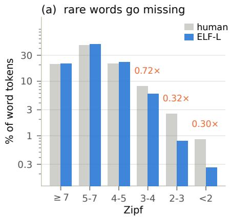
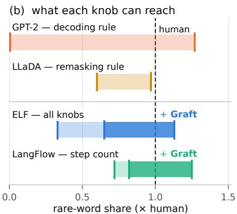
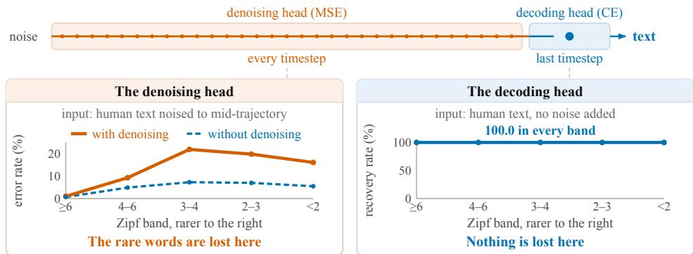
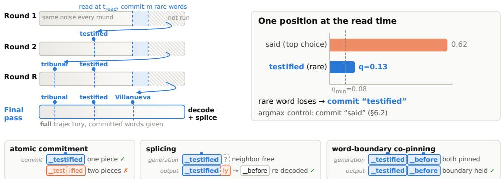
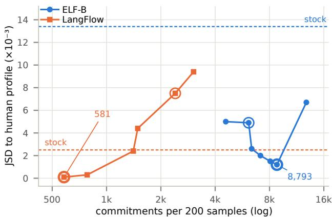

# GRAFT: RESTORING THE MISSING SAMPLING INTERFACE IN CONTINUOUS DIFFUSION LANGUAGE MODELS

Haoning Yang Lili Pan

University of Electronic Science and Technology of China

202521011616@std.uestc.edu.cn, lilipan@uestc.edu.cn

## ABSTRACT

Continuous diffusion language models generate a whole sequence in parallel, never drawing a single word at any intermediate step; only the final step turns embeddings into text. Models such as ELF now report autoregressive-level quality at a fraction of the sampling steps taken by discrete-token diffusion models, and this design principle—no step-wise discretization—is what their own ablations credit for the gain. We show that this same principle carries a hidden cost: a collapse of the lexical long tail. Measured against held-out human text, ELF’s output matches the human rate on common words almost exactly, yet its rarest words appear at only 0.30× the human rate, a gap that does not close from 105M to 652M parameters and that no sampler setting these models expose can reach. A same-size GPT-2, in contrast, spans zero to above the human rate by its decoding rule alone. We trace the difference to what continuous diffusion models lack: with no step that ever draws a discrete word, every step is instead driven by an average over the candidates still in play, and averaging a rare candidate together with the common word competing for its slot lands on the common word. An autoregressive model avoids this because its decoding rule samples one candidate rather than averaging over all of them, so the problem never arises there. We propose GRAFT, a training-free method that grafts this missing choice back onto a frozen model: while the model is still undecided, GRAFT commits the rare words the average would otherwise discard, then regenerates the sequence from scratch with those commitments held in place. Across three ELF scales and on LangFlow, an independently developed continuous dLLM, GRAFT restores the rare-word share of generated text from 0.42–0.77× the human rate to 0.82–1.10×, a relative gain of 34–109%, and moves the entire word-frequency profile closer to human on every model tested, by 2.7× on ELF-B and 12× on LangFlow.

## 1 INTRODUCTION

Diffusion language models (dLLMs) generate all positions in parallel and refine them over a fixed number of steps, trading autoregression’s O(L) serial depth for O(steps) (Austin et al., 2021; Sahoo et al., 2024; Nie et al., 2025). dLLMs fall into two lines, distinguished by whether the diffusion process runs over discrete tokens (Lou et al., 2024; Nie et al., 2025; Bie et al., 2025) or over continuous embeddings (Li et al., 2022; Dieleman et al., 2022). Continuous diffusion language models historically lagged behind their discrete counterparts. Earlier approaches typically relied on either projecting the continuous state back to the token space at every denoising step (Li et al., 2022; Dieleman et al., 2022), or performing diffusion in the latent space of a separately trained autoencoder (Lovelace et al., 2023). ELF (Hu et al., 2026) removes both requirements: the entire denoising trajectory remains in the token-embedding space, and discretization is performed only once, at the final step. This design substantially improves efficiency, allowing ELF to outperform discrete diffusion baselines with only 32 sampling steps instead of 1024 and with roughly one-tenth of the training tokens. LangFlow (Chen et al., 2026) independently achieves comparable performance through a similar continuous-space formulation. Ablation studies in both works attribute much of these gains to the same key design choice: eliminating intermediate, step-wise discretization.

  
Figure 1: Lexical-tail coverage depends on whether a model samples discrete words during generation. (a) ELF-L matches human usage for common words but substantially underproduces rare ones, reaching only 0.72×, 0.32×, and 0.30× of the human rate across the three rarest Zipf bands. (b) GPT-2 and LLaDA, which sample discrete words during decoding, reach or approach the human rare-word rate, while ELF and LangFlow remain below it. GRAFT restores the missing tail, raising ELF and LangFlow to 1.13× and 1.25× of the human rate (three-seed means, Appendix E.6).

However, the same design choice that makes continuous dLLMs efficient also introduces a hidden lexical cost: collapse of the vocabulary tail (Figure 1a). Here, rarity is defined by corpus frequency rather than model probability; proper names, technical terms, and other low-frequency words together account for more than a tenth of human text. On held-out text from ELF’s training distribution, common words appear at nearly the human rate, while the rarest occur at only 0.30× that rate. This gap persists from 105M to 652M parameters (Table 1) and is not closed by sampler tuning. When a rare word is lost, it is typically replaced by a more common word or a fabricated non-word, reducing lexical fidelity. For example, one ELF summary reads “New Barcelona president Neyll has resigned,” producing a fluent sentence with an invented name (§4). Yet such failures are easily missed by standard metrics: GPT-2-based generative perplexity and unigram entropy. The former can favor text that avoids rare words, while the latter is too coarse to reveal a deficit concentrated in the lexical tail.

The cause lies in a missing step in the continuous dLLM pipeline. Autoregressive models first predict a vocabulary distribution and then apply a decoding rule—such as greedy, top-k, or nucleus sampling— to select a discrete word. We refer to this distribution-to-word operation as a sampling interface. Continuous dLLMs lack such an interface before the final step: their denoising head instead predicts continuous embeddings by regression throughout the trajectory, while the decoding head turns them into words only at the end. Because regression is driven toward the conditional mean, competing candidates are averaged rather than sampled; when a rare word competes with a more probable common word, the resulting embedding tends to move toward the common one. By the time the decoding head is finally read, each position has already narrowed to only 1.02–1.05 effective candidates, leaving little room for temperature scaling, sampling, or beam search to recover the lost tail. In short, rare-word probability survives inside the model, but the generation process never turns it into a discrete choice.

Can this missing sampling interface be restored at inference time, without retraining the model?

We answer yes with GRAFT, a training-free method that restores a discrete choice while rare-word alternatives are still present. Part-way through generation, GRAFT reads the decoding head and identifies rare words that retain substantial probability but are losing to more common competitors. It then restarts generation from noise with these words fixed from the first step, allowing the remaining sequence to form around them. Repeating this read-and-restart procedure accumulates a set of committed rare words, after which a final generation produces the output. Sub-word constraints and an anti-repetition correction (Zhang et al., 2026) mitigate the artifacts introduced by fixing words.

Our contributions are threefold. First, we identify a lexical long-tail collapse in continuous dLLMs, showing that the effect persists across model scales and sampler settings when measured against a same-distribution human baseline (§4). Second, we uncover its mechanism: rare words are lost when a more common competing word accumulates sufficient probability, and the competitor’s probability alone strongly predicts which rare words will be suppressed (§5). Third, we introduce GRAFT, a training-free method that restores the missing lexical tail. Across three ELF scales and an independent LangFlow implementation, GRAFT raises the rare-word share to 0.82–1.10× the human rate, moves the overall word-frequency distribution closer to human—by 2.7× on ELF-B and 12× on LangFlow—and brings ELF-L’s ζ to within 0.010 of the human value (§7.2–§7.5).

## 2 RELATED WORK

Diffusion language models fall into two lines, distinguished by whether the diffusion process runs over discrete tokens or over continuous embeddings.

The discrete line began with D3PM, which first carried diffusion to discrete tokens, using an absorbing mask state as the corruption process (Austin et al., 2021); MDLM then reduced masked diffusion to a weighted cross-entropy that trains as easily as a language model (Sahoo et al., 2024); and LLaDA scaled the recipe to 8B parameters and autoregressive-level quality (Nie et al., 2025). Every model in this line draws a token from a categorical distribution at each unmasking step, so remasking order and temperature come as decoding knobs for free.

The continuous line diffuses in embedding space instead. Diffusion-LM opened it, but had to round the embeddings back to the vocabulary at every step to continue (Li et al., 2022); the variants that followed kept some per-step anchor to the vocabulary, and none caught up with autoregression at equal compute. ELF removed these anchors entirely, keeping the whole trajectory in embedding space and discretizing only at the last step, and reached autoregressive-level quality in 32 steps (Hu et al., 2026); LangFlow reached the same point independently, by a related route (Chen et al., 2026). The anchors this line removed, however, were also its only place to draw a word. This paper measures what that removal costs, and puts the draw back before generation begins.

We list here only the most representative work in each line; a fuller review is given in Appendix F.

## 3 PRELIMINARIES

The models. We study ELF (Hu et al., 2026) and LangFlow (Chen et al., 2026), two independently developed continuous dLLMs. ELF represents a sentence as $x \in \mathbb { R } ^ { L \times d }$ and learns a flow from noise to data. Under x-prediction, given a noised state $z _ { t }$ at time t, the model predicts the clean embedding $\hat { x } ( z _ { t } , t )$ over ∼32 denoising steps. A single network has two output heads: the denoising head, trained with MSE, drives every step of the trajectory, while the decoding head, trained with token-level cross-entropy through a shared unembedding, is used only at the final step. LangFlow (∼256 steps) has only the decoding head and feeds back its expected embedding at every step.

Word-frequency metrics, measured against human text. We compare model outputs with a human reference to measure the lexical-tail deficit and the overall word-frequency distribution. Zipf frequency is the log-scale corpus frequency of a word (van Heuven et al., 2014), with larger values indicating more common words. The tail is the fraction of word tokens with Zipf <4, further split into [3, 4), [2, 3), and <2 to measure the depth of the deficit. A non-word is a string with no lexicon entry (Zhang et al., 2026), which may replace a lost rare word. Unigram entropy measures lexical diversity and helps show why standard diversity checks can miss a tail-specific collapse. A sample’s Zipf profile is the distribution of lexicon words across six Zipf bands (Appendix A). We compare this profile with the human reference using JSD, where 0 indicates an exact match. Finally, the Zipf coefficient ζ is the magnitude of the slope fitted to the rank–frequency curve; larger ζ indicates stronger concentration on a small set of common words.

## 4 THE COLLAPSE: RARE WORDS MISSING, NO METRIC NOTICING

This section quantifies the lexical-tail collapse introduced above. Table 1 groups word tokens from 1,000 unconditional samples at each ELF scale by Zipf frequency and compares them with held-out human text from the same corpus. The problem is not that the text is broadly poor, but that ELF overuses common words and underuses rare ones: common-word statistics closely match human text, while the deficit is concentrated in the tail. The missing mass shifts partly to mid-frequency words and partly to non-words, whose rate is about 2× the human level. This raises three questions: whether the deficit shrinks with scale or tuning, whether it depends on the task, and whether standard metrics would detect it.

Table 1: Word-frequency profile of unconditional generation (1,000 samples each) against held-out human text from the training distribution. High-frequency buckets match human almost exactly; the deficit is confined to the tail, and the rarest bucket does not move from 105M to 652M parameters.
<table><tr><td>Zipf bucket (% of word tokens)</td><td>ELF-B</td><td>ELF-M</td><td>ELF-L</td><td>Human</td><td>ELF-L / Human</td></tr><tr><td>孟</td><td>20.60</td><td>20.62</td><td>21.02</td><td>20.38</td><td>1.03×</td></tr><tr><td></td><td>53.07</td><td>51.59</td><td>48.13</td><td>46.20</td><td>1.04×</td></tr><tr><td>[4,5)</td><td>20.81</td><td>20.69</td><td>22.64</td><td>21.27</td><td>1.06×</td></tr><tr><td>[3, 4)</td><td>3.14</td><td>4.93</td><td>5.82</td><td>8.12</td><td>0.72×</td></tr><tr><td>[2, 3)</td><td>0.44</td><td>0.68</td><td>0.80</td><td>2.51</td><td>0.32×</td></tr><tr><td>&lt; 2</td><td>0.27</td><td>0.24</td><td>0.26</td><td>0.86</td><td>0.30×</td></tr><tr><td>non-word (no entry)</td><td>1.67</td><td>1.25</td><td>1.35</td><td>0.66</td><td>2.05×</td></tr><tr><td>types / 100k</td><td>2,949</td><td>3,288</td><td>3,505</td><td>5,329</td><td>0.66×</td></tr></table>

The deficit does not disappear with scale or sampler tuning. It remains as the model grows from 105M to 652M parameters, and none of the sampler knobs we test closes the gap. Its severity also depends on how much rare content must be generated rather than copied. Translation, which can copy rare tokens from the source, is largely unaffected. Summarization, which must generate names, fabricates proper nouns absent from both source and dictionary at 3.53%, compared with 0.82% in human references. Unconditional generation, where all content is self-produced, is the most affected. Details of this task ordering are given in Appendix A.

Two simpler explanations can be ruled out before turning to the mechanism: undertraining and insufficient sampler tuning. Undertraining cannot explain the effect, since ELF-B saw 5× as many training tokens as GPT-2 small at comparable scale. Nor is the issue simply the choice of decoding setting. The same GPT-2 checkpoint moves from 0.00× to 1.27× the human tail by changing only its decoding rule, whereas ELF’s full sweep over steps, guidance, temperature, and model scale reaches only 0.33–0.65× (Figure 1b; Appendix E.6). The key difference is therefore not training scale, but whether the model exposes a word-level sampling interface.

Standard metrics also fail to reveal the problem. GPT-2-based generative perplexity can favor text that avoids rare words because GPT-2 assigns them lower probability. On ELF-B, perplexity im proves from 44.5 to 19.0 as the number of steps increases from 16 to 64, even while 4-gram repetition rises 12× (Appendix E.6). Unigram entropy is similarly insensitive: it appears normal even though ELF’s Zipf slope is −1.227, compared with −0.986 for human text, because the statistic is dominated by common words (§3). Thus, a deficit concentrated in the lexical tail can remain hidden under standard evaluations, extending to the lexical axis what Zheng et al. (2025) and Zhang et al. (2026) observed for low-diversity text.

## 5 ROOT CAUSE: THE AVERAGE INSIDE THE DENOISING HEAD

The lexical tail disappears from the output, yet no sampler setting recovers it (§4). We trace this failure to the denoising head itself: because it is trained by regression, it predicts an average over competing word candidates, and that average is pulled toward a more probable common word. Three findings support this mechanism; Appendix B rules out eight alternative explanations.

Finding 1: The rare words are already gone before the decoding head reads them. The decoding head maps embeddings to words, so it is the natural first suspect. If it were biased toward common words, it could itself produce the observed tail collapse. We test this using embeddings that still contain genuine human text: 128 held-out OpenWebText documents are encoded with ELF’s frozen T5 encoder and fed into ELF-B without added noise, using the same readout as at the end of generation. Across 124,212 positions, the decoding head recovers 100.00% of the original words (Table 4, Appendix B). Thus, whenever a rare word is still present in the embedding, the decoding head can recover it. The tail must therefore already be absent from the embeddings that reach the final readout.

  
Figure 2: Where rare words are lost. ELF uses a denoising head (MSE) at every timestep and a decoding head (CE) only at the final readout. Right: on clean held-out human embeddings, the decoding head recovers all words across 124,212 positions (Finding 1). Left: on noised text at an intermediate generation level, errors increase sharply only after denoising and primarily on rare words: on ELF-B, the gap grows from 1.0% vs. 0.7% in the commonest band to 21.9% vs. 7.3% in [3, 4) (Finding 2).

Finding 2: The rare words are lost inside the denoising head, and specifically because they are rare. With the final decoder ruled out, we next examine the denoising head, which drives every generation step. We noise 96 held-out OpenWebText documents to a level encountered part-way through generation and feed the same input to both heads. Because the heads share the same underlying network and receive the same information, their training objectives are the main difference (Appendix B). Across roughly 75,000 positions and all three ELF scales, the denoising head is wrong 1.0–1.9× as often as the decoding head on common words, but 2–2.9× as often on the rarest words (Table 7, Appendix E.4). Its excess error is concentrated in the lexical tail, showing that rare words are lost inside the denoising process.

Finding 3: The rare words are lost when a more common competitor already carries enough probability. If denoising averages over candidate words, then the probability of the strongest competitor should predict whether a rare word survives. We test this on 200 held-out OpenWebText documents, noised as above. For each position, decoding the noised embedding directly gives q, the probability assigned to the strongest competing word; applying the denoising head first and then decoding reveals which word survives. Among 4,036 rare positions on ELF-B, only 7% lose their word in the lowest-q decile, compared with 92% in the highest-q decile (Appendix E.7). Moreover, when a rare word is lost, that same competitor replaces it 31.8% of the time. The strongest competi tor’s probability therefore predicts both whether a rare word is lost and, often, which word replaces it.

## 6 GRAFT: COMMIT THE RARE WORDS THE AVERAGE WOULD LOSE

GRAFT follows from §5: the model loses a rare word by averaging it away during generation, so we find the rare words it is about to lose and hand them back to it as given before it generates again. A word is handed over through the model’s own conditioning input, and we call handing one over in this way committing it. ELF accepts known words at arbitrary positions: it starts the generation with each given word already in place, holds it there through every denoising step, and forms the rest of the sequence around it, as it does around a prompt. LangFlow has no such input, and we emulate one by writing the given word’s embedding into its position at every step (Appendix A). The procedure has four steps, of which the first three repeat.

Step 1: generate, and stop part-way. A round starts a generation from noise, the same in every round, and runs it only as far as a point we call the read time; the rest of that trajectory is never run. The read time is one denoising step inside the short window where positions still hold several candidates: earlier, the sequence has too little shape for those candidates to mean anything; later, each position has already narrowed to the 1.02–1.05 candidates of §1 (where this window sits in each model: Appendix E.3).

  
Figure 3: GRAFT commits rare words from the first denoising step and uses restarts to preserve them. Left: each of the R rounds starts from the same noise with all previously committed words fixed, runs only to the read time, and commits m additional rare words; a final full trajectory then generates the output with all commitments held in place. Top right: at the read time, GRAFT commits a rare word that retains substantial probability but loses to the top choice, while the argmax control commits that top choice instead. Bottom: three rules prevent committed words from creating non-words.

Step 2: read the decoding head, once. At that single point, the decoding head—the only part of the model that names words at all (§3)—ranks the whole vocabulary at every position, and GRAFT reads out this full ranking. This is the only point before the end of a generation at which a word is chosen.

Step 3: select the rare words that are losing, and commit them. A position qualifies when its strongest rare candidate—among the 512 most likely words there—carries probability above qmin=0.08 but is not the top choice; a rare word that is already winning needs no rescue. A qualifying position must also pass the rules of below. Among all qualifying positions, GRAFT ranks them by that probability and commits the m highest, each to its own strongest rare candidate.

Step 4: restart, and finish on the last round. The generation of Step 1 is then abandoned rather than finished. The next round returns to that noise, with the new commitments added to the given words, and Steps 1 through 3 run again; after R rounds, a final generation—with all committed words now given—runs to completion and produces the text (Figure 3; Algorithm 1 in Appendix A). We use R=4 and m=8, so a sample carries up to 32 committed words in total; that total is what we call the dose. This costs R partial generations plus one full one—between two and three full trajectories on ELF, depending on where its sampler places the denoising steps—and, with overhead, 2.2× the wall clock of the model’s own stock sampler (Appendix E.1).

GRAFT’s intervention is not entirely free of side effects, and each requires a targeted remedy.

Committing words can disrupt nearby text. Although GRAFT commits whole words, the model operates on sub-word pieces, and a word may span multiple positions. A commitment fixes only the position it occupies, while neighboring positions are still generated freely. If the following piece was originally meant to complete the displaced word, the two may merge into a non-word. We prevent this with three rules. First, atomic commitment restricts commitments to single-piece words placed only at positions that already contain a single-piece word, avoiding partial overwrites. Second, splicing re-decodes the position immediately after a commitment at output and requires it to begin a new word, preventing leftover fragments from attaching to the committed word. Third, word-boundary co-pinning fixes that following position to a word-beginning piece from the model’s own draft throughout generation, so the model knows from the first step that a new word begins there.

The lexicon used to define “rare” introduces a second issue. It may contain strings that are not valid English words, as well as words that are rare in English but common in another language, either of which could artificially inflate the measured tail. We therefore apply two gates. A candidate may be committed only if it is attested in a held-out slice of human text, and it is rejected if it is more than 2.5 Zipf points more common in any of thirteen other languages than in English (Appendices E.8 and E.12). These gates affect only which words GRAFT may commit, not how the metric counts them; in Table 2, the attestation gate is on for both models and the language gate for ELF.

A third side effect is increased repetition. Unlike the local sub-word artifacts above, this effect is distributed across the generated text. It matches the self-conditioning feedback identified by Zhang et al. (2026), where repetition accumulates along a dominant direction in the state fed back to the model. We apply their correction at λ=0.5, counteracting this direction at each denoising step. The same direction appears in both models, while larger doses sharply degrade generation quality (Appendix D).

These remedies leave one design question: why must GRAFT restart from noise rather than intervene on an ongoing trajectory? We tested two cheaper alternatives, and both fail. The first discretizes the sequence at a single intermediate denoising step and continues generation from the resulting words. Early in the trajectory, positions still support several candidates and are not yet mutually coherent, so independently selected sub-word pieces do not compose reliably; later, when discretization becomes safe, the text has already largely settled and the intervention has little effect. The second alternative applies a softer intervention over several steps, repeatedly moving selected positions toward the rare word’s embedding. Small moves are undone by subsequent denoising and the sampler returns to its original output. Strong moves can preserve the target word, but sharply increase non-words and local corruption. In our experiments, only a word supplied before the first denoising step persists reliably, and only in this regime does the identity of the committed word matter. This motivates GRAFT’s restart-and-commit design; the corresponding measurements are reported in Appendix D.

## 7 EXPERIMENTS

We test whether committing the rare words that would otherwise be lost restores the lexical tail. We first describe the models, metrics, and dose setting, then report the main results, metric-validity checks, alternative explanations, and ablations.

We evaluate ELF-B/M/L (105M/342M/652M official checkpoints, 32 sampling steps) and LangFlow (652M, 256 steps), all frozen, with unconditional generation and n=200 samples per arm unless noted. Both model generation and the human reference come from OpenWebText, ELF’s training corpus, at the same 1024-token sequence length. Thus, all statistics are measured against a same-distribution human baseline. We do not report generative perplexity because, as shown in §4, it rewards the lexical deficit we measure.

Table 2 reports six metrics. Tail % is the share of rare word tokens, and ×human expresses it relative to the human rate of 11.88%. Non-word % controls for fabricated strings: a tail gain is meaningful only if it is not obtained by increasing non-words, whose human rate is 1.14% (Appendix A).

To measure the full word-frequency distribution, we report JSD and |∆ζ|. JSD compares the complete Zipf profile with the human reference, while |∆ζ| measures the difference in Zipf concentration from the human value ζ=0.971; lower is better for both. Finally, Types counts distinct generated words and provides a general measure of vocabulary breadth.

## 7.1 SETTING THE DOSE

The dose—the number of words GRAFT commits—controls a trade-off: too few commitments leave the tail short, while too many overshoot the human tail and distort the overall frequency profile (Figure 4, Appendix E.11). We use up to m=8 qualifying positions per round for R=4 rounds at all three ELF scales. This single untuned setting places ELF-B just below the human tail, ELF-M near it, and ELF-L slightly above it.

The same dose overshoots on LangFlow because its stock sampler already reaches 0.77× the human tail, compared with 0.42× for ELF-B. We therefore select a LangFlow-specific dose using JSD on one seed and evaluate the selected setting on two held-out seeds. The chosen dose commits none from [3, 4) and at most one each from [2, 3) and below per round, bringing LangFlow to 1.03× the human tail and the closest frequency profile in Table 2. We use this held-out selection only where the fixed dose overshoots; all ELF results remain untuned (Appendix E.10).

Table 2: Main results on unfiltered output (n=200 per arm). GRAFT rows and the stock rows of ELF-L and LangFlow average three seeds; the remaining rows are single arms. The LangFlow tuned row uses the held-out dose of §7.1; no ELF arm is tuned. Best-of-4 is the equal-budget control of §7.4. Bold marks the value closest to human within each model.
<table><tr><td rowspan="2"></td><td colspan="3">lexical tail, and its control</td><td colspan="3">distance to human profile</td></tr><tr><td>tail %</td><td>×human</td><td>non-word %</td><td>JSD↓</td><td>|∆ζ| ↓</td><td>types</td></tr><tr><td>HUMAN REFERENCE</td><td>11.88</td><td>1.00</td><td>1.14</td><td></td><td></td><td>17726</td></tr><tr><td>ELF-B (105M)</td><td></td><td></td><td></td><td></td><td></td><td></td></tr><tr><td>Stock</td><td>5.01</td><td>0.42</td><td>2.64</td><td>.0134</td><td>.182</td><td>11795</td></tr><tr><td>Stock, best-of-4</td><td>5.97</td><td>0.50</td><td>1.79</td><td>.0101</td><td>.175</td><td>11 482</td></tr><tr><td>Argmax control</td><td>5.31</td><td>0.45</td><td>2.42</td><td>.0133</td><td>.209</td><td>12124</td></tr><tr><td>GRAFT</td><td>9.76</td><td>0.82</td><td>2.57</td><td>.0049</td><td>.130</td><td>13 829</td></tr><tr><td>ELF-M (342M)</td><td></td><td></td><td></td><td></td><td></td><td></td></tr><tr><td>Stock</td><td>5.75</td><td>0.48</td><td>1.97</td><td>.0090</td><td>.138</td><td>14111</td></tr><tr><td>GRAFT</td><td>12.02</td><td>1.01</td><td>3.11</td><td>.0079</td><td>.066</td><td>15695</td></tr><tr><td>ELF-L (652M)</td><td></td><td></td><td></td><td></td><td></td><td></td></tr><tr><td>Stock</td><td>7.65</td><td>0.64</td><td>2.67</td><td>.0052</td><td>.058</td><td>15478</td></tr><tr><td>GRAFT</td><td>13.05</td><td>1.10</td><td>2.88</td><td>.0046</td><td>.010</td><td>17106</td></tr><tr><td colspan="5">LangFlow (652M, independent implementation)</td><td></td><td></td></tr><tr><td>Štock</td><td>9.16</td><td>0.77</td><td>3.28</td><td>.0025</td><td>.011</td><td>18 896</td></tr><tr><td>Argmax control</td><td>9.75</td><td>0.82</td><td>3.47</td><td>.0059</td><td>.104</td><td>18572</td></tr><tr><td>GRAFT</td><td>14.81</td><td>1.25</td><td>3.58</td><td>.0058</td><td>.063</td><td>18981</td></tr><tr><td>GRAFT (tuned)</td><td>12.23</td><td>1.03</td><td>3.79</td><td>.0002</td><td>.045</td><td>18940</td></tr></table>

## 7.2 RESULTS

GRAFT restores the lexical tail without simply creating fabricated words (Table 2, Figure 1b). Across the four models, the rare-word share rises from 0.42–0.77× the human rate to 0.82–1.10×, gains of 3.1–6.3 percentage points. Meanwhile, non-word rates rise by at most 1.1 points and even fall on ELF-B (2.64 → 2.57), indicating that the added vocabulary is largely recovered rather than fabricated. The broader frequency profile improves as well. JSD to the human profile decreases on all four models, by 2.7× on ELF-B and 12× on LangFlow, while ELF-L’s ζ comes within 0.010 of the human value. LangFlow is the one exception on ζ: its stock sampler is already within .011 of human, and no GRAFT dose improves on it, so we make the ζ claim only for ELF (Appendix E.11).

## 7.3 METRIC VALIDITY

For tail % to be a valid measure of lexical reach, rather than an easily gamed number, two premises need to hold, and a further check confirms the resulting gains are not an artifact of sample quality.

The first premise is that a rare word counted in the tail is used appropriately, not merely inserted: GPT-2-large, used nowhere in the sampler, rates the committed words no less apt in context than rare words occurring naturally in human text (Appendix E.12). The second is that a word is only counted as rare if it is genuinely rare in English, not merely rare because it belongs to another language: every tail figure is discounted for words that are rare in English but common elsewhere (Appendix E.8).

As a further check on validity, Appendix E.9 re-reads every arm after discarding samples whose nonword or 4-gram repetition rate exceeds the human sample’s own 95th percentile, following Zheng et al. (2025) and Zhang et al. (2026). The gains reported below survive this filter, confirming they are not driven by a handful of degenerate samples. We note, however, that no system, ours included, closes the gap to the human non-word rate (2.0–3.8% against 1.14%).

## 7.4 ALTERNATIVE EXPLANATIONS

The title names what this section rules out: two alternative explanations, besides the identity of the committed word, that could account for the gains reported above.

The first is that the gain comes from the act of committing rather than from the word committed: restarting, holding words fixed, and the sub-word repairs might each lift the tail on their own, regardless of which word is chosen. To separate the two, on ELF-B and LangFlow we run an argmax control that shares the GRAFT arm’s positions, mechanics, dose, and compute, but commits the model’s top choice at each position instead of the rare word. This control is null on every column of Table 2: on ELF-B the tail moves only from 5.01 to 5.31, and ζ moves in the wrong direction (.209 against .182); on both models, the bootstrap interval of its tail gain includes zero (Appendix E.9). The gain therefore rests on which word is committed, not on the act of committing.

Table 3: Ablation of the three commitment rules on ELF-B. Each row adds one rule to the previous setting; Fidelity is the fraction of committed words preserved in the final output. The last row also changes the sampler’s step distribution, so its 0.5-point tail reduction reflects both effects. The full GRAFT setting further includes the two gates and the anti-repetition correction.
<table><tr><td></td><td>tail %</td><td>non-word %</td><td>fidelity %</td></tr><tr><td>stock</td><td>4.54</td><td>2.35</td><td></td></tr><tr><td>+ rare commitment, no rule</td><td>7.92</td><td>4.14</td><td>86.7</td></tr><tr><td>+ atomic commitment</td><td>8.86</td><td>2.71</td><td>87.4</td></tr><tr><td>+ splicing</td><td>9.61</td><td>2.47</td><td>100.0</td></tr><tr><td>+ word-boundary co-pinning</td><td>9.10</td><td>1.78</td><td>100.0</td></tr></table>

The second alternative is compute: because the method resembles best-of-K selection, the gain could simply reflect spending more compute per sample. The four restarts of a GRAFT sample run only to the read time, and its measured wall clock is 2.2× the stock sampler’s, so we compare against the equal-budget baseline: the best of four stock samples. At that budget, GRAFT still leads on the unfiltered tail: best-of-4 reaches 0.50× the human tail against 0.82× on ELF-B (Table 2), and 0.86× against the tuned 1.03× on LangFlow (Appendix E.4), a lead the tuned dose loses on the accepted set (Appendix E.9). Nor does this gap close with still more compute: the stock sampler catches up on LangFlow only at best-of-16, and on ELF-B not at all (Appendix E.4).

## 7.5 ABLATION STUDY

Table 3 adds the three commitment rules of §6 to the stock ELF-B sampler one at a time, to separate two questions the rules could in principle answer: where the tail gain comes from, and what the rules themselves are for. The first row answers the first question. Committing rare words with no rule at all already lifts the tail from 4.54 to 7.92—three quarters of the eventual gain—so the tail comes from the act of commitment itself, not from any of the three rules. This bare commitment is not free, however: the non-word rate rises from 2.35 to 4.14, and 13% of the committed words reach the output as some other string rather than the word intended. The remaining rows answer the second question: the three rules exist to repair that fabrication, not to grow the tail further. Atomic commitment and splicing, added together, bring every committed word through to the output intact, taking fidelity to 100%. Word-boundary co-pinning then drives the non-word rate down further, to 1.78—below the stock sampler’s own 2.35—at a small cost of 0.5 points of tail.

In sum, the tail comes from committing the rare word; the three rules are not where it comes from, but they are what bring fabrication down, in the end below the stock sampler’s own rate. The two gates and the anti-repetition correction are ablated separately in Appendices E.1 and E.12.

## 8 LIMITATIONS AND CONCLUSION

We show that continuous diffusion language models suffer from a lexical long-tail collapse caused by the absence of an intermediate sampling interface: rare words remain represented while positions are uncertain, but are progressively washed out by conditional-mean denoising before the final decoding step. GRAFT restores this missing interface at inference time by identifying losing rare-word candidates, committing them, and regenerating around those commitments. Without any training, it raises the rare-word share from 0.42–0.77× to 0.82–1.10× the human rate across three ELF scales and an independent implementation, at 2.2× the wall-clock cost. Several directions remain open, including training-time mechanisms that preserve rare-word mass without restarts, richer use of the decoding distribution, extension to broader conditional tasks and data distributions, and a formal analysis of conditional-mean readout in embedding space together with human evaluation.

## REPRODUCIBILITY STATEMENT

All models are public checkpoints (ELF-B/M/L, LangFlow OWT); the human baseline is heldout OpenWebText. The protocol (bars, bootstrap, clean-PPL) is specified in §7 and Appendix A, which also gives GRAFT’s exact procedure as Algorithm 1; defaults are in §6; probe code, per-arm generation outputs, per-commitment paired logs (position, committed token, counterfactual token, probabilities, entropy, final token), the human reference sample and the statistics implementations will be released publicly on publication.

## ETHICS STATEMENT

This work diagnoses and mitigates a text-generation defect; it does not introduce new data collection or human subjects. Two considerations. First, the defect itself has a safety face: models that fabricate proper nouns at 4× the human rate produce plausible-looking misinformation (invented people, places, organizations); restoring real rare words reduces one fabrication channel but does not verify factuality—GRAFT commits words the model supports, not words that are true. The attestation gate of §6, on in every arm of Table 2, commits only words attested in held-out human text, which removes the channel by which the repair could itself invent proper nouns (2.1% of ELF and 0.8% of LangFlow commitments before the gate, 0% after); measured on XSum, GRAFT has no detectable effect on unsupported-entity rates in either direction (Appendix E.5). Second, increasing rare-word coverage can surface offensive or private strings memorized from the training corpus at a higher rate; our probes measured no verbatim-memorization pathology in these models (Appendix D), but deployments should keep standard output filtering in place.

## AI USE STATEMENT

Generative AI tools were used substantially in this work, in the following required-disclosure categories: assisting with the design of experiments and providing feedback on methods (probe and control-arm design, dose and window selection); implementing methods (probe and sampler code); supporting analysis and interpreting results (statistical readouts, mechanism synthesis); and drafting and editing this manuscript, including its structure. Experiment execution was supervised and all judgments of experimental validity, retraction decisions, and final claims were reviewed and verified by the authors. AI tools were not used to generate synthetic training data, propose mathematical propositions or proofs, or fabricate any reported measurement. The authors take full responsibility for the content of this paper.

## REFERENCES

Robin Algayres, Charles-Eric Saint-James, Mahi Luthra, Jiayi Shen, Dongyan Lin, Youssef´ Benchekroun, Rashel Moritz, Juan Pino, and Emmanuel Dupoux. LongTail-Swap: Benchmarking language models’ abilities on rare words. arXiv preprint arXiv:2510.04268, 2025.

Marianne Arriola, Aaron Gokaslan, Justin T. Chiu, Zhihan Yang, Zhixuan Qi, Jiaqi Han, Subham Sekhar Sahoo, and Volodymyr Kuleshov. Block diffusion: Interpolating between autoregressive and diffusion language models. In International Conference on Learning Representations, 2025.

Jacob Austin, Daniel D. Johnson, Jonathan Ho, Daniel Tarlow, and Rianne van den Berg. Structured denoising diffusion models in discrete state-spaces. In Advances in Neural Information Processing Systems, 2021.

Iskander Azangulov and Leo Zhang. Sampling from flow language models via marginal-conditioned bridges. arXiv preprint arXiv:2605.13681, 2026.

Tiwei Bie, Maosong Cao, Kun Chen, Lun Du, Mingliang Gong, Zhuochen Gong, Yanmei Gu, Jiaqi Hu, Zenan Huang, Zhenzhong Lan, Chengxi Li, Chongxuan Li, Jianguo Li, Zehuan Li, Huabin Liu, Lin Liu, Guoshan Lu, Xiaocheng Lu, Yuxin Ma, Jianfeng Tan, Lanning Wei, Ji-Rong Wen, Yipeng Xing, Xiaolu Zhang, Junbo Zhao, Da Zheng, Jun Zhou, Junlin Zhou, Zhanchao Zhou, Liwang Zhu, and Yihong Zhuang. LLaDA2.0: Scaling up diffusion language models to 100B. arXiv preprint arXiv:2512.15745, 2025.

Yochai Blau and Tomer Michaeli. The perception-distortion tradeoff. In Proceedings of the IEEE Conference on Computer Vision and Pattern Recognition, 2018.

Ting Chen, Ruixiang Zhang, and Geoffrey Hinton. Analog bits: Generating discrete data using dif fusion models with self-conditioning. In International Conference on Learning Representations, 2023.

Yuxin Chen, Chumeng Liang, Hangke Sui, Ruihan Guo, Chaoran Cheng, Jiaxuan You, and Ge Liu. LangFlow: Continuous diffusion rivals discrete in language modeling. arXiv preprint arXiv:2604.11748, 2026.

Sander Dieleman, Laurent Sartran, Arman Roshannai, Nikolay Savinov, Yaroslav Ganin, Pierre H. Richemond, Arnaud Doucet, Robin Strudel, Chris Dyer, Conor Durkan, Curtis Hawthorne, Remi´ Leblond, Will Grathwohl, and Jonas Adler. Continuous diffusion for categorical data. arXiv preprint arXiv:2211.15089, 2022.

Guhao Feng, Yihan Geng, Jian Guan, Wei Wu, Liwei Wang, and Di He. Theoretical benefit and limitation of diffusion language model. In Advances in Neural Information Processing Systems, 2025. arXiv:2502.09622.

Zhujin Gao, Junliang Guo, Xu Tan, Yongxin Zhu, Fang Zhang, Jiang Bian, and Linli Xu. Empowering diffusion models on the embedding space for text generation. In Proceedings of the 2024 Conference of the North American Chapter of the Association for Computational Linguistics: Human Language Technologies, 2024.

Zhengyang Geng, Mingyang Deng, Xingjian Bai, J. Zico Kolter, and Kaiming He. Mean flows for one-step generative modeling. In Advances in Neural Information Processing Systems, 2025. arXiv:2505.13447.

Ishaan Gulrajani and Tatsunori B. Hashimoto. Likelihood-based diffusion language models. In Advances in Neural Information Processing Systems, 2023.

Florian Handke, Dejan Stanceviˇ c, Felix Koulischer, Thomas Demeester, and Luca Ambrogioni.´ The entropic signature of class speciation in diffusion models. In International Conference on Machine Learning, 2026. arXiv:2602.09651.

Keya Hu, Linlu Qiu, Yiyang Lu, Hanhong Zhao, Tianhong Li, Yoon Kim, Jacob Andreas, and Kaiming He. ELF: Embedded language flows. arXiv preprint arXiv:2605.10938, 2026.

Pascal Jutras-Dube, Patrick Pynadath, Jeremy Lu, Yuan Gao, and Ruqi Zhang. Sticky jump ´ diffusions: A unifying view of masked, continuous, and hybrid diffusion. arXiv preprint arXiv:2607.10951, 2026.

Kelly Kendro, Jeffrey Maloney, and Scott Jarvis. Do LLMs produce texts with “human-like” lexical diversity? arXiv preprint arXiv:2508.00086, 2025.

Jaeyeon Kim, Kulin Shah, Vasilis Kontonis, Sham Kakade, and Sitan Chen. Train for the worst, plan for the best: Understanding token ordering in masked diffusions. In International Conference on Machine Learning, 2025. arXiv:2502.06768.

Chanhyuk Lee, Jaehoon Yoo, Manan Agarwal, Sheel Shah, Jerry Huang, Aditi Raghunathan, Seunghoon Hong, Nicholas M. Boffi, and Jinwoo Kim. Flow map language models: One-step language modeling via continuous denoising. arXiv preprint arXiv:2602.16813, 2026.

Bocheng Li and Linli Xu. Improving few-step language flows with untied self-conditioning. arXiv preprint arXiv:2608.22244, 2026.

Marvin Li and Sitan Chen. Critical windows: Non-asymptotic theory for feature emergence in diffusion models. In International Conference on Machine Learning, 2024.

Na Li, Yuchen Jiao, Changxiao Cai, and Gen Li. ConvergeFlow: Language flow with provable convergence to token embeddings. arXiv preprint arXiv:2608.23551, 2026.

Tianhong Li and Kaiming He. Back to basics: Let denoising generative models denoise. arXiv preprint arXiv:2511.13720, 2025.

Tianhong Li, Yonglong Tian, He Li, Mingyang Deng, and Kaiming He. Autoregressive image generation without vector quantization. In Advances in Neural Information Processing Systems, 2024.

Xiang Lisa Li, John Thickstun, Ishaan Gulrajani, Percy Liang, and Tatsunori B. Hashimoto. Diffusion-LM improves controllable text generation. In Advances in Neural Information Processing Systems, 2022.

Zachary C. Lipton and Jacob Steinhardt. Troubling trends in machine learning scholarship. Communications ofthe ACM, 62(3):45–53, 2019.

Aaron Lou, Chenlin Meng, and Stefano Ermon. Discrete diffusion modeling by estimating the ratios of the data distribution. In International Conference on Machine Learning, 2024.

Justin Lovelace, Varsha Kishore, Chao Wan, Eliot Shekhtman, and Kilian Q. Weinberger. Latent diffusion for language generation. In Advances in Neural Information Processing Systems, 2023.

Shen Nie, Fengqi Zhu, Zebin You, Xiaolu Zhang, Jingyang Ou, Jun Hu, Jun Zhou, Yankai Lin, Ji-Rong Wen, and Chongxuan Li. Large language diffusion models. In Advances in Neural Information Processing Systems, 2025.

Lavanya Nigam, Ishaan Bansal, Aryan Sood, Vidit Aggarwal, and Gaurav Kumar Nayak. Lost in interpolation: Why predictive feedback fails in diffusion language models. arXiv preprint arXiv:2608.06529, 2026.

Jingyang Ou, Shen Nie, Kaiwen Xue, Fengqi Zhu, Jiacheng Sun, Zhenguo Li, and Chongxuan Li. Your absorbing discrete diffusion secretly models the conditional distributions of clean data. In International Conference on Learning Representations, 2025.

Krishna Pillutla, Swabha Swayamdipta, Rowan Zellers, John Thickstun, Sean Welleck, Yejin Choi, and Zaid Harchaoui. MAUVE: Measuring the gap between neural text and human text using divergence frontiers. In Advances in Neural Information Processing Systems, 2021.

Andrei Rekesh, Jarrid Rector-Brooks, and Cheng-Hao Liu. Inverse-confidence sampling for continuous diffusion language models. In ICML 2026 Workshop on Foundations of Deep Generative Models, 2026.

Subham Sekhar Sahoo, Marianne Arriola, Yair Schiff, Aaron Gokaslan, Edgar Marroquin, Justin T. Chiu, Alexander Rush, and Volodymyr Kuleshov. Simple and effective masked diffusion language models. In Advances in Neural Information Processing Systems, 2024.

Alexander Shabalin, Simon Elistratov, Viacheslav Meshchaninov, Ildus Sadrtdinov, and Dmitry Vetrov. Why Gaussian diffusion models fail on discrete data and how to prevent it? In Conference on Language Modeling, 2026. arXiv:2604.02028.

Junzhe Shen, Jieru Zhao, Ziwei He, and Zhouhan Lin. CoDAR: Continuous diffusion language models are more powerful than you think. arXiv preprint arXiv:2603.02547, 2026.

Jiaxin Shi, Kehang Han, Zhe Wang, Arnaud Doucet, and Michalis K. Titsias. Simplified and generalized masked diffusion for discrete data. In Advances in Neural Information Processing Systems, 2024.

Robyn Speer. wordfreq: a library for looking up the frequencies of words. Zenodo software release, 2022.

Walter J. B. van Heuven, Paweł Mandera, Emmanuel Keuleers, and Marc Brysbaert. SUBTLEX-UK: A new and improved word frequency database for British English. Quarterly Journal of Experimental Psychology, 67(6):1176–1190, 2014.

Chuling Wen, Weijie Liang, and Jian Lu. Conditional total correlation and the serial depth of adaptive parallel sampling. arXiv preprint arXiv:2608.25505, 2026.

Longxuan Yu, Yunshu Wu, Yu Fu, Siheng Xiong, Rob Brekelmans, Hui Liu, Yue Dong, and Greg Ver Steeg. DSL-LLaDA: Scaling continuous denoising to 8B masked diffusion LMs. arXiv preprint arXiv:2606.01024, 2026.

Shuai Zhang, Zijie Chen, Hongliang He, Lun Du, and Zhenzhong Lan. Low perplexity is repetition: A one-dimensional self-conditioning attractor in continuous diffusion LMs. arXiv preprint arXiv:2607.00588, 2026.

Kaiwen Zheng, Yongxin Chen, Hanzi Mao, Ming-Yu Liu, Jun Zhu, and Qinsheng Zhang. Masked diffusion models are secretly time-agnostic masked models and exploit inaccurate categorical sampling. In International Conference on Learning Representations, 2025.

## A PROTOCOL DETAILS

This appendix specifies how GRAFT runs and how its outputs are measured; quantities used by a single analysis, such as those of the mechanism probes, are defined where that analysis is reported. We first give the procedure (Appendix A.1) and the metrics together with the human reference they are read against (Appendix A.2), and then the configurations and statistics used across the appendices (Appendix A.3). The last two parts report the measurements behind the task ordering of §4 (Ap pendix A.4) and four checks that the measurements are not artifacts of the tail metric, the acceptance bars of §7.3, the GPT-2-large appropriateness judge of §7.3, or the sampler (Appendix A.5).

## A.1 THE GRAFT PROCEDURE

Algorithm 1 states the procedure. The paragraphs below define its notation, give the settings of Table 2, and describe how the procedure is implemented on each model.

Algorithm 1 GRAFT for one sample on a frozen checkpoint. Notation and the settings of Table 2   
are given below.   
1: $C  \emptyset$   
2: for round $r = 1 \ldots R$ do   
3: run the flow from the same fixed noise in every round, up to $t _ { \mathrm { r e a d } }$ only, with every $( i , v ) \in C$   
given as a condition at every step   
4: at $t _ { \mathrm { r e a d } } \colon$ read the decoding head’s distributions $p _ { i }$ and the current draft wˆ (defined below)   
5: ${ \mathcal { E } } \gets \{ i$ not in $C : \ q _ { \mathrm { r a r e } } ( i ) > q _ { \mathrm { m i n } }$ , rare(i) ̸= arg max $p _ { i } .$ atomic(i) }   
6: in decreasing order of $q _ { \mathrm { r a r e } } ,$ add (i, rare(i)) to C for up to m positions $i \in \mathcal { E } .$ , each at least s   
tokens from every position already in C   
7: word-boundary co-pinning: for each new i whose right neighbor $\hat { w } _ { i + 1 }$ is not a word  
continuation piece, also add $( i + 1 , \hat { w } _ { i + 1 } )$ to C   
8: end for   
9: run the full trajectory from the same noise with all of C given   
10: decode; write each committed token back; re-decode any word-continuation piece right after a   
committed position, excluding such pieces

Notation. C is the set of commitments, each a pair $( i , v )$ of a position i and a token v. For each position $i ,$ the decoding head gives a distribution $p _ { i }$ over the vocabulary. Among the 512 most likely words of $p _ { i }$ , rare(i) is the most probable rare word that the gates allow, where a rare word is one with Zipf frequency $0 { < } z { < } 4$ (Appendix $\mathbf { A } . 2 )$ , and $q _ { \mathrm { r a r e } } ( i )$ is its probability. The gates are the two gates of §6: the attestation gate, on both models, and the language gate, on ELF only, which rejects a candidate that is more than 2.5 Zipf points more common in any of thirteen other languages than in English (Appendix E.8). Because they remove candidates before $\mathrm { r a r e } ( i )$ is chosen, a top choice arg max $p _ { i }$ that is itself a rare word but fails a gate does not block its position: the next allowed rare candidate can still be committed. The $d r a f t$ wˆ is the text that the run would produce at the read time. On LangFlow, it is arg max $p _ { i } ;$ on ELF, it is the decoding of the denoising head’s current prediction of the clean embedding xˆ, the same prediction that is fed back for self-conditioning after the anti repetition correction, so it need not coincide with arg max $p _ { i } .$ . Finally, atomic(i) holds when the draft has a single-piece word at i and rare(i) is a single-piece word, and E is the set of qualifying positions of §6. A word-continuation piece is a sub-word token that continues the preceding word rather than beginning a new one.

Settings. Table 2 uses R=4 rounds, m=8 commitments per round, $q _ { \mathrm { m i n } } { = } 0 . 0 8$ , and a spacing of s=4 tokens, with word-boundary co-pinning (co-pinning for short) always on; on ELF-B only, the sampler’s step distribution is also moved toward later steps, a change we call the step-schedule shift (Appendix A.3). The read time is $t _ { \mathrm { r e a d } } { = } 0 . 2 0$ on ELF, whose time runs from noise at 0 to data at 1, and 0.72 on LangFlow, whose time runs the other way. Every round and the final trajectory reuse the same seed, so their initial noise and per-step noise are identical. What changes between rounds is the conditioning: the set of committed words and, on ELF, their encoding, which is recomputed from each round’s draft. As a result, the conditioning on ELF can change between rounds even when no new word is committed, since existing conditions, such as the source article in the summarization experiment of Appendix E.5, are re-encoded together with the new draft.

How commitments are given. ELF receives committed words through its native conditioning input. After each round, the draft, with every committed word substituted at its position, is encoded by the T5 encoder with all positions attended, and the encodings at the committed positions—and at any other given positions, such as a source text—become the conditions for the next round. LangFlow has no conditioning input, so we hold the committed positions fixed instead: at every step, the noised state $z _ { t } ,$ the clean-embedding prediction, and the self-conditioning input are all set to the committed word’s embedding at those positions.

Correction and dose variants. At every step, the anti-repetition correction of Zhang et al. (2026) (λ=0.5) subtracts λu from the self-conditioning input, where u is the repetition direction of §6. On ELF, u is normalized to unit length; on LangFlow, it is an unnormalized difference of means, so the same λ is not the same correction strength on the two models. A tuned dose, as in Table 2’s LangFlow row (§7.1), replaces the top-m selection with a band quota, a number of commitments per round in each of the bands [3, 4), [2, 3), and below 2, written as a triple: (0, 1, 1) on LangFlow and, in the appendices, (8, 5, 3) on ELF, both at $q _ { \mathrm { m i n } } { = } 0 . 0 2$ . Its commitment count is therefore not bounded by Rm: on seed 31337, the ELF-B tuned arm makes 8,793 commitments per 200 samples, or about 44 per sample.

The argmax control. The argmax control of §7.4 qualifies and ranks positions by the same rule as GRAFT, so it commits only where a rare candidate is losing. Its committed positions nonetheless differ from those of the GRAFT arm, for two reasons: its atomic check applies to the word it actually commits, and its drafts diverge from the GRAFT arm’s after the first round.

LangFlow implementation. LangFlow uses the GPT-2 BPE vocabulary and samples with 256 deterministic Euler steps on a linear time grid from $1 - 1 0 ^ { - 5 } \ \mathrm { t o } \ 1 0 ^ { - 5 }$ , which the model’s own schedule maps to noise levels. At every step, its prediction of the clean embedding is the average of the token embeddings weighted by the decoding head’s distribution, which is the average of $\ S 5$ in explicit form. LangFlow’s sampler thus has no separate denoising head: it computes the decoding head’s distribution at every step and averages over it, and only at the final step does it turn that distribution into discrete words. On LangFlow, the read time $t _ { \mathrm { r e a d } } { = } 0 . 7 2$ falls at about step 72 of 256, and the draft is the top choice at every position. The anti-repetition correction acts only on the self-conditioning input; its direction is estimated on LangFlow itself and left unnormalized, and the committed positions are fixed again after it is applied. The attestation gate uses the same attestation lexicon as on ELF, the words of documents 1,000–30,999 of the OpenWebText shard behind the human reference, and no language gate is applied. Table 22 collects these settings.

## A.2 METRICS AND THE HUMAN REFERENCE

Every word-frequency statistic in this paper is computed in the same way on model output and on human text. Two tokenization rules are used, however, and the human reference takes a different value under each (Table 20).

Tokenization. Both rules start from whitespace tokens, strip the surrounding punctuation, and fold case. The alphabetic rule then keeps only alphabetic strings of length at least 2; it defines the Zipf buckets of Table 1, the acceptance bars and accepted-set tail defined below, the JSD, and Table 3. The all-token rule instead keeps every non-empty token, including numbers and hyphenated or apostrophe forms, and defines the tail, non-word, ζ, and types columns of Table 2. This is why the human non-word rate reads 0.66% under the first rule and 1.14% under the second.

Tail and non-words. Each counted token is looked up in the wordfreq English lexicon (Speer, 2022), which gives its Zipf frequency z; a Zipf frequency of 2 corresponds to about 0.1 occurrences per million tokens. The tail of §3 counts words with $0 { < } z { < } 4$ ; non-words, which have no entry and so $z { = } 0$ , are counted separately. In Table 2, the numerator of the tail also leaves out foreign-dominant words, those more than 2.5 Zipf points more common in one of the thirteen languages of the language gate than in English (Appendix E.8); we call this theforeign discount. The denominator, like the non-word, ζ, and types columns, keeps every token.

JSD. The JSD columns of Tables 2, 14, and 15 compare Zipf profiles of the alphabetic words of a text over six bands, $z \ge 6 , [ 5 , 6 ) , [ 4 , 5 ) , [ 3 , 4 ) , [ 2 , 3 )$ , and $0 { < } z { < } 2$ . Non-words and foreign-dominant words are left out, the band shares are renormalized, and the JSD uses log base 2. These six bands differ from the Zipf buckets of Table 1.

Types and repetition. Types/100k is the number of distinct counted words per 100k counted tokens, pooled over an arm. The types column of Table 2 is instead a raw count, which grows with sample size, so we read it at a common size: each arm pools its $n { = } 2 0 0$ samples, and the human entry is the mean over 20 random draws of 200 reference documents $( 1 7 , 7 2 6 \bar { \pm } 2 4 7$ , compared with 45,430 when all 1,000 documents are read). Repetition is measured as the 4-gram repetition of §7.3, the standard repeated-4-gram rate over whitespace tokens, $1 0 0 \cdot \textstyle \sum _ { \nu } ( \mathrm { c o u n t } ( \nu ) - 1 ) / \# 4$ -grams, with ν running over the distinct 4-grams.

Zipf slope and ζ. The Zipf slope of a sample is the least-squares slope of log frequency on log rank over its 5,000 most frequent types. Human English sits near −1. The slopes quoted in $\ S 4 .$ −1.227 for ELF-B and −0.986 for the human sample, come from the scoring behind Table 1, which tokenizes with the regular expression $\left[ \lambda - \mathrm { Z } \mathsf { a } - \mathsf { z } \right] + ;$ this is close to the alphabetic rule but keeps one-letter words and splits at apostrophes. The Zipf coefficient ζ of Table 2 comes from the same fit under the all-token rule. On that tokenization, the human sample gives $\zeta { = } 0 . 9 7 1$ and the ELF-B batch of Table 1 gives 1.188, so the two recipes differ only in tokenization. Finally, $| \Delta \zeta |$ is computed per seed and averaged where an arm has several seeds.

The human reference. The human reference consists of the first 1,000 documents of the first Open-WebText shard, cut to the same 1024-token length as the generations so that per-sample rates are comparable. Between 996 and 1,000 of them are scored: the all-token scoring of Table 2 keeps all of them, whereas the accept-then-measure scoring, defined below, drops any text, human or generated, with fewer than 20 alphabetic words, which removes four documents. Their Zipf slope of −0.986 matches that of human English. The reference is same-distribution text rather than unseen text: ELF trains on its full OpenWebText split, which has no validation part and contains this shard, so these documents are part of ELF’s training data; we did not check LangFlow’s training split. Where this paper calls the reference $h e l d \ – o u t ,$ it means only that the reference is disjoint from the documents that build the attestation lexicon, documents 1,000–30,999 of the same shard (Appendix E.12). The three mechanism probes of §5 read the first 128, 96, and 200 of the reference documents.

Acceptance bars. We call the re-reading of §7.3 the accept-then-measure protocol. It accepts a sample only if it clears bars set at the human sample’s own per-sample 95th percentiles: a non-word rate of at most 2.737% and, for the dual bar, a 4-gram repetition of at most 10.12%. A sample that clears the non-word bar passes the single bar, one that clears both passes the dual bar, and tail@acc, the accepted-set tail, is the tail share of the accepted samples. The share of samples accepted is the accept rate (accept for short). Under the dual bar, the human sample accepts 90.5% of its own documents, with an accepted-set tail of 11.17%; this is the human reference point of every acceptthen-measure reading in the appendices. Table 2 instead compares against the unfiltered 11.88% of the all-token rule.

## A.3 CONFIGURATIONS, RUNS, AND STATISTICS

Configuration names. Besides the terms of the main text, the appendices use a few short names. GRAFT is the configuration of Table 2, with the settings of Appendix A.1. The champion is an earlier configuration with rare commitment, atomic commitment, splicing, and the anti-repetition correction, but without co-pinning or gates, and champion+co-pinning adds co-pinning, still without gates.

The fixed dose of §7.1 is $m { = } 8 \ { \mathrm { a t } } \ q _ { \mathrm { m i n } } { = } 0 . 0 8$ , whereas a tuned dose is a band quota (Appendix E.10). On LangFlow, the tuned dose is (0, 1, 1), selected by a held-out procedure. On ELF, it is (8, 5, 3), which was compared with three other quotas on ELF-B only and reused on ELF-M and ELF-L, so it was not selected per model. Table $2 \mathrm { { : } } \mathrm { { s } }$ statement that no ELF arm is tuned refers to its own rows; in the appendices, tuned names the band-quota dose on either model. Gated marks arms with the gates on. The ladder is a per-sample controller that tries a fixed list of configurations from strongest to weakest and keeps the first output that passes both bars (Appendix E.1); it is not part of GRAFT and enters no result of the main text. Finally, an off-manifold breakdown is the abrupt collapse of the text, with exploding repetition or non-words, that bounds the usable strength of a correction (Zhang et al., 2026).

The step-schedule shift. On ELF-B, the champion, champion+co-pinning, and the GRAFT and argmax-control rows of Table 2 also use the step-schedule shift, which changes the sampler’s step distribution by moving the center of ELF’s logit-normal step schedule from its default −1.5 to −1.0. This moves the median step from t≈0.18 to t≈0.27, closer to where rare words are decided (Appendix E.3). The shift does not itself buy tail: run alone on ELF-B without commitment (seed 31337), it lowers the unfiltered tail from 4.54 to 3.99 and the non-word rate from 2.35 to 2.01, both under the alphabetic rule. ELF-M, ELF-L, and every stock row use the default schedule, and LangFlow’s step schedule has no such parameter.

Which runs the appendices read. The GRAFT rows of Table 2 are gated runs averaged over three seeds. Much of the appendices instead reads earlier configurations, which we keep because each isolates one component or answers one question. Readings labeled champion or champion+co-pinning come from ungated runs, many of them on a single seed, and the ladder rows are ungated as well. Each table caption states the configuration, gates, and seeds of its rows, and Appendix E.13 gives the settings and per-seed values of Table 2 itself. Four analyses address questions outside Table $^ { 2 , }$ all in Appendix E.4: the comparison with Marginal-Conditioned Bridges (MCB; Azangulov & Zhang, 2026) and INCO (Rekesh et al., 2026), the two closest samplers proposed for continuous-space language models; the LLaDA control behind the LLaDA range of Figure 1b; prefix-conditioned generation; and the re-scoring of the appropriateness judge, the GPT-2-large rating of committed words in §7.3, in the draft from which each word was selected (Appendix A.5).

Two sampling pipelines on ELF. The ELF measurements come from two pipelines that load different weights. ELF’s own generation script decodes with each checkpoint’s exponential-movingaverage (EMA) weights; it produces the ELF columns of Table 1, the step-and-guidance sweep of Table 11, and the translation and summarization counts of Appendix A.4. Our probe pipeline, which implements GRAFT, instead loads the training weights stored in the same checkpoints; it produces every ELF arm of Table 2, every other GRAFT comparison on EL ${ \mathrm { . F , } }$ and the mechanism probes of Appendix B. The two sets of weights differ, and stock ELF-B reads differently in the two pipelines at the same sampler settings: under the alphabetic rule, ELF’s script gives a tail of 3.85% with 1.66% non-words (1,000 samples), whereas the four stock seeds behind the ELF-B best-of-4 row of Table 2 give 4.37–6.12% with 2.32–2.81% non-words. Every GRAFT gain on ELF is measured against a stock run of the probe pipeline, so the two arms of a comparison always share their weights. Figure 1b, which places the sweep beside the GRAFT arms, puts readings from both pipelines on one axis (Appendix E.6).

Bootstrap. Deltas against the stock sampler use a nonparametric bootstrap over samples, with 1,000–2,000 resamples. In each replicate, the arm’s and the stock run’s sample sets are resampled with replacement, acceptance is re-applied within the replicate—so the accepted set is not frozen— and the accepted-set tail difference is recorded. We report the percentile 95% CI and a two-sided sign-based $p ,$ and we write $p { < } 0 . 0 0 1$ when no replicate falls on the other side of zero. With 1,000 resamples, however, the smallest $p$ that the bootstrap can resolve is 0.002, so for such readings the notation means only that $p$ is below the bootstrap’s resolution. Where two arms share generation noise, as a GRAFT arm and its argmax control do when they run in the same batches with the same seeds, the pairing happens at generation time, and the bootstrap itself remains two-sample.

Four exceptions apply. First, the two best-of-16 comparisons of Appendix E.4 resample sample indices jointly for both arms, which makes them a paired bootstrap. Second, the foreign-discounted $\Delta$ of Tables 12 and 13, and the discounted control intervals of Appendix E.8, resample within each arm’s accepted set, so acceptance is not re-applied in those replicates. Third, the summarization comparison of Appendix E.5 pairs the two arms by source article and resamples articles jointly.

Fourth, the unfiltered readings of Appendix E.9 recompute the tail of Table 2 in every replicate and apply no acceptance filter. For multi-seed rows (Tables 2 and 13), we average the per-seed readings; in Table 13, each seed’s $\Delta$ is taken against the same stock run. Seed-level ranges are given where noted, as in Table 8.

Clean-PPL. The appendices price each component by clean-PPL, the generative perplexity that GPT-2-large assigns to the accepted samples only; on it, the human reference reads 16.66. Because acceptance already caps non-words and repetition, degenerate text cannot improve this number. Generative perplexity nonetheless penalizes rare words by construction (§4), so we report it as a price rather than a headline: Appendix E.1 gives the price of each component, and Appendix E.12 the tail bought per point of clean-PPL.

## A.4 CONDITIONAL TASKS: TRANSLATION AND SUMMARIZATION

Section 4 orders three tasks by how much rare content the model must produce itself, from translation, which can carry it over from the source, to unconditional generation, which must produce all of it. This subsection gives the measurements behind the first two.

Translation. We measure translation with ELF’s German-to-English checkpoint (ELF-B-de-en) on the first 500 sentences of the WMT14 German–English validation set, using its ODE sampler with 64 steps and classifier-free guidance scale 2 on the source; it reaches a BLEU of 30.79. The same code scores the model output and the human reference translations. A word of four or more letters counts as untranslated German when its German Zipf frequency is at least 3 and it either exceeds the English one by at least 2 or has no English entry. Such words make up only 0.039% of the output (2 of 5,164 words) and none of the references. For numbers, 4.20% of the source numbers are missing from the output and 7.28% of the output numbers have no support in the source, against 9.79% on both counts for the references. Because the rare content of a translation is already in its source and can be carried over, translation is largely unaffected by the collapse.

Summarization. The proper-noun fabrication rate of §4 is measured on XSum with ELF-B’s XSumconditioned checkpoint and ELF’s own XSum sampler (64 ODE steps, classifier-free guidance 2 on the source article), against the dataset’s human reference summaries. It uses a strict coined-string criterion: a capitalized word in the generated summary counts as coined when it appears neither in the source article nor in the wordfreq lexicon, the dictionary of §4. Under this criterion, 59 of 1,671 generated proper nouns are coined (3.53%), compared with 14 of 1,697 in the references (0.82%), a ratio of 4.3×. Although the script behind these counts was not archived, rerunning the archived extraction of capitalized words, our proper-noun candidates, with the same criterion finds the same 59 and 14 coined names among 1,749 and 1,761 proper nouns (3.37% and 0.80%, 4.2×), so the ratio stands. Under the looser criterion of counting every entity unsupported by the source, the comparison on that same extraction reverses (25.90% against 34.24%), because human abstractive references import world knowledge. This reversal is why we measure invention with the strict criterion. Unconditional generation, where the model must produce all of its rare content, shows the full collapse of Table 1.

## A.5 CHECKS ON THE METRICS AND THE SAMPLER

Four checks address the ways in which the measurements above could mislead: a loop between the selection rule and the tail metric, acceptance bars estimated on the same sample they judge, a judge that favors common words, and a sampler that silently tempers its draws.

A tail metric without wordfreq. GRAFT selects rare words with the same wordfreq estimates that define the tail, so a gain on that tail could partly reflect the selection rule itself. To break this loop, we rebuilt the tail metric without wordfreq’s frequency estimates: the top-5k list hold the 5,000 most frequent words of the human reference, and the top-5k tail is the share of word outside that list, with wordfreq used only to exclude non-words. On this metric, the human reference reads 12.35, and every arm keeps its ordering against stock. From stock to champion+copinning, the tail rises from 11.05 to 16.48 on LangFlow and from 6.61 to 11.62 on ELF-B, where the champion reads 11.26 and the ladder 11.42. The ordering also holds under the stricter threshold z<3.5. Under z<3, it holds on ELF-B (0.78 → 1.40–1.54) but not on LangFlow, whose gain sits in [3, 4); there, the z<3 share barely moves, reading 1.46 for stock, 1.41 for the champion, 1.52 for champion+co-pinning, and 1.54 for the ladder.

Acceptance bars on half the reference. Because the bars are estimated from the human sample itself, we re-estimated both on two disjoint halves of that sample, which gives (non-word, repetition) bars of (2.35%, 13.68%) and (2.88%, 7.07%). The repetition bar is volatile, so absolute accept rates carry this uncertainty. Every ordering, however, is unchanged under either half’s bars, both for each GRAFT arm against stock and for champion+co-pinning against champion. Reusing the bars for selection also costs little. When the four-member pool of Appendix E.4—three ungated variants of GRAFT, the ladder levels of Appendix E.1, and the stock output—picks its output under one half’s bars and is then scored under the bars of the whole reference, its gain falls from +5.59 to +4.92 on ELF-B and from +5.34 to +4.99 on LangFlow, that is, by only 0.3–0.7 percentage points (pp).

The appropriateness judge. The first premise of §7.3, that committed words are used appropriately, is tested with GPT-2-large, which is used nowhere in the sampler. For each kept commitment, that is, each committed word that survives into the output, the original (v1) judge scores the conditional log-probability of the committed word in its final context. On ELF, this scoring is word-level after T5 detokenization, over n=6,166 commitments of the ELF-B champion+co-pinning arm; on LangFlow, it is token-level, over $^ { n = 2 , 2 2 7 }$ commitments of a separate batch-2 run of the LangFlow champion (seed 42), scored on its iterated-splicing output (Appendix D), rather than the batch-8 champion run used elsewhere (2,437 commitments). Because raw log-probabilities favor common words through the frequency prior alone, the comparison must be matched in rarity. The reference distribution is therefore the same judge’s scores at naturally occurring rare-word positions $( 0 < z < 4 )$ in the human reference: 9,933 positions at the word level and 11,514 at the token level. We compare medians and report the fraction of commitments above the human-rare median, which is 50% under perfect calibration. Both models also log the counterfactual at each position, the top choice arg max p that the argmax control would commit there, and on LangFlow we additionally report the gap between the committed word and this counterfactual.

The final context, however, was generated around the committed word. The v2 judge removes this circularity by re-scoring commitments in the selection-time draft context, the draft from which each word was selected, recorded on a bit-identical deterministic rerun; this context contains no information about the chosen word. On ELF-B, v2 uses the same arm and unit as v1. On LangFlow, it was run on the champion+co-pinning arm (2,429 commitments) and scored at the word level against the 9,933 word-level positions, so the two LangFlow readings differ in arm and unit as well as in context. Since draft contexts are noisier mid-trajectory text, we report v1 and v2 side by side. Not every commitment is scored: the two ELF-B judges and the LangFlow v2 judge skip a commitment with fewer than five words of context before it, a committed word that is not purely alphabetic, and a word that GPT-2 splits into more than six tokens, and the ELF-B v1 judge also skips the first three positions. The LangFlow v1 judge, which scores tokens, skips only the first position and so scores all 2,227 commitments of its run. The other scored counts (6,166 and 6,164 on ELF-B, and 2,420 for the LangFlow v2 judge) therefore fall slightly below the arms’ commitment totals (6,220 and 2,429, Appendix E.3).

Sampler precision. Zheng et al. (2025) showed that float32 truncation of Gumbel noise acts as a hidden temperature drop in discrete-diffusion samplers. Our GRAFT pipeline and our clamping pipelines, which write a decoded word into the running state mid-trajectory and hold it there as a condition (Appendix D), sample through torch.distributions. $\mathtt { C a t e g o r i c a l }$ , which calls torch.multinomial. For a single draw, this is an exponential race, arg $\operatorname* { m a x } _ { v } p ( v ) / E _ { v }$ with $E _ { v } \ \sim \ \mathrm { E x p } ( 1 )$ , which is equivalent to the Gumbel-max trick and is likewise computed in float32, so we measured it directly. On a synthetic Zipf distribution matched to the working point of the read window, the short window of §6 in which positions still hold several candidates (an entropy of 3.2 nats and a top-1 probability of 0.38; Appendix E.3), its tail mass over $4 \times 1 0 ^ { 5 }$ draws is 0.993 ± 0.011 of the ground truth, with no visible truncation artifact. The LLaDA control (Table 10) and the MCB baseline (Table 9) instead add hand-written float32 Gumbel noise. On the same synthetic distribution, such a sampler reads $0 . 9 6 9 \pm 0 . 0 4 8$ over $2 \times 1 0 ^ { 4 }$ draws, which is not distinguishable from 1 at that sample size, although we did not test those two pipelines themselves. The negative results of Appendices C and D, in which sampled and argmax words perform alike, are therefore not an artifact of our sampler.

## B ROOT-CAUSE MEASUREMENTS AND EXCLUDED EXPLANATIONS

This appendix details the measurements behind §5. It describes the tests behind Findings 1 and 2 (Finding 3 is tested in Appendix E.7), rules out eight alternative explanations in Table 4, and characterizes the denoising head’s error.

The decoding head (Finding 1). Finding 1 tests the decoding head on embeddings the trajectory never reaches. In this clean-embedding test, the first 128 documents of the human reference are encoded with the frozen T5 encoder that the model was trained against and passed to the decoding head without added noise, at t=1 and through the same call that a generation’s final readout uses. Over 124,212 non-padding positions, the decoding head names the document’s own T5 token at all but one (99.999%). Its retention, a Zipf band’s share of the decoded text divided by its share of the source text, is 1.000 in all five bands of Table 7 (z≥6, [4, 6), [3, 4), [2, 3), and z<2), so the tail comes through whole (z<4: 7.454% of tokens in, 7.454% out). Since nothing is lost at the readout, the tail must already be missing from what reaches it.

The two-head comparison (Finding 2). Finding 2 compares the two heads on the same input. Both heads read out of the same network, but each is trained to receive a noised embedding under its own noise convention. We therefore calibrate the two time arguments so that the two inputs are the same vector up to a positive scale factor (the matched input), which leaves their information identical; the objective that trained each head is then the main remaining difference. Because the matched input need not be equally typical of each head’s training inputs, we compare at four noise levels and report all of them (Appendix E.4). At each level, the first 96 documents of the human reference are noised and passed through both heads. Each head names a word at every position, the denoising head through the embedding it predicts and the decoding head through its most probable word, and a position counts as an error when the named word is not the text’s word. Table 7 reports the denoising head’s error rate divided by the decoding head’s, per Zipf band and per scale.

Eight alternative explanations. Table 4 lists eight other explanations of the collapse. Its first row restates Finding 1, and its last two restate the controls of §4.

The error is targeted, not noisy. If the denoising head’s errors were merely noise of the right size, other errors of the same norm should flip words about as often. We test this by replacing the error in each prediction with another of the same norm, either an isotropic random direction or a true error borrowed from another position in the batch, and decoding the result. Such replacements leave almost every word in place: isotropic ones keep 99.9–100% of words (t=0.1–0.5), and permuted true errors keep 99.25–100% (t=0.2–0.5), in two separate measurements. The head’s own error at t=0.25, by contrast, flips 90% of the rarest words, and 96.1% of those flips land on a more common word (a mean Zipf increase of 2.95). What matters is therefore the direction of the error, not its size.

The loss compounds. Iterating the denoising head as a map at a fixed time $t , x \gets D ( t x + ( 1 - t ) \epsilon )$ where D is one pass of that head and ϵ is fresh noise, shrinks the tail of human text, which starts at 10.67 in this compounding probe, to 6.6, 7.6, 8.5, and 9.9 at $t { = } 0 . 3 , 0 . 4 , 0 . 5 ,$ and 0.6 (two runs of 10–12 iterations). The more noise each step adds, the more tail is lost. Started from the model’s own text (5.44), the map at t=0.3 settles near the same level (7.1). In a separate run that starts from the model’s text at 5.20, the tail stays near its start at t=0.4 and 0.6 (5.2–5.3 after ten iterations), whereas at t=0.9 it drifts down to 4.50.

No geometric amplifier upstream. In T5-small’s static token-embedding table, the two rarest bands are not squeezed into a narrow cone: their cone ratio, the length of the mean of their unit-normalized embeddings (0 when directions spread evenly, 1 when they coincide), of 0.23–0.25 matches the 0.23–0.28 of the commoner bands, and their participation ratio, the effective number of dimensions of their covariance, of 258–261 is higher than that of every commoner band. The effect is therefore carried by the conditional-mean readout rather than by the embedding geometry. This measurement concerns the static table, not the contextual embeddings on which the flow runs.

The read window in the decoded text. In the text decoded at each step, the sentence frame forms at t≈0.18, and the edits that follow are mostly to names, with a few to common words (player→manager). In one tracked sample, one name goes Pierre→Ryan→John, and another goes PBahna→Plenko→Bahno→Rocelli→Navelli→Specelli→Specto. This is the name fabrication whose rate §4 measures, seen as it unfolds along the trajectory.

Table 4: Eight alternative explanations for the collapse, each with the measurement that rules it out (ELF-B unless noted). Section 5 gives the mechanism that remains.
<table><tr><td>Alternative explanation</td><td>Measurement that rules it out</td></tr><tr><td>The decoding head favors common words Rare words have smaller decision cells, the regions of embedding space that decode to them</td><td>Clean embeddings of human text are decoded at 100.00%, with a retention of 1.000 in every band (n=124,212 positions). They do, but only under noise far larger than the denoising head&#x27;s own error. With isotropic noise of per-dimension σ=4, 96.1% of the rarest words flip, that is, decode to another word, compared with 55.4% of the commonest; at σ≤1, which covers the denoising head&#x27;s own errors (σ≈0.3–0.9), at most 0.3% of any band flips. On</td></tr><tr><td>The output is an average of two candidates</td><td>the segment from the competitor&#x27;s embedding (κ=0) to the true word&#x27;s (κ=1), the flip boundary is symmetric, at κ* =0.146 for rare words and 0.152 for common ones, both far from 0.5. Projected onto this segment, the denoising head&#x27;s output sits at ê=0.429 and would still decode to the true word, but the perpendicular residual is 0.65× the segment&#x27;s length, so the output</td></tr><tr><td>The self-conditioning feedback of Zhang et al. (2026)</td><td>is not on the segment. Sweeping the self-conditioning strength α over 0, 0.25, 0.5, 0.75, and 1 leaves the tail flat (4.85, 4.84, 4.29, 4.49, and 4.72), even at α=0, where Zhang et al. (2026) report generative perplexity rising</td></tr><tr><td>A single error direction, removable by a one-dimensional fix</td><td>to 97.5 (ELF-B, 64 steps). The frequency-axis direction, the normalized difference between the mean embeddings of common and rare positions, carries only 4–15% of the error norm, and removing it does not recover accuracy</td></tr><tr><td>The denoising head picks the commonest candidate</td><td>(2.87% → 3.12%). At 35,513 contested positions, taken at t=0.25 where the decoding head is uncertain and its most common candidate is not its most probable, the denoising head chooses the most common candidate only 10.1% of the time (the most probable one, 20.8%). Where its word is among the candidates (47.4% of these positions), its mean</td></tr><tr><td>A different guidance scale or step count</td><td>frequency rank is 2.69, against 3.08 for a random candidate: a real but weak bias. At 32 steps, self-conditioning guidance, ELF&#x27;s classifier-free guidance on its self-conditioning input, of 1, 3, and 5 gives tails of 3.88, 3.75, and 4.02. From 32 to 64 steps at guidance 3, it rises from 3.75 to 4.57 (1.22×; the 64-step run also lowers the SDE churn γ, the amount of fresh noise re-injected at each step, from 1.5</td></tr><tr><td>Undertraining</td><td>to 1.0). The 16-step point (7.05, Table 11) is still only 0.61 × human, and its accepted samples read 3.99 (Appendix E.6). At comparable size and with 1/5 of ELF-B&#x27;s training data, GPT-2 spans 0.00–1.27× the human tail by its decoding rule alone (§4).</td></tr></table>

## C TRAINING-SIDE PROBE: CAPABILITY IS NOT SUFFICIENCY

If the missing sampling interface is the root cause, does installing one at training time restore the tail? A curriculum that teaches the model to accept given words installs the capability to use them, which we call the given-word interface, but the capability alone does not restore the tail.

Setup. We trained twin 43.7M ELF-S models from scratch, with depth 8, width 512, 256-token sequences, and identical seeds and RNG streams. Each ran for one epoch of OpenWebText (1.24B tokens) in 75,812 steps of 64 sequences, that is, 18,953 optimizer updates at gradient accumulation 4. The base arm is the control, and the infill arm follows a curriculum that reveals a random subset of clean ground-truth positions as conditions, in 50% of samples and with a reveal fraction drawn from U(0, 0.5); this is exactly the regime in which committed words are later given to the model.

Two confounds, fixed before the reported runs. An audit found two confounds while a first pair of runs was about a third of the way through training, at steps 24,600 and 23,000 of 75,812. First, the reveal mask silently deleted ∼12.5% of the supervision of the decoding head. Because its cross-entropy training makes it spread probability over every plausible word, it is the worst head to weaken here. Second, the reveal draws consumed the shared dropout RNG and desynchronized the two arms. We patched both and retrained both arms from scratch. As expected if the fix is a no-op on the control, the patched control reproduces the unpatched run at the early logged steps (losses at steps 200 and 400 equal to all printed digits). All numbers below come from the patched, fully trained checkpoints.

The capability installs, and half of it was already there. When a fraction f of the true tokens is revealed, the infill arm reconstructs the hidden positions far better than base: 24.1% against 7.2% at f=0.1, 50.7 against 20.1 at $f { = } 0 . 2 5$ , and 75.1 against 44.9 at $f { = } 0 . 5 .$ , with 99.4–99.9% fidelity on the revealed positions. The base arm’s conditioning input, however, already carries given words to some extent, because attention exploits given clean positions even without training. The accurate statement is therefore that the curriculum roughly doubles the efficiency of a given-word interface that partly exists, not that it creates one from nothing: infill at $f { = } 0 . 2 5$ already exceeds base at f=0.5 (50.7% against 44.9%).

Capability alone does not change sampling behavior. If the installed given-word interface let the model use a given word, committing a sampled word should raise the tail more than committing the argmax. Under mid-trajectory clamping (Appendix A.5), the intervention available at the time, it does not: sampled and argmax words remain indistinguishable at every clamp fraction, the share of positions clamped, so sufficiency is falsified in that form. The difference nonetheless has a shape. The sampled-minus-argmax tail rises with the clamp fraction in the infill arm, by +0.33, +0.53, and +0.85pp at fractions 0.03, 0.08, and 0.15, and falls in the base arm. We read this as the given-word interface acting, with its gains eaten by the cost of replacing continuous states with discrete tokens mid-trajectory: across the same three clamp fractions, the infill arm’s non-word rate rises from 3.1% to 6.6%.

This reading motivated GRAFT’s restart form, which exercises the same given-word interface in its trained regime, with conditions given from t=0. There, committing a sampled word does separate from committing the argmax: with four restart rounds that each commit words at the eight positions of highest decoding-head entropy, the unfiltered tail of the infill arm is higher by 0.98 and 1.24pp on two seeds, and that of the base arm by 0.63pp. GRAFT itself commits the strongest losing rare candidate rather than a sample, and its argmax control is in §7.4.

The curriculum has a side effect. The infill arm’s unconditional tail is lower than that of base (3.79 against 5.23), so infill training is not itself a tail fix. One caveat concerns scale: ELF-S is a concept-validation model trained on 1/36 of the official training tokens, so every comparison in this appendix is made between the two ELF-S arms or within one of them, never against the official checkpoints.

## D NEGATIVE RESULTS AND RETRACTIONS LOG

In the spirit of Lipton & Steinhardt (2019), this appendix records the failures that shaped this work: conclusions we retracted after finding bugs of our own, interventions whose failure led to GRAFT’s restart design, variants and settings that did not help, and a first run of the discrete-line control that we excluded.

Retracted conclusions. Bugs of our own forced us to retract early conclusions, and two of them bear on this paper. The first was that non-word positions have a 2.8× smaller gap between the decoding head’s top two probabilities; it died on two bugs, a missing noise-scale factor and unmasked post-EOS garbage. The second was an apparent verbatim-memorization pathology, in which 83% of ELF documents, against 75% of human ones, appeared to contain a 100-word span of training text. It was entirely an artifact of a third bug, a hash collision: a 32-bit n-gram hash at $1 . 2 \times 1 0 ^ { 7 }$ entries has an 81.3% per-document false-positive rate. Once the hash is widened to 64 bits, a rerun against an index of 20,000 training documents (documents 2,000–21,999 of the reference shard, disjoin from the human reference) reverses the conclusion. Wherever the models match any span, human reference text matches spans of that length at 4.6–23× their rate, because OpenWebText itself is full of boilerplate, and the models match no span of 50 words or more. No memorization pathology therefore appears in ELF-B/M/L; LangFlow was not tested. Both retractions predate the results reported here. The EOS-masking bug did recur once, however, in a new probe where it made 51.5% of the measured positions padding junk, and the same audit caught it.

Failed interventions. Three failed interventions shaped the method, the first two on ELF-B and the third on ELF-S, and they are the measurements behind the two cheaper alternatives that §6 rejects. The first alternative, discretizing the sequence at one intermediate step, corresponds to the all-position design of (i) below. The second, moving selected positions toward a target word over several steps, corresponds to (ii) for small moves, which are undone, and to the clamping designs of (i) for strong moves, which keep the word but multiply non-words.

(i) Mid-trajectory injection of decoded words. Over a band of steps that contains the read window, the decoding head’s word, sampled or argmax, is decoded and re-encoded into the running state, in three designs: mixing, over $t \in [ 0 . 1 5 , 0 . 4 5 ]$ , and swapping and clamping, over $t \in [ 0 . 1 5 , 0 . 3 0 ]$ Mixing it into every position raises the tail, but generative perplexity explodes, from 29 without mixing to 81 at a mixing weight of a quarter and 699–2,057 at a half or more. Swapping chosen positions, which replaces their state, or clamping them, which also holds them as conditions, costs less. At the lower settings of each design (a mixing weight of a quarter, swapping 5–15% of positions, and clamping $3 \mathrm { - } \bar { 1 } 5 \% ) .$ , sampled and argmax injections are indistinguishable: clamping, for example, gives a tail of 6.5–9.9% when the word is sampled and 7.0–9.3% when it is the argmax, with non-words at $2 . 2 \mathrm { - } 4 . 5 \times$ the stock sampler’s 2.28%. The two separate only at settings that have already broken the text, where sampled injection inflates both the tail and the non-words further: a mixing weight of a half gives a tail of 25.73% against 14.65%, with non-words at 20.25% against 12.10%. A null control that clamps the same positions without changing their words costs far less: its non-word rate is $2 . 4 8 \% ( n { = } 6 4 )$ , and 3.03% against the rerun stock sampler’s 2.41% at $n { = } 2 0 0 .$ Most of the damage therefore comes from replacing the continuous state with re-encoded hard tokens, that is, from step-wise discretization itself. The read-time scan of Appendix E.3 shows the same failure step by step: sampled early, the positions do not compose into text, and sampled late, nothing changes.

(ii) Soft mid-trajectory pulls. Over $t \in [ 0 . 1 4 , 0 . 3 1 ]$ , which also contains the read window, small pulls in the style of Zhang et al. (2026) move the chosen positions toward target words, with a placebo that pulls toward a randomly chosen real word. Every statistic stays flat (4.49–5.00, against the stock sampler’s 4.68), because repeated denoising, the iterated map of Appendix B, absorb transient perturbations.

(iii) Mid-trajectory clamping of a trained given-word interface. On the infill arm of Appendix C, clamping still gives the same result for sampled and argmax words. In short, of all the designs we tried, only the restart form, with conditions given from t=0, survives, and it is the method.

Variants that did not help. Three variants of GRAFT were tested on LangFlow. Repeating splicing’s re-decoding of the next position until no word-continuation piece remains (iterated splicing) gives the same accept rate and accepted-set tail as the single pass of §6, with identical outputs for 178 of 200 samples, so one pass suffices. Never committing the same word type twice in a sample (dedup) halves the commitments $( 2 , 4 3 7  1 , 2 0 2 )$ and cuts the gain from +2.66 to +0.80pp, so the commitment count is the dose. Leaving the self-conditioning input unfixed at committed positions (scraw) helps alone (+3.87) but interferes with co-pinning, giving +2.92 in combination against co-pinning’s +5.33. We read this as interference between two changes that both act on the selfconditioning input at the fixed positions. A fourth change fails on ELF: the step-schedule shift used on ELF-B does not transfer to the larger models. On the same seed, it lowers accept on both (ELF-M $6 7 . 0  6 4 . 5 \% ,$ ELF-L 54.0 → 51.0%), leaves the ELF-M tail unchanged $( 1 1 . 5 4  1 1 . 6 1 )$ , and lowers the ELF-L tail (12.62 → 10.69), which is why the ELF-M and ELF-L champions omit it.

Overdosing the anti-repetition correction. Too large a dose of the correction breaks both models off-manifold, with different symptoms, and this breakdown bounds the usable range of λ. On ELF at λ=2, non-words rise from 2.35 to 4.4–4.5. On LangFlow at λ=10, 4-gram repetition explodes to 71.5 and types collapse to 1,743 per 100k, while non-words fall.

An excluded LLaDA run. A first-pass LLaDA control, with 16-token prefixes, one 512-token block in 256 steps, low-confidence remasking, and temperatures 0, 0.5, and 1, degenerated into repetition (median 4-gram repetition of 70–85%), and we exclude it rather than report it. Short smoke tests (128 tokens, 4-gram repetition 4.3) had masked the repetition, which accumulates over full 512- token generations. The rerun of Table 10, with semi-autoregressive blocks of 64 and 512 steps, supersedes it and locates the cause in the remasking rule rather than in the model: low-confidence remasking is itself semi-greedy and stays repetitive in blocks too (4-gram repetition 64–81%), while random-order remasking, the fair “interface fully open” arm, shows no repetition.

## E ADDITIONAL RESULTS

This appendix collects the supporting results, roughly in the order of the main text. Appendices E.1–E.3 detail GRAFT’s components and cost, the reference arms, and the commitments; Appendices E.4–E.7 support the diagnosis, the mechanism, and the comparisons of §4, §5, and §7; Appendices E.8–E.12 check the metrics, the gates, and the dose; and Appendix E.13 collects what is needed to reproduce Table 2.

## E.1 COMPONENT BUILD-UP, COST, AND THE ANTI-REPETITION CORRECTION

This subsection breaks GRAFT into its components on ELF-B, gives its cost, and reports the antirepetition correction and the ladder controller.

Component build-up on ELF-B. Each step below gives the unfiltered tail and non-word rate (%) behind Table 3, with the fidelity in parentheses. The stock sampler reads 4.54/2.35. Rare commitment with no rule reads 7.92/4.14 (86.7%), adding atomic commitment gives 8.86/2.71 (87.4%), and adding the write-back, which copies each committed token into the output, gives 9.20/2.74 (100%). Splicing as defined in §6, which adds the re-decoding of the next position to this writeback, gives 9.61/2.47 (100%), and word-boundary co-pinning then gives 9.10/1.78 (100%). None of these steps uses the anti-repetition correction or the gates, and the last one also uses the stepschedule shift. The argmax controls of the first two steps read 4.99/3.30 and 4.39/2.50. Against the matching argmax control, the conversion rate, the tail gained per non-word added, is 3.5:1 for commitment through restarts on ELF-B and 21:1 with atomic commitment. On the ELF-S infill arm, it is 0.36:1 for mid-trajectory clamping and 4.3:1 for commitment through restarts (Appendix C).

Under the acceptance bars. Under the accept-then-measure protocol with the single bar, read as accept rate and tail@acc, the stock sampler reads 69.0% and 4.31. An arm that commits sampled words at all 1,024 positions, rather than at eight per round, reads 14.5% and 11.50: a humanlevel tail at an unusable accept rate, which marks the far end of the trade-off. Atomic commitment reads 62.0% and 8.59 (+4.27), atomic commitment with the write-back 60.0% and 8.81 (+4.50), and the argmax control 67.5% and 4.14 (−0.18, p=0.50). Under the dual bar, the gain of atomic commitment with the write-back grows with m, reaching +1.13, +2.44, and +4.42 at m=2, 4, and 8. Over the write-back alone, splicing raises accept from 45.5 to 51.0% and the tail from 8.72 to 9.24.

Cost. GRAFT needs no training, and its sampling cost can be counted in two ways. Counted in denoising steps, an arm runs four partial trajectories up to the read time and one full trajectory. Because ELF’s logit-normal schedule places many steps early, the read time falls 34.8% of the way through the steps on ELF-B (with the step-schedule shift) and 59.5% on ELF-M/L. An arm therefore costs 2.4 full trajectories on ELF-B, 3.4 on ELF-M/L, and 2.1 on LangFlow’s linear 256-step grid. The figure of between two and three trajectories quoted in §6 thus holds on ELF-B and on LangFlow, while ELF-M/L need 3.4, still fewer than the four samples of the equal-budget baseline. Measured as wall clock, an earlier ELF-B configuration (the champion, with the anti-repetition correction and the step-schedule shift but no co-pinning) took 59 s against the stock sampler’s 27 s for n=64 samples, or 2.2×. These whole-process times include model loading, which understates the ratio.

The price in clean-PPL. The coherence price, measured as clean-PPL, comes mostly from the anti-repetition correction rather than from commitment. Commitment alone at m=8 costs +7.3 over ELF-B’s 26.47, whereas the champion, which adds the correction and the step-schedule shift, reaches 45.6–50.4 across three seeds. Champion+co-pinning without the correction is thus a cheaper operating point, which keeps accept above stock (67.5% against 66.0%) and most of the tail gain (+4.61 of +5.39). Part of this price is the metric’s own bias, since on LangFlow the argmax control’s clean-PPL drops (47.72 → 44.90); not all of it is, since human text carries an 11.2% tail at a clean-PPL of 16.66. Across components, the gains decompose along the conversion rate ∆tail : ∆non-word that ruled out mid-trajectory clamping (above), and three plausible variants fail informatively (Appendix D): iterated splicing gives the same readings as splicing, dedup halves commitments and cuts the gain by more than two thirds, and scraw interferes with co-pinning.

The anti-repetition correction. The repetition direction u of Zhang et al. (2026) is stable: independent estimates agree at cosine 0.948, and the projection on u correlates with repetition at 0.469–0.506 on ELF and 0.473 on LangFlow. It transfers from ELF-B to ELF-M and ELF-L unchanged. On ELF, λ values of 0.25, 0.35, and 0.5 form a plateau (accept 51.5–53.5%), while λ=2 lies beyond the usable range (accept 19.5–25%, non-words 4.4–4.5%). On LangFlow, the sweet point is λ=0.5 (accept 39.5 → 43.5%, tail 10.94); repetition falls monotonically up to λ=3, and λ=10 reverses catastrophically.

The ladder. The ladder tries its levels from strongest to weakest for each sample and keeps the first output that passes both bars, or else the stock output, so it costs at most one generation per level. The ELF ladder has four levels—champion+co-pinning, the champion, m=4 with splicing and the correction, and stock—which are used 139, 18, 10, and 33 times out of 200 on the first seed. Across seeds, accept is 88.5, 89.0, and 88.0%, and tail@acc is 9.48, 9.04, and 9.16; their means form the ladder row of Table 13. The LangFlow ladder has five levels—champion+co-pinning, the champion, champion+co-pinning with the self-conditioning input left unfixed, champion+co-pinning at m=4, and stock—which are used 104, 20, 7, 2, and 67 times.

## E.2 REFERENCE ARMS AND UNFILTERED RATES

This subsection collects two reference tables. Table 5 gives the autoregressive arms behind the contrast of §4, showing what a decoding rule alone reaches on GPT-2 under the full accept-thenmeasure protocol with the dual bar. Table 6 gives the unfiltered tail and non-word rates of the earlier, ungated configurations, together with their top-5k tail (Appendix A.5).

Table 5: Autoregressive reference arms under the full accept-then-measure protocol with the dual bar (n=496–500; greedy, n=100). Pure sampling reaches the deepest tail at the worst quality, and nucleus sampling is the quality point. The contrast of §4 concerns whether such a knob exists, not the quality at its extremes.
<table><tr><td>Arm</td><td>accept %</td><td>tail@acc</td><td>tail (unfiltered)</td><td>non-word (unfiltered)</td></tr><tr><td>GPT-2 greedy</td><td>0.0</td><td></td><td>0.00</td><td>0.00</td></tr><tr><td>GPT-2 top-k 50</td><td>90.3</td><td>5.28</td><td>5.56</td><td>0.24</td></tr><tr><td>GPT-2 nucleus 0.95</td><td>84.9</td><td>9.80</td><td>10.06</td><td>1.17</td></tr><tr><td>GPT-2 sample T=1</td><td>51.7</td><td>13.36</td><td>14.60</td><td>3.01</td></tr><tr><td>GPT-2 medium greedy</td><td>0.0</td><td></td><td>0.26</td><td>0.00</td></tr><tr><td>GPT-2 medium top-k 50</td><td>92.6</td><td>5.92</td><td>6.14</td><td>0.25</td></tr><tr><td>GPT-2 medium nucleus 0.95</td><td>85.2</td><td>11.41</td><td>11.87</td><td>1.23</td></tr><tr><td>GPT-2 medium sample T=1</td><td>40.4</td><td>15.35</td><td>16.28</td><td>3.73</td></tr><tr><td>Human (OpenWebText reference)</td><td>90.5</td><td>11.17</td><td>11.49</td><td>0.66</td></tr></table>

Table 6: Left: unfiltered tail and non-word rates, with no acceptance filter. Right: the top-5k tail of Appendix A.5 on the accepted set (dual bar). The tail gains survive without filtering, and unfiltered non-words do not rise with co-pinning or the ladder, although they do for the two champion rows. Orderings are unchanged under the top-5k tail, on which all three non-stock LangFlow rows overshoot the human level of 12.35; we report the overshoot as measured.
<table><tr><td>Arm</td><td>tail (unfiltered)</td><td>non-word (unfiltered)</td><td>top-5k tail</td></tr><tr><td>LangFlow stock</td><td>8.59</td><td>2.44</td><td>11.05</td></tr><tr><td>LangFlow champion</td><td>15.09</td><td>3.27</td><td>13.70</td></tr><tr><td>LangFlow champion+co-pinning</td><td>16.20</td><td>2.41</td><td>16.48</td></tr><tr><td>LangFlow ladder (5)</td><td>12.35</td><td>1.98</td><td>15.87</td></tr><tr><td>ELF-B stock</td><td>4.54</td><td>2.35</td><td>6.61</td></tr><tr><td>ELF-B champion</td><td>9.45</td><td>2.52</td><td>11.26</td></tr><tr><td>ELF-B champion+co-pinning</td><td>10.03</td><td>2.22</td><td>11.62</td></tr><tr><td>ELF-B ladder (4)</td><td>9.04</td><td>2.00</td><td>11.42</td></tr><tr><td>Human</td><td>11.49</td><td>0.66</td><td>12.35*</td></tr></table>

∗human top-5k tail on the accepted set (accept 90.5%).

## E.3 WHAT THE COMMITMENTS LOOK LIKE, AND WHERE THE READ WINDOW SITS

This subsection describes the logged commitments, how the read time was chosen and where it sits in each model, and where committing costs non-words. It closes with the properties that ELF and LangFlow share.

The commitment logs. Every commitment records its round, position, token, and counterfactual, both probabilities, the entropy, the Zipf frequencies of both tokens, the final token, and whether it was kept. On ELF-B, the ungated champion+co-pinning arm makes 6,220 commitments (∼31 per sample) and 6,220 co-pinned positions, against 6,132 commitments for the gated GRAFT arm of Table 2 on the same seed. Splicing enforces 100% fidelity. The committed tokens are 100% rare and 0% non-words, with a mean entropy of 3.35 nats, whereas the counterfactual is never a rare word (0 of 6,220) and is a non-word at 20 of those positions. The median 4-gram repetition is 1.48, against 2.49 for the stock sampler. On LangFlow, the ungated champion+co-pinning arm makes 2,429 commitments (∼12 per sample), against 2,403 for the gated arm on the same seed, again with 100% fidelity, all committed tokens rare, and a mean entropy of 3.29.

In the earlier ELF-S runs, fidelity on the infill arm rises with round, from 77 to 86%, as later commitments embed in more settled drafts, while the base arm stays at 62–67%. These runs also show why GRAFT selects positions as it does: sampling at the positions of highest decoding-head entropy is nearly blind there, with a median committed-token probability of 0.007. GRAFT therefore selects the positions where a rare candidate is losing (Step 3 of §6) rather than selecting by entropy. Excerpts with the committed words marked are in Appendix G.

Choosing the read time. The read time is fixed before any reported number is measured, by a scan that asks two questions at every step of the trajectory: how much is left to sample, and whether what would be sampled is still coherent. At each of the 32 denoising steps (batch 16), we read the decoding head’s per-position distribution and record its entropy and top-1 probability; separately, we sample every position independently at that step and score the resulting text for tail and non-word rate. The two ends of the trajectory fail for opposite reasons. Early on, the tail is still decidable, but the per-position distributions are broad, so sampling all positions independently factorizes the joint distribution and the text falls apart. Late in the trajectory, the distributions are sharp and coherent, but the words are already fixed, so sampling changes nothing; on ELF, the frequency profile is frozen after t≈0.25. The read window is the interval in which both conditions hold, under each model’s own time convention. ELF, whose time runs from noise at t=0 to data at t=1, settles content at t≈0.17– 0.25 and is read at $t _ { \mathrm { r e a d } } { = } 0 . 2 0$ . LangFlow’s time runs the other way: its per-position distributions stay broad through t≈0.85–0.75 and have largely settled by t≈0.55, so it is read at $t _ { \mathrm { r e a d } } { = } 0 . 7 2$ , after the broad phase, where the draft has formed but sampling room remains.

Curves of when the decoding head’s entropy is used up on ELF, resolved by word frequency and computed on noised human text rather than on the model’s own trajectories, place common-word decisions at t≈0.20–0.31 and rare-word decisions later and over a wider span (t≈0.25–0.40). This does not contradict the frozen profile above, which describes the model’s own trajectories, already short of rare words by t≈0.25. ELF’s default logit-normal schedule, however, puts its median step at t≈0.18 (t≈0.27 with the step-schedule shift used on ELF-B), so step density is misaligned with exactly the decisions that need it; this is the mechanistic reading behind the step-schedule shift.

Where the non-word cost sits. Committing words costs non-words on both models, but the cost sits in different places. On ELF, it is local. With distance δ measured in word slots from the nearest committed position (δ=0 is the committed slot itself), word-level non-words spike at committed slots (36.07% at δ=0 before atomic commitment and 7.88% after) and stay at the background rate in the far field. The cause is sub-word gluing, in which a committed token fuses with a neighboring piece into a non-word. On LangFlow, by contrast, the cost is global. Committed slots are perfectly clean (0.00% at δ=0), while the rate rises uniformly over the rest of the text, to 4.7–5.4%. Over whole texts, with token ids re-derived from each arm’s text, the same word-level rate is 4.50 for stock, 4.92 for the argmax control, and 5.19 for the champion. Roughly 60% of LangFlow’s extra non-words therefore come from fixing words and restarting as such, a cost that the argmax control pays too; about 40% come from the rare content of the commitments, and none from gluing at the committed slots.

Nine properties shared by ELF and LangFlow. In sum, nine properties agree between the two models. Both show the tail collapse, with the conditional-mean readout as its mechanism and com mitted words as its repair. In both, committing a sampled word separates from committing the top choice, and fabricated proper names are the collapse’s signature. Committing costs non-words on both, as local sub-word gluing on ELF and as a global rise on LangFlow (above). Both show commitment-induced repetition and the repetition direction of Zhang et al. (2026), and in both that correction has a finite usable range of λ, closed by an off-manifold breakdown.

## E.4 THE TWO HEADS, SCALE, AND THE BASELINE COMPARISONS

This subsection collects analyses that support claims across §5 and §7: the two-head comparison, model scale, clean-PPL on every model, the two nearest samplers, best-of-K curves under a strict budget, the v2 judge, and two conditional settings, prefix continuation and the LLaDA control.

Table 7: Per-position error rate of the denoising head divided by that of the decoding head, per Zipf band, on the same network and the same input at noise level t=0.5 on ELF’s time axis (matched input, with the decoding head’s time argument at 0.714). The last row gives the ELF-B error rates behind the ratios (denoising / decoding, %), which Figure 2 shows. The setup and the other three noise levels are given in the text.
<table><tr><td>Excess error (denoising / decoding)</td><td> $Z _ { \mathrm { i p f } } \geq 6$ </td><td>[4, 6)</td><td>[3, 4)</td><td>[2, 3)</td><td>&lt; 2</td></tr><tr><td>ELF-B</td><td>1.28×</td><td>1.91×</td><td>2.99×</td><td>2.83×</td><td>2.93×</td></tr><tr><td>ELF-M</td><td>1.00×</td><td>1.23×</td><td>1.91×</td><td>2.20×</td><td>2.25×</td></tr><tr><td>ELF-L</td><td>1.45×</td><td>1.47×</td><td>2.21×</td><td>2.51×</td><td>1.97×</td></tr><tr><td>ELF-B error rates (%)</td><td>1.0/0.7</td><td>9.3/4.9</td><td>21.9/7.3</td><td>19.8/7.0</td><td>16.1/5.5</td></tr></table>

Setup and noise level of the two-head comparison. The two heads are compared at the matched input, where their inputs are equal up to a positive scalar (Appendix B). Each scale reads the first 96 reference documents, about 75,000 word positions, of which 547 fall in the rarest band. Section 5 reads the comparison at t=0.5 (Table 7), the latest of the four noise levels we measured (t=0.25, 0.31, 0.4, and 0.5). At that level, the excess is largest in the three rare bands at every scale (1.9–3.0×, against 1.0–1.9× in the two common bands) and largest on ELF-B. The excess builds up along the trajectory. $\mathrm { A t } \ t { = } 0 . 4$ , it is already present in the rare bands but smaller, with [3, 4) ratios of 1.64× on ELF-B, 1.14× on ELF-M, and 1.22× on ELF-L. At t≤0.31, both heads still miss most rare words, with error rates above 60% in every rare band, and there is no excess: the ratios are at most 1.14 on ELF-B in any band and below 1 in every band on ELF-M and ELF-L, where the decoding head is the less accurate of the two. The rare-word excess of §5 is therefore a property of the later part of the trajectory, and GRAFT’s read time, t=0.20, lies before it.

Table 8: Gains across model scale under the accept-then-measure protocol with the dual bar (ungated runs; the champion runs without the step-schedule shift on ELF-M and ELF-L). The champion column gives the range over three seeds, and the champion+co-pinning columns give the first seed. ELF-M and ELF-L reach and pass the human accepted-set tail of 11.17. The ELF-S row is an unfiltered tail gain rather than an accepted-set gain (see text).
<table><tr><td>Model</td><td>champion ∆tail@acc</td><td>champion+co-pinning: accept % / tail@acc % / ∆</td><td></td></tr><tr><td>ELF-S (43.7M)</td><td>+0.9 (unfiltered, ~1/sample)</td><td></td><td></td></tr><tr><td>ELF-B (105M)</td><td>+4.59 to +4.92</td><td>69.5 9.68</td><td>+5.39</td></tr><tr><td>ELF-M (342M)</td><td>+5.96 to +6.30</td><td>64.0 11.81</td><td>+6.58</td></tr><tr><td>ELF-L (652M)</td><td> $+ 4 . 8 6 \mathrm { t o } + 5 . 9 5$ </td><td>63.5 12.98</td><td>+6.32</td></tr></table>

Scale. Table 8 gives the gains at every scale. Over three seeds, the champion+co-pinning gains are +6.58, +6.25, and +6.41 on ELF-M, and +6.32, +5.51, and +5.72 on ELF-L. Gains are larger on ELF-M than on ELF-B under both configurations, while ELF-L lies between the two on average for the champion and above ELF-B with co-pinning. ELF-S (43.7M parameters, 1.24B training tokens) brackets the mechanism from below. Its decoding head is weaker: the AUC with which q predicts word loss (Appendix E.7) is 0.82–0.83 over all positions and 0.69–0.73 on rare positions, against 0.88 and 0.84 on ELF-B. It finds about one qualifying position per sample, and the gain collapses accordingly. Its row reports the unfiltered tail gain of atomic commitment with splicing (3.79 → 4.70% on the infill arm), not an accepted-set gain.

Clean-PPL on every model. Clean-PPL, against a human value of 16.66, reads as follows. On ELF-B, stock reads 26.47, the $m { = } 2 ,$ 4, and 8 arms read 27.22, 28.41, and 33.77, and the champion reads 45.64–50.41 over three seeds; champion+co-pinning reaches 46.83 against the same scoring batch’s stock 26.47. On ELF-M, stock and the champion read 39.11 and 58.14, and on ELF-L, 39.36 and 60.08. On LangFlow, stock reads 47.72, the champion without the anti-repetition correction 50.71, the argmax control 44.90, champion+co-pinning 55.86, and the ladder 54.21.

Table 9: Comparison with MCB on the same LangFlow checkpoint, under our protocol. Stock and MCB run at an equal number of function evaluations (NFE), and MCB is our port of the authors released sampler to this checkpoint. The champion+co-pinning row (ungated) costs about 2.1 full trajectories (Appendix E.1) and is its seed-42 run, the seed of the MCB arms; over three seeds, its gain is $+ 3 . 0 7 \ \mathrm { t o } \ + 5 . 3 3 ,$ and the gated GRAFT arm gains +4.80 on seed 42 (Table 15). In the Sampler column, p is MCB’s top-p threshold; in the $\Delta$ column, it is a bootstrap p-value. At every temperature we could run, MCB trades cleanliness for tail in the wrong direction.
<table><tr><td rowspan="2">Sampler</td><td rowspan="2">accept % tail@acc</td><td rowspan="2">∆tail@acc [95% CI]</td><td rowspan="2"></td><td rowspan="2">4-gram rep.</td><td rowspan="2">non-word %</td></tr><tr><td></td></tr><tr><td>Stock</td><td>60.5</td><td>8.28</td><td></td><td>0.53</td><td>2.44</td></tr><tr><td>MCB  $T { = } 1 . 0$ </td><td>77.9</td><td>7.77</td><td> $- 0 . 5 1 [ - 1 . 0 2 , - 0 . 0 2 ] , p { = } . 0 3 8$ </td><td>0.00</td><td>1.87</td></tr><tr><td>MCB  ${ T = } 0 . 8 , p { = } 0 . 9$ </td><td>19.8</td><td>4.77</td><td> $- 3 . 5 1 [ - 4 . 4 9 , - 2 . 4 8 ]$ </td><td>20.10</td><td>0.74</td></tr><tr><td>MCB  ${ T = } 0 . 6 , p { = } 0 . 9$ </td><td>~0</td><td></td><td>off-manifold breakdown</td><td>35.26</td><td>4.23</td></tr><tr><td> $\mathrm { c h a m p i o n + c o - p i n n i n g }$ </td><td>52.0</td><td>13.61</td><td> $+ 5 . 3 3 \ [ + 3 . 4 0 , + 7 . 4 6 ]$ </td><td>1.28</td><td>2.41</td></tr></table>

The nearest samplers. MCB and INCO are the two samplers closest to GRAFT that were proposed for continuous-space language models. Table 9 compares MCB, which samples an endpoint at every step and bridges toward it, with the ungated champion+co-pinning arm. INCO (Rekesh et al., 2026) instead redistributes denoising progress across positions by inverse confidence and never draws a token. We ran it on the same LangFlow checkpoint at equal NFE (256 steps, seed 42, n=200), at a confidence temperature $\tau _ { \mathrm { c o n f } }$ of 1, 2 (the authors’ setting), and 4. Under the protocol of Table 9, against a stock run of the same seed on the same machine, its accepted-set tail changes by −0.04, −0.00, and −0.07 (p=0.94, 0.97, and 0.85), at accept rates of 58–60%. Its Zipf profile is unchanged as well, with a JSD to human of .0025 against stock’s .0024. As a check on our port, its setting with equal weights for all positions reproduces the stock sampler token for token on eight samples. MCB resamples at every step and INCO reallocates steps, and neither raises the tail; on the same seed, committing from the first step raises it by +5.33 (champion+co-pinning) and +4.80 (gated GRAFT).

Best-of-K curves under a strict budget of passes. Every best-of-K selection in this paper, including the stock best-of-4 row of Table 2, uses one rule: among the K candidates for a sample, it keeps the one with the highest per-sample tail share among those that pass both bars, or, if none passes, the one with the fewest non-words. The rule selects on the tail itself, which favors the baseline. We count cost in passes, where a pass is one trajectory, full or partial, so one arm of a GRAFT variant counts as 5 passes and a stock sample as 1. This overstates the arm’s cost, which amounts to 2.1–3.4 full trajectories (Appendix E.1). The comparison pools are built from the ungated arms of the ladder (Appendix E.1). On ELF-B, they add, in order, champion+co-pinning, the champion, m=4 with splicing and the correction, and the stock output; on LangFlow, they add champion+co-pinning, the champion, champion+co-pinning with the self-conditioning input left unfixed, and the stock output. The stock output is a candidate under the same rule, not a fallback.

We report each reading as (accept %, tail@acc). On ELF-B, stock best-of-K at K=1, 2, 4, 8, and 16 reads (66.0, 4.30), (88.0, 4.86), (98.0, 5.64), (100, 6.70), and (100, 7.75), while pools of 1 to 4 members, costing 5, 10, 15, and 16 passes, read (69.5, 9.68), (78.5, 10.15), (83.5, 10.17), and (88.5, 9.89). On LangFlow, stock reads (60.5, 8.28), (87.5, 8.70), (99.0, 9.73), (100, 10.97), and (100, 12.23), and the pools read (52.0, 13.61), (62.0, 14.41), (65.5, 14.82), and (84.0, 13.61). Each doubling of K adds 0.6–1.1pp of stock tail on ELF-B and 0.4–1.3pp on LangFlow, and no stock reading in this range reaches the smallest pool. At the 16-pass budget, a bootstrap that resamples sample indices jointly for the two arms puts the difference between the full pool and stock best-of-16 at +2.14 [+1.67, +2.59] on ELF-B but at +1.38 [−0.10, +3.02] (p=0.068) on LangFlow. At this budget, the stock sampler thus becomes statistically indistinguishable from the pool on LangFlow, but not on ELF-B. Only the 16-pass budget was tested in this way, and the pool consists of ungated GRAFT variants rather than the gated GRAFT of Table 2.

On the unfiltered, all-token reading of Table 2, LangFlow’s stock best-of-4 reaches a 10.21% tail (0.86× human) with 2.43% non-words. On ELF-B, the same reading gives stock best-of-4 a 5.97% tail (0.50×), GRAFT at the fixed dose 9.76% (0.82×), and GRAFT at the tuned dose 11.82% (1.00×; seeds 11.88, 11.82, and 11.76; non-words 2.59%). Section 7.4 compares best-of-4 with the fixed dose on ELF-B and with the tuned dose on LangFlow.

The appropriateness judge in the draft context. Re-scored in the selection-time draft context (Appendix A.5), the judge reads as follows. On ELF-B, 6,164 commitments have a median of −11.79 against −12.37 for human rare words, and 57.2% of them lie above the human median (v1: 52.9%). On LangFlow, 2,420 commitments have a median of −7.27 against −12.38, and 80.6% lie above it (v1: 49.6%). Both runs score the same 9,933 human positions, each in its own scoring run, and the two human medians differ in the second decimal place. The LangFlow v2 figure partly reflects rarity composition: committed words cluster at the lighter end of rare, each backed by $q _ { \mathrm { r a r e } } { > } 0 . 0 8$ , while human rare positions include heavy-tail vocabulary. This is why we report v1 and v2 side by side rather than v2 alone. In both models, draft-context counterfactuals score a higher raw log-probability than the commitments, as the frequency prior dictates, so the calibration against human rare words is the like-for-like readout.

Prefix-conditioned generation. In this setting, each model continues a 16-token human prefix taken from an OpenWebText document: ELF and LangFlow continue to their 1,024-token length and LLaDA to 512 tokens, with n=200 on ELF and LangFlow and 100 on LLaDA. On ELF, the prefix conditioned stock sampler is healthy (unfiltered tail 4.80, non-words 2.17), and champion+copinning wins on both axes (accept 71.5%, tail@acc 9.81, ∆+5.28 [+4.83, +5.71]). LangFlow has no native conditioning input, so the prefix is simulated by holding all 16 contiguous tokens fixed. The text then floods with prefix echoes, with a median 4-gram repetition of 44.1, and leaving the self-conditioning input unfixed does not rescue it (41.5). The echo therefore does not travel mainly through the self-conditioning input; it appears to be carried by attention-level coordination around the fixed span. At GRAFT’s scattered dose of eight commitments per round, no such echo appears, so 16 contiguous fixed positions form a regime of their own.

The LLaDA control. Table 10 gives the LLaDA control behind the LLaDA range of Figure 1b, in which the model’s native sampling interface is either shut or opened.

Table 10: LLaDA-8B discrete-line control (semi-autoregressive decoding in blocks of 64, 16-token human prefixes, 512 tokens, n=100). The comparison is within the model: LLaDA is not trained on OpenWebText, so its bars are cross-domain. Opening the native sampling interface decides the outcome: random-order remasking at T=1 reaches the human tail with zero repetition, while the semi-greedy schedules do not. Types per 100k fall with sample size, so in that column the human row (1,000 documents) is not comparable to the LLaDA rows (100 samples). The argmax arm decodes at temperature 0, which shuts the sampling interface; the other rows name the remasking rule of Appendix D, low-confidence or random-order, and its temperature; and n.s. marks a ∆ whose 95% interval includes zero.
<table><tr><td>Arm</td><td>tail (unfiltered)</td><td>4-gram rep.</td><td>types/100k</td><td>accept (%)</td><td>∆tail@acc vs. argmax</td></tr><tr><td>argmax (interface shut)</td><td>6.89</td><td>80.9</td><td>5,755</td><td>7.2</td><td>(reference)</td></tr><tr><td>low-confidence, T=0.5</td><td>6.85</td><td>77.6</td><td>6,002</td><td>13.5</td><td>-1.56, n.s.</td></tr><tr><td>low-confidence, T=1</td><td>7.15</td><td>63.8</td><td>7,919</td><td>17.0</td><td>+0.46, n.s.</td></tr><tr><td>random-order, T=1</td><td>11.16</td><td>0.0</td><td>28,599</td><td>55.8</td><td>+3.41 [+1.01, +5.96], p=0.002</td></tr><tr><td>Human (OpenWebText)</td><td>11.49</td><td></td><td>5,497</td><td>90.5</td><td></td></tr></table>

## E.5 DOWNSTREAM: ENTITY FABRICATION IN SUMMARIZATION

Committing rare words could in principle worsen the fabrication that the diagnosis started from (§4). We therefore ran rare commitment with co-pinning, that is, champion+co-pinning without the anti-repetition correction and without the step-schedule shift, on the XSum-conditioned ELF-B checkpoint and scored entities against the source article with a per-document paired bootstrap (n=200, the same article for each arm).

Pipeline. These arms, the stock arm included, run on our probe pipeline, which takes 32 ODE steps with classifier-free guidance on the source fixed at 1, that is, switched off. ELF’s own XSum sampler, used for the fabrication counts of Appendix A.4, takes 64 ODE steps at guidance 2. The two pipelines produce very different summaries: on the same 200 articles, the stock arm’s unsupportedentity share is 64.1% here, against 28.55% for ELF’s sampler (25.90% over all 500 articles it was run on). Because the two differ in step count, in guidance, and in the weights they load (Appendix A.3), these runs cannot say how much of the gap comes from each, and the readings below compare arms within the probe pipeline only.

Result. Unsupported entities per entity change by −2.71pp [−6.48, +0.94], unsupported entities per 100 words by +0.45 [−0.61, +1.53], and the share of summaries containing at least one by −4.50pp [−9.00, 0.00]. All three changes are null. Their opposite signs are a length effect: summaries shorten from 16.0 to 14.1 words, so a per-entity drop and a per-100-word rise are the same fact.

Dose. This null must be read together with the dose at which it was measured. Besides lacking the correction and the step-schedule shift, the arm runs without the gates, and on short, sourceconditioned summaries the read time offers almost no qualifying positions: at the default $q _ { \mathrm { m i n } } { = } 0 . 0 8$ the arm commits a single word across all 200 summaries. Of its summaries, 66 are identical to the stock sampler ${ \bf \vec { \tau } } _ { \bf S , \vec { \tau } }$ and the rest differ because each restart re-encodes the source article together with the latest draft, which changes the conditioning even without new commitments (Appendix A.1). Relaxing the selection raises the dose only modestly, to 8 commitments at $q _ { \mathrm { m i n } } { = } 0 . 0 1$ and to 80 at $q _ { \mathrm { m i n } } { = } 0 . 0 1$ with the read time moved to $t { = } 0 . 3 5$ . At 80 commitments, the unsupported share per entity is 63.9%, against the stock sampler’s 64.1%; these are point estimates, since no bootstrap was run for the relaxed arms. At the default selection threshold, rare commitment thus leaves summarization essentially unchanged, in either direction. This experiment, however, does not test the full GRAFT configuration, which adds the correction, the gates, and on ELF-B the step-schedule shift, nor whether committing rare words at the dose of unconditional generation affects entity fabrication.

## E.6 THE SAMPLER SWEEP: WHAT THE KNOBS REACH, AND WHAT GENERATIVE PERPLEXITY READS

This subsection gives the measurements behind the reachability claim and the reading of generative perplexity in §4, and behind the effective-candidate count of $\ S 1$ . The sweep covers three groups of ELF sampler settings. On ELF-B, five step-and-guidance configurations were run with 300 samples each: 16, 32, and 64 steps at self-conditioning guidance $g { = } 3 ,$ and $g { = } 1$ and 5 at 32 steps. All use SDE churn $\gamma { = } 1 . 5$ , except the 64-step run, which uses $\gamma { = } 1 . 0 . \mathrm { ~ A ~ }$ separate ELF-B batch compares argmax with sampling at the final step, at temperatures up to 2.0. On ELF-M and ELF-L, ELF’s second official sampler preset (64 steps, SDE churn $\gamma { = } 1 . 0 )$ was run with 1,000 samples each, whereas the main experiments use the first preset (32 steps, $\gamma { = } 1 . 5 )$ Table 1 takes its ELF-B column from a 32-step batch at the first preset and its ELF-M and ELF-L columns from these 64-step batches, so its scales differ in sampler preset as well as in size; at the first preset, ELF-L reads 7.42% on the probe pipeline (below). Tail shares in this subsection follow the alphabetic rule and are read against the human rate of 11.49% under that rule, as in Table 1. Table 2 instead uses the all-token rule and a human rate of 11.88%, so ratios from the two conventions are close but not interchangeable (Appendix A.2).

What the knobs reach. Across the full sweep, the tail spans 3.75–7.05%. ELF-L at the 32-step setting of Table 2, a probe-pipeline run (Appendix A.3), reads 7.42% on seed 31337 (200 samples), and the ELF range of Figure 1b spans the sweep and this reading, 0.33–0.65× the human rate. The range takes ELF-L from seed 31337 alone: the other two ELF-L stock seeds of Table 2 read 8.16% and 6.89% under the same rule, so across seeds the upper end reaches 0.71×, whereas the LangFlow range spans all four of its stock seeds (below). The sweep’s own upper end, the 16- step configuration, owes most of its tail to samples that fail the non-word bar. Under the dual bar, it accepts 73.0% of its samples, and those carry a tail of 3.99%, against 83.7% and 3.56% at the default 32 steps. Its rejected samples, all rejected for non-words, hold 27% of its words but 59% of its rare ones. No configuration reaches human.

No decode-time knob helps. Nor can the final step recover what the trajectory has lost. By then, the distribution has an effective 1.02–1.05 candidates, measured as the mean over positions of the exponential of its entropy, and 95–98% of positions put more than 0.99 on their top word, so the final choice is nearly determined. Switching from argmax to sampling and then raising the temperature to 2.0 moves the tail by only 0.13 percentage points (4.70 → 4.72 → 4.83%). Whatever is to be decided has been decided before the decoding head is read, which is the claim that §5 then localizes.

Table 11: The sampler sweep on ELF, under the alphabetic rule. The ELF-B step-and-guidance rows have 300 samples each, and the ELF-M and ELF-L rows 1,000 at ELF’s 64-step preset (γ=1.0). The two final-step sampling rows come from a separate ELF-B batch, and the 1,000-sample default batch of Table 1 reads a tail of 3.85. The ELF-B 64-step row also changes the SDE churn from γ=1.5 to 1.0, and dashes mark quantities not scored for a configuration. Generative perplexity improves monotonically along the step axis while repetition rises 12×, and no configuration brings the tail near the human rate.
<table><tr><td>Configuration</td><td>tail z &lt; 4 (%)</td><td>gen. perplexity</td><td>4-gram rep. (%)</td></tr><tr><td>ELF-B, 16 steps, g=3</td><td>7.05</td><td>44.51</td><td>0.63</td></tr><tr><td>ELF-B, 32 steps, g=1</td><td>3.88</td><td>29.23</td><td>1.21</td></tr><tr><td>ELF-B, 32 steps, g=3 (default)</td><td>3.75</td><td>24.18</td><td>2.84</td></tr><tr><td>ELF-B, 32 steps, g=5</td><td>4.02</td><td>23.40</td><td>2.87</td></tr><tr><td>ELF-B, 64 steps, g=3</td><td>4.57</td><td>18.97</td><td>7.61</td></tr><tr><td>ELF-B, final-step sampling T=1.0</td><td>4.72</td><td></td><td></td></tr><tr><td>ELF-B, final-step sampling T=2.0</td><td>4.83</td><td></td><td></td></tr><tr><td>ELF-M, 64 steps</td><td>5.85</td><td>21.60</td><td></td></tr><tr><td>ELF-L, 64 steps</td><td>6.87</td><td>23.77</td><td></td></tr><tr><td>Human (OpenWebText reference)</td><td>11.49</td><td></td><td></td></tr></table>

The same on LangFlow. LangFlow exposes a step count rather than a guidance scale, so its sweep runs along that axis: 32, 64, 128, and 256 steps, n=200 each, read on the accepted set under the dual bar. The human rate there is 11.17%, so the ratios below are on that footing rather than on the unfiltered one used above. The accepted-set tail is flat across the axis (8.54, 8.17, 8.42, and 8.24, and 7.75 on a second seed at 256 steps), while the accept rate climbs monotonically (34.0, 50.0, 55.0, and 58.5%). Steps thus buy coherence but not tail, and the ceiling sits at 0.69–0.76× human. Read instead on unfiltered output under the alphabetic rule, the convention that Figure 1b uses throughout, the same axis gives 9.43, 9.06, 9.03, and 8.71% against the human 11.49% (8.43% on a second seed at 256 steps). The four stock seeds at the default step count give 8.25–8.79%, and the LangFlow range of that figure is the span of these readings, 0.72–0.82×. The fabricated-name signature is stable across the axis, with 60–69% of non-words capitalized, the same family of artifact as in §4.

Where the GRAFT ranges of Figure 1b come from. Under the same rule, on unfiltered output, the GRAFT arms on ELF-B, ELF-M, and ELF-L read 9.82, 12.44, and 13.21% at the fixed dose of Table 2, and 11.94, 13.18, and 15.64% at the tuned dose of Appendix E.10, both on seed 31337. Their other two fixed-dose seeds read 9.93 and 9.49%, 12.47 and 12.10%, and 13.03 and 12.75%, respectively. On LangFlow, the arms read 15.45, 13.94, and 13.65% at the fixed dose (seeds 42, 1042, and 2042) and 11.77, 11.49, and 11.32% at the tuned dose (same seeds). The right end of each GRAFT range is the three-seed mean of the fixed dose on the model that reaches furthest: 13.00% on ELF-L, or 1.13× human, and 14.35% on LangFlow, or 1.25×. Single seeds span 1.11–1.15× on ELF-L and 1.19–1.34× on LangFlow. The left end of each range is the family’s own lower bound, which GRAFT inherits because a dose of zero leaves the stock sampler untouched. These readings use the alphabetic rule without the foreign discount, whereas Table 2 uses the all-token rule with the discount, and neither applies an acceptance filter. The figure accepts this mismatch in exchange for putting all six ranges on one axis.

What generative perplexity reads. Along the step axis (16 → 32 → 64 steps at guidance 3), generative perplexity improves monotonically, from 44.51 to 24.18 and 18.97, while 4-gram repetition rises from 0.63 to 2.84 and 7.61%, a factor of 12.1 across the same range. Lowering the guidance to 1 at 32 steps sits in between (29.23, 1.21%). The metric thus reports a 2.3× improvement over a range on which the text becomes 12× more repetitive. The 64-step point also lowers the SDE churn, but the 16-to-32-step half of the axis keeps the churn fixed and shows the same pattern: generative perplexity improves from 44.51 to 24.18, while repetition rises 4.5×. This reproduces on our own pipeline what Zhang et al. (2026) report for low-diversity text, and it is why §4 declines to read generative perplexity as a quality proxy.

## E.7 THE q-DECILE TEST AND THE LOSS-PREDICTION SIGNATURE

This subsection gives the measurement behind Finding 3 of §5: if the denoising head averages a rare word with a stronger competitor, the competitor’s probability should predict whether the word is lost. We noise the first 200 documents of the human reference to t=0.31, part-way through a generation. We take the positions whose true word is rare, together with a thinned set of common positions as a reference, and keep positions at least twelve tokens apart. On ELF-B, this leaves 12,370 positions: 4,036 of the 15,035 rare positions and 8,334 common ones. At each position, we record whether the original word survives and q, the probability the decoding head assigns to the strongest candidate other than the original word.

Sorting the rare positions by q into ten equal groups gives loss rates of 7, 20, 45, 78, 84, 88, 86, 85, 90, and 92%, the curve reported in §5. The curve rises steeply over the first four groups, from 7 to 78%, and then levels off at 84–92% without rising strictly from group to group, which is the shape a threshold produces rather than a gradual bias. Over all positions, the same curve reads 1, 3, 7, 19, 57, 73, 78, 79, 81, and 88%. As a predictor of loss, q reaches an AUC of 0.842 on the rare positions and 0.880 over all positions. Of the rare positions, 67.5% lose their word, against 39.3% of the common positions. Moreover, when a rare word is lost, the strongest competitor takes its place 31.8% of the time (n=2,724), against a chance level of 0.003% for any single word in the 32k vocabulary.

The signature holds on every model we measured, including the small ELF-S models of Appendix C, where it is weaker. Over all positions, the AUC and the rate at which the competitor replaces a lost word are 0.880 and 39.3% on ELF-B, 0.832 and 25.6% on the ELF-S base arm, and 0.825 and 28.1% on the ELF-S infill arm; on rare positions alone, the AUC falls from 0.842 to 0.731 and 0.689. Weaker decoding heads thus give a weaker signature and gain less from committing rare words (Table 8). Per-position records for the ELF-B measurements will be released with the code.

## E.8 FOREIGN-DOMINANT VOCABULARY AND THE DISCOUNTED TAIL

The tail is defined by English Zipf frequency, so a word that is rare in English counts toward it even when it is ordinary in another language. This subsection details the language gate that keeps such words out of GRAFT’s commitments and the foreign discount that removes them from the measured tail, and it reports how much of each arm’s gain they carry.

The gate. A word is foreign-dominant at a given margin when its highest Zipf frequency across thirteen other languages exceeds its English Zipf by more than that margin. The languages are German, French, Romanian, Spanish, Italian, Dutch, Portuguese, Polish, Catalan, Turkish, Indonesian, Swedish, and Danish, all read from the same wordfreq lexicon as the English frequencies (Appendix A.2). Words that meet this test at a margin of 2.5 are struck from the vocabulary that GRAFT may commit. The margin, rather than a binary “commoner in any language” rule, is what keeps English-adopted proper nouns available, as the comparison below shows.

Why ELF needs it. ELF’s T5 vocabulary supplies such words precisely where GRAFT reaches: of the alphabetic vocabulary entries that are rare in English (0<z<4), 24.3% are foreign-dominant at margin 2.5 (25.8% of the word-initial ones), against 3.4% (2.5%) of GPT-2’s. Table 12 therefore decomposes every arm’s accepted-set tail into the part carried by foreign-dominant words and the remainder, using the tokenization, dual bar, pooling, and bootstrap of the accept-then-measure protocol (Table 13) and discounting the human reference in the same way.

What the decomposition shows. Two regularities hold across the grid. First, the foreign share grows with how deep the Zipf band reaches. Without the language gate, the (8, 5, 3) quota at $q _ { \mathrm { m i n } } { = } 0 . 0 2$ carries 1.8 to 4× the share of the fixed dose at $q _ { \mathrm { m i n } } { = } 0 . 0 8$ on every ELF scale. With the gate, the ratio is smaller, 1.75× on ELF-M and 1.25× on ELF-L; on ELF-B it reverses (2.1% against 5.0%), but that pair also differs in step schedule. Second, the share is worst where the decoding head is weakest, which puts ELF-B’s fixed dose and ELF-L’s tuned arm at comparable contamination from opposite directions. At a margin of 2.5, the foreign function words score +2.9 to +3.7 above their English Zipf frequency, against −0.6 to +1.9 for English-adopted proper nouns such as Munich, Bayern, and Tottenham, which a binary rule (any language higher) would delete. The language gate thus removes most of the foreign share at almost no cost in raw gain. On ELF-L’s tuned arm, the two readings cross: the gate lowers the raw gain from +9.32 to +8.41 while raising the discounted gain from +7.59 to +8.32. LangFlow’s fixed dose needs no such correction, since its foreign share (1.1%) matches stock and human. Its band quotas, which reach deeper bands, carry more (2.1–5.9% of the accepted-set tail, Table 15), and Table 13 discounts them. At the same fixed dose, ELF-B’s 13.8% against LangFlow’s 1.1% is the clearest evidence that the hazard is a property of the tokenizer rather than of the repair.

Table 12: Foreign-dominant share of the accepted-set tail, and the gain with and without the foreign discount. All ∆ are against the same-model stock sampler, and every discounted ∆ shown is significant at $p { < } 0 . 0 0 1$ . Gated arms carry both gates of §6; tuned is the (8, 5, 3) band quota at $q _ { \mathrm { m i n } } { = } 0 . 0 2$ and fixed is the fixed dose at $q _ { \mathrm { m i n } } { = } 0 . 0 8 .$ ELF rows are seed 31337, except the ELF-B row fixed, gated, which averages three batch-16 runs with both gates; the LangFlow fixed row averages three seeds, and the LangFlow stock row is the seed-42 run. The other ELF-B rows differ in their settings: the fixed row is a batch-8 run with the attestation gate and no language gate, and the tuned row is a batch-8 run with the attestation gate and the step-schedule shift. The tuned, gated row is the seed-31337 run of the tuned arm of Appendix E.10 (batch 8, both gates, default step schedule), so it differs from the tuned row in step schedule as well as in the language gate.
<table><tr><td>Model</td><td>Arm</td><td>tail@acc</td><td>foreign %</td><td>∆ raw</td><td>∆ discounted</td></tr><tr><td>human</td><td></td><td>11.17</td><td>0.8</td><td></td><td></td></tr><tr><td>ELF-B</td><td>stock</td><td>4.30</td><td>1.6</td><td></td><td></td></tr><tr><td rowspan="13">ELF-M</td><td>fixed</td><td>9.67</td><td>13.8</td><td>+5.37</td><td>+4.10</td></tr><tr><td>fixed, gated</td><td>9.54</td><td>5.0</td><td>+5.24</td><td>+4.83</td></tr><tr><td>tuned</td><td>12.53</td><td>24.5</td><td>+8.23</td><td>+5.23</td></tr><tr><td>tuned, gated</td><td>11.65</td><td>2.1</td><td>+7.35</td><td>+7.18</td></tr><tr><td>stock</td><td>5.23</td><td>0.8</td><td></td><td></td></tr><tr><td>fixed</td><td>11.83</td><td>0.6</td><td>+6.59</td><td>+6.56</td></tr><tr><td>fixed, gated</td><td>11.82</td><td>0.4</td><td>+6.59</td><td>+6.58</td></tr><tr><td>tuned</td><td>12.57</td><td>2.4</td><td>+7.33</td><td>+7.08</td></tr><tr><td>ELF-L</td><td>tuned, gated</td><td>12.28</td><td>0.7</td><td>+7.04 +7.00</td></tr><tr><td>stock</td><td></td><td>6.66 0.7</td><td></td><td></td></tr><tr><td>fixed</td><td>13.28</td><td>3.2</td><td>+6.62</td><td>+6.23</td></tr><tr><td>fixed, gated</td><td>12.87</td><td>0.8</td><td>+6.21</td><td>+6.15</td></tr><tr><td>tuned</td><td>15.99</td><td>11.1</td><td>+9.32</td><td>+7.59</td></tr><tr><td rowspan="3">LangFlow</td><td>tuned, gated</td><td>15.08</td><td>1.0</td><td>+8.41</td><td>+8.32</td></tr><tr><td>stock</td><td>8.28</td><td>1.3</td><td></td><td></td></tr><tr><td>fixed</td><td>11.83</td><td>1.1</td><td>+3.55</td><td>+3.54</td></tr></table>

The argmax controls. The argmax controls settle on the same measure. On ELF-B, the gated control reads +0.62 raw, of which foreign words carry +0.57, leaving a discounted +0.05 [−0.39, +0.48]; the ungated control reads +0.64 raw and a discounted +0.12 [−0.29, +0.54]. Neither is distinguishable from zero. LangFlow’s control carries only the attestation gate, since LangFlow has no language gate, and reads −0.10 [−0.89, +0.70] after the discount. The language gate does not reduce the controls’ foreign share, because the gates filter only rare candidates and a control commits the argmax without passing through them. The argmax is usually a common word, but not always: of the gated ELF-B control’s 6,200 commitments, 166 are rare words, 128 of them foreigndominant (das, vor, sein, aber), and splicing keeps them all. The other foreign words in a control’s output were written by the flow.

Foreign words in GRAFT’s own output. Foreign words written by the flow are also what survives in GRAFT’s own output. Counting every alphabetic word that is foreign-dominant at margin 2.5, including words absent from the English lexicon, they make up 0.79% of alphabetic words (0.65– 0.93% across three seeds), against 0.30% for stock.

## E.9 THE ACCEPT-THEN-MEASURE PROTOCOL, AND METRICS WE DO NOT HEADLINE

Table 2 reports unfiltered output, so that no filtering step can flatter it. This subsection gives the complementary reading, the accept-then-measure protocol of §7.3, reads the argmax controls under both protocols, and reports the two metrics that move against GRAFT.

The protocol. The protocol, its bars, and tail@acc are defined in Appendix A.2. Table 13 gives every arm of Table 2, together with the tuned rows and the ladder, under this protocol, and, as in Table 2, the fixed-dose GRAFT rows stay above stock and, where it is run, best-of-4. Whether the tail was bought at the bars is a question about the accept column. Accept rises on ELF-B $( 6 6 . 0  6 8 . 3 \% )$ and is flat on ELF-L $\bar { ( 6 3 . 5 \to 6 3 . 4 \% ) }$ , whereas it falls on ELF-M (81.0 → 65.7%) and on LangFlow $( 6 0 . 5 \to 4 8 . 5 \% )$

The argmax controls. §7.4 reads the two argmax controls on the unfiltered output of Table 2. For that reading, we resample the samples of each arm (2,000 resamples, no acceptance filter) and recompute the tail of Table 2 in every replicate. On ELF-B, the control’s tail gain against the stock run of the same seed is +0.30 [−0.13, +0.73] (p=0.17). On LangFlow, it is +0.59 [−0.25, +1.44] (p=0.18) against the three-seed stock mean of Table 2, and +0.72 [−0.12, +1.65] (p=0.10) against the stock run of the control’s own seed. All three intervals include zero, whereas the same resampling puts the GRAFT gain on ELF-B at +4.75 [+4.41, +5.10]. Under the accept-then-measure protocol, after the foreign discount, the controls read +0.05 [−0.39, +0.48] on ELF-B and −0.10 [−0.89, +0.70] on LangFlow (Appendix E.8). The per-seed values behind the three-seed rows of Table 2 are given in Table 21.

Table 13: Accept-then-measure protocol (n=200 per arm; the human reference reads a tail@acc of 11.17 at an accept rate of 90.5%). In every row, ∆ is against the same-model stock sampler after the foreign discount (Appendix E.8). The GRAFT rows, the tuned rows, and the ELF-B ladder row average three seeds (31337, 55555, and 77777 on ELF; 42, 1042, and 2042 on LangFlow), with each seed read against the same stock run. The stock, argmax-control, and LangFlow ladder rows are single runs, and each best-of-4 row selects among four stock runs. Every ∆ is significant at $p { < } 0 . 0 0 1$ on every seed, except those of the two argmax controls and of LangFlow’s tuned row (p=0.29, 0.017, and 0.029 by seed). The ladder rows predate the gates and are ungated, and the ELF-B tuned row runs without the step-schedule shift (Appendix E.10). Among the GRAFT and ladder rows, bold marks an accept rate at or above the same-model stock rate. The ladder is a persample controller over ungated GRAFT variants, not GRAFT itself (Appendix A.3).
<table><tr><td>Sampler</td><td>accept %</td><td>tail@acc %</td><td>∆tail@acc</td></tr><tr><td>ELF-B</td><td></td><td></td><td></td></tr><tr><td>stock</td><td>66.0</td><td>4.30</td><td></td></tr><tr><td>stock best-of-4</td><td>98.0</td><td>5.64</td><td>+1.3</td></tr><tr><td>argmax control</td><td>74.5</td><td>4.92</td><td>+0.05 (n.s.)</td></tr><tr><td>GRAFT</td><td>68.3</td><td>9.54</td><td>+4.83</td></tr><tr><td>GRAFT (tuned)</td><td>57.3</td><td>11.74</td><td>+7.22</td></tr><tr><td>ladder</td><td>88.5</td><td>9.23</td><td>+3.8</td></tr><tr><td>ELF-M</td><td></td><td></td><td></td></tr><tr><td>stock</td><td>81.0</td><td>5.23</td><td></td></tr><tr><td>GRAFT</td><td>65.7</td><td>11.61</td><td>+6.35</td></tr><tr><td>ELF-L</td><td></td><td></td><td></td></tr><tr><td>stock</td><td>63.5</td><td>6.66</td><td></td></tr><tr><td>GRAFT</td><td>63.4</td><td>12.47</td><td>+5.72</td></tr><tr><td>GRAFT (tuned)</td><td>65.6</td><td>14.71</td><td>+7.91</td></tr><tr><td>LangFlow</td><td></td><td></td><td></td></tr><tr><td>stock</td><td>60.5</td><td>8.28</td><td></td></tr><tr><td>stock best-of-4</td><td>99.0</td><td>9.73</td><td>+1.4</td></tr><tr><td>argmax control</td><td>47.0</td><td>8.12</td><td>−0.10 (n.s.)</td></tr><tr><td>GRAFT</td><td>48.5</td><td>11.83</td><td>+3.54</td></tr><tr><td>GRAFT (tuned)</td><td>50.3</td><td>9.24</td><td>+0.76</td></tr><tr><td>ladder</td><td>84.5</td><td>12.79</td><td>+4.4</td></tr></table>

Metrics we do not headline. Two metrics move against GRAFT, and both rely on GPT-2-large: clean-PPL on its likelihood, and MAUVE (Pillutla et al., 2021) on its features. Clean-PPL rises from 26.5 to 46.8–66.1 across the ELF-B dose axis (Appendix E.12). MAUVE, computed with the standard GPT-2-large featurizer at n=200 on ELF-B, ELF-L, and LangFlow (ELF-M was not measured), falls on each of these models, and it falls monotonically with dose: from 0.851 to 0.777 at the fixed dose and to 0.640 at the tuned dose on ELF-B, from 0.915 to 0.799 and 0.756 on ELF-L, and from 0.927 to 0.803 on LangFlow. We do not headline these metrics because the claim of this paper is lexical, namely that the tail is missing and can be restored, not that the text is better. Clean-PPL takes its notion of “human-like” from GPT-2 likelihood, which scores rare words as unlikely by construction; this is the same bias that makes generative perplexity reward the defect we set out to measure (§4), and the human reference itself carries an 11.2% tail at a clean-PPL of 16.66. MAUVE compares distributions of GPT-2-large features instead, so this argument does not apply to it directly. We report these numbers here rather than omit them, and we regard blind human preference, which we did not run at scale, as the test that would settle the quality question in either direction.

## E.10 HELD-OUT DOSE SELECTION

Table 2 uses one fixed dose on all three ELF models and a LangFlow-specific dose on LangFlow, where the fixed dose overshoots (§7.1). This subsection reports how that dose was selected, and what a tuned dose would buy on every model.

Selection on LangFlow. A tuned dose invites the objection that it was chosen on the samples it is read on. On LangFlow, the one model where Table 2 uses such a dose, we therefore select and report on disjoint seeds. Six candidate doses were ranked by JSD (Appendix A.2) on seed 42. The winner, the (0, 1, 1) quota with the attestation gate, is read on seeds 1042 and 2042, and its runs on those seeds played no part in the ranking. Seed 1042 did enter the ranking once, through a losing candidate (the z<3 band at $q _ { \mathrm { m i n } } { = } 0 . 0 2 , \mathrm { \Omega ^ {  } G R A F T }$ , deeper” in Table 15), which was ranked on its seed-1042 run.

No per-model selection on ELF. On ELF, the dose was not selected per model. The (8, 5, 3) quota was compared with three re-balanced quotas on ELF-B only (seed 31337), by the JSD of the accepted set and in an earlier configuration (batch 8, an earlier version of the language gate that excluded only German-dominant words, no attestation gate, and no foreign discount). ELF-M and ELF-L reuse it unchanged. On ELF-B, the two doses compared below also differ in sampler settings: the tuned arms run with the default step schedule and batch 8, whereas the fixed-dose arms use the step-schedule shift and batch 16, so the ELF-B comparison mixes the dose with the step schedule. On ELF-M and ELF-L, neither dose uses the step-schedule shift.

What a tuned dose buys. Table 14 reads the fixed and the tuned dose on the same three seeds for every model. The tuned dose wins on all three seeds of all four models, twelve comparisons out of twelve, and what differs between the models is the size of the win. It is about fourfold on ELF-B (4.0–4.5× per seed) and 16–142× per seed on LangFlow, where the largest ratio comes from a tuned JSD of 0.00005 and the three-seed means differ by 34×. On ELF-M and ELF-L, the win is only 1.04–1.40×. Their fixed dose already lands on the human tail, and the tuned dose improves the JSD while overshooting the tail (1.09× and 1.27×, against the fixed dose’s 1.01× and 1.10×). This is why Table 2 keeps the fixed dose on ELF and uses the tuned dose only on LangFlow.

Table 14: Held-out dose selection: JSD to the human profile on unfiltered output. Fixed is the fixed dose, m=8 at $q _ { \mathrm { m i n } } { = } 0 . 0 8$ , and tuned is the band quota, (8, 5, 3) on ELF and (0, 1, 1) on LangFlow, both at $q _ { \mathrm { m i n } } { = } 0 . 0 2 .$ On LangFlow, the winner was chosen on the selection seed (42), and its heldout runs (1042 and 2042) played no part in the choice, although one losing candidate was ranked on seed 1042 (see text). On ELF, the columns are seeds 31337, 55555, and 77777; the quota was chosen on ELF-B under an earlier configuration and reused on ELF-M and ELF-L, and on ELF-B the tuned arms also run without the step-schedule shift (see text). The tuned dose gives the lower JSD on every seed of every model.

<table><tr><td>Model</td><td>Dose</td><td>selection</td><td>held-out 1</td><td>held-out 2</td></tr><tr><td rowspan="2">ELF-B</td><td>fixed</td><td>.0049</td><td>.0047</td><td>.0052</td></tr><tr><td>tuned</td><td>.0012</td><td>.0012</td><td>.0012</td></tr><tr><td rowspan="2">ELF-M</td><td>fixed</td><td>.0082</td><td>.0083</td><td>.0072</td></tr><tr><td>tuned</td><td>.0059</td><td>.0079</td><td>.0052</td></tr><tr><td rowspan="2">ELF-L</td><td>fixed</td><td>.0049</td><td>.0048</td><td>.0041</td></tr><tr><td>tuned</td><td>.0047</td><td>.0045</td><td>.0033</td></tr><tr><td rowspan="2">LangFlow</td><td>fixed</td><td>.0075</td><td>.0044</td><td>.0055</td></tr><tr><td>tuned</td><td>.0001</td><td>.0003</td><td>.0002</td></tr></table>

A frozen configuration on new seeds. Seeds used in development could flatter a configuration chosen on them. We therefore froze the champion+co-pinning configuration, with the anti-repetition correction and, on ELF-B, the step-schedule shift, and ran it unchanged on seeds that no earlier run had used. Each seed was read against a stock run on the same seed, and no run was selected or dropped. Readings use the dual bar and the accepted-set tail, without the foreign discount. On ELF-B, seeds 20260911, 20260912, and 20260913 give gains of +5.22, +5.55, and +5.19, and +5.28, +5.52, and +5.12 with the attestation gate added; no lower CI bound is below +4.57, and the three seeds on which the configuration was developed gave +5.20 to +5.39. On LangFlow, seed 90011 with the attestation gate gives +4.43 [+2.12, +7.01], and seed 90012 without it gives +3.95 [+2.05, +6.15]. Both lie inside the development range of +3.07 to +5.33 (Table 9).

## E.11 THE LANGFLOW DOSE SWEEP: PROFILE AND TAIL CANNOT BE HAD TOGETHER

This subsection explains why the distance-to-human-profile columns of Table 2 read as they do on LangFlow. Table 15 orders the LangFlow arms by dose. As the dose rises from the lowest setting we ran, the JSD and the tail both rise monotonically, so the Zipf profile moves away from human as the tail grows.

The lowest dose. The lowest dose, which Table 2 reports as GRAFT (tuned), matches the human Zipf profile to a JSD of .0001 on seed 42, the closest reading anywhere in this paper. Its acceptedset tail gain is small: +0.60pp on seed 42, where it is not significant (p=0.16), and +1.23 [+0.14, +2.52] (p=0.015) and +1.08 [+0.23, +1.95] (p=0.012) on the two held-out seeds. Because this quota reaches deeper bands, where foreign-dominant words are commoner, those words carry 3.3– 3.6% of its accepted-set tail, against stock’s 1.3%; after the foreign discount, the three readings are +0.41, +0.99, and +0.88 (Table 13). On unfiltered output, the dose carries the tail from 0.77 to 1.03× human (three seeds, Table 2).

The fixed dose and best-of-4. The fixed dose buys +4.80pp of accepted-set tail on seed 42, at a JSD 3× that of stock. Over its three seeds, the gain is +3.55pp (+3.54 after the foreign discount, Table 13), and the JSD is .0058, 2.3× stock’s. The equal-budget stock best-of-4, by contrast, stays close to the human profile on both statistics (JSD .0015, $| \Delta \zeta |$ .002) while buying +1.45pp of accepted-set tail. It is closer than every GRAFT arm on |∆ζ|, and closer than all but the two lowest doses on JSD. None of this holds on ELF, where stock sits far from the human profile and leaves room to move toward it. Table 19 gives the band-quota sweep behind the same conclusion, and Table 9 gives the equal-NFE comparison with MCB.

The two models side by side. Figure 4 plots the same JSD against dose on both models. On LangFlow, the fixed dose lands above its own stock sampler, so tuning there repairs an overshoot that the fixed dose itself creates. The ELF-B sweep in the figure (seed 31337) combines arms run under different settings. The four intermediate quotas use batch 8 with the earlier German-only language gate and no attestation gate. The fixed-dose (6,132) and tuned (8,793) points carry both gates, and the 16-per-round point (12,800) carries the attestation gate only. Every ELF-B point uses the step-schedule shift except the tuned one, which runs with the default step schedule, so the minimum of the U-shaped ELF-B curve also differs from its neighbors in step schedule.

Table 15: LangFlow dose sweep on unfiltered output, ordered by commitments per 200 samples. Every row is a single run on seed 42, except the best-of-4 row, which selects among four stock runs, and GRAFT, deeper, which is seed 1042. GRAFT, deeper is the $z { < } 3$ band at $q _ { \mathrm { m i n } } { = } 0 . 0 2 ;$ it and the rows marked ungated run without the attestation gate. The last two columns give the accepted-set gain against the LangFlow stock sampler, raw and after the foreign discount (Appendix E.8). The foreign share of the accepted-set tail is 1.2–1.4% for stock, best-of-4, and GRAFT, but 2.1–5.9% for the quotas and GRAFT, deeper, which reach deeper bands. For comparison, Table 2 reports threeseed means for stock (|∆ζ| .011), GRAFT (.0058, .063), and GRAFT (tuned) (.0002, .045).
<table><tr><td>Arm</td><td>commits</td><td>JSD↓</td><td>|∆ζ| ↓</td><td>accept %</td><td>∆tail@acc</td><td>disc.</td></tr><tr><td>stock</td><td></td><td>.0025</td><td>.023</td><td>60.5</td><td></td><td></td></tr><tr><td>stock best-of-4</td><td></td><td>.0015</td><td>.002</td><td>99.0</td><td>+1.45</td><td>+1.42</td></tr><tr><td>quota (0, 1, 1)</td><td>581</td><td>.0001</td><td>.040</td><td>51.3</td><td>+0.60 (n.s.)</td><td>+0.41</td></tr><tr><td>quota (0, 1, 1) ungated</td><td>781</td><td>.0003</td><td>.052</td><td>49.5</td><td>+0.68 (n.s.)</td><td>+0.61</td></tr><tr><td>quota (1, 1, 0) ungated</td><td>1407</td><td>.0024</td><td>.079</td><td>42.4</td><td>+2.49</td><td>+2.30</td></tr><tr><td>quota (1, 1, 1)</td><td>1489</td><td>.0044</td><td>.091</td><td>39.2</td><td>+2.89</td><td>+2.46</td></tr><tr><td>GRAFT</td><td>2403</td><td>.0075</td><td>.058</td><td>52.5</td><td>+4.80</td><td>+4.76</td></tr><tr><td>GRAFT, deeper</td><td>3035</td><td>.0094</td><td>.054</td><td>44.5</td><td>+6.98</td><td>+6.19</td></tr></table>

  
Figure 4: JSD to the human profile against dose: ELF-B is U-shaped, LangFlow rises throughout, and the two optima sit 15× apart. Doses are commitments per 200 samples, read on unfiltered output from single-seed sweeps. On ELF-B, the minimum lies at 8,793 commitments, and every dose we ran improves on the stock sampler. On LangFlow, the JSD rises over the whole range we ran, so the lowest dose, 581, is the best, and the fixed dose (2,403) lands above the stock sampler. Open rings mark the fixed dose of Table 2 and the tuned dose of Appendix E.10, whose three-seed means are .0049 and .0012 on ELF-B and .0058 and .0002 on LangFlow, and dashed lines mark the stock samplers. The ELF-B points mix settings (see text).

## E.12 ZIPF PROFILES, JSD, AND THE ATTESTATION AUDIT

Three questions decide whether a method that raises a frequency statistic is worth anything: how much of the gain is dose, where the gain lands, and what it costs. Table 16 addresses them on ELF-B.

How much of the gain is dose. Doubling the dose to m=16 takes ∆tail@acc from +5.4 to +10.1pp while accept rises to 74.0% (76.5% with a stricter attestation lexicon built from 500 documents). Champion+co-pinning is therefore a conservative operating point rather than a ceiling. Splitting the same nominal dose (16 per round) across Zipf bands does not buy more tail: the dose m=16 beats the (8, 5, 3) quota, which also fills fewer positions (9,517 commitments against 12,799).

Where the gain lands. The split instead moves the gain into the band that champion+co-pinning cannot reach. The [2, 3) band rises from 1.06 to 2.40, statistically indistinguishable from the human 2.41, whereas the dose m=16 overshoots [3, 4). JSD to the human profile, computed on unfiltered output so that acceptance cannot flatter it, orders the arms in the same way. On the runs of Table 17, it is 0.0124 for stock, 0.0032 for champion+co-pinning, 0.0067 for dose 16, and 0.0011 for the quota; the dose-16 and quota runs there carry the earlier German-only language gate and no attestation gate, and the attestation-gated dose-16 run of Table 16 reads 0.0058. A third knob, narrowing the candidate band to Zipf <3, trades total gain for depth: it reaches 2.71% of the unfiltered output in [2, 3) and 1.21% below z=2, at +3.15pp of accepted-set tail. No configuration we tested matches human across all bands at once.

What the gain costs. The three samplers nonetheless pay the same price. Clean-PPL rises from 26.5 for stock to 46.8 for champion+co-pinning (+5.34), 56.7 for the (8, 5, 3) quota (+7.73), and 66.1 for dose 16 (+9.91, its ungated run in Table 18). These are 0.26, 0.26, and 0.25pp of tail per point of clean-PPL, three points on one line. The gain is coverage rather than repetition: rare types per 100k, the types/100k count restricted to rare words, rise from 2,124 to 3,421, against a human 3,985, with 27.5–55.3 distinct committed types per sample.

Batch effects, and where the rest is. A batch control, which reruns the same configurations with the batch sizes 8 and 16 exchanged, moves ∆tail@acc by only 0.05–0.21pp while accept moves by 1.5– 4pp, which confirms that accept rates, not tail deltas, carry the volatility of this protocol. Table 17 gives the Zipf profiles and JSDs, and Table 18 gives the attestation audit behind the gate. The other gate, the language gate, is ablated in Appendix E.8 (Table 12). The GPT-2-large appropriateness judge cited in §7.3 is described in Appendix A.5, and its re-scoring in the selection-time draft context is reported in Appendix E.4.

Table 16: Dose and placement on ELF-B, all against a batch-matched stock sampler, the stock run at the same batch size and seed (accept 62.0%, tail@acc 4.31; see the batch control in the text). The four band columns are accepted-set shares with bootstrap CIs against human, and bold marks bands statistically indistinguishable from human. The band-quota and dose-16 arms without the attestation gate ran with an earlier German-only language gate, which their gated counterparts drop, so only the champion+co-pinning pair isolates the attestation gate (Table 18). The dose-16 and band-quota arms select at $q _ { \mathrm { m i n } } { = } 0 . 0 2$ , against 0.08 for champion+co-pinning. The three samplers differ in where the tail lands, not in what it costs: the tail bought per point of clean-PPL is 0.25–0.26 for all of them.
<table><tr><td>Sampler</td><td>accept %</td><td>tail@acc</td><td>Δ</td><td>z≥4</td><td>[3, 4)</td><td>[2, 3)</td><td>z&lt;2</td></tr><tr><td>Human reference</td><td>90.5</td><td>11.17</td><td></td><td>88.39</td><td>8.01</td><td>2.41</td><td>0.74</td></tr><tr><td>Stock</td><td>62.0</td><td>4.31</td><td></td><td>94.35</td><td>3.53</td><td>0.50</td><td>0.29</td></tr><tr><td>champion+co-pinning (m=8)</td><td>68.0</td><td>9.65</td><td>+5.34</td><td>88.71</td><td>8.01</td><td>1.06</td><td>0.58</td></tr><tr><td>+ attestation gate</td><td>61.5</td><td>9.67</td><td>+5.36</td><td>88.68</td><td>8.15</td><td>1.01</td><td>0.51</td></tr><tr><td>Dose m=16 + gate</td><td>74.0</td><td>14.39</td><td>+10.08</td><td>84.06</td><td>12.40</td><td>1.34</td><td>0.66</td></tr><tr><td>Band quota (8, 5, 3)</td><td>72.0</td><td>12.04</td><td>+7.73</td><td>86.50</td><td>8.54</td><td>2.40</td><td>1.10</td></tr><tr><td>+ attestation gate</td><td>72.0</td><td>12.53</td><td>+8.22</td><td>85.95</td><td>8.46</td><td>2.93</td><td>1.13</td></tr></table>

Table 17: Zipf profiles on unfiltered output, shown for the four rarer bands, with JSD to the human profile. As in Appendix A.2, band shares are over lexicon words, with non-words removed and the shares renormalized; the non-word column is over all word tokens. Tables 1 and 6 keep non-words in the denominator and strip slightly more punctuation, so their band shares differ slightly (human [4, 5): 21.27 there, 21.34 here). The ELF-B rows are batch-8 runs on seed 31337, and every JSD in this table is computed without the foreign discount. The stock, champion+co-pinning, and (8, 5, 3) rows are the runs of Table 16 without the attestation gate; the m=16 row is the dose-16 run without that gate (Table 18), not the gated run of Table 16, which reads .0058; and the $m { = } 8 , q _ { \mathrm { m i n } } { = } 0 . 0 2$ and (6, 5, 2) rows appear only here. Every ELF-B row except stock and champion+co-pinning carries the earlier German-only language gate and selects at $q _ { \mathrm { m i n } } { = } 0 . 0 2$ . The stock row reads .0124 here against .0134 in Table 2 mainly because the two stock runs differ (batch 8 here, batch 16 there): without the discount, the batch-16 run reads .0135, so the discount itself moves it by only .0001. On ELF-B, champion+co-pinning matches the common bands and [3, 4) but leaves [2, 3) at under half the human rate, a doubled dose overshoots [3, 4), and the two band quotas are the only arms that reach [2, 3), at the cost of depleting the common bands.
<table><tr><td>ELF-B arm</td><td>[4,5)</td><td>[3,4)</td><td>[2,3)</td><td> $z { < } 2$ </td><td>non-word</td><td>JSD</td></tr><tr><td>Human</td><td>21.34</td><td>8.13</td><td>2.52</td><td>0.86</td><td>0.66</td><td></td></tr><tr><td>Stock</td><td>22.88</td><td>3.76</td><td>0.65</td><td>0.35</td><td>2.40</td><td>0.0124</td></tr><tr><td>Champion+co-pinning (m=8)</td><td>20.24</td><td>8.23</td><td>1.12</td><td>0.64</td><td>2.30</td><td>0.0032</td></tr><tr><td> $m { = } 8 , q _ { \mathrm { m i n } } { = } 0 . 0 2$ </td><td>20.39</td><td>8.52</td><td>0.98</td><td>0.57</td><td>2.24</td><td>0.0038</td></tr><tr><td>m=16</td><td>18.03</td><td>12.79</td><td>1.23</td><td>0.74</td><td>2.01</td><td>0.0067</td></tr><tr><td>Band quota (8, 5, 3)</td><td>19.22</td><td>8.78</td><td>2.55</td><td>1.19</td><td>2.00</td><td>0.0011</td></tr><tr><td>Quota (6, 5, 2)</td><td>19.78</td><td>7.62</td><td>2.55</td><td>1.13</td><td>2.05</td><td>0.0011</td></tr><tr><td>LangFlow arm</td><td></td><td></td><td></td><td></td><td></td><td></td></tr><tr><td>Human</td><td>21.34</td><td>8.13</td><td>2.52</td><td>0.86</td><td>0.66</td><td></td></tr><tr><td>Stock</td><td>20.98</td><td>7.08</td><td>1.27</td><td>0.43</td><td>2.44</td><td>0.0026</td></tr><tr><td>Champion+co-pinning</td><td>21.12</td><td>14.74</td><td>1.47</td><td>0.43</td><td>2.41</td><td>0.0098</td></tr><tr><td>Quota (1, 2, 3)</td><td>22.53</td><td>11.80</td><td>5.07</td><td>2.39</td><td></td><td>0.0117</td></tr></table>

Reading the attestation audit. The cost of the gate in Table 18 depends on whether the model has spare qualifying positions to refill. On ELF-B, only the champion+co-pinning pair isolates the gate. Its gain moves from +5.34 to +5.36 raw, and from +4.07 to +4.13 after the foreign discount of Appendix E.8, both against the batch-matched stock of Table 16 (4.31). Table 12 reads the same attestation-gated run, as its ELF-B fixed row, against the batch-16 stock (4.30) and gives +4.10. The band-quota and dose-16 arms without the gate ran with an earlier German-only language gate that their gated counterparts drop, so the last column also removes that filter. After the foreign discount, their gains therefore fall $( + \bar { 6 } . 1 0 \to + 5 . 2 6 ~ \mathrm { a n d } + 8 . 6 2 \to + 8 . 0 6 )$ as foreign-dominant words return, and the foreign share of the accepted-set tail rises from 14.5 to 24.5% and from 9.9 to 14.8%. The LangFlow arms carry no language gate. As for provenance, the ELF-B champion+co-pinning commitment count and unattested share come from its batch-16 run (6,220 commitments) and the ∆ columns from its batch-8 rerun (6,219), and the LangFlow rows are single runs on seed 42. Over three seeds, the gated LangFlow fixed dose gains +3.55 (Table 12).

Table 18: Attestation audit. A commitment is unattested when the lowercased form of its token never appears in 30k OpenWebText documents (documents 1,000–30,999 of the reference shard, disjoint from the human reference and hence from the bar calibration). Contraction fragments (wouldn, couldn), an artifact of whitespace tokenization in the lexicon builder, make up 10–13% of the unat tested counts and are excluded from the numerator of the percentages, whose denominator is all commitments. The gate drives the unattested count to zero in every arm. On ELF-B, only the champion+co-pinning pair isolates the gate, since the other ELF-B pairs also differ in a language gate (see text).
<table><tr><td>Model</td><td>Arm</td><td>commits</td><td>unattested</td><td>∆tail@acc</td><td>with gate</td></tr><tr><td>ELF-B</td><td>champion+co-pinning</td><td>6,220</td><td>2.1%</td><td>+5.34</td><td>+5.36</td></tr><tr><td>ELF-B</td><td>band quota</td><td>9,517</td><td>7.8%</td><td>+7.73</td><td>+8.22</td></tr><tr><td>ELF-B</td><td>dose m=16</td><td>12,800</td><td></td><td>+9.91</td><td> $+ 1 0 . 0 8$ </td></tr><tr><td>LangFlow</td><td>champion+co-pinning</td><td>2,429</td><td>0.8%</td><td>+5.33</td><td>+4.80</td></tr><tr><td>LangFlow</td><td>quota (1, 2, 3)</td><td>2,640</td><td>22.1%</td><td>+8.41</td><td>+6.77</td></tr></table>

Table 19: LangFlow dose response of the band quota, with quotas given as commitments per round in each band. Every setting we tried overshoots. The realized commitment count is limited by supply rather than by the quota: the fill rate, the share of the quota’s commitment slots that are actually filled, is 54–55% across these arms and is set by $q _ { \mathrm { m i n } } ,$ not by the quota, so narrowing the band while lowering $q _ { \mathrm { m i n } }$ raises commitments from 2,429 to 3,345.
<table><tr><td>LangFlow arm</td><td>accept %</td><td>tail@acc</td><td>∆tail@acc</td><td>[2, 3)</td><td> $z { < } 2$ </td></tr><tr><td>Human</td><td>90.5</td><td>11.17</td><td></td><td>2.41</td><td>0.74</td></tr><tr><td>Stock</td><td>60.5</td><td>8.28</td><td></td><td>1.11</td><td>0.35</td></tr><tr><td>Quota (1, 1, 2)</td><td>35.7</td><td>13.24</td><td>+4.96</td><td></td><td></td></tr><tr><td>Quota (1, 2, 3)</td><td>37.0</td><td>16.69</td><td>+8.41</td><td>3.32</td><td>2.25</td></tr><tr><td>+ attestation gate</td><td>38.0</td><td>15.05</td><td>+6.77</td><td>4.10</td><td>0.87</td></tr><tr><td>Quota (2, 3, 4)</td><td>39.0</td><td>24.16</td><td>+15.88</td><td></td><td></td></tr></table>

Reading the LangFlow quotas. The LangFlow quota arms of Table 19 support two further readings. First, each commitment yields 2.5–6.8 words in the targeted bands rather than one, so the overshoot is an amplification effect, not a matter of large quota numbers. Second, the three bands require very different doses to land on human: 0.39, 1.09, and 0.36 of the commitments of the lightest quota, (1, 1, 2), for [3, 4), [2, 3), and $z { < } 2$ , respectively. No uniform rescaling of a quota can therefore match the human profile on LangFlow. A per-band solve is required, and the linear fit that would give it is ill-conditioned at the three doses we ran.

## E.13 REPRODUCTION REFERENCE

This subsection collects what is needed to rerun and re-score Table 2: the human reference values used across the paper, the per-seed values of Table 2, the sampler settings behind it, and the compute.

Human reference values. One human sample underlies every comparison in this paper, but it is read under several rules, so the same quantity takes different values in different tables. Table 20 lists these values, and a model reading is compared only with the human value under the same rule. Two probe-internal tails fit none of these rules, because they are read on the probes’ own inputs: 7.454% in the clean-embedding test (T5 tokens of 128 documents) and 10.67 at the start of the compounding probe (Appendix B).

Per-seed values. Table 21 lists every seed of the multi-seed rows of Table 2, and Table 22 gives the settings of all its runs. The other rows of Table 2 are single runs, except the ELF-B best-of-4 row, which selects among four stock runs. ELF-L is the one ELF model whose stock row also has three seeds. There, the tail and |∆ζ| keep their ordering on every seed, but JSD does not: the stock sampler reads .0044–.0064 and GRAFT .0041–.0049, so on seed 55555 the stock reading is the lower one, and the JSD improvement of Table 2 on ELF-L is within seed-to-seed variation. On

Table 20: Human reference values and the rule behind each; the rules are defined in Appendix A.2.
<table><tr><td>Value</td><td>Rule</td><td>Used in</td></tr><tr><td>Tail 11.88%</td><td>all-token, unfiltered, foreign discount on the numerator</td><td>Table 2</td></tr><tr><td>Tail 11.49%</td><td>alphabetic, unfiltered, no discount</td><td>Table 1 (three rare bands), Figure 1b, Tables 5, 6, 10, 11</td></tr><tr><td>Tail 11.17% (11.2%)</td><td>alphabetic, accepted set under the dual bar (accept 90.5%)</td><td>every tail@acc reading, e.g. Tables 8, 12, 13, 16, 19</td></tr><tr><td>Tail 12.35% Non-words 1.14% /</td><td>top-5k tail, accepted set all-token / alphabetic, unfiltered</td><td>Table 6 (right) Table 2 / Tables 1, 5, 17</td></tr><tr><td>0.66% ζ=0.971; slope −0.986</td><td>all-token; regular-expression tokens</td><td>Table 2; §4</td></tr><tr><td>Types 17,726 Bars 2.737%, 10.12%</td><td>all-token, mean of 20 draws of 200 documents</td><td>Table 2</td></tr><tr><td></td><td>per-sample 95th percentiles (non-words, 4-gram repetition)</td><td>every accept-then-measure reading</td></tr><tr><td>Clean-PPL 16.66</td><td>GPT-2-large, accepted set</td><td>Appendices A, E.9</td></tr></table>

LangFlow, the fixed-dose tail spans 1.18–1.33× human across seeds, whereas the tuned dose reads 1.03× on all three.

Table 21: Per-seed values behind the three-seed rows of Table 2, scored as in that table (n=200 per seed). Their means agree with Table 2 to within one unit in the last digit shown.
<table><tr><td>Model</td><td>Row</td><td>seed</td><td>tail %</td><td>×human</td><td>non-word %</td><td>JSD</td><td>|∆ζ|</td><td>types</td></tr><tr><td>ELF-B</td><td>GRAFT</td><td>31337</td><td>9.78</td><td>0.82</td><td>2.61</td><td>.0049</td><td>.138</td><td>13,757</td></tr><tr><td></td><td></td><td>55555</td><td>9.91</td><td>0.83</td><td>2.55</td><td>.0047</td><td>.111</td><td>14,037</td></tr><tr><td></td><td></td><td>77777</td><td>9.58</td><td>0.81</td><td>2.54</td><td>.0052</td><td>.141</td><td>13,693</td></tr><tr><td>ELF-M</td><td>GRAFT</td><td>31337</td><td>12.18</td><td>1.03</td><td>3.13</td><td>.0082</td><td>.061</td><td>15,832</td></tr><tr><td></td><td></td><td>55555</td><td>12.14</td><td>1.02</td><td>2.96</td><td>.0083</td><td>.063</td><td>15,853</td></tr><tr><td></td><td></td><td>77777</td><td>11.75</td><td>0.99</td><td>3.22</td><td>.0072</td><td>.075</td><td>15,400</td></tr><tr><td>ELF-L</td><td>Stock</td><td>31337</td><td>7.67</td><td>0.65</td><td>2.65</td><td>.0049</td><td>.068</td><td>15,419</td></tr><tr><td></td><td></td><td>55555</td><td>8.16</td><td>0.69</td><td>2.96</td><td>.0044</td><td>.040</td><td>15,909</td></tr><tr><td></td><td></td><td>77777</td><td>7.13</td><td>0.60</td><td>2.40</td><td>.0064</td><td>.067</td><td>15,107</td></tr><tr><td></td><td>GRAFT</td><td>31337</td><td>13.32</td><td>1.12</td><td>2.83</td><td>.0049</td><td>.011</td><td>17,001</td></tr><tr><td></td><td></td><td>55555</td><td>13.04</td><td>1.10</td><td>3.03</td><td>.0048</td><td>.005</td><td>17,304</td></tr><tr><td>LangFlow</td><td></td><td>77777</td><td>12.77</td><td>1.07</td><td>2.77</td><td>.0041</td><td>.013</td><td>17,014</td></tr><tr><td></td><td>Stock</td><td>42</td><td>9.03</td><td>0.76</td><td>3.23</td><td>.0025</td><td>.023</td><td>18,685</td></tr><tr><td></td><td></td><td>1042</td><td>9.25</td><td>0.78</td><td>3.24</td><td>.0024</td><td>.008</td><td>18,960</td></tr><tr><td></td><td></td><td>2042</td><td>9.19</td><td>0.77</td><td>3.35</td><td>.0026</td><td>.004</td><td>19,044</td></tr><tr><td></td><td>GRAFT</td><td>42</td><td>15.78</td><td>1.33</td><td>3.55</td><td>.0075</td><td>.058</td><td>19,103</td></tr><tr><td></td><td></td><td>1042</td><td>14.05</td><td>1.18</td><td>3.32</td><td>.0044</td><td>.064</td><td>19,046</td></tr><tr><td></td><td></td><td>2042</td><td>14.61</td><td>1.23</td><td>3.87</td><td>.0055</td><td>.068</td><td>18,794</td></tr><tr><td></td><td>GRAFT (tuned)</td><td>42</td><td>12.29</td><td>1.03</td><td>4.10</td><td>.0001</td><td>.040</td><td>18,754</td></tr><tr><td></td><td></td><td>1042</td><td>12.20</td><td>1.03</td><td>3.72</td><td>.0003</td><td>.034</td><td>19,139</td></tr><tr><td></td><td></td><td>2042</td><td>12.20</td><td>1.03</td><td>3.57</td><td>.0002</td><td>.060</td><td>18,928</td></tr></table>

Compute. Every run fits on one 24 GB NVIDIA RTX 3090. The experiments ran on two machines with three such GPUs each, one arm per GPU. With model loading included, an arm of n=200 samples takes about 1–3 minutes (stock) and 2–3 minutes (GRAFT) on ELF-B, about 10 minutes for GRAFT on ELF-M and 15 on ELF-L, and about 20 minutes (stock) and 40 minutes (GRAFT) on LangFlow. Each ELF-S arm of Appendix C trained for about 8 hours.

Table 22: Settings of the runs in Table 2, as read from the arguments stored with each run, for the procedure of Algorithm 1. A cell that spans both columns applies to both model families. The ELF-B tuned entries describe the arm of Appendix E.4, and the LangFlow best-of-4 seed an arm that §7.4 quotes; neither is a row of Table 2.
<table><tr><td>Setting</td><td>ELF-B /M /L</td><td>LangFlow</td></tr><tr><td>Checkpoint, vocabulary</td><td>official OpenWebText (105M / 342M / 652M), T5 (32k)</td><td>official OpenWebText (652M), GPT-2 BPE</td></tr><tr><td>Sampler</td><td>SDE, 32 steps, churn γ=1.5, self-conditioning guidance 3, logit-normal scheduleª</td><td>deterministic Euler, 256 steps, linear time grid</td></tr><tr><td>Length; samples, batch</td><td>1,024; 200, batch 16 (ELF-B tuned: 8)</td><td>1,024; 200, batch 8 (stock, seed 42: 16)</td></tr><tr><td>Seeds; read time</td><td>31337, 55555, 77777 (best-of-4 adds  $9 9 9 9 9 ) ; t _ { \mathrm { r e a d } } = 0 . 2 0$ </td><td>42, 1042, 2042 (best-of-4 adds 3042); 0.72</td></tr><tr><td>Selection</td><td> $R { = } 4 , m { = } 8 ;$   $0 < z < 4 ; q _ { \mathrm { m i n } } = 0 . 0 8 ;$ </td><td>candidates among the 512 most likely words, rare words spacing s=4; atomic commitment, splicing and</td></tr><tr><td>Attestation gate</td><td>co-pinning on on; attestation lexicon of documents 1,000–30,999 of the reference shard, minimum count 1</td><td></td></tr><tr><td>Language gate</td><td>on (13 languages, margin 2.5)</td><td>off</td></tr><tr><td>Anti-repetition correction</td><td>λ=0.5; direction from ELF-B, unit norm</td><td>λ=0.5; own, unnormalized</td></tr><tr><td>Tuned dose</td><td>quota  $( 8 , 5 , 3 ) , q _ { \mathrm { m i n } } { = } 0 . 0 2 \ : ( \mathrm { E L F { - } B } ,$  Appendix E.4)</td><td>quota  $( 0 , 1 , 1 ) , q _ { \mathrm { m i n } } { = } 0 . 0 2$ </td></tr></table>

aCenter −1.5, or −1.0 (the step-schedule shift) for the ELF-B GRAFT and argmax-control rows.

## F EXTENDED RELATED WORK

This appendix extends §2 to the rest of both lines and to nearby work on where a model draws a discrete word.

The continuous line. Diffusion-LM put Gaussian diffusion on learned word embeddings and had to round them back to the vocabulary at every step (Li et al., 2022). Analog Bits added selfconditioning (Chen et al., 2023), CDCD predicted the clean embedding at every step as the average of token embeddings weighted by a predicted distribution over the vocabulary (Dieleman et al., 2022), and Difformer addressed a collapsing embedding space and insufficient noise (Gao et al., 2024). Shabalin et al. (2026) traced the failures of Gaussian diffusion on discrete data to a sampling interval in which the noised density is multimodal. Latent-space variants diffused in the latent space of a separately trained autoencoder and left the return to tokens to its decoder (Lovelace et al., 2023), and Gulrajani & Hashimoto (2023) found that their likelihood-trained Plaid models need about 64× the compute of autoregressive models to reach the same likelihood. The recent revival, comprising ELF (Hu et al., 2026), LangFlow (Chen et al., 2026), flow map language models (Lee et al., 2026), and CoDAR (Shen et al., 2026), rounds to the vocabulary at no intermediate step, and ELF goes furthest by supervising tokens only at the final step. Yet the per-step anchors that this line removed, rounding among them, were also its only place to draw a word (§2). ConvergeFlow (Li et al., 2026) goes further, dropping the decoding head trained by cross-entropy and confining an MSE-trained prediction to the convex hull of the token embeddings. Because that prediction is still a conditional mean, our mechanism predicts that ConvergeFlow loses the tail as well, a test we have not run.

The discrete line. Discrete models have the sampling interface natively: from D3PM’s absorbingstate corruption (Austin et al., 2021) through SEDD (Lou et al., 2024) to the simplified masked models (Sahoo et al., 2024; Shi et al., 2024), every unmasking step draws tokens from a categorical distribution. Ou et al. (2025) proved masked-diffusion training equivalent to any-order autoregression, LLaDA scaled the recipe to 8B parameters (Nie et al., 2025) and beyond (Bie et al., 2025), and block diffusion runs diffusion within blocks that are generated in order (Arriola et al., 2025). Because these models sample, a fault can also sit in the sampler itself: Zheng et al. (2025) showed that float32 truncation of Gumbel noise silently lowers the sampling temperature, and with it the diversity of the text. That fault shares the symptom of our defect but has a one-line numerical cause, whereas ours is structural; Appendix A.5 checks the GRAFT sampler for it.

When positions are decided. For discrete parallel decoding, Feng et al. (2025) separate a perplexity regime, where a constant number of steps suffices, from a sequence-correctness regime, where steps must scale with length; Kim et al. (2025) show that an adaptive unmasking order sidesteps a masked model’s hardest subproblems; and Wen et al. (2026) prove that conditional total correlation is the exact cost of revealing positions in parallel. Work on when a diffusion trajectory settles a feature, including critical windows (Li & Chen, 2024) and the entropic signature of speciation (Handke et al., 2026), supplies the tools behind our read-window measurements (Appendix E.3). Our frequencyresolved finding, that rare words are decided later and over a wider span than common ones while ELF’s step schedule is centered earlier, appears to be new for continuous dLLMs.

Why the denoising head averages. ELF shares three choices with recent image generation: continuous rather than vector-quantized tokens (Li et al., 2024), x-prediction for stability in high dimensions (Li & He, 2025), and MeanFlow-style training-time classifier-free guidance (Geng et al., 2025). The second choice underlies the split that our diagnosis exploits, between a denoising head trained by MSE, which regresses to the conditional mean, and a decoding head trained by CE, which spreads probability over every plausible word. Under MSE, x-prediction is a conditional-mean regression, which Blau & Michaeli (2018) warn cannot also preserve the data distribution.

The nearest samplers. MCB (Azangulov & Zhang, 2026) and INCO (Rekesh et al., 2026) are the two samplers closest to GRAFT among those proposed for continuous-space language models. MCB makes a closely related argument for flow language models over one-hot tokens—that a standard sampler collapses each position’s distribution over clean tokens to its conditional mean—and therefore samples a clean endpoint at every step and bridges toward it. INCO instead redistributes denoising progress by inverse confidence and never draws a token. Sticky jump diffusions (Jutras-Dube et al.´ , 2026) derive when a continuous state should jump onto a token embedding. GRAFT shares the premise of MCB but neither samples nor selects at every step: it selects once per round, at the read time, commits the strongest losing rare candidate, and holds that commitment from the start of the next trajectory. At an equal number of function evaluations on LangFlow, neither MCB nor INCO raises the tail (Appendix E.4).

The repetition defect. Zhang et al. (2026) diagnosed ELF’s repetition defect as a self-conditioning feedback loop, located through a single repetition direction and corrected by a small subtraction at every step, whose usable strength ends at an off-manifold breakdown. Our defect lies on a different axis: turning that feedback from off to full leaves the tail flat (Table 4). Their own appendix likewise treats non-words as a second defect, independent of repetition. From them we take the method, namely acceptance bars calibrated on human text, direction estimation with placebo controls, keeping the correction strength within its usable range, and transfer to an independent implementation. We add a mechanism, the conditional-mean readout with a rule that predicts which rare words it loses; the finding that, in our experiments, only words given before the first step persist reliably; and a sampler built from both. GRAFT includes their anti-repetition correction because the repetition that commitments add matches that feedback (§6); the two defects thus meet in the method, not in the mechanism.

Adjacent work. DSL-LLaDA (Yu et al., 2026) moves in the direction opposite to ours, adapting the discrete LLaDA to continuous denoising that defers the choice of a token to the final step. Together, the two directions are complementary evidence that each line lacks what the other has. Untied selfconditioning (Li & Xu, 2026) documents a train–inference mismatch in self-conditioning, which motivated the variant of Appendix D that leaves the self-conditioning input unfixed at committed positions. Nigam et al. (2026) find embedding norms flat across frequency rank in a masked diffusion model, in line with our exclusion of a geometric amplifier in T5-small’s static embedding table (Appendix B), although model and statistic differ. On evaluation, LongTail-Swap (Algayres et al., 2025) benchmarks rare-word learning in models trained on small corpora, and Kendro et al. (2025) find that chat-tuned autoregressive models differ from human writers in lexical diversity. On unfiltered output, a decoding rule alone moves GPT-2 from 0.00 to 1.27× the human tail (Table 5).

## G QUALITATIVE SAMPLES

This appendix shows excerpts of unconditional output so that the committed words can be judged in context, and it closes with examples of fabricated names. On ELF-B and LangFlow, the champion+co-pinning arm, an earlier configuration without gates (Appendix A.3), appears beside the stock sampler. A fixed-seed random number generator (seed 0) drew the samples from the accepted set of each arm; in the champion+co-pinning arms, we also required at least four kept commitments so that each excerpt can display some. A champion+co-pinning excerpt is cut from the densest 55-word span around commitments, located by script rather than by hand, and shortened with ellipses for display, with the committed words in bold; a stock excerpt is the opening of its sample. One drawn ELF sample (index 10) describes graphic violence, so we exclude it from display and disclose the exclusion rather than draw a replacement. Full outputs for every arm will be released with the code.

ELF-B, champion+co-pinning (sample 139): “short passes, and create space between areas where a goal should usually concede. During that time, he provided a viewer of moments that would have come to be impossiblefor Chelsea’s young talents, including Jose Benis ofReal-Madrid,´ David Silva of Manchester United, and now Alexis Edgelen of the Croatia Firm. Peterin’s perfor mance devastated . . . ” (sample 155): “are having theirfirst triumph ofthe season since a 1-1 clash at the Germanpark Stadium . . . Kiev have also lost theirfirst qualifying match since a 2-1 defeat Tottenham Tra refford on Dec. 20. Top position competitors Manchester United, sus are currently No. 10 in the Bundesliga League . . . ” Most commitments are real rare words placed plausibly, such as concede, triumph, Bundesliga, and Kiev. Fabricated names persist around them (Edgelen, Peterin), but these are the stock sampler’s pathology (§4), not something that committing introduced. A few commitments are fragments that have a lexicon entry, or foreign-dominant words (sus, German function words). The fragments are the sub-word cost of committing measured in Appendix E.3; the foreign-dominant words appear because the arm is ungated, and the language gate removes them (Appendix E.8).

ELF-B, stock (sample 93): “In response to a series of violent car accidents in several neighborhoods, the United States. government has launched a new form of technology to try to improve the names of violent individuals . . . ” (sample 196): “Using a standard pattern of V2 colors results in a range of V2 colors increasing. As the V2 standard increases, the range of V2 colors from V2 to 5, can be completely reverseed . . . ” Both excerpts read fluently, but they use generic vocabulary and loop in a way that borders on repetition.

LangFlow, champion+co-pinning (sample 98): “WikiLeaks would be prepared to accompany the May 4 Olympic Ceremony, under which will be met at the Russian capital, to Sochi. ‘I made the statement that repsfrom the Russian government are aware that I will not playfor Sochi by May of this year,’ Podesta said in a statement issued to Politico . . . ” (sample 76): “Romney presidential bus 7 Arab sidewalk ahead as of Riyadh 7 Washington Co 7 Washington Monument looking near Riyadh . . . ” The second excerpt reads like a run of photo captions and headlines. It passes the acceptance bars because those bars are calibrated on human OpenWebText, which contains this register as well.

LangFlow, stock (sample 172): “concept.’ A Xbox 360 exclusive announced last November and that the Xbox 360 listing could link up with Xbox One Now . . . ” (sample 63): “Leaks has been releasing leaks that rely on a combination ofconspiracy theories. Nothing Assange does not want to provoke the leak is that Julian Assange released afile ofWikiLeaks documents . . .

Fabricated-name exhibits (the diagnosis of §4). In these exhibits, bold marks fabricated names rather than commitments. The XSum-conditioned ELF-B checkpoint writes, verbatim: “Two men and a boy have been charged over a aggravated vehicle taking at Portakta, near Goldfed, in west Belfast”; “New Barcelona president Neyll has resigned from the Spanish club”. Unconditional LangFlow output contains non-words such as Morians, CARDERON, Wexman, Villarue, and kudawa. Across the step counts of Appendix E.6, 60–69% of its non-words are capitalized, the signature of fabricated names in proper-noun positions that both models share.