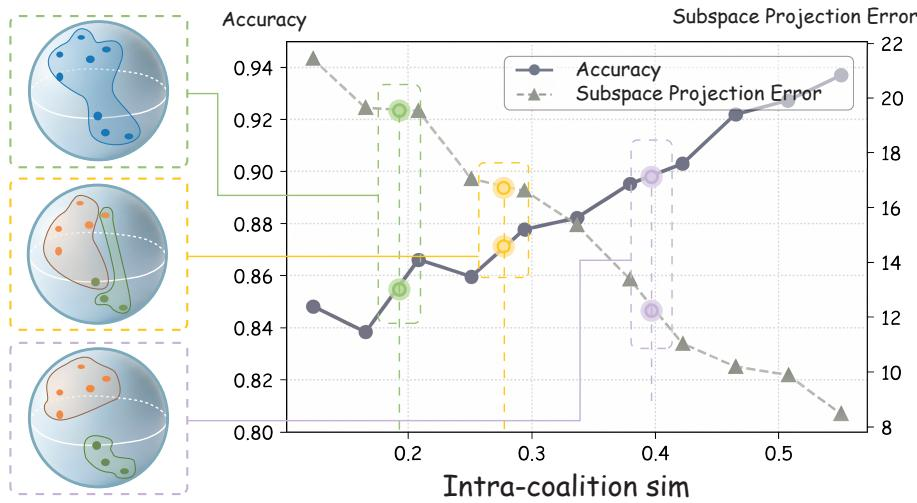
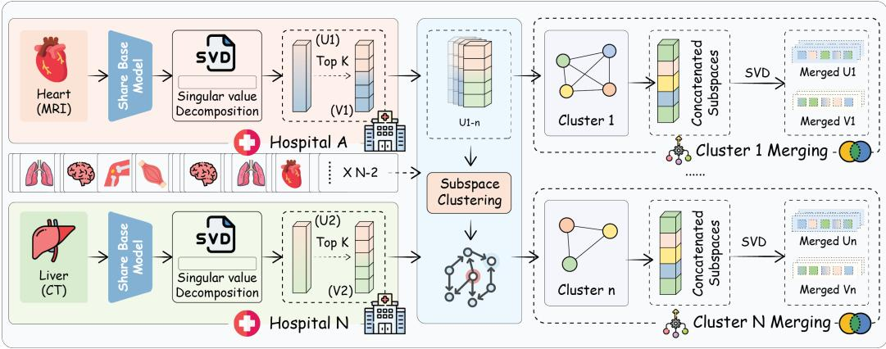
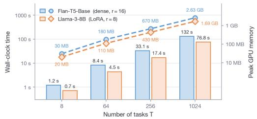
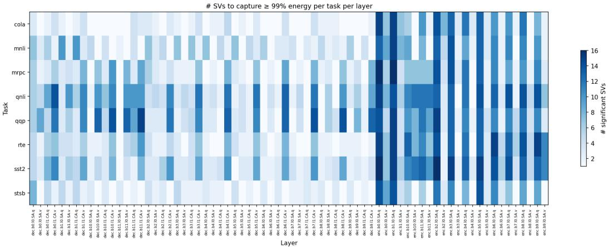
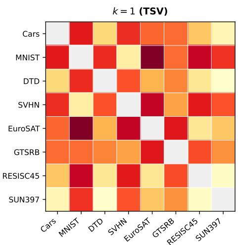
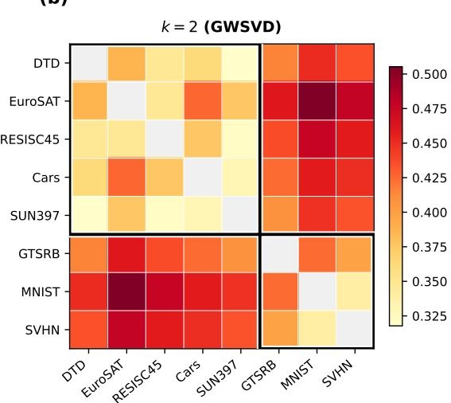

# GRAM: Group-wise Rank-Aware Model Merging via Subspace Alignment

Di Wu∗ JPMorgan Chase & Co. di.x5.wu@chase.com

Shuaidong Pan∗ JPMorgan Chase & Co. shuaidong.pan@chase.com

## Abstract

Merging different models into a single model is highly desirable for multi-task deployment, particularly in regulated domains like healthcare. In such settings, models are often locally fine-tuned due to strict data privacy policies, necessitating that aggregation operates exclusively on the fine-tuned weights. Existing methods apply a uniform merge across all tasks, ignoring the geometric relationships among their learned subspaces. When task updates occupy misaligned subspaces, projecting them onto a shared low-rank basis discards task-relevant directions, a failure mode named subspace interference. Through this study, we show that the per-task projection error of a merged model is governed by the principal-angle alignment between each task and the shared subspace, so that grouping geometrically compatible tasks provably reduces this error within each group. Motivated by this observation, we propose Group-wise Rank-Aware Model Merging (GRAM), which uses the principal-angle geometry of task vectors to decide which tasks should be merged together and then performs a standard SVD-based merge within each coalition; the pipeline requires only the fine-tuned weights at merge time. With only one additional model (K=2), GRAM significantly mitigates subspace interference and consistently outperforms prior merging methods across language understanding (GLUE with Flan-T5), 8-task CLIP vision, and medical instruction tuning (Qwen2-7B-Instruct with four English/Chinese medical LoRAs).

## 1 Introduction

Model merging [Wortsman et al., 2022, Ilharco et al., 2022, Tang et al., 2023] aggregates multiple finetuned, task-specific models into a single deployable model without the need for additional training. This paradigm is highly attractive for multi-task deployment, as it circumvents the substantial costs of storing and serving independent models. The structured nature of weight updates—particularly in parameter-efficient fine-tuning (e.g., LoRA [Hu et al., 2022])—makes model merging highly effective. This approach is especially critical in privacy-constrained domains such as healthcare, where institutions independently fine-tune a shared backbone on local clinical data. Because data sharing across sites is strictly restricted, any unified multi-institution model must be constructed solely from the fine-tuned weights, precluding the use of the original training data.

Prior work on model merging spans parameter-space arithmetic with conflict resolution [Ilharco et al., 2022, Yadav et al., 2023], auxiliary signal coefficient learning [Yang et al., 2023, Tang et al., 2023], and structured approximations exploiting low-rank or layer-wise properties [Gargiulo et al., 2025, Stoica et al., 2024, Marczak et al., 2025, Wei et al., 2025, Sun et al., 2025, Chen et al., 2025a]. A pervasive limitation of these methods is their reliance on a uniform global merge: all tasks are compressed into a single shared space. Consequently, tasks whose learned parameter directions are least compatible with the majority suffer from disproportionate performance degradation—a phenomenon we term subspace interference. Furthermore, many existing techniques require access to task-specific calibration data or activations, rendering them inapplicable in strict privacy-preserving deployments where data cannot leave its source institution.

  
Figure 1: How tasks are grouped on the Grassmannian governs merging quality. Insets: three partitions of the per-task low-rank subspaces visualised on the Grassmannian—all tasks merged into a single global coalition (top, low intra-coalition similarity), three groups (middle), and the twogroup GRAM partition (bottom, high intra-coalition similarity). Curve: as intra-coalition similarity increases, merged-model accuracy rises (left axis, solid) and the within-group subspace projection error $\scriptstyle \sum _ { \mathrm { p a i r s } \in G } ( 1 - \cos ^ { 2 } \theta )$ falls (right axis, dashed). Highlighted markers tie each partition to its location on the trade-off curve: GRAM places geometrically compatible tasks in the same coalition, reducing the alignment penalty that global merging incurs.

A critical signal overlooked by current methods is the inter-task geometry of the learned parameter subspaces. Existing techniques process updates individually or globally, systematically neglecting the pairwise geometric relationships between tasks. As illustrated in Figure 1, subspace similarity is highly predictive of merging compatibility: grouping tasks with high intra-coalition subspace similarity simultaneously increases merged-model accuracy and minimizes projection error. We observe distinct geometric signatures—such as cluster-outlier structures in GLUE tasks and blockdiagonal affinities in vision tasks (section D). Crucially, the outlier tasks are precisely those that disproportionately degrade standard global SVD merging, and thus benefit the most from group-wise isolation (section 5). Subspace geometry therefore carries predictive information that current methods fail to exploit.

Motivated by this geometric insight, we propose Group-wise Rank-Aware Model Merging (GRAM). GRAM targets the task-aware deployment setting, where task identity is known at inference. We reframe the merging objective from compressing T models into a single model, to compressing T models into $\breve { K } \ll T$ models, trading a marginal increase in storage for a targeted, significant reduction in subspace interference. Crucially, GRAM is entirely data-free: the pipeline operates exclusively on the fine-tuned weights, requiring no source data, activations, or calibration sets at merge time. Our primary contributions are as follows:

1. A Geometry-Aware Merging Algorithm: We introduce GRAM, which partitions tasks using Grassmannian k-means++ on chordal distances. Within each coalition, it dynamically merges models via a greedy adaptive rank allocator that pools singular values across members, achieving provable optimality under a global rank budget.

2. Theoretical Guarantees: We rigorously bound the projection error of our clustering objective. We prove that the resulting partition yields a merge error within $O ( \log K )$ of the optimal partition, and its expected error is strictly bounded below that of a standard global merge.

3. State-of-the-Art Data-Free Performance: Extensive evaluations across language understanding, vision, and medical instruction-tuning demonstrate that GRAM consistently outperforms existing data-free baselines. Notably, on the medical benchmark, GRAM surpasses even data-dependent methods (e.g., RegMean, Fisher-Merge) that rely on per-task calibration data.

## 2 Related Work

Model Merging. Model merging combines independently fine-tuned parameters into a single deployable model without retraining. Parameter-level methods average fine-tuned weights or arithmetically combine task vectors, sometimes with sparsification or sign/magnitude-based conflict resolution [Wortsman et al., 2022, Ilharco et al., 2022, Yadav et al., 2023, Yu et al., 2024]. Coefficient learning methods learn per-task or per-layer mixing weights from auxiliary signals or coordinate-wise masks [Yang et al., 2023, Tang et al., 2023]. Structured-update methods exploit the low-rank or layered structure of fine-tuning updates, operating in the singular-value or per-layer domain to reduce inter-task interference [Gargiulo et al., 2025, Stoica et al., 2024, Marczak et al., 2025, Chen et al., 2025b, Wei et al., 2025, Wang et al., 2024b, Sun et al., 2025, Fu et al., 2025]. Multi-model approaches retain some per-task structure rather than collapsing to a single shared model [Huang et al., 2024]. A common thread across these single-model approaches is that all tasks participate in the same global merge, implicitly assuming sufficient subspace alignment—an assumption that fails when tasks span diverse domains. We depart from it by measuring inter-task subspace geometry directly and merging within geometrically compatible groups.

Task Grouping in Multi-Task Learning. Deciding which tasks should be trained together has a long history in multi-task learning. Zamir et al. [2018] computationally map transfer relationships across 26 visual tasks, and Standley et al. [2020] formalize the grouping problem and search over partitions to trade accuracy against compute. Task2Vec [Achille et al., 2019] represents each task by a Fisher-information vector, while branched networks [Vandenhende et al., 2019] and mixture-ofexperts models [Chen et al., 2023] realize grouping through the architecture itself. Affinity-based methods avoid combinatorial search: TAG [Fifty et al., 2021] estimates inter-task affinity from gradient signals in a single training run, MTG-Net [Song et al., 2022] meta-learns a predictor of per-task gains across task combinations, Grad-TAG [Li et al., 2024] scales affinity estimation via gradient linearization, and Wang et al. [2024a] cast grouping as a mathematical program with theoretical guarantees. Complementary work on dynamic loss weighting [Liu et al., 2022] modulates task competition during training rather than partitioning tasks explicitly. Dynamic client cooperation [Yang et al., 2026] mitigates interference through adaptive coalition formation rather than explicitly partitioning tasks. All of these approaches require training-time data and gradients, making them inapplicable to the post-hoc merging setting where only frozen weights are available. Our grouping criterion is data-free: it uses only the left singular subspaces of the task-specific weight updates.

## 3 Preliminaries

Task vectors. We consider a pre-trained model with $L$ layers and weights $W _ { 0 } = \{ W _ { 0 } ^ { ( \ell ) } \} _ { \ell = 1 } ^ { L }$ After adapting the model to task $i \in \{ 1 , \ldots , T \}$ , we obtain fine-tuned weights $W _ { i }$ . Following the task-vector view of model merging [Ilharco et al., 2022, Yadav et al., 2023, Yu et al., 2024], the adaptation is summarized by the per-layer task vector

$$
\Delta W _ { i } ^ { ( \ell ) } = W _ { i } ^ { ( \ell ) } - W _ { 0 } ^ { ( \ell ) } \in \mathbb { R } ^ { d _ { \mathrm { o u t } } \times d _ { \mathrm { i n } } } ,\tag{1}
$$

i.e., the difference between the task-adapted and pre-trained weights at layer ℓ. The matrix formulation in (1) applies to linear layers — MLP blocks and attention projection matrices — which covers all merged parameters in our experiments: the LoRA settings adapt only linear projections by construction, and in the fully fine-tuned vision setting SVD-based merging is applied to all 2-D weight matrices while the remaining non-matrix parameters (LayerNorm gains, biases) are merged by simple averaging (section D.6). For models tuned with Low-Rank Adaptation (LoRA) [Hu et al., 2022], the task vector inherits a rank-r factorization

$$
\tau _ { i } ^ { ( \ell ) } = B _ { i } ^ { ( \ell ) } A _ { i } ^ { ( \ell ) } , \qquad B _ { i } ^ { ( \ell ) } \in \mathbb { R } ^ { d _ { \mathrm { o u t } } \times r } , A _ { i } ^ { ( \ell ) } \in \mathbb { R } ^ { r \times d _ { \mathrm { i n } } } , r \ll \operatorname* { m i n } ( d _ { \mathrm { o u t } } , d _ { \mathrm { i n } } ) .\tag{2}
$$

SVD of task updates. The compact SVD of each update is

$$
\Delta W _ { i } ^ { ( \ell ) } = U _ { i } ^ { ( \ell ) } \Sigma _ { i } ^ { ( \ell ) } V _ { i } ^ { ( \ell ) \top } ,\tag{3}
$$

where $U _ { i } ^ { ( \ell ) } \in \mathbb { R } ^ { d _ { \mathrm { o u t } } \times r }$ contains the left singular vectors (output subspace), $\Sigma _ { i } ^ { ( \ell ) } \in \mathbb { R } ^ { r \times r }$ is a diagonal matrix of singular values $\sigma _ { 1 } \geq \cdot \cdot \cdot \geq \sigma _ { r } > 0$ , and $V _ { i } ^ { ( \ell ) } \in \mathbb { R } ^ { d _ { \mathrm { i n } } \times r }$ contains the right singular vectors (input subspace). We drop the layer index (ℓ) when the context is unambiguous.

Merging objective. Given $T$ task vectors, each of rank r across L layers, the goal is to produce $K < T$ merged task vectors that minimize the total reconstruction error across all tasks subject to a per-merge rank budget:

$$
\operatorname* { m i n } _ { \substack { \mathrm { p a r t i t i o n } , \{ \boldsymbol { \Delta } \widetilde { W } _ { k } \} _ { k = 1 } ^ { K } } } \sum _ { i = 1 } ^ { T } \left\| \boldsymbol { \Delta } W _ { i } - \widetilde { \boldsymbol { \Delta } W } _ { \pi ( i ) } \right\| _ { \mathrm { F } } ^ { 2 } \quad \mathrm { s . t . } \quad \mathrm { r a n k } ( \widetilde { \boldsymbol { \Delta } W } _ { k } ) \leq r \mathrm { f o r ~ a l l } \ k \in \{ 1 , \ldots , K \} ,\tag{4}
$$

where $\pi ( i ) \in \{ 1 , \ldots , K \}$ assigns task i to its group $G _ { \pi ( i ) }$ and $\widetilde { \Delta W } _ { k } \in \mathbb { R } ^ { d _ { \mathrm { o u t } } \times d _ { \mathrm { i n } } }$ is the merged update for group $G _ { k }$ . The model deployed for group $G _ { k }$ is, per layer,

$$
W _ { G _ { k } } ^ { ( \ell ) } = W _ { 0 } ^ { ( \ell ) } + \widetilde { \Delta W } _ { k } ^ { ( \ell ) } ,\tag{5}
$$

i.e., each of the K deployed models is the pre-trained backbone plus its group’s merged task vector, and task i is served by the model of group $G _ { \pi ( i ) }$

Subspace interference. Let $B \in \mathbb { R } ^ { d _ { \mathrm { o u t } } \times r }$ be a shared output basis with orthonormal columns $( B ^ { \top } \hat { B } = I _ { r } )$ ). Substituting the compact SVD $\Delta W _ { i } = U _ { i } \Sigma _ { i } { V _ { i } ^ { \phantom { \dagger } } }$ , the projection error of task i onto col(B) is

$$
\begin{array} { r } { \mathcal { E } _ { i } \ = \ \left\| \left( I - B B ^ { \top } \right) \Delta W _ { i } \right\| _ { \mathrm { F } } ^ { 2 } \ = \ \left\| \left( I - B B ^ { \top } \right) U _ { i } \Sigma _ { i } \right\| _ { \mathrm { F } } ^ { 2 } , } \end{array}\tag{6}
$$

We adopt $\mathcal { E } _ { i }$ as a principled measure of inter-task interference as it directly measures the task-relevant information lost when updates are forced into a shared subspace. Crucially, $\mathcal { E } _ { i }$ depends only on $U _ { i }$ and $\Sigma _ { i } -$ not on $V _ { i } - \mathrm { s o }$ partitioning by output-subspace alignment captures the interference signal a shared basis can control.

To isolate the geometric contribution of subspace misalignment from the magnitude of the task update, we drop the singular-value weighting and analyze $\left\| ( I - B B ^ { \top } ) U _ { i } \right\| _ { \mathrm { F } } ^ { 2 }$ . Every column of $U _ { i }$ admits a unique orthogonal decomposition into a component in col(B) and a component in co $( B ) ^ { \perp }$ . Applied column-wise,

$$
U _ { i } = \underbrace { B B ^ { \top } U _ { i } } _ { \in \mathrm { c o l } ( B ) } + \underbrace { ( I - B B ^ { \top } ) U _ { i } } _ { \in \mathrm { c o l } ( B ) ^ { \bot } } .
$$

The two summands live in orthogonal subspaces, so by the Pythagorean theorem (in the Frobenius inner product), $\left\| \boldsymbol U _ { i } \right\| _ { \mathrm F } ^ { 2 } = \left\| \boldsymbol B \boldsymbol B ^ { \top } \boldsymbol U _ { i } \right\| _ { \mathrm F } ^ { 2 } + \left\| \left( \boldsymbol I - \boldsymbol B \boldsymbol B ^ { \top } \right) \boldsymbol U _ { i } \right\| _ { \mathrm F } ^ { 2 } .$ . Since B has orthonormal columns, $\left\| B B ^ { \top } U _ { i } \right\| _ { \mathrm { F } } ^ { 2 } = \left\| B ^ { \top } U _ { i } \right\| _ { \mathrm { F } } ^ { 2 }$ , and $\Vert U _ { i } \Vert _ { \mathrm { F } } ^ { 2 } = r$ . Rearranging,

$$
\| ( I - B B ^ { \top } ) U _ { i } \| _ { \mathrm { F } } ^ { 2 } =  r - \| B ^ { \top } U _ { i } \| _ { \mathrm { F } } ^ { 2 } .\tag{7}
$$

Let $\theta _ { 1 } , \ldots , \theta _ { r }$ denote the principal angles between col $( U _ { i } )$ and col $( B )$ ; throughout the paper we reserve θ for principal angles and k for merge groups (model weights are denoted $W )$ , and index principal angles by j. A standard result [Golub and Van Loan, 1996] states that the singular values of $B ^ { \top } U _ { i }$ are exactly {cos $\begin{array} { r } { \theta _ { j } \} _ { j = 1 } ^ { r } , \mathrm { s o } \left\| \boldsymbol { B } ^ { \top } \boldsymbol { U } _ { i } \right\| _ { \mathrm { F } } ^ { 2 } = \sum _ { j = 1 } ^ { r } \cos ^ { 2 } \theta _ { j } } \end{array}$ . Substituting into $( 7 )$ and using si $\mathrm { ~ l ~ } ^ { 2 } \theta _ { j } + \cos ^ { 2 } \theta _ { j } = 1$

$$
\big \| \big ( I - B B ^ { \top } \big ) U _ { i } \big \| _ { \mathrm { F } } ^ { 2 } = r - \sum _ { j = 1 } ^ { r } \cos ^ { 2 } \theta _ { j } = \sum _ { j = 1 } ^ { r } \sin ^ { 2 } \theta _ { j } ,\tag{8}
$$

which is the squared chordal (projection F-) distance between the two subspaces. The expression depends only on the relative geometry of col $( U _ { i } )$ and col(B) and is invariant to the choice of basis. When the subspaces are well-aligned $\overset { \cdot } { ( \theta _ { j } \approx 0 }$ for all $j ) .$ , the projection error vanishes. When they are misaligned, important task directions are discarded by the merge. This motivates grouping tasks by (singular-value-weighted) subspace compatibility before merging.

  
Figure 2: The GRAM pipeline. Each task vector $\Delta W _ { i }$ is decomposed via SVD to extract its top-r leftand right-singular subspaces $( U _ { i } , V _ { i } )$ (left). The collection of $\mathbf { \dot { \it U } } _ { i } , _ { \mathbf { s } }$ is fed into a subspace clustering step that partitions the $\dot { T }$ tasks into $\dot { K }$ coalitions by chordal distance (middle). Within each coalition, the selected $\mathrm { t o p } { - } k _ { i }$ singular components from member tasks are concatenated and re-orthonormalized via thin SVD to yield a single rank-r merged update (right).

## 4 Method: Group-wise Rank-Aware Model Merging

Our goal is to merge T task vectors into $K \ll T$ per-group updates in a way that protects geometrically incompatible tasks from mutual interference. To accomplish this, we decompose the pipeline (fig. 2) into three stages. (1) Quantifying pairwise subspace geometry. We compute the pairwise chordal distance between task output subspaces. This quantity directly governs the projection error a shared basis would incur (Theorem B.3), so it is the natural input for the clustering step rather than coordinate-wise distances on flattened parameters. (2) Partitioning tasks into geometrically coherent coalitions. Treating each task’s projection matrix $P _ { i } = U _ { i } U _ { i } ^ { \top }$ as a point in Euclidean space, we run Grassmannian k-means++ on the chordal-distance matrix to obtain K coalitions with low within-group and high between-group subspace distance, importing the $O ( \log K )$ approximation guarantee of k-means++ into the Grassmannian setting. (3) Per-coalition low-rank merge. Within each coalition we concatenate the per-task top-k singular triples under an adaptive rank allocator that distributes the rank budget to minimize the reconstruction error, then orthonormalize via a thin SVD to produce a single rank-r merged update per coalition.

## 4.1 Chordal Subspace Distance

We measure the geometric compatibility between two task subspaces via the squared chordal distance. At layer $\ell ,$ the chordal distance between the column spaces of $U _ { i } ^ { ( \ell ) }$ and $U _ { j } ^ { ( \ell ) }$ is

$$
d _ { c } ^ { 2 } \big ( U _ { i } ^ { ( \ell ) } , U _ { j } ^ { ( \ell ) } \big ) = r - \Big \| U _ { i } ^ { ( \ell ) \top } U _ { j } ^ { ( \ell ) } \Big \| _ { \mathrm { F } } ^ { 2 } = \sum _ { s = 1 } ^ { r } \sin ^ { 2 } \theta _ { s } ,\tag{9}
$$

where $\theta _ { 1 } , \ldots , \theta _ { r }$ are the principal angles between col $. ( U _ { i } ^ { ( \ell ) } )$ and $\operatorname { c o l } ( U _ { i } ^ { ( \ell ) } )$ (indexed by s here since $j$ denotes a task). By eq. (8), this quantity directly governs the projection error incurred when two tasks share a merged basis, making it the natural metric for deciding which tasks to group. Furthermore, we show that the chordal distance on the Grassmannian is equivalent to the squared Frobenius distance between the orthogonal projectors $P _ { i } ^ { ( \ell ) } : = U _ { i } ^ { ( \ell ) } U _ { i } ^ { ( \ell ) \top }$ up to a factor of 2 (section C.4), so off-the-shelf k-means++ on $\{ P _ { i } ^ { ( \ell ) } \}$ inherits its $O ( \log K )$ approximation guarantee in the chordal geometry (section B).

## 4.2 Grassmannian k-Means++ Clustering

To obtain a single distance per task pair, we average the per-layer chordal distance across layers:

$$
\vec { d } _ { c } ^ { 2 } ( i , j ) = \frac { 1 } { L } \sum _ { \ell = 1 } ^ { L } d _ { c } ^ { 2 } ( U _ { i } ^ { ( \ell ) } , U _ { j } ^ { ( \ell ) } ) .\tag{10}
$$

We then run k-means++ [Arthur et al., 2007] on $\hat { d } _ { c } ^ { 2 }$ to partition the $T$ tasks into K groups $\{ G _ { 1 } , \dots , G _ { K } \}$ . The number of groups $K$ is a user-specified compression budget that trades deployment cost (K deployed models) against merging fidelity. In our experiments (section 5), $K { = } 2$ provides the best cost–accuracy trade-off on all benchmarks.

## 4.3 Per-Group Low-Rank Merge

For each group $G _ { k }$ and layer $\ell ,$ we merge the constituent task vectors into a single rank-r update. The procedure operates on all three SVD components—left singular vectors $U _ { i } ,$ singular values $\sigma _ { i } ,$ and right singular vectors V —and allocates rank budget adaptively rather than uniformly across tasks.

Adaptive rank allocation. A naïve approach gives each of the $| G _ { k } |$ tasks an equal share $r / | G _ { k } |$ of the rank budget. Since intrinsic rank varies sharply across tasks and layers in practice (fig. 4, section D.3), this uniform allocation wastes capacity on compact tasks and starves complex ones.

We instead formulate rank allocation as a discrete optimization problem. Let $\Delta W _ { i } = U _ { i } \Sigma _ { i } V _ { i } ^ { \top }$ be the SVD of task i’s update, and let $r _ { i }$ denote the number of singular directions allocated to task i. The per-task reconstruction error after keeping the top $r _ { i }$ components is

$$
\mathcal { L } _ { i } ( \boldsymbol { r } _ { i } ) = \left. ( I - B _ { i } ^ { ( r _ { i } ) } B _ { i } ^ { ( r _ { i } ) ^ { \top } } ) \Delta W _ { i } \right. _ { \mathrm { F } } ^ { 2 } = \sum _ { j > r _ { i } } \sigma _ { i , j } ^ { 2 } ,\tag{11}
$$

where $B _ { i } ^ { ( r _ { i } ) } \in \mathbb { R } ^ { d _ { \mathrm { o u t } } \times r _ { i } }$ contains the top- $\cdot r _ { i }$ left singular vectors of $\Delta W _ { i }$ , and the second equality follows from the Eckart–Young theorem. We seek the allocation that minimizes total reconstruction error under a global budget:

$$
\operatorname* { m i n } _ { \{ r _ { i } \} } \sum _ { i \in G _ { k } } \sum _ { j > r _ { i } } \sigma _ { i , j } ^ { 2 } \qquad \mathrm { s . t . } \quad \sum _ { i \in G _ { k } } r _ { i } \leq r .\tag{12}
$$

The marginal gain of assigning one additional rank slot to task i is $\mathcal { L } _ { i } ( r _ { i } ) - \mathcal { L } _ { i } ( r _ { i } + 1 ) = \sigma _ { i , r _ { i } + 1 } ^ { 2 }$ Since singular values are sorted in descending order within each task, the optimal strategy is greedy: pool all candidate singular values $\{ \sigma _ { i , j } ^ { 2 } \}$ across tasks in the group, select the top-r entries, and count how many are drawn from each task. This yields optimal per-task allocations $r _ { 1 } , \ldots , r _ { | G _ { k } | }$ with $\textstyle \sum _ { i } r _ { i } = r$ , ensuring that rank budget flows to the directions that most reduce reconstruction error.

Coalition merge. Given the per-task allocations $\{ r _ { i } \}$ , we follow TSV-Merge [Gargiulo et al., 2025]: concatenate the selected top- $\mathbf { \nabla } \cdot r _ { i }$ SVD components across tasks into $\bar { U } \in \mathbb { R } ^ { d _ { \mathrm { o u t } } \times r } , \bar { s } \in \mathbb { R } ^ { r }$ , and $\bar { V } \in \mathbb { R } ^ { r \times d _ { \mathrm { i n } } }$ , sort globally by singular value, replace $\bar { U }$ and $\bar { V } ^ { \top }$ with their orthogonal polar factors ${ \widehat { U } } , { \widehat { V } }$ (rather than computing an SVD of the joint operator), and reconstruct $\widetilde { \Delta W } _ { k } ^ { ( \ell ) } = \widehat { U }$ diag(¯s) Vb ∈ $\mathbb { R } ^ { d _ { \mathrm { o u t } } \times d _ { \mathrm { i n } } }$ as the task vector for group $G _ { k }$ at layer ℓ.

Theoretical guarantee for grouping. The grouping step is backed by a deterministic projectionerror guarantee: with optimal per-group bases, any partition into K groups achieves total reconstruction error no larger than a single global rank-r basis fit to all tasks (Theorem B.1 in section B; the proof is a direct optimality argument independent of the clustering rule). The guarantee explains why the empirical gains in section 5 concentrate on tasks geometrically furthest from the bulk—exactly the tasks for which a partition-aware basis improves most over the global optimum, making the inequality strict and large in magnitude—while the alignment-penalty machinery (Theorem B.3) and the k-means++ partition error chain in section B quantify how much grouping helps.

Table 1: GLUE results on Flan-T5-Base and Flan-T5-Large (LoRA r=16): validation accuracy, Spearman ρ×100 for STS-B. Each cell reports Base / Large in that order. Bold: best merged result per column for each variant. Individual: per-task fine-tuned model (oracle upper bound).
<table><tr><td>Method</td><td>CoLA</td><td>MNLI</td><td>MRPC</td><td>QNLI</td><td>QQP</td><td>RTE</td><td>SST-2</td><td>STS-B</td><td>Avg.</td></tr><tr><td>Individual (oracle)</td><td>69.1 / 80.1</td><td>82.7 / 88.5</td><td>85.5 / 89.2</td><td>90.9 / 94.4</td><td>84.0 / 87.1</td><td>84.4 / 91.3</td><td>92.9 / 95.2</td><td>87.4 / 90.9</td><td>84.6 / 89.6</td></tr><tr><td>Weight Averaging</td><td>69.7 / 74.6</td><td>59.7 / 84.3</td><td>78.9 / 84.1</td><td>90.1 / 92.8</td><td>83.8 / 86.2</td><td>80.5 / 85.9</td><td>91.2 / 94.8</td><td>72.0 / 88.0</td><td>78.2 / 86.3</td></tr><tr><td>Task Arithmetic</td><td>69.5 / 76.9</td><td>59.0 / 85.4</td><td>78.7 / 85.3</td><td>90.1 / 93.9</td><td>83.9 / 85.8</td><td>79.4 / 88.1</td><td>91.5 / 95.2</td><td>72.9 / 87.8</td><td>78.1 / 87.3</td></tr><tr><td>Concrete TA</td><td>69.1 / 76.6</td><td>58.1 / 86.3</td><td>78.4 / 86.3</td><td>89.9 / 93.9</td><td>83.5 / 85.9</td><td>79.4 / 88.4</td><td>91.6 / 95.2</td><td>73.4 / 87.9</td><td>78.0/ 87.5</td></tr><tr><td>DOGE TA</td><td>69.1 / 78.4</td><td>71.9 / 88.1</td><td>80.9 / 86.5</td><td>90.3 / 93.8</td><td>83.5 / 86.3</td><td>79.8 / 87.7</td><td>92.5 / 95.1</td><td>71.1 / 87.7</td><td>79.9 / 88.0</td></tr><tr><td>TIES-Merging</td><td>68.3 / 77.1</td><td>56.3 / 85.1</td><td>79.4 / 86.3</td><td>89.8 / 93.9</td><td>83.7 / 86.0</td><td>79.4 / 87.7</td><td>91.6 / 95.1</td><td>71.2 / 88.0</td><td>77.5 / 87.4</td></tr><tr><td>AdaMerging++</td><td>69.1 / 76.7</td><td>60.3 / 87.6</td><td>78.4 / 84.8</td><td>90.0 / 93.8</td><td>83.6 / 85.9</td><td>79.1 / 88.1</td><td>91.6 / 95.2</td><td>74.1 / 88.6</td><td>78.3 / 87.6</td></tr><tr><td>Concrete AM</td><td>69.0 / 76.1</td><td>59.4 / 87.7</td><td>80.1 / 85.5</td><td>89.9 / 93.8</td><td>82.9 / 85.9</td><td>79.1 / 88.1</td><td>91.7 / 95.4</td><td>75.4 / 87.1</td><td>78.5 / 87.8</td></tr><tr><td>TSV-Merge</td><td>69.2 / 79.2</td><td>74.7 / 86.0</td><td>80.9 / 87.3</td><td>90.2 / 93.6</td><td>83.6 / 85.6</td><td>78.7 / 87.0</td><td>92.7 / 95.3</td><td>83.2 / 88.7</td><td>81.7 / 87.8</td></tr><tr><td>Iso-C</td><td>69.1 / 73.8</td><td>59.9 / 64.2</td><td>77.9 / 82.4</td><td>88.9 / 92.2</td><td>82.9 / 86.0</td><td>80.9 / 82.7</td><td>91.5 / 92.8</td><td>66.1 / 86.4</td><td>77.2 / 82.5</td></tr><tr><td>Iso-CTS</td><td>69.1 / 73.8</td><td>58.3 / 59.1</td><td>77.0 / 82.1</td><td>88.5 / 91.8</td><td>82.2 / 85.8</td><td>80.5 / 82.3</td><td>91.4 / 92.4</td><td>64.0 / 86.0</td><td>76.4 / 81.7</td></tr><tr><td>GRAM (ours)</td><td>69.5 / 79.3</td><td>82.8 / 89.0</td><td>84.3 / 88.7</td><td>90.2 / 93.8</td><td>84.0 / 85.7</td><td>79.8 / 88.1</td><td>93.2 / 95.4</td><td>86.7 / 89.9</td><td>83.8 / 88.7</td></tr></table>

## 5 Experiments

## 5.1 Setup

We evaluate GRAM on three benchmarks: GLUE [Wang et al., 2018] with Flan-T5-Base/Large [Chung et al., 2024], the 8-task vision benchmark with fully fine-tuned CLIP ViT-B/32 and ViT-L/14, and medical instruction tuning on Qwen2-7B-Instruct with four LoRA experts (section 5.4). All methods operate on the same pre-existing fine-tuned models—from FusionBench [Tang et al., 2025] for GLUE and from the TSV-Merge release [Gargiulo et al., 2025] for vision—and are re-run under a unified protocol (section D), so cross-method differences come only from merging. We report validation accuracy on GLUE (Spearman ρ×100 for STS-B), test accuracy on vision, and the metrics described in section 5.4 for the medical benchmark. All experiments use task-aware inference: task identity is known at test time and selects the group-specific adapter. This is a preference rather than a requirement (section 5.5).

For GLUE and vision, we compare against seven baselines: Weight Averaging [Wortsman et al., 2022], Task Arithmetic [Ilharco et al., 2022], TIES-Merging [Yadav et al., 2023], AdaMerging++ [Yang et al., 2023], Iso-C and Iso-CTS [Marczak et al., 2025], and TSV-Merge [Gargiulo et al., 2025]. The GLUE results in table 1 additionally include Concrete TA, Concrete AM [Tang et al., 2023], and DOGE TA [Wei et al., 2025]. The CLIP ViT-B/16 results in section D.5 additionally include LiNeS-Merge [Wang et al., 2024b] and LOT-Merging [Sun et al., 2025] for completeness across recent structured-update baselines. The medical benchmark (section 5.4) additionally compares against Fisher-Merge [Matena and Raffel, 2022] and RegMean [Jin et al., 2022] as data-using references. Ablation includes random-equipartition controls under the same chordal metric.

## 5.2 Language Understanding

Table 1 presents GLUE results on Flan-T5-Base and Flan-T5-Large (LoRA r=16). We fix K=2 throughout to keep the budget overhead minimal—a single extra deployed model relative to the K=1 baselines—and ask whether this small extra resource yields meaningful gains. On Flan-T5-Base, GRAM reaches 83.8% average, +2.1 over the strongest baseline TSV-Merge (81.7%). On Flan-T5- Large, the gap between methods narrows in the higher-capacity regime, but GRAM still leads the field at 88.7%, +0.9 over TSV-Merge (87.8%)—all with only 2 deployed models and no per-task calibration data.

The per-task profile is consistent with the alignment-penalty mechanism of Theorem B.3: tasks at large principal angles from the bulk cluster bear the largest projection error under a global merge and stand to recover the most under per-coalition merging. MNLI and STS-B sit furthest from the {MRPC, QNLI, QQP, RTE} cluster in subspace geometry (section D), and they are the two tasks where GRAM recovers the most relative to TSV-Merge at both scales (MNLI 74.7→82.8 base, 86.0→89.0 large; STS-B 83.2→86.7 base, 88.7→89.9 large). On QQP, GRAM attains the highest base accuracy (84.0); on SST-2 it is within 0.1 of the strongest baseline.

Table 2: Eight-task vision results on fully fine-tuned CLIP ViT-B/32 and ViT-L/14: test accuracy (%). Each cell reports B/32 / L/14 in that order. Bold: best merged result per column for each variant. Individual: per-task fine-tuned model (oracle upper bound).
<table><tr><td>Method</td><td>MNIST</td><td>SVHN</td><td>GTSRB</td><td>DTD</td><td> $\mathrm { C a r s }$ </td><td>RESISC45</td><td>EuroSAT</td><td>SUN397</td><td>Avg.</td></tr><tr><td>Individual (oracle)</td><td>99.7 / 99.8</td><td>97.6/ 98.1</td><td>99.1 / 99.2</td><td>97.7 / 98.5</td><td>78.2 / 92.2</td><td>95.9/ 97.3</td><td>99.8 / 99.8</td><td>75.3 / 82.0</td><td>92.9 / 95.9</td></tr><tr><td>Weight Averaging</td><td>86.5 / 96.8</td><td>62.7 / 77.7</td><td>53.3 / 68.9</td><td>54.7 / 66.8</td><td>62.6 / 81.7</td><td>71.9 / 82.3</td><td>71.0/ 88.7</td><td>65.1 / 71.5</td><td>66.0 / 79.3</td></tr><tr><td>Task Arithmetic</td><td>96.9 / 99.0</td><td>78.1 / 86.0</td><td>68.2 / 84.9</td><td>59.6 / 72.2</td><td>56.2 / 81.9</td><td>68.1 / 86.3</td><td>76.0 / 91.9</td><td>57.3 / 72.9</td><td>70.1 / 84.4</td></tr><tr><td>TIES-Merging</td><td>97.0 / 99.0</td><td>80.5 / 87.6</td><td>69.3 / 83.7</td><td>66.2 / 77.5</td><td>61.1 / 83.3</td><td>73.2 / 87.7</td><td>79.4/ 93.8</td><td>62.7 / 74.0</td><td>73.7 / 85.8</td></tr><tr><td>AdaMerging++</td><td>98.2 / 99.0</td><td>90.1 / 90.2</td><td>73.2 / 95.7</td><td>81.3 / 93.7</td><td>69.2 / 88.6</td><td>78.2 / 91.5</td><td>93.9 / 97.2</td><td>65.7 / 74.7</td><td>81.2 / 91.3</td></tr><tr><td>TSV-Merge</td><td>99.3 / 99.6</td><td>91.5 / 95.1</td><td>91.8 / 96.3</td><td>83.8 / 93.4</td><td>69.5 / 89.3</td><td>84.8 / 93.2</td><td>94.1 / 98.5</td><td>65.6 / 76.8</td><td>85.0 / 92.8</td></tr><tr><td>Iso-C</td><td>98.9 / 99.3</td><td>87.0 / 90.5</td><td>91.0 /95.8</td><td>88.1 / 96.1</td><td>71.0 / 91.4</td><td>87.0 / 94.7</td><td>92.4 / 98.8</td><td>69.1 / 79.7</td><td>85.6 / 93.3</td></tr><tr><td>Iso-CTS</td><td>98.9 / 99.4</td><td>84.9 / 91.2</td><td>91.6 /96.6</td><td>89.0 / 97.0</td><td>71.4 / 91.9</td><td>88.4 / 95.4</td><td>92.5 / 99.1</td><td>69.4 / 80.2</td><td>85.8 / 93.9</td></tr><tr><td>GRAM (ours)</td><td>99.4 / 99.6</td><td>94.2 / 96.4</td><td>94.6 / 98.3</td><td>90.4 / 95.5</td><td>73.1 / 90.6</td><td>89.4 / 94.4</td><td>99.1 / 99.3</td><td>69.1 / 78.2</td><td>88.7 / 94.0</td></tr></table>

Table 3: Medical merging on Qwen2-7B-Instruct with four LoRA experts. MedQA / CMExam: accuracy; HealthcareMagic / cMedQA2: BLEU-4 / ROUGE-1/2/L. Avg Impr.: mean relative improvement over Pretrained across 10 columns; Avg Rank.: mean per-column rank (1 = best). Bold / underline: best / second-best per column among merging methods. Individual: per-task fine-tuned oracle.
<table><tr><td></td><td>MedQA</td><td>CMExam</td><td colspan="4">HealthcareMagic</td><td colspan="4">cMedQA2</td><td></td><td></td></tr><tr><td>Method</td><td>Acc.</td><td>Acc.</td><td>BLEU-4</td><td>ROUGE-1</td><td>ROUGE-2</td><td>ROUGE-L</td><td>BLEU-4</td><td>ROUGE-1</td><td>ROUGE-2</td><td>ROUGE-L</td><td>Avg Impr.</td><td>Avg Rank.</td></tr><tr><td>Pretrained</td><td>51.92</td><td>74.77</td><td>1.05</td><td>25.90</td><td>3.27</td><td>12.65</td><td>9.77</td><td>40.30</td><td>19.05</td><td>20.94</td><td>一</td><td>1</td></tr><tr><td>Individual (oracle)</td><td>60.25</td><td>88.63</td><td>5.43</td><td>30.60</td><td>8.07</td><td>18.48</td><td>11.17</td><td>41.71</td><td>19.23</td><td>24.02</td><td>+69.62%</td><td>4.55</td></tr><tr><td>Weight Averaging</td><td>56.64</td><td>85.63</td><td>4.49</td><td>30.71</td><td>7.13</td><td>17.70</td><td>10.78</td><td>41.26</td><td>20.08</td><td>22.28</td><td>+55.23%</td><td>7.65</td></tr><tr><td>Task Arithmetic</td><td>57.97</td><td>87.69</td><td>5.00</td><td>30.33</td><td>7.72</td><td>18.11</td><td>5.55</td><td>32.70</td><td>12.02</td><td>19.15</td><td>+49.40%</td><td>7.05</td></tr><tr><td>TIES-Merging</td><td>58.05</td><td>87.69</td><td>4.23</td><td>30.72</td><td>7.03</td><td>17.58</td><td>11.30</td><td>42.06</td><td>20.60</td><td>22.85</td><td>+54.18%</td><td>6.10</td></tr><tr><td>Fisher-Merge</td><td>60.25</td><td>85.65</td><td>2.30</td><td>27.87</td><td>4.58</td><td>14.59</td><td>12.01</td><td>44.06</td><td>21.36</td><td>24.04</td><td>+27.18%</td><td>6.25</td></tr><tr><td>RegMean</td><td>60.80</td><td>88.21</td><td>5.51</td><td>31.19</td><td>8.21</td><td>18.58</td><td>11.39</td><td>41.75</td><td>20.25</td><td>23.05</td><td>+71.48%</td><td>3.40</td></tr><tr><td>Iso-C</td><td>58.05</td><td>86.68</td><td>4.52</td><td>29.58</td><td>7.12</td><td>17.60</td><td>9.78</td><td>39.60</td><td>17.93</td><td>23.65</td><td>+53.47%</td><td>7.85</td></tr><tr><td>Iso-CTS</td><td>57.82</td><td>86.74</td><td>4.54</td><td>29.73</td><td>7.20</td><td>17.77</td><td>11.97</td><td>42.84</td><td>20.28</td><td>25.26</td><td>+59.11%</td><td>5.40</td></tr><tr><td>TSV-Merge</td><td>56.64</td><td>86.72</td><td>5.12</td><td>30.61</td><td>7.71</td><td>18.10</td><td>12.55</td><td>43.84</td><td>21.84</td><td>24.40</td><td>+67.81%</td><td>4.35</td></tr><tr><td>GRAM (ours)</td><td>58.52</td><td>87.60</td><td>5.62</td><td>30.70</td><td>8.30</td><td>18.68</td><td>12.67</td><td>43.68</td><td>21.49</td><td>25.01</td><td>+75.54%</td><td>2.40</td></tr></table>

## 5.3 Vision

Table 2 reports per-task accuracy on fully fine-tuned CLIP ViT-B/32 and ViT-L/14. GRAM attains the highest average accuracy on both architectures (88.7% B/32, 94.0% L/14), surpassing Iso-CTS (85.8% / 93.9%) and TSV-Merge (85.0% / 92.8%). The pairwise projection-error matrix $\sum _ { s } \sigma _ { i , s } ^ { 2 } \sin ^ { 2 } \theta _ { s }$ on the 8 vision tasks (App. D.4) shows a clear block-diagonal structure under K=2, with high-chordaldistance pairs routed into different groups. The accuracy gains track this structure: GRAM is strongest on GTSRB (94.6 / 98.3) and EuroSAT (99.1 / 99.3), which sit furthest from the visual-recognition cluster (DTD/Cars/RESISC45/SUN397) and pay the largest off-diagonal penalty under K=1. The vision gap to the next-best baseline (+2.9 on B/32) exceeds the NLU gap (+2.1 on Flan-T5-Base), suggesting vision tasks present more heterogeneous subspaces where partitioning offers more benefit.

## 5.4 Medical Instruction Tuning

We set up a case study of the medical scenario from section 1: four publicly available LoRA experts on Qwen2-7B-Instruct, fine-tuned for distinct medical sub-domains across two task families and two languages: MedQA (English MCQA), CMExam (Chinese MCQA), HealthcareMagic (English doctor-patient dialogue), and cMedQA2 (Chinese doctor-patient dialogue). MCQA tasks are scored by accuracy; open-ended tasks by BLEU-4 and ROUGE-1/2/L, yielding 10 heterogeneous metric columns. Like the data-free baselines (Weight Averaging, Task Arithmetic, TIES-Merging, TSV-Merge, Iso-C, Iso-CTS), GRAM requires no calibration data. We additionally include Fisher-Merge [Matena and Raffel, 2022] and RegMean [Jin et al., 2022] as data-using references that consume a standard 64-sample-per-task calibration set.

Table 3 reports per-metric results. With experts spanning two languages and two task families (MCQA / dialogue), plain averaging visibly interferes across the gap—Task Arithmetic regresses on cMedQA2 BLEU-4 (5.55 vs Pretrained 9.77) and on its ROUGE columns. GRAM’s K=2 coalitions route subspace-distant pairs into separate groups and attain the best Avg Impr (+75.54%) and Avg Rank (2.40) of any merging method, ahead of even the data-using RegMean (+71.48%, 3.40) with its 64-sample-per-task calibration set. Gains concentrate on the open-ended generation columns (both BLEU-4 fields; HealthcareMagic ROUGE-2 / ROUGE-L), where preserving task-specific singular directions outweighs calibrated reweighting; on the two MCQA accuracy columns—the regime where calibration-based methods are strongest—GRAM trails the leader by under one point. The summary-metric edge also extends past the per-task Individual oracle (+69.62%, 4.55), consistent with recent findings that LLM merging can match or exceed fine-tuned baselines on this benchmark family [Fu et al., 2025].

Table 5: Clustering-algorithm ablation (Flan-T5-Base / GLUE): four ways of producing the K=2 partition from the same subspace geometry, plus the random control, under identical merging and evaluation.
<table><tr><td>Partitioning of the same subspace geometry</td><td>K=2 partition</td><td>Avg.</td></tr><tr><td>GRAM</td><td>{CoLA, MRPC, QNLI, QQP, RTE, SST-2} | {MNLI, STS-B}</td><td>83.8</td></tr><tr><td>Agglomerative (average linkage) Max-modularity communities (exact, all 127 bipartitions)</td><td>identical partition {CoLA, MNLI, SST-2, STS-B} | {MRPC, QNLI, QQP, RTE}</td><td>83.8 82.9</td></tr><tr><td>Random equipartition</td><td>random 4/4</td><td>82.4</td></tr><tr><td>No grouping (K=1, re-merged)</td><td>all tasks</td><td>81.9</td></tr></table>

## 5.5 Ablation Studies

Effects of each module. Table 4 evaluates the contribution of each GRAM component to overall performance. Starting from full GRAM, we remove one component at a time and report the benchmark average for both PEFT merging (Flan-T5-Base on GLUE) and full-model merging (CLIP ViT-B/32 on the 8- task vision benchmark). Removing PA-Sim replaces the chordal subspace metric with an alternative that ignores cross-task geometry, breaking the alignmentpenalty signal that drives the partition. Removing Coalition collapses GRAM to $\stackrel { \cdot } { K } = 1$ and recovers the

Table 4: Effects of the proposed modules. Subscripts (red) report the change relative to full GRAM.
<table><tr><td>Model</td><td>GLUE</td><td>ViT-B/32</td></tr><tr><td>GRAM</td><td>83.8</td><td>88.8</td></tr><tr><td>– PA-Sim</td><td>80.8-3.0</td><td>88.3-0.5</td></tr><tr><td>- Coalition</td><td>81.7-2.1</td><td>85.4-3.4</td></tr><tr><td> $- \mathbf { \Delta A d a p t { - R a n k } }$ </td><td> $8 2 . 2 _ { - 1 . 6 }$ </td><td> $8 8 . 7 _ { - 0 . 1 }$ </td></tr></table>

global TSV-Merge baseline. Removing Adapt-Rank substitutes a uniform $r / | G _ { k } |$ budget for the adaptive allocator, wasting capacity on sharp-spectrum tasks and starving long-tail ones. Each component is crucial, but their relative importance flips across modalities: on GLUE, PA-Sim drives the largest drop (−3.0), followed by Coalition (−2.1) and Adapt-Rank (−1.6); on ViT-B/32, Coalition dominates (−3.4) while PA-Sim (−0.5) and Adapt-Rank (−0.1) are small — the heterogeneous LoRA spectra make adaptive allocation vital for PEFT but largely cosmetic for the more uniform full-fine-tuned vision deltas. With all components combined, GRAM boosts TSV-Merge by +2.1 on GLUE and +3.8 on ViT-B/32, demonstrating the complementarity of these components.

Sensitivity to the number of groups K. Table 6 evaluates GRAM for every K from 1 to T=8 on Flan-T5-Base and Flan-T5-Large under one unified protocol (caption). At both scales the cost– accuracy frontier has a sharp knee at K=2: moving from Weight Averaging—the simplest singlemodel baseline—to GRAM at K=2 gains +5.6 (Base) and +2.4 (Large) points, capturing 87% and 73% of the respective gaps to the no-merging oracle, for a single extra rank-16 adapter (0.7% / 0.6% of backbone parameters). Raising K from 2 all the way to 7 adds at most +0.1 (Base) and +0.6 (Large) on top—on Base the average is not even monotone, dipping at $K { = } 4 .$ . Most of the achievable gain is therefore already available at small K: GRAM’s geometry-aware clustering identifies compatible coalitions efficiently enough that a large K is not needed to capture most of the gains in this setting. The practical rule is budget-first—deploy the smallest K the serving budget allows; K=2, our default, captures the bulk of the gain at the tightest possible budget.

Robustness of the partition. Table 5 compares four ways of producing the $K { = } 2$ partition from the same subspace geometry. The partition is stable: it is identical across 10 initialization seeds at both $K { = } 2$ and $\scriptstyle { K = 3 } ( 1 0 / 1 0 )$ , and an independent hierarchy-based algorithm (agglomerative, average linkage) reproduces GRAM’s partitions exactly at $K \in \{ 2 , 3 , 5 , 6 , \bar { 7 } \}$ , with the exact max-modularity communities coinciding for every $K \geq 3 .$ . The partition structure is thus a property of the geometry, not of a particular clustering algorithm—the gain comes from the subspace signal itself. The one disagreement is informative: at K=2 the degree-corrected modularity objective prefers a 4/4 split that pulls MNLI into the low-similarity cluster and scores 0.9 lower (82.9), whereas the solution used by GRAM respects the raw block structure of the similarity matrix and keeps the stronger $6 / 2$ partition.

Deployment without oracle task identity. Task-aware inference is a preference, not a requirement: a lightweight Mahalanobis task mapper [Lee et al., 2018], as deployed in SKILL [Ge et al., 2023]— class-conditional Gaussians in the frozen base encoder’s feature space, 5 training samples per class, no gradient training, no test-time task labels—routes 100.0% of validation examples to the correct group on Flan-T5-Base / GLUE at K=2, so task-agnostic GRAM equals oracle GRAM (83.8 on every task); group-routing accuracy stays ≥99.98% for every K. Its only errors (QQP↔MRPC, 0.18% of QQP) are absorbed by the coalition structure, since GRAM groups together precisely the similar tasks a router confuses (section D.2).

Scalability of the grouping step. A natural concern is whether grouping becomes a bottleneck when the number of tasks is large. Figure 3 measures the end-to-end cost of grouping on a single RTX 3080 as T grows from 8 to 1024. No benchmark offers thousands of adapters, so beyond our real tasks we use perturbed copies of them; grouping cost depends only on adapter shapes, not on their values, so these copies are a faithful proxy. Grouping is cheap: the real 8-task setting takes about one second, and 1024 tasks finish within a few minutes. Both time and memory grow roughly linearly with T, because decomposing each adapter dominates the cost and the pipeline processes one layer at a time. Llama-3-8B appears cheaper than Flan-T5 only because its LoRA factors are used directly rather than dense per-layer deltas.

  
Figure 3: Grouping cost vs. number of tasks T on one RTX 3080 (bars: wall-clock time; lines: peak GPU memory). T=8 is the real task set; larger T uses synthetic tasks with the same layer shapes and rank.

## 6 Conclusion

GRAM partitions tasks by chordal subspace distance via Grassmannian k-means++ and merges within each group with a standard SVD-based procedure, avoiding the projection loss of global merging on misaligned subspaces. On GLUE with Flan-T5-Base/Large, GRAM (K=2) reaches 83.8%/88.7% average, matching the strongest baseline at the cost of one extra deployed model. On 8-task vision (CLIP ViT-B/32, ViT-L/14), GRAM reaches 88.7%/94.0%, the highest among compared methods. On the medical benchmark (Qwen2-7B-Instruct with four LoRA experts), GRAM attains the best Avg Rank without using any per-task calibration data. Gains concentrate on tasks whose subspaces are most dissimilar from the majority—precisely the tasks that the alignment penalty of Theorem B.3 predicts will benefit most from grouping.

Limitations. Our results have several scope limits: (i) single-seed reporting, so small Flan-T5-Large margins should be read with caution; (ii) one model family per modality (Flan-T5 for NLU, CLIP for vision, Qwen2 for medical), and the medical evaluation is a case study on public benchmarks rather than a real federated experiment from multiple sites; (iii) the theory analyzes idealized objects (optimal basis, Grassmannian k-means objective) rather than GRAM’s exact column-stacked merge with adaptive allocation, so it should be read as geometric motivation rather than end-to-end optimality guarantee.

Future work. Scaling the task-agnostic router of section D.2 beyond small task collections—where group routing approaches full task identification [Ge et al., 2023]—and extending the medical evaluation to a real multi-site federated setup would broaden the deployment story.

## References

Alessandro Achille, Michael Lam, Rahul Tewari, Avinash Ravichandran, Subhransu Maji, Charless C Fowlkes, Stefano Soatto, and Pietro Perona. Task2vec: Task embedding for meta-learning. In Proceedings of the IEEE/CVF international conference on computer vision, pages 6430–6439, 2019.

David Arthur, Sergei Vassilvitskii, et al. k-means++: The advantages of careful seeding. In Soda, volume 7, pages 1027–1035, 2007.

Zhikang Chen, Sen Cui, Deheng Ye, Min Zhang, Gang Niu, Yu Zhang, Masashi Sugiyama, and Tingting Zhu. From coefficients to directions: Rethinking model merging with directional alignment. arXiv preprint arXiv:2512.00391, 2025a.

Zhikang Chen, Abudukelimu Wuerkaixi, Sen Cui, Haoxuan Li, Ding Li, Jingfeng Zhang, Bo Han, Gang Niu, Houfang Liu, Yi Yang, et al. Learning without isolation: Pathway protection for continual learning. arXiv preprint arXiv:2505.18568, 2025b.

Zitian Chen, Yikang Shen, Mingyu Ding, Zhenfang Chen, Hengshuang Zhao, Erik G Learned-Miller, and Chuang Gan. Mod-squad: Designing mixtures of experts as modular multi-task learners. In Proceedings of the IEEE/CVF Conference on Computer Vision and Pattern Recognition, pages 11828–11837, 2023.

Hyung Won Chung, Le Hou, Shayne Longpre, Barret Zoph, Yi Tay, William Fedus, Yunxuan Li, Xuezhi Wang, Mostafa Dehghani, Siddhartha Brahma, et al. Scaling instruction-finetuned language models. Journal ofMachine Learning Research, 25(70):1–53, 2024.

Alan Edelman, Tomás A Arias, and Steven T Smith. The geometry of algorithms with orthogonality constraints. SIAMjournal on Matrix Analysis and Applications, 20(2):303–353, 1998.

Chris Fifty, Ehsan Amid, Zhe Zhao, Tianhe Yu, Rohan Anil, and Chelsea Finn. Efficiently identifying task groupings for multi-task learning. Advances in Neural Information Processing Systems, 34: 27503–27516, 2021.

Zichuan Fu, Xian Wu, Yejing Wang, Wanyu Wang, Shanshan Ye, Hongzhi Yin, Yi Chang, Yefeng Zheng, and Xiangyu Zhao. Training-free llm merging for multi-task learning. In Proceedings of the 63rd Annual Meeting of the Association for Computational Linguistics (Volume 1: Long Papers), pages 33111–33124, 2025.

Antonio Andrea Gargiulo, Donato Crisostomi, Maria Sofia Bucarelli, Simone Scardapane, Fabrizio Silvestri, and Emanuele Rodola. Task singular vectors: Reducing task interference in model merging. In Proceedings of the Computer Vision and Pattern Recognition Conference, pages 18695–18705, 2025.

Yunhao Ge, Yuecheng Li, Di Wu, Ao Xu, Adam M. Jones, Amanda Sofie Rios, Iordanis Fostiropoulos, Shixian Wen, Po-Hsuan Huang, Zachary William Murdock, Gozde Sahin, Shuo Ni, Kiran Lekkala, Sumedh Anand Sontakke, and Laurent Itti. Lightweight learner for shared knowledge lifelong learning. Transactions on Machine Learning Research, 2023.

Gene H Golub and Charles F Van Loan. Matrix computations johns hopkins university press. Baltimore and London, 41(62):2, 1996.

Edward J Hu, Yelong Shen, Phillip Wallis, Zeyuan Allen-Zhu, Yuanzhi Li, Shean Wang, Liang Wang, Weizhu Chen, et al. Lora: Low-rank adaptation of large language models. Iclr, 1(2):3, 2022.

Chenyu Huang, Peng Ye, Tao Chen, Tong He, Xiangyu Yue, and Wanli Ouyang. Emr-merging: Tuning-free high-performance model merging. Advances in Neural Information Processing Systems, 37:122741–122769, 2024.

Gabriel Ilharco, Marco Tulio Ribeiro, Mitchell Wortsman, Suchin Gururangan, Ludwig Schmidt, Hannaneh Hajishirzi, and Ali Farhadi. Editing models with task arithmetic. arXiv preprint arXiv:2212.04089, 2022.

Xisen Jin, Xiang Ren, Daniel Preotiuc-Pietro, and Pengxiang Cheng. Dataless knowledge fusion by merging weights of language models. arXiv preprint arXiv:2212.09849, 2022.

Kimin Lee, Kibok Lee, Honglak Lee, and Jinwoo Shin. A simple unified framework for detecting out-of-distribution samples and adversarial attacks. In Advances in Neural Information Processing Systems, volume 31, 2018.

Dongyue Li, Aneesh Sharma, and Hongyang R Zhang. Scalable multitask learning using gradientbased estimation of task affinity. In Proceedings of the 30th ACM SIGKDD Conference on Knowledge Discovery and Data Mining, pages 1542–1553, 2024.

Shikun Liu, Stephen James, Andrew J Davison, and Edward Johns. Auto-lambda: Disentangling dynamic task relationships. arXiv preprint arXiv:2202.03091, 2022.

Daniel Marczak, Simone Magistri, Sebastian Cygert, Bartłomiej Twardowski, Andrew D Bagdanov, and Joost Van De Weijer. No task left behind: Isotropic model merging with common and task-specific subspaces. arXiv preprint arXiv:2502.04959, 2025.

Michael S Matena and Colin A Raffel. Merging models with fisher-weighted averaging. Advances in Neural Information Processing Systems, 35:17703–17716, 2022.

Xiaozhuang Song, Shun Zheng, Wei Cao, James Yu, and Jiang Bian. Efficient and effective multi-task grouping via meta learning on task combinations. Advances in Neural Information Processing Systems, 35:37647–37659, 2022.

Trevor Standley, Amir Zamir, Dawn Chen, Leonidas Guibas, Jitendra Malik, and Silvio Savarese. Which tasks should be learned together in multi-task learning? In International conference on machine learning, pages 9120–9132. PMLR, 2020.

George Stoica, Pratik Ramesh, Boglarka Ecsedi, Leshem Choshen, and Judy Hoffman. Model merging with svd to tie the knots. arXiv preprint arXiv:2410.19735, 2024.

Wenju Sun, Qingyong Li, Wen Wang, Yang Liu, Yangli-ao Geng, and Boyang Li. Towards minimizing feature drift in model merging: Layer-wise task vector fusion for adaptive knowledge integration. arXiv preprint arXiv:2505.23859, 2025.

Anke Tang, Li Shen, Yong Luo, Liang Ding, Han Hu, Bo Du, and Dacheng Tao. Concrete subspace learning based interference elimination for multi-task model fusion. arXiv preprint arXiv:2312.06173, 2023.

Anke Tang, Li Shen, Yong Luo, Enneng Yang, Han Hu, Lefei Zhang, Bo Du, and Dacheng Tao. FusionBench: A unified library and comprehensive benchmark for deep model fusion. Journal of Machine Learning Research, 26(307):1–38, 2025. URL https://www.jmlr.org/papers/ v26/25-1243.html.

Simon Vandenhende, Stamatios Georgoulis, Bert De Brabandere, and Luc Van Gool. Branched multi-task networks: deciding what layers to share. arXiv preprint arXiv:1904.02920, 2019.

Alex Wang, Amanpreet Singh, Julian Michael, Felix Hill, Omer Levy, and Samuel Bowman. Glue: A multi-task benchmark and analysis platform for natural language understanding. In Proceedings of the 2018 EMNLP workshop BlackboxNLP: Analyzing and interpreting neural networksfor NLP, pages 353–355, 2018.

Chenguang Wang, Xuanhao Pan, and Tianshu Yu. Towards principled task grouping for multi-task learning. arXiv preprint arXiv:2402.15328, 2024a.

Ke Wang, Nikolaos Dimitriadis, Alessandro Favero, Guillermo Ortiz-Jimenez, Francois Fleuret, and Pascal Frossard. Lines: Post-training layer scaling prevents forgetting and enhances model merging. arXiv preprint arXiv:2410.17146, 2024b.

Yongxian Wei, Anke Tang, Li Shen, Zixuan Hu, Chun Yuan, and Xiaochun Cao. Modeling multi-task model merging as adaptive projective gradient descent. arXiv preprint arXiv:2501.01230, 2025.

Mitchell Wortsman, Gabriel Ilharco, Samir Ya Gadre, Rebecca Roelofs, Raphael Gontijo-Lopes, Ari S Morcos, Hongseok Namkoong, Ali Farhadi, Yair Carmon, Simon Kornblith, et al. Model soups: averaging weights of multiple fine-tuned models improves accuracy without increasing inference time. In International conference on machine learning, pages 23965–23998. PMLR, 2022.

Prateek Yadav, Derek Tam, Leshem Choshen, Colin A Raffel, and Mohit Bansal. Ties-merging: Resolving interference when merging models. Advances in neural information processing systems, 36:7093–7115, 2023.

Danni Yang, Zhikang Chen, Sen Cui, Mengyue Yang, Ding Li, Abudukelimu Wuerkaixi, Haoxuan Li, Jinke Ren, and Mingming Gong. Decentralized dynamic cooperation of personalized models for federated continual learning. Advances in Neural Information Processing Systems, 38:111897– 111926, 2026.

Enneng Yang, Zhenyi Wang, Li Shen, Shiwei Liu, Guibing Guo, Xingwei Wang, and Dacheng Tao. Adamerging: Adaptive model merging for multi-task learning. arXiv preprint arXiv:2310.02575, 2023.

Le Yu, Bowen Yu, Haiyang Yu, Fei Huang, and Yongbin Li. Language models are super mario: Absorbing abilities from homologous models as a free lunch. In Forty-first International Conference on Machine Learning, 2024.

Amir R Zamir, Alexander Sax, William Shen, Leonidas J Guibas, Jitendra Malik, and Silvio Savarese. Taskonomy: Disentangling task transfer learning. In Proceedings of the IEEE conference on computer vision and pattern recognition, pages 3712–3722, 2018.

## A Broader Impact

GRAM provides a way to combine independently fine-tuned task vectors into a single deployable model without retraining or pooling raw training data, and the geometry-aware grouping step is what makes this scale beyond a handful of tasks. We highlight two settings where this property carries concrete societal value.

Healthcare and other privacy-constrained domains. Clinical AI is trained on data that cannot legally or ethically be centralized: electronic health records, radiology images, pathology slides, and clinical-note adapters live behind institutional firewalls and HIPAA/GDPR boundaries. Today, a hospital that fine-tunes a foundation model on its own patient cohort cannot easily benefit from another hospital’s adapter for a related task (a different imaging modality, a different patient population, or a different downstream label) without either sharing the underlying data or running an expensive joint training run. GRAM operates entirely on released task vectors—the parameter deltas, never the data— and merges them by clustering subspaces that are geometrically compatible. This lets a coalition of institutions pool model expertise across complementary specialties (e.g., radiology + pathology + clinical-note triage) while keeping each institution’s data on-premises, and without forcing dissimilar tasks into a single averaged model where high-stakes minority tasks would otherwise be drowned out by majority gradients. The same property applies to other privacy-sensitive verticals: legal, financial, and on-device personalization.

Decentralized and community-driven model merging. The open-model ecosystem now hosts hundreds of thousands of community-released LoRA adapters and full fine-tunes per base model, but practitioners have no principled way to combine more than a few at a time. Naive averaging across many adapters destroys task-specific structure; per-adapter routing keeps a linear deployment cost. GRAM’s coalition structure is a middle path: a small number K of merged checkpoints that respect subspace geometry, with the compression budget K left as an explicit knob. This matches the way decentralized model development actually proceeds—asynchronous, uncoordinated, contributors who never share data—and gives downstream users a way to consume many adapters as a few well-chosen merged models, lowering the deployment cost of community fine-tuning without forcing centralization.

Risks and limitations. Two risks are worth flagging. First, merging task vectors does not erase the biases or harmful behaviors of any constituent model; coalitions of biased adapters can yield biased merged checkpoints, and the chordal-distance grouping is geometric, not semantic, so it offers no protection against value misalignment in the inputs. Practitioners should audit each merged coalition with the same fairness and safety scrutiny they would apply to a single fine-tune. Second, GRAM lowers the cost of redistributing capabilities encoded in fine-tuned adapters, including capabilities the original fine-tuner did not intend to release. Standard adapter-licensing and provenance practices— adapter cards, licensing terms, watermarking—apply unchanged, and we encourage their use when GRAM is deployed in shared settings.

## B Deferred Theoretical Analysis

We collect the geometric and complexity results that motivate GRAM but are deferred from the main text for space. Theorem B.1 below is the headline guarantee that grouping reduces total projection error (referenced from section 5.5); the results that follow extend the picture to the GRAM column-stacked basis, the partition-level error chain that ties the chordal clustering rule to a k-means++ approximation guarantee, the computational cost, and a Rademacher-complexity bound. Equation (8) in section 3 already establishes that, for any orthonormal $B \in \bar { \mathbb { R } ^ { d _ { \mathrm { o u t } } \times \dot { r } } }$ $\begin{array} { r } { \left\| ( I - B B ^ { \top } ) U _ { i } \right\| _ { \mathrm { F } } ^ { 2 } = \sum _ { j = 1 } ^ { r } \sin ^ { 2 } \theta _ { j } } \end{array}$ — the squared chordal distance between col(U ) and col(B). All proofs are in section C.

Theorem B.1 (Grouping reduces total error). Let T tasks be partitioned into K groups $\{ G _ { 1 } , \dots , G _ { K } \}$ . For each group $G _ { k } ,$ , let $B ^ { ( k ) } \in \mathbb { R } ^ { d _ { \mathrm { o u t } } \times r }$ be the optimal rank-r basis minimizing $\begin{array} { r } { \sum _ { i \in G _ { k } } \left\| ( I - B B ^ { \top } ) \Delta W _ { i } \right\| _ { \mathrm { F } } ^ { 2 } } \end{array}$ over orthonormal B, and let $B ^ { * } \in \mathbb { R } ^ { d _ { \mathrm { o u t } } \times r }$ be the analogous

global optimumfor all T tasks. Then

$$
\sum _ { k = 1 } ^ { K } \sum _ { i \in G _ { k } } \left\| ( I - B ^ { ( k ) } B ^ { ( k ) \top } ) \Delta W _ { i } \right\| _ { \mathrm { F } } ^ { 2 } \leq \sum _ { i = 1 } ^ { T } \left\| ( I - B ^ { * } B ^ { * \top } ) \Delta W _ { i } \right\| _ { \mathrm { F } } ^ { 2 } ,\tag{13}
$$

with strict inequality whenever some per-group optimal basis $B ^ { ( k ) }$ improves on the global optimum $B ^ { * }$ within group $G _ { k } .$ . The proof (section C.1) is a direct optimality argument and does not depend on the specific clustering rule.

Theorem B.2 (Direct projection-error bound for the GRAM per-group basis). Let $G _ { k } = \{ 1 , \dots , m \}$ be a coalition with rank allocation $\left( k _ { 1 } , \ldots , k _ { m } \right)$ satisfying $0 \leq k _ { i } \leq r$ and $\begin{array} { r } { \sum _ { i = 1 } ^ { m } { k _ { i } } \le r } \end{array}$ (the budget enforced by the GRAM allocator ofsection 4.3), and let

$$
M ^ { ( k ) } : = \big [ U _ { 1 } ^ { ( k _ { 1 } ) } \bigm | \cdots \bigm | U _ { m } ^ { ( k _ { m } ) } \bigm ] \in \mathbb { R } ^ { d _ { \mathrm { o u t } } \times R } , \qquad R = \sum _ { i } k _ { i } \le r ,
$$

be the column-wise concatenation of the per-task top- $\mathbf { \nabla } \cdot k _ { i }$ left singular vectors of $\Delta W _ { i } ,$ , with the convention that $U _ { i } ^ { ( 0 ) }$ is an empty matrix (no contribution). Let $\widehat { U } ^ { ( k ) } \in \mathbb { R } ^ { d _ { \mathrm { o u t } } \times r }$ be any orthonormal basis whose column space contains col $\left( M ^ { ( k ) } \right) ( e . g .$ the GRAM merge basis, padded $i f R < r )$ . Then for every task $i \in G _ { k }$

$$
{ \left. { \left( I - \widehat { U } ^ { ( k ) } \widehat { U } ^ { ( k ) \top } \right) \Delta W _ { i } } \right. } _ { F } ^ { 2 } \ \leq \ \sum _ { \ell = k _ { i } + 1 } ^ { r } \sigma _ { i , \ell } ^ { 2 } ,\tag{14}
$$

where the right-hand side reduces to $\left. \Delta W _ { i } \right. _ { \mathrm { F } } ^ { 2 }$ when $k _ { i } = 0$

## B.1 Grassmannian k-Means++ Error Bound

Lemma B.3 (Alignment penalty for two equally weighted subspaces). Let $U , V \in \mathbb { R } ^ { d _ { \mathrm { o u t } } \times r }$ have orthonormal columns and principal angles $0 \leq \theta _ { 1 } \leq \cdot \cdot \cdot \leq \theta _ { r } \leq \frac { \pi } { 2 }$ . Fix $\sigma > 0 .$ . Then for every matrix $B \in \mathbb { R } ^ { d _ { \mathrm { o u t } } \times r }$ with $B ^ { \top } B = I _ { r }$

$$
\big \| ( I - B B ^ { \top } ) \sigma U \big \| _ { F } ^ { 2 } + \big \| ( I - B B ^ { \top } ) \sigma V \big \| _ { F } ^ { 2 } \ \geq \ \sigma ^ { 2 } \sum _ { j = 1 } ^ { r } \bigl ( 1 - \cos \theta _ { j } \bigr ) ,\tag{15}
$$

with equality when the columns ofB are the top-r left singular vectors of $\left[ U \mid V \right]$

Deterministic latent-group model. There are $G \ge 2$ latent groups with prototype subspaces $Q _ { 1 } , \dots , Q _ { G } \in \mathbb { R } ^ { d _ { \mathrm { o u t } } \times \tilde { r } }$ , each with orthonormal columns, satisfying $\dot { \theta _ { j } ( Q _ { g } , Q _ { h } ) } \ge \dot { \phi _ { \operatorname* { m i n } } } > 0$ for all $g \neq h$ and $j = 1 , \dotsc , r$ . There are $T = m G$ tasks with $m \geq 2$ per group; task i in group $g ( i )$ has $\Sigma _ { i } = \sigma I _ { \ i }$ r and $d _ { c } ^ { 2 } ( U _ { i } , Q _ { g ( i ) } ) \leq \epsilon$ . For a partition $\pi = \{ G _ { 1 } , \ldots , G _ { K } \}$ , define the optimal-basis merge error

$$
\mathrm { E r r } ( \pi ) : = \sum _ { k = 1 } ^ { K } \operatorname* { m i n } _ { \substack { B \in \mathbb { R } ^ { d _ { \mathrm { o u t } } \times r } , B ^ { \top } B = I _ { r } } } \sum _ { i \in G _ { k } } \big \| ( I - B B ^ { \top } ) \Delta W _ { i } \big \| _ { F } ^ { 2 } .\tag{16}
$$

Under $\begin{array} { r } { \Sigma _ { i } ~ = ~ \sigma I _ { r } } \end{array}$ , the optimal per-group basis is the chordal Fréchet mean on $\mathrm { G r } ( r , d _ { \mathrm { o u t } } )$ (Theorem $C . 5 )$ , and $\begin{array} { l c l } { \displaystyle \mathrm { E r r } \bar { ( } \pi ) } & { = } & { \sigma ^ { \bar { 2 } } \Phi ( \pi ) } \end{array}$ with the Grassmannian k-means cost $\begin{array} { l l } { \Phi ( { \boldsymbol { \pi } } ) } & { : = } \end{array}$ $\begin{array} { r } { \sum _ { k } \operatorname* { m i n } _ { C \in \mathrm { { G r } } ( r , d _ { \mathrm { o u t } } ) } \sum _ { i \in G _ { k } } \dot { d } _ { c } ^ { 2 } ( U _ { i } , C ) } \end{array}$ . The bounds below compare partitions through the projection error of the optimal per-group basis $( \mathrm { E r r } ( \pi ) ) $ ; they should be read as guarantees on the partition objective and how grouping shapes it, not as guarantees on GRAM’s actual column-stacked basis. Theorem B.2 provides the algorithmic-side bound on the GRAM basis itself, and section C.5 discusses when the column-stacked basis coincides with the Fréchet mean and when it merely upper-bounds it. Let $\pi _ { + + }$ denote the partition from k-means++ on $\{ P _ { i } = U _ { i } U _ { i } ^ { \top } \}$ $\pi _ { \mathrm { r a n d } }$ a uniformly random equipartition into G groups of size $m , \pi ^ { * } : = \arg \operatorname* { m i n } _ { \pi } \Phi ( \pi )$ , and $\pi _ { \mathrm { g l o b a l } }$ the trivial single-block partition $( K = 1 )$ .

Theorem B.4 (k-means++ partition error bounds). Under the deterministic latent-group model with $K = G .$

1. (k-means++ upper bound on the optimal-basis error.)

$$
\mathbb { E } \big [ \mathrm { E r r } ( \pi _ { + + } ) \big ] \ \leq \ 8 ( \ln K + 2 ) \cdot \mathrm { E r r } ( \pi ^ { * } ) \ \leq \ 8 ( \ln K + 2 ) \sigma ^ { 2 } T \epsilon .\tag{17}
$$

2. (Random partition lower bound, valid for $\epsilon \leq r ( 1 - \cos \phi _ { \mathrm { m i n } } ) / 4 . )$

$$
\mathbb { E } \big [ \mathrm { E r r } ( \pi _ { \mathrm { r a n d } } ) \big ] \geq G \left( 1 - \frac { G } { \binom { T } { m } } \right) \sigma ^ { 2 } \big [ r ( 1 - \cos \phi _ { \mathrm { m i n } } ) - 4 \sqrt { r \epsilon } \big ] .\tag{18}
$$

3. (Global merge lower bound, valid for $\epsilon \leq r ( 1 - \cos \phi _ { \mathrm { m i n } } ) / 4 . )$

$$
\mathrm { E r r } ( \pi _ { \mathrm { g l o b a l } } ) ~ \geq ~ \lfloor T / 2 \rfloor \sigma ^ { 2 } \big [ r ( 1 - \cos \phi _ { \mathrm { m i n } } ) - 4 \sqrt { r \epsilon } \big ] .\tag{19}
$$

Corollary B.5 (Projection error chain). Under the deterministic latent-group model with $K = G$ , in the regime $\epsilon \leq c r ( \bar { 1 } - \cos \phi _ { \mathrm { m i n } } ) ^ { 2 } / ($ m ln K) for a small absolute constant $c > 0$

$$
\begin{array} { r } { \mathbb { E } \big [ \mathrm { E r r } ( \pi _ { + + } ) \big ] \ \leq \ \mathbb { E } \big [ \mathrm { E r r } ( \pi _ { \mathrm { r a n d } } ) \big ] \ \leq \ \mathrm { E r r } ( \pi _ { \mathrm { g l o b a l } } ) . } \end{array}\tag{20}
$$

The right inequality is deterministic andfollowsfrom groupwise optimality (Theorem $B . I ) ,$ ; the left inequalityfollowsfrom comparing parts (1) and (2) ofTheorem $B . 4 ,$ , with the regime chosen so that the random lower bound exceeds the GRAM upper bound.

Theorem B.5 captures the headline message: refining the trivial single-block merge into K groups via k-means++ on subspace similarities is never worse than a random equipartition (in expectation, in the small-ϵ regime), and an arbitrary equipartition is in turn never worse than not grouping at all (deterministically). A non-uniform singular-value extension is in section C.9.

## B.2 Computational Complexity

Let $d = \operatorname* { m a x } ( d _ { \mathrm { o u t } } , d _ { \mathrm { i n } } )$ . The GRAM pipeline incurs, once per model:

• Per-task SVD: For LoRA deltas $\Delta W _ { i } = B _ { i } A ,$ i (Flan-T5/GLUE, Qwen medical), thin QR of $B _ { i }$ and $A _ { i } ^ { \top }$ followed by an $r \times r \operatorname { S V D }$ costs $O ( ( d _ { \mathrm { o u t } } + d _ { \mathrm { i n } } ) r ^ { 2 } + r ^ { 3 } )$ per task per layer. For full-rank deltas (vision), a top-r truncated SVD costs $O ( d _ { \mathrm { o u t } } d _ { \mathrm { i n } } r )$ per task per layer.

• Pairwise chordal distance: $d _ { c } ^ { 2 } ( U _ { i } , U _ { j } ) = r - \left\| U _ { i } ^ { \top } U _ { j } \right\| _ { \mathrm { F } } ^ { 2 } \mathrm { i s } O ( d _ { \mathrm { o u t } } r ^ { 2 } )$ per pair; the full $T \times T$ matrix is $O ( T ^ { 2 } d _ { \mathrm { o u t } } r ^ { 2 } ) -$ no need to materialize the projection matrices $P _ { i }$

• Clustering: k-means++ on the precomputed pairwise-distance matrix; negligible when $T$ is small.

• Per-group merge: $O ( K L d _ { \mathrm { o u t } } r ^ { 2 } )$ for the polar-factor orthogonalization plus $O ( | G _ { k } | r \log r )$ per layer for rank allocation.

The dominant term is $O ( T L ( d _ { \mathrm { o u t } } + d _ { \mathrm { i n } } ) r ^ { 2 } )$ for LoRA deltas and $O ( T L d _ { \mathrm { o u t } } d _ { \mathrm { i n } } r )$ for full-rank deltas, both strictly cheaper than one epoch of fine-tuning $( O ( n _ { \mathrm { t r a i n } } L d ^ { 2 } )$ per task). At inference, each group’s rank-r merged update costs ${ \cal O } \bar { ( } d r )$ per layer—identical to individual or global merge on a per-query basis. GRAM stores $K$ merged updates instead of $T$ per-task models, a factor $\bar { T } / K$ reduction in storage with no additional per-query FLOPs.

## B.3 Generalization via Rademacher Complexity

Definition 1 (Linear-update hypothesis class). Fix $W _ { 0 } \in \mathbb { R } ^ { d _ { \mathrm { o u t } } \times d _ { \mathrm { i n } } } , a \in \mathbb { R } ^ { d _ { \mathrm { o u t } } }$ t with $\| a \| _ { 2 } = 1$ , and $\beta > 0$ . Let $\mathcal { H } _ { a } ( \beta ) = \left\{ \boldsymbol { x } \mapsto a ^ { \dagger } ( W _ { 0 } + \Delta W ) \boldsymbol { x } : \| \Delta W \| _ { \mathrm { F } } \leq \beta \right\}$

Theorem B.6 (Rademacher bound for linear updates). Let $\{ x _ { 1 } , \ldots , x _ { n } \}$ be an i.i.d. sample with $\| x _ { i } \| _ { 2 } \leq R .$ . Then

$$
\begin{array} { r } { \hat { \mathfrak { R } } _ { n } \big ( \mathcal { H } _ { a } ( \beta ) \big ) \ \leq \ \beta R / \sqrt { n } . } \end{array}\tag{21}
$$

Corollary B.7 (Per-group capacity is no larger than the global class). If the GRAM per-group merged updates $\{ \widetilde { \Delta W } ^ { ( k ) } \} _ { k = 1 } ^ { K }$ all satisfy $\left. \widetilde { \Delta W } ^ { ( k ) } \right. _ { \mathrm { F } } \le \beta ,$ , each per-group update belongs to $\mathcal { H } _ { a } ( \beta )$ , so the per-group Rademacher complexity is bounded by $\beta R / { \sqrt { n } } ,$ , matching the global class.

## C Proof Details

## C.1 Proof of Theorem B.1

ProofofTheorem B.1. For the global merge, let $B ^ { * } \in \mathbb { R } ^ { d _ { \mathrm { o u t } } \times r }$ be the optimal rank-r basis minimizing $\begin{array} { r } { \sum _ { i = 1 } ^ { T } \left. ( I - B ^ { * } B ^ { * \top } ) \Delta W _ { i } \right. _ { \mathrm { F } } ^ { 2 } } \end{array}$ over all tasks.

For a partition $\{ G _ { 1 } , \dots , G _ { K } \}$ , let $B ^ { ( k ) }$ be the optimal rank-r basis for group $G _ { k } , \mathrm { i . e . }$

$$
\boldsymbol { B } ^ { ( k ) } = \underset { \boldsymbol { B } \in \mathbb { R } ^ { d _ { \mathrm { o u t } } \times r } , \boldsymbol { B } ^ { \top } \boldsymbol { B } = I } { \arg \operatorname* { m i n } } \sum _ { i \in G _ { k } } \left\| ( I - \boldsymbol { B } \boldsymbol { B } ^ { \top } ) \Delta W _ { i } \right\| _ { \mathrm { F } } ^ { 2 } .\tag{22}
$$

By optimality of $B ^ { ( k ) }$ within group $G _ { k }$ , for any orthonormal $B \in \mathbb { R } ^ { d _ { \mathrm { o u t } } \times r }$

$$
\sum _ { i \in G _ { k } } \left\| ( I - B ^ { ( k ) } B ^ { ( k ) \top } ) \Delta W _ { i } \right\| _ { \mathrm { F } } ^ { 2 } \leq \sum _ { i \in G _ { k } } \left\| ( I - B B ^ { \top } ) \Delta W _ { i } \right\| _ { \mathrm { F } } ^ { 2 } .\tag{23}
$$

In particular, choosing $B = B ^ { * }$ (the global optimum) for each group:

$$
\sum _ { k = 1 } ^ { K } \sum _ { i \in G _ { k } } \left\| ( I - B ^ { ( k ) } B ^ { ( k ) \top } ) \Delta W _ { i } \right\| _ { \mathrm { F } } ^ { 2 } \leq \sum _ { k = 1 } ^ { K } \sum _ { i \in G _ { k } } \left\| ( I - B ^ { * } B ^ { * \top } ) \Delta W _ { i } \right\| _ { \mathrm { F } } ^ { 2 } = \sum _ { i = 1 } ^ { T } \left\| ( I - B ^ { * } B ^ { * \top } ) \Delta W _ { i } \right\| _ { \mathrm { F } } ^ { 2 } .\tag{24}
$$

which establishes that group-wise merging with per-group optimal bases always achieves error no greater than global merging.

Strictness of the inequality requires a uniqueness/non-degeneracy assumption: if some $B ^ { ( k ) }$ strictly improves on $B ^ { * }$ within group $G _ { k }$ (which generically holds when the within-group leading singular subspace differs from the global one), the inequality is strict; otherwise it can be tight. □

## C.2 Proof of Theorem B.2

We restate the theorem for convenience and then prove it via three elementary lemmas.

Lemma C.1 (Pythagorean identity for orthogonal projectors). For any orthogonal projector $P \in$ Rdout×dout $( P ^ { 2 } = P = P ^ { \top } )$ ) and any matrix $\bar { A } \in \mathbb { R } ^ { \bar { d } _ { \mathrm { o u t } } \times d _ { \mathrm { i n } } } , \| ( I - P ) \dot { A } \| _ { \mathrm { F } } ^ { 2 } = \| A \| _ { \mathrm { F } } ^ { 2 } - \| P A \| _ { \mathrm { F } } ^ { 2 }$

Proof. $\left\| A \right\| _ { \mathrm { F } } ^ { 2 } = \left\| P A + ( I - P ) A \right\| _ { \mathrm { F } } ^ { 2 } = \left\| P A \right\| _ { \mathrm { F } } ^ { 2 } + 2 \langle P A , ( I - P ) A \rangle _ { F } + \left\| ( I - P ) A \right\| _ { \mathrm { F } } ^ { 2 }$ . The cross term vanishes because $\langle P A , ( I - P ) A \rangle _ { F } = \operatorname { t r } ( A ^ { \top } P ^ { \top } ( I - P ) A ) = \operatorname { t r } ( A ^ { \top } P ( I - P ) A ) = 0$ , using $P = P ^ { \top }$ and $P ( I - P ) = 0$ □

Lemma C.2 (Subspace monotonicity of projected energy). Let $P , Q \in \mathbb { R } ^ { d _ { \mathrm { o u t } } \times d _ { \mathrm { o u t } } }$ be orthogonal projectors with col ${ \bar { ( Q ) } } \subseteq \operatorname { c o l } ( P )$ . Then $P \succeq Q$ in the Loewner order, andfor every $A \in \mathbb { R } ^ { d _ { \mathrm { o u t } } \times d _ { \mathrm { i n } } }$ $\left. \dot { P A } \right. _ { \mathrm { F } } ^ { 2 } \geq \left. Q A \right. _ { \mathrm { F } } ^ { 2 }$

Proof. For orthogonal projectors, $\operatorname { c o l } ( Q ) \subseteq \operatorname { c o l } ( P )$ is equivalent to $P Q = Q$ (since Q projects into a subspace of $\mathrm { c o l } ( P )$ and P acts as the identity there). Taking transposes and using $P = P ^ { \top }$ $Q = Q ^ { \top }$ also gives $Q P = Q$ , so $P - Q$ is symmetric and idempotent: $( P - Q ) ^ { 2 } = P ^ { 2 } - P Q -$ $\dot { Q } P \dot { + } Q ^ { 2 } = \stackrel { . } { P } - \dot { Q _ { } } - Q \dot { + } Q = P \dot { - } Q$ . Hence $P - Q$ is itself an orthogonal projector, and for any $\overline { { x } } , x ^ { \top } ( P - \overline { { Q } } ) x \stackrel {  } { = } \| ( \overline { { P } } - Q ) x \| _ { 2 } ^ { \frac { 5 } { 2 } } = \| ( I - Q ) \overline { { P x } } \| _ { 2 } ^ { 2 } \geq 0$ , where the last equality uses $( P - { \dot { Q } } ) x = { \dot { P } } x - { \dot { Q } } { \dot { x } } = P { \ddot { x } } - Q P { \dot { x } } = { \ddot { ( I } } - { \ddot { Q } } ) P x$ . Thus $\bar { P } \succeq Q$ , and applying this with $x = A v$ gives $A ^ { \top } ( P - Q ) A \succeq 0 , \mathrm { s o ~ t r } ( A ^ { \top } P A ) \ge \mathrm { t r } ( A ^ { \top } Q A ) , \mathrm { i . e . } \| P A \| _ { \mathrm { F } } ^ { 2 } \ge \| Q A \| _ { \mathrm { F } } ^ { 2 }$ □

Lemma C.3 (Self-projection recovers the truncation energy). For any task i with thin SVD $\Delta W _ { i } =$ $U _ { i } \Sigma _ { i } V _ { i } ^ { \top }$ and any $0 \leq k _ { i } \leq r$ , letting $P _ { i } : = U _ { i } ^ { ( k _ { i } ) } U _ { i } ^ { ( k _ { i } ) \top }$ (with $P _ { i } = 0$ when $k _ { i } = 0 ) , \left\| P _ { i } \Delta W _ { i } \right\| _ { \mathrm { F } } ^ { 2 } =$ $\textstyle \sum _ { \ell = 1 } ^ { k _ { i } } \sigma _ { i , \ell } ^ { 2 } ,$ where the sum is empty (and equals 0) when $k _ { i } = 0$

Proof. The case $\begin{array} { r l r } { k _ { i } } & { { } = } & { 0 } \end{array}$ is immediate from $\begin{array} { r l r } { P _ { i } } & { { } = } & { 0 . } \end{array}$ For $\begin{array} { r c l c r } { k _ { i } } & { \ge } & { 1 , \ U _ { i } ^ { ( k _ { i } ) \top } U _ { i } } & { = } & { } \end{array}$ $\left[ \left. I _ { k _ { i } } \right| 0 _ { k _ { i } \times ( r - k _ { i } ) } \right]$ , so $U _ { i } ^ { ( k _ { i } ) \top } \Delta W _ { i } \ = \ [ I _ { k _ { i } } | 0 ] \Sigma _ { i } V _ { i } ^ { \top } \ = \ [ \Sigma _ { i } ^ { ( k _ { i } ) } | 0 ] V _ { i } ^ { \top } \ = \ \Sigma _ { i } ^ { ( k _ { i } ) } V _ { i } ^ { ( \tilde { k } _ { i } ) \top }$ , where $\Sigma _ { i } ^ { ( k _ { i } ) } \ = \ \mathrm { d i a g } ( \sigma _ { i , 1 } , . . . , \sigma _ { i , k _ { i } } )$ and $V _ { i } ^ { ( k _ { i } ) } ~ \in ~ \mathbb { R } ^ { d _ { \mathrm { i n } } \times k _ { i } }$ . Since $U _ { i } ^ { ( k _ { i } ) }$ has orthonormal columns, $\begin{array} { r } { \left\| P _ { i } \Delta W _ { i } \right\| _ { \mathrm { F } } ^ { 2 } = \left\| U _ { i } ^ { ( k _ { i } ) \top } \Delta W _ { i } \right\| _ { \mathrm { F } } ^ { 2 } = \left\| \Sigma _ { i } ^ { ( k _ { i } ) } V _ { i } ^ { ( k _ { i } ) \top } \right\| _ { \mathrm { F } } ^ { 2 } = \left\| \Sigma _ { i } ^ { ( k _ { i } ) } \right\| _ { \mathrm { F } } ^ { 2 } = \sum _ { \ell = 1 } ^ { k _ { i } } \sigma _ { i , \ell } ^ { 2 } } \end{array}$ (using $\Vert X Y ^ { \top } \Vert _ { \mathrm { F } } =$ $\| X \| _ { \mathrm { F } }$ when Y has orthonormal columns). □

ProofofTheorem B.2. Let $P ^ { ( k ) } : = \widehat { U } ^ { ( k ) } \widehat { U } ^ { ( k ) \top }$ be the orthogonal projector onto $\mathrm { c o l } ( \widehat { U } ^ { ( k ) } )$ . By the construction of $\widehat { U } ^ { ( k ) }$ ， $\mathrm { c o l } ( \widehat { U } ^ { ( k ) } ) = \mathrm { c o l } ( M ^ { ( k ) } )$ . (This holds in particular for the orthogonal polar factor of $M ^ { ( k ) }$ used in GRAM: if $M ^ { ( k ) } = u s v ^ { \top }$ is the SVD, then $u v ^ { \top }$ has the same column space as u, which equals col $( M ^ { ( k ) } ) .$ )

Since $U _ { i } ^ { ( k _ { i } ) }$ is one of the column blocks of $M ^ { ( k ) }$ by construction, every column of $U _ { i } ^ { ( k _ { i } ) }$ lies in co $1 ( M ^ { ( k ) } ) = \mathrm { c o l } ( \widehat { U } ^ { ( k ) } )$ ), so

$$
\mathrm { c o l } ( P _ { i } ) = \mathrm { c o l } ( U _ { i } ^ { ( k _ { i } ) } ) \subseteq \mathrm { c o l } ( { \widehat { U } } ^ { ( k ) } ) = \mathrm { c o l } ( P ^ { ( k ) } ) .\tag{25}
$$

By Theorem C.2, $\left. P ^ { ( k ) } \Delta W _ { i } \right. _ { \mathrm { F } } ^ { 2 } \geq \left. P _ { i } \Delta W _ { i } \right. _ { \mathrm { F } } ^ { 2 } .$ , and by Theorem C.3, $\begin{array} { r } { \big \lVert P _ { i } \Delta W _ { i } \big \rVert _ { \mathrm { F } } ^ { 2 } = \sum _ { \ell = 1 } ^ { k _ { i } } \sigma _ { i , \ell } ^ { 2 } . } \end{array}$ Combining,

$$
\left. P ^ { ( k ) } \Delta W _ { i } \right. _ { \mathrm { F } } ^ { 2 } \geq \sum _ { \ell = 1 } ^ { k _ { i } } \sigma _ { i , \ell } ^ { 2 } .\tag{26}
$$

Applying Theorem C.1 to $P = P ^ { ( k ) }$ and $A = \Delta W _ { i }$ gives $\big \| ( I - P ^ { ( k ) } ) \Delta W _ { i } \big \| _ { \mathrm { F } } ^ { 2 } = \| \Delta W _ { i } \| _ { \mathrm { F } } ^ { 2 } -$ $\big \| \boldsymbol { P } ^ { ( k ) } \Delta W _ { i } \big \| _ { \mathrm { F } } ^ { 2 }$ . Substituting the lower bound and using $\begin{array} { r } { \big \lVert \Delta W _ { i } \big \rVert _ { \mathrm { F } } ^ { 2 } = \sum _ { \ell = 1 } ^ { r } \sigma _ { i , \ell } ^ { 2 } , } \end{array}$

$$
\Big \| ( I - P ^ { ( k ) } ) \Delta W _ { i } \Big \| _ { \mathrm { F } } ^ { 2 } \ \le \ \sum _ { \ell = 1 } ^ { r } \sigma _ { i , \ell } ^ { 2 } - \sum _ { \ell = 1 } ^ { k _ { i } } \sigma _ { i , \ell } ^ { 2 } \ = \ \sum _ { \ell = k _ { i } + 1 } ^ { r } \sigma _ { i , \ell } ^ { 2 } ,\tag{27}
$$

which is (14).

Equality caseso the inequali $( m = 1 )$ . If the coalition has a single task, M = Uiorem C.2 is an equality, and the bound is attained. $M ^ { ( k ) } = U _ { i } ^ { ( k _ { i } ) }$ and $\mathrm { c o l } ( P ^ { ( k ) } ) = \mathrm { c o l } ( P _ { i } )$ i),

What this proof does and does not give. The proof bounds the projection error onto the GRAM column basis, not the reconstruction error $\lVert \Delta W _ { i } - \widetilde { \Delta W } ^ { ( k ) } \rVert _ { F } ^ { 2 }$ of the merged delta itself. The latter decomposes orthogonally as

$$
\| \Delta W _ { i } - \widetilde { \Delta W } ^ { ( k ) } \| _ { F } ^ { 2 } = \| ( I - P ^ { ( k ) } ) \Delta W _ { i } \| _ { F } ^ { 2 } + \| P ^ { ( k ) } \Delta W _ { i } - \widetilde { \Delta W } ^ { ( k ) } \| _ { F } ^ { 2 } ,\tag{28}
$$

and Theorem B.2 controls only the first term. The second term — the in-subspace fitting error of the single merged delta against task i’s in-subspace component — is not analyzed here and would require a separate argument tracking how $\widetilde { \Delta W } ^ { ( k ) } = \widehat { U } ^ { ( k ) } \mathrm { d i a g } ( \bar { s } ) \widehat { V } ^ { ( k ) \top }$ is constructed from the per-task singular values and right-singular vectors. The bound in Theorem B.2 is also loose precisely when other tasks in the coalition contribute new directions that align with $\mathrm { c o l } ( U _ { i } ) \setminus \mathrm { c o l } ( U _ { i } ^ { ( k _ { i } ) } ) \mathrm { - }$ the regime in which grouping is most useful — because the proof discards all inter-task overlap by lower-bounding $\left\| P ^ { ( k ) } \Delta \bar { W } _ { i } \right\| _ { \mathrm { F } } ^ { 2 }$ via the smaller projector $P _ { i }$ alone.

## C.3 GRAM vs. global merge under uniform allocation (statement and proof)

Corollary C.4 (Grouping reduces the projection-error upper bound for every task). Fix a LoRA rank budget ρ per merged adapter. Compare the global merge over all T tasks under uniform allocation $k _ { i } ^ { \mathrm { g l o b } } : = \lfloor \rho / T \rfloor$ to a GRAM coalition $G _ { k }$ of size $m < T$ under uniform allocation $k _ { i } : = \lfloor \rho / m \rfloor$ Then $k _ { i } ^ { \mathrm { g l o b } } \leq k _ { i }$ , and for every task $i \in G _ { k }$ the projection-error upper bounds from Theorem B.2 satisfy

$$
\underbrace { \sum _ { \ell = k _ { i } + 1 } ^ { r } \sigma _ { i , \ell } ^ { 2 } } _ { G R A M b o u n d } \le \underbrace { \sum _ { \ell = k _ { i } ^ { \mathrm { g l o b } } + 1 } ^ { r } \sigma _ { i , \ell } ^ { 2 } } _ { g l o b a l b o u n d } , \qquad i m p r o \nu e m e n t \ge \underbrace { \sum _ { \ell = k _ { i } ^ { \mathrm { g l o b } } + 1 } ^ { k _ { i } } \sigma _ { i , \ell } ^ { 2 } } _ { \ell = k _ { i } ^ { \mathrm { g l o b } } + 1 } \ge 0 .\tag{29}
$$

The improvement is strictly positive whenever any of the singular values $\sigma _ { i , k _ { i } ^ { \mathrm { g l o b } } + 1 } , \ldots , \sigma _ { i , k _ { i } }$ is non-zero.

Proof. $T > m$ implies $\lfloor \rho / T \rfloor \le \lfloor \rho / m \rfloor$ , hence $k _ { i } ^ { \mathrm { g l o b } } \leq k _ { i }$ . The tail sum $\scriptstyle \sum _ { \ell = k + 1 } ^ { r } \sigma _ { i , \ell } ^ { 2 }$ is nonincreasing in k, so the GRAM bound is no larger than the global bound; the difference is exactly $\textstyle \sum _ { \ell = k _ { i } ^ { \mathrm { g l o b } } + 1 } ^ { k _ { i } } \sigma _ { i , \ell } ^ { 2 }$ . Applying Theorem B.2 to both bases yields (29). □

Remark 1 (Tightness). Theorem C.4 states a worst-case guarantee on the gap between GRAM and global merging at the level ofupper bounds, not a comparison ofactual projection errors; the looseness of Theorem B.2 discussed above carries through here. The multiplicative gap between alignment-aware and random grouping is captured by Theorem B.4, not this corollary.

## C.4 Equivalence of chordal and Euclidean distances on projectors

To run k-means++ off the shelf we need a Euclidean embedding of the Grassmannian. Each subspace $\mathrm { c o l } ( U _ { i } ^ { ( \ell ) } )$ has a unique orthogonal projector $P _ { i } ^ { ( \ell ) } : = U _ { i } ^ { ( \ell ) } U _ { i } ^ { ( \ell ) \top } \in \mathbb { R } ^ { d _ { \mathrm { o u t } } \times d _ { \mathrm { o u t } } }$ , which is invariant to the choice of orthonormal basis for the subspace and serves as that embedding. On these projectors,

$$
\begin{array} { r } { \left\| P _ { i } ^ { ( \ell ) } - P _ { j } ^ { ( \ell ) } \right\| _ { \mathrm { F } } ^ { 2 } = \left\| P _ { i } ^ { ( \ell ) } \right\| _ { \mathrm { F } } ^ { 2 } + \left\| P _ { j } ^ { ( \ell ) } \right\| _ { \mathrm { F } } ^ { 2 } - 2 \langle P _ { i } ^ { ( \ell ) } , P _ { j } ^ { ( \ell ) } \rangle = 2 d _ { c } ^ { 2 } \big ( U _ { i } ^ { ( \ell ) } , U _ { j } ^ { ( \ell ) } \big ) , } \end{array}\tag{30}
$$

using $\left. P _ { i } ^ { ( \ell ) } \right. _ { \mathrm { F } } ^ { 2 } = r$ (rank-r idempotent) and $\langle P _ { i } ^ { ( \ell ) } , P _ { j } ^ { ( \ell ) } \rangle = \left\| U _ { i } ^ { ( \ell ) ^ { \top } } U _ { j } ^ { ( \ell ) } \right\| _ { \mathrm { F } } ^ { 2 }$ . The chordal distance on the Grassmannian is therefore Euclidean (up to a factor of 2) on the projector embedding.

## C.5 Chordal Fréchet mean and the GRAM merge basis

Proposition C.5 (Fréchet mean under chordal distance). Let $\{ U _ { 1 } , \ldots , U _ { m } \} \subset \mathbb { R } ^ { d _ { \mathrm { o u t } } \times r }$ have orthonormal columns and let $\begin{array} { r } { M \ : = \ \sum _ { i = 1 } ^ { m } U _ { i } U _ { i } ^ { \top } } \end{array}$ Any minimizer of $\textstyle \sum _ { i = 1 } ^ { m } d _ { c } ^ { 2 } ( U _ { i } , C )$ over $C \in \mathrm { G r } ( r , d _ { \mathrm { o u t } } )$ is a top-r invariant subspace of M; the minimizer is unique whenever $\lambda _ { r } ( M ) >$ $\lambda _ { r + 1 } ( M )$ , and otherwise any choice ofr-dimensional subspace within the top eigenspace is optimal.

Proof. Write $d _ { c } ^ { 2 } ( U _ { i } , C ) = r - \left\| C ^ { \top } U _ { i } \right\| _ { \mathrm { F } } ^ { 2 } = r - \mathrm { t r } ( C ^ { \top } U _ { i } U _ { i } ^ { \top } C )$ for any orthonormal $C \in \mathbb { R } ^ { d _ { \mathrm { o u t } } \times r }$ Therefore

$$
\sum _ { i = 1 } ^ { m } d _ { c } ^ { 2 } ( U _ { i } , C ) \ = \ m r - \mathrm { t r } \big ( C ^ { \top } M C \big ) .
$$

Minimizing over orthonormal $C$ is equivalent to maximizing $\mathrm { t r } ( C ^ { \top } M C )$ where $M \succeq 0$ . By the Ky Fan max-trace theorem, the maximum is $\textstyle \sum _ { j = 1 } ^ { r } \lambda _ { j } ( M )$ and is achieved when C spans the top-r eigenspace of M. □

Relation to the GRAM column-stacked basis. Theorem B.2 concerns the column space of $M ^ { ( k ) } = [ U _ { 1 } ^ { ( k _ { 1 } ) } \mid \cdot \cdot \cdot \mid U _ { m } ^ { ( k _ { m } ) } ]$ , which has dimension at most $R = \textstyle \sum _ { i } k _ { i }$ (and is set to r by the GRAM allocation rule of section 4.3, which exhausts the rank budget). The Fréchet-mean basis above is the top-r eigenspace of $\textstyle \sum _ { i } U _ { i } U _ { i } ^ { \top }$ , and the two coincide only when col $( M ^ { ( k ) } )$ equals that eigenspace; in general they differ. For example, with $m = r = 2 , \Sigma _ { i } = \sigma I _ { 2 } , U _ { 1 } = U _ { 2 } = { \bar { [ e _ { 1 } , e _ { 2 } ] } }$ , and allocation $k _ { 1 } = k _ { 2 } = 1$ , the selected column $e _ { 1 }$ from each task gives col $( M ^ { ( k ) } ) = \operatorname { s p a n } ( e _ { 1 } )$ while the Fréchet mean is span $( e _ { 1 } , e _ { 2 } )$ . We therefore distinguish two regimes in the analysis below: (i) the per-task projection-error upper bound eq. (14), which holds for any orthonormal basis of $\mathrm { c o l } ( M ^ { ( k ) } )$ — including the GRAM output — without invoking the Fréchet-mean identification; and (ii) the latent-group analysis (k-means++ gap, error chain), in which $\operatorname { E r r } ( \pi )$ is defined via the optimal-basis projection error and the Fréchet mean is invoked as the optimum, not as GRAM’s actual output. This separation makes the theory bridge orthogonal to whether GRAM’s column-stacked basis exactly matches the Fréchet mean.

## C.6 Proof of Theorem B.3

Proof of Theorem B.3. Let $P : = B B ^ { \top }$ and $\begin{array} { r } { \begin{array} { r } { S : = U U ^ { \top } + V V ^ { \top } } \end{array} } \end{array}$ . Using $\| ( I - P ) \sigma X \| _ { \mathrm { F } } ^ { 2 } \ =$ $\sigma ^ { 2 } \big ( \big \| X \big \| _ { \mathrm { F } } ^ { 2 } - \big \| B ^ { \top } X \big \| _ { \mathrm { F } } ^ { 2 } \big )$ with $\left\| U \right\| _ { \mathrm { F } } ^ { 2 } = \left\| V \right\| _ { \mathrm { F } } ^ { 2 } = r$ and $\left\| B ^ { \top } X \right\| _ { \mathrm { F } } ^ { 2 } = \mathrm { t r } ( B ^ { \top } X X ^ { \top } B )$

$$
\| ( I - P ) \sigma U \| _ { \mathrm { F } } ^ { 2 } + \| ( I - P ) \sigma V \| _ { \mathrm { F } } ^ { 2 } = \sigma ^ { 2 } \big ( 2 r - \mathrm { t r } ( B ^ { \top } S B ) \big ) .\tag{31}
$$

Since $S = M M ^ { \top }$ with $M : = [ U \mid V ] \in \mathbb { R } ^ { d _ { \mathrm { o u t } } \times 2 r }$ , the nonzero eigenvalues of S equal the nonzero eigenvalues of

$$
\boldsymbol { M } ^ { \top } \boldsymbol { M } = \binom { I _ { r } } { \boldsymbol { V } ^ { \top } \boldsymbol { U } } \begin{array} { c c } { \boldsymbol { U } ^ { \top } \boldsymbol { V } } \\ { \boldsymbol { I } _ { r } } \end{array} \bigg ) .
$$

The singular values of $U ^ { \top } V$ are cos $\theta _ { 1 } , \ldots ,$ cos $\theta _ { r }$ (Golub–Van Loan), so $M ^ { \top } M$ is unitarily similar to $\textstyle \bigoplus _ { j = 1 } ^ { r } { \binom { 1 } { \cos \theta _ { j } } } = \operatorname { l } ^ { r } \sum _ { 1 } ^ { } { \binom { 1 } { \cos \theta _ { j } } }$ and its eigenvalues are $\{ 1 + \cos \theta _ { j } , 1 - \cos \theta _ { j } \} _ { j = 1 } ^ { r }$ . Since cos $\theta _ { j } \geq 0$ , the top-r eigenvalues of $S$ are $\{ 1 + \cos \theta _ { j } \} _ { j = 1 } ^ { r }$ . By the Ky Fan max-trace theorem,

$$
\mathrm { t r } ( B ^ { \top } S B ) \leq \sum _ { j = 1 } ^ { r } ( 1 + \cos \theta _ { j } ) ,\tag{32}
$$

with equality when col(B) is a top-r eigenspace of $S ,$ equivalently the top-r left singular subspace of $[ U \mid { \dot { V } } ]$ . Substituting (32) into (31) gives

$$
\| ( I - P ) \sigma U \| _ { \mathrm { F } } ^ { 2 } + \| ( I - P ) \sigma V \| _ { \mathrm { F } } ^ { 2 } \ \ge \ \sigma ^ { 2 } \Big ( 2 r - \sum _ { j = 1 } ^ { r } ( 1 + \cos \theta _ { j } ) \Big ) \ = \ \sigma ^ { 2 } \sum _ { j = 1 } ^ { r } ( 1 - \cos \theta _ { j } ) ,
$$

which is (15).

## C.7 Proof of Theorem B.4

We prove each part of the theorem under the deterministic latent-group model: G groups, m tasks per group $( T = m G )$ , prototype subspaces $Q _ { 1 } , \ldots , Q _ { G }$ with pairwise principal angles $\geq \phi _ { \mathrm { m i n } }$ , and within-group spread $d _ { c } ^ { 2 } ( U _ { i } , \dot { Q } _ { g ( i ) } ) \leq \dot { \epsilon }$ for all i.

Proofofpart (1): upper bound. Define $P _ { i } = U _ { i } U _ { i } ^ { \top }$ and recall $\Vert P _ { i } - P _ { j } \Vert _ { \mathrm { F } } ^ { 2 } = 2 d _ { c } ^ { 2 } ( U _ { i } , U _ { j } )$

Step 1 (seeding guarantee). k-means++ selects $K$ seeds $s _ { 1 } , \ldots , s _ { K }$ from $\{ P _ { i } \}$ via $D ^ { 2 }$ -sampling and assigns each $P _ { i }$ to its nearest seed, yielding partition $\pi _ { + + }$ . By Arthur et al. [2007],

$$
\mathbb { E } \left[ \sum _ { k = 1 } ^ { K } \sum _ { i \in G _ { k } ^ { + + } } \left. P _ { i } - s _ { k } \right. _ { \mathrm { F } } ^ { 2 } \right] \ \leq \ 8 ( \ln K + 2 ) \cdot \mathrm { O P T } _ { E } ,\tag{33}
$$

where $\begin{array} { r } { \mathrm { O P T } _ { E } : = \operatorname* { m i n } _ { \pi , \{ \mu _ { k } \} } \sum _ { k } \sum _ { i \in G _ { k } } \| P _ { i } - \mu _ { k } \| _ { \mathrm { F } } ^ { 2 } . } \end{array}$

Step 2 (seeds are projections). Each seed $s _ { k } = P _ { j _ { k } }$ is a rank-r projection matrix, hence a valid point on $\mathrm { G r } ( r , d _ { \mathrm { o u t } } )$ . The chordal Fréchet mean minimizes cost over rank-r projections and can only reduce cost:

$$
\Phi ( { \pi } _ { + + } ) \le \sum _ { k } \sum _ { i \in G _ { k } ^ { + + } } d _ { c } ^ { 2 } ( U _ { i } , U _ { j _ { k } } ) = \frac { 1 } { 2 } \sum _ { k } \sum _ { i \in G _ { k } ^ { + + } } \| P _ { i } - s _ { k } \| _ { \mathrm { F } } ^ { 2 } .
$$

Step 3 (Euclidean $\leq$ Grassmannian). For any partition π and group $G _ { k }$ , the Euclidean mean $\bar { P } _ { k }$ minimizes $\begin{array} { r } { \sum _ { i } \Vert P _ { i } - \mu \Vert _ { \mathrm { F } } ^ { 2 } } \end{array}$ over all matrices $\mu ,$ , while the Fréchet mean $P _ { C _ { k } }$ is constrained to rank-r projections. Therefore $\begin{array} { r } { \sum _ { i } \big \| P _ { i } - \bar { P } _ { k } \big \| _ { \mathrm { F } } ^ { 2 } \leq \sum _ { i } \| P _ { i } - P _ { C _ { k } } \| _ { \mathrm { F } } ^ { 2 } = 2 \sum _ { i } d _ { c } ^ { 2 } ( U _ { i } , C _ { k } ) } \end{array}$ . Minimizing over $C _ { k }$ and summing: $\mathrm { O P T } _ { E } \le 2 \Phi ( \pi ^ { * } )$   
Combining. $\begin{array} { r } { \mathbb { E } [ \Phi ( \pi _ { + + } ) ] \le \frac { 1 } { 2 } \cdot 8 ( \ln K + 2 ) \cdot 2 \Phi ( \pi ^ { * } ) = 8 ( \ln K + 2 ) \Phi ( \pi ^ { * } ) } \end{array}$ . Multiplying by $\sigma ^ { 2 }$ gives $\mathbb { E } [ \mathrm { E r r } ( \pi _ { + + } ) ] \stackrel { \cdot } { \le } 8 ( \mathrm { l n } \ddot { K } + \bar { 2 } ) \mathrm { E r r } ( \pi ^ { * } )$

Absolute bound. The latent partition $\pi _ { \mathrm { l a t } }$ is feasible: $\begin{array} { r l r } { \Phi ( \pi ^ { * } ) } & { { } \le } & { \Phi ( \pi _ { \mathrm { l a t } } ) \quad = } \end{array}$ $\begin{array} { r } { \sum _ { g = 1 } ^ { G } \sum _ { i : g ( i ) = g } d _ { c } ^ { 2 } ( U _ { i } , C _ { g } ^ { \mathrm { l a t } } ) ~ \le ~ \sum _ { i = 1 } ^ { T } d _ { c } ^ { 2 } ( U _ { i } , Q _ { g ( i ) } ) ~ \le ~ T \epsilon } \end{array}$ , where the second inequality uses $d _ { c } ^ { 2 } ( U _ { i } , C _ { g } ^ { \mathrm { l a t } } ) \leq d _ { c } ^ { 2 } ( U _ { i } , Q _ { g ( i ) } )$ since $C _ { g } ^ { \mathrm { l a t } }$ is the cost-minimizing center. □

Proof of part (2): lower bound. Call $G _ { k }$ mixed if it contains tasks $i , j$ with $g ( i ) \neq g ( j )$ , and pick any such pair $( i , j )$ in each mixed $G _ { k }$ . Let $C _ { k } \in \mathbb { R } ^ { d _ { \mathrm { o u t } } \times r }$ be the chordal Fréchet mean of $G _ { k }$ , which is the minimizer in (16) for $\Sigma _ { l } = \sigma I _ { r }$ by Theorem C.5. Theorem B.3 holds for every orthonormal B, so applying it with $B = C _ { k }$ to the pair $( U _ { i } , U _ { j } )$ and dropping the non-negative contributions from the remaining $\left| G _ { k } \right| - 2$ tasks,

$$
\sum _ { l \in G _ { k } } \left. ( I - C _ { k } C _ { k } ^ { \top } ) \Delta W _ { l } \right. _ { F } ^ { 2 } \geq \sigma ^ { 2 } \sum _ { s = 1 } ^ { r } \bigl ( 1 - \cos \theta _ { s } ( U _ { i } , U _ { j } ) \bigr ) .\tag{34}
$$

The left side is exactly the contribution of $G _ { k } \mathrm { t o } \mathrm { E r r } ( \pi )$ (since $C _ { k }$ achieves the minimum in (16)), so this is a per-mixed-group lower bound on Err(π).

Procrustes metric and triangle inequality. Define $\begin{array} { r } { \delta _ { p } ( U , V ) : = \left[ 2 \sum _ { s = 1 } ^ { r } \bigl ( 1 - \cos \theta _ { s } ( U , V ) \bigr ) \right] ^ { 1 / 2 } = } \end{array}$ min $\smash { R \in O ( r ) \left\| U - V R \right\| _ { \mathrm { F } } } ,$ , the Procrustes (chordal Fubini–Study) distance, which is a metric on $\mathrm { G r } ( r , d _ { \mathrm { o u t } } )$ [Edelman et al., $1 9 9 8 ] ; \delta _ { p } ^ { 2 }$ denotes its square. We use two facts: $( a )$ since $1 - \cos t \leq$ $\sin ^ { 2 } t$ for $\begin{array} { r } { t \in [ 0 , \pi / 2 ] , \delta _ { p } ^ { 2 } ( U , V ) \le \dot { 2 } \sum _ { s } \sin ^ { 2 } \theta _ { s } = 2 d _ { c } ^ { 2 } ( U , V ) ; } \end{array}$ ; and (b) since $1 - \cos t \geq ( 1 -$ cos t) · 1 trivially with $\theta _ { s } ( Q _ { g } , Q _ { h } ) \geq \phi _ { \operatorname* { m i n } } , \delta _ { p } ^ { 2 } ( Q _ { g } , Q _ { h } ) \geq 2 r ( 1 - \cos \phi _ { \operatorname* { m i n } } )$ . Combining (a) with $d _ { c } ^ { 2 } ( U _ { i } , Q _ { g } ) \leq \epsilon \ \mathrm { g i v e s } \ \delta _ { p } ( U _ { i } , Q _ { g } ) \leq { \sqrt { 2 \epsilon } } ,$ , and likewise for j. By the triangle inequality for $\delta _ { p }$

$$
\begin{array} { r l r } { \delta _ { p } ( U _ { i } , U _ { j } ) } & { \ge } & { \delta _ { p } ( Q _ { g } , Q _ { h } ) - \delta _ { p } ( U _ { i } , Q _ { g } ) - \delta _ { p } ( U _ { j } , Q _ { h } ) \ge \sqrt { 2 r ( 1 - \cos \phi _ { \operatorname* { m i n } } ) } - 2 \sqrt { 2 \epsilon } . } \end{array}\tag{35}
$$

The right side is non-negative iff $\epsilon \leq r ( 1 - \cos \phi _ { \mathrm { m i n } } ) / 4$ , which is the hypothesis of part (2). Squaring and dropping the non-negative cross term,

$$
\begin{array} { r l } { \delta _ { p } ^ { 2 } ( U _ { i } , U _ { j } ) } & { \geq \ 2 r ( 1 - \cos \phi _ { \mathrm { m i n } } ) - 2 \cdot 2 \sqrt { 2 } \sqrt { r ( 1 - \cos \phi _ { \mathrm { m i n } } ) } \cdot \sqrt { 2 \epsilon } } \\ { } & { = \ 2 r ( 1 - \cos \phi _ { \mathrm { m i n } } ) - 8 \sqrt { r \epsilon ( 1 - \cos \phi _ { \mathrm { m i n } } ) } } \\ { } & { \geq \ 2 r ( 1 - \cos \phi _ { \mathrm { m i n } } ) - 8 \sqrt { r \epsilon } , } \end{array}
$$

using $1 - \cos { \phi _ { \mathrm { m i n } } } \leq 1$ . Halving, $\begin{array} { r } { \sum _ { s = 1 } ^ { r } ( 1 - \cos \theta _ { s } ( U _ { i } , U _ { j } ) ) \geq r ( 1 - \cos \phi _ { \mathrm { m i n } } ) - 4 \sqrt { r \epsilon } } \end{array}$ . Substituting into (34), the per-mixed-group contribution to $\mathrm { E r r } ( \pi _ { \mathrm { r a n d } } )$ is at least $\sigma ^ { 2 } [ r ( 1 - \cos \phi _ { \mathrm { m i n } } ) - 4 \sqrt { r \epsilon } ]$

Expected number of mixed groups. Under a uniformly random equipartition into $G$ groups of size $m ,$ , each group is a random m-subset; exactly G of the $\binom { T } { m }$ such subsets are monochromatic (one per latent group). Hence $\mathbb { E } [ N _ { \mathrm { m i x } } ] = G \big ( 1 - G / \binom { T } { m } \big )$ . Linearity of expectation across mixed groups gives (18). □

Proof of part (3): global merge lower bound. Let $B ^ { * } \in \mathbb { R } ^ { d _ { \mathrm { o u t } } \times r }$ be the global merge basis $\left( \pi _ { \mathrm { g l o b a l } } \right.$ has a single block containing all $T = m G \mathrm { t a s k s } )$ . We construct $\lfloor T / 2 \rfloor$ ⌋ pairwise-disjoint inter-group pairs and apply Theorem B.3 to each.

Existence ofthe matching. With $G \geq 2$ latent groups of size $m .$ , no group contains more than $T / 2$ tasks (since $m \le T / 2$ for $G \geq 2 )$ . A standard graph-theoretic result then gives a matching of size $\lfloor T / 2 \rfloor$ in the inter-group graph (the complete multipartite graph $K _ { m , m , \ldots , m } ) \Re$ order tasks as $\tau _ { 1 } , \dots , \tau _ { T }$ by interleaving across groups (one task from each group, then a second from each, etc.), and pair $\left( \tau _ { 2 k - 1 } , \tau _ { 2 k } \right)$ for $\mathbf { \bar { \boldsymbol { k } } } = 1 , \dots , \lfloor \mathbf { \bar { \boldsymbol { T } } } / 2 \rfloor$ ; consecutive tasks in this ordering belong to different groups whenever $G \geq 2$

Per-pair lower bound. For each disjoint inter-group pair $( i , j )$ with $g ( i ) \neq g ( j )$ , applying Theorem B.3 with $B = B ^ { * }$ and the Procrustes argument from the proof of part (2),

$$
\begin{array} { r } { \big \| ( I - B ^ { * } B ^ { * \top } ) \Delta W _ { i } \big \| _ { \mathrm { F } } ^ { 2 } + \big \| ( I - B ^ { * } B ^ { * \top } ) \Delta W _ { j } \big \| _ { \mathrm { F } } ^ { 2 } \geq \sigma ^ { 2 } \big [ r ( 1 - \cos \phi _ { \operatorname* { m i n } } ) - 4 \sqrt { r \epsilon } \big ] , } \end{array}\tag{36}
$$

valid for $\epsilon \leq r ( 1 - \cos \phi _ { \mathrm { m i n } } ) / 4$

Summation. Summing (36) over the $\lfloor T / 2 \rfloor$ disjoint pairs and adding the non-negative contribution of any unmatched task (when $T$ is odd),

$$
\mathrm { E r r } ( \pi _ { \mathrm { g l o b a l } } ) \ = \ \sum _ { i = 1 } ^ { T } \left\| ( I - B ^ { * } B ^ { * \top } ) \Delta W _ { i } \right\| _ { \mathrm { F } } ^ { 2 } \ \geq \ \lfloor T / 2 \rfloor \sigma ^ { 2 } \big [ r ( 1 - \cos \phi _ { \operatorname* { m i n } } ) - 4 \sqrt { r \epsilon } \big ] ,
$$

which is (19).

## C.8 Proof of Theorem B.5

Proof of Theorem B.5. Right inequality (deterministic). For any partition π with groups $\{ G _ { 1 } , \dots , G _ { K } \}$ , let $B _ { \pi } ^ { ( k ) }$ minimize $\begin{array} { r } { \sum _ { i \in G _ { k } } \left\| ( I - B B ^ { \top } ) \Delta W _ { i } \right\| _ { \mathrm { F } } ^ { 2 } } \end{array}$ over orthonormal B, so $\operatorname { E r r } ( \pi ) =$ $\begin{array} { r } { \sum _ { k } \sum _ { i \in G _ { k } } \Big \| ( I - B _ { \pi } ^ { ( k ) } B _ { \pi } ^ { ( k ) \top } ) \Delta W _ { i } \Big \| _ { \mathrm F } ^ { 2 } } \end{array}$ . Let $B ^ { * }$ be the analogous global minimizer for $\pi _ { \mathrm { g l o b a l } }$ (a single block of all T tasks). Substituting $B = B ^ { * }$ as a feasible (sub-optimal) basis inside each group $G _ { k }$

$$
\begin{array} { l } { \displaystyle \mathrm { E r r } ( \pi ) = \sum _ { k = 1 } ^ { K } \displaystyle \sum _ { i \in G _ { k } } \left\| ( I - B _ { \pi } ^ { ( k ) } B _ { \pi } ^ { ( k ) \top } ) \Delta W _ { i } \right\| _ { \mathrm { F } } ^ { 2 } \leq \displaystyle \sum _ { k = 1 } ^ { K } \sum _ { i \in G _ { k } } \left\| ( I - B ^ { * } B ^ { * \top } ) \Delta W _ { i } \right\| _ { \mathrm { F } } ^ { 2 } } \\ { = \displaystyle \sum _ { i = 1 } ^ { T } \left\| ( I - B ^ { * } B ^ { * \top } ) \Delta W _ { i } \right\| _ { \mathrm { F } } ^ { 2 } = \mathrm { E r r } ( \pi _ { \mathrm { g l o b a l } } ) . } \end{array}
$$

This is exactly Theorem B.1; it is deterministic and holds in particular for $\pi ~ = ~ \pi _ { \mathrm { r a n d } }$ , hence $\mathbb { E } [ \mathrm { E r r } ( \pi _ { \mathrm { r a n d } } ) ] { \dot { } } \leq \mathrm { E r r } ( \pi _ { \mathrm { g l o b a l } } )$

Left inequality (in expectation, in the small-ϵ regime). Let $\alpha : = 1 - \cos \phi _ { \mathrm { m i n } } \in ( 0 , 2 ]$ . From Theorem B.4 parts (1) and (2),

$$
\begin{array} { r } { \mathbb { E } [ \mathrm { E r r } ( \pi _ { + + } ) ] \leq 8 ( \ln K + 2 ) \sigma ^ { 2 } T \epsilon , \qquad \mathbb { E } [ \mathrm { E r r } ( \pi _ { \mathrm { r a n d } } ) ] \geq G \big ( 1 - \frac { G } { \binom { T } { m } } \big ) \sigma ^ { 2 } [ r \alpha - 4 \sqrt { r \epsilon } ] , } \end{array}
$$

the latter valid for $\epsilon \leq r \alpha / 4$ . Sufficient for the left inequality is $\mathbb { E } [ \mathrm { E r r } ( \pi _ { \mathrm { r a n d } } ) ] \geq \mathbb { E } [ \mathrm { E r r } ( \pi _ { + + } ) ] ,$ i.e.

$$
\begin{array} { r } { G \big ( 1 - \frac { G } { \binom { T } { m } } \big ) [ r \alpha - 4 \sqrt { r \epsilon } ] \ \geq \ 8 ( \ln K + 2 ) T \epsilon . } \end{array}
$$

Using $T = m G$ and $1 - G / \binom { T } { m } \geq 1 / 2$ for $G \ge 2 , m \ge 2$ , this is implied by $r \alpha - 4 \sqrt { r \epsilon } \geq$ $1 6 ( \ln K + 2 ) m \epsilon$ . The bracketed term is $\ge \ r \alpha / 2$ whenever $\epsilon \leq r \alpha ^ { 2 } / 6 4$ , and the right side is $\leq r \alpha / 2$ whenever $\epsilon \le r \alpha / ( 3 2 ( \ln K + 2 ) m )$ . Combining these (using $\alpha \leq 2 , K \geq 2 , m \geq 2$ ln $K + 2 \leq 4 \ln K$ for $K \geq 2 )$ , both inequalities hold whenever $\epsilon \leq c r \alpha ^ { 2 } \bar { / } ( m$ ln K) for a sufficiently small absolute constant $c > 0$ . Hence E $[ \mathrm { E r r } ( \pi _ { + + } ) ] \leq \mathbb { E } [ \mathrm { E r r } ( \pi _ { \mathrm { r a n d } } ) ]$ □

## C.9 Non-uniform singular values (statement and proof)

Proposition C.6 (Non-uniform singular values). Let $\kappa : = \sigma _ { \mathrm { m a x } } / \sigma _ { \mathrm { m i n } }$ with $\sigma _ { \operatorname* { m a x } } : = \operatorname* { m a x } _ { i , k } \sigma _ { i , k }$ $\sigma _ { \mathrm { m i n } } : = \operatorname* { m i n } _ { i , k } \sigma _ { i , k } ,$ and recall the optimal-basis merge error (16). Thenfor any partition π,

$$
\begin{array} { r } { \sigma _ { \operatorname* { m i n } } ^ { 2 } \Phi ( \pi ) \le \mathrm { E r r } ( \pi ) \le \sigma _ { \operatorname* { m a x } } ^ { 2 } \Phi ( \pi ) , } \end{array}\tag{37}
$$

and consequently

$$
\begin{array} { r } { \mathbb { E } \big [ \mathrm { E r r } ( \pi _ { + + } ) \big ] \ \leq \ 8 ( \ln K + 2 ) \kappa ^ { 2 } \cdot \mathrm { E r r } ( \pi _ { w } ^ { * } ) , } \end{array}\tag{38}
$$

where $\begin{array} { r } { \pi _ { w } ^ { * } : = \arg \operatorname* { m i n } _ { \pi } \mathrm { E r r } ( \pi ) } \end{array}$ .

Proof. Fix any orthonormal $B \in \mathbb { R } ^ { d _ { \mathrm { o u t } } \times r }$ and any task i. Substituting the SVD $\Delta W _ { i } = U _ { i } \Sigma _ { i } V _ { i } ^ { \top }$ and using $V _ { i } ^ { \top } V _ { i } = I _ { r }$

$$
\begin{array} { r } { \left\| { ( I - B B ^ { \top } ) \Delta W _ { i } } \right\| _ { \mathrm { F } } ^ { 2 } = \mathrm { t r } \big ( \Delta W _ { i } ^ { \top } ( I - B B ^ { \top } ) \Delta W _ { i } \big ) = \mathrm { t r } \big ( \Sigma _ { i } ^ { 2 } A _ { i } \big ) , \qquad A _ { i } : = U _ { i } ^ { \top } ( I - B B ^ { \top } ) U _ { i } \succeq 0 , } \end{array}
$$

with $\mathrm { t r } ( A _ { i } ) = r - \left\| B ^ { \top } U _ { i } \right\| _ { \mathrm { F } } ^ { 2 } = d _ { c } ^ { 2 } ( U _ { i } , B )$ by (8). Since $\sigma _ { \mathrm { m i n } } ^ { 2 } I _ { r } \preceq \Sigma _ { i } ^ { 2 } \preceq \sigma _ { \mathrm { m a x } } ^ { 2 } I _ { r }$ in the Loewner order,

$$
\begin{array} { r } { \sigma _ { \operatorname* { m i n } } ^ { 2 } d _ { c } ^ { 2 } ( U _ { i } , B ) \ \leq \ \left\| ( I - B B ^ { \top } ) \Delta W _ { i } \right\| _ { \mathrm { F } } ^ { 2 } \ \leq \ \sigma _ { \operatorname* { m a x } } ^ { 2 } d _ { c } ^ { 2 } ( U _ { i } , B ) . } \end{array}\tag{39}
$$

Now fix a partition π. For the lower bound, let $\begin{array} { r } { B _ { w } ^ { ( k ) } : = \arg \operatorname* { m i n } _ { B } \sum _ { i \in G _ { k } } \big \| ( I - B B ^ { \top } ) \Delta W _ { i } \big \| _ { \mathrm { F } } ^ { 2 } } \end{array}$ achieve Err(π). By the lower side of (39),

$$
\mathrm { E r r } ( \pi ) = \sum _ { k } \sum _ { i \in G _ { k } } \Big \Vert \big ( I - B _ { w } ^ { ( k ) } B _ { w } ^ { ( k ) \top } \big ) \Delta W _ { i } \Big \Vert _ { \mathrm { F } } ^ { 2 } \geq \sigma _ { \operatorname* { m i n } } ^ { 2 } \sum _ { k } \sum _ { i \in G _ { k } } d _ { c } ^ { 2 } ( U _ { i } , B _ { w } ^ { ( k ) } ) \geq \sigma _ { \operatorname* { m i n } } ^ { 2 } \Phi ( \pi ) ,
$$

where the last inequality uses that $\Phi ( \pi )$ is the minimum of $\begin{array} { r } { \sum _ { k } \sum _ { i \in G _ { k } } d _ { c } ^ { 2 } ( U _ { i } , C ^ { ( k ) } ) } \end{array}$ over orthonormal $C ^ { ( k ) }$ . For the upper bound, let $C _ { * } ^ { ( k ) }$ be the chordal Fréchet mean of $G _ { k }$ (achieving $\Phi ( \pi ) )$ . Since $C _ { * } ^ { ( k ) }$ is a feasible (sub-optimal for the weighted problem) basis,

$$
\mathrm { E r r } ( \pi ) \ \leq \ \sum _ { k } \sum _ { i \in G _ { k } } \Big \Vert \big ( I - C _ { * } ^ { ( k ) } C _ { * } ^ { ( k ) \top } \big ) \Delta W _ { i } \Big \Vert _ { \mathrm { F } } ^ { 2 } \ \leq \ \sigma _ { \operatorname* { m a x } } ^ { 2 } \sum _ { k } \sum _ { i \in G _ { k } } d _ { c } ^ { 2 } ( U _ { i } , C _ { * } ^ { ( k ) } ) \ = \ \sigma _ { \operatorname* { m a x } } ^ { 2 } \Phi ( \pi ) ,
$$

using the upper side of (39). This is (37).

For (38), let $\begin{array} { r } { \pi _ { w } ^ { * } : = \arg \operatorname* { m i n } _ { \pi } \mathrm { E r r } ( \pi ) } \end{array}$ and let $\begin{array} { r } { \pi ^ { * } : = \arg \operatorname* { m i n } _ { \pi } \Phi ( \pi ) } \end{array}$ . Steps $_ { 1 - 3 }$ of the proof of Theorem $\textstyle \mathrm { \mathrm { B } } . 4 ( 1 )$ are model-independent: they show $\mathbb { E } [ \Phi ( \pi _ { + + } ) ] \le 8 ( \ln K + 2 ) \Phi ( \pi ^ { * } )$ for any data $\{ U _ { i } \}$ , using only the k-means++ guarantee [Arthur et al., 2007] and the Euclidean–Grassmannian comparison. Combining this with (37),

$$
\begin{array} { r l } { \mathbb { E } \big [ \mathrm { E r r } ( \pi _ { + + } ) \big ] } & { \leq \sigma _ { \operatorname* { m a x } } ^ { 2 } \mathbb { E } [ \Phi ( \pi _ { + + } ) ] \leq \sigma _ { \operatorname* { m a x } } ^ { 2 } \cdot 8 ( \ln K + 2 ) \Phi ( \pi ^ { * } ) } \\ & { \leq 8 ( \ln K + 2 ) \kappa ^ { 2 } \sigma _ { \operatorname* { m i n } } ^ { 2 } \Phi ( \pi _ { w } ^ { * } ) \leq 8 ( \ln K + 2 ) \kappa ^ { 2 } \mathrm { E r r } ( \pi _ { w } ^ { * } ) , } \end{array}
$$

using $\Phi ( \pi ^ { * } ) \le \Phi ( \pi _ { w } ^ { * } )$ (definition of $\pi ^ { * } )$ and $\sigma _ { \mathrm { m i n } } ^ { 2 } \Phi ( \pi _ { w } ^ { * } ) \leq \mathrm { E r r } ( \pi _ { w } ^ { * } )$ (the lower side of (37)).

## C.10 Proof of Theorem B.6

Proof. Let $\epsilon _ { 1 } , \ldots , \epsilon _ { n }$ be i.i.d. Rademacher random variables. Splitting each $h \in { \mathscr { H } } _ { a } ( \beta )$ as $h ( x ) =$ $a ^ { \top } W _ { 0 } x + a ^ { \top } \Delta W x$ , the $W _ { 0 }$ part is a fixed function of x (independent of $\Delta W )$ , so

$$
\frac { 1 } { n } \sum _ { i } \epsilon _ { i } h ( x _ { i } ) \ : = \ : \frac { 1 } { n } \sum _ { i } \epsilon _ { i } \ : a ^ { \top } W _ { 0 } x _ { i } \ : + \ : \frac { 1 } { n } \sum _ { i } \epsilon _ { i } \ : a ^ { \top } \Delta W \ : x _ { i } ,\tag{40}
$$

and the first term factors out of the supremum over $\Delta W$ . Taking expectation over ϵ and using $\mathbb { E } [ \epsilon _ { i } ] = 0$ to kill the first term,

$$
\hat { \Re } _ { n } ( \mathcal { H } _ { a } ( \beta ) ) \ : = \ : \mathbb { E } _ { \epsilon } \left[ \operatorname* { s u p } _ { \| \Delta W \| _ { \mathrm { F } } \le \beta } \frac { 1 } { n } \sum _ { i = 1 } ^ { n } \epsilon _ { i } \ : a ^ { \top } \Delta W \ : x _ { i } \right] .\tag{41}
$$

Step 1: rewrite as a Frobenius inner product. For any ∆W, $a ^ { \top } \Delta W x _ { i } = \mathrm { t r } ( a ^ { \top } \Delta W x _ { i } ) =$ $\langle \Delta W , a x _ { i } ^ { \top } \rangle _ { F }$ , where $\langle A , B \rangle _ { F } = \operatorname { t r } ( A ^ { \top } B )$ . Linearity gives

$$
\frac { 1 } { n } \sum _ { i = 1 } ^ { n } \epsilon _ { i } \ : a ^ { \top } \Delta W \ : x _ { i } = \left. \Delta W , \ : \frac { 1 } { n } \sum _ { i = 1 } ^ { n } \epsilon _ { i } \ : a x _ { i } ^ { \top } \right. _ { F } .\tag{42}
$$

Step 2: supremum via Cauchy–Schwarz. Let $\begin{array} { r } { G _ { n } : = \frac { 1 } { n } \sum _ { i = 1 } ^ { n } \epsilon _ { i } a x _ { i } ^ { \top } \ \in \ \mathbb { R } ^ { d _ { \mathrm { o u t } } \times d _ { \mathrm { i n } } } } \end{array}$ . By the Cauchy–Schwarz inequality on the Frobenius inner product,

$$
\operatorname* { s u p } _ { \| \Delta W \| _ { \mathrm { F } } \leq \beta } \langle \Delta W , G _ { n } \rangle _ { F } = \beta \left\| G _ { n } \right\| _ { \mathrm { F } } .\tag{43}
$$

Moreover, $\begin{array} { r } { G _ { n } = a \big ( \frac { 1 } { n } \sum _ { i } \epsilon _ { i } x _ { i } ^ { \top } \big ) } \end{array}$ is a rank-one matrix of the form $a v ^ { \top }$ with $\begin{array} { r } { v = \frac { 1 } { n } \sum _ { i } \epsilon _ { i } x _ { i } } \end{array}$ , so $\left. { G _ { n } } \right. _ { \mathrm { F } } = \left. { a v ^ { \top } } \right. _ { \mathrm { F } } = \left. { a } \right. _ { 2 } \left. { v } \right. _ { 2 } = \left. { v } \right. _ { 2 } ( { \mathrm { u s i n g ~ } } \| { a } \| _ { 2 } = 1 )$

Step 3: bound $\mathbb { E } \Vert v \Vert _ { 2 }$ via Jensen and independence. By Jensen’s inequality,

$$
\mathbb { E } _ { \epsilon } \| v \| _ { 2 } \le \sqrt { \mathbb { E } _ { \epsilon } \| v \| _ { 2 } ^ { 2 } } = \sqrt { \mathbb { E } _ { \epsilon } \frac { 1 } { n ^ { 2 } } \sum _ { i , j } \epsilon _ { i } \epsilon _ { j } x _ { i } ^ { \top } x _ { j } } = \sqrt { \frac { 1 } { n ^ { 2 } } \sum _ { i = 1 } ^ { n } \| x _ { i } \| _ { 2 } ^ { 2 } } \le \frac { R } { \sqrt { n } } ,\tag{44}
$$

where the cross-terms vanish because $\mathbb { E } [ \epsilon _ { i } \epsilon _ { j } ] = \delta _ { i j }$

Step 4: combine. Taking expectation over ϵ,

$$
\hat { \Re } _ { n } ( \mathcal { H } _ { a } ( \beta ) ) = \beta \mathbb { E } _ { \epsilon } \left. G _ { n } \right. _ { \mathrm { F } } \leq \beta \frac { R } { \sqrt { n } } ,
$$

which is (21).

(45)

Table 6: Sensitivity to the number of groups K on Flan-T5-Base and Flan-T5-Large / GLUE; each cell reports Base / Large. Partitions come from the same clustering GRAM uses; every group is re-merged with the adaptive-rank merge (r=16) and freshly evaluated with the Table 1 pipeline, which reproduces the published K=2 row exactly on Large (on Base, re-merged K=1 scores 81.9 vs. 81.7 for the original checkpoint—SVD tie-breaking on near-degenerate spectra). The Weight Averaging row and the Large $\bar { K } \in \{ 1 , 8 \}$ anchors are the corresponding Table 1 rows.
<table><tr><td>K</td><td>CoLA</td><td>MNLI</td><td>MRPC</td><td>QNLI</td><td>QQP</td><td>RTE</td><td>SST-2</td><td>STS-B</td><td>Avg.</td><td>Extra params</td></tr><tr><td>1 (weight averaging)</td><td>69.7 / 74.6</td><td>59.7 / 84.3</td><td>78.9 / 84.1</td><td>90.1 / 92.8</td><td>83.8 / 86.2</td><td>80.5 / 85.9</td><td>91.2 / 94.8</td><td>72.0 / 88.0</td><td>78.2 / 86.3</td><td></td></tr><tr><td>1 (global merge)</td><td>69.1 / 79.2</td><td>74.2 / 86.0</td><td>80.4 / 87.3</td><td>89.7 / 93.6</td><td>83.5 / 85.6</td><td>80.9 / 87.0</td><td>92.7 / 95.3</td><td>84.6 / 88.7</td><td>81.9 / 87.8</td><td></td></tr><tr><td>2 (GRAM)</td><td>69.5 / 79.3</td><td>82.8 / 89.0</td><td>84.3 / 88.7</td><td>90.2 / 93.8</td><td>84.0 / 85.7</td><td>79.8 / 88.1</td><td>93.2 / 95.4</td><td>86.7 / 89.9</td><td>83.8 / 88.7</td><td> $+ 1 . 8 \mathbf { M } \mathbf { \Lambda } / + 4 . 7 \mathbf { M }$ </td></tr><tr><td>3</td><td>69.5 / 79.3</td><td>82.7 / 88.5</td><td>84.3 / 88.7</td><td>90.2 / 93.8</td><td>84.0 / 85.7</td><td>79.8 / 88.1</td><td>93.2 / 95.4</td><td>87.4 / 90.9</td><td>83.9 / 88.8</td><td> $+ 3 . 5 \mathbf { M } \mathbf { \Lambda } / + 9 . 4 \mathbf { M }$ </td></tr><tr><td>4</td><td>69.1 / 79.9</td><td>82.7 / 88.5</td><td>84.8 / 89.5</td><td>90.2 / 93.8</td><td>83.7 / 85.8</td><td>78.0 / 88.4</td><td>93.2 / 95.2</td><td>87.4 / 90.9</td><td>83.6 / 89.0</td><td> $+ 5 . 3 \mathbf { M } / + 1 4 . 2 \mathbf { M }$ </td></tr><tr><td>5</td><td>69.1 / 80.1</td><td>82.7 / 88.5</td><td>84.8 / 89.5</td><td>90.2 / 93.8</td><td>83.7 / 85.8</td><td>78.0 / 88.4</td><td>92.9 / 95.2</td><td>87.4 / 90.9</td><td>83.6 / 89.0</td><td> $+ 7 . 1 \mathbf { M } / + 1 8 . 9 \mathbf { M }$ </td></tr><tr><td>6</td><td>69.1 / 80.1</td><td>82.7 / 88.5</td><td>83.3 / 89.5</td><td>90.9 / 93.9</td><td>83.5 / 85.8</td><td>79.8 / 90.6</td><td>92.9 / 95.2</td><td>87.4 / 90.9</td><td>83.7 / 89.3</td><td> $+ 8 . 8 \mathbf { M } / + 2 3 . 6 \mathbf { M }$ </td></tr><tr><td>7</td><td>69.1 / 80.1</td><td>82.7 / 88.5</td><td>83.1 / 88.7</td><td>90.9 / 94.4</td><td>84.1 / 87.1</td><td>79.1 / 88.8</td><td>92.9 / 95.2</td><td>87.4 / 90.9</td><td>83.7 / 89.2</td><td> $+ 1 0 . 6 \mathbf { M } / + 2 8 . 3 \mathbf { M }$ </td></tr><tr><td>8 (no merging)</td><td>69.1 / 80.1</td><td>82.7 / 88.5</td><td>85.5 / 89.2</td><td>90.9 / 94.4</td><td>84.1 / 87.1</td><td>84.5 / 91.3</td><td>92.9 / 95.2</td><td>87.4 / 90.9</td><td>84.6 / 89.6</td><td>+12.4M/+33.0M</td></tr></table>

Table 7: GRAM vs. random grouping quality. Intra-sim and Inter-sim denote the average subspace similarity $( 1 - d _ { c } ^ { 2 } / r )$ within and between groups, respectively. Ratio = Intra-sim / Inter-sim. Higher ratio indicates better separation.
<table><tr><td>Setting</td><td>Intra-sim</td><td>Inter-sim</td><td>Ratio</td><td>Avg Acc</td></tr><tr><td>No grouping (K=1, global merge)</td><td>0.097</td><td></td><td></td><td>81.7</td></tr><tr><td>GRAM  $K { = } 2$ </td><td>0.143</td><td>0.035</td><td>4.06</td><td>83.8</td></tr><tr><td>Random  $K { = } 2$ </td><td>0.089</td><td>0.102</td><td>0.87</td><td>82.4</td></tr><tr><td>GRAM K=3</td><td>0.150</td><td>0.036</td><td>4.21</td><td>83.9</td></tr><tr><td>Random K=3</td><td>0.119</td><td>0.089</td><td>1.34</td><td>83.1</td></tr></table>

Remark on rank. The bound makes no use of $\operatorname { r a n k } ( \Delta W ) \leq r ,$ , so it applies uniformly to any Frobenius-bounded linear adapter, low-rank or not. A rank constraint would buy a sharper bound only if it were combined with a nuclear-norm constraint $\| \Delta W \| _ { * } \le \sqrt { r } \beta$ via standard low-rank Rademacher arguments; we do not pursue this since for our purposes the rank-free bound already suffices to show that grouping does not enlarge the hypothesis class.

## D Additional Experimental Details

## D.1 Grouping Analysis

Table 7 quantifies the grouping quality produced by GRAM versus random assignment. GRAM with K=2 achieves an intra-group to inter-group similarity ratio of 4.06, compared to 0.87 for random grouping—a factor-of-four difference. This separation increases slightly to 4.21 at K=3. Across the four grouped settings, higher ratio correlates with better downstream accuracy: geometric coherence within groups translates directly to merge quality.

Random grouping at $K { = } 2$ produces groups whose intra-group similarity (0.089) is actually lower than the global average (0.097), because some random partitions place highly dissimilar tasks together. GRAM avoids this failure mode by construction.

## D.2 Deployment without Oracle Task Identity

GRAM targets task-aware deployments—e.g., a multi-institution medical system where each request carries its provenance, so task identity is deployment metadata rather than an inference problem. Nevertheless, GRAM extends to the task-agnostic setting at no accuracy cost via a lightweight router. We instantiate the Mahalanobis task mapper of Lee et al. [2018], as deployed for task recognition in shared-knowledge lifelong learning (SKILL) [Ge et al., 2023]: class-conditional Gaussians in thefrozen base encoder’s feature space (mean-pooled hidden states; no extra model), class means estimated from only $m { = } 5$ training samples per class (≈ 85 raw examples total across all 8 tasks), and one tied covariance (Ledoit–Wolf). A test input is routed to the group owning its nearest class centroid. The router involves no gradient training and no test-time task labels; merging itself remains fully data-free, and the router’s ≈ 85-example requirement is strictly weaker than the 64-samplesper-task calibration consumed by the data-using baselines (RegMean, Fisher-Merge) in section 5.4. On Flan-T5-Base / GLUE at $K { = } 2 .$ , the router routes 100.0% of validation examples of every task to the correct group, so task-agnostic GRAM equals oracle GRAM—83.8 on every task, to the decimal.

Table 8: Group-routing accuracy (%) of the Mahalanobis task mapper under the partition chain for every K, Flan-T5-Base / GLUE. K=8 requires full task identification.
<table><tr><td>K</td><td>2</td><td>3</td><td>4</td><td>5</td><td>6</td><td>7</td><td>8 (full task ID)</td></tr><tr><td>Group-routing acc.</td><td>100.00</td><td>100.00</td><td>100.00</td><td>100.00</td><td>99.99</td><td>99.98</td><td>99.98</td></tr></table>

Small K is what makes routing easy. The router encodes the same formatted request the instructiontuned model itself consumes, and it only needs to resolve groups, not tasks: at $K { = } 2 \ \mathrm { i t }$ faces a binary decision, and any confusion between tasks in the same coalition is harmless by construction. Table 8 reports the mapper’s group-routing accuracy under the partition chain for every K. The mapper’s only errors, at any $K ,$ , are QQP↔MRPC confusions (72 of 40,430 QQP examples, 0.18%)—two semantically adjacent paraphrase-detection tasks. These errors are invisible for $K \leq 5$ because GRAM’s geometry-aware clustering places $\mathrm { Q Q P }$ and MRPC in the same coalition, and only surface once $K \geq 6$ separates them. This reveals a structural synergy: a router’s confusions occur precisely between similar tasks, and similar tasks are precisely what GRAM groups together—the coalition structure absorbs router errors by design. A per-task deployment $( K { \bar { = } } 8 )$ forgoes this protection and demands full task identification, exactly the harder regime studied in SKILL (87.1% over 102 tasks) [Ge et al., 2023].

## D.3 Per-Task Intrinsic Rank Heterogeneity

Figure 4 reports the number of singular values needed to capture $\geq 9 9 \%$ of the per-layer Frobenius energy, computed over the 8 GLUE tasks and 72 LoRA layers of Flan-T5-Base. Uniform per-task allocation $r / | G _ { k } |$ inside a coalition either wastes slots on compact-spectrum tasks or truncates longtail ones; the adaptive allocator of section 4.3 reads off this heterogeneity directly from the singular values and assigns rank where it actually reduces error.

  
Figure 4: Number of singular values required to capture $\geq 9 9 \%$ of Frobenius energy, per task (rows) and per LoRA layer (columns), on Flan-T5-Base. Decoder layers (left half) are typically low-rank (1–4 significant directions); encoder layers (right half) are higher-rank (10–16). The cross-task and cross-layer heterogeneity motivates the adaptive rank allocator in section 4.3.

## D.4 Pairwise Projection Error on ViT-B/32

Figure 5 visualizes the pairwise projection error $\textstyle \sum _ { s } \sigma _ { i , s } ^ { 2 } \sin ^ { 2 } \theta _ { s }$ between task subspaces on ViT-B/32 under K=1 (TSV-Merge) vs. $K { = } 2 \ ( \mathbf { G R A M } )$ ; the block structure that emerges at $K { = } 2$ is described in the caption.

(a)  

(b)  
  
Figure 5: Pairwise projection error $\begin{array} { r } { \sum _ { s } \sigma _ { i , s } ^ { 2 } \sin ^ { 2 } \theta _ { s } } \end{array}$ between task subspaces on ViT-B/32, under K=1 (TSV-Merge, left) and K=2 (GRAM, right). Reordering at K=2 by GRAM’s partition exposes a block-diagonal structure: within-group pairs incur lower error than across-group pairs, consistent with Theorem B.3.

Table 9: Eight-task vision benchmark results (test accuracy) using CLIP ViT-B/16 with full finetuning. Bold: best merged result per column; underline: second best. Individual adapters use one task-specific model per task (oracle upper bound).
<table><tr><td>Method</td><td>MNIST</td><td>SVHN</td><td>GTSRB</td><td>DTD</td><td>Cars</td><td>RESISC45</td><td>EuroSAT</td><td>SUN397</td><td>Avg.</td></tr><tr><td>Individual (oracle)</td><td>99.8</td><td>97.8</td><td>99.0</td><td>98.3</td><td>87.5</td><td>97.0</td><td>99.8</td><td>78.8</td><td>94.8</td></tr><tr><td>Weight Averaging</td><td>94.4</td><td>72.6</td><td>60.6</td><td>54.0</td><td>69.9</td><td>75.2</td><td>81.3</td><td>68.6</td><td>72.1</td></tr><tr><td>Task Arithmetic</td><td>98.3</td><td>84.5</td><td>76.1</td><td>60.4</td><td>68.1</td><td>73.7</td><td>86.4</td><td>64.4</td><td>76.5</td></tr><tr><td>TIES-Merging</td><td>98.3</td><td>84.8</td><td>73.9</td><td>64.8</td><td>71.7</td><td>77.8</td><td>89.4</td><td>68.0</td><td>78.6</td></tr><tr><td>AdaMerging++</td><td>98.4</td><td>93.1</td><td>92.3</td><td>64.0</td><td>79.2</td><td>81.1</td><td>95.6</td><td>69.2</td><td>84.1</td></tr><tr><td>TSV-Merge</td><td>99.3</td><td>92.9</td><td>94.5</td><td>85.2</td><td>81.0</td><td>88.5</td><td>97.4</td><td>70.6</td><td>88.7</td></tr><tr><td>Iso-C</td><td>99.1</td><td>90.7</td><td>94.9</td><td>89.9</td><td>82.6</td><td>91.6</td><td>97.4</td><td>73.5</td><td>90.0</td></tr><tr><td>Iso-CTS</td><td>99.2</td><td>90.4</td><td>96.2</td><td>92.3</td><td>83.2</td><td>92.8</td><td>97.7</td><td>74.1</td><td>90.7</td></tr><tr><td>LiNeS-Merge</td><td>98.6</td><td>85.6</td><td>79.7</td><td>64.7</td><td>72.5</td><td>77.5</td><td>87.6</td><td>65.4</td><td>79.0</td></tr><tr><td>LOT-Merging</td><td>99.0</td><td>94.8</td><td>70.8</td><td>68.7</td><td>75.9</td><td>82.6</td><td>84.4</td><td>70.7</td><td>80.9</td></tr><tr><td>GRAM (ours)</td><td>99.5</td><td>96.0</td><td>96.8</td><td>92.2</td><td>82.7</td><td>91.4</td><td>98.8</td><td>72.0</td><td>91.2</td></tr></table>

## D.5 CLIP ViT-B/16 Full Fine-tuning Results

For completeness across the standard CLIP backbone family, table 9 reports per-task accuracy on the 8-task vision benchmark using a fully fine-tuned CLIP ViT-B/16 checkpoint. GRAM reaches 91.2% average—the highest among all compared methods—outperforming Iso-CTS (90.7%), Iso-C (90.0%), TSV-Merge (88.7%), and the remaining single-model baselines. The win pattern mirrors the B/32 and L/14 results in table 2: the largest absolute gains over global merging concentrate on the high-chordal-distance tasks (GTSRB, EuroSAT, SVHN), exactly the cells that the alignment-penalty analysis of Theorem B.3 predicts will benefit most from grouping. The consistency of the gain pattern across three ViT scales (B/32, B/16, L/14) is consistent with the partition-quality mechanism being scale-invariant rather than tied to a specific backbone.

## D.6 Implementation Details

Flan-T5 GLUE adapters. On both Flan-T5-Base and Flan-T5-Large we use LoRA with rank r = 16 and α = 32 (scaling factor 2.0), applied to the query and value projections in self-attention and (in the decoder) cross-attention. Each LoRA delta has shape 768 × 768 on Base and 1024 × 1024 on Large; the number of adapted layers is $L = 7 2$ on Base (12 encoder + 12 decoder blocks) and

$L = 1 4 4$ on Large (24 encoder + 24 decoder blocks). Per-task adapters are trained with AdamW (learning rate $5 \times 1 0 ^ { - 4 }$ , batch size 16) for 10 epochs; we report on the GLUE validation splits, with Spearman $\rho \times 1 0 0$ on STS-B and accuracy on the remaining tasks.

CLIP ViT vision adapters. We use the per-task fully fine-tuned CLIP ViT-B/32 and ViT-L/14 checkpoints released by TSV-Merge [Gargiulo et al., 2025], evaluated on the standard 8-task vision benchmark (MNIST, SVHN, GTSRB, DTD, Cars, RESISC45, EuroSAT, SUN397). The ViT-B/16 results in section D.5 are produced under the same protocol on a fully fine-tuned ViT-B/16 backbone. Since the per-task checkpoints are fully fine-tuned, the per-layer task delta $\Delta W _ { i } ^ { ( \ell ) } = W _ { i } ^ { ( \ell ) } - W _ { 0 } ^ { ( \ell ) }$ is full-rank; we apply SVD truncation at merge time with rank budget r=16 per layer (matching the GLUE setting), which is the rank actually flowing into the chordal distance and the per-coalition merge. As stated in section 3, the matrix formulation applies to linear layers: SVD-based merging is applied to all 2-D weight matrices (MLP blocks and attention projections), while the remaining non-matrix parameters (LayerNorm gains, biases) are merged by simple averaging. All vision results report test accuracy. No additional task-specific training is performed; GRAM and all baselines operate on these checkpoints directly.

Qwen2 medical adapters. We use four publicly released LoRA adapters on Qwen2-7B-Instruct, one per medical sub-domain: MedQA, CMExam, HealthcareMagic, and cMedQA2. Each adapter uses LoRA with rank r = 8 and $\alpha = 1 6 .$ , applied to the attention $( q , k , v , o )$ and MLP (gate, up, down) projections of every decoder block. GRAM operates directly on these adapters without further training.

Calibration set for data-using baselines. Fisher-Merge [Matena and Raffel, 2022] and RegMean [Jin et al., 2022] require a small calibration set per task at merge time. We use a uniform 64-sampleper-task calibration set drawn from each task’s training split: Fisher-Merge uses these samples to estimate per-parameter Fisher information, and RegMean uses them to estimate input second-moment matrices for the closed-form layer-wise solver. The data-free baselines (Weight Averaging, Task Arithmetic, TIES-Merging, Iso-C, Iso-CTS, TSV-Merge) and GRAM see no calibration data.

Clustering. For each model family we compute the $T \times T$ pairwise chordal distance matrix (averaged across all L adapted layers) and run k-means++ with 20 random initializations on the projection-matrix embeddings. We set K = 2 as the number of groups throughout.

Computational cost. For the Flan-T5-Base/GLUE setup (T=8, L=72), SVD decomposition of all T × L task deltas takes approximately 20 seconds on CPU; distance-matrix construction and k-means++ clustering complete in under 1 second; per-group SVD merging adds negligible overhead. Total wall-clock time for the GRAM pipeline is under 30 seconds, compared to hours of adapter training per task. The other model families exhibit the same qualitative cost structure: SVD dominates and is bounded by the per-layer cost $O ( d _ { \mathrm { o u t } } d _ { \mathrm { i n } } r )$ summed over TL deltas.

## D.7 Medical Benchmark Details

Task suite. The medical benchmark covers two task families crossed with two languages:

• Multiple-choice QA (MCQA). MedQA (English) and CMExam (Chinese): the model selects one option from a candidate set; reported metric is exact-match accuracy.

• Doctor–patient dialogue (open-ended generation). HealthcareMagic (English) and cMedQA2 (Chinese): the model generates a free-form answer to a patient query; reported metrics are BLEU-4 and ROUGE-1, ROUGE-2, and ROUGE-L (F1) against the reference response.

The 4 task families with 1 metric each (MCQA accuracy) plus 4 metrics each (BLEU-4, ROUGE-1/2/L) on the two open-ended tasks yield the 10 heterogeneous metric columns reported in table 3.

Summary metrics. Avg Rank is the mean rank across the 10 columns, where rank 1 is the best per-column merging method (the per-task Individual oracle is excluded from ranking). Avg Impr is the per-column relative improvement over the un-adapted Pretrained baseline, averaged across the 10 columns: for each metric column j and method M, we compute (scoreM,j scorePretrained,j)/scorePretrained,j, then average over j. This normalizes for the wide range of metric magnitudes (MCQA accuracy in tens of points; ROUGE-2 in single digits).