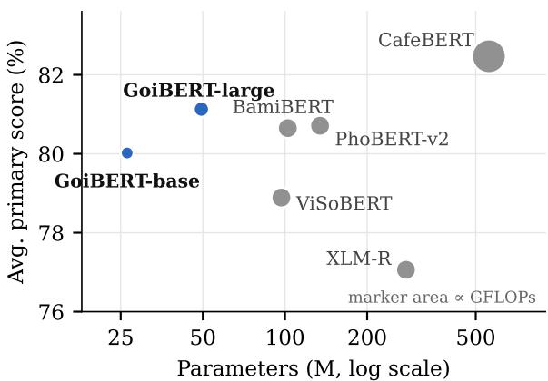
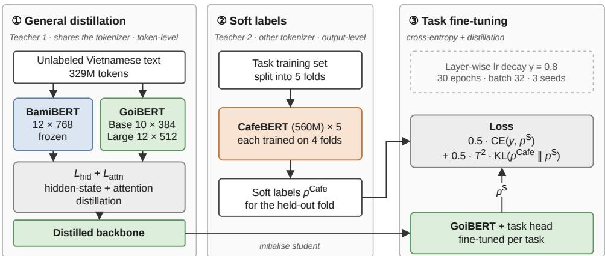
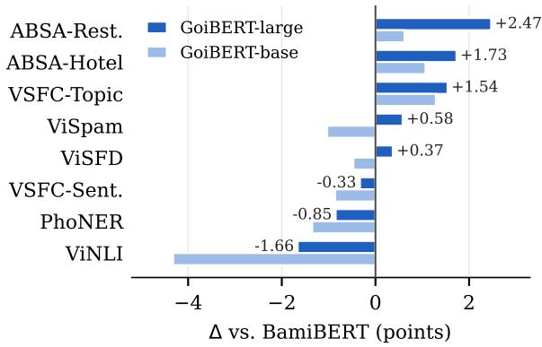
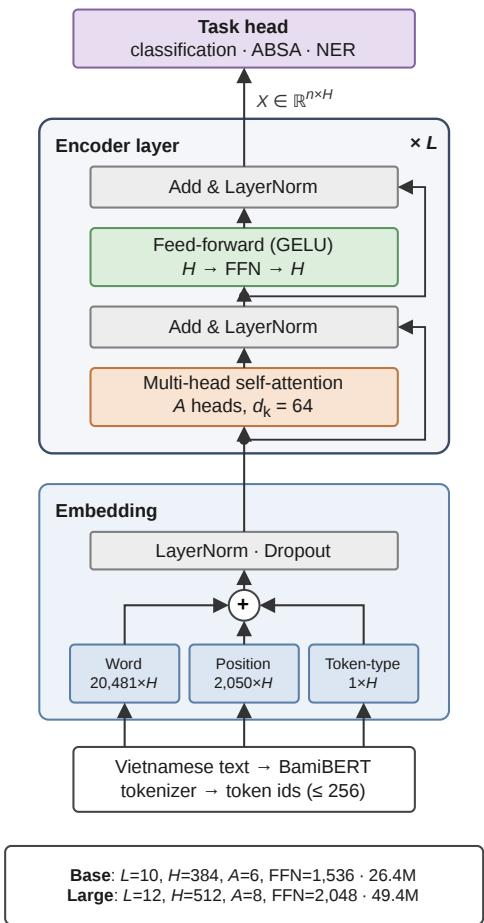

# GoiBERT: Compact Vietnamese Language Models via Two-Stage Knowledge Distillation

Quang Anh Kiet Tran1\* Nam Anh Tran2\* Manh Hung Trinh3 Thanh Danh Le2 Khang Nhat Hoang Vo4 Huynh Dai Nhan Tran5

1UIT, VNU-HCM 2IU, VNU-HCM 3University of Eastern Finland 4MBZUAI 5University of Jyväskylä

Correspondence: huynh.d.n.tran@jyu.fi

## Abstract

Vietnamese pre-trained encoders have improved rapidly, but the strongest ones are large, multilingual-vocabulary models or depend on external word segmentation, which makes them costly to deploy. We present GoiBERT, a family of two compact Vietnamese encoders with 26M and 49M parameters that operate directly on raw text. GoiBERT learns from two complementary teachers. A same-tokenizer Vietnamese encoder first teaches general-purpose representations. A much larger teacher then provides task-level guidance through soft labels that are generated without ever labeling its own training data. Across eight benchmarks covering text classification, aspect-based sentiment analysis, natural language inference, and named entity recognition, GoiBERT-large achieves the highest average score among nonteacher models. It does so with fewer than half the parameters of the strongest compact baseline and twice its throughput. GoiBERT-base retains 99% of that baseline’s performance at a quarter of its size. Our analysis shows that compression is nearly lossless for sentiment and classification tasks but remains costly for inference and entity recognition, which points to clear directions for future work. Our code and models are available at: https://github. com/Nhantran65/GoiBERT.git

## 1 Introduction

Pre-trained Transformer encoders remain the workhorse of practical language understanding: they power text classification, sentiment analysis, information extraction, and retrieval in production systems where generative large language models are too slow or too costly to serve (Devlin et al., 2019; Liu et al., 2019b; Conneau et al., 2020; Warner et al., 2025). Vietnamese NLP has followed this trajectory closely, moving from multilingual encoders to a growing family of monolingual models such as PhoBERT, ViDeBERTa, ViSoBERT, and the recent BamiBERT, as well as CafeBERT, a large XLM-R model further adapted to Vietnamese (Nguyen and Tuan Nguyen, 2020; Tran et al., 2023; Nguyen et al., 2023b, 2026; Do et al., 2024).

  
Figure 1: Average score over eight Vietnamese benchmarks versus model size. Both GoiBERT variants lie on the accuracy–efficiency frontier of non-teacher models: GoiBERT-large has the highest average with less than half of BamiBERT’s parameters, and GoiBERT-base stays close with about a quarter of them.

These models have steadily raised the bar on Vietnamese benchmarks, but each comes with a deployment cost. The strongest model, CafeBERT, has 559M parameters, and more than 45% of them sit in its multilingual embedding matrix. PhoBERT expects word-segmented input and therefore needs an external segmenter at inference time (Vu et al., 2018). ViSoBERT targets social-media text, and even the most compact strong monolingual baseline, BamiBERT, uses a 102M-parameter encoder. For the many Vietnamese applications that run on CPUs, small GPUs, or under tight latency budgets, the field still lacks a compact, segmentation-free encoder that holds up across diverse tasks.

Knowledge distillation (KD) is the standard tool for closing this gap in English, where compact students such as DistilBERT, TinyBERT, Mobile-BERT, and MiniLM retain most of their teachers’ accuracy at a fraction of their cost (Hinton et al., 2015; Sanh et al., 2019; Jiao et al., 2020; Sun et al., 2020; Wang et al., 2020). Transferring these recipes to Vietnamese, however, raises a design question that English work rarely faces: which teacher should the student learn from? The most accurate Vietnamese teacher (CafeBERT) uses a large multilingual vocabulary that does not match any compact Vietnamese tokenizer. This rules out the token-level hidden-state and attention matching that makes TinyBERT-style general distillation effective. A same-tokenizer teacher (BamiBERT) supports such matching but is itself weaker on several tasks. To our knowledge, no prior work has studied how to combine these complementary signals for Vietnamese, and Vietnamese compact encoders have not been evaluated systematically for both accuracy and deployment cost.

We present GoiBERT, a family of two compact Vietnamese encoders: GoiBERT-base (26.4M parameters) and GoiBERT-large (49.4M parameters). Our key idea is to assign each teacher to the stage where its strengths matter. In the first stage, BamiBERT, which shares GoiBERT’s tokenizer, teaches general-purpose representations through layer-wise hidden-state and attention transfer on unlabeled text. In the second stage, CafeBERT supplies task-specific soft labels at the output level, where tokenizer mismatch is irrelevant. We produce these labels out offold, so that no teacher ever labels an example it was trained on. As Figure 1 shows, the resulting students move the accuracy– efficiency frontier for Vietnamese. GoiBERT-large achieves the best average score among non-teacher models with fewer than half of BamiBERT’s parameters and twice its GPU throughput. GoiBERT-base retains 99% of BamiBERT’s average score with a quarter of its parameters and 3.5× its throughput.

Our contributions are threefold:

• Models. We release GoiBERT-base and GoiBERT-large, compact Vietnamese encoders that process raw text without word segmentation and offer two complementary accuracy–efficiency operating points.

• Method. We propose a two-teacher, twostage distillation framework. It pairs representation transfer from a tokenizer-compatible teacher with out-of-fold, output-level supervision from a stronger cross-tokenizer teacher, and it combines this with teacher-derived embedding initialization and layer-wise learningrate decay.

• Analysis. We evaluate on eight benchmarks (15 metrics, three seeds) and measure parameters, FLOPs, throughput, memory, and CPU latency. Ablations and per-task analysis show where compression is nearly free (sentiment, ABSA, topic, and spam classification) and where it still costs accuracy (NLI and NER).

## 2 Related Work

Our work draws on three lines of research: Vietnamese pre-trained encoders, knowledge distillation for compact Transformers, and efficient language-specific models.

Vietnamese pre-trained encoders. Vietnamese NLP has moved from multilingual encoders such as XLM-R (Conneau et al., 2020) to a growing family of monolingual models. After early BERT and ELECTRA adaptations (Bui et al., 2020), PhoBERT set strong baselines but requires word-segmented input from an external segmenter (Nguyen and Tuan Nguyen, 2020; Vu et al., 2018). This design choice reflects a property of the language: Vietnamese is written as space-separated syllables, and many words span several of them, so a model must either receive word boundaries explicitly or learn them from raw text. Later models changed the pre-training objective (ViDeBERTa; Tran et al., 2023) or the target domain (ViSoBERT for social media and ViHealthBERT for health; Nguyen et al., 2023b; Minh et al., 2022). Others added linguistic inductive bias: HuTieuBERT injects morpheme-boundary information into a pre-trained encoder to reflect the isolating structure of Vietnamese (Dinh et al., 2026). BamiB-ERT is a recent general-purpose raw-text encoder (Nguyen et al., 2026), while CafeBERT continues pre-training XLM-R-large on Vietnamese and leads the VLUE benchmark (Do et al., 2024). Generative models such as ViT5, BARTpho, and PhoGPT (Phan et al., 2022; Tran et al., 2022; Nguyen et al., 2023a) target text generation and are complementary to encoders, which remain the cost-effective choice for understanding tasks. Benchmarks such as VLUE and ViGLUE (Do et al., 2024; Tran et al., 2024) have made these models comparable, but only in terms of accuracy. Similar efforts for other medium-resource languages, such as Indonesian, Indic languages, Bangla, and Thai, have likewise focused on full-size models (Wilie et al., 2020; Kakwani et al., 2020; Bhattacharjee et al., 2022; Lowphansirikul et al., 2021). This line of work has therefore steadily raised accuracy while model sizes have stayed around or above 100M parameters. GoiBERT asks the complementary question of how much of that accuracy can be retained at a fraction of the cost.

Knowledge distillation for compact encoders. Knowledge distillation (KD) trains a small student to mimic the softened predictions of a larger teacher (Hinton et al., 2015). For BERT-style encoders, KD has been extended from output logits to intermedi ate signals. PKD and DistilBERT match intermedi ate layers or initialize the student from the teacher (Sun et al., 2019b; Sanh et al., 2019), MobileBERT transfers layer-wise features (Sun et al., 2020), and MiniLM transfers self-attention distributions (Wang et al., 2020, 2021). TinyBERT (Jiao et al., 2020) combines these signals into the two-stage scheme we build on: general distillation of hidden states and attention on unlabeled text, followed by task-specific distillation. The general stage lets a compact student acquire broad language knowl edge without being pre-trained from scratch, and the task stage then specializes it with the teacher’s predictions. Comparative studies further show that pre-training the student (Turc et al., 2019) and the choice of distillation objective (Udagawa et al., 2023) strongly affect the final model. Two find ings from this literature shape our design. First, a teacher much larger than its student can transfer poorly (Cho and Hariharan, 2019; Mirzadeh et al., 2020), which favors a mid-sized teacher for representation transfer. Second, soft labels partly act as a regularizer, so a student can match or even surpass its teacher (Furlanello et al., 2018; Yuan et al., 2020). Existing two-stage methods use a single teacher in both stages, and multi-teacher ap proaches combine several teachers into one super vision signal (Liu et al., 2019a; Yuan et al., 2021; Avram et al., 2022). When teacher and student vocabularies differ, distillation must additionally align them (Boizard et al., 2025; Zhang et al., 2024). GoiBERT sidesteps this problem by giving each teacher its own stage. A same-tokenizer teacher supervises representations, and a cross-tokenizer teacher supervises only task outputs, whose soft la bels we generate out of fold in the spirit of stacked generalization (Wolpert, 1992).

Efficient language-specific encoders. A complementary line of work builds compact models for a single language. One route starts from multilingual models, either trimming their vocabulary (Abdaoui et al., 2020; Ushio et al., 2023) or distilling them into language-specific students (Mukherjee and Hassan Awadallah, 2020; Ansell et al., 2023; Cruz, 2025). Another distills monolingual teachers, as in DistilCamemBERT for French (Delestre and Amar, 2022). In both cases, the student typically inherits its vocabulary and its supervision from the same single teacher. GoiBERT combines the two routes. Its tokenizer and initial embeddings come from a monolingual teacher, in line with evidence that initializing small models from larger ones helps (Samragh et al., 2023; Xu et al., 2024). Its task supervision comes from a teacher of multilingual origin. Pruning (Sanh et al., 2020; Xia et al., 2022), quantization (Kim et al., 2021), and parameter sharing (Lan et al., 2020) are orthogonal and can be applied on top of GoiBERT. Finally, parameter counts and FLOPs can misrepresent real speed (Dehghani et al., 2022). Following recent efficiency-focused encoders such as ModernBERT (Warner et al., 2025), we therefore report measured throughput, memory, and latency alongside predictive accuracy.

## 3 GoiBERT

GoiBERT is designed around one observation. The two strongest available teachers offer different kinds of knowledge, and each kind can only be transferred at a particular granularity. BamiBERT tokenizes text exactly as GoiBERT does, so its token-level hidden states and attention maps can be matched position by position. CafeBERT is considerably more accurate on several tasks, but its 250K-entry multilingual vocabulary segments the same sentence differently, so its knowledge can only be transferred cleanly through sequence- or word-level predictions. GoiBERT therefore uses BamiBERT for task-agnostic representation transfer and CafeBERT for task-specific output supervision (Figure 2), extending the two-stage design of TinyBERT (Jiao et al., 2020) to two heterogeneous teachers with complementary roles.

## 3.1 Compact Architecture

GoiBERT follows the RoBERTa encoder architecture (Liu et al., 2019b) and reuses BamiBERT’s 20,481-token vocabulary and tokenizer, so it processes raw Vietnamese text without word segmentation. GoiBERT-base has 10 Transformer layers, hidden size 384, 6 attention heads, and a 1,536-dimensional feed-forward layer (26.4M parameters). GoiBERT-large has 12 layers, hidden size 512, 8 heads, and a 2,048-dimensional feed-forward layer (49.4M parameters). Both use 64-dimensional attention heads, as BamiBERT does. The compact vocabulary is itself a source of efficiency. Embeddings account for only 33% and 23% of the parameters of GoiBERT-base and GoiBERT-large, respectively, compared with 46% for CafeBERT and 69% for XLM-R (Table 5). To inherit lexical knowledge from the teacher, we initialize GoiBERT-large’s word embeddings by projecting BamiBERT’s 768-dimensional embedding matrix onto its 512 leading principal components and rescaling to the student’s initialization scale. Transformer blocks are initialized randomly. Appendix A gives a layer-level diagram.

  
Figure 2: Overview of the GoiBERT training pipeline. (1) General distillation: the student matches the hidden states and attention maps of a frozen BamiBERT, which shares its tokenizer, on unlabeled Vietnamese text. (2) Out-of-fold soft labels: five CafeBERT teachers, each fine-tuned on four folds, label the held-out fold, so that no example is labeled by a teacher that saw it. (3) Task fine-tuning: the distilled backbone is trained on gold labels and CafeBERT soft labels with layer-wise learning-rate decay.

## 3.2 Stage 1: General Distillation

In the first stage, the student learns from a frozen BamiBERT on unlabeled text by matching its intermediate representations. Let $v \in \{ \mathrm { b a s e } , \mathrm { l a r g e } \}$ denote a variant with $L _ { v }$ layers and hidden size $d _ { v }$ . Let $H _ { \rho } ^ { v } \in \mathbb { R } ^ { n \times d _ { v } }$ be the student’s hidden states at layer $\ell ( \ell = 0$ is the embedding output), and let $\dot { H } _ { \pi _ { v } ( \ell ) } ^ { B } \in \mathbb R ^ { n \times 7 6 8 }$ be those of the teacher layer paired with it by the mapping $\pi _ { v }$ . GoiBERT-large has 12 layers like BamiBERT, so $\pi _ { \mathrm { l a r g e } }$ is the identity. GoiBERT-base has only 10 layers, which rules out a one-to-one pairing. Instead, $\pi _ { \mathrm { b a s e } }$ is an orderpreserving mapping that pairs the embedding outputs and selects 10 of the teacher’s 12 layers as targets, so that lower student layers learn from lower teacher layers and upper from upper (Jiao et al., 2020) (Appendix B).

Because the hidden sizes differ, a trainable linear projection $P _ { \ell } ^ { v }$ maps student states into the teacher space:

$$
\mathcal { L } _ { \mathrm { h i d } } = \frac { 1 } { L _ { v } + 1 } \sum _ { \ell = 0 } ^ { L _ { v } } \mathrm { M S E } _ { \mathrm { n o n p a d } } \big ( P _ { \ell } ^ { v } ( H _ { \ell } ^ { v } ) , H _ { \pi _ { v } ( \ell ) } ^ { B } \big ) ,\tag{1}
$$

where the error is computed only over non-padding positions.

The two models also have different numbers of attention heads, so head-to-head matching is undefined. We instead match head-averaged attention distributions $\begin{array} { r } { \bar { A } _ { \ell } ^ { m } = \frac { 1 } { a _ { m } } \sum _ { h = 1 } ^ { a _ { m } } A _ { \ell , h } ^ { m } } \end{array}$ , where $A _ { \ell , h } ^ { m }$ is the post-softmax attention matrix of head h in model m:

$$
\mathcal { L } _ { \mathrm { a t t } } = \frac { 1 } { L _ { v } } \sum _ { \ell = 1 } ^ { L _ { v } } \mathrm { M S E } \big ( \bar { A } _ { \ell } ^ { v } , \bar { A } _ { \pi _ { v } ( \ell ) } ^ { B } \big ) .\tag{2}
$$

Averaging keeps the objective architecture-agnostic while still transferring where each layer attends (Jiao et al., 2020; Wang et al., 2020). The generaldistillation objective is

$$
{ \mathcal { L } } _ { \mathrm { G D } } = { \mathcal { L } } _ { \mathrm { h i d } } + { \mathcal { L } } _ { \mathrm { a t t } } .\tag{3}
$$

## 3.3 Stage 2: Out-of-Fold Task Distillation

In the second stage, the distilled backbone is finetuned on each downstream task with gold labels and soft labels from CafeBERT. A naive approach would fine-tune CafeBERT on the full training set and then label that same set. However, a 559Mparameter teacher tends to fit its training examples closely, so its predictions on them become nearly one-hot and carry little of the “dark knowledge” that makes soft labels useful (Hinton et al., 2015; Stanton et al., 2021). We therefore adopt a crossfitting scheme inspired by stacked generalization (Wolpert, 1992). We split the training set into five folds, fine-tune one CafeBERT on each set of four folds, and use it to predict only the held-out fold. Every training example thus receives a soft target from a teacher that has never seen it, which reflects the teacher’s genuine uncertainty on that example.

Given gold label y, student logits $z _ { S }$ , teacher logits $z _ { C } ,$ , and $p _ { m } ^ { ( T ) } = \mathrm { s o f t m a x } ( z _ { m } / T )$ , the task objective is

$$
\begin{array} { r l } & { \mathcal { L } _ { \mathrm { t a s k } } = \alpha \ \mathrm { C E } \big ( y , p _ { S } ^ { ( 1 ) } \big ) } \\ & { \qquad + \left( 1 - \alpha \right) T ^ { 2 } \ \mathrm { K L } \big ( p _ { C } ^ { ( T ) } \| p _ { S } ^ { ( T ) } \big ) , } \end{array}\tag{4}
$$

with $\alpha = 0 . 5$ and $T = 2 ,$ . Because the supervision is at the output level, the tokenizer mismatch between CafeBERT and GoiBERT needs no vocabulary alignment (Boizard et al., 2025). For sequence classification and NLI, Eq. 4 is applied once per example. For ABSA, it is applied independently to each aspect slot. For NER, both models’ predictions are aligned to the first subword of each original syllable, which yields a shared unit of supervision across both tokenizers.

Layer-wise learning-rate decay. During task fine-tuning, layer ℓ of the student uses learning rate $\eta _ { \ell } = \eta \gamma ^ { \bar { L } _ { v } - \bar { \ell } } \mathrm { w i t h } \gamma = 0 . 8$ , the embeddings use $\eta \gamma ^ { L _ { v } }$ , and the task head uses $\eta$ (Howard and Ruder, 2018; Sun et al., 2019a). Lower layers, which hold the most transferable features learned in Stage 1, are therefore updated more conservatively than upper, task-specific ones.

## 4 Experimental Setup

Benchmarks. We evaluate on eight Vietnamese tasks that span four task families and several domains (Appendix Table 7). Text classification covers sentiment and topic classification of student feedback in UIT-VSFC (Nguyen et al., 2018) and four-class spam detection of e-commerce reviews in ViSpamReviews (Van Dinh et al., 2022). Aspect-based sentiment analysis (ABSA) covers smartphone reviews in UIT-ViSFD (Luc Phan et al., 2021) and the Restaurant and Hotel domains of UIT-ABSA (Van Thin et al., 2021). Natural language inference (NLI) uses ViNLI (Huynh et al., 2022) (the four-label community mirror presencesw/vinli\_4\_label). Named entity recognition (NER) uses PhoNER\_COVID19 (Truong et al., 2021). We keep the official training, validation, and test splits.

Metrics. Classification and NLI are scored with accuracy and macro-F1, and ABSA with aspectdetection F1 and end-to-end aspect–sentiment pair micro-F1. NER is scored with strict entity-level F1. This yields 15 metrics in total (Appendix E). In the main text we report one primary metric per task: macro-F1 for classification and NLI, pair F1 for ABSA, and entity F1 for NER. All locally trained models are averaged over three fine-tuning seeds (42, 43, 44) (Dodge et al., 2020).

Baselines. We compare against the monolingual encoders PhoBERT-base-v2 (Nguyen and Tuan Nguyen, 2020), ViSoBERT (Nguyen et al., 2023b), and BamiBERT (Nguyen et al., 2026); the multilingual XLM-R-base (Conneau et al., 2020); and CafeBERT (Do et al., 2024), which is also our task teacher. BamiBERT is our principal comparison because it is the most recent compact Vietnamese encoder and our Stage 1 teacher. We re-run it under the same downstream protocol as GoiB-ERT, with its learning rate tuned on validation data and standard cross-entropy fine-tuning. ViDe-BERTa (Tran et al., 2023) results are reported in Appendix E.

Distillation corpus. General distillation uses 328.6M tokens of clean, unlabeled Vietnamese text from HPLT 3.0 (Oepen et al., 2026), Wikipedia, and the training splits of selected benchmarks. To prevent leakage, we remove every passage that matches validation or test content under exact matching or 13-gram overlap (Brown et al., 2020; Lee et al., 2022).

Implementation. General distillation runs for 120K steps (batch 32, sequence length 256) with AdamW, learning rate $1 0 ^ { - 4 }$ , and linear decay, on a single NVIDIA L40S GPU in bfloat16. Task fine-tuning runs for 30 epochs with batch size 32. Learning rates and checkpoints are selected on validation data only. Efficiency is measured on the encoder alone. GPU throughput and peak memory are measured on an L40S (bf16, batch 32, length 256), and CPU latency on a single 128-token input with eight threads (fp32). The same protocol is applied to every model. Full hyperparameters are given in Appendix D.

## 5 Results and Analysis

## 5.1 Main Results

Table 1 compares GoiBERT with existing Vietnamese and multilingual encoders. We highlight three findings.

GoiBERT-large is the strongest non-teacher model. GoiBERT-large reaches an average of 81.13, ahead of PhoBERT-v2 (80.71) and BamiB-ERT (80.65), and it is the best non-teacher model on five of the eight tasks. The largest gains over BamiBERT, its Stage-1 teacher, appear on fine-grained sentiment: +2.47 pair F1 on ABSA-Restaurant and +1.73 on ABSA-Hotel, followed by +1.54 macro-F1 on VSFC-Topic. Thus a student with 48% of BamiBERT’s parameters does not merely approximate its teacher but outperforms it on most tasks. The improvement comes from the second, CafeBERT-guided stage (§5.4). The full 15-metric average gives the same ordering: 84.02 for GoiBERT-large, 83.61 for BamiBERT, and 82.98 for GoiBERT-base (Table 5).

GoiBERT-base is a strong extreme-efficiency point. With only 26.4M parameters and 4.8 GFLOPs, GoiBERT-base averages 80.02, which is 99.2% of BamiBERT’s average with a quarter of its size. It still outperforms BamiBERT on both UIT-ABSA domains and on VSFC-Topic, and it exceeds ViSoBERT and XLM-R-base on average despite being 3.7× and 10.5× smaller, respectively.

The cost of compression is task-dependent. GoiBERT does not lead everywhere. BamiBERT remains better on ViNLI (−1.66 for GoiBERTlarge) and PhoNER (−0.85). PhoBERT-v2 is best among non-teacher models on PhoNER and VSFC-Sentiment, although on PhoNER it benefits from external word segmentation, which GoiBERT does not use. We analyze these patterns next.

## 5.2 Where Does Compression Hurt?

Figure 3 shows the per-task differences from BamiBERT, and Table 2 groups tasks by family and compares GoiBERT-large with both of its teachers. The task ranking is nearly identical for both variants, so the pattern reflects the tasks rather than single-model noise. A clear pattern emerges. On classification, GoiBERT-large slightly surpasses its 559M-parameter task teacher on average (80.19 vs. 79.98). It also exceeds the teacher on three individual tasks (ViSpam, ABSA-Hotel, and VSFC-Topic). On ABSA, it stays within 0.6 points of the teacher. This is consistent with prior observations that soft targets act as a data-dependent regularizer and can allow students to match or surpass their teachers (Furlanello et al., 2018; Yuan et al., 2020). Out-of-fold targets may strengthen this effect, since they encode the teacher’s uncertainty on unseen examples rather than its memorized labels. Excluding ViNLI, GoiBERT-large averages 81.50 over the remaining seven tasks, only 0.44 points below CafeBERT (81.94), while being 11× smaller in parameter count.

  
Figure 3: Per-task difference from BamiBERT (primary metric). Gains concentrate on ABSA and topic classification, whereas NLI and NER carry the cost of compression, most visibly for the smaller GoiBERT-base.

The remaining gap lies almost entirely in NLI and, to a lesser extent, NER. Two observations suggest that the ViNLI gap reflects limited capacity rather than a lack of supervision. First, ViNLI is the task most sensitive to model size within the GoiBERT family: the base–large gap is 2.66 points, compared with 0.89 on average across the other tasks. Second, ViNLI gains +1.4 (large) and +3.0 (base) points from task distillation (§5.4), so the teacher’s signal is informative, but a 12-layer, 512-dimensional student cannot fully absorb the cross-sentence reasoning that the 24-layer, 1024- dimensional teacher performs. For NER, two factors may contribute. Entity F1 is already high (above 92 for all models), leaving little room for distillation to help. In addition, aligning supervision to the first subword of each syllable discards the multi-syllable word boundaries that PhoBERT receives from its segmenter, and these boundaries frequently coincide with entity boundaries in Vietnamese. Distillation objectives tailored to inference and span structure are a natural next step.

<table><tr><td>Task</td><td>Metric</td><td>Cafe- BERT</td><td>XLM-R†</td><td>ViSo- BERT</td><td>PhoBERT -v2</td><td>Bami- BERT</td><td>GoiBERT -base</td><td>GoiBERT -large</td></tr><tr><td>ViNLI</td><td>M-F1</td><td>86.19</td><td>77.01</td><td>67.67</td><td>78.87</td><td>80.18</td><td>75.86</td><td>78.52</td></tr><tr><td>ViSpam</td><td>M-F1</td><td>77.22</td><td>76.55</td><td>77.10</td><td>77.86</td><td>77.55</td><td>76.52</td><td>78.13</td></tr><tr><td>PhoNER</td><td>Ent. F1</td><td>95.47</td><td>92.50</td><td>93.07</td><td>95.44</td><td>94.32</td><td>92.97</td><td>93.47</td></tr><tr><td>ABSA-Rest.</td><td>Pair</td><td>77.41</td><td>71.58</td><td>74.68</td><td>74.12</td><td>73.53</td><td>74.15</td><td>76.00</td></tr><tr><td>ABSA-Hotel</td><td>Pair</td><td>74.78</td><td>71.23</td><td>74.17</td><td>72.35</td><td>73.94</td><td>75.01</td><td>75.67</td></tr><tr><td>VSFC-Topic</td><td>M-F1</td><td>79.81</td><td>79.56</td><td>80.00</td><td>79.68</td><td>78.88</td><td>80.17</td><td>80.42</td></tr><tr><td>VSFC-Sent.</td><td>M-F1</td><td>82.91</td><td>82.20</td><td>80.69</td><td>83.34</td><td>82.36</td><td>81.50</td><td>82.03</td></tr><tr><td>ViSFD</td><td>Pair</td><td>85.98</td><td>65.81</td><td>83.77</td><td>84.05</td><td>84.41</td><td>83.94</td><td>84.78</td></tr><tr><td>Average (8)</td><td></td><td>82.47</td><td>77.06</td><td>78.89</td><td>80.71</td><td>80.65</td><td>80.02</td><td>81.13</td></tr><tr><td colspan="2">Params (M) ↓</td><td>558.9</td><td>277.5</td><td>97.0</td><td>134.4</td><td>102.4</td><td>26.4</td><td>49.4</td></tr><tr><td colspan="2">GFLOPs (128 tok.) ↓</td><td>78.9</td><td>22.4</td><td>22.4</td><td>22.4</td><td>22.4</td><td>4.8</td><td>10.1</td></tr></table>

Table 1: Test results (%) on eight Vietnamese benchmarks, one primary metric per task, averaged over three seeds. M-F1: macro-F1; Pair: aspect–sentiment pair F1; Ent. F1: strict entity-level F1. Bold marks the best non-teacher model in each row. ⋄Task teacher of GoiBERT (shown for reference). †Reported results. ‡Uses word-segmented input. All 15 metrics and seed ranges appear in Appendices E–F.

<table><tr><td>Family</td><td>Bami</td><td>Goi-L</td><td>Cafe</td><td> $\Delta _ { \mathbf { L } - \mathbf { C } }$ </td></tr><tr><td>Classification (3)</td><td>79.60</td><td>80.19</td><td>79.98</td><td>+0.21</td></tr><tr><td>ABSA (3)</td><td>77.29</td><td>78.82</td><td>79.39</td><td>-0.57</td></tr><tr><td>NER (1)</td><td>94.32</td><td>93.47</td><td>95.47</td><td>-2.00</td></tr><tr><td>NLI (1)</td><td>80.18</td><td>78.52</td><td>86.19</td><td>-7.67</td></tr></table>

Table 2: Primary scores averaged by task family. $\Delta _ { \mathrm { L - C } }$ is the gap between GoiBERT-large and its 11× larger task teacher CafeBERT.
<table><tr><td>Model</td><td>Weights</td><td>Throughput</td><td>VRAM</td><td>CPU lat.</td></tr><tr><td>BamiBERT</td><td>206 MB</td><td>2,397</td><td>801 MB</td><td>31.0 ms</td></tr><tr><td>Goi-large</td><td>99 MB</td><td>4,827 (2.0×)</td><td>410 MB</td><td>19.4 ms</td></tr><tr><td>Goi-base</td><td>53MB</td><td>8,285 (3.5×)</td><td>248 MB</td><td>14.2 ms</td></tr></table>

Table 3: Inference efficiency of the encoders (bf16 weights). Throughput (sentences/s) and peak VRAM: L40S, batch 32, length 256. CPU latency: one 128- token input, eight threads, fp32. Throughput speed-ups relative to BamiBERT are in parentheses.

## 5.3 Efficiency–Accuracy Trade-off

Table 3 turns the parameter and FLOP reductions of Table 1 into measured deployment gains. Compared with BamiBERT, GoiBERT-large doubles GPU throughput, halves peak memory, and cuts CPU latency by 37%. GoiBERT-base processes 3.5× as many sentences per second and needs less than a third of the memory. Together with Figure 1, these results place both variants on the accuracy– efficiency frontier. GoiBERT-large dominates every baseline except the 11× larger CafeBERT, and GoiBERT-base is the only model below 30M pa-

rameters.

The measured speed-ups are, however, smaller than the FLOP ratios suggest. GoiBERT-base needs 4.7× fewer FLOPs than BamiBERT but runs only 3.5× faster on GPU and 2.2× faster on CPU. At small widths, memory-bound operations such as layer normalization and embedding lookups, together with fixed per-call overhead, take up a growing share of runtime. This echoes the warning that FLOPs and parameter counts are imperfect proxies for real efficiency (Dehghani et al., 2022). It also makes GoiBERT-large, whose 2.2× FLOP reduction translates almost fully into a 2.0× GPU speed-up, the more balanced choice when accuracy matters. GoiBERT-base is preferable for CPU-only or memory-constrained serving.

Where do the parameters go? Table 5 breaks each model’s size into embedding and encoder parameters, which explains much of the efficiency picture. Multilingual vocabularies impose a large fixed cost: 69% of XLM-R-base and 46% of CafeBERT are embeddings, and these parameters add memory without adding per-token computation. BamiBERT’s compact 20K-token vocabulary already avoids most of this cost, so GoiBERT’s savings over BamiBERT come mainly from the encoder: 37.8M encoder parameters for GoiBERTlarge and 17.7M for GoiBERT-base, compared with 85.1M. Consequently, the encoder is where further compression should target, for example through pruning or quantization (Xia et al., 2022; Kim et al., 2021), whereas for multilingual models vocabulary trimming is the more natural first step (Abdaoui et al., 2020; Ushio et al., 2023).

<table><tr><td>Setting</td><td>ABSA-R</td><td>VSFC-T</td><td>ViNLI</td></tr><tr><td>GoiBERT-large</td><td></td><td></td><td></td></tr><tr><td>CE only (no GD)</td><td>59.35</td><td>77.42</td><td>45.02</td></tr><tr><td>+ General KD</td><td>72.89 +13.5</td><td> $7 8 . 0 6 + 0 . 6 $ </td><td> $7 6 . 1 8 + 3 1 . 2$ </td></tr><tr><td>+ Task KD (OOF)</td><td> $7 4 . 8 1 + 1 . 9$ </td><td> $7 8 . 9 4 + 0 . 9$ </td><td> $7 7 . 6 0 + 1 . 4$ </td></tr><tr><td>+ LLRD (full)</td><td> ${ \bf 7 6 . 0 0 } \mathrm { \ t } 1 . 2$ </td><td> $\mathbf { 8 0 . 4 2 \ + 1 . 5 }$ </td><td> $7 8 . 5 2 \substack { + 0 . 9 }$ </td></tr><tr><td>GoiBERT-base</td><td></td><td></td><td></td></tr><tr><td>CE only (no GD)</td><td>59.43</td><td>77.30</td><td>44.04</td></tr><tr><td>+ General KD</td><td> $7 1 . 1 2 + 1 1 . 7$ </td><td> $7 9 . 2 9 + 2 . 0$ </td><td> $7 1 . 1 0 + 2 7 . 1 $ </td></tr><tr><td>+ Task KD (OOF)</td><td> $7 2 . 8 5 + 1 . 7$ </td><td> $7 8 . 7 2 - 0 . 6 $ </td><td> $7 4 . 0 5 + 3 . 0$ </td></tr><tr><td>+ LLRD (full)</td><td> $7 4 . 1 5 + 1 . 3$ </td><td> $\mathbf { 8 0 . 1 7 \ + 1 . 5 }$ </td><td> $7 5 . 8 6 + 1 . 8$ </td></tr></table>

Table 4: Cumulative ablation (test, mean of three seeds). ABSA-R: Restaurant pair F1; VSFC-T and ViNLI: macro-F1. Small numbers give the change from the previous row.

Which variant should practitioners use? The two variants serve different deployment regimes. When accuracy is the priority and a GPU is available, GoiBERT-large is the better default. It is the strongest non-teacher model on average, roughly matches CafeBERT on classification and ABSA, and still halves BamiBERT’s serving cost. When the budget is tight, such as CPU-only inference, edge devices, or high-throughput batch labeling, GoiBERT-base offers the lowest latency and memory with an average loss of only 1.1 points relative to GoiBERT-large. For NLI-heavy applications, a larger encoder remains preferable.

## 5.4 Ablation Study

Table 4 adds each component in turn on three tasks that span ABSA, topic classification, and NLI.

General distillation is indispensable. Training the compact architecture from scratch fails on tasks that require compositional understanding: ViNLI macro-F1 is only 45.02 and ABSA-Restaurant pair F1 is 59.35. Stage 1 recovers +31.2 and +13.5 points on these tasks, respectively, for GoiBERTlarge. In contrast, VSFC-Topic gains less than one point, since lexical cues already go a long way for topic classification. The magnitude of these gains confirms that representation transfer from a tokenizer-compatible teacher is the backbone of the recipe (Turc et al., 2019; Jiao et al., 2020).

Cross-tokenizer task distillation adds consistent gains. Out-of-fold CafeBERT supervision improves five of the six settings, by up to +3.0 points (ViNLI, GoiBERT-base). For GoiBERTbase, its largest effect is on ViNLI, the task with the widest teacher–student gap. This supports our design choice to bring in the stronger teacher at the stage where its tokenizer does not matter. The one decrease (−0.6 on VSFC-Topic for GoiBERT-base) is small and is more than recovered once LLRD is subsequently added.

LLRD helps uniformly. Layer-wise decay improves every task for both variants, by 0.9–1.8 points. This is consistent with the intuition that the lower layers distilled in Stage 1 should be preserved during fine-tuning (Howard and Ruder, 2018; Zhang et al., 2021). Overall, the full pipeline improves on cross-entropy fine-tuning of an undistilled student by 16.7, 3.0, and 33.5 points for GoiBERT-large.

Stability across seeds. GoiBERT-large is also more stable than BamiBERT under fine-tuning. Its seed range (max−min) is narrower on 11 of the 15 metrics, and its average range is 0.61 points versus 0.85 for BamiBERT (Appendix F). This is in line with the regularizing effect of soft targets (Müller et al., 2019).

## 6 Conclusion

We introduced GoiBERT, a family of compact, segmentation-free Vietnamese encoders trained by two-stage distillation from two complementary teachers. A tokenizer-compatible teacher transfers general representations, and a much larger crosstokenizer teacher supplies out-of-fold task supervision. GoiBERT-large (49.4M parameters) achieves the best average score among non-teacher models across eight benchmarks, doubles the GPU throughput of BamiBERT, and comes within half a point of its 559M-parameter teacher outside NLI. GoiBERTbase (26.4M) retains 99% of BamiBERT’s average with a quarter of its parameters. Our analysis shows that compression is nearly free for classification and ABSA but still costly for inference and entity recognition. This two-teacher recipe should also transfer to other languages whose strongest models are multilingual. Future work will target NLI- and NER-specific distillation, longer contexts, unseen domains, and quantization.

## Limitations

Our comparison with BamiBERT is not a pure architecture comparison. GoiBERT also benefits from CafeBERT distillation, layer-wise learningrate decay, and a general-distillation corpus that includes benchmark training text, while our BamiB-

ERT re-run uses plain cross-entropy fine-tuning. We should also be upfront that we decided to build the larger variant after looking at earlier test results, so test feedback partly shaped how the models were developed.

On the statistical side, we ran general distillation only once. The seed ranges we report therefore reflect fine-tuning variability alone, and they are not confidence intervals or significance tests. Our ablations cover just three tasks and add components one at a time, so they do not fully separate how the components interact. The 8- and 15-metric averages are handy summaries, but they mix metrics that mean different things.

There are also things we did not test. We distill on sequences of at most 256 tokens, so we do not know how GoiBERT handles long inputs, and none of our benchmarks probe unseen domains or dialectal variation. Our efficiency numbers cover encoder inference on the hardware we used. They leave out tokenization, task heads, and the cost of training five out-of-fold CafeBERT teachers for each task, which is substantial even though it is paid only once.

## Ethics Statement

GoiBERT is trained on publicly available text and benchmarks, so it can pick up social biases from web data and from its teachers. We have not audited the models for such biases, and we encourage anyone deploying them in sensitive settings to check first. On the positive side, smaller models make Vietnamese NLP cheaper to run and accessible on more modest hardware.

## References

Amine Abdaoui, Camille Pradel, and Grégoire Sigel. 2020. Load what you need: Smaller versions of multilingual BERT. In Proceedings of SustaiNLP: Workshop on Simple and Efficient Natural Language Processing, pages 119–123, Online. Association for Computational Linguistics.

Alan Ansell, Edoardo Maria Ponti, Anna Korhonen, and Ivan Vulic. 2023.´ Distilling efficient languagespecific models for cross-lingual transfer. In Findings of the Association for Computational Linguistics: ACL 2023, pages 8147–8165, Toronto, Canada. Association for Computational Linguistics.

Andrei-Marius Avram, Darius Catrina, Dumitru-Clementin Cercel, Mihai Dascalu, Traian Rebedea, Vasile Pais, and Dan Tufis. 2022. Distilling the

knowledge of Romanian BERTs using multiple teachers. In Proceedings of the Thirteenth Language Resources and Evaluation Conference, pages 374–384, Marseille, France. European Language Resources Association.

Abhik Bhattacharjee, Tahmid Hasan, Wasi Ahmad, Kazi Samin Mubasshir, Md Saiful Islam, Anindya Iqbal, M. Sohel Rahman, and Rifat Shahriyar. 2022. BanglaBERT: Language model pretraining and benchmarks for low-resource language understanding evaluation in Bangla. In Findings of the Associationfor Computational Linguistics: NAACL 2022, pages 1318–1327, Seattle, United States. Association for Computational Linguistics.

Nicolas Boizard, Kevin El Haddad, Céline Hudelot, and Pierre Colombo. 2025. Towards cross-tokenizer distillation: the universal logit distillation loss for LLMs. Transactions on Machine Learning Research.

Tom B. Brown, Benjamin Mann, Nick Ryder, Melanie Subbiah, Jared Kaplan, Prafulla Dhariwal, Arvind Neelakantan, Pranav Shyam, Girish Sastry, Amanda Askell, Sandhini Agarwal, Ariel Herbert-Voss, Gretchen Krueger, Tom Henighan, Rewon Child, Aditya Ramesh, Daniel M. Ziegler, Jeffrey Wu, Clemens Winter, and 12 others. 2020. Language Models are Few-Shot Learners. arXiv preprint.

The Viet Bui, Thi Oanh Tran, and Phuong Le-Hong. 2020. Improving sequence tagging for Vietnamese text using transformer-based neural models. In Proceedings ofthe 34th Pacific Asia Conference on Language, Information and Computation, pages 13–20, Hanoi, Vietnam. Association for Computational Linguistics.

Jang Hyun Cho and Bharath Hariharan. 2019. On the efficacy of knowledge distillation. In Proceedings ofthe IEEE/CVF International Conference on Computer Vision (ICCV), pages 4794–4802.

Alexis Conneau, Kartikay Khandelwal, Naman Goyal, Vishrav Chaudhary, Guillaume Wenzek, Francisco Guzmán, Edouard Grave, Myle Ott, Luke Zettlemoyer, and Veselin Stoyanov. 2020. Unsupervised cross-lingual representation learning at scale. In Proceedings of the 58th Annual Meeting of the Associationfor Computational Linguistics, pages 8440– 8451, Online. Association for Computational Linguistics.

Jan Christian Blaise Cruz. 2025. Extracting general-use transformers for low-resource languages via knowledge distillation. In Proceedings of the First Workshop on Language Models for Low-Resource Languages, pages 219–224, Abu Dhabi, United Arab Emirates. Association for Computational Linguistics.

Mostafa Dehghani, Anurag Arnab, Lucas Beyer, Ashish Vaswani, and Yi Tay. 2022. The efficiency misnomer. In International Conference on Learning Representations.

Cyrile Delestre and Abibatou Amar. 2022. Distil-CamemBERT: a distillation of the French model CamemBERT. arXiv preprint arXiv:2205.11111.

Jacob Devlin, Ming-Wei Chang, Kenton Lee, and Kristina Toutanova. 2019. BERT: Pre-training of deep bidirectional transformers for language understanding. In Proceedings ofthe 2019 Conference of the North American Chapter ofthe Associationfor Computational Linguistics: Human Language Technologies, Volume 1 (Long and Short Papers), pages 4171–4186, Minneapolis, Minnesota. Association for Computational Linguistics.

Anh Trac Duc Dinh, Khang Hoang Nhat Vo, Tai Tien Ta, Vinh Cong Doan, and Tho Quan. 2026. When morphology hides in plain sight: Breaking the isolation in Vietnamese and beyond. In Proceedings of the 64th Annual Meeting of the Association for Computational Linguistics (Volume 1: Long Papers), pages 10377–10392, San Diego, California, United States. Association for Computational Linguistics.

Phong Nguyen-Thuan Do, Son Quoc Tran, Phu Gia Hoang, Kiet Van Nguyen, and Ngan Luu-Thuy Nguyen. 2024. VLUE: A new benchmark and multitask knowledge transfer learning for Vietnamese natural language understanding. In Findings ofthe Associationfor Computational Linguistics: NAACL 2024, pages 211–222, Mexico City, Mexico. Association for Computational Linguistics.

Jesse Dodge, Gabriel Ilharco, Roy Schwartz, Ali Farhadi, Hannaneh Hajishirzi, and Noah Smith. 2020. Fine-Tuning Pretrained Language Models: Weight Initializations, Data Orders, and Early Stopping. arXiv preprint.

Tommaso Furlanello, Zachary Lipton, Michael Tschannen, Laurent Itti, and Anima Anandkumar. 2018. Born again neural networks. In Proceedings of the 35th International Conference on Machine Learning, volume 80 of Proceedings ofMachine Learning Research, pages 1607–1616. PMLR.

Geoffrey Hinton, Oriol Vinyals, and Jeff Dean. 2015. Distilling the Knowledge in a Neural Network. arXiv preprint.

Jeremy Howard and Sebastian Ruder. 2018. Universal Language Model Fine-tuning for Text Classification. In Proceedings of the 56th Annual Meeting of the Associationfor Computational Linguistics (Volume 1: Long Papers), pages 328–339, Melbourne, Australia. Association for Computational Linguistics.

Tin Van Huynh, Kiet Van Nguyen, and Ngan Luu-Thuy Nguyen. 2022. ViNLI: A Vietnamese Corpus for Studies on Open-Domain Natural Language Inference. In Proceedings ofthe 29th International Conference on Computational Linguistics, pages 3858– 3872, Gyeongju, Republic of Korea. International Committee on Computational Linguistics.

Xiaoqi Jiao, Yichun Yin, Lifeng Shang, Xin Jiang, Xiao Chen, Linlin Li, Fang Wang, and Qun Liu. 2020.

TinyBERT: Distilling BERT for Natural Language Understanding. In Findings of the Association for Computational Linguistics: EMNLP 2020, pages 4163–4174, Online. Association for Computational Linguistics.

Divyanshu Kakwani, Anoop Kunchukuttan, Satish Golla, Gokul N.C., Avik Bhattacharyya, Mitesh M. Khapra, and Pratyush Kumar. 2020. IndicNLPSuite: Monolingual corpora, evaluation benchmarks and pre-trained multilingual language models for Indian languages. In Findings ofthe Associationfor Computational Linguistics: EMNLP 2020, pages 4948– 4961, Online. Association for Computational Linguistics.

Sehoon Kim, Amir Gholami, Zhewei Yao, Michael W. Mahoney, and Kurt Keutzer. 2021. I-BERT: Integeronly BERT quantization. In Proceedings ofthe 38th International Conference on Machine Learning, volume 139 of Proceedings of Machine Learning Research, pages 5506–5518. PMLR.

Zhenzhong Lan, Mingda Chen, Sebastian Goodman, Kevin Gimpel, Piyush Sharma, and Radu Soricut. 2020. ALBERT: A lite BERT for self-supervised learning of language representations. In International Conference on Learning Representations.

Katherine Lee, Daphne Ippolito, Andrew Nystrom, Chiyuan Zhang, Douglas Eck, Chris Callison-Burch, and Nicholas Carlini. 2022. Deduplicating training data makes language models better. In Proceedings of the 60th Annual Meeting of the Association for Computational Linguistics (Volume 1: Long Papers), pages 8424–8445, Dublin, Ireland. Association for Computational Linguistics.

Xiaodong Liu, Pengcheng He, Weizhu Chen, and Jianfeng Gao. 2019a. Improving multi-task deep neural networks via knowledge distillation for natural language understanding. arXiv preprint arXiv:1904.09482.

Yinhan Liu, Myle Ott, Naman Goyal, Jingfei Du, Mandar Joshi, Danqi Chen, Omer Levy, Mike Lewis, Luke Zettlemoyer, and Veselin Stoyanov. 2019b. RoBERTa: A Robustly Optimized BERT Pretraining Approach. arXiv preprint arXiv:1907.11692.

Lalita Lowphansirikul, Charin Polpanumas, Nawat Jantrakulchai, and Sarana Nutanong. 2021. WangchanBERTa: Pretraining transformerbased Thai language models. arXiv preprint arXiv:2101.09635.

Luong Luc Phan, Phuc Huynh Pham, Kim Thi-Thanh Nguyen, Sieu Khai Huynh, Tham Thi Nguyen, Luan Thanh Nguyen, Tin Van Huynh, and Kiet Van Nguyen. 2021. SA2SL: From Aspect-Based Sentiment Analysis to Social Listening System for Business Intelligence. In Knowledge Science, Engineering and Management, pages 647–658, Cham. Springer International Publishing.

Nguyen Minh, Vu Hoang Tran, Vu Hoang, Huy Duc Ta, Trung Huu Bui, and Steven Quoc Hung Truong. 2022. ViHealthBERT: Pre-trained language models for Vietnamese in health text mining. In Proceedings of the Thirteenth Language Resources and Evaluation Conference, pages 328–337, Marseille, France. European Language Resources Association.

Seyed Iman Mirzadeh, Mehrdad Farajtabar, Ang Li, Nir Levine, Akihiro Matsukawa, and Hassan Ghasemzadeh. 2020. Improved knowledge distillation via teacher assistant. In Proceedings ofthe AAAI Conference on Artificial Intelligence, volume 34, pages 5191–5198.

Subhabrata Mukherjee and Ahmed Hassan Awadallah. 2020. XtremeDistil: Multi-stage distillation for massive multilingual models. In Proceedings ofthe 58th Annual Meeting ofthe Associationfor Computational Linguistics, pages 2221–2234, Online. Association for Computational Linguistics.

Rafael Müller, Simon Kornblith, and Geoffrey E. Hinton. 2019. When does label smoothing help? In Advances in Neural Information Processing Systems, volume 32.

Dat Quoc Nguyen, Linh The Nguyen, Chi Tran, Dung Ngoc Nguyen, Dinh Phung, and Hung Bui. 2023a. PhoGPT: Generative Pre-training for Vietnamese. arXiv preprint, arXiv:2311.02945.

Dat Quoc Nguyen, Thinh Pham, Chi Tran, and Linh The Nguyen. 2026. BamiBERT: A new BERTbased language model for Vietnamese. Preprint, arXiv:2607.02259.

Dat Quoc Nguyen and Anh Tuan Nguyen. 2020. PhoBERT: Pre-trained language models for Vietnamese. In Findings of the Association for Computational Linguistics: EMNLP 2020, pages 1037–1042, Online. Association for Computational Linguistics.

Kiet Van Nguyen, Vu Duc Nguyen, Phu X. V. Nguyen, Tham T. H. Truong, and Ngan Luu-Thuy Nguyen. 2018. UIT-VSFC: Vietnamese Students’ Feedback Corpus for Sentiment Analysis. In 2018 10th International Conference on Knowledge and Systems Engineering (KSE), pages 19–24. IEEE.

Nam Nguyen, Thang Phan, Duc-Vu Nguyen, and Kiet Nguyen. 2023b. ViSoBERT: A pre-trained language model for Vietnamese social media text processing. In Proceedings of the 2023 Conference on Empirical Methods in Natural Language Processing, pages 5191–5207, Singapore. Association for Computational Linguistics.

Stephan Oepen, Nikolay Arefyev, Mikko Aulamo, Marta Bañón, Maja Buljan, Laurie V. Burchell, Lucas Georges Gabriel Charpentier, Pinzhen Chen, Mariia Fedorova, Ona de Gibert, Barry Haddow, Jan Hajic, Jindrich Helcl, Andrey Kutuzov, Veronika Laip-ˇ pala, Zihao Li, Risto Luukkonen, Bhavitvya Malik, Vladislav Mikhailov, and 13 others. 2026. HPLT 3.0: Very Large-Scale Multilingual Resources for LLMs

and MT. Mono- and Bi-lingual Data, Multilingua Evaluation, and Pre-Trained Models. In Proceedings ofthe Fifteenth Language Resources and Evaluation Conference, pages 1409–1434, Palma de Mallorca, Spain. ELRA Language Resource Association.

Long Phan, Hieu Tran, Hieu Nguyen, and Trieu H. Trinh. 2022. ViT5: Pretrained text-to-text transformer for Vietnamese language generation. In Proceedings of the 2022 Conference of the North American Chapter of the Association for Computational Linguistics: Human Language Technologies: Student Research Workshop, pages 136–142, Hybrid: Seattle, Washington + Online. Association for Computational Linguistics.

Mohammad Samragh, Mehrdad Farajtabar, Sachin Mehta, Raviteja Vemulapalli, Fartash Faghri, Devang Naik, Oncel Tuzel, and Mohammad Rastegari. 2023. Weight subcloning: direct initialization of transformers using larger pretrained ones. arXiv preprint arXiv:2312.09299.

Victor Sanh, Lysandre Debut, Julien Chaumond, and Thomas Wolf. 2019. DistilBERT, a distilled version of BERT: smaller, faster, cheaper and lighter. ArXiv, abs/1910.01108.

Victor Sanh, Thomas Wolf, and Alexander Rush. 2020. Movement pruning: Adaptive sparsity by fine-tuning. In Advances in Neural Information Processing Systems, volume 33, pages 20378–20389.

Samuel Stanton, Pavel Izmailov, Polina Kirichenko, Alexander A. Alemi, and Andrew Gordon Wilson. 2021. Does knowledge distillation really work? In Advances in Neural Information Processing Systems, volume 34.

Chi Sun, Xipeng Qiu, Yige Xu, and Xuanjing Huang. 2019a. How to Fine-Tune BERT for Text Classification? In Chinese Computational Linguistics, pages 194–206, Cham. Springer International Publishing.

Siqi Sun, Yu Cheng, Zhe Gan, and Jingjing Liu. 2019b. Patient Knowledge Distillation for BERT Model Compression. In Proceedings of the 2019 Conference on Empirical Methods in Natural Language Processing and the 9th International Joint Conference on Natural Language Processing (EMNLP-IJCNLP), pages 4323–4332, Hong Kong, China. Association for Computational Linguistics.

Zhiqing Sun, Hongkun Yu, Xiaodan Song, Renjie Liu, Yiming Yang, and Denny Zhou. 2020. MobileBERT: a Compact Task-Agnostic BERT for Resource-Limited Devices. In Proceedings of the 58th Annual Meeting of the Association for Computational Linguistics, pages 2158–2170, Online. Association for Computational Linguistics.

Cong Dao Tran, Nhut Huy Pham, Anh Tuan Nguyen, Truong Son Hy, and Tu Vu. 2023. ViDeBERTa: A powerful pre-trained language model for Vietnamese. In Findings of the Association for Computational Linguistics: EACL 2023, pages 1071–1078, Dubrovnik, Croatia. Association for Computational Linguistics.

Minh-Nam Tran, Phu-Vinh Nguyen, Long Nguyen, and Dien Dinh. 2024. ViGLUE: A Vietnamese general language understanding benchmark and analysis of Vietnamese language models. In Findings of the Associationfor Computational Linguistics: NAACL 2024, pages 4174–4189, Mexico City, Mexico. Association for Computational Linguistics.

Nguyen Luong Tran, Duong Le, and Dat Quoc Nguyen. 2022. BARTpho: Pre-trained sequence-to-sequence models for Vietnamese. In Proceedings of Interspeech 2022, pages 1751–1755.

Thinh Hung Truong, Mai Hoang Dao, and Dat Quoc Nguyen. 2021. COVID-19 Named Entity Recognition for Vietnamese. In Proceedings of the 2021 Conference of the North American Chapter of the Associationfor Computational Linguistics: Human Language Technologies, pages 2146–2153, Online. Association for Computational Linguistics.

Iulia Turc, Ming-Wei Chang, Kenton Lee, and Kristina Toutanova. 2019. Well-Read Students Learn Better: On the Importance of Pre-training Compact Models. arXiv preprint.

Takuma Udagawa, Aashka Trivedi, Michele Merler, and Bishwaranjan Bhattacharjee. 2023. A Comparative Analysis of Task-Agnostic Distillation Methods for Compressing Transformer Language Models. In Proceedings ofthe 2023 Conference on Empirical Methods in Natural Language Processing: Industry Track, pages 20–31, Singapore. Association for Computational Linguistics.

Asahi Ushio, Yi Zhou, and Jose Camacho-Collados. 2023. Efficient multilingual language model compression through vocabulary trimming. In Findings of the Association for Computational Linguistics: EMNLP 2023, pages 14725–14739, Singapore. Association for Computational Linguistics.

Co Van Dinh, Son T. Luu, and Anh Gia-Tuan Nguyen. 2022. Detecting Spam Reviews on Vietnamese E-Commerce Websites. In Intelligent Information and Database Systems, pages 595–607, Cham. Springer International Publishing.

Dang Van Thin, Ngan Luu-Thuy Nguyen, Tri Minh Truong, Lac Si Le, and Duy Tin Vo. 2021. Two New Large Corpora for Vietnamese Aspect-based Sentiment Analysis at Sentence Level. ACM Transactions on Asian and Low-Resource Language Information Processing, 20(4):1–22.

Thanh Vu, Dat Quoc Nguyen, Dai Quoc Nguyen, Mark Dras, and Mark Johnson. 2018. VnCoreNLP: A Vietnamese natural language processing toolkit. In Proceedings of the 2018 Conference of the North American Chapter of the Association for Computational Linguistics: Demonstrations, pages 56–60, New Orleans, Louisiana. Association for Computational Linguistics.

Wenhui Wang, Hangbo Bao, Shaohan Huang, Li Dong, and Furu Wei. 2021. MiniLMv2: Multi-head selfattention relation distillation for compressing pretrained transformers. In Findings ofthe Association for Computational Linguistics: ACL-IJCNLP 2021, pages 2140–2151, Online. Association for Computational Linguistics.

Wenhui Wang, Furu Wei, Li Dong, Hangbo Bao, Nan Yang, and Ming Zhou. 2020. MiniLM: Deep Self-Attention Distillation for Task-Agnostic Compression of Pre-Trained Transformers. Preprint, arXiv:2002.10957.

Benjamin Warner, Antoine Chaffin, Benjamin Clavié, Orion Weller, Oskar Hallström, Said Taghadouini, Alexis Gallagher, Raja Biswas, Faisal Ladhak, Tom Aarsen, Griffin Thomas Adams, Jeremy Howard, and Iacopo Poli. 2025. Smarter, Better, Faster, Longer: A Modern Bidirectional Encoder for Fast, Memory Efficient, and Long Context Finetuning and Inference. In Proceedings of the 63rd Annual Meeting of the Associationfor Computational Linguistics (Volume 1: Long Papers), pages 2526–2547, Vienna, Austria. Association for Computational Linguistics.

Bryan Wilie, Karissa Vincentio, Genta Indra Winata, Samuel Cahyawijaya, Xiaohong Li, Zhi Yuan Lim, Sidik Soleman, Rahmad Mahendra, Pascale Fung, Syafri Bahar, and Ayu Purwarianti. 2020. IndoNLU: Benchmark and resources for evaluating Indonesian natural language understanding. In Proceedings of the 1st Conference ofthe Asia-Pacific Chapter ofthe Association for Computational Linguistics and the 10th International Joint Conference on Natural Language Processing, pages 843–857, Suzhou, China. Association for Computational Linguistics.

David H. Wolpert. 1992. Stacked generalization. Neural Networks, 5(2):241–259.

Mengzhou Xia, Zexuan Zhong, and Danqi Chen. 2022. Structured pruning learns compact and accurate models. In Proceedings of the 60th Annual Meeting of the Associationfor Computational Linguistics (Volume 1: Long Papers), pages 1513–1528, Dublin, Ireland. Association for Computational Linguistics.

Zhiqiu Xu, Yanjie Chen, Kirill Vishniakov, Yida Yin, Zhiqiang Shen, Trevor Darrell, Lingjie Liu, and Zhuang Liu. 2024. Initializing models with larger ones. In International Conference on Learning Representations.

Fei Yuan, Linjun Shou, Jian Pei, Wutao Lin, Ming Gong, Yan Fu, and Daxin Jiang. 2021. Reinforced multiteacher selection for knowledge distillation. In Proceedings ofthe AAAI Conference on Artificial Intelligence, volume 35, pages 14284–14291.

Li Yuan, Francis E. H. Tay, Guilin Li, Tao Wang, and Jiashi Feng. 2020. Revisiting knowledge distillation via label smoothing regularization. In Proceedings of the IEEE/CVF Conference on Computer Vision and Pattern Recognition (CVPR), pages 3903–3911.

Songming Zhang, Xue Zhang, Zengkui Sun, Yufeng Chen, and Jinan Xu. 2024. Dual-space knowledge distillation for large language models. In Proceedings of the 2024 Conference on Empirical Methods in Natural Language Processing, pages 18164–18181, Miami, Florida, USA. Association for Computational Linguistics.

Tianyi Zhang, Felix Wu, Arzoo Katiyar, Kilian Q. Weinberger, and Yoav Artzi. 2021. Revisiting few-sample BERT fine-tuning. In International Conference on Learning Representations.

  
Figure 4: Detailed encoder architecture of GoiBERTbase and GoiBERT-large.

## A Architecture and Initialization

Figure 4 provides a layer-level view of the GoiB-ERT encoder family. The model configurations are summarized in §3.1; here we provide the additional implementation details omitted from the main paper.

For GoiBERT-large, the word embeddings are initialized from BamiBERT’s 768-dimensional embedding matrix using principal component analysis (PCA), retaining the leading 512 components. The projected embeddings are normalized and rescaled to match the standard deviation of the student’s embedding initialization. Transformer blocks are initialized randomly. Both variants use BamiB-ERT’s tokenizer and support up to 2,050 position embeddings; general distillation uses sequences of at most 256 tokens.

## B Distillation Details

This section expands the matching terms used in the general-distillation objective in Eq. 3 (§3.2) and the optimization schedule used during taskspecific distillation. Let $v \in \{ \mathrm { b a s e } , \mathrm { l a r g e } \}$ index a GoiBERT variant, and let $L _ { v } , d _ { v }$ , and $a _ { v }$ denote its number of Transformer layers, hidden dimension, and number of attention heads, respectively.

Hidden-state matching. For a sequence of n tokens, let $H _ { \rho } ^ { v } \in \mathbb { R } ^ { n \times d _ { v } }$ denote the student hidden states at layer ℓ, with $\ell = 0$ denoting the embedding output. Let $H _ { \pi _ { v } ( \ell ) } ^ { B } \in \mathbb R ^ { n \times 7 6 8 }$ denote the hidden states of the aligned BamiBERT teacher layer. The function $\pi _ { v } ( \ell )$ specifies which teacher layer is paired with student layer ℓ.

Layer mapping. Hidden-state distillation needs one teacher target for every student layer. For GoiBERT-large, both encoders have 12 Transformer layers, so the mapping is one-to-one: $\pi _ { \mathrm { l a r g e } } ( \ell ) = \ell$ for $\ell = 0 , \ldots , 1 2$ . GoiBERT-base has 10 layers and cannot be paired one-to-one with the 12 teacher layers, so we use a layer mapping $\pi _ { \mathrm { b a s e } } : \{ 0 , \ldots , 1 0 \} \to \{ 0 , \ldots , 1 2 \}$ that selects 10 of the teacher’s hidden states as targets. The mapping fixes $\pi _ { \mathrm { b a s e } } ( 0 ) = 0$ , so that student and teacher embedding outputs are aligned, and it is strictly increasing, so that the depth order of the teacher is preserved: each student layer imitates a teacher layer at a comparable stage of processing, and the two unselected teacher layers receive no matching term. This follows the layer-mapping strategy of TinyBERT (Jiao et al., 2020), where a shallower student learns from a subset of teacher layers. In our implementation, the selected teacher layers are $( \pi _ { \mathrm { b a s e } } ( 1 ) , \ldots , \pi _ { \mathrm { b a s e } } ( 1 0 ) ) =$ $( 1 , 2 , 4 , 5 , 6 , 7 , 8 , 1 0 , 1 1 , 1 2 )$ together with $\pi _ { \mathrm { b a s e } } ( 0 ) \quad = \quad 0$ for the embedding outputs. GoiBERT-base therefore skips teacher layers 3 and 9, while the remaining layers keep the teacher’s depth order. Each student hidden state is mapped from 384 to 768 dimensions by its own learned linear projection, and the attention-matching term below uses the same Transformer-layer alignment.

Because the hidden dimensions differ, a trainable linear projection $P _ { \ell } ^ { v } : \mathbb { R } ^ { d _ { v } }  \mathbb { R } ^ { 7 6 8 }$ maps the student representation to the teacher space before comparison. The hidden-state term is

$$
\mathcal { L } _ { \mathrm { h i d } } = \frac { 1 } { L _ { v } + 1 } \sum _ { \ell = 0 } ^ { L _ { v } } \mathrm { M S E } _ { \mathrm { n o n p a d } } \big ( P _ { \ell } ^ { v } ( H _ { \ell } ^ { v } ) , H _ { \pi _ { v } ( \ell ) } ^ { B } \big ) ,\tag{5}
$$

Here, $\mathrm { M S E } _ { \mathrm { n o n p a d } }$ denotes mean-squared error evaluated only at non-padding token positions. Padding tokens therefore do not contribute to the loss. The projection layers are optimized jointly with the student encoder, while BamiBERT remains frozen.

Attention matching. The student and teacher also use different numbers of attention heads. Direct head-to-head matching would therefore be undefined. Instead, we average the post-softmax attention probabilities within each layer before comparing the two models.

Let $A _ { \ell , h } ^ { m } \in \mathbb { R } ^ { n \times n }$ be the attention probability matrix produced by head $h$ of layer ℓ in model $m ,$ , and let $a _ { m }$ be the number of attention heads in that model. We define the head-averaged attention matrix as

$$
\bar { A } _ { \ell } ^ { m } = \frac { 1 } { a _ { m } } \sum _ { h = 1 } ^ { a _ { m } } A _ { \ell , h } ^ { m } .
$$

Each entry of $\bar { A } _ { \ell } ^ { m }$ therefore represents the average attention probability assigned from one token position to another across all heads in that layer. The attention-matching term is

$$
\mathcal { L } _ { \mathrm { a t t } } ^ { v } = \frac { 1 } { L _ { v } } \sum _ { \ell = 1 } ^ { L _ { v } } \mathrm { M S E } \left( \bar { A } _ { \ell } ^ { v } , \bar { A } _ { \pi _ { v } ( \ell ) } ^ { B } \right) .
$$

The summation starts at the first Transformer layer because the embedding output has no selfattention matrix. The hidden-state and attention terms in Eqs. 1–2 are combined as specified by Eq. 3 in the main paper.

Out-of-fold soft supervision. The task-specific objective itself is defined in Eq. 4. Here we clarify how its CafeBERT soft targets are produced. The task training set is divided into five folds. For fold $k ,$ a CafeBERT teacher is fine-tuned on the other four folds and used only to predict examples in the held-out fold. Repeating this procedure over all five folds gives one soft target for every training example without allowing its teacher to train on that example.

The resulting CafeBERT logits are converted to temperature-scaled probabilities as defined in Eq. 4, using $T = 2$ and $\alpha = 0 . 5$ . For ABSA, distillation is applied independently to each aspect slot. For NER, CafeBERT soft targets are aligned with the first subword of each original syllable.

Layer-wise learning-rate decay. During taskspecific fine-tuning, lower encoder layers receive progressively smaller updates. Let η denote the task-level base learning rate and let $\ell = 1 , \ldots , L _ { v }$ index Transformer layers from bottom to top. The learning rate assigned to layer ℓ is

$$
\eta _ { \ell } = \eta \gamma ^ { L _ { v } - \ell } , \qquad \gamma = 0 . 8 .\tag{6}
$$

Thus, the top Transformer layer receives $\eta ,$ while layers closer to the embedding layer receive increasingly smaller rates. The embedding parameters use $\eta \gamma ^ { L _ { v } }$ , and the task-specific head uses the full base rate η.

## C Benchmark Details

Table 7 summarizes the eight evaluation tasks. We use the official training, validation, and test partitions of each dataset version.

## D Training and Measurement Details

General distillation is run for 120,000 optimization steps with batch size 32 and sequence length 256. We use AdamW with learning rate $1 0 ^ { - 4 }$ , weight decay 0.01, 1,000 warmup steps, and linear learningrate decay. This stage uses seed 42 and bfloat16 precision on one NVIDIA L40S GPU.

For downstream tasks, both GoiBERT variants are fine-tuned for 30 epochs with batch size 32 using AdamW, weight decay $0 . 0 1$ , and 10% warmup. The base learning rate is $1 0 ^ { - 5 }$ for the two UIT-VSFC tasks, $5 \times 1 0 ^ { - 5 }$ for ViSpamReviews, and $1 0 ^ { - 4 }$ for the remaining tasks. GoiBERT additionally uses the layer-wise decay in Eq. 6. For the rerun BamiBERT baseline, the learning rate is selected from $\{ 1 0 ^ { - 5 } , 2 \times 1 0 ^ { - 5 } , 5 \times 1 0 ^ { - 5 } \}$ using validation performance; BamiBERT is trained with cross-entropy only.

Model selection is based exclusively on validation data. Reported local test results are averaged over fine-tuning seeds 42, 43, and 44.

Efficiency measurements use the encoder only. GPU throughput and peak VRAM are measured on an NVIDIA L40S using bfloat16 and scaleddot-product attention at batch size 32 and sequence length 256. CPU latency is measured in float32 with eight CPU threads for a single 128-token input. Timing measurements use repeated forward passes after warm-up; the same measurement protocol is applied to all compared encoders.

## E Complete Benchmark Results

Table 5 provides the complete set of 15 test metrics, together with parameter counts and estimated computational cost. The 15-metric average is reported only as a descriptive summary: the metrics have different interpretations, and tasks contributing two metrics receive greater weight than PhoNER, which contributes one. The GoiBERT– BamiBERT comparison also reflects the complete downstream training pipelines rather than architecture alone, since GoiBERT uses CafeBERT distillation and layer-wise learning-rate decay whereas the rerun BamiBERT baseline uses standard crossentropy fine-tuning.

## F Seed-wise Variation

Table 6 reports variation across seeds 42, 43, and 44 for BamiBERT and GoiBERT-large. The ranges favor GoiBERT-large on nine metrics, BamiBERT on both ViNLI metrics and PhoNER entity $F _ { 1 }$ and overlap on ViSpam macro- $F _ { 1 }$ and both VSFC-Sentiment metrics. They describe fine-tuning variability only, not confidence intervals or significance tests, and exclude repeated general distillation.

<table><tr><td>Task</td><td>Metric</td><td>Cafe- BERT</td><td>XLM-R†</td><td>ViDe- BERTa†</td><td>ViSo- BERT</td><td>PhoBERT -v2</td><td>Bami- BERT</td><td>GoiBERT -base</td><td>GoiBERT -large</td></tr><tr><td>ViNLI</td><td>Acc.</td><td>86.08</td><td>76.83</td><td>61.08</td><td>67.55</td><td>78.75</td><td>80.07</td><td>75.75</td><td>78.39</td></tr><tr><td rowspan="2">ViSpam</td><td>M-F1</td><td>86.19</td><td>77.01</td><td>60.71</td><td>67.67</td><td>78.87</td><td>80.18</td><td>75.86</td><td>78.52</td></tr><tr><td>Acc.</td><td>90.50</td><td>90.16</td><td>86.21</td><td>90.78</td><td>90.82</td><td>90.19</td><td>89.88</td><td>90.75</td></tr><tr><td rowspan="2">PhoNER</td><td>M-F1</td><td>77.22</td><td>76.55</td><td>67.04</td><td>77.10</td><td>77.86</td><td>77.55</td><td>76.52</td><td>78.13</td></tr><tr><td>Ent. F1</td><td>95.47</td><td>92.50</td><td>94.50</td><td>93.07</td><td>95.44</td><td>94.32</td><td>92.97</td><td>93.47</td></tr><tr><td rowspan="2">ABSA-Rest.</td><td>Det.</td><td>88.83</td><td>82.18</td><td>73.56</td><td>87.06</td><td>87.32</td><td>87.03</td><td>86.91</td><td>88.14</td></tr><tr><td>Pair</td><td>77.41</td><td>71.58</td><td>63.78</td><td>74.68</td><td>74.12</td><td>73.53</td><td>74.15</td><td>76.00</td></tr><tr><td rowspan="2">ABSA-Hotel</td><td>Det.</td><td>80.37</td><td>77.70</td><td>72.05</td><td>79.94</td><td>78.94</td><td>80.15</td><td>80.66</td><td>80.96</td></tr><tr><td>Pair</td><td>74.78</td><td>71.23</td><td>62.97</td><td>74.17</td><td>72.35</td><td>73.94</td><td>75.01</td><td>75.67</td></tr><tr><td rowspan="2">VSFC-Topic</td><td>Acc.</td><td>88.88</td><td>89.18</td><td>83.94</td><td>88.85</td><td>88.89</td><td>88.82</td><td>89.36</td><td>89.73</td></tr><tr><td>M-F1</td><td>79.81</td><td>79.56</td><td>66.49</td><td>80.00</td><td>79.68</td><td>78.88</td><td>80.17</td><td>80.42</td></tr><tr><td rowspan="2">VSFC-Sent.</td><td>Acc.</td><td>93.79</td><td>93.56</td><td>87.86</td><td>92.57</td><td>93.63</td><td>93.50</td><td>92.70</td><td>93.56</td></tr><tr><td>M-F1</td><td>82.91</td><td>82.20</td><td>70.74</td><td>80.69</td><td>83.34</td><td>82.36</td><td>81.50</td><td>82.03</td></tr><tr><td rowspan="2">ViSFD</td><td>Det.</td><td>90.05</td><td>82.73</td><td>75.53</td><td>88.93</td><td>89.32</td><td>89.26</td><td>89.30</td><td>89.81</td></tr><tr><td>Pair</td><td>85.98</td><td>65.81</td><td>64.20</td><td>83.77</td><td>84.05</td><td>84.41</td><td>83.94</td><td>84.78</td></tr><tr><td colspan="2">Average (15)</td><td>85.22</td><td>80.59</td><td>72.71</td><td>81.79</td><td>83.56</td><td>83.61</td><td>82.98</td><td>84.02</td></tr><tr><td rowspan="2">Params (M) embeddings</td><td></td><td>558.9</td><td>277.5</td><td>~183.4</td><td>97.0</td><td>134.4</td><td>102.4</td><td>26.4</td><td>49.4</td></tr><tr><td></td><td>256.5</td><td>192.4</td><td>~98.3</td><td>11.9</td><td>49.4</td><td>17.3</td><td>8.7</td><td>11.5</td></tr><tr><td rowspan="2">encoder</td><td></td><td>302.3</td><td>85.1</td><td>~85.1</td><td>85.1</td><td>85.1</td><td>85.1</td><td>17.7</td><td>37.8</td></tr><tr><td></td><td>78.9</td><td>22.4</td><td>≥22.4</td><td>22.4</td><td>22.4</td><td>22.4</td><td>4.8</td><td>10.1</td></tr><tr><td rowspan="2">GFLOPs (128 tok.)</td><td></td><td></td><td></td><td></td><td></td><td></td><td></td><td></td><td></td></tr><tr><td>GFLOPs (512 tok.)</td><td>335.0</td><td>96.6</td><td>≥96.6</td><td>96.6</td><td>96.6</td><td>96.6</td><td>22.1</td><td>45.1</td></tr></table>

Table 5: Complete test results (%) across all 15 evaluation metrics. Bold indicates the best value in each row; lower is better for parameter counts and GFLOPs. † denotes reported results and ‡ denotes results requiring word-segmented input. Approximate values and lower bounds are marked by ∼ and ≥, respectively. ViNLI uses the community mirror presencesw/vinli\_4\_label.

<table><tr><td>Task</td><td>Metric</td><td>BamiBERT</td><td>GoiBERT-large</td></tr><tr><td rowspan="2">ViNLI</td><td>Acc.</td><td>80.07 [79.94, 80.24]</td><td>78.39 [78.33, 78.47]</td></tr><tr><td>M-F1</td><td>80.18 [80.04, 80.33]</td><td>78.52 [78.46, 78.57]</td></tr><tr><td rowspan="2">ViSpam</td><td>Acc.</td><td>90.19 [89.98, 90.41]</td><td>90.75 [90.44, 91.07]</td></tr><tr><td>M-F1</td><td>77.55 [75.58, 78.62]</td><td>78.13 [77.78, 78.32]</td></tr><tr><td>PhoNER</td><td>Ent. F1</td><td>94.32 [94.24, 94.39]</td><td>93.47 [93.44, 93.48]</td></tr><tr><td rowspan="2">ABSA-Rest.</td><td>Det.</td><td>87.03 [86.45, 87.52]</td><td>88.14 [87.90, 88.39]</td></tr><tr><td>Pair</td><td>73.53 [72.36, 74.15]</td><td>76.00 [75.72, 76.52]</td></tr><tr><td rowspan="2">ABSA-Hotel</td><td>Det.</td><td>80.15 [80.12, 80.19]</td><td>80.96 [80.72, 81.23]</td></tr><tr><td>Pair</td><td>73.94 [73.82, 74.06]</td><td>75.67 [75.27, 75.99]</td></tr><tr><td rowspan="2">VSFC-Topic</td><td>Acc.</td><td>88.82 [88.50, 89.36]</td><td>89.73 [89.45, 89.96]</td></tr><tr><td>M-F1</td><td>78.88 [78.18, 79.80]</td><td>80.42 [79.88, 81.03]</td></tr><tr><td rowspan="2">VSFC-Sent.</td><td>Acc.</td><td>93.50 [93.24, 93.75]</td><td>93.56 [93.40, 93.71]</td></tr><tr><td>M-F1</td><td>82.36 [81.61, 83.03]</td><td>82.03 [80.77, 83.36]</td></tr><tr><td rowspan="2">ViSFD</td><td>Det.</td><td>89.26 [89.03, 89.39]</td><td>89.81 [89.64, 89.90]</td></tr><tr><td>Pair</td><td>84.41 [84.11, 84.64]</td><td>84.78 [84.66, 85.03]</td></tr></table>

Table 6: Test-score variation for BamiBERT and GoiBERT-large. Values are means with [min, max] across seeds 42, 43, and 44.

<table><tr><td>Task</td><td>Family</td><td>Domain</td><td>Metrics</td></tr><tr><td>VSFC-Sent.</td><td>Classif.</td><td>Student feedback</td><td>Acc., M-F1</td></tr><tr><td>VSFC-Topic</td><td>Classif.</td><td>Student feedback</td><td>Acc., M-F1</td></tr><tr><td>ViSpam</td><td>Classif.</td><td>E-commerce reviews</td><td>Acc., M-F1</td></tr><tr><td>ViSFD</td><td>ABSA</td><td>Smartphone reviews</td><td>Det., Pair</td></tr><tr><td>ABSA-Rest.</td><td>ABSA</td><td>Restaurant reviews</td><td>Det., Pair</td></tr><tr><td>ABSA-Hotel</td><td>ABSA</td><td>Hotel reviews</td><td>Det., Pair</td></tr><tr><td>ViNLI</td><td>NLI</td><td>News (open domain)</td><td>Acc., M-F1</td></tr><tr><td>PhoNER</td><td>NER</td><td>COVID-19 news</td><td>Ent. F1</td></tr></table>

Table 7: Evaluation benchmarks. Det.: aspect-detection F1; Pair: aspect–sentiment pair micro-F1.