# Harness Scaling for Generalizable Agentic Reinforcement Learning

Fei Bai1\*, Huatong Song1\*, Chuan Hao2,

Ran Tao2, Jian Yang3, Bryan Dai2, Wayne Xin Zhao1†, Ji-Rong Wen1

1Gaoling School of Artificial Intelligence, Renmin University of China,

2IQuest Research, 3Beihang University \*Equal contributors †Corresponding Authors

Email: {feibai,songhuatong123}@ruc.edu.cn, batmanfly@gmail.com

## Abstract

Agent harnesses have become a central component of modern agentic systems, shaping how models use tools, manage context, and coordinate long-horizon interaction. Realizing the benefits of these harnesses depends on how effectively the underlying model can make use of them, motivating reinforcement learning directly through the harness. However, existing approaches typically train through a single fixed harness, which can lead to specialization and limited transfer across harness configurations. To address this, we introduce Harness Scaling, a new scaling dimension for agentic RL that extends training from a single harness to diverse execution configurations. Concretely, we construct a factorized harness space, select a compact training subset with balanced factorial coverage, and organize cross-harness training to combine global coverage with controlled variation for the same task. Across multiple benchmarks, model scales, and RL algorithms, Harness Scaling consistently improves generalization to unseen white-box configurations. Moreover, models trained through structured white-box variation transfer effectively to unseen external black-box harnesses, outperforming models trained through a single complex black-box harness. These results establish harness diversity as a meaningful scaling dimension for agentic RL and highlight the importance of how this diversity is organized for cross-harness generalization.

## 1. Introduction

Agent harnesses are playing an increasingly central role in modern agentic systems [31]. By supporting sustained interaction, tool use, state maintenance, and recovery from failures [4], harnesses have substantially improved agent performance on complex, long-horizon tasks [16, 32, 38]. Yet the benefits of a capable harness depend not only on its design, but also on whether the underlying policy can use it effectively [14]. This naturally motivates optimizing the policy directly through the harness with reinforcement learning [36, 39], which strengthens its ability to exploit the available interaction mechanisms during task solving.

However, existing approaches typically optimize the policy through a single fixed harness [7, 34]. While effective within the training harness, such optimization may encourage specialization to a particular execution configuration and weaken transfer across harnesses. We therefore introduce Harness Scaling, extending policy optimization from a single harness to diverse execution configurations. Unlike task or environment scaling [3, 6, 29, 35], which expands what agents solve or where they operate, Harness Scaling introduces diversity in how policies execute and interact with the same underlying task and environment, promoting generalization across execution configurations.

A key consideration in Harness Scaling is how to model harness variation and select a compact set of configurations for training. Given the modular nature of agent harnesses [7, 23], we factorize harness variation along five components: system prompt, tool interface, observation, context management, and workflow. Each component contains multiple realizations, whose combinations define a factorial space of complete harness configurations. As variation along these components increases, the space expands rapidly, while exhaustive training can introduce substantial redundancy under a fixed budget. We therefore preserve low-order factorial structure in a compact training set, balancing individual component realizations and their pairwise combinations through an orthogonal design [8, 21]. During reinforcement learning, the same task is paired with structurally nearby harness configurations, providing controlled local variation within each task while maintaining broad coverage across the training space.

To demonstrate the effectiveness of Harness Scaling, we evaluate cross-harness generalization across multiple benchmarks, model scales, and RL algorithms. By training across diverse harness configurations, Harness Scaling reduces specialization to any single harness and encourages more generalizable agent behavior. Empirically, it consistently outperforms single-harness RL on unseen white-box configurations. More importantly, policies trained through structured white-box harness variation transfer effectively to complex external black-box harnesses [1, 18], outperforming single-harness black-box training. These results establish harness diversity as a meaningful scaling dimension for agentic RL, while showing that effective scaling depends critically on how this diversity is organized during training. In summary, our contributions are threefold:

• We introduce Harness Scaling as a new scaling dimension for agentic reinforcement learning, distinct from conventional scaling over tasks and environments, and study how training across diverse harness configurations affects generalization beyond a single execution setting.

• We develop a structured framework for Harness Scaling that factorizes harness variation, selects a compact training set with balanced factorial coverage, and organizes cross-harness training by assigning structurally nearby configurations to the same task across the training space.

• We demonstrate across benchmarks, model scales, and RL algorithms that Harness Scaling substantially improves generalization to unseen white-box and external black-box harnesses, establishing both the value of scaling across harnesses and the importance of organizing this scaling structurally.

## 2. Related Work

## 2.1. Agentic Reinforcement Learning

Reinforcement learning has emerged as an important paradigm for improving the capabilities of LLMs [24, 40]. Recent work has extended RL from single-turn reasoning to increasingly complex agentic settings, including tool use [2, 26], web navigation [20], software engineering [28], and professional workflows [33]. As agentic RL moves toward broader capability, recent efforts have increasingly scaled training along the task and environment dimensions. Task scaling [3, 5, 30] broadens the distribution of problems used for policy optimization, while environment scaling [6, 29, 35] expands the range of external settings in which agents interact and receive feedback. These directions expand what agents learn to solve and where they learn to operate, while often retaining a fixed execution harness. In contrast, we study harness diversity as an additional scaling dimension for agentic RL, focusing on policy learning and generalization across execution configurations.

## 2.2. Harness Design and Optimization

The design of an agent harness can substantially shape how a language model uses tools, maintains context, and performs long-horizon tasks [14, 16, 38]. Early agent systems largely relied on manually designed harnesses, while subsequent work has explored automated harness improvement through search, editing, and evolution based on task outcomes or execution trajectories [11, 13, 23]. A complementary line of work directly optimizes model policies within complex agent harnesses, including reinforcement learning through black-box harnesses [7, 9, 15, 17, 27, 36]. These directions either improve the harness itself or adapt a policy to a particular harness. Harness Scaling instead studies policy optimization over a structured combinatorial space of harness configurations, with the goal of improving generalization to unseen configurations.

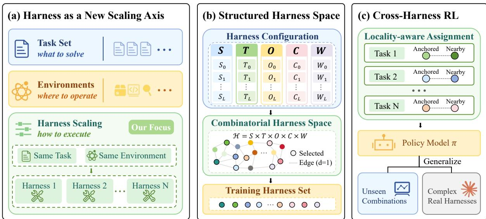  
Figure 1. Overview of Harness Scaling, from structured harness-space construction to cross-harness training and generalization to unseen configurations.

## 3. Method

## 3.1. Problem Formulation

To study harness scaling systematically, we first formalize the space of execution configurations and the generalization problem defined over it. We construct a factorized harness space, define a structural notion of proximity among its configurations, and formulate the generalization objectives that motivate the structured harness selection and multi-harness training procedures shown as in Figure 1.

## 3.1.1. Factorized Harness Space

A harness serves as the execution layer through which a policy interacts with its environment. Rather than treating it as a monolithic implementation, we factorize the harness into five components: system prompt, tool interface, observation, context management, and workflow, denoted by $S , T , O , C ,$ and �, respectively. These components govern the instructions provided to the policy, tool access, environment feedback, interaction history, and execution procedure, collectively shaping how the policy perceives, acts, and maintains state throughout task execution. This factorization provides an operational decomposition of the harness, while allowing the effects of different components to interact.

We instantiate each component through a family of component-specific transformations. For a component $F \in \{ S , T , O , C , W \}$ , let $\bar { F } ^ { ( 0 ) }$ denote its base realization and $\tau _ { F } ^ { ( \ell ) }$ the ℓ-th transformation applied to it:

$$
\boldsymbol { F } ^ { ( \ell ) } = \boldsymbol { \tau } _ { \boldsymbol { F } } ^ { ( \ell ) } \left( \boldsymbol { F } ^ { ( 0 ) } \right) .\tag{1}
$$

A transformation modifies only the target component while preserving the remaining components, task semantics, and environment. For example, it may reorganize the system prompt, alter tool schemas or naming conventions, change observation feedback, modify context retention or compression, or impose a different execution procedure. Detailed definitions and implementations are provided in Appendix A.

Let S, T, O, C, and W denote the resulting realization sets. A complete harness configuration selects

one realization from each set, defining the factorized harness space

$$
\mathcal { H } = S \times \mathcal { T } \times O \times C \times \mathcal { W } .\tag{2}
$$

Each configuration $h \in { \mathcal { H } }$ therefore specifies a complete execution setting for the same underlying task and environment.

The product structure of H also induces a natural notion of structural proximity. For $h _ { i } , h _ { j } \in \mathcal { H } .$ the Hamming distance $d _ { \mathrm { H } } ( h _ { i } , h _ { j } )$ counts the number of component dimensions on which they differ. Equivalently, H forms a Hamming graph whose adjacent configurations differ in exactly one component. We use this distance to organize local cross-harness variation during training.

## 3.1.2. Generalization Objective

The central objective of Harness Scaling is to learn policies that remain effective beyond the harness configurations observed during training. We consider two complementary forms of cross-harness general ization: broad combinatorial generalization within the constructed harness space and transfer to complex real-world black-box harnesses beyond it.

In-Space Combinatorial Generalization. Let $\mathcal { H } _ { \mathrm { t r } } \subset \mathcal { H }$ denote the harness configurations used for training. We evaluate on held-out configurations in $\mathcal { H } \backslash \mathcal { H } _ { \mathrm { t r } }$ , whose complete combinations are unseen during training. This setting provides broad coverage of unseen combinations within the controlled factorized space.

Out-of-Space Generalization. We further evaluate transfer to complex real-world black-box harnesses whose execution configurations are not represented in H. This setting examines whether training over structured white-box harness variation can transfer to external execution systems beyond the constructed design space.

## 3.2. Harness Scaling with Structured Selection

As the factorized harness space grows combinatorially with its component dimensions, exhaustive training can introduce substantial redundancy. We therefore construct a compact training set that preserves broad factorial coverage under a fixed optimization budget.

## 3.2.1. Factorial Coverage

The harness space in Eq. 2 can be viewed as a factorial design, where each harness component corresponds to a factor and its realizations correspond to different levels [8, 21]. To construct a compact subset without losing basic coverage of this combinatorial space, we preserve its low-order factorial structure: the representation of individual component realizations and their pairwise combinations. These correspond to the first- and second-order projections of the full factorial space, respectively.

Component Balance. We first require the realizations of each component to be represented evenly across the selected configurations. This ensures coverage along every component dimension without overrepresenting particular realizations.

Pairwise Combination Balance. Component balance alone does not control how realizations from different components are combined. We therefore additionally balance all pairwise combinations. Indexing the five component dimensions by $i , j \in \{ 1 , \ldots , 5 \}$ , let $N _ { i j } ( \ell , \ell ^ { \prime } )$ denote the number of selected configurations containing the ℓ-th realization of component � together with the ℓ′-th realization of component �. Pairwise balance requires

$$
N _ { i j } ( \ell , \ell ^ { \prime } ) = \lambda ,\tag{3}
$$

where � is the common occurrence count for every realization pair of any $i \neq j .$ . In factorial-design terminology, this corresponds to strength-2 balance, under which every pair of realizations from any two components appears equally often in the selected set.

## 3.2.2. Harness Set Construction

We construct the training harness set using a strength-2 orthogonal design over the component realizations in H. This provides a direct construction of a compact subset satisfying the component-level and pairwise balance defined above, without searching over possible subsets of the full harness space.

The size of such a design is constrained by its pairwise coverage. Suppose there are � component dimensions, each with � realizations, and every pairwise realization combination occurs � times. Since any two components admit $L ^ { 2 }$ realization combinations, the number of selected configurations � satisfies

$$
N = \lambda L ^ { 2 } .\tag{4}
$$

Moreover, a strength-2 orthogonal design must satisfy the Rao bound [8, 21],

$$
N \geq 1 + M ( L - 1 ) .\tag{5}
$$

Pairwise balance determines the replication structure of the design, while the Rao bound provides a lower bound on the number of configurations. These conditions restrict the admissible design sizes.

We instantiate a strength-2 orthogonal design satisfying these constraints, yielding the training harness set $\mathcal { H } _ { \mathrm { t r } } \subset \mathcal { H }$ . The resulting set preserves exact component-level and pairwise balance using only a compact subset of the full factorial space. While these low-order projections are balanced, many complete harness combinations remain unseen during training, enabling evaluation of in-space combinatorial generalization. Further details of the construction and the resulting training configurations are provided in Appendix B.

## 3.3. Reinforcement Learning across Harnesses

Training each task under multiple harnesses exposes the policy to different execution configurations for the same underlying problem, encouraging the learned behavior to generalize beyond a single harness. We realize this over the selected harness set ${ \mathcal { H } } _ { \mathrm { t r } }$ by pairing each task with a small group of structurally related configurations. The assignment is designed to combine controlled variation within each task with broad coverage across the training harness space, and the resulting task–harness instances form the basis for rollout collection and policy optimization.

## 3.3.1. Cross-Harness Task Assignment

We use a locality-aware strategy to organize how harness configurations are assigned to tasks. For each task �, we assign � configurations from ${ \mathcal { H } } _ { \mathrm { t r } }$ . An anchor harness $h _ { x } \sim \mathrm { U n i f } ( \mathcal { H } _ { \mathrm { t r } } )$ is first sampled uniformly from the training set, and the remaining $K - 1$ configurations are chosen from $\mathcal { H } _ { \mathrm { t r } } \backslash \{ h _ { x } \}$ as those with the smallest Hamming distance $d _ { \mathrm { H } } ( h _ { x } , h )$ to the anchor. This associates each task with a small set of nearby configurations while allowing different tasks to cover different regions of the training harness space. The resulting harness set for task � is

$$
\mathcal { H } _ { x } = \left\{ h _ { x } , h _ { x } ^ { ( 1 ) } , \dots , h _ { x } ^ { ( K - 1 ) } \right\} ,\tag{6}
$$

where $h _ { x } ^ { ( 1 ) } , \ldots , h _ { x } ^ { ( K - 1 ) }$ denote the $K - 1$ nearest configurations to $h _ { x }$ under $d _ { \mathrm { H } }$

This assignment combines local cross-harness variation with broad coverage over training. For a given task, nearby harnesses provide related but distinct execution configurations, while random anchor selection distributes different tasks throughout ${ \mathcal { H } } _ { \mathrm { t r } }$ . Each task therefore yields � task–harness instances for rollout collection and policy optimization. When $K = 1$ , only the sampled anchor is assigned to the task, while different tasks remain distributed across ${ \mathcal { H } } _ { \mathrm { t r } }$

## 3.3.2. Multi-Harness Policy Optimization

Each task–harness instance $( x , h )$ is executed under its assigned harness, producing a trajectory � and the corresponding reward. The � harnesses assigned to the same task are used over � successive training steps, allowing the policy to receive learning signals from different execution configurations for the same underlying task.

For a policy-update batch B induced by the task–harness training distribution $\mathcal { D } _ { \mathrm { M H } }$ , let $N _ { \mathcal { B } }$ denote the total number of valid policy-generated tokens in the batch. We optimize the standard clipped policy objective:

$$
\mathcal { L } ( \theta ) = \frac { 1 } { { { N _ { \mathcal { B } } } } } \sum _ { ( x , h , \tau ) \in \mathcal { B } } { \sum _ { t = 1 } ^ { | \tau | } { { M _ { t } } \operatorname* { m i n } \left( { \rho _ { t } ( \theta ) A _ { t } , \mathrm { c l i p } \big ( { \rho _ { t } ( \theta ) , 1 - \epsilon , 1 + \epsilon } \big ) A _ { t } } \right) } } ,\tag{7}
$$

where $\begin{array} { r } { N _ { \mathcal { B } } = \sum _ { ( x , h , \tau ) \in \mathcal { B } } \sum _ { t = 1 } ^ { | \tau | } M _ { t } , \rho _ { t } ( \theta ) = \frac { \pi _ { \theta } ( \tau _ { t } | x , h , \tau _ { < t } ) } { \pi _ { \theta _ { \mathrm { o l d } } } ( \tau _ { t } | x , h , \tau _ { < t } ) } } \end{array}$ , and $M _ { t } \in \{ 0 , 1 \}$ masks valid policy-generated tokens. The advantage $A _ { t }$ is computed according to the underlying reinforcement learning algorithm.

Harness Scaling determines the task–harness instances used for rollout collection, while the optimization within each step follows the original RL objective. We apply the same cross-harness training procedure to both PPO [22] and GRPO [24].

## 4. Experiments

In this section, we first detail the experimental setup and then report the results and detailed analysis.

## 4.1. Experiment Settings

Harness Scaling Setup. We instantiate five harness components with three realizations each, yielding $3 ^ { 5 } = 2 4 3$ configurations in the full harness space and forming the Hamming graph �(5, 3). Following the strength-2 orthogonal-design construction in Section 3.2.2, the resulting design contains 18 configurations, which form the training harness set ${ \mathcal { H } } _ { \mathrm { t r } }$

Training. We conduct experiments using two backbone models, Qwen3-4B-Instruct and Qwen3-30B-A3B-Instruct [37], on ClawGym-Task [3], which contains 13.5K workspace-based general agent tasks. We consider both GRPO [24] and PPO [22]. For GRPO, each step uses 16 tasks with 8 rollouts per task, while PPO uses 128 tasks with one rollout per task. We set $K = 2$ harnesses per task and train for 300 optimization steps. Additional implementation details and hyperparameters are provided in Appendix C.1.

Evaluation. We evaluate on three benchmarks with varying domains and difficulty levels. ClawGym-Bench [3] covers workspace-based general agent tasks, PinchBench [19] focuses on realistic tasks involving research, coding, scheduling, and file operations, and JobBench-Easy [12] evaluates more challenging professional workflows over heterogeneous workspace files. All evaluation tasks are disjoint from the ClawGym-Task training set. For in-space generalization, we evaluate on 18 fixed held-out configurations from ${ \mathcal { H } } \backslash { \mathcal { H } } _ { \mathrm { t r } } ,$ selected for balanced component coverage and diversity across complete harness configurations. The same held-out set is used across all benchmarks, model scales, and RL algorithms. For out-of-space generalization, we use Claude Code [1] as the main external black-box harness and additionally evaluate on OpenClaw [18]. We report Pass@1 averaged over three independent evaluation runs, with in-space scores further averaged across the 18 held-out configurations. Further evaluation details and OpenClaw results are provided in Appendix C.2.

Baselines. We compare against four baselines: the original backbone model without additional training; single-harness RL, where the policy is optimized through the fixed base configuration $h _ { \mathrm { b a s e } } ~ =$ $( \bar { s ^ { ( 0 ) } } , T ^ { ( 0 ) } , O ^ { ( 0 ) } , C ^ { ( 0 ) } , W ^ { ( 0 ) } )$ ; black-box SFT, which fine-tunes the policy on trajectories collected through a complex black-box harness; and black-box RL, which optimizes the policy through the same black-box harness. We use OpenClaw as the black-box training harness, while Claude Code is reserved as an unseen external harness for evaluation. All RL baselines use matched optimization budgets where applicable.

Table 1. Pass@1 performance across three benchmarks under different harness evaluation settings. In-Space reports the average over 18 held-out harness configurations, while Claude Code denotes out-of-space evaluation with the external black-box harness. Bold indicates the better result between single-harness training and harness scaling under the same model and optimization method.
<table><tr><td rowspan="2">Method</td><td rowspan="2">Harness</td><td colspan="2">ClawGym-Bench</td><td colspan="2">JobBench-Easy</td><td colspan="2">PinchBench</td><td rowspan="2">Avg.</td></tr><tr><td>In-Space</td><td>Claude Code</td><td>In-Space</td><td>Claude Code</td><td>In-Space</td><td>Claude Code</td></tr><tr><td colspan="8">Qwen3-4B-Instruct</td></tr><tr><td>Base</td><td>一</td><td>18.08</td><td>33.90</td><td>7.16</td><td>6.78</td><td>32.69</td><td>32.74</td><td>21.89</td></tr><tr><td rowspan="2">GRPO</td><td>Single</td><td>37.33</td><td>38.96</td><td>10.24</td><td>5.79</td><td>45.60</td><td>40.95</td><td>29.81</td></tr><tr><td>Scaling</td><td>52.78</td><td>45.37</td><td>13.55</td><td>14.83</td><td>56.24</td><td>51.47</td><td>39.04</td></tr><tr><td rowspan="2">PPO</td><td>Single</td><td>43.78</td><td>40.75</td><td>12.63</td><td>9.68</td><td>48.86</td><td>47.74</td><td>33.91</td></tr><tr><td>Scaling</td><td>49.07</td><td>44.36</td><td>13.16</td><td>13.39</td><td>53.75</td><td>47.82</td><td>36.93</td></tr><tr><td colspan="8">Qwen3-30B-A3B-Instruct</td><td></td></tr><tr><td>Base</td><td>一</td><td>34.80</td><td>37.56</td><td>8.44</td><td>7.04</td><td>49.11</td><td>51.48</td><td>31.40</td></tr><tr><td rowspan="2">GRPO</td><td>Single</td><td>48.12</td><td>46.02</td><td>14.79</td><td>10.05</td><td>54.51</td><td>50.25</td><td>37.29</td></tr><tr><td>Scaling</td><td>58.60</td><td>49.62</td><td>15.48</td><td>14.20</td><td>58.98</td><td>59.78</td><td>42.78</td></tr><tr><td rowspan="2">PPO</td><td>Single</td><td>44.23</td><td>45.17</td><td>13.98</td><td>12.11</td><td>50.54</td><td>51.85</td><td>36.31</td></tr><tr><td>Scaling</td><td>48.29</td><td>48.83</td><td>17.56</td><td>18.90</td><td>57.59</td><td>60.18</td><td>41.89</td></tr></table>

## 4.2. Main Results

• Combinatorial Generalization to Unseen Harnesses. Compared with Single-Harness RL, Harness Scaling consistently improves performance on held-out harness configurations whose complete combinations are unseen during training, as summarized in Table 1 and further illustrated by Figure 2. Averaged over the three benchmarks, the in-space gains reach +9.80 and +3.57 points with GRPO and PPO on Qwen3-4B-Instruct, and +5.21 and +4.90 points on Qwen3-30B-A3B-Instruct. The advantage also persists when Single-Harness RL is trained on three additional fixed harnesses selected solely by their structural positions in ${ \mathcal { H } } _ { \mathrm { t r } }$ . Detailed sensitivity results are reported in Appendix C.3. These results support the benefit of Harness Scaling for combinatorial generalization within the constructed harness space.

• Consistency across Model Scales and RL Algorithms. Harness scaling yields consistent gains across both backbone sizes and optimization methods (Table 1). For Qwen3-4B-Instruct, the overall average improves from 29.81 to 39.04 with GRPO and from 33.91 to 36.93 with PPO. Similar improvements are observed for Qwen3-30B-A3B-Instruct, from 37.29 to 42.78 with GRPO and from 36.31 to 41.89 with PPO. The improvement therefore persists across both model scale and RL algorithm rather than being specific to a single training setting. Additional

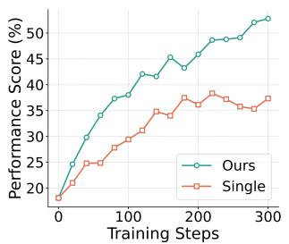  
(a) Qwen3-4B-Instruct

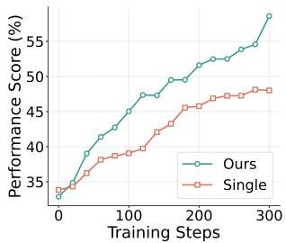  
(b) Qwen3-30B-A3B  
Figure 2. Evaluation curves under in-space harness configurations on ClawGym-Bench.

out-of-space evaluation on OpenClaw shows the same trend in Appendix C.2.

• Transfer to External Black-Box Harnesses. Harness Scaling further transfers to the external black-box harness. As shown in Table 2, it achieves average Pass@1 scores of 37.22 and 41.20 with Qwen3-4B-Instruct and Qwen3-30B-A3B-Instruct, respectively, exceeding black-box SFT (35.08 and 38.08) and black-box RL (33.38 and 36.28). Both black-box baselines are trained through OpenClaw and transferred to Claude Code without further adaptation. This comparison shows that structured training over diverse white-box harnesses can yield stronger cross-harness transfer than direct training through a single complex black-box harness.

Table 2. Pass@1 performance on Claude Code as an unseen external black-box harness. Black-Box SFT and Black-Box RL are trained through OpenClaw, while Harness Scaling is trained over the structured white-box harness space. For the RL-based methods, both Black-Box RL and Harness Scaling use GRPO.
<table><tr><td>Method</td><td>ClawGym-Bench</td><td>JobBench-Easy</td><td>PinchBench</td><td>Avg.</td></tr><tr><td colspan="5">Qwen3-4B-Instruct</td></tr><tr><td>Black-Box SFT</td><td>44.48</td><td>11.10</td><td>49.66</td><td>35.08</td></tr><tr><td>Black-Box RL</td><td>44.10</td><td>9.42</td><td>46.61</td><td>33.38</td></tr><tr><td>Harness Scaling</td><td>45.37</td><td>14.83</td><td>51.47</td><td>37.22</td></tr><tr><td colspan="5">Qwen3-30B-A3B-Instruct</td></tr><tr><td>Black-Box SFT</td><td>49.55</td><td>13.16</td><td>51.52</td><td>38.08</td></tr><tr><td>Black-Box RL</td><td>47.84</td><td>12.73</td><td>48.28</td><td>36.28</td></tr><tr><td>Harness Scaling</td><td>49.62</td><td>14.20</td><td>59.78</td><td>41.20</td></tr></table>

## 4.3. Ablation Studies

We further examine the key design choices in Harness Scaling, including the construction of the training harness set, the number of harnesses assigned to each task, and the locality-aware assignment strategy. For the training harness set, we compare a single harness, three harnesses providing first-order coverage over all component realizations, our structured 18-harness set, a random 18-harness set, and an exhaustive setting using all 243 configurations.

Table 3. Ablation of structured selection and assignment on Qwen3-4B-Instruct. Each entry reports In-Space / Claude Code.
<table><tr><td>Setting</td><td>ClawGym-Bench PinchBench</td><td></td></tr><tr><td>Random-18</td><td>47.90 / 42.78</td><td>51.28 / 48.74</td></tr><tr><td>Random Assign.</td><td>50.46 / 43.17</td><td>53.20 / 50.23</td></tr><tr><td>Ours</td><td>52.78 / 45.37</td><td>56.24 / 51.47</td></tr></table>

Unless otherwise specified, multi-harness settings use � = 2 with the same locality-aware assignment and training budget. The full-space setting includes the white-box evaluation configurations and is therefore used as a fixed-budget stress test rather than a held-out generalization setting. We report the effects of the training harness set and per-task harness diversity in Figure 3. Table 3 further compares our structured 18-harness set with a random set of the same size, and locality-aware assignment with random assignment.

• Benefits Depend on Harness Selection. Moving beyond a single fixed harness substantially improves generalization, but performance does not increase monotonically with the number of training configura tions. Using three harnesses with first-order component coverage yields gains of +11.43/+4.84 points on ClawGym-Bench and +3.44/+7.86 points on PinchBench under in-space/black-box evaluation. Our structured 18-harness set further improves over the three-harness setting by +4.02/+1.57 and +7.20/+2.66 points, respectively, while also outperforming Random-18 and the full 243-harness setting under the same training budget. Notably, the full-space setting is trained on all harness configurations, including those used for white-box evaluation, yet still performs worse than the structured 18-harness set. This suggests that exhaustive coverage alone does not guarantee better performance under a fixed optimization budget, and that how harness diversity is organized matters in addition to configuration count.

• Effect ofPer-Task Harness Diversity. With � = 1, each task is associated with only one harness, while different tasks remain distributed across the selected harness set. As shown in Figure 3(c–d), this setting already yields clear gains over Single-Harness RL, indicating that harness diversity across tasks provides substantial benefits even without exposing the same task to multiple harnesses. Increasing � from 1 to 2 further improves performance. We additionally evaluate a matched Repeat-2 control that follows the same two-step task schedule while reusing the same sampled harness. Repeat-2 shows mixed changes relative to � = 1, while � = 2 consistently performs better than Repeat-2 across both benchmarks and evaluation settings. This suggests that repeated task exposure alone does not fully account for the improvement from � = 2, and that varying the harness for the same task provides additional benefit. Increasing � to 4 provides no further improvement, with � = 2 achieving the best overall performance among the evaluated settings. Detailed results are provided in Appendix C.3.

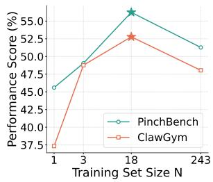  
(a) White-Box

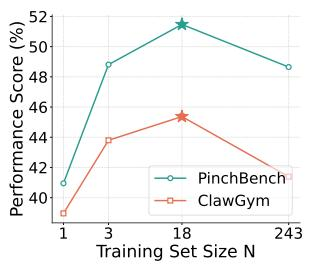  
(b) Black-Box

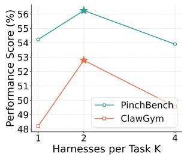  
(c) White-Box

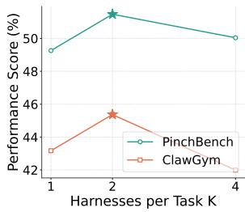  
(d) Black-Box  
Figure 3. Ablation studies of key design choices in Harness Scaling on Qwen3-4B-Instruct. (a–b) Performance across training harness sets of different sizes under white-box and external black-box (Claude Code) evaluation. The full 243-harness setting includes the white-box evaluation configurations and serves as a fixed-budget stress test rather than a held-out generalization setting. (c–d) Effect of the number of harnesses assigned per task during training under the same two evaluation settings.

• Locality-Aware Assignment Complements Global Coverage. Replacing locality-aware assignment with random assignment reduces performance by 2.32/2.20 points on ClawGym-Bench and 3.04/1.24 points on PinchBench under in-space/black-box evaluation. This pattern supports the global–local design of Harness Scaling, where random anchor sampling maintains broad coverage across the training harness space, while nearest-harness assignment provides controlled local variation for each task.

## 5. Analysis

We further investigate behavioral patterns associated with cross-harness generalization. Specifically, we examine whether Harness Scaling is associated with stronger execution capabilities and more robust performance as the execution configuration changes. For each model scale and approach, we analyze 200 complete trajectories per evaluated harness, generated from the same set of ClawGym-Bench tasks to enable direct comparisons across approaches and harnesses. More details are provided in Appendix D.

## 5.1. Harness-Related Capability Analysis

Harness Scaling strengthens capabilities that are directly relevant to operating under different harness configurations. Figures 4a and 4b compare Single-Harness RL and Harness Scaling along six behavioral dimensions: instruction following, interface handling, observation reading, state tracking, workflow compliance, and error recovery.

The largest gains appear in state tracking, workflow compliance, and error recovery, indicating better maintenance of task progress, adherence to execution procedures, and recovery from failures. Instruction following and interface handling also improve, while the gain in observation reading is relatively smaller. These results suggest that training across harnesses particularly strengthens capabilities needed to sustain effective execution as the surrounding harness changes.

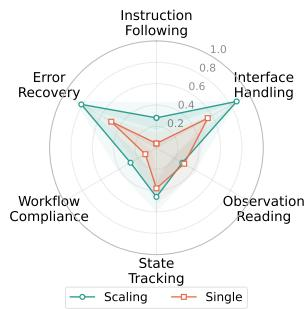  
(a) Qwen3-4B

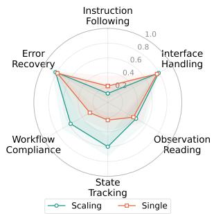  
(b) Qwen3-30B-A3B

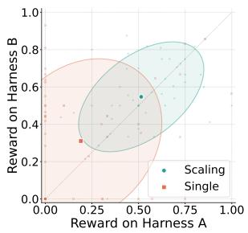  
(c) Qwen3-4B

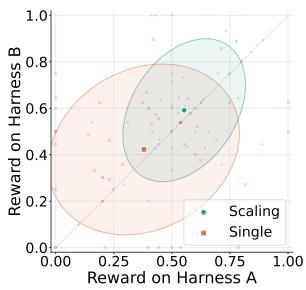  
(d) Qwen3-30B-A3B  
Figure 4. Behavioral analysis comparing Single-Harness RL and Harness Scaling. (a–b) Capability profiles under in-space evaluation. (c–d) Cross-harness reward consistency on the same tasks under two fixed held-out harnesses, Harness A (S0T2O1C1W2) and Harness B (S2T1O1C2W0); ellipses show 1.5� covariance regions and large markers denote group means.

## 5.2. Cross-Harness Robustness and Specialization

Harness Scaling makes task performance less sensitive to changes in the execution configuration. Figures 4c and 4d compare paired rewards for the same tasks under two fixed held-out in-space harnesses: Harness A (S0T2O1C1W2) and Harness B (S2T1O1C2W0). The two configurations differ in four harness components $( d _ { \mathrm { H } } = 4 )$ and are used consistently for both model scales and training methods. Each point represents one task, and the diagonal denotes equal reward under the two configurations. Under Harness Scaling, the reward distributions shift toward the upper-right region for both model scales, indicating stronger performance under both harnesses. The paired rewards also appear more closely aligned across configurations, suggesting greater consistency as the harness changes.

We further examine whether improved cross-harness generalization comes at the cost of performance on the base training harness. As shown in Table 4, Harness Scaling incurs only a 0.19-point decrease on the base harness, while improving the ClawGym-Bench in-space score by 10.48 points and Claude Code performance by 3.60 points. The large cross-harness gains relative to the negligible change on the base harness suggest that Harness Scaling improves robustness to execution variation while largely preserving performance under the original training configuration.

Table 4. Base-harness vs. cross-harness performance for Qwen3-30B-A3B-Instruct with GRPO on ClawGym-Bench.
<table><tr><td colspan="4">Base Harness In-Space Claude Code</td></tr><tr><td>Single</td><td>59.82</td><td>48.12</td><td>46.02</td></tr><tr><td>Scaling</td><td>59.63</td><td>58.60</td><td>49.62</td></tr><tr><td>Δ</td><td>-0.19</td><td>+10.48</td><td>+3.60</td></tr></table>

## 6. Conclusion

In this work, we study Harness Scaling as a new scaling dimension for agentic reinforcement learning, motivated by the limitations of optimizing policies through a single fixed harness. We formalize harness diversity as a structured configuration space and develop a framework that integrates structured harness selection with cross-harness policy training. Across benchmarks, model scales, and RL algorithms, Harness Scaling substantially improves generalization to unseen white-box configurations and transfers effectively to complex external black-box harnesses. Our results further show that the benefits of scaling depend on how harness diversity is selected and incorporated into training, rather than on diversity alone. More broadly, these findings expand the scope of agentic RL scaling beyond what agents solve and where they operate to how they interact and execute, positioning harness variation as a complementary dimension for improving generalization across diverse execution systems.

## References

1 Anthropic. Claude Code: Ai-powered coding assistant for developers. https://claude.com/p roduct/claude-code, 2026. Product page. Accessed: 2026-04-29.

2 Fei Bai, Yingqian Min, Beichen Zhang, Zhipeng Chen, Xin Zhao, Lei Fang, Zheng Liu, Zhongyuan Wang, and Hongteng Xu. Towards effective code-integrated reasoning. In Proceedings ofthe AAAI Conference on Artificial Intelligence, volume 40, pages 30022–30030, 2026.

3 Fei Bai, Huatong Song, Shuang Sun, Daixuan Cheng, Yike Yang, Chuan Hao, Renyuan Li, Feng Chang, Yuan Wei, Ran Tao, et al. Clawgym: A scalable framework for building effective claw agents. arXiv preprint arXiv:2604.26904, 2026.

4 Mengzhuo Chen, Junjie Wang, Zhe Liu, Yawen Wang, Haiming Zheng, and Qing Wang. From failed trajectories to reliable llm agents: Diagnosing and repairing harness flaws, 2026. URL https: //arxiv.org/abs/2606.06324.

5 Jia Deng, Yimeng Chen, Xiaoqing Xiang, Ziyang Zeng, Shuo Tang, Wayne Xin Zhao, Feng Chang, Chuan Hao, Yuan Wei, Ran Tao, et al. Fort-searcher: Synthesizing shortcut-resistant search tasks for training deep search agents. arXiv preprint arXiv:2606.12087, 2026.

6 Guanting Dong, Junting Lu, Junjie Huang, Wanjun Zhong, Longxiang Liu, Shijue Huang, Zhenyu Li, Yang Zhao, Xiaoshuai Song, Xiaoxi Li, Jiajie Jin, Yutao Zhu, Hanbin Wang, Fangyu Lei, Qinyu Luo, Mingyang Chen, Zehui Chen, Jiazhan Feng, Ji-Rong Wen, and Zhicheng Dou. Agent-world: Scaling real-world environment synthesis for evolving general agent intelligence, 2026. URL https: //arxiv.org/abs/2604.18292.

7 Zhiyuan He, Siwei Zhang, Zhiwen Zhou, Yuqing Yang, Yu Kang, Yuge Zhang, Luna K. Qiu, Tin Yan Tsui, Jiahang Xu, and Chong Luo. Agent lightning v1.0: Towards harnessed agentic rl, 2026. URL https://arxiv.org/abs/2608.17528.

8 A Samad Hedayat, Neil James Alexander Sloane, and John Stufken. Orthogonal arrays: theory and applications, volume 68. Springer New York, 1999.

9 Bo Huang, Fengxiang Li, Hao Xu, Haoyang Huang, Hongyi Fu, Jinhua Hao, Kun Yuan, Minglei Zhang, Pengcheng Xu, Shiyang Liu, Wenhao Zhuang, Yuze Shi, Zongxian Feng, Chao Wang, Cheng He, Chongling Rao, Deyu Cao, Fan Yang, Gang Xiong, Haochen Liu, Jiabao Li, Jian Liang, Jinghui Jia, Jingwen Chang, Jun Du, Junyu Shi, Min Li, Mingqi Wu, Qiang Gao, Shangpeng Yan, Shaotong Qi, Shu Xu, Shuo Zhou, Tiankuo Xu, Tong Zheng, Weilun Zhao, Xiancheng Meng, Xianda Sun, Xiaoyu Jiang, Xunhao Jia, Yao Xia, Yimeng Xu, Yinghan Cui, Yingpeng Chen, Yiwen Ning, Yong Wang, Yuxuan Sun, Zhongsheng Liu, Ming Sun, Cheng Luo, Chen Yang, Han Li, and Kun Gai. Kat-coder-v2.5 technical report, 2026. URL https://arxiv.org/abs/2607.05471.

10 Woosuk Kwon, Zhuohan Li, Siyuan Zhuang, Ying Sheng, Lianmin Zheng, Cody Hao Yu, Joseph E. Gonzalez, Hao Zhang, and Ion Stoica. Efficient memory management for large language model serving with pagedattention, 2023. URL https://arxiv.org/abs/2309.06180.

11 Hyunin Lee, Jinglue Xu, Jeffrey Seely, Donghyun Lee, Matei Zaharia, and Yujin Tang. Recursive harness self-improvement, 2026. URL https://arxiv.org/abs/2607.15524.

12 Yuetai Li, Yichen Feng, Zhangchen Xu, Zixian Ma, Kaiyuan Zheng, Fengqing Jiang, Xinghua Sun, Rulin Shao, Zichen Chen, Yue Huang, Xinyang Han, Brian Lee, Kayla Xu, Shenglai Zeng, Hang Hua, Xiangliang Zhang, Basel Alomair, Ranjay Krishna, Luke Zettlemoyer, Pang Wei Koh, Bhaskar Ramasubramanian, Luyao Niu, Xiang Yue, and Radha Poovendran. Jobbench: Aligning agent work with human will, 2026. URL https://arxiv.org/abs/2605.26329.

13 Jiahang Lin, Shichun Liu, Chengjun Pan, Lizhi Lin, Shihan Dou, Zhiheng Xi, Xuanjing Huang, Hang Yan, Zhenhua Han, Tao Gui, and Yu-Gang Jiang. Agentic harness engineering: Observability-driven automatic evolution of coding-agent harnesses, 2026. URL https://arxiv.org/abs/2604 .25850.

14 Minhua Lin, Juncheng Wu, Zijun Wang, Zhan Shi, Yisi Sang, Bing He, Zewen Liu, Tianxin Wei, Zongyu Wu, Zhiwei Zhang, Dakuo Wang, Xiang Zhang, Benoit Dumoulin, Cihang Xie, Yuyin Zhou, Suhang Wang, and Hanqing Lu. Harness updating is not harness benefit: Disentangling evolution capabilities in self-evolving llm agents, 2026. URL https://arxiv.org/abs/2605.30621.

15 Xiaotian Luo, Dizhan Xue, Fengxingyu Wang, Chuanrui Hu, and Yafeng Deng. Harnessbank: Semantic gene-bank search with gated verification for agent-harness self-evolution, 2026. URL https://arxiv.org/abs/2607.13683.

16 Ziyu Ma, Hailang Huang, Shun Zou, Yong Wang, Shidong Yang, Yiming Hu, Fei Wei, and XiangXiang Chu. Longhorizon-harness: Advancing long-horizon agents for real-world tasks, 2026. URL https: //arxiv.org/abs/2608.01964.

17 Xuying Ning, Dongqi Fu, Tianxin Wei, Hanqing Zeng, Yuanchen Bei, Bingxuan Li, Zihao Li, Qifan Wang, Xiang Shen, Yifan Wu, Jiayi Liu, Hong Li, Yinglong Xia, Xiangjun Fan, Hanghang Tong, and Jingrui He. Evoharness-rl: Learning self-evolving runtime harness for long-horizon llm agents, 2026. URL https://arxiv.org/abs/2608.05446.

18 OpenClaw. OpenClaw: Personal ai assistant. https://github.com/openclaw/openclaw, 2026. GitHub repository. Accessed: 2026-04-29.

19 PinchBench. PinchBench: Real-world benchmarks for ai coding agents. https://github.com /pinchbench/skill, 2026. GitHub repository. Accessed: 2026-04-29.

20 Zehan Qi, Xiao Liu, Iat Long Iong, Hanyu Lai, Xueqiao Sun, Wenyi Zhao, Yu Yang, Xinyue Yang, Jiadai Sun, Shuntian Yao, Tianjie Zhang, Wei Xu, Jie Tang, and Yuxiao Dong. Webrl: Training llm web agents via self-evolving online curriculum reinforcement learning, 2025. URL https: //arxiv.org/abs/2411.02337.

21 C Radhakrishna Rao. Factorial experiments derivable from combinatorial arrangements of arrays. Supplement to the Journal ofthe Royal Statistical Society, 9(1):128–139, 1947.

22 John Schulman, Filip Wolski, Prafulla Dhariwal, Alec Radford, and Oleg Klimov. Proximal policy optimization algorithms. arXiv preprint arXiv:1707.06347, 2017.

23 Shuai Shao, Kangning Zhang, Qingyao Li, Shijian Wang, Hao Wang, Wenxiang Jiao, Yuan Lu, Yi Guo, Weiwen Liu, and Weinan Zhang. Harness-r1: Learning to edit executable runtime harnesses from agent failure trajectories, 2026. URL https://arxiv.org/abs/2608.02276.

24 Zhihong Shao, Peiyi Wang, Qihao Zhu, Runxin Xu, Junxiao Song, Xiao Bi, Haowei Zhang, Mingchuan Zhang, YK Li, Yang Wu, et al. Deepseekmath: Pushing the limits of mathematical reasoning in open language models. arXiv preprint arXiv:2402.03300, 2024.

25 Guangming Sheng, Chi Zhang, Zilingfeng Ye, Xibin Wu, Wang Zhang, Ru Zhang, Yanghua Peng, Haibin Lin, and Chuan Wu. Hybridflow: A flexible and efficient rlhf framework. In Proceedings ofthe Twentieth European Conference on Computer Systems, EuroSys ’25, page 1279–1297. ACM, March 2025. doi: 10.1145/3689031.3696075. URL http://dx.doi.org/10.1145/36890 31.3696075.

26 Huatong Song, Jinhao Jiang, Yingqian Min, Jie Chen, Zhipeng Chen, Wayne Xin Zhao, Lei Fang, and Ji-Rong Wen. R1-searcher: Incentivizing the search capability in llms via reinforcement learning. arXiv preprint arXiv:2503.05592, 2025.

27 Huatong Song, Fei Bai, Ming Yang, Renyuan Li, Jia Deng, Jujie He, Zhange Zhang, Daixuan Cheng, Yan Xing, Qi Yun, Xuxing Chen, Danyang Li, Feng Chang, Chuan Hao, Ran Tao, Jian Yang, Bryan Dai, Wayne Xin Zhao, Mingjie Tang, and Ji-Rong Wen. Clawgym ii: Exploring black-box rl on agent harness, 2026. URL https://arxiv.org/abs/2608.16798.

28 Huatong Song, Lisheng Huang, Shuang Sun, Jinhao Jiang, Ran Le, Daixuan Cheng, Guoxin Chen, Yiwen Hu, Zongchao Chen, Yiming Jia, et al. Swe-master: Unleashing the potential of software engineering agents via post-training. arXiv preprint arXiv:2602.03411, 2026.

29 Xiaoshuai Song, Haofei Chang, Guanting Dong, Yutao Zhu, Ji-Rong Wen, and Zhicheng Dou. Envscaler: Scaling tool-interactive environments for llm agent via programmatic synthesis, 2026. URL https://arxiv.org/abs/2601.05808.

30 Shuang Sun, Huatong Song, Yuhao Wang, Ruiyang Ren, Jinhao Jiang, Junjie Zhang, Fei Bai, Jia Deng, Wayne Xin Zhao, Zheng Liu, et al. Simpledeepsearcher: Deep information seeking via web-powered reasoning trajectory synthesis. arXiv preprint arXiv:2505.16834, 2025.

31 Xinyu Tang, Han Peng, Guoxin Chen, Yuze Shi, Zitao Su, Peiyu Liu, Wayne Xin Zhao, Yawen Li, and Zhe Xue. Agent systems with harness engineering, 2026. URL https://openreview.net /pdf?id=nM5tDHrQsx.

32 Varun Ursekar, Apaar Shanker, Veronica Chatrath, Yuan Xue, and Samuel Marc Denton. Vero: A harness for agents to optimize agents, 2026. URL https://arxiv.org/abs/2602.22480.

33 Bowen Wang, Dunjie Lu, Junli Wang, Tianyi Bai, Shixuan Liu, Zhipeng Zhang, Haiquan Wang, Hao Hu, Tianbao Xie, Shuai Bai, Dayiheng Liu, Que Shen, Junyang Lin, and Tao Yu. Cua-gym: Scaling verifiable training environments and tasks for computer-use agents, 2026. URL https: //arxiv.org/abs/2605.25624.

34 Yinjie Wang, Xuyang Chen, Xiaolong Jin, Mengdi Wang, and Ling Yang. Openclaw-rl: Train any agent simply by talking. arXiv preprint arXiv:2603.10165, 2026.

35 Zhaoyang Wang, Canwen Xu, Boyi Liu, Yite Wang, Siwei Han, Zhewei Yao, Huaxiu Yao, and Yuxiong He. Agent world model: Infinity synthetic environments for agentic reinforcement learning, 2026. URL https://arxiv.org/abs/2602.10090.

36 Binfeng Xu, Hao Zhang, Shaokun Zhang, Songyang Han, Mingjie Liu, Jian Hu, Shizhe Diao, Zhenghui Jin, Yunheng Zou, Michael Demoret, et al. Polar: Agentic rl on any harness at scale. arXiv preprint arXiv:2605.24220, 2026.

37 An Yang, Anfeng Li, Baosong Yang, Beichen Zhang, Binyuan Hui, Bo Zheng, Bowen Yu, Chang Gao, Chengen Huang, Chenxu Lv, et al. Qwen3 technical report. arXiv preprint arXiv:2505.09388, 2025.

38 John Yang, Carlos E. Jimenez, Alexander Wettig, Kilian Lieret, Shunyu Yao, Karthik Narasimhan, and Ofir Press. Swe-agent: Agent-computer interfaces enable automated software engineering, 2024. URL https://arxiv.org/abs/2405.15793.

39 Xiao Yu, Baolin Peng, Ruize Xu, Hao Zou, Qianhui Wu, Hao Cheng, Wenlin Yao, Nikhil Singh, Zhou Yu, and Jianfeng Gao. Openforgerl: Train harness-native agents in any environment. arXiv preprint arXiv:2607.21557, 2026.

40 Wayne Xin Zhao, Kun Zhou, Junyi Li, Tianyi Tang, Xiaolei Wang, Yupeng Hou, Yingqian Min, Beichen Zhang, Junjie Zhang, Zican Dong, et al. A survey of large language models. arXiv preprint arXiv:2303.18223, 1(2), 2023.

Table 5. Harness component realizations instantiated by the model-driven transformation procedure for the $3 ^ { 5 } = 2 4 3$ factorized harness space.
<table><tr><td>Dim.</td><td>Aspect</td><td>Base</td><td>Variant I</td><td>Variant II</td></tr><tr><td>S</td><td>System prompt</td><td>Direct system instruction specifying the agent role and execution rules.</td><td>The same requirements are embedded in a simulated product context, with additional platform and UI</td><td>The requirements are reframed through a narrative and role-based setting.</td></tr><tr><td>T</td><td>Tool interface Original tool names and</td><td>schemas, such as execute_bash and file_editor, without</td><td>Functional tools are exposed Functional tools are exposed through semantically related through opaque identifiers aliases, together with additional non-functional</td><td>and augmented with distractor tools, largely removing lexical cues to</td></tr><tr><td>0</td><td>Observation</td><td>Raw tool outputs without additional prefixes or suffixes.</td><td>Outputs are augmented with simulated infrastructure metadata, including pod names, namespaces, and</td><td>tool functionality. Outputs are augmented with structured XML-style metadata, including tool name, exit code, process ID, duration, and execution</td></tr><tr><td>C</td><td>agement</td><td>Context man- The complete interaction history remains available in the active context.</td><td>LLM-based compaction periodically summarizes earlier history while retaining the five most</td><td>node. A more aggressive compaction policy retains the three most recent turns, with summarized history externalized to an auxiliary</td></tr><tr><td>W</td><td>Workflow</td><td>Standard free-form execution without additional procedural constraints.</td><td>A plan-first workflow requires explicit planning before task execution.</td><td>file. Planning is combined with periodic progress verification every three steps.</td></tr></table>

## A. Harness Component Variants

We instantiate the factorized harness space through a model-driven transformation procedure. Starting from the base harness, Opus-4.7 generates alternative realizations for each of the five components: system prompt (�), tool interface (�), observation (�), context management (�), and workflow (�). Each transformation targets a single component and introduces a specified form of variation while preserving the underlying task, environment, and functionality of the remaining harness components.

The transformation procedure explicitly constrains non-target components to remain unchanged in task semantics, environment behavior, and functionality, so that each resulting realization primarily reflects variation along the designated component dimension.

This procedure yields three realizations per component and $3 ^ { 5 } = 2 4 3$ complete harness configurations.   
Table 5 summarizes the resulting variants.

System Prompt (�). This dimension varies how the same operational requirements are presented to the policy. The transformed realizations range from direct instructions to product-oriented and narrative formulations while preserving the underlying execution requirements.

Tool Interface (�). The base interface provides five functional tool families: file reading/writing/editing, Bash execution, code interpretation, search, and web fetching. The transformation varies how these tools are exposed while preserving their underlying functionality. Semantic aliases retain partial cues to tool usage, whereas opaque identifiers substantially reduce such cues; distractor tools further increase interface complexity.

Observation (�). This dimension varies the representation of tool feedback. Simulated infrastructure or structured execution metadata is introduced around the original output, while the task-relevant tool result remains unchanged.

Context Management (�). This dimension varies how interaction history remains accessible during long-horizon execution, ranging from full retention to in-context summarization and more aggressive externalized compaction. Further details on how compaction participates in policy training are provided in Appendix C.

Workflow (�). This dimension varies the procedural structure of task execution, ranging from free-form interaction to explicit planning and periodic progress verification while preserving the underlying task and available actions.

## B. Additional Details on Structured Harness Selection

## B.1. Orthogonal Design and Coverage

We provide additional details on the structured harness selection in Section 3.2.2. Recall that the harness space contains � component dimensions, each with � realizations. We construct the training harness set using a strength-2 orthogonal design, under which every realization pair from any two component dimensions occurs equally often.

Proposition B.1 (Coverage of a Strength-2 Orthogonal Design). Consider a strength-2 orthogonal design over � component dimensions, each with � realizations. Ifevery pairwise realization combination occurs exactly � times, then every realization of each component appears exactly �� times, and the total number ofselected configurations satisfies

$$
N = \lambda L ^ { 2 } .\tag{8}
$$

Proof. Consider any two component dimensions. By the strength-2 property, each of their $L ^ { 2 }$ realization pairs occurs exactly � times. Fixing one realization of the first component and summing over all � realizations of the second shows that the fixed realization appears exactly �� times. Therefore, every realization within each component is represented equally often.

Moreover, the $L ^ { 2 }$ realization pairs between any two components partition the selected configurations. Since each pair occurs � times, the total number of configurations is

$$
N = \lambda L ^ { 2 } .
$$

A strength-2 orthogonal design additionally satisfies the classical Rao bound [8, 21],

$$
N \geq 1 + M ( L - 1 ) .\tag{9}
$$

The bound provides a lower bound on the number of configurations required for a strength-2 orthogonal design.

In our harness space, we use $M = 5$ component dimensions with $L = 3$ realizations per component. Proposition B.1 requires

$$
N = 9 \lambda ,\tag{10}
$$

while the Rao bound gives

$$
N \geq 1 + 5 ( 3 - 1 ) = 1 1 .\tag{11}
$$

Since � must be a multiple of 9, the smallest design size permitted by these constraints is $N = 1 8$ . We instantiate a corresponding strength-2 orthogonal design with $\lambda = 2 .$ . Under this design, each realization of every harness component appears six times, while every realization pair across any two components appears exactly twice.

The resulting 18-harness set provides balanced first-order and pairwise coverage of the full factorial space while leaving many higher-order configurations unseen during training. This provides a compact training set for Harness Scaling while retaining held-out combinations for evaluating in-space combinatorial generalization.

## B.2. Training Harness Set

The resulting structured training set consists of the 18 harness configurations listed in Table 6.

Table 6. The 18 configurations in the structured training harness set ${ \mathcal { H } } _ { \mathrm { t r } }$
<table><tr><td>SOTOOOCOWO</td><td>S0T1O1C1W1</td><td>S0T2O2C2W2</td></tr><tr><td>S1T0O0C1W1</td><td>S1T1O1C2W2</td><td>S1T2O2C0W0</td></tr><tr><td>S2T0O1C0W2</td><td>S2T1O2C1W0</td><td>S2T200C2W1</td></tr><tr><td>S0T0O2C2W1</td><td>S0T1O0C0W2</td><td>S0T2O1C1W0</td></tr><tr><td>S1T0O1C2W0</td><td>S1T1O2C0W1</td><td>S1T2O0C1W2</td></tr><tr><td>S2T0O2C1W2</td><td>S2T1O0C2W0</td><td>S2T2O1C0W1</td></tr></table>

## C. Implementation Details

## C.1. Training

Training Configuration. We train all models with veRL [25] using asynchronous vLLM [10] rollouts on NVIDIA H20 GPUs, using 16 GPUs for Qwen3-4B-Instruct and 32 GPUs for Qwen3-30B-A3B-Instruct. Table 7 summarizes the main training hyperparameters. For GRPO, each update uses 16 tasks with eight rollouts per task, while PPO uses 128 tasks with one rollout per task. We use an actor learning rate of $1 \times 1 0 ^ { - 6 }$ , asymmetric clipping ratios of 0.2 and 0.28, and no KL or entropy regularization. Dynamic batching is enabled throughout training. For PPO, we use GAE with $\gamma = \lambda = 1$ ; the critic masks observation tokens from value regression, and its value head is initialized to zero.

Training with Context Compaction. Context compaction can split a single rollout into multiple training segments. All segments originating from the same rollout share the same rollout-level reward and participate in policy optimization, causing the number of training segments in a batch to vary dynamically. Segment expansion does not alter the rollout-level grouping used by GRPO: for a group of eight original rollouts, reward normalization is always computed over the eight rollout rewards, regardless of how many segments each rollout produces. Segments inherit the group identity and normalized advantage of their parent rollout and do not introduce additional entries when computing the group mean or standard deviation. Policy loss is aggregated with token-level mean reduction over all valid policy-generated tokens in the batch. Each valid token therefore contributes once to the loss regardless of how its parent rollout is segmented, so splitting a rollout into multiple segments does not introduce additional sample-level weight. This preserves both the rollout-level reward semantics and consistent token-level weighting while allowing all valid post-compaction segments to participate in training.

Black-Box Baselines. For the black-box baselines, we use OpenClaw v2026.4.5 as the training harness and reserve Claude Code v2.1.205 as an unseen external harness for evaluation. Black-Box SFT and Black-Box RL represent two complementary adaptation strategies to the same single black-box harness:

Table 7. Main training hyperparameters for GRPO and PPO experiments.
<table><tr><td>Parameter</td><td>4B GRPO</td><td>4B PPO</td><td>30B-A3B GRPO</td><td>30B-A3B PPO</td></tr><tr><td>Prompt batch size</td><td>16</td><td>128</td><td>16</td><td>128</td></tr><tr><td>Rollouts per prompt</td><td>8</td><td>1</td><td>8</td><td>1</td></tr><tr><td>Actor mini-batch size</td><td>16</td><td>128</td><td>16</td><td>128</td></tr><tr><td>Actor learning rate</td><td> $1 \times 1 0 ^ { - 6 }$ </td><td> $1 \times 1 0 ^ { - 6 }$ </td><td> $1 \times 1 0 ^ { - 6 }$ </td><td> $1 \times 1 0 ^ { - 6 }$ </td></tr><tr><td>Max. prompt length</td><td>8K</td><td>8K</td><td>4K</td><td>4K</td></tr><tr><td>Max. response length</td><td>32K</td><td>32K</td><td>60K</td><td>60K</td></tr><tr><td>Actor clip ratio (low/high)</td><td>0.20 / 0.28</td><td>0.20 / 0.28</td><td>0.20 / 0.28</td><td>0.20 / 0.28</td></tr><tr><td>GAEγ/λ</td><td>一</td><td>1.0 / 1.0</td><td>一</td><td>1.0 / 1.0</td></tr><tr><td>Critic learning rate</td><td>一</td><td> $1 \times 1 0 ^ { - 5 }$ </td><td>一</td><td>1×10−⁵</td></tr><tr><td>Value clipping</td><td>一</td><td>0.5</td><td>一</td><td>1.0</td></tr><tr><td>Training GPUs</td><td>16</td><td>16</td><td>32</td><td>32</td></tr></table>

the former fine-tunes the policy on 12,800 trajectories collected on ClawGym-Task through OpenClaw for three epochs, while the latter performs online policy optimization through OpenClaw on the same training set for 300 updates with 128 rollouts per update. This gives both settings approximately 38,400 trajectory-level training exposures, although SFT reuses a fixed trajectory set across epochs whereas RL collects trajectories online. For the comparison in Table 2, Black-Box RL uses GRPO, and Harness Scaling uses the corresponding GRPO-trained checkpoint. Both RL settings use the same backbone models, matched optimization budgets, the same main GRPO hyperparameters, and the same evaluation protocol.

## C.2. Evaluation

In-Space Aggregation. For compact notation, indices 0, 1, and 2 denote the base realization, Variant I, and Variant II of each harness component, respectively. We evaluate each checkpoint on the 18 held-out harness configurations listed in Table 8. The 18 evaluation configurations are fixed across

Table 8. The 18 held-out configurations used for in-space evaluation.
<table><tr><td>S0T2O1C1W2</td><td>S2T1O1C2W0</td><td>S0T1O0C2W2</td></tr><tr><td>S2T2O0C0W1</td><td>S0T1O2C0W1</td><td>S1T0O0C2W1</td></tr><tr><td>S0T0O0C1W2</td><td>S0T0O1C0W1</td><td>S0T2O2C2W0</td></tr><tr><td>S1T0O1C1W0</td><td>S1T0O2C2W2</td><td>S1T1O0C0W0</td></tr><tr><td>S1T2O1C0W2</td><td>S1T2O2C1W1</td><td>S2T0O2C0W0</td></tr><tr><td>S2T1O1C1W2</td><td>S2T1O2C2W1</td><td>S2T2O0C1W0</td></tr><tr><td></td><td></td><td></td></tr></table>

benchmarks, model scales, and RL algorithms, and are excluded from training in all main experiments and ablations except the full 243-harness setting. In the full-space setting, they are included in training by construction; its white-box result is therefore interpreted as a fixed-budget comparison rather than held-out generalization. The evaluation set provides exact marginal balance across component realizations: for every harness component, each of its three realizations appears exactly six times. The selected configurations also span diverse combinations within the factorized space, with pairwise Hamming distances ranging from 2 to 5. The set is selected solely based on harness configurations and does not use model performance. We compute the benchmark score separately under each of the 18 configurations and average the scores to obtain the reported white-box evaluation performance. For settings in which these configurations are excluded from training, this corresponds to the reported In-Space performance.

Scoring. We report Pass@1 averaged over three independent evaluation runs. For each run, every task is executed once under the corresponding harness setting, and the resulting task-level scores are aggregated following the benchmark evaluation protocol. The reported score is then obtained by averaging the Pass@1 results across the three runs. For rubric-based evaluation requiring a model judge, we use GPT-5.4 with the same judging protocol across all methods and harness settings.

Table 9. Out-of-space performance on OpenClaw as an additional external black-box harness. OpenClaw is not used during the training of Single-Harness RL or Harness Scaling. All results use GRPO-trained checkpoints.
<table><tr><td>Method</td><td>ClawGym-Bench</td><td>JobBench-Easy</td><td>PinchBench</td><td>Avg.</td></tr><tr><td>Qwen3-4B-Instruct</td><td></td><td></td><td></td><td></td></tr><tr><td>Single-Harness RL</td><td>43.18</td><td>7.67</td><td>45.20</td><td>32.02</td></tr><tr><td>Harness Scaling</td><td>46.84</td><td>11.25</td><td>50.11</td><td>36.07</td></tr><tr><td>Qwen3-30B-A3B-Instruct</td><td></td><td></td><td></td><td></td></tr><tr><td>Single-Harness RL</td><td>45.31</td><td>11.90</td><td>52.78</td><td>36.66</td></tr><tr><td>Harness Scaling</td><td>50.16</td><td>14.81</td><td>58.62</td><td>41.20</td></tr></table>

Table 10. Effect of per-task harness diversity on Qwen3-4B-Instruct with GRPO. Repeat-2 matches the two-step task schedule of � = 2 while using the same sampled anchor harness for both steps. Each entry reports In-Space / Claude Code performance.
<table><tr><td>Setting</td><td>ClawGym-Bench</td><td>PinchBench</td></tr><tr><td>Single-Harness RL</td><td>37.33 / 38.96</td><td>45.60 / 40.95</td></tr><tr><td>Harness Scaling, K = 1</td><td>48.21 / 43.17</td><td>54.23 / 49.26</td></tr><tr><td>Repeat-2, Same Anchor</td><td>49.76 / 43.60</td><td>50.34 / 48.64</td></tr><tr><td>Harness Scaling, K = 2</td><td>52.78 / 45.37</td><td>56.24 / 51.47</td></tr><tr><td>Harness Scaling, K = 4</td><td>49.56 / 41.99</td><td>53.90 / 50.04</td></tr></table>

Additional Out-of-Space Evaluation. We further evaluate the white-box-trained policies on OpenClaw as an additional external black-box harness. OpenClaw is not included in the factorized harness space or used during the training of Single-Harness RL and Harness Scaling, providing a complementary out-of-space evaluation beyond Claude Code. We report results using the GRPO-trained checkpoints, consistent with the black-box comparison in Table 2. As shown in Table 9, Harness Scaling consistently improves performance over Single-Harness RL across both model scales and all three benchmarks.

## C.3. Additional Ablation Details

Per-Task Harness Diversity. Table 10 reports the numerical results for the per-task harness diversity study. We additionally include a Repeat-2 control that matches the two-step task schedule of � = 2 while using the same sampled anchor harness for both successive training steps. Relative to � = 1, Repeat-2 produces mixed changes across benchmarks, suggesting that repeated exposure to the same task–harness pair is not uniformly beneficial. In contrast, � = 2 consistently outperforms Repeat-2 across both benchmarks and evaluation settings, with gains of 3.02/1.77 points on ClawGym-Bench and 5.90/2.83 points on PinchBench under in-space/Claude Code evaluation. These results provide additional evidence that cross-harness variation for the same task contributes beyond repeated task exposure alone.

Sensitivity to the Single-Harness Configuration. Our main Single-Harness RL baseline uses the base harness $h _ { \mathrm { b a s e } }$ . To examine sensitivity to this choice, we additionally train three fixed-harness baselines selected from ${ \mathcal { H } } _ { \mathrm { t r } }$ using only the geometry of the factorized harness space, without reference to evaluation performance. Specifically, we consider $h _ { \mathrm { b a s e } } = ( 0 , 0 , 0 , 0 , 0 ) , h _ { 1 } = ( 1 , 1 , 1 , 2 , 2 ) , h _ { 2 } = ( 2 , 1 , 2 , 1 , 0 )$ , and $h _ { 3 } = ( 2 , 2 , 1 , 0 , 1 )$ , where the coordinates follow the order $( S , T , O , C , W )$ . Among four-harness subsets containing $h _ { \mathrm { b a s e } } ,$ this is one of the maximally separated choices under Hamming distance, with a minimum pairwise distance of four. The selection therefore spans structurally distinct training configurations while remaining independent of model performance. As shown in Table 11, Single-Harness RL varies with the fixed training harness, whereas Harness Scaling remains stronger than all four evaluated single-harness settings under both In-Space and Claude Code evaluation. This provides additional evidence that the observed advantage is not specific to the base training harness.

Table 11. Sensitivity of Single-Harness RL to the fixed training harness on Qwen3-4B-Instruct with GRPO. Results are averaged across the three benchmarks. Harness Scaling is included for reference.
<table><tr><td>Setting</td><td>Harness</td><td>In-Space</td><td>Claude Code</td></tr><tr><td>Single-Harness RL</td><td> $h _ { \mathrm { b a s e } }$ </td><td>31.06</td><td>28.57</td></tr><tr><td>Single-Harness RL</td><td> $h _ { 1 }$ </td><td>35.79</td><td>36.11</td></tr><tr><td>Single-Harness RL</td><td> $h _ { 2 }$ </td><td>33.52</td><td>33.11</td></tr><tr><td>Single-Harness RL</td><td> $h _ { 3 }$ </td><td>35.15</td><td>32.72</td></tr><tr><td>Harness Scaling</td><td> ${ \mathcal { H } } _ { \mathrm { t r } }$ </td><td>40.86</td><td>37.22</td></tr></table>

## D. Additional Analysis Details

## D.1. Behavioral Metrics

We use six trajectory-level behavioral metrics to characterize harness-related capabilities beyond tasklevel performance. Instruction Following measures whether the policy correctly follows the system instructions and execution constraints specified by the harness. Interface Handling measures whether the policy correctly interprets and uses the available tool interface, particularly when tool names or schemas differ from the base harness. Observation Reading measures whether the policy extracts task-relevant information from tool feedback despite additional formatting or distracting metadata. State Tracking measures whether the policy maintains an accurate understanding of task progress, intermediate results, and the evolving workspace state throughout long-horizon execution. Workflow Compliance measures whether the policy follows procedural requirements imposed by the harness, such as explicit planning or periodic verification. Error Recovery measures whether the policy recognizes execution failures, adapts its strategy, and continues toward task completion rather than repeating or propagating the same error.

## D.2. Metric Evaluation

We evaluate the six capabilities from complete agent trajectories using GPT-5.4 as the trajectory judge. For each model scale and each of the 18 held-out in-space harnesses, we collect 200 complete trajectories for both Single-Harness RL and Harness Scaling on the same 200 ClawGym-Bench tasks. For each trajectory, the judge is provided with the task instruction, harness specification, and complete interaction history, including policy actions, tool calls, and tool observations.

Each capability is scored independently on a five-point scale. A score of 1 indicates that the corresponding capability is largely absent or repeatedly violated; 2 indicates substantial deficiencies; 3 indicates partial or inconsistent satisfaction; 4 indicates generally correct behavior with minor deviations; and 5 indicates consistent and effective satisfaction of the criterion throughout the trajectory. The judge assigns each dimension separately rather than producing a single overall trajectory score.

We use the same judging prompt, rubric, and judge model across both approaches and all harness settings. For each behavioral dimension, we first average scores over the 200 trajectories within each held-out harness, and then average equally across all 18 harnesses. For visualization, the five-point scores are normalized by dividing by five, resulting in values between 0.2 and 1.0 as reported in Figures 4a and 4b.