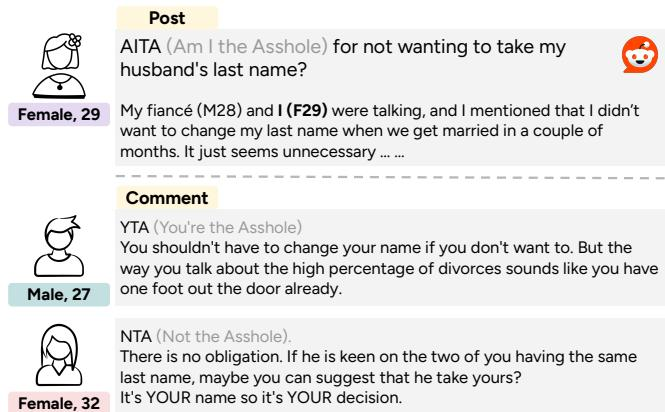
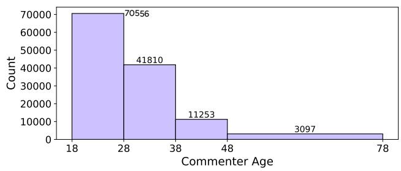
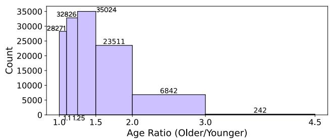
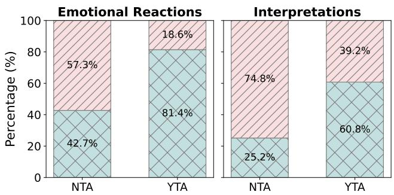
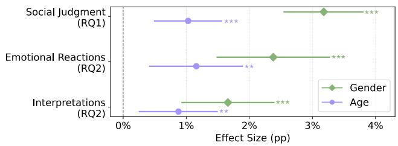
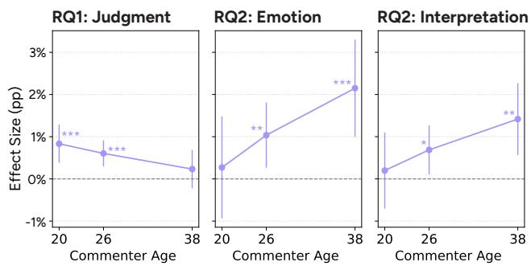
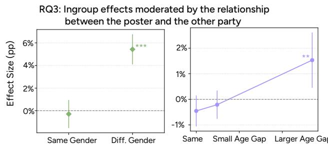

# Intergroup Bias Predicts Expressions of Social Judgment and Empathy in the r/AmITheAsshole Reddit Community

Yu Hou Hal Daume III Rachel Rudinger´

University of Maryland {houyu,hal3,rudinger}@umd.edu

## Abstract

People share and understand others’ experiences differently based on their social identities; often, people empathize more when the other person belongs to their ingroup compared to an outgroup. While this intergroup empathy gap is wellstudied in social psychology, it remains unclear how it manifests in naturally occurring online social interactions. To this end, we measure how commenters express social judgments, as an indirect outcome of their understanding towards the posters, and empathy in text, based on whether commenters share the poster’s gender or are of similar ages. We focus on posts where the poster self-reports these demographics, and analyze 126,716 comments associated with 36,163 posts from 18,111 commenters in r/AmItheAsshole, while controlling for commenter and poster group identities, post features (topic, length, and score), and both commenter- and postlevel variance. Our results show that when commenters and posters are ingroup, in either gender or age, commenters are more likely to provide a Not the Asshole verdict and show greater text-based understanding as measured by LLMs. We also observe that older commenters behave differently from younger ones. Furthermore, in a subset of posts where the gender and age of the other party in the conflict are explicitly mentioned, we find that commenter-poster ingroup effects are moderated by the group relationships between the poster and the other party when commenters make social judgments. Our work highlights the importance of intergroup context and social group nuances in understanding online discourse.

## 1 Introduction

People live in social groups and define themselves through their group memberships (Tajfel and Turner 1986). These social identities often drive people to behave differently towards ingroup members compared to outgroup members, where group status is defined by shared or dissimilar social identities. Understanding intergroup perceptions helps identify stereotypes (Chen, Ahmed, and Chib 2021) and is particularly relevant in online communities given the continuous growth of online social interactions. For example, othering, the process of categorizing an outgroup as different, can occur in food reviews (Luo, Gligoric, and Jurafsky 2024)´ and blogs (Gerard, Weninger, and Lerman 2025), causing harms; ingroup behavior plays an important role in influencing community experiences (Nettasinghe et al. 2025; Rotman et al. 2025; Weld et al. 2025).

  
Figure 1: Example post and comments from r/AmItheAsshole, including user gender and age. We use self-reported gender and age to study ingroup behaviors. In this example, the poster is a 29-year-old female in conflict with her fiance´ (the other party; a 28-year-old male). The commenters include a 27-year-old male and a 32-year-old female.

Building upon existing research, we focus on a common form of online interaction: a poster shares a personal experience, potentially asking for advice, and a commenter replies. Such scenarios may reflect how a commenter perceives and understands a poster differently because of the perspective that comes from their social identities. Prior work in social psychology suggests that people show more understanding toward ingroup members. This tendency—empathizing more with ingroup relative to outgroup members, or even feeling pleasure in response to outgroup pain—is known as the “intergroup empathy gap” (Cikara, Bruneau, and Saxe 2011; Cikara et al. 2014; Smith and van Dijk 2018). The empathy gap thus influences how people treat or react to each other. However, few studies have examined these intergroup effects in large-scale, real-life online social interactions, while controlling for possible confounds.

Present work. In this work, we analyze social scenarios from r/AmItheAsshole (AITA) posts that explicitly mention gender and age (as shown in Figure 1).1 We focus on gender and age social groups as they are not only easier to extract but also less variable compared to race/ethnicity and religion (Fiske 2017). We hypothesize that the intergroup relationship between the commenter and the poster plays a role in the commenter’s expressed understanding of the poster’s experience. This understanding is then manifested indirectly in the downstream social judgments: NTA (Not the Asshole; the poster shouldn’t be blamed) or YTA (You’re the Asshole; the poster should be blamed) verdicts, or more directly in their open-ended language expressing empathy.2

Informed by social theories regarding intergroup bias in gender (Dion 1979; Boldizar and Messick 1988; Vonk and Olde-Monnikhof 1998) and asymmetric age intergroup bias (Chasteen 2005; Cary, Chasteen, and Cadieux 2013; Blanke, Rauers, and Riediger 2015), our research questions are formulated as follows:

RQ1: Ingroup effects in social judgments. When sharing the same gender or a similar age, is the commenter more likely to give an NTA verdict? Do intergroup biases operate similarly for younger and older commenters?

RQ2: Ingroup effects in expressed text-based empathy. How do open-ended comments written in gender or age ingroup conditions differ from those in outgroup conditions?

RQ3: Ingroup effects moderated by social contexts. How do the gender and age intergroup dynamics between the poster and the other party in the post influence the ingroup effects between the poster and commenter?

To answer these questions, we start by extracting user self-reported gender and age from 456,200 AITA posts and linking these to the commenters. We leverage LLMs to carefully examine the data and predict post and comment features. As a result, we include 126,716 comments from 36,163 posts and 18,111 unique commenters for the logistic mixed-effects analysis, controlling for poster and commenter identities (gender and age) and post features (topic, length and score), as well as considering post and commenter group-level variance. Both gender ingroup and age distance are modeled as separate variables in the regression, with an additional interaction term between commenter age and age distance to capture the uniqueness of intergenerational behaviors. For RQ1, the outcome is the social judgment (NTA/YTA), whereas for RQ2, the outcomes are predicted text-based empathy dimensions in emotional reactions and interpretations, adapted from Sharma et al. (2020). For RQ3, we focus on a subset of data with 71,887 comments on 20,464 posts where the gender and age of both the original poster (OP) and the other party in the conflict are explicitly mentioned. This allows us to include the other party’s gender and age in the regression to observe the finegrained ingroup effects between commenters and OPs.

Summary of findings. Our analysis indicates that, on average, commenters are 3.18 pp more likely to give an NTA verdict when they share the same gender as the poster; similarly, for every unit reduction in the age gap (meaning the age ratio narrows by a factor of 1.5), commenters are 1.03 pp more likely to give an NTA verdict, an effect that is stronger among younger commenters (RQ1). On the empathy dimensions, we find that commenters are 2.38 pp more likely to express emotional reactions and 1.66 pp more likely to convey interpretations when they share the poster’s gender. We observe a similar pattern for age: as the age ratio narrows by a factor of 1.5, commenters are 1.16 pp more likely to express emotional reactions and 0.88 pp more likely to convey interpretations, with these effects being stronger among relatively older commenters (RQ2). Finally, our results suggest that when commenters share the same gender as the poster but not the other party in the post, they are 5.4 pp more likely to give an NTA verdict towards the original poster; they are also 1.53 pp more likely to give NTA per unit reduction in the commenter–poster age gap, when the poster and the other party have a large age gap (RQ3).

Implications. Overall, we find correlations between gender and age intergroup bias and commenters’ social judgments and open-ended comments in the AITA community. This highlights that social media serves as a critical lens for understanding societal dynamics (Chew et al. 2021). Moreover, given the increasing use and significant influence of AI in online communication (Ruffin et al. 2024; Hou, Daume III, and Rudinger 2025; Glickman and Sharot 2025; ´ Møller et al. 2025), it is important to consider the role of intergroup bias, whether originating in human conversations or learned by AI, when AI takes on different roles in a community, such as a poster, a commenter, or a mediator.

## 2 Background and Related Work

Studies on the r/AmItheAsshole community. Data from the AITA subreddit has been widely studied across various domains. Research treats AITA posts as moral dilemmas to identify their topics (Nguyen et al. 2022) and moral dimensions (Nguyen et al. 2024), as well as to evaluate LLMs on morality (Sachdeva and van Nuenen 2025) or social sycophancy (Cheng et al. 2025b), or study social norms (Forbes et al. 2020; De Candia et al. 2022; Vijjini et al. 2024). Regarding user interactions, comments and verdicts are analyzed to understand how moral judgments are formed (Lourie, Le Bras, and Choi 2021; Efstathiadis, Paulino-Passos, and Toni 2022; Botzer, Gu, and Weninger 2023; Xi and Singh 2024b; Betti, Bajardi, and De Francisci Morales 2025; Xi and Singh 2025) and how blame is assigned (Zhou, Smith, and Lee 2021; Xi and Singh 2024a). Finally, AITA data is also used to understand social narratives and norms (Giorgi et al. 2023; Henderson et al. 2026).

Role of social context in language. The social perspective in language is an important area of study (Sap et al. 2020; Zhou et al. 2023; Shen et al. 2025). Yang et al. (2025) call for social awareness when building NLP models or developing applications based on language technologies. These social factors include the context of the social environment, such as people’s perspectives and intergroup or interpersonal relationships (Althoff, Danescu-Niculescu-Mizil, and Jurafsky 2014; Buechel and Hahn 2017; Sepahpour-Fard and Quayle 2022; Govindarajan et al. 2023). Social media text encodes people’s attitudes towards different genders (Voigt et al. 2018; CH-Wang and Jurgens 2021), elicits empathy in personal narratives (Shen et al. 2023, 2024), and reveals how people empower each other (Njoo et al. 2023) or express condescension (Wang and Potts 2019). Together, these studies highlight the importance of carefully understanding human behaviors in language.

Relation between present and prior work. Following prior work, we view AITA posts as real-life social scenarios that people encounter. When users read these narratives, they comment based on their own judgments and personal experiences, related to their social roles. We posit that the language used in these social interactions implicitly reflects ingroup bias—specifically, by showing more understanding towards posters who self-report the same gender or similar age. While prior AITA research has studied social factors including gender and age, to the best of our knowledge, we are the first to study the intergroup effects at scale by considering the relationship between the poster and the commenter, while carefully controlling for other factors.

## 3 Materials and Methods

## 3.1 Data and Data Processing

r/AmItheAsshole posts and comments. The r/AmIthe-Asshole community is a popular English-language subreddit where users anonymously share personal dilemmas and ask the community to judge whether they are to blame in interpersonal conflicts. Community users engage by commenting on posts or interacting via votes and replies. According to the community guide, commenters are asked to include one of seven verdicts in their top-level comment: YTA (You’re the Asshole), YWBTA (You Would Be the Asshole), NTA (Not the Asshole), YWNBTA (You Would Not Be the Asshole), ESH (Everyone Sucks Here), NAH (No Assholes Here), or INFO (Not Enough Info). The original data is collected from Pushshift dumps spanning 2014 to 2022 (Baumgartner et al. 2020). In total, there are 456,200 posts and 36,951,098 top-level comments after removing the non-existing ones (empty or deleted). Comments here are possibly not associated with any of the 456,200 posts, as the parent post might have been deleted.

Self-reported user database. In our setup, to study how commenters understand the post and are influenced by poster identities, we build the intergroup relationship based on a post with explicitly mentioned gender and age, and a commenter with known demographics. Reddit user identities are anonymous by default, but there are many efforts to collect and predict users’ self-disclosed attributes (Beller et al. 2014; Burger et al. 2011; Burger and Henderson 2006; Gjurkovic et al. 2021). In r/AITA, while users typically com-´ ment on a post without exposing their gender and age, their social identities can be approximated using their posts where they mention these details (such as “F29” in Figure 1), as part of the community norm when sharing personal stories.3

  
Figure 2: Distribution of commenter age and age ratios for the final 126,716 comment-level interactions. We note that a large portion of users belong to younger groups and interact with others of relatively similar generations.

We start with regex-based gender and age extraction over the total 456,200 posts, following De Candia et al. (2022). However, after manually validating the data, we find many false positives (e.g., “I’m 24” becomes an extraction representing male and 24 years old). Considering the limited manual fixes we can apply for this approach, we incorporate an LLM-based extraction approach to improve the accuracy of building the user database. While arguably we can only rely on LLM extraction results, we find cases where LLMs try to predict or guess rather than extract the gender or age (e.g., “my husband” becomes male) or do not extract the OP’s gender or age when the post involves many people. To make sure this step doesn’t introduce noisy labels, we compare the extraction results between the regexbased and LLM-based approaches, and only retain users when both gender and age are extracted and agreed upon by both approaches. Specifically, we deploy the open-weight Gemma-3-27B with vLLM (Kwon et al. 2023). We then run separate asynchronous calls with a temperature of 0 for each of the 456,200 posts. Prompt details are in Appendix A (Prompt A.1).4 Overall, there are 119,063 posts with selfdisclosed gender and age, verified by both approaches.

Further, we calculate the year of birth based on the extracted age, accounting for the fact that users post and comment at different times. Given that users might post multiple times with conflicting information, we only include those who report their gender consistently and have a year of birth difference of at most one year (which is likely due to calculation error). Overall, this process yields 105,376 unique users with known gender (including 72,921 females and 32,455 males) and year of birth ranging from 1935 to 2012 (median: 1998; Q1-Q3: 1994-2002).

To examine the selection bias from self-disclosure, we compare user activity between self-disclosed and other users. Of the 2,441,511 total users, 503,753 only post (65,346 of the 105,376 self-disclosed users only post too) and 1,720,007 only comment. Among users who both post and comment, self-disclosed users (N=40,030) are slightly more active than other users (N=177,721), with more posts (Mean=2.12, SD=2.35 vs. Mean=1.57, SD=1.29), more comments (Mean=28.85, SD=162.53 vs. Mean=26.33, SD=164.86), and moderately longer comments on average (Mean=349.63, SD=305.26 vs. Mean=312.75, SD=313.09). No strong differences are found between the two groups.

Final dataset. With the user database, we are now able to map comments to users with known gender and age, and associate comments with one of 119,063 posts where the poster self-disclosed their gender and age. This leads to a total of 194,576 comments.

Next, to prepare one of the key outcome variables, the final verdict, we employ a keyword-based extraction approach as in Plepi et al. (2022); Welch et al. (2022). We further aggregate the verdicts into two binary categories: (1) NTA (including NTA, YWNBTA, and NAH), indicating the poster is not to blame, and (2) YTA (including YTA, YWBTA, and ESH), indicating the poster is to blame. We exclude comments with the INFO verdict from our analysis. To summarize, we further process the data with the following criteria: (1) the comment is associated with a commenter with known gender and age who is at least 18 years old; (2) the comment is linked to a post containing explicitly mentioned poster gender and an age of 18 or older; (3) the comment is a toplevel comment with a clearly extracted verdict falling under the aggregated NTA or YTA; (4) the commenter has at most 100 comments;5 and (5) the commenter is different from the poster. In the end, we have 126,716 comments from 18,111 commenters associated with 36,163 posts (2018-2022).6

## 3.2 Feature Preparation

Post-related features. To study the ingroup effects on comment-level outcomes, we control for post-related features, including: poster gender $( P _ { G } ) _ { : }$ , a binary variable indicating the self-reported gender of the poster (1 for male, 0 for female); poster age $( P _ { A } )$ , the natural logarithm of the poster’s self-reported age, ln(age); post length $( P _ { L } )$ the natural logarithm of the post length in characters; post score $( P _ { S } ) _ { : }$ , derived from the post metadata, capturing overall post engagement and z-score normalized for model fitting; and post topic $( P _ { T } )$ . The natural logarithm is used to account for the skewed distribution. As for the topic categorization, given that AITA posts are mainly about interpersonal conflicts, we define topics based on relationship categories from De Candia et al. (2022). Topics include: romance, family, friendship, work/school, public strangers, and society. To determine the topic for each post, we prompt gpt-4o-mini-2024-07-18 with temperature 0 in separate calls.7 The detailed prompt is provided in Appendix A (Prompt A.2). We validate the predictions on 100 randomly sampled posts and find that 7 predictions are inaccurate. The errors are mainly from posts involving multiple parties with complicated relationship. We merge the public and society topics during the regression analysis, given that only 65 out of 36,163 posts are predicted as society (Table 1). We also include the post ID $\left( P _ { \mathbf { I D } } \right)$ to account for grouping effects.

<table><tr><td>Romance</td><td>Family</td><td>Friendship</td><td>Work</td><td>Public</td><td>Society</td></tr><tr><td>10,102</td><td>17,716</td><td>5,088</td><td>1,690</td><td>1,502</td><td>65</td></tr></table>

Table 1: Post topic distribution across 36,163 posts. Work is short for work/school, and Public refers to public strangers. We merge Public and Society into one topic during the regression analysis, given the small predicted portion overall.

<table><tr><td colspan="2">Commenter: M</td><td>Commenter: F</td></tr><tr><td>Poster: M</td><td>8,691</td><td>34,778</td></tr><tr><td>Poster: F</td><td>15,263</td><td>67,984</td></tr></table>

Table 2: Counts of comment-level gender interactions (M=Male, F=Female). The diagonal represents ingroup cases. We note that female-female interactions make up the majority. To account for this, we include commenter and poster gender as controls, so the ingroup gender variable captures effects beyond baseline gender differences.

Commenter-related features. We include commenter gender $\left( C _ { G } \right)$ and commenter age $( C _ { A } )$ , calculated the same as poster gender and poster age, controlling for baseline gender and age effects from commenters. Note that both $C _ { G }$ and $C _ { A }$ are extracted from the commenter’s past self-disclosed posts, not derived from the comment itself. The commenter ID $\bf ( \it C _ { I D } )$ is included to control for repeated observations.

Intergroup features. To capture effects related to our ingroup bias hypothesis, we define ingroup gender $\left( \mathbf { I N } _ { G } \right)$ as a binary variable, where 1 indicates $P _ { G } = C _ { G }$ (the commenter shares the same gender as the poster) and 0 indicates they are in different gender groups. Given that age is a continuous variable, we define ingroup age $\left( \mathbf { I N } _ { A } \right)$ based on the distance between $P _ { A }$ and $C _ { A } ( \ln ( \mathrm { a g e } ) )$ , such that 0 implies the commenter is the same age as the poster. Specifically, to ease the interpretation, we define:

  
Figure 3: Distribution of social judgment outcomes (NTA: $\scriptstyle \mathrm { N = 8 8 , 9 7 7 ; }$ YTA: N=37,739) across text-based empathy dimensions: emotional reactions E, interpretations I. Top [//] represents the percentage of comments predicted as 1 on that dimension, while bottom $[ \times ]$ represents those predicted as 0 (lacking expressed empathy). YTA comments generally contain fewer emotional reactions and empathetic interpretations. The variance within both judgments (NTA or YTA) highlights the importance of analyzing comment language features in addition to final verdicts.

$$
\mathbf { I N } _ { A } = - { \frac { | P _ { A } - C _ { A } | } { \ln ( 1 . 5 ) } } = - | \mathrm { l o g } _ { 1 . 5 } ( \mathrm { a g e r a t i o } ) |
$$

meaning that a one-unit increase in $\mathbf { I N } _ { A }$ corresponds to the age ratio narrowing by a factor of 1.5. For example, for a commenter aged 54 and a poster aged 24 (or a poster aged 54 and a commenter aged 24), $\mathrm { I N } _ { A } = - 2$

Table 2 shows the gender distribution, while Figure 2 displays the age distribution.

Outcomes. We study two types of outcomes expressed in a comment, reflecting how the commenter perceives the poster’s story, covering three dimensions:

(1) Social judgment (RQ1 and RQ3; widely discussed in past work): This is expressed by the aggregated binary verdict (V), a variable where we encode NTA as 1 and YTA as 0. We hypothesize that ingroup gender or age correlates with NTA—meaning the poster is not considered blameworthy, in contrast to a YTA verdict, where the commenter might show less understanding towards the poster.

(2) Text-based empathy (RQ2): When representing a comment with only the verdict, the rich language meanings in the other parts of the comment are lost. As seen in the first example in Figure 1, even if the verdict is YTA, the commenter may still communicate understanding (e.g., “You shouldn’t have to change your name ifyou don’t want to.”).

Since there are no existing measures specific to AITA comments capturing text-based empathy, we develop two scales: emotional reactions (E) and interpretations (I) based on EPITOME, a framework established for understanding empathy in text-based mental health Reddit interactions (Sharma et al. 2020). Recent work shows that LLMs have the potential to perform on par with humans in this subjective task (Kumar et al. 2025). We revise the original questions as follows:

• Emotional Reactions: Does the comment express or allude to warmth, compassion, concern, or similar feelings from the commenter towards the poster?

• Interpretations: Does the comment communicate an understanding of the poster’s experiences and feelings?

Each question comes with three options (rating scale 0–2) for both human annotators and LLMs, enabling fine-grained judgments. Prompt details are in Appendix A (Prompt A.4). During later analysis and modeling, positive ratings are merged to improve the reliability of the scales, where 1 indicates the comment expresses emotional reactions or interpretations, while 0 means a lack of expressed empathy. To validate the instructions, two graduate students annotate 40 randomly sampled comments, achieving Cohen’s Kappa of 0.56 and 0.46 (moderate agreement) for Emotional Reactions and Interpretations, respectively. The main disagreements arise in cases where the comment expresses empathy toward other parties in the post, rather than the OP. This observation is incorporated into the LLM prompt. Specifically, we use $\mathtt { g p t - 4 o - m i n i - } 2 0 2 4 - 0 7 - 1 8$ under the same setup (asynchronous single inferences) to annotate all comments. Figure 3 shows the relationships between the predictions and social judgments. Authors further annotate 200 randomly sampled comments. On this test set, the precision, recall, and F1 scores for Emotional Reactions are 0.85, 0.65, and 0.73, respectively; for Interpretations, they are 0.91, 0.94, and 0.92 respectively.

## 3.3 Regression Analysis

Mixed-effects model. We use mixed-effects models to isolate specific effects while controlling for repeated observations across groups. The formula for RQ1 and RQ2 is:

$$
\begin{array} { r l r } {  { \ln ( \frac { \pi _ { i } } { 1 - \pi _ { i } } ) = \beta _ { 0 } + \beta _ { 1 }  { \mathbf { I } }  { \mathbf { N } } _ { G i } + \beta _ { 2 }  { \mathbf { I } }  { \mathbf { N } } _ { A i } } } \\ & { } & { ~ + \beta _ { 3 } C _ { A i } + \beta _ { 4 } (  { \mathbf { I } }  { \mathbf { N } } _ { A i } \times C _ { A i } ) } \\ & { } & { ~ + \gamma ^ { T }  { \mathbf { X } } i + u _ { P _ { \mathrm { I D } } [ i ] } + v _ { C _ { \mathrm { I D } } [ i ] } ~ } \end{array}
$$

In this equation, $\pi _ { i }$ denotes the probability of the outcome (V, E, or I) being 1. The main independent variables are ingroup gender $\left( \operatorname { I N } _ { G } \right)$ and ingroup age $( \operatorname { I N } _ { A } )$ . We include an interaction term between commenter age $( C _ { A } )$ and ingroup age $( \mathrm { I N } _ { A } \times C _ { A } )$ to test the asymmetric age ingroup bias hypothesis, which suggests that older adults may exhibit different ingroup biases compared to younger adults (Chasteen 2005). The vector $\mathbf { X } _ { i }$ contains the remaining control covariates: poster gender $( P _ { G } )$ , poster age $( P _ { A } )$ , post length $( P _ { L } )$ , post score $( P _ { S } )$ , post topic $( P _ { T } )$ , and commenter gender $( C _ { G } )$ . Here, by including the gender and age of the poster and commenter separately, we effectively control for their group-specific (e.g., male or female) base rates of issuing verdicts or showing empathy. Finally, the model includes crossed random intercepts $u _ { P _ { \mathrm { I D } } }$ and $v _ { C _ { \mathrm { I D } } }$ to account for unobserved variation across unique posts and commenters.8

  
Figure 4: Estimated overall gender and age ingroup effects (in percentage points) on social judgment and two text-based empathy dimensions. Positive effects indicate that when the commenter and poster share the same gender or are similar in age, commenters are more likely to give an NTA verdict or express greater empathy in their comments. 95% confidence intervals are reported. Significance: $^ { * * * } p < 0 . 0 0 1 , { } ^ { * * } p <$ $0 . 0 1 , ^ { * } p < 0 . 0 5$

Average marginal effects. We report population-level average marginal effects (Williams 2012; Arel-Bundock, Greifer, and Heiss 2024). Results are interpreted in percentage points (pp), representing the change in the probability of a positive outcome, i.e. giving an NTA verdict (V) or showing text-based empathy (E or I). This is the difference between groups $( \mathbf { e } . \mathbf { g } . , \mathbf { I N } _ { G } = 1 \mathrm { v s . } 0 )$ or the change associated with a one-unit increase in continuous variables $( \mathbf { e } . \mathbf { g } . , \mathbb { N } _ { A } )$

## 4 Results

## 4.1 RQ1: Ingroup Effects in Social Judgments

Social judgments and how posters and commenters behave differently based on gender and age on AITA are widely discussed in research. For example, Betti, Bajardi, and De Francisci Morales (2025) show through a causal analysis that these judgments are not biased by gender. However, the commenters, who perceive the post from different perspectives and deliver these judgments, are often ignored in such analyses. This is important, as these judgments are not only driven by the post content but also by the commenter’s personal understanding and interpretation of the poster. Therefore, our first set of hypotheses tests for ingroup effects in social judgments. Based on our model, we expect to observe a significant positive estimate for $\operatorname { I N } _ { G }$ or $\mathrm { I N } _ { A }$ if commenters who share the same gender or similar age as the poster give more Not the Asshole verdicts, regardless of the specific gender or age of the poster or commenter.

Averaged gender ingroup effects. Figure 4 shows the results. In this dimension, when the intergroup relationship changes from gender outgroup to ingroup, there is a 3.18 pp (95% CI: [2.54, 3.81]; $p < 0 . 0 0 1 )$ increase in the probability of commenters giving an NTA verdict.

Averaged age ingroup effects. On the age distance side, when the ratio between the commenter and poster narrows by a factor of 1.5 (e.g., from a commenter aged 20 reading a post by a 30-year-old—or vice versa, due to the absolute distance—to a 20-year-old commenter interacting with a poster also at age 20), commenters are 1.03 pp (95% CI: [0.49, 1.57]; $p < 0 . 0 0 1 )$ more likely to give NTA.

  
Figure 5: Estimated age ingroup effects on social judgment and two text-based empathy dimensions (Emotional Reactions and Interpretations) for commenters aged 20, 26, and 38. Results indicate that older commenters exhibit weaker ingroup bias in social judgments but stronger ingroup bias in expressed text-based empathy compared to younger commenters. 95% confidence intervals are reported. Significance notation: $^ { * * * } p < 0 . 0 0 1 , ^ { * * } p < 0 . 0 1 , ^ { * } p < 0 . 0 5$

Figure 5 illustrates the asymmetric age ingroup effects. We select commenter ages corresponding to the 10%, 50%, and 90% quartiles of the distribution, resulting in ages of 20, 26, and 38. We find that as the commenter gets older, the effect size becomes smaller and statistically non-significant. This is possibly due to older adults having greater familiarity with outgroups when they are asked to make judgments, as studied in Chasteen (2005).

## 4.2 RQ2: Ingroup Effects in Expressed Text-Based Empathy

To explore commenters’ language use going beyond verdicts, we use LLM-predicted text-based empathy dimensions as proxies to further understand the contextual features of their comments. Here, we aim to test the set of hypotheses examining whether commenters’ language shows more empathy towards the poster, regardless of the social judgments. Similar to RQ1, if ingroup effects exist, we expect to observe positive estimates.

Averaged gender ingroup effects. Our hypotheses regarding text-based empathy are supported, as illustrated in Figure 4. Across both dimensions, we observe that commenters are significantly more likely to express warmth or compassion and communicate understanding in their comments when interacting with a poster who shares the same gender identity. Specifically, regarding emotional reactions, the model yields an average positive estimate of 2.38 pp (95% CI: [1.48, 3.28]; $p < 0 . 0 0 1 $ ). Similarly, for interpretations, we observe a significant increase of 1.66 $p p$ (95% CI: $[ 0 . 9 2 , 2 . 4 0 ] ; p \ < \ 0 . 0 0 1 )$ . These results confirm that shared gender not only influences the final verdict but actively shapes the empathetic quality of the text itself.

Averaged age ingroup effects. Our hypotheses on age ingroup effects are also supported: for emotional reactions, the estimate is $1 . 1 6 p p ( 9 5 \% \mathrm { C I } ; [ 0 . 4 1 , 1 . 9 0 ] ; p = 0 . 0 0 2 3 9 )$ , and for interpretations, the estimate is 0.88 pp (95% CI: [0.25,

  
Figure 6: Gender and age ingroup effects on social judgments (NTA/YTA) moderated by the relationship between the poster and the other party. When the poster and the other party are of different genders or have a large age gap, the observed average ingroup effects, modeled between the commenter and poster, are larger and significant. 95% confidence intervals are reported. Significance: $^ { * * * } p \ < \ 0 . 0 0 1$ $^ { * * } p < 0 . 0 1 , ^ { * } p < 0 . 0 \bar { 5 }$

$1 . 5 0 ] ; p = 0 . 0 0 6 3 2 )$ . In detail, this implies that as the age ratio narrows by a factor of 1.5, the likelihood of commenters expressing emotional reactions increases by 1.15 percentage points, and the likelihood of communicating understanding increases by 0.86 percentage points.

For the asymmetry in age ingroup effects (Figure 5), we observe the opposite trend in text-based empathy dimensions compared to social judgments. When commenters are older, they are more likely to show ingroup support towards posters of a similar age by expressing understanding in their comments. This potentially suggests the complexity of how people show understanding and support toward others: commenters may vary in how judgmental they are (the verdict), which interacts with how they choose to phrase their words to the poster (the language).

## 4.3 RQ3: Ingroup Effects Moderated by the Social Context

To investigate where the ingroup effects are from, we look deeper into the AITA posts. Because these posts describe interpersonal conflicts, the narratives usually present both the poster and the other party with whom they are in conflict. The full set of community verdicts includes combinations of whether the poster or the other party is blamed.

Data subset. To this end, we hope to explore the intergroup relationships between the commenter, the poster, and the other party, where a commenter may be ingroup with neither or either. We hypothesize that ingroup effects are stronger when the commenter is ingroup with the poster but outgroup with the other party (i.e., taking sides). For example (Figure 1), a female commenter is ingroup with a female poster but outgroup with the other party (the male fiance). We extract the other party’s gender and age using´ $\mathtt { g p t - 4 o - m i n i - } 2 0 2 4 - 0 7 - 1 8$ because regex is difficult to apply in these cases. We gather this information during topic categorization, as identifying the main party first improves task performance. To ensure the LLM does not guess info based on stereotypes, we only use the subset where both gender and age are explicitly extracted. On 100 randomly sampled posts, we find only 4 inaccurate predictions, with error patterns similar to those in the poster gender and age extraction task (e.g., predicting or guessing information from circumstantial clues). This results in a subset of 71,887 comments on 20,464 posts.9

Mixed-effects model. We fit a separate mixed-effects model where the other party’s gender $( O _ { G } )$ and age $( O _ { A } )$ are measured in the same manner as the poster’s, with the social judgment (V ) as the outcome. We include two new variables that interact with $\operatorname { I N } _ { G }$ (ingroup gender) and $\operatorname { I N } _ { A }$ (ingroup age): (1) $\mathrm { O U T _ { P G } }$ is a binary variable indicating whether the other party’s gender differs from the poster’s: $\mathrm { { O U T } _ { P G } = 1 }$ when they are different, and $\mathrm { O U T _ { P G } } \stackrel { = } { = } 0$ indicates the conflict in the post occurs between members of the same gender group; $( 2 ) \mathrm { O U T _ { P A } }$ represents the age distance between the other party and the poster, calculated as $\begin{array} { r } { \mathrm { O U T } _ { \mathrm { P A } } = \frac { | P _ { A } - O _ { A } | } { \ln ( 1 . 5 ) } } \end{array}$ The full formula is:

$$
\begin{array} { r l } { \mathrm { l o g i t } ( P ( V _ { i } = 1 ) ) = \beta _ { 0 } + \beta _ { 1 } \mathrm { I N } _ { G i } + \beta _ { 2 } \mathrm { O U T } _ { \mathrm { P G } i } } & { } \\ & { ~ + \beta _ { 3 } ( \mathrm { I N } _ { G i } \times \mathrm { O U T } _ { \mathrm { P G } i } ) } \\ & { ~ + \beta _ { 4 } \mathrm { I N } _ { A i } + \beta _ { 5 } \mathrm { O U T } _ { \mathrm { P A } i } } \\ & { ~ + \beta _ { 6 } ( \mathrm { I N } _ { A i } \times \mathrm { O U T } _ { \mathrm { P A } i } ) } \\ & { ~ + \beta _ { 7 } C _ { A i } + \beta _ { 8 } ( \mathrm { I N } _ { A i } \times C _ { A i } ) } \\ & { ~ + \gamma ^ { T } \mathbf { X } ^ { \prime } i + u _ { P _ { \mathrm { I D } } [ i ] } + v _ { C _ { \mathrm { I D } } [ i ] } } \end{array}
$$

In addition to the existing ones, $\mathbf { X } _ { i } ^ { \prime }$ includes $O _ { G }$ and $O _ { A }$

Averaged gender ingroup effects. On average, we still find a significant positive gender ingroup estimate. This means that regardless of the gender of the other party, when the commenter is ingroup with the poster, commenters are 3.96 pp (95% CI: [3.09, 4.82]; $p \ < \ 0 . 0 0 1 )$ ) more likely to issue an NTA verdict. However, these effects are moderated by the relationship between the poster and the other party (Figure 6). When the other party and the poster are from different gender groups, the estimate for $\operatorname { I N } _ { G }$ is much larger and significant at $5 . 4 3 p p ( 9 5 \% { \mathrm { C I } } \colon [ 4 . 1 0 , 6 . 7 7 ] ; p < 0 . 0 0 \bar { 1 } )$ In contrast, when the other party and the poster are of the same gender, the effect is non-significant at -0.29 pp (95% CI: $[ - 1 . 5 4 , 0 . 9 5 ] ; p = 0 . 6 4 5 )$

Averaged age ingroup effects. Regarding the age ingroup, the average estimate for $\mathrm { I N } _ { A }$ is not significant under the new setup, at 0.38 pp (95% CI: $[ - 0 . 6 3 , 0 . 8 8 ] ; p = 0 . 7 4 6 )$ However, the results (Figure 6)—where we sample the 10%, 50%, and 90% quartiles of the $\mathrm { O U T _ { P A } }$ distribution to represent a negligible, small, and large age gap between the poster and the other party—show a different pattern. When the poster and the other party have a larger age gap $\mathrm { ( O U T _ { P A } = }$ 1.348), the estimate for $\operatorname { I N } _ { A }$ becomes positive and significant at 1.53 pp (95% CI: [0.45, 2.61]; $p = 0 . 0 0 5 4 3 )$ . This suggests that, similar to the moderation effects of gender, ingroup effects are stronger when the commenter is an ageingroup member with the poster but not with the other party.

Overall, results indicate that intergroup bias correlates with the expressions of social judgments and empathy in the comments of the AITA community. However, this bias is dependent on the social context and group nuances.

## 5 Discussion

In this work, we study intergroup bias based on gender and age using online social interactions in the r/AmITheAsshole community. We address three research questions, building on a final dataset of 126,716 comments and 36,163 posts. We focus on a specific type of intergroup behavior where a commenter reads a post with self-reported gender and age and writes a comment containing a clear verdict and openended words. Because these posts describe real-world interpersonal conflicts, the comments show how commenters understand the posters based on their stories. First, we look into social judgments where commenters decide if the poster is to blame. Then, we extend the analysis to their open-ended “rationales” and develop text-based empathy scales specific to those comments. Finally, we revisit the posts to understand in depth how this intergroup process happens, specifically regarding making social judgments. After carefully controlling for effects from posts, posters, and commenters, we find that when the commenter and poster share the same gender or are of a similar age, commenters are more likely to issue an NTA verdict and show greater understanding through the open-ended comments. In addition, the age ingroup effects are not the same among older and younger adults, and these ingroup effects are moderated by the intergroup relationships in the post. To conclude, understanding others and expressing this understanding only appears to be straightforward. Social group identities, like gender and age, are two of many perspectives for interpreting this human behavior. In addition, there are other shared experiences we have with others that influence our cognitive empathy, such as being on the same sports team, speaking the same language, or growing up in the same town. In a future where AI increasingly adopts human-like roles—whether as a poster mimicking various text styles (Basoah et al. 2025), a commenter pretending to behave like a human (Cheng et al. 2025a), or a communication mediator (Jakesch et al. 2019)—will it bridge the gap of shared experiences, or will it complicate the intergroup biases? We leave this for future work.

Implications. We report the observed effects of other predictors in the regression model for RQ1. Post topic categories show average marginal effects (AMEs) ranging from −5.56 pp (romance) to −1.55 pp (work/school) relative to the public category. In comparison, the gender ingroup effect has an AME of 3.18 pp, and a one-unit increase in log age distance corresponds to an AME of 1.03 pp. Because social judgment is a relatively indirect outcome of the intergroup empathy gap, other factors also influence the outcome. Between the two ingroup effects, the gender ingroup effect is larger than the age ingroup effect.

Limitations and future work. Our work has a number of limitations that can be further studied. First, from the initial dataset, we apply many rules to ensure a relatively accurate user database from which to build intergroup relationships, resulting in a large portion of the data being discarded. Even though we do not observe a strong difference between selfdisclosed users and other users, because we omit any poster– commenter pairs where the identity of either is unknown, this still risks leading to potential selection bias where our results only represent user interactions in which both identities are known and expressed explicitly in ways we can parse. We prioritize correct user gender and age labels using both regex and LLM approaches to avoid the potential ethical harms or invalidity of inferring gender or age from indirect evidence. Future work can refine extraction rules or methods to infer user identities in online communities.

Second, we would like to discuss the distinction between self-identity and perceived identity. For the intergroup effects in our study, we care about commenters’ self-identity (which is based on their self-reported identity when they take the poster role) and how the commenter perceives the identity of the poster and the other parties in the poster’s stories. Because we cannot know exactly how those posts are received or with what kinds of perceived group identities, we only study posts with clearly self-disclosed identities and assume those are consistent with the post content and furthermore received the same way by the commenter. It is possible that people do not share their real identities online, that their self-disclosed identities might not match the post content, or that commenters view the posters based on other interactions. We hope future work can address these limitations and study intergroup interactions under more complex scenarios.

Third, we acknowledge the limitations of using LLMs as data annotators (Egami et al. 2023; Gligoric et al. 2025), though we try to carefully examine the data. We consider using LLMs as a convenient and powerful way to extend RQ1 with a deeper understanding of both the comment and post content, compared to using only the extracted social identities and judgments, for exploratory purposes. Future work could build more robust annotation pipelines or approaches and extend the current study setup.

Lastly, our final data range from 2018 to 2022. This was the data we could find online at the time, and we do not intend to exclude data from post-pandemic years. While intergroup bias is well studied, we understand that discourse norms are changing, which may influence the findings. Future work can apply our approach to more recent data and examine how the findings may have shifted.

Ethical concerns. Though we only use publicly available data with user-reported gender and age to build intergroup relationships, it is important to note that Reddit users have not consented to research studies. While r/AmITheAsshole data has been used widely in previous research, we will only release anonymous, aggregated features for this analysis to protect user privacy.

## Acknowledgments

We would like to thank the anonymous reviewers for their valuable feedback. This material is based upon work partially supported by the NSF under Grant No. 2229885 (NSF Institute for Trustworthy AI in Law and Society, TRAILS), and NSF CAREER Award No. 2339746 (Rudinger). Any opinions, findings and conclusions or recommendations expressed in this material are those of the author(s) and do not necessarily reflect the views of the National Science Foundation.

## References

Althoff, T.; Danescu-Niculescu-Mizil, C.; and Jurafsky, D. 2014. How to Ask for a Favor: A Case Study on the Success of Altruistic Requests. Proceedings ofthe International AAAI Conference on Web and Social Media, 8(1): 12–21.

Arel-Bundock, V.; Greifer, N.; and Heiss, A. 2024. How to Interpret Statistical Models Using marginaleffects for R and Python. Journal ofStatistical Software, 111(9): 1–32.

Basoah, J.; Chechelnitsky, D.; Long, T.; Reinecke, K.; Zerva, C.; Zhou, K.; D´ıaz, M.; and Sap, M. 2025. Not Like Us, Hunty: Measuring Perceptions and Behavioral Effects of Minoritized Anthropomorphic Cues in LLMs. In Proceedings of the 2025 ACM Conference on Fairness, Accountability, and Transparency, FAccT ’25, 710–745. New York, NY, USA: Association for Computing Machinery. ISBN 9798400714825.

Baumgartner, J.; Zannettou, S.; Keegan, B.; Squire, M.; and Blackburn, J. 2020. The Pushshift Reddit Dataset. Proceedings of the International AAAI Conference on Web and Social Media, 14(1): 830–839.

Beller, C.; Knowles, R.; Harman, C.; Bergsma, S.; Mitchell, M.; and Van Durme, B. 2014. I’m a Belieber: Social Roles via Self-identification and Conceptual Attributes. In Toutanova, K.; and Wu, H., eds., Proceedings of the 52nd Annual Meeting of the Association for Computational Linguistics (Volume 2: Short Papers), 181–186. Baltimore, Maryland: Association for Computational Linguistics.

Betti, L.; Bajardi, P.; and De Francisci Morales, G. 2025. Moral judgments in online discourse are not biased by gender. Scientific Reports, 15(1): 21555.

Blanke, E. S.; Rauers, A.; and Riediger, M. 2015. Nice to meet you—adult age differences in empathic accuracy for strangers. Psychology and Aging, 30: 149–159.

Bockarova, M. 2016. Chapter 3 - The Intersection Between Technology, Mind-Wandering, and Empathy. In Tettegah, S. Y.; and Espelage, D. L., eds., Emotions, Technology, and Behaviors, Emotions and Technology, 47–62. San Diego: Academic Press. ISBN 978-0-12-801873-6.

Boldizar, J. P.; and Messick, D. M. 1988. Intergroup fairness biases: Is ours the fairer sex? Social Justice Research, 2(2): 95–111.

Botzer, N.; Gu, S.; and Weninger, T. 2023. Analysis of Moral Judgment on Reddit. IEEE Transactions on Computational Social Systems, 10(3): 947–957.

Buechel, S.; and Hahn, U. 2017. Readers vs. Writers vs. Texts: Coping with Different Perspectives of Text Understanding in Emotion Annotation. In Schneider, N.; and Xue, N., eds., Proceedings ofthe 11th Linguistic Annotation Workshop, 1–12. Valencia, Spain: Association for Computational Linguistics.

Burger, J. D.; Henderson, J.; Kim, G.; and Zarrella, G. 2011. Discriminating Gender on Twitter. In Barzilay, R.; and Johnson, M., eds., Proceedings of the 2011 Conference on Empirical Methods in Natural Language Processing, 1301–1309. Edinburgh, Scotland, UK.: Association for Computational Linguistics.

Burger, J. D.; and Henderson, J. C. 2006. An Exploration of Observable Features Related to Blogger Age. In AAAI Spring Symposium: Computational Approaches to Analyzing Weblogs, 15–20. Menlo Park, CA.

Cary, L. A.; Chasteen, A. L.; and Cadieux, J. 2013. Does Age Group Identification Differentially Influence Younger and Older Adults’ Intergenerational Perceptions? The International Journal ofAging and Human Development, 77(4): 331–346. PMID: 24547616.

CH-Wang, S.; and Jurgens, D. 2021. Using Sociolinguistic Variables to Reveal Changing Attitudes Towards Sexuality and Gender. In Moens, M.-F.; Huang, X.; Specia, L.; and Yih, S. W.-t., eds., Proceedings of the 2021 Conference on Empirical Methods in Natural Language Processing, 9918– 9938. Online and Punta Cana, Dominican Republic: Association for Computational Linguistics.

Chasteen, A. L. 2005. Seeing Eye-to-Eye: Do Intergroup Biases Operate Similarly for Younger and Older Adults? The International Journal of Aging and Human Development, 61(2): 123–139. PMID: 16161289.

Chen, V. H. H.; Ahmed, S.; and Chib, A. 2021. The Role of Social Media Behaviors and Structural Intergroup Relations on Immigrant Stereotypes. International Journal of Communication, 15(0): 24.

Cheng, M.; Lee, C.; Khadpe, P.; Yu, S.; Han, D.; and Jurafsky, D. 2025a. Sycophantic AI Decreases Prosocial Intentions and Promotes Dependence. arXiv:2510.01395.

Cheng, M.; Yu, S.; Lee, C.; Khadpe, P.; Ibrahim, L.; and Jurafsky, D. 2025b. ELEPHANT: Measuring and understanding social sycophancy in LLMs. arXiv:2505.13995.

Chew, R.; Kery, C.; Baum, L.; Bukowski, T.; Kim, A.; and Navarro, M. 2021. Predicting Age Groups of Reddit Users Based on Posting Behavior and Metadata: Classification Model Development and Validation. JMIR Public Health Surveill, 7(3): e25807.

Cikara, M.; Bruneau, E.; Van Bavel, J.; and Saxe, R. 2014. Their pain gives us pleasure: How intergroup dynamics shape empathic failures and counter-empathic responses. Journal ofExperimental Social Psychology, 55: 110–125.

Cikara, M.; Bruneau, E. G.; and Saxe, R. R. 2011. Us and Them: Intergroup Failures of Empathy. Current Directions in Psychological Science, 20(3): 149–153.

De Candia, S.; De Francisci Morales, G.; Monti, C.; and Bonchi, F. 2022. Social Norms on Reddit: A Demographic Analysis. In Proceedings of the 14th ACM Web Science Conference 2022, WebSci ’22, 139–147. New York, NY, USA: Association for Computing Machinery. ISBN 9781450391917.

Dion, K. L. 1979. Status Equity, Sex Composition of Group, and Intergroup Bias. Personality and Social Psychology Bulletin, 5(2): 240–244.

Efstathiadis, I. S.; Paulino-Passos, G.; and Toni, F. 2022. Explainable Patterns for Distinction and Prediction of Moral Judgement on Reddit. arXiv:2201.11155.

Egami, N.; Hinck, M.; Stewart, B. M.; and Wei, H. 2023. Using imperfect surrogates for downstream inference: designbased supervised learning for social science applications of large language models. In Proceedings of the 37th International Conference on Neural Information Processing Systems, NIPS ’23. Red Hook, NY, USA: Curran Associates Inc.

Fiske, S. T. 2017. Prejudices in Cultural Contexts: Shared Stereotypes (Gender, Age) Versus Variable Stereotypes (Race, Ethnicity, Religion). Perspectives on Psychological Science, 12(5): 791–799. PMID: 28972839.

Forbes, M.; Hwang, J. D.; Shwartz, V.; Sap, M.; and Choi, Y. 2020. Social Chemistry 101: Learning to Reason about Social and Moral Norms. In Webber, B.; Cohn, T.; He, Y.; and Liu, Y., eds., Proceedings of the 2020 Conference on Empirical Methods in Natural Language Processing (EMNLP), 653–670. Online: Association for Computational Linguistics.

FORCE11. 2020. The FAIR Data principles. https://force11. org/info/the-fair-data-principles/.

Gebru, T.; Morgenstern, J.; Vecchione, B.; Vaughan, J. W.; Wallach, H.; Iii, H. D.; and Crawford, K. 2021. Datasheets for datasets. Communications ofthe ACM, 64(12): 86–92.

Gerard, P.; Weninger, T.; and Lerman, K. 2025. Fear and Loathing on the Frontline: Decoding the Language of Othering by Russia-Ukraine War Bloggers. Proceedings of the International AAAI Conference on Web and Social Media, 19(1): 615–635.

Giorgi, S.; Zhao, K.; Feng, A. H.; and Martin, L. J. 2023. Author as Character and Narrator: Deconstructing Personal Narratives from the r/AmITheAsshole Reddit Community. Proceedings of the International AAAI Conference on Web and Social Media, 17(1): 233–244.

Gjurkovic, M.; Karan, V. M.; Vukojevi´ c, I.; Bo´ snjak, M.;ˇ and Snajder, J. 2021. PANDORA Talks: Personality and Demographics on Reddit. In Ku, L.-W.; and Li, C.-T., eds., Proceedings of the Ninth International Workshop on Natural Language Processing for Social Media, 138–152. Online: Association for Computational Linguistics.

Glickman, M.; and Sharot, T. 2025. How human–AI feedback loops alter human perceptual, emotional and social judgements. Nature Human Behaviour, 9(2): 345–359.

Gligoric, K.; Zrnic, T.; Lee, C.; Candes, E.; and Jurafsky, D. 2025. Can Unconfident LLM Annotations Be Used for Confident Conclusions? In Chiruzzo, L.; Ritter, A.; and Wang, L., eds., Proceedings ofthe 2025 Conference ofthe Nations of the Americas Chapter of the Association for Computational Linguistics: Human Language Technologies (Volume 1: Long Papers), 3514–3533. Albuquerque, New Mexico: Association for Computational Linguistics. ISBN 979-8- 89176-189-6.

Govindarajan, V. S.; Beaver, D.; Mahowald, K.; and Li, J. J. 2023. Counterfactual Probing for the Influence of Affect

and Specificity on Intergroup Bias. In Rogers, A.; Boyd-Graber, J.; and Okazaki, N., eds., Findings of the Association for Computational Linguistics: ACL 2023, 12853–12862. Toronto, Canada: Association for Computational Linguistics.

Henderson, K.; Omoomi, K.; Varadarajan, V.; Lahnala, A.; and Welch, C. 2026. Examining the Utility of Selfdisclosure Types for Modeling Annotators of Social Norms. In Demberg, V.; Inui, K.; and Marquez, L., eds., Findings of the Associationfor Computational Linguistics: EACL 2026, 132–150. Rabat, Morocco: Association for Computational Linguistics. ISBN 979-8-89176-386-9.

Hou, Y.; Daume III, H.; and Rudinger, R. 2025. Language´ Models Predict Empathy Gaps Between Social In-groups and Out-groups. In Chiruzzo, L.; Ritter, A.; and Wang, L., eds., Proceedings of the 2025 Conference of the Nations of the Americas Chapter of the Association for Computational Linguistics: Human Language Technologies (Volume 1: Long Papers), 12288–12304. Albuquerque, New Mexico: Association for Computational Linguistics. ISBN 979-8- 89176-189-6.

Jakesch, M.; French, M.; Ma, X.; Hancock, J. T.; and Naaman, M. 2019. AI-Mediated Communication: How the Perception that Profile Text was Written by AI Affects Trustworthiness. In Proceedings of the 2019 CHI Conference on Human Factors in Computing Systems, CHI ’19, 1–13. New York, NY, USA: Association for Computing Machinery. ISBN 9781450359702.

Kumar, A.; Poungpeth, N.; Yang, D.; Farrell, E.; Lambert, B.; and Groh, M. 2025. When Large Language Models are Reliable for Judging Empathic Communication. arXiv:2506.10150.

Kwon, W.; Li, Z.; Zhuang, S.; Sheng, Y.; Zheng, L.; Yu, C. H.; Gonzalez, J. E.; Zhang, H.; and Stoica, I. 2023. Efficient Memory Management for Large Language Model Serving with PagedAttention. arXiv:2309.06180.

Lourie, N.; Le Bras, R.; and Choi, Y. 2021. SCRUPLES: A Corpus of Community Ethical Judgments on 32,000 Real-Life Anecdotes. Proceedings of the AAAI Conference on Artificial Intelligence, 35(15): 13470–13479.

Luo, Y.; Gligoric, K.; and Jurafsky, D. 2024. Othering and´ Low Status Framing of Immigrant Cuisines in US Restaurant Reviews and Large Language Models. Proceedings of the International AAAI Conference on Web and Social Media, 18(1): 985–998.

Møller, A. G.; Romero, D. M.; Jurgens, D.; and Aiello, L. M. 2025. The Impact of Generative AI on Social Media: An Experimental Study. arXiv:2506.14295.

Nettasinghe, B.; Rao, A.; Jiang, B.; Percus, A. G.; and Lerman, K. 2025. In-Group Love, Out-Group Hate: A Framework to Measure Affective Polarization via Contentious Online Discussions. In Proceedings ofthe ACM on Web Conference 2025, WWW ’25, 560–575. New York, NY, USA: Association for Computing Machinery. ISBN 9798400712746.

Nguyen, T. D.; Chen, Z.; Carroll, N. G.; Tran, A.; Klein, C.; and Xie, L. 2024. Measuring Moral Dimensions in Social

Media with Mformer. Proceedings ofthe International AAAI Conference on Web and Social Media, 18(1): 1134–1147.

Nguyen, T. D.; Lyall, G.; Tran, A.; Shin, M.; Carroll, N. G.; Klein, C.; and Xie, L. 2022. Mapping Topics in 100,000 Real-Life Moral Dilemmas. Proceedings of the International AAAI Conference on Web and Social Media, 16(1): 699–710.

Njoo, L.; Park, C.; Stappart, O.; Thielk, M.; Chu, Y.; and Tsvetkov, Y. 2023. TalkUp: Paving the Way for Understanding Empowering Language. In Bouamor, H.; Pino, J.; and Bali, K., eds., Findings of the Association for Computational Linguistics: EMNLP 2023, 9334–9354. Singapore: Association for Computational Linguistics.

Plepi, J.; Neuendorf, B.; Flek, L.; and Welch, C. 2022. Unifying Data Perspectivism and Personalization: An Application to Social Norms. In Proceedings of the 2022 Conference on Empirical Methods in Natural Language Processing, 7391–7402. Abu Dhabi, United Arab Emirates: Association for Computational Linguistics.

Rotman, J. D.; Weber, V.; Perkins, A. W.; and Reed II, A. 2025. Beyond Moral Outrage: The Role of the Ingroup in Online Condemnations. Psychology & Marketing, n/a(n/a).

Ruffin, M.; Seo, H.; Xiong, A.; and Wang, G. 2024. Does It Matter Who Said It? Exploring the Impact of Deepfake-Enabled Profiles on User Perception towards Disinformation. Proceedings of the International AAAI Conference on Web and Social Media, 18(1): 1328–1341.

Sachdeva, P.; and van Nuenen, T. 2025. Normative Evaluation of Large Language Models with Everyday Moral Dilemmas. In Proceedings of the 2025 ACM Conference on Fairness, Accountability, and Transparency, FAccT ’25, 690–709. New York, NY, USA: Association for Computing Machinery. ISBN 9798400714825.

Sap, M.; Gabriel, S.; Qin, L.; Jurafsky, D.; Smith, N. A.; and Choi, Y. 2020. Social Bias Frames: Reasoning about Social and Power Implications of Language. In Jurafsky, D.; Chai, J.; Schluter, N.; and Tetreault, J., eds., Proceedings of the 58th Annual Meeting of the Association for Computational Linguistics, 5477–5490. Online: Association for Computational Linguistics.

Sepahpour-Fard, M.; and Quayle, M. 2022. How Do Mothers and Fathers Talk About Parenting to Different Audiences? Stereotypes and Audience Effects: An Analysis of r/- Daddit, r/Mommit, and r/Parenting Using Topic Modelling. In Proceedings of the ACM Web Conference 2022, WWW ’22, 2696–2706. New York, NY, USA: Association for Computing Machinery. ISBN 9781450390965.

Sharma, A.; Miner, A.; Atkins, D.; and Althoff, T. 2020. A Computational Approach to Understanding Empathy Expressed in Text-Based Mental Health Support. In Webber, B.; Cohn, T.; He, Y.; and Liu, Y., eds., Proceedings of the 2020 Conference on Empirical Methods in Natural Language Processing (EMNLP), 5263–5276. Online: Association for Computational Linguistics.

Shen, J.; Mire, J.; Park, H. W.; Breazeal, C.; and Sap, M. 2024. HEART-felt Narratives: Tracing Empathy and Narrative Style in Personal Stories with LLMs. In Al-Onaizan,

Y.; Bansal, M.; and Chen, Y.-N., eds., Proceedings of the 2024 Conference on Empirical Methods in Natural Language Processing, 1026–1046. Miami, Florida, USA: Association for Computational Linguistics.

Shen, J.; Sap, M.; Colon-Hernandez, P.; Park, H.; and Breazeal, C. 2023. Modeling Empathic Similarity in Personal Narratives. In Bouamor, H.; Pino, J.; and Bali, K., eds., Proceedings of the 2023 Conference on Empirical Methods in Natural Language Processing, 6237–6252. Singapore: Association for Computational Linguistics.

Shen, J. J.; Yerukola, A.; Zhou, X.; Breazeal, C.; Sap, M.; and Park, H. W. 2025. Words Like Knives: Backstory-Personalized Modeling and Detection of Violent Communication. In Christodoulopoulos, C.; Chakraborty, T.; Rose, C.; and Peng, V., eds., Proceedings of the 2025 Conference on Empirical Methods in Natural Language Processing, 11596–11614. Suzhou, China: Association for Computational Linguistics. ISBN 979-8-89176-332-6.

Smith, R. H.; and van Dijk, W. W. 2018. Schadenfreude and Gluckschmerz. Emotion Review, 10(4): 293–304.

Tajfel, H.; and Turner, J. C. 1986. The Social Identity Theory of Intergroup Behavior. In Worchel, S.; and Austin, W. G., eds., Psychology of Intergroup Relation, 7–24. Chicago: Hall Publishers.

Vijjini, A. R.; R Menon, R.; Fu, J.; Srivastava, S.; and Chaturvedi, S. 2024. SocialGaze: Improving the Integration of Human Social Norms in Large Language Models. In Al-Onaizan, Y.; Bansal, M.; and Chen, Y.-N., eds., Findings of the Association for Computational Linguistics: EMNLP 2024, 16487–16506. Miami, Florida, USA: Association for Computational Linguistics.

Voigt, R.; Jurgens, D.; Prabhakaran, V.; Jurafsky, D.; and Tsvetkov, Y. 2018. RtGender: A Corpus for Studying Differential Responses to Gender. In Calzolari, N.; Choukri, K.; Cieri, C.; Declerck, T.; Goggi, S.; Hasida, K.; Isahara, H.; Maegaard, B.; Mariani, J.; Mazo, H.; Moreno, A.; Odijk, J.; Piperidis, S.; and Tokunaga, T., eds., Proceedings of the Eleventh International Conference on Language Resources and Evaluation (LREC 2018). Miyazaki, Japan: European Language Resources Association (ELRA).

Vonk, R.; and Olde-Monnikhof, M. 1998. Gender subgroups: intergroup bias within the sexes. European Journal ofSocial Psychology, 28(1): 37–47.

Wang, Z.; and Potts, C. 2019. TalkDown: A Corpus for Condescension Detection in Context. In Inui, K.; Jiang, J.; Ng, V.; and Wan, X., eds., Proceedings of the 2019 Conference on Empirical Methods in Natural Language Processing and the 9th International Joint Conference on Natural Language Processing (EMNLP-IJCNLP), 3711–3719. Hong Kong, China: Association for Computational Linguistics.

Welch, C.; Plepi, J.; Neuendorf, B.; and Flek, L. 2022. Understanding Interpersonal Conflict Types and their Impact on Perception Classification. In Proceedings of the Fifth Workshop on Natural Language Processing and Computational Social Science (NLP+CSS), 79–88. Abu Dhabi, UAE: Association for Computational Linguistics.

Weld, G.; Pearson, C.; Spahn, B.; Althoff, T.; Zhang, A. X.; and Kairam, S. 2025. How Conversational Structure and Style Shape Online Community Experiences. arXiv:2508.08596.

Williams, R. 2012. Using the Margins Command to Estimate and Interpret Adjusted Predictions and Marginal Effects. The Stata Journal, 12(2): 308–331.

Xi, R.; and Singh, M. P. 2024a. The Blame Game: Understanding Blame Assignment in Social Media. IEEE Transactions on Computational Social Systems, 11(2): 2267–2276.

Xi, R.; and Singh, M. P. 2024b. Morality in the Mundane: Categorizing Moral Reasoning in Real-Life Social Situations. Proceedings of the International AAAI Conference on Web and Social Media, 18(1): 1648–1660.

Xi, R.; and Singh, M. P. 2025. Moral Sparks in Social Media Narratives. In Proceedings ofthe 36th ACM Conference on Hypertext and Social Media, HT ’25, 76–85. New York, NY, USA: Association for Computing Machinery. ISBN 9798400715341.

Yang, D.; Hovy, D.; Jurgens, D.; and Plank, B. 2025. Socially Aware Language Technologies: Perspectives and Practices. Computational Linguistics, 51: 689–703.

Zhou, K.; Smith, A.; and Lee, L. 2021. Assessing Cognitive Linguistic Influences in the Assignment of Blame. In Ku, L.-W.; and Li, C.-T., eds., Proceedings ofthe Ninth International Workshop on Natural Language Processing for Social Media, 61–69. Online: Association for Computational Linguistics.

Zhou, X.; Zhu, H.; Yerukola, A.; Davidson, T.; Hwang, J. D.; Swayamdipta, S.; and Sap, M. 2023. COBRA Frames: Contextual Reasoning about Effects and Harms of Offensive Statements. In Rogers, A.; Boyd-Graber, J.; and Okazaki, N., eds., Findings ofthe Associationfor Computational Linguistics: ACL 2023, 6294–6315. Toronto, Canada: Association for Computational Linguistics.

## Paper Checklist

1. For most authors...

(a) Would answering this research question advance science without violating social contracts, such as violating privacy norms, perpetuating unfair profiling, exacerbating the socio-economic divide, or implying disrespect to societies or cultures? Yes, discussed in §1 and §5.

(b) Do your main claims in the abstract and introduction accurately reflect the paper’s contributions and scope? Yes

(c) Do you clarify how the proposed methodological approach is appropriate for the claims made? Yes, discussed in §2.

(d) Do you clarify what are possible artifacts in the data used, given population-specific distributions? Yes, discussed in §3.

(e) Did you describe the limitations of your work? Yes, discussed in §5.

(f) Did you discuss any potential negative societal impacts of your work? Yes, discussed in §5.

(g) Did you discuss any potential misuse of your work? Yes, discussed in §5.

(h) Did you describe steps taken to prevent or mitigate potential negative outcomes of the research, such as data and model documentation, data anonymization, responsible release, access control, and the reproducibility of findings? Yes, discussed in §5.

(i) Have you read the ethics review guidelines and ensured that your paper conforms to them? Yes

2. Additionally, if your study involves hypotheses testing...

(a) Did you clearly state the assumptions underlying all theoretical results? Yes, discussed in §1 and §4.

(b) Have you provided justifications for all theoretical results? Yes, discussed in §1, §3 and §4.

(c) Did you discuss competing hypotheses or theories that might challenge or complement your theoretical results? Yes, discussed in §4.

(d) Have you considered alternative mechanisms or explanations that might account for the same outcomes observed in your study? Yes, discussed in §4.

(e) Did you address potential biases or limitations in your theoretical framework? Yes, discussed in §5.

(f) Have you related your theoretical results to the existing literature in social science? Yes, discussed in §4.

(g) Did you discuss the implications of your theoretical results for policy, practice, or further research in the social science domain? Yes, discussed in §5.

3. Additionally, if you are including theoretical proofs...

(a) Did you state the full set of assumptions of all theoretical results? Not Applicable.

(b) Did you include complete proofs of all theoretical results? Not Applicable.

4. Additionally, if you ran machine learning experiments...

(a) Did you include the code, data, and instructions needed to reproduce the main experimental results (either in the supplemental material or as a URL)? Yes, discussed in §3 and §A. Code and data will be released upon publication.

(b) Did you specify all the training details (e.g., data splits, hyperparameters, how they were chosen)? Yes, discussed in §3 and §A.

(c) Did you report error bars (e.g., with respect to the random seed after running experiments multiple times)? Yes, discussed in §4.

(d) Did you include the total amount of compute and the type of resources used (e.g., type of GPUs, internal cluster, or cloud provider)? Yes, discussed in §3.

(e) Do you justify how the proposed evaluation is sufficient and appropriate to the claims made? Yes, discussed in §3 and §A.

(f) Do you discuss what is “the cost“ of misclassification and fault (in)tolerance? Yes, discussed in §3, §5 and §A.

5. Additionally, if you are using existing assets (e.g., code, data, models) or curating/releasing new assets, without compromising anonymity...

(a) If your work uses existing assets, did you cite the creators? Yes, discussed in §3

(b) Did you mention the license of the assets? Yes, discussed in §3

(c) Did you include any new assets in the supplemental material or as a URL? Not Applicable. No new assets.

(d) Did you discuss whether and how consent was obtained from people whose data you’re using/curating? Yes, discussed in §5; but also NA as we use public Reddit data.

(e) Did you discuss whether the data you are using/curating contains personally identifiable information or offensive content? Yes, discussed in §3 and §5.

(f) If you are curating or releasing new datasets, did you discuss how you intend to make your datasets FAIR (see FORCE11 (2020))? Not Applicable.

(g) If you are curating or releasing new datasets, did you create a Datasheet for the Dataset (see Gebru et al. (2021))? Not Applicable.

6. Additionally, if you used crowdsourcing or conducted research with human subjects, without compromising anonymity...

(a) Did you include the full text of instructions given to participants and screenshots? Not Applicable.

(b) Did you describe any potential participant risks, with mentions of Institutional Review Board (IRB) approvals? Not Applicable.

(c) Did you include the estimated hourly wage paid to participants and the total amount spent on participant compensation? Not Applicable.

(d) Did you discuss how data is stored, shared, and deidentified? Not Applicable.

## A LLM Prompting Experiment Details

We present the detailed prompts used in this study.

For Prompt A.1 on the user information extraction task, because our goal is to use the LLM to clean up noise while relying on regex extraction results, LLM errors have very little influence on our analysis. For each of the other prompts, we develop them iteratively with an annotated subset of 24 comments and 11 posts among the authors. Note that the number is relatively small because the goal is to go through these examples one by one, analyze the error patterns, and develop and update the prompts accordingly. To avoid unreliable predictions impacting our findings, we consider these only as supplementary analyses (RQ2: understanding contextual language features; RQ3: investigating cases where the other party’s information is presented) to enhance the understanding of intergroup bias broadly.

## A.1 Prompt A.1: Post User Info Extraction System Prompt

You are an expert in extracting information   
from Reddit posts.

You will be given a post (including title   
and content) and you need to extract ONLY   
the information that is explicitly   
mentioned within the post text itself. Do   
not make assumptions or inferences. Ignore   
external links in the post.   
The information you need to extract is:   
- The gender of the poster: Look for   
explicit mentions such as "M", "F", "male",   
"female", or clear self-identifying   
statements within the post title or content   
- The age of the poster: Look for explicit   
age mentions (1-100) within the post title   
or content, such as "I am 25" or "25M" or   
similar direct statements   
Important guidelines:   
- Extract information ONLY if it is   
directly stated in the post title or   
content   
- Do not infer or assume information based   
on context, usernames, or indirect   
references   
- Do not use external knowledge or   
stereotypes   
Output the information in JSON format with   
the keys "gender" and "age".   
If any information is not explicitly   
mentioned in the post, return "unknown" as   
the value for that key.

## A.2 Prompt A.2: Post Conflict Party & Topic System Prompt

You are an expert at analyzing Reddit   
posts.   
You will be given a post (including title   
and content) and identify the main   
conflict, then classify it into one of the   
following categories.   
Please follow the following steps to   
analyze the post:   
1. Identify the OP (Original Poster): the   
OP is the person writing the post asking   
"Am I the Asshole"   
2. Identify the main conflict person: find   
the PRIMARY person the OP is in conflict   
with. This person is usually mentioned in   
the title or early in the post. If multiple   
people are involved, identify who is MOST   
CENTRAL to the conflict. Ask yourself: "Who   
is OP primarily asking if they were an   
asshole toward?"   
3. Extract the main person's gender and age   
(if only there is ONE clear main person,   
otherwise return "unknown"): look for   
explicitly stated age and gender (e.g.,   
"29F", "my brother (35M)", "my wife 42F").   
Extract information ONLY if it is directly   
stated. Do not infer or assume information   
based on context, usernames, or indirect   
references.

4. Classify the relationship category: the   
category is based on WHO the main person IS   
to the OP, NOT what the conflict is about.   
If the main person is not clear, judge the   
category based on the main person(s) and   
the conflict itself.   
Examples:   
- If OP's friend did something involving   
the friend's sister, and OP is in conflict   
with the friend, choose [3] Friendship (not   
Family)   
- If OP's spouse's coworker is rude, and OP   
is in conflict with the coworker, choose   
[5] Public & Strangers (not Romance)   
Relationship Categories (ordered by   
priority):   
[1] Romance: the main person is OP's   
romantic partner, dating partner, spouse,   
ex-partner, or crush   
[2] Family: the main person is OP's   
relative (parent, sibling, child, in-law,   
grandparent, aunt, uncle, cousin, etc.)   
[3] Friendship: the main person is OP's   
friend or best friend   
[4] Work/School: the main person is OP's   
colleague, boss, employee, teacher,   
student, or classmate   
[5] Public & Strangers: the main person is   
OP's neighbor, landlord, tenant, service   
worker, or a stranger in public (store,   
transport, restaurant, etc.)   
[6] Society: the conflict is about broad   
societal/ethical issues (politics, systemic   
racism, gender debates) rather than a   
specific person. This category is the   
lowest priority.   
Important guidelines:   
- Do not use external knowledge or   
stereotypes   
- Ignore external links and images   
- If unclear between two categories, use   
the HIGHER priority one (lower number =   
higher priority)   
Output the information in JSON format with   
the keys "main\_person", "age", "gender",   
and "category".   
Provide your answer as valid JSON only,   
with no additional text.   
\`\`\`json   
{   
"main\_person": "brief description of who   
the main person is to OP if clear,   
otherwise try to describe the main   
person(s) and the conflict itself",   
"age": "number or unknown",   
"gender": "M or F or unknown",   
"category": number (1-6) // 1-6 are the   
relationship categories

## A.3 Prompt A.3: Post Input Prompt (Both Experiments)

POST: {post}   
OUTPUT:   
\`\`\`json

## A.4 Prompt A.4: Comment Text-Based Empathy System Prompt

You are an expert at analyzing   
r/AmITheAsshole subreddit comments.   
You will be given a post written by the   
Original Poster (OP) and a comment   
responding to that post. Your task is to   
assess the empathy expressed in the comment   
SPECIFICALLY TOWARDS THE OP (the person who   
wrote the post) along two dimensions:   
Dimension 1: Emotional Reactions   
Does the comment express or allude to   
warmth, compassion, concern, or similar   
feelings of the commenter towards the OP?   
0 - Comment not expressing or alluding to   
emotional reactions towards the OP at all   
1 - Comment alluding to emotional reactions   
towards the OP but not expressing them   
explicitly   
2 - Comment expressing emotional reactions   
towards the OP explicitly   
Dimension 2: Interpretations   
Does the comment communicate an   
understanding of the OP's experiences and   
feelings?   
0 - Comment not communicating any   
understanding of the OP's experiences and   
feelings at all   
1 - Comment communicating only generic   
understanding of the OP's situation   
2 - Comment communicating specific   
understanding of the OP, including at least   
one of these signals:   
- Contains conjectures or speculations   
about the OP's experiences and/or   
feelings   
- Contains paraphrases of the OP's   
experiences and/or feelings   
- Reflects on similar experiences of   
their own or others that relate to the   
OP's situation   
- Describes similar experiences of their   
own or others that relate to the OP's   
situation   
Important guidelines:   
- Think step by step. First, identify who   
the OP is. Then, assess the empathy   
directed towards the OP.   
- For example:

Post (summary): A 20-year-old woman   
describes how her family repeatedly   
criticized her 14-year-old sister's weight   
despite the sister having a healthy BMI.   
The family called her names like "cow" and   
"whale" during arguments, and the OP   
suggested her sister should fast. The   
younger sister subsequently developed what   
appears to be a severe eating disorder,   
becoming skeletal over 8 months and   
refusing to eat. The OP now wonders if   
she's TA and worries her words may have   
contributed to her sister's condition.   
Comment: "You guys pushed that poor girl   
into an eating disorder. Yes YTA and you   
should be ashamed"   
\* Explanation: The comment expresses strong   
emotion (anger, sympathy for the sister,   
condemnation), but these emotions are   
directed AT the OP negatively and TOWARD   
the younger sister protectively. There is   
no warmth, compassion, or concern expressed   
toward the OP herself, and no demonstration   
of understanding the OP's current worry,   
guilt, or internal conflict. Therefore   
annotations should be 0 for both emotional   
reactions and interpretations.   
Output the information in JSON format with   
the keys "emotional\_reactions",   
"interpretations".   
Provide your answer as valid JSON only,   
with no additional text.   
\`\`\`json   
{   
"emotional\_reactions": number (0-2),   
"interpretations": number (0-2)   
}

## A.5 Prompt A.5: Comment Input Prompt

POST: {post}   
COMMENT: {comment}   
OUTPUT:   
\`\`\`json