# Keeping Time vs. Understanding Time: Neither Alone Explains Temporal Reasoning in LLMs

Auss Abbood1, Fernando Martínez-Plumed2, José Hernández-Orallo2,3, Nigel Collier1

1Language Technology Lab, University of Cambridge, UK

2Valencian Research Institute for Artificial Intelligence (VRAIN)

Universitat Politècnica de València, Spain

3Leverhulme Centre for the Future of Intelligence, University of Cambridge, UK {aa2613,nhc30,jh2135}@cam.ac.uk, fmartinez@dsic.upv.es, jorallo@upv.es

## Abstract

Temporal reasoning is widely assumed to de compose into two modes: temporal arithmetic (date and time calculations), and temporal semantics (understanding temporal and causal relations). This dichotomy shapes how benchmarks are designed, how models are trained, and how progress is measured, yet its empirical validity has never been directly tested. We provide two lines of evidence that challenge it. First, we test whether tasks labelled as arithmetic or semantic by the benchmarks support transferable gains within their purported mode. Finetuning on these subsets yields predominantly dataset-specific gains (+6.8 to +23.1 percentage points), while transfer to a different dataset in the same mode ranges from −3.2 to +1.1 percentage points. Across the two benchmark families used in the transfer analysis, this pattern provides little evidence of coherent, transferable temporal abilities. Second, using cognitive-demand-based model evaluation, we examine which capabilities actually drive performance on these benchmarks. We find that quantitative and logical reasoning, the assumed proxies for temporal arithmetic and temporal semantics, are not the primary drivers; knowledge is. Together, these findings show that current temporal reasoning benchmarks do not cleanly realise the arithmetic-semantics distinction and instead largely reward models for remembering how time typically works.

## 1 Introduction

Which cognitive abilities are required to reason about time? Prior work on large language models (LLMs) commonly decomposes temporal reasoning into two modes: temporal arithmetic, involving calculations over times and dates, and temporal semantics, involving the interpretation of before–after relations and temporal causality (Wang and Zhao, 2024; Chu et al., 2024; Fatemi et al., 2025; Islakoglu and Kalo, 2025). Both require an understanding of time, whereas temporal arithmetic additionally requires mathematical capabilities. This distinction has become a common organising principle for benchmark design, model training, and performance reporting (Wang and Zhao, 2024; Chu et al., 2024; Su et al., 2024; Fatemi et al., 2025). However, it remains unclear whether it reflects meaningful differences in the cognitive demands tested by current benchmarks.

This question matters because benchmarks may not measure what they claim to measure due to poor construct validity (Bean et al., 2025). As benchmarks become more complex, the true bottleneck may diverge from the target ability named in the task description (Rameshkumar et al., 2025; Varela et al., 2026). For example, success on a temporal arithmetic question may depend more on numerical calculation than on temporal understanding, whereas success on a temporal semantics question may depend more on language comprehension or memorised world knowledge. The arithmetic/semantics distinction may therefore classify tasks by their surface form and not by the abilities that actually drive performance.

We test this assumption in two ways. First, we ask whether the arithmetic/semantics distinction predicts transfer across benchmarks. We train LLMs on temporal reasoning datasets and evaluate whether performance improvements generalise to unseen datasets, both within and across the two modes. If each mode reflects a stable capability with shared reasoning patterns, transfer should be strong between datasets in the same mode (Shao et al., 2024; Hu et al., 2026; Ionov et al., 2026). Instead, we find that improvements remain highly localised to the training data and barely generalise to unseen data in the same purported mode.

Second, we test whether the arithmetic/semantics split reflects differences in cognitive demands. Using the Demand-Level-Annotation (DeLeAn) rubrics (Zhou et al., 2026), we score each benchmark item on 18 general cognitive dimensions. We compare arithmetic and semantic datasets across all DeLeAn dimensions, but find no clear separation between the two modes. We then focus on the Quantitative Reasoning (QLq) and Logical Reasoning (QLl) cognitive demands, which are most naturally aligned with temporal arithmetic (Su et al., 2024; Fatemi et al., 2025) and temporal semantics (Xiong et al., 2024; Tang et al., 2025), respectively. We train models on data with relatively high demands for each of the two dimensions and test whether this produces larger gains in the corresponding mode. It does not. Instead, we find that tasks depend more strongly on the cognitive demands for knowledge.

Taken together, these results suggest that temporal reasoning benchmarks are better characterised as knowledge-heavy tasks than as tests of distinct arithmetic or semantic capabilities, with performance depending more on learned regularities and background knowledge than on explicit reasoning over temporal quantities or relations.

## 2 Background

Temporal reasoning benchmarks commonly distinguish tasks requiring semantic temporal understanding from those that also require mathematical operations. For example, Su et al. (2024) note that 19 of the 38 tasks in TRAM (Wang and Zhao, 2024) involve mathematical reasoning. TimeBench (Chu et al., 2024), which covers 10 temporal reasoning benchmarks, distinguishes symbolic tasks such as date arithmetic from those requiring only semantic temporal understanding, while Test of Time (ToT) (Fatemi et al., 2025) explicitly has an Arithmetic and a Semantic subset. Across these efforts, the arithmetic/semantic split is treated as a meaningful axis of variation, yet none tests whether it reflects separable underlying abilities.

However, growing evidence questions the construct validity of LLM benchmarks—the extent to which they measure the abilities they claim to measure. Reviewing 445 benchmarks from major NLP and ML venues, Bean et al. (2025) find that many studies do not establish a clear link between the ability named by a benchmark and the abilities required to perform well on it. Alaa et al. (2025) identify a similar gap in medicine, where high scores on exam-style benchmarks do not reliably predict performance on real clinical data. More broadly, Rameshkumar et al. (2025) and Varela et al. (2026)

show that the main performance bottleneck can diverge from the capability named in the task description as tasks become more complex. These findings suggest that benchmark categories require empirical validation. We apply this principle to temporal reasoning by testing whether the arithmetic/semantic labels of existing benchmarks predict transfer behaviour and cognitive abilities.

If temporal arithmetic and temporal semantics reflect genuinely distinct and coherent abilities, then improvements in one should transfer, at minimum, to other tasks within the same mode. This logic follows a standard rationale in the reasoning literature: training in a narrow domain should generalise to tasks that draw on the same underlying capability. Shao et al. (2024) and Guo et al. (2025) show that reinforcement learning on mathematical benchmarks reliably transfers to other mathematical tasks and even to non-mathematical reasoning benchmarks, confirming that fine-tuning can yield cross-benchmark transfer when the underlying capability is shared. Whether the same holds for temporal reasoning remains untested. Xiong et al. (2024) show that fine-tuning on temporal data can improve temporal reasoning, but do not test cross-mode transfer, and recent work suggests that transfer is not guaranteed across all domains (Hu et al., 2026; Huan et al., 2026). We use fine-tuning transfer as a direct probe of the arithmetic/semantic distinction: if gains transfer within mode, the distinction has empirical grounding; if they do not, it lacks support as a description of separable abilities.

## 3 Experimental setup

## 3.1 Datasets

We use nine temporal reasoning datasets from eight benchmarks, counting ToT Arithmetic and Semantic separately (Table 1). For the demand-profile analyses and item-level experiments, TCP is further divided into Long and Short subsets, yielding ten subsets. These datasets span a broad range of temporal phenomena, task formats, and dataset construction methods. This variation allows us to test whether the arithmetic/semantic distinction generalises beyond a particular benchmark or task format. We report training, validation, and test splits for each dataset partition. The size of each split is reported in the Appendix (Tables 4 and 5).

<table><tr><td>Dataset</td><td>Format</td><td>Temporal phenomena</td></tr><tr><td>TCP (Ding et al., 2025)</td><td>Free-form</td><td>Constraint-based planning</td></tr><tr><td>ToT Arithmetic (Fatemi et al., 2025)</td><td>Free-form</td><td>Addition, duration, scheduling, time zones</td></tr><tr><td>ToT Semantic (Fatemi et al., 2025)</td><td>Free-form</td><td>Event relationships, before/after, timelines</td></tr><tr><td>TRAM (Wang and Zhao, 2024)</td><td>Multiple-choice</td><td>Order, arithmetic, frequency, duration, NLI</td></tr><tr><td>TempReason (Tan et al., 2023)</td><td>Free-form</td><td>Temporal relation extraction</td></tr><tr><td>TimeQA (Chen et al., 2021)</td><td>Free-form</td><td>Time-sensitive question answering</td></tr><tr><td>MenatQA (Wei et al., 2023)</td><td>Free-form</td><td>Counterfactual, shuffled context, varying time scope</td></tr><tr><td>Date Arithmetic (Tan et al., 2023)</td><td>Free-form</td><td>Date calculation</td></tr><tr><td>TimeDial (Qin et al., 2021)</td><td>Multiple-choice</td><td>Temporal common sense in dialogue</td></tr></table>

Table 1: Overview of the nine temporal reasoning datasets from eight benchmarks. ToT Arithmetic and Semantic are counted separately.

## 3.1.1 Cognitive capability labelling

We annotate each benchmark item $X _ { j }$ using the DeLeAn rubric of Zhou et al. (2026). GPT-4o assigns an annotation vector $\mathbf { x } ^ { ( j ) } = ( \vec { x } _ { 1 } ^ { ( j ) } , \dots , x _ { 1 8 } ^ { ( j ) } ) \in$ $\{ 0 , \ldots , 5 ^ { + } \} ^ { 1 8 }$ , where $x _ { i } ^ { ( j ) }$ is the item’s demand score on cognitive dimension i, with higher values indicating greater demand. The dimensions include knowledge, metacognition, attention, comprehension, Quantitative Reasoning (QLq), and Logical Reasoning (QLl) (full definitions in Appendix A).

The DeLeAn rubrics build on established cognitive taxonomies and demonstrate good agreement among human raters and between the human consensus ratings and GPT-4o annotations. Five of the nine datasets in our study (Tab. 1) were included in the original evaluation of the framework: Date Arithmetic, MenatQA, TempReason, Time-Dial, and TimeQA. Nevertheless, we confirm label reliability by relabelling data with Gemini 3.1 Flash Lite1 and comparing its labels with GPT-4o’s, using within-group interrater reliability (James et al., 1984) as in the original study, but also explore ordinal Krippendorff’s alpha (Hayes and Krippendorff, 2007). More details are in the Appendix E.

For the purposes of this study, QLq and QLl are the most relevant dimensions, as they map most directly onto the conventional arithmetic/semantic distinction. QLq captures the numerical demands associated with temporal arithmetic (Su et al., 2024; Fatemi et al., 2025), while QLl captures the relational and causal reasoning demands associated with temporal semantics (Wang and Zhao, 2024; Xiong et al., 2024). By comparing demand levels on these two dimensions at the item level, we can test whether the arithmetic/semantic distinction corresponds to a genuine difference in cognitive requirements, independently of the labels assigned by benchmark designers.

## 3.1.2 Operationalising the arithmetic/semantic distinction

We use fine-tuning transfer (see 3.3) between temporal arithmetic and semantics as a probe of their separability. If both modes reflect distinct abilities, then training on one should improve performance on tasks from the same mode, and not on tasks from the other. We use two complementary operationalisations to partition the data into these modes.

The first is a dataset-level operationalisation based on existing mode labels. We restrict this controlled transfer analysis to ToT and TRAM, as these are the only benchmarks that provide explicit or reconstructable arithmetic/semantic partitions, minimising confounds from differences in dataset construction, such as annotation assumptions, or task format. ToT provides an explicit split: its Arithmetic subset covers time/date arithmetic, duration, scheduling, and time zone conversion tasks, while its Semantic subset targets event–event/time, before/after, timeline, and first/last relations. TRAM does not provide such a binary partition. Instead, we follow Su et al.’s (2024) classification of TRAM subtasks into math-time tasks (equivalent to arithmetic mode) and pure-time tasks (equivalent to semantic mode) (see Appendix B.2 for details).

The second is an item-level operationalisation based on DeLeAn annotations (Section 3.1.1). We partition items by their $\mathtt { Q L q }$ and QLl demands to construct training sets intended to probe both temporal reasoning modes. Specifically, we filter all datasets to items where demand for QLq exceeds that for QLl, and vice versa, yielding six training conditions. These include two zero-demand controls (Tab. 2). It is worth noting that $\mathrm { Q L q }$ and QLl are rarely the most demanding dimensions in our data. Out of 8,530 training items, $\mathrm { Q L q }$ is the dominant dimension in only 15 items (1,288 including ties), and QLl in only 1 item (771 including ties). We will discuss the limited role these dimensions seem to play in current benchmarks later.

<table><tr><td>Condition</td><td>Item filter</td><td>n</td></tr><tr><td>Control</td><td> $\mathrm { Q L l } = 0$   $\mathrm { Q L q } = 0$ </td><td>938 2,425</td></tr><tr><td rowspan="2">QLq-dominant</td><td></td><td></td></tr><tr><td> $\mathrm { Q L q } = \mathrm { Q L l } + 1$   $\dot { \mathrm { Q L i q } } = \dot { \mathrm { Q L l } } + 2$ </td><td>2,479</td></tr><tr><td rowspan="2">QL1-dominant</td><td></td><td>247</td></tr><tr><td> $\mathrm { Q L l } = \mathrm { Q L q } + 1$   $\mathrm { Q L 1 } = \mathrm { Q L q } + 2$ </td><td>1,826 54</td></tr></table>

Table 2: Item-level operationalisation based on relative QLq and QLl demand.

## 3.1.3 Non-temporal QL-heavy training

QL demand is low in the temporal data (mean(max(QLq, QLl)) = 1.57; Fig. 6). To test whether a stronger QL signal improves temporal arithmetic and semantics, we select nontemporal examples from ChemLLMBench (Guo et al., 2023), MMLU-Pro (Wang et al., 2024), AGIEval (Zhong et al., 2024), TruthQuest (Mondorf and Plank, 2024), OmniMath (Gao et al., 2025), and LiveBench (White et al., 2025). Filtering for $\mathrm { Q L } = \mathrm { m a x } ( \mathrm { Q L q } , \mathrm { Q L l } ) \geq 3$ and QL > $\operatorname { m a x } _ { d \in D _ { \backslash \mathrm { Q L } } } d$ yields 428 items with a mean QL demand of 4.13.

## 3.2 Evaluation

We use accuracy for evaluation and additionally normalise temporal expressions before scoring, following Abbood et al. (2025). The expected answer type in the dataset guides the normalisation of the model’s response. E.g., “11 Aug. 2023” and $^ { * * } 1 1 / 0 8 / 2 0 2 3 ^ { \mathfrak { n } }$ are then treated as equivalent. This prevents surface-level differences in temporal formatting from being counted as reasoning failures (details in Appendix C).

Aggregate accuracy, however, does not isolate performance on any single cognitive demand dimension, since each item carries a multidimensional DeLeAn label. To disentangle the contribution of individual dimensions, we construct subject characteristic curves using dominant slices. For a dominant dimension i and level l, we retain only items satisfying $x _ { i } ^ { ( j ) } = l$ and $x _ { i ^ { \prime } } ^ { ( j ) } \leq l$ for all $i ^ { ' } \neq i ,$ i.e., items for which dimension i is the dominant demand. Accuracy is averaged within each level and a two-parameter logistic curve is fitted to the resulting five points, using the weighting scheme of Zhou et al. (2026). We report the area under the curve (AUC) of the fitted curve as the model’s ability on that dimension.

Four of the 18 dimensions are excluded from this analysis due to insufficient coverage in our data. Zhou et al. suggests excluding dimensions that have a range narrower than 1–3 or have fewer than 30 items. Spatio-physical Reasoning (SNs) and Verbal Expression (CEe) span only demand levels 1 and 2, too narrow a range for meaningful curve fitting. Conceptualisation, Learning and Abstraction (CL) and Knowledge of Natural Sciences (KNn) yield only 9 and 25 items, respectively, across all dominant slices, making estimates unreliable.

## 3.3 Fine-tuning

Our main method for investigating the separability between temporal arithmetic and temporal semantics is to fine-tune models on data for each mode and test the transfer of performance to the corresponding mode.

GRPO. Temporal reasoning tasks can require multi-step reasoning. We initially attempted supervised fine-tuning on reasoning traces from a larger teacher model (Hsieh et al., 2023), without success. We attribute this to a mismatch between the teacher’s and student’s response style (Li et al., 2025). Instead, we use Group Relative Policy Optimization (GRPO) (Guo et al., 2025), which sidesteps this issue by optimising directly on selfgenerated reasoning traces. To ensure comparability across experiments despite substantial variation in dataset sizes, we fix the compute budget to 400 optimisation steps with a batch size of 16. We use 8 generations per rollout for dataset-level operationalisation and 16 for the item-level operationalisation, due to training instabilities with 8 rollouts (details in Appendix D).

Reward. We define two reward settings to probe the effect of training from complementary directions. In the accuracy setting, the reward is 1 if the model’s response is correct and 0 otherwise, determined by the semantic equivalence metric described in Section 3.2. In the one-minus-accuracy setting, we invert this signal to explore a form of targeted unlearning similar to Zaradoukas et al. (2026). The model receives a reward of 1 only if its answer is incorrect but correctly formatted, 0.5 if the answer is both correct and correctly formatted (for richer feedback), and 0 otherwise. The format requirement mitigates reward hacking (Skalse et al.,

2022) by preventing models from maximising reward through degenerate outputs. If temporal arithmetic and semantics are separable, unlearning one mode should degrade performance primarily on the same mode, leaving the other largely intact. For experiments using the item-level operationalisation, we additionally scale the reward by $1 + \mathrm { Q L q } + \mathrm { Q L l }$ so that items with higher quantitative or logical demand contribute a stronger optimisation signal. The goal is to offset the low-resolution binary reward signal, which initially provided limited learning signal across many samples.

Models. We run our experiments with six models from three families and two size ranges, ensuring that our findings are not an artefact of a single architecture or scale. Specifically, we use Qwen3-4B, Qwen3-8B (Yang et al., 2025), Llama-3.2-3B-Instruct, Llama-3.1-8B-Instruct (Grattafiori et al., 2024), gemma-3-4B-it, and gemma-3-12Bit (Gemma Team, 2025). Qwen models are run in non-thinking mode for comparability with the other models. During evaluation, we allow up to 4,000 output tokens and set the temperature to 0 for deterministic decoding.

## 4 Results

## 4.1 Cognitive demand profiles do not reflect the temporal reasoning dichotomy

If the arithmetic/semantic distinction reflects a genuine structural property of temporal reasoning, it should be recoverable through the data’s cognitive demands. Specifically, items labelled as temporal arithmetic should exhibit elevated QLq demands relative to QLl, while items labelled as temporal semantics should show the reverse. We test this prediction in two ways: first by examining the joint distribution of QLq and QLl across all benchmarks, and then by examining whether the full 18-dimensional demand profiles cluster by mode.

QLq and QLl do not diverge. Fig. 1 shows that the joint distribution of QLq and QLl demand levels across all benchmark items is mostly similar. Items primarily concentrate near the diagonal, with the modal demand level at 1 for both dimensions. QLl tends to exceed QLq slightly more often and reaches higher levels, but the two dimensions are broadly correlated rather than orthogonal.

This pattern persists even in ToT, which is explicitly designed to separate arithmetic from semantic tasks. ToT Semantic has 679 items where $\mathrm { Q L q } \geq 3 ,$ while the Arithmetic subset has only 41 items, making the Semantic subset quantitatively more QLq demanding. This is partly explained by two of the eight Semantic question types (RelationDuration and NumEventsInTimeInterval) which require arithmetic operations (see Appendix B.3 for a breakdown of $\mathrm { Q L q }$ and QLl scores per question type). The full distribution of demand levels for both ToT subsets is depicted in the Appendix (Fig. 7).

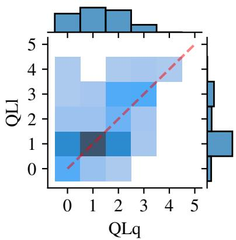  
Figure 1: Joint distribution of QLq and QLl demand levels across all datasets.

DeLeAn separates benchmarks by overall demand, not by mode. Because QLq and QLl alone do not distinguish the two purported modes, we ask whether the distinction emerges when all 18 cognitive dimensions are considered. We therefore apply principal component analysis (PCA) to the DeLeAn-labelled items (Fig. 2). The first two principal components’ explained variance is PC1: 40.5% and PC2: 15.5%. If the arithmetic/semantics distinction were a major organising principle, we would expect items from both modes to occupy different regions of this projection. Instead, the dominant structure appears to reflect overall cognitive demand2: Temporal Constraint-based Planning (TCP) and ToT Semantic, the two most demanding datasets in this study, each form a distinct cluster. The remaining benchmarks show no modeconsistent grouping. In short, the leading principal components capture differences in overall benchmark demand but reveal no clustering that supports the arithmetic/semantics distinction.

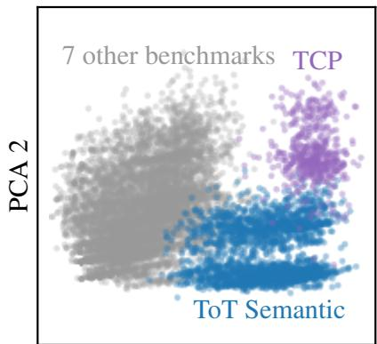  
PCA 1  
Figure 2: PCA of the full 18-dimensional DeLeAn profiles (PC1: 40.5%, PC2: 15.5%; 56.0% variance explained). TCP and ToT Semantic are annotated; the remaining seven datasets are shown in grey. TCP Long and Short share the TCP label.

## 4.2 Performance gains are dataset-specific and do not transfer across modes

The cognitive demand analysis above examines what benchmarks require; we now test what models actually learn. If temporal arithmetic and temporal semantics are separable abilities, then fine-tuning on one mode should improve performance on other datasets from the same mode, and not on datasets from another mode.

To test transfer, we treat the arithmetic and semantic portions of each benchmark as separate subsets, yielding four dataset-mode combinations: ToT-Arithmetic, ToT-Semantic, TRAM-Arithmetic, and TRAM-Semantic. We fine-tune six models separately on each combination and evaluate resulting variants on all four test sets. This design allows us to test transfers across datasets within and across temporal reasoning modes. For each training–test combination, Fig. 3 reports the change in accuracy relative to the corresponding untrained model, averaged across the six models.

Within- and cross-mode transfer fails. In the accuracy reward setting, in-domain gains are substantial and consistent (diagonal in Fig. 3, left). These gains, however, do not transfer across benchmarks, even when the source and target task share a mode. If the arithmetic/semantic distinction captured coherent, transferable abilities, within-mode transfer should be positive and reliable3. Instead, off-diagonal transfer is essentially absent, with one partial exception: training on TRAM arithmetic improves TRAM semantic by 11.1 pp (though the within-dataset gain is far larger, 23.1 pp), and training on TRAM semantic improves TRAM arithmetic by 3.4 pp (with a 15.2 pp gain on TRAM semantic itself). Training on ToT arithmetic, by contrast, degrades TRAM performance (−3.2 and −2.9 pp). Inspecting model responses shows within-TRAM transfer is largely a formatting effect. The two TRAM modes share the prompt template and a single multiple-choice-letter answer space. Thus, improving answer formatting in one mode recovers otherwise-unparseable responses in the other. The effect does not replicate for ToT, whose two modes differ in both content and answer format (structured JSON vs. event-identifier sets).

Unlearning confirms the pattern. The oneminus-accuracy experiments (Fig. 3, right) provide a complementary perspective. Performance degradation mirrors the localised, dataset-specific nature of accuracy gains. This effect is most pronounced for ToT arithmetic (−26 pp) and ToT Semantic (−22.8 pp). However, degradation spreads more broadly off-diagonal than improvement does.

Notably, gains and losses are not symmetric across reward settings. For TRAM, accuracy training transfers arithmetic improvements to semantics more strongly than the reverse, whereas unlearning reverses this asymmetry. This suggests that the two TRAM subsets share surface-level regularities that are learned and unlearned asymmetrically, rather than drawing on a common underlying ability.

Overall, these results suggest that abilities learned during fine-tuning are highly localised to individual datasets rather than transferable improvements in temporal arithmetic or semantic reasoning. Per-model results (Appendix F, Tab. 22) confirm that this pattern is consistent across all six models and not driven by individual outliers.

An exploratory experiment with Qwen3-32B produces smaller and mixed transfer effects, including a 3.7-point gain from TRAM Arithmetic to ToT Arithmetic, but does not establish a consistent mode-specific pattern (Appendix H).

## 4.3 Quantitative and logical reasoning are not the main drivers for performance

The preceding transfer experiments use benchmarkdefined labels to distinguish the two temporalreasoning modes. We complement them with an item-level operationalisation by training on data filtered by relative $\mathrm { Q L q }$ and QLl demands (Sec. 3.1.2) and measuring changes in DeLeAn-defined capabilities. This asks a finer-grained question: when trained on data with high quantitative or logical demands, do models improve most on those dimensions, as the arithmetic/semantic distinction predicts, or on other capabilities?

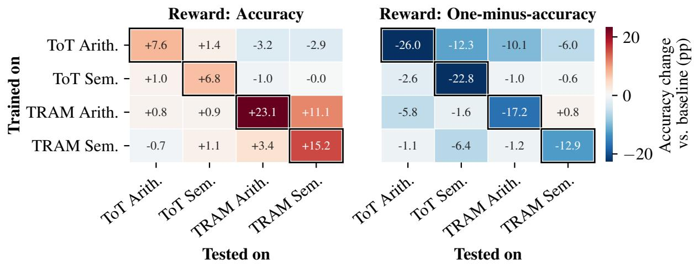  
Figure 3: Average relative change in accuracy percentage points between the untrained model (baseline) and the trained model. Results averaged over six models from three model families and two sizes. Results shown for the accuracy setting (reward given for correct answers) and one-minus-accuracy setting (reward given for an incorrect but correctly formatted answer).

Accuracy for evaluation is insufficient here, because we are interested in changes across the full capability profile rather than end-task performance alone. We therefore compute DeLeAnbased subject characteristic curves as described in Section 3.2 and use the AUC across 14 retained dimensions as a summary measure of model ability on each dimension. Fig. 4 reports the average change in AUC relative to baseline, averaged across all six models for both experimental settings. Permodel results are in the Appendix F.

QLq and QLl’s subordinate role in improving temporal reasoning. The arithmetic and semantic modes contrast temporal reasoning that requires explicit calculation with temporal reasoning that does not. If true, we would expect QLq-dominant training to primarily improve $\mathrm { Q L q }$ (and hence temporal arithmetic), and the equivalent for QLldominant training. This is not what we observe. Training on data where $\mathrm { Q L l } = \mathrm { Q L q } + 1$ yields the largest improvements for both QLq and QLl, rather than selectively boosting QLl. The $\mathrm { Q L l } = \mathrm { Q L q } + 2$ condition produces weaker gains, possibly due to its small dataset size (54 items). QLq-dominant training, where QLq = QLl + {1,2}, also does not preferentially improve QLq. Because QLq demands are generally lower than QLl demands across the benchmarks (Fig. 6 in the Appendix), QLq-dominant items may not provide a sufficiently challenging learning signal for that dimension.

A stronger QL signal does not improve temporal accuracy. To test whether low QL demand in the temporal training data (mean demand of 1.57) explains the limited performance gains, we fine-tune models on QL-dominant, non-temporal data (mean demand of 4.13). Although QLl and $\mathrm { Q L q }$ both increase by 0.15 AUC—the largest capability gains among all dimensions—accuracy on the temporal mix data remains unchanged (mean $\Delta = - 0 . 0 6$ pp; range −1.23 to +0.55; Appendix G, Tables 23,24). Thus, stronger QL capability is insufficient to improve temporal reasoning and QL is not the principal bottleneck in model performance.

Knowledge benefits the most. The most revealing finding (Fig. 4, top) emerges when we examine which dimensions benefit most across all six training conditions. Gains in Knowledge of Social Sciences (KNs), Customary Everyday Knowledge (KNc), and Verbal Comprehension (CEc) consistently exceed gains in QLl and $\mathrm { Q L q }$ (often by a wide margin). This pattern holds regardless of whether the training data was selected for its quantitative or logical demands. In other words, even when we deliberately select items that emphasise arithmetic or logical reasoning, models primarily improve on KNc, KNs and CEc. The one-minusaccuracy results (Fig. 4, bottom) corroborate this from the reverse direction: the largest capability degradations occur for the KNs dimension, confirming that these are the abilities most exercised by current temporal benchmarks. The per-benchmark demand distributions (Appendix B.4, Fig. 7) provide further support. Most benchmarks concentrate their QLq and QLl demands at levels 0–2, with few items at the higher levels, which would be necessary to expect reasoning bottlenecks.

(a) Reward: Accuracy  
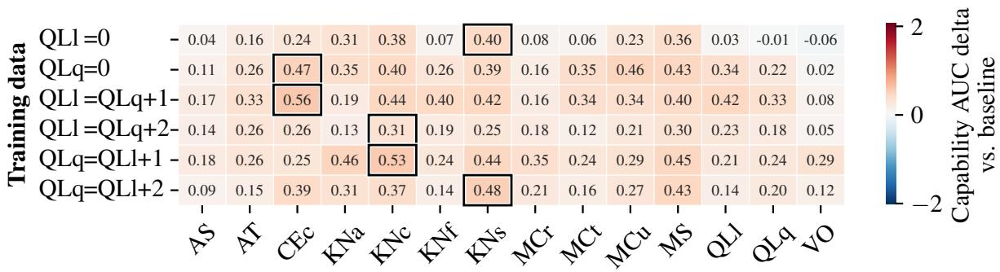

(b) Reward: One-minus-accuracy  
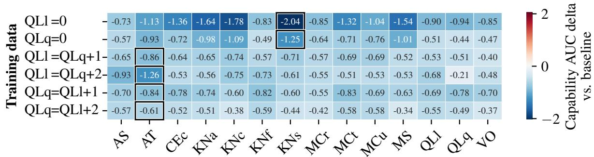  
Figure 4: Average absolute change in AUC between the untrained model (baseline) and the trained model. Results are averaged over six models from three model families and two sizes. Panel (a) shows the accuracy reward setting, and panel (b) shows the one-minus-accuracy reward setting.

Relabelling with Gemini largely reproduces the KN-over-QL pattern seen in Fig. 4, although KNs rather than KNc benefits most and CEc gains are smaller (details in Appendix E).

These results suggest that logical and quantitative reasoning are not the primary drivers of performance on current temporal reasoning benchmarks. Training on examples selected for their logical or quantitative demands does affect those dimensions, but the dominant effect falls on knowledge dimensions. This finding reinforces the conclusion from Sections 4.1 and 4.2: existing temporal reasoning benchmarks do not cleanly instantiate the arithmetic/semantics distinction. Instead, they largely measure models’ capacity to retrieve and apply learned temporal regularities.

## 5 Conclusions

This study scrutinises whether temporal arithmetic and temporal semantics correspond to distinct reasoning abilities. Capability-aware analyses of the dataset and fine-tuning experiments show that they do not. Cognitive demand profiles fail to separate arithmetic from semantic benchmark items, despite supposed differences in required quantitative and logical reasoning. Furthermore, finetuning gains do not transfer between benchmarks of the same temporal reasoning mode.

Capability changes after finetuning on temporal data show that DeLeAn knowledge dimensions improve more than QLq or QLl. Specialised QLheavy training could raise QL capability, but still did not improve performance in either temporal reasoning modes. Our results suggest that current benchmarks test the retrieval and application of time-related regularities, not arithmetic or semantic abilities. The arithmetic/semantics taxonomy may describe task form, but it should not be treated as a salient decomposition of temporal reasoning. Future benchmarks should control for knowledge demands and validate proposed categories through capability-based analyses.

## 6 Limitations

Our experiments use models of up to 12 billion parameters. In one instance, we trained a larger model, which showed small transfer (improvement of ≈ 3 percentage points) in the arithmetic mode. Future work could explore transfer dynamics in even larger models; however, the consistency of our findings across three families and two scales suggests that this pattern is robust. Furthermore, our transfer experiments are limited to ToT and TRAM, which are the only benchmarks with explicit or reconstructable arithmetic and semantic partitions. Extending this analysis to future benchmarks that provide more detailed task taxonomies would strengthen the generalisability of our findings.

## Acknowledgments

JHO’s research is supported by OpenAI’s grant to the “AI Progress through the Lens of Predictable AI Ecosystems” programme, which is based at the Leverhulme Centre for the Future of Intelligence at the University of Cambridge. JHO’s research has also been supported by Google’s grant to the “Evaluations and Benchmarks” project, which is based at the Leverhulme Centre for the Future of Intelligence at the University of Cambridge. AA is supported by the Economic and Social Research Council [ES/Y001788/1].

## References

Auss Abbood, Zaiqiao Meng, and Nigel Collier. 2025. Time to Revisit Exact Match. In Findings ofthe Association for Computational Linguistics: EMNLP 2025, pages 11903–11926, Suzhou, China. Association for Computational Linguistics.

Ahmed Alaa, Thomas Hartvigsen, Niloufar Golchini, Shiladitya Dutta, Frances Dean, Inioluwa Deborah Raji, and Travis Zack. 2025. Position: Medical large language model benchmarks should prioritize construct validity. In Proceedings of the 42nd international conference on machine learning, volume 267 of Proceedings of machine learning research, pages 80991–81004. PMLR.

Jason Ansel, Edward Yang, Horace He, and others. 2024. PyTorch 2: Faster machine learning through dynamic python bytecode transformation and graph compilation. In Proceedings ofthe 29th ACM international conference on architectural support for programming languages and operating systems, volume 2, pages 929–947. Association for Computing Machinery.

Andrew M. Bean, Ryan Othniel Kearns, Angelika Romanou, Franziska Sofia Hafner, Harry Mayne, Jan Batzner, Negar Foroutan Eghlidi, Chris Schmitz, Karolina Korgul, Hunar Batra, Oishi Deb, Emma Beharry, Cornelius Emde, Thomas Foster, Anna Gausen, María Grandury, Sophia Han, Valentin Hofmann, Lujain Ibrahim, and 23 others. 2025. Measuring what matters: Construct validity in large language model benchmarks. In Advances in neural information processing systems, volume 38. Curran Associates, Inc.

Wenhu Chen, Xinyi Wang, and William Yang Wang. 2021. A Dataset for Answering Time-Sensitive Questions. Proceedings of the Neural Information Processing Systems Track on Datasets and Benchmarks, 1.

Zheng Chu, Jingchang Chen, Qianglong Chen, Weijiang Yu, Haotian Wang, Ming Liu, and Bing Qin. 2024. TimeBench: A Comprehensive Evaluation of Temporal Reasoning Abilities in Large Language Models. In Proceedings of the 62nd Annual Meeting of the Associationfor Computational Linguistics (Volume 1: Long Papers), pages 1204–1228, Bangkok, Thailand. Association for Computational Linguistics.

Zifeng Ding, Sikuan Yan, Moy Yuan, Xianglong Hu, Fangru Lin, and Andreas Vlachos. 2025. TCP: a Benchmark for Temporal Constraint-Based Planning. In Proceedings of the 2025 Conference on Empirical Methods in Natural Language Processing, pages 22452–22475, Suzhou, China. Association for Computational Linguistics.

Bahare Fatemi, Mehran Kazemi, Anton Tsitsulin, Karishma Malkan, Jinyeong Yim, John Palowitch, Sungyong Seo, Jonathan Halcrow, and Bryan Perozzi. 2025. Test of Time: A Benchmark for Evaluating LLMs on Temporal Reasoning. In The Thirteenth International Conference on Learning Representations, Singapore.

Bofei Gao, Feifan Song, Zhe Yang, Zefan Cai, Yibo Miao, Qingxiu Dong, Lei Li, Chenghao Ma, Liang Chen, Runxin Xu, Zhengyang Tang, Benyou Wang, Daoguang Zan, Shanghaoran Quan, Ge Zhang, Lei Sha, Yichang Zhang, Xuancheng Ren, Tianyu Liu, and Baobao Chang. 2025. Omni-MATH: a universal olympiad level mathematic benchmark for large language models. In The thirteenth international conference on learning representations.

Gemma Team. 2025. Gemma 3 technical report. ArXiv: 2503.19786 [cs.CL].

Aaron Grattafiori, Abhimanyu Dubey, Abhinav Jauhri, Abhinav Pandey, Abhishek Kadian, Ahmad Al-Dahle, Aiesha Letman, Akhil Mathur, Alan Schelten, Alex Vaughan, Amy Yang, Angela Fan, Anirudh Goyal, Anthony Hartshorn, Aobo Yang, Archi Mitra, Archie Sravankumar, Artem Korenev, Arthur Hinsvark, and 542 others. 2024. The llama 3 herd of models. ArXiv: 2407.21783 [cs.AI].

Sylvain Gugger, Lysandre Debut, Thomas Wolf, Philipp Schmid, Zachary Mueller, Sourab Mangrulkar, Marc

Sun, and Benjamin Bossan. 2022. Accelerate: Training and inference at scale made simple, efficient and adaptable.

Daya Guo, Dejian Yang, Haowei Zhang, Junxiao Song, Peiyi Wang, Qihao Zhu, Runxin Xu, Ruoyu Zhang, Shirong Ma, Xiao Bi, Xiaokang Zhang, Xingkai Yu, Yu Wu, Z. F. Wu, Zhibin Gou, Zhihong Shao, Zhuoshu Li, Ziyi Gao, Aixin Liu, and 175 others. 2025. DeepSeek-R1 incentivizes reasoning in LLMs through reinforcement learning. Nature, 645(8081):633–638.

Taicheng Guo, kehan Guo, Bozhao Nan, Zhenwen Liang, Zhichun Guo, Nitesh Chawla, Olaf Wiest, and Xiangliang Zhang. 2023. What can Large Language Models do in chemistry? A comprehensive benchmark on eight tasks. In Advances in neural information processing systems, volume 36, pages 59662–59688. Curran Associates, Inc.

Andrew F. Hayes and Klaus Krippendorff. 2007. Answering the call for a standard reliability measure for coding data. Communication Methods and Measures, 1:77 – 89.

Cheng-Yu Hsieh, Chun-Liang Li, Chih-kuan Yeh, Hootan Nakhost, Yasuhisa Fujii, Alex Ratner, Ranjay Krishna, Chen-Yu Lee, and Tomas Pfister. 2023. Distilling Step-by-Step! Outperforming Larger Language Models with Less Training Data and Smaller Model Sizes. In Findings ofthe Associationfor Computational Linguistics: ACL 2023, pages 8003–8017, Toronto, Canada. Association for Computational Linguistics.

Chuxuan Hu, Yuxuan Zhu, Antony Kellermann, Caleb Biddulph, Suppakit Waiwitlikhit, Jason Benn, and Daniel Kang. 2026. Breaking Barriers: Do Reinforcement Post Training Gains Transfer To Unseen Domains? In The Fourteenth International Conference on Learning Representations, Rio de Janeiro, Brazil.

Edward J. Hu, Yelong Shen, Phillip Wallis, Zeyuan Allen-Zhu, Yuanzhi Li, Shean Wang, Lu Wang, and Weizhu Chen. 2022. LoRA: Low-rank adaptation of large language models. In International conference on learning representations.

Maggie Ziyu Huan, Yuetai Li, Tianyu Zheng, Xiaoyu Xu, Seungone Kim, Minxin Du, Radha Poovendran, Graham Neubig, and Xiang Yue. 2026. Does Math Reasoning Improve General LLM Capabilities? Understanding Transferability of LLM Reasoning. In ICLR 2026 Workshop ICBINB, Rio de Janeiro, Brazil.

Timur Ionov, Anna Marshalova, and Valentin Malykh. 2026. Call, Reward, Repeat: Advancing Dialog State Tracking with GRPO and Function Calling. In Proceedings of the 19th Conference of the European Chapter of the Association for Computational Linguistics (Volume 4: Student Research Workshop), pages 292–303, Rabat, Morocco. Association for Computational Linguistics.

Duygu Sezen Islakoglu and Jan-Christoph Kalo. 2025. ChronoSense: Exploring Temporal Understanding in Large Language Models with Time Intervals of Events. In Proceedings of the 63rd Annual Meeting ofthe Associationfor Computational Linguistics (Volume 2: Short Papers), pages 590–602, Vienna, Austria. Association for Computational Linguistics.

Lawrence R. James, Robert G. Demaree, and Gerrit Wolf. 1984. Estimating within-group interrater reliability with and without response bias. Journal of Applied Psychology, 69(1):85–98.

Woosuk Kwon, Zhuohan Li, Siyuan Zhuang, Ying Sheng, Lianmin Zheng, Cody Hao Yu, Joseph E. Gonzalez, Hao Zhang, and Ion Stoica. 2023. Efficient memory management for large language model serving with PagedAttention. In Proceedings ofthe 29th symposium on operating systems principles, pages 611–626. Association for Computing Machinery.

Yuetai Li, Xiang Yue, Zhangchen Xu, Fengqing Jiang, Luyao Niu, Bill Yuchen Lin, Bhaskar Ramasubramanian, and Radha Poovendran. 2025. Small Models Struggle to Learn from Strong Reasoners. In Findings ofthe Associationfor Computational Linguistics: ACL 2025, pages 25366–25394, Vienna, Austria. Association for Computational Linguistics.

Sourab Mangrulkar, Sylvain Gugger, Lysandre Debut, Younes Belkada, Sayak Paul, and Benjamin Bossan. 2022. PEFT: State-of-the-art parameter-efficient finetuning methods.

Philipp Mondorf and Barbara Plank. 2024. Liar, liar, logical mire: a benchmark for suppositional reasoning in large language models. In Proceedings ofthe 2024 conference on empirical methods in natural language processing, pages 7114–7137, Miami, Florida, USA. Association for Computational Linguistics.

Lianhui Qin, Aditya Gupta, Shyam Upadhyay, Luheng He, Yejin Choi, and Manaal Faruqui. 2021. TIME-DIAL: Temporal Commonsense Reasoning in Dialog. In Proceedings of the 59th Annual Meeting of the Association for Computational Linguistics and the 11th International Joint Conference on Natural Language Processing (Volume 1: Long Papers), pages 7066–7076, Online. Association for Computational Linguistics.

Samyam Rajbhandari, Jeff Rasley, Olatunji Ruwase, and Yuxiong He. 2020. ZeRO: Memory optimizations toward training trillion parameter models. In SC20: International conferencefor high performance computing, networking, storage and analysis, pages 1–16. IEEE.

Revanth Rameshkumar, Jimson Huang, Yunxin Sun, Fei Xia, and Abulhair Saparov. 2025. Reasoning Models Reason Well, Until They Don’t. In Proceedings of the 14th International Joint Conference on Natural Language Processing and the 4th Conference of the Asia-Pacific Chapter of the Association for Computational Linguistics, pages 936–956, Mumbai,

India. The Asian Federation of Natural Language Processing and The Association for Computational Linguistics.

Jeff Rasley, Samyam Rajbhandari, Olatunji Ruwase, and Yuxiong He. 2020. DeepSpeed: System optimizations enable training deep learning models with over 100 billion parameters. In Proceedings of the 26th ACM SIGKDD international conference on knowledge discovery and data mining, pages 3505–3506. Association for Computing Machinery.

Zhihong Shao, Peiyi Wang, Qihao Zhu, Runxin Xu, Junxiao Song, Xiao Bi, Haowei Zhang, Mingchuan Zhang, Y. K. Li, Y. Wu, and Daya Guo. 2024. DeepSeekMath: Pushing the Limits of Mathematical Reasoning in Open Language Models. arXiv preprint. ArXiv:2402.03300 [cs].

Joar Skalse, Nikolaus Howe, Dmitrii Krasheninnikov, and David Krueger. 2022. Defining and Characterizing Reward Gaming. In Advances in Neural Information Processing Systems, volume 35, pages 9460– 9471. Curran Associates, Inc.

Zhaochen Su, Jun Zhang, Tong Zhu, Xiaoye Qu, Juntao Li, Min Zhang, and Yu Cheng. 2024. Timo: Towards Better Temporal Reasoning for Language Models. In First Conference on Language Modeling.

Qingyu Tan, Hwee Tou Ng, and Lidong Bing. 2023. Towards Benchmarking and Improving the Temporal Reasoning Capability of Large Language Models. In Proceedings of the 61st Annual Meeting of the Association for Computational Linguistics (Volume 1: Long Papers), pages 14820–14835, Toronto, Canada. Association for Computational Linguistics.

Weizhi Tang, Kwabena Nuamah, and Vaishak Belle. 2025. LTLBench: Towards Benchmarks for Evaluating Temporal Logic Reasoning in Large Language Models. arXiv preprint. ArXiv:2407.05434 [cs.CL] version: 2.

Songül Tolan, Annarosa Pesole, Fernando Martínez-Plumed, Enrique Fernández-Macías, José Hernández-Orallo, and Emilia Gómez. 2021. Measuring the Occupational Impact of AI: Tasks, Cognitive Abilities and AI Benchmarks. Journal of Artificial Intelligence Research, 71:191–236.

Iñaki Dellibarda Varela, Pablo Romero-Sorozabal, Eduardo Rocon, and Manuel Cebrian. 2026. Rethinking the illusion of thinking. In Artificial intelligence XLII, volume 16301 of Lecture Notes in Computer Science, pages 116–129, Cham. Springer Nature Switzerland.

Leandro von Werra, Younes Belkada, Lewis Tunstall, Edward Beeching, Tristan Thrush, Nathan Lambert, Shengyi Huang, Kashif Rasul, and Quentin Gallouédec. 2020. TRL: Transformer reinforcement learning.

Yubo Wang, Xueguang Ma, Ge Zhang, Yuansheng Ni, Abhranil Chandra, Shiguang Guo, Weiming Ren, Aaran Arulraj, Xuan He, Ziyan Jiang, Tianle Li, Max

Ku, Kai Wang, Alex Zhuang, Rongqi Fan, Xiang Yue, and Wenhu Chen. 2024. MMLU-pro: a more robust and challenging multi-task language understanding benchmark. In Advances in neural information processing systems, volume 37, pages 95266–95290. Curran Associates, Inc.

Yuqing Wang and Yun Zhao. 2024. TRAM: Benchmarking Temporal Reasoning for Large Language Models. In Findings of the Association for Computational Linguistics: ACL 2024, pages 6389–6415, Bangkok, Thailand. Association for Computational Linguistics.

Yifan Wei, Yisong Su, Huanhuan Ma, Xiaoyan Yu, Fangyu Lei, Yuanzhe Zhang, Jun Zhao, and Kang Liu. 2023. MenatQA: A New Dataset for Testing the Temporal Comprehension and Reasoning Abilities of Large Language Models. In Findings of the Association for Computational Linguistics: EMNLP 2023, pages 1434–1447, Singapore. Association for Computational Linguistics.

Colin White, Samuel Dooley, Manley Roberts, Arka Pal, Benjamin Feuer, Siddhartha Jain, Ravid Shwartz-Ziv, Neel Jain, Khalid Saifullah, Sreemanti Dey, Shubh-Agrawal, Sandeep Singh Sandha, Siddartha Venkat Naidu, Chinmay Hegde, Yann LeCun, Tom Goldstein, Willie Neiswanger, and Micah Goldblum. 2025. LiveBench: a challenging, contamination-limited LLM benchmark. In The thirteenth international conference on learning representations.

Thomas Wolf, Lysandre Debut, Victor Sanh, Julien Chaumond, Clement Delangue, Anthony Moi, Pierric Cistac, Tim Rault, Rémi Louf, Morgan Funtowicz, Joe Davison, Sam Shleifer, Patrick von Platen, Clara Ma, Yacine Jernite, Julien Plu, Canwen Xu, Teven Le Scao, Sylvain Gugger, and 3 others. 2020. Transformers: State-of-the-art natural language processing. In Proceedings of the 2020 conference on empirical methods in natural language processing: System demonstrations, pages 38–45. Association for Computational Linguistics.

Siheng Xiong, Ali Payani, Ramana Kompella, and Faramarz Fekri. 2024. Large Language Models Can Learn Temporal Reasoning. In Proceedings of the 62nd Annual Meeting ofthe Associationfor Computational Linguistics (Volume 1: Long Papers), pages 10452–10470, Bangkok, Thailand. Association for Computational Linguistics.

An Yang, Anfeng Li, Baosong Yang, Beichen Zhang, Binyuan Hui, Bo Zheng, Bowen Yu, Chang Gao, Chengen Huang, Chenxu Lv, Chujie Zheng, Dayiheng Liu, Fan Zhou, Fei Huang, Feng Hu, Hao Ge, Haoran Wei, Huan Lin, Jialong Tang, and 41 others. 2025. Qwen3 Technical Report. arXiv preprint. ArXiv:2505.09388 [cs].

Efstratios Zaradoukas, Bardh Prenkaj, and Gjergji Kasneci. 2026. Reinforcement unlearning via group relative policy optimization. In The fourteenth international conference on learning representations.

Wanjun Zhong, Ruixiang Cui, Yiduo Guo, Yaobo Liang, Shuai Lu, Yanlin Wang, Amin Saied, Weizhu Chen, and Nan Duan. 2024. AGIEval: a human-centric benchmark for evaluating foundation models. In Findings ofthe associationfor computational linguistics: NAACL 2024, pages 2299–2314, Mexico City, Mexico. Association for Computational Linguistics.

Lexin Zhou, Lorenzo Pacchiardi, Fernando Martínez-Plumed, Katherine M. Collins, Yael Moros-Daval, Seraphina Zhang, Qinlin Zhao, Yitian Huang, Luning Sun, Jonathan E. Prunty, Zongqian Li, Pablo Sánchez-García, Kexin Jiang-Chen, Pablo A. M. Casares, Jiyun Zu, John Burden, Behzad Mehrbakhsh, David Stillwell, Manuel Cebrian, and 7 others. 2026. General scales unlock AI evaluation with explanatory and predictive power. Nature, 652(8108):58–67.

## A Demand level annotations (DeLeAn)

Demand-Level Annotations (DeLeAn) are a set of general-scale, human-interpretable rubrics that map a benchmark item $X _ { j }$ to a multi-dimensional demand profile intended to capture which cognitive and knowledge demands a fully competent solver would need to meet in order to answer correctly (Zhou et al., 2026). Concretely, each item is assigned an annotation vector $x ^ { ( j ) } \in \{ 0 , \ldots , 5 ^ { + } \} ^ { 1 8 }$ where each component $x _ { i } ^ { ( j ) }$ is an open-scale demand level on dimension $i ~ ( 0 = \mathrm { n o }$ meaningful demand; larger values indicate increasing demand; $5 ^ { + }$ indicates demands beyond the highest anchor point of the rubric). In this paper, we use these demand vectors as structured, interpretable item-level features for analysing which cognitive capabilities current temporal reasoning benchmarks actually require.

The DeLeAn rubrics build upon seven broad capabilities proposed in (Tolan et al., 2021), which are refined into 11 core cognitive dimensions. In addition, the framework incorporates five knowledgerelated dimensions and two extraneous ones (atypicality and volume) designed to capture taskspecific complexity that goes beyond basic cognitive or knowledge demands. While the authors also define an additional extraneous dimension, unguessability, computed algorithmically based on prompt-specific characteristics, it is not considered in this work. Table 3 summarises the dimensions included in the full rubric set.

All data used in this study is derived from Zhou et al., 2026. ToT, and TCP were labelled for this study and are licenced under CC BY 4.0 and MIT respectively.

## B Data

## B.1 Benchmark sizes

Our experiments use two distinct data configurations. In the first configuration (see Section 4.2), we use existing benchmark labels to separate ToT and TRAM into semantic and arithmetic modes for the controlled transfer analysis, yielding four dataset-mode combinations. Their cardinalities are reported in Tab. 4. In the second configuration (see Sections 4.1 and 4.3), we annotate items from all nine datasets with DeLeAn cognitive demand profiles, retaining TCP Long and Short as separate subsets. The resulting ten subsets are reported in Tab. 5. Because TRAM is substantially larger than the other benchmarks, we subsample it to ensure that no single benchmark dominates the training conditions. The cost of annotation with GPT-4o was also a factor in this decision.

## B.2 Partitioning TRAM into arithmetic and semantic tasks

Unlike ToT, which provides an explicit arithmetic/semantic split, TRAM organises its tasks into categories such as foundational temporal understanding, temporal interpretation and computation, and advanced temporal concepts, rather than assigning a binary mode label. To derive an arithmetic/semantic partition for TRAM, we follow Su et al. (2024)’s distinction between math-time tasks and pure-time tasks. TRAM’s subtasks Frequency, Duration, Arithmetic, and Ambiguity are classified as math-time tasks, corresponding to the arithmetic mode. We therefore assign these four subtasks to the arithmetic split.

This leaves six remaining TRAM subtasks that can be classified as pure-time tasks, corresponding to the semantic mode. To keep the two splits balanced, however, we include only four subtasks in the semantic partition. TRAM’s Ordering and Storytelling tasks align closely with the ToT Semantic subtasks FirstLast and Timeline, respectively, so we assign them to the semantic split.

This leaves Typical Time, Causality, Relation, and NLI. Because we include only two additional subtasks, we use $\mathrm { Q L q }$ and QLl scores as a tiebreaker. We select Relation and NLI, as these subtasks show the largest differences in QLq and QLl. The scores are reported in Tab. 6.

To further assess the quality of this partition, we project all TRAM items’ demand profiles into a two-dimensional PCA space and colour them by assigned mode (Fig. 5). The resulting separation is weak, consistent with the findings in Section 4.1 that arithmetic and semantic tasks are not strongly distinguishable by demand vectors.

## B.3 Cognitive demand profiles of ToT Semantic question types

The ToT Semantic subset contains eight question types that vary in their reliance on quantitative reasoning. Tab. 7 reports the average $\mathrm { Q L q }$ and QLl scores for each type. Two question types, Relation-Duration and Timeline, have a positive $\mathrm { Q L q } \cdot$ −QLl difference, indicating that they place slightly higher quantitative than logical demands despite being labelled as semantic. Conversely, FirstLast, BeforeAfter, and EventAtTimeOfOtherEvent show the largest negative differences, consistent with their reliance on relational reasoning. This within-subset heterogeneity supports our finding (Section 4.1) that the semantic label subsumes tasks with meaningfully different cognitive profiles.

<table><tr><td></td><td>Dimension (Broad)</td><td></td><td>Dimension (Specific)</td><td>Demand description</td></tr><tr><td>AS</td><td>Attention and Scan</td><td>AS</td><td>Attention and Scan</td><td>Focus on or locate specific elements within a given stream of information or environment in the whole process of solving a task.</td></tr><tr><td rowspan="2"></td><td>CE Comprehension and</td><td>CEc</td><td>Verbal Comprehension</td><td>Understand text, stories or the semantic content of other representations of ideas in different formats or modalities.</td></tr><tr><td>Expression</td><td>CEe</td><td>Verbal Expression</td><td>Generate and articulate ideas, stories, or semantic content in different formats or modalities.</td></tr><tr><td>CL</td><td>Conceptualisation, Learning and Abstraction</td><td>CL</td><td>Conceptualisation, Learning and Abstraction</td><td>Build new concepts, engage in inductive and analogical reasoning, map relation- ships between domains, and generate abstractions from concrete examples.</td></tr><tr><td rowspan="3"></td><td rowspan="3">MC Metacognition and</td><td>MCr</td><td>Identifying Relevant Information</td><td>Recognise what information helps solve the task or does not, and how this recogni- tion process unfolds as they work toward the solution.</td></tr><tr><td></td><td>Critical Thinking Processes</td><td>Monitor or regulate multiple thought processes to answer the question effectively, ranging from simple recall to high-level critical thinking.</td></tr><tr><td>MCu</td><td>Calibrating Knowns and Un- knowns</td><td>Recognise the boundaries of one&#x27;s knowledge and confidently identify what one knows they know, knows they don&#x27;t know, or is uncertain about.</td></tr><tr><td>MS</td><td>Mind Modelling and Social Cog- nition</td><td>MS</td><td>Mind Modelling and Social Cog- nition</td><td>Model the minds of other agents or reasoning about how the beliefs, desires, intentions, and emotions of multiple other agents might interact to determine future behaviours.</td></tr><tr><td>QL</td><td>Quantitative and</td><td>QLl</td><td>Logical Reasoning</td><td>Match and apply rules, procedures, algorithms or systematic steps to premises to solve problems, derive conclusions and make decisions.</td></tr><tr><td></td><td>Logical Reasoning</td><td>QLq</td><td>Quantitative Reasoning</td><td>Work with and reason about quantities, numbers, and numerical relationships.</td></tr><tr><td>SN</td><td>Spatial Reasoning and Naviga- tion</td><td>SNs</td><td>Spatio-physical Reasoning</td><td>Understand spatial relationships between objects and predicting physical interac- tions.</td></tr><tr><td rowspan="5"></td><td rowspan="5">KN Knowledge</td><td>KNa</td><td>Knowledge of Applied Sciences</td><td>Knowledge or conceptual understanding in applied sciences (e.g., medicine, law, education, business, agriculture, engineering except IT)</td></tr><tr><td>KNc</td><td>Customary Everyday Knowledge</td><td>Knowledge in information that most people in a given society typically acquire through daily life experiences, social interactions, and media.</td></tr><tr><td>KNf</td><td>Knowledge of Formal Sciences</td><td>Knowledge or conceptual understanding in formal sciences (e.g., mathematics, logic, computer science, statistics).</td></tr><tr><td>KNn</td><td>Knowledge of Natural Sciences</td><td>Knowledge or conceptual understanding in natural sciences (e.g., physics, chem- istry, biology, astronomy, earth sciences, ecology).</td></tr><tr><td>KNs</td><td>Knowledge of Social Sciences</td><td>Knowledge or conceptual understanding in social sciences and humanities (e.g., history, psychology, sociology, literature, art, philosophy).</td></tr><tr><td></td><td>Atypicality</td><td>AT</td><td>Atypicality</td><td>How uncommon the task is or how unlikely it is that the instance has appeared in various sources (internet, textbooks, tests).</td></tr><tr><td>VO</td><td>Volume</td><td>VO</td><td>Volume</td><td>Proportional to the logarithm of the time a fully competent human needs to read and complete the task in ideal conditions, excluding interruptions.</td></tr></table>

Table 3: Overview of the DeLeAn demand dimensions, including broad cognitive and knowledge categories, specific sub-dimensions, and their semantic descriptions.

<table><tr><td>Dataset</td><td>Train</td><td>Validation</td><td>Test</td></tr><tr><td>ToT Arithmetic</td><td>1295</td><td>93</td><td>462</td></tr><tr><td>ToT Semantic</td><td>1959</td><td>141</td><td>700</td></tr><tr><td>TRAM Arithmetic</td><td>25499</td><td>2834</td><td>2700</td></tr><tr><td>TRAM Semantic</td><td>20121</td><td>2236</td><td>500</td></tr></table>

Table 4: Train/validation/test cardinalities for the four dataset-mode combinations used in controlled transfer experiments, drawn from two benchmarks (ToT and TRAM).

<table><tr><td>Dataset</td><td>Train</td><td>Validation</td><td>Test</td></tr><tr><td>TRAM</td><td>2736</td><td>322</td><td>739</td></tr><tr><td>ToT Semantic</td><td>2042</td><td>208</td><td>544</td></tr><tr><td>ToT Arithmetic</td><td>1297</td><td>141</td><td>401</td></tr><tr><td>TimeQA</td><td>530</td><td>58</td><td>139</td></tr><tr><td>MenatQA</td><td>490</td><td>49</td><td>141</td></tr><tr><td>TempReason</td><td>455</td><td>55</td><td>147</td></tr><tr><td>Date Arithmetic</td><td>347</td><td>41</td><td>105</td></tr><tr><td>TimeDial</td><td>256</td><td>30</td><td>54</td></tr><tr><td>TCP Long</td><td>207</td><td>21</td><td>57</td></tr><tr><td>TCP Short</td><td>170</td><td>23</td><td>43</td></tr></table>

Table 5: DeLeAn-labelled dataset cardinalities (train/validation/test). TCP is split into Long and Short, yielding ten subsets from nine datasets.

<table><tr><td>Coarse task</td><td>Task</td><td>QLq QLl QLq − QLl</td></tr><tr><td>Arithmetic</td><td>Arithmetic 1.40</td><td>1.01 0.39</td></tr><tr><td>Arithmetic</td><td>Frequency 0.77</td><td>0.55 0.22</td></tr><tr><td>Arithmetic</td><td>Duration 0.86</td><td>0.66 0.20</td></tr><tr><td>Arithmetic</td><td>Ambiguity Resolution 1.19</td><td>1.07 0.12</td></tr><tr><td></td><td>Typical Time 0.10</td><td>0.25 -0.15</td></tr><tr><td>Semantic</td><td>Ordering 0.20</td><td>0.86 -0.66</td></tr><tr><td>Semantic</td><td>Storytelling 0.02</td><td>0.95 -0.93</td></tr><tr><td></td><td>Causality 0.06</td><td>1.00 -0.94</td></tr><tr><td>Semantic</td><td>Relation 0.02</td><td>1.01 -0.99</td></tr><tr><td>Semantic</td><td>NLI 0.12</td><td>1.13 -1.01</td></tr></table>

Table 6: Average QLq and QLl scores and their difference for TRAM tasks.

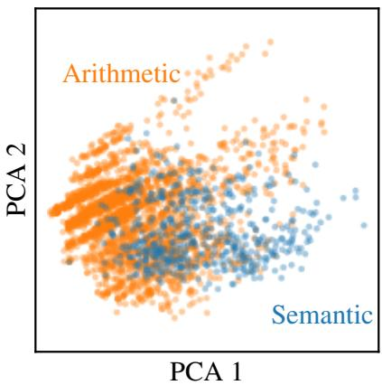  
Figure 5: PCA of TRAM items coloured by their assigned mode. The two groups show substantial overlap, confirming that the arithmetic/semantic partition is not cleanly reflected in TRAM’s cognitive demand structure.

## B.4 Per-benchmark cognitive demand profiles

Fig. 6 shows the average demand level per cognitive dimension for each of the ten dataset subsets, sorted by overall difficulty (computed as the mean across all 18 dimensions). The most demanding subsets (TCP Short and TCP Long) show elevated scores across nearly all dimensions, while the least demanding (Date Arithmetic) has nearzero demand on most dimensions except QLq and KNc. Notably, $\mathrm { Q L q }$ and QLl are not among the highest-demand dimensions for any subset. Instead, KNc, and CEc, among others, dominate. This pattern is consistent with our main finding that temporal benchmarks are knowledge-heavy rather than reasoning-heavy.

Fig. 7 provides a complementary view, showing the full distribution of demand levels (0 through 5+) for each cognitive dimension within each of the ten dataset subsets. These distributions confirm that most subsets concentrate their $\mathrm { Q L q }$ and QLl demands at levels 0–2, with few items reaching the higher levels that would be expected if genuine arithmetic or logical reasoning were the primary bottleneck.

## C Metrics

To reduce spurious mismatches caused by formatting variability, we evaluate model outputs with benchmark-specific post-processing before computing final scores. Across our evaluation modules, normalisation generally takes one of three forms: extracting the answer from a larger generated response, canonicalising the representation of the answer, and then comparing either normalised strings, normalised structured objects, or normalised sets. The exact procedure differs by benchmark.

## C.1 TRAM accuracy

For TRAM, we normalise predictions by extracting the final option letter from responses matching the template “The final answer is (X)”, with $\mathbf { X } \in \{ A , B , C , D \}$ . We then compute exact-match accuracy against the gold option label. This removes variability in preceding reasoning text but still requires a standardised final-answer template.

## C.2 TCP accuracy

For TCP, the evaluator expects the model’s final answer to appear in boxed LaTeX notation, using the pattern \boxed{...}. It extracts the boxed span with the regular expression \\boxed\{([^}]\*)\} and strips surrounding white space from the extracted content. Comparison is then performed by exact string match.

<table><tr><td>Question types</td><td>QLq QLI</td><td>QLq−QLl</td></tr><tr><td>RelationDuration</td><td>2.04</td><td>1.90 0.13</td></tr><tr><td>Timeline</td><td>2.15</td><td>2.07 0.08</td></tr><tr><td>EventAtTimeT</td><td>1.76</td><td>1.94 -0.18</td></tr><tr><td>EventAtWhatTime</td><td>1.22</td><td>1.43 -0.21</td></tr><tr><td>NumberOfEventsInTimeInterval</td><td>2.58</td><td>2.85 -0.27</td></tr><tr><td>EventAtTimeOfOtherEvent</td><td>2.39</td><td>2.84 -0.45</td></tr><tr><td>BeforeAfter</td><td>2.45</td><td>2.90 -0.45</td></tr><tr><td>FirstLast</td><td>2.05</td><td>2.57 -0.52</td></tr></table>

Table 7: Average QLq and QLl scores and their difference for ToT Semantic question types

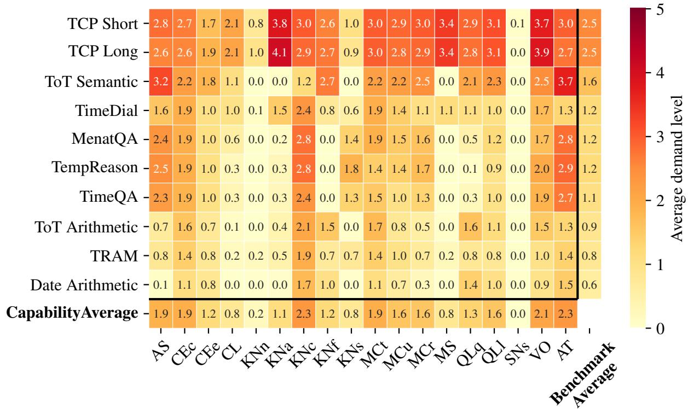  
Figure 6: Average demand level per cognitive ability for the ten subsets of the nine datasets, with TCP Long and Short shown separately. Subsets are sorted by overall average demand level.

In the TCP Short subset only, the evaluator removes the literal string “GMT” from both the prediction and the reference before comparison; no analogous normalisation is applied for TCP Long. The system prompt includes the exact expected answer format.

## C.3 Test of Time

For ToT, we extract the first valid JSON object from the model output, after escaping unescaped control characters inside JSON strings. We discard the explanation field and compare only the answerbearing content. In the Arithmetic subset, we additionally normalise schema mismatches such as age versus answer, lowercase items in ordered\_list and unordered\_list answer types, cast prediction values to the reference types when possible, and sort unordered\_list values to make comparison order-invariant. In the Semantic subset, we normalise both prediction and reference by converting them to strings before exact comparison.

## C.4 TimeBench derived benchmarks

For TimeBench tasks, we first extract the final answer from the text following the marker “Thus, the correct answer is:”. We retain only the first subsequent line, strip trailing sentence punctuation, and canonicalise any response containing unanswerable to the label unanswerable. For TempReason, TimeQA, and MenatQA, the extracted answer is scored with standard SQuAD exact match and F1. For Date Arithmetic, predictions and references are parsed into date objects and normalised by setting the day to 1, so comparison is effectively at the month-year level. For TimeDial, prediction and reference are mapped to sets of selected options in A,B,C,D and scored using set exact match and set-based F1.

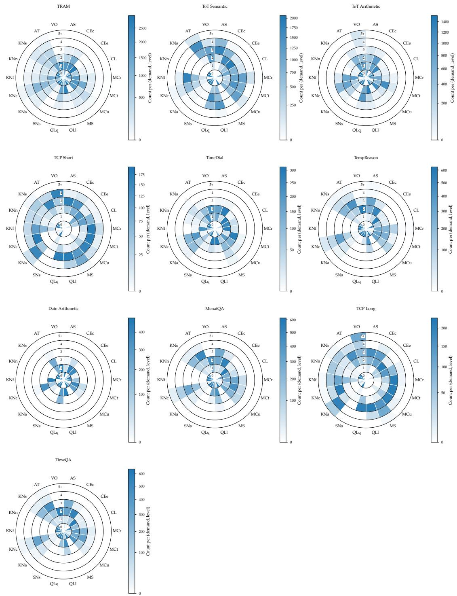  
Figure 7: Demand level counts per cognitive ability for the ten dataset subsets, with TCP Long and Short shown separately.

## C.5 Non-temporal multiple-choice accuracy

For single-answer multiple-choice examples from the Civil Service Examination, LSAT, MMLU-Pro, and the relevant Math tasks, we inspect the final 300 characters of the completion. We preferentially extract the final option letter in $\{ \operatorname { A } , \ldots , \operatorname { J } \}$ appearing in an answer-bearing expression such as “the answer is $X ^ { \ast }$ , “answer: $X ^ { \prime \prime }$ , “option X”, or “choice $X ^ { \ast }$ , or as a standalone line. If no such expression is found, we fall back to the final isolated letter in this range. The extracted letter is uppercased and compared by exact match with the gold option label.

## C.6 TruthQuest accuracy

For TruthQuest, the reference annotation is converted to the set of option labels corresponding to knights. From the final 300 characters of the completion, we collect option letters in answerbearing expressions; if none are present, we collect all isolated letters in $\{ \mathrm { A } , \ldots , \mathrm { J } \}$ . Both prediction and reference are treated as sets, so ordering and duplicate labels are ignored. A reward of 1 is assigned only when the predicted and reference sets are identical.

## C.7 Math and OmniMath accuracy

Math examples use several answer representations. Multiple-choice items follow the option-letter procedure above. For integer-valued Math and Omni-Math items, we extract the final integer appearing in the last 200 characters of the completion, cast it to an integer, and compare it exactly with the reference. For sequence-valued Math items, we extract the last valid JSON array from the complete response and compare it directly with the reference list; this comparison is order-sensitive.

For fraction-valued OmniMath items, we parse a LaTeX fraction written using \frac, \dfrac, or \tfrac. If no valid LaTeX fraction is found, we use the final plain-text fraction of the form $p / q .$ The numerator and denominator are converted to an exact rational number and reduced to the canonical string $p / q$ before exact comparison with the similarly normalised reference.

## C.8 ChemLLMBench and Reasoning accuracy

For the SMILES-valued ChemLLMBench examples, we scan the completion from right to left for a whitespace-delimited SMILES-like token that can be parsed by RDKit. The predicted molecule is converted to canonical isomeric SMILES and compared by exact string match with the canonicalised reference.

For free-text Reasoning examples, we inspect the final 300 characters of the completion, lowercase the text, remove punctuation, and collapse consecutive whitespace. We apply the same normalisation to the reference and award a match when the normalised reference occurs as a substring of the normalised completion.

## D Training settings

We used Transformers 4.57.3 (Wolf et al., 2020) to load the models, TRL 0.27.2 (von Werra et al., 2020) for GRPO, and PEFT 0.18.0 (Mangrulkar et al., 2022) for LoRA fine-tuning (Hu et al., 2022). LoRA used rank $r = 1 6$ and scaling parameter $\alpha = 3 2$ and was applied to the q\_proj, k\_proj, v\_proj, and $\mathsf { o \_ p r o j }$ modules. The maximum GRPO completion length was 3,000 tokens.

All GRPO runs used a learning rate of $5 \times 1 0 ^ { - 5 }$ with linear decay, training seed 42, no KL penalty $( \beta = 0 )$ , and no warmup. Dataset splits used seed 6; the temporal mixture’s initial stratified train/test split used seed 42.

Training used PyTorch 2.9.0 (Ansel et al., 2024), Accelerate 1.12.0 (Gugger et al., 2022), and Deep-Speed 0.18.3 (Rasley et al., 2020). Regular singlenode training used DeepSpeed ZeRO-2 , whereas Qwen3-32B training used ZeRO-3 (Rajbhandari et al., 2020). Evaluation was performed using vLLM 0.11.2 (Kwon et al., 2023).

DeLeAn-filtered and non-temporal training runs allocated one GPU for training and one GPU for vLLM generation. Single-dataset training runs allocated two GPUs for training and one GPU for generation. Qwen3-32B training used three compute nodes equipped with four NVIDIA GH200 GPUs each: eight GPUs across two nodes were used for training, while four GPUs on the third node were used for generation. Evaluation used one GPU per run. Full training runs generally took several hours, with longer runs approaching or exceeding 12 hours. Individual evaluations generally took approximately 1–8 minutes, although some larger evaluations took longer.

## E Label reliability

We test label agreement using the within-group interrater reliability, which is the main metric used for the DeLeAn paper, between the labels from GPT-4o and Gemini 3.1 Flash Lite. Even though this is the metric reported in the original paper (Zhou et al., 2026), we additionally report exact score matches, within one matches, and Krippendorff’s alpha.

For each item, within-group interrater agreement is

$$
r _ { W G } = 1 - \frac { s _ { \mathrm { o b s } } ^ { 2 } } { s _ { E } ^ { 2 } } , \qquad s _ { \mathrm { o b s } } ^ { 2 } = \frac { ( x _ { \mathrm { g e m i n i } } - x _ { \mathrm { g p t } } ) ^ { 2 } } { 4 } .
$$

The reference variance is $s _ { E } ^ { 2 } = ( A ^ { 2 } - 1 ) / 1 2 =$ $3 5 / 1 2$ assuming a discrete uniform distribution over $A = 6$ equally spaced category codes $\{ 0 , 1 , 2 , 3 , 4 , 5 \}$ . The open-ended top category 5+ is encoded as 5. We use all six rubric categories for this reference distribution, even when fewer levels are observed.

We use the population variance across the two annotators, clip each item’s $r _ { W G }$ to [0, 1], and report the mean over items with both labels present in each dimension.

The capability analyses retain dimensions with at least three observed demand levels and at least 30 items in the dominant slices (Section 3.2). The focus of our work lies in inspecting QLl and QLq. However, we are also interested in confirming whether the improvements observed for CEc, KNc, and KNs in Fig. 4 are not due to label biases but can be reproduced by Gemini 3.1 Flash Lite.

Tab. 8 shows that overall agreement according to r is high with values close to the maximum of 1. KNc is an outlier, showing a lower agreement of only 0.66. CEc, while scoring high for rWG, has a lower value for Krippendorff’s alpha. The issue is that both models assign items a demand level of 1–2. Absolute closeness is therefore high, explaining the high value for $r _ { W G } .$ , but on the other hand, it increases the by-chance agreement, which Krippendorff’s alpha penalises.

Tab. 9 compares the mean demand levels between Gemini and GPT. We can see that the low agreement in KNc can be explained by GPT-4o assigning much higher demands (1.59 higher in average).

Gemini treats KNc as the everyday knowledge a solver needs to bring to the task. When the prompt supplies the information required to obtain the answer, Gemini treats it as requiring little or no prior everyday knowledge.

GPT-4o appears to score the topical complexity of the prompt (e.g., German political parties, medieval history, museum associations), conflating the necessity of specialised content with the requirement of everyday knowledge—which the rubric explicitly excludes (specialised academic knowledge is not KNc).

The main findings still reproduce with Gemini 3.1 Flash Lite, even with its lower KNc scores. Instead of KNc, KNs and in one instance Knowledge of Formal Sciences (KNf) show the largest increase in capability after finetuning across all training settings. Most importantly, QLl and $\mathrm { Q L q }$ barely improve (Fig. 8). The same pattern also holds in the one-minus-accuracy setting, except for Atypicality (AT), which shows the strongest decrease in the $\mathrm { Q L l } = \mathrm { Q L q } + 2$ setting. CEc does not survive this ablation. However, although, Tab. 9 shows strong agreement in mean demand for CEc, annotation agreement shows lower values (Tab. 8). The reason is that GPT-4o assigns demand 3 levels more often than Gemini 3.1 Flash Lite. As a result, the potential gains in capability are capped more often at level 2.

## F Per-model results

The transfer results reported in Section 4.2 are averaged across six models. Tab. 22 disaggregates these results, reporting the baseline accuracy range (min, median, max across models), the mean and median performance delta, and the number of models that improved versus worsened for each train–test combination under both reward settings.

Several patterns are worth noting. First, indomain gains under the accuracy reward are consistent across all six models: every model improves on its own training set (6/0 in all diagonal cells). Second, the absence of cross-benchmark transfer is not driven by individual outliers. For most offdiagonal cells, the number of models that improve versus worsen is close to 3/3, indicating that the lack of transfer is a stable property of the task structure rather than an artefact of averaging. Third, under the one-minus-accuracy reward, unlearning is similarly concentrated: for example, training on ToT Arithmetic degrades all six models on ToT Arithmetic (0/6) and five of six on TRAM Arithmetic (1/5), confirming that the unlearning signal is reliably absorbed. Finally, the wide baseline range (e.g., 25.74–87.74 for TRAM Arithmetic) reflects genuine variation in model strength, yet the direction of transfer effects is consistent across this range, further supporting the robustness of our conclusions.

<table><tr><td>Dimension</td><td>Exact (%)</td><td>Within one (%)</td><td>Ordinal α</td><td>rwG</td></tr><tr><td>KNc</td><td>27</td><td>45</td><td>-0.23</td><td>0.66</td></tr><tr><td>CEe</td><td>62</td><td>98</td><td>-0.01</td><td>0.96</td></tr><tr><td>SNs</td><td>99</td><td>100</td><td>0.06</td><td>1.00</td></tr><tr><td>MCu</td><td>42</td><td>85</td><td>0.34</td><td>0.90</td></tr><tr><td>CL</td><td>70</td><td>93</td><td>0.42</td><td>0.95</td></tr><tr><td>CEc</td><td>60</td><td>99</td><td>0.44</td><td>0.96</td></tr><tr><td>KNa</td><td>83</td><td>92</td><td>0.44</td><td>0.94</td></tr><tr><td>KNf</td><td>62</td><td>78</td><td>0.47</td><td>0.87</td></tr><tr><td>KNn</td><td>96</td><td>98</td><td>0.53</td><td>0.99</td></tr><tr><td>MCt</td><td>65</td><td>99</td><td>0.56</td><td>0.97</td></tr><tr><td>KNs</td><td>79</td><td>89</td><td>0.57</td><td>0.93</td></tr><tr><td>AT</td><td>37</td><td>81</td><td>0.59</td><td>0.88</td></tr><tr><td>VO</td><td>60</td><td>97</td><td>0.60</td><td>0.96</td></tr><tr><td>QLl</td><td>68</td><td>95</td><td>0.68</td><td>0.96</td></tr><tr><td>MS</td><td>92</td><td>95</td><td>0.69</td><td>0.97</td></tr><tr><td>MCr</td><td>56</td><td>94</td><td>0.71</td><td>0.94</td></tr><tr><td>QLq</td><td>63</td><td>97</td><td>0.74</td><td>0.96</td></tr><tr><td>AS</td><td>46</td><td>94</td><td>0.76</td><td>0.94</td></tr></table>

Table 8: Inter-rater agreement between Gemini 3.1 Flash Lite and GPT-4o demand labels.

<table><tr><td>Dimension</td><td>Gemini</td><td>GPT-40</td><td>GPT-40 – Gemini</td></tr><tr><td>KNc</td><td>0.36</td><td>1.96</td><td>1.59</td></tr><tr><td>KNf</td><td>0.61</td><td>1.27</td><td>0.66</td></tr><tr><td>MCu</td><td>0.73</td><td>1.36</td><td>0.63</td></tr><tr><td>AT</td><td>1.67</td><td>2.19</td><td>0.53</td></tr><tr><td>AS</td><td>1.16</td><td>1.67</td><td>0.52</td></tr><tr><td>KNs</td><td>0.26</td><td>0.57</td><td>0.30</td></tr><tr><td>CL</td><td>0.23</td><td>0.52</td><td>0.29</td></tr><tr><td>KNa</td><td>0.19</td><td>0.47</td><td>0.28</td></tr><tr><td>VO</td><td>1.46</td><td>1.70</td><td>0.24</td></tr><tr><td>MCt</td><td>1.58</td><td>1.75</td><td>0.17</td></tr><tr><td>QLl</td><td>1.21</td><td>1.37</td><td>0.15</td></tr><tr><td>MS</td><td>0.16</td><td>0.25</td><td>0.09</td></tr><tr><td> $\mathrm { Q L q }$ </td><td>1.17</td><td>1.25</td><td>0.08</td></tr><tr><td> $\mathrm { K N n }$ </td><td>0.04</td><td>0.10</td><td>0.06</td></tr><tr><td>MCr</td><td>1.31</td><td>1.33</td><td>0.03</td></tr><tr><td>CEe</td><td>1.11</td><td>1.11</td><td>0.01</td></tr><tr><td>SNs</td><td>0.01</td><td>0.01</td><td>0.01</td></tr><tr><td>CEc</td><td>1.77</td><td>1.76</td><td>-0.00</td></tr></table>

Table 9: Mean demand level per dimension for Gemini 3.1 Flash Lite and GPT-4o annotations.

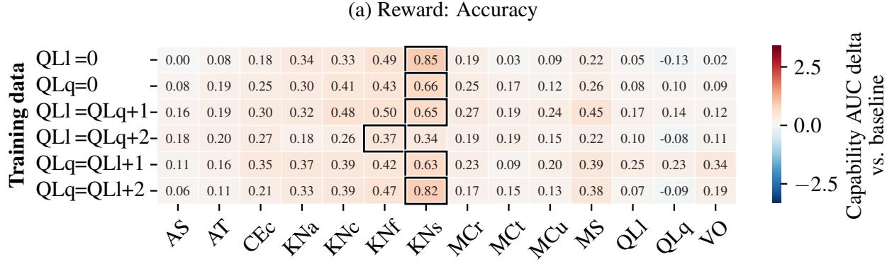

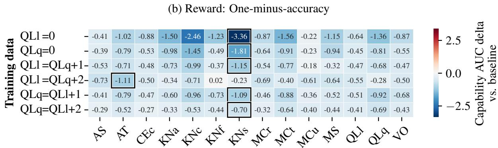  
Figure 8: Average absolute change in AUC between the untrained model (baseline) and the trained model evaluated using Gemini 3.1 Flash Lite DeLeAn labels. Results are averaged over six models from three model families and two sizes. Panel (a) shows the accuracy reward setting, and panel (b) shows the one-minus-accuracy reward setting.

This appendix also collects the per-model results for the item-level experiments of Section 4.3, which Fig. 4 reports only as averages. Tables 10– 21 report, for each of the six models, the baseline capability AUC and its change under each of the six training conditions, separately for the accuracy and one-minus-accuracy reward settings.

## G Non-temporal QL-heavy training

To test whether a stronger quantitative and logical reasoning signal transfers to temporal reasoning, we fine-tune all six models on the non-temporal QL-dominant data described in Section 3.1.3. Table 23 reports the mean capability AUC change per dimension, averaged across models, and 24 the per-model accuracy on the temporal mixture before and after this training. The training achieves its intended effect on the targeted capabilities: QLl and QLq show the largest gains of all 14 dimensions (+0.15 AUC each). Accuracy on the temporal mixture, however, is essentially unchanged for every model (mean ∆ = −0.06 pp; per-model range −1.23 to +0.55 pp), indicating that increased QL capability alone does not translate into better performance on the evaluated temporal benchmarks (see Section 4.3).

## H Larger models

We also explored scaling the experiments to larger models, but the computational cost of GRPO prevented us from running the full experimental suite. For example, the length of some ToT prompts, which can span several thousand tokens, would have been much higher than for TRAM. Nevertheless, we trained Qwen3-32B separately on the TRAM Arithmetic and Semantic subsets using the standard accuracy-reward configuration and evaluated both variants on all TRAM and ToT subsets. Figure 9 reports the resulting changes in accuracy.

<table><tr><td rowspan="2">Baseline</td><td colspan="6">Capability AUC ∆ vs. Baseline</td></tr><tr><td>QLl= 0</td><td>QLq= 0</td><td colspan="2">QLl&gt;QLq</td><td colspan="2">QLq&gt;QLl</td></tr><tr><td></td><td></td><td></td><td></td><td>+1</td><td>+2 +1</td><td>+2</td></tr><tr><td>AS</td><td>2.10</td><td>0.05</td><td>0.25 0.21</td><td>0.28</td><td>0.39</td><td>0.11</td></tr><tr><td>AT</td><td>2.69</td><td>0.10</td><td>0.16 0.17</td><td>0.20</td><td>0.05</td><td>0.01</td></tr><tr><td>CEc</td><td>2.93</td><td>-0.30</td><td>0.41 -0.08</td><td>0.16 -0.04</td><td>-0.34</td><td>-0.09</td></tr><tr><td>KNa</td><td>3.08</td><td>0.05 0.04</td><td>0.05 -0.07</td><td>0.17</td><td>0.08 0.22</td><td>-0.12</td></tr><tr><td>KNc KNf</td><td>2.84 2.59</td><td>0.01</td><td>0.36 0.05</td><td>0.04 0.22</td><td>0.11</td><td>0.05</td></tr><tr><td>KNs</td><td>2.83</td><td>0.20</td><td>0.09 0.07</td><td>0.35 -0.02</td><td>0.04</td><td>0.34 0.03</td></tr><tr><td>MCr</td><td>1.93</td><td>0.01</td><td>0.33</td><td>0.16 0.17</td><td>0.51</td><td>0.04</td></tr><tr><td>MCt</td><td>2.61</td><td>-0.21</td><td>0.37 -0.03</td><td>0.04</td><td>-0.05</td><td>-0.07</td></tr><tr><td>MCu</td><td>2.30</td><td>0.25</td><td>0.37</td><td>-0.29 0.29</td><td>0.24</td><td>-0.02</td></tr><tr><td>MS</td><td>3.20</td><td>-0.13</td><td>-0.11</td><td>-0.07 -0.05</td><td>0.02</td><td>0.02</td></tr><tr><td>QLl</td><td>2.07</td><td>0.38</td><td>0.62</td><td>0.72</td><td>0.80 0.61</td><td>0.60</td></tr><tr><td>QLq</td><td>2.91</td><td>-0.26</td><td>0.07</td><td>-0.25 -0.21</td><td>-0.31</td><td>-0.12</td></tr><tr><td>vO</td><td>1.83</td><td>0.10</td><td>0.21</td><td>0.21</td><td>0.13 0.64</td><td>0.34</td></tr></table>

Table 10: Capability AUC change (∆) for gemma-3-4b in the accuracy reward setting. Highest values per condition are bold.

<table><tr><td rowspan="2">Baseline</td><td colspan="6">Capability AUC ∆ vs. Baseline</td></tr><tr><td>QLl= 0</td><td> $\mathbf { Q } \mathbf { L } \mathbf { q } = 0$ </td><td colspan="2"> $\mathbf { Q L I { > } Q L q }$ </td><td colspan="2"> $\mathbf { Q L q } { \mathrm { > } } \mathbf { Q L I }$ </td></tr><tr><td></td><td></td><td></td><td></td><td>+1</td><td>+2</td><td>+1</td><td>+2</td></tr><tr><td>AS</td><td>2.10</td><td>-0.16</td><td>-0.21</td><td>0.30</td><td>0.01</td><td>-0.47</td><td>-0.01</td></tr><tr><td>AT</td><td>2.69</td><td>-0.47</td><td>-0.44</td><td>0.03</td><td>0.00</td><td>-0.45</td><td>-0.02</td></tr><tr><td>CEc</td><td>2.93</td><td>-1.28</td><td>-0.27</td><td>-0.31 0.17</td><td>0.09</td><td>-0.64</td><td>-0.22</td></tr><tr><td>KNa</td><td>3.08</td><td>-1.05 -1.08</td><td>-0.14 -0.13</td><td>0.14</td><td>0.01 0.07</td><td>-0.24 -0.19</td><td>-0.22</td></tr><tr><td>KNc KNf</td><td>2.84 2.59</td><td>-0.46</td><td>0.11</td><td>-0.04</td><td>0.54</td><td>-0.82</td><td>0.08</td></tr><tr><td>KNs</td><td>2.83</td><td>-1.51</td><td>-0.25</td><td>0.26</td><td>0.27</td><td>0.00</td><td>-0.06 0.10</td></tr><tr><td>MCr</td><td>1.93</td><td>-0.45</td><td>0.16</td><td>0.47</td><td>0.16</td><td>0.11</td><td>0.19</td></tr><tr><td>MCt</td><td>2.61</td><td>-1.02</td><td>-0.07</td><td>0.09</td><td>0.34</td><td>-0.73</td><td>-0.10</td></tr><tr><td>MCu</td><td>2.30</td><td>-0.83</td><td>-0.03</td><td>0.25</td><td>0.36</td><td>-0.20</td><td>-0.24</td></tr><tr><td>MS</td><td>3.20</td><td>-0.66</td><td>-0.15</td><td>-0.21</td><td>-0.11</td><td>-0.35</td><td>-0.10</td></tr><tr><td>QLl</td><td>2.07</td><td>-0.26</td><td>0.34</td><td>0.46</td><td>0.83</td><td>-0.40</td><td>0.30</td></tr><tr><td>QLq</td><td>2.91</td><td>-1.13</td><td>-0.22</td><td>-0.45</td><td>0.19</td><td>-1.42</td><td>-0.47</td></tr><tr><td>vo</td><td>1.83</td><td>-0.38</td><td>0.22</td><td>0.49</td><td>0.05</td><td>-0.36</td><td>0.15</td></tr></table>

Table 11: Capability AUC change (∆) for gemma-3-4b in the one-minus-accuracy reward setting. Lowest values per condition are bold.

<table><tr><td rowspan="2">Baseline</td><td colspan="6">Capability AUC ∆ vs. Baseline</td></tr><tr><td>QLl= 0</td><td>QLq= 0</td><td colspan="2">QLl&gt;QLq</td><td colspan="2">QLq&gt;QLl</td></tr><tr><td></td><td></td><td></td><td></td><td>+1</td><td>+2 +1</td><td>+2</td></tr><tr><td>AS</td><td>3.19</td><td>0.17</td><td>-0.18 0.05</td><td>0.03</td><td>-0.08</td><td>0.17</td></tr><tr><td>AT</td><td>3.74</td><td>0.23 0.29</td><td>0.35</td><td>0.12</td><td>0.03</td><td>0.07</td></tr><tr><td>CEc</td><td>3.51</td><td>0.17</td><td>0.52 0.71</td><td>0.46</td><td>-0.29</td><td>0.04</td></tr><tr><td>KNa</td><td>3.25</td><td>0.10</td><td>0.10 -0.14 0.15</td><td>-0.00 0.11</td><td>0.15</td><td>-0.02</td></tr><tr><td>KNc</td><td>3.57 3.45</td><td>0.13 0.03</td><td>0.09 0.52</td><td></td><td>0.09 0.07</td><td>0.04</td></tr><tr><td>KNf KNs</td><td>2.99</td><td>0.51</td><td>0.57 0.14 -0.03</td><td>0.16 0.16</td><td>0.22</td><td>-0.05</td></tr><tr><td>MCr</td><td>2.77</td><td>0.09</td><td>-0.13 -0.20</td><td>-0.02</td><td>0.04</td><td>0.55 0.20</td></tr><tr><td>MCt</td><td>3.23</td><td>0.03</td><td>0.65 0.80</td><td>0.18</td><td>0.04</td><td>-0.06</td></tr><tr><td>MCu</td><td>2.88</td><td>0.22</td><td>0.19 0.30</td><td>0.05</td><td>-0.03</td><td>0.15</td></tr><tr><td>MS</td><td>3.04</td><td>0.24</td><td>0.38</td><td>0.24 0.10</td><td>0.10</td><td>0.23</td></tr><tr><td>QLl</td><td>3.50</td><td>0.00</td><td>0.30</td><td>0.50 0.16</td><td>-0.10</td><td>-0.13</td></tr><tr><td>QLq</td><td>3.64</td><td>0.05</td><td>0.46</td><td>1.09 0.83</td><td>-0.35</td><td>0.15</td></tr><tr><td>VO</td><td>3.15</td><td>0.08</td><td>-0.26</td><td>-0.03</td><td>0.03 0.03</td><td>-0.06</td></tr><tr><td></td><td></td><td></td><td></td><td></td><td></td><td></td></tr></table>

Table 12: Capability AUC change (∆) for gemma-3-12b in the accuracy reward setting. Highest values per condition are bold.

<table><tr><td rowspan="2">Baseline</td><td colspan="6">Capability AUC ∆ vs. Baseline</td></tr><tr><td>QLl= 0</td><td> $\mathbf { Q } \mathbf { L } \mathbf { q } = 0$ </td><td colspan="2"> $\mathbf { Q L I { > } Q L q }$ </td><td colspan="2"> $\mathbf { Q L q } { \mathrm { > } } \mathbf { Q L I }$ </td></tr><tr><td></td><td></td><td></td><td></td><td>+1</td><td>+2</td><td>+1 +2</td></tr><tr><td>AS</td><td>3.19</td><td>0.09</td><td>-0.02</td><td>-0.24 -0.21</td><td>-0.39</td><td>-0.16</td></tr><tr><td>AT</td><td>3.74</td><td>-0.06</td><td>-0.13 -0.26</td><td>-0.09</td><td>-0.45</td><td>0.21</td></tr><tr><td>CEc</td><td>3.51</td><td>-1.24</td><td>-1.33 -1.27</td><td>-0.17</td><td>-1.62</td><td>-0.91</td></tr><tr><td>KNa</td><td>3.25</td><td>-1.46</td><td>-1.78 -1.42</td><td>-0.05</td><td>-1.71</td><td>-0.71</td></tr><tr><td>KNc</td><td>3.57 3.45</td><td>-1.39 -0.39</td><td>-1.40 -0.50</td><td>-1.29 -0.02</td><td>-1.59</td><td>-0.63</td></tr><tr><td>KNf</td><td>2.99</td><td>-1.55</td><td>-0.40 -1.73 -1.55</td><td>-0.35 -0.07</td><td>-1.02 -1.79</td><td>-0.24</td></tr><tr><td>KNs MCr</td><td>2.77</td><td>-0.16</td><td>-0.72 -0.58</td><td>-0.08</td><td>-0.64</td><td>-1.06</td></tr><tr><td>MCt</td><td>3.23</td><td>-1.02</td><td>-1.20</td><td>-1.24 -0.03</td><td>-1.37</td><td>-0.28 -0.75</td></tr><tr><td>MCu</td><td>2.88</td><td>-0.71</td><td>-0.95 -0.77</td><td>-0.03</td><td>-1.05</td><td>-0.27</td></tr><tr><td>MS</td><td>3.04</td><td>-0.96</td><td>-1.74</td><td>-0.94 0.09</td><td>-1.00</td><td>0.38</td></tr><tr><td>QLl</td><td>3.50</td><td>-0.59</td><td>-0.64</td><td>-0.63 -0.25</td><td>-0.48</td><td>-0.67</td></tr><tr><td>QLq</td><td>3.64</td><td>-0.98</td><td>-1.08</td><td>-1.16 0.14</td><td>-1.52</td><td>-1.10</td></tr><tr><td>vo</td><td>3.15</td><td>-0.29</td><td>-0.54</td><td>-0.82</td><td>0.09 -1.20</td><td>-0.38</td></tr><tr><td></td><td></td><td></td><td></td><td>+1</td><td>+2</td><td>+1 +2</td></tr><tr><td>AS</td><td>1.79</td><td>0.09</td><td>0.35 0.19</td><td>0.32</td><td>0.28</td><td>0.12</td></tr><tr><td>AT</td><td>2.22</td><td>0.40 0.47</td><td>0.27</td><td>0.46</td><td>0.53</td><td>0.40</td></tr><tr><td>CEc</td><td>1.24</td><td>0.82 0.61</td><td>0.72</td><td>0.71</td><td>1.01</td><td>0.62</td></tr><tr><td>KNa</td><td>1.23</td><td>1.47 1.25</td><td>1.42 1.11 1.11 0.90</td><td>1.21 0.84</td><td>1.29 1.25</td><td>1.31</td></tr><tr><td>KNc KNf</td><td>1.55 1.29</td><td>0.25</td><td>0.53 0.25</td><td>0.32</td><td>0.62</td><td>1.09 0.31</td></tr><tr><td>KNs</td><td>1.44</td><td>1.30</td><td>1.22 1.14</td><td>1.04</td><td>1.10</td><td>1.23</td></tr><tr><td>MCr</td><td>1.41</td><td>0.27</td><td>0.54 0.35</td><td>0.52</td><td>0.66</td><td>0.55</td></tr><tr><td>MCt</td><td>1.35</td><td>0.27</td><td>0.44 0.33</td><td>0.31</td><td>0.77</td><td>0.29</td></tr><tr><td>MCu</td><td>1.37</td><td>0.48</td><td>0.75 0.63</td><td>0.47</td><td>0.52</td><td>0.71</td></tr><tr><td>MS</td><td>1.02</td><td>1.47</td><td>1.98 1.83</td><td>1.17</td><td>1.72</td><td>1.71</td></tr><tr><td>QLl</td><td>1.50</td><td>-0.12</td><td>0.26 -0.11</td><td>0.04</td><td>0.21</td><td>-0.16</td></tr><tr><td>QLq</td><td>0.85</td><td>0.28</td><td>0.23</td><td>0.05 0.22</td><td>0.69</td><td>0.25</td></tr><tr><td>vo</td><td>1.08</td><td>0.15</td><td>0.39</td><td>0.24</td><td>0.20 0.33</td><td>0.17</td></tr></table>

Table 13: Capability AUC change (∆) for gemma-3-12b in the one-minus-accuracy reward setting. Lowest values per condition are bold.

Table 14: Capability AUC change (∆) for Llama-3.2-3B in the accuracy reward setting. Highest values per condition are bold.

<table><tr><td rowspan="2">Baseline</td><td colspan="6">Capability AUC ∆ vs. Baseline</td></tr><tr><td>QLl= 0</td><td> $\mathbf { Q } \mathbf { L } \mathbf { q } = 0$ </td><td colspan="2"> $\mathbf { Q L I { > } Q L q }$ </td><td colspan="2"> $\mathbf { Q L q } { \mathrm { > } } \mathbf { Q L I }$ </td></tr><tr><td></td><td></td><td></td><td></td><td>+1</td><td>+2</td><td>+1 +2</td></tr><tr><td>AS</td><td>1.79</td><td>-1.01</td><td>-0.86</td><td>-1.30</td><td>-1.78 -1.19</td><td>-0.99</td></tr><tr><td>AT</td><td>2.22</td><td>-1.37</td><td>-1.36</td><td>-1.63 -1.98</td><td>-1.54</td><td>-1.31</td></tr><tr><td>CEc</td><td>1.24</td><td>-1.06</td><td>-0.87</td><td>-0.84 -1.12</td><td>-0.87</td><td>-0.53</td></tr><tr><td>KNa</td><td>1.23</td><td>-1.00</td><td>-0.84</td><td>-0.43</td><td>-1.10 -0.88</td><td>-0.76</td></tr><tr><td>KNc</td><td>1.55</td><td>-1.31</td><td>-1.22 -0.72</td><td>-0.95</td><td>-1.35 -0.94</td><td>-0.57</td></tr><tr><td>KNf</td><td>1.29 1.44</td><td>-0.68 -1.33</td><td>-1.16</td><td>-1.02 -0.64</td><td>-1.25 -1.05 -0.63</td><td>-0.81</td></tr><tr><td>KNs MCr</td><td>1.41</td><td>-0.91</td><td>-0.97</td><td>-1.15</td><td>一 -1.12</td><td>-0.55</td></tr><tr><td>MCt</td><td>1.35</td><td>-1.13</td><td>-1.02</td><td>-1.10</td><td>-1.28 -1.12</td><td>-0.65 -0.85</td></tr><tr><td>MCu</td><td>1.37</td><td>-0.85</td><td>-0.87</td><td>-1.15</td><td>-1.01</td><td>-0.91</td></tr><tr><td>MS</td><td>1.02</td><td></td><td>-0.89</td><td>-0.77</td><td>-0.65</td><td>-0.28</td></tr><tr><td>QLl</td><td>1.50</td><td>-0.89</td><td>-0.89</td><td>-1.27</td><td>-1.45 -1.21</td><td>-1.04</td></tr><tr><td>QLq</td><td>0.85</td><td>-0.63</td><td>-0.49</td><td>-0.54</td><td>-0.77 -0.61</td><td>-0.44</td></tr><tr><td>vo</td><td>1.08</td><td>-0.83</td><td>-0.73</td><td>-0.76</td><td>-1.04 -0.69</td><td>-0.38</td></tr><tr><td></td><td></td><td></td><td>+1</td><td>+2</td><td>+1</td><td>+2</td></tr><tr><td>AS</td><td>2.42</td><td>0.08</td><td>0.18 0.35 0.36</td><td>-0.01</td><td>0.37</td><td>0.21</td></tr><tr><td>AT</td><td>2.95</td><td>0.15 0.30</td><td>0.75 1.09 1.13</td><td>0.37 -0.16</td><td>0.67 0.68</td><td>0.51</td></tr><tr><td>CEc</td><td>1.82 1.62</td><td>0.78</td><td>0.96 0.80</td><td>-0.20</td><td>1.34</td><td>1.09</td></tr><tr><td>KNa KNc</td><td>2.23</td><td>0.80 0.90</td><td>1.11</td><td>0.18</td><td>1.29</td><td>0.89 0.99</td></tr><tr><td>KNf</td><td>2.07</td><td>-0.07</td><td>0.30 0.76</td><td>-0.22</td><td>0.32</td><td>0.21</td></tr><tr><td>KNs</td><td>2.15</td><td>0.70 0.85</td><td>1.21</td><td>0.29</td><td>0.84</td><td>1.18</td></tr><tr><td>MCr</td><td>1.84</td><td>0.25 0.34</td><td>0.51</td><td>0.39</td><td>0.83</td><td>0.46</td></tr><tr><td>MCt</td><td>1.60</td><td>0.26 0.84</td><td>0.76</td><td>-0.00</td><td>0.62</td><td>0.69</td></tr><tr><td>MCu</td><td>1.89</td><td>0.33</td><td>0.86 1.15</td><td>0.32</td><td>0.69</td><td>0.75</td></tr><tr><td>MS</td><td>2.31</td><td>0.79</td><td>0.65 0.54</td><td>0.21</td><td>0.64</td><td>0.54</td></tr><tr><td>QLl</td><td>1.74</td><td>0.27</td><td>0.91 1.23</td><td>0.21</td><td>0.75</td><td>0.71</td></tr><tr><td>QLq</td><td>1.06</td><td>0.02</td><td>0.70 0.89</td><td>0.08</td><td>0.84</td><td>0.92</td></tr><tr><td>vo</td><td>1.23</td><td>0.05</td><td>0.35 0.26</td><td>0.15</td><td>0.77</td><td>0.46</td></tr></table>

Table 15: Capability AUC change (∆) for Llama-3.2-3B in the one-minus-accuracy reward setting. Lowest values per condition are bold. $^ { 6 6 } - ^ { 5 5 }$ indicates missing values, e.g., where a fit was not possible.

Table 16: Capability AUC change (∆) for Llama-3.1-8B in the accuracy reward setting. Highest values per condition are bold.

<table><tr><td rowspan="2">Baseline</td><td colspan="6">Capability AUC ∆ vs. Baseline</td></tr><tr><td>QLl= 0</td><td> $\mathbf { Q } \mathbf { L } \mathbf { q } = 0$ </td><td colspan="2"> $\mathbf { Q L I { > } Q L q }$ </td><td colspan="2"> $\mathbf { Q L q } { \mathrm { > } } \mathbf { Q L I }$ </td></tr><tr><td></td><td></td><td></td><td></td><td>+1</td><td>+2 +1</td><td>+2</td></tr><tr><td>AS</td><td>2.42</td><td>-0.87</td><td>-0.77</td><td>-2.27 -2.12</td><td>-1.67</td><td>-1.70</td></tr><tr><td>AT</td><td>2.95</td><td>-1.38</td><td>-1.41</td><td>-2.76 -2.35</td><td>-1.88</td><td>-1.84</td></tr><tr><td>CEc</td><td>1.82</td><td>-1.19</td><td>-1.25</td><td>-1.56 -1.48</td><td>-1.26</td><td>-1.13</td></tr><tr><td>KNa</td><td>1.62</td><td>-1.34</td><td>-1.42</td><td>-1.57 -1.49 -1.74</td><td>-1.32</td><td>-0.97</td></tr><tr><td>KNc</td><td>2.23</td><td>-1.74</td><td>-1.74</td><td>-2.02 -1.89</td><td>-1.09</td><td>-1.00</td></tr><tr><td>KNf</td><td>2.07 2.15</td><td>-0.58 -2.11</td><td>-0.68 -2.07</td><td>-1.71 -1.94 -1.83</td><td>-1.63 -1.16</td><td>-1.57</td></tr><tr><td>KNs MCr</td><td>1.84</td><td>-0.62</td><td>-0.71</td><td>-1.73 -1.67</td><td>-1.47</td><td>-1.16</td></tr><tr><td>MCt</td><td>1.60</td><td>-1.04</td><td>-1.10</td><td>-1.44 -1.28</td><td>-1.16</td><td>-1.46 -1.00</td></tr><tr><td>MCu</td><td>1.89</td><td>-0.88</td><td>-0.98</td><td>-1.83 -1.73</td><td>-1.60</td><td>-1.55</td></tr><tr><td>MS</td><td>2.31</td><td>-2.18</td><td></td><td></td><td>-2.18 -1.63</td><td>-1.90</td></tr><tr><td>QLl</td><td>1.74</td><td>-0.42</td><td>-0.56</td><td>-1.62</td><td>-1.46 -1.46</td><td>-1.29</td></tr><tr><td>QLq</td><td>1.06</td><td>-0.79</td><td>-0.73</td><td>-0.91 -0.79</td><td>-0.62</td><td>-0.47</td></tr><tr><td>vo</td><td>1.23</td><td>-0.68</td><td>-0.69</td><td>-1.12</td><td>-1.00 -0.81</td><td>-0.65</td></tr><tr><td></td><td></td><td></td><td></td><td>+1</td><td>+2 +1</td><td>+2</td></tr><tr><td>AS</td><td>2.80</td><td>-0.05</td><td>0.08 0.20</td><td>0.20</td><td>0.07</td><td>-0.02</td></tr><tr><td>AT</td><td>3.38 0.02</td><td>0.16</td><td>0.22</td><td>0.25</td><td>0.16</td><td>-0.14</td></tr><tr><td>CEc</td><td>2.64</td><td>0.26</td><td>0.13 0.53</td><td>0.20</td><td>0.21</td><td>0.24</td></tr><tr><td>KNa</td><td>3.17</td><td>-0.27</td><td>-0.22 -0.24 0.33</td><td>-0.24 0.34</td><td>-0.06</td><td>-0.02</td></tr><tr><td>KNc</td><td>3.28 3.06</td><td>0.08 -0.11</td><td>-0.04 -0.05</td><td></td><td>0.21</td><td>0.04</td></tr><tr><td>KNf</td><td>3.12</td><td>-0.16 -0.06</td><td>0.33 -0.07</td><td>0.14 -0.12</td><td>0.17 0.27</td><td>0.03</td></tr><tr><td>KNs MCr</td><td>2.54</td><td>-0.05</td><td>0.03 0.10</td><td>0.07</td><td>0.13</td><td>-0.20</td></tr><tr><td>MCt</td><td>2.72</td><td>-0.10</td><td>-0.02 0.16</td><td>0.16</td><td>0.00</td><td>-0.09 0.04</td></tr><tr><td>MCu</td><td>2.70</td><td>-0.04</td><td>0.17 0.02</td><td>-0.06</td><td>0.22</td><td>-0.16</td></tr><tr><td>MS</td><td>3.09</td><td>0.06</td><td>-0.19</td><td>-0.20 -0.14</td><td>0.06</td><td>0.00</td></tr><tr><td>QLl</td><td>2.92</td><td>-0.20</td><td>-0.17</td><td>0.07 0.04</td><td>-0.13</td><td>-0.16</td></tr><tr><td>QLq</td><td>2.11</td><td>-0.01</td><td>-0.05</td><td>0.08 0.15</td><td>0.29</td><td>-0.02</td></tr><tr><td>vo</td><td>3.02</td><td>-0.42</td><td>-0.26</td><td>-0.17</td><td>-0.13</td><td>-0.19</td></tr><tr><td></td><td></td><td></td><td></td><td></td><td>-0.22</td><td></td></tr></table>

Table 17: Capability AUC change (∆) for Llama-3.1-8B in the one-minus-accuracy reward setting. Lowest values per condition are bold. $^ { 6 6 } - ^ { 5 5 }$ indicates missing values, e.g., where a fit was not possible.

Table 18: Capability AUC change (∆) for Qwen3-4B in the accuracy reward setting. Highest values per condition are bold.

<table><tr><td rowspan="2">Baseline</td><td colspan="6">Capability AUC ∆ vs. Baseline</td></tr><tr><td>QLl= 0</td><td> $\mathbf { Q } \mathbf { L } \mathbf { q } = 0$ </td><td colspan="2"> $\mathbf { Q L I { > } Q L q }$ </td><td colspan="2"> $\mathbf { Q L q } { \mathrm { > } } \mathbf { Q L I }$ </td></tr><tr><td></td><td></td><td></td><td></td><td>+1</td><td>+2</td><td>+1 +2</td></tr><tr><td>AS</td><td>2.80</td><td>-1.29</td><td>-1.29</td><td>-0.16 -0.42</td><td>-0.22</td><td>-0.24</td></tr><tr><td>AT</td><td>3.38</td><td>-1.67</td><td>-1.71 -0.29</td><td>-1.17</td><td>-0.39</td><td>-0.30</td></tr><tr><td>CEc</td><td>2.64</td><td>-1.66</td><td>-0.68</td><td>0.00 -0.04</td><td>0.17</td><td>-0.01</td></tr><tr><td>KNa</td><td>3.17</td><td>-2.61</td><td>-1.52</td><td>-0.40 -0.49 -0.55</td><td>-0.14 0.23</td><td>-0.19</td></tr><tr><td>KNc</td><td>3.28</td><td>-2.40 -1.48</td><td>-1.62 -1.12</td><td>-0.23 -0.01</td><td></td><td>-0.16</td></tr><tr><td>KNf</td><td>3.06 3.12</td><td>-2.94</td><td></td><td>-0.44 -0.72</td><td>0.13 -0.13</td><td>-0.21</td></tr><tr><td>KNs MCr</td><td>2.54</td><td>-1.37</td><td>-2.02 -1.32</td><td>-0.22 -0.34 -0.27</td><td>-0.03</td><td>-0.06</td></tr><tr><td>MCt</td><td>2.72</td><td>-1.82</td><td>-0.73</td><td>-0.19 -0.23</td><td>-0.01</td><td>-0.12 -0.20</td></tr><tr><td>MCu</td><td>2.70</td><td>-1.47</td><td>-1.40</td><td>-0.44 -0.39</td><td>-0.34</td><td>-0.25</td></tr><tr><td>MS</td><td>3.09</td><td></td><td>-2.09</td><td>-0.44 -0.34</td><td>-0.23</td><td>-0.05</td></tr><tr><td>QLl</td><td>2.92</td><td>-1.73</td><td>-1.29</td><td>-0.16</td><td>-0.64 -0.12</td><td>-0.34</td></tr><tr><td>QLq</td><td>2.11</td><td>-0.95</td><td>-0.20</td><td>-0.04 0.05</td><td>-0.05</td><td>-0.10</td></tr><tr><td>vo</td><td>3.02</td><td>-1.50</td><td>-1.17</td><td>-0.29</td><td>-0.49 -0.34</td><td>-0.13</td></tr><tr><td></td><td></td><td></td><td></td><td>+1</td><td>+2</td><td>+1 +2</td></tr><tr><td>AS</td><td>3.03</td><td>-0.08</td><td>-0.01 0.04</td><td>0.03</td><td>0.03</td><td>-0.03</td></tr><tr><td>AT</td><td>3.54</td><td>0.06</td><td>0.11 0.25 0.34</td><td>0.13</td><td>0.16</td><td>0.03</td></tr><tr><td>CEc</td><td>2.83</td><td>0.21</td><td>0.03</td><td>0.19</td><td>0.23</td><td>0.43</td></tr><tr><td>KNa</td><td>3.05</td><td>-0.31</td><td>-0.19 -0.32</td><td>0.05 0.22</td><td>-0.04 0.12</td><td>-0.20</td></tr><tr><td>KNc KNf</td><td>3.58 3.47</td><td>-0.03 0.31</td><td>-0.02 0.24</td><td>0.13 0.26</td><td>0.14</td><td>-0.02</td></tr><tr><td>KNs</td><td>2.97</td><td>-0.14</td><td>0.08 0.16</td><td>0.37 0.17</td><td>0.17</td><td>0.01 0.09</td></tr><tr><td>MCr</td><td>2.77</td><td>-0.09</td><td>-0.15</td><td>0.06 -0.03</td><td>-0.06</td><td>0.09</td></tr><tr><td>MCt</td><td>2.94</td><td>0.12</td><td>-0.18</td><td>0.01 0.06</td><td>0.05</td><td>0.04</td></tr><tr><td>MCu</td><td>2.68</td><td>0.15</td><td>0.41</td><td>0.21 0.19</td><td>0.12</td><td>0.17</td></tr><tr><td>MS</td><td>2.80</td><td>-0.25</td><td>-0.09</td><td>0.02 0.51</td><td>0.13</td><td>0.07</td></tr><tr><td>QLl</td><td>3.17</td><td>-0.16</td><td>0.10</td><td>0.11 0.13</td><td>-0.12</td><td>-0.02</td></tr><tr><td>QLq</td><td>2.30</td><td>-0.12</td><td>-0.08</td><td>0.13 0.03</td><td>0.26</td><td>0.03</td></tr><tr><td>vo</td><td>2.83</td><td>-0.32</td><td>-0.33</td><td>-0.01</td><td>-0.00 0.10</td><td>0.01</td></tr></table>

Table 19: Capability AUC change (∆) for Qwen3-4B in the one-minus-accuracy reward setting. Lowest values per condition are bold. $^ { 6 6 } - ^ { 5 9 }$ indicates missing values, e.g., where a fit was not possible.

Table 20: Capability AUC change (∆) for Qwen3-8B in the accuracy reward setting. Highest values per condition are bold.

<table><tr><td rowspan="2">Baseline</td><td colspan="6">Capability AUC ∆ vs. Baseline</td></tr><tr><td>QLl= 0</td><td> $\mathbf { Q } \mathbf { L } \mathbf { q } = 0$ </td><td colspan="2"> $\mathbf { Q L I { > } Q L q }$ </td><td colspan="2"> $\mathbf { Q L q } { \mathrm { > } } \mathbf { Q L I }$ </td></tr><tr><td></td><td></td><td></td><td></td><td>+1</td><td>+2</td><td>+1 +2</td></tr><tr><td>AS</td><td>3.03</td><td>-1.16</td><td>-0.26</td><td>-0.20</td><td>-1.05 -0.27</td><td>-0.34</td></tr><tr><td>AT</td><td>3.54</td><td>-1.83</td><td>-0.55</td><td>-0.26 -1.96</td><td>-0.31</td><td>-0.39</td></tr><tr><td>CEc</td><td>2.83</td><td>-1.70</td><td>0.05</td><td>0.14 -0.46</td><td>-0.48</td><td>-0.32</td></tr><tr><td>KNa</td><td>3.05</td><td>-2.41</td><td>-0.17 -0.42</td><td>-0.26 -0.25 -0.11</td><td>-0.17 -0.04</td><td>-0.19</td></tr><tr><td>KNc KNf</td><td>3.58 3.47</td><td>-2.78 -1.36</td><td>-0.04</td><td>-0.07</td><td>-0.91 -1.19</td><td>-0.01</td></tr><tr><td>KNs</td><td>2.97</td><td>-2.80</td><td>-0.28</td><td>-0.17 -0.71</td><td>-0.53 0.11</td><td>-0.65</td></tr><tr><td>MCr</td><td>2.77</td><td>-1.59</td><td>-0.30</td><td>-0.10</td><td>-0.88 -0.13</td><td>0.06 -0.21</td></tr><tr><td>MCt</td><td>2.94</td><td>-1.91</td><td>-0.13</td><td>-0.27 -0.61</td><td>-0.56</td><td>-0.59</td></tr><tr><td>MCu</td><td>2.68</td><td>-1.50</td><td>-0.31</td><td>-0.18</td><td>-0.85 0.08</td><td>-0.29</td></tr><tr><td>MS</td><td>2.80</td><td>-2.34</td><td>-0.18</td><td>-0.26</td><td>-0.12 0.10</td><td>-0.07</td></tr><tr><td>QLl</td><td>3.17</td><td>-1.55</td><td>0.00</td><td>0.04</td><td>-1.13 -0.44</td><td>-0.25</td></tr><tr><td>QLq</td><td>2.30</td><td>-1.15</td><td>0.09</td><td>0.07</td><td>-0.10 -0.44</td><td>-0.38</td></tr><tr><td>vo</td><td>2.83</td><td>-1.39</td><td>0.07</td><td>0.07</td><td>-0.50</td><td>-0.78 -0.80</td></tr></table>

Table 21: Capability AUC change (∆) for Qwen3-8B in the one-minus-accuracy reward setting. Lowest values per condition are bold.

<table><tr><td rowspan="2">Reward Train</td><td rowspan="2"></td><td rowspan="2">Test</td><td colspan="3">Baseline</td><td colspan="2">∆(pp)</td><td rowspan="2">Imp./Worse</td></tr><tr><td>Min</td><td>Median</td><td>Max</td><td>Mean</td><td>Median</td></tr><tr><td>Acc.</td><td>TRAM-Ari.</td><td>TRAM-Ari.</td><td>25.74</td><td>70.09</td><td>87.74</td><td>23.12</td><td>14.65</td><td>6/0</td></tr><tr><td></td><td></td><td>TRAM-Sem.</td><td>10.00</td><td>61.40</td><td>70.60</td><td>11.13</td><td>1.90</td><td>5/0</td></tr><tr><td></td><td></td><td>ToT-Ari.</td><td>15.37</td><td>50.22</td><td>72.08</td><td>0.83</td><td>1.73</td><td>4/2</td></tr><tr><td></td><td></td><td>ToT-Sem.</td><td>27.86</td><td>42.50</td><td>55.86</td><td>0.86</td><td>1.07</td><td>4/2</td></tr><tr><td></td><td>TRAM-Sem.</td><td>TRAM-Ari.</td><td>25.74</td><td>70.09</td><td>87.74</td><td>3.35</td><td>1.52</td><td>3/3</td></tr><tr><td></td><td></td><td>TRAM-Sem.</td><td>10.00</td><td>61.40</td><td>70.60</td><td>15.17</td><td>5.00</td><td>6/0</td></tr><tr><td></td><td></td><td>ToT-Ari.</td><td>15.37</td><td>50.22</td><td>72.08</td><td>-0.72</td><td>-0.43</td><td>3/3</td></tr><tr><td></td><td></td><td>ToT-Sem.</td><td>27.86</td><td>42.50</td><td>55.86</td><td>1.12</td><td>0.43</td><td>3/3</td></tr><tr><td></td><td>ToT-Ari.</td><td>TRAM-Ari.</td><td>25.74</td><td>70.09</td><td>87.74</td><td>-3.22</td><td>-2.31</td><td>2/4</td></tr><tr><td></td><td></td><td>TRAM-Sem.</td><td>10.00</td><td>61.40</td><td>70.60</td><td>-2.87</td><td>0.40</td><td>4/2</td></tr><tr><td></td><td></td><td>ToT-Ari.</td><td>15.37</td><td>50.22</td><td>72.08</td><td>7.61</td><td>7.79</td><td>6/0</td></tr><tr><td></td><td></td><td>ToT-Sem.</td><td>27.86</td><td>42.50</td><td>55.86</td><td>1.40</td><td>0.86</td><td>3/3</td></tr><tr><td></td><td>ToT-Sem.</td><td>TRAM-Ari.</td><td>25.74</td><td>70.09</td><td>87.74</td><td>-1.01</td><td>-0.85</td><td>2/4</td></tr><tr><td></td><td></td><td>TRAM-Sem.</td><td>10.00</td><td>61.40</td><td>70.60</td><td>-0.00</td><td>0.60</td><td>4/2</td></tr><tr><td></td><td></td><td>ToT-Ari.</td><td>15.37</td><td>50.22</td><td>72.08</td><td>1.01</td><td>1.19</td><td>5/1</td></tr><tr><td>1-Acc.</td><td></td><td>ToT-Sem.</td><td>27.86</td><td>42.50</td><td>55.86</td><td>6.81</td><td>7.00</td><td>6/0</td></tr><tr><td></td><td>TRAM-Ari.</td><td>TRAM-Ari.</td><td>25.74</td><td>70.09</td><td>87.74</td><td>-17.17</td><td>-16.67</td><td>2/4</td></tr><tr><td></td><td></td><td>TRAM-Sem.</td><td>10.00</td><td>61.40</td><td>70.60</td><td>0.80</td><td>0.40</td><td>3/3</td></tr><tr><td></td><td></td><td>ToT-Ari.</td><td>15.37</td><td>50.22</td><td>72.08</td><td>-5.77</td><td>-4.76</td><td>1/5</td></tr><tr><td></td><td></td><td>ToT-Sem.</td><td>27.86</td><td>42.50</td><td>55.86</td><td>-1.62</td><td>-0.79</td><td>3/3</td></tr><tr><td></td><td>TRAM-Sem.</td><td>TRAM-Ari.</td><td>25.74</td><td>70.09</td><td>87.74</td><td>-1.22</td><td>-0.78</td><td>2/4</td></tr><tr><td></td><td></td><td>TRAM-Sem.</td><td>10.00</td><td>61.40</td><td>70.60</td><td>-12.93</td><td>-11.50</td><td>1/5</td></tr><tr><td></td><td></td><td>ToT-Ari.</td><td>15.37</td><td>50.22</td><td>72.08</td><td>-1.12</td><td>-0.22</td><td>2/4</td></tr><tr><td></td><td></td><td>ToT-Sem.</td><td>27.86</td><td>42.50</td><td>55.86</td><td>-6.36</td><td>-2.29</td><td>1/5</td></tr><tr><td></td><td>ToT-Ari.</td><td>TRAM-Ari.</td><td>25.74</td><td>70.09</td><td>87.74</td><td>-10.07</td><td>-6.06</td><td>1/5</td></tr><tr><td></td><td></td><td>TRAM-Sem.</td><td>10.00</td><td>61.40</td><td>70.60</td><td>-6.03</td><td>-1.60</td><td>0/6</td></tr><tr><td></td><td></td><td>ToT-Ari.</td><td>15.37</td><td>50.22</td><td>72.08</td><td>-25.97</td><td>-18.51</td><td>0/6</td></tr><tr><td></td><td></td><td>ToT-Sem.</td><td>27.86</td><td>42.50</td><td>55.86</td><td>-12.31</td><td>-10.21</td><td>1/5</td></tr><tr><td></td><td>ToT-Sem.</td><td>TRAM-Ari.</td><td>25.74</td><td>70.09</td><td>87.74</td><td>-0.95</td><td>-1.33</td><td>2/4</td></tr><tr><td></td><td></td><td>TRAM-Sem.</td><td>10.00</td><td>61.40</td><td>70.60</td><td>-0.60</td><td>-1.30</td><td>1/5</td></tr><tr><td></td><td></td><td>ToT-Ari.</td><td>15.37</td><td>50.22</td><td>72.08</td><td>-2.63</td><td>-1.73</td><td>1/5</td></tr><tr><td></td><td></td><td></td><td></td><td></td><td></td><td></td><td></td><td></td></tr><tr><td></td><td></td><td>ToT-Sem.</td><td>27.86</td><td>42.50</td><td>55.86</td><td>-22.76</td><td>-25.00</td><td>0/6</td></tr></table>

TRAM-Ari. = TRAM Arithmetic, TRAM-Sem. = TRAM Semantic, ToT-Ari. = ToT Arithmetic, ToT-Sem. = ToT Semantic.  
Table 22: Model performance deltas relative to baseline (percentage points) for both reward settings. Includes the number of models which improved or worsened their performance after fine-tuning.  
tern. Because they come from a single larger model, it remains unclear whether the observed pattern reflects model scale or ordinary performance variation.

Training on TRAM Arithmetic improves ToT Arithmetic by 3.7 percentage points, nearly matching the 3.9-point in-domain gain, while ToT Semantic improves by 1.9 points. Training on TRAM Semantic improves ToT Semantic by 1.9 points, but also increases TRAM Arithmetic by 2.7 points. Overall, however, the changes range from −0.2 to +3.9 points, substantially smaller than the indomain gains of +6.8 to +23.1 points observed across the models in Figure 3. These results therefore provide tentative evidence of arithmetic transfer, but not a consistent mode-specific transfer pat-

<table><tr><td>Dimension</td><td>Δ AUC</td></tr><tr><td>AS</td><td>+0.01</td></tr><tr><td>AT</td><td>-0.02</td></tr><tr><td>CEc</td><td>+0.14</td></tr><tr><td>KNa</td><td>-0.04</td></tr><tr><td>KNc</td><td>+0.02</td></tr><tr><td>KNf</td><td>+0.08</td></tr><tr><td>KNs</td><td>+0.07</td></tr><tr><td>MCr</td><td>+0.03</td></tr><tr><td>MCt</td><td>+0.02</td></tr><tr><td>MCu</td><td>-0.02</td></tr><tr><td>MS</td><td>+0.07</td></tr><tr><td>QLl</td><td>+0.15</td></tr><tr><td>QLq</td><td>+0.15</td></tr><tr><td>VO</td><td>-0.08</td></tr></table>

Table 23: Mean capability AUC ∆ versus baseline after GRPO on non-temporal QL-dominant data, averaged across models. Highest values are bold.

<table><tr><td rowspan="2"></td><td colspan="2">Baseline QL-dominant.</td></tr><tr><td>Acc.</td><td>Acc. Δ</td></tr><tr><td>Llama-3.2-3B</td><td>24.85</td><td>25.40 +0.55</td></tr><tr><td>Llama-3.1-8B</td><td>33.33</td><td>32.87 -0.46</td></tr><tr><td>gemma-3-4b</td><td>43.42</td><td>43.71 +0.29</td></tr><tr><td>gemma-3-12b</td><td>62.53</td><td>62.78 +0.25</td></tr><tr><td>Qwen3-4b</td><td>53.59</td><td>52.36 -1.23</td></tr><tr><td>Qwen3-8b</td><td>55.78</td><td>56.03 +0.25</td></tr></table>

Table 24: Overall accuracy on the temporal mix (%) after GRPO on non-temporal QL-dominant training data. ∆ is percentage points versus each model’s baseline.

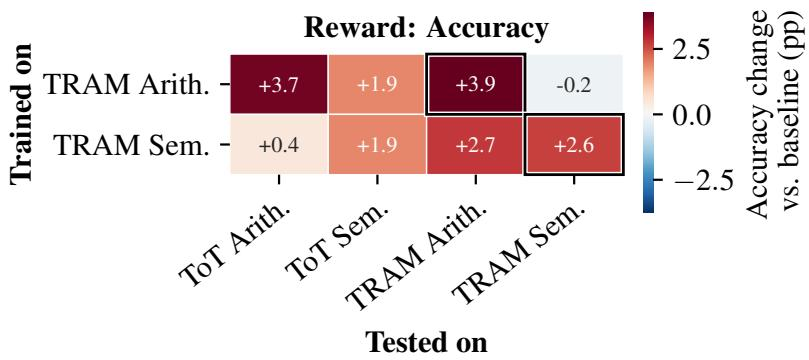  
Figure 9: Change in accuracy, in percentage points, between the untrained Qwen3-32B baseline and each trained variant.