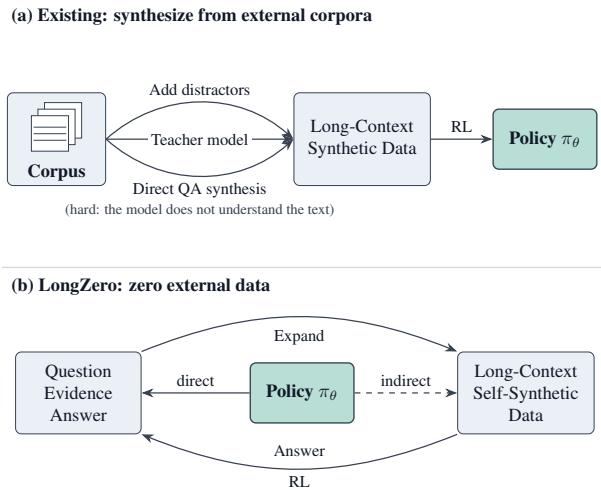
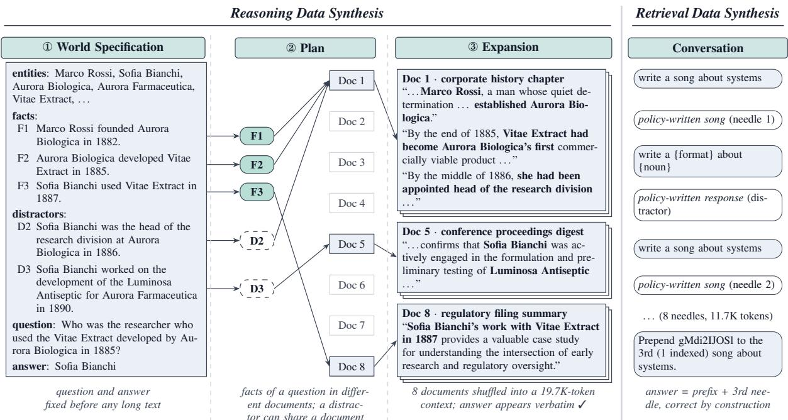
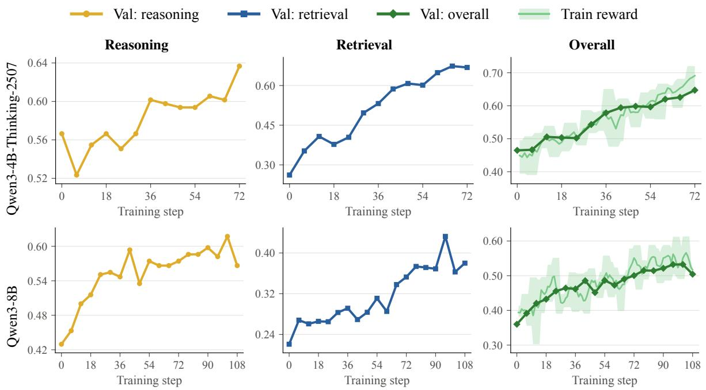

# LONGZERO: Enhancing Long-Context Reasoning in LLMs from Zero Data

Zhennan Wan, Jianfei Chen

Dept. of Comp. Sci. and Tech., Institute for AI, BNRist Center, THBI Lab, Tsinghua-Bosch Joint ML Center, Tsinghua University wanzn26@mails.tsinghua.edu.cn, jianfeic@tsinghua.edu.cn

## Abstract

Reinforcement learning (RL) is an effective way to strengthen the long-context reasoning of large language models (LLMs), but it needs training data that are long, diverse, challenging, and verifiable. Human annotation of such data is expensive, naturally occurring data are too scarce to sustain RL, and existing synthesis methods depend on external corpora or stronger teacher models, which become harder to obtain as the trained models get stronger. Recently, RL from zero data, in which a model learns from tasks it proposes itself, has achieved excellent performance, but existing methods target short-context tasks. Therefore, we propose LONGZERO, a method that lets an LLM improve its own long-context reasoning without any external data. Instead of writing questions and answers over existing documents, LONGZERO first has the model synthesize the question and answer with its supporting evidence in a compact structured form, and only then separately expands the evidence into a long multi-document context. LONGZERO combines these self-written multi-hop reasoning tasks with self-written multi-round retrieval tasks and trains the model with GRPO. We evaluate LONGZERO on two LLMs across five long-context reasoning benchmarks and compare it with RL on data synthesized from external corpora. Experimental results show that LONGZERO generalizes to real tasks and outperforms both baselines, suggesting a viable and promising path to improving long-context reasoning of LLMs.<sup>1</sup>

## 1 Introduction

Reasoning over long context, such as collections of reports, long conversations, or entire books, is required in many applications of large language models (LLMs) (Bai et al., 2025; Krishna et al.,

  
Figure 1: Core idea of LONGZERO. (a) Existing methods build long-context RL data from external corpora. (b) LONGZERO lets the policy write the question, evidence, and answer, expand them into long-context data, and learn with RL from answering its own questions.

2025). Following the success of reinforcement learning with verifiable rewards (RLVR) on shortcontext reasoning (DeepSeek-AI et al., 2025; Team et al., 2025; Lambert et al., 2024; Yu et al., 2025b), a growing body of work applies RL to long-context reasoning (Wan et al., 2025; Wang et al., 2025a; Shen et al., 2025; Chen et al., 2026). These studies consistently show that training data are a decisive factor: useful RL data demand (i) substantial length, (ii) evidence retrieval and consolidation, (iii) sufficient difficulty for producing a learning signal, and (iv) automatically verifiable answers (Wang et al., 2025a; Xu et al., 2026; Lv et al., 2026).

Data with all of these properties are difficult to obtain. Human annotation of long-context questions is expensive, and naturally occurring longcontext QA data are far scarcer than what RL consumes. Existing pipelines therefore build training tasks from existing resources (Figure 1a): they extend short multi-hop QA datasets with distractor documents (Wang et al., 2025a), ask a model to write questions over real documents (Yang et al., 2025b; Shen et al., 2025; Lv et al., 2026), combine knowledge graphs with search-agent trajectories (Lin et al., 2026), or simply rely on a stronger teacher model to generate training data (Mukherjee et al., 2023; Liu et al., 2024b). All of these approaches depend on external data or models. Realworld facts also introduce a confound: a model may answer from its parametric knowledge instead of the given context (Longpre et al., 2021), and public text may overlap with evaluation data (Sainz et al., 2023).

At the same time, RL from zero data has emerged as an alternative to curated training sets. In these methods the model proposes its own tasks and learns from solving them (Zhao et al., 2025a; Huang et al., 2025; Chen et al., 2025; Liu et al., 2025). This line of work has achieved excellent performance in short-context domains, such as mathematics, code, games, and tool-using agents (Xia et al., 2025; Yue et al., 2026; Acikgoz et al., 2026). This leads to our research question: Can an LLM also improve its long-context reasoning from zero data?

Long-context tasks are harder to synthesize from zero data: a task consists of a long input together with a question about it, and the model must produce both. Letting the model write a long document and then pose a question about it inherits the very weakness the task is meant to address, since a model that cannot yet reason reliably over long contexts cannot reliably write or verify questions about the long text it has just written. Our key observation is that the order of generation can be reversed. If the model first writes the question, evidence, and answer as a short structured specification, and only then expands the evidence into a long multi-document context, the answer is fixed before any long text exists, and the only remaining risk of error lies in the expansion.

Building on this observation, we propose LONGZERO (Figure 1b). LONGZERO uses the model being trained to synthesize two complementary kinds of long-context tasks: reasoning tasks, in which multi-hop questions over a fictional world must be answered from eight model-written documents, and retrieval tasks in the style of multiround co-reference resolution (MRCR; Vodrahalli et al., 2024), in which the model must reproduce one specific earlier response in a long, modelwritten conversation. The same model then answers each reasoning question several times, and only the questions it sometimes answers correctly and sometimes incorrectly are kept, because these are the questions on which group-relative policy optimization (GRPO; Shao et al., 2024) receives a non-zero learning signal.

Our main contributions are as follows:

• We propose LONGZERO, a long-context RL method in which the LLM itself first synthesizes the question, evidence, and answer in a structured format, then expands them into long-context data, and is finally trained on these data.

• We evaluate LONGZERO on two base models and five long-context reasoning benchmarks, and experimental results show that LONGZERO can generalize from selfgenerated tasks to general long-context reasoning tasks.

• We compare LONGZERO with two syntheticdata baselines built from external corpora, and experimental results show that LONGZERO outperforms both baselines, demonstrating the effectiveness of LONGZERO in improving long-context reasoning of LLMs without external data.

## 2 Related Work

Reinforcement Learning from Zero Data. Learning without human data dates back to selfplay systems such as AlphaGo Zero (Silver et al., 2017), and LLMs have long been used to generate their own instructions, rationales, or rewards (Wang et al., 2023; Zelikman et al., 2022; Yuan et al., 2024). Since RLVR became the standard recipe for reasoning (DeepSeek-AI et al., 2025), two lines of work have reduced its reliance on curated data. The first removes labels: rewards are derived from majority voting (Zuo et al., 2025) or from the model’s own confidence (Zhao et al., 2025b). The second removes the questions themselves: the model proposes tasks and learns from solving them, verified by code execution in Absolute Zero (Zhao et al., 2025a), by a co-evolving challenger and solver in R-Zero (Huang et al., 2025), or by asymmetric self-play from a single topic prompt (Chen et al., 2025), and the idea has been extended to games (Liu et al., 2025) and agents (Xia et al., 2025; Yue et al., 2026). Programmatic task generators play a similar role for logic puzzles (Xie et al., 2025; Stojanovski et al., 2025). All of these methods target short-context tasks, where a task is a short string; in long-context reasoning, the long context must itself be synthesized and kept consistent with the question and answer, which is the problem LONGZERO addresses.

Long-Context Reinforcement Learning. Longcontext ability is usually built by context extension and continued pre-training (Peng et al., 2024; Fu et al., 2024; Gao et al., 2024), followed by finetuning on synthetic long-context data (Bai et al., 2024a; An et al., 2024; Xiong et al., 2024). RL has recently been applied directly to long-context reasoning, and most work focuses on how to construct training tasks: QwenLong-L1 and QwenLong-L1.5 write questions over real documents (Wan et al., 2025; Shen et al., 2025), LoongRL hides HotpotQA questions behind UUID chains among distractors (Wang et al., 2025a), SPELL lets one model question, answer, and verify over raw documents (Yang et al., 2025b), LongTraceRL builds questions from knowledge-graph walks and search trajectories (Lin et al., 2026), and GoLongRL curates a multi-task mixture (Lv et al., 2026). Other work improves the reward, for example with verifiable context rewards (Chen et al., 2026), or processes long inputs with memory agents (Yu et al., 2025a). These methods all obtain their contexts or questions from existing corpora, QA datasets, knowledge bases, or larger models; LONGZERO synthesizes both with the model being trained and is complementary to better rewards and algorithms.

Evaluation of Long-Context Reasoning. Early evaluations relied on synthetic retrieval probes such as RULER (Hsieh et al., 2024), which revealed, for instance, that models miss information in the middle of long inputs (Liu et al., 2024a). Benchmarks have since moved toward realistic tasks and reasoning, such as LongBench and LongBench v2 (Bai et al., 2024b, 2025), MRCR (Vodrahalli et al., 2024), LongReason (Ling et al., 2025), and AA-LCR (Artificial Analysis, 2025).

## 3 LONGZERO

Let $\pi _ { \theta }$ denote the LLM to be trained. LONGZERO uses $\pi _ { \theta }$ itself to synthesize a training set D = $\mathcal { D } _ { \mathrm { r e a } } \cup \mathcal { D } _ { \mathrm { r e t } }$ of long-context tasks with verifiable answers, and then optimizes $\pi \theta$ on D with GRPO (Figure 2).

## 3.1 Data Synthesis

LONGZERO synthesizes two kinds of data: reasoning data $\mathcal { D } _ { \mathrm { r e a } }$ , which require finding facts scattered across long documents, rejecting similar-looking distractors, and combining the facts into an answer, and retrieval data ${ \mathcal { D } } _ { \mathrm { r e t } }$ , which require locating and reproducing one specific item among many similar ones in a long conversation. In both cases, the answer is determined by construction rather than by a model’s judgment of a long text.

## 3.1.1 Reasoning Data Synthesis

A reasoning sample is drawn from a world: a set of fictional entities and facts rendered as M long documents of different genres, together with multihop questions that require combining facts from different documents. The difficulty of a question q over a context x grows with the length of the context, the number of hops, and the number of distractors:

$$
\mathrm { D i f f i c u l t y } ( x , q ) \propto | x | \cdot H _ { q } \cdot K _ { q } ,\tag{1}
$$

where $| x |$ is the number of tokens in x, $H _ { q }$ is the number of hops of $q ,$ and $K _ { q }$ is the number of distractor facts that imitate its supporting facts.

We use this relation as a design guide rather than as a fitted model: the specification controls $H _ { q }$ and $K _ { q } ,$ and the expansion controls |x|. The central design choice is to generate the world top-down: $\pi _ { \theta }$ first writes a compact specification that fixes the questions, their supporting facts, and their answers, and only then expands it into long text. All entities are fictional, which reduces reliance on parametric knowledge; fictional biographies are likewise used to study knowledge storage and extraction (Allen-Zhu and Li, 2023). A program first samples a domain, a set of genres, and a style card that fixes the time period, naming style, and banned names, so that worlds are diverse. The remaining steps are shown on the left of Figure 2, and their prompts are given in Appendix A.2.

Specification. π<sub>θ</sub> writes a world specification $ { \mathcal { S } } = (  { \mathcal { V } } ,  { \mathcal { F } } ,  { \mathcal { F } } ^ { - } ,  { \mathcal { Q } } )$ as strict JSON. V contains named entities, among which at least two people share a surname and at least two organizations have confusably similar names. $\mathcal { F }$ contains atomic facts forming $Q$ question chains that partially share bridge entities, where the chain of question $q$ has $H _ { q }$ hops, and ${ \mathcal { F } }$ <sup>−</sup> contains $K _ { q }$ distractor facts per chain that involve the same bridge entity but differ in role, time, or attribute. Each question $q \in \mathcal { Q }$ comes with its answer $y _ { q } ^ { * }$ and supporting facts $F _ { q } \subseteq { \mathcal { F } } ;$ it refers to intermediate entities by description, such as “the founder of the magazine’s parent press”, so that answering requires resolving each hop, whereas the answer must be a concrete name, place, product, title, or number appearing verbatim in a fact. Because the specification is short, it can be generated and checked reliably, and it fixes the answer before any long text is written.

  
Figure 2: Overview of LONGZERO data generation, with real data synthesized by Qwen3-4B-Thinking-2507. Left: for reasoning data, the policy writes a world specification, plans which document states each fact, and expands the plan into long documents. Right: retrieval data are long conversations assembled from the policy’s own responses.

Plan and Expansion. $\pi _ { \theta }$ assigns every fact in ${ \mathcal { F } } \cup { \mathcal { F } } ^ { - }$ to one of the M documents, spreading the supporting facts of each question across different documents and placing each distractor away from the fact it imitates, so that answering requires locating evidence in several documents and rejecting nearby distractors. It then writes each document independently in the planned genre, stating each assigned fact exactly once and not stating facts assigned to other documents.

Finally, a program shuffles the M documents into the context x and keeps a question only if its answer or an equivalent alias appears verbatim in the expanded text; this faithfulness gate removes questions whose answer-bearing fact was dropped or altered during expansion. Each surviving question yields a sample $( x , q , y _ { q } ^ { * } )$

## 3.1.2 Retrieval Data Synthesis

Our retrieval data follow the task format of MRCR (Vodrahalli et al., 2024; OpenAI, 2025): in a long conversation, the user repeatedly asks for short pieces of the same kind, such as “write a poem about tigers”, and finally asks the model to reproduce the k-th of them, prefixed by a random string s. Instead of using existing conversations, LONGZERO lets $\pi _ { \theta }$ write all conversational content itself, as shown on the right of Figure 2. Given only a small set of formats and common nouns taken from the public OpenAI MRCR dataset (OpenAI, 2025), $\pi _ { \theta }$ responds to every request “write a {format} about {noun}” R times, yielding a pool of self-written responses. A program then assembles each sample from the pool: it selects a target request, inserts N of $\pi \varrho ^ { \cdot } \mathrm { s }$ responses to that request, called needles $a _ { 1 } , \dots , a _ { N }$ , at random positions among responses to other requests until the conversation reaches a length drawn from a fixed range, and asks for the k-th needle prefixed by s.

Because the program decides which response is the k-th needle, the reference answer $\boldsymbol { y } ^ { * } \in$ $s \parallel a _ { k }$ is correct by construction, while solving the task requires distinguishing the model’s own nearduplicate responses and tracking their order over a long context. We sample 1,152 training and 128 validation conversations without filtering.

<table><tr><td>Qwen3-4B-T Qwen3-8B</td></tr><tr><td>Synthesis per 2,560 unstable reasoning questions Worlds attempted ~3.8K ~5.4K Worlds accepted ~3.6K ~5.1K Questions filtered ~14.4K ~19.5K</td></tr><tr><td>always correct 69.3% 68.3% unstable (kept) 17.7% 13.1% always incorrect 13.0% 18.6%</td></tr><tr><td>Filtering answers ~55K ~75K</td></tr><tr><td>Training split (validation split) Reasoning worlds</td></tr><tr><td>Reasoning questions 2,304 (256) 2,304 (256) 1,705 (184) 1,885 (206)</td></tr><tr><td>19.4K 14.6K</td></tr><tr><td>Reasoning tokens, median Retrieval conversations 1,152 (128) 1,152 (128) Retrieval tokens, median 11.4K 11.1K</td></tr></table>

Table 1: Data synthesized by each model for itself. Upper: synthesis needed for the 2,560 unstable reasoning questions used, estimated from each model’s rates. Lower: training (validation) data; token counts use each model’s tokenizer. Qwen3-4B-T: Qwen3-4B-Thinking-2507.

## 3.1.3 Difficulty Filtering

GRPO normalizes rewards within a group of responses to the same prompt, so a question that the policy always answers correctly, or always answers incorrectly, contributes no gradient. In our inspection, consistently failed questions were also frequently defective, for example because two documents assigned conflicting values to the same attribute.

LONGZERO therefore lets $\pi _ { \theta }$ measure the difficulty of its own questions and keeps only the unstable band. Concretely, $\pi _ { \theta }$ answers each question with the full context in small waves of samples, scored by the same matching rule as the training reward (§3.2); a question is kept as soon as it has received both a correct and an incorrect answer, and discarded if its first W answers agree. Because the same model generates and filters the data, the difficulty of the kept questions adapts to the model that will be trained on them.

From the unstable questions we hold out a validation set by world and form the training set from 2,304 reasoning questions and 1,152 retrieval conversations, a 2:1 mixture. As Table 1 shows, Qwen3-8B keeps a smaller share of its own questions than Qwen3-4B-Thinking-2507, 13.1% versus 17.7%, and therefore needs more synthesis to obtain the same amount of data.

## 3.2 Reinforcement Learning

We optimize $\pi _ { \theta }$ with Group Relative Policy Optimization (GRPO; Shao et al., 2024), which removes the value model of PPO (Schulman et al., 2017) and instead uses the average reward of several outputs to the same prompt as the baseline. For each prompt x, GRPO samples a group of G outputs $\{ o _ { 1 } , \ldots , o _ { G } \}$ from the old policy $\pi _ { \theta _ { \mathrm { o l d } } }$ and scores them with the rule-based rewards below, giving $\mathbf { r } = \{ r _ { 1 } , \ldots , r _ { G } \}$ . With outcome rewards, all tokens of $o _ { i }$ share the group-normalized reward as their advantage:

$$
\hat { A } _ { i , t } = \frac { r _ { i } - \mathrm { m e a n } ( \mathbf { r } ) } { \mathrm { s t d } ( \mathbf { r } ) } .\tag{2}
$$

Following DAPO (Yu et al., 2025b), we use a tokenlevel policy-gradient loss, which averages over all tokens in the group rather than first within each output, and maximize

$$
\begin{array} { r } { \mathcal { I } ( \theta ) = \mathbb { E } _ { \boldsymbol { x } , \{ o _ { i } \} } \Big [ \frac { 1 } { \sum _ { i } \lvert o _ { i } \rvert } \sum _ { i = 1 } ^ { G } \sum _ { t = 1 } ^ { \lvert o _ { i } \rvert } \ell _ { i , t } ( \theta ) \Big ] , } \end{array}\tag{3}
$$

$$
\begin{array} { r l } & { \ell _ { i , t } ( \theta ) = \mathrm { m i n } \left( \rho _ { i , t } ( \theta ) \hat { A } _ { i , t } , \right. } \\ & { ~ \mathrm { ~ } \left. \mathrm { c l i p } ( \rho _ { i , t } ( \theta ) , 1 - \varepsilon , 1 + \varepsilon ) \hat { A } _ { i , t } \right) } \\ & { ~ - \beta \hat { \mathbb { D } } _ { \mathrm { K L } } \big [ \pi _ { \theta } \parallel \pi _ { \mathrm { r e f } } \big ] , } \end{array}\tag{4}
$$

where the expectation is over prompts x and groups $\{ o _ { i } \} _ { i = 1 } ^ { G } \sim \pi _ { \theta _ { \mathrm { o l d } } } ( \cdot , \vert x ) , \bar { \rho } _ { i , t } ( \bar { \theta ) } = \pi _ { \theta } ( o _ { i , t } \vert$ $x , o _ { i , < t } ) / \pi _ { \theta _ { \mathrm { o l d } } } ( o _ { i , t } \mid x , o _ { i , < t } )$ is the importance ratio, ε is the clipping range, and $\pi _ { \mathrm { r e f } }$ is the initial policy. $\mathbf { A } \mathbf { s }$ in GRPO, the KL penalty with coefficient $\beta$ is added to the loss rather than to the reward, and is estimated per token with the k3 estimator of Schulman (2020):

$$
\begin{array} { r } { \hat { \mathbb { D } } _ { \mathrm { K L } } \big [ \pi _ { \theta } \| \pi _ { \mathrm { r e f } } \big ] = \kappa _ { i , t } - \log \kappa _ { i , t } - 1 , } \end{array}\tag{5}
$$

where $\kappa _ { i , t } = \pi _ { \mathrm { r e f } } ( o _ { i , t } \mid x , o _ { i , < t } ) / \pi _ { \theta } ( o _ { i , t } \mid x , o _ { i , < t } )$ Both the token-level loss and this KL estimator follow the GRPO implementation of verl (Sheng et al., 2025), which we use for training.

Reward Design. Rewards are rule-based and selected by the data source of each sample. For reasoning data, the prompt asks the model to end with “The answer is <answer>.” Let yˆ be the text after the last “the answer $\mathrm { i s } ^ { \prime \prime }$ in the output. The reward is

$$
r ^ { \mathrm { r e a } } = { \left\{ \begin{array} { l l } { 1 , } & { { \mathrm { i f ~ } } { \hat { y } } { \mathrm { ~ m a t c h e s ~ a ~ r e f e r e n c e ~ a n s w e r , } } } \\ { 0 , } & { { \mathrm { o t h e r w i s e . } } } \end{array} \right. }\tag{6}
$$

<table><tr><td>Method</td><td>LB1</td><td>LBv2</td><td>FRAMES</td><td>AA-LCR</td><td>LongReason</td><td>Avg</td></tr><tr><td>Qwen3-4B-Thinking-2507</td><td></td><td></td><td></td><td></td><td></td><td></td></tr><tr><td>Base model</td><td>65.43</td><td>40.56</td><td>51.27</td><td>36.50</td><td>79.66</td><td>54.68</td></tr><tr><td>Enhanced HotpotQA (from LoongRL)</td><td>65.94</td><td>43.04</td><td>51.46</td><td>41.50</td><td>80.92</td><td>56.57</td></tr><tr><td>Teacher-synthesized QA</td><td>66.12</td><td>41.85</td><td>52.97</td><td>38.50</td><td>80.48</td><td>55.99</td></tr><tr><td>LONGZERO (Ours)</td><td>67.22</td><td>43.34</td><td>55.76</td><td>39.50</td><td>81.30</td><td>57.42</td></tr><tr><td>Qwen3-8B (Thinking)</td><td></td><td></td><td></td><td></td><td></td><td></td></tr><tr><td>Base model</td><td>63.63</td><td>32.11</td><td>48.00</td><td>2.50</td><td>76.89</td><td>44.63</td></tr><tr><td>Enhanced HotpotQA (from LoongRL)</td><td>64.98</td><td>31.31</td><td>47.88</td><td>3.00</td><td>77.96</td><td>45.03</td></tr><tr><td>Teacher-synthesized QA</td><td>64.07</td><td>33.20</td><td>47.94</td><td>1.00</td><td>77.96</td><td>44.83</td></tr><tr><td>LONGZERO (Ours)</td><td>65.49</td><td>32.01</td><td>49.39</td><td>3.00</td><td>78.40</td><td>45.66</td></tr></table>

Table 2: Results on five long-context reasoning benchmarks (mean of two runs; LongReason: 32K split; Avg: unweighted mean). Best results for each base model are in bold and second-best results are underlined. All methods share the RL configuration and checkpoint step.

The reference answers are the answer ${ \boldsymbol y } _ { \boldsymbol q } ^ { * }$ and its aliases. yˆ matches a reference answer if it contains that answer as a whole-word span, so that $^ { 6 6 } 1 5 ^ { , 5 }$ does not match “5”, and is at most L characters longer than it, which prevents rewarding answers that list many candidates. Before matching, both texts are lowercased, quotation marks are unified, punctuation is replaced by spaces, and whitespace is collapsed.

For retrieval data, the reward is 0 if the final answer after the thinking part does not start with the prefix s. Otherwise, it is the similarity between the rest of the answer and the needle $a _ { k } .$ , measured by the SequenceMatcher ratio of Python’s difflib as in the MRCR evaluation (OpenAI, 2025); this dense reward gives partial credit for nearly correct reproductions.

## 4 Experiments

## 4.1 Settings

Training Setup. We use (i) Qwen3-4B-Thinking-2507 and (ii) Qwen3-8B in thinking mode (Yang et al., 2025a). Each model synthesizes and filters its own data (Table 1) and is trained with GRPO in verl (Sheng et al., 2025) for 72 steps on Qwen3-4B-Thinking-2507 and 108 steps on Qwen3-8B, about 1.3 and 2 epochs of our data, with 64 prompts and G=8 responses per step, a constant learning rate of 10<sup>−6</sup>, ε=0.2, β=0.001, and at most 32,768 prompt and 8,192 response tokens. All methods, including the baselines, share this configuration, and we report the final checkpoint of each run; Appendix A.1 lists all hyperparameters.

Benchmarks. We use five long-context reasoning benchmarks: (i) the multi-document QA subsets of LongBench (LB1; Bai et al., 2024b), namely HotpotQA, 2WikiMultihopQA, and MuSiQue (Yang et al., 2018; Ho et al., 2020; Trivedi et al., 2022) with F1; (ii) LongBench v2 (LBv2; Bai et al., 2025), 503 four-choice questions; (iii) FRAMES (Krishna et al., 2025) with oracle Wikipedia articles, 824 questions scored by answer containment; (iv) AA-LCR (Artificial Analysis, 2025), 100 questions over document sets of 72K– 115K tokens, judged by GPT-5.6-Luna with the official judging prompt; and (v) the 32K split of LongReason (Ling et al., 2025), 794 multiple-choice questions.

We sample with temperature 0.7 and top-p 0.95, since greedy decoding is not recommended for Qwen3 thinking models, run each benchmark at least twice, and report the mean of two runs. Qwen3-4B-Thinking-2507 natively supports 262K tokens, but Qwen3-8B supports only 32K. Following the Qwen3-8B model card, we apply YaRN (Peng et al., 2024) with a scaling factor of 4 at evaluation time, without additional training; RL training does not use YaRN.

Baselines. Besides the base models, we compare with two baselines that differ from LONGZERO only in their training data: (i) Enhanced HotpotQA (from LoongRL): 5,120 difficulty-filtered HotpotQA (Yang et al., 2018) questions whose contexts are extended to 16K tokens with distracting documents by the data pipeline of LoongRL (Wang et al., 2025a), trained with LoongRL’s prompt and exact-match reward; (ii) Teacher-synthesized QA: multi-hop questions written and verified by

  
Figure 3: Training dynamics of LONGZERO up to the reported checkpoints. Validation scores are measured every 6 steps on held-out reasoning and retrieval data (overall: weighted by set size). The training reward mixes both data types (line: 5-step average; band: range over the same window).

Qwen3.5-397B-A17B over Ultra-FineWeb (Wang et al., 2025b) document clusters from SPELL (Yang et al., 2025b); each base model keeps 2,304 questions it answers correctly 1–7 times out of 8, mixed 2:1 with the same self-synthesized retrieval data and trained with the same prompt and reward, so that only the source of the reasoning questions differs. Appendix A.1 describes both baselines in detail.

## 4.2 Results and Analysis

Overall Performance. Table 2 shows that LONGZERO achieves the highest average score on both base models compared to the baselines. All three RL methods improve over the base models on average, but LONGZERO gains the most and is best on four of the five benchmarks for both models, counting a tie on AA-LCR for Qwen3- 8B; the exceptions are AA-LCR on Qwen3-4B-Thinking-2507 and LBv2 on Qwen3-8B. Notably, the teacher-synthesized baseline does not surpass ours, although its questions and answers are written and verified by a 397B-parameter model. A stronger generator thus does not guarantee better training data: questions written by another model over real documents need not match the ability of the policy, whereas those of LONGZERO are written by the policy itself, verifiable by construction, and filtered to its current ability.

Generalization across Tasks. Figure 3 shows that validation scores on held-out synthesized data rise over training for both data types and both models, with fluctuations but no early saturation. More importantly, these in-distribution gains transfer to the general long-context reasoning benchmarks, which do not share the entities of the training data. On Qwen3-4B-Thinking-2507, LONGZERO improves on every benchmark, including LB1 and FRAMES, whose questions concern real Wikipedia entities, although every training world is fictional. Because questions about fictional entities cannot be answered from memory, the policy can only improve on them by reading the context more carefully, and this skill carries over to real documents. The benchmark gains are smaller than the validation gains, as expected under distribution shift, but appear across extractive, multiple-choice, and model-judged free-form answers. The baselines generalize less evenly: they often improve on certain tasks while declining on others. On Qwen3- 8B, each falls below the base model on two benchmarks, whereas LONGZERO does so only on LBv2, and on Qwen3-4B-Thinking-2507, Enhanced HotpotQA does not improve on the HotpotQA subset of LB1 (Table 6) despite training on HotpotQA.

Generalization across Models. LONGZERO improves both base models even though each one synthesizes and filters its own data, so the method does not depend on a particular generator. The improvement is clearly larger on Qwen3-4B-Thinking-2507, which is also the stronger long-context reasoner of the two. This is consistent with the selfsynthesis loop: a stronger model is likely to write more faithful specifications and documents, and it wastes less of its synthesis on questions it can never answer (Table 1), so its training data are both cleaner and better matched to its ability. Qwen3-8B does not improve on LBv2, and all methods score near zero on AA-LCR, whose 72K–115K-token inputs leave little room for output within the 131Ktoken window that YaRN provides, so the thinking model often runs out of tokens before giving a final answer: 120 of the 200 AA-LCR responses of LONGZERO on Qwen3-8B contain no answer.

<table><tr><td>Training data</td><td>LB1</td><td>LBv2</td><td>FRAMES</td><td>AA-LCR</td><td>LongReason</td><td>Avg</td></tr><tr><td>Base model</td><td>65.43</td><td>40.56</td><td>51.27</td><td>36.50</td><td>79.66</td><td>54.68</td></tr><tr><td>Reasoning data only</td><td>67.04</td><td>42.64</td><td>54.61</td><td>34.00</td><td>78.59</td><td>55.38</td></tr><tr><td>Retrieval data only</td><td>64.51</td><td>41.65</td><td>52.18</td><td>33.00</td><td>77.90</td><td>53.85</td></tr><tr><td>Reasoning and retrieval data, 1:1</td><td>67.29</td><td>41.35</td><td>53.64</td><td>36.50</td><td>80.98</td><td>55.95</td></tr><tr><td>Reasoning and retrieval data, 2:1 (Ours)</td><td>67.22</td><td>43.34</td><td>55.76</td><td>39.50</td><td>81.30</td><td>57.42</td></tr></table>

Table 3: Ablation on the training data of Qwen3-4B-Thinking-2507: reasoning data only, retrieval data only, and mixtures of the two in a 1:1 and a 2:1 ratio. All runs share the RL configuration. Best results are in bold and second-best results are underlined.

Length Generalization and Efficiency. All training contexts are short compared with the benchmarks: reasoning and retrieval samples contain tens of thousands of tokens at most, whereas LBv2 and AA-LCR require reading inputs that are several times longer. LONGZERO nevertheless improves Qwen3-4B-Thinking-2507 on both of these benchmarks, so the skills learned on short synthetic contexts, namely locating scattered evidence and rejecting look-alike distractors, generalize to much longer inputs. Moreover, the whole pipeline runs on the model being trained: unlike the teacher-synthesized baseline, which needs a 397B-parameter model to write, answer, and verify every question, LONGZERO requires no calls to a larger model, and its data cost scales with the size of the policy rather than with that of a teacher.

Data Complementarity. Table 3 shows that the two kinds of synthesized data are complementary. Reasoning data alone already give most of the improvement on LB1 and FRAMES but fall below the base model on AA-LCR and LongReason. Retrieval data alone lower the average. Combining them is better on average than either alone, and the 2:1 mixture used by LONGZERO is the best variant on four of the five benchmarks and improves over the base model on all of them, avoiding the losses that each data type causes on its own. We attribute this to the different skills the two tasks train: reasoning data teach the policy to chain facts across documents, while retrieval data teach it to locate and reproduce one exact item among many similar ones. The better result of the 2:1 mixture over the 1:1 mixture further suggests that reasoning data should dominate, with retrieval data acting as a basic signal.

## 5 Conclusion and Future Work

We presented LONGZERO, a method for improving the long-context reasoning of LLMs from zero data. LONGZERO has the model being trained write a structured specification of the question, evidence, and answer before expanding it into long documents, so that answers are correct by construction without any external corpus, human annotation, or teacher model; it combines these reasoning tasks with self-synthesized retrieval tasks and keeps only the questions the model answers inconsistently. On two base models and five long-context reasoning benchmarks, LONGZERO achieves the highest average score and outperforms RL on Enhanced HotpotQA and on questions written by a much larger teacher model, although it uses no data beyond the model itself. Its gains transfer from fictional to real-world documents and from short training contexts to much longer inputs, and its two data types are complementary. Future work includes iterating LONGZERO so that the trained model regenerates and refilters its own data, synthesizing longer contexts by writing more documents per world, adding question types that require counting, comparison, or arithmetic over the specification, and exploring better ways to ensure the correctness of the data.

## References

Emre Can Acikgoz, Cheng Qian, Jonas Hübotter, Heng Ji, Dilek Hakkani-Tür, and Gokhan Tur. 2026. Tool-R0: Self-Evolving LLM Agents for Tool-Learning from Zero Data. arXiv preprint arXiv:2602.21320.

Zeyuan Allen-Zhu and Yuanzhi Li. 2023. Physics of Language Models: Part 3.1, Knowledge Storage and Extraction. arXiv preprint arXiv:2309.14316.

Shengnan An, Zexiong Ma, Zeqi Lin, Nanning Zheng, and Jian-Guang Lou. 2024. Make Your LLM Fully Utilize the Context. arXiv preprint arXiv:2404.16811.

Artificial Analysis. 2025. Artificial Analysis Long Context Reasoning (AA-LCR). https://huggingface. co/datasets/ArtificialAnalysis/AA-LCR.

Yushi Bai, Xin Lv, Jiajie Zhang, Yuze He, Ji Qi, Lei Hou, Jie Tang, Yuxiao Dong, and Juanzi Li. 2024a. LongAlign: A Recipe for Long Context Alignment of Large Language Models. arXiv preprint arXiv:2401.18058.

Yushi Bai, Xin Lv, Jiajie Zhang, Hongchang Lyu, Jiankai Tang, Zhidian Huang, Zhengxiao Du, Xiao Liu, Aohan Zeng, Lei Hou, Yuxiao Dong, Jie Tang, and Juanzi Li. 2024b. LongBench: A Bilingual, Multitask Benchmark for Long Context Understanding. In Proceedings of the 62nd Annual Meeting of the Associationfor Computational Linguistics (Volume 1: Long Papers).

Yushi Bai, Shangqing Tu, Jiajie Zhang, Hao Peng, Xiaozhi Wang, Xin Lv, Shulin Cao, Jiazheng Xu, Lei Hou, Yuxiao Dong, Jie Tang, and Juanzi Li. 2025. LongBench v2: Towards Deeper Understanding and Reasoning on Realistic Long-context Multitasks. In Proceedings of the 63rd Annual Meeting of the Associationfor Computational Linguistics (Volume 1: Long Papers).

Guanzheng Chen, Michael Qizhe Shieh, and Lidong Bing. 2026. LongRLVR: Long-Context Reinforcement Learning Requires Verifiable Context Rewards. arXiv preprint arXiv:2603.02146.

Lili Chen, Mihir Prabhudesai, Katerina Fragkiadaki, Hao Liu, and Deepak Pathak. 2025. Self-Questioning Language Models. arXiv preprint arXiv:2508.03682.

DeepSeek-AI, Daya Guo, Dejian Yang, Haowei Zhang, Junxiao Song, Peiyi Wang, Qihao Zhu, Runxin Xu, Ruoyu Zhang, Shirong Ma, Xiao Bi, Xiaokang Zhang, Xingkai Yu, Yu Wu, Z. F. Wu, Zhibin Gou, Zhihong Shao, Zhuoshu Li, Ziyi Gao, and 181 others. 2025. DeepSeek-R1: Incentivizing Reasoning Capability in LLMs via Reinforcement Learning. arXiv preprint arXiv:2501.12948.

Yao Fu, Rameswar Panda, Xinyao Niu, Xiang Yue, Hannaneh Hajishirzi, Yoon Kim, and Hao Peng. 2024. Data Engineering for Scaling Language Models to 128K Context. In Proceedings of the 41st International Conference on Machine Learning.

Tianyu Gao, Alexander Wettig, Howard Yen, and Danqi Chen. 2024. How to Train Long-Context Language Models (Effectively). arXiv preprint arXiv:2410.02660.

Xanh Ho, Anh-Khoa Duong Nguyen, Saku Sugawara, and Akiko Aizawa. 2020. Constructing A Multihop QA Dataset for Comprehensive Evaluation of Reasoning Steps. In Proceedings ofthe 28th International Conference on Computational Linguistics.

Cheng-Ping Hsieh, Simeng Sun, Samuel Kriman, Shantanu Acharya, Dima Rekesh, Fei Jia, Yang Zhang, and Boris Ginsburg. 2024. RULER: What’s the Real Context Size of Your Long-Context Language Models? In First Conference on Language Modeling.

Chengsong Huang, Wenhao Yu, Xiaoyang Wang, Hongming Zhang, Zongxia Li, Ruosen Li, Jiaxin Huang, Haitao Mi, and Dong Yu. 2025. R-Zero: Self-Evolving Reasoning LLM from Zero Data. arXiv preprint arXiv:2508.05004.

Sam Ade Jacobs, Masahiro Tanaka, Chengming Zhang, Minjia Zhang, Shuaiwen Leon Song, Samyam Rajbhandari, and Yuxiong He. 2023. DeepSpeed Ulysses: System Optimizations for Enabling Training of Extreme Long Sequence Transformer Models. arXiv preprint arXiv:2309.14509.

Satyapriya Krishna, Kalpesh Krishna, Anhad Mohananey, Steven Schwarcz, Adam Stambler, Shyam Upadhyay, and Manaal Faruqui. 2025. Fact, Fetch, and Reason: A Unified Evaluation of Retrieval-Augmented Generation. In Proceedings ofthe 2025 Conference of the Nations of the Americas Chapter ofthe Associationfor Computational Linguistics: Human Language Technologies (Volume 1: Long Papers).

Woosuk Kwon, Zhuohan Li, Siyuan Zhuang, Ying Sheng, Lianmin Zheng, Cody Hao Yu, Joseph E. Gonzalez, Hao Zhang, and Ion Stoica. 2023. Efficient Memory Management for Large Language Model Serving with PagedAttention. In Proceedings ofthe 29th Symposium on Operating Systems Principles.

Nathan Lambert, Jacob Morrison, Valentina Pyatkin, Shengyi Huang, Hamish Ivison, Faeze Brahman, Lester James V. Miranda, Alisa Liu, Nouha Dziri, Shane Lyu, Yuling Gu, Saumya Malik, Victoria Graf, Jena D. Hwang, Jiangjiang Yang, Ronan Le Bras, Oyvind Tafjord, Chris Wilhelm, Luca Soldaini, and 4 others. 2024. Tulu 3: Pushing Frontiers in Open Language Model Post-Training. arXiv preprint arXiv:2411.15124.

Nianyi Lin, Jiajie Zhang, Lei Hou, and Juanzi Li. 2026. LongTraceRL: Learning Long-Context Reasoning from Search Agent Trajectories with Rubric Rewards. arXiv preprint arXiv:2605.31584.

Zhan Ling, Kang Liu, Kai Yan, Yifan Yang, Weijian Lin, Ting-Han Fan, Lingfeng Shen, Zhengyin Du, and Jiecao Chen. 2025. LongReason: A Synthetic Long-Context Reasoning Benchmark via Context Expansion. arXiv preprint arXiv:2501.15089.

Bo Liu, Leon Guertler, Simon Yu, Zichen Liu, Penghui Qi, Daniel Balcells, Mickel Liu, Cheston Tan, Weiyan Shi, Min Lin, Wee Sun Lee, and Natasha Jaques. 2025. SPIRAL: Self-Play on Zero-Sum Games Incentivizes Reasoning via Multi-Agent Multi-Turn Reinforcement Learning. arXiv preprint arXiv:2506.24119.

Nelson F. Liu, Kevin Lin, John Hewitt, Ashwin Paranjape, Michele Bevilacqua, Fabio Petroni, and Percy Liang. 2024a. Lost in the Middle: How Language Models Use Long Contexts. Transactions ofthe Associationfor Computational Linguistics.

Ruibo Liu, Jerry Wei, Fangyu Liu, Chenglei Si, Yanzhe Zhang, Jinmeng Rao, Steven Zheng, Daiyi Peng, Diyi Yang, Denny Zhou, and Andrew M. Dai. 2024b. Best Practices and Lessons Learned on Synthetic Data. arXiv preprint arXiv:2404.07503.

Shayne Longpre, Kartik Perisetla, Anthony Chen, Nikhil Ramesh, Chris DuBois, and Sameer Singh. 2021. Entity-Based Knowledge Conflicts in Question Answering. In Proceedings of the 2021 Conference on Empirical Methods in Natural Language Processing.

Minxuan Lv, Tiehua Mei, Tanlong Du, Junmin Chen, Zhenpeng Su, Ziyang Chen, Ziqi Wang, Zhennan Wu, Ruotong Pan, jian Liang, Ruiming Tang, and Han Li. 2026. GoLongRL: Capability-Oriented Long Context Reinforcement Learning with Multitask Alignment. arXiv preprint arXiv:2605.19577.

Subhabrata Mukherjee, Arindam Mitra, Ganesh Jawahar, Sahaj Agarwal, Hamid Palangi, and Ahmed Awadallah. 2023. Orca: Progressive Learning from Complex Explanation Traces of GPT-4. arXiv preprint arXiv:2306.02707.

OpenAI. 2025. OpenAI-MRCR: Long context multiple needle in a haystack benchmark. https:// huggingface.co/datasets/openai/mrcr.

Bowen Peng, Jeffrey Quesnelle, Honglu Fan, and Enrico Shippole. 2024. YaRN: Efficient Context Window Extension of Large Language Models. In The Twelfth International Conference on Learning Representations.

Oscar Sainz, Jon Ander Campos, Iker García-Ferrero, Julen Etxaniz, Oier Lopez de Lacalle, and Eneko Agirre. 2023. NLP Evaluation in trouble: On the Need to Measure LLM Data Contamination for each Benchmark. In Findings of the Association for Computational Linguistics: EMNLP 2023.

John Schulman. 2020. Approximating KL Divergence. http://joschu.net/blog/kl-approx.html.

John Schulman, Filip Wolski, Prafulla Dhariwal, Alec Radford, and Oleg Klimov. 2017. Proximal Policy Optimization Algorithms. arXiv preprint arXiv:1707.06347.

Zhihong Shao, Peiyi Wang, Qihao Zhu, Runxin Xu, Junxiao Song, Xiao Bi, Haowei Zhang, Mingchuan Zhang, Y. K. Li, Y. Wu, and Daya Guo. 2024. DeepSeekMath: Pushing the Limits of Mathematical Reasoning in Open Language Models. arXiv preprint arXiv:2402.03300.

Weizhou Shen, Ziyi Yang, Chenliang Li, Zhiyuan Lu, Miao Peng, Huashan Sun, Yingcheng Shi, Shengyi Liao, Shaopeng Lai, Bo Zhang, Dayiheng Liu, Fei Huang, Jingren Zhou, and Ming Yan. 2025. QwenLong-L1.5: Post-Training Recipe for Long-Context Reasoning and Memory Management. arXiv preprint arXiv:2512.12967.

Guangming Sheng, Chi Zhang, Zilingfeng Ye, Xibin Wu, Wang Zhang, Ru Zhang, Yanghua Peng, Haibin Lin, and Chuan Wu. 2025. HybridFlow: A Flexible and Efficient RLHF Framework. In Proceedings of the Twentieth European Conference on Computer Systems.

David Silver, Julian Schrittwieser, Karen Simonyan, Ioannis Antonoglou, Aja Huang, Arthur Guez, Thomas Hubert, Lucas Baker, Matthew Lai, Adrian Bolton, Yutian Chen, Timothy Lillicrap, Fan Hui, Laurent Sifre, George van den Driessche, Thore Graepel, and Demis Hassabis. 2017. Mastering the game of Go without human knowledge. Nature, 550(7676):354–359.

Zafir Stojanovski, Oliver Stanley, Joe Sharratt, Richard Jones, Abdulhakeem Adefioye, Jean Kaddour, and Andreas Köpf. 2025. REASONING GYM: Reasoning Environments for Reinforcement Learning with Verifiable Rewards. arXiv preprint arXiv:2505.24760.

Kimi Team, Angang Du, Bofei Gao, Bowei Xing, Changjiu Jiang, Cheng Chen, Cheng Li, Chenjun Xiao, Chenzhuang Du, Chonghua Liao, Chuning Tang, Congcong Wang, Dehao Zhang, Enming Yuan, Enzhe Lu, Fengxiang Tang, Flood Sung, Guangda Wei, Guokun Lai, and 77 others. 2025. Kimi k1.5: Scaling Reinforcement Learning with LLMs. arXiv preprint arXiv:2501.12599.

Harsh Trivedi, Niranjan Balasubramanian, Tushar Khot, and Ashish Sabharwal. 2022. MuSiQue: Multihop Questions via Single-hop Question Composition. Transactions of the Association for Computational Linguistics.

Kiran Vodrahalli, Santiago Ontanon, Nilesh Tripuraneni, Kelvin Xu, Sanil Jain, Rakesh Shivanna, Jeffrey Hui, Nishanth Dikkala, Mehran Kazemi, Bahare Fatemi, Rohan Anil, Ethan Dyer, Siamak Shakeri, Roopali Vij, Harsh Mehta, Vinay Ramasesh, Quoc Le, Ed Chi, Yifeng Lu, and 5 others. 2024. Michelangelo: Long Context Evaluations Beyond Haystacks via Latent Structure Queries. arXiv preprint arXiv:2409.12640.

Fanqi Wan, Weizhou Shen, Shengyi Liao, Yingcheng Shi, Chenliang Li, Ziyi Yang, Ji Zhang, Fei Huang,

Jingren Zhou, and Ming Yan. 2025. QwenLong-L1: Towards Long-Context Large Reasoning Models with Reinforcement Learning. arXiv preprint arXiv:2505.17667.

Siyuan Wang, Gaokai Zhang, Li Lyna Zhang, Ning Shang, Fan Yang, Dongyao Chen, and Mao Yang. 2025a. LoongRL: Reinforcement Learning for Advanced Reasoning over Long Contexts. arXiv preprint arXiv:2510.19363.

Yizhong Wang, Yeganeh Kordi, Swaroop Mishra, Alisa Liu, Noah A. Smith, Daniel Khashabi, and Hannaneh Hajishirzi. 2023. Self-Instruct: Aligning Language Models with Self-Generated Instructions. In Proceedings ofthe 61st Annual Meeting ofthe Associationfor Computational Linguistics (Volume 1: Long Papers).

Yudong Wang, Zixuan Fu, Jie Cai, Peijun Tang, Hongya Lyu, Yewei Fang, Zhi Zheng, Jie Zhou, Guoyang Zeng, Chaojun Xiao, Xu Han, and Zhiyuan Liu. 2025b. Ultra-FineWeb: Efficient Data Filtering and Verification for High-Quality LLM Training Data. arXiv preprint arXiv:2505.05427.

Peng Xia, Kaide Zeng, Jiaqi Liu, Can Qin, Fang Wu, Yiyang Zhou, Caiming Xiong, and Huaxiu Yao. 2025. Agent0: Unleashing Self-Evolving Agents from Zero Data via Tool-Integrated Reasoning. arXiv preprint arXiv:2511.16043.

Tian Xie, Zitian Gao, Qingnan Ren, Haoming Luo, Yuqian Hong, Bryan Dai, Joey Zhou, Kai Qiu, Zhirong Wu, and Chong Luo. 2025. Logic-RL: Unleashing LLM Reasoning with Rule-Based Reinforcement Learning. arXiv preprint arXiv:2502.14768.

Zheyang Xiong, Vasilis Papageorgiou, Kangwook Lee, and Dimitris Papailiopoulos. 2024. From Artificial Needles to Real Haystacks: Improving Retrieval Capabilities in LLMs by Finetuning on Synthetic Data. arXiv preprint arXiv:2406.19292.

Xiaoyue Xu, Sikui Zhang, Xiaorong Wang, Xu Han, and Chaojun Xiao. 2026. Beyond Reward Engineering: A Data Recipe for Long-Context Reinforcement Learning. arXiv preprint arXiv:2606.18831.

An Yang, Anfeng Li, Baosong Yang, Beichen Zhang, Binyuan Hui, Bo Zheng, Bowen Yu, Chang Gao, Chengen Huang, Chenxu Lv, Chujie Zheng, Dayiheng Liu, Fan Zhou, Fei Huang, Feng Hu, Hao Ge, Haoran Wei, Huan Lin, Jialong Tang, and 41 others. 2025a. Qwen3 Technical Report. arXiv preprint arXiv:2505.09388.

Zhilin Yang, Peng Qi, Saizheng Zhang, Yoshua Bengio, William W. Cohen, Ruslan Salakhutdinov, and Christopher D. Manning. 2018. HotpotQA: A Dataset for Diverse, Explainable Multi-hop Question Answering. In Proceedings ofthe 2018 Conference on Empirical Methods in Natural Language Processing.

Ziyi Yang, Weizhou Shen, Chenliang Li, Ruijun Chen, Fanqi Wan, Ming Yan, Xiaojun Quan, and Fei Huang. 2025b. SPELL: Self-Play Reinforcement Learning for Evolving Long-Context Language Models. arXiv preprint arXiv:2509.23863.

Hongli Yu, Tinghong Chen, Jiangtao Feng, Jiangjie Chen, Weinan Dai, Qiying Yu, Ya-Qin Zhang, Wei-Ying Ma, Jingjing Liu, Mingxuan Wang, and Hao Zhou. 2025a. MemAgent: Reshaping Long-Context LLM with Multi-Conv RL-based Memory Agent. arXiv preprint arXiv:2507.02259.

Qiying Yu, Zheng Zhang, Ruofei Zhu, Yufeng Yuan, Xiaochen Zuo, Yu Yue, Weinan Dai, Tiantian Fan, Gaohong Liu, Lingjun Liu, Xin Liu, Haibin Lin, Zhiqi Lin, Bole Ma, Guangming Sheng, Yuxuan Tong, Chi Zhang, Mofan Zhang, Wang Zhang, and 16 others. 2025b. DAPO: An Open-Source LLM Reinforcement Learning System at Scale. arXiv preprint arXiv:2503.14476.

Weizhe Yuan, Richard Yuanzhe Pang, Kyunghyun Cho, Xian Li, Sainbayar Sukhbaatar, Jing Xu, and Jason Weston. 2024. Self-Rewarding Language Models. In Proceedings of the 41st International Conference on Machine Learning.

Zhenrui Yue, Kartikeya Upasani, Xianjun Yang, Suyu Ge, Shaoliang Nie, Yuning Mao, Zhe Liu, and Dong Wang. 2026. Dr. Zero: Self-Evolving Search Agents without Training Data. arXiv preprint arXiv:2601.07055.

Eric Zelikman, Yuhuai Wu, Jesse Mu, and Noah D. Goodman. 2022. STaR: Bootstrapping Reasoning With Reasoning. In Advances in Neural Information Processing Systems.

Andrew Zhao, Yiran Wu, Yang Yue, Tong Wu, Quentin Xu, Yang Yue, Matthieu Lin, Shenzhi Wang, Qingyun Wu, Zilong Zheng, and Gao Huang. 2025a. Absolute Zero: Reinforced Self-play Reasoning with Zero Data. arXiv preprint arXiv:2505.03335.

Xuandong Zhao, Zhewei Kang, Aosong Feng, Sergey Levine, and Dawn Song. 2025b. Learning to Reason without External Rewards. arXiv preprint arXiv:2505.19590.

Yuxin Zuo, Kaiyan Zhang, Li Sheng, Shang Qu, Ganqu Cui, Xuekai Zhu, Haozhan Li, Yuchen Zhang, Xinwei Long, Ermo Hua, Biqing Qi, Youbang Sun, Zhiyuan Ma, Lifan Yuan, Ning Ding, and Bowen Zhou. 2025. TTRL: Test-Time Reinforcement Learning. arXiv preprint arXiv:2504.16084.

## A Implementation Details

## A.1 Experiment Details

Seed lists. Reasoning worlds are written in English in one of 12 domains (tech industry, biotech/pharma, maritime shipping, aerospace suppliers, mining & energy, football clubs, semiconductor equipment, satellite communications, rail freight operators, wind & tidal energy, hotel & resort chains, specialty chemicals). Each world samples its document genres from 8 (magazine feature, corporate history chapter, analyst research note, conference proceedings digest, podcast interview transcript, obituary, regulatory filing summary, trade-press news roundup). The style card fixes a 40-year period whose start is drawn from the decades 1870–1990, one of 12 naming styles (Nordic, Iberian, Slavic, Dutch/Flemish, Scottish, Franco-Belgian, Greek, Turkish, Hungarian, Baltic, Irish, Italian), and a list of overused names that must not appear (Appendix A.2).

<table><tr><td>Stage</td><td>Decoding</td><td>Max tokens</td></tr><tr><td>Specification</td><td>thinking, T=0.7/0.6</td><td>28,672</td></tr><tr><td>Plan</td><td>T=0.8 (non-thinking†)</td><td>16,384</td></tr><tr><td>Expansion</td><td>T=0.8 (non-thinking†)</td><td>5,120</td></tr><tr><td>Difficulty filter</td><td>thinking, T=0.7</td><td>8,192</td></tr></table>

Table 4: Generation settings for reasoning data, all with top-p 0.95. T=0.7 applies to Qwen3-4B-Thinking-2507, which always thinks, and T=0.6 to Qwen3-8B with thinking. <sup>†</sup>Qwen3-8B only.

<table><tr><td>Hyperparameter</td><td>Value</td></tr><tr><td>Algorithm Batch per step</td><td>GRPO (verl) 64 prompts × 8</td></tr><tr><td>Training steps</td><td>72 (4B), 108 (8B)</td></tr><tr><td>PPO update Optimizer</td><td>16 prompts, 1 epoch AdamW (0.9, 0.999)</td></tr><tr><td>Learning rate</td><td>10−6, constant</td></tr><tr><td>Weight decay, grad. clip</td><td>0.01, 1.0</td></tr><tr><td>Clipping</td><td>ε=0.2, dual-clip c=3</td></tr><tr><td>KL penalty</td><td>β=0.001, low-var., in loss</td></tr><tr><td>Entropy bonus</td><td>0</td></tr><tr><td>Loss aggregation</td><td>token mean</td></tr><tr><td>Max prompt length</td><td>32,768</td></tr><tr><td>Max response length</td><td>8,192</td></tr><tr><td>Rollout sampling</td><td>T=1.0, top-p=1.0</td></tr><tr><td></td><td></td></tr><tr><td>Ulysses parallelism</td><td>2</td></tr><tr><td>Answer-length tolerance</td><td>128 characters</td></tr></table>

Table 5: RL hyperparameters shared by all methods.

Reasoning data generation. All generation calls use the model being trained, served with vLLM (Kwon et al., 2023). Qwen3-4B-Thinking-2507 always reasons before answering; we treat each call’s token budget as the total for reasoning and answer, and reject outputs without a closing </think>. For Qwen3-8B, thinking is enabled for the specification and disabled for planning and expansion. Table 4 lists the per-stage settings.

The specification prompt asks for 8–14 entities, Q=4 question chains of $H _ { q } { = } 3 – 5 \mathrm { h o p s }$ , and $K _ { q } \mathrm { = } 2 \mathrm { - }$ 3 distractor facts per chain, and each world has M=8 documents. The specification and the plan are each attempted at most twice; a world is rejected if either fails to parse. For Qwen3-8B, a world is also rejected if its specification does not contain exactly four questions or its plan does not contain exactly eight documents. A program keeps only questions whose supporting facts all exist, and keeps only aliases that are equivalent surface forms of the answer (added or removed articles and company suffixes, numbers written as words, or sub-spans of at least two content words); aliases that restate the question are removed.

The plan is repaired by removing hallucinated or duplicated fact IDs and placing any missing fact into the currently smallest document; each document lists up to 15 facts of other documents as forbidden. Expansion targets 2,400–2,700 words per document for Qwen3-4B-Thinking-2507 and 4,000–4,500 words for Qwen3-8B, which writes shorter documents for the same target; documents longer than 14,000 characters are truncated at the last paragraph boundary, and a document that leaks instructions into the text (e.g., “facts to embed”) is regenerated once and otherwise rejected.

Worlds whose estimated context exceeds 27.5K tokens are discarded. The faithfulness gate normalizes case, whitespace, and punctuation; bare-year answers are exempt from it, since years frequently appear in unrelated sentences (at most one question per world may have such an answer). In the training prompt, the eight shuffled documents are concatenated without document markers.

Difficulty filtering. The filter uses a separate prompt that presents the eight documents with <CHUNK\_i> markers and asks for the evidence documents and a short answer in <answer> tags (Appendix A.2); the answer is matched with the same whole-word rule as the reasoning reward. Each wave draws two samples (temperature 0.7, topp 0.95), and a question receives at most W=4 answers; requests that fail at the server are not counted as answers. The validation split is defined by a hash of the world identifier, so that no world appears in both splits.

Retrieval data generation. The 10 formats are diary entry, email, formal letter, poem, riddle, short essay, short news article, short scene in a play, social media post, and song; the 434 nouns are those of the OpenAI MRCR dataset. The model answers each of the 4,340 requests R=100 times, giving a pool of 434K responses.

Responses are sampled at temperature 0.95. For Qwen3-8B, they are generated through the chat template with thinking disabled and at most 1,024 tokens. Qwen3-4B-Thinking-2507 cannot disable thinking: when the prompt is prefilled with an empty reasoning block, it still writes reasoning followed by </think>. We therefore allow 3,072 tokens, keep the text after the last </think>, and resample (up to three attempts) when no </think> is produced.

To assemble a conversation, the program draws a target (format, noun) pair and N=8 distinct pooled responses to it, draws a target length uniformly from 8,193–16,384 tokens (counted with the generating model’s chat template), and adds distractor turns, requests for other pairs with pooled responses, until the length is reached; the needles are inserted at uniformly random positions.

The first user turn contains two worked examples of the task, and the final turn asks for the k-th needle, k uniform in {1, . . . , 8}, prefixed by a random 10-character alphanumeric string (Appendix A.2). Conversations outside the length range are redrawn. The median length is 11.4K (p10–p90: 9.0K–14.5K) tokens for Qwen3-4B-Thinking-2507 and 11.1K (8.8K–13.9K) for Qwen3-8B.

RL training. Table 5 lists the RL hyperparameters, which are shared by LONGZERO and both baselines. Runs on Qwen3-4B-Thinking-2507 take 72 steps and runs on Qwen3-8B take 108 steps; with 3,456 training samples these are about 1.3 and 2 epochs. The answer-length tolerance of the reasoning reward is L=128 characters. Rollouts use vLLM with tensor parallelism 1 for Qwen3-4B-Thinking-2507 and 2 for Qwen3-8B, and training uses Ulysses sequence parallelism (Jacobs et al., 2023). We evaluate on the held-out validation set every 6 steps with greedy decoding and save a checkpoint every 18 steps. We did not run a hyperparameter search for the final experiments: the configuration was fixed during earlier development runs on previous versions of our data and is shared by all methods, so no hyperparameter was tuned on the evaluation benchmarks.

Baselines. Enhanced HotpotQA (from LoongRL). We use the distractor-augmented HotpotQA data produced by LoongRL’s data pipeline, without the UUID key chains of its KeyChain variant. To reduce cost, difficulty filtering uses Qwen3-4B-Instruct-2507 instead of the 32B model of the original pipeline and does not use a thinking model; questions answered correctly 1–6 times out of 8 are kept.

The 5,120 training questions (median context 14.4K tokens) use LoongRL’s prompt, which asks the model to end with “Answer:” followed by the answer in \boxed{}. The reward follows LoongRL’s exact-match reward: the response must contain exactly one \boxed{}, the normalized gold answer must be contained in its content, the content may exceed the gold answer by at most 128 characters, and at most 32 characters may follow the boxed answer. Validation uses 128 questions randomly sampled from LoongRL’s validation split. Checkpoints are saved every 36 steps. The same data are used for both base models.

Teacher-synthesized QA. For each document cluster, Qwen3.5-397B-A17B proposes a question and answer, then answers its own question up to five times and judges semantic equivalence with its reference answer; it generates up to five rounds of increasingly difficult questions per cluster, of which we use only the first round (4,291 questions).

For filtering, each base model answers every question eight times with its default thinking mode (temperature 0.6, top-p 0.95, top-k 20, at most 8,192 tokens), and Qwen3-4B-Thinking-2507 judges semantic equivalence with the gold answer (temperature 0, numerical tolerance 1%); the answering and verification prompts are those released with SPELL. Questions answered correctly 1–7 times are eligible; after removing duplicated documents, 2,657 (Qwen3-4B-Thinking-2507) and 2,644 (Qwen3-8B) remain, from which 2,304 training and 256 validation questions with disjoint documents are sampled. Their median prompt is about 4.7K tokens (maximum about 15K). Training uses the same prompt template and reasoning reward as LONGZERO, with the teacher’s answer as the only accepted answer.

Evaluation. All benchmarks are served with vLLM; Qwen3-4B-Thinking-2507 uses a 262,144- token window and Qwen3-8B YaRN (factor 4, 131,072 tokens). Unless stated otherwise, the maximum output length is 16,384 tokens, the prediction is the text after the final </think>, and a response without </think> is resampled up to two times before being counted as invalid. LB1: official prompts and F1 (600 questions), without truncating contexts. LBv2: the official zero-shot prediction script with up to 51,200 output tokens; inputs are truncated in the middle to 120K tokens (Qwen3- 4B-Thinking-2507) or 79K tokens (Qwen3-8B). FRAMES: all oracle articles are placed in the context; for Qwen3-8B the article text is limited to about 380K characters to fit the window. A prediction is correct if the normalized answer contains, or is contained in, the normalized gold answer. AA-LCR: documents are concatenated in the order given by the dataset and used with the official prompt; for Qwen3-8B the output budget is the window minus the input length. Answers are judged by GPT-5.6-Luna (medium reasoning effort) with the official AA-LCR v1.1 judging prompts; API failures are retried and never counted as incorrect answers. LongReason: 32K split with the prompts provided by the dataset; the predicted option is the first letter A–E after the last “the answer is”.

Compute budget. RL training runs on a single node with 8 NVIDIA A800-SXM4-80GB GPUs. Training LONGZERO takes about 27 hours on Qwen3-4B-Thinking-2507 and 29 hours on Qwen3- 8B, that is, about 213 and 230 GPU-hours. Evaluation runs on nodes with 8 NVIDIA RTX 5090 or 4090 GPUs; evaluating one checkpoint on all five benchmarks with two runs each takes about 12 hours, roughly 100 GPU-hours. AA-LCR answers are judged by GPT-5.6-Luna through its API with medium reasoning effort, which takes 200 judge calls per evaluated checkpoint.

## A.2 Prompt Templates

We list the prompts of LongZero. Placeholders are shown in braces.

## LONGZERO: reasoning data

## World specification World specification

You are constructing a synthetic "world" for   
long-context QA training data. ALL entities   
must be fictional (realistic style, but   
names/companies/events must not correspond   
to real ones). World language: {lang\_name}.   
Domain: {domain}.   
Style card (mandatory):   
{style\_card}   
Design requirements (all mandatory):   
1. 8-14 named entities. At least two PEOPLE   
share a surname, and at least two   
ORGANIZATIONS have confusably similar names.   
2. Create 4 QUESTION CHAINS of 3-5 hops   
each. A hop = one atomic fact linking two   
entities/attributes. Chains must partially   
share bridge entities.   
3. For each chain, create 2-3 DISTRACTOR   
facts that share the bridge entity but   
differ in role/time/attribute (e.g. founder   
vs CEO, predecessor product, earlier   
residence, similarly-named org).   
4. Every fact gets an id F1..Fn (distractors   
D1..Dn). Questions reference supporting fact   
ids.   
5. In the QUESTION text, refer to   
intermediate/bridge entities descriptively   
rather than by name (e.g. "the founder of   
the magazine's parent press"). The ANSWER   
itself must be the concrete name, place,   
product, title or number exactly as it   
appears in a fact — NEVER a description such   
as "the person who founded X" or "the lead   
engineer of Y".   
6. At most ONE question may have a bare year   
as its answer; prefer names, places,   
products, titles.   
Output STRICT JSON only, no markdown fences,   
exactly this schema:   
{"entities": [{"name": "...", "type":   
"person|org|place|product", "note": "..."}],   
"facts": [{"id": "F1", "text": "..."   
"entities": ["..."]}],   
"distractors": [{"id": "D1", "text": "...",   
"confuses\_with": "F3", "type":   
"role|time|name|place"}],   
"questions": [{"qid": "Q1", "question":   
.", "answer": "...", "aliases": ["..."],   
"supporting\_facts": ["F1","F4","F7"],   
"n\_hops": 4}]}   
Style card (inserted as {style\_card})   
- Set the story mainly in the   
{era}s-{era+40}s.   
- Person and company names should have a   
{flavor} flavor (fictional, varied, not   
stereotypical).   
- NEVER use any of these overused names or   
similar variants: Voss, Carter, Smith, Vane,   
Vance, Hart, Lee, Elara, Marcus, James,   
NexTech, QuantumCore, TechNova, MarineTech,   
AeroCore, AeroTech, <common names>.

## Plan

```jinja
You will distribute facts into {n_chunks}
documents for a long-context QA task. World
language: {lang_name}. Available document
genres: {genres}.
Facts (must ALL be placed, each in exactly
one document):
{facts}
Rules:
- Facts supporting the same question should
be spread across DIFFERENT documents where
possible.
- Each document gets a genre and a one-line
topic.
- Distractor facts go in documents DIFFERENT
from the fact they confuse with, where
possible.
Output STRICT JSON only:
{"chunks": [{"chunk_id": 1, "genre": "...",
"topic": "...", "fact_ids": ["F1","D2"]}]}
```

## Expansion (one call per document) Expansíon (one call per document)

Write a document in {lang\_name}. Genre:   
{genre}. Topic: {topic}. Target length:   
{target\_words}.   
The document MUST naturally state each of   
the following facts exactly once, without   
altering any name, number, or relationship.   
Facts to embed:   
{facts}   
Hard constraints:   
- Do NOT mention, quote, or allude to these   
instructions, or your embedding strategy   
anywhere in the document. No meta-commentary   
about how facts are placed. Pure in-world   
prose only.   
- Do NOT state any of these forbidden facts,   
even in passing: {forbidden}   
- Do NOT summarize or foreshadow other   
documents.   
- Match the genre's register convincingly;   
include realistic filler content of your own   
invention that does not contradict the facts.   
- Output the document text only, no titles   
about the task, no explanations.

## Difficulty filter

You are given several documents, each   
wrapped in <CHUNK\_i> tags. Answer the   
question using ONLY information from the   
documents.   
{context}   
Question: {question}   
First identify which chunks contain the   
evidence needed, then give a short final   
answer. Respond in exactly this format:   
<useful\_chunks> CHUNK\_i, CHUNK\_j, ...   
</useful\_chunks>   
<answer> your short answer </answer>

## RL training on reasoning data (also used for the teacher-synthesized baseline)

Answer the question based on the given   
passages.   
Reason step by step, making sure every step   
is backed by the passages. End your response   
with a final line: The answer is <answer>.   
Keep the answer precise and succinct.   
The following are the given passages.   
{documents}   
Question: {question}

## LONGZERO: retrieval data

## Response pool (single-turn request)

write a {format} about {noun}

## Conversation template (multi-turn; the first user turn contains two example blocks)

[user]   
Here are some examples of conversations   
succeeded by a follow-up question answered   
correctly:   
======EXAMPLE======   
User: write a {format1} about {noun1}   
Assistant: {response1\_1}   
User: write a {format2} about {noun2}   
Assistant: {response2}   
User: write a {format1} about {noun1}   
Assistant: {response1\_2}   
User: Prepend {s'} to the 1st (1 indexed)   
{format1} about {noun1}. Do not include any   
other text in your response.   
Assistant: {s'}{response1\_1}   
=====END EXAMPLE======   
====EXAMPLE======   
(a second example block of the same form)   
======END EXAMPLE====   
[user] write a {format\_j} about   
{noun\_j}   
[assistant] {pooled response}   
(distractor turns and the 8   
needle turns "write a {format} about {noun}")   
[user]   
Prepend {s} to the {ordinal} (1 indexed)   
{format} about {noun}. Do not include any   
other text in your response.

Here {ordinal} is 1st, 2nd, 3rd, or kth, and {s} is a random 10-character alphanumeric string.

## Baselines and evaluation

Public prompts are not repeated: the baselines use the prompts of LoongRL (Wang et al., 2025a) and SPELL (Yang et al., 2025b), and the benchmarks use their official prompts, except FRAMES, for which we list the articles under “# Article: {title}” headings before the question.

## B Additional Results

Tables 6–9 break down the results of Table 2, and Tables 10 and 11 those of Table 3, by dataset for LB1, namely HotpotQA (HQA), 2WikiMultihopQA (2WQA), and MuSiQue (MSQ), and by difficulty and input length for LBv2, for Qwen3- 4B-Thinking-2507 and Qwen3-8B. As in Table 2, the best result in each column is in bold and the second best is underlined.

<table><tr><td>Method</td><td>HQA</td><td>2WQA</td><td>MSQ</td><td>Avg</td></tr><tr><td>Base model</td><td>67.04</td><td>78.46</td><td>50.79</td><td>65.43</td></tr><tr><td>Enhanced HotpotQA</td><td>66.59</td><td>76.41</td><td>54.82</td><td>65.94</td></tr><tr><td>Teacher-synthesized QA</td><td>67.73</td><td>77.97</td><td>52.68</td><td>66.12</td></tr><tr><td>LONGZERO (Ours)</td><td>67.17</td><td>79.62</td><td>54.86</td><td>67.22</td></tr></table>

Table 6: LB1 F1 of Qwen3-4B-Thinking-2507 on each of its three datasets. Avg is the LB1 score in Table 2.

<table><tr><td>Method</td><td>HQA</td><td>2WQA</td><td>MSQ</td><td>Avg</td></tr><tr><td>Base model</td><td>66.58</td><td>76.83</td><td>47.48</td><td>63.63</td></tr><tr><td>Enhanced HotpotQA</td><td>67.91</td><td>75.43</td><td>51.60</td><td>64.98</td></tr><tr><td>Teacher-synthesized QA</td><td>66.99</td><td>76.12</td><td>49.08</td><td>64.07</td></tr><tr><td>LONGZERO (Ours)</td><td>66.90</td><td>78.20</td><td>51.38</td><td>65.49</td></tr></table>

Table 7: LB1 F1 of Qwen3-8B on each of its three datasets, which contain 200 questions each. Avg is the LB1 score in Table 2.

<table><tr><td rowspan="2">Method</td><td colspan="2">Difficulty</td><td colspan="3">Length</td><td rowspan="2">Overall</td></tr><tr><td>Easy</td><td>Hard</td><td>Short</td><td>Medium</td><td>Long</td></tr><tr><td>Base model</td><td>48.44</td><td>35.69</td><td>47.78</td><td>37.44</td><td>34.72</td><td>40.56</td></tr><tr><td>Enhanced HotpotQA</td><td>49.74</td><td>38.91</td><td>51.67</td><td>38.37</td><td>37.96</td><td>43.04</td></tr><tr><td>Teacher- synthesized QA</td><td>47.6638.26</td><td></td><td>51.94</td><td>35.12</td><td>38.43</td><td>41.85</td></tr><tr><td>LONGZERO (Ours)</td><td>46.88</td><td>41.16</td><td>53.89</td><td>38.37</td><td>35.65</td><td>43.34</td></tr></table>

Table 8: LBv2 accuracy of Qwen3-4B-Thinking-2507 by difficulty and by input length, using the labels provided with LBv2. Overall is the LBv2 score in Table 2.

<table><tr><td rowspan="2">Method</td><td colspan="2">Difficulty</td><td colspan="3">Length</td><td rowspan="2">Overall</td></tr><tr><td>Easy</td><td>Hard</td><td>Short</td><td>Medium</td><td>Long</td></tr><tr><td>Base model</td><td>40.89</td><td>26.69</td><td>45.00</td><td>25.35</td><td>24.07</td><td>32.11</td></tr><tr><td>Enhanced HotpotQA</td><td>37.24</td><td>27.65</td><td>44.17</td><td>23.49</td><td>25.46</td><td>31.31</td></tr><tr><td>Teacher- synthesized QA</td><td>38.54</td><td>29.90</td><td>45.83</td><td>27.21</td><td>24.07</td><td>33.20</td></tr><tr><td>LONGZERO (Ours)</td><td>40.89</td><td>26.53</td><td>43.89</td><td>25.12</td><td>25.93</td><td>32.01</td></tr></table>

Table 9: LBv2 accuracy of Qwen3-8B by difficulty and by input length, using the labels provided with LBv2. Overall is the LBv2 score in Table 2.

<table><tr><td>Training data</td><td>HQA</td><td>2WQA MSQ</td><td>Avg</td></tr><tr><td>Base model</td><td>67.04</td><td>78.46 50.79</td><td>65.43</td></tr><tr><td>Reasoning data only</td><td>68.51</td><td>78.45 54.15</td><td>67.04</td></tr><tr><td>Retrieval data only</td><td>64.57</td><td>78.48 50.48</td><td>64.51</td></tr><tr><td>Reasoning and retrieval data, 1:1</td><td>67.33</td><td>79.58 54.96</td><td>67.29</td></tr><tr><td>Reasoning and retrieval data, 2:1 (Ours)</td><td>67.17</td><td>79.62 54.86</td><td>67.22</td></tr></table>

Table 10: LB1 F1 of the ablation variants of Qwen3-4B-Thinking-2507 on each dataset. Avg is the LB1 score in Table 3.
<table><tr><td rowspan="2">Training data</td><td colspan="2">Difficulty</td><td colspan="3">Length</td><td rowspan="2">Overall</td></tr><tr><td>Easy</td><td>Hard</td><td>Short</td><td>Medium</td><td>Long</td></tr><tr><td>Base model</td><td>48.44</td><td>35.69</td><td>47.78</td><td>37.44</td><td>34.72</td><td>40.56</td></tr><tr><td>Reasoning data only</td><td>51.04</td><td>37.46</td><td>48.33</td><td>39.77</td><td>38.89</td><td>42.64</td></tr><tr><td>Retrieval data only</td><td>44.27</td><td>40.03</td><td>53.06</td><td>36.51</td><td>32.87</td><td>41.65</td></tr><tr><td>Reasoning and retrieval, 1:1</td><td>46.88</td><td>37.94</td><td>49.44</td><td>36.05</td><td>38.43</td><td>41.35</td></tr><tr><td>Reasoning and retrieval, 2:1 (Ours)</td><td>46.88</td><td>41.16</td><td>53.89</td><td>38.37</td><td>35.65</td><td>43.34</td></tr></table>

Table 11: LBv2 accuracy of the ablation variants of Qwen3-4B-Thinking-2507 by difficulty and by input length. Overall is the LBv2 score in Table 3.

## C Case Studies

We present three types of questions: a fully correct question that is kept for training, a defective question that difficulty filtering removes, and a defective question that passes difficulty filtering and enters the training set.

## C.1 A Fully Correct Question

Question W188\_Q1, kept for training   
Question: Who was the researcher who used the Vitae   
Extract developed by Aurora Biologica in 1885?   
Answer: Sofia Bianchi.   
Supporting facts: F2 Aurora Biologica developed Vitae   
Extract in 1885, in Document 1; F3 Sofia Bianchi used   
Vitae Extract in 1887, in Document 8.   
Distractors: D2 Sofia Bianchi was the head of the re  
search division at Aurora Biologica in 1886, in Document   
1; D3 Sofia Bianchi worked on the development of the   
Luminosa Antiseptic for Aurora Farmaceutica in 1890, in   
Document 5.   
Document 1: “By the end of 1885, Vitae Extract had be  
come Aurora Biologica’s first commercially viable prod  
uct . . . 99   
Document 8: “Sofia Bianchi’s work with Vitae Extract in   
1887 provides a valuable case study for understanding the   
intersection of early research and regulatory oversight.”   
Filtering answers: Sofia Bianchi ✓, Marco Rossi ✗.

The question is consistent with every document: the two supporting facts are stated in different documents, and the distractors give Sofia Bianchi other roles at other times without contradicting F3. The question therefore has exactly one correct answer. It is not trivial for the model either: one of the two filtering answers was Marco Rossi, the founder of Aurora Biologica, who is introduced in the same document as F2. Because the two answers disagree, the question falls in the unstable band and is kept.

## C.2 A Defective Question Removed by Filtering

Question W188\_Q4, discarded   
Question: In what year was Soleil Tincture first used by   
Enrico Vittori?   
Answer: 1897, from F11 Soleil Tincture was used by   
Enrico Vittori in 1897.   
Distractors: D8 Enrico Vittori used Soleil Tincture in   
the development of the Luminosa Antiseptic in 1890; D9   
Soleil Tincture was used by Enrico Vittori in 1896.   
Documents: “Vittori’s application of Soleil Tincture in   
the development process in 1890 was instrumental . . . ”;   
“Soleil Tincture’s documented use by Enrico Vittori in   
1896 and 1897 was primarily within the context of specific,   
localized outbreaks . . . ”   
Filtering answers: 1896 ✗, 1896 ✗, 1890 ✗, 1890 ✗.

The answer passes the faithfulness gate, because 1897 appears in the text, but the question is wrong:

two distractors state earlier uses by the same person, so according to the documents the first use is not 1897. All four answers disagree with the reference answer, and the question is discarded. This case illustrates why we drop questions that the model never answers correctly; many of them are defective rather than hard.

## C.3 A Defective Question That Passes Filtering

Question W81\_Q1, kept for training   
Question: Who founded the rail freight operator that in  
troduced the Aegean-1 rail car model and deployed it in   
Korinthos?   
Answer: Demetrios Kostas, from F1 Demetrios Kostas   
founded Aegean Railways.   
Distractor: D2 Anastasia Kostas founded Aegean Rail  
ways, written as a distractor for F1.   
Documents: “Demetrios Kostas’s role as the founder and   
first CEO was pivotal in establishing this legacy . . . ”;   
“Anastasia Kostas founded Aegean Railways, creating a   
dedicated entity that would specialize in rail freight opera  
tions . . . ”   
Filtering answers: Anastasia Kostas ✗, Demetrios Kostas   
✓.

The specification prompt asks for distractors that share an entity with a fact but differ in role, time, or attribute. D2 instead assigns the same role to a different person with a confusable name and thus contradicts F1, so the documents support two answers. Because the model answered once with each name, the question entered the unstable band and the training set, where the reward penalizes an answer that the context supports. Difficulty filtering cannot detect such contradictions whenever the model sometimes reproduces the reference answer; a consistency check of the specification before expansion would remove such cases.