# Looped Uniform Diffusion Language Models

Saiteja Utpala1 Chieh-Hsin Lai2 Yuki Mitsufuji2 Praneeth Vepakomma1,3

1MBZUAI 2Sony Group Corporation 3MIT

a Code Checkpoints ð Training logs

## Abstract

Uniform diffusion language models (UDLMs) generate text by iteratively denoising sequences of ordinary vocabulary tokens, any of which may be corrupted and subsequently revised. During training, UDLMs must denoise from a context that may itself be unreliable, whereas masked diffusion language models (MDLMs) always condition on a clean context. This challenging training objective makes UDLMs more FLOP-intensive to train than MDLMs, but it yields stronger downstream reasoning performance. Recently, selective looping, which recursively applies a few early Transformer layers within each denoising step, has been shown to improve training efficiency in MDLMs under an iso-FLOP budget. We investigate looping in UDLMs while keeping the training objective and sampler unchanged. We find that looping significantly improves training efficiency: looped UDLMs reach the validation NLL of a non-looped UDLM trained on about 0.5 trillion tokens with up to 2.8× fewer training FLOPs on Open-WebText and 3.3× fewer on FineWeb-Edu. We also find that, at a matched NFE budget, looped UDLMs reach up to 9.8% lower generation perplexity than the non-looped UDLM, with most gains achieved at moderate loop counts. Finally, we study different loop-count distributions and find that sampling smaller loop counts more frequently during training improves inference efficiency: on downstream tasks, this strategy uses 12% fewer loops than uniform loop-count sampling without degrading accuracy.

## 1 Introduction

Discrete diffusion language models (dLLMs) generate text by starting from a corrupted sequence and denoising many positions in parallel (Austin et al., 2021; Lou et al., 2024; Sahoo et al., 2024; Nie et al., 2025; Lai et al., 2025). The forward process decides whether the denoiser knows which tokens are corrupted. Masked diffusion language models (MDLMs) replace corrupted tokens with a dedicated mask symbol, so the corrupted positions are always known. Under the standard absorbing-state reverse process, unmasked tokens are never changed (Sahoo et al., 2024; Shi et al., 2024; Ou et al., 2025; Zheng et al., 2025). Uniform diffusion language models (UDLMs) instead replace tokens with random tokens from the vocabulary, so every position holds an ordinary token that gives no sign of being corrupted (Austin et al., 2021; Schiff et al., 2025; Sahoo et al., 2025; Hong et al., 2026). Because of this, the reverse process can revise any position at any denoising step. The distinction is becoming more important as uniform diffusion is scaled to billion-parameter language models for reasoning (DiffusionGemma Team et al., 2026; Sahoo et al., 2026a).

Denoising in UDLMs is harder than in MDLMs because the denoiser must predict corrupted tokens from a context that may itself be corrupted. If a token does not fit its context, either the token or one of its neighbors was corrupted, and the denoiser has to work out which. At each position it therefore predicts two things. The first is the probability that the observed token was retained, which depends on the noise level and on how well the token agrees with its context. The second is the clean token itself, in case it was replaced. Both are read from the model’s contextual prediction of the clean token, so refining that prediction should improve both. The most straightforward way to refine it is to scale up the model by adding layers, but this increases the parameter count. Another way is looping, which spends more computation on the same noisy sequence by reusing existing layers, without adding parameters (Dehghani et al., 2019; Lan et al., 2020; Giannou et al., 2023; Geiping et al., 2025). Lee et al. (2026) recently showed that selectively looping a small block of early-middle layers improves training efficiency in MDLMs, where unresolved positions are explicitly identified. Whether looping also helps UDLMs, where the denoiser cannot tell which positions are corrupted, remains open. We therefore ask: How useful is looping for UDLM denoising, and how does the loop-count distribution affect training and inference?

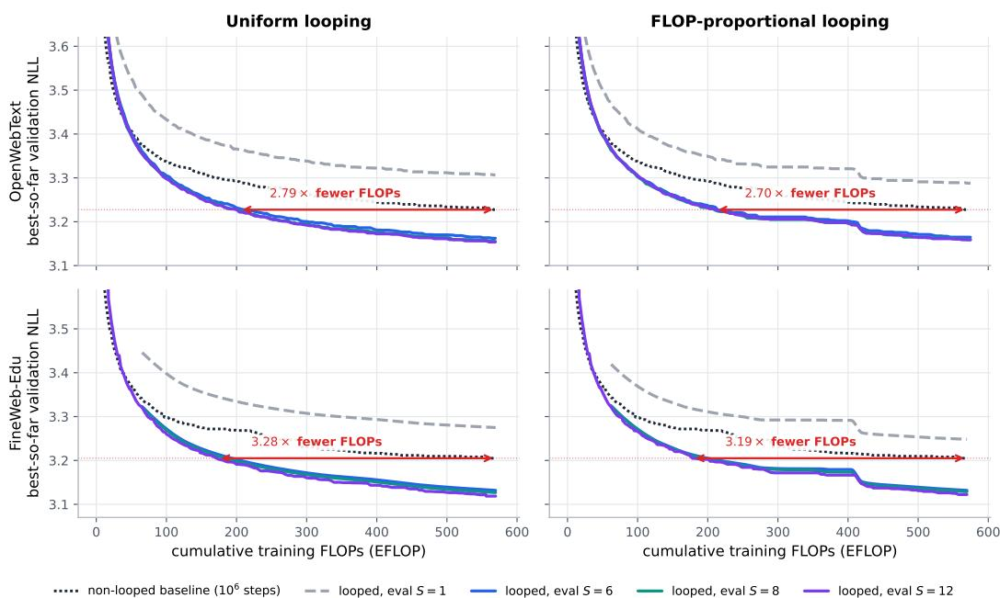  
Figure 1: Looping saves training compute on OWT and FineWeb-Edu. Best validation NLL so far against training FLOPs for uniform (left) and FLOP-proportional (right) looping, on OWT (top) and FineWeb-Edu (bottom).

To investigate this question, we integrate looping into UDLMs while keeping the training objective and sampler unchanged, using DUO++ (Deschenaux et al., 2026), the most efficient recipe for training UDLMs in the literature. Besides the uniform loop-count distribution used in prior work on looped masked diffusion (Lee et al., 2026), we study two alternatives: FLOP-proportional sampling, which gives each loop count the same expected share of training FLOPs, so smaller loop counts are sampled more often, and noise-proportional sampling, which assigns larger loop counts to noisier inputs. At inference, we consider fixed looping, which uses the same loop count at every denoising step, and adaptive looping, which halts once the relative change in the hidden state between consecutive iterations falls below a threshold.

## Main findings. We summarize our observations as follows:

1. Looping makes UDLM training more compute-efficient. Looped UDLMs reach the validation NLL of a non-looped UDLM trained on about 0.5 trillion tokens with up to 2.8× fewer training FLOPs on OpenWebText (Gokaslan & Cohen, 2019) and 3.3× fewer on FineWeb-Edu (Penedo et al., 2024).

2. Looping helps at inference. Looped UDLMs reach up to 9.8% lower generative perplexity than the non-looped UDLM at the same number of denoising steps, with most of the gain captured at moderate loop counts. On seven out-of-domain datasets, looping at inference lowers the zero-shot perplexity of the non-looped UDLM by 11.5% on average.

FORWARD PROCESS + TRAIN REVERSE PROCESS   
$\mathbf { \Delta } _ { \mathbf { x } ^ { 1 : L } } \gets \mathbf { b a t c h } ( q _ { \mathrm { d a t a } } )$ $\mathbf { z } _ { 1 } ^ { \ell } \overset { \mathrm { i i d } } { \sim } \mathbf { C } \mathbf { a t } ( 1 / K )$   
$t \sim \mathcal { U } [ 0 , 1 ] , \ \epsilon \sim \mathcal { N } ( 0 , I )$ $\mathbf { f o r } n = \dot { N } , \dot { \mathbf { \Omega } } \dot { } \dot { } . 0 \dot { } . 1 \dot { } \dot { } \mathbf { \Omega }$   
$\mathbf { w } _ { t } \gets \tilde { \alpha } _ { t } \mathbf { x } ^ { 1 : L } + \sqrt { \mathbf { 1 } - \tilde { \alpha } _ { t } ^ { 2 } \epsilon }$ $t  t _ { n } , ~ s  t _ { n - 1 }$   
bx ← LOOPEDDENOISE(z1:L, t, S(t))   
$\alpha _ { t }  \mathcal { T } ( \tilde { \alpha } _ { t } )$   
$\mathbf { z } _ { t } ^ { 1 : L } \gets \mathbf { e } _ { \mathrm { a r g } \operatorname* { m a x } _ { j } w _ { t , j } }$ $\nabla _ { \theta } ^ { \ell }  q _ { 0 \vert t } ( \cdot \vert \mathbf { z } _ { t } ^ { \ell } , \mathbf { x } ^ { \ell }  \widehat { \mathbf { x } } ^ { \ell } )$   
$\mathbf { y } _ { t } \gets \mathrm { T o p K S o f t m a x } _ { \tau , k } ( \mathbf { w } _ { t } )$ $p _ { \mathrm { p r e d } } ^ { \ell }  q _ { s | t } ( \cdot \vert z _ { t } ^ { \ell } , x ^ { \ell }  \widehat { { \mathbf x } } ^ { \ell } )$   
$\sqrt { \widehat { \mathbf { x } } \gets \mathbf { L O O P E D D E N O I S E } ( \mathbf { y } _ { t } , t , S ) }$ $p _ { \mathbf { c o r } } ^ { \ell }  \alpha _ { s } r _ { \theta } ^ { \ell } + ( 1 - \alpha _ { s } ) \mathbf { u }$   
$\begin{array} { r } { \mathcal { L } _ { \mathrm { t o k } } \gets L ^ { - 1 } \sum _ { \ell } f _ { \mathrm { D u o } } ( \mathbf { z } _ { t } ^ { \ell } , \widehat { \mathbf { x } } ^ { \ell } , \alpha _ { t } ; \mathbf { x } ^ { \ell } ) } \end{array}$ $p _ { \Psi } ^ { \ell }  \kappa _ { t } p _ { \mathrm { p r e d } } ^ { \ell } + ( 1 - \kappa _ { t } ) p _ { \mathrm { c o r } } ^ { \ell }$   
$\mathbf { z } _ { s } ^ { \ell } \sim \mathbf { C a t } ( p _ { \Psi } ^ { \ell } )$   
LOOPEDDENOISE(yt, t, S)   
${ \mathbf e } _ { t } \gets E _ { \theta } ( \mathbf { y } _ { t } ) , \quad { \mathbf h } ^ { ( 0 ) } \gets H _ { \theta } ( { \mathbf e } _ { t } , t )$   
$\mathbf { f o r } r = 0 , . . . , S - 1 : \ \mathbf { h } ^ { ( r + 1 ) } \gets M _ { \theta } ( \mathbf { h } ^ { ( r ) } , t )$   
return bx = softmax $\left( T _ { \theta } \big ( \mathbf { h } ^ { ( s ) } \big ) \right)$  
Figure 2: Looped UDLM pipeline. Left: forward process and training. Right: reverse process with the Ψ sampler. L is the sequence length, K the vocabulary size, and S the number of loop iterations.

3. Loops mainly refine predictions at replaced tokens. Extra loop iterations mostly improve the predicted clean token at replaced positions, not the choice of which tokens to keep. The gain is largest at intermediate noise.

4. Adaptive looping saves loop iterations without losing accuracy. On ten zero-shot multiple-choice tasks, adaptive looping matches the accuracy of twelve fixed loop iterations while running 26.0% fewer of them with uniform sampling and 34.8% fewer with FLOP-proportional sampling.

## 2 Background

We briefly review uniform diffusion language models (UDLMs) and the $\mathrm { D U O / D U O ^ { + + } }$ training and sampling framework used in our experiments. Further technical details are provided in Appendix A.

## 2.1 Uniform diffusion language models

A UDLM corrupts a sequence by replacing some of its tokens with random tokens from the vocabulary (Austin et al., 2021; Schiff et al., 2025). Let $\mathbf { x } ^ { 1 : L } = ( \mathbf { x } ^ { 1 } , \dots , \mathbf { x } ^ { L } ) \sim q _ { \mathrm { d a t a } }$ be a clean sequence of L tokens from a vocabulary of size K, represented as one-hot vectors in $\mathbb { R } ^ { K }$ . At time $t \in [ 0 , 1 ]$ , each token is retained with probability $\alpha _ { t }$ and otherwise replaced by a uniformly drawn token:

$$
q _ { t } ( \mathbf { z } _ { t } ^ { 1 : L } \mid \mathbf { x } ^ { 1 : L } ) = \prod _ { \ell = 1 } ^ { L } \mathrm { C a t } \Big ( \mathbf { z } _ { t } ^ { \ell } ; \alpha _ { t } \mathbf { x } ^ { \ell } + ( 1 - \alpha _ { t } ) \mathbf { u } \Big ) , \qquad \mathbf { u } = \mathbf { 1 } / K , \quad \alpha _ { 0 } = 1 , \quad \alpha _ { 1 } \simeq 0 .\tag{1}
$$

Here $\operatorname { C a t } ( { \cdot } ; { \mathfrak { p } } )$ denotes a categorical distribution with probabilities p. So t = 0 gives clean data and $t = 1$ gives nearly uniform noise. A corrupted position can even draw its original token again, and no marker shows which positions were corrupted. Equation 1 corrupts positions independently, while the clean tokens can depend on each other.

To generate, a denoiser uses the entire noisy sequence to predict a clean-token distribution at every position, $\widehat { \mathbf { x } } = \mathbf { x } _ { \theta } ( \mathbf { z } _ { t } ^ { 1 : L } , t ) \in ( \Delta ^ { K } ) ^ { L }$ , where $\Delta ^ { K }$ is the K-category probability simplex. These contextual predictions are used in the known Bayesian reverse transitions to a less noisy time $s < t .$ Each transition updates all positions in parallel. DUO (Sahoo et al.,

2025) improves UDLM training convergence, and DUO++ (Deschenaux et al., 2026) further improves on DUO by reducing peak memory, as we review next.

## 2.2 DUO and DUO++

A categorical token records only the winning vocabulary entry. To provide richer training inputs, DUO (Sahoo et al., 2025) obtains each noisy token from an auxiliary Gaussian vector. For a single token, suppressing the position index,

$$
\begin{array} { r } { \mathbf { w } _ { t } = \tilde { \alpha } _ { t } \mathbf { x } + \sqrt { 1 - \tilde { \alpha } _ { t } ^ { 2 } \epsilon } , \quad \mathbf { z } _ { t } = G ( \mathbf { w } _ { t } ) : = \mathbf { e } _ { \mathrm { a r g m a x } _ { j } w _ { t , j } } , \quad \alpha _ { t } = \mathcal { T } ( \tilde { \alpha } _ { t } ) , \quad \epsilon \sim \mathcal { N } ( \mathbf { 0 } , I ) . } \end{array}\tag{2}
$$

With $\alpha _ { t } = \mathcal { T } ( \tilde { \alpha } _ { t } )$ , the winning token $G ( \mathbf { w } _ { t } )$ follows exactly the UDLM marginal in Equation 1. The correspondence holds only for the marginals at each time. The Gaussian and categorical diffusion trajectories remain different. While the hard token $G ( \mathbf { w } _ { t } )$ defines the corruption target, the denoiser receives the positionwise soft inputs $\mathbf { y } _ { t } ^ { \ell } = \operatorname { s o f t m a x } ( \mathbf { w } _ { t } ^ { \ell } / \tau )$ where $\tau > 0$ is a temperature. These retain the margins between competing tokens that arg max discards, and the hard-token limit is recovered as $\tau \downarrow 0$ . DUO uses these soft inputs as a curriculum for the first half of training and hard tokens for the second half. This lowers gradient variance, and the model converges about twice as fast (Sahoo et al., 2025). $\mathrm { D U O ^ { + + } }$ (Deschenaux et al., 2026) approximates the soft inputs with only the largest k Gaussian entries and an estimate of the remaining softmax mass, so that the curriculum can be used with large vocabularies. In practice $k \stackrel { \smile } { = } 2$ already works well, reducing peak memory by 33% and training time by 25% relative to DUO (Deschenaux et al., 2026).

Both methods use the inherited UDLM rate-based loss, always evaluated at the hard corruption target $\mathbf { z } _ { t } ^ { \ell } = G ( \mathbf { w } _ { t } ^ { \ell } )$ . During the curriculum, the denoiser computes its contextual predictions from the soft inputs. Afterwards, it receives the hard tokens:

$$
\mathcal { L } _ { \mathrm { t o k } } = \mathbb { E } _ { { \mathbf { x } ^ { 1 : L } } , t , { \mathbf { w } } _ { t } ^ { 1 : L } } \left[ \frac { 1 } { L } \sum _ { \ell = 1 } ^ { L } f _ { \mathrm { D u o } } ^ { \ell } \right] .\tag{3}
$$

Here $f _ { \mathrm { D u o } } ^ { \ell }$ compares the true and predicted reverse-transition rates at position ℓ. With hard denoiser inputs, this is the token-normalized negative evidence lower bound (NELBO), an upper bound on negative log-likelihood. Soft inputs give a biased curriculum surrogate. The exact rate and derivation appear in Appendix A.

Categorical sampling. Generation uses hard categorical tokens rather than Gaussian inputs. The denoiser’s clean-token predictions are substituted into the UDLM Bayesian posterior to obtain an ancestral predictor $p _ { \mathrm { p r e d } } ^ { \ell }$ . A corrector $p _ { \mathrm { c o r } } ^ { \ell }$ re-noises the inferred clean-token distribution instead. The Ψ-sampler (Deschenaux et al., 2026) mixes them:

$$
p _ { \Psi } ^ { \ell } = \kappa _ { t } p _ { \mathrm { p r e d } } ^ { \ell } + ( 1 - \kappa _ { t } ) p _ { \mathrm { c o r } } ^ { \ell } , \qquad { \bf z } _ { s } ^ { \ell } \sim { \bf C a t } ( \cdot ; p _ { \Psi } ^ { \ell } ) , \quad \kappa _ { t } \in [ 0 , 1 ] .\tag{4}
$$

The update is applied in parallel across positions and repeated toward clean time. Figure 2 summarizes both pipelines. Our work changes only the denoiser computation, leaving the loss and sampler unchanged.

## 3 Looped Uniform Diffusion Models

The corruption process of UDLMs makes training challenging, because tokens must be predicted from an unreliable context. Concretely, a UDLM needs more training FLOPs than an MDLM to reach the same validation NLL (Sahoo et al., 2026b). Recent works have shown that looping, which repeatedly applies a shared set of Transformer layers, adds depth without adding parameters (Dehghani et al., 2019; Giannou et al., 2023; Geiping et al., 2025) and improves the training efficiency of masked diffusion language models at matched training FLOPs (Lee et al., 2026). Motivated by this, we study the effect of looping on the training efficiency and downstream performance of UDLMs, keeping the corruption process, the $\mathrm { D U O ^ { + + } }$ objective, and the sampler unchanged. §3.1 quantifies the uncertainty created by uniform corruption, and §3.2 introduces the looped UDLM denoiser and the loop-count distributions used to train it.

## 3.1 Unmarked corruption and latent reliability

An exact reliability decomposition. Both MDLMs and UDLMs can be described by a keep-or-replace corruption kernel:

$$
q _ { t } ( z \mid x ) = \alpha _ { t } \mathbf { 1 } \{ z = x \} + ( 1 - \alpha _ { t } ) \nu ( z ) ,\tag{5}
$$

where ν is a replacement distribution independent of the clean token, possibly supported on an augmented vocabulary. In absorbing MDLMs $\nu = \delta _ { m } ,$ , and in UDLMs ν is uniform over the ordinary vocabulary. Let $C _ { t } ^ { \ell }$ be the latent reliability indicator, which is 1 for a retained token and 0 otherwise. For an observed token $\begin{array} { r } { \mathbf { z } _ { t } ^ { \ell } = \mathbf { e } _ { i } , } \end{array}$ let $\pi _ { t } ^ { \ell } ( j ) : = \operatorname* { P r } ( \mathbf { x } ^ { \ell } = \mathbf { e } _ { j } \mid \mathbf { z } _ { t } ^ { - \ell } , t )$ denote the distribution of the clean token given the rest of the noisy sequence, referred to as the contextual prediction. A retained token equals its clean value and a replaced one carries no information about it, so Bayes’ rule gives

$$
\begin{array} { r l } & { \gamma _ { t } ^ { \ell } : = \mathrm { P r } ( C _ { t } ^ { \ell } = 1 \mid \mathbf { z } _ { t } ^ { 1 : L } , t ) = \frac { \alpha _ { t } \pi _ { t } ^ { \ell } ( i ) } { \alpha _ { t } \pi _ { t } ^ { \ell } ( i ) + ( 1 - \alpha _ { t } ) \nu ( \mathbf { e } _ { i } ) } , } \\ & { \quad \quad \quad \mathrm { P r } ( \mathbf { x } ^ { \ell } = \mathbf { e } _ { j } \mid \mathbf { z } _ { t } ^ { 1 : L } , t ) = \gamma _ { t } ^ { \ell } \mathbf { 1 } \{ j = i \} + ( 1 - \gamma _ { t } ^ { \ell } ) \pi _ { t } ^ { \ell } ( j ) , } \end{array}\tag{6}
$$

for $0 < \alpha _ { t } < 1$ . The clean-token posterior is thus a mixture of a point mass on the observed token and the contextual prediction, weighted by the retention probability $\gamma _ { t } ^ { \ell }$ . For UDLMs, $\nu ( \mathbf { e } _ { i } ) = 1 / K$ and

$$
\frac { \gamma _ { t } ^ { \ell } } { 1 - \gamma _ { t } ^ { \ell } } = \frac { K \alpha _ { t } } { 1 - \alpha _ { t } } \pi _ { t } ^ { \ell } ( i ) ,\tag{7}
$$

so retention is not marked in the input: even at a fixed diffusion time, it has to be inferred from how well the token fits its context. For MDLMs, the same weight is 1 for an ordinary token and 0 for a mask. Because $\pi _ { t } ^ { \ell }$ is computed from positions that may themselves have been replaced, these judgments are coupled across positions (Hong et al., 2026). Appendix $\mathrm { A } . 3$ gives the derivations, and related identities appear in Gourevitch et al. (2026).

What the $\mathbf { D 0 0 ^ { + + } }$ denoiser estimates. The UDLM NELBO (Equation 3) depends on the denoiser output $\widehat { \mathbf { x } } ^ { \ell }$ only through $K \alpha _ { t } \widehat { \mathbf { x } } ^ { \ell } + ( 1 - \alpha _ { t } ) \mathbf { 1 }$ , and with hard inputs it is minimized at $\widehat { \mathbf { x } } ^ { \ell } = \pi _ { t } ^ { \ell }$ (Appendix A.3). A trained DUO++ denoiser therefore estimates the contextual prediction, and Equation 7 turns its output into an estimated retention probability $\hat { \gamma } _ { t } ^ { \ell }$ Since additional loop iterations change only $\widehat { \mathbf { x } } ^ { \ell } ,$ , we use the decomposition in Equation 6 to understand how looping helps in $\ S 5 . 3$

## 3.2 Looped denoiser and loop-count training

We loop a slice of middle blocks of the $\mathrm { D U O ^ { + + } }$ denoiser and draw a random loop count at every training step. Besides uniform sampling, we introduce two new loop-count distributions: one that balances training FLOPs across loop counts, and one that ties the loop count to the noise level.

Architecture. The $\mathrm { D U O ^ { + + } }$ denoiser is a Diffusion Transformer (DiT) (Peebles & Xie, 2023) with n time-conditioned blocks, which we split into a head $H _ { \theta }$ of $n _ { H }$ blocks, a slice of middle blocks $M _ { \theta }$ with $n _ { B }$ blocks, and a tail $T _ { \theta }$ of $n _ { T }$ blocks that also holds the output projection. The input $\mathbf { y } _ { t }$ follows the conventions of $\ S 2 . 2 \colon$ : soft or top-k inputs during the curriculum and hard tokens otherwise. It is embedded once by $E _ { \theta . }$ , passed through the head, looped through the middle slice for S iterations, and mapped to clean-token predictions by the tail:

$$
\begin{array} { r } { \begin{array} { c c } { \mathbf { e } _ { t } = E _ { \theta } ( \mathbf { y } _ { t } ) , } & { \mathbf { h } ^ { ( 0 ) } = H _ { \theta } ( \mathbf { e } _ { t } , t ) , } \\ { \mathbf { h } ^ { ( r + 1 ) } = M _ { \theta } ( \mathbf { h } ^ { ( r ) } , t ) , } & { r = 0 , \ldots , S - 1 , } \\ { \widehat { \mathbf { x } } = \mathrm { s o f t m a x } \big ( T _ { \theta } ( \mathbf { h } ^ { ( S ) } ) \big ) . } & \end{array} } \end{array}\tag{8}
$$

The slice $M _ { \theta }$ uses the same weights at every pass, so looping adds depth but no parameters. With S passes the network has $\overset { \smile } { n _ { H } } + \overset { \smile } { S } n _ { B } + \overset { \bullet } { n _ { T } }$ blocks, and ${ \boldsymbol { S } } ^ { \smile } = 1$ is the original network. The noisy input stays fixed during the loop and changes only between diffusion steps (Figure 2).

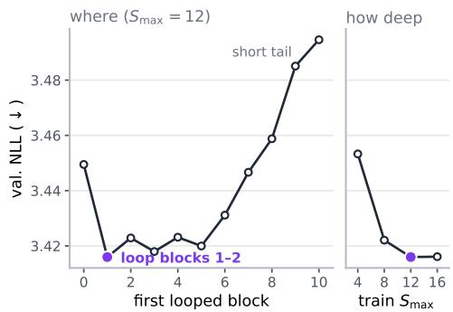  
(a) where to loop and how deep to train

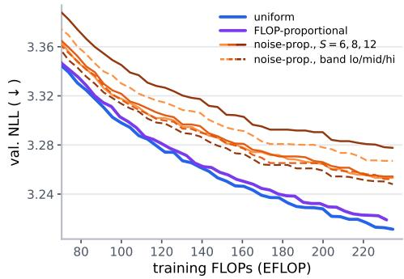  
(b) noise-proportional distribution  
Figure 3: Design choices behind the looped models. (a) NLL at $S = 8$ for each starting block of the looped slice (left) and best NLL for each training cap $S _ { \mathrm { m a x } }$ (right). Purple marks the setting used in the paper. (b) All six noise-proportional evaluations are worse than uniform and FLOP-proportional at the same FLOPs.

Stochastic loop-count training. At each optimizer step, we sample a loop count S from a distribution $p ( \ r _ { S } )$ over $\{ 1 , \ldots , \breve { S } _ { \mathrm { m a x } } \}$ , unroll the slice S times, and backpropagate the $\mathrm { D U O ^ { + + } }$ objective (Equation 3) through every iteration. This gives one model that can be run with different loop counts at inference, either fixed or chosen adaptively at each diffusion step (§4). The choice of $p ( S )$ matters for the training budget, because the modeled per-sequence training cost grows with the loop count:

$$
F ( S ) = F _ { \mathrm { b a s e } } \big ( 1 + ( S - 1 ) \rho \big ) , \qquad \rho = \frac { n _ { B } F _ { \mathrm { l a y e r } } } { F _ { \mathrm { b a s e } } } ,\tag{9}
$$

where $F _ { \mathrm { b a s e } }$ is the non-looped cost and $F _ { \mathrm { l a y e r } }$ is the cost of one block in the looped slice (Appendix C).

(a) Uniform. LoopMDM (Lee et al., 2026) samples $S \sim \mathcal { U } \{ 1 , \dots , S _ { \mathrm { m a x } } \}$ , and we use this as our default with $S _ { \mathrm { m a x } } ^ { \mathrm { ^ { ~ \star ~ } } } = 1 2$ . Each loop count is then trained equally often. Since a step with more loops costs more (Equation 9), most of the training FLOPs go to large loop counts, even though the inference gains level off at moderate loop counts (§5.2).

(b) FLOP-proportional. To balance training FLOPs instead of update counts, we sample each loop count with probability inversely proportional to its cost,

$$
p _ { \mathrm { f p } } ( S ) = \frac { F ( S ) ^ { - 1 } } { \sum _ { r = 1 } ^ { S _ { \mathrm { m a x } } } F ( r ) ^ { - 1 } } , \qquad p _ { \mathrm { f p } } ( S ) F ( S ) = \mathrm { c o n s t } ,\tag{10}
$$

which adds no tunable parameter beyond the architecture-defined costs and $S _ { \mathrm { m a x } } ,$ and reduces to uniform sampling when $\rho \doteq 0$ . Under $p _ { \mathrm { f p } } .$ , the expected cost of a training step is the harmonic mean of $F ( 1 ) , \ldots , F ( S _ { \mathrm { m a x } } ) , \mathbb { E } _ { \mathrm { f p } } [ F ] = S _ { \mathrm { m a x } } / \sum _ { r = 1 } ^ { S _ { \mathrm { m a x } } } F ( r ) ^ { - 1 }$ 1. Uniform sampling gives the arithmetic mean instead. Since the harmonic mean is smaller than the arithmetic mean for $\rho > 0 , \mathbb { E } _ { \mathrm { u n i f } } [ F ] / \mathbb { E } _ { \mathrm { f p } } [ F ] > 1$

(c) Noise-proportional. We also study a noise-proportional distribution to test the hypothesis that noisier inputs benefit from more loop iterations, since their observed tokens provide less direct information about the clean sequence. We split $\{ 1 , \dots , S _ { \mathrm { m a x } } \}$ into G consecutive groups $\mathcal { S } _ { 1 } , \ldots , \mathcal { S } _ { G }$ of equal size, from small to large loop counts. Using antithetic time sampling, we sort the training microbatches into G equal bands of increasing noise, and band b draws S uniformly from $\boldsymbol { S } _ { b }$ (Figure ${ 8 } \mathbf { b } , \mathbf { c } ,$ Appendix B). The marginal distribution of loop counts remains uniform, so this distribution matches uniform sampling in expected training FLOPs while isolating the effect of this particular coupling between noise and loop count.

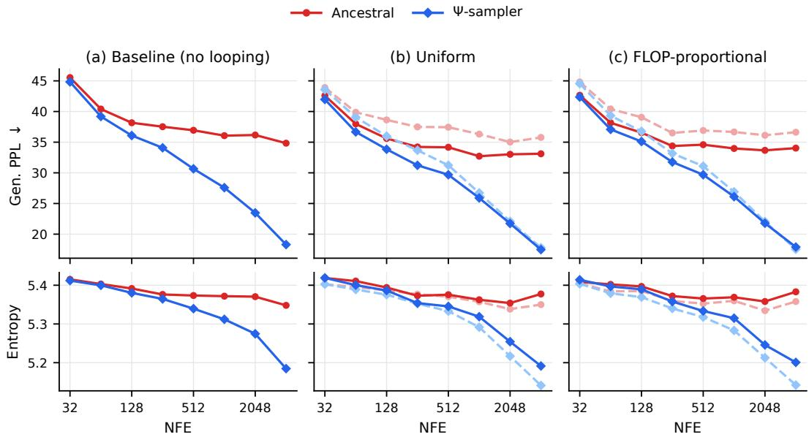  
Figure 4: Generation quality and diversity. Generative perplexity (top) and unigram entropy (bottom) against NFE. Dashed lines are $S = 1$ and solid lines are $S = 6 .$ . Looping lowers generative perplexity at the same NFE without lowering entropy.

## 4 Experimental Setup

Model and datasets. All models use the 170M-parameter $\mathrm { D U O ^ { + + } }$ small DiT (12 blocks, width 768, sequence length 1,024, GPT-2 tokenizer) with its efficient curriculum. Looped models replay blocks 1–2 with $S _ { \mathrm { m a x } } = 1 2 ,$ a choice justified by the ablation in Figure 3a. We train on two datasets: OpenWebText (OWT) (Gokaslan & Cohen, 2019) and the sample-10BT subset of FineWeb-Edu (Penedo et al., 2024). On both, the final 100k documents are held out for validation. Following $\mathrm { D U O ^ { + + } }$ (Deschenaux et al., 2026), the non-looped baseline is trained for 1M optimizer steps with a batch size of 512. We train with sequence packing following Raffel et al. (2020), and Appendix D gives more details.

Iso-FLOP budgets. We compare runs at the same training FLOPs. After a given number of steps, a run has used step $\times \boldsymbol { B } \times \boldsymbol { F } _ { \mathrm { l o o p } }$ FLOPs, where $\tilde { B _ { \mathrm { ~ } } } = 5 1 2$ sequences and $F _ { \mathrm { l o o p } } =$ $F _ { \mathrm { t r a i n } } ( \mathbb { E } [ S ] )$ is the training cost per sequence at the run’s mean loop count (Appendix C). The cost relative to the baseline, $F _ { \mathrm { l o o p } } / \dot { F } _ { \mathrm { b a s e } } ,$ depends only on the loop-count distribution (Table 3). We use the Chinchilla convention, and the Kaplan variant only rescales the axis (Figure 9). The FLOPs of the baseline’s 1M steps buy 655,420 steps for the uniform run and 688,915 for the FLOP-proportional run. On average, a training step runs 6.50 loop iterations with uniform or noise-proportional sampling, and 5.72 with FLOP-proportional sampling. Every 5k optimizer steps, we record validation NLL at $S \in \{ 1 , \dot { 6 } , 8 , { \dot { 1 } } 2 \}$ . The noise-proportional run is also scored with each noise band at a low, middle, or high loop count from the band it was trained on (Appendix B). None of its evaluations reaches the other two frontiers (Figure 3b).

Looping at inference. At inference the loop count is a free parameter. We run checkpoints at $\boldsymbol { S } ^ { \prime } = \breve { 1 } , 6 , 8 , 1 2$ and also with adaptive looping (Lee et al., 2026), which picks S separately for each sequence. A sequence keeps looping until its hidden state barely moves, i.e., until $\| \mathbf { h } ^ { ( r ) } - \mathbf { h } ^ { ( r - 1 ) } \| _ { F } / \| \mathbf { h } ^ { ( r ) } \| _ { F } ^ { - } < \epsilon = 0 . 1$ , and never goes past $S _ { \mathrm { m a x } } = 1 2$

Evaluation. All inference results use OWT checkpoints, evaluated along three axes: (a) generative perplexity (Gen. PPL) under GPT-2 Large and unigram entropy of generated samples, across numbers of function evaluations (NFE, i.e., denoiser calls) (§5.2), (b) zeroshot perplexity on seven out-of-domain datasets (§5.3), and (c) downstream accuracy on ten multiple-choice tasks (§5.4). Appendices F–H give the full protocols.

<table><tr><td rowspan="2"></td><td rowspan="2"></td><td colspan="6">Fixed looping</td><td colspan="2">Adaptive looping</td></tr><tr><td colspan="3">Uniform</td><td colspan="3">FLOP-prop.</td><td colspan="2"></td></tr><tr><td>Dataset</td><td>Baseline</td><td>S=6</td><td>S=8</td><td>S=12</td><td>S=6</td><td>S=8</td><td>S=12</td><td>Uniform</td><td>FLOP-prop.</td></tr><tr><td>PTB</td><td>94.86</td><td>85.18</td><td>84.01</td><td>83.97</td><td>85.47</td><td>85.19</td><td>85.55</td><td>85.14</td><td>85.43</td></tr><tr><td>WikiText-103</td><td>34.46</td><td>31.70</td><td>31.39</td><td>31.31</td><td>31.65</td><td>31.46</td><td>31.44</td><td>31.75</td><td>31.71</td></tr><tr><td>LM1B</td><td>74.21</td><td>71.16</td><td>70.59</td><td>70.38</td><td>70.35</td><td>70.05</td><td>70.15</td><td>71.22</td><td>70.47</td></tr><tr><td>LAMBADA</td><td>51.83</td><td>48.02</td><td>47.76</td><td>47.70</td><td>46.38</td><td>46.33</td><td>46.45</td><td>48.21</td><td>46.56</td></tr><tr><td>AG News</td><td>69.95</td><td>59.21</td><td>57.93</td><td>57.31</td><td>59.88</td><td>58.77</td><td>58.35</td><td>58.68</td><td>59.63</td></tr><tr><td>PubMed</td><td>44.91</td><td>38.91</td><td>38.30</td><td>37.95</td><td>39.16</td><td>38.52</td><td>38.11</td><td>38.82</td><td>39.23</td></tr><tr><td>arXiv</td><td>39.78</td><td>35.02</td><td>34.47</td><td>34.13</td><td>35.27</td><td>34.71</td><td>34.37</td><td>34.97</td><td>35.31</td></tr><tr><td>Average</td><td>58.57</td><td>52.74</td><td>52.06</td><td>51.82</td><td>52.59</td><td>52.15</td><td>52.06</td><td>52.68</td><td>52.62</td></tr></table>

Table 1: Zero-shot perplexity (↓). Mean over five seeds. Adaptive looping uses $\epsilon = 0 . 1$ and $S _ { \mathrm { m a x } } = 1 2$ . Bold marks the best value in each row. Appendix G gives ${ \bf \check { S } } = 1$ results and standard deviations.

## 5 Results

Where to loop. On OpenWebText (50k steps, one seed), two-block slices starting anywhere in blocks 1–5 perform about equally, late slices with a short tail are clearly worse, and raising $S _ { \mathrm { m a x } }$ beyond 12 gives no further gain (Figure 3a, Appendix E). All looped models therefore loop blocks 1–2 with $S _ { \mathrm { m a x } } = 1 2$

## 5.1 Looping is training-compute efficient

We compare each looped run with the non-looped baseline at matched training FLOPs on both datasets (Figure 1, with per-step curves in Figure 10). Both looped runs stay below the baseline at every budget, and the savings are larger on FineWeb-Edu than on OpenWebText. Evaluating at $\dot { S _ { \mathrm { \scriptsize ~ = ~ } 6 , } 8 }$ , or 12 gives nearly the same curve, so a few loop iterations capture almost all of the gain. FLOP-proportional sampling closely matches the final NLL of uniform sampling (3.159 vs. 3.154 on OpenWebText and 3.122 vs. 3.119 on FineWeb-Edu), and it is better at S = 1 (3.289 vs. 3.306), the loop count it trains on most often.

Finding 1. Looping improves training efficiency in UDLMs. Across OpenWebText and FineWeb-Edu, both looped models reach the non-looped baseline’s validation NLL with 2.7–3.3× fewer training FLOPs.

Noise-proportional sampling has the same per-step cost as uniform sampling, so the two runs are iso-FLOP at every step. We stopped it after 16 epochs of OpenWebText. Besides fixed loop counts, we score it with band-consistent evaluation, which scores each noise band only at loop counts it was trained on (Appendix B). None of these six evaluations reaches the uniform or FLOP-proportional frontier (Figure 3b), and the other two distributions reach its best NLL with roughly 30% less compute.

Finding 2. The noise-proportional distribution offers no benefit. At matched OpenWeb-Text training FLOPs, assigning deeper loops to noisier inputs underperforms uniform and FLOP-proportional sampling (the best result trails FLOP-proportional by +0.029 NLL). This is consistent with Figure 6b, where the loop gain at inference peaks at intermediate diffusion times rather than at the noisiest inputs.

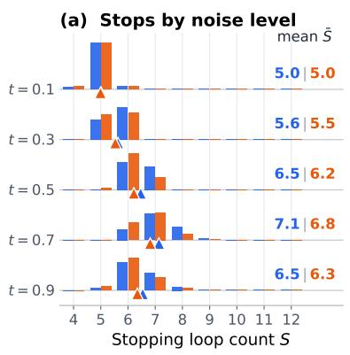

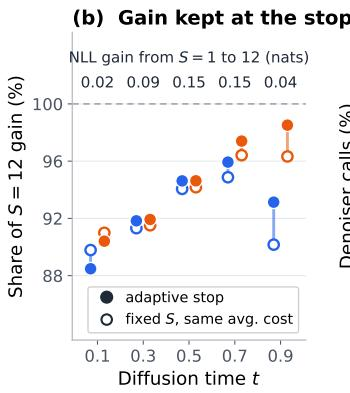

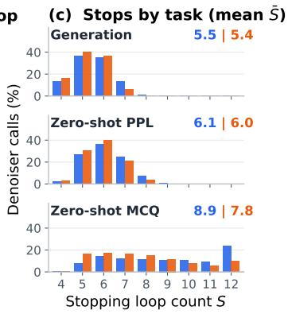  
Figure 5: Where adaptive looping stops $( \epsilon = 0 . 1 , S _ { \mathrm { m a x } } = 1 2 )$ . (a) Stopping loop count of single denoiser calls on the eight datasets at each diffusion time, with triangles at the mean. (b) Share of the NLL gain from $S = 1$ to 12 kept at the adaptive stop (filled) and at a fixed loop count with the same average cost (open). The top row gives the total gain of the uniform checkpoint. (c) Stopping loop counts over all noise levels for each evaluation.

## 5.2 Looping at inference improves generation

We sample from each checkpoint with the ancestral and Ψ samplers across NFE budgets and compare loop counts at matched NFE (Figure 4, Appendix F). Looping lowers Gen. PPL without reducing entropy. With ancestral sampling the gain is small at the lowest NFE and largest at 128–1,024 NFE. With the Ψ-sampler it is smaller and shrinks at large NFE, where the sampler alone already gives low Gen. PPL. These comparisons fix NFE, not FLOPs: $S = 6$ costs 1.48× the inference FLOPs of S = 1 and $S = 1 2$ costs 2.05×, while $S = 6$ or 8 already gives most of the gain. Adaptive looping averages about 5.5 loop iterations, slightly cheaper than fixed $S = 6 ,$ and matches or beats it at most sampler–NFE points.

Finding 3. Looping at inference matters more than maximizing depth. At matched NFE, looped models reach up to 9.8% lower Gen. PPL than the non-looped baseline, with most gains by $S = 6 { - } 8$ . Adaptive looping retains comparable quality with fewer loop iterations.

## 5.3 Looping at inference improves zero-shot likelihood

We bound the perplexity of each checkpoint on seven out-of-domain datasets (Table 1). Run at $S = 1$ , both looped checkpoints are worse than the non-looped baseline on every dataset (Table 10), so loop training alone does not give the gain. Looping at inference reverses this: every fixed $\dot { S } > 1$ and adaptive looping beat the baseline on every dataset. Unlike generation, likelihood keeps improving with depth, and S = 12 is the best loop count of the uniform checkpoint on every dataset.

Adaptive looping stops where looping stops helping. On single denoiser calls (Figure 5a), both checkpoints stop early at low and high noise and loop longest at intermediate diffusion times. This tracks where looping helps: the NLL gain from ${ \bf \ddot { \boldsymbol { S } } } = 1$ to 12 is several times larger at $t = 0 . 5 – 0 . 7$ than at $\hat { t = 0 . 1 }$ or 0.9. At the stop, adaptive looping keeps 88%–98% of the $S = 1 2$ gain and matches or beats a fixed loop count with the same average cost at every $t \geq 0 . 3 ( \mathrm { F i g u r e } 5 \mathrm { b } )$ ). Generation stops earliest and MCQ scoring latest (Figure 5c). On zero-shot likelihood, adaptive looping stays close to $S = 6$ while skipping 10%–28% of loop iterations (Appendix G).

Looping mostly improves the prediction at replaced tokens. We apply the decomposition of §3.1 to single denoiser calls, scoring bx after each loop iteration (Appendix G). The NLL splits into three terms: keeping retained tokens, overwriting replaced tokens, and predicting the clean token at replaced positions. Which tokens to keep is largely settled without looping: at $S = 1 , \hat { \gamma } _ { t } ^ { \ell }$ already separates retained from replaced tokens $( \mathrm { A U R O C } \geq 0 . 9 6 )$ and extra loop iterations improve it further mainly at small t (Figure 6a). Instead, 93%–94% of the perplexity reduction from $S = 1$ to 12 comes from better contextual prediction at replaced tokens, peaking at intermediate t (Figure 6b). For $t \geq 0 . 5$ , this gain is largest when a replaced token’s neighbourhood is partly corrupted and smaller when nearly all neighbours are replaced (Figure 6c). The FLOP-proportional checkpoint shows the same pattern.

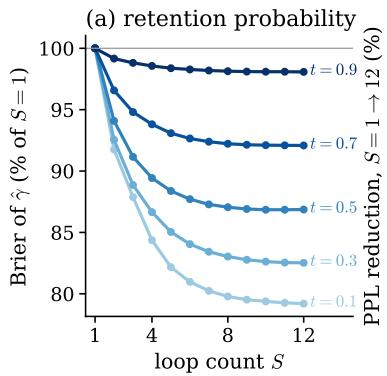

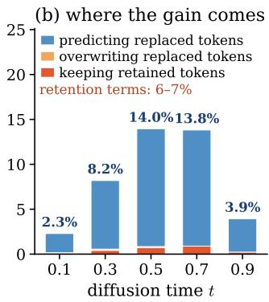

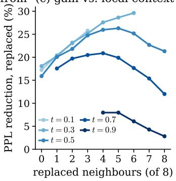  
Figure 6: Where the loop gain comes from. Single denoiser calls of the uniform checkpoint, averaged over eight datasets. (a) Brier score of the retention probability $\hat { \gamma } _ { t } ^ { \ell }$ (Equation 7) relative to $S = 1$ . (b) Perplexity reduction from S = 1 to 12, split into the terms of Equation 6. (c) Reduction at replaced tokens against the number of replaced neighbours within four positions.

Finding 4. Out-of-domain likelihood needs looping at inference. Loop-trained checkpoints at $S = 1$ underperform the non-looped baseline, whereas looping them at inference improves the likelihood bound. Most of this gain comes from better contextual prediction at replaced tokens.

## 5.4 Looping improves zero-shot accuracy

We evaluate on ten zero-shot multiple-choice tasks (Figure 7a, Appendix H). The FLOPproportional checkpoint beats the uniform one at every matched loop policy, and looping at inference raises its accuracy above its own $S = 1$ . With adaptive looping it matches fixed $S = 1 2$ with about a third fewer loop iterations. Gains are largest on HellaSwag, OpenBookQA, PIQA, and BoolQ and negligible on MathQA and WinoGrande. The FLOPproportional checkpoint also beats the uniform one on FineWeb-Edu (Table 14).

The FLOP-proportional checkpoint stops looping earlier. FLOP-proportional sampling puts more weight on small loop counts (§3.2), so its slice may need fewer iterations. Under adaptive looping on MCQ, it runs 12% fewer loop iterations than the uniform checkpoint (7.82 vs. 8.89, Table 13) while being more accurate. On matched inputs, it also reaches a lower NLL at the stopping point (Figure $^ { 7 \mathrm { b } , \mathrm { c } ) }$ . The saving is concentrated at low and intermediate noise and disappears on the noisiest inputs, which still get deep computation. Generation and zero-shot likelihood show the same, smaller shift (Figure 5c).

The trade-off is sample quality. At matched loop counts, the FLOP-proportional checkpoint has a higher Gen. PPL than the uniform one at most points, with nearly unchanged entropy, and the gap widens with more loop iterations (Table 6).

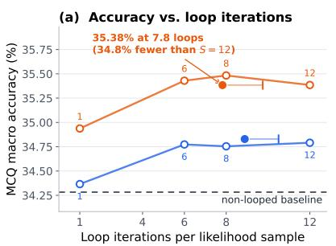

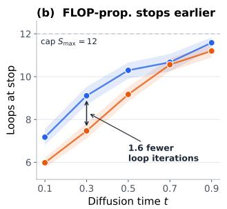

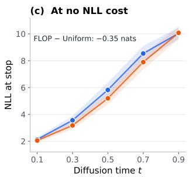  
Figure 7: Adaptive looping on multiple-choice tasks. (a) Average accuracy on the ten tasks against loop iterations, over five seeds. Ticks show the dense-equivalent cost of adaptive looping. (b, c) Loop count and NLL at the adaptive stop on 64 sequences, with 95% bands. FLOP-proportional stops earlier at low and middle noise levels with no higher NLL.  
Finding 5. Depth allocation produces task-dependent trade-offs. FLOP-proportional training improves zero-shot MCQ accuracy, and the resulting checkpoint stops earlier under adaptive looping, reaching 35.38% macro accuracy, comparable to fixed S = 12 with 34.8% fewer loop iterations. However, its Gen. PPL is 1.55% higher on average than that of the uniform checkpoint at matched loop counts.

## 6 Related Work

Discrete diffusion language models. Discrete diffusion models use structured categorical corruption (Austin et al., 2021; Hoogeboom et al., 2021), with much of the literature focusing on masked diffusion (Sahoo et al., 2024; Shi et al., 2024; Ou et al., 2025; Lou et al., 2024; Nie et al., 2025). UDLMs instead corrupt tokens into ordinary vocabulary tokens, allowing previously generated tokens to be revised (Schiff et al., 2025; Sahoo et al., 2025; 2026b). Existing acceleration methods largely reduce the number of denoising steps through improved sampling or distillation (Song et al., 2023; Kim et al., 2024; Hu et al., 2026; Peng et al., 2025; Israel et al., 2025; Luxembourg et al., 2025; Dang et al., 2025). Our work instead studies recurrent computation within each denoising step, leaving the diffusion objective and sampler unchanged.

Looped transformers. Shared-weight recurrence increases effective depth without adding parameters, building on Universal Transformers, equilibrium models, and parameter-shared architectures (Dehghani et al., 2019; Bai et al., 2019; Lan et al., 2020; Giannou et al., 2023). Recent work studies iterative computation, test-time scaling, and the quality–compute tradeoffs of recurrent depth (Saunshi et al., 2025; Geiping et al., 2025; Zhu et al., 2025; McLeish et al., 2025; Prairie et al., 2026; Schwethelm et al., 2026). We investigate these questions in UDLM denoisers, including how recurrent depth should be sampled during training.

Looped diffusion denoisers. Closest to our work, Lee et al. (2026) study recurrent depth in masked diffusion, while related approaches explore recursive blocks and fixed-point formulations (Carballo-Castro et al., 2026; Miele et al., 2026). In standard absorbing masked diffusion, revealed tokens remain fixed, whereas UDLMs must denoise observations of uncertain reliability and can revise any token between diffusion steps. We study whether recurrence remains effective under this different corruption structure, and how its computation should be allocated.

Recurrence across denoising steps. Self-conditioning reuses clean-token predictions across diffusion steps (Chen et al., 2023; Strudel et al., 2022; Dieleman et al., 2022). Related approaches propagate latent states across steps or introduce additional denoising recursion (Jo et al., 2026; Suleymanzade et al., 2026; Yoo et al., 2026; Cameron et al., 2026). Our approach instead loops a slice of transformer blocks within each denoiser evaluation, updating hidden representations while keeping the noisy sequence and diffusion time fixed. These directions are complementary.

## 7 Discussion and Conclusion

We studied the effect of looping in UDLMs by repeating a two-block slice of the denoiser and training it with random loop counts. Looped models reach the validation NLL of the non-looped baseline with up to 2.8× fewer training FLOPs on OpenWebText and 3.3× fewer on FineWeb-Edu. We show that at inference, looping lowers generative perplexity by up to 9.8% at the same NFE and zero-shot perplexity by 11.5% on average. With adaptive looping, the model needs 26–35% fewer loop iterations on multiple-choice tasks and keeps the same accuracy. Training on lower loop counts more often helps further: on the same tasks, the model needs 12% fewer loop iterations than with uniform sampling, without degrading accuracy. We plan to extend this study by comparing how looping helps masked and uniform diffusion, especially on reasoning tasks.

## Acknowledgments

We thank Sanghyun Lee and Chunsan Hong for helpful correspondence and for sharing details of the experimental setup of Lee et al. (2026). We are grateful to AWS and Modal for generously providing compute through their research grants.

## References

Jacob Austin, Daniel D Johnson, Jonathan Ho, Daniel Tarlow, and Rianne Van Den Berg. Structured denoising diffusion models in discrete state-spaces. Advances in neural information processing systems, 34:17981–17993, 2021. Cited on pages 1, 3, 11, and 18.

Shaojie Bai, J. Zico Kolter, and Vladlen Koltun. Deep equilibrium models. In Advances in Neural Information Processing Systems, 2019. Cited on page 11.

Chris Cameron, Wangzheng Wang, Nikita Ivanov, Ashmita Bhattacharyya, Didier Chetelat,´ and Yingxue Zhang. One step forward and k steps back: Better reasoning with denoising recursion models, 2026. URL https://arxiv.org/abs/2604.18839. Cited on page 12.

Alba Carballo-Castro, Julianna Piskorz, Paulius Rauba, Mihaela van der Schaar, and Pascal Frossard. Recursive scaling in masked diffusion models, 2026. Cited on page 11.

Ting Chen, Ruixiang Zhang, and Geoffrey Hinton. Analog bits: Generating discrete data using diffusion models with self-conditioning. In The Eleventh International Conference on Learning Representations, 2023. URL https://openreview.net/forum?id=3dp1VhKu4Qn. Cited on page 11.

Meihua Dang, Jiaqi Han, Minkai Xu, Kai Xu, Akash Srivastava, and Stefano Ermon. Inference-time scaling of diffusion language models with particle gibbs sampling. arXiv preprint arXiv:2507.08390, 2025. Cited on page 11.

Mostafa Dehghani, Stephan Gouws, Oriol Vinyals, Jakob Uszkoreit, and Łukasz Kaiser. Universal transformers. In International Conference on Learning Representations, 2019. URL https://openreview.net/forum?id=HyzdRiR9Y7. Cited on pages 2, 4, and 11.

Justin Deschenaux, Caglar Gulcehre, and Subham Sekhar Sahoo. The diffusion duality, chapter II: Ψ-samplers. arXiv preprint arXiv:2602.21185, 2026. Cited on pages 2, 4, 7, 19, and 26.

Sander Dieleman, Laurent Sartran, Arman Roshannai, Nikolay Savinov, Yaroslav Ganin, Pierre H. Richemond, Arnaud Doucet, Robin Strudel, Chris Dyer, Conor Durkan, et al. Continuous diffusion for categorical data, 2022. URL https://arxiv.org/abs/2211. 15089. Cited on page 11.

DiffusionGemma Team, Adrien Ali Ta¨ıga, James Assiene, Daniele Calandriello, Rahma Chaabouni, Joao Gante, Tamara von Glehn, Nate Keating, Chris Knutsen, Martin Kukla,˜ Tianlin Liu, Ivan Lobov, Ofir Nabati, Joao Gabriel Oliveira, Nicolas Perez-Nieves, Nas-˜ tasia Prutianova, Bobak Shahriari, Jean Tarbouriech, Pavel Tyletski, C¸ aglar ˘ Unl ¨ u, Cindy¨ Wu, Glenn Cameron, Jerome Connor, Sertan Girgin, Maarten Grootendorst, Alon Levkovitch, Eliya Nachmani, Omar Sanseviero, Piotr Stanczyk, Quentin Berthet, Andrew Campbell, Clement Crepy, Valentin De Bortoli, Arnaud Doucet, Romuald Elie, Alexandre´ Galashov, Klaus Greff, Alexis Jacq, David Ruhe, Yu-Han Wu, Sebastian Flennerhag, Brendan O’Donoghue, George Scrivener, and Shantanu Thakoor. Diffusiongemma technical report, 2026. URL https://arxiv.org/abs/2608.00146. Cited on page 1.

Leo Gao, Jonathan Tow, Baber Abbasi, Stella Biderman, Sid Black, Anthony DiPofi, Charles Foster, Laurence Golding, Jeffrey Hsu, Alain Le Noac’h, Haonan Li, Kyle McDonell, Niklas Muennighoff, Chris Ociepa, Jason Phang, Laria Reynolds, Hailey Schoelkopf, Aviya Skowron, Lintang Sutawika, Eric Tang, Anish Thite, Ben Wang, Kevin Wang, and Andy Zou. The language model evaluation harness, 2024. URL https://zenodo.org/ records/12608602. Cited on page 25.

Jonas Geiping, Sean McLeish, Neel Jain, John Kirchenbauer, Siddharth Singh, Brian R. Bartoldson, Bhavya Kailkhura, Abhinav Bhatele, and Tom Goldstein. Scaling up test-time compute with latent reasoning: A recurrent depth approach. In Advances in Neural Information Processing Systems, 2025. URL https://openreview.net/forum?id=S3GhJooWIC. Cited on pages 2, 4, and 11.

Angeliki Giannou, Shashank Rajput, Jy-yong Sohn, Kangwook Lee, Jason D Lee, and Dimitris Papailiopoulos. Looped transformers as programmable computers. In International Conference on Machine Learning, pp. 11398–11442. PMLR, 2023. Cited on pages 2, 4, and 11.

Aaron Gokaslan and Vanya Cohen. Openwebtext corpus. http://Skylion007.github.io/ OpenWebTextCorpus, 2019. Cited on pages 2, 7, and 22.

Samson Gourevitch, Yazid Janati, Dario Shariatian, Umut Simsekli, Eric Moulines, Eric P Xing, and Alain Durmus. Uniform diffusion models revisited: Leave-one-out denoiser and absorbing state reformulation. arXiv preprint arXiv:2605.22765, 2026. Cited on page 5.

Jordan Hoffmann, Sebastian Borgeaud, Arthur Mensch, Elena Buchatskaya, Trevor Cai, Eliza Rutherford, Diego de Las Casas, Lisa Anne Hendricks, Johannes Welbl, Aidan Clark, et al. Training compute-optimal large language models. arXiv preprint arXiv:2203.15556, 2022. Cited on pages 21 and 22.

Chunsan Hong, Chieh-Hsin Lai, Satoshi Hayakawa, Yuhta Takida, Jong Chul Ye, and Yuki Mitsufuji. Does uniform discrete diffusion need time? arXiv preprint arXiv:2609.30977, 2026. Cited on pages 1 and 5.

Emiel Hoogeboom, Didrik Nielsen, Priyank Jaini, Patrick Forre, and Max Welling. Argmax´ flows and multinomial diffusion: Learning categorical distributions. Advances in neural information processing systems, 34:12454–12465, 2021. Cited on page 11.

Zheyuan Hu, Chieh-Hsin Lai, Yuki Mitsufuji, and Stefano Ermon. Cmt: Mid-training for efficient learning of consistency, mean flow, and flow-map models. In International Conference on Learning Representations, volume 2026, pp. 155363–155404, 2026. Cited on page 11.

Daniel Israel, Guy Van den Broeck, and Aditya Grover. Accelerating diffusion llms via adaptive parallel decoding. arXiv preprint arXiv:2506.00413, 2025. Cited on page 11.

Mingyu Jo, Jaesik Yoon, Justin Deschenaux, Caglar Gulcehre, and Sungjin Ahn. Loopholing discrete diffusion: Deterministic bypass of the sampling wall, 2026. Cited on page 12.

Jared Kaplan, Sam McCandlish, Tom Henighan, Tom B Brown, Benjamin Chess, Rewon Child, Scott Gray, Alec Radford, Jeffrey Wu, and Dario Amodei. Scaling laws for neural language models. arXiv preprint arXiv:2001.08361, 2020. Cited on page 22.

Dongjun Kim, Chieh-Hsin Lai, WeiHsiang Liao, Naoki Murata, Yuhta Takida, Toshimitsu Uesaka, Yutong He, Yuki Mitsufuji, and Stefano Ermon. Consistency trajectory models: Learning probability flow ode trajectory of diffusion. In International Conference on Learning Representations, volume 2024, pp. 44493–44525, 2024. Cited on page 11.

Chieh-Hsin Lai, Yang Song, Dongjun Kim, Yuki Mitsufuji, and Stefano Ermon. The principles of diffusion models. arXiv preprint arXiv:2510.21890, 2025. Cited on page 1.

Zhenzhong Lan, Mingda Chen, Sebastian Goodman, Kevin Gimpel, Piyush Sharma, and Radu Soricut. ALBERT: A lite BERT for self-supervised learning of language representations. In International Conference on Learning Representations, 2020. URL https://openreview.net/forum?id=H1eA7AEtvS. Cited on pages 2 and 11.

Sanghyun Lee, Chunsan Hong, Seungryong Kim, Jonghyun Lee, Jongho Park, and Dongmin Park. Looped diffusion language models. In Advances in Neural Information Processing Systems, 2026. URL https://arxiv.org/abs/2605.26106. Cited on pages 2, 4, 6, 7, 11, and 12.

Aaron Lou, Chenlin Meng, and Stefano Ermon. Discrete diffusion modeling by estimating the ratios of the data distribution. In International Conference on Machine Learning, 2024. Cited on pages 1, 11, and 18.

Omer Luxembourg, Haim Permuter, and Eliya Nachmani. Plan for speed: Dilated scheduling for masked diffusion language models. arXiv preprint arXiv:2506.19037, 2025. Cited on page 11.

Sean McLeish, Ang Li, John Kirchenbauer, Dayal Singh Kalra, Brian R Bartoldson, Bhavya Kailkhura, Avi Schwarzschild, Jonas Geiping, Tom Goldstein, and Micah Goldblum. Teaching pretrained language models to think deeper with retrofitted recurrence. arXiv preprint arXiv:2511.07384, 2025. Cited on page 11.

Andrea Miele, Yiming Qin, Alba Carballo-Castro, Justin Deschenaux, and Pascal Frossard. Fixed-point masked generative modeling, 2026. URL https://arxiv.org/abs/2605. 31215. Cited on page 11.

Shen Nie, Fengqi Zhu, Zebin You, Xiaolu Zhang, Jingyang Ou, Jun Hu, Jun Zhou, Yankai Lin, Ji-Rong Wen, and Chongxuan Li. Large language diffusion models. arXiv preprint arXiv:2502.09992, 2025. Cited on pages 1 and 11.

Jingyang Ou, Shen Nie, Kaiwen Xue, Fengqi Zhu, Jiacheng Sun, Zhenguo Li, and Chongxuan Li. Your absorbing discrete diffusion secretly models the conditional distributions of clean data. In International Conference on Learning Representations, 2025. Cited on pages 1 and 11.

Tim Pearce and Jinyeop Song. Reconciling kaplan and chinchilla scaling laws. Transactions on Machine Learning Research, 2024. Cited on page 22.

William Peebles and Saining Xie. Scalable diffusion models with transformers. In Proceedings of the IEEE/CVF International Conference on Computer Vision, pp. 4195–4205, 2023. Cited on pages 5 and 21.

Guilherme Penedo, Hynek Kydl´ıcek, Anton Lozhkov, Margaret Mitchell, Colin Raffel,ˇ Leandro Von Werra, Thomas Wolf, et al. The fineweb datasets: Decanting the web for the finest text data at scale. Advances in Neural Information Processing Systems, 37:30811–30849, 2024. Cited on pages 2, 7, and 22.

Fred Zhangzhi Peng, Zachary Bezemek, Sawan Patel, Jarrid Rector-Brooks, Sherwood Yao, Avishek Joey Bose, Alexander Tong, and Pranam Chatterjee. Path planning for masked diffusion model sampling. arXiv preprint arXiv:2502.03540, 2025. Cited on page 11.

Hayden Prairie, Zachary Novack, Taylor Berg-Kirkpatrick, and Daniel Y Fu. Parcae: Scaling laws for stable looped language models. arXiv preprint arXiv:2604.12946, 2026. Cited on page 11.

Colin Raffel, Noam Shazeer, Adam Roberts, Katherine Lee, Sharan Narang, Michael Matena, Yanqi Zhou, Wei Li, and Peter J Liu. Exploring the limits of transfer learning with a unified text-to-text transformer. Journal of machine learning research, 21(140):1–67, 2020. Cited on page 7.

Subham S Sahoo, Marianne Arriola, Yair Schiff, Aaron Gokaslan, Edgar Marroquin, Justin T Chiu, Alexander Rush, and Volodymyr Kuleshov. Simple and effective masked diffusion language models. Advances in Neural Information Processing Systems, 37:130136–130184, 2024. Cited on pages 1, 11, and 18.

Subham Sekhar Sahoo, Justin Deschenaux, Aaron Gokaslan, Guanghan Wang, Justin Chiu, and Volodymyr Kuleshov. The diffusion duality. In International Conference on Machine Learning, 2025. URL https://openreview.net/forum?id=9P9Y8FOSOk. Cited on pages 1, 3, 4, 11, and 19.

Subham Sekhar Sahoo, Lingjie Chen, Khiem Pham, Jonathan Geuter, Chaitanya Dwivedi, Varad Pimpalkhute, Yash Akhauri, Alexander Moreno, Mikhail Yurochkin, Zhenting Wang, Mostafa Elhoushi, Nolan Dey, Shane Bergsma, Joel Hestness, John Thickstun, Eric Xing, and Zhengzhong Liu. Unlocking lossless speedups in llms via discrete diffusion, 2026a. URL https://arxiv.org/abs/2609.04010. Cited on page 1.

Subham Sekhar Sahoo, Jean-Marie Lemercier, Zhihan Yang, Justin Deschenaux, Jingyu Liu, John Thickstun, and Ante Jukic. Scaling beyond masked diffusion language models. arXiv preprint arXiv:2602.15014, 2026b. Cited on pages 4 and 11.

Nikunj Saunshi, Nishanth Dikkala, Zhiyuan Li, Sanjiv Kumar, and Sashank J. Reddi. Reasoning with latent thoughts: On the power of looped transformers. In International Conference on Learning Representations, 2025. URL https://openreview.net/forum?id=din0lGfZFd. Cited on page 11.

Yair Schiff, Subham Sekhar Sahoo, Hao Phung, Guanghan Wang, Sam Boshar, Hugo Dallatorre, Bernardo P de Almeida, Alexander M Rush, Thomas Pierrot, and Volodymyr Kuleshov. Simple guidance mechanisms for discrete diffusion models. In International Conference on Learning Representations (ICLR), 2025. Cited on pages 1, 3, 11, and 18.

Kristian Schwethelm, Daniel Rueckert, and Georgios Kaissis. How much is one recurrence worth? iso-depth scaling laws for looped language models, 2026. URL https://arxiv. org/abs/2604.21106. Cited on page 11.

Jiaxin Shi, Kehang Han, Zhe Wang, Arnaud Doucet, and Michalis Titsias. Simplified and generalized masked diffusion for discrete data. In Advances in Neural Information Processing Systems, volume 37, pp. 103131–103167, 2024. Cited on pages 1 and 11.

Yang Song, Prafulla Dhariwal, Mark Chen, and Ilya Sutskever. Consistency models. In International Conference on Machine Learning (ICML), 2023. Cited on page 11.

Robin Strudel, Corentin Tallec, Florent Altche, Yilun Du, Yaroslav Ganin, Arthur Mensch,´ Will Grathwohl, Nikolay Savinov, Sander Dieleman, Laurent Sifre, et al. Self-conditioned embedding diffusion for text generation, 2022. URL https://arxiv.org/abs/2211.04236. Cited on page 11.

Ayhan Suleymanzade, Chanhyuk Lee, Floor Eijkelboom, Nicholas M. Boffi, ˙Ismail ˙Ilkan Ceylan, and Jinwoo Kim. Thinking with looped flows, 2026. URL https://arxiv.org/ abs/2609.11801. Cited on page 12.

Jaehoon Yoo, Wonjung Kim, Floor Eijkelboom, Chanhyuk Lee, Nicholas M. Boffi, Seunghoon Hong, and Jinwoo Kim. Self-conditioned flow map language models via fixed-point flows, 2026. URL https://arxiv.org/abs/2607.00714. Cited on page 12.

Kaiwen Zheng, Yongxin Chen, Hanzi Mao, Ming-Yu Liu, Jun Zhu, and Qinsheng Zhang. Masked diffusion models are secretly time-agnostic masked models and exploit inaccurate categorical sampling. In International Conference on Learning Representations, volume 2025, pp. 63186–63227, 2025. Cited on page 1.

Rui-Jie Zhu, Zixuan Wang, Kai Hua, Tianyu Zhang, Ziniu Li, Haoran Que, Boyi Wei, Zixin Wen, Fan Yin, He Xing, et al. Scaling latent reasoning via looped language models, 2025. URL https://arxiv.org/abs/2510.25741. Cited on page 11.

## Appendix Contents

A Technical primer: discrete diffusion, UDLMs, DUO, and DUO++ 18   
A.1 Notation 18   
A.2 Sequence model and independence assumptions . 18   
A.3 Latent reliability under keep-or-replace corruption . 20   
B Loop-count distributions 20   
C FLOP accounting convention 21   
D Training configuration and optimization 22   
E Loop architecture selection ablations 23   
F Generation results 24   
G Zero-shot likelihood results 25   
H Multiple-choice results 25

## A Technical primer: discrete diffusion, UDLMs, DUO, and DUO++

This section provides more details about DUO/DUO++ and their training objectives summarized in $\ S \hat { 2 }$

## A.1 Notation

$\mathbf { e } _ { i } \in \mathbb { R } ^ { K }$ is the i-th one-hot vector, $\mathcal { V } = \{ \mathbf { e } _ { 1 } , \ldots , \mathbf { e } _ { K } \}$ is the set of one-hot vectors, and $\Delta ^ { K }$ is the K-class simplex. Superscripts ℓ index positions and subscripts $i , j$ index vocabulary entries. Time runs from clean data $( t = 0 )$ to noise $( t = 1 )$ , and $s \bar { < } t$ is the less noisy time. $\alpha _ { t }$ is the nonincreasing noise schedule. 1 is the all-ones vector, $\mathbf { u } = \mathbf { 1 } / K$ is the uniform distribution, ⊙ is the elementwise product, and matrices act on column probability vectors. $\mathcal { L } _ { \mathrm { N E L B O } }$ is the negative evidence lower bound.

## A.2 Sequence model and independence assumptions

Clean tokens are not assumed independent. Corruption is independent across positions given the clean sequence, and the reverse model factorizes given the noisy sequence:

$$
q _ { t } ( \mathbf { z } _ { t } ^ { 1 : L } \mid \mathbf { x } ^ { 1 : L } ) = \prod _ { \ell = 1 } ^ { L } q _ { t } ( \mathbf { z } _ { t } ^ { \ell } \mid \mathbf { x } ^ { \ell } ) , \qquad p _ { \theta } ( \mathbf { z } _ { s } ^ { 1 : L } \mid \mathbf { z } _ { t } ^ { 1 : L } ) = \prod _ { \ell = 1 } ^ { L } p _ { \theta } ^ { \ell } ( \mathbf { z } _ { s } ^ { \ell } \mid \mathbf { z } _ { t } ^ { 1 : L } ) .\tag{11}
$$

Each reverse factor attends to the whole of $ { \mathbf { z } } _ { t } ^ { 1 : L }$ , so only the tokens sampled within one reverse step are independent. The forward process is Markov per position, $q ( \mathbf { z } _ { t } ^ { \ell } \mid \mathbf { z } _ { s } ^ { \ell } , \mathbf { x } ^ { \ell } ) =$ $q ( \mathbf { z } _ { t } ^ { \ell } \mid \mathbf { z } _ { s } ^ { \ell } )$ , and we assume $\alpha _ { t }$ is differentiable and all probabilities inside logarithms are positive.

Discrete diffusion language models. A D3PM (Austin et al., 2021) uses a columnstochastic transition $Q _ { t | s } ,$ where $[ Q _ { t | s } ] _ { i j }$ is the probability of moving from token $j$ to $i ,$ and a cumulative kernel $\bar { Q } _ { t } = Q _ { t | s } \bar { Q } _ { s }$ with $q _ { t } ( \mathbf { z } _ { t } \mid \mathbf { x } ) = \mathrm { C a t } ( \mathbf { z } _ { t } ; \bar { Q } _ { t } \mathbf { x } )$ . Bayes’ rule gives

$$
q ( \mathbf { z } _ { s } \mid \mathbf { z } _ { t } , \mathbf { x } ) = \operatorname { C a t } \left( \mathbf { z } _ { s } ; \frac { ( Q _ { t \mid s } ^ { \top } \mathbf { z } _ { t } ) \odot ( \bar { Q } _ { s } \mathbf { x } ) } { \mathbf { z } _ { t } ^ { \top } \bar { Q } _ { t } \mathbf { x } } \right) .\tag{12}
$$

In the clean-token $( x _ { 0 } )$ parameterization the reverse kernel substitutes the denoiser output for the unknown clean token, $p _ { \theta } ^ { \ell } ( \mathbf { z } _ { s } ^ { \ell } \mid \mathbf { z } _ { t } ^ { 1 : L } ) : = q ( \mathbf { z } _ { s } ^ { \ell } \mid \mathbf { z } _ { t } ^ { \ell } , \mathbf { x } ^ { \ell }  \mathbf { x } _ { \theta } ^ { \ell } ( \mathbf { z } _ { t } ^ { 1 : L } , t ) )$ ). Summing the resulting posterior KLs over positions and times gives the diffusion term of the NELBO. An absorbing $\bar { Q } _ { t }$ gives MDLMs (Sahoo et al., 2024).

Uniform diffusion language models. UDLMs (Schiff et al., 2025; Lou et al., 2024) use

$$
\begin{array} { r } { q _ { t } ( \mathbf { z } _ { t } \mid \mathbf { x } ) = C \mathsf { a t } ( \mathbf { z } _ { t } ; \alpha _ { t } \mathbf { x } + ( 1 - \alpha _ { t } ) \mathbf { u } ) , \qquad Q _ { t \mid s } = \rho _ { t \mid s } I + ( 1 - \rho _ { t \mid s } ) \mathbf { u } \mathbf { I } ^ { \top } , \qquad \rho _ { t \mid s } = \frac { \alpha _ { t } } { \alpha _ { s } } . } \end{array}\tag{13}
$$

Substituting into Equation 12,

$$
q ( \mathbf { z } _ { s } \mid \mathbf { z } _ { t } , \mathbf { x } ) = C \mathrm { a t } \left( \mathbf { z } _ { s } ; \frac { [ \rho _ { t \mid s } \mathbf { z } _ { t } + ( 1 - \rho _ { t \mid s } ) \mathbf { u } ] \odot [ \alpha _ { s } \mathbf { x } + ( 1 - \alpha _ { s } ) \mathbf { u } ] } { \mathbf { z } _ { t } ^ { \top } [ \alpha _ { t } \mathbf { x } + ( 1 - \alpha _ { t } ) \mathbf { u } ] } \right) .\tag{14}
$$

Continuous-time loss. As the number of steps grows, the prior and reconstruction terms vanish and the loss becomes the rate $\begin{array} { r } { f _ { t } = \operatorname* { l i m } _ { \delta \downarrow 0 } \delta ^ { - 1 } D _ { \mathrm { K L } } \big ( q _ { t - \delta | t } \| p _ { \theta , t - \delta | t } \big ) } \end{array}$ (Schiff et al., 2025). Given $\mathbf { z } _ { t } = \mathbf { e } _ { i } ,$ let

$$
\bar { \mathbf { x } } = K \alpha _ { t } \mathbf { x } + ( 1 - \alpha _ { t } ) \mathbf { 1 } , \qquad \bar { \mathbf { x } } _ { \theta } = K \alpha _ { t } \mathbf { x } _ { \theta } ( \mathbf { z } _ { t } ^ { 1 : L } , t ) + ( 1 - \alpha _ { t } ) \mathbf { 1 } , \qquad r _ { j } = \frac { \bar { x } _ { j } } { \bar { x } _ { i } } , \quad r _ { \theta , j } = \frac { \bar { x } _ { \theta , j } } { \bar { x } _ { \theta , i } } .
$$

Then

$$
f _ { t } ( \mathbf { z } _ { t } , \mathbf { x } _ { \theta } ; \mathbf { x } ) = - \frac { \dot { \alpha } _ { t } } { K \alpha _ { t } } \sum _ { j \neq i } \left[ r _ { \theta , j } - r _ { j } + r _ { j } \log \frac { r _ { j } } { r _ { \theta , j } } \right] \geq 0 , \qquad \mathcal { L } _ { \mathrm { N E L B O } } = \mathbb { E } _ { \mathbf { x } ^ { 1 : L } , t , \mathbf { z } _ { t } ^ { 1 : L } } \sum _ { \ell = 1 } ^ { L } f _ { t } ^ { \ell } ,\tag{15}
$$

where $\dot { \alpha } _ { t } = d \alpha _ { t } / d t \le 0$ . The $f _ { \mathrm { D u o } }$ of Equation 3 is an implementation of this same integrand.

The Diffusion Duality and DUO. DUO draws a Gaussian latent $\mathbf { w } _ { t } = \widetilde { \alpha } _ { t } \mathbf { x } + \sqrt { 1 - \widetilde { \alpha } _ { t } ^ { 2 } } \epsilon \in$ $\mathbb { R } ^ { K }$ with signal coefficient $\tilde { \alpha } _ { t }$ and $\epsilon \sim \mathcal { N } ( 0 , I )$ , and sets ${ \bf z } _ { t } ~ = ~ G ( { \bf w } _ { t } )$ , where $G ( \mathbf { w } ) =$ $\mathbf { e } _ { \mathrm { a r g m a x } _ { i } w _ { i } }$ returns the largest coordinate of w as a one-hot vector. With $\phi , \Phi$ the standardnormal density and CDF and $\textstyle \nu ( a ) = a / { \sqrt { 1 - a ^ { 2 } } } .$

$$
p _ { \star } ( a ) = \int _ { \mathbb { R } } \phi ( z - \nu ( a ) ) \Phi ( z ) ^ { K - 1 } d z , \qquad \mathcal { T } ( a ) = \frac { K p _ { \star } ( a ) - 1 } { K - 1 } ,\tag{16}
$$

where $p _ { \star } ( a )$ is the probability that the shifted clean coordinate beats all $K - 1$ competitors. Then (Sahoo et al., 2025)

$$
G _ { \star } \mathcal { N } \Big ( \tilde { \alpha } _ { t } \mathbf { x } , ( 1 - \tilde { \alpha } _ { t } ^ { 2 } ) I \Big ) = \mathsf { C a t } ( \cdot ; \mathcal { T } ( \tilde { \alpha } _ { t } ) \mathbf { x } + [ 1 - \mathcal { T } ( \tilde { \alpha } _ { t } ) ] \mathbf { u } ) ,\tag{17}
$$

where $G _ { \star } P$ is the distribution of $G ( W )$ for $W \sim P$ . Hence any statistic of the hard state has the same expectation under the Gaussian draw and under the UDLM marginal at $\alpha _ { t } = \mathcal { T } ( \tilde { \alpha } _ { t } )$ This holds for one-time marginals only, not for distributions over full trajectories. With ${ \bf y } _ { \tau } ( { \bf w } ) = \mathrm { s o f t m a x } ( { \bf w } / \tau )$ for a temperature $\tau > 0$ , the curriculum objective is

$$
\mathcal { L } _ { \mathrm { D u o } } ^ { ( \tau ) } = \mathbb { E } _ { \mathbf { x } ^ { 1 : L } , t , \mathbf { w } _ { t } ^ { 1 : L } } \sum _ { \ell = 1 } ^ { L } f _ { \mathrm { D u o } } \left( G ( \mathbf { w } _ { t } ^ { \ell } ) , \mathbf { x } _ { \theta } ^ { \ell } ( \mathbf { y } _ { \tau } ( \mathbf { w } _ { t } ^ { 1 : L } ) , t ) , \mathcal { T } ( \tilde { \alpha } _ { t } ) ; \mathbf { x } ^ { \ell } \right) .\tag{18}
$$

The target stays the hard state, and only the denoiser input is softened. As $\tau \downarrow 0 , \mathbf { y } _ { \tau } ( \mathbf { w } ) $ $G ( \pmb { w } )$ almost surely, and the objective is the NELBO only in this limit with t sampled over all of [0, 1]. Otherwise it is a surrogate.

DUO++: top-k curriculum. $\mathrm { D U O ^ { + + } }$ (Deschenaux et al., 2026) samples only the largest k of the $K - 1$ unshifted competitors. For independent $V _ { r } \sim \mathcal { U } ( 0 , \overset { \cdot } { 1 } )$

$$
U ^ { ( 0 ) } = 1 , \qquad U ^ { ( r ) } = U ^ { ( r - 1 ) } V _ { r } ^ { 1 / ( K - r ) } , \qquad C _ { r } = \sqrt { 1 - \tilde { \alpha } _ { t } ^ { 2 } } \Phi ^ { - 1 } ( U ^ { ( r ) } ) , \quad r = 1 , \dots , k ,\tag{19}
$$

which gives descending Gaussian order statistics. The shifted clean coordinate is sampled separately and inserted at its rank if it exceeds $C _ { k }$ . The denoiser input mixes only the k retained embeddings. In the softmax normalizer, the clean coordinate is added exactly if it is not retained, and each remaining zero-mean coordinate $( K - k - 1$ or $K - k$ of them) is replaced by the truncated moment

$$
\operatorname { \mathbb { E } } [ e ^ { X / \tau } \mid X < C _ { k } ] = \exp \left( \frac { \sigma ^ { 2 } } { 2 \tau ^ { 2 } } \right) \frac { \Phi ( ( C _ { k } - \sigma ^ { 2 } / \tau ) / \sigma ) } { \Phi ( C _ { k } / \sigma ) } , \qquad X \sim { \mathcal { N } } ( 0 , \sigma ^ { 2 } ) , \quad \sigma = \sqrt { 1 - \tilde { \alpha } _ { t } ^ { 2 } } .
$$

With a polynomial approximation of $\tau$ , the curriculum costs $O ( k )$ rather than $O ( K )$ per token.

Ψ-sampling. With $q _ { s } ( \mathbf { z } _ { s } \mid \mathbf { x } )$ the earlier-time marginal, the clean-conditioned Ψ-kernel (Deschenaux et al., 2026) and its marginal property are

$$
\begin{array} { l } { \Psi _ { s \vert t } ( \mathbf { z } _ { s } \mid \mathbf { z } _ { t } , \mathbf { x } ) = \kappa _ { t } q _ { s \vert t } ( \mathbf { z } _ { s } \mid \mathbf { z } _ { t } , \mathbf { x } ) + ( 1 - \kappa _ { t } ) q _ { s } ( \mathbf { z } _ { s } \mid \mathbf { x } ) , } \\ { \displaystyle \sum _ { \mathbf { z } _ { t } } q _ { t } ( \mathbf { z } _ { t } \mid \mathbf { x } ) \Psi _ { s \vert t } ( \mathbf { z } _ { s } \mid \mathbf { z } _ { t } , \mathbf { x } ) = q _ { s } ( \mathbf { z } _ { s } \mid \mathbf { x } ) , } \end{array}\tag{20}
$$

where $\kappa _ { t } \in [ 0 , 1 ]$ is a mixing weight. $\kappa _ { t } = 1$ is ancestral sampling and $\kappa _ { t } = 0$ redraws from the earlier marginal. The learned sampler replaces x by the prediction:

$$
\begin{array} { r l r } & { \widehat { \mathbf { x } } ^ { \ell } : = \mathbf { x } _ { \theta } ^ { \ell } ( \mathbf { z } _ { t } ^ { 1 : L } , t ) , } & { r _ { \theta } ^ { \ell } : = q _ { 0 | t } \Big ( \cdot \mid \mathbf { z } _ { t } ^ { \ell } , \mathbf { x } ^ { \ell } \gets \widehat { \mathbf { x } } ^ { \ell } \Big ) , } \\ & { p _ { \mathrm { p r e d } } ^ { \ell } : = q _ { s | t } \Big ( \cdot \mid \mathbf { z } _ { t } ^ { \ell } , \mathbf { x } ^ { \ell } \gets \widehat { \mathbf { x } } ^ { \ell } \Big ) , } & { p _ { \mathrm { c o r } } ^ { \ell } : = \alpha _ { s } r _ { \theta } ^ { \ell } + ( 1 - \alpha _ { s } ) \mathbf { u } , } \\ & { p _ { \Psi } ^ { \ell } : = \kappa _ { t } p _ { \mathrm { p r e d } } ^ { \ell } + ( 1 - \kappa _ { t } ) p _ { \mathrm { c o r } } ^ { \ell } , } & { \mathbf { z } _ { s } ^ { \ell } \sim { \mathrm { C a t } } ( p _ { \Psi } ^ { \ell } ) . } \end{array}\tag{21}
$$

It recovers the exact kernel only for a perfect prediction.

## A.3 Latent reliability under keep-or-replace corruption

We derive Equation 6 for the general keep-or-replace kernel in Equation 5. Fix a time with $0 < \alpha _ { t } < \cdot$ 1 and a position ℓ. The auxiliary variable $C _ { t } ^ { \ell }$ records which branch was sampled at that time. It does not identify an event along a continuous-time trajectory. For an observed symbol $\mathbf { z } _ { t } ^ { \ell } = \mathbf { e } _ { i } ,$ , conditioning on the other noisy positions and on t gives

$$
\begin{array} { r l } & { \operatorname* { P r } ( C _ { t } ^ { \ell } = 1 , \mathbf { z } _ { t } ^ { \ell } = { \mathbf { e } } _ { i } \mid \mathbf { z } _ { t } ^ { - \ell } , t ) = \alpha _ { t } \pi _ { t } ^ { \ell } ( i ) , } \\ & { \operatorname* { P r } ( C _ { t } ^ { \ell } = 0 , \mathbf { z } _ { t } ^ { \ell } = { \mathbf { e } } _ { i } \mid \mathbf { z } _ { t } ^ { - \ell } , t ) = ( 1 - \alpha _ { t } ) \nu ( { \mathbf { e } } _ { i } ) . } \end{array}
$$

Here $\pi _ { t } ^ { \ell } ( i )$ is the contextual clean-token probability from §3.1. For a symbol outside the clean vocabulary, such as $^ { m , }$ we set it to zero. Normalizing these two probabilities gives $\gamma _ { t } ^ { \ell }$ If the token was retained, the clean value equals the observation, and if it was replaced, that observation is independent of the clean value given the other noisy positions. Marginalizing over these branches proves Equation 6. For an ordinary observed token, it also gives

$$
\operatorname* { P r } ( \mathbf { x } ^ { \ell } = \mathbf { z } _ { t } ^ { \ell } \mid \mathbf { z } _ { t } ^ { 1 : L } , t ) = \gamma _ { t } ^ { \ell } + ( 1 - \gamma _ { t } ^ { \ell } ) \pi _ { t } ^ { \ell } ( i ) ,
$$

showing why retention and correctness are different events. With absorbing masking, the retention probability is one for an ordinary observed token and zero for the mask. With uniform replacement, $\nu ( \mathbf { e } _ { i } ) = 1 / K$ , yielding Equation 7.

What the $\mathbf { D 0 0 ^ { + + } }$ denoiser estimates. Condition on $\mathbf { z } _ { t } ^ { 1 : L }$ with $\begin{array} { r } { \mathbf { z } _ { t } ^ { \ell } = \mathbf { e } _ { i } . } \end{array}$ . The local loss in Equation 15 is a generalized KL divergence between the ratios $r _ { j }$ and $r _ { \theta , j } ,$ , and $r _ { j }$ enters it linearly, so its expectation over the clean token is minimized at $r _ { \theta , j } = \mathbb { E } [ r _ { j } \mid \mathbf { z } _ { t } ^ { 1 : L } , t ]$ . Because ${ \bar { x } } _ { j } / K$ is the probability of observing $\mathbf { e } _ { j }$ from $\mathbf { x } ^ { \ell } .$ , and $ { \mathbf { z } } _ { t } ^ { \ell }$ depends on the clean sequence only through $\mathbf { x } ^ { \ell } ,$

$$
\mathbb { E } [ r _ { j } \mid \mathbf { z } _ { t } ^ { 1 : L } , t ] = \frac { \operatorname* { P r } ( \mathbf { z } _ { t } ^ { \ell } = \mathbf { e } _ { j } \mid \mathbf { z } _ { t } ^ { - \ell } , t ) } { \operatorname* { P r } ( \mathbf { z } _ { t } ^ { \ell } = \mathbf { e } _ { i } \mid \mathbf { z } _ { t } ^ { - \ell } , t ) } = \frac { K \alpha _ { t } \pi _ { t } ^ { \ell } ( j ) + 1 - \alpha _ { t } } { K \alpha _ { t } \pi _ { t } ^ { \ell } ( i ) + 1 - \alpha _ { t } } .
$$

The predicted ratios match these for every $j$ only if $K \alpha _ { t } \mathbf { x } _ { \theta } + ( 1 - \alpha _ { t } ) \mathbf { 1 }$ is proportional to $K \alpha _ { t } \pi _ { t } ^ { \ell } + ( 1 - \alpha _ { t } ) \mathbf { 1 }$ . Both vectors sum to $K ,$ so the minimizer is $\mathbf { x } _ { \theta } = \pi _ { t } ^ { \ell } ;$ : the denoiser targets the contextual prediction, not the clean-token posterior, and Equation $7$ turns its output into the retention probability. In particular, $\bar { x } _ { \theta , i } = \left( 1 - \alpha _ { t } \right) / \big ( 1 - \hat { \gamma } _ { t } ^ { \ell } \big )$ , which is K times the normalizer of Equation 14 with x replaced by $\mathbf { x } _ { \theta }$ . The argument assumes hard inputs. The soft inputs of the DUO curriculum carry additional confidence information, so there the output need not equal $\pi _ { t } ^ { \ell }$

Dependence across positions in UDLMs. The auxiliary branch indicators are sampled independently before observing the noisy sequence, but their posterior need not factorize. Let ${ \dot { A } } \subseteq \{ 1 , { \dot { \cdot } } \dots , L \}$ be the set of retained positions. For UDLM corruption with $0 ~ <$ $\alpha _ { t } ~ < ~ 1$ , the joint probability of this retention pattern and the observation is $\alpha _ { t } ^ { | A | } ( ( 1 -$ $\alpha _ { t } ) / K ) ^ { L - | A | } q _ { \mathrm { d a t a } } ( \mathbf { x } ^ { A } = \mathbf { z } _ { t } ^ { A } )$ , where the data term is the probability that the clean tokens in $A$ match the observed values (one when A is empty). Dropping the factor common to all subsets,

$$
\operatorname* { P r } \bigl ( \{ \ell : C _ { t } ^ { \ell } = 1 \} = A \mid \mathbf { z } _ { t } ^ { 1 : L } , t \bigr ) \propto \biggl ( \frac { K \alpha _ { t } } { 1 - \alpha _ { t } } \biggr ) ^ { \vert A \vert } q _ { \mathrm { d a t a } } ( \mathbf { x } ^ { A } = \mathbf { z } _ { t } ^ { A } ) .
$$

Dependencies among clean tokens can therefore couple posterior retention judgments even though the forward corruption is independent across positions given the clean sequence.

## B Loop-count distributions

Figure 8 shows the three loop-count distributions of §3.2. In uniform and FLOP-proportional training, all GPUs share one loop count per optimizer step. The FLOP-proportional probabilities depend only on $\rho$ (Equation 10).

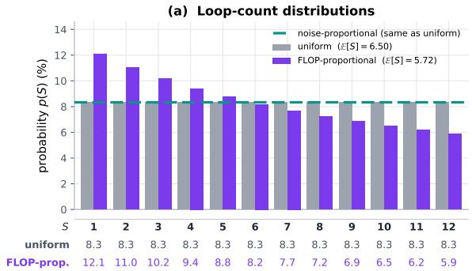

(b) Noise-proportional sampling  
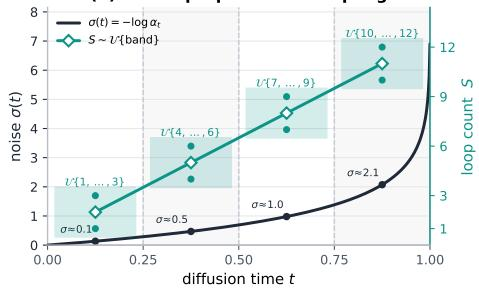

(c) Loop counts per GPU  
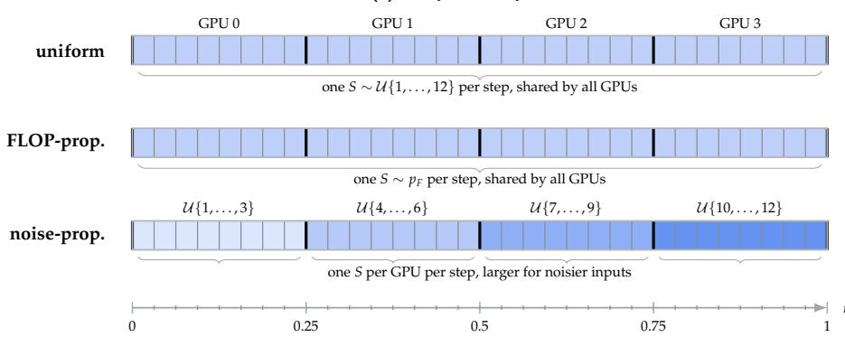  
Figure 8: Loop-count sampling. (a) Loop-count distributions. (b) Noise-proportional ranges. (c) Loop counts per GPU.

In noise-proportional training, we draw the diffusion times of the global batch antithetically and sort them before sharding. Each of the 32 micro-batches $( 4 \mathrm { \ : \tilde { G } P U s } \times 8 \mathrm { \ : \Omega }$ accumulation steps) then gets a narrow range of t (Figure 8c). We group them into four bands. Bands 1 to 4 sample S from {1, 2, 3}, {4, 5, 6}, {7, 8, 9}, and {10, 11, 12}. The average loop count stays at $6 . 5 ,$ as in uniform sampling. At evaluation, we sort validation sequences into the same bands and use a loop count from each band’s training range.

## C FLOP accounting convention

For the iso-FLOP comparisons in $\ S 4 ,$ , we count a multiply-add as two FLOPs and the backward pass as twice the forward pass, so one training step costs $F _ { \mathrm { t r a i n } } = 3 F _ { \mathrm { f w d } }$

Forward FLOPs. We extend the count of Hoffmann et al. (2022, Appendix F) to the DiT denoiser (Peebles & Xie, 2023). The model has n blocks of width d, MLP width 4d, AdaLN conditioning width $c ,$ timestep-frequency width $f ,$ vocabulary $V ,$ and sequence length L. Table 2 lists each term. With $n _ { \mathrm { e x e c } }$ executed blocks, the forward cost is

$$
F _ { \mathrm { f w d } } ( n _ { \mathrm { e x e c } } ) = n _ { \mathrm { e x e c } } F _ { \mathrm { b l o c k } } + \underbrace { 2 ( f c + c ^ { 2 } ) + 4 d c } _ { \mathrm { t i m e s t e p M L P , f i n a l A d a L N } } + \underbrace { 4 L V d } _ { \mathrm { v o c a b t e r m s } } ,\tag{22}
$$

where $F _ { \mathrm { b l o c k } } = 2 4 L d ^ { 2 } + 4 L ^ { 2 } d + 1 2 d c$ is the cost of one block.

For the non-looped small baseline $( n _ { \mathrm { e x e c } } = n )$ , this gives $F _ { \mathrm { f w d } } = 3 7 0 . 7 1$ and $F _ { \mathrm { t r a i n } } = 1 1 1 2 . 1 3$ GFLOP per sequence under Chinchilla, and $F _ { \mathrm { t r a i n } } = 6 3 7$ .85 under Kaplan, on both OWT and FineWeb-Edu. This is close to the 6ND estimate of 1041.9 GFLOP $( \dot { N } = 1 6 9 . 6 \mathrm { M } , D = L )$ , which skips the attention scores.

Looping. Looping runs $n _ { B }$ shared blocks S times, so $n _ { \mathrm { e x e c } } = n + ( S - 1 ) n _ { B }$ with the same number of parameters. Each extra loop adds the cost of $n _ { B }$ blocks, so a training step at loop count S costs $F ( S ) = F _ { \mathrm { b a s e } } ( 1 + ( S - 1 ) \rho )$ , with $\rho = n _ { B } F _ { \mathrm { l a y e r } } / F _ { \mathrm { b a s e } }$ and $F _ { \mathrm { l a y e r } } = 3 F _ { \mathrm { b l o c k } }$ (Equation 9). Averaged over the loop-count distribution, the cost per step depends only on the mean loop count,

<table><tr><td>Component</td><td>Forward FLOPs Counted</td></tr><tr><td>input embedding†</td><td>2LVd once</td></tr><tr><td>Q, K, V projections</td><td> $6 L d ^ { 2 }$  per block</td></tr><tr><td> $Q K ^ { \top }$  , attn.·V</td><td> $4 L ^ { 2 } d$  per block</td></tr><tr><td>attention output</td><td> $2 L d ^ { 2 }$  per block</td></tr><tr><td>MLP  $( d _ { \mathrm { f f } } = 4 \bar { d } )$ </td><td> $1 6 L d ^ { 2 }$  per block</td></tr><tr><td>AdaLN modulation</td><td> $1 2 d c$  per block</td></tr><tr><td>timestep MLP</td><td> $2 ( f c + c ^ { 2 } )$  once</td></tr><tr><td>final AdaLN</td><td> $4 \ddot { d } c$  once</td></tr><tr><td>output logits†</td><td> $2 L d V$  once</td></tr></table>

<table><tr><td rowspan="2">Distribution E[S]</td><td colspan="2"> $F _ { \mathrm { l o o p } } / F _ { \mathrm { b a s e } }$ </td><td rowspan="2">Steps</td></tr><tr><td></td><td>Chinchilla Kaplan</td></tr><tr><td>uniform 6.500</td><td>1.526×</td><td>1.917×</td><td>655,420</td></tr><tr><td>FLOP-prop. 5.724</td><td>1.452×</td><td>1.787×</td><td>688,915</td></tr><tr><td>noise-prop. 6.500</td><td>1.526×</td><td></td><td>1.917× 655,420*</td></tr></table>

Table 3: Cost of looped training. Mean loop count, cost per step relative to the baseline, and looped steps matching a 1M-step baseline under Chinchilla. ∗Noise-proportional is trained on OWT only and stopped after about 273k steps.

Table 2: Forward FLOPs per sequence. †Vocab terms, not counted under Kaplan.  
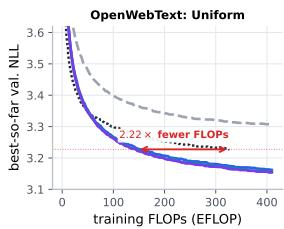

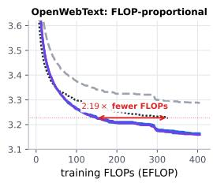

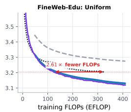

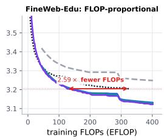  
non-looped baseline (106 steps) looped, eval S = 1 looped, eval S = 6 looped, eval S = 8 looped, eval S = 12  
Figure 9: Training curves under the Kaplan FLOP convention (Chinchilla version in Figure 1).

$$
{ \frac { F _ { \mathrm { l o o p } } } { F _ { \mathrm { b a s e } } } } = 1 + \left( \mathbb { E } [ S ] - 1 \right) \rho .\tag{23}
$$

For the small model with $n = 1 2 , d = 7 6 8 , L = 1 0 2 4 , n _ { B } = 2 ,$ and $S _ { \mathrm { m a x } } = 1 2 ,$ we get $\rho = 0 . 0 9 5 6$ under Chinchilla and $\rho = 0 . 1 6 7$ under Kaplan. With the global batch fixed, a baseline budget of M steps equals $M F _ { \mathrm { b a s e } } / F _ { \mathrm { l o o p } }$ looped steps (Table 3).

Chinchilla and Kaplan conventions. Scaling-law papers count compute in two ways (Pearce & Song, 2024). Chinchilla (Hoffmann et al., 2022) counts all parameters. Kaplan (Kaplan et al., 2020) does not count the input embedding and the output layer, so it removes the two vocab terms in Table 2. Our main results use Chinchilla, which Pearce & Song (2024) recommend for small models. Figure 9 shows the same curves under Kaplan. Without the vocab terms the baseline step is cheaper but a looped block costs the same. This makes looping relatively costlier (Table 3).

## D Training configuration and optimization

Every run uses the same configuration (Table 4). Figure 10 shows the training curves.

Pretraining datasets. We train on OpenWebText (OWT) (Gokaslan & Cohen, 2019) and on the sample-10BT configuration of FineWeb-Edu (Penedo et al., 2024) (9,672,101 documents, nominally 10B tokens). In both cases we hold out the last 100,000 documents for validation and train on the rest. We tokenize with the GPT-2 tokenizer $( V = 5 0 , 2 5 7 )$ , put an EOS between documents, and pack the stream into 1,024-token sequences made of BOS, 1,022 payload tokens, and EOS. Packing is done separately for each batch of 1,000 documents, and the leftover tokens of each batch are discarded. An epoch has 8.94B training tokens on OWT and 9.86B on FineWeb-Edu, which is 17,053 and 18,815 optimizer steps with 512 sequences per batch.

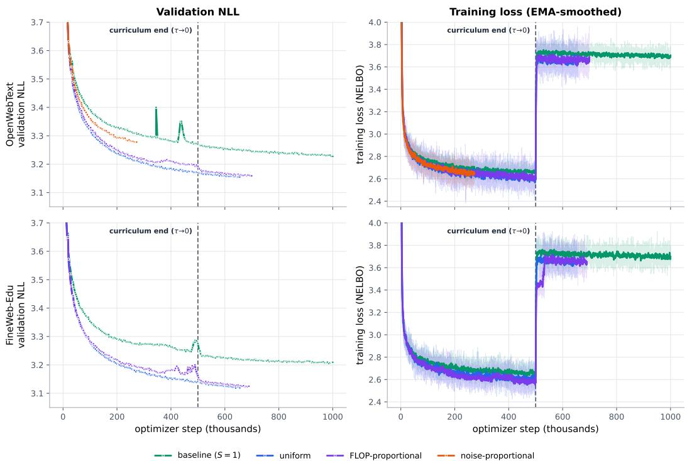  
Figure 10: Validation NLL and training loss by loop-count distribution on OWT (top) and FineWeb-Edu (bottom). There is no noise-proportional run on FineWeb-Edu. Left: exact validation NLL against optimizer step. Right: EMA-smoothed training loss (NELBO). The dashed line marks the end of the curriculum at step $5 \times 1 0 ^ { 5 }$

Curriculum and Gumbel sampling. We use the $\mathrm { D U O ^ { + + } }$ efficient curriculum: the diffusion transformation operator is approximated by a degree-9 polynomial (poly9), fit from its 150-term series over the curriculum window, and the tempered softmax input is simulated from its top-k = 2 entries. For the first $5 \times 1 0 ^ { 5 }$ optimizer steps, training uses this relaxed curriculum loss with Gumbel-softmax temperature $\tau = 1 0 ^ {  { - } 3 }$ and log-SNR window $\gamma \in$ [−3.55, −1.85] (the code’s parameterization of the curriculum window). After that, training switches to the exact discrete NELBO, which causes the training-loss regime change in Figure 10. Diffusion time is drawn with antithetic (stratified) sampling and $\varepsilon = \bar { 1 } 0 ^ { - 3 }$ Importance sampling and change-of-variables are off. The noise-proportional distribution builds its per-shard noise bands from this same stratification (§3.2).

## E Loop architecture selection ablations

We train with the setup of Appendix D, sampling $S \sim \mathcal { U } \{ 1 , . . . , S _ { \mathrm { m a x } } \}$ and looping two contiguous blocks, for 50k steps with seed 1. First we move the slice start from block 0 to block 10 with $S _ { \mathrm { m a x } } { = } 1 2$ , then fix the slice at blocks 1–2 and try $S _ { \mathrm { m a x } } \in \{ 4 , 8 , 1 2 , 1 6 \}$ (Table 5). Looping early blocks works best, with blocks 1–2 giving the lowest ${ \mathrm { N L L } } ,$ and NLL stops improving at $\boldsymbol { S } _ { \mathrm { m a x } } = 1 2$

<table><tr><td colspan="2">Model</td></tr><tr><td>Architecture</td><td>DiT</td></tr><tr><td>Hidden size</td><td>768</td></tr><tr><td>Attention heads</td><td>12</td></tr><tr><td>Blocks</td><td>12</td></tr><tr><td>Time-embedding size</td><td>128</td></tr><tr><td>MLP ratio</td><td>4</td></tr><tr><td>Dropout</td><td>0.1</td></tr><tr><td>Embeddings (input, output)</td><td>untied</td></tr><tr><td>Sequence length</td><td>1,024</td></tr><tr><td>Vocabulary</td><td>GPT-2 (50,257)</td></tr><tr><td colspan="2">Compute</td></tr><tr><td>GPUs</td><td>H100</td></tr><tr><td>Batch size</td><td>512</td></tr><tr><td>Precision</td><td>bf16</td></tr><tr><td>Validation interval</td><td>5,000 steps</td></tr></table>

<table><tr><td colspan="2">Diffusion</td></tr><tr><td>Objective</td><td>DUO ELBO</td></tr><tr><td>Time Parameterization</td><td>continuous, antithetic mean</td></tr><tr><td>Curriculum Temperature τ</td><td>first 500k steps  $1 0 ^ { - 3 }$ </td></tr><tr><td>Log-SNR range</td><td> $\left[ - 3 . 5 5 , - 1 . 8 5 \right]$ </td></tr><tr><td>Top-k</td><td>2</td></tr><tr><td></td><td>T approximation degree-9 polynomial</td></tr><tr><td>Optimization</td><td></td></tr><tr><td>Optimizer</td><td> $\mathtt { A d a m W } , \beta = ( 0 . 9 , 0 . 9 9 9 )$ </td></tr><tr><td>Learning rate</td><td> $3 \times 1 0 ^ { - 4 }$ </td></tr><tr><td>Warmup</td><td>2,500 steps, then constant</td></tr><tr><td>Weight decay</td><td>0</td></tr><tr><td>Gradient clipping EMA decay</td><td>1.0 0.9999</td></tr></table>

Table 4: Training configuration for pretraining on OWT and FineWeb-Edu.
<table><tr><td>Looped blocks</td><td>nH</td><td>nT</td><td> $S _ { \mathrm { m a x } }$ </td><td>S=1</td><td>S=6</td><td>S=8</td><td>S=12</td><td>S=16</td><td>S=24</td></tr><tr><td>(a) Position sweep </td><td>at</td><td>Smax</td><td>=12</td><td></td><td></td><td></td><td></td><td></td><td></td></tr><tr><td>0-1</td><td>0</td><td>10</td><td>12</td><td>3.539</td><td>3.456</td><td>3.449</td><td>3.454</td><td></td><td>3.475</td></tr><tr><td>1-2</td><td>1</td><td>9</td><td>12</td><td>3.548</td><td>3.425</td><td>3.416</td><td>3.420</td><td></td><td>3.447</td></tr><tr><td>2-3</td><td></td><td>8</td><td>12</td><td>3.567</td><td>3.433</td><td>3.423</td><td>3.426</td><td></td><td>3.451</td></tr><tr><td>3-4</td><td></td><td>7</td><td>12</td><td>3.548</td><td>3.428</td><td>3.418</td><td>3.421</td><td></td><td>3.447</td></tr><tr><td>4-5</td><td></td><td></td><td>12</td><td>3.548</td><td>3.433</td><td>3.423</td><td>3.426</td><td></td><td>3.455</td></tr><tr><td>5-6</td><td>2345</td><td>65</td><td>12</td><td>3.554</td><td>3.430</td><td>3.420</td><td>3.424</td><td></td><td>3.455</td></tr><tr><td>6-7</td><td>6</td><td></td><td>12</td><td>3.551</td><td>3.440</td><td>3.431</td><td>3.436</td><td></td><td>3.473</td></tr><tr><td>7-8</td><td>7</td><td></td><td>12</td><td>3.565</td><td>3.455</td><td>3.447</td><td>3.454</td><td></td><td>3.498</td></tr><tr><td>8-9</td><td></td><td></td><td>12</td><td>3.560</td><td>3.465</td><td>3.459</td><td>3.467</td><td></td><td>3.513</td></tr><tr><td>9-10</td><td>89</td><td>43210</td><td>12</td><td>3.595</td><td>3.491</td><td>3.485</td><td>3.495</td><td></td><td>3.541</td></tr><tr><td>10-11</td><td>10</td><td></td><td>12</td><td>3.578</td><td>3.499</td><td>3.495</td><td>3.504</td><td></td><td>3.530</td></tr><tr><td colspan="10">(b) Training-cap sweep at blocks 1–2</td></tr><tr><td>1-2</td><td></td><td>9</td><td>4</td><td>3.491</td><td>3.453</td><td>3.460</td><td>3.497</td><td></td><td>3.677</td></tr><tr><td>1-2</td><td>11</td><td>9</td><td>8</td><td>3.519</td><td>3.425</td><td>3.422</td><td>3.433</td><td>1</td><td>3.492</td></tr><tr><td>1-2</td><td>1</td><td>9</td><td>12</td><td>3.548</td><td>3.425</td><td>3.416</td><td>3.420</td><td></td><td>3.447</td></tr><tr><td>1-2</td><td>1</td><td>9</td><td>16</td><td>3.614</td><td>3.435</td><td>3.424</td><td>3.416</td><td>3.417</td><td>3.431</td></tr></table>

Table 5: Choice of looped blocks and training cap (↓). Validation NLL after 50k steps on OWT with the uniform loop-count distribution. Each run loops two consecutive blocks, with $n _ { H }$ blocks before them and $n _ { T }$ after. Bold marks the best loop count in each row, and the shaded row is the setting used in the paper.

## F Generation results

For each setting we draw 512 samples of 1,024 tokens with nucleus sampling $( p = 0 . 9 )$ using both the ancestral and the Ψ sampler. Generative perplexity is computed with GPT-2 Large and measures sample quality, and unigram entropy measures diversity. Table 6 gives the generative perplexity and Table 7 the entropy behind Figure 4.

<table><tr><td rowspan="2"></td><td rowspan="2">Base</td><td colspan="5">Uniform</td><td colspan="5">FLOP-proportional</td></tr><tr><td>S=1</td><td>S=6</td><td>S=8</td><td>S=12</td><td>Adaptive</td><td>S=1</td><td>S=6</td><td></td><td>S=8 S=12</td><td>Adaptive</td></tr><tr><td colspan="10">Ancestral</td><td></td><td></td><td></td></tr><tr><td></td><td>32 45.54</td><td>43.91</td><td>42.59</td><td>42.60</td><td>43.02</td><td>41.73</td><td>44.82</td><td>42.65</td><td>42.92</td><td>43.60</td><td>42.08</td></tr><tr><td>64</td><td>40.40</td><td>39.87</td><td>37.98</td><td>37.60</td><td>37.98</td><td>37.37</td><td>40.42</td><td>38.16</td><td>38.75</td><td>39.21</td><td>38.39</td></tr><tr><td>128</td><td>38.17</td><td>38.63</td><td>35.61</td><td>35.22</td><td>34.98</td><td>35.58</td><td>39.06</td><td>36.55</td><td>36.35</td><td>37.50</td><td>36.66</td></tr><tr><td>256</td><td>37.52</td><td>37.49</td><td>34.23</td><td>33.95</td><td>34.42</td><td>34.07</td><td>36.50</td><td>34.37</td><td>34.67</td><td>34.95</td><td>34.56</td></tr><tr><td>512</td><td>36.94</td><td>37.44</td><td>34.17</td><td>33.98</td><td>34.16</td><td>33.35</td><td>36.91</td><td>34.59</td><td>33.89</td><td>34.58</td><td>34.39</td></tr><tr><td>1,024</td><td>36.06</td><td>36.31</td><td>32.71</td><td>32.53</td><td>33.56</td><td>32.74</td><td>36.67</td><td>33.97</td><td>33.98</td><td>34.06</td><td>33.59</td></tr><tr><td>2,048</td><td>36.17</td><td>35.02</td><td>33.02</td><td>32.88</td><td>32.82</td><td>32.80</td><td>36.13</td><td>33.67</td><td>34.04</td><td>33.75</td><td>33.23</td></tr><tr><td>4,096</td><td>34.83</td><td>35.77</td><td>33.11</td><td>33.50</td><td>33.29</td><td>33.07</td><td>36.62</td><td>34.03</td><td>33.33</td><td>33.98</td><td>33.28</td></tr><tr><td colspan="10">Ψ-sampler</td><td></td><td></td><td></td></tr><tr><td>32</td><td>44.83</td><td>43.57</td><td>41.97</td><td>42.00</td><td>42.86</td><td>41.33</td><td>44.54</td><td>42.36</td><td>42.14</td><td>42.88</td><td>42.14</td></tr><tr><td>64</td><td>39.19</td><td>39.07</td><td>36.67</td><td>36.74</td><td>37.14</td><td>36.65</td><td>39.31</td><td>37.08</td><td>37.58</td><td>38.11</td><td>37.77</td></tr><tr><td>128</td><td>36.08</td><td>35.98</td><td>33.84</td><td>34.00</td><td>34.02</td><td>34.22</td><td>36.77</td><td>35.11</td><td>34.71</td><td>34.99</td><td>34.84</td></tr><tr><td>256</td><td>34.09</td><td>33.68</td><td>31.23</td><td>31.21</td><td>31.92</td><td>31.44</td><td>33.16</td><td>31.76</td><td>31.98</td><td>32.36</td><td>31.81</td></tr><tr><td>512</td><td>30.66</td><td>31.23</td><td>29.69</td><td>29.41</td><td>29.34</td><td>29.30</td><td>31.10</td><td>29.69</td><td>29.74</td><td>29.75</td><td>29.60</td></tr><tr><td>1,024</td><td>27.58</td><td>26.73</td><td>25.90</td><td>25.66</td><td>25.83</td><td>25.54</td><td>26.90</td><td>26.12</td><td>26.21</td><td>26.45</td><td>26.20</td></tr><tr><td>2,048</td><td>23.47</td><td>22.08</td><td>21.74</td><td>21.70</td><td>21.87</td><td>21.43</td><td>22.06</td><td>21.78</td><td>21.95</td><td>21.76</td><td>21.84</td></tr><tr><td>4,096</td><td>18.30</td><td>17.79</td><td>17.48</td><td>17.78</td><td>17.75</td><td>17.62</td><td>17.54</td><td>17.90</td><td>18.44</td><td>18.30</td><td>17.83</td></tr></table>

Table 6: Generation perplexity across loop counts (↓). Bold marks the best loop count within each looped checkpoint, and underline marks the best value in the row.
<table><tr><td colspan="2">Base</td><td colspan="5">Uniform</td><td colspan="5">FLOP-proportional</td></tr><tr><td>NFE</td><td></td><td>S=1</td><td>S=6</td><td>S=8</td><td>S=12</td><td>Adaptive</td><td>S=1</td><td>S=6</td><td>S=8</td><td></td><td>S=12 Adaptive</td></tr><tr><td colspan="10">Ancestral</td></tr><tr><td>32</td><td>5.42</td><td>5.40</td><td>5.42</td><td>5.42</td><td>5.42</td><td>5.41</td><td>5.40</td><td>5.41</td><td>5.42</td><td>5.41</td><td>5.41</td></tr><tr><td>64</td><td>5.40</td><td>5.40</td><td>5.41</td><td>5.40</td><td>5.41</td><td>5.41</td><td>5.38</td><td>5.40</td><td>5.41</td><td>5.41</td><td>5.41</td></tr><tr><td>128</td><td>5.39</td><td>5.39</td><td>5.39</td><td>5.40</td><td>5.40</td><td>5.40</td><td>5.39</td><td>5.40</td><td>5.40</td><td>5.41</td><td>5.40</td></tr><tr><td>256</td><td>5.38</td><td>5.38</td><td>5.37</td><td>5.38</td><td>5.38</td><td>5.38</td><td>5.36</td><td>5.37</td><td>5.38</td><td>5.38</td><td>5.38</td></tr><tr><td>512</td><td>5.37</td><td>5.37</td><td>5.38</td><td>5.38</td><td>5.37</td><td>5.37</td><td>5.35</td><td>5.37</td><td>5.36</td><td>5.36</td><td>5.36</td></tr><tr><td>1,024</td><td>5.37</td><td>5.36</td><td>5.36</td><td>5.36</td><td>5.37</td><td>5.37</td><td>5.36</td><td>5.37</td><td>5.37</td><td>5.37</td><td>5.36</td></tr><tr><td>2,048</td><td>5.37</td><td>5.34</td><td>5.35</td><td>5.36</td><td>5.35</td><td>5.35</td><td>5.33</td><td>5.36</td><td>5.36</td><td>5.36</td><td>5.35</td></tr><tr><td>4,096</td><td>5.35</td><td>5.35</td><td>5.38</td><td>5.38</td><td>5.37</td><td>5.38</td><td>5.36</td><td>5.38</td><td>5.37</td><td>5.37</td><td>5.37</td></tr><tr><td colspan="10">Ψ-sampler</td></tr><tr><td>32</td><td>5.41</td><td>5.40</td><td>5.42</td><td>5.41</td><td>5.42</td><td>5.41</td><td>5.40</td><td>5.41</td><td>5.41</td><td>5.41</td><td>5.41</td></tr><tr><td>64</td><td>5.40</td><td>5.39</td><td>5.40</td><td>5.39</td><td>5.40</td><td>5.40</td><td>5.38</td><td>5.40</td><td>5.40</td><td>5.40</td><td>5.40</td></tr><tr><td>128</td><td>5.38</td><td>5.38</td><td>5.39</td><td>5.39</td><td>5.39</td><td>5.39</td><td>5.37</td><td>5.39</td><td>5.39</td><td>5.38</td><td>5.39</td></tr><tr><td>256</td><td>5.36</td><td>5.35</td><td>5.35</td><td>5.36</td><td>5.36</td><td>5.36</td><td>5.34</td><td>5.36</td><td>5.36</td><td>5.36</td><td>5.36</td></tr><tr><td>512</td><td>5.34</td><td>5.33</td><td>5.35</td><td>5.34</td><td>5.34</td><td>5.34</td><td>5.32</td><td>5.33</td><td>5.34</td><td>5.33</td><td>5.34</td></tr><tr><td>1,024</td><td>5.31</td><td>5.29</td><td>5.32</td><td>5.32</td><td>5.32</td><td>5.31</td><td>5.28</td><td>5.31</td><td>5.31</td><td>5.31</td><td>5.31</td></tr><tr><td>2,048</td><td>5.27</td><td>5.22</td><td>5.25</td><td>5.25</td><td>5.25</td><td>5.24</td><td>5.21</td><td>5.25</td><td>5.24</td><td>5.24</td><td>5.25</td></tr><tr><td>4,096</td><td>5.18</td><td>5.14</td><td>5.19</td><td>5.19</td><td>5.18</td><td>5.19</td><td>5.14</td><td>5.20</td><td>5.22</td><td>5.21</td><td>5.20</td></tr></table>

Table 7: Unigram entropy of generated samples across loop counts (↑). Bold marks the best loop count within each looped checkpoint, and underline marks the best value in the row.

## G Zero-shot likelihood results

We evaluate on the datasets in Table 8. We use the EMA weights of each checkpoint. Documents are packed into 1,024-token sequences [BOS, $x _ { 1 : 1 0 2 2 } ,$ , EOS], and all 1,024 positions are scored.

Table 10 reports every configuration, and Table 9 gives the average adaptive loop count and the share of loop iterations saved on each dataset.

Figures 5 and 6 use up to 1,024 blocks from OWT validation and from each dataset above. Each block is corrupted once at $t \in \{ 0 . 1 , 0 . 3 , 0 . 5 , 0 . 7 , 0 . 9 \}$ and scored after every loop count $S = 1 , \ldots , 1 2$ . Adaptive looping is replayed offline with $\epsilon = 0 . 1$ . The curves average the per-token NLL of each dataset with equal weight and report the exponential of that average. In Figure 6c, bins with fewer than 300 tokens in more than two datasets are omitted.

## H Multiple-choice results

We use ten commonsense and reasoning multiple-choice tasks (Table 11) with the task definitions from lm-eval-harness 0.4.11 (Gao et al., 2024), default prompts, and no few-shot examples. Tables 12 and 13 give the full results.

<table><tr><td>Dataset</td><td>Split</td><td>Documents</td><td>Tokens</td></tr><tr><td>PTB</td><td>validation</td><td>3,370</td><td>75,776</td></tr><tr><td>WikiText-103</td><td>validation</td><td>3,760</td><td>233,472</td></tr><tr><td>LM1B</td><td>test</td><td>306,688</td><td>8,475,648</td></tr><tr><td>LAMBADA</td><td>test</td><td>5,153</td><td>421,888</td></tr><tr><td>AG News</td><td>test</td><td>7,600</td><td>389,120</td></tr><tr><td>PubMed</td><td>validation</td><td>6,633</td><td>26,807,296</td></tr><tr><td>arXiv</td><td>validation</td><td>6,436</td><td>53,453,824</td></tr></table>

Table 8: Likelihood datasets.

<table><tr><td></td><td colspan="2">Uniform</td><td colspan="2">FLOP-proportional</td></tr><tr><td>Dataset</td><td>Loops</td><td>Saved</td><td>Loops</td><td>Saved</td></tr><tr><td>PTB</td><td>6.18</td><td>48.5%</td><td>6.14</td><td>48.8%</td></tr><tr><td>WikiText-103</td><td>5.84</td><td>51.3%</td><td>5.67</td><td>52.8%</td></tr><tr><td>LM1B</td><td>6.13</td><td>48.9%</td><td>5.89</td><td>50.9%</td></tr><tr><td>LAMBADA</td><td>5.48</td><td>54.3%</td><td>5.43</td><td>54.8%</td></tr><tr><td>AG News</td><td>6.63</td><td>44.8%</td><td>6.37</td><td>46.9%</td></tr><tr><td>PubMed</td><td>6.35</td><td>47.1%</td><td>6.06</td><td>49.5%</td></tr><tr><td>arXiv</td><td>6.35</td><td>47.1%</td><td>6.15</td><td>48.8%</td></tr><tr><td>Average</td><td>6.14</td><td>48.9%</td><td>5.96</td><td>50.3%</td></tr></table>

Table 9: Adaptive looping on likelihood datasets $( \epsilon = 0 . 1 , S _ { \mathrm { m a x } } = 1 2 )$ . Saved counts the loop iterations skipped compared to fixed $S \stackrel { \widehat { } } { = } 1 2 .$
<table><tr><td rowspan="2">Base</td><td rowspan="2"></td><td colspan="5">Uniform</td><td colspan="5">FLOP-proportional</td></tr><tr><td> $S { = } 1$ </td><td> $S { = } 6$ </td><td>S=8</td><td></td><td>S=12 Adaptive</td><td>S=1</td><td>S=6</td><td>S=8</td><td></td><td>S=12 Adaptive</td></tr><tr><td>PTB</td><td> $9 4 . 8 6 \pm 1 0 . 8 7$ </td><td> $1 0 5 . 6 3 \pm 1 1 . 8 1$ </td><td> $8 5 . 1 8 \pm 9 . 0 7$ </td><td> $8 4 . 0 1 \pm 8 . 8 8 $ </td><td> $\underline { { 8 3 . 9 7 \pm 8 . 6 0 } }$ </td><td> $8 5 . 1 4 \pm 9 . 0 1$ </td><td> $1 0 3 . 8 7 \pm 1 1 . 3 9$ </td><td> $8 5 . 4 7 \pm 9 . 6 5$ </td><td>85.19 ±9.77</td><td> $8 5 . 5 5 \pm 9 . 5 6$ </td><td>85.43 ±9.68</td></tr><tr><td>WikiText-103</td><td> $3 4 . 4 6 \pm 1 . 1 1$ </td><td> $3 7 . 7 4 \pm 1 . 2 6$ </td><td> $3 1 . 7 0 \pm 0 . 9 3 $ </td><td> $3 1 . 3 9 \pm 0 . 9 4$ </td><td> $\underline { { 3 \mathbf { 1 . } 3 \mathbf { 1 } \pm 0 . 9 2 } }$ </td><td> $3 1 . 7 5 \pm 0 . 8 9$ </td><td> $3 6 . 9 6 \pm 1 . 3 0$ </td><td> $3 1 . 6 5 \pm 0 . 9 5$ </td><td> $3 1 . 4 6 \pm 0 . 9 1$ </td><td> ${ \bf 3 1 . 4 4 \pm 0 . 9 1 }$ </td><td>31.71 ±0.95</td></tr><tr><td>LM1B</td><td> $7 4 . 2 1 \pm 0 . 2 7$ </td><td> $8 1 . 3 0 { \scriptstyle \pm 0 . 3 1 }$ </td><td> $7 1 . 1 6 \pm 0 . 2 6$ </td><td> $7 0 . 5 9 \pm 0 . 2 7$ </td><td> ${ 7 0 . 3 8 \pm 0 . 2 6 }$ </td><td> $7 1 . 2 2 \pm 0 . 2 7$ </td><td> $7 8 . 6 4 \pm 0 . 3 7$ </td><td> $7 0 . 3 5 \pm 0 . 3 3$ </td><td> $\underline { { 7 0 . 0 5 \pm 0 . 3 2 } }$ </td><td> $7 0 . 1 5 \pm 0 . 3 2$ </td><td> $7 0 . 4 7 \pm 0 . 3 3$ </td></tr><tr><td>LAMBADA</td><td> $5 1 . 8 3 \pm 0 . 6 5$ </td><td> $5 3 . 6 8 \pm 0 . 8 8$ </td><td> $4 8 . 0 2 \pm 0 . 7 2$ </td><td> $4 7 . 7 6 \pm 0 . 7 8$ </td><td>47.70±0.86</td><td> $4 8 . 2 1 \pm 0 . 7 1$ </td><td> $5 2 . 6 5 \pm 0 . 7 7$ </td><td> $4 6 . 3 8 \pm 1 . 0 4$ </td><td> $4 6 . 3 3 \pm 1 . 0 7$ </td><td> $4 6 . 4 5 \pm 1 . 1 2$ </td><td> $4 6 . 5 6 \pm 1 . 0 4$ </td></tr><tr><td>AG News</td><td> $6 9 . 9 5 \pm 1 . 7 3 $ </td><td> $8 0 . 9 8 \pm 2 . 1 9$ </td><td>59.21 ±1.53 57.93 ±1.49</td><td></td><td> $\underline { { 5 7 . 3 1 \pm 1 . 5 4 } }$ </td><td>58.68±1.52</td><td>80.41 ±2.43 59.88 ±1.5058.77 ±1.42 58.35 ±1.4959.63 ±1.50</td><td></td><td></td><td></td><td></td></tr><tr><td>PubMed</td><td> $4 4 . 9 1 \pm 0 . 1 0$ </td><td> $4 8 . 2 8 \pm 0 . 0 9$ </td><td> $3 8 . 9 1 \pm 0 . 0 6$ </td><td> $3 8 . 3 0 { \scriptstyle \pm 0 . 0 6 }$ </td><td> $\underline { { 3 7 . 9 5 \pm 0 . 0 6 } }$ </td><td> $3 8 . 8 2 \pm 0 . 0 6$ </td><td> $4 7 . 2 1 \pm 0 . 0 9$ </td><td> $3 9 . 1 6 \pm 0 . 0 6$ </td><td> $3 8 . 5 2 \pm 0 . 0 5$ </td><td> ${ \bf 3 8 . 1 1 \pm 0 . 0 5 }$ </td><td> $3 9 . 2 3 { \scriptstyle \pm 0 . 0 6 }$ </td></tr><tr><td>arXiv</td><td> $3 9 . 7 8 \pm 0 . 1 2 $ </td><td> $4 2 . 9 8 \pm 0 . 1 3$ </td><td> $3 5 . 0 2 \pm 0 . 1 0$ </td><td>34.47 ±0.10</td><td> $\underline { { 3 4 . 1 3 \pm 0 . 1 0 } }$ </td><td> $3 4 . 9 7 \pm 0 . 1 0$ </td><td> $4 2 . 5 7 { \scriptstyle \pm 0 . 1 3 }$ </td><td> $3 5 . 2 7 \pm 0 . 1 0$ </td><td> $3 4 . 7 1 \pm 0 . 1 0$ </td><td> ${ \bf 3 4 . 3 7 \pm 0 . 1 0 }$ </td><td> $3 5 . 3 1 \pm 0 . 1 0$ </td></tr></table>

Table 10: Zero-shot likelihood perplexity across loop counts (↓). Mean and standard deviation over five seeds. Adaptive looping uses $S _ { \mathrm { m a x } } = 1 2 .$ Bold marks the best loop count within each looped checkpoint, and underline marks the best value in the row.
<table><tr><td>Task</td><td>Split</td><td>Questions</td><td>Choices</td></tr><tr><td>ARC-Easy</td><td>test</td><td>2,376</td><td>9,501</td></tr><tr><td>ARC-Challenge</td><td>test</td><td>1,172</td><td>4,687</td></tr><tr><td>HellaSwag</td><td>validation</td><td>10,042</td><td>40,168</td></tr><tr><td>WinoGrande</td><td>validation</td><td>1,267</td><td>2,534</td></tr><tr><td>PIQA</td><td>validation</td><td>1,838</td><td>3,676</td></tr><tr><td>MathQA</td><td>test</td><td>2,985</td><td>14,925</td></tr><tr><td>OpenBookQA</td><td>test</td><td>500</td><td>2,000</td></tr><tr><td>BoolQ</td><td>validation</td><td>3,270</td><td>6,540</td></tr><tr><td>RACE-High</td><td>test</td><td>1,045</td><td>4,180</td></tr><tr><td>Social IQa</td><td>validation</td><td>1,954</td><td>5,862</td></tr></table>

Table 11: Multiple-choice tasks.
<table><tr><td rowspan="2"></td><td rowspan="2">Base</td><td colspan="5">Uniform</td><td colspan="5">FLOP-proportional</td></tr><tr><td> $S { = } 1$ </td><td>S=6</td><td> $S { = } 8$ </td><td> $S { = } 1 2$ </td><td>Adaptive</td><td> $S { = } 1$ </td><td>S=6</td><td> $S { = } 8$ </td><td> $S { = } 1 2$ </td><td>Adaptive</td></tr><tr><td>ARC-Easy</td><td>28.66±0.37</td><td></td><td>29.08 ±0.47 27.89 ±0.69 27.73 ±0.34</td><td></td><td> $2 7 . 5 5 \pm 0 . 3 1$ </td><td>27.83 ±0.16</td><td>29.17 ±0.37 28.16 ±0.61</td><td></td><td>28.43 ±0.75 28.62 ±0.85 28.70 ±0.62</td><td></td><td></td></tr><tr><td>ARC-Challenge</td><td>25.26 ±0.75</td><td> $2 5 . 9 7 \pm 0 . 9 9$ </td><td>26.60 ±1.10 26.42 ±0.60 26.84 ±0.96 26.52 ±0.73</td><td></td><td></td><td></td><td> $\overline { { 2 5 . 9 7 \pm 0 . 7 4 } }$ </td><td> $2 7 . 3 0 \pm 1 . 3 7$ </td><td>26.59 ±0.67 26.18 ±0.24 26.23 ±0.84</td><td></td><td></td></tr><tr><td>HellaSwag</td><td>25.49 ±0.09</td><td> $2 5 . 7 3 \pm 0 . 2 1$ </td><td>27.94 ±0.25 28.31 ±0.23 28.62 ±0.2128.42 ±0.16</td><td></td><td></td><td></td><td> $2 6 . 5 6 \pm 0 . 1 7$ </td><td>28.51 ±0.20</td><td> $2 8 . 7 6 \pm 0 . 1 5$ </td><td> $\underline { { 2 9 . 1 1 \pm 0 . 1 2 } }$ </td><td>28.91 ±0.16</td></tr><tr><td>WinoGrande</td><td> $5 0 . 2 6 \pm 1 . 3 3$ </td><td> $4 9 . 8 0 \pm 1 . 4 9 $ </td><td> ${ \pm } 0 . 3 2 { \pm } 1 . 7 5 $ </td><td> $5 0 . 0 9 \pm 1 . 6 2 $ </td><td> $4 9 . 8 5 \pm 2 . 0 8$ </td><td>50.24±1.81</td><td> $5 0 . 5 8 \pm 2 . 0 5$ </td><td> $\underline { { 5 0 . 8 3 \pm 1 . 4 9 } }$ </td><td>50.69±0.91</td><td> $\overline { { 5 0 . 2 3 \pm 1 . 3 3 } }$ </td><td>49.98±1.22</td></tr><tr><td>PIQA</td><td> $5 1 . 3 7 \pm 1 . 1 8$ </td><td> $5 1 . 5 3 { \scriptstyle \pm 0 . 8 4 }$ </td><td> $5 1 . 3 9 \pm 0 . 4 4$ </td><td> $5 1 . 7 4 \pm 0 . 5 2 $ </td><td> $5 2 . 0 1 \pm 1 . 0 3 $ </td><td> ${ \bf 5 2 . 0 7 \pm 0 . 9 3 }$ </td><td> $5 2 . 7 3 \pm 1 . 3 5$ </td><td> $\overline { { 5 2 . 9 7 \pm 1 . 0 9 } }$ </td><td> $\underline { { 5 3 . 2 6 \pm 0 . 9 6 } }$ </td><td> $5 3 . 0 1 \pm 0 . 9 1$ </td><td> $5 3 . 0 6 \pm 1 . 0 0$ </td></tr><tr><td>MathQA</td><td>20.89 ±0.55</td><td> $2 0 . 3 2 \pm 1 . 1 7$ </td><td>20.72 ±0.75 20.87 ±0.93 20.98 ±1.08 20.90 ±0.74</td><td></td><td></td><td></td><td> $2 0 . 6 0 \pm 0 . 2 3$ </td><td>20.84 ±0.32 20.71 ±0.13 20.64 ±0.37 20.73 ±0.43</td><td></td><td></td><td></td></tr><tr><td>OpenBookQA</td><td> $2 8 . 0 4 \pm 1 . 6 8$ </td><td> $2 7 . 4 0 \pm 2 . 0 7$ </td><td> $2 8 . 3 6 \pm 1 . 6 6$ </td><td> $2 7 . 4 8 \pm 1 . 7 0$ </td><td> $2 7 . 8 4 \pm 1 . 8 1$ </td><td> $2 7 . 4 8 \pm 1 . 3 7$ </td><td> $2 7 . 7 2 { \pm } 1 . 1 9$ </td><td> $3 0 . 4 8 \pm 0 . 9 2$ </td><td> $3 0 . 8 4 \pm 0 . 8 5$ </td><td> $3 0 . 6 8 \pm 1 . 0 7$ </td><td>31.04±1.19</td></tr><tr><td>BoolQ</td><td>49.31 ±0.91</td><td> $5 0 . 1 3 { \scriptstyle \pm 0 . 6 6 }$ </td><td> ${ \bf 5 1 . 0 6 \pm 0 . 7 5 }$ </td><td> $5 1 . 0 3 { \scriptstyle \pm 0 . 8 6 }$ </td><td> $5 0 . 6 5 \pm 1 . 2 7$ </td><td> $5 0 . 9 5 \pm 0 . 9 1$ </td><td> $\underline { { 5 3 . 3 1 \pm 0 . 6 8 } }$ </td><td> $5 0 . 7 1 \pm 1 . 1 9$ </td><td> $5 0 . 9 1 \pm 0 . 9 3$ </td><td> $5 0 . 6 5 \pm 0 . 9 1$ </td><td>50.84 ±0.83</td></tr><tr><td>RACE-High</td><td>27.81 ±2.14</td><td> $2 7 . 4 3 \pm 1 . 5 6$ </td><td> $2 7 . 9 8 \pm 1 . 9 8$ </td><td> $2 8 . 1 7 \pm 2 . 3 5$ </td><td> $2 7 . 9 8 \pm 2 . 2 5$ </td><td> $2 7 . 9 8 \pm 2 . 0 8$ </td><td> $2 7 . 2 5 \pm 1 . 7 3$ </td><td> $2 8 . 4 6 \pm 2 . 2 7$ </td><td> $2 8 . 4 6 \pm 1 . 8 9$ </td><td>28.78±1.64</td><td>28.33 ±2.19</td></tr><tr><td>Social IQa</td><td>35.74±1.15</td><td> ${ \underline { { 3 6 . 2 5 \pm 0 . 5 7 } } }$ </td><td> $3 5 . 4 7 \pm 0 . 3 7$ </td><td> $3 5 . 7 0 { \scriptstyle \pm 0 . 4 5 }$ </td><td> $3 5 . 5 8 \pm 0 . 5 1$ </td><td> $3 5 . 9 0 \pm 0 . 9 0$ </td><td> $3 5 . 4 9 \pm 0 . 7 9$ </td><td> $3 6 . 0 3 \pm 0 . 2 0$ </td><td> $\mathbf { 3 6 . 1 9 \pm 0 . 4 0 }$ </td><td> $3 5 . 9 5 \pm 0 . 7 6$ </td><td>36.03 ±0.68</td></tr><tr><td>Average</td><td></td><td>34.28 ±0.44 34.37 ±0.49 34.77 ±0.37 34.75 ±0.38 34.79 ±0.53 34.83 ±0.40 34.94 ±0.44 35.43 ±0.40 35.48 ±0.41</td><td></td><td></td><td></td><td></td><td></td><td></td><td></td><td> $3 5 . 3 9 \pm 0 . 5 0$ </td><td>35.38 ±0.56</td></tr></table>

Table 12: Zero-shot multiple-choice accuracy across loop counts. Mean and standard deviation over five seeds. Bold marks the best loop count within each looped checkpoint, and underline marks the best value in the row.

Each answer choice is written as [BOS, context, answer, EOS] and scored by the token NLL averaged over all positions and 1,024 noise samples with raw weights, following $\mathrm { D U O ^ { + + } }$ (Deschenaux et al., 2026). The choice with the lowest NLL is picked, without length normalization. Choices longer than $^ { 1 , 0 2 4 }$ tokens get log-likelihood 0 (two BoolQ and 24 RACE-High choices).

<table><tr><td rowspan="2">Task</td><td colspan="4">Uniform</td><td colspan="4">FLOP-proportional</td></tr><tr><td>Accuracy</td><td>Loops</td><td>Converged</td><td>Saved</td><td>Accuracy</td><td>Loops</td><td>Converged</td><td>Saved</td></tr><tr><td>ARC-Easy</td><td>27.83</td><td>9.61</td><td>77.4%</td><td>20.0%</td><td>28.70</td><td>8.71</td><td>88.3%</td><td>27.4%</td></tr><tr><td>ARC-Challenge</td><td>26.52</td><td>9.54</td><td>76.7%</td><td>20.5%</td><td>26.23</td><td>8.53</td><td>89.2%</td><td>28.9%</td></tr><tr><td>HellaSwag</td><td>28.42</td><td>8.49</td><td>89.3%</td><td>29.2%</td><td>28.91</td><td>7.30</td><td>97.0%</td><td>39.2%</td></tr><tr><td>WinoGrande</td><td>50.24</td><td>9.95</td><td>77.0%</td><td>17.1%</td><td>49.98</td><td>9.10</td><td>85.7%</td><td>24.1%</td></tr><tr><td>PIQA</td><td>52.07</td><td>9.43</td><td>79.8%</td><td>21.4%</td><td>53.06</td><td>8.50</td><td>89.8%</td><td>29.2%</td></tr><tr><td>MathQA</td><td>20.90</td><td>9.61</td><td>77.4%</td><td>19.9%</td><td>20.73</td><td>8.39</td><td>91.2%</td><td>30.1%</td></tr><tr><td>OpenBookQA</td><td>27.48</td><td>9.29</td><td>88.1%</td><td>22.6%</td><td>31.04</td><td>8.94</td><td>92.0%</td><td>25.5%</td></tr><tr><td>BoolQ</td><td>50.95</td><td>7.76</td><td>95.3%</td><td>35.3%</td><td>50.84</td><td>6.81</td><td>99.5%</td><td>43.3%</td></tr><tr><td>RACE-High</td><td>27.98</td><td>6.40</td><td>100.0%</td><td>46.7%</td><td>28.33</td><td>5.96</td><td>100.0%</td><td>50.3%</td></tr><tr><td>Social IQa</td><td>35.90</td><td>10.13</td><td>67.0%</td><td>15.6%</td><td>36.03</td><td>9.03</td><td>85.2%</td><td>24.8%</td></tr><tr><td>Average</td><td>34.83</td><td>8.89</td><td>84.3%</td><td>26.0%</td><td>35.38</td><td>7.82</td><td>93.7%</td><td>34.8%</td></tr></table>

Table 13: Adaptive looping on multiple-choice tasks $( \epsilon = 0 . 1 , S _ { \mathrm { m a x } } = 1 2 )$ . Saved counts the loop iterations skipped compared to fixed $S = 1 2$ , bold highlights the better checkpoint.

We repeat the same experiment on the FineWeb-Edu checkpoints, with results in Table 14. Adaptive looping uses on average 8.02 loop iterations for the uniform checkpoint and 7.99 for the FLOP-proportional checkpoint, which saves 33% and 34% of the loop iterations relative to fixed $S \stackrel { \widehat { } } { = } 1 2$

Table 14: Zero-shot multiple-choice accuracy on FineWeb-Edu. Mean and standard deviation over five seeds. Adaptive looping $( \bar { S } _ { \operatorname* { m a x } } = 1 2 )$ uses about 8 loop iterations per likelihood sample. Bold marks the best loop count within each looped checkpoint, and underline marks the best value in the row.
<table><tr><td rowspan="2"></td><td rowspan="2">Base</td><td colspan="5">Uniform</td><td colspan="5">FLOP-proportional</td></tr><tr><td>S=1</td><td>S=6</td><td>S=8</td><td>S=12</td><td>Adaptive</td><td>S=1</td><td>S=6</td><td>S=8</td><td>S=12</td><td>Adaptive</td></tr><tr><td>ARC-Easy</td><td> $3 0 . 3 3 { \scriptstyle \pm 0 . 2 6 }$ </td><td>31.58 ±1.09</td><td> $3 0 . 7 2 { \scriptstyle \pm 0 . 8 2 }$ </td><td> $3 0 . 5 6 \pm 0 . 6 1$ </td><td>30.53 ±0.71</td><td> $3 0 . 4 2 \pm 0 . 5 8$ </td><td> $\underline { { 3 3 . 3 5 \pm 0 . 8 1 } }$ </td><td>31.41 ±0.64</td><td> $3 1 . 5 8 \pm 0 . 7 2 $ </td><td> $3 1 . 5 5 { \scriptstyle \pm 0 . 8 1 }$ </td><td>31.64±0.53</td></tr><tr><td>ARC-Challenge</td><td> $2 6 . 4 3 \pm 1 . 2 9$ </td><td> $2 6 . 1 8 \pm 0 . 6 4$ </td><td> $2 6 . 8 3 \pm 1 . 0 0$ </td><td> $2 6 . 8 3 \pm 1 . 5 2$ </td><td> $2 7 . 0 5 \pm 1 . 5 1$ </td><td>27.17±1.51</td><td> $\overline { { 2 6 . 7 9 \pm 1 . 4 6 } }$ </td><td> $2 7 . 3 4 \pm 0 . 9 7$ </td><td> $\underline { { 2 7 . 5 4 \pm 0 . 6 7 } }$ </td><td>27.46 ±0.68</td><td> $2 7 . 4 4 \pm 0 . 5 4$ </td></tr><tr><td>HellaSwag</td><td> $2 9 . 5 9 \pm 0 . 1 3$ </td><td> $2 8 . 9 2 \pm 0 . 1 2$ </td><td> $3 0 . 5 8 \pm 0 . 1 8$ </td><td> $3 0 . 7 2 \pm 0 . 2 2$ </td><td> ${ 3 0 . 7 9 \pm 0 . 1 9 }$ </td><td> $3 0 . 6 4 \pm 0 . 2 1$ </td><td> $3 0 . 2 6 \pm 0 . 1 1$ </td><td> $3 0 . 8 3 \pm 0 . 1 2$ </td><td> $\overline { { 3 0 . 8 4 \pm 0 . 1 9 } }$ </td><td> $\underline { { 3 0 . 8 4 \pm 0 . 2 0 } }$ </td><td> $3 0 . 7 1 \pm 0 . 1 9$ </td></tr><tr><td>WinoGrande</td><td>50.01 ±0.68 50.70 ±1.02</td><td></td><td> $5 0 . 3 1 \pm 0 . 9 7$ </td><td> $5 0 . 7 0 { \scriptstyle \pm 1 . 1 0 }$ </td><td> ${ \bf 5 0 . 7 3 \pm 1 . 4 0 }$ </td><td>50.61 ±0.82</td><td> $5 0 . 3 7 \pm 1 . 4 6 $ </td><td> $5 0 . 7 0 \pm 2 . 1 3 $ </td><td> $5 0 . 8 3 \pm 1 . 7 4$ </td><td> $\overline { { 5 0 . 7 5 \pm 1 . 7 3 } }$ </td><td> $5 0 . 8 9 \pm 2 . 1 9$ </td></tr><tr><td>PIQA</td><td>52.83 ±0.59</td><td> $5 3 . 8 2 \pm 1 . 3 8 $ </td><td> $5 2 . 6 4 \pm 0 . 9 6$ </td><td> $5 2 . 8 0 { \scriptstyle \pm 1 . 1 4 }$ </td><td> $5 2 . 7 6 \pm 1 . 2 6$ </td><td>52.83 ±1.46</td><td> $\pm \mathbf { 1 . 8 9 \pm 1 . 5 1 }$ </td><td> $5 3 . 7 8 \pm 1 . 4 3 $ </td><td> $5 3 . 9 3 \pm 1 . 3 2 $ </td><td> $5 3 . 7 0 \pm 1 . 5 2 $ </td><td> $\overline { { 5 3 . 9 3 \pm 1 . 5 9 } }$ </td></tr><tr><td>MathQA</td><td>20.19 ±0.43</td><td> $2 0 . 8 2 \pm 0 . 5 6$ </td><td> $2 1 . 2 4 \pm 0 . 3 9$ </td><td> $2 1 . 4 8 \pm 0 . 5 0$ </td><td> $\underline { { 2 1 . 5 1 \pm 0 . 5 3 } }$ </td><td>21.37 ±0.41</td><td> $2 1 . 1 8 \pm 0 . 5 4$ </td><td> $2 0 . 9 8 \pm 0 . 3 0$ </td><td> $2 0 . 8 4 \pm 0 . 4 6$ </td><td> ${ \bf 2 1 . 1 9 \pm 0 . 2 9 }$ </td><td>21.10±0.55</td></tr><tr><td>OpenBookQA</td><td>31.16±1.49</td><td> $3 0 . 6 0 { \scriptstyle \pm 0 . 8 6 }$ </td><td> $3 2 . 0 0 \pm 1 . 3 2 $ </td><td> $3 1 . 3 6 \pm 1 . 9 8 $ </td><td> $3 1 . 3 6 \pm 0 . 9 6$ </td><td>31.88±1.17</td><td> $\underline { { 3 2 . 1 2 \pm 0 . 7 6 } }$ </td><td>31.24±1.89</td><td> $3 1 . 7 2 \pm 1 . 8 1 $ </td><td>31.48±1.69</td><td>31.24±1.94</td></tr><tr><td>BoolQ</td><td>45.66 ±0.89</td><td> $4 9 . 6 8 \pm 0 . 6 7$ </td><td>50.04±0.78</td><td> ${ \bf 5 0 . 1 8 \pm 0 . 4 9 }$ </td><td> $5 0 . 1 6 \pm 0 . 6 5$ </td><td>49.88 ±0.52</td><td> $\overline { { 4 9 . 3 0 \pm 1 . 1 7 } }$ </td><td>51.46 ±1.06</td><td> $5 1 . 4 7 \pm 0 . 7 9$ </td><td> ${ \underline { { 5 1 . 7 2 \pm 0 . 5 7 } } }$ </td><td>51.43 ±0.80</td></tr><tr><td>RACE-High</td><td>28.29 ±2.23</td><td> $2 7 . 8 7 \pm 1 . 5 2 $ </td><td>28.80 ±2.40</td><td> $2 8 . 9 0 { \scriptstyle \pm 2 . 2 6 }$ </td><td> $2 9 . 1 7 \pm 2 . 0 8$ </td><td>28.78 ±2.08</td><td> $2 8 . 6 3 \pm 2 . 1 8$ </td><td> $2 9 . 0 7 \pm 2 . 2 0 $ </td><td> $2 9 . 2 1 \pm 2 . 2 4$ </td><td> $2 9 . 3 0 \pm 2 . 1 5$ </td><td>29.26 ±2.26</td></tr><tr><td>Social IQa</td><td>35.46 ±0.29</td><td> $3 5 . 6 7 \pm 0 . 3 1$ </td><td>35.90 ±0.40</td><td> $3 5 . 7 8 \pm 0 . 3 2$ </td><td> $3 5 . 8 6 \pm 0 . 5 2$ </td><td>35.79 ±0.39</td><td> $\underline { { 3 6 . 4 4 \pm 0 . 3 4 } }$ </td><td>36.23±0.45</td><td> $3 5 . 8 6 \pm 0 . 5 5$ </td><td> $3 5 . 7 2 \pm 0 . 6 2$ </td><td>35.83 ±0.37</td></tr><tr><td>Average</td><td></td><td>34.99 ±0.31 35.58 ±0.33 35.91 ±0.21 35.93 ±0.25 35.99 ±0.37</td><td></td><td></td><td></td><td>35.94 ±0.23 36.33 ±0.30 36.31 ±0.28</td><td></td><td></td><td></td><td>36.38 ±0.2036.37 ±0.22 36.35 ±0.26</td><td></td></tr></table>