# MAPS: MACRO-ADAPTIVE PARALLEL REASON-ING FOR REGULATING SEARCH MOMENTUM IN RETRIEVAL-AUGMENTED GENERATION

Xinze Li1∗, Dingwen Zhang1∗, Zhenghao Liu1†, Yukun Yan2, Shuo Wang2, Yu Gu1, Ge Yu1, Maosong Sun2

1School of Computer Science and Engineering, Northeastern University, Shenyang, China 2Department of Computer Science and Technology, Tsinghua University, Beijing, China

## ABSTRACT

Retrieval-Augmented Generation (RAG) improves the performance of Large Language Models (LLMs) by retrieving external knowledge. Recently, some RAG methods interleave reasoning and retrieval, enabling LLMs to progressively generate sub-queries and retrieve external knowledge. However, these methods may suffer from redundant or ineffective sub-queries and insufficiently diverse query exploration. Moreover, due to the tightly interleaved nature of reasoning and retrieval, it remains unclear how the evolving reasoning process influences query intent. To characterize the evolution of query intent during reasoning, we introduce search momentum, which captures the accumulated retrieval tendency induced by historical changes in generated sub-queries along the reasoning trajectory. Through momentum-based analysis, we find that the query generation process tends to continuously evolve along existing retrieval trajectories. Based on this observation, we propose MAPS, a Macro-Adaptive Parallel Reasoning framework for regulating search momentum and mitigating query-intent drift. MAPS first retains the retrieved knowledge and a refined reasoning state, thereby reducing the influence of historical reasoning trajectories on subsequent sub-query generation. Subsequently, MAPS extends the conventional sequential reasoning process into a parallel reasoning paradigm. At each iteration, MAPS identifies complementary retrieval directions, generates corresponding sub-queries for parallel retrieval, and consolidates the retrieved evidence to update the knowledge and reasoning states. Experiments on six question-answering benchmarks demonstrate that MAPS consistently outperforms representative RAG methods across different backbone models. All code and resources are available at https: //github.com/NEUIR/MAPS.

## 1 INTRODUCTION

Large Language Models (LLMs) (Jaech et al., 2024; Guo et al., 2025) have demonstrated remarkable capabilities in knowledge-intensive question answering and complex reasoning. However, they remain susceptible to hallucinations (Jiang et al., 2023; Ji et al., 2023), leading to factually incorrect or unsupported responses. Retrieval-Augmented Generation (RAG) (Lewis et al., 2020; Izacard et al., 2023) addresses this issue by enabling LLMs to access external knowledge during inference, thereby improving the factuality and reliability of their responses. However, for multi-hop queries (Yang et al., 2018), the required evidence is often distributed across multiple documents and interconnected through dependencies, making single-step retrieval insufficient to comprehensively acquire the information needed to answer the query (Fang et al., 2025; Wu et al., 2026).

To address this limitation, recent RAG approaches have explored leveraging the reasoning capabilities of LLMs to adaptively acquire external evidence. These methods (Li et al., 2025a; Jin et al., 2025; Song et al., 2025) interleave reasoning and retrieval, allowing LLMs to identify missing information, generate sub-queries, and retrieve relevant documents to progressively support the original query. Specifically, an LLM is prompted to generate sub-queries when additional knowledge is necessary, retrieve relevant documents, and incorporate the retrieved evidence into subsequent reasoning. However, as reasoning and retrieval proceed iteratively, these methods can suffer from redundant or ineffective sub-queries, excessively long retrieval chains, or insufficient exploration diversity (Ji et al., 2025; Martinez et al., 2025), ultimately degrading retrieval and downstream reasoning performance. Due to the tightly interleaved nature of reasoning and retrieval, it remains unclear how the evolving reasoning process influences the search direction, particularly when com prehensive evidence requires exploration beyond the current retrieval trajectory.

To characterize how search intentions evolve throughout the reasoning process, we introduce search momentum, which captures the accumulated retrieval tendency induced by historical changes in generated sub-queries along the reasoning trajectory. At each step, we update the search momentum by aggregating the current sub-query with the accumulated momentum through a stepwise learnable weight. We learn these weights by using the updated momentum to predict the query-intent drift at the current step. By analyzing the resulting search momentum across reasoning steps, we observe that the deviation directions of subsequent sub-queries become increasingly aligned with the accumulated search momentum as retrieval proceeds deeper. This finding suggests that query generation tends to follow the existing retrieval trajectory, rather than correcting or escaping accumulated deviations through subsequent reasoning (Guo et al., 2025). Such momentum-driven behavior can progressively amplify early search deviations, causing the retrieval process to drift away from the original information need. This motivates us to regulate the accumulation of search momentum and preserve alignment between the evolving retrieval process and the original query intent.

In this paper, we propose MAPS, a Macro-Adaptive Parallel Reasoning framework for regulating search momentum and mitigating query-intent drift. MAPS introduces a parallel reasoning paradigm that reduces the risk of search momentum being dominated by a single deviated retrieval direction, thereby maintaining better alignment with the original query intent. Specifically, MAPS first disentangles reasoning traces from the sub-queries that propagate historical retrieval tendencies, retaining only the refined retrieval knowledge and reasoning state to reduce the influence of historical search deviations on subsequent query generation. It then extends the conventional sequential reasoning process into a parallel reasoning paradigm, enabling the model to calibrate the search direction and construct a more robust search momentum. Specifically, MAPS identifies multiple complementary retrieval directions from the current reasoning state and generates corresponding sub-queries in parallel to explore these directions. The resulting evidence is consolidated to update the accumulated knowledge and refined reasoning state, which serves as the basis for the next reasoning iteration.

Our experiments on multiple datasets demonstrate that MAPS achieves significant improvements over all baseline methods across different backbone models, highlighting its strong generalization ability and robustness. Further analyses show that MAPS effectively regulates the evolution of search momentum, preventing it from being dominated by a single retrieval direction. Our experiments further demonstrate that MAPS effectively mitigates query intent drift and maintains stronger relevance between generated sub-queries and supporting evidence throughout iterative reasoning. Moreover, MAPS enables the model to acquire the prerequisite knowledge required for reasoning at an earlier stage, while reducing unnecessary retrieval iterations.

## 2 ANALYZING QUERY INTENT DRIFT DURING LLM REASONING

Recent RAG methods (Li et al., 2025a) enable LLMs to actively retrieve relevant documents and incorporate them into the reasoning process, allowing them to progressively acquire the information required to answer a given query. However, the sub-queries generated during this iterative process do not necessarily remain aligned with the original information need. This is because subsequent sub-query generation depends on the preceding retrieval trajectory, which may contain sub-queries deviating from the original information need and noisy retrieved knowledge, thereby influencing the intent of subsequent sub-queries and ultimately degrading downstream reasoning performance (Niu et al., 2026). To characterize how the history retrieval trajectory influences the subsequent query intent, we first formalize the accumulated change in retrieval intent along the reasoning trajectory as search momentum, and then investigate whether it can serve as a predictor of subsequent query intent drift.

Table 1: Fitted Momentum Coefficients and Directional Alignment Between Search Momentum and Subsequent Query Intent Deviations. $S _ { t }$ denotes the mean directional alignment score $S _ { t }$ across trajectories in the independent test set. $\beta _ { t }$ controls the retention of previously accumulated retrieval tendencies when constructing search momentum. The Pooled-MHQA fits the momentum coefficients on the mixed training data from the three datasets and evaluates directional alignment on the corresponding test sets. Detailed experimental settings and results are provided in Appendix A.1.
<table><tr><td>Dataset</td><td> $\beta _ { 1 }$ </td><td> $S _ { 1 }$ </td><td> $\beta _ { 2 }$ </td><td> $S _ { 2 }$ </td><td> $\beta _ { 3 }$ </td><td> $S _ { 3 }$ </td><td> $\beta _ { 4 }$ </td><td> $S _ { 4 }$ </td><td>Avg.  $S _ { t }$ </td></tr><tr><td>2WikiQA</td><td>0.0000</td><td>0.4051</td><td>0.6352</td><td>0.5698</td><td>0.7552</td><td>0.6483</td><td>0.8761</td><td>0.6955</td><td>0.5797</td></tr><tr><td>MuSiQue</td><td>0.0000</td><td>0.3105</td><td>0.5400</td><td>0.5196</td><td>0.7214</td><td>0.6489</td><td>0.8252</td><td>0.6913</td><td>0.5426</td></tr><tr><td>HotpotQA</td><td>0.0000</td><td>0.4427</td><td>0.6161</td><td>0.6840</td><td>0.8151</td><td>0.7731</td><td>0.8836</td><td>0.7750</td><td>0.6687</td></tr><tr><td>Pooled-MHQA</td><td>0.0000</td><td>0.3875</td><td>0.5959</td><td>0.5651</td><td>0.7559</td><td>0.6774</td><td>0.8630</td><td>0.7279</td><td>0.5895</td></tr></table>

Uncovering Search Momentum in LLM Reasoning. To characterize how retrieval intent evolves during iterative reasoning, we introduce search momentum, which captures the accumulated semantic shift in search behavior across reasoning steps. Given an initial query $q _ { 0 } .$ , suppose that the LLM has completed the reasoning trajectory up to the (t − 1)-th step:

$$
R _ { t - 1 } = ( r _ { 1 } , q _ { 1 } , o _ { 1 } , \ldots , r _ { t - 1 } , q _ { t - 1 } , o _ { t - 1 } ) ,\tag{1}
$$

where $r _ { i }$ denotes the reasoning step, $q _ { i }$ is the generated sub-query, and $o _ { i }$ denotes the knowledge observation obtained from the retrieved evidence. Conditioned on the initial query $q _ { 0 }$ and the preceding reasoning trajectory $R _ { t - 1 }$ , the LLM M iteratively generates the next reasoning step and sub-query $q _ { t }$ until reaching the maximum number of reasoning steps $T _ { \mathbf { \delta } }$

$$
r _ { t } , q _ { t } = \mathcal { M } ( q _ { 0 } , R _ { t - 1 } ) .\tag{2}
$$

The generated sub-query $q _ { t }$ is then used to retrieve a set of documents $D _ { t } .$ , from which the LLM derives the corresponding observation $o _ { t }$ . The reasoning trajectory is subsequently updated as:

$$
R _ { t } = R _ { t - 1 } \oplus ( r _ { t } , q _ { t } , o _ { t } ) .\tag{3}
$$

We represent the t-th step query $q _ { t }$ by its semantic embedding $\pmb q _ { t }$ and characterize the evolution of retrieval intent through the semantic displacement between these sub-queries $\{ q _ { 0 } , q _ { 1 } , \dots , q _ { T } \}$ :

$$
\begin{array} { r } { \pmb q _ { t } = \operatorname { E m b } ( q _ { t } ) , } \end{array}\tag{4}
$$

where Emb(·) denotes the embedding model, which can be instantiated with the E5 model (Wang et al., 2022). We then define the search momentum $\mathbf { m } _ { t }$ at the t-th reasoning step as:

$$
\mathbf { m } _ { t } = \beta _ { t } \mathbf { m } _ { t - 1 } + ( 1 - \beta _ { t } ) ( \pmb { q } _ { t } - \pmb { q } _ { t - 1 } ) ,\tag{5}
$$

where $\mathbf { m } _ { 0 } = \mathbf { 0 }$ and $0 \le \beta _ { t } < 1$ . The coefficient $\beta _ { t }$ controls how strongly previously accumulated search dynamics are retained when incorporating the latest semantic shift. In this formulation, mt is an exponentially weighted aggregation of historical query movements along the trajectory $q _ { 0 } $ $\cdots \to q _ { t }$ . Its magnitude reflects the strength of the accumulated semantic shift, while its direction characterizes the predominant direction in which the retrieval intent has evolved.

Tracking Query Intent Drift with Search Momentum. After establishing search momentum as an explicit representation of accumulated query movement, we next examine whether it can predict the direction of subsequent query drift during LLM reasoning. Specifically, if $\mathbf { m } _ { t }$ is consistently aligned with the deviation of the next sub-query from the original query, it suggests that historical search dynamics are propagated to subsequent query generation and that search momentum can serve as an effective signal for tracking intent drift.

For each reasoning trajectory, we therefore measure the directional alignment between the search momentum $\mathbf { m } _ { t }$ and the deviation of the subsequent sub-query $q _ { t + 1 }$ from the original query q0:

$$
S _ { t } = \cos ( \mathbf { m } _ { t } , \pmb { q } _ { t + 1 } - \pmb { q } _ { 0 } ) ,\tag{6}
$$

where ${ \pmb q } _ { t + 1 } - { \pmb q } _ { 0 }$ represents the semantic deviation of the next sub-query from the original information need. A larger $S _ { t }$ indicates that the accumulated search dynamics captured by $\mathbf { m } _ { t }$ are more consistent with the direction in which the subsequent query deviates from the original query, suggesting stronger predictive correspondence between search momentum and future query drift.

To obtain the momentum at each reasoning step, we fit the coefficient $\beta _ { t }$ in $\operatorname { E q . }$ 5 by maximizing the corresponding directional alignment $S _ { t }$ . Since $\beta _ { t }$ is constrained to $[ 0 , 1 )$ , we solve the resulting bounded optimization problem using the $\mathrm { L } { \cdot } \mathrm { B F G S } { \cdot } \mathrm { B }$ quasi-Newton method (Byrd et al., 1995). Table 1 reports the momentum coefficients fitted on the training set and the resulting directional alignment scores $S _ { t }$ evaluated on a held-out set. The complete procedure is provided in Appendix $\mathrm { A . 1 }$ We observe a consistent increase in both $\beta _ { t }$ and $S _ { t }$ as reasoning progresses. The increasing $\beta _ { t }$ indicates that later reasoning steps place progressively greater weight on previously accumulated search dynamics, suggesting that historical queries exert an increasingly persistent influence on subsequent query generation as the retrieval process becomes deeper. Meanwhile, the increasing $S _ { t }$ shows that the next query becomes more aligned with the current search momentum, suggesting that the reasoning process tends to perpetuate the existing search trajectory rather than effectively correcting or escaping it through reflection (Guo et al., 2025). This observation suggests that the reasoning process does not naturally eliminate the accumulated search momentum through subsequent reasoning steps. Taken together, these observations motivate us to investigate how to regulate the accumulation and propagation of search momentum, with the goal of reducing the persistent influence of historical search intents and maintaining better alignment with the original information need.

## 3 MAPS: REGULATING INTENT DRIFT THROUGH PARALLEL REASONING

In this section, we propose MAPS, a Macro-Adaptive Parallel Reasoning-based RAG framework for regulating search momentum. MAPS introduces a parallel reasoning paradigm to reduce the influence of accumulated search momentum and maintain better alignment with the original query intent. Specifically, MAPS first disentangles historical reasoning traces and sub-queries that may propagate previously established retrieval tendencies, thereby reducing their influence on subsequent query generation. It then employs parallel reasoning to explore multiple complementary search directions, enabling the retrieval process to calibrate its search direction at an early stage and further mitigate query intent drift.

Reasoning Disentanglement for Search Momentum Regulation. Given an initial query $q _ { 0 } ,$ , existing iterative RAG methods (Li et al., 2025a) maintain a reasoning trajectory $R _ { t - 1 }$ accumulated up to the (t − 1)-th iteration:

$$
R _ { t - 1 } = ( r _ { 1 } , q _ { 1 } , o _ { 1 } , \ldots , r _ { t - 1 } , q _ { t - 1 } , o _ { t - 1 } ) ,\tag{7}
$$

where $r _ { i } , \ q _ { i } .$ , and $o _ { i }$ denote the reasoning trace, generated sub-query, and knowledge observation obtained from retrieval at the i-th iteration, respectively. As discussed in Section $^ { 2 , }$ historical subqueries can exert a stronger influence on subsequent query generation than the reasoning process itself, causing later queries to inherit and progressively reinforce previously established retrieval tendencies. Such trajectory-dependent propagation can consequently lead to query intent drift.

To mitigate this effect, MAPS disentangles the accumulated knowledge from the historical retrieval trajectory by not explicitly preserving the reasoning traces $r _ { i }$ and sub-queries $q _ { i }$ in $R _ { t - 1 }$ . Instead, it retains the knowledge acquired over the first $t - 1$ iterations as a knowledge observation set:

$$
O _ { t - 1 } = { \left( o _ { 1 } , \dots , o _ { t - 1 } \right) } .\tag{8}
$$

Meanwhile, rather than retaining the complete sequence of historical reasoning traces $r _ { 1 : t - 1 } ~ =$ $\left( r _ { 1 } , \ldots , r _ { t - 1 } \right)$ , MAPS maintains a compact refined reasoning state $\tilde { r } _ { t - 1 }$ that summarizes the essential reasoning information accumulated from previous iterations. This state is updated at each iteration while avoiding explicit exposure to the historical sequence of sub-queries.

Accordingly, at the t-th iteration, the subsequent reasoning generated by the model $\mathcal { M } _ { \mathrm { R e a s o n } }$ is conditioned on the original query $q _ { 0 }$ , the accumulated knowledge observations $O _ { t - 1 }$ , and the refined reasoning state $\tilde { r } _ { t - 1 }$ , rather than the complete historical trajectory $R _ { t - 1 } \colon$

$$
\left( r _ { t } , q _ { t } , o _ { t } \right) = \mathcal { M } _ { \mathrm { R e a s o n } } ( q _ { 0 } , O _ { t - 1 } , \tilde { r } _ { t - 1 } ) ,\tag{9}
$$

where $\tilde { r } _ { t - 1 }$ provides the reasoning information necessary for the current iteration, while $O _ { t - 1 }$ preserves the knowledge acquired from previous retrievals. By removing the explicit dependency on historical sub-queries and reasoning traces, MAPS reduces the propagation of previously accumulated retrieval tendencies into subsequent query generation.

The reasoning process terminates when the accumulated knowledge $O _ { t } = \left( o _ { 1 } , \ldots , o _ { t - 1 } , o _ { t } \right)$ satisfies the current information needs, or when the maximum number of iterations is reached. After the T-th iteration, the LLM generates the final answer y based on the original query, the accumulated knowledge observations, and the refined reasoning state:

$$
y = \mathcal { M } _ { \mathrm { R e a s o n } } ( q _ { 0 } , O _ { T } , \tilde { r } _ { T } ) ,\tag{10}
$$

where T denotes the termination iteration or the maximum number of allowed reasoning iterations.

Parallel Reasoning for Search Direction Calibration. To further regulate the search direction at the t-th iteration, MAPS introduces parallel reasoning to explore multiple complementary retrieval intents before generating the sub-queries. Specifically, we extend the sequential reasoning process in Eq. 9 to a parallel reasoning paradigm, where multiple retrieval directions are first identified and subsequently instantiated into independent sub-queries.

First, instead of directly generating a sub-query from the current reasoning state, we employ the search direction proposal model $\mathcal { M } _ { \mathrm { { I n t e n t } } }$ to identify multiple complementary retrieval directions:

$$
\{ s _ { t } ^ { 1 } , \ldots , s _ { t } ^ { N } \} = \mathcal { M } _ { \mathrm { I n t e n t } } ( q _ { 0 } , O _ { t - 1 } , \tilde { r } _ { t - 1 } ) ,\tag{11}
$$

where each retrieval direction is instantiated as an individual sub-query. We then collect the generated sub-queries into a query set $Q _ { t } = \{ q _ { t } ^ { 1 } , \ldots , q _ { t } ^ { N } \}$ . Unlike sequential query generation, in which each query is directly conditioned on the preceding retrieval trajectory, parallel query generation explores multiple retrieval directions from the same reasoning state. This expands the search space at an early stage and increases the likelihood of retrieving evidence that addresses the original information needs, thereby reducing the risk that the search momentum becomes dominated by a single deviated retrieval direction.

Next, each sub-query $q _ { t } ^ { i } \in Q _ { t }$ t independently retrieves the top-K documents from the document collection D. The retrieved documents are then aggregated into a unified evidence set:

$$
\begin{array} { r } { q _ { t } ^ { i } = \mathcal { M } _ { \mathrm { Q u e r y } } ( q _ { 0 } , s _ { t } ^ { i } , \tilde { r } _ { t - 1 } ) , } \end{array}\tag{12}
$$

where each retrieval direction is associated with a generated sub-query. Subsequently, MAPS collects the sub-queries generated from all retrieval directions to form the query set $\dot { Q } _ { t } = \dot { \{ q _ { t } ^ { 1 } , \dots , q _ { t } ^ { N } \} }$ By generating multiple sub-queries in parallel, MAPS expands the search space at an early stage and increases the opportunity to generate sub-queries that retrieve useful evidence for the original query. Then, we use each sub-query $q _ { t } ^ { i }$ independently retrieves the top-K documents from the document collection D and collect all retrieved documents:

$$
D _ { t } = \bigcup _ { q _ { t } ^ { i } \in Q _ { t } } \mathrm { T o p } \ – K ( q _ { t } ^ { i } , { \mathcal { D } } ) .\tag{13}
$$

Finally, the refinement agent $\mathcal { M } _ { \mathrm { R e f i n e } }$ consolidates the retrieved evidence from different retrieval directions into a knowledge observation $o _ { t }$ and updates the refined reasoning state from $\tilde { r } _ { t - 1 } \mathrm { t o } \tilde { r } _ { t }                  .$

$$
\begin{array} { r } { o _ { t } , \tilde { r } _ { t } = \mathcal { M } _ { \mathrm { R e f i n e } } ( q _ { 0 } , \{ s _ { t } ^ { 1 } , \ldots , s _ { t } ^ { N } \} , Q _ { t } , \mathcal { D } _ { t } , O _ { t - 1 } , \tilde { r } _ { t - 1 } ) . } \end{array}\tag{14}
$$

The resulting knowledge observation $o _ { t }$ and refined reasoning state $\tilde { r } _ { t }$ are then regarded as the outputs of Eq. 9 to support subsequent reasoning iterations.

## 4 EXPERIMENTAL METHODOLOGY

This section first describes datasets and baselines. Then, we introduce the implementation details of our experiments.

Datasets. We evaluate different methods on three categories of benchmarks covering different task scenarios. For single-hop QA tasks, we use NQ (Kwiatkowski et al., 2019) and PopQA (Mallen et al., 2023). For multi-hop QA tasks, we evaluate MAPS on 2WikiQA (Ho et al., 2020), HotpotQA (Yang et al., 2018), and MuSiQue (Trivedi et al., 2022). For reasoning QA tasks, following previous work (Li et al., 2025a), we evaluate on the Diamond subset of GPQA (Rein et al., 2023), which contains 198 graduate-level science questions. Except for GPQA, we randomly sample 1, 000 questions from each dataset for evaluation.

Table 2: Overall Performance of MAPS across All Benchmarks. The best results are in bold and the second-best are underlined.
<table><tr><td>Method</td><td>NQ</td><td>PopQA</td><td>2WikiQA</td><td>HotpotQA</td><td>MuSiQue</td><td>GPQA</td><td>Avg.</td></tr><tr><td colspan="8">Qwen3-32B</td></tr><tr><td>Vanilla LLM</td><td>25.0</td><td>19.4</td><td>27.3</td><td>21.3</td><td>7.1</td><td>44.4</td><td>24.1</td></tr><tr><td>Vanilla RAG</td><td>49.0</td><td>52.1</td><td>30.0</td><td>38.3</td><td>9.9</td><td>44.2</td><td>37.2</td></tr><tr><td>Self-RAG</td><td>39.2</td><td>37.9</td><td>29.8</td><td>31.5</td><td>17.2</td><td>45.1</td><td>33.4</td></tr><tr><td>IRCOT</td><td>38.2</td><td>37.6</td><td>38.8</td><td>33.2</td><td>22.3</td><td>54.2</td><td>37.4</td></tr><tr><td>Search-o1</td><td>53.1</td><td>56.5</td><td>43.7</td><td>40.0</td><td>23.7</td><td>46.4</td><td>43.9</td></tr><tr><td>S3</td><td>59.5</td><td>60.6</td><td>37.2</td><td>38.3</td><td>19.4</td><td>60.7</td><td>45.9</td></tr><tr><td>ParallelSearch</td><td>57.2</td><td>60.4</td><td>53.6</td><td>43.5</td><td>30.9</td><td>49.8</td><td>49.2</td></tr><tr><td>MAPS</td><td>63.4</td><td>64.8</td><td>59.4</td><td>48.8</td><td>37.6</td><td>62.1</td><td>56.0</td></tr><tr><td colspan="8">Qwen3.6-35B-A3B</td></tr><tr><td>Vanilla LLM</td><td>39.4</td><td>39.4</td><td>42.1</td><td>34.8</td><td>19.4</td><td>76.8</td><td>42.0</td></tr><tr><td>Vanilla RAG</td><td>55.6</td><td>61.4</td><td>49.1</td><td>45.5</td><td>26.8</td><td>75.7</td><td>52.3</td></tr><tr><td>Self-RAG</td><td>45.5</td><td>52.3</td><td>44.8</td><td>39.7</td><td>27.3</td><td>67.6</td><td>46.2</td></tr><tr><td>IRCOT</td><td>49.0</td><td>45.9</td><td>45.8</td><td>43.2</td><td>28.6</td><td>64.7</td><td>46.2</td></tr><tr><td>Search-o1</td><td>53.0</td><td>62.0</td><td>56.3</td><td>44.0</td><td>34.1</td><td>76.3</td><td>54.3</td></tr><tr><td>S3</td><td>57.4</td><td>59.8</td><td>34.5</td><td>41.9</td><td>18.9</td><td>73.7</td><td>47.7</td></tr><tr><td>ParallelSearch</td><td>58.4</td><td>56.8</td><td>55.9</td><td>53.7</td><td>41.5</td><td>77.5</td><td>57.3</td></tr><tr><td>MAPS</td><td>64.1</td><td>69.3</td><td>65.8</td><td>55.1</td><td>45.2</td><td>79.2</td><td>63.1</td></tr></table>

Baselines. We compare MAPS with multiple representative baselines. Vanilla LLM prompts the LLM to generate answers without external knowledge, and Vanilla RAG (Lewis et al., 2020) utilizes the original query to retrieve documents and generates answers based on them. For adaptive RAG models, Self-RAG (Asai et al., 2024) prompts the LLM to determine whether retrieval is needed and whether retrieved documents are used during decoding. For reasoning-driven RAG models, IRCoT (Trivedi et al., 2023) interleaves reasoning with retrieval, where retrieved documents are incorporated into subsequent reasoning. Search-o1 (Li et al., 2025a) further extends this paradigm by introducing agentic query generation and the Reason-in-Documents module. For sub-query optimization RAG models, S3 (Jiang et al., 2025) trains a lightweight model to generate more effective sub-queries. ParallelSearch (Zhao et al., 2025) iteratively decomposes the original query into multiple complementary sub-queries and retrieves them in parallel to explore diverse knowledge.

Implementation Details. We use Qwen3-32B (Yang et al., 2025) and Qwen3.6-35B-A3B (Qwen Team, 2026) as the backbone models. The retrieval corpus is the English Wikipedia December 2018 dump (Karpukhin et al., 2020), and we employ E5-base-v2 (Wang et al., 2022) as the dense retriever with FAISS (Douze et al., 2026) for efficient similarity search over the pre-built index. Each retrieval step returns the top-5 most relevant passages, and the maximum number of execution iterations is set to 10. Following previous work (Song et al., 2025; Li et al., 2026), we adopt Cover-EM as the primary evaluation metric.

## 5 EVALUATION RESULTS

## 5.1 OVERALL PERFORMANCE

As shown in Table 2, we compare MAPS with a range of representative baselines across different tasks. Overall, MAPS consistently outperforms all baselines, with improvements of 6.8% and 5.8% on Qwen3-32B and Qwen3.6-35B-A3B, demonstrating the effectiveness of our parallel reasoning paradigm for mitigating query intent drift. Notably, MAPS delivers consistent gains across different backbone models, indicating its robustness and generalizability across model architectures.

Table 3: Ablation Study. The best results are in bold and the second-best are underlined.
<table><tr><td>Method</td><td>NQ</td><td>PopQA</td><td>2WikiQA</td><td>HotpotQA</td><td>MuSiQue</td><td>GPQA</td><td>Avg.</td></tr><tr><td colspan="8">Qwen3-32B</td></tr><tr><td>MAPS</td><td>63.4</td><td>64.8</td><td>59.4</td><td>48.8</td><td>37.6</td><td>62.3</td><td>56.1</td></tr><tr><td>w/o Retrieval Direction</td><td>63.0</td><td>64.3</td><td>55.8</td><td>46.9</td><td>35.6</td><td>46.0</td><td>51.9</td></tr><tr><td>w/o Parallel Reasoning</td><td>60.1</td><td>61.2</td><td>54.1</td><td>45.2</td><td>33.1</td><td>45.3</td><td>49.8</td></tr><tr><td>w/o Disentanglement</td><td>61.0</td><td>58.8</td><td>53.1</td><td>48.3</td><td>34.3</td><td>45.1</td><td>50.1</td></tr><tr><td colspan="8">Qwen3.6-35B-A3B</td></tr><tr><td>MAPS</td><td>64.1</td><td>69.3</td><td>65.8</td><td>55.1</td><td>45.2</td><td>79.2</td><td>63.1</td></tr><tr><td>w/o Retrieval Direction</td><td>62.3</td><td>69.2</td><td>62.2</td><td>51.6</td><td>43.1</td><td>68.1</td><td>59.4</td></tr><tr><td>w/o Parallel Reasoning</td><td>56.3</td><td>66.8</td><td>62.8</td><td>49.8</td><td>39.5</td><td>63.8</td><td>56.5</td></tr><tr><td>w/o Disentanglement</td><td>54.0</td><td>64.9</td><td>64.4</td><td>52.9</td><td>42.6</td><td>78.1</td><td>59.5</td></tr></table>

Compared with Naive-RAG, MAPS achieves substantial improvements, showing that reasoningguided iterative retrieval can acquire more comprehensive knowledge than one-pass retrieval. More importantly, compared with iterative reasoning-based RAG methods such as Search-o1, MAPS improves performance by over 9%. This result suggests that repeatedly extending the retrieval process along a single reasoning trajectory can reinforce previously explored retrieval directions, whereas parallel retrieval provides complementary search directions and reduces the risk of search momentum being dominated by a single trajectory. In addition, MAPS consistently outperforms ParallelSearch across all datasets. This comparison shows that simply generating multiple sub-queries to broaden the search space is insufficient to fully mitigate the influence of accumulated retrieva tendencies on subsequent query generation. In contrast, MAPS explicitly explores complementary retrieval directions while retaining only the retrieved knowledge, rather than the full historical reasoning trajectory, as the context for subsequent retrieval. By decoupling subsequent query generation from the accumulated reasoning trajectory, MAPS effectively mitigates search intent drift and enables more diverse and targeted knowledge acquisition.

## 5.2 ABLATION STUDY

In this subsection, we conduct ablation studies to evaluate the effectiveness of different components in MAPS. In the experiments, we compare MAPS with three ablated models. MAPS w/o Retrieval Direction directly generates multiple sub-queries in parallel based on the accumulated knowledge and refined reasoning state, without first identifying multiple retrieval directions to guide sub-query generation. MAPS w/o Parallel Reasoning replaces the multi-directional parallel reasoning mechanism with sequential single-query generation and retrieval, which generates only one retrieval direction and its corresponding sub-query at each iteration. MAPS w/o Disentanglement does not disentangle the retrieval trajectory, but instead preserves the complete reasoning traces and sub-queries generated at each iteration for subsequent reasoning.

As shown in Table 3, MAPS consistently outperforms all ablated variants, demonstrating the effectiveness of the proposed framework. Specifically, compared with MAPS w/o Retrieval Direction, MAPS achieves over a 4% improvement, indicating that explicitly identifying complementary retrieval directions helps guide parallel retrieval toward diverse information needs. MAPS also outperforms MAPS w/o Parallel Reasoning, demonstrating that the parallel reasoning mechanism expands the search space to acquire supporting evidence at early stages, thereby preventing the subsequent retrieval process from being dominated by a single retrieval direction and causing query intent drift. Moreover, comparing MAPS w/o Disentanglement with MAPS, we observe additional gains, suggesting that retaining the complete historical retrieval trajectory introduces stronger dependencies on previous retrieval tendencies, propagating accumulated deviations to subsequent query generation.

## 5.3 EVOLUTION OF SEARCH MOMENTUM DURING ITERATIVE REASONING

As shown in Figure 1, we analyze the evolution of search momentum across different methods and investigate whether MAPS can effectively regulate its directional drift. In this experiment, we randomly sample 500 instances from all benchmark datasets. Detailed experimental settings and additional results are provided in Appendix A.2.

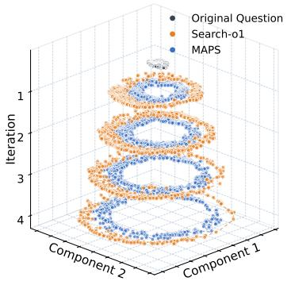  
(a) Search Momentum of MAPS and Search-o1.

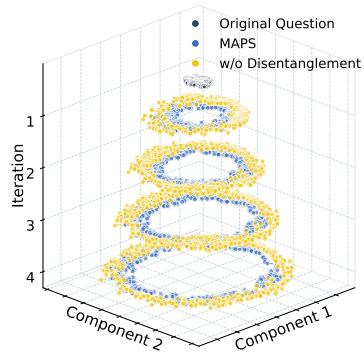  
(b) Search Momentum of MAPS and MAPS w/o Disentanglement.

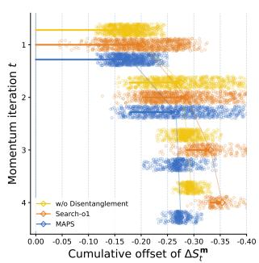  
(c) Cumulative Directional Offset of Search Momentum.  
Figure 1: Evolution of Search Momentum during Iterative Reasoning. Figures 1a and 1b visualize the trajectories of search momentum through t-SNE. Figure 1c shows the cumulative directional offset of search momentum with respect to the original query across reasoning iterations.

As shown in Figures 1a and 1b, we apply t-SNE to jointly project the embeddings of the original queries and their corresponding search momentum at different reasoning steps into a twodimensional space. Compared with MAPS, Search-o1 exhibits a larger directional deviation of search momentum from the original query. This observation suggests that, compared with the reasoning-based RAG method, MAPS mitigates the tendency of search momentum to become dominated by a single retrieval direction through its parallel reasoning mechanism. Furthermore, MAPS w/o Disentanglement exhibits weaker alignment between search momentum and the original query than MAPS, suggesting that disentangling accumulated knowledge from the reasoning states and generated sub-queries in the historical reasoning trajectory can reduce the influence of historical retrieval tendencies on the evolution of search momentum. Finally, for Figure 1c, we compute the change in cosine similarity between the search momentum and the original query across consecutive iterations and accumulate these changes to quantify the directional deviation of search momentum. The results demonstrate the effectiveness of MAPS in calibrating the search direction through parallel retrieval and reasoning disentanglement during reasoning. As the reasoning process progresses, the search momentum of MAPS becomes more stable than that of the other methods, indicating that MAPS can better maintain coherent search directions established in the early reasoning steps.

## 5.4 ANALYSIS OF MAPS RETRIEVAL BEHAVIOR DURING ITERATIVE REASONING.

In this section, we further analyze the retrieval behavior of MAPS during iterative reasoning. We use a pooled set of all datasets with ground-truth documents.

As shown in Figure 2, we first analyze how the similarity between sub-queries and the original query, as well as the golden evidence, evolves across iterations. As shown in Figure 2a, we compute the cosine similarity between the queries generated at different reasoning iterations and the original query. The result shows that, during the early stages of reasoning, the similarity between the generated sub-queries and the original query decreases rapidly for both Search-o1 and MAPS, reflecting the need to explore additional information beyond the original query. However, as reasoning progresses, the sub-queries generated by

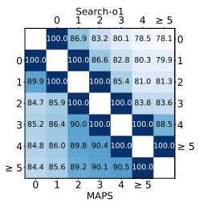

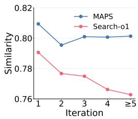  
(a) Similarity between Queries.  
(b) Similarity between Queries and Golden Evidence.  
Figure 2: Evolution of Query Similarity and Query-Evidence Similarity during Iterative Reasoning.

MAPS consistently maintain higher similarity with the original query than those generated by

Search-o1 and gradually become more stable. This suggests that MAPS calibrates search momentum at the early stages through parallel reasoning and reasoning disentanglement, enabling subsequently generated sub-queries to remain more closely aligned with the information need expressed by the original query. As shown in Figure 2b, for each sample, we compute the similarity between the subquery generated at each iteration and each of its golden evidence, and then average these similarity scores. The results show that the similarity between the sub-queries generated by MAPS and the ground-truth evidence decreases during the early stages, but subsequently recovers and stabilizes. In contrast, the similarity for Search-o1 continues to decline as reasoning progresses. This indicates that, after exploring different retrieval directions through parallel reasoning at the early stages, MAPS can progressively calibrate the query direction, enabling subsequent queries to more stably follow retrieval directions that are aligned with the target evidence.

As shown in Figure 3, we further analyze at which iteration different methods terminate during iterative reasoning and their corresponding answer performance. Figure 3a reports the proportion of samples terminating at each iteration for different methods. The results show that MAPS has a larger proportion of samples terminating at early iterations and also exhibits a higher proportion of samples requiring five or more retrieval rounds. This suggests that, for simple queries, MAPS can calibrate the query generation at early stages through parallel reasoning, enabling the model to rapidly acquire sufficient evidence with fewer iterations and terminate in a timely manner. For complex questions, MAPS regulates search mo-

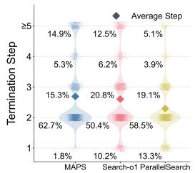  
(a) Termination Ratio at Each Iteration.

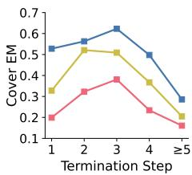  
MAPS Search-o1 Paral elSearch  
(b) Performance by Termination Step.  
Figure 3: Termination Distribution and Answer Performance across Different Methods.

mentum to reduce the accumulation of historical retrieval tendencies, allowing subsequent queries to continue exploring relevant knowledge. Figure 3b further compares the answer performance of models at different termination iterations. The results show that MAPS maintains strong answer performance across different termination steps. This suggests that its early termination typically occurs after sufficient evidence has been acquired, rather than resulting from erroneous stopping caused by retrieval drift. Meanwhile, MAPS continues to achieve higher performance at later termination steps, indicating that, after regulating search momentum, subsequent sub-queries consistently retrieve along directions aligned with the original information need.

## 6 RELATED WORK

Retrieval-Augmented Generation (RAG) enhances Large Language Models (LLMs) by retrieving external knowledge during inference (Lewis et al., 2020; Izacard et al., 2023; Li et al., 2025b), thereby providing additional factual support and mitigating hallucinations (Ji et al., 2023). Early RAG systems typically follow a retrieve-then-read paradigm, where the model first retrieves relevant documents based on the original query and then feeds the retrieved documents as contextual input to prompt the LLM to generate responses (Shi et al., 2024; Izacard et al., 2023; Lin et al., 2024). Furthermore, some studies investigate how to enable LLMs to adaptively determine when to retrieve external knowledge during response generation, thereby improving the reliability of generated responses (Asai et al., 2024). However, for complex questions, retrieving solely with the original query is often insufficient to acquire all relevant evidence, as the required information is typically distributed across multiple documents (Fang et al., 2025; Wu et al., 2026).

Recent reasoning-driven RAG methods leverage the reasoning capabilities of LLMs to enable progressive reasoning and sub-query generation for acquiring external knowledge, while incorporating the retrieved evidence into subsequent reasoning processes (Li et al., 2025a; Jin et al., 2025). However, these methods heavily rely on the quality of generated sub-queries, where irrelevant or erroneous sub-queries may lead to deviations in subsequent retrieval trajectories. Therefore, some studies have begun to investigate how to optimize the sub-query generation process. S3 (Jiang et al., 2025) trains a lightweight model specifically for sub-query generation, enabling the retrieval of more accurate knowledge. ParallelSearch (Zhao et al., 2025) prompts the model to generate multiple subqueries at each iteration and performs parallel retrieval, thereby acquiring more comprehensive evidence. However, these methods do not eliminate the influence of historical retrieval trajectories on subsequent sub-query generation.

## 7 CONCLUSION

In this paper, we introduce search momentum, which captures the accumulated retrieval tendency induced by historical changes in generated sub-queries along the reasoning trajectory. Our experiments show that the sub-queries generated by the model tend to continuously evolve along the accumulated retrieval trajectory, leading to deviations in query intent. Based on this observation, we propose MAPS, a Macro-Adaptive Parallel Reasoning framework for regulating search momentum and mitigating query-intent drift. By disentangling historical reasoning trajectories and introducing a parallel reasoning mechanism, MAPS effectively alleviates query-intent drift.

## AI USE STATEMENT

Generative AI tools are used in this paper solely to check grammatical errors and assist with language polishing, with the aim of improving the clarity of the manuscript. All research ideas, experimental design, implementation, analysis, and conclusions are independently developed and verified by the authors without the use of any AI tools.

## REFERENCES

Akari Asai, Zeqiu Wu, Yizhong Wang, Avirup Sil, and Hannaneh Hajishirzi. Self-rag: Learning to retrieve, generate, and critique through self-reflection. In The Twelfth International Conference on Learning Representations, ICLR 2024, Vienna, Austria, May 7-11, 2024. OpenReview.net, 2024. URL https://openreview.net/forum?id=hSyW5go0v8.

Richard H Byrd, Peihuang Lu, Jorge Nocedal, and Ciyou Zhu. A limited memory algorithm for bound constrained optimization. SIAM Journal on scientific computing, 16(5):1190–1208, 1995.

Matthijs Douze, Alexandr Guzhva, Chengqi Deng, Jeff Johnson, Gergely Szilvasy, Pierre-Emmanuel Mazare, Maria Lomeli, Lucas Hosseini, and Herv´ e J´ egou. The faiss library.´ IEEE Trans. Big Data, 12(2):346–361, 2026. doi: 10.1109/TBDATA.2025.3618474. URL https: //doi.org/10.1109/TBDATA.2025.3618474.

Jinyuan Fang, Zaiqiao Meng, and Craig Macdonald. Kirag: Knowledge-driven iterative retriever for enhancing retrieval-augmented generation. In Proceedings of the 63rd Annual Meeting of the Association for Computational Linguistics (Volume 1: Long Papers), pp. 18969–18985, 2025.

Daya Guo, Dejian Yang, Haowei Zhang, Junxiao Song, Peiyi Wang, Qihao Zhu, Runxin Xu, Ruoyu Zhang, Shirong Ma, Xiao Bi, Xiaokang Zhang, Xingkai Yu, Yu Wu, Z. F. Wu, Zhibin Gou, Zhihong Shao, Zhuoshu Li, Ziyi Gao, Aixin Liu, Bing Xue, Bingxuan Wang, Bochao Wu, Bei Feng, Chengda Lu, Chenggang Zhao, Chengqi Deng, Chong Ruan, Damai Dai, Deli Chen, Dongjie Ji, Erhang Li, Fangyun Lin, Fucong Dai, Fuli Luo, Guangbo Hao, Guanting Chen, Guowei Li, Hao Zhang, Hanwei Xu, Honghui Ding, Huazuo Gao, Hui Qu, Hui Li, Jianzhong Guo, Jiashi Li, Jingchang Chen, Jingyang Yuan, Jinhao Tu, Junjie Qiu, Junlong Li, J. L. Cai, Jiaqi Ni, Jian Liang, Jin Chen, Kai Dong, Kai Hu, Kaichao You, Kaige Gao, Kang Guan, Kexin Huang, Kuai Yu, Lean Wang, Lecong Zhang, Liang Zhao, Litong Wang, Liyue Zhang, Lei Xu, Leyi Xia, Mingchuan Zhang, Minghua Zhang, Minghui Tang, Mingxu Zhou, Meng Li, Miaojun Wang, Mingming Li, Ning Tian, Panpan Huang, Peng Zhang, Qiancheng Wang, Qinyu Chen, Qiushi Du, Ruiqi Ge, Ruisong Zhang, Ruizhe Pan, Runji Wang, R. J. Chen, R. L. Jin, Ruyi Chen, Shanghao Lu, Shangyan Zhou, Shanhuang Chen, Shengfeng Ye, Shiyu Wang, Shuiping Yu, Shunfeng Zhou, Shuting Pan, S. S. Li, Shuang Zhou, Shaoqing Wu, Tao Yun, Tian Pei, Tianyu Sun, Tao Wang, Wangding Zeng, Wen Liu, Wenfeng Liang, Wenjun Gao, Wenqin Yu, Wentao Zhang, W. L. Xiao, Wei An, Xiaodong Liu, Xiaohan Wang, Xiaokang Chen, Xiaotao Nie, Xin Cheng, Xin Liu, Xin Xie, Xingchao Liu, Xinyu Yang, Xinyuan Li, Xuecheng Su, Xuheng Lin, X. Q. Li, Xiangyue Jin, Xiaojin Shen, Xiaosha Chen, Xiaowen Sun, Xiaoxiang Wang, Xinnan Song, Xinyi Zhou, Xianzu Wang, Xinxia Shan, Y. K. Li, Y. Q. Wang, Y. X. Wei, Yang Zhang, Yanhong Xu, Yao

Li, Yao Zhao, Yaofeng Sun, Yaohui Wang, Yi Yu, Yichao Zhang, Yifan Shi, Yiliang Xiong, Ying He, Yishi Piao, Yisong Wang, Yixuan Tan, Yiyang Ma, Yiyuan Liu, Yongqiang Guo, Yuan Ou, Yuduan Wang, Yue Gong, Yuheng Zou, Yujia He, Yunfan Xiong, Yuxiang Luo, Yuxiang You, Yuxuan Liu, Yuyang Zhou, Y. X. Zhu, Yanping Huang, Yaohui Li, Yi Zheng, Yuchen Zhu, Yunxian Ma, Ying Tang, Yukun Zha, Yuting Yan, Z. Z. Ren, Zehui Ren, Zhangli Sha, Zhe Fu, Zhean Xu, Zhenda Xie, Zhengyan Zhang, Zhewen Hao, Zhicheng Ma, Zhigang Yan, Zhiyu Wu, Zihui Gu, Zijia Zhu, Zijun Liu, Zilin Li, Ziwei Xie, Ziyang Song, Zizheng Pan, Zhen Huang, Zhipeng Xu, Zhongyu Zhang, and Zhen Zhang. Deepseek-r1 incentivizes reasoning in llms through reinforcement learning. Nat., 645(8081):633–638, 2025. doi: 10.1038/S41586-025-09422-Z. URL https://doi.org/10.1038/s41586-025-09422-z.

Xanh Ho, Anh-Khoa Duong Nguyen, Saku Sugawara, and Akiko Aizawa. Constructing a multi-hop qa dataset for comprehensive evaluation of reasoning steps. In Proceedings of the 28th International Conference on Computational Linguistics, pp. 6609–6625, 2020.

Gautier Izacard, Patrick Lewis, Maria Lomeli, Lucas Hosseini, Fabio Petroni, Timo Schick, Jane Dwivedi-Yu, Armand Joulin, Sebastian Riedel, and Edouard Grave. Atlas: Few-shot learning with retrieval augmented language models. J. Mach. Learn. Res., 24:251:1–251:43, 2023. URL https://jmlr.org/papers/v24/23-0037.html.

Aaron Jaech, Adam Kalai, Adam Lerer, Adam Richardson, Ahmed El-Kishky, Aiden Low, Alec Helyar, Aleksander Madry, Alex Beutel, Alex Carney, et al. Openai o1 system card. arXiv preprint arXiv:2412.16720, 2024.

Yuelyu Ji, Rui Meng, Zhuochun Li, and Daqing He. Curriculum guided reinforcement learning for efficient multi hop retrieval augmented generation. arXiv preprint arXiv:2505.17391, 2025.

Ziwei Ji, Nayeon Lee, Rita Frieske, Tiezheng Yu, Dan Su, Yan Xu, Etsuko Ishii, Ye Jin Bang, Andrea Madotto, and Pascale Fung. Survey of hallucination in natural language generation. ACM computing surveys, 55(12):1–38, 2023.

Pengcheng Jiang, Xueqiang Xu, Jiacheng Lin, Jinfeng Xiao, Zifeng Wang, Jimeng Sun, and Jiawei Han. s3: You don’t need that much data to train a search agent via rl. In Proceedings ofthe 2025 Conference on Empirical Methods in Natural Language Processing, pp. 21610–21628, 2025.

Zhengbao Jiang, Frank F Xu, Luyu Gao, Zhiqing Sun, Qian Liu, Jane Dwivedi-Yu, Yiming Yang, Jamie Callan, and Graham Neubig. Active retrieval augmented generation. In Proceedings of the 2023 conference on empirical methods in natural language processing, pp. 7969–7992, 2023.

Bowen Jin, Hansi Zeng, Zhenrui Yue, Jinsung Yoon, Sercan Arik, Dong Wang, Hamed Zamani, and Jiawei Han. Search-r1: Training llms to reason and leverage search engines with reinforcement learning. arXiv preprint arXiv:2503.09516, 2025.

Vladimir Karpukhin, Barlas Oguz, Sewon Min, Patrick Lewis, Ledell Wu, Sergey Edunov, Danqi Chen, and Wen-tau Yih. Dense passage retrieval for open-domain question answering. In Proceedings of the 2020 conference on empirical methods in natural language processing (EMNLP), pp. 6769–6781, 2020.

Tom Kwiatkowski, Jennimaria Palomaki, Olivia Redfield, Michael Collins, Ankur Parikh, Chris Alberti, Danielle Epstein, Illia Polosukhin, Jacob Devlin, Kenton Lee, Kristina Toutanova, Llion Jones, Matthew Kelcey, Ming-Wei Chang, Andrew M. Dai, Jakob Uszkoreit, Quoc Le, and Slav Petrov. Natural questions: A benchmark for question answering research. Transactions of the Association for Computational Linguistics, 7:452–466, 2019. doi: 10.1162/tacl a 00276. URL https://aclanthology.org/Q19-1026/.

Patrick Lewis, Ethan Perez, Aleksandra Piktus, Fabio Petroni, Vladimir Karpukhin, Naman Goyal, Heinrich Kuttler, Mike Lewis, Wen-tau Yih, Tim Rockt¨ aschel, Sebastian Riedel,¨ and Douwe Kiela. Retrieval-augmented generation for knowledge-intensive NLP tasks. In Hugo Larochelle, Marc’Aurelio Ranzato, Raia Hadsell, Maria-Florina Balcan, and Hsuan-Tien Lin (eds.), Advances in Neural Information Processing Systems 33: Annual Conference on Neural Information Processing Systems 2020, NeurIPS 2020, December 6-12, 2020, virtual, 2020. URL https://proceedings.neurips.cc/paper/2020/hash/ 6b493230205f780e1bc26945df7481e5-Abstract.html.

Xiaoxi Li, Guanting Dong, Jiajie Jin, Yuyao Zhang, Yujia Zhou, Yutao Zhu, Peitian Zhang, and Zhicheng Dou. Search-o1: Agentic search-enhanced large reasoning models. In Proceedings ofthe 2025 Conference on Empirical Methods in Natural Language Processing, pp. 5420–5438, 2025a.

Xinze Li, Sen Mei, Zhenghao Liu, Yukun Yan, Shuo Wang, Shi Yu, Zheni Zeng, Hao Chen, Ge Yu, Zhiyuan Liu, Maosong Sun, and Chenyan Xiong. RAG-DDR: optimizing retrieval-augmented generation using differentiable data rewards. In The Thirteenth International Conference on Learning Representations, ICLR 2025, Singapore, April 24-28, 2025. OpenReview.net, 2025b. URL https://openreview.net/forum?id=Pnktu2PBXD.

Xinze Li, Yuqing Lan, Zhenghao Liu, Haidong Xin, Yukun Yan, Shuo Wang, Zheni Zeng, Sen Mei, Ge Yu, and Maosong Sun. Seek: Steering llm reasoning for rag via internal reasoning sketches, 2026.

Xi Victoria Lin, Xilun Chen, Mingda Chen, Weijia Shi, Maria Lomeli, Richard James, Pedro Rodriguez, Jacob Kahn, Gergely Szilvasy, Mike Lewis, Luke Zettlemoyer, and Wen-tau Yih. RA-DIT: retrieval-augmented dual instruction tuning. In The Twelfth International Conference on Learning Representations, ICLR 2024, Vienna, Austria, May 7-11, 2024. OpenReview.net, 2024. URL https://openreview.net/forum?id=22OTbutug9.

Alex Mallen, Akari Asai, Victor Zhong, Rajarshi Das, Daniel Khashabi, and Hannaneh Hajishirzi. When not to trust language models: Investigating effectiveness of parametric and non-parametric memories. In Proceedings of the 61st Annual Meeting of the Association for Computational Linguistics (ACL 2023), 2023.

Damian Martinez, Catalina Riano, and Hui Fang. Preqrag - classify and rewrite for enhanced RAG, 2025. URL https://doi.org/10.48550/arXiv.2506.17493.

Qingying Niu, Ruiyang Ren, Wayne Xin Zhao, and Yaliang Li. Bound: Brief-guided corrective preference distillation at search-control boundaries. arXiv preprint arXiv:2608.08768, 2026.

Qwen Team. Qwen3.6-35B-A3B: Agentic coding power, now open to all, April 2026. URL https://qwen.ai/blog?id=qwen3.6-35b-a3b.

David Rein, Betty Li Hou, Asa Cooper Stickland, Jackson Petty, Richard Yuanzhe Pang, Julien Dirani, Julian Michael, and Samuel R. Bowman. GPQA: A graduate-level google-proof Q&A benchmark. arXiv preprint arXiv:2311.12022, 2023.

Weijia Shi, Sewon Min, Michihiro Yasunaga, Minjoon Seo, Richard James, Mike Lewis, Luke Zettlemoyer, and Wen-tau Yih. Replug: Retrieval-augmented black-box language models. In Proceedings of the 2024 conference of the north american chapter of the association for computational linguistics: Human language technologies (volume 1: Long papers), pp. 8371–8384, 2024.

Huatong Song, Jinhao Jiang, Yingqian Min, Jie Chen, Zhipeng Chen, Wayne Xin Zhao, Lei Fang, and Ji-Rong Wen. R1-Searcher: Incentivizing the search capability in LLMs via reinforcement learning. arXiv preprint arXiv:2503.05592, 2025.

Harsh Trivedi, Niranjan Balasubramanian, Tushar Khot, and Ashish Sabharwal. MuSiQue: Multihop questions via single-hop question composition. In Transactions ofthe Associationfor Com putational Linguistics, 2022.

Harsh Trivedi, Niranjan Balasubramanian, Tushar Khot, and Ashish Sabharwal. Interleaving retrieval with chain-of-thought reasoning for knowledge-intensive multi-step questions. In Proceedings ofthe 61st Annual Meeting ofthe Associationfor Computational Linguistics (ACL 2023), pp. 10014–10037, 2023.

Liang Wang, Nan Yang, Xiaolong Huang, Binxing Jiao, Linjun Yang, Daxin Jiang, Rangan Majumder, and Furu Wei. Text embeddings by weakly-supervised contrastive pre-training. arXiv preprint arXiv:2212.03533, 2022.

Mingyan Wu, Zhenghao Liu, Xinze Li, Yuqing Lan, Yukun Yan, Shuo Wang, Cheng Yang, Minghe Yu, Zheni Zeng, and Maosong Sun. Finding what matters: Anchoring context knowledge with evolving indices for iterative retrieval. arXiv preprint arXiv:2601.16462, 2026.

An Yang, Anfeng Li, Baosong Yang, Beichen Zhang, Binyuan Hui, Bo Zheng, Bowen Yu, Chang Gao, Chengen Huang, Chenxu Lv, Chujie Zheng, Dayiheng Liu, Fan Zhou, Fei Huang, Feng Hu, Hao Ge, Haoran Wei, Huan Lin, Jialong Tang, Jian Yang, Jianhong Tu, Jianwei Zhang, Jianxin Yang, Jiaxi Yang, Jing Zhou, Jingren Zhou, Junyang Lin, Kai Dang, Keqin Bao, Kexin Yang, Le Yu, Lianghao Deng, Mei Li, Mingfeng Xue, Mingze Li, Pei Zhang, Peng Wang, Qin Zhu, Rui Men, Ruize Gao, Shixuan Liu, Shuang Luo, Tianhao Li, Tianyi Tang, Wenbiao Yin, Xingzhang Ren, Xinyu Wang, Xinyu Zhang, Xuancheng Ren, Yang Fan, Yang Su, Yichang Zhang, Yinger Zhang, Yu Wan, Yuqiong Liu, Zekun Wang, Zeyu Cui, Zhenru Zhang, Zhipeng Zhou, and Zihan Qiu. Qwen3 technical report. arXiv preprint arXiv:2505.09388, 2025.

Zhilin Yang, Peng Qi, Saizheng Zhang, Yoshua Bengio, William W. Cohen, Ruslan Salakhutdinov, and Christopher D. Manning. HotpotQA: A dataset for diverse, explainable multi-hop question answering. In Proceedings of the 2018 Conference on Empirical Methods in Natural Language Processing (EMNLP), 2018.

Shu Zhao, Tan Yu, Anbang Xu, Japinder Singh, Aaditya Shukla, and Rama Akkiraju. ParallelSearch: Train your LLMs to decompose query and search sub-queries in parallel with reinforcement learning. arXiv preprint arXiv:2508.09303, 2025.

## A APPENDIX

## A.1 FITTING THE SEARCH MOMENTUM COEFFICIENTS

In this section, we provide a detailed description of the experimental settings and methodology for fitting the momentum coefficients introduced in Section 2. Specifically, we first describe how the datasets used for momentum fitting are constructe. Then, we present the detailed procedure for estimating the search momentum coefficients. Finally, we report the fitted momentum results of the MAPS model.

Data Construction for Momentum Fitting. We collect 1,000 questions from each of 2WikiQA, MuSiQue, and HotpotQA to construct the training data as $\mathcal { D } _ { \mathrm { t r a i n } }$ for fitting the momentum coefficients $\beta _ { t }$ . For each question, we run Search-o1 with Qwen3-32B as the backbone model and record the complete trajectory of iterative reasoning and retrieval. We discard trajectories with fewer than three retrieval iterations to retain those containing sufficient query transitions for analyzing accumulated search momentum. For each retained trajectory, we encode the original question and all generated sub-queries, $\{ q _ { 0 } , \dots , q _ { T } \}$ , using the E5 embedding model, obtaining their semantic representations $\{ q _ { 0 } , \ldots , q _ { T } \}$ . To evaluate the directional alignment between search momentum and subsequent query deviations, we collect an additional 1,000 questions from each dataset as $\mathcal { D } _ { \mathrm { t e s t } }$ , with no overlap with $\mathcal { D } _ { t r a i n }$ , and construct the held-out test data using the same filtering, and encoding procedures as train data do. The search momentum coefficients are fitted exclusively on the training data $\mathcal { D } _ { \mathrm { t r a i n } }$ and then fixed for evaluation on the test data $\mathcal { D } _ { \mathrm { t e s t } }$ . For the Pooled-MHQA setting, we merge the training data from the three datasets into a pooled training set and similarly combine their test data into a pooled test set.

Fitting Objective. For each trajectory in the training set $\mathcal { D } _ { \mathrm { t r a i n } } ,$ we first compute the stepwise directional alignment scores $\{ S _ { 1 } , \bar { . } . . , \bar { S } _ { T - 1 } \}$ according to Eq. 6 in section 2. We then retain the first K alignment scores from each trajectory, where $K = 4 ,$ , since the vast majority of retrieval trajectories terminate within five iterations. Including later steps would substantially reduce the number of available trajectories at those positions and may lead to unreliable coefficient estimation due to the limited amount of training data.

The overall fitting objective averages the stepwise alignment scores equally:

$$
J ( \beta ) = \frac { 1 } { K } \sum _ { i \in D _ { t r a i n } } \sum _ { t = 1 } ^ { K } S _ { t } ^ { ( i ) } ( \beta ) .\tag{15}
$$

For each trajectory $i ,$ we compute the momentum from Eq. 5 with $\mathbf { m } _ { 0 } = \mathbf { 0 }$ and use Eq. 6 to obtain its stepwise alignment score $S _ { t } ^ { ( i ) } ( \beta )$ . For MAPS and MAPS w/o Disentanglement, which use multiple sub-queries for retrieval at each iteration, we average the embeddings of all sub-queries generated at iteration t and use the resulting vector as $\pmb q _ { t }$ . we estimate the search momentum coefficient $\beta$ by minimizing the fitting objective $J ( \beta )$ using the L-BFGS-B quasi-Newton method with 500 iterations.

Table 4: Fitted Momentum Coefficients and Directional Alignment between Search Momentum and Subsequent Query Intent Deviations for MAPS.
<table><tr><td>Dataset</td><td> $\beta _ { 1 }$ </td><td> $S _ { 1 }$ </td><td> $\beta _ { 2 }$ </td><td> $S _ { 2 }$ </td><td> $\beta _ { 3 }$ </td><td> $S _ { 3 }$ </td><td> $\beta _ { 4 }$ </td><td> $S _ { 4 }$ </td><td> $\operatorname { A v g } .$ </td></tr><tr><td>2WikiQA</td><td>0.0000</td><td>0.5264</td><td>0.5408</td><td>0.8206</td><td>0.7472</td><td>0.8689</td><td>0.8698</td><td>0.8929</td><td>0.7772</td></tr><tr><td>MuSiQue</td><td>0.0000</td><td>0.5120</td><td>0.5272</td><td>0.8297</td><td>0.7404</td><td>0.8844</td><td>0.8394</td><td>0.9050</td><td>0.7828</td></tr><tr><td>HotpotQA</td><td>0.0000</td><td>0.5851</td><td>0.5256</td><td>0.8438</td><td>0.7259</td><td>0.9037</td><td>0.8557</td><td>0.9131</td><td>0.8115</td></tr><tr><td>Pooled MHQA</td><td>0.0000</td><td>0.5331</td><td>0.5328</td><td>0.8276</td><td>0.7408</td><td>0.8803</td><td>0.8570</td><td>0.9006</td><td>0.7854</td></tr></table>

Evaluation and Results across Methods. After fitting, we freeze $\beta$ and compute the held-out $S _ { t }$ over eligible trajectories in $\mathcal { D } _ { \mathrm { t e s t } }$ . We also report $\begin{array} { r } { \mathrm { A v g . } = \frac { 1 } { K } \sum _ { t = 1 } ^ { K } S _ { t } } \end{array}$ . Table 1 reports the Search-o1 results in the main text; Tables 4 and 5 report the corresponding results for MAPS and MAPS w/o Disentanglement. Each table gives the fitted coefficients and held-out alignment scores for all four dataset settings.

Table 5: Fitted Momentum Coefficients and Held-out Alignment Scores for MAPS w/o Disentanglement on Three Multi-hop Datasets and Pooled MHQA.
<table><tr><td>Dataset</td><td> $\beta _ { 1 }$ </td><td> $S _ { 1 }$ </td><td> $\beta _ { 2 }$ </td><td> $S _ { 2 }$ </td><td> $\beta _ { 3 }$ </td><td> $S _ { 3 }$ </td><td> $\beta _ { 4 }$ </td><td> $S _ { 4 }$ </td><td> $\operatorname { A v g } .$ </td></tr><tr><td>2WikiQA</td><td>0.0000</td><td>0.5036</td><td>0.5469</td><td>0.8102</td><td>0.7543</td><td>0.8548</td><td>0.8527</td><td>0.8533</td><td>0.7555</td></tr><tr><td>MuSiQue</td><td>0.0000</td><td>0.4855</td><td>0.5369</td><td>0.7824</td><td>0.7538</td><td>0.8329</td><td>0.8629</td><td>0.8545</td><td>0.7388</td></tr><tr><td>HotpotQA</td><td>0.0000</td><td>0.5435</td><td>0.5467</td><td>0.8086</td><td>0.7607</td><td>0.8236</td><td>0.8651</td><td>0.8596</td><td>0.7588</td></tr><tr><td>Pooled MHQA</td><td>0.0000</td><td>0.5065</td><td>0.5422</td><td>0.7978</td><td>0.7549</td><td>0.8396</td><td>0.8589</td><td>0.8547</td><td>0.7497</td></tr></table>

## A.2 EXPERIMENTAL DETAILS FOR ANALYZING THE EVOLUTION OF SEARCH MOMENTUM

In this section, we describe how the three-dimensional search momentum visualizations in Figures 1a and 1b are constructed. We first use t-SNE to jointly project the original query embeddings and search momentum from all methods into a two-dimensional space. We then translate the pro jected points to position the original questions near the origin and center the momentum points at each iteration. During translation, all points within the same group are shifted by the same amount, preserving their relative positions. We then sample trajectories separately for each method and construct three-dimensional plots with the iteration index on the z-axis. For each method at each iteration, we draw a smooth closed contour around the corresponding point cloud to illustrate how search momentum evolves across iterations.

## A.3 CASE STUDY

Table 6 and Figure 4 present a qualitative case study on a 2WikiQA question asking which of La Mome Vert-De-Grisˆ and The Pod People has the earlier-born director.

Although Search-o1’s first retrieval, for “La Mome Vert-De-Gris director,” identifies Olivier Dahan,ˆ its reasoning then invents a version of The Pod People directed by Natasha Lyonne and Amy Nicholson. It next queries Amy Nicholson’s birth date and drifts further toward documentary production, 1930s organizations, and finally the Farm Holiday Association’s membership, following this unsupported interpretation and deviating from the original question . In contrast, MAPS’s parallel queries identify both relevant directors, Bernard Borderie and Juan Piquer Simon, in the first iteration and´ focus subsequent retrieval on their birth dates. A biographical entry retrieved in the second iteration records Simon’s birth on 16 February 1935; later film entries reconfirm Borderie’s 1953 directorial´ debut, from which MAPS infers that he was born earlier, although his exact birth date is not retrieved. This broader initial exploration and evidence-guided refinement enable MAPS to answer correctly without following Search-o1’s misleading local trajectory.

## A.4 PROMPT TEMPLATES

We detail the prompt templates employed in MAPS. As shown in Figure 5, it assesses whether the accumulated knowledge is sufficient to answer the original question and either produces a final answer or proposes complementary retrieval directions. As shown in Figure 6, it prompts the LLM to convert these directions into concrete sub-queries for parallel retrieval. Finally, the prompt in Figure 7 extracts relevant information from the retrieved documents and updates the accumulated reasoning traces, providing evidence and guidance for subsequent iterations.

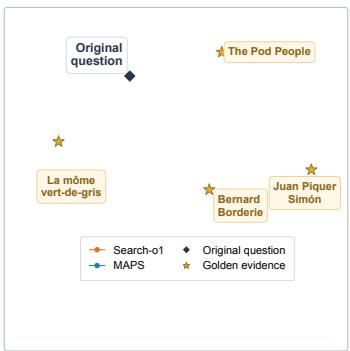  
(a) Document Embedding Space

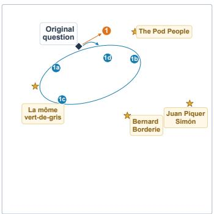  
(b) Iteration 1

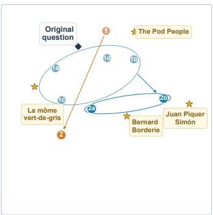  
(c) Iteration 2

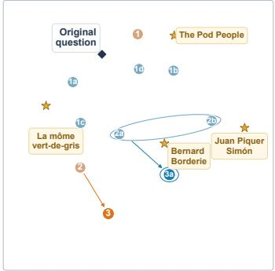  
(d) Iteration 3

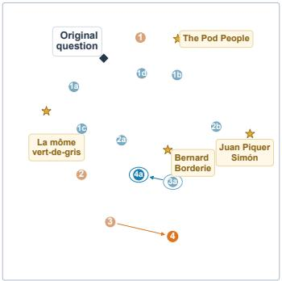  
(e) Iteration 4

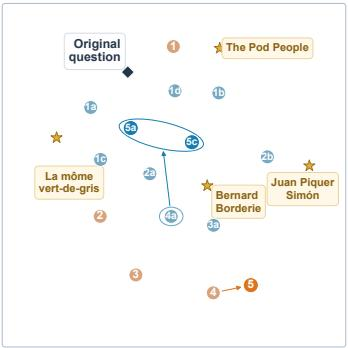  
(f) Iteration 5  
Figure 4: T-SNE Projection of E5 Embeddings for the Case-study Trajectories in Table 6. The black diamond marks the original question, and gold stars mark the four gold documents. Orange points trace Search-o1’s sequential queries; blue points mark MAPS’s parallel queries, with letters identifying branches. Blue outlines indicate the range covered by MAPS’s queries in each iteration.

Table 6: Case Study Comparing Search-o1 and MAPS. Red highlights misleading observations, off-topic evidence associated with query drift, and the incorrect final output; blue marks correctly identified key entities and the correct final answer.
<table><tr><td rowspan=1 colspan=1>Question: Which film has the director who was born first, La Môme Vert-De-Gris or The Pod People?Gold answer: La Môme Vert-De-Gris.</td></tr><tr><td rowspan=1 colspan=1>Search-o1</td></tr><tr><td rowspan=1 colspan=1>Iteration 1. Query: La Môme Vert-De-Gris directorEvidence: Documents: The search identifies Olivier Dahan as the director of La Môme Vert-De-Gris. The retrieved result does not supportthe subsequent claims about a different version of The Pod People. Refined observation: After retrieving Olivier Dahan, the reasoninginvents a version of The Pod People directed by Natasha Lyonne and Amy Nicholson. It then shifts to comparing those directors andfollows that unsupported interpretation in later searches.</td></tr><tr><td rowspan=1 colspan=1>Iteration 2. Query: Amy Nicholson birth dateEvidence: Documents: Results concern Meredith Nicholson (an author born in 1866), Amy Hill, Richard Nicholson, Christopher Nichol-son, and Lorraine Nicholson (an actress and director born in 1990), rather than Amy Nicholson. Refined observation: The results donot identify Amy Nicholson or provide a birth date; they concern Meredith Nicholson, Amy Hill, Richard and Christopher Nicholson,and Lorraine Nicholson. The reasoning then recasts the task as comparing film profit margins and veers into queries about making adocumentary, without establishing either director&#x27;s birth date.</td></tr><tr><td rowspan=1 colspan=1>Iteration 3. Query: Process of making a documentary filmEvidence: Documents: Filmmaking articles describe production stages such as screenwriting, casting, shooting, sound recording, editing,and screening. Documentary references discuss factual subjects, actuality footage, and commentary; none bears on the films or directorsin the question. Refined observation: Summarizes production stages, then asserts that the user wants the number of people in a group andintroduces “The 1930s: A Decade of Discontent&quot; as the current search query.</td></tr><tr><td rowspan=1 colspan=1>Iteration 4. Query: The 1930s: A Decade of Discontent group profileEvidence: Documents: Results describe the Great Depression, labor movements, and 1930s political and economic conditions. Onedocument says the League for Industrial Democracy organized New Deal radio broadcasts, but none identifies a group named “The 1930s:A Decade of Discontent&quot; or gives its membership. Refined observation: Treats the request as identifying an organization associated with1930s discontent and selects the League for Industrial Democracy as the closest match. The observation continues the historical-grouptopic rather than returning to either film.</td></tr><tr><td rowspan=1 colspan=1>Iteration 5. Query: Farm Holiday Association 1930s membership numbersEvidence: Documents: The Farmers&#x27; Holiday Association was organized by Milo Reno in May 1932 and advocated withholding farmproducts during the Great Depression, but its retrieved entry gives no membership count. Other results give figures for different organiza-tions: 24,500 and 100,000 for the 19th-century Farmers&#x27; Alliance, and 15,000 for the National Federation of Young Farmers&#x27; Clubs. Noneestablishes membership of the queried association or answers the film question.</td></tr><tr><td rowspan=1 colspan=1>Final answer: The Farm Holiday Association reached its peak membership in the mid-1930s, with estimates ranging between 10,000 to15,000 members.</td></tr><tr><td rowspan=1 colspan=1>MAPS</td></tr><tr><td rowspan=1 colspan=1>Iteration 1. Parallel queries: (1) Director of La Môme Vert-De-Gris; (2) The Pod People director; (3) birth date of director of La MômeVert-De-Gris; (4) The Pod People director birth dateEvidence: La Môme Vert-De-Gris, also released as Poison Ivy, is a 1953 French crime film and Bernard Borderie&#x27;s directorial debut. ThePod People is a 1983 French-Spanish science fiction film directed by Juan Piquer Simón. The pooled documents identify both directors,but neither birth date is available.</td></tr><tr><td rowspan=1 colspan=1>Iteration 2. Parallel queries: (1) Bernard Borderie director La Môme Vert-De-Gris birth date; (2) Juan Piquer Simón birth dateEvidence: Simón&#x27;s biography records his birth on 16 February 1935 in Valencia, Spain, and identifies him as the director of Pieces (1982)and Slugs: The Movie (1988). Film documents again confirm Borderie&#x27;s association with La Môme Vert-De-Gris, but do not provide hisbirth date.</td></tr><tr><td rowspan=1 colspan=1>Iteration 3. Query: Bernard Borderie birth dateEvidence: Documents concern Bernard Francis Law, Bernard Jenkin, Bernard Le Nail, and Bernard King, rather than Borderie. Norelevant birth date is found. The refined observation incorrectly interprets these irrelevant results as a reason to question Borderie&#x27;sidentity.</td></tr><tr><td rowspan=1 colspan=1>Iteration 4. Query: Bernard Borderie filmography and birth date. A second planned branch produces an empty query.Evidence: Results include the Pool Group and its film Borderline (1930), actor Bernard Blier (born 11 January 1916), and actor/directorPaul Henreid (born 10 January 1908). None establishes Borderie&#x27;s birth date; the refined observation again incorrectly rejects his directorattribution.</td></tr><tr><td rowspan=1 colspan=1>Iteration 5. Parallel queries: (1) director of La Môme Vert-De-Gris birth date; (2) Juan Piquer Simón birth date; (3) a malformed querycontaining generated text instead of a concise search.Evidence: Film entries reconfirm Bernard Borderie&#x27;s 1953 debut with La Môme Vert-De-Gris; Juan Piquer Simón&#x27;s biography again gives16 February 1935. Borderie&#x27;s birth date remains absent from the documents.</td></tr><tr><td rowspan=1 colspan=1>Final answer: La Môme Vert-De-Gris.</td></tr></table>

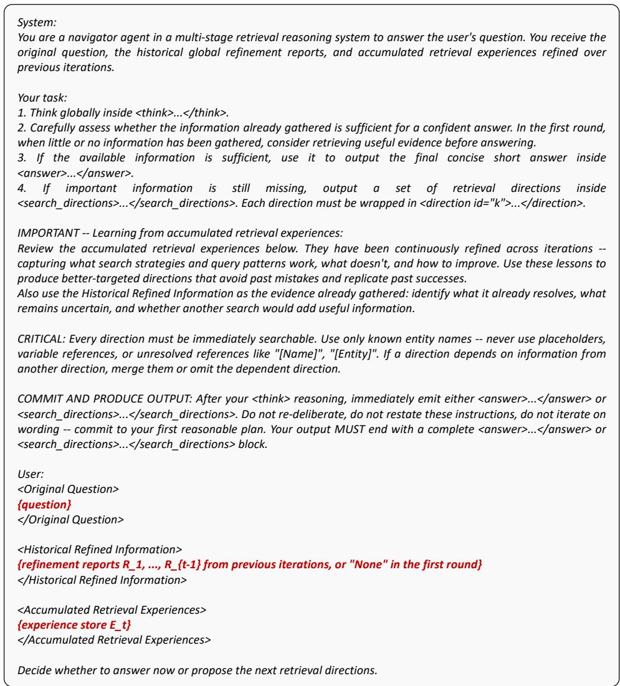  
Figure 5: Prompt Template Used in MAPS for Generating Retrieval Directions.

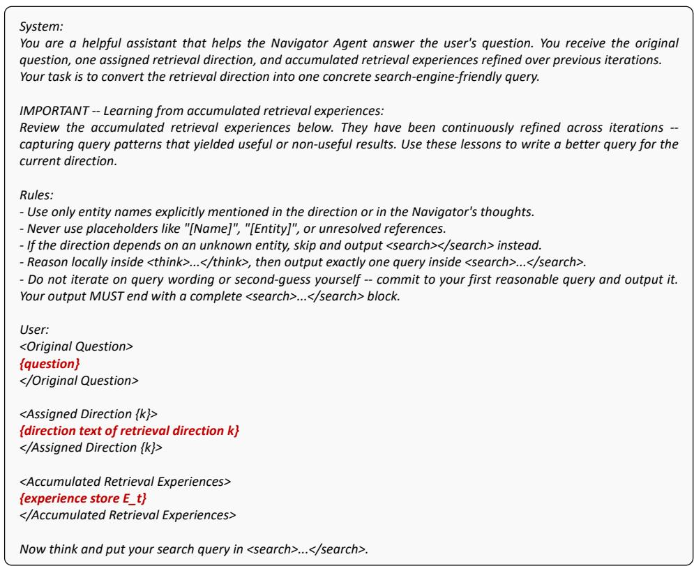  
Figure 6: Prompt Template Used in MAPS for Parallel Sub-Query Generation.

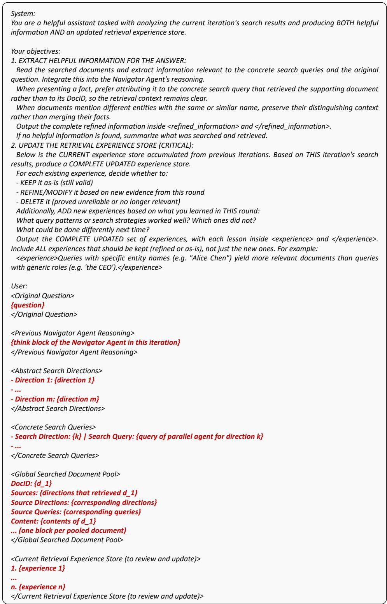  
Figure 7: Prompt Template Used in MAPS for Refined Reasoning.