# MOSAIC: An Omni-Modal Benchmark for Long-Term Memory and Cross-Modal Reasoning in Conversational Agents

Hong Ting Tsang1, Boyi Zhang1, Haoyu Huang1, Jiaxin Bai1, Yufei Li1, Yisen Gao1, Zhongwei Xie1, Hongyu Luo1, Jeff Z. Pan2, Yangqiu Song1

1The Hong Kong University of Science and Technology, 2University of Edinburgh

{httsangaj, bzhangdd, hhuangcp}@connect.ust.hk, baijiaxin@hkbu.edu.hk

{ylivm, ygaodi, zxiebk, hluoay}@connect.ust.hk, j.z.pan@ed.ac.uk, yqsong@cse.ust.hk

§ Code · \* Dataset · € Website

## Abstract

Omni-modal assistants must remember not only what users say, but also what they show and convey. Existing long-term memory benchmarks are mostly text-and-image or report a single end-to-end score, so they cannot locate whether evidence is lost when it is represented, retrieved, delivered, or read. We introduce MOSAIC, a benchmark of 923 questions over persona-grounded histories of 11–24 sessions spanning text, image, video, and audio. MO-SAIC constructs targeted spatial, temporal, and prosodic signals rather than decorative media— with the strongest causal validation for spatial information and selector-level validation for annotated prosody—and pairs them with a matched diagnostic protocol that freezes the question, reader, prompt, and budget while intervening on representation, retrieval, and delivery. Matched decomposition shows that representation loss is modality-dependent, residual reading dominates even under gold evidence, and abstention remains weak on these controls: strong answerable scores coexist with failures to refuse. MOSAIC thus turns omni-modal memory evaluation from a leaderboard into a diagnosis of WRITE, RETRIEVE, DELIVER, and READ failures.

## 1 Introduction

Omni-modal assistants such as GPT-4o, Gemini, Qwen-Omni, and MiMo (OpenAI et al., 2024; Team et al., 2025; Qwen Team, 2026; Xiaomi LLM-Core Team, 2026) are moving from single-turn demos to persistent, multi-session deployments. A user may share a product photo in January, leave a dietary voice note in March, and later expect both to inform a recommendation. Answering requires not only retrieving temporally scattered evidence, but chaining it across modalities (Figure 1). Prior conversational memory benchmarks omit video/audio, treat images as optional, or stop at text–image co-reference; none combine fourmodality multi-session dialogue with a matched stage-diagnostic protocol (Table 1).

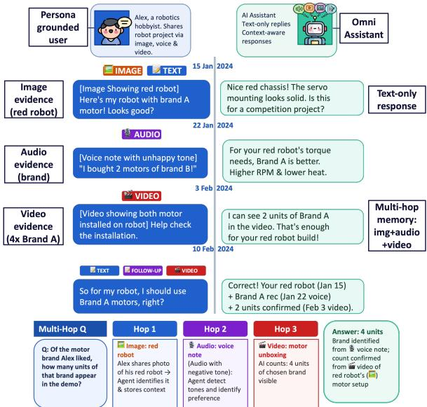  
Figure 1: Example MOSAIC haystack: evidence spans four modalities and months of sessions. Answering the final query requires chaining a January text specification with later audio and video evidence.

Multi-hop text QA (Yang et al., 2018; Trivedi et al., 2022) likewise lacks this multimodal, temporal setting, and coupled system comparisons obscure where evidence is lost. We therefore cast the pipeline as four stages—write, retrieve, deliver, and read (Figure 2)—and diagnose them with matched interventions under a frozen reader, prompt, budget, and judge.

Each stage fails in its own way, motivating four research questions:

• RQ1 (Write). Does the stored representation keep the spatial, temporal, and prosodic detail the answer will later depend on?

• RQ2 (Retrieve & Deliver). Is every required unit found, and does it survive packing into the reader’s request? Media caps can drop even topranked artefacts, so the two are measured separately.

MOSAIC: Diagnosing Omni-Modal Memory Failures  
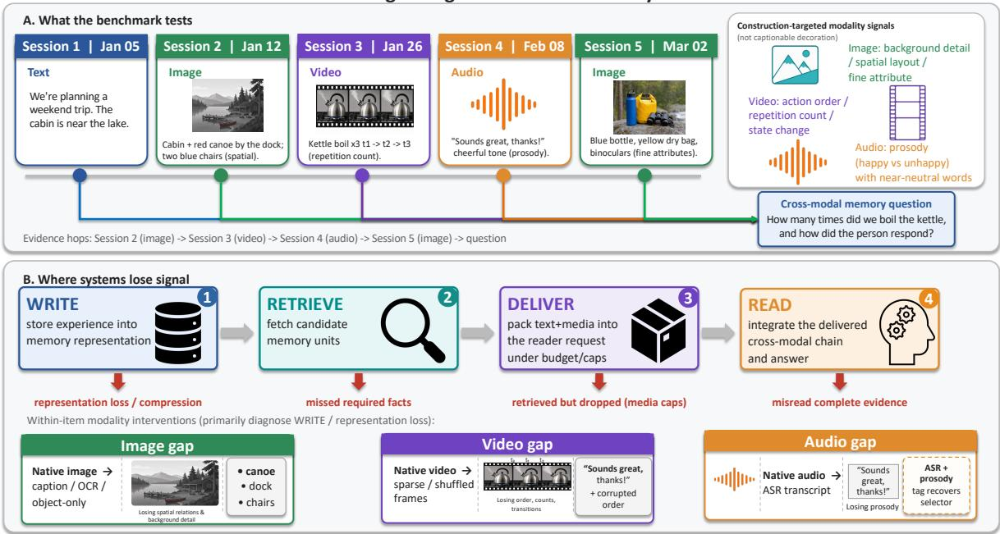  
Figure 2: Overview of MOSAIC. Top: what the benchmark tests—evidence scattered across months of text, image, video, and audio sessions must be chained across modalities. Construction targets native signals rather than decorative media: spatial layout and background detail in images; action order, repetition count, and state change in video; vocal affect in audio (causal validation is strongest for spatial detail; §6.2). Bottom: where systems lose that signal—matched interventions on WRITE (representation compression), RETRIEVE (missed facts), DELIVER (retrieved but dropped under media caps), and READ (misread complete evidence).

• RQ3 (Read). Given the complete delivered chain, can the reader integrate it across modalities and sessions?

• RQ4 (Abstain). Does the system abstain precisely when required evidence is absent—and only then?

MOSAIC has 923 questions in 11–24-session haystacks with construction-targeted modality gaps (§3.2). Headline findings: textualization costs ∼9 points (spatial-heavy); retrieval costs ∼8 points and packing ∼4 at production budgets (far more under tight media caps); ∼15 points remain under gold symbolic facts; abstention remains weak on these controls. Under the matched protocol, each paired drop is associated with the intervened stage; within-item carrier contrasts further localize signalspecific loss, with the strongest causal validation for spatial information and additional selector-level validation for annotated prosody (§6.2).

## Contributions.

• MOSAIC, 923 persona-grounded omnimodal memory questions with constructiontargeted spatial, temporal, and prosodic signals (strongest causal validation for spatial information; selector-level validation for annotated prosody), cross-modal multi-hop chains, and 139 refusal controls.

• A matched four-stage diagnostic protocol separating WRITE, RETRIEVE, DELIVER, and READ, with fixed-reader and native end-toend evaluation tracks.

• A validated public benchmark pipeline, including human audits, media, filtering dispositions, manifests, and run configurations.

## 2 Related Work

Conversational memory benchmarks. From single-session persona grounding (Zhang et al., 2018) to multi-session suites, text-only benchmarks probe extraction, multi-session and temporal reasoning, knowledge updating, recall, and persona consistency (Zhong et al., 2023; Ou et al., 2024; Wu et al., 2025; Yu et al., 2025; Jiang et al., 2025; He et al., 2024; Du et al., 2025). Multimodal extensions remain limited: LoCoMo images are often non-essential (Maharana et al., 2024; Bei et al., 2026); Mem-Gallery and MemLens make images task-critical but stop at text+image and emphasise finding rather than cross-modal chaining (Bei et al., 2026; Ren et al., 2026); ATM-Bench aggregates personal multi-source evidence rather than sequential conversational chaining (Mei et al., 2026); and MMRC, MMDU, MM-NIAH/MMNeedle, Mementos, and M3-Bench add image/video reasoning without multi-session dialogue structure (Xue et al., 2025; Liu et al., 2024b; Wang et al., 2024a,b; Zhou et al., 2026). MOSAIC is the first to require retrieving and chaining evidence across all four primary modalities in multi-session conversations (Table 1).

<table><tr><td></td><td></td><td colspan="4">Modalities</td><td colspan="2">Reasoning</td><td></td><td></td></tr><tr><td>Benchmark</td><td>Multi-Sess.</td><td>T</td><td>I</td><td>V</td><td>A</td><td>Multi-Hop</td><td>Cross-Mod. #Items</td><td></td><td> Avg. Sess.</td></tr><tr><td>MemoryBank (Zhong et al., 2023)</td><td>√</td><td>√</td><td>X</td><td>x</td><td>x</td><td>x</td><td>x</td><td>194</td><td>3.8</td></tr><tr><td>DialogBench (Ou et al., 2024)</td><td>√</td><td>√</td><td>x</td><td>x</td><td>x</td><td>x</td><td>x</td><td>9,789</td><td>7.5</td></tr><tr><td>LongMemEval (Wu et al., 2025)</td><td>√</td><td>√</td><td>x</td><td>x</td><td>X</td><td>√</td><td>x</td><td>500</td><td>5.2</td></tr><tr><td>MemAgentBench (Yu et al., 2025)</td><td>√</td><td>√</td><td>x</td><td>x</td><td>X</td><td>√</td><td>x</td><td>1,200</td><td>9.6</td></tr><tr><td>LoCoMo (Maharana et al., 2024)</td><td>√</td><td>√</td><td>√</td><td>x</td><td></td><td>X</td><td>x</td><td>1,986</td><td>27.2</td></tr><tr><td>MMDU (Liu et al., 2024b)</td><td>x</td><td>√</td><td>√</td><td>x</td><td>x</td><td>√</td><td>x</td><td>1,645</td><td>9.0</td></tr><tr><td>MMRC (Xue et al., 2025)</td><td>x</td><td>√</td><td>√</td><td>x</td><td>X</td><td>√</td><td>x</td><td>5,120</td><td>12.9</td></tr><tr><td>Mem-Gallery (Bei et al., 2026)</td><td>√</td><td>√</td><td>√</td><td>x</td><td>X</td><td>√</td><td>√†</td><td>1,000</td><td>16.5</td></tr><tr><td>MemLens (Ren et al., 2026)</td><td>√</td><td>√</td><td>√</td><td>x</td><td>x</td><td>√</td><td>x</td><td>789</td><td>14–93¶</td></tr><tr><td>ATM-Bench (Mei et al., 2026)</td><td>√</td><td>√</td><td>V</td><td>√</td><td>x</td><td>√</td><td>√</td><td>1,069</td><td>‡</td></tr><tr><td>MM-NIAH (Wang et al., 2024a)</td><td>x</td><td>√</td><td>√</td><td>x</td><td>x</td><td>X</td><td>x</td><td>12,000</td><td></td></tr><tr><td>MRAG-Bench (Hu et al., 2025)</td><td>x</td><td>√</td><td>V</td><td>x</td><td>x</td><td>x</td><td>x</td><td>16,130</td><td></td></tr><tr><td>MOSAIC (Ours)</td><td>√</td><td>√</td><td>√</td><td>√</td><td>√</td><td>√</td><td>√</td><td>923</td><td>17.5</td></tr></table>

Table 1: Comparison with prior memory benchmarks. Cross-Mod.: answering requires chaining across modality boundaries. †Text–image co-reference only. ‡Multi-source personal items (not dialogue sessions); avg. 1.6 evidence items/query. §110 dialogues, avg. 9 Q&A turns. ¶Scales with 32K–256K context variants. Artefact counts: Table 10.

Multi-hop and cross-modal reasoning. HotpotQA, MuSiQue, MultiModalQA, WebQA, and CRIT target compositional multi-hop QA over text and images (Yang et al., 2018; Trivedi et al., 2022; Talmor et al., 2021; Chang et al., 2022; Sung et al., 2026); long-context suites such as BABI-Long, RULER, and MMLU-Reason chain facts in static corpora (Kuratov et al., 2024; Hsieh et al., 2024; Tie et al., 2025). MOSAIC combines multihop reasoning with session-scattered multimodal retrieval.

Memory-augmented LLM systems. Memory architectures virtualize or structure long context (Packer et al., 2024; Chen et al., 2023; Sarthi et al., 2024; Liu et al., 2024a), integrate graphs with retrieval (Guo et al., 2025; Gutiérrez et al., 2025; Paul et al., 2026), or provide agentic/OS-inspired layers (Xu et al., 2025; Kang et al., 2025; Wang et al., 2025). They lack a standard omni-modal benchmark for controlled comparison—the role

## MOSAIC fills.

RAG and memory diagnosis. Prior work localizes failures via claim-level RAG diagnostics (Ru et al., 2024), tests of visual evidence use (Hu et al., 2025), controlled document pools (Peng et al., 2026), AMemGym’s write/read/utilization split (Jiayang et al., 2026), and MemFail’s textmemory stages (Garg et al., 2026); localization itself is not novel. We differ in how stages are separated: instead of stressing a still-coupled pipeline, MOSAIC makes each stage substitutable under a frozen reader, prompt, packer, budget, and judge. This measures DELIVER apart from RETRIEVE and attributes loss to carrier-level signals—to our knowledge the first substitutable four-stage protocol for omni-modal conversational memory.

## 3 Preliminaries

Every MOSAIC item is a persona-grounded, multimodal query embedded in a chronological haystack of user–assistant sessions. Three orthogonal axes define it, each worked through end-to-end in Appendix A: the question type fixes the reasoning skeleton (§3.1), the modality gap defines what each non-text modality must contribute (§3.2), and the reasoning chain composes NARROWER, SE-LECTOR, and ANSWER facts into a deterministic retrieval path (§3.3).

## 3.1 Question Types

MOSAIC covers six types: single-session information extraction; cross-session selection and bridging; knowledge updates; temporal-plan disruptions; and refusal after evidence removal. Questions require one to three facts; Appendix A defines each type, and Appendix D reports per-type counts.

## 3.2 Modality Gaps

A modality gap is information that survives only because its native modality preserves it, while a textonly or caption-based agent would lose it. Required non-text facts are assigned a gap strategy (Appendix A): image (background detail, fine-grained attribute, spatial configuration), video (action ordering, state transition, repetition count), or audio (happy/unhappy prosody with neutral wording over ≥ 2 candidates); Appendix D breaks down tag coverage. Audio prosody is the most frequent annotated strategy (450 facts / 399 of 784 answerable items), so Caption-Text / ASR write paths lose the tone discriminator by design—a pipeline exposure, not a gold-delivery perception cost (§6.2).

Challenge by construction. A media attachment is insufficient to establish multimodal reasoning, since a caption or transcript may preserve the entire answer. MOSAIC therefore assigns a challenge before dialogue and media realization, specifying the native relation that carries a fact together with constraints that keep that relation out of the surrounding text; every answerable item contains at least one required challenge-bearing fact (Table 2). Action Repetition Count is representative: a fixedcamera clip repeats one action with no cuts and no on-screen counter, and the dialogue says only “a few times,” so a generic caption preserves the event but loses the selector needed to continue the chain (per-challenge specifications: Appendix A).

## 3.3 Reasoning Chains and Fact Roles

Every answerable item has a reasoning chain of required facts with roles NARROWER (NAR; reduces candidates), SELECTOR (SEL; identifies an entity), and ANSWER (ANS; carries the final value), in the pattern NAR∗ SEL∗ ANS. Valid chains are bridgeentity-linked and deletion-tested (§4): removing any required fact makes the question unanswerable, and audio/video discriminators choose among $\geq 2$ same-type entities. A chain is cross-modal when required facts span at least two modalities; gap-bearing detail usually sits in a NARROWER or SELECTOR, and the ANSWER’s final value is always a short text-expressible string (enabling judge scoring), though the fact carrying it may itself be multimodal (full constraints and templates: Appendix A).

## 4 The MOSAIC Generation Pipeline

MOSAIC is produced by a fully automated, configdriven four-stage pipeline (Figure 7; details in Appendix B). Each item is grounded in a Nemotron-Personas persona (Meyer and Corneil, 2025). An LLM designs a caption-distinct primary entity, then builds the chain question-first under the bridgeentity and entity-pair constraints (§3.3). A validateand-repair loop combines programmatic checks with a per-fact deletion test against twelve failure modes; unrepaired chains are discarded, and ANSWER REFUSAL items strip required facts after auditing. Surviving facts become chronological evidence and filler sessions under leak guards. Stage 4 synthesises media (FLUX-2-pro / Kling– Seedance / Qwen3-TTS). Filtering then yields the exact lineage 1,050 → 1,004 → 879 (automated) before a three-annotator audit of 100 items (94.3% well-posed) rescues 44 probe false negatives, giving MOSAIC-Eval: 923 items (784 answerable + 139 refusal). Reweighting that audit with a 100- item probe-YES follow-up estimates ≈97.8% goldcorrect and ≈96.6% evidence-sufficient on the 784 answerable releases (Appendix I); the 784/864 (90.7%) figure remains a filtering retention rate, not a human answerability ceiling (Appendix E).

The release spans 70 personas (11–24 sessions, mean 17.5), 10,765 multimodal artefacts (Table 10), and ∼18.8M tokens (∼269K/persona). Among answerable items, 85.2% need ≥2 facts and 75.0% need ≥2 modalities; required evidence appears in image, audio, video, and text for 99.5%, 54.1%, 23.5%, and 35.3% of items (overlapping), so we report per-challenge strata rather than claiming uniform modality balance; Appendix D collects the remaining haystack statistics.

## 5 Diagnostic Evaluation Protocol

To answer RQ1–RQ4 with matched stage contrasts, the protocol makes every stage of the pipeline separately substitutable under a frozen reader, prompt, and budget. For history H, question q, and delivery budget B, let

$$
\begin{array} { c c } { { { \cal M } = { \cal W } ( H ) , } } & { { \quad R = G ( q , M ) , } } \\ { { { \cal D } = { \cal P } ( R , B ) , } } & { { \quad \hat { a } = { \cal F } ( q , D ) , } } \end{array}\tag{1}
$$

where W writes memory, G retrieves units, P serializes and packs them, and F reads the delivered

<table><tr><td>Mod.</td><td>Challenge</td><td>Controlled realization</td><td>Facts</td><td>Items</td></tr><tr><td>Image</td><td>Background detail</td><td>Put the target behind a more salient foreground subject.</td><td>328</td><td>284</td></tr><tr><td>Image</td><td>Fine-grained attribute</td><td>Require exact text, brand, shade, label, or a small count.</td><td>388</td><td>333</td></tr><tr><td>Image</td><td>Spatial configuration</td><td>Make relative position, rather than object presence, discriminative.</td><td>194</td><td>185</td></tr><tr><td>Video</td><td>Action ordering</td><td>Show two distinct completed actions in strict sequence without cuts.</td><td>67</td><td>64</td></tr><tr><td>Video</td><td>Repetition count</td><td>Repeat one action under a fixed camera, without a counter or overlay.</td><td>64</td><td>56</td></tr><tr><td>Video</td><td>State transition</td><td>Expose the start, change pattern, and end state.</td><td>64</td><td>64</td></tr><tr><td>Audio</td><td>Prosody</td><td>Hold words approximately neutral while happy or unhappy delivery selects an entity.</td><td>450</td><td>399</td></tr></table>

Table 2: The seven modality challenges and their overlapping coverage among the 784 answerable items. Counts are required-fact occurrences and distinct items, not independent subsets.

evidence. A retrieved artefact counts as delivered only if it is presented to the actual provider, a distinction that turns out to matter a great deal (§6.1).

## 5.1 Matched Stage Decomposition

We run seven matched conditions on the same 784 answerable QIDs (Table 3), changing only representation, retrieval, or delivery under one reader, prompt, packer, and judge. These are interventions rather than an assumed ranking: native evidence may remain perceptually difficult, and retrieved context may include useful evidence outside the minimal annotated chain.

The main paired contrasts are symbolic versus native (perception cost), structured versus generic text (avoidable write-time compression), gold native versus retrieved-all-delivered (retrieval loss), and all-delivered versus production-capped requests (delivery loss). Delivery is additionally traced as a budget curve over tighter packer allowances (top-10 units; top-5 with one media item per modality). Residual errors under gold symbolic facts bound answer integration and grading error.

Frozen configuration. Matched conditions use Gemini 3.5 as the fixed omni-modal reader (temperature 0; extended thinking disabled), held out from dataset construction: MiMo-V2.5 is the answerability probe, so using it as the primary reader would couple selection with evaluation. The trade-off is disclosed—gold-native failures mix perception error with bounded item noise (§6.1). Retrieval replays a frozen top-50 ranked manifest; the production budget delivers the top 20 units with at most three items per modality under a 100 MB media cap. Embedders, captioner/ASR, structured writer (query-blind MiMo-V2.5 schemas), and judge (Qwen3.7-Plus) are listed in Appendix C. MiMo-V2.5 as second reader on the 120-item pilot reproduces the gold and budgeted stage ladder (Appendix K.2); uncapped all-delivered remains

Gemini-only (MiMo timeouts under large multimodal payloads).

## 5.2 Within-Item Modality Interventions

Within an item we change one required carrier while holding its question, evidence order, and every other hop fixed. Image variants are raw media, OCR-only text, object-only text, and a spatial description; video variants are raw video, ordered sparse frames, shuffled frames, and an ordered event/count description; audio variants are raw audio, ASR, ASR plus a gold prosody tag from the construction annotation (an upper bound on any prosody tagger), and ASR plus the swapped gold tag (happy↔unhappy). Image and video text variants use the same query- and answer-blind MiMo writer as the structured-write condition.

Because every retained item was verified answerable from native evidence alone, a text-over-raw gap indicates a perception failure rather than a missing signal. Each contrast is restricted to the matching challenge stratum, and a per-condition leak audit verifies that non-intervened hops are unchanged.

## 5.3 Two Architecture Tracks

We separate two questions that end-to-end leaderboards conflate. In Track A (fixed reader), flat RAG over caption-text, omni-text, and native indexes, plus A-MEM (Xu et al., 2025) and MemoryOS (Kang et al., 2025), export retrieved context to one reader, prompt, packer, budget, and judge— comparing the useful evidence each backend produces. In Track B (native end-to-end), Naive RAG, repaired ReAct (Yao et al., 2023), A-MEM, and MemoryOS use their intended controllers and readers, measuring deployable capability descriptively because multiple components change at once.

Three representations underlie both tracks (Appendix C): Caption-Text (VL captioner + ASR), Omni-Text (single omni LM captions that retain prosody Whisper discards; retrieval still textual), and Native-MM (multimodal embeddings + omni reader over raw artefacts). A-MEM and MemoryOS are text-derived only; ReAct results in Table 28 are adaptive (up to 5 iterative search steps; mean 1.91 searches, median 1). A one-search parity gate is applied first—the scaffold is restricted to a single retrieval and must match the corresponding Naive RAG run’s retrieval and delivery plumbing— and adaptive ReAct numbers are reported only after that gate passes.

<table><tr><td>Stage</td><td>Condition</td><td>Score</td><td>Img</td><td>Vid</td><td>Aud</td><td>M-hop</td><td>Chain</td><td>Diagnostic role</td></tr><tr><td></td><td>Gold symbolic facts</td><td>0.846</td><td>0.847</td><td>0.900</td><td>0.821</td><td>0.853</td><td>1.000</td><td>Bounds residual read error</td></tr><tr><td>WRITE</td><td>Gold native evidence</td><td>0.783</td><td>0.785</td><td>0.729</td><td>0.826</td><td>0.783</td><td>1.000</td><td>Native perception cost</td></tr><tr><td>WRITE</td><td>Gold generic text</td><td>0.690</td><td>0.693</td><td>0.625</td><td>0.718</td><td>0.682</td><td>1.000</td><td>Textualization loss</td></tr><tr><td>WRITE</td><td>Gold structured text</td><td>0.704</td><td>0.705</td><td>0.652</td><td>0.742</td><td>0.702</td><td>1.000</td><td>Avoidable share of it</td></tr><tr><td>RETRIEVE</td><td>Retrieved native, all delivered</td><td>0.708</td><td>0.709</td><td>0.631</td><td>0.741</td><td>0.696</td><td>0.675</td><td>Retrieval loss</td></tr><tr><td>DELIVER</td><td>Retrieved native, capped</td><td>0.670</td><td>0.671</td><td>0.576</td><td>0.696</td><td>0.652</td><td>0.491</td><td>Packing loss</td></tr><tr><td></td><td>End-to-end native RAG</td><td>0.653</td><td>0.653</td><td>0.566</td><td>0.670</td><td>0.634</td><td>0.464</td><td>Adds query rewrite</td></tr><tr><td>Perception cost (symbolic — native, pts)</td><td></td><td>6.2</td><td>6.2</td><td>17.1</td><td>-0.5</td><td>7.0</td><td></td><td></td></tr></table>

Table 3: Matched WRITE–RETRIEVE–DELIVER–READ decomposition on the 784 answerable items with the fixed Gemini 3.5 reader (Figure 3). Image/Video/Audio restrict to the 780/184/424 items whose chain needs that modality; Multi-hop to the 668 needing ≥2 facts; Chain is complete-chain delivery into the request. Paired CIs (and W/T/L for write contrasts) are in Appendix K.

## 5.4 Metrics and Uncertainty

The primary answer metric is a 0–1 semantic judge score from Qwen3.7-Plus (rubric in Appendix C) (Li et al., 2024), reported separately for the 784 answerable items, with correct-refusal and false-refusal rates paired so that an alwaysabstain system cannot appear calibrated. Retrieval and delivery use required-fact and complete-chain Recall@k over both ranked units and units actually serialized into the request. Controlled comparisons are paired by QID with item-bootstrap 95% intervals and wins/ties/losses; a persona-clustered bootstrap is a dependence check. Reported intervals are per-contrast and unadjusted across the many paired tests and strata, so exploratory challenge-level nulls should be read cautiously. GLM-5.2 and Grok-4.5 evaluate each native end-to-end run (Appendix J); Appendix C documents manifests, media caps, and scoring; Appendix M reproduces the prompts.

## 6 Results and Analysis

All numbers come from one canonical paired run, and every stage claim uses only paired conditions with identical QIDs, readers, prompts, packers, and judges. A retrieved-but-dropped artefact counts as a delivery failure rather than a reading failure, and a write loss is claimed only where structured text recovers an error made with generic text.

## 6.1 Overall Stage Decomposition (RQ1–RQ3)

Table 3 and Figure 3 associate each paired drop with the intervened stage under the matched protocol. Gold symbolic facts score 0.846, so 15.4 points of residual reading/grading error remain even with perfect evidence. Native gold evidence drops to 0.783 (6.2-point perception cost [3.2, 9.3]); generic captions/ASR fall further to 0.690 (−9.3 vs. native), and the structured writer recovers only +1.4 [−0.9, 3.7] to 0.704—a recovery indistinguishable from zero. Retrieval costs 7.6 points (0.783→0.708 all-delivered [5.2, 9.9]) and production packing another 3.8 on identical ranked hits (0.708→0.670 [1.5, 6.0]), with complete-chain delivery falling from 0.675 to 0.491; end-to-end native RAG reaches 0.653 (+1.7 vs. the original-query budgeted condition is not material). Under this frozen reader and judge, reading is the largest single associated loss and the only stage whose dominance is stable across pipelines; among the rest, retrieval leads for native pipelines while write-time textualization leads for text-derived ones. These are matched-protocol associations, not universal causal bottlenecks: the 15.4-point gold-symbolic residual reflects reader, output-format, and judge error in addition to true reading failure. Appendix K gives paired CIs and write-contrast W/T/L; Appendix K.7 the per-type ladders.

Perception cost is modality-dependent. Video items score 0.900 with symbolic facts but only 0.729 with native video (17.1-point perception cost), against 6.2 for image (0.847→0.785) and none for audio (0.821→0.826). For this fixed reader, video perception is a candidate bottleneck— not explained by retrieval or question difficulty alone.

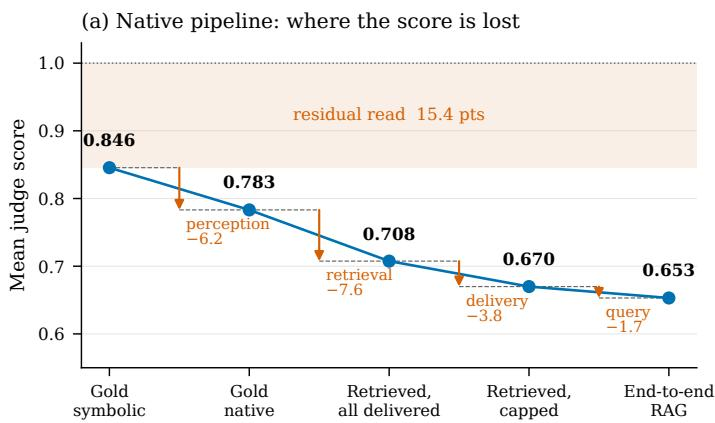

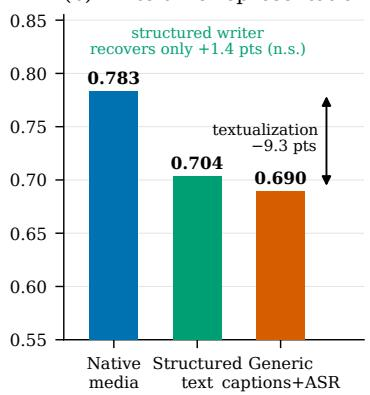  
Figure 3: Decomposing the loss on the 784 answerable items under one fixed reader, prompt, packer, and judge (Table 3). (a) Descending the native pipeline: each arrow is a paired drop associated with the intervened stage under the matched protocol; the shaded band is residual reading error under gold symbolic facts. (b) Write-time representation only: generic captions/ASR cost 9.3 points; a query-blind structured writer recovers a statistically insignificant 1.4.

Probe selection. Probe-pass (n=740) and human-rescued (n=44) items match under gold symbolic facts (0.846 vs. 0.845) but differ by 27.8 points under gold native evidence (0.799 vs. 0.520); absolute native scores are optimistic there, but paired comparisons remain interpretable under the matched protocol.

Delivery is the stage a retrieval-terminating decomposition cannot see. Figure 4 freezes the top-50 ranked manifest (required-fact Recall@50 = 0.871 throughout) and varies only the packer. Halving the unit budget costs 5.7 points [3.3, 8.0]; one media item per modality jointly with the reduced top-k costs 17.7 [14.5, 20.9] and collapses complete-chain delivery from 0.675 to 0.184 (required-fact coverage 0.871→0.501). The 17.7-point drop therefore reflects the combined effect of the top-k reduction and the one-media-permodality cap together, not the media cap alone. Context construction, not ranking, is the binding constraint once media budgets tighten (numeric sweep in Appendix K.3).

## 6.2 Representation Loss by Modality (RQ1)

Figure 5 shows the paired effects on each governing challenge stratum; Appendix K.4 tabulates exact estimates and W/T/L.

Visual signals are heavily compressed by textualization. On fine-detail and background items, OCR-only text loses 18.5 points to raw images [15.3, 21.6], and on spatial-configuration items raw images beat OCR-only text by 32.0 points. What is lost is specifically relational: on those same spatial-configuration items, an explicit spatial description recovers 15.4 points over object-only text [9.5, 21.5], closing about a third of the 43.3-point gap between object-only text and raw pixels. Naming the objects present is therefore not enough; the arrangement carries the fact, and a writer that is told to preserve arrangement recovers a substantial part of it—but only a part.

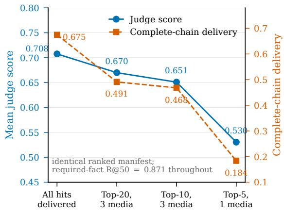  
Figure 4: Delivery-budget sweep over a single frozen top-50 ranked manifest. Retrieval quality is constant (Recall@50 = 0.871); only the packer’s allowance changes. One-media-per-modality packing collapses complete-chain delivery from 0.675 to 0.184.

Temporal and prosodic signals show the opposite profile. Ordered sparse frames do not beat shuffled frames on action-ordering items (−1.5 points [−7.8, 4.6]); event/count text matches sparse frames on repetition and state-transition items (+1.4 [−5.2, 8.0] and +2.7 [−5.0, 10.6]); raw audio beats ASR by only 0.8 [−1.5, 3.0]; and a gold prosody tag adds only 1.5 [−0.8, 3.8] (394/450 ties). Under gold delivery these are ceilings on acoustic recovery once the transcript is in hand, not evidence that the gap is decorative. On the same 399 items, Native-MM substantially outperforms Caption-Text end-to-end (Appendix K.10), a write/retrieve exposure that gold delivery factors out. Video strata remain small (n=56–64 unique QIDs); at 80% power the MDEs are 8.9– 11.2 points (Appendix F), so the nonsignificant video contrasts do not establish lossless temporal compression. Over 399 unique prosody QIDs, replacing the correct gold prosody tag with its opposite reduced score by 4.6 points [1.7, 7.7; W/T/L 46/330/23] (Appendix K.4, Figure 5): the annotated selector is causally load-bearing under gold delivery, even though raw audio versus ASR remains inconclusive.

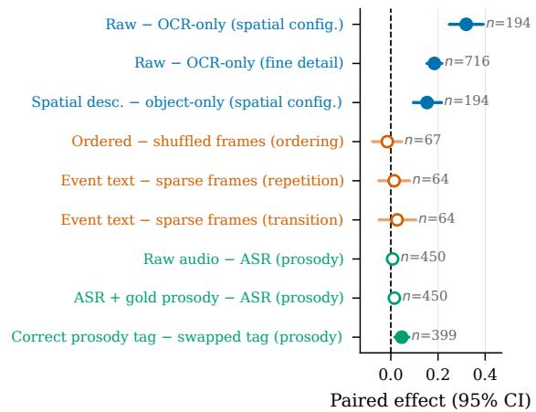

Figure 5: Within-item paired effects on the governing challenge stratum (item-bootstrap 95% intervals). Filled markers exclude zero. Spatial structure is the signal for which no tested text surrogate is adequate.
<table><tr><td>Backend / representation</td><td>Chain R@k</td><td>Score</td></tr><tr><td>Flat RAG, caption text</td><td>0.698</td><td>0.522</td></tr><tr><td>Flat RAG, omni text</td><td>0.705</td><td>0.500</td></tr><tr><td>Flat RAG, native multimodal</td><td>0.466</td><td>0.641</td></tr><tr><td>A-MEM, caption text</td><td>0.787</td><td>0.684</td></tr><tr><td>A-MEM, omni text</td><td>0.702</td><td>0.664</td></tr><tr><td>MemoryOS, caption text</td><td>n/o</td><td>0.268</td></tr><tr><td>MemoryOS, omni text</td><td>n/o</td><td>0.279</td></tr></table>

Table 4: Track A under the fixed Gemini 3.5 reader on 784 answerable QIDs. Chain R@k denotes completechain delivery; MemoryOS coverage is unobservable. Paired effects: Appendix K.5.

## 6.3 Fixed-Reader Comparison (RQ2)

With the reader fixed (Table 4), A-MEM beats same-representation flat RAG by 16.2 points on caption text [13.1, 19.3; W/T/L 233/464/87] and by 16.4 on omni text [13.2, 19.4]; A-MEM caption (0.684) also outscores flat RAG over native multimodal evidence (0.641). Chain coverage explains why: A-MEM delivers the complete required chain on 0.787 of items vs. 0.698 (flat caption) and only 0.466 (native index), whose media caps evict chain members. MemoryOS lags at 0.268/0.279 (25.5 / 22.1 points behind flat RAG), consistent with Track B over-abstention. Memory organization therefore helps when it improves complete-chain delivery under a fixed reader and budget; a native index can still lose if packing drops required media before the reader sees them. Backends that keep every required hop in the request win even with a text-only store; native perception cannot rescue a truncated chain. All 9,338 retrieved-but-dropped artefacts hit the media-count cap (Appendix K.9).

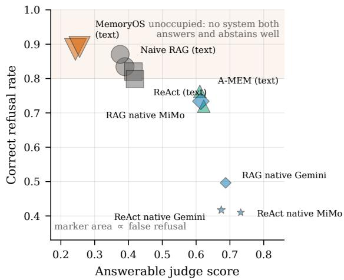  
Figure 6: Answering versus abstention for all twelve Track B systems. Marker area is proportional to the false-refusal rate. The shaded upper region is unoccupied. Full scores: Appendix K.6, Table 28.

## 6.4 End-to-End Systems & Abstention (RQ4)

Figure 6 exposes a sharp answer–abstention tradeoff. Native ReAct with MiMo-V2.5 leads on answerable items (0.732) but correctly refuses only 0.410, whereas MemoryOS exceeds 0.88 correct refusal while scoring below 0.26 on answerable items and falsely refusing over 0.61. A-MEM caption text is the closest to balanced, but no system occupies the upper-right. Because refusal controls retain question-form cues (Appendix H), RQ4 diagnoses abstention under this control set rather than form-blind calibration.

## 7 Conclusion

MOSAIC separates omni-modal memory failures into WRITE, RETRIEVE, DELIVER, and READ. Under the matched protocol and fixed reader, reading accounts for the largest residual loss under gold facts; retrieval and delivery constrain native pipelines, textualization text-derived ones. These are protocol associations, not universal bottlenecks. Spatial structure has the clearest causal validation and no adequate text surrogate; annotated prosody tags show selector-level sensitivity, while temporal and raw-audio versus ASR contrasts remain inconclusive. No system both answers and refuses reliably: progress requires preserving modalityspecific signal, delivering complete chains, and reading them faithfully.

## 8 Limitations

MOSAIC’s personas, evidence sessions, and media are synthetic; evaluation on organically collected multimodal histories remains future work. The primary reader is held out from filtering, and stage contrasts are paired, but stage labels are matched-protocol associations rather than fully isolated mechanisms. Video nulls are underpowered (Appendix F). The raw-audio versus ASR gap is inconclusive for this reader, and textualized audio carriers often retain paralinguistic lexical cues while other gold hops already expose the answer value— so gold-delivery audio nulls do not establish acoustic recovery (Appendix G). Swapped gold prosody tags nonetheless show selector-level sensitivity (Appendix K.4). RQ4 uses length-matched refusal controls with residual form cues (Appendix H). Further caveats on modality coverage and backend scope are in Appendix G.

## 9 Ethical Considerations

Personas, evidence sessions, and all media artefacts in MOSAIC are synthetic; we release no private user logs collected by the authors. Filler dialogue text is sampled from LongMemEval’s public filler-session pool (Appendix B.6): UltraChat under MIT and ShareGPT under Apache 2.0 as stated by LongMemEval; multimodal attachments on those fillers are synthetic injections from our pipeline. Stage-localized evaluation is intended as a constructive tool: deployers can see where evidence was dropped rather than only that a system scored poorly. The human audit used short voluntary academic annotation (Appendix I). Real deployments of omni-modal memory should of course obtain user consent and provide retention controls, concerns outside the scope of this benchmark release. AI assistants aided coding and drafting.

## References

Shuai Bai, Yuxuan Cai, Ruizhe Chen, Keqin Chen, Xionghui Chen, Zesen Cheng, Lianghao Deng, Wei Ding, Chang Gao, Chunjiang Ge, Wenbin Ge, Zhifang Guo, Qidong Huang, Jie Huang, Fei Huang, Binyuan Hui, Shutong Jiang, Zhaohai Li, Mingsheng Li, Mei Li, Kaixin Li, Zicheng Lin, Junyang Lin, Xuejing Liu, Jiawei Liu, Chenglong Liu, Yang Liu, Dayiheng Liu, Shixuan Liu, Dunjie Lu, Ruilin Luo, Chenxu Lv, Rui Men, Lingchen Meng, Xuancheng Ren, Xingzhang Ren, Sibo Song, Yuchong Sun, Jun Tang, Jianhong Tu, Jianqiang Wan, Peng Wang, Pengfei Wang, Qiuyue Wang, Yuxuan Wang, Tianbao Xie, Yiheng Xu, Haiyang Xu, Jin Xu, Zhibo Yang, Mingkun Yang, Jianxin Yang, An Yang, Bowen Yu, Fei Zhang, Hang Zhang, Xi Zhang, Bo Zheng, Humen Zhong, Jingren Zhou, Fan Zhou, Jing Zhou, Yuanzhi Zhu, and Ke Zhu. 2025. Qwen3-VL Technical Report. arXiv preprint. Version Number: 2.

Yuanchen Bei, Tianxin Wei, Xuying Ning, Yanjun Zhao, Zhining Liu, Xiao Lin, Yada Zhu, Hendrik Hamann, Jingrui He, and Hanghang Tong. 2026. Mem-Gallery: Benchmarking Multimodal Long-Term Conversational Memory for MLLM Agents. arXiv preprint. ArXiv:2601.03515 [cs].

Yingshan Chang, Mridu Narang, Hisami Suzuki, Guihong Cao, Jianfeng Gao, and Yonatan Bisk. 2022. WebQA: Multihop and Multimodal QA. arXiv preprint. ArXiv:2109.00590 [cs.CL].

Howard Chen, Ramakanth Pasunuru, Jason Weston, and Asli Celikyilmaz. 2023. Walking Down the Memory Maze: Beyond Context Limit through Interactive Reading. arXiv preprint. ArXiv:2310.05029 [cs.CL].

Wei-Lin Chiang, Zhuohan Li, Zi Lin, Ying Sheng, Zhanghao Wu, Hao Zhang, Lianmin Zheng, Siyuan Zhuang, Yonghao Zhuang, Joseph E. Gonzalez, Ion Stoica, and Eric P. Xing. 2023. Vicuna: An open-source chatbot impressing GPT-4 with 90%\* ChatGPT quality. https://lmsys.org/ blog/2023-03-30-vicuna/. ShareGPT conversations curated via LMSYS FastChat.

Ning Ding, Yulin Chen, Bokai Xu, Yujia Qin, Zhi Zheng, Shengding Hu, Zhiyuan Liu, Maosong Sun, and Bowen Zhou. 2023. Enhancing chat language models by scaling high-quality instructional conversations. arXiv preprint arXiv:2305.14233.

Bangde Du, Minghao Guo, Songming He, Ziyi Ye, Xi Zhu, Weihang Su, Shuqi Zhu, Yujia Zhou, Yongfeng Zhang, Qingyao Ai, and Yiqun Liu. 2025.

TwinVoice: A Multi-dimensional Benchmark Towards Digital Twins via LLM Persona Simulation. arXiv preprint. ArXiv:2510.25536 [cs.CL].

Ishir Garg, Neel Kolhe, Dawn Song, and Xuandong Zhao. 2026. MemFail: Stress-Testing Failure Modes of LLM Memory Systems. ArXiv:2605.26667 [cs.AI].

Zirui Guo, Lianghao Xia, Yanhua Yu, Tu Ao, and Chao Huang. 2025. LightRAG: Simple and Fast Retrieval-Augmented Generation. arXiv preprint. ArXiv:2410.05779 [cs.IR].

Bernal Jiménez Gutiérrez, Yiheng Shu, Yu Gu, Michihiro Yasunaga, and Yu Su. 2025. HippoRAG: Neurobiologically Inspired Long-Term Memory for Large Language Models. arXiv preprint. ArXiv:2405.14831 [cs].

Junqing He, Liang Zhu, Rui Wang, Xi Wang, Reza Haffari, and Jiaxing Zhang. 2024. MADial-Bench: Towards Real-world Evaluation of Memory-Augmented Dialogue Generation. arXiv preprint. ArXiv:2409.15240 [cs.CL].

Cheng-Ping Hsieh, Simeng Sun, Samuel Kriman, Shantanu Acharya, Dima Rekesh, Fei Jia, Yang Zhang, and Boris Ginsburg. 2024. RULER: What’s the Real Context Size of Your Long-Context Language Models? arXiv preprint. ArXiv:2404.06654 [cs.CL].

Wenbo Hu, Jia-Chen Gu, Zi-Yi Dou, Mohsen Fayyaz, Pan Lu, Kai-Wei Chang, and Nanyun Peng. 2025. MRAG-Bench: Vision-Centric Evaluation for Retrieval-Augmented Multimodal Models. arXiv preprint. ArXiv:2410.08182 [cs.CV].

Florian Hönicke, Michael Günther, Andreas Koukounas, Mohammad Kalim Akram, Scott Martens, Saba Sturua, and Han Xiao. 2026. jina-embeddings-v5- omni: Geometry-preserving Embeddings via Locked Aligned Towers. arXiv preprint. ArXiv:2605.08384 [cs.CL].

Bowen Jiang, Zhuoqun Hao, Young-Min Cho, Bryan Li, Yuan Yuan, Sihao Chen, Lyle Ungar, Camillo J. Taylor, and Dan Roth. 2025. Know Me, Respond to Me: Benchmarking LLMs for Dynamic User Profiling and Personalized Responses at Scale. arXiv preprint. Version Number: 2.

Cheng Jiayang, Dongyu Ru, Lin Qiu, Yiyang Li, Xuezhi Cao, Yangqiu Song, and Xunliang Cai. 2026. AMem-Gym: Interactive Memory Benchmarking for Assistants in Long-Horizon Conversations. arXiv preprint. ArXiv:2603.01966 [cs].

Jiazheng Kang, Mingming Ji, Zhe Zhao, and Ting Bai. 2025. Memory OS of AI Agent. In Proceedings of the 2025 Conference on Empirical Methods in Natural Language Processing, pages 25961–25970, Suzhou, China. Association for Computational Linguistics.

Yuri Kuratov, Aydar Bulatov, Petr Anokhin, Ivan Rodkin, Dmitry Sorokin, Artyom Sorokin, and Mikhail Burtsev. 2024. BABILong: Testing the Limits of LLMs with Long Context Reasoning-in-a-Haystack. arXiv preprint. ArXiv:2406.10149 [cs.CL].

Dawei Li, Bohan Jiang, Liangjie Huang, Alimohammad Beigi, Chengshuai Zhao, Zhen Tan, Amrita Bhattacharjee, Yuxuan Jiang, Canyu Chen, Tianhao Wu, Kai Shu, Lu Cheng, and Huan Liu. 2024. From Generation to Judgment: Opportunities and Challenges of LLM-as-a-judge. arXiv preprint. Version Number: 7.

Weijie Liu, Zecheng Tang, Juntao Li, Kehai Chen, and Min Zhang. 2024a. MemLong: Memory-Augmented Retrieval for Long Text Modeling. arXiv preprint. ArXiv:2408.16967 [cs.CL].

Ziyu Liu, Tao Chu, Yuhang Zang, Xilin Wei, Xiaoyi Dong, Pan Zhang, Zijian Liang, Yuanjun Xiong, Yu Qiao, Dahua Lin, and Jiaqi Wang. 2024b. MMDU: A Multi-Turn Multi-Image Dialog Understanding Benchmark and Instruction-Tuning Dataset for LVLMs. arXiv preprint. ArXiv:2406.11833 [cs.CV].

Adyasha Maharana, Dong-Ho Lee, Sergey Tulyakov, Mohit Bansal, Francesco Barbieri, and Yuwei Fang. 2024. Evaluating Very Long-Term Conversational Memory of LLM Agents. arXiv preprint. ArXiv:2402.17753 [cs].

Jingbiao Mei, Jinghong Chen, Guangyu Yang, Xinyu Hou, Margaret Li, and Bill Byrne. 2026. According to Me: Long-Term Personalized Referential Memory QA. arXiv preprint. ArXiv:2603.01990 [cs.AI].

Yev Meyer and Dane Corneil. 2025. Nemotron-Personas-USA: Synthetic personas aligned to realworld distributions.

OpenAI, Aaron Hurst, Adam Lerer, Adam P. Goucher, Adam Perelman, Aditya Ramesh, Aidan Clark, A. J. Ostrow, and et al. Welihinda. 2024. GPT-4o System Card. arXiv preprint. ArXiv:2410.21276 [cs].

Jiao Ou, Junda Lu, Che Liu, Yihong Tang, Fuzheng Zhang, Di Zhang, and Kun Gai. 2024. DialogBench: Evaluating LLMs as Human-like Dialogue Systems. arXiv preprint. ArXiv:2311.01677 [cs.CL].

Charles Packer, Sarah Wooders, Kevin Lin, Vivian Fang, Shishir G. Patil, Ion Stoica, and Joseph E. Gonzalez. 2024. MemGPT: Towards LLMs as Operating Systems. arXiv preprint. ArXiv:2310.08560 [cs].

Swarna Kamal Paul, Shubhendu Sharma, and Nitin Sareen. 2026. GAAMA: Graph Augmented Associative Memory for Agents. arXiv preprint. ArXiv:2603.27910 [cs.AI].

Xiangyu Peng, Can Qin, Zeyuan Chen, Ran Xu, Caiming Xiong, and Chien-Sheng Wu. 2026. UNIDOC-BENCH: A Unified Benchmark for Document-Centric Multimodal RAG. arXiv preprint. ArXiv:2510.03663 [cs.CL].

Qwen Team. 2026. Qwen3.5-Omni Technical Report. arXiv preprint. Version Number: 2.

Alec Radford, Jong Wook Kim, Tao Xu, Greg Brockman, Christine McLeavey, and Ilya Sutskever. 2023. Robust Speech Recognition via Large-Scale Weak Supervision. In Proceedings ofthe 40th International Conference on Machine Learning.

Xiyu Ren, Zhaowei Wang, Yiming Du, Zhongwei Xie, Chi Liu, Xinlin Yang, Haoyue Feng, Wenjun Pan, Tianshi Zheng, Baixuan Xu, Zhengnan Li, Yangqiu Song, Ginny Wong, and Simon See. 2026. Memlens: Benchmarking multimodal long-term memory in large vision-language models. Preprint, arXiv:2605.14906.

Dongyu Ru, Lin Qiu, Xiangkun Hu, Tianhang Zhang, Peng Shi, Shuaichen Chang, Jiayang Cheng, Cunxiang Wang, Shichao Sun, Huanyu Li, Zizhao Zhang, Binjie Wang, Jiarong Jiang, Tong He, Zhiguo Wang, Pengfei Liu, Yue Zhang, and Zheng Zhang. 2024. RAGChecker: A Fine-grained Framework for Diagnosing Retrieval-Augmented Generation. In Advances in Neural Information Processing Systems.

Parth Sarthi, Salman Abdullah, Aditi Tuli, Shubh Khanna, Anna Goldie, and Christopher D. Manning. 2024. RAPTOR: Recursive Abstractive Processing for Tree-Organized Retrieval. arXiv preprint. ArXiv:2401.18059 [cs.CL].

Junyoung Sung, Seungwoo Lyu, Minjun Kim, Sumin An, Arsha Nagrani, and Paul Hongsuck Seo. 2026. CRIT: Graph-Based Automatic Data Synthesis to Enhance Cross-Modal Multi-Hop Reasoning. arXiv preprint. Version Number: 1.

Alon Talmor, Ori Yoran, Amnon Catav, Dan Lahav, Yizhong Wang, Akari Asai, Gabriel Ilharco, Hannaneh Hajishirzi, and Jonathan Berant. 2021. MultiModalQA: Complex Question Answering over Text, Tables and Images. arXiv preprint. ArXiv:2104.06039 [cs.CL].

Gemini Team, Rohan Anil, Sebastian Borgeaud, Jean-Baptiste Alayrac, Jiahui Yu, Radu Soricut, Johan Schalkwyk, Andrew M. Dai, and et al. Hauth. 2025. Gemini: A Family of Highly Capable Multimodal Models. arXiv preprint. ArXiv:2312.11805 [cs].

Guiyao Tie, Xueyang Zhou, Tianhe Gu, Ruihang Zhang, Chaoran Hu, Sizhe Zhang, Mengqu Sun, Yan Zhang, Pan Zhou, and Lichao Sun. 2025. MMLU-Reason: Benchmarking Multi-Task Multi-modal Language Understanding and Reasoning. arXiv preprint. ArXiv:2505.16459 [cs.AI].

Harsh Trivedi, Niranjan Balasubramanian, Tushar Khot, and Ashish Sabharwal. 2022. MuSiQue: Multihop Questions via Single-hop Question Composition. arXiv preprint. ArXiv:2108.00573 [cs].

Piaohong Wang, Motong Tian, Jiaxian Li, Yuan Liang, Yuqing Wang, Qianben Chen, Tiannan Wang, Zhicong Lu, Jiawei Ma, Yuchen Eleanor Jiang, and

Wangchunshu Zhou. 2025. O-Mem: Omni Memory System for Personalized, Long Horizon, Self-Evolving Agents. arXiv preprint. ArXiv:2511.13593 [cs].

Weiyun Wang, Shuibo Zhang, Yiming Ren, Yuchen Duan, Tiantong Li, Shuo Liu, Mengkang Hu, Zhe Chen, Kaipeng Zhang, Lewei Lu, Xizhou Zhu, Ping Luo, Yu Qiao, Jifeng Dai, Wenqi Shao, and Wenhai Wang. 2024a. Needle In A Multimodal Haystack. arXiv preprint. ArXiv:2406.07230 [cs.CV].

Wenhui Wang, Furu Wei, Li Dong, Hangbo Bao, Nan Yang, and Ming Zhou. 2020. MiniLM: Deep Self-Attention Distillation for Task-Agnostic Compression of Pre-Trained Transformers. arXiv preprint. ArXiv:2002.10957 [cs.CL].

Xiyao Wang, Yuhang Zhou, Xiaoyu Liu, Hongjin Lu, Yuancheng Xu, Feihong He, Jaehong Yoon, Taixi Lu, Gedas Bertasius, Mohit Bansal, Huaxiu Yao, and Furong Huang. 2024b. Mementos: A Comprehensive Benchmark for Multimodal Large Language Model Reasoning over Image Sequences. arXiv preprint. ArXiv:2401.10529 [cs.CV].

Di Wu, Hongwei Wang, Wenhao Yu, Yuwei Zhang, Kai-Wei Chang, and Dong Yu. 2025. LongMemEval: Benchmarking Chat Assistants on Long-Term Interactive Memory. arXiv preprint. ArXiv:2410.10813 [cs].

Xiaomi LLM-Core Team. 2026. XiaomiMiMo/MiMo-V2.5 · Hugging Face.

Wujiang Xu, Zujie Liang, Kai Mei, Hang Gao, Juntao Tan, and Yongfeng Zhang. 2025. A-MEM: Agentic Memory for LLM Agents. arXiv preprint. ArXiv:2502.12110 [cs].

Haochen Xue, Feilong Tang, Ming Hu, Yexin Liu, Qidong Huang, Yulong Li, Chengzhi Liu, Zhongxing Xu, Chong Zhang, Chun-Mei Feng, Yutong Xie, Imran Razzak, Zongyuan Ge, Jionglong Su, Junjun He, and Yu Qiao. 2025. MMRC: A Large-Scale Benchmark for Understanding Multimodal Large Language Model in Real-World Conversation. arXiv preprint. ArXiv:2502.11903 [cs.CL].

Zhilin Yang, Peng Qi, Saizheng Zhang, Yoshua Bengio, William W. Cohen, Ruslan Salakhutdinov, and Christopher D. Manning. 2018. HotpotQA: A Dataset for Diverse, Explainable Multi-hop Question Answering. arXiv preprint. ArXiv:1809.09600 [cs].

Shunyu Yao, Jeffrey Zhao, Dian Yu, Nan Du, Izhak Shafran, Karthik Narasimhan, and Yuan Cao. 2023. ReAct: Synergizing Reasoning and Acting in Language Models. arXiv preprint. ArXiv:2210.03629 [cs.CL].

Hongli Yu, Tinghong Chen, Jiangtao Feng, Jiangjie Chen, Weinan Dai, Qiying Yu, Ya-Qin Zhang, Wei-Ying Ma, Jingjing Liu, Mingxuan Wang, and Hao Zhou. 2025. MemAgent: Reshaping Long-Context

LLM with Multi-Conv RL-based Memory Agent. arXiv preprint. ArXiv:2507.02259 [cs].

Saizheng Zhang, Emily Dinan, Jack Urbanek, Arthur Szlam, Douwe Kiela, and Jason Weston. 2018. Personalizing Dialogue Agents: I have a dog, do you have pets too? In Proceedings of the 56th Annual Meeting of the Association for Computational Linguistics (Volume 1: Long Papers), pages 2204–2213, Melbourne, Australia. Association for Computational Linguistics.

Yanzhao Zhang, Mingxin Li, Dingkun Long, Xin Zhang, Huan Lin, Baosong Yang, Pengjun Xie, An Yang, Dayiheng Liu, Junyang Lin, Fei Huang, and Jingren Zhou. 2025. Qwen3 Embedding: Advancing Text Embedding and Reranking Through Foundation Models. arXiv preprint. ArXiv:2506.05176 [cs].

Wanjun Zhong, Lianghong Guo, Qiqi Gao, He Ye, and Yanlin Wang. 2023. MemoryBank: Enhancing Large Language Models with Long-Term Memory. arXiv preprint. ArXiv:2305.10250 [cs.CL].

Yang Zhou, Mingyu Zhao, Zhenting Wang, Difei Gu, Bangwei Guo, Ruosong Ye, Ligong Han, Can Jin, and Dimitris N. Metaxas. 2026. M^3-Bench: Multi-Modal, Multi-Hop, Multi-Threaded Tool-Using MLLM Agent Benchmark. arXiv preprint. ArXiv:2511.17729 [cs.AI].

## A Full Taxonomy Details

## A.1 Question Type Definitions and Examples

Table 5 summarises hop and session requirements for the six types introduced in §3.1; Table 6 gives full definitions and examples from the 923-item evaluation set.

<table><tr><td>Type</td><td>Hops</td><td>Sess.</td><td>Reasoning</td></tr><tr><td>Info. Extraction</td><td>1-2</td><td>1</td><td>Direct recall</td></tr><tr><td>MSR-SELECTION</td><td>2-3</td><td>≥2</td><td>Cross-sess. select</td></tr><tr><td>MSR-BRIDGE</td><td>3</td><td>≥3</td><td>Sequential chain</td></tr><tr><td>Knowledge Update</td><td>2</td><td>≥2</td><td>Old→new</td></tr><tr><td>Temporal Reasoning</td><td>2-3</td><td>≥2</td><td>Plan→disrupt</td></tr><tr><td>Answer Refusal</td><td>1-2</td><td>1</td><td>Abstention</td></tr></table>

Table 5: The six MOSAIC question types. Hops = required facts in the reasoning chain; Sess. = evidence sessions that host those facts.

## A.2 Modality Gap Strategies

Required non-text facts are assigned a gap strategy (1,555/1,582 carry a named tag in the release; see Table 14). A modality gap is information that survives only because its native modality preserves it—a text-only or caption-based agent would lose it. The gaps are not arbitrary: each probes a known encoder failure mode so that recovering the answer requires the native channel that mechanism preserves.

Encoder motivation (deferred from §3.2). Image gaps (spatial) target detail that patch-based visual encoders compress away under token-pooling and resolution limits, and that captioners—which describe the salient foreground—omit. Video gaps (temporal) target what sparse frame-sampling and temporal pooling destroy: a caption of “assembling a shelf” retains neither order nor count. Audio gaps (prosodic) target the lexical–acoustic split that ASR collapses; prosody is the signal most completely erased by textualization.

## Image Gaps (Spatial).

• Background detail: The answer resides in the periphery or background; the foreground depicts an unrelated object. Example: a photo ofa chess set where the answer is the lighthouse visible through the window behind it.

• Fine-grained attribute: The answer requires reading text (brand names, prices, serial numbers, book titles) or counting exact quantities visible only in the image. Example: the brand name “Lorraine” stamped on the base ofafondue pot, never mentioned in chat text.

• Spatial configuration: The answer depends on the relative arrangement or position of items. Example: “the left pole leaning higher than the right” in a photo of hiking poles against a fence.

## Video Gaps (Temporal).

• Action ordering: Which of two distinct actions came first vs. second. Example: a video of a shelf being assembled, where the model must determine whether the photo was placed before or after the candle was lit.

• State transition: How a change unfolded— gradual, sudden, uneven, patchy. Example: a barn renovation video showing transformation stages across multiple weeks.

• Action repetition count: How many times an action occurred, banded as 1–2, 4–5, or 8+ to absorb video-generation variance. Example: counting how many times a molinillo is spun in a hot chocolate preparation video.

## Audio Gap (Prosodic).

• Audio prosody (happy/unhappy): Emotional tone conveys preference, while the transcript uses deliberately neutral words naming ≥ 2 candidates. Example: a voice message saying “I tried the brass-and-glass telegraph” in a happy tone, while another message mentions a different telegraph neutrally.

## A.3 Fact Roles and Chain Structure

Every answerable MOSAIC item is built around a reasoning chain—an ordered sequence of required facts. Each fact has a role:

• NARROWER (NAR): Reduces the candidate set (e.g., “I prefer vintage items”).

• SELECTOR (SEL): Identifies a unique entity (e.g., “the brass-and-glass telegraph I sounded happy about”).

• ANSWER (ANS): Carries the final value (e.g., “8:15 AM”).

A chain follows the pattern NAR∗ SEL∗ ANS. Every valid chain satisfies four constraints defined in §3.3. A chain is cross-modal when its required facts span at least two modalities. The gap-bearing detail typically resides in a NARROWER or SELECTOR.

<table><tr><td>Type</td><td>Definition</td><td>Example</td></tr><tr><td></td><td>Information Extraction Single-session factual recall. Disambiguates “In the photo of my fondue set with the colour-coded among  $\geq 2$  same-category items via a dis- criminator (tone, sequence, count, temporal hint). 1–2 hops.</td><td> $f o r k s ,$  what brand is stamped on  $i t ? ^ { \prime }$ </td></tr><tr><td>MSR Selection</td><td>Cross-session entity binding: entities of the &quot;What background detail is visible in the photo of the a discriminator selects the target. 2–3 hops, ≥ 2 sessions.</td><td>same category appear in different sessions; tomato seedlings I sounded happy about?&quot;</td></tr><tr><td>MSR Bridge</td><td>Sequential chain: entity  $e _ { 0 }$  in  $s _ { 0 }$  identifies  $e _ { 1 }$  in  $s _ { 1 } ,$  which identifies  $e _ { 2 }$  in  $s _ { 2 } ;$  an attribute of  $e _ { 2 } .$  3 hops,  $\geq 3$  sessions.</td><td>&quot;What is the packing method from the carver in the the answer is video where I first hollowed then inlaid, in the town on the sign in my chess set photo?&quot;</td></tr><tr><td>Knowledge Update</td><td>Evolving attribute tracking (old → new state) “In the two photos, what brand did my chore coat across sessions. 2 hops, ≥ 2 sessions.</td><td>change  $t o ? ^ { \prime }$  (Carhartt → Dickies)</td></tr><tr><td>Temporal Reasoning</td><td>Time-order reasoning with a causal disrup- “After I sounded unhappy about the tour cancellation pends on the new outcome. 2–3 hops,  $\geq 2$  sessions.</td><td>tion: an old plan is altered; the answer de- what was the shade name of the replacement tile I photographed?&quot;</td></tr><tr><td>Answer Refusal</td><td>its surface, but the required evidence has been is in the background?&quot; (Expected: “I don&#x27;t know.&quot;) deliberately removed. 1–2 hops, 1 session.</td><td>Evidence-stripped unanswerable calibration &quot;In the photo of my Kierkegaard book on the bench check. The question appears answerable on by the foggy harbour, what stand-up comedy detail</td></tr></table>

Table 6: The six MOSAIC question types with definitions and concrete examples.

The ANSWER’s final value is always a short textexpressible string (a name, price, count, or date), but the fact that carries it may itself be multimodal— e.g., a brand name readable only in an image, or a preference conveyed only by prosody.

## B Generation Pipeline Details

## B.1 Stages 1–3 in Detail

Each item is grounded in a persona from Nemotron-Personas. A round-robin sampler assigns gap strategies and audio tones for uniform coverage, and a single LLM call designs one caption-distinct primary entity per question (at most two per category, differing in ≥ 2 of style, colour, material, setting, or condition). The LLM then designs the chain question-first—write the question, choose the answer, then construct the chain C and its facts under the bridge-entity and entity-pair constraints (§3.3). Every chain enters a validate-andrepair loop (up to three iterations): a programmatic pass enforces hard structural constraints, and an LLM judge runs a per-fact deletion test against twelve named failure modes (e.g. LEXICAL-LEAK, BRIDGE-INTEGRITY, SHORTCUT); chains unrepaired after three iterations are discarded, and AN-SWER REFUSAL items have their required facts stripped after auditing. Surviving facts are realised as natural turns in a chronological haystack of evidence and persona-conditioned filler sessions, under a temporal-leak guard and a forbidden-value list that keep early or non-answer turns from leaking the answer.

## B.2 Stage 4 Filtering Lineage and Release Statistics

Stage 4 synthesises media—images via FLUX-2- pro (GPT-image-2 for text-rich gaps), video via Kling/Seedance, and audio via Qwen3-TTS with persona-aware voices—after which a filtering cascade reduces the 1,050 raw items to 1,004 structurally and semantically valid candidates. Of the 864 answerable candidates, an omni answerability probe accepts 745; a second automated quality intersection retains 740 of these plus 139 of the 140 ANSWER REFUSAL candidates, producing an 879- item automated set. A three-annotator human audit of 100 sampled items (94.3% well-posed) then rescues 44 probe false negatives, yielding exactly 923 unique items (784 answerable + 139 refusal). We report this as an exact lineage rather than reconstructing it from rounded pass rates; the 784/864 (90.7%) figure is a filtering retention rate, not a human answerability ceiling (full cascade in Appendix E; audit in Appendix I).

MOSAIC-Eval spans 70 personas (11–24 sessions, mean 17.5), 4,573 annotated facts of which 1,860 are required by answerable items, 10,765 multimodal artefacts, and an ∼18.8M-token haystack (∼269K tokens per persona, 1.7× Long-MemEval’s budget in denser sessions). Among answerable items, 668/784 (85.2%) require at least two facts and 588/784 (75.0%) require at least two modalities. Required evidence appears in image, audio, video, and text for 780 (99.5%), 424 (54.1%), 184 (23.5%), and 277 (35.3%) items respectively; these incidence rates overlap, so we report per-challenge strata throughout. The remaining distribution tables appear in Appendix D.

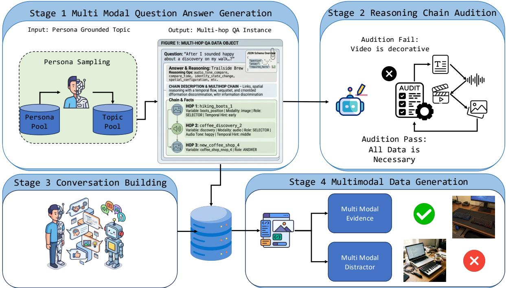  
Figure 7: The MOSAIC generation pipeline. Stage 1 samples a persona and designs a multi-hop reasoning chain; Stage 2 audits it via a per-fact deletion test against twelve failure modes; Stage 3 realises it as a timestamped multi-session conversation with persona-conditioned filler; Stage 4 synthesises the media assets, followed by structural and LLM-based quality filtering.

## B.3 Prompt Templates

The pipeline uses a modular set of LLM prompt templates, each targeting a specific generation subtask:

• Chain design: Given a persona, question type, and assigned modalities, the LLM designs the reasoning chain question-first: write the question, choose the answer, then construct the chain C and its facts. Type-specific templates enforce the required hop count and session structure.

• Fact extraction: After chain design, the LLM extracts canonical fact statements from the reasoning chain, assigning each fact a role (NARROWER, SELECTOR, ANSWER), a modality, and a gap strategy.

• Session planning: Facts are distributed across a chronological timeline of evidence and filler sessions. Periods and session groups are assigned programmatically; the LLM determines the natural language realisation of each fact within its assigned session.

• Validation and repair: A dedicated validation prompt runs a per-fact deletion test and checks for twelve named failure modes (see below). Failures trigger minimal repairs (1–3 targeted changes); items unrepaired after three iterations are discarded.

• Session building: An LLM rewrites each canonical fact as a natural conversation turn under two guards: a temporal-leak guard restricts facts to those with hop\_index ≤ the current turn, and a forbidden-value list prevents NARROWER and SELECTOR facts from mentioning the ANSWER value.

## B.4 Chain Templates

Table 7 lists the type-specific chain templates used during Stage 1 chain design (§4).

## B.5 Twelve Named Failure Modes

Table 8 catalogues the twelve failure modes checked during Stage 2 chain validation (§4). Each mode targets a specific class of generation defect, detected by the LLM validation judge, triggering targeted repairs; chains unrepaired after three iterations are discarded.

<table><tr><td>Type</td><td>Chain template</td></tr><tr><td>Info. Extraction</td><td> $\mathrm { N A R } _ { \mathrm { o p t } } \to \mathrm { S E L } \to \mathrm { A N S }$ </td></tr><tr><td>MSR-SELECTION</td><td> $\mathrm { N A R _ { o p t } \to S E L \to A N S ~ ( c r o s s \mathrm { - } s e s s . ) }$ </td></tr><tr><td>MSR-BRIDGE</td><td> $\mathrm { N A R _ { o p t } ^ { \phantom { + } } \to S E L \to S E L \to A N S }$ </td></tr><tr><td>Knowledge Update</td><td> $\mathrm { N A R _ { o p t } \to S E L _ { o l d } \to A N S _ { n e w } }$ </td></tr><tr><td>Temporal Reasoning Answer Refusal</td><td> $\mathrm { N A R _ { o p t } \to S E L _ { p l a n } \to S E L _ { d i s r u p t } \to A N S _ { o u t } }$  inherits IE, evidence stripped</td></tr></table>

Table 7: Chain templates. NAR = NARROWER, SEL = SELECTOR, ANS = ANSWER. “opt” denotes an optional narrowing step.

<table><tr><td>Failure Mode</td><td>Definition</td></tr><tr><td>LEXICAL-LEAK</td><td>The question text paraphrases or contains the answer value.</td></tr><tr><td>BRIDGE-INTEGRITY</td><td>Adjacent facts in the chain do not share a con- crete referent.</td></tr><tr><td>SHORTCUT</td><td>The answer can be derived from text-only evi- dence, bypassing the intended modality gap.</td></tr><tr><td>ENTITY-MISMATCH</td><td>The entity described in the ANSWER fact does not match the entity selected by prior facts.</td></tr><tr><td>GAP-ANCHORING</td><td>The question text does not reference the gap- bearing detail, making it unclear which evidence to retrieve.</td></tr><tr><td>REDUNDANT-GAP</td><td>Two facts test the same modality gap, reducing diversity.</td></tr><tr><td>SESSION-OVERLAP</td><td>Required facts from different hops are placed in the same session, collapsing the temporal structure.</td></tr><tr><td>TONE-COLLAPSE</td><td>Both audio candidates share the same prosodic tone, removing the discriminator.</td></tr><tr><td>PERIOD-LEAK</td><td>A later-period fact leaks the answer value into an earlier period&#x27;s context.</td></tr><tr><td>CAPTION-DISTINCTNESS</td><td>Primary entities in the same category are not sufficiently distinct (&lt; 2 of style, colour, mate-</td></tr><tr><td>ENTITY-PAIR</td><td>rial, setting, condition). An audio/video NARROWER or SELECTOR has no competing same-type entity, making the gap</td></tr><tr><td>COUNT-BAND</td><td>unnecessary. The action repetition count in a video question does not match the specified count band (1–2, 4–5, 8+).</td></tr></table>

Table 8: The twelve named failure modes checked during Stage 2 validation.

## B.6 Filler Session Generation

Filler dialogue text is taken from LongMemEval’s publicly released custom-history filler pool (Wu et al., 2025) (data\_5\_filler\_sess.json; 29,149 sessions): UltraChat (Ding et al., 2023) (20,000 sessions; LLM-synthesized dialogues; MIT; accessed via https://github.com/thunlp/UltraChat) and ShareGPT (Chiang et al., 2023) (9,149 sessions; user-shared ChatGPT transcripts curated via LMSYS FastChat; Apache 2.0 as stated by LongMemEval, accessed via https://github.com/lm-sys/FastChat). We do not re-sample upstream dumps independently; session IDs retain the LongMemEval ultrachat\_\* / sharegpt\_\* scheme. In the official release configuration the existing-corpus ratio is 1.0 (no LLM-generated filler dialogue). Multimodal attachments on fillers are injected separately by our pipeline and are synthetic. Topic filtering prevents fillers from mentioning evidence entities. Fillers are interleaved chronologically with evidence sessions to create realistic temporal gaps.

## C Evaluation Setup

## C.1 System Architectures

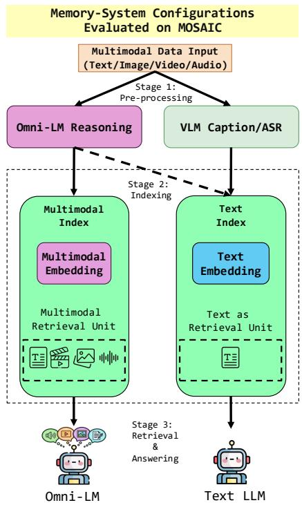  
Figure 8: The three system architectures evaluated on MOSAIC: Caption-Text (VL captioner + Whisper ASR, text index), Omni-Text (single omni captioner preserving prosody, text index), and Native-MM (multimodal embeddings over raw artefacts, omni-modal reasoner).

Three architectures differ in how multimodal evidence is preprocessed and indexed (see Figure 8):

• Caption-Text (CT): A VL captioner (Qwen3- VL-235B-A22B) and Whisper-large-v3-turbo convert all non-text evidence to captions. All captions are indexed as text chunks with a text embedding model (Qwen3-Embedding-0.6B). A text-only LLM reasoner retrieves and answers over captions.

• Omni-Text (OT): A single omni-modal LM (MiMo-V2.5) replaces the cascade, generating captions that preserve audio prosody (Whisper discards it). Otherwise identical to Caption-Text: text index, text reasoner.

• Native-MM (NMM): No textualization. Raw images, video frames, and audio are indexed with a multimodal embedding model (jina-embeddings-v5-omni-small). An omni-modal LM reasons directly over the retrieved artefacts (images, video, audio).

## C.2 Retrieval Back-Ends

• Naive RAG: Single-pass retrieval with top-k = 20, using Qwen3-Embedding-0.6B (Zhang et al., 2025) for text indices and jina-embeddings-v5-omni-small (Hönicke et al., 2026) for Native-MM. Query rewriting (LLM keyword extraction) before embedding. No time filter. Score threshold 0.0.

• ReAct-RAG: Iterative retrieval (up to 5 steps) with a tool-use loop; the model decides when to search and when to answer. SEARCH/ANSWER marker format for Native-MM, function calling for text architectures. Search top-k = 20, query rewriting enabled, duplicate query rejection. Every ReAct configuration must first pass a onesearch parity gate, in which the scaffold is restricted to a single retrieval call and must reproduce the corresponding Naive RAG run’s retrieval and delivery plumbing; ReAct numbers are reported only after that gate matches.

• A-MEM (Xu et al., 2025): Agentic memory system that extracts structured memory entries from conversation history. Uses MiniLM-L6- v2 (Wang et al., 2020) embeddings. Applied only to Caption-Text and Omni-Text, since it does not ingest native media.

• MemoryOS (Kang et al., 2025): Memory operating system that organizes conversation history into retrievable memory blocks. Uses MiniLM-L6-v2 embeddings. Applied only to Caption-Text and Omni-Text. MemoryOS does not expose a ranked candidate list, so its chain-coverage cells are reported as not observable rather than zero.

## C.3 Reasoning Models

• Fixed reader (all matched conditions and Track A): Gemini 3.5, temperature 0, 1,024 output tokens, extended thinking disabled. Chosen because it played no role in dataset construction.

• Text reasoners (Track B): DeepSeek-v4-Flash for Naive RAG, ReAct, A-MEM, and MemoryOS over the text architectures. Temperature 0.

• Omni reasoners (Track B, Native-MM only): MiMo-V2.5 and Gemini 3.5. Temperature 0. For Native-MM ReAct, the omni model handles both the iterative search loop and the final answer.

• Write-time models: generic text uses a Qwen3- VL-235B captioner (Bai et al., 2025) with Whisper-large-v3-turbo ASR (Radford et al., 2023); structured text uses a query-blind MiMo-V2.5 writer with fixed per-modality schemas that preserve spatial relations, temporal order, counts, and prosody.

## C.4 Diagnostic Conditions

Beyond the two architecture tracks, the matched decomposition (§5.1) runs seven conditions on the same 784 answerable QIDs under one reader, prompt, packer, budget, and judge:

• Gold symbolic facts: the annotated required facts as text, bounding residual read and grading error.

• Gold native evidence: the same chain delivered as raw media, isolating native perception cost.

• Gold generic text: the same chain as VL captions plus Whisper ASR, isolating write-time textualization loss.

• Gold structured text: the same chain under the query-blind structured writer, isolating the avoidable share of that loss.

• Retrieved native, all delivered: every retrieved hit is serialized, isolating retrieval loss at fixed delivery.

• Retrieved native, production caps: the identical ranked manifest under top-20 units, three media per modality, 100 MB, isolating delivery loss at fixed ranking.

• End-to-end native RAG: adds the frozen fixedrewrite query ranking.

Delivery is additionally swept over two tighter budgets (top-10 units with three media; top-5 units with one media item per modality) against a single frozen top-50 manifest, so that retrieval quality is constant by construction and only the packer’s allowance varies. The within-item modality interventions (§5.2) supply twelve further conditions: four image variants, four video variants, and four audio variants.

## C.5 LLM-as-Judge Protocol

All system outputs are evaluated by a single LLM judge (Qwen3.7-Plus; full prompt in Appendix M). A three-judge panel (GLM-5.2 and Grok-4.5 as auxiliaries) re-scores every Track B run to verify that conclusions are robust to judge identity (agreement statistics: Appendix J). Only the primary judge’s scores appear in any reported number. The judge receives the question, expected answer, accepted aliases, and the system’s predicted answer, and assigns a score on a 0–1 scale:

For ANSWER REFUSAL items, “I don’t know” or similar refusals score 1.0; any other answer scores 0.0.

## C.6 Metrics Definitions

• Judge score (answerable): Mean judge score over the 784 answerable items. Answer Refusal is excluded and reported separately as abstention.

• Abstention (paired): Correct-refusal rate on the 139 ANSWER REFUSAL items together with the false-refusal rate on the 784 answerable items (Table 28, Figure 6); reporting both prevents an always-abstain system from appearing wellcalibrated.

• Required-fact Recall@k: Fraction of an item’s gold required facts whose source unit appears in the top-k set, computed over both the ranked units and the units actually serialized into the request.

• Complete-chain Recall@k / chain delivery: Fraction of items for which every required fact appears, ranked or delivered respectively. This is the retrieval metric that matters for multi-hop memory, since a partial chain is not usable.

• Paired effect: For a controlled contrast, the mean within-item difference over the shared QID set, with an item-bootstrap 95% interval (10,000 resamples), wins/ties/losses, and a persona-clustered bootstrap as a dependence sensitivity check.

## D Dataset Statistics

The final MOSAIC-Eval set contains 923 items across 70 personas, averaging 13.2 items per persona and 17.5 sessions per item (range 11–24). The total haystack comprises approximately 18.8M tokens, with a per-persona average of ∼269K tokens. Multimodal artefact counts by evidence tier are in Table 10.

MOSAIC’s per-persona haystack (∼269K tokens) is substantially larger than LongMemEval’s (∼158K). The token distribution is deliberately skewed: evidence-bearing sessions contribute a mean of 840 tokens each, while filler sessions average 1,213 tokens (overall session mean ∼1.2K). Required facts are therefore scattered across multimodal evidence and multi-topic filler rather than clustered in a handful of salient messages. Long-MemEval spreads its smaller budget across more sessions (∼50 at ∼3.2K tokens each) that typically centre on a single text topic, so the retrieval challenge differs in both scale and modality mix.

The six question types are not uniformly distributed. Knowledge Update (20.9%) and Temporal Reasoning (20.5%) are the largest categories, reflecting their importance for evaluating evolving state and causal disruption—two capabilities central to long-horizon memory. Information Extraction (19.3%), the simplest type, serves as a single-hop baseline. The two multi-hop types, MSR Bridge and MSR Selection, each account for 12.1%, and together with Knowledge Update and Temporal Reasoning, multi-hop reasoning questions constitute 65.6% of the benchmark. Answer Refusal items (15.1%) provide the abstention subset, sufficient for measuring refusal behaviour without dominating the evaluation.

The modality distribution reflects MOSAIC’s deliberate emphasis on non-textual evidence. Across all facts (required + context + distractor), 80.0% involve a non-text modality, and among required facts specifically, 85.1% (1,582/1,860) are nontext. Image evidence dominates, accounting for 39.1% of all facts and 49.0% of required facts, followed by audio (28.5% all, 25.6% required) and video (12.4% all, 10.5% required). The relatively lower share of video reflects the higher generation cost and the targeted use of video for temporal gaps (action ordering, state transition, repetition count), where static alternatives cannot suffice. Audio’s substantial presence—over a quarter of required facts—is unique among memory benchmarks and directly enables the prosody-based discrimination that Caption-Text architectures consistently fail on (see §6).

The gap strategy distribution reveals three design priorities. First, fine-grained attributes (388 required-fact occurrences over 333 items; e.g., brand names, prices, or labels) constitute the largest image gap, reflecting the prevalence of text-bearing visual evidence in real-world omni-modal interactions. Background detail (328 facts / 284 items) and spatial configuration (194 / 185) together ensure that models must attend to the full visual field rather than fixating on salient foreground objects. Second, video gaps are deliberately balanced across action ordering (67), repetition count (64), and state transition (64). Third, tagged audio prosody is the single most frequent gap strategy: 450 required-fact occurrences across 399 answerable items (50.9% of 784). Prosody is an intrinsic property of voice messages that text transcripts discard, so caption-based pipelines are exposed on a large fraction of the release.

<table><tr><td>Score</td><td>Label</td><td>Definition</td></tr><tr><td>1.0</td><td>Perfect</td><td>Semantically identical to expected or alias. Only format- ting/capitalization differs.</td></tr><tr><td>0.7</td><td></td><td>Mostly Correct Right answer but extra context or slightly imprecise wording.</td></tr><tr><td>0.5</td><td>Partial</td><td>Gets category or one part right, misses specifics.</td></tr><tr><td>0.3</td><td>Attempted</td><td>Core fact wrong but shows effort.</td></tr><tr><td>0.0</td><td>Wrong</td><td>Completely incorrect, refused on answerable question, empty, or error.</td></tr></table>

Table 9: LLM-as-Judge scoring rubric.

<table><tr><td>Tier</td><td>Image</td><td>Video</td><td>Audio</td><td>Total</td></tr><tr><td>Required</td><td>911</td><td>195</td><td>476</td><td>1,582</td></tr><tr><td>Evidence (non-req)</td><td>861</td><td>366</td><td>1,127</td><td>2,354</td></tr><tr><td>Filler</td><td>2,525</td><td>0</td><td>4,294</td><td>6,819</td></tr><tr><td>Total</td><td>4,297</td><td>561</td><td>5,907</td><td>10,765</td></tr></table>

Table 10: Multimodal artefacts in MOSAIC.
<table><tr><td>Metric</td><td>Value</td></tr><tr><td>Total items Personas</td><td>923</td></tr><tr><td>Items per persona (mean) Answerable items</td><td>70 13.2</td></tr><tr><td>ANSWER REFUSAL items Sessions per item (mean) Sessions per item (min-max)</td><td>784 139 17.5 11-24</td></tr><tr><td>Evidence tokens (total) Filler tokens (total) Total haystack tokens Per-persona tokens (mean)</td><td>1,861,163 16,963,999 18,825,162 268,931</td></tr></table>

Table 11: MOSAIC dataset statistics.
<table><tr><td>Question Type</td><td>Count</td><td>%</td></tr><tr><td>Knowledge Update</td><td>193</td><td>20.9%</td></tr><tr><td>Temporal Reasoning</td><td>189</td><td>20.5%</td></tr><tr><td>Information Extraction</td><td>178</td><td>19.3%</td></tr><tr><td>Answer Refusal</td><td>139</td><td>15.1%</td></tr><tr><td>Msr Bridge</td><td>112</td><td>12.1%</td></tr><tr><td>Msr Selection</td><td>112</td><td>12.1%</td></tr><tr><td>Total</td><td>923</td><td>100%</td></tr></table>

Table 12: Question type distribution.
<table><tr><td>Modality</td><td>All Facts</td><td>Required Facts</td></tr><tr><td>Text</td><td>914</td><td>278</td></tr><tr><td>Image</td><td>1,788</td><td>911</td></tr><tr><td>Audio</td><td>1,304</td><td>476</td></tr><tr><td>Video</td><td>567</td><td>195</td></tr><tr><td>Total</td><td>4,573</td><td>1,860</td></tr></table>

Table 13: Evidence modality distribution. 3,659/4,573 (80.0%) of all facts are non-text.

<table><tr><td colspan="2">Gap Strategy Count</td></tr><tr><td>Image — Background Detail</td><td>328</td></tr><tr><td>Image — Fine Grained Attribute</td><td>388</td></tr><tr><td>Image — Spatial Configuration</td><td>194</td></tr><tr><td>Video — Action Ordering</td><td>67</td></tr><tr><td>Video — Action Repetition Count</td><td>64</td></tr><tr><td>Video — State Transition</td><td>64</td></tr><tr><td>Audio — Prosody/Tone (tagged)</td><td>450</td></tr><tr><td>Untagged required non-text</td><td>27</td></tr><tr><td>Total required non-text</td><td>1,582</td></tr></table>

Table 14: Gap strategy distribution on required facts. Named challenge tags cover 1,555/1,582 required non-text facts; the 27 untagged residuals are 26 required audio facts without a tone field and 1 image fact without a visual strategy (release audit of stage2\_human\_filtered).

<table><tr><td>Benchmark</td><td>Items</td><td>Tok.</td><td>Avg. Sess.</td><td>Non-text</td></tr><tr><td>MOSAIC (Ours)</td><td>923</td><td>~269K/pers.</td><td>17.5/item</td><td>80.0%</td></tr><tr><td>LongMemEval</td><td>500</td><td>~158K/pers.</td><td>~50</td><td>0%</td></tr><tr><td>LoCoMo</td><td>1,986</td><td>~17K/conv.</td><td>27.2</td><td>images</td></tr></table>

Table 15: Haystack scale comparison with prior conversational memory benchmarks. LoCoMo figures follow Maharana et al. (ACL 2024): 1,986 QA pairs, mean 16.6K tokens and 27.2 sessions per conversation. MO-SAIC session counts are per item; token budgets for MOSAIC/LongMemEval are per persona.

MOSAIC occupies a distinct position in the benchmark landscape. At ∼269K tokens per persona it is about 1.7× LongMemEval’s per-persona budget (∼158K) and about 16× LoCoMo’s perconversation budget (∼17K), with a mean of 17.5 sessions per item. Individual MOSAIC sessions average ∼1.2K tokens (evidence 840, filler 1,213)— so the scale advantage is the large multimodal haystack around sparse required facts, not multikilotoken sessions. The 80.0% non-text fact rate is substantially higher than prior conversational memory suites: LoCoMo includes shared images in text dialogues but no video or audio, and Long-MemEval is text-only. No prior benchmark combines all four modalities at this scale.

## E Pipeline Filtering and Quality Assurance

<table><tr><td>Stage</td><td>Input Output</td><td></td><td>Net</td></tr><tr><td>Initial generation</td><td></td><td>1,050</td><td></td></tr><tr><td>(1) Structural filter (9 checks)</td><td>1,050</td><td>1,019</td><td>-31</td></tr><tr><td>(2) LLM quality judge (4 checks)</td><td>1,019</td><td>1,004</td><td>-15</td></tr><tr><td>(3) Omni probe selection</td><td>1,004</td><td>885</td><td>-119</td></tr><tr><td>(4) Second quality intersection</td><td>885</td><td>879</td><td>-6</td></tr><tr><td>(5) Human-rescued probe FNs</td><td>879</td><td>923</td><td>+44</td></tr></table>

Table 16: Sample-count lineage. The omni probe checks 864 answerable candidates; all 140 answer-refusal candidates bypass that probe and enter the next quality intersection.

The filtering cascade reveals distinct failure profiles at each step. The structural filter (Step 1) catches 31 items (3.0%) through deterministic rules—primarily duplicate fact values and answer leaks—representing clear-cut generation errors. The LLM quality judge (Step 2) removes 15 additional items (1.5%). The 1,004-item set then comprises 864 answerable and 140 ANSWER RE-FUSAL candidates. The omni probe accepts 745 answerable candidates and rejects 119; adding the

140 bypassed refusal candidates gives 885. A second four-check quality intersection removes five probe-accepted answerable items and one refusal item, yielding the recorded 879-item automated set (740 answerable + 139 refusal). Finally, human review restores 44 of the probe-rejected answerable items, yielding exactly 923 unique items (784 answerable + 139 refusal). Thus the final dataset is a 923-item subset of the 1,004-item LLM-filtered set and a 44-item superset of the automated postreview set.

## E.1 LLM Quality Judge: Per-Check Pass Rates

The LLM quality judge (Step 2) evaluates each of the 1,019 structurally-filtered items on four checks; an item advances only if all four pass $( 1 , 0 1 9 \  \ 1 , 0 0 4 ;$ Table 16). Rates below are from the stored release validation report (llm\_validation\_report.json).

<table><tr><td>Check</td><td>Pass</td><td>Rate</td></tr><tr><td>Atomicity (one question, one answer)</td><td>1,012/1,019</td><td>99.3%</td></tr><tr><td>Grounding (answer in evidence)</td><td>1,014/1,019</td><td>99.5%</td></tr><tr><td>Multimodal required (needs non-text)</td><td>1,015/1,019</td><td>99.6%</td></tr><tr><td>Gap load-bearing (gaps gate answer)</td><td>1,007/1,019</td><td>98.8%</td></tr><tr><td>Overall (all 4 checks)</td><td>1,004/1,019</td><td>98.5%</td></tr></table>

Table 17: LLM quality judge per-check pass rates on the 1,019 structurally-filtered items (conjunctive filter; 15 items fail at least one check).

## E.2 Omni Answerability Probe Breakdown

The omni probe (MiMo-V2.5) checks whether the 864 answerable items in the 1,004-item set are genuinely answerable when given the required evidence in native modality.

## F Statistical Power of Modality Interventions

We report minimum detectable effects (MDEs) for the three video nulls in Appendix K.4. Assumptions: two-sided α=0.05, 80% power (MDE = $( z _ { 1 - \alpha / 2 } + z _ { 1 - \beta } ) \widehat { \sigma } _ { \Delta } / \sqrt { n } )$ , paired judge-score deltas under the primary Gemini reader, and the unique-QID analysis unit (when a QID contributes multiple intervention cases, we average their deltas). Intervention-case counts are larger for ordering/repetition because some QIDs host multiple video facts.

An MDE does not mean the experiment rules out all larger effects; it means the study had adequate power only for effects around that size. The nonsignificant video contrasts therefore leave smaller temporal effects unresolved. Growing toward ≥150 QIDs per video challenge is future work.

<table><tr><td>Metric</td><td>Value 864</td></tr><tr><td>Answerable items checked Omni probe YES (answerable) Omni probe NO (unanswerable) Raw pass rate</td><td>745 119 86.2%</td></tr><tr><td>ANSWER REFUSAL candidates bypassed Probe-YES retained after quality intersection ANSWER REFUSAL retained after intersection Automated post-review set</td><td>140 740 139 879</td></tr><tr><td>Probe-NO items rescued by humans Candidate-level corrected rate (745 + 44)/864</td><td>44</td></tr><tr><td>Final answerable items (740 + 44)</td><td>91.3% 784</td></tr><tr><td>Final ANSWER REFUSAL items Answerable retention rate 784/864 Final MOSAIC-Eval set</td><td>139 90.7%</td></tr></table>

Table 18: Omni-probe and final sample-count reconciliation. The 91.3% statistic is computed before the second quality intersection and is therefore not a finalset count; the figure quoted in §4 is the 90.7% retention rate. Neither is a human answerability ceiling, since annotators adjudicated only a 100-item sample while the probe adjudicated all candidates.
<table><tr><td>Contrast</td><td>n Mean ∆</td><td>MDE</td></tr><tr><td>Ordered — shuffled (ordering)</td><td>64 -0.009</td><td>8.9</td></tr><tr><td>Event — frames (repetition)</td><td>56 +0.016</td><td>10.8</td></tr><tr><td>Event — frames (transition)</td><td>64 +0.027</td><td>11.2</td></tr></table>

Table 19: Paired video MDEs (in judge-score points) at 80% power. n counts unique QIDs, the power-analysis unit used in the main text; intervention-case n values are 67/64/64.

## G Extended Limitations

This appendix expands the caveats summarized in §8.

Stage associations versus isolated causality. Matched stage drops associate each paired contrast with the intervened stage under a frozen reader, prompt, packer, and judge. Gold versus retrieved contexts still differ in distractors and composition, so stage labels are protocol associations rather than fully isolated causal mechanisms.

Underpowered video nulls. Video strata are modest (n=56–64 unique QIDs). At 80% power the MDEs are 8.9–11.2 points (Appendix F), so ordered-versus-shuffled and related nulls are inconclusive, not proof of lossless temporal compression.

Gold-delivery audio nulls and lexical leakage. Raw audio versus ASR (+0.8) and ASR plus a gold prosody tag versus ASR (+1.5) are near-null under gold delivery for the primary reader. A model-independent lexical audit of the textualized audio carriers used as the ASR condition finds frequent paralinguistic cues (e.g., oh wow, ugh, filled pauses) in the script text, and other gold hops often already expose the answer value. These nulls therefore do not establish that the reader recovers sentiment from plain transcripts or raw audio. A separate correct-versus-swapped symbolic tag intervention does show selector-level sensitivity (Appendix K.4); human-audited lexically clean subsets defined without conditioning on model failure remain future work.

Construction and coverage. Automated filters and a human audit support release quality (Appendix I). Modality coverage is uneven by design (we report per-challenge strata), and text-only backends do not yet ingest native media indices. Gold construction metadata must not be exposed to systems under test (Appendix H).

## H Refusal Surface-Structure Diagnostics

ANSWER REFUSAL items inherit an IE-shaped template then strip required evidence. We separate privileged construction annotations from systemobservable features. Classifiers are balanced logistic regressions with persona-grouped 5-fold CV; AUROC confidence intervals are item bootstrap 95% intervals over out-of-fold scores.

Privileged negative control. Requiredhop count, answer-session count, and the answer\_refusal question-type label perfectly identify refusal items (AUROC = 1.00). These fields are definitionally downstream of refusal construction and are not part of the evaluation request; this result is a sanity check, not an exploitable surface shortcut. Release users must not feed gold metadata (evidence\_plan requiredness, answer\_session\_ids, type labels) into systems under test.

Observable features. Haystack length is matched: sessions-only AUROC 0.52 [0.47, 0.56] vs. all answerable items. Broader structural counts (messages, media attachments, date span, question length) reach 0.75 [0.70, 0.79]. Question-text TF–IDF is partially predictive (0.85 [0.82, 0.88] vs. all answerable; 0.66 [0.60, 0.72] vs. IE-only). Thus refusal status is not recoverable from haystack length alone, but residual question-form cues remain; calibration should not be read as fully form-blind, and matched multi-hop refusal controls are future work.

## I Human Evaluation

## I.1 Annotation Protocol

Three annotators independently reviewed a stratified sample of 100 items (70 where the omni probe verdict was NO, 30 where it was YES). Annotators were shown the question, expected answer, all required evidence facts (with modality and gap strategy), and the omni probe’s verdict. For each item, they answered:

1. Well-posed? Is the question unambiguous and answerable as stated? (Yes / Partially / No)

2. Gold answer correct? Is the expected answer factually correct given the evidence? (Yes / No)

3. Evidence sufficient? Are all required artefacts legible/audible and do they show the answer? (Yes / No)

4. Failure mode: If insufficient, what is the primary failure? (Evidence item invalid / Model refused incorrectly / Model attended to wrong modality / Model overlooked gap-bearing detail / Judge format mismatch / No need to answer)

A follow-up audit then graded 100 additional probe-YES items drawn from the 740 automated answerable releases (seed 20260801; excluding the 30 YES items already in the first sample), using the same Q1–Q3 rubric with two annotators.

## I.2 Release Label Quality (Primary)

The first audit oversamples probe-NO items (70/100, against a base rate of 119/864 probeadjudicated answerable candidates), so the pooled rates in Table 22 (Q2 69.0%, Q3 65.3%) describe that stratified sample—not the released set. Table 20 reports rates by probe stratum; Table 21 reweights to the 784 answerable release items (740 probe-YES + 44 human-rescued).

On the released answerable set, gold-answer correctness is therefore ≈97.8% and evidence sufficiency ≈96.6%—not the unweighted 69%/65% of the NO-heavy audit sample. Residual errors in the YES follow-up are concentrated in fine-grained visual counts, illegible price tags, and occasional audio–image cue conflicts (annotator notes), consistent with generative-media ambiguity rather than systematic gold-label drift. Pairwise agreement on the follow-up is 97% (Q1) and 94% (Q2/Q3).

<table><tr><td>Stratum / sample</td><td>Q1</td><td>Q2</td><td>Q3</td></tr><tr><td>Audit probe-YES (n=30, 3 ann.)</td><td>97.8%</td><td>100%</td><td>94.4%</td></tr><tr><td>Audit probe-NO (n=70, 3 ann.)</td><td>92.9%</td><td>55.7%</td><td>52.9%</td></tr><tr><td>Follow-up YES (n=100, 2 ann.)</td><td>98.5%</td><td>97.0%</td><td>97.0%</td></tr><tr><td>Combined probe-YES (n=130)</td><td>98.3%</td><td>97.7%</td><td>96.4%</td></tr></table>

Table 20: Annotator-mean Yes rates by probe stratum (Q1 well-posed, Q2 gold correct, Q3 evidence sufficient). Combined YES merges the audit YES subset with the disjoint probe-YES follow-up (item score = mean of annotator Yes/No).
<table><tr><td>Estimand (N=784 answerable)</td><td>Est.</td><td>95% CI</td></tr><tr><td>Q1 well-posed</td><td>98.4%</td><td>[97.3, 99.5]</td></tr><tr><td>Q2 gold answer correct</td><td>97.8%</td><td>[96.3, 99.4]</td></tr><tr><td>Q3 evidence sufficient</td><td>96.6%</td><td>[95.1, 98.2]</td></tr></table>

Table 21: Stratified estimates on the 784 answerable MOSAIC-Eval items. Probe-YES stratum (N=740) uses the combined n=130 sample; the 44 rescued items enter at rate 1.0 (human-verified at rescue). CIs use item-score variance with finite-population correction on the YES stratum. The 139 refusal items are excluded (different label).

## I.3 Stratified Audit Sample (Secondary)

Tables 22–23 retain the original pooled and perevaluator counts for the 100-item stratified audit. Per-evaluator variance on Q3 (E2: 52% vs. E1: 68%, E3: 76%) reflects genuine ambiguity in judging synthesised multimodal artefacts on the probe-NO-heavy sample.

<table><tr><td>Question Pooled % (3 evaluators)</td></tr><tr><td>Q1. Well-posed? — Yes 94.3%</td></tr><tr><td>Q1. Well-posed? — Partially 3.0%</td></tr><tr><td>Q1. Well-posed? — No 2.7%</td></tr><tr><td>Q2. Gold answer correct? — Yes 69.0% Q2. Gold answer correct? — No 31.0%</td></tr><tr><td>65.3%</td></tr><tr><td>Q3. Evidence sufficient? — Yes Q3. Evidence sufficient? — No 34.7%</td></tr></table>

Table 22: Pooled responses on the stratified 100-item audit (70 probe-NO / 30 probe-YES). Not a release estimate; see Tables 20–21.

<table><tr><td>Question E1 E2 E3</td></tr><tr><td>Q1. Well-posed? — Yes 94 99 90 Q1. Well-posed? — Partially 4 0 5</td></tr><tr><td>Q1. Well-posed? — No 2 1 5 Q2. Gold correct? — Yes 65 66 76</td></tr><tr><td>Q2. Gold correct? — No 35 34 24 Q3. Evidence sufficient? —Yes 68 52 76</td></tr><tr><td>Q3. Evidence sufficient? ?—No 32 48 24</td></tr></table>

Table 23: Per-evaluator responses on the stratified 100- item audit.

## I.4 Failure Mode Distribution

Table 24 breaks down failure modes for items where the omni probe verdict was NO. Evidence item invalid (60.0%) dominates, reflecting generative media artefacts rather than benchmark design flaws.

<table><tr><td>Failure Mode (Q4)</td><td>Count</td><td>%</td></tr><tr><td>Evidence item invalid</td><td>126</td><td>60.0%</td></tr><tr><td>Model overlooked gap-bearing detail</td><td>34</td><td>16.2%</td></tr><tr><td>Model refused incorrectly</td><td>31</td><td>14.8%</td></tr><tr><td>Model attended to wrong modality</td><td>16</td><td>7.6%</td></tr><tr><td>Judge format mismatch</td><td>3</td><td>1.4%</td></tr></table>

Table 24: Failure mode distribution on Judge=NO items (pooled across 3 evaluators).

The failure mode distribution clarifies why the omni probe fails. The dominant category— evidence item invalid (60.0%)—indicates that the primary bottleneck is media synthesis quality: generated images sometimes render text illegibly, video frames occasionally miscount actions, and audio clips may garble prosodic cues. This is a limitation of current generative models rather than a benchmark design flaw, and as synthesis quality improves, these failures will naturally decrease. The second-largest category, model overlooked gap-bearing detail (16.2%), reveals that even a capable omni model sometimes attends to the correct modality but misses the specific detail that the gap strategy targets—for example, reading the foreground text in an image while missing the small background label that contains the answer. This is precisely the failure mode that MOSAIC is designed to expose in evaluated systems. Model refused incorrectly (14.8%) indicates cases where the omni probe said “I don’t know” despite the evidence being present and legible, likely due to ambiguous question phrasing or insufficient reasoning depth. The remaining categories—wrong modality (7.6%) and format mismatch (1.4%)—are minor, confirming that the probe generally attends to the correct evidence source.

## I.5 Probe Rejections Overturned (Rescued Items)

The human audit identified 44 items where the omni probe verdict was NO but annotators restored them to the final set. The selection rule is: an item is excluded only if all three annotators mark the evidence item invalid (26 items); otherwise it is rescued (44 items). The 44 rescued items are not unanimous first-pass agreement—first-pass Q2 Yes counts were 35/36/46 across the three annotators across the 70 probe-NO items audited—so “quality $1 . 0 ^ { \cdot }$ means inclusion under the three-annotator unanimous-exclusion rule, not unanimous first-pass acceptance. Rescued items span all five answerable question types: Information Extraction (5), Knowledge Update (11), MSR Bridge (9), MSR Selection (9), and Temporal Reasoning (10).

## I.6 Inter-Rater Agreement

Pairwise agreement between evaluators measures the reliability of human judgments: Q1 (Wellposed?): mean pairwise 94.0% (E1-E2=95%, E2-E3=91%, E1-E3=96%). Q2 (Gold answer correct?): mean pairwise 92.7% (E1-E2=99%, E2-E3=90%, E1-E3=89%). Q3 (Evidence sufficient?): mean pairwise 84.0% (E1-E2=84%, E2- E3=76%, E1-E3=92%).

Q3 shows the highest variance (76–92%), reflecting genuine perceptual ambiguity in judging whether a synthesised image or audio clip “clearly shows” the intended detail—a finding consistent with prior work on multimodal quality assessment. Q1 has the highest agreement (94.0%), confirming that MOSAIC questions are unambiguously well-posed.

## I.7 Probe Rejections Upheld

The audit confirmed 26 items where the omni probe verdict was NO and evaluators agreed the item was genuinely invalid. These items remain excluded from MOSAIC-Eval.

## J Judge Validation

Every number in this paper is produced by a single judge (Qwen3.7-Plus), so that all comparisons are scored by the same model; comparing scores across different judges is unsound. To justify relying on one judge we run a three-judge panel: GLM-5.2 and Grok-4.5, both with extended thinking disabled at temperature 0, independently re-score every item of all twelve Track B runs under the identical rubric. This yields $1 2 \times 9 2 3 = 1 1 { , } 0 7 6$ triple-scored items. Neither auxiliary judge ever contributes to a reported score; the panel exists only to test whether the conclusions survive a change of judge.

Table 25 reports the pooled result. Agreement is very high on every pair: quadratic-weighted κ never falls below 0.96 on average, Spearman ρ of the item-level scores never below 0.95, and all three judges land in the same rubric band on 84.0% of items. Per-run variation is modest and concentrated in the two lowest-scoring MemoryOS runs, where most predictions are refusals and the band distribution is degenerate; even there the minimum weighted κ is 0.884. The most contested question type is knowledge update $( \kappa = 0 . 9 2 6 )$ , which is expected: it is the type whose gold answer depends on resolving a later correction, so borderline partial credit is genuinely ambiguous. Answer refusal is nearly perfectly agreed $( \kappa = 0 . 9 8 3 )$ because it reduces to a binary rule.

Human spot-check of LLM judge scores. To further validate the primary judge, two human annotators independently scored a stratified 50-item sample of ReAct Native-MM predictions (10 items per rubric band, same scoring rubric). Human– human quadratic-weighted $\kappa = 0 . 7 0$ (exact agreement 60%, within-one-band 88%). Agreement of each annotator with the primary LLM judge was $\kappa = 0 . 7 9$ and $\kappa = 0 . 6 9$ respectively (withinone-band 88% and 90%; human-mean κ = 0.82). Disagreements are concentrated in adjacent bands where partial credit is genuinely ambiguous, consistent with the three-LLM-judge pattern above. We report mean partial-credit judge scores throughout rather than exact match.

<table><tr><td>Pair</td><td>κ Band</td></tr><tr><td>Qwen vs. GLM-5.2 Qwen vs. Grok-4.5</td><td>0.962 0.880 0.966 0.898</td></tr><tr><td>GLM-5.2 vs. Grok-4.5</td><td>0.957</td></tr><tr><td>0.971 0.892</td><td>0.963</td></tr><tr><td>Mean score (12 runs) Qwen (primary)</td><td>0.536</td></tr><tr><td>GLM-5.2</td><td>0.544</td></tr><tr><td>Grok-4.5</td><td>0.534</td></tr><tr><td>Same band (all three)</td><td>0.840</td></tr><tr><td>Items pooled</td><td>11,076</td></tr><tr><td>Per-type κ</td><td></td></tr><tr><td>IE / KU / TR</td><td></td></tr><tr><td>MSR-B / MSR-S / AR0.974 / 0.968 / 0.983</td><td>0.958 / 0.926 / 0.966</td></tr></table>

Table 25: Three-judge panel agreement, pooled over all twelve Track B runs (quadratic-weighted κ over the five rubric bands). The three judges differ by at most 0.010 in mean score and agree on the induced system ranking, which justifies reporting every result under the single primary judge.

## K Additional Results

This appendix holds the numeric modalityintervention table deferred from §6.2, paired W/T/L companions to the main-paper floats, plus perquestion-type ladders, retrieval/delivery curves, drop-reason accounting, per-challenge and perfamily breakdowns, and the full Track B score table. Every number comes from the same canonical paired run as the main paper.

## K.1 Matched Stage Ladder: Paired Contrasts

Numeric companion to Table 3 and Figure 3. Gold symbolic facts score 0.846, bounding residual integration and grading error at 15.4 points. The perception-and-integration cost of native evidence (symbolic − native) is 6.2 points [95% CI 3.2, 9.3; W/T/L 206/489/89]. Generic captions and ASR lose a further 9.3 points relative to native evidence, of which only 1.4 are recovered by the query-blind structured writer (+1.4 [−0.9, 3.7]; 103/585/96). Retrieval loss (gold native − retrieved all-delivered) is 7.6 points [5.2, 9.9], and production delivery caps remove another 3.8 on the identical ranked hits [1.5, 6.0]. The full production pipeline reaches 0.653, only 1.7 points below the original-query budgeted condition [−0.6, 3.9]; gold symbolic facts exceed it by 19.2 points [15.7, 22.8].

Video-dependent items score 0.900 symbolically but 0.729 with native video (17.1-point perception cost), against 6.2 for image and none for audio (0.821→0.826). Probe-pass (n=740) vs. humanrescued (n=44) items are indistinguishable under gold symbolic facts (0.846 vs. 0.845) but differ by

27.8 points under gold native evidence (0.799 vs. 0.520), persisting through the production pipeline (15.5 [2.9, 28.5]).

## K.2 Second-Reader Stage Replication

Gemini 3.5 (primary) and MiMo-V2.5 (second reader; also the answerability probe) on the fixed 120-item pilot, identical evidence packs and judge. MiMo reproduces the gold and productionbudgeted ladder; its uncapped all-delivered row is dominated by API timeouts (∼50 base64 media units) and is not used for stage attribution.

<table><tr><td>Condition</td><td>Gemini</td><td>MiMo</td></tr><tr><td>Gold symbolic facts</td><td>0.878</td><td>0.870</td></tr><tr><td>Gold native evidence</td><td>0.822</td><td>0.818</td></tr><tr><td>Gold generic text</td><td>0.709</td><td>0.739</td></tr><tr><td>Gold structured text</td><td>0.738</td><td>0.707</td></tr><tr><td>Retrieved, production-budgeted</td><td>0.694</td><td>0.669</td></tr><tr><td>Retrieved, all delivered†</td><td>0.713</td><td>0.157</td></tr></table>

Table 26: Mean judge score on the 120-item pilot (n=120 per cell). †MiMo all-delivered is providerlimited (91/120 timeouts) and is reported only to document the failure mode.

## K.3 Delivery Budget Sweep

Companion to Figure 4. Required-fact Recall@50 is 0.871 throughout. Halving the unit budget costs 5.7 points [3.3, 8.0]; one-media-per-modality packing costs 17.7 [14.5, 20.9] and collapses completechain delivery from 0.675 to 0.184 (required-fact coverage 0.871→0.501).

## K.4 Within-Item Modality Intervention Contrasts

Numeric companion to Figure 5 in §6.2.
<table><tr><td>Mod.</td><td>Contrast</td><td>N</td><td>∆ [95% CI]</td></tr><tr><td>Img</td><td>Raw − OCR (fine/bg)</td><td>716</td><td>+0.185 [0.153, 0.216]</td></tr><tr><td>Img</td><td>Raw — OCR (spatial)</td><td>194</td><td>+0.320 [0.248, 0.392]</td></tr><tr><td>Img</td><td>Spatial — object-only</td><td>194</td><td>+0.154 [0.095, 0.215]</td></tr><tr><td>Vid</td><td>Ordered — shuffled</td><td></td><td>67 -0.015[-0.078, 0.046]</td></tr><tr><td>Vid</td><td>Event — frames (rep.)</td><td></td><td>64 +0.014[-0.052, 0.080]</td></tr><tr><td>Vid</td><td>Event — frames (trans.)</td><td></td><td>64 +0.027[-0.050, 0.106]</td></tr><tr><td>Aud</td><td>Raw - ASR</td><td></td><td>450 +0.008[-0.015, 0.030]</td></tr><tr><td>Aud</td><td>Gold prosody — ASR</td><td></td><td>450 +0.015[-0.008, 0.038]</td></tr><tr><td>Aud</td><td>Correct prosody — swapped 399</td><td></td><td>+0.046 [0.017, 0.077]</td></tr></table>

Table 27: Within-item modality interventions (governing stratum). N is intervention cases except correct−swapped, which uses unique QIDs (primary analysis unit). W/T/L: fine/bg 222/434/60; spatial raw−OCR 92/89/13; spatial desc.−object 58/117/19; ordered−shuffled 5/56/6; repetition 6/54/4; transition 11/44/9; raw−ASR 36/387/27; prosody-tag 34/394/22; correct−swapped 46/330/23.

Prosody-tag selector sensitivity. We reran both arms under one frozen reader, prompt, golddelivery packer, and judge: ASR + correct gold tone versus the identical context with happy↔unhappy flipped. The eligible set is all prosody carriers (450 intervention cases spanning 399 unique QIDs; 51 QIDs host two carriers). We do not condition on ASR failure. The primary unit is the unique-QID mean paired delta: +0.046 [0.017, 0.077] (W/T/L 46/330/23; personaclustered mean +0.041 over 70 personas). Condition means are 0.824 (correct) and 0.782 (swapped). The case-level mean delta is +0.043—slightly below the QID mean because multi-carrier QIDs are down-weighted when averaging by QID. A positive correct-over-swapped effect shows that the annotated prosodic selector is causally load-bearing; it does not show that raw audio perception outperforms ASR.

## K.5 Track A Fixed-Reader Paired Contrasts

Companion to Table 4. A-MEM beats samerepresentation flat RAG by 16.2 points on caption text [13.1, 19.3; W/T/L 233/464/87] and by 16.4 on omni text [13.2, 19.4]. MemoryOS is worse than flat RAG by 25.5 / 22.1 points on caption / omni text (315 / 300 paired losses). A-MEM chain coverage is 0.787 vs. 0.698 (flat caption) and 0.466 (native multimodal).

## K.6 Track B End-to-End Scores

Full numeric companion to Figure 6 in §6.4. Table 28 lists every Track B configuration; per-system and per-type plots follow in Appendix K.12.

<table><tr><td>Back-end</td><td>Repr.</td><td>Ans.</td><td>C.ref</td><td>Fref</td><td>Lat.</td><td>Rdr</td></tr><tr><td>Naive RAG</td><td>Caption</td><td>0.390</td><td>0.835</td><td>0.431</td><td>5.8</td><td>DS</td></tr><tr><td>Naive RAG</td><td>Omni</td><td>0.375</td><td>0.871</td><td>0.421</td><td>6.2</td><td>DS</td></tr><tr><td>Naive RAG</td><td>Native-MM 0.614</td><td></td><td>0.734</td><td>0.143</td><td>29.6</td><td>MiMo</td></tr><tr><td>Naive RAG</td><td>Native-MM 0.687</td><td></td><td>0.496</td><td>0.022</td><td>31.2</td><td>Gem.</td></tr><tr><td>ReAct</td><td>Caption</td><td>0.415 0.820</td><td></td><td>0.404</td><td>18.6</td><td>DS</td></tr><tr><td>ReAct</td><td>Omni</td><td>0.419</td><td>0.799 0.390</td><td></td><td>17.5</td><td>DS</td></tr><tr><td>ReAct</td><td>Native-MM 0.732 0.410 0.018</td><td></td><td></td><td></td><td></td><td>73.6 MiMo</td></tr><tr><td>ReAct</td><td>Native-MM 0.674 0.417 0.037</td><td></td><td></td><td></td><td>46.4</td><td>Gem.</td></tr><tr><td>A-MEM</td><td>Caption</td><td>0.6230.7190.173</td><td></td><td></td><td></td><td>DS</td></tr><tr><td>A-MEM</td><td>Omni</td><td>0.611 0.763 0.177</td><td></td><td></td><td></td><td>DS</td></tr><tr><td>MemoryOS Caption</td><td></td><td>0.2430.8850.649205.4</td><td></td><td></td><td></td><td>DS</td></tr><tr><td>MemoryOS Omni</td><td></td><td></td><td></td><td>0.2550.8920.614228.4</td><td></td><td>DS</td></tr></table>

Table 28: Track B on 923 items (vs. Figure 6). Ans./C.ref/F.ref/Lat. = answerable, correct/false refusal, latency (s). Rdr: DS=DeepSeek-v4-Flash, MiMo=MiMo-V2.5, Gem.=Gemini 3.5.

## K.7 Per-Question-Type Diagnostic Ladder

Table 29 decomposes the matched ladder of Table 3 by question type. The stage profile is typedependent in an interpretable way. Knowledgeupdate items lose the most when symbolic facts are replaced by native evidence (0.898 to 0.668), since resolving which of two conflicting states is current depends on perceiving both. MSR-BRIDGE items instead degrade mainly at retrieval and delivery (0.790 gold native to 0.507 end-to-end), because a bridge fails whenever either hop is missing from the request. Information extraction is nearly flat across the ladder, and temporal reasoning holds up better than its reputation would suggest once the required evidence is actually delivered.

## K.8 Retrieval and Delivery Curves

Table 30 reports required-fact and complete-chain recall over the ranked units. Complete-chain recall is far below fact recall at every cutoff, which is precisely why chain-level accounting rather than fact-level recall is the correct retrieval metric for multi-hop memory: a chain is only useful if all of its members arrive. Query rewriting costs roughly one point of recall at every cutoff. After packing, these rankings deliver complete chains for 0.675 (all feasible hits), 0.491 (production caps), and 0.464 (end-to-end) of items, with required-fact delivery coverage 0.871, 0.761, and 0.742 respectively.

<table><tr><td>Metric</td><td>@3</td><td>@5</td><td>@10 @20</td><td>@50</td></tr><tr><td>Original-question ranking (retrieved conditions)</td><td></td><td></td><td></td><td></td></tr><tr><td>Required-fact recall</td><td></td><td></td><td>0.600 0.700 0.786 0.828 0.871</td><td></td></tr><tr><td>Complete-chain recall 0.282 0.388 0.515 0.583 0.676</td><td></td><td></td><td></td><td></td></tr><tr><td>Production fixed-rewrite ranking (end-to-end)</td><td></td><td></td><td></td><td></td></tr><tr><td>Required-fact recall 0.574 0.677 0.759 0.806 0.863 Complete-chain recall 0.265 0.371 0.490 0.556 0.661</td><td></td><td></td><td></td><td></td></tr></table>

Table 30: Required-fact and complete-chain recall over ranked units, on the 784 answerable items.

## K.9 Why Delivery Fails

Table 31 accounts for every artefact that was retrieved but never serialized into the reader’s request, counted from the per-request delivery manifests of the retrieved native, production caps condition (top-20 units, three media per modality; Appendix C.4). Across the 784 answerable items this amounts to 9,338 dropped artefacts—5,559 images, 593 videos, and 3,186 audio clips. The result is unusually clean: every dropped artefact is attributable to the per-modality media-count cap. No chain member was lost to token limits, serialization failures, or unsupported formats. Delivery loss in MO-SAIC is therefore a budgeting decision rather than an infrastructure failure, which is what makes it directly actionable.

<table><tr><td>Drop reason</td><td>Image</td><td>Video</td><td>Audio</td><td>All</td></tr><tr><td>Media-count cap</td><td>5,559</td><td>593</td><td>3,186</td><td>9,338</td></tr><tr><td>Context/token cap</td><td>0</td><td>0</td><td>0</td><td>0</td></tr><tr><td>Serialization/API error</td><td>0</td><td>0</td><td>0</td><td>0</td></tr><tr><td>Unsupported format</td><td>0</td><td>0</td><td>0</td><td>0</td></tr><tr><td>Total dropped artefacts</td><td>5,559</td><td>593</td><td>3,186</td><td>9,338</td></tr></table>

Table 31: Retrieved-but-dropped artefacts by modality and recorded drop reason, under production delivery caps (media-count cap applied per modality). The endto-end condition shows the same single-cause pattern (6,184 image, 587 video, 2,533 audio; 9,304 total).

## K.10 Per-Challenge Accuracy

Table 32 reports the best end-to-end system’s judge score by required challenge. Read alongside the within-item interventions (§6.2), this localizes which signals survive in a deployed system rather than under gold delivery. Fine-grained attributes score highest (0.801) because the native channel resolves them directly once delivered, whereas background detail is the weakest image challenge (0.670): the target is by construction not the salient subject, so it survives neither captioning nor a reader’s attention budget. Repetition count is the weakest challenge overall (0.666), consistent with the video perception cost measured in §6.1. On the prosody stratum (N=399), the same per-challenge accounting gives 0.361 for Track B Caption-Text Naive RAG, 0.715 for Naive RAG Native-MM (Gemini 3.5), and 0.740 for ReAct Native-MM (MiMo-V2.5)—the contrast quoted in §6.2.

<table><tr><td>Challenge (required)</td><td>Score</td><td>N</td></tr><tr><td>Image — Background detail</td><td>0.670</td><td>284</td></tr><tr><td>Image — Fine-grained attribute</td><td>0.801</td><td>333</td></tr><tr><td>Image — Spatial configuration</td><td>0.714</td><td>185</td></tr><tr><td>Video — Action ordering</td><td>0.773</td><td>64</td></tr><tr><td>Video — Action repetition count</td><td>0.666</td><td>56</td></tr><tr><td>Video — State transition</td><td>0.697</td><td>64</td></tr><tr><td>Audio — Prosody</td><td>0.740</td><td>399</td></tr></table>

Table 32: Per-challenge judge score for the best end-toend system (ReAct over the native MiMo-V2.5 stack). An item may contribute to multiple rows, so the strata overlap and do not sum to 784.

## K.11 Method Family Ranking

Table 33 groups the twelve Track B configurations into architecture families. Text-memory families (A-MEM, MemoryOS) never ingest native media and use a different retrieval substrate from the RAG families, so rankings vs. Native-MM reflect substrate as well as architecture. The fixed-reader track (§6.3) removes that confound and partly inverts the ordering—which is why we report both tracks.

<table><tr><td>Condition</td><td>All</td><td>IE</td><td>MSR-S</td><td>MSR-B</td><td>KU</td><td>TR</td><td>95% CI</td></tr><tr><td>Gold symbolic facts</td><td>0.846</td><td>0.730</td><td>0.741</td><td>0.924</td><td>0.898</td><td>0.916</td><td>[0.822, 0.869]</td></tr><tr><td>Gold native evidence</td><td>0.783</td><td>0.799</td><td>0.777</td><td>0.790</td><td>0.668</td><td>0.885</td><td>[0.759, 0.806]</td></tr><tr><td>Gold generic text</td><td>0.690</td><td>0.688</td><td>0.660</td><td>0.665</td><td>0.590</td><td>0.826</td><td>[0.662, 0.718]</td></tr><tr><td>Gold structured text</td><td>0.704</td><td>0.688</td><td>0.675</td><td>0.737</td><td>0.611</td><td>0.811</td><td>[0.677, 0.731]</td></tr><tr><td>Retrieved native, all</td><td>0.708</td><td>0.774</td><td>0.683</td><td>0.589</td><td>0.596</td><td>0.843</td><td>[0.679, 0.734]</td></tr><tr><td>Retrieved native, capped</td><td>0.670</td><td>0.734</td><td>0.712</td><td>0.562</td><td>0.569</td><td>0.752</td><td>[0.642, 0.698]</td></tr><tr><td>End-to-end native RAG</td><td>0.653</td><td>0.747</td><td>0.674</td><td>0.507</td><td>0.551</td><td>0.743</td><td>[0.624, 0.682]</td></tr></table>

Table 29: Per-question-type diagnostic ladder on the 784 answerable items (IE n=178, MSR-S 112, MSR-B 112, KU 193, TR 189); refusal metrics are reported separately in Table 28.

<table><tr><td>Family</td><td>Mean score</td><td>Range</td></tr><tr><td>Native-MM ReAct</td><td>0.703</td><td>0.674–0.732</td></tr><tr><td>Native-MM RAG</td><td>0.651</td><td>0.614–0.687</td></tr><tr><td>A-MEM (text architectures)</td><td>0.617</td><td>0.611–0.623</td></tr><tr><td>Text-only ReAct</td><td>0.417</td><td>0.415–0.419</td></tr><tr><td>Text-only RAG</td><td>0.383</td><td>0.375-0.390</td></tr><tr><td>MemoryOS (text architectures)</td><td>0.249</td><td>0.243–0.255</td></tr></table>

Table 33: Method family ranking by mean answerable judge score across the twelve Track B runs (two configurations per family).

## K.12 Per-System and Per-Question-Type Visualizations

Figures 9–11 visualize Table 28: overall ranking, system×type heatmap (including AR), and pertype panels.

## L Qualitative Examples

## L.1 Example Item: Multi-Hop Cross-Modal Chain (MSR Bridge)

Question: “What is the packing methodfrom the carver in the video where Ifirst hollowed then inlaid, in the town on the sign in my chess set photo, that I sounded happy about?”

Expected Answer: “bundle-wrap” Reasoning Chain:

1. Selector (Image, Background Detail): The user shares a photo of their driftwood chess set on a hatch-cover table mid-game. A sign visible through the window in the background reads “Mistport”—this identifies the town where the carver’s workshop is located.

2. Selector (Video, Action Ordering): A video from a Mistport workshop shows a carver working on driftwood pieces—first hollowing, then inlaying. The video gap requires perceiving the action sequence (hollow → inlay) to identify the correct carver among two at the workshop.

3. Answer (Audio, Happy Tone): A voice message mentions two packing methods (“bundlewrap” and “crate-pack”), with happy tone toward “bundle-wrap”. The text transcript alone names both methods neutrally; only the prosody discriminates.

Modalities required: Image (chess set with background sign) → Video (carving action sequence) → Audio (happy tone toward packing method). A text-only system would see captions for all three but lose both the spatial background detail and the prosodic discriminator.

## L.2 Example of Model Success

Question: “In the photo ofmyfondue set with the colour-coded forks, what brand is stamped on the base?”

Expected: “Lorraine”

Predicted (RAG MM MiMo): “Lorraine” Score: 1.0

The model correctly retrieved the image chunk (a photo of a vintage cast-iron fondue set) and read the brand name “Lorraine” stamped on the base. The brand was never mentioned in the chat text— only visible in the image.

## L.3 Case Study: Audio Prosody Gap (MSR Selection)

Figure 12 shows the evidence image from mm\_msr\_selection\_ac58aedd\_002. The comparison below illustrates a Track B failure mode discussed in §6: Caption-Text loses the labeled prosodic discriminator and selects the wrong entity; Native-MM preserves it. Transcripts below are the released required-evidence utterances (not paraphrases); see the selector note on the imperfect lexical cue.

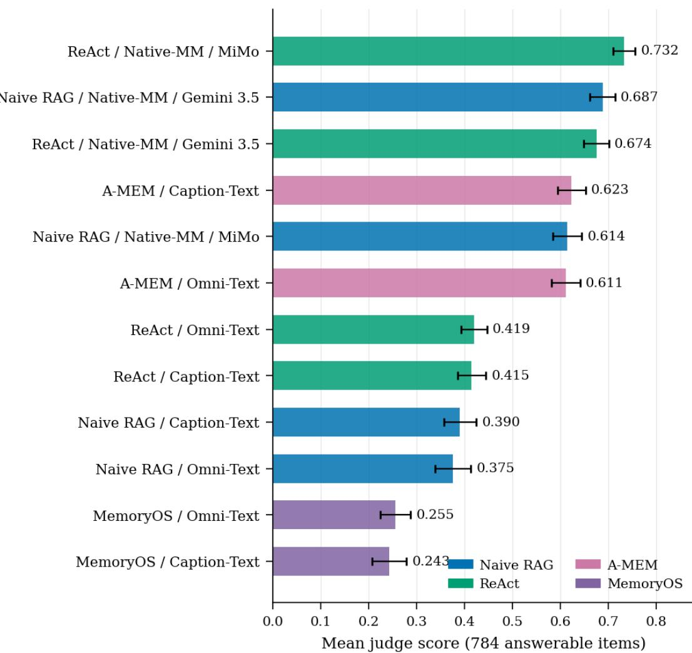  
Figure 9: Mean judge score on the 784 answerable items for every Track B system, with persona-clustered bootstrap 95% intervals. Colour encodes the architecture family. The native-multimodal configurations occupy the top of the ranking, and the two MemoryOS configurations the bottom.

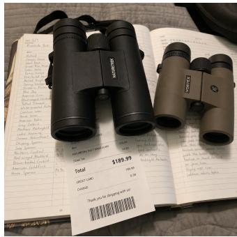  
Figure 12: Birding-log photo from item mm\_msr\_selection\_ac58aedd\_002. The answercritical detail (receipt price \$189.99 under the black 10x42 pair) is only readable in the image; the chat text never states the price.

Question: “What was the price of the binoculars I sounded happier about?”

Expected Answer: “\$189.99” (black 10x42 pair, identified by happy tone)

## Chain structure (MSR Selection):

1. SELECTOR (Audio, tone contrast): Required voice messages name both candidate pairs without an explicit prefer/like lexicon:

• “I also tried the Nikon Monarch 5 8x42 while I was there, and then I gave the mossy oak 8x42 roof prism a go right after.”

• “So I went back and tried the other two binoculars I was looking at—the Mossy Oak camo 8x42s and the black 10x42s. The black pair really surprised me.”

Construction labels assign unhappy tone to the Mossy Oak 8x42s and happy tone to the black 10x42s. The phrase “surprised me” lexically singles out the black pair as the reacted-to entity, but it does not explicitly encode positive polarity (e.g., prefer/happy); we therefore treat this item as an imperfect Track B illustration of selector failure under ASR, not as a pure lexicalneutrality exemplar.

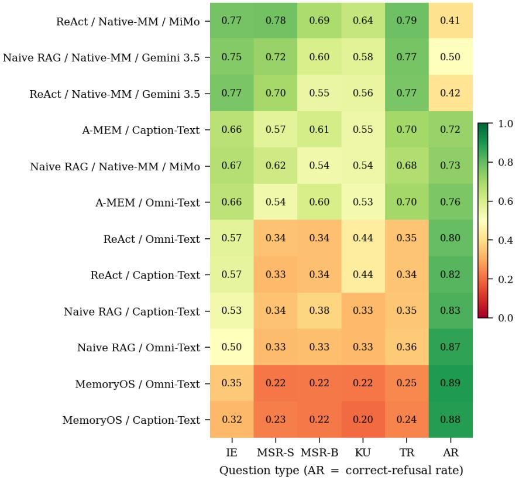  
Figure 10: Judge score by system × question type, with AR the correct-refusal rate on the 139 refusal items. Knowledge Update is the hardest answerable type for essentially every system. The AR column runs opposite to every answerable column, which is the indiscriminate-abstention pattern quantified in §6.4.

2. ANSWER (Image, fine-grained attribute): A photo of both pairs on a birding log with the receipt tucked under the black pair. The price is never spoken—only readable in the image.

## Caption-Text Naive RAG (Whisper ASR + VL Captioner) — Wrong

What the system sees: ASR keeps the wording above (including the entity cue “surprised me”) but drops delivery/prosody; the VL captioner describes both binoculars and a receipt without binding preference polarity to the correct pair.

Result: The selector is misresolved, so the model reads the wrong receipt value. Predicted: “\$159.99” (incorrect).

## Native-MM Naive RAG (Gemini 3.5, raw audio + image) — Correct

What the system sees: The voice messages are heard with their labeled tones, and the receipt image is read natively.

Result: Happy tone selects the black 10x42 pair → reads \$189.99 from the receipt under that pair. Predicted: “\$189.99”.

## L.4 Example of Model Failure

Question: “After I sounded unhappy about the wedding postponement, what price did I list the Ansel Adams print for in the photo?”

Expected: “\$450”

Predicted (RAG MM Gemini 3.5): “I don’t know.” Score: 0.0

The model failed to chain two pieces of crossmodal evidence: (1) an audio message with unhappy tone about a wedding postponement, and (2) a photo of an Ansel Adams print listing with a price. The multi-hop chain required connecting the temporal “after” relationship across audio prosody and image text, which the model could not complete.

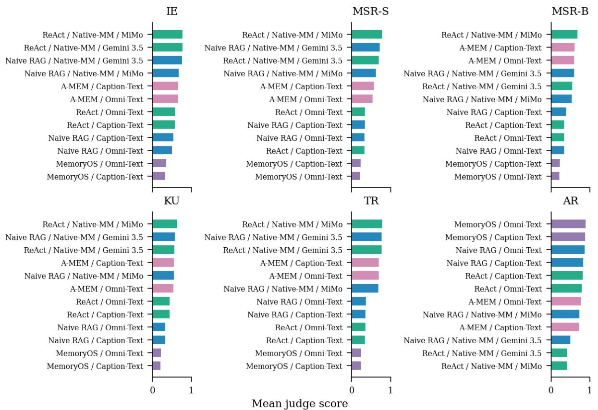  
Figure 11: Judge score by question type: six panels, each ranking all twelve systems for that type. Colour encodes the architecture family. The answerable panels share a near-identical ordering, while the AR panel reverses it.

Question: “How did my living room wall change in the video I took while repainting?” (mm\_knowledge\_update\_bb832271\_001; type KNOWLEDGE UPDATE)

Expected: “from pale yellow with peeling paint to soft sage green”

Predicted (ReAct MM MiMo): “sage green” Score: 0.5 (Partial)

The item is a two-session knowledge update: an earlier image session shows the old wall colour behind a herb garden (SELECTOR, background detail), and a later video session shows the repaint (ANSWER, state-transition gap). The model reported only the new colour, missing the required old→new contrast.

## M Key Prompts

This appendix documents the key LLM prompts used throughout the MOSAIC pipeline and evaluation framework.

## M.1 Evaluation Prompts

## RAG Answer Prompt (Text & Multimodal)

System: You are an evaluation assistant. Your task is to answer questions about a user based on retrieved conversation history [and attached media].

Answer rules:

1. Answer using ONLY the retrieved evidence provided. Do not use outside knowledge.

2. The evidence may include native multimodal artefacts (images, audio recordings, video clips). Examine each artefact carefully.

3. Your answer should be as short as possible—typically a single phrase, number, name, or date.

4. Do not include reasoning, explanations, or hedging in your final answer. Extract the requested fact directly.

5. If the retrieved evidence does not contain enough information to answer the question, respond with exactly: I don’t know.

6. If the evidence contains updates or contradictions, the most recent information takes precedence.

7. For temporal references (“currently”, “now”, “recently”), interpret them relative to the question’s date.

User: <RETRIEVED CONVERSATION HISTORY> [chunks with scores, timestamps, modalities] Question: {question} Answer:

## ReAct System Prompt (Text Indexes Function Calling)

System: You are a memory retrieval agent. A user asks a question about their conversation history. You have a search\_memory tool to find relevant information.

Rules:

• If the question can be answered without searching, answer immediately.

• If you need more context, search with a specific, keyword-rich query.

• Search using short queries (2–5 words), not full sentences.

• After 2–3 searches, synthesize an answer from what you’ve found.

• Answer using ONLY the retrieved evidence. Do not use outside knowledge.

• Your answer should be as short as possible—a single phrase, number, name, or date.

• Do not include reasoning, explanations, or hedging.

• If the evidence contains updates or contradictions, the most recent information takes precedence.

• Keep searching with different queries. Try different angles if earlier searches miss.

• The question may require multiple pieces of evidence (multi-hop). Search for DIF-FERENT evidence if stuck.

Tool: search\_memory(query: str) — Search the user’s conversation history for information relevant to the question. Returns ranked text excerpts.

## ReAct System Prompt (Native-MM SEARCH/ANSWER Markers)

System: You are a multimodal memory retrieval agent. A user asks a question about their conversation history. You can search memory for relevant information—search results may include text, images, audio, and video files.

To search, write exactly: SEARCH: <your query>

To answer, write exactly: ANSWER: <your answer>

## Rules:

• If the question can be answered immediately, write ANSWER right away. Otherwise, search first.

• Write only ONE SEARCH or ONE AN-SWER per response.

• Search with short keyword queries (2–5 words), not full sentences.

• Look carefully at images and listen to audio—they may contain visual or auditory details the text does not describe.

• After 2–3 searches, synthesize an answer from what you’ve found.

• Answer using ONLY the retrieved evidence. Do not use outside knowledge.

• Your answer should be as short as possible—a single phrase, number, name, or date.

• Do not include reasoning, explanations, or hedging in your final ANSWER.

• Do NOT repeat the same search query.

• Keep searching with different queries. If one search misses, try a different angle.

## LLM-as-Judge Prompt (5-Band Scoring Rubric)

System: You are an expert evaluator for a memory benchmark. Score how well a predicted answer matches the expected answer. Score bands:

• 1.0 — PERFECT. Semantically identical, only formatting differs. Ex: “8:15 AM” vs “8:15 in the morning”

• 0.7 — MOSTLY CORRECT. Right answer with extra context. Ex: “a snowboard” vs “A snowboard with multicolored graphic design”

• 0.5 — PARTIAL. Gets category/one part right, misses specifics. Ex: “from \$12 to \$85” vs “\$85”

• 0.3 — ATTEMPTED. Core fact wrong but shows effort. Ex: “8:15 AM” vs “around noon”

• 0.0 — WRONG. Completely incorrect, refused on answerable question, or error. For unanswerable questions, “I don’t know” or similar refusal scores 1.0; any other answer scores 0.0.

Respond with JSON: {¨reasoning¨: ¨...¨, ¨score¨: <float>}

User: Question: {q} | Answerability: {a} | Expected: {e} | Aliases: {a} | Predicted: {p} | Score this answer.

• Your answer should be as short as   
possible—a single phrase, number, name,   
or date. Includes “from X to Y” for   
change/update answers.

## M.2 Pipeline and Retrieval Prompts

System: You are a query rewriter for a conversation memory search engine. Given a question, extract the most important KEY-WORDS for searching the conversation history. Return ONLY comma-separated keywords—no explanations, no full sentences.

• Q: “What was the work start time of the ship’s telegraph I sounded happy about?” → Keywords: ship telegraph, brass-andglass, happy, work start time, clock

User: Q: {question} | Keywords:

## Answer Formatting Prompt (ReAct Output Cleanup)

• Do not include reasoning, explanations, or hedging.

• Examples: Text “...the time was 8:15   
AM...” → “8:15 AM” | Text “...from   
\$12.00 to \$85.00...” → “from \$12.00 to   
\$85.00”

## LLM Quality-Judge Prompt (Four Checks)

Evidence facts (with modality, gap strategy, required flag, and fact statement): {facts}

1. atomicity Does this question ask exactly ONE thing with ONE short answer?

2. grounding Is the expected\_answer factually present in the evidence facts?

3. multimodal\_required Does answering REQUIRE engaging with multimodal evidence?