# Memory-Centric Continual Learning for AI Agents

Autonomous agents powered by foundation models can reason, plan, and use tools, but their fixed weights and context limits hinder sustained learning from experience over long-term deployment. While external memory systems attempt to bridge this gap, they mostly act as passive retrieval caches, evaluated primarily by whether they can recall stored facts or past interactions. Whether memory can drive genuine continual learning remains an open question. In this paper, we introduce Memory-Centric Continual Learning (MCCL), arguing that memory should be judged by whether it improves future actions, not merely what it retrieves. MCCL has three main parts. First, a three-axis taxonomy organizes memory by where state is stored (substrates), what form it takes (assets), and how it is managed (policies). This defines a two-loop lifecycle that updates memory state in an inner loop while refining management policies in an outer loop based on task feedback. Second, an evaluation protocol measures retention under interference, adaptation to change, and task transfer to isolate genuine behavioral gains from simple context expansion. Third, a memory scaling framework models how agent performance scales with experience, storage capacity, and compute budgets across non-parametric and parametric memory. Together, these components reframe agent memory from passive lookup to continuous learning, offering a principled route toward self-improving autonomous agents.

Non-parametric memory  
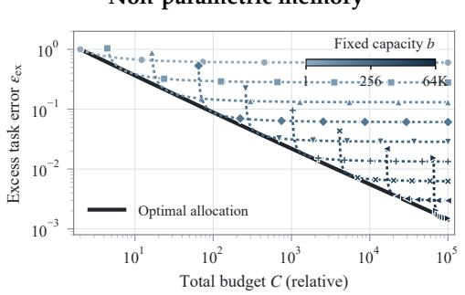

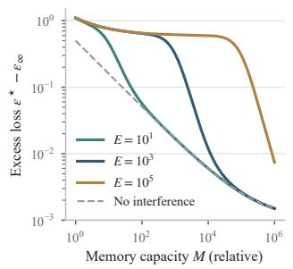

## Parametric memory

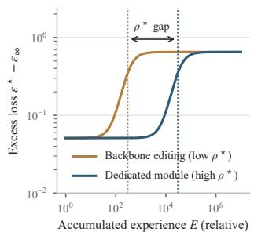  
105 105Figure 1: Memory scaling across two substrates. Theoretical illustrations: left, joint allocation of storage tiv Capacity b ⋆ and reading resources sustains improvement beyond fixed-capacity limits; center, greater experience requires el Reading r⋆ B0more parametric memory capacity; right, load-induced interference emerges at substrate-dependent thresholds. 103ce 103=BCurves are synthetic illustrations; see Section 4.3 and Figures 7 and 11.

## Contents

1 The Landscape: Why Agents Need Continual Learning via Memory 3   
2 A Unified Framework: Architecting Memory for Continual Learning 4   
2.1 Memory Substrates: Physical Foundations for Stability and Plasticity 5   
2.2 Memory Assets: Representations for Cross-Task Transfer 6   
2.3 Memory Policies: Prescribed, Deliberative, and Learned Control 9   
3 The Memory Lifecycle as the Engine of Continual Learning 10   
3.1 Formation and Selective Writing 11   
3.2 Organization, Compression, and Consolidation . 12   
3.3 Retrieval and Utilization 14   
3.4 Revision and Forgetting 14   
3.5 Feedback-Driven Policy Evolution 15   
4 Evaluating Memory-Augmented Agents as Continual Learners 17   
4.1 What to Measure: Retention, Adaptation, and Transfer 17   
4.2 How to Measure: Protocols for Experience, Controls, and Time 19   
4.3 The Memory Scaling Law: Capacity, Interference, and Learning Efficiency 21   
5 Memory-Centric Continual Learning Applications Across Digital and Physical Domains 30   
5.1 Lifelong Personalization and Companion Agents . 31   
5.2 Evolving Problem-Solving in Long-Horizon Digital Environments 32   
5.3 Continuous Exploration in Embodied and Open Worlds 32   
5.4 Collaborative Evolution via Shared Multi-Agent Memory 33   
6 Open Challenges in Memory-Centric Continual Learning 34   
6.1 Predicting Experience Value and Long-Term Credit Assignment 34   
6.2 The Stability–Plasticity Dilemma in Dynamic Environments 35   
6.3 Synergistic Continual Learning through Experience Memory and Parametric Learning 36   
6.4 Trustworthy Memory Governance in Lifelong Deployment 36   
7 Conclusion 37   
Author List 50

## 1 The Landscape: Why Agents Need Continual Learning via Memory

Autonomous agents powered by foundation models have demonstrated strong capabilities in multistep reasoning, planning, and tool use across digital and physical domains [1, 111, 144]. However, current agents cannot reliably improve from experience over long deployments. Although modern agent harnesses can systematically track execution logs, timestamps, and environment states, they often treat accumulated history as raw text to be retrieved and inserted back into the prompt. Simply retrieving raw text does not guarantee behavioral improvement. As interaction trajectories grow, unmanaged context dilutes relevant signals, increases inference latency, and degrades model attention [120].

Conventional adaptation methods face clear trade-offs. Expanding context windows is bounded by session limits and suffers from attention degradation over long contexts. Meanwhile, continual fine-tuning requires substantial computation, risks catastrophic forgetting of general abilities, and lacks reliable mechanisms to roll back errors [39, 74]. Without mechanisms to distill, update, and transfer accumulated experience, deployed agents cannot retain what they learn. Consequently, they repeatedly commit the same errors, struggle with conflicting or outdated information, and fail to improve across sequential tasks [13, 47, 148].

Agent memory has emerged as a primary approach to support persistence across sessions and personalization [19, 86, 87]. However, despite rapid progress, most existing methods focus on specific engineering implementations rather than systematic continual learning. Many approaches adopt an information retrieval view, treating memory simply as an external database or a Retrieval-Augmented Generation (RAG) cache designed to feed past tokens back into the prompt [61, 73]. Furthermore, existing classifications often blur distinct system choices, including where memory is physically stored, what form knowledge takes, and how memory operations are managed. Evaluation also remains limited. Many benchmarks primarily test whether an agent can recall or answer questions over a static past history, rather than whether experience accumulated during deployment improves subsequent actions under interference and drift [29, 75, 125]. Moreover, as memory stores grow, unmanaged external memory suffers from retrieval noise, memory pollution, and negative transfer when task distributions shift [15, 153].

To bridge this gap, we propose the framework of Memory-Centric Continual Learning (MCCL). We argue that addressing the stability–plasticity dilemma does not strictly require continuous gradient updates to foundation model weights. Instead, memory itself can serve as an evolving learning infrastructure through which an agent incorporates feedback, refines strategies, and resolves knowledge conflicts during deployment, while keeping the base model intact. In this framework, continual learning operates as a coupled dynamical system. An inner memory-state loop updates stored knowledge from sequential deployment experience, while an outer policy-adaptation loop refines memory management policies based on task performance. By connecting task outcomes back to memory management, MCCL provides a principled route toward Recursive Self-Improvement (RSI), where agents not only accumulate experience but also improve how that experience is organized and used. We summarize our core contributions as follows.

1. A unified taxonomy of memory architecture. We clarify existing classifications through a three-axis taxonomy: where experience persists (substrates: contextual, activation, external addressable, and adaptive parametric), what form it takes (assets: episodic, semantic, and procedural), and how operations are managed (policies: prescribed, deliberative, and learned). This separates physical storage from cognitive representation and operational control (Section 2).

2. The memory lifecycle as an engine for continual learning. We formalize memory dynamics across five core stages: selective formation, structural consolidation, reactivation and utilization, knowledge revision and selective forgetting, and feedback-driven policy evolution. This formulation explains how raw interactions turn into generalizable knowledge while mitigating memory pollution and drift (Section 3).

3. A behavioral evaluation framework. We distinguish retrieval-level checks from genuine continual learning outcomes. We introduce a four-gate retention cascade (preservation, access, utilization, and effect) to diagnose failure points, use matched stateful-versus-reset comparisons (��) to isolate the effect of accumulated memory, and establish evaluation protocols to measure retention under interference, adaptation under drift, and cross-task transfer (Section 4).

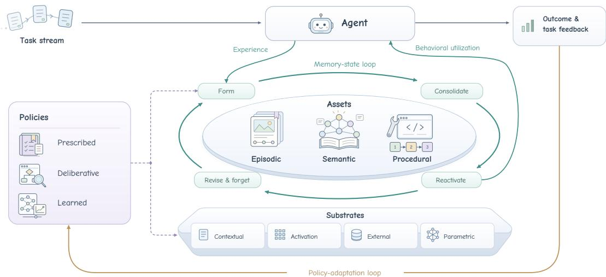  
Figure 2: Memory-centric continual learning as a coupled dynamical system. A task stream is executed by the agent and produces outcome feedback. Experience is organized as episodic, semantic, and procedural assets that persist across contextual, activation, external, and parametric substrates. An inner memory-state loop forms, consolidates, reactivates, and revises these assets, while prescribed, deliberative, or learned policies govern the corresponding operations. An outer policy-adaptation loop uses task feedback to update memory management.

4. A memory scaling law. We model how agent performance scales with experience, storage capacity, and compute budgets across both non-parametric and parametric memory. Both share a resource-limited scaling frontier, but differ in how new writes interact with existing content. This shifts the focus from whether larger memory helps to how experience, capacity, and compute should scale together (Section 4.3).

In summary, this paper reframes agent memory from a passive storage component into an active learning infrastructure, focusing on whether an agent can continually learn over time rather than simply retrieve past records. The remainder of this paper is organized as follows. Section 2 presents the taxonomy across substrates, assets, and policies. Section 3 details the memory lifecycle as a continual learning engine. Section 4 formalizes the evaluation framework and memory scaling laws. Section 5 analyzes applications across digital and physical domains. Section 6 discusses open challenges in credit assignment, parametric synergy, and trustworthy memory governance. Section 7 concludes the paper.

## 2 A Unified Framework: Architecting Memory for Continual Learning

Classical continual learning theory has primarily focused on the stability–plasticity dilemma within model weights, seeking to mitigate catastrophic forgetting during sequential gradient updates [78, 112]. In contrast, foundation-model-based agents decouple computation from persistent storage, distributing experiential adaptation across physical media, semantic abstractions, and control mechanisms. However, existing taxonomies often mix these levels, confusing where an experience is stored with what form it takes and how it is managed [49, 169]. To establish a principled foundation for memory-centric continual learning, we organize the design space around three core axes, covering where experience persists, what reusable form it takes, and how memory operations are managed (Figure 2).

• Memory Substrates (WHERE): Physical Storage Media. Substrates define the physical medium where experience persists. They govern trade-offs between write latency, volatility, capacity, and durability, determining whether experience is held in active context, model activations, external stores, or model parameters.

• Memory Assets (WHAT): Cognitive Representations. Assets describe the form knowledge takes. Independent of physical substrates, assets balance specific detail against general abstraction, grouping experience into episodic traces, semantic facts, or procedural skills.

• Memory Policies (HOW): Mechanisms for Memory Management. Policies define the rules for writing, consolidating, retrieving, updating, and forgetting memories. They span fixed heuristics (prescribed), runtime language model reasoning (deliberative), and feedbackdriven control (learned), determining whether memory management remains static or adapts over time.

These three axes are complementary dimensions rather than isolated categories. A concrete agent memory system combines specific choices across all three axes, such as compiling episodic traces into an external addressable store governed by deliberative policies powered by Large Language Models (LLMs). Decoupling these dimensions clarifies that possessing an external substrate does not by itself yield transferable capability, nor does storing an episodic asset indicate that an agent has an effective policy to retrieve and use it. By formalizing this three-axis architecture, we establish a principled framework to diagnose where existing architectures succeed or fail under non-stationary streams, and to compose hybrid systems that support RSI.

## 2.1 Memory Substrates: Physical Foundations for Stability and Plasticity

Memory substrates define where experience persists and how it can be accessed and modified. Existing taxonomies commonly separate internal from external memory, or computation-coupled from addressable memory [49, 169]. We distinguish substrates by where state physically persists, rather than how it appears during inference. For example, text retrieved from a database remains external memory even when placed in a prompt; conversely, offloading the KV cache to disk changes its storage location but keeps it an activation-level representation. Following this principle, we identify four basic substrates: contextual memory, activation memory, external addressable memory, and adaptive parametric memory.

This distinction is independent of memory assets and policies. A substrate specifies how long experience can persist, how it can be addressed, and at what granularity it can be updated. It does not, by itself, tell us whether those updates yield transferable improvement; that depends on the assets built from experience and on the policies that govern their formation and use.

Contextual memory. The most direct memory substrate is the sequence of tokens currently visible to the model. Thoughts, actions, and observations can be recorded in a shared prompt so that the trajectory influences subsequent decisions through self-attention [144]. Ever-growing traces are replaced with subgoal-level summaries or compressed reasoning states [46, 128], and deletion, compression, and rewriting are exposed as agent actions [161]. These methods require little architectural modification and offer nearly immediate plasticity, with relatively high fidelity over short horizons. Their stability, however, is bounded by the session limit. As trajectories grow, older observations consume context tokens and degrade model attention. Even within the supported context window, performance can drop sharply with sequence length, evidence position, and task complexity [45, 69]. Summarization and compaction extend the effective horizon but introduce an irreversible, often lossy selection step [20].

Activation memory. A second family compresses history into machine-native states, including hidden activations, KV caches, recurrent states, and dedicated memory slots. Hidden states are reused across segments, and KV entries are selectively retained under a fixed budget [22, 70, 162]. Previously computed internal representations are placed in a retrievable memory bank [114, 130], and latent pools or designated slots are introduced that can be repeatedly read and updated [54, 117]. Compared with textual context, these states participate in the forward pass at higher bandwidth and need not be translated back into natural language. Gating, state transitions, and isolated slots can also confine rapid adaptation to a restricted state channel, leaving the pretrained backbone unchanged. This efficiency shifts the capacity cost to runtime memory and limits controllability:

activation memories are tied to a particular model, layer structure, and representation space, and their contents are difficult to inspect, edit at the level of individual facts, or transfer across models [59]. Fixed-dimensional latent states also face capacity limits as experience accumulates. Offloading activation states or the KV cache to disk does not turn them into external text memory, because they can still only be processed as internal representations by the original model.

External addressable memory. External memory separates storage from model computation. Experience persists as independently maintained entries that can be explicitly retrieved and modified. Implementations range from natural-language logs and summaries to vector indices, relational tables, knowledge graphs, hierarchical trees, code repositories, and collections of specialized stores. Observation streams are combined with higher-order reflections, language-level diagnoses are retained from failed trials, and information is moved between a bounded active context and larger archival stores [86, 87, 95]. Memory extraction, dynamic organization, and structured retrieval are further developed in recent systems [19, 42, 90, 136]. This substrate offers a direct route to non-parametric continual learning: new experience can survive across sessions without altering the foundation model, individual records can be revised or versioned, and capacity can grow independently of model size.

Structural separation changes rather than resolves the stability–plasticity dilemma. External stores avoid catastrophic forgetting caused by parameter updates, but an old memory can become inaccessible when its retrieval rank declines, producing a form of functional forgetting. Summarization, deduplication, and conflict resolution may also overwrite earlier records or change whether they still count as valid evidence. As the store grows, redundant, stale, and conflicting entries raise retrieval noise. Indexing, provenance tracking, and deletion become more expensive as well. Irrelevant or conflicting retrieval can be actively harmful [13, 110], and current memory agents do not reliably combine retrieval, online updating, long-range use, and selective forgetting [48, 106].

Adaptive parametric memory. Parametric substrates encode deployment experience in model weights, detachable adapters, or designated fast parameters. Static pretrained weights are not sufficient for this category; the defining property is that parameters can still be updated from experience after deployment. Consecutive edits are isolated in a side parameter space, and behavior obtained with visible context is distilled into a model that no longer receives that context [113, 118]. Test-time neural memory and rapidly updated LoRA parameters are used to preserve behavioral effects after the corresponding evidence has left the active prompt [8, 89]. Once internalized, it can be used during a standard forward pass without external retrieval and may generalize beyond the specific instance that produced the update. It is therefore attractive for stable, frequently reused, and well-validated knowledge or skills.

This efficiency at read time comes at the cost of more expensive and less controllable writes. Param eter updates require optimization, generated supervision, or specialized test-time learning rules. Once an experience is distributed across weights, its scope is difficult to localize, and record-level expiration, provenance tracking, and deletion become substantially harder than in an external store. Repeated adaptation can cause catastrophic forgetting of earlier knowledge or consolidate transient feedback and self-generated errors into persistent behavior. Continual instruction tuning forgets across domain knowledge, reasoning, and reading comprehension, and successful factual edits can still degrade unrelated general abilities [39, 74]. Side memories, low-rank adapters, and slow–fast parameter decompositions reduce forgetting by restricting the update scope, but introduce routing failures, module-merging conflicts, and long-term drift of their own.

Hybrid substrates. Practical memory systems increasingly combine substrates with complementary roles, where tokens and activations support immediate adaptation, external stores provide durable and auditable retention, and parameter updates selectively internalize stable skills [8, 86, 89, 114]. Existing hybrid systems still leave several design choices open, including where new experience first enters, when it moves to a more durable store, how queries are routed, which state is authoritative during conflicts, and where erroneous updates can be rolled back.

## 2.2 Memory Assets: Representations for Cross-Task Transfer

Memory substrates determine the physical state in which experience persists, whereas memory assets describe the reusable units constructed from that experience. The two dimensions do not admit a fixed correspondence. The same task experience may remain temporarily as context tokens, be written to an external log, organized as a graph, or eventually internalized into model parameters. Conversely, a single external store may contain event records, factual relations, and executable skills. We therefore classify an asset by how it is used when retrieved, rather than by how it is stored, distinguishing episodic, semantic, and procedural assets. This taxonomy concerns experience that can persist across interactions or tasks. Contextual tokens and activation states may participate in memory formation, but they count as assets only once they persist in a reusable form across tasks; otherwise they remain working state on a substrate.

<table><tr><td colspan="2">Substrates Physical states in which experience persists</td><td>WHERE</td></tr><tr><td colspan="2">Subclass</td><td>Representative related work</td></tr><tr><td colspan="2">Contextual</td><td>ReAct [144]; HiAgent [46]; ReSum [128]; Memory-as-Action [161]; ACE [159]; Parallel Compaction [20].</td></tr><tr><td colspan="2">Activation</td><td>Transformer-XL [22]; H2O [162]; ChunkKV [70]; LongMem [114]; Memorizing Transformers [130]; MEMORYLLM [117]; LM2 [54].</td></tr><tr><td colspan="2">External Addressable Adaptive Parametric</td><td>Generative Agents [87]; Reflexion [95]; MemGPT [86]; Mem0 [19]; A-MEM [136]; HippoRAG 2 [42]; MemTree [90]. WISE [113]; SELF-PARAM [118]; Titans [8]; TMEM [89];</td></tr><tr><td colspan="3">Experience Internalization [15]; Larimar [24].</td></tr><tr><td colspan="2">Subclass Representative related work</td><td>WHAT Reusable representations constructed from experience</td></tr><tr><td colspan="2">Episodic Semantic MemTree [90]; Memory OS [53]. Procedural</td><td>Generative Agents [87]; Reflexion [95]; ExpeL [163]; EvoMemBench [120]; SEEM [72]; Mem0 [19]. A-MEM [136]; Zep [88]; HippoRAG 2 [42]; STALE [14];</td></tr><tr><td colspan="2"></td><td>Voyager [111]; Agent Workflow Memory [121]; ReasoningBank [85]; ContinualSkillBench [40]; SkillLearnBench [166].</td></tr><tr><td colspan="3">Policies HOW Mechanisms governing memory formation, retrieval, revision, and forgetting</td></tr><tr><td colspan="2">Subclass Prescribed</td><td>Representative related work</td></tr><tr><td colspan="2">Deliberative Nemori [82]; ACON [55]. Learned Memory-R1 [139]; MemAct [161]; AgeMem [149]; MemRL [160]; Retroformer [145]; MemSearcher [151];</td><td>StreamingLLM [133]; Generative Agents [87]; RAG [61]; MemoryBank [167]; RMM [103]; MemGPT [86]. MemGPT [86]; A-MEM [136]; Mem0 [19]; Reflexion [95]; ReasoningBank [85]; WebCoach [67]; EvoMem [30];</td></tr></table>

Figure 3: A unified taxonomy of agent memory for continual learning. Memory substrates specify where experience persists, memory assets describe what reusable representations are constructed from experience, and memory policies determine how memory is written, retrieved, consolidated, revised, and forgotten. Representative related works are organized by subclass under each of the three dimensions.

As with substrates, possessing an asset is not itself evidence of cross-task learning. Episodes, facts, and skills specify the form in which experience can transfer; whether transfer occurs is a question for memory policies.

Episodic assets. Episodic assets preserve what happened. Their basic unit is a particular experience situated in its temporal, environmental, and task context. An episode may include observations, goals, actions, tool calls, intermediate reasoning, feedback, and outcomes, or a compressed segment derived from these elements. Compared with more abstract assets, episodes retain the conditions under which an experience was obtained. They therefore support case-based reuse, resumption of interrupted tasks, and retrospective inspection of the evidence behind a later belief or strategy. Observations and higher-order reflections are stored in a memory stream, trial outcomes and linguistic diagnoses are retained after failed attempts, and both prior trajectories and insights extracted from collections of experience are retrieved for later reuse [87, 95, 163]. Structured event records and production memory stores further retain temporally grounded episodes across sessions [19, 72].

Episodes are particularly valuable for rare events and one-shot observations for which reliable abstraction is not yet possible. They permit highly plastic writes because the agent need not decide immediately whether an observation expresses a general rule, while their high fidelity supplies evidence for later correction. The same fidelity, however, produces substantial storage and retrieval costs. As the collection grows, trajectories that are superficially similar but decisionally different compete for retrieval, while complete traces carry observations and actions irrelevant to the current problem. Stored experience is most useful when its structure matches the target task; in other settings, long-context baselines remain competitive [120].

Semantic assets. Semantic assets preserve what is known. Their reusable units are facts, concepts, relations, constraints, preferences, and environment models abstracted from particular observations. Unlike episodic assets, they suppress much of the temporal and surface detail of the originating event so that knowledge can be reused across sessions and tasks. A recurring user preference, a tool authentication requirement, or a relation between two entities can thus be invoked without replaying the full interaction from which it was inferred.

Stripping temporal and situational detail yields compression and broader reuse, and structured semantic assets additionally support entity-level revision, relational inference, and multi-hop retrieval. Dynamically indexed notes are linked so that new entries can modify the contextual representation of existing ones; current and historical relations are maintained in temporal knowledge graphs; and structured retrieval is framed as non-parametric continual learning [42, 88, 136]. Hierarchical schemas and operating-system-style stores likewise organize reusable facts beyond a single episode [53, 90]. These approaches indicate that semantic memory is not a static knowledge base but a knowledge state that must be continually formed, connected, and revised.

The central weakness of semantic assets arises from the same abstraction that enables transfer. Premature consolidation may convert an accidental correlation into a general claim, while removing context may discard when, where, and with what confidence that claim is valid. Appending new information can leave mutually competing facts in memory, whereas overwriting an earlier entry can destroy historical provenance. Retrieving updated evidence also does not guarantee recognition of an implicitly invalidated belief or corresponding adaptation in downstream behavior [14]. In practice, existing semantic stores often keep the extracted claim while omitting provenance, temporal scope, confidence, and links to the episodes that support it.

Procedural assets. Procedural assets preserve how to act. Their reusable units include workflows, strategies, plan templates, tool-use rules, and executable programs. They may be represented as natural-language instructions, code, parameterized workflows, or behavioral policies internalized in model parameters. The distinction from semantic assets is functional rather than syntactic: semantic assets describe a state of the world, whereas procedural assets prescribe how that state should be changed under particular conditions. The same piece of text can therefore be semantic if retrieved as a fact and procedural if retrieved as an instruction.

Because they directly constrain action generation, procedural assets provide the most immediate form of behavioral transfer. Environment-verified skills are stored as composable code, parameterized workflows are induced from successful trajectories for reuse across tasks and domains, and generalizable strategies are extracted from successful and failed experience instead of retaining only raw trajectories [85, 111, 121]. Evolving context playbooks and learned memory skills further compile repeated execution into reusable action knowledge [83, 155, 159]. Procedural assets can also be composed, allowing previously acquired skills to become components of more complex behavior and reducing repeated exploration.

This compilation nevertheless locks in assumptions from the original experience. A workflow may remain valid only for a particular tool version, interface, or set of environment dynamics. Retrieving a skill for a superficially similar task with different preconditions can produce negative transfer, while unverified self-reflection may turn an accidental success into a persistent rule. Explicit skill maintenance is not uniformly superior to retaining prior context, and gains are more reliable on tasks with clear workflows than on open-ended ones [40, 166]. In current systems, preconditions, expected outcomes, environment dependencies, verification status, and versioning are often left implicit. Long-lived skill libraries therefore tend to accumulate skills rather than merge, deprecate, or regression-test them.

Cross-asset consolidation. The three asset classes are not mutually exclusive storage compartments. They describe experience at different levels of abstraction. Episodic assets retain concrete evidence; regularities recurring across episodes may be consolidated into semantic assets; and repeatedly validated action regularities may be compiled into procedural assets. This transformation improves compression and cross-task reuse while progressively removing details of the original context. Asset formation therefore exposes a fundamental trade-off: representations close to individual episodes preserve evidence but depend on precise matching, whereas abstract knowledge and skills are cheaper to invoke but allow erroneous generalizations to affect a wider range of tasks.

Consolidation is rarely a clean, one-way pipeline in existing systems. Semantic claims and procedural skills often lose their links to supporting episodes, and new experience cannot always qualify, revise, or revoke what was previously consolidated. A single record can also contain all three components, such as a task trajectory, an environmental fact inferred from it, and a corrective procedure learned after failure. At retrieval time, such a record is better classified by how it is used than by how it is physically stored.

## 2.3 Memory Policies: Prescribed, Deliberative, and Learned Control

As agents operate over longer horizons, memory is no longer only a problem of storing more information or retrieving it more accurately. The central challenge is how memory should change over time, deciding what should be retained, consolidated, revised, or forgotten, and how these decisions should adapt to new experience and feedback. We refer to the mechanisms governing such decisions as memory policies. They determine when and how memory state evolves, and they correspond to the how column of Figure 3.

We distinguish three control regimes. Prescribed policies apply fixed rules, heuristics, and scoring functions. Deliberative policies use the LLM to decide, for each case, whether to write, retrieve, or revise, given the task, memory state, and context. Learned policies update memory control from outcomes and feedback. The regimes are compositional rather than exclusive: a system may prescribe capacity limits, deliberate over conflicts, and learn retrieval utilities. They also align with the prescribed, deliberative, and learned control tiers used later in the lifecycle comparison (Section 3).

Prescribed policies. Prescribed policies treat memory management as resource allocation under limited context, cache, and store capacity. Control is specified before deployment through rules such as FIFO, LRU, sliding windows, or fixed Top-� retrieval, so utility is approximated by position, recency, and budget rather than estimated future value [133]. Salience-based scoring is a richer but still prescribed variant: recency, importance, and relevance are combined to select episodic records [61, 87], and entries are admitted or forgotten according to novelty, importance, or decay thresholds [103, 167]. Hierarchical designs go beyond single-shot Top-� by controlling movement across memory tiers, yet the tools, thresholds, and control rules remain predefined [86]. Prescribed control is efficient, predictable, and easier to inspect. Its limitation is rigidity: what counts as novel, important, or disposable is not subsequently revised according to task outcomes.

Deliberative policies. Deliberative policies place the LLM inside the memory-control loop because numerical scores cannot fully capture the semantic value of an experience. The model is asked, for each case, whether to store, retrieve, resolve a conflict, or rewrite, using the current task, memory state, and context. Handcrafted scoring is replaced by case-by-case judgments, while the outer tool protocol remains fixed [19, 86, 136]. A stronger deliberative pattern lets experience revise subsequent control in natural language: verbal post-mortems are stored to steer later attempts, and successful and failed traces are abstracted into reusable strategies [85, 95]. Write boundaries are tightened, consistency is verified against constraint memory, or the memory collection itself is reorganized [30, 55, 67, 82]. The resulting control is flexible and interpretable, but inference-intensive and dependent on prompt following. Rewriting a strategy in language still leaves the controller untrained, as most such systems lack credit assignment from later task outcomes back to earlier memory decisions.

Learned policies. Learned policies treat memory control as an experience-updated decision problem. The agent may still use standard operations, such as write, retrieve, compress, revise, and forget, but a trainable controller selects among them, and those selections improve from outcomes and feedback. Discrete memory actions are learned from reward [139, 149, 161], and purely similaritybased retrieval is replaced with utility values that reflect historical contribution to success [160]. Reinforcement learning provides the credit assignment that static controllers lack, because the true value of a write or deletion often appears only several steps later [18, 145, 151].

Two levels of learning should be distinguished. In many existing systems the controller is optimized offline and then frozen, so memory content continues to evolve while the operational policy remains static. Recent RSI frameworks instead attempt rule-level modification, where the language model is prompted to inspect and revise its own prompt templates or execution scaffolding [2, 147, 157, 159]. Recuris further shows that a Meta-Agent can synthesize validation-gated updates from execution failures, recursively refining operational rules and the skill library [150]. Although reflection-based prompt adaptation offers substantial semantic flexibility, such methods typically rely on heuristic textual edits and trial-and-error screening against a validation set. Under long-horizon delayed task feedback, they struggle to establish fine-grained temporal credit assignment and to keep the meta-policy stable. A more systematic form of continual policy evolution would update the memorymanagement policy from ongoing environmental feedback while suppressing policy drift. The next section turns to how experience-level rule evolution can be combined with structured closed-loop policy learning across the lifecycle.

## 3 The Memory Lifecycle as the Engine of Continual Learning

The previous section describes agent memory in terms of where experience persists, what reusable form it takes, and how memory operations are controlled. These dimensions define the architecture of a memory system, but they do not explain how that system changes through continued deployment. Continual learning is often described as adaptation through parameter updates. For agents, however, experience can also accumulate in external records, persistent internal states, and other writable memory substrates. We therefore view memory-centric continual learning (MCCL) as a coupled dynamical process, where experience updates the persistent memory state while behavioral feedback can also adapt the policy governing future memory decisions.

At the first level, newly acquired experience changes the memory state through a transition function controlled by the current memory policy,

$$
\boldsymbol { \mathcal { M } } _ { t + 1 } = \mathcal { T } \left( \boldsymbol { \mathcal { M } } _ { t } , \boldsymbol { e } _ { t } ; \pi _ { t } ^ { \mathrm { m e m } } \right) ,\tag{3.1}
$$

where $M _ { t }$ denotes the persistent memory state at time $t , e _ { t }$ denotes experience from the current interaction, and $\pi _ { t } ^ { \mathrm { m e m } }$ denotes the policy that controls how this experience is handled. We use $e _ { t }$ broadly to include relevant observations, agent actions, outcomes, and feedback. The transition function $\mathcal { T }$ is independent of any particular memory substrate. Depending on the system, it may admit new experience, reorganize accumulated memory, revise existing content, or reduce the future influence of selected memories.

A change in memory state is not, by itself, evidence of continual learning. The updated state must later be accessed and incorporated into reasoning, decisions, or actions under the memory policy,

$$
\begin{array} { r } { \mathcal { M } _ { t + 1 } \xrightarrow { \mathrm { a c c e s s ~ a n d ~ u t i l i z a t i o n ~ } ( \pi _ { t + k } ^ { \mathrm { m e m } } ) } \Delta \mathcal { B } _ { t + k } , \qquad k > 0 , } \end{array}
$$

where $\Delta \mathcal { B } _ { t + k }$ denotes a downstream behavioral effect associated with the memory change. Information may persist without being retrieved, may be retrieved without being used appropriately, or may influence behavior in a harmful way. Memory supports continual learning only when experience-induced changes remain usable, yield appropriate improvement or adaptation in later behavior, and avoid unnecessary damage to still-useful capabilities [96, 148].

At the second level, feedback may change not only memory content but also the policy that controls future memory decisions. We write this outer update as

$$
\boldsymbol { \pi } _ { t + 1 } ^ { \mathrm { m e m } } = \mathcal { U } \left( \pi _ { t } ^ { \mathrm { m e m } } , \mathcal { F } _ { t : t + H } \right) ,\tag{3.2}
$$

where $\mathscr { F } _ { t : t + H }$ summarizes downstream feedback observed over a later horizon �, and denotes the rule used to update the memory policy. Such feedback may include task outcomes, rewards, errors, user corrections, or other signals that reveal the consequences of earlier memory decisions. need not change the policy in every system. A fixed controller may continue to modify M� while �mem� remains unchanged. Policy evolution refers to the stronger case in which accumulated experience also changes how future memory decisions are made.

Equations (3.1) and (3.2), together with behavioral utilization, define two coupled processes. The inner memory-state loop governs both how the persistent state � evolves and how it informs decisions: how experience enters persistent memory (formation and writing), how accumulated experience is restructured (organization and consolidation), how prior memory returns to the active decision process (retrieval and utilization), and how the stored state is maintained as new evidence arrives (revision and forgetting). Persistent memory is not an additional operational stage; rather, it is the central evolving state upon which write, consolidation, readout, and maintenance operations act. The outer control loop determines how decisions within these four stages are governed and whether downstream feedback modifies those control rules over time.

Together, the two loops describe continual learning as more than memory accumulation. Experience changes memory, memory influences later behavior, and behavioral consequences may in turn improve how subsequent experience is managed. The goal is therefore not to maximize the amount of stored information or the frequency of updates, but to support adaptation while preserving valid evidence and useful capabilities. Figure 4 summarizes this view.

## 3.1 Formation and Selective Writing

Formation is the first point at which ongoing experience can acquire persistent influence over future behavior. It determines not only which observations should enter long-term memory, but also how they are represented and what source, temporal, and contextual information is preserved for later use.

Selective Writing and Plasticity Control. Memory-centric continual learning begins with an admission decision, because not every interaction should modify persistent memory. Writing too freely can accumulate incidental, redundant, or erroneous observations and increase interference over time. Writing too conservatively can discard experience that would have supported later adaptation. Selective writing therefore defines the agent’s plasticity boundary by deciding which deployment-time experiences may exert persistent influence on future behavior. Selected sessionlevel information can be promoted into persistent memory, and storage operations can be exposed as actions that are optimized from downstream outcomes [21, 149]. These examples show that admission can range from staged promotion to learned action selection. In either case, the cost of a poor write can persist, as admitting unreliable experience propagates errors while rejecting useful experience removes evidence needed for future learning. The objective is therefore not to store as much as possible, but to admit useful experience without giving transient or unreliable observations unnecessary long-term influence.

Initial Representation. Admission also requires a choice about how experience is represented. What is made explicit at write time determines what can later be retrieved, compared, or revised. An experience may remain as a relatively direct episodic record or be encoded into a representation that makes events, entities, relations, and temporal information explicit [72, 88]. Structure and granularity are orthogonal choices: structure determines how explicitly relational and temporal attributes are indexed, whereas granularity determines how much situational detail is retained versus compressed. A representation can therefore be highly structured while remaining fine-grained, whereas overly coarse or unstructured encodings may discard contextual details that later become critical. Because subsequent consolidation cannot reliably recover evidence that was never recorded at admission, the initial representation directly bounds the evidence available to all downstream memory operations.

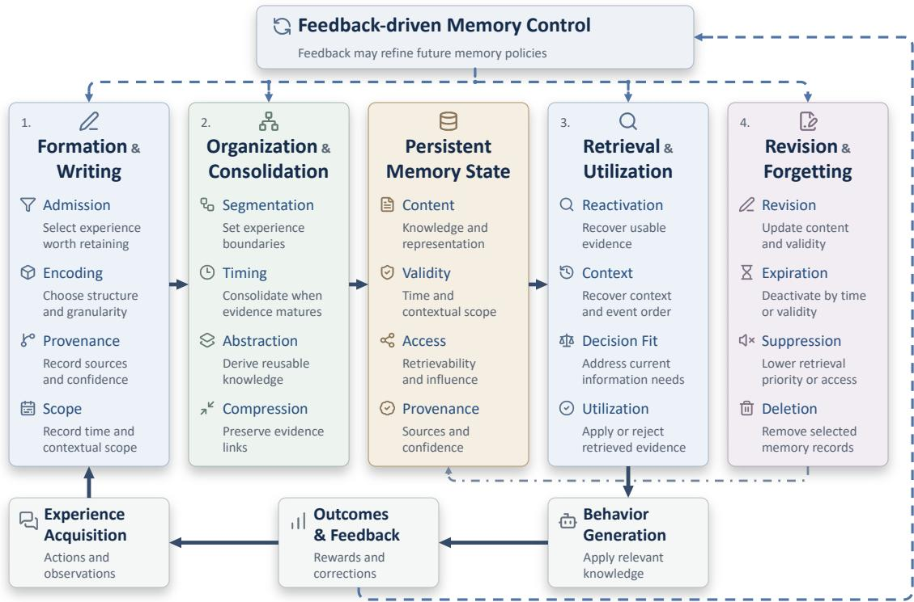  
Figure 4: The memory lifecycle as two coupled processes in memory-centric continual learning. The memory-state loop governs how experience enters persistent memory, is organized and reused, and is revised or forgotten as conditions change. The control loop uses behavioral outcomes to influence future memory decisions.

Source, Scope, and Memory Pollution. A useful persistent memory should also retain the conditions under which it was acquired. Relevant information includes provenance, temporal validity, contextual scope, and, where available, confidence [64, 88]. These attributes do not prove that a memory is true. Instead, they help later reasoning determine where the memory came from, whether it still applies, and how strongly it should be trusted. Without such information, a hallucinated observation may later be reused as fact, an accidental success may become a general strategy, or a temporary state may be applied outside the context in which it was observed. This causes memory pollution, where an error introduced at formation continues to degrade later behavior and may be reinforced through repeated retrieval, revision, and consolidation. Formation therefore determines both which experience enters persistent memory and what evidence is carried forward with it. The next question is how these formed memories should be organized and transformed as experience accumulates.

## 3.2 Organization, Compression, and Consolidation

Organization and consolidation form the integration stage of the memory lifecycle. Once experience has entered persistent memory, the system must decide which observations belong together, when accumulated evidence is ready for further transformation, and whether repeated experience should remain episodic or become more reusable knowledge. These decisions improve stability and reuse, but they also introduce risks, as premature or overly aggressive consolidation can turn incomplete evidence into persistent generalizations. Here, consolidation refers to the durable organization or transformation of experience across interactions, rather than the compression of active short-term context alone.

Choosing the Unit of Experience. Consolidation first requires a decision about the unit over which experience is organized. Continuous interaction arrives as a stream, yet memory systems must decide which observations should be treated as part of the same event, episode, or semantic segment. This choice determines which pieces of evidence can later be compared, linked, or transformed together. Recent systems use dynamically detected events or temporally grounded episodes instead of relying only on fixed turns or windows [88, 170]. Fine-grained units preserve local detail but can split dependencies across several memories. Broader units make longer-range relations easier to capture, but they may also combine observations that should remain separate. Experience boundaries therefore shape what later consolidation can learn from, determining which evidence is considered jointly and which patterns can eventually be stabilized and reused.

When to Consolidate. A coherent experience unit does not automatically justify immediate consolidation. If transformation occurs too early, the system may generalize from insufficient evidence, repeatedly rewrite unstable knowledge, or amplify an early mistake. If it occurs too late, related experience remains fragmented and becomes harder to reuse. Recent approaches make this timing decision explicit in different ways. LycheeMemory V2 waits for semantic segment boundaries before encoding accumulated interaction into long-term memory, whereas RecMem uses recurrence across related observations as a signal that consolidation is warranted [23, 62]. These methods treat consolidation timing as an explicit memory-control decision rather than a routine background process. Their triggers, however, are still prescribed rather than learned from downstream outcomes. This distinction separates the question of when evidence is ready for consolidation from the later policy-level question of whether the rule that makes this decision can itself improve from feedback.

From Episodes to Reusable Abstractions. Consolidation also determines the level at which past experience remains available for future use. Individual episodes preserve what happened and the conditions under which it happened, but continual learning often requires regularities that can be reused beyond a single case. Collections of trajectories can be distilled into reusable natural-language insights or executable skills [111, 163]. Evidence from continual experience internalization, although obtained in a parametric setting, similarly suggests that principle-level experience may remain more robust across repeated updates than instance-specific traces [15]. Abstraction can therefore improve transfer, but it should not be treated as a mandatory replacement for episodic memory. Episodes preserve context and supporting evidence, whereas more abstract knowledge trades some of that detail for broader applicability. Consolidation is thus a change in the form and scope of knowledge, not merely a reduction in storage size. It determines when an experience should remain a case to be recalled and when repeated evidence is strong enough to support a more general principle, schema, or procedure.

Lossy Consolidation and Evidence Preservation. The same transformation that improves reuse can also remove information that later becomes important. Repeated LLM-based rewriting has been shown to initially improve and then reduce memory utility, while retaining raw episodes can remain competitive with systems that repeatedly force consolidation [153]. Compression can also remove the contextual conditions needed to decide whether an abstracted memory still applies. RaMem describes this failure as context collapse and restores information such as event time, participants, and session scope before compressed memories are used as evidence [142]. Consolidation should therefore preserve links to supporting evidence rather than replace that evidence by default. Higherlevel abstractions should remain traceable to the episodes from which they were derived so that later retrieval, verification, or revision can recover from a poor generalization. Consolidation can stabilize and generalize experience, but it can also become a source of distortion, interference, and implicit forgetting when abstraction removes information that remains useful.

## 3.3 Retrieval and Utilization

Retrieval and utilization (i.e., uptake) connect accumulated experience to the agent’s current reasoning and actions. Their effectiveness depends on recovering sufficient evidence, matching it to the current decision, and using it appropriately. These functions concern the use of existing memory rather than changes to its persistent content.

Reactivating Relevant Evidence. Retrieval must recover usable evidence, not simply records with similar wording. A task may depend on several related events, their temporal order, or the circumstances in which earlier observations were made. Selecting the right memory source is therefore only part of the problem. The system must also recover enough supporting context to interpret what it finds. Temporal graph memories, reflective memory managers, and contextualreinstatement methods offer different ways to select or recover such evidence [88, 103, 142]. These mechanisms connect retrieval to the representation and evidence-preservation choices discussed above. A compact summary may be sufficient for one task, whereas another may require access to its supporting episodes. Recovering that context helps establish the meaning and scope of the memory without rewriting it. The goal is not to return as much history as possible, but to recover enough relevant evidence and to keep its source and context checkable.

Matching Memory to the Decision State. A memory can be relevant to a task yet unhelpful at a particular decision point. During planning, the agent may need a reusable procedure or a record of earlier constraints. During tool execution, it may instead need exact parameters or the conditions required for an operation to succeed. Verification may call for evidence that tests a tentative conclusion, while failure recovery may benefit from records of unsuccessful attempts. Retrieval should therefore consider the current subgoal, the evidence already available, and the uncertainty that prevents the next decision. This also dictates when retrieval is beneficial, since additional memory may resolve a specific information gap, repeat existing context, or introduce distracting details. Relevance to the overall task is therefore not enough. The retrieved evidence should address what the agent needs to decide at that moment, rather than simply resemble its current query.

From Access to Effective Use. Utilization (often termed uptake in retrieval workflows) concerns whether and how retrieved evidence actually shapes reasoning or action. A record appearing in the context does not establish that the agent used it, and its use does not guarantee behavioral improvement. Even after a relevant record is preserved and retrieved, the agent may overlook it in context, misinterpret its valid scope, or misapply a past strategy under conditions where it no longer holds. Studies of continual agents and experience reuse highlight this gap between retaining experience and benefiting from it later [15, 96]. Consequently, four sequential conditions must remain conceptually distinct: preservation (retaining the record in storage), access (retrieving it into the decision context), utilization (incorporating it into reasoning), and behavioral effect (achieving a net task improvement, formalized as the retention cascade in Section 4). Appropriate utilization may involve applying a memory, restricting its use to supported conditions, or rejecting it when more reliable evidence contradicts it. When memory use reveals an error or outdated assumption that would also harm future tasks, the system must decide whether and how to modify persistent memory. That maintenance decision is the subject of revision and forgetting.

## 3.4 Revision and Forgetting

Revision and forgetting maintain persistent memory as new evidence arrives and earlier knowledge loses its validity or usefulness. Revision changes what is recorded or treated as current, while forgetting regulates continued access and influence. These operations contribute to the state transition in Equation (3.1). They may be triggered by incoming experience or by problems discovered during memory use.

Resolving Conflicts and Tracking Current Validity. Before modifying memory, the system must determine what the new evidence changes. A disagreement may indicate an error, a change over time, or a difference in context. These cases require different responses. Correcting a false observation is not the same as preserving a historically accurate observation while marking it as no longer current. Graphiti separates temporal validity from the retention of historical evidence, while UMA processes successive observations to maintain an evolving memory state [88, 158]. Source reliability and applicability must also be considered; newer information should not automatically replace older evidence. When the available evidence does not resolve a conflict, preserving the competing records with their sources may be preferable to forcing an update. The goal is to maintain usable current knowledge without erasing the conditions under which earlier memories were valid.

Making Knowledge Revision Persistent. Once a correction is justified, it should be reflected in persistent memory so that later tasks do not repeatedly encounter the same inconsistency. Revision can add missing information, correct an existing record, narrow its scope, change its validity, or reorganize its links to other memories. Systems implement these changes through direct updates or through mechanisms that retain earlier evidence and versions [64, 99, 158]. These options need not be mutually exclusive. A system can update its current knowledge while retaining the history needed to inspect or reverse the change. Revision should also account for derived memories. If an episode supports a summary or reusable procedure, correcting the episode alone may leave that derived knowledge inconsistent. Links to supporting evidence help identify which derived memories may also need review. The objective is not frequent rewriting, but a justified change whose scope matches the evidence and whose consequences remain traceable.

Expiration, Suppression, and Deletion. Not every maintenance decision concerns factual truth. A memory can remain accurate yet become redundant, rarely useful, or overly costly to keep active. Forgetting regulates whether and how such records continue to influence later behavior. Hard deletion permanently removes a record from its persistent store; expiration deactivates it according to a predefined retention window or inactivity schedule; and soft suppression retains the record while lowering its retrieval priority or accessibility. MemoryBank uses time-dependent memory strength decay, whereas VerMem supports soft deletion with retained history [99, 167]. These capacity- and utility-driven forgetting mechanisms differ fundamentally from epistemic temporal invalidation during revision. Invalidation updates the temporal or contextual scope of a claim to record that it no longer holds in the current state, without erasing the historical evidence or evicting the record. Although both operations can reduce a memory’s future influence, factual validity (whether a claim still holds) and retrieval availability (whether a record remains accessible) are distinct properties. Choosing among these operations requires diagnosing whether the issue is outdated knowledge, unwanted retrieval interference, or storage cost.

Selective Forgetting and Capability Preservation. Intentional forgetting aims to reduce unwanted influence, whereas catastrophic forgetting refers to the unintended loss of knowledge or capabilities that remain useful after further learning [74]. In external memory, useful information may also become functionally unavailable even when the record survives [148]. The presence of a DELETE action in systems such as AgeMem and UMA establishes a possible operation, not an effective policy for selective forgetting [149, 158]. Nor does deleting a source record necessarily remove its influence from summaries or procedures derived from it. Conversely, consolidation can discard useful evidence without any explicit deletion [142, 153]. Where future usefulness is uncertain and continued retention is permitted, reversible suppression or archival may be preferable to irreversible removal. Maintenance should preserve still-useful knowledge, reduce harmful influence, and retain enough evidence to recover from a premature update or deletion. The next question is whether the policies that make these choices can themselves improve from feedback.

## 3.5 Feedback-Driven Policy Evolution

The preceding subsections describe how experience enters memory, how it is organized and used, and how it is maintained as conditions change. We now turn to the control of these operations, asking whether feedback can change how the agent manages future experience.

Memory-State Adaptation versus Policy Evolution. The state and policy updates in Equations (3.1) and (3.2) target different objects of adaptation. Persistent memory state $\left. \dot { m _ { t } } \right.$ can continually evolve even when the policy-update rule $\mathcal { U }$ leaves $\pi _ { t } ^ { \mathrm { m e m } }$ static, and a fixed policy can already select different operations across contexts. To avoid conflating these mechanisms, we distinguish three levels at which task feedback can enter the lifecycle: (1) state-level incorporation, where feedback is written into $M _ { t }$ as new experience under a fixed policy; (2) offline policy training, where downstream task objectives optimize �mem prior to deployment (as in AgeMem and UMA [149, 158]), after which the learned controller remains frozen; and (3) online policy evolution, where accumulated deployment feedback continually modifies how future memory operations are selected or configured $( \pi _ { t } ^ { \mathrm { { i n e m } } } \to \pi _ { t + 1 } ^ { \mathrm { { m e m } } } )$ . Online policy evolution is therefore an advanced layer of adaptation rather than a prerequisite for all memory-centric continual learning.

Feedback as a Control Signal. Existing systems illustrate how feedback operates across these levels. At the state level, Reflexion stores verbal reflections derived from task outcomes, and Voyager uses execution verification to admit procedures into its skill library [95, 111]; both improve subsequent behavior by enriching � without altering the underlying memory management rules. At the controller-training level, AgeMem and UMA optimize memory-action selection against downstream rewards, while VerMem supplies verifier-derived supervision for memory transitions during training [99, 149, 158]. The critical distinction lies in what the feedback updates and when that update occurs: storing feedback modifies available experience ( �), whereas training or adapting a controller modifies the decision mechanism (�mem). Closing the full policy-evolution loop requires keeping �mem open to continual revision during deployment across formation, consolidation, retrieval, and maintenance, rather than treating feedback merely as a final post-processing step.

Policy-Level Stability–Plasticity. When memory-management rules change, the stability–plasticity trade-off also applies to the process that controls future learning. An overly aggressive policy may repeatedly overwrite useful evidence, whereas an overly conservative policy may reject experience needed for adaptation. The effects of either policy can extend across many later memory transitions. Learning from these effects is difficult because the value of a write, consolidation, or deletion may become clear only in a later task. A final task outcome may not reveal which earlier memory decision was responsible. Verifier-based supervision can provide more local signals during training, but it does not by itself establish the long-term value of an operation [99]. Storage, latency, and computation costs must also be weighed against future benefits. Repeated adaptation can erode previously useful capabilities, which makes short-term gains an insufficient guide to future updates [148]. The objective is therefore to improve memory management without repeatedly sacrificing evidence or capabilities that remain useful.

Figure 5 brings the lifecycle operations and their control mechanisms into a common view, mapping representative systems to the operations they emphasize and the basis on which those decisions are controlled. Across the horizontal axis, the figure groups operations into formation (selective writing), integration (organization and consolidation), utilization (retrieval and utilization), and maintenance, where revision and forgetting are shown separately to distinguish the mechanisms discussed in Section 3.4. A single system may span several operations and combine different forms of control.

The landscape shows overlapping design priorities rather than a single path of development. Generative Agents and MemoryBank emphasize reflection, summarization, and the selective reuse of past experience [87, 167]. RecMem and LycheeMemory V2 make the timing and unit of consolidation explicit through semantic recurrence and segment boundaries [23, 62]. SEEM, Zep (Graphiti), and A-MEM organize evolving memory through event fusion and provenance, temporal fact management, and note linking and updates, respectively [72, 88, 136]. MemGPT and Mem0 place selected decisions about memory tiers or records under runtime deliberation [19, 86]. AgeMem, UMA, and MemRL train memory decisions or retrieval utilities against downstream objectives [149, 158, 160]. These emphases concern different parts of the learning process and can coexist within a single system.

Two points guide the interpretation of this comparison. First, lifecycle operation and control type are distinct design choices. LycheeMemory V2, for example, combines prescribed segmentboundary rules with LLM-planned retrieval [62]. A mechanism can respond to changing inputs without its decision rule being learned from outcomes. Second, similarly named operations may address different problems. Compressing active context manages a short-term resource limit; the consolidation discussed in Section 3.2 organizes or transforms experience for persistent reuse. Likewise, providing a DELETE operation permits removal but does not establish that the system chooses what to forget appropriately. The figure should therefore be read as a map of design choices, not a count of solved learning problems. The central challenge is to coordinate these choices so that consolidation preserves evidence needed for later use and maintenance reduces outdated influence without damaging valid knowledge.

Taken together, the lifecycle explains how experience can change persistent memory, how retrieval and utilization connect that memory to behavior, and how revision and forgetting maintain it as evidence changes. Feedback may also change the policies controlling these operations. Neither a memory update nor a policy update, however, is sufficient evidence of successful continual learning. The next section examines their behavioral consequences, asking whether experience produces durable improvement, appropriate adaptation, and transfer while preserving still-useful capabilities.

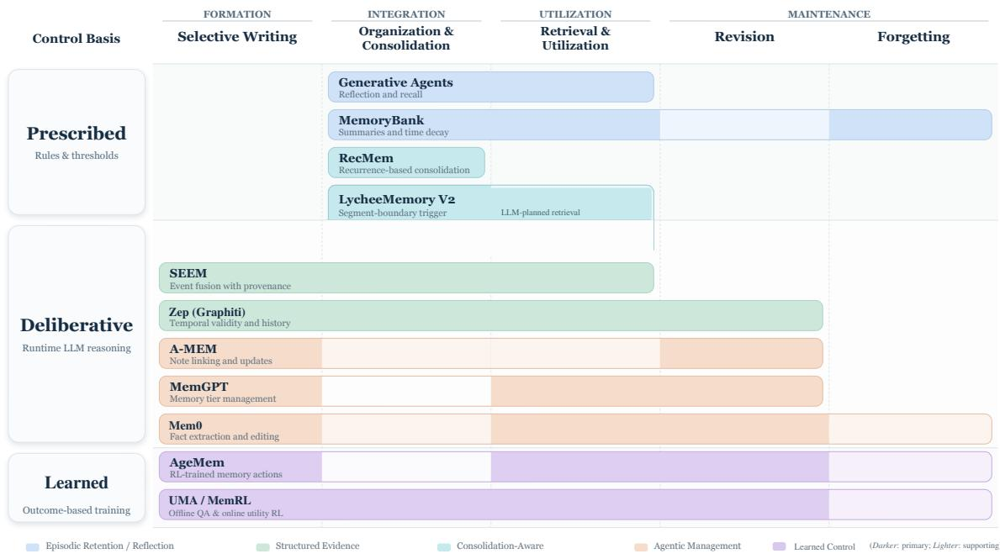  
Figure 5: Lifecycle–control landscape of selected representative agent memory systems. The horizontal axis shows the memory operations emphasized by each system. The vertical axis shows how decisions are controlled: through prescribed rules, deliberative runtime LLM reasoning, or learned control. Darker regions indicate the main design focus and lighter regions indicate supporting operations. Colors distinguish design families. Positions describe design choices, not performance.

## 4 Evaluating Memory-Augmented Agents as Continual Learners

Sections 2 and 3 specify how experience can persist, what reusable form it can take, and how it is admitted, consolidated, used, revised, and governed. Those design choices do not, by themselves, establish that continual learning has occurred. A changed store, a retrieved record, or a higher single-task score can all arise without a durable, experience-induced change in later behavior. This section therefore treats evaluation as an evidentiary problem, asking what empirical observations would justify a continual-learning claim given the architecture and lifecycle established in prior sections. We first specify three core behavioral outcomes (retention, adaptation, and transfer) and then establish the protocols needed to measure them without confounding memory with expanded context windows, extra test-time computation, or transient, isolated success.

## 4.1 What to Measure: Retention, Adaptation, and Transfer

Access-level metrics remain useful, but they answer a narrower question than learning. Content correctness and retrieval scores diagnose whether experience was written and can still be found; a single-task outcome shows only that memory helped on the current probe (Table 1). Continual learning additionally requires that an experiential gain persist under delay and interference, remain revisable when the world changes, and transfer beyond remembered episodes [71, 112]. The remainder of this subsection operationalizes those three outcomes. Component traces localize failure; they do not substitute for the behavioral claim.

Table 1: Diagnostic scope of evaluation metric layers in agent memory systems. While componentlevel and snapshot metrics diagnose internal storage fidelity and retrieval reachability, establishing continual learning requires behavioral retention, adaptive revision, and cross-task transfer.
<table><tr><td>Metric Layer</td><td>Demonstrated Capability</td><td>Unaddressed Failure Mode</td></tr><tr><td>Content Fidelity</td><td>Accurate and lossless storage of past factual observations</td><td>Does not guarantee that stored evidence will be retrieved or utilized in future decisions</td></tr><tr><td>Retrieval Access</td><td>High recall, precision, and reachability of relevant memories</td><td>Does not prevent retrieved evidence from being ignored, misinterpreted, or misapplied</td></tr><tr><td>Single-Task Outcome</td><td>Immediate performance boost on a specific evaluation probe</td><td>Does not establish retention under delay and interference, adaptive revision, or transfer</td></tr></table>

## 4.1.1 Retention: Learning Must Survive Delay and Interference

Section 3.3 distinguishes preservation, access, utilization, and behavioral effect in the memory lifecycle. Retention evaluation uses the same cascade, but changes the object of measurement from a stored trace to a capability margin. After delay and subsequent experience, the agent should still outperform a matched agent deprived of that experience on the same probe. An entry can remain in a store, or a latent state can remain decodable, while its contribution to later decisions has vanished. Conversely, a useful procedure may persist without the originating episode. Trace survival is therefore diagnostic; behavioral persistence is the learning claim.

The four gates yield a testable weakest-gate hypothesis, positing that behavioral retention is bottlenecked by the least reliable step and that improving an earlier gate does not necessarily raise the final outcome. Increasing capacity can raise preservation while lowering access through denser retrieval competition. “The system remembers $x ^ { \prime \prime }$ concerns preservation and access; “the system retained learning from $x ^ { \prime \prime }$ additionally requires utilization and effect. With the base model fixed, continual insertion and eviction in an external store can reduce performance on earlier tasks [148], and repeated extraction and injection of experience can turn a single-round gain into progressive collapse [15]. These failures are not confined to catastrophic forgetting in weights, as stored content can survive while remaining unaccessed, unused, or ineffective.

Time and intervening experience are not interchangeable. A retention protocol should first measure the immediate gain $\bar { \Delta } _ { i } ^ { 0 }$ on capability � relative to a memoryless or reset condition, then remeasure after delay � and interference load �. The normalized retained gain $\Delta _ { i } ( d , m ) / \Delta _ { i } ^ { 0 } ,$ reported only when $\Delta _ { i } ^ { 0 } > 0 ,$ , distinguishes failure to retain from failure to learn. Delay should be specified in wall-clock time, turns, or token distance; interference should report the number, semantic overlap, and conflict relation of intervening updates. Substrate-specific traces then localize the broken gate, identifying deletion, eviction, and rank competition in external memory, or overwriting, state drift, and readout mismatch in activation and parametric memory (Section 2.1). These outcomes are the quantities against which capacity, interference, and cost are traded in Section 4.3.

## 4.1.2 Adaptation: Learning Must Remain Revisable under Change

When facts, preferences, tools, or rules change, retention without revision becomes a source of error. Section 3.4 already treats conflict resolution, persistent update, and selective forgetting as lifecycle operations. Evaluation asks a more targeted question, examining whether behavior faithfully follows a valid update after an environment change without indiscriminate damage to still-useful capabilities. The relevant evaluation chain is temporal rather than a single write (detection, revision, recovery, and preservation), which should be quantified via detection delay, steps to recovery, staleerror duration, and collateral degradation on unchanged probes. Better recall does not automatically yield more preference-aligned behavior [134], and summary memories can retain factual detail while losing the preference signal needed after an environmental shift [108].

Component diagnostics should follow the substrate. For external stores, the question is whether the current record supersedes the stale one and whether retrieval ranks it above obsolete evidence. Exposed maintenance operations establish that updates are possible, but conversational QA after a long history does not demonstrate recovery under controlled drift [19]. For parametric and latent memories, injection accuracy and sequential fact updates are retention and write diagnostics, not evidence that an acting agent detected an unannounced change or resumed correct tool use [24, 117]. Evaluated models can verbalize that a fact has changed yet fail to propagate that judgment to the final prediction [107]. A credible adaptation claim therefore requires matched pre-change and post-change probes, together with simultaneous reporting of recovery and selective preservation.

## 4.1.3 Transfer: Learning Must Extend beyond Remembered Episodes

Section 2 classifies reusable experience as episodic, semantic, or procedural assets. Transfer evaluation asks whether those assets support later behavior beyond storing an answer. Three increasingly demanding cases should be separated: replaying the same or a near-duplicate episode, solving an unseen variant from the same task family, and applying shared structure to a distinct target task. Source and target partitions must exclude duplicate instances and target answers, document the shared structure, such as a workflow, causal rule, tool convention, or subskill, while keeping the base model, tools, context budget, and compute matched. Otherwise nearest-neighbour reproduction and extra context can be mistaken for learned transfer.

Abstraction directly supports reuse, as demonstrated by the successful transfer of insights, workflows, and executable skills across related tasks and environments [111, 121, 163]. The same evidence shows why mean target accuracy is insufficient. Raw trajectory memory can produce negative forward transfer where abstract insights do not, with harm concentrated on cases that a no-memory agent could not already solve [47]. Dedicated memory and skill-maintenance methods are only selectively helpful and can be matched or outperformed by ordinary in-context accumulation [6, 40, 166]. Transfer should therefore be reported as zero-shot target gain or forward transfer, interactions or tokens to a target threshold, and explicit negative-transfer rates [71, 91]. For external memory, analysis should identify whether the retrieved asset is a case, rule, workflow, or skill, and whether success depends on answer overlap. For neural memory, it should test whether updated latent or parametric state improves a held-out target without degrading unrelated tasks.

## 4.2 How to Measure: Protocols for Experience, Controls, and Time

## 4.2.1 Benchmarks Must Contain Learnable Experience

A parallel distinction applies to benchmark design. The presence of “history” does not imply the presence of learnable experience. Many suites pre-supply dialogue logs, profiles, or knowledge bases and then test whether related questions can be answered after the history is given [29, 75, 125, 167]. Such protocols diagnose long-horizon access. They usually cannot decide whether a new capability was formed during evaluation.

Evidence strength rises with the experience that the protocol actually exposes (Table 2). Fixed history supports “remember and use.” Continual writing of state supports “internal state accumulates.” Feedback that improves later behavior, under the matched and sequential controls below, approaches continual learning. Procedural streams ask whether success and failure trajectories improve later workflows [165]; semantic and personalization streams ask whether facts and preferences persist and can be revised [75, 101, 125]; dynamic-rule streams ask whether invalidated experience is corrected in time [6, 48]. A benchmark may excel on one stream while remaining silent on the others. Externally grounded outcomes and user corrections also support stronger learning claims than self-generated reflections, which can be stored and later retrieved as if they were facts [87, 95].

## 4.2.2 Matched Comparisons Reveal What Memory Contributes

Even when performance rises across a task sequence, the gain cannot be attributed to memory until alternative explanations are removed. The backbone, a longer context, static retrieval, or additional inference can produce similar effects. Figure 6 isolates accumulated experience by comparing a stateful condition with a reset condition on a matched task,

$$
\Delta P _ { t } = P _ { \mathrm { s t a t e f u l } } ( t ) - P _ { \mathrm { r e s e t } } ( t ) .\tag{4.1}
$$

Table 2: Categorization of representative agent memory benchmarks by evaluation paradigm. Benchmarks are organized by the extent to which their experimental design supports genuine learning-from-experience claims rather than static information retrieval.
<table><tr><td>Benchmark Family</td><td>Evaluation Paradigm</td><td>Supported Learning Claim</td></tr><tr><td>LoCoMo [75], LongMemEval [125], PerLTQA [29],</td><td>Static dialogue history with single-turn question answering</td><td>Long-context factual recall, passive profile extraction, and needle retrieval</td></tr><tr><td>MemoryBank [167] MemBench [101]</td><td>Multi-scenario synthetic</td><td>Access efficiency, query latency, and retrieval accuracy across storage scales</td></tr><tr><td>MemoryAgentBench [48]</td><td>memory evaluation Incremental multi-turn ingestion with evolving facts</td><td>Dynamic knowledge assimilation, working-memory updates, and explicit</td></tr><tr><td>LifelongAgentBench [165], CL-Bench [6], AgentCL [96]</td><td>Sequential interactive environments with task feedback</td><td>conflict resolution Cumulative experience accumulation, behavioral retention, and stateful</td></tr></table>

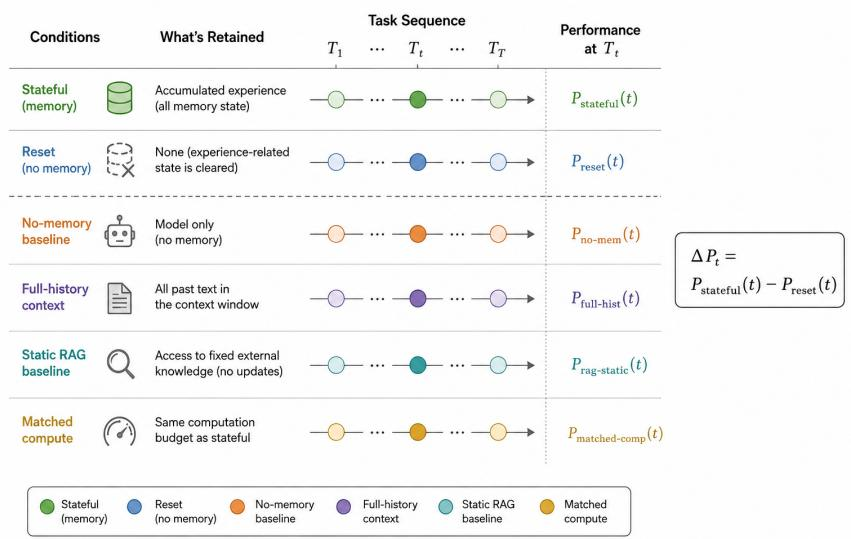  
Figure 6: Matched comparison framework for isolating the contribution of agent memory. The stateful condition retains accumulated experience, whereas the reset condition removes experiencerelated state on a matched task. $\Delta P _ { t } = { \bar { P } } _ { \mathrm { s t a t e f u l } } ( t ) - P _ { \mathrm { r e s e t } } ( t )$ is the additional benefit associated with accumulated state. No-memory, full-history, static RAG, and matched-compute baselines progressively rule out alternative explanations.

Δ� is not a new composite metric. It denotes the additional benefit associated with accumulated state under otherwise matched conditions [48, 101, 122].

Further baselines rule out further alternatives. A no-memory or reset condition shows what the model can already do. A full-history context baseline tests whether the benefit is simply more historical text; when a memory mechanism outperforms a matched long-context condition, the evidence favors organization or selective use rather than context expansion alone [101, 120]. A static RAG baseline tests whether dynamic accumulation adds anything beyond a fixed knowledge source. Matched computation addresses extra inference. Fine-tuning, LoRA, and model editing absorb experience through different substrates and should not be treated as interchangeable with all forms of agent memory, though they remain useful comparison points.

What “reset” means depends on the substrate (Section 2.1). External stores admit write-off, read-off, and clear-store interventions, which separate encoding, use, and overall value. For activation or parametric memory, reset cannot simply mean deleting a database; evaluation must instead distinguish online parameter updates, the preservation of persistent state, and subsequent readout [42]. A stateful condition may also bundle conversation history, tool state, and external memory, so a positive $\Delta P _ { t }$ need not identify which mechanism produced the gain. A stronger design keeps the backbone, task input, context budget, retrieval budget, and inference compute matched while varying only experience-related state.

## 4.2.3 Sequential Evaluation Separates Durable Learning from Transient Success

The retention and adaptation definitions above already require the same capability to be measured across memory states. Chronological length does not substitute for that invariance. Endpoint scores after a long history show that information can be used, but not when the benefit appeared or whether it disappeared and recovered [75, 125]. A short protocol that probes a capability before acquisition, immediately afterward, and after a controlled update is stronger evidence than a long trajectory with a single terminal score.

Four observation regimes support progressively stronger claims. Snapshots test a final memory state; streams report online reward on changing tasks; reprobes repeat the same capability or a calibrated task variant; and interventional panels combine reprobes with an event ledger and matched stateful–reset trajectories. AgentCL and CL-Bench illustrate the value of a stable observation target, where first-pass, frozen-memory, and held-out probes systematically isolate acquisition, reuse, and transfer [6, 96]. Between probes, the ledger should record elapsed time, writes, semantic overlap, conflicts, feedback, tool or rule changes, and retrieval or update cost. Delay plus overlapping updates tests retention; changes in facts, preferences, or tools test adaptation; held-out tasks that preserve latent structure test transfer. Evidence for one evaluation setting should not be treated as validation across all three.

A compact blueprint follows. Define capability anchors and measure them before and immediately after acquisition; schedule checkpoints on a declared delay–interference grid; run stateful and reset conditions with identical backbone, tools, context, retrieval, and inference budgets; and populate a matrix $R _ { t , i }$ that re-evaluates capability � after update �. Diagonal entries measure acquisition, lower-triangular entries expose retention and backward influence, and held-out variants test transfer. Reporting the event ledger beside this matrix prevents apparent gains from obscuring task drift or hidden computational overhead.

## 4.2.4 Fragmented Benchmarks Limit Cross-Study Conclusions

Existing suites occupy different cells of this design rather than a common scale. Access-oriented histories, incremental ingestion, and sequential interactive tasks are not interchangeable measurements of the same construct, and they rarely match context budgets, retrieval depth, or inference compute. Numerical comparison across papers is therefore unreliable unless the protocol specifies the behavioral outcome in Section 4.1, the experience regime above, and the matched and sequential controls that isolate memory. Scores should be read within that evidentiary scope, not as a generic ranking of memory systems.

## 4.3 The Memory Scaling Law: Capacity, Interference, and Learning Efficiency

## 4.3.1 Non-Parametric Memory Scaling Law: Experience, Capacity, and Compute

Non-parametric memory makes deployment experience a resource for continued capability growth with fixed model weights. Agents preserve interaction facts [19], distill reasoning strategies, and consolidate experience for later tasks [85, 146]. The resulting capability depends on how much relevant experience is available and how efficiently the memory system retains and uses it.

We propose a Memory Scaling Law relating attainable performance to experience, persistent capacity, and read–write compute. Its central prediction is a sequence of resource-limited regimes, where performance improves as relevant experience accumulates and subsequently saturates when capacity or read–write compute constrains its effective use. Expanding the limiting resources shifts these saturation points. The information structure of experience determines how quickly capacity demand grows, while reuse determines how much computation is worth investing in writing and consolidation. This view connects memory representations and lifecycle operations to the rate and cost of capability growth during deployment.

Resource dimensions and attainable performance. Let $E _ { t }$ denote cumulative experience, �¯ the persistent capacity limit, $B _ { t }$ actual occupancy, � the per-query read budget, and � the write and maintenance budget over the same experience horizon. The budget � covers extraction, indexing, revision, and consolidation. These quantities distinguish what an agent encounters, what it retains, and what it can consult for a decision. Equal text volumes can contain different amounts of taskrelevant information, so a scaling relation also depends on the source and composition of experience.

For a fixed foundation model �, task distribution , experience-generation process, and remaining inference settings, let $\epsilon ^ { \star } ( E , \bar { B } , R , U \mid \theta , \mathcal { D } )$ be the minimum expected task error within a specified class of memory policies. Task error is an error rate or a gap in normalized task score. This attainable frontier separates resource limits from the performance of an individual method. Capacity accounts for all persistent experience-dependent state, including informative vectors and indices; text-token occupancy measures its textual part.

Joint scaling and resource-optimal allocation. Within a regime of relatively stable experience quality and task structure, we hypothesize

$$
\epsilon ^ { \star } - \epsilon _ { \infty } \asymp \operatorname* { m a x } _ { j \in \mathcal { A } } a _ { j } x _ { j } ^ { - \alpha _ { j } } , \qquad \mathbf { x } = \left( \frac { E } { E _ { 0 } } , \frac { \bar { B } } { B _ { 0 } } , \frac { R } { R _ { 0 } } , \frac { U } { U _ { 0 } } \right) , \quad a _ { j } , \alpha _ { j } > 0 .\tag{4.2}
$$

The model and task family determine the limiting error $\epsilon _ { \infty } ; \epsilon _ { \mathrm { e x } } = \epsilon ^ { \star } - \epsilon _ { \infty }$ denotes excess task error. Each dimensionless $x _ { j }$ measures scale relative to a reference budget, and contains the active resource constraints. The largest term approximates the error from the dominant shortage; an additive form gives a smooth approximation when several terms are comparable. The exponents and the ranges over which they apply are empirical quantities.

A long-tailed demand distribution gives a simple capacity example. Suppose each query requires one knowledge unit, unit demand satisfies $p _ { i } \propto \dot { i } ^ { - s } \mathrm { w i t h } s > 1$ , and each unit occupies � tokens. If the experience pool contains all units and the most requested $K = \lfloor \bar { B } / \tau \rfloor$ units are stored and reliably accessed, uncovered demand is $\begin{array} { r } { \epsilon _ { \mathrm { c o v } } ( \bar { B } ) = \sum _ { i > K } { p _ { i } } \propto \mathbf { \hat { \bar { B } } ^ { - } } ( s - 1 ) } \end{array}$ . Then $\alpha _ { B } = s - 1 \colon$ the capacity exponent follows from the distribution of task-relevant demand under these assumptions.

A capacity-only sweep can plateau because reading, experience supply, or maintenance becomes limiting. Expanding the limiting resource moves the plateau, allowing further gains from capacity (Figure 7). The joint relation thus predicts both diminishing returns within a fixed configuration and renewed improvement when resource allocation changes. Keeping the active experience, capacity, and reading terms at comparable orders gives a balanced scaling path:

$$
\frac { \bar { B } } { B _ { 0 } } \propto \left( \frac { E } { E _ { 0 } } \right) ^ { \alpha _ { E } / \alpha _ { B } } , \qquad \frac { R } { R _ { 0 } } \propto \left( \frac { E } { E _ { 0 } } \right) ^ { \alpha _ { E } / \alpha _ { R } } .\tag{4.3}
$$

Maintenance follows an analogous relation. Resources need not grow in equal proportions. Under a lifecycle budget � and � reuses, the cost function $C _ { N }$ also determines the optimal allocation:

$$
\mathbf { x } ^ { \star } ( C , N ) \in \underset { \mathbf { x } : C _ { N } ( \mathbf { x } ) \leq C } { \arg \operatorname* { m i n } } \ \epsilon ^ { \star } ( \mathbf { x } \mid \theta , \mathcal { D } ) .\tag{4.4}
$$

The frontier is specific to the policy class: admitting more efficient representations or access mechanisms can change its shape and its optimal allocation. Foundation-model capabilities also condition the returns. Pretrained knowledge reduces some storage requirements, while the ability to interpret abstractions and combine evidence increases the value of a given memory bank. Recent facts and private interactions have to be acquired during deployment.

The measured comparisons in Table 3 use Qwen3-30B-A3B-Instruct-2507 for construction, answering, and local model-based scoring, with 1,024-dimensional qwen3-embedding-0.6b embeddings. We evaluate Mem0 0.1.94 [19] and retrieval over retained raw histories (Raw RAG). Capacity sweeps use frozen bank subsets; continual tasks update memory under a capacity limit. Stored and read text is counted with o200k\_base. Scores and occupancy are macro-averaged over conversations or samples, with cluster-bootstrap 95% intervals. LongMemEval uses a local semantic judge, and MemoryBench uses local rubric scoring.

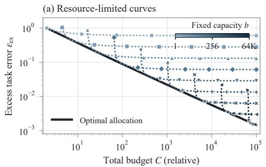

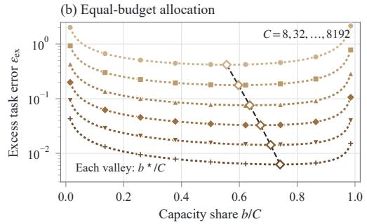

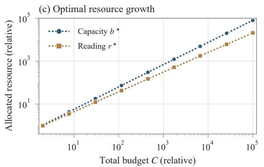

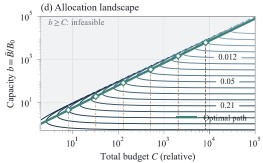  
Figure 7: Theoretical illustration of joint scaling and optimal resource allocation. (a) Fixed-capacity error curves and their optimized lower envelope. (b) Returns at equal total budgets. (c) Optimal capacity and reading budgets. (d) Equal-error contours and the optimal path. For normalized capacity $b = \bar { B } / B _ { 0 }$ and reading $r = R / R _ { 0 } ,$ , curves use $\epsilon _ { \mathrm { e x } } ( b , r ) = 0 . 6 \bar { b } ^ { - 0 . 5 5 } + \bar { 0 } . 4 r ^ { - 0 . 7 5 }$ and $C = b + r ,$ with other resources non-binding. Filled markers sample this function; hollow diamonds mark its calculated optima.

While the additive approximation in Figure 7 predicts that storage and reading co-scale under a shared budget constraint, empirical history-based question answering also exhibits direct interaction because effective readout is bounded by retained storage $( R _ { \mathrm { e f f } } = \operatorname* { m i n } ( \breve { R } , B _ { t } ) )$ and retrieval competition (Figure 8(a–c)). On LoCoMo [75], increasing the read budget from 512 to 2,048 tokens improves Raw RAG F1 by 0.89 percentage points at one-eighth history retention and 3.82 points at full retention. The paired difference between these gains is 2.93 points (95% interval: 2.06, 4.02 ). On the selected LongMemEval [125] samples, full-history Raw RAG accuracy increases from 35.00% to 44.00% over the same read-budget change. These observations confirm storage–reading complementarity: the return from additional reading depends on the available memory.

Experience structure and capacity requirements. During deployment, experience can introduce new task demands, so the relevant distribution evolves as $\mathcal { D } _ { E } ^ { \mathsf { ^ { * } } }$ . At fixed capacity, early gains can give way to decline when the information needed to serve this expanding workload outgrows the bank (Figure 9(a)). For � independent, equiprobable binary facts that are independent of the fixed model and queried uniformly, keeping average reconstruction error below $\delta ^ { * } < 1 / 2$ requires at least $n [ 1 - h _ { 2 } ( \delta ) { \bar { ] } }$ bits, where $h _ { 2 }$ is binary entropy. Shared rules and skills permit more compact representations; a finite set of recurring task structures can produce saturating demand.

Let $B _ { \mathrm { r e q } } ( E ; p _ { 0 } )$ be the minimum capacity needed to maintain performance $p _ { 0 }$ as relevant task demand expands with experience. With adequate reading and maintenance, we describe its growth within a stable regime as

$$
B _ { \mathrm { r e q } } ( E ; p _ { 0 } ) \propto E ^ { \nu } .\tag{4.5}
$$

The exponent � describes capacity demand, while $\alpha _ { j }$ describes the performance return from a resource. Independent information, shared structure, and recurring rules yield different demand curves (Figure 9(b)). A system that preserves separate episodes and one that extracts reusable rules can therefore require different capacity growth to sustain the same target performance.

Consolidation changes this relationship by turning repeated detail into reusable structure. ReasoningBank converts successes and failures into reasoning strategies [85]. Experience Scaling merges and refines experience to reduce redundancy, while finding that excessive compression can harm performance [146]. Abstractions can support multiple tasks, while exceptions and rare queries may need the original details. Episodic, semantic, and procedural assets thus have different fidelity and capacity requirements. Under environmental change, the rate of revision also determines how quickly useful performance can recover (Figure 9(c)).

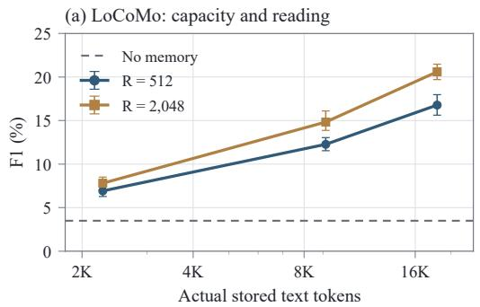

(b) LongMemEval: capacity and reading  
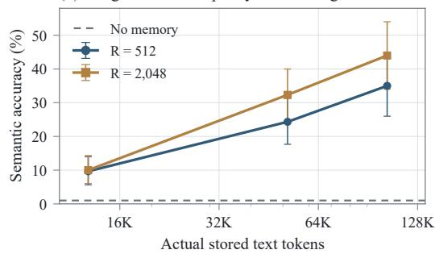

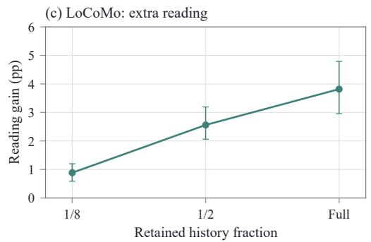

(d) IdeaBench: continuing experience  
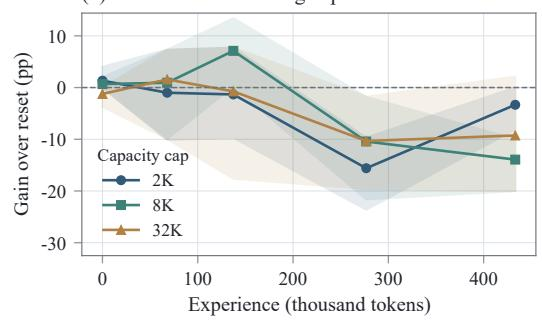  
Figure 8: Measured performance across capacity, reading, and experience settings. (a–b) Stored text and Raw RAG performance on LoCoMo and LongMemEval. (c) Paired gains from increasing LoCoMo reading from 512 to 2,048 tokens; error bars in (a–c) are cluster-bootstrap 95% intervals. (d) Stateful–reset score differences on fixed IdeaBench questions at successive checkpoints, without periodic consolidation; shading spans the min–max range across three random training-dialogue orderings. Continuous horizontal axes report text-token volumes; (c) indexes retained-history fractions, and capacity labels in (d) denote upper limits.

Table 3: Experimental comparisons in this section. Repeated predictions across budgets are aggregated within the stated sampling units. LoCoMo scores use categories 1–4.
<table><tr><td>Empirical Study</td><td>Experimental Protocol &amp; Controls</td><td>Measured Outcomes</td></tr><tr><td>LoCoMo Capacity Sweep</td><td>10 long-form dialogues, 1,540 questions; 4 × 4 storage-read capacity grid</td><td>Lexical F1 score with cluster-bootstrap 95% CI</td></tr><tr><td>LongMemEval Capacity Sweep</td><td>100 selected samples; storage-read Local semantic accuracy capacity grid</td><td></td></tr><tr><td>IdeaBench Sequential Deployment</td><td>50 fixed target queries evaluated across sequential training checkpoints (3 random tāsk</td><td>Stateful-reset performance margin (∆Pt) without consolidation</td></tr><tr><td>LoCoMo Query Economics</td><td>orderings) Cohort of 9 conversations, 180 questions; comparing direct read, search, and search + summarize</td><td>F1 score, serialized context tokens, and end-to-end query latency</td></tr></table>

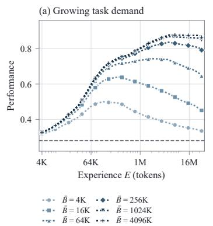

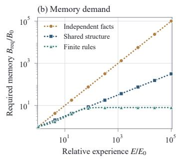

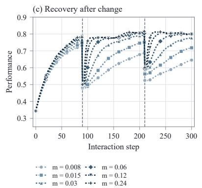  
Figure 9: Theoretical illustration of experience structure, capacity requirements, and adaptation. Curves use preset response and recovery functions. (a) Performance as task demand expands with experience, at fixed capacity limits �¯. (b) Capacity needed to maintain a target under different experience structures. (c) Recovery after environmental changes, marked by dashed lines; � is the maintenance rate.

Across the evaluated IdeaBench checkpoints from MemoryBench [3], Mem0’s stateful–reset score difference varies non-monotonically (Figure 8(d); Mem0 is run in its default online mode, which also writes during the 50-query evaluation pass and produces small non-zero offsets at � = 0). At an 8,192-token capacity limit and � = 1,024, mean stateful–reset gain falls from 7.10 percentage points after 64 training dialogues to 10.43 after 128 and 13.93 at the final 256-dialogue checkpoint (because unconstrained occupancy plateaus at 3,858 tokens, neither the 8,192- nor the 32,768-token cap binds; pooling both 3-ordering replicates gives +3.18 points at 64 dialogues, −10.38 at 128, and 11.60 at 256). Consolidation every 16 or 64 training dialogues reduces final occupancy from 3,858 to approximately 1,800 tokens, while final gains remain negative.

Selective access and the economics of reuse. Selective access allows persistent memory and per-query input to scale separately. If a query needs a bounded number of fixed-length records and indexing reliably locates them, model input can stay bounded as the bank grows. Tasks that synthesize more evidence may require more reading, and index search and updates still incur costs. Cross-task reuse can shift work from repeated reading and reasoning to earlier extraction or consolidation. With costs expressed in consistent units, average cost over � reuses is

$$
\overline { { C } } _ { N } = \frac { C _ { \mathrm { b u i l d } } + C _ { \mathrm { m a i n t } } ( N ) } { N } + \overline { { C } } _ { \mathrm { q u e r y } } .\tag{4.6}
$$

At equal performance, lightweight writing and direct reading may cost less when reuse is limited. More expensive preparation becomes worthwhile when cumulative query savings exceed its additional cost. For fixed-quality policies with no ongoing maintenance, the crossover reuse count is the extra construction cost divided by the per-query saving.

Token savings and latency savings can differ. On the matched LoCoMo small-bank cohort (Table 4), query-time summarization reduces serialized memory input but increases latency. Its paired F1 is 0.72 percentage points below full-bank reading (95% interval for the difference: 1.14, 0.27 ). Policy choice consequently depends on which resource is constrained and the performance target.

Environmental change bounds how many times a memory can be reused before it needs revision. Retention extends the period over which preparation costs can be amortized, and transfer increases the number of tasks served by the same experience. Adaptation incurs the maintenance cost required to keep that experience useful. These continual-learning properties determine the reuse horizon and update costs in the resource-optimal allocation of Equation (4.4).

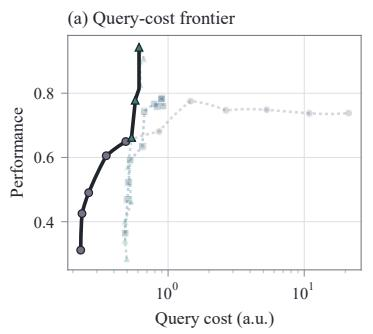

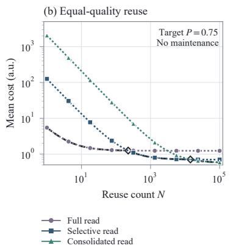

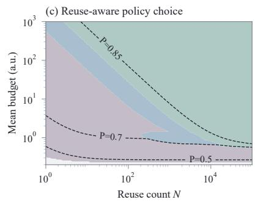  
Figure 10: Theoretical illustration of reuse and resource-optimal policy choice. (a) Query-cost– performance Pareto frontiers; lighter points denote dominated configurations. (b) Amortization at a common performance target ${ \overset { \smile } { P } } = 0 . { \overset { \bullet } { 7 } } 5 .$ . (c) The best policy at each reuse count and average-cost budget; gray denotes infeasibility, and dashed lines are performance contours. Preset functions specify policy performance and costs in common arbitrary units, with offline consolidation and no ongoing maintenance.

Table 4: Three reading policies over Mem0 memory banks on nine LoCoMo conversations and 180 questions, with three timing repetitions. Memory input includes serialization and formatting. Median latency covers retrieval, query-time summarization, and answering, excluding offline construction. F1 intervals use 10,000 conversation-cluster bootstrap resamples.
<table><tr><td>Reader</td><td>F1 (%) ↑</td><td>95% interval</td><td>Input (tokens)</td><td>Latency (s) ↓</td></tr><tr><td>Read all</td><td>4.63</td><td>[3.28, 6.02]</td><td>729.78</td><td>0.154</td></tr><tr><td>Search</td><td>4.29</td><td>[3.15, 5.50]</td><td>225.68</td><td>0.154</td></tr><tr><td>Search + summarize</td><td>3.91</td><td>[2.81, 5.15]</td><td>43.52</td><td>0.367</td></tr></table>

## 4.3.2 Parametric Memory Scaling Law

Parametric memory writes deployment experience into model parameters or persistent neural states rather than into an external store. Representative designs include trainable memory layers [9], plugand-play memory modules [12], memory states updated at test time [8, 58], side memories isolated from the backbone [24, 113, 117], and direct editing or fine-tuning of backbone weights [80, 138]. These approaches confront the same fundamental question as non-parametric memory regarding how performance scales with experience and resources, and at what write and compute cost. They differ in one essential respect. All writes share the same parameters, so new writes alter how earlier content is read out. Accumulating experience therefore adds usable content while simultaneously increasing the probability that existing content is overwritten. We build this property into the scaling relation and propose a parametric counterpart to Equation (4.2).

Resource dimensions of parametric memory. We retain the notation of Section 4.3.1, where $E _ { t }$ denotes cumulative experience, � denotes the foundation model, and denotes the task distribution. Parametric memory involves three resources. Memory capacity � is the number of memory parameters, memory slots, adapter rank, or persistent-state dimensions, playing the role of �¯. The write budget � represents the computation used to write experience into parameters, such as gradient steps, update steps per write, and write frequency. Readout compute is fixed by the architecture, as each forward pass traverses the memory parameters or performs a fixed top-� lookup without consuming additional prompt context tokens; consequently, the read budget � is generally not an independent decision variable. This marks the first major divergence from non-parametric memory.

The second difference concerns occupancy. External memory can directly report its actual occupancy $B _ { t } ,$ whereas parametric memory has no directly observable counterpart. We therefore define the

load ratio

$$
\rho _ { t } = \frac { I ( E _ { t } ) } { \kappa M } ,\tag{4.7}
$$

where $I ( E _ { t } )$ is the information in the experience that must be retained, measured in bits, and � is the information a single parameter can store. Knowledge-capacity studies estimate $\kappa \approx 2$ bits per parameter and report that this ratio holds even under int8 quantization [4]. The dimensionless quantity $\rho _ { t }$ measures how full the memory has become.

Joint scaling with an interference term. Within a regime of relatively stable experience quality and task structure, we hypothesize

$$
\epsilon ^ { \star } - \epsilon _ { \infty } \asymp \operatorname* { m a x } _ { j \in \mathcal { A } } a _ { j } x _ { j } ^ { - \alpha _ { j } } + I _ { s , \pi } ( \rho _ { t } ) , \qquad \mathbf { x } = \left( \frac { E } { E _ { 0 } } , \frac { M } { M _ { 0 } } , \frac { U } { U _ { 0 } } \right) .\tag{4.8}
$$

The first term mirrors Equation (4.2), approximating the residual loss from resource shortages where the largest component identifies the active bottleneck. The second term is an interference term specific to parametric memory. It is close to zero while the load ratio stays below a critical value $\bar { \rho } _ { s , \pi } ^ { \star } ;$ beyond that value, new writes begin to overwrite earlier content and loss rises. The critical ratio depends on the memory substrate � (Section 2.1) and on the write policy �. In nonparametric memory, additional experience can crowd retrieval or trigger eviction while leaving surviving records intact, a cost mediated by the read and maintenance terms. In parametric memory, additional experience rewrites shared parameters directly, so performance degradation as experience grows is an intrinsic property of the substrate rather than only a retrieval or selection problem.

Equation (4.8) yields three testable predictions. First, when experience and write budget are fixed and only capacity grows, loss is initially dominated by interference and follows the power law only after the load ratio enters the safe regime (Figure 11(a)). Second, when capacity is fixed and experience grows, loss rises once the load ratio crosses $\rho ^ { \star }$ , and the transition can differ by orders of magnitude across substrates (Figure 11(b)). Third, load curves measured at several capacities should approximately collapse onto a single curve when plotted against $\rho .$ This collapse is the most direct test of whether interference depends on load only through the ratio.

Figure 11 illustrates these predictions with a minimal instance of Equation (4.8). It keeps only the capacity term and the interference term, $\epsilon ^ { \star } - \epsilon _ { \infty } = a _ { M } M ^ { - \alpha _ { M } } + I ( \rho )$ , with $I ( \rho ) = \lambda ( \rho / \rho ^ { \star } ) ^ { b } / [ \hat { 1 } + ( \rho / \bar { \rho } ^ { \star } ) ^ { b } ]$ and $\rho = E / M$ in relative units $( \kappa = 1 )$ . We set $a _ { M } = \alpha _ { M } = 0 . 5 , \lambda = 0 . 6 ,$ and $b = 2$ . Backbone editing and a dedicated module differ only in the critical ratio, $\rho ^ { \star } = 3$ and $\rho ^ { \star } = 3 0 0$ , while panel (a) uses $\Breve { \rho ^ { \star } } = 1$ Panel (c) plots $M _ { \mathrm { r e q } } = E ^ { \nu } / \rho ^ { \star }$ from Equation (4.9) with $\nu \in \{ 1 , 0 . 6 \}$

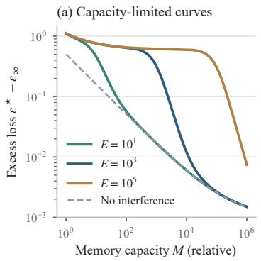

(b) Load-induced interference  
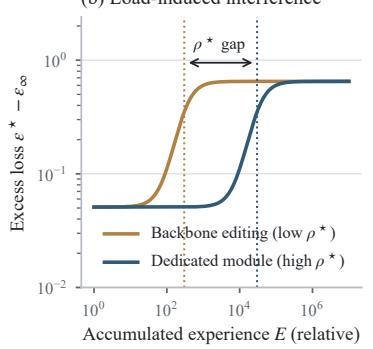

(c) Capacity demand  
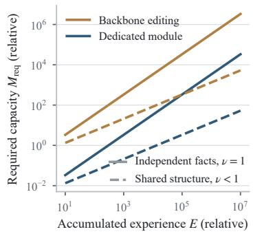  
Figure 11: Theoretical illustration of the parametric memory scaling relation. (a) Excess loss versus memory capacity at different experience volumes; interference dominates until the load ratio falls below $\bar { \rho } ^ { \star }$ , after which the capacity term follows a power law. (b) Excess loss versus accumulated experience at fixed capacity for backbone editing (low $\rho ^ { \star } )$ and a dedicated memory module (high $\rho ^ { \star } \hat { ) } ;$ dotted lines mark the critical loads. (c) Capacity required to maintain a target performance for independent facts $( \nu = 1 )$ and shared structure $( \nu \overset { \cdot } { < } 1 )$ . Curves sample the illustrative instance of Equations $( 4 . 7 ) { - } ( 4 . 9 )$ described in the text.

Evidence for the capacity term. Experiments that hold the foundation model fixed and enlarge only the memory parameters support the shape of the capacity term. Memory Layers at Scale enlarges the Memory+ value count from 1M to 64M in a 1.3B configuration (Figure 12(a)) [9]. NaturalQuestions accuracy rises from 13.68 to 20.78 and TriviaQA F1 from 42.89 to 62.14, well above a dense model of the same configuration without memory layers (7.76 and 32.64). Between 16M and 64M, however, NaturalQuestions improves by only 0.64 while TriviaQA still improves by 3.47, indicating that the same capacity range places different tasks at different points on the power law. The same work scales memory parameters to 128B on foundation models of at most 8B, showing that memory capacity can far exceed backbone size (though these Memory+ layers are trained jointly during pretraining, so sequential deployment writes remain to be tested separately).

Direct functional evidence comes from LoRA memorization. Treating LoRA rank � as a capacity probe, a recent study reports a power law $\begin{array} { r } { \Delta \mathcal { L } = C r ^ { \alpha } \ell ^ { - \beta } + b } \end{array}$ that links the loss reduction to rank and sequence length ℓ across models, datasets, and semantic densities $\left( R ^ { 2 } > 0 . 9 8 \right)$ [138]. The relation contains both a capacity variable and a load variable. If $\alpha \approx \beta ,$ , it reduces to a function of $r / \ell ,$ the dependence on the load ratio that Equation (4.8) predicts; whether the two exponents coincide is therefore a direct test of the proposed form. The same study shows that capacity alone does not determine what is stored. At equal rank on Qwen3-8B, memorization accuracy differs sharply across write methods (Figure 12(b)), where at rank 128, SFT reaches 40.0%, MemFT-OT reaches $1 0 \dot { 0 } . \dot { 0 } \% _ { } ,$ and MemFT-SW reaches 94.4%. In the terms of Equation (4.8), the write method changes $a _ { M }$ and $\alpha _ { M . }$ , so better methods lie closer to the attainable frontier at the same capacity.

The foundation model also conditions memory returns. Attaching the same 0.5B Memory Decoder to Qwen2.5 models from 0.5B to 72B reduces average domain perplexity by 10.24 at 0.5B but by only 2.39 at 72B, and the 0.5B model with the memory module (4.06) outperforms the 72B model alone (5.85; Figure 13(a)) [12]. This mirrors the substitution and complementarity between model and memory discussed in Section 4.3.1. Continual fine-tuning studies further find that, between 1B and 7B parameters, larger models forget more severely [74]. The foundation model may therefore shift $\rho ^ { \star }$ as well as $\epsilon _ { \infty }$ and should be reported as a controlled condition.

Evidence for the load term and the critical ratio. Figure 12(d) summarizes the number of updates or evaluated write horizons reported across representative parametric-memory studies. With direct backbone editing, sequential ROME edits degrade performance after roughly 100 to 1,000 edits across typical edit sequences and can even trigger immediate model collapse after certain individual disabling edits [41, 79]. Sequential MEMIT enters catastrophic forgetting after about 1,400 edits on GPT-J 6B, whereas batch MEMIT on the same model edits 10,000 facts simultaneously in a single batch [41, 80]. When writes are isolated from the backbone, Larimar sustains 1,000 sequential scope writes (200 facts across 5 rephrasings) [24], WISE remains effective at 3,000 sequential edits on ZsRE without backbone collapse [113], and MEMORYLLM, with a fixed memory pool of about 1.07B parameters, maintains stable readout of newly injected context across 650,000 sequential context updates under random memory-slot replacement and exponential decay [117]. Because MEMORYLLM evaluates retention of recent context under continual slot turnover rather than simultaneous retention of all historical writes, and an update writes a context segment rather than a single fact edit, only coarse orders of magnitude and protocol regimes are comparable. Even so, the gap of roughly one to two orders of magnitude between dedicated modules and sequential backbone editing, and the gap between batch and sequential writes, are consistent with a critical ratio shaped by substrate and policy.

The functional form of the interference term also has direct support. Forgetting during LoRA finetuning follows a shifted power law in the number of fine-tuned parameters and update steps, and neither early stopping nor fewer trainable parameters avoids it [52]. This motivates a power-law form for $I _ { s , \pi }$ as a starting point, to be tested for dependence on the load ratio alone.

Write budget can partly substitute for capacity. GradMem fixes the memory at eight vectors and increases the number of key–value pairs to be stored (Figure 12(c)) [58]. With one write step, exact match falls from 100.0% at 4 pairs to 32.6% at 96 pairs; with five write steps, it remains 99.1% at 64 pairs and 88.4% at 96 pairs. In Equation (4.8), the write budget � moves the critical ratio to the right. This result comes from a synthetic task, and existing studies vary either capacity or load but not both, so the third prediction, collapse of load curves across capacities, remains untested.

(a) Memory-layer capacity  
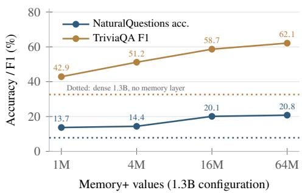  
(c) Load at fixed capacity

(b) Adapter capacity and write method  
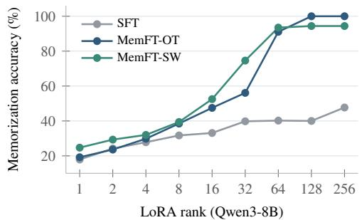  
(d) Reported update protocols

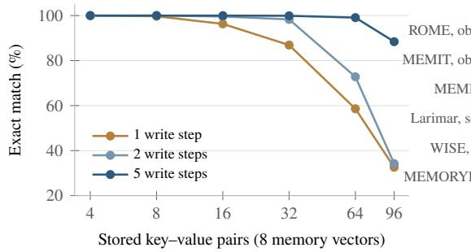

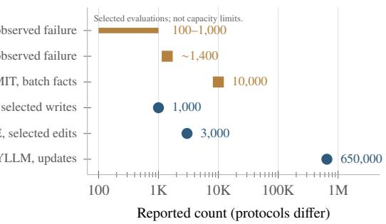  
Figure 12: Reported capacity and load effects in published parametric-memory studies. (a) Memory+ value count at a fixed 1.3B configuration [9]; dotted lines show the dense model without memory layers. (b) Memorization accuracy versus LoRA rank for three write methods on Qwen3-8B [138]. (c) Reported exact match versus stored key–value pairs with eight fixed memory vectors and different numbers of write steps [58]. (d) Reported sequential or batch update horizons across parametricmemory studies [24, 41, 79, 80, 113, 117]; MEMORYLLM evaluates recent-context retention across 650,000 context updates under random slot replacement rather than simultaneous retention of all past edits. All values are taken from the original papers without fitting.

Capacity demand and balanced growth. Analogous to Equation (4.5), maintaining a target performance $p _ { 0 }$ requires the load ratio to stay below its critical value, which implies

$$
M _ { \mathrm { r e q } } ( E ; p _ { 0 } ) \gtrsim \frac { I ( E ) } { \kappa \rho _ { s , \pi } ^ { \star } } \propto \frac { E ^ { \nu } } { \rho _ { s , \pi } ^ { \star } } .\tag{4.9}
$$

The exponent � has the same meaning as in Equation (4.5), with $\nu \approx 1$ when experience consists of independent facts and $\nu \ : < 1$ when it shares rules or skills. Parametric memory compresses shared regularities into the same parameters as it writes, so consolidation happens implicitly during training. Equation (4.9) leads to two differences from non-parametric memory. First, when external capacity falls short, degradation arises through retrieval competition or eviction while surviving records remain intact; when parametric capacity falls short, earlier content is directly overwritten in shared weights, which is harder to reverse. Second, $\rho ^ { \star }$ appears in the denominator, so improving the substrate or the write policy can reduce the required capacity by orders of magnitude (Figure 11(c)), often more efficiently than adding parameters. Within this constraint, the balanced growth path follows Equation (4.3), with $M / M _ { 0 } \propto ( E / E _ { 0 } ) ^ { \alpha _ { E } / \alpha _ { M } }$

Write policy and lifecycle cost. Writing more often is not always better. TMEM varies how much context accumulates before a parametric write is triggered, where F1 peaks at a 4K-token threshold on LoCoMo (25.72) and at 12K on LongMemEval-S (41.24), and declines at both smaller and larger thresholds (Figure 13(b–c)) [89]. A plausible interpretation is that writing too often produces fragmented updates and raises the effective load quickly, whereas writing too rarely forces each update to compress too much context at once. The policy � therefore exhibits a task-dependent favorable range rather than shifting the critical ratio monotonically.

(a) Foundation model  
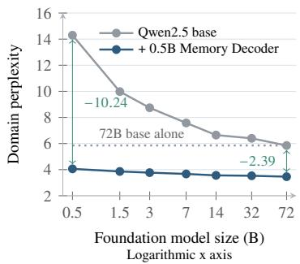

(b) Write threshold on LoCoMo  
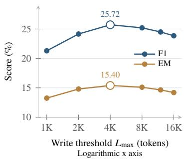

(c) On LongMemEval-S  
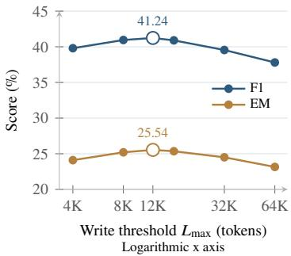  
Figure 13: Reported effects of the foundation model and write timing on parametric memory. (a) Average domain perplexity (biomedicine, finance, and law) of Qwen2.5 models from 0.5B to 72B, with and without the same 0.5B Memory Decoder [12]; arrows mark the reduction at the smallest and largest models, and the dotted line marks the 72B model alone. (b–c) F1 and exact match of TMEM on Qwen3-4B as the context threshold that triggers a parametric write varies, on LoCoMo and LongMemEval-S [89]; hollow markers denote the observed maxima. A larger threshold means less frequent writes, not more write compute. All values are taken from the original papers without fitting.

Under the cost structure of Equation (4.6), parametric memory concentrates cost in $C _ { \mathrm { b u i l d } }$ and $C _ { \mathrm { m a i n t } } ,$ through gradient updates and batch consolidation, while context-token readout overhead in $\overline { { C } } _ { \mathrm { { q u e r y } } }$ is zero because readout happens within the forward pass and consumes no additional prompt context. Its average cost advantage therefore grows with the reuse count �. Under environmental change, however, parametric memory cannot precisely delete or revise an individual item, and each revision adds to the load, which raises maintenance cost and directly affects adaptation (Section 4.1). This suggests a natural division of labor, where rapidly changing experience is retained in external memory, while stable, frequently reused experience is consolidated into parameters, in line with the synergy discussed in Section 6.3.

Parametric and non-parametric memory thus share resource-limited power-law terms and an attainable frontier, but parametric memory differs in three respects: its read budget is fixed by the architecture, its scaling relation contains an interference term governed by the load ratio, and its capacity demand is amplified by the critical ratio. Scaling parametric memory is therefore not only a matter of increasing �; isolated writes, batch writes, larger write budgets, and well-chosen write timing are needed to keep $\rho$ below $\rho ^ { \star }$

## 5 Memory-Centric Continual Learning Applications Across Digital and Physical Domains

When agents deploy over weeks or months, their operational context constantly shifts: user goals change, software interfaces update, and physical surroundings evolve. In these settings, continual learning serves two practical roles: it keeps long-running tasks on track, and it applies past experience to new problems. Memory provides the backbone for both. By storing past interactions, execution outcomes, and environmental states, memory gives agents a stable basis for future decisions.

These capabilities take four main forms across digital and physical domains (Figure 14): (1) personal agents track evolving user preferences; (2) digital agents turn execution logs into reusable workflows; (3) embodied robots map environments and acquire physical skills; and (4) multi-agent teams share project context and collaboration patterns. Below, we examine how each setting turns accumulated experience into durable capability.

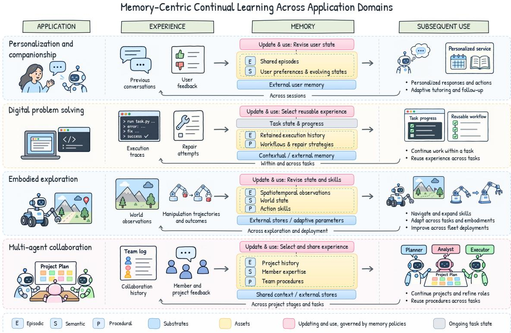  
Figure 14: Memory-centric continual learning across application domains. Each row shows how accumulated experience updates memory to support personalized service, digital automation, embodied exploration, or multi-agent collaboration. Return arrows mark experience flowing back into memory across tasks and deployments.

## 5.1 Lifelong Personalization and Companion Agents

Personal agents must adapt as users change. Over time, schedules shift, learners build skills or form misconceptions, health symptoms evolve, and interpersonal bonds deepen. To remain useful, an agent must update its internal model of the user and use this state to guide dialogue, planning, and tool calls.

Personal assistants. Assistants use cross-session logs to maintain conversational continuity and match individual style. Retrieving user profile items directly improves generation on tasks like email drafting and news summarization [92], while modeling complete interaction histories captures personal tone and habits [68]. Crucially, assistants must track when facts expire. Recent systems update user facts across conversations [7], decay memory strength over time [167], record user feedback alongside its valid context [152], and organize changing user states through causal links [84]. These mechanisms ensure that assistants preserve core preferences while promptly reflecting new changes.

Tutoring agents. Tutoring agents track what a student knows and where they struggle. For example, ScaffoldLM stores pedagogical goals, step-level progress, and inferred misconceptions in an assessment memory, selecting the next hint based on the learner’s latest response [63]. Similarly, versioned student profiles track skill mastery, error patterns, and review schedules to calibrate hints and spaced practice [25]. Updating student profiles in real time allows agents to adjust lesson pacing, hint specificity, and problem difficulty on the fly.

Health follow-up and emotional companionship. Memory directly underpins long-term care and companionship. In a ten-week study of 147 real-world users (1,252 calls), the CareCall system used memory to revisit past health complaints and life events. This continuity encouraged users to disclose more health details and build trust [51]. Studies on Replika users show that social bonding varies widely in depth and pace, meaning companion agents cannot rely on static facts alone [97, 98].

Effective companionship requires referencing shared moments and conversational routines. For instance, recent agents infer implicit emotional needs and retrieve relevant shared memories to offer proactive comfort [34].

From personalized generation to tool use. Personalization extends beyond text generation to planning and tool execution. Dual-reflection mechanisms build user memory banks that accurately route past preferences to current prompts [103]. In tool-augmented setups, benchmarks like Mem2ActBench test whether agents can translate past dates, locations, and habits into correct API parameters [93]. Through memory, personalization becomes a continuous feedback loop: each interaction updates the user model, which in turn steers the agent’s next action.

## 5.2 Evolving Problem-Solving in Long-Horizon Digital Environments

Digital tasks often span multiple web pages, applications, and execution steps. Web research requires tracking checked links and active filters; desktop tasks coordinate code editors, terminals, and spreadsheets; and software engineering requires navigating evolving codebases. In these settings, continual learning serves two needs: resuming interrupted workflows and transferring problem-solving strategies across tasks. Memory tracks progress to ensure task continuity, while abstracting successful runs into reusable skills and debugging routines.

Web automation. Web navigation offers an ideal testbed for workflow reuse. For example, AWM distills reusable workflows from successful web trajectories and feeds them into future runs [121]. Across 200 domains (such as shopping and travel), this approach raised success rates by 24.6% on Mind2Web and 51.1% on WebArena while cutting overall action steps. Online-learned routines— like filtering products or comparing flight routes—readily transfer to new websites with similar structures.

Desktop and cross-application tasks. Desktop agents require both state tracking and skill reuse across applications. Systems like OS-Copilot store verified tool scripts in procedural memory [131], while other architectures combine past execution traces with hierarchical planning to navigate unfamiliar interfaces [1]. Similarly, Trace2Skill distills raw trajectories into executable skill documents, demonstrating reuse across spreadsheet operations, vision-language tasks, and math reasoning [83]. For task continuity, OpenHands logs commands, file diffs, browser events, and user inputs into a unified event stream [115]. This complete history lets coding agents resume interrupted jobs without losing context. Together, these systems show that combining execution logs with procedural skills supports complex, multi-app workflows.

Software engineering. Software engineering scales these demands to entire codebases. Coding agents must understand repository structures while logging inspected files, failed patches, and unit test outputs. SWEMem uses issue progress to selectively compress context, keeping context windows manageable during extended debugging sessions [36]. To transfer knowledge across bugs, SWE-Exp extracts debugging strategies from both successful and failed repairs to guide new GitHub issues [16]. Thus, memory maintains local focus within a single bug fix while transferring repair strategies across the repository.

Experience distillation and strategy reuse. Through trial and error, digital agents turn raw execution traces into reusable strategies. Recent frameworks extract high-level rules from repeated attempts, attach clear trigger conditions to guidelines, and index strategies derived from both successes and failures [35, 85, 163]. Terminal outputs, browser states, and test suites provide immediate feedback to test whether an extracted rule works. In short, memory gives digital agents two capabilities: it keeps long-horizon jobs from derailing, and it turns past mistakes into faster future execution.

## 5.3 Continuous Exploration in Embodied and Open Worlds

Embodied agents must track a dynamic physical world while expanding their motor skills. Robots navigating homes must remember shifted furniture; robotic arms must adapt to unfamiliar tools; and open-world agents must set new goals as they explore. These tasks require two memory systems: a world-state memory that updates with visual observations, and a skill memory that stores reusable behaviors. Together, they allow agents to map their surroundings and master complex actions.

Long-term navigation and scene understanding. Mobile robots rely on spatial memory to navigate and track dynamic scenes. For example, RememBR indexes video clips with spatial and temporal tags, allowing robots to answer queries about past object locations during navigation [5]. Similarly, EmbodiedVideoAgent combines egocentric video, depth, and pose data into an object-centric memory, updating object states as interactions occur [31]. This structured memory boosts benchmark scores on Ego4D-VQ3D, OpenEQA, and EnvQA, and directly guides grasping, navigation, and placement. Historical observations thus become an editable 3D world model.

Open-world exploration. In open worlds like Minecraft, agents must learn complex behaviors without human supervision. Voyager implements this by proposing new tasks, writing executable skill code, and saving verified skills into a library [111]. This skill bank helped Voyager discover 3.3 more items and unlock tech-tree milestones 15.3 faster than baselines. Crucially, the saved skill library lets agents solve unseen tasks from scratch in brand-new worlds. In text worlds like ScienceWorld, CLIN abstracts action outcomes into causal rules to guide future planning [76]. By saving executable code and causal patterns, exploration continually feeds subsequent skill acquisition.

Cross-task and cross-embodiment adaptation. Manipulating physical objects requires sampleefficient learning. RoboCat addresses this by pooling experience across different simulated and real robot arms [11]. The model learns a generalist policy, generates self-supervised data on new tasks, and feeds these runs back into training. Across this self-improving training loop, success rates on unseen tasks (after fine-tuning on 500 demonstrations) rose from 36% with the initial model to 74% with the final RoboCat model. Pooling data across diverse robot hardware shows that cross-embodiment memory drastically cuts the demonstrations needed for new tasks.

Robot fleets. Robot fleets turn shared deployment into collective policy updates. In a 16-robot setup, autonomous trajectories and human teleoperation interventions are pooled to train a single generalist policy, which is then flashed back to the fleet [116]. Across eight manipulation tasks— including grocery restocking routines lasting 3–5 minutes—accumulated fleet data pushed success rates to 95%. Field deployment thus acts as a continual training engine, linking individual robot trials to fleet-wide policy improvements.

## 5.4 Collaborative Evolution via Shared Multi-Agent Memory

Multi-agent systems require shared memory to coordinate specialized roles. Software teams must log architectural decisions; data teams need to track data provenance; and scientific teams must record hypotheses, lab results, and reviews. Storing these records in a shared memory pool prevents redundant effort and lets agents reuse established workflows and team roles. Memory acts as the team’s shared workspace, linking past findings to current tasks.

Cross-task collaboration procedures. Shared procedural memory allows teams to reuse proven collaboration patterns. G-Memory organizes multi-agent interaction histories into a three-tier graph of dialogues, queries, and insights, letting agents retrieve both raw traces and abstract lessons [154]. Across five benchmarks, this structured memory improved embodied task success and question-answering accuracy. Similarly, LegoMem splits memory into orchestrator and worker tiers: orchestrator memory sharpens task decomposition, while worker memory improves tool-use accuracy [43]. Reusing execution traces even helps teams of smaller LLMs match the performance of proprietary models.

Member expertise and selective sharing. Teams also benefit from remembering which agent is good at what. LLMA-Mem builds a transactive memory that models member expertise, team layouts, and past coordination to optimize future role assignment [126]. But sharing everything overwhelms agents. To prevent broadcast clutter, Fioresi et al. train an admission policy that only writes an intermediate step to global memory if it benefits downstream agents [32]. On AssistantBench and GAIA, this selective sharing cut duplicated work without hurting task accuracy. In short, memory decides who should do the work and what information is worth broadcasting.

Scientific collaboration. Scientific discovery teams use shared memory to iterate on complex research programs. In VirtualLab, specialized AI scientists hold multi-round meetings around a shared workspace to design nanobodies, guided by a human lead [100]. Co-Scientist refines hypotheses across cycles of generation, reflection, and peer review, using persistent context memory to carry validation results forward [38]. Similarly, Robin connects literature search, lab protocol design, and data analysis into an autonomous loop where wet-lab results update current hypotheses [37]. Shared memory keeps these long-running research pipelines coherent across iterative design cycles.

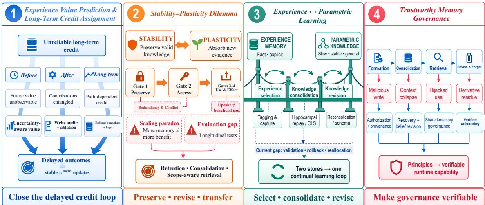  
Figure 15: Four open challenges in memory-centric continual learning: (1) credit assignment across prospective, retrospective, and long-term horizons; (2) the stability–plasticity dilemma driven by memory interference; (3) a bridge connecting episodic experience with parametric weights; and (4) a lifecycle pipeline of deployment risks and governance rules. Colors distinguish the four challenges, and the bottom bar highlights their core questions.

Synthesis of shared-memory applications. Effective teamwork relies on three forms of continuity: project state (what the team is doing), member profiles (who is best equipped to do it), and shared procedures (how the work was done before). Project state keeps ongoing investigations on track; member profiles streamline role assignments; and reusable workflows eliminate redundant trial and error. Shared memory turns individual agent outputs into lasting organizational assets.

Cross-domain synthesis. Together, these four domains highlight the practical scope of memorycentric continual learning. Applications now span multi-week health companions, cross-application web agents, repository-level bug fixing, open-world discovery, fleet-scale robotics, and automated science labs. In each case, memory links past experience to future action. By retaining and organizing execution traces, systems avoid repeating mistakes, adapt to changing users and environments, and continually turn raw interactions into durable capabilities.

## 6 Open Challenges in Memory-Centric Continual Learning

## 6.1 Predicting Experience Value and Long-Term Credit Assignment

Current agents still rely on handcrafted heuristics rather than learned policies �mem. The main obstacle is delayed credit assignment. When an agent records an event at step �, it must decide three things: whether to save it, how to format it, and what metadata to keep. But the true value of this write may not show up until step �  100 or later, after many rounds of summarization, pruning, and task shifts. As a result, final task success reflects a long chain of memory actions, not a single write. This delay blurs the credit signal. Agents can easily reflect using prompts, but they struggle to train policies that decide what to keep, update, or delete [10, 140, 149]. Feedback simply changes memory content $( \boldsymbol { M } _ { t } \to \boldsymbol { M } _ { t + 1 } )$ , while the policy itself stays fixed $( \pi _ { t } ^ { \mathrm { { \mathrm { { m e m } } } } } = \pi _ { t + 1 } ^ { \mathrm { { m e m } } } )$ .

This challenge grows as memory moves from raw chat logs to reusable experience. Storing everything is impractical. Agents must weigh the future payoff of an experience against storage size, search latency, and the risk of confusion [49, 73, 96, 124, 156]. Recent surveys map out how memory is written, managed, and read [28, 49, 50, 129, 169]. Yet we still lack a principled way to balance these costs and benefits over time. Most existing methods rely on simple shortcuts: (1) rules based on recency, frequency, or text similarity [73, 129]; (2) learning to call tools like store, search, or summarize [119, 149, 155, 161]; or (3) hard budgets on context size [124, 156, 169].

These shortcuts only look at the current prompt or immediate reward. They ignore delayed returns, distribution shifts, and interactions between co-retrieved memories. Saving bad data pollutes the store, triggers negative transfer, and hurts future tasks [47, 96, 122, 124, 143, 148]. Three practical hurdles prevent delayed rewards from training �mem:

• Predicting value before writing. At write time, the agent does not know future queries or tasks. Dropping an experience loses information permanently. Keeping bad data pollutes the store. The policy must forecast long-term utility using only local, present clues [10, 28, 96, 124].

• Tracing failure back through the pipeline. Final errors stem from many sources: poor admission, lossy summarization, bad retrieval, or weak reasoning. When an agent fails, it is hard to isolate whether memory or reasoning caused the error [3, 10, 28, 50, 140, 153].

• Path dependence across runs. Every write or delete alters the memory state for future sessions. Different rollouts no longer share the same environment. This variance breaks standard reinforcement learning assumptions and destabilizes training [140, 143, 148, 149, 153].

Solving these hurdles requires optimizing for long-term net value. For write-time prediction, agents can learn value models on task streams, using scaling curves to judge marginal returns [10, 96, 132, 169]. To trace errors, systems can log write decisions, run ablation tests, and keep links from summaries back to raw source episodes [10, 28, 50, 96]. To handle path dependence, agents can branch rollouts from identical memory checkpoints and use hindsight critics [102, 124, 140, 149, 156]. The ultimate goal is closed-loop control: task feedback should update not just what the agent remembers, but how it manages memory.

## 6.2 The Stability–Plasticity Dilemma in Dynamic Environments

External memory gives agents a way to learn continually at the system level. Like classic continual learning, it aims to acquire new capabilities, preserve old knowledge, and transfer skills [73, 135]. As noted in Section 2.1, parametric learning updates model weights, while agent memory updates external records at inference time. However, external stores do not remove the stability–plasticity dilemma; they simply relocate it [47].

Here, interference occurs during retrieval and prompt construction. A loose write policy (Section 3.1) boosts plasticity by saving new records quickly, but it also clutters storage with duplicate and conflicting entries. Under fixed retrieval budgets, this clutter crowds out useful memories. In the cascade of Section 4.1.1, saving more records (Gate 1) hurts retrieval accuracy (Gate 2). Even when retrieved, outdated facts can lead the model to ignore correct updates or apply old rules to wrong tasks (Gate 3) [47, 56, 65, 153]. Stability means keeping valid memories easy to find and use. Plasticity means updating old facts without breaking what already works.

This trade-off sharpens as memory expands. More interactions can help agents learn [85], and periodic cleaning keeps stores lean [146]. Yet larger stores always raise the risk of retrieval noise. We should judge memory scaling by task gains under fixed compute budgets, not by raw storage volume.

Measuring these trade-offs requires long-term benchmarks. Recent benchmarks test specific skills, such as fact updates in LongMemEval [125] or task transfer in Evo-Memory and LifelongAgent-Bench [122, 165]. As outlined in Section 4, evaluations should track retention, forward transfer, and negative interference across shifting task streams. Beyond final accuracy, tracking survival rates, retrieval ranks, and actual memory usage against frozen-memory baselines shows whether memory truly helps or quietly harms performance.

The core question is direct: How can agents keep memories accurate and relevant as experience grows? Promising paths include write filters that prevent clutter, consolidation that checks raw evidence, and retrieval that matches the exact conditions where an experience applies [47, 65, 153].

## 6.3 Synergistic Continual Learning through Experience Memory and Parametric Learning

Continual learning requires coordinating external experience with internal model weights. Today, agents treat them as two separate systems. External memory stores new facts quickly without touching model weights [19, 95, 136]. Parametric fine-tuning bakes patterns into weights for broad generalization, but risks catastrophic forgetting [94, 127].

Recent work connects the two sides by extracting reasoning paths into external memory or finetuning lightweight adapters [42, 44, 85, 164]. Yet information flows mostly one way: from raw episodes into weights or static stores. Systems cannot easily edit, roll back, or delete parametric knowledge once written. Human memory works differently. In biology, recalling a consolidated memory makes it flexible again, meaning the brain must actively restabilize it (a process called reconsolidation) [81]. Neural networks lack this feature; once weights change, they stay fixed until the next gradient step.

The key missing piece is the bridge between raw experience and parametric weights. An agent should first test and summarize experiences in external storage. Only repeatedly verified patterns should enter model weights. Conversely, when existing weights fail on new evidence, the agent must pull that knowledge back into explicit text to inspect and fix it. This cycle follows Complementary Learning Systems (CLS) theory: fast learning in the hippocampus and slow integration in the cortex interact via replay to balance plasticity and stability [57, 77, 123]. Furthermore, the brain does not store every event; synaptic tagging-and-capture shows that novelty and reward flags decide which synapses undergo lasting change [33].

Future systems should build a two-way learning loop across three clear steps:

1. Selection: Filter raw traces by novelty, utility, and frequency—like synaptic tagging—before keeping them.

2. Consolidation: Replay, abstract, and bake verified memories into model weights via modular adapters.

3. Revision: Test weights against new facts, reopen outdated knowledge for correction (like reconsolidation), and use schemas to absorb new rules quickly [105].

Instead of treating memory and weights as separate silos, agents need clear algorithms that pass knowledge back and forth between them.

## 6.4 Trustworthy Memory Governance in Lifelong Deployment

While methods for writing and searching memory have matured, memory safety and control lag behind. Few studies address access control, rollback, or secure deletion, even though real-world deployment risks center on these exact areas [26].

Without explicit governance, security risks spread across every stage of the memory lifecycle:

• Formation: Attackers can inject malicious text through poisoned web pages or prompt injection. Without write checks, agents save these instructions as trusted facts, corrupting future actions (Section 3.1) [17, 27, 104].

• Consolidation: When agents summarize logs into general rules, they often drop timestamps and source links—a failure known as context collapse (Section 3.2). As a result, a single poisoned prompt can turn into a permanent, trusted behavioral rule.

• Retrieval: Corrupted memories can hijack tool calls and override user instructions during normal tasks [137], or leak private data across users in shared stores [141]. This shows why retrieving a memory is different from using it safely (Section 3.3).

• Forgetting: Deleting a raw record does not remove its downstream traces, such as summaries, fine-tuned weights, or knowledge graphs (Section 3.4) [66]. Bad behavior can persist long after the original entry is gone [26].

Memory control is hard for three reasons: (1) Expanding scope: As agents gain more tools and autonomy, attack surfaces constantly shift [168]. (2) Delayed impact: The gap between a poisoned write and an attack can be weeks or months. Summarization hides original sources, making it hard to trace who wrote what [66]. (3) Direct trade-offs: Strict privacy checks and audit logs slow down search and increase token costs [60].

Recent work introduces basic defenses: write permissions, provenance logs, user-isolated retrieval, and verified rollback [66]. Yet evaluation still falls short. Most benchmarks only score task success, giving developers little reason to build safe memory systems [26]. In addition, self-reflection remains hard to verify from the outside, and shared memory in multi-agent setups lacks clear access rules [109, 141].

To build reliable agents, governance must cover the full lifecycle:

• Formation: Verify sources and permissions before writing, rather than filtering data after problems occur [66].

• Consolidation: Borrow ideas from database recovery and belief revision to prevent agents from dropping critical source context during summarization [26].

• Retrieval: Sandbox tool execution and enforce role-based access for shared multi-agent stores [109, 141].

• Forgetting: Use clear metrics—such as stress tests and recovery targets—to prove that deleted data and its side effects are truly gone [26].

Governance cannot remain an afterthought; it must become a testable, built-in guarantee of agent systems.

## 7 Conclusion

In this paper, we reframe agent memory as an evolving learning infrastructure for continual learning, rather than a passive storage or retrieval component. We argue that experience accumulation cannot be equated with static recall, but requires a closed-loop dynamic of retention, adaptation, and transfer, explaining why current memory agents fail under delay, interference, and environmental drift. To address this, we establish a unified framework spanning physical substrates, reusable assets, and lifecycle policies, coupled with a behavior-centric evaluation methodology to isolate genuine experiential gains and a memory scaling law that relates those gains to experience and memory resources. By adopting this memory-centric lens, the field shifts its central question from whether an agent can remember to whether it can continually learn, paving a more principled path towards building resilient, self-improving intelligent systems.

## References

[1] Saaket Agashe, Jiuzhou Han, Shuyu Gan, Jiachen Yang, Ang Li, and Xin Eric Wang. Agent S: An open agentic framework that uses computers like a human. arXiv preprint arXiv:2410.08164, 2024.

[2] Lakshya A. Agrawal, Shangyin Tan, Dilara Soylu, Noah Ziems, Rishi Khare, Krista Opsahl-Ong, Arnav Singhvi, Herumb Shandilya, Michael J. Ryan, Meng Jiang, Christopher Potts, Koushik Sen, Alex Dimakis, Ion Stoica, Dan Klein, Matei Zaharia, and Omar Khattab. GEPA: Reflective prompt evolution can outperform reinforcement learning. In International Conference on Learning Representations, 2026.

[3] Qingyao Ai, Yichen Tang, Changyue Wang, Jianming Long, Weihang Su, and Yiqun Liu. MemoryBench: A benchmark for memory and continual learning in LLM systems. arXiv preprint arXiv:2510.17281, 2025.

[4] Zeyuan Allen-Zhu and Yuanzhi Li. Physics of language models: Part 3.3, knowledge capacity scaling laws. In International Conference on Learning Representations, 2025.

[5] Abrar Anwar, John Welsh, Joydeep Biswas, Soha Pouya, and Yan Chang. ReMEmbR: Building and reasoning over long-horizon spatio-temporal memory for robot navigation. In 2025 IEEE International Conference on Robotics and Automation (ICRA), pp. 2838–2845, 2025.

[6] Parth Asawa, Christopher M. Glaze, Gabriel Orlanski, Ramya Ramakrishnan, Benji Xu, Asim Biswal, Vincent Sunn Chen, Frederic Sala, Matei Zaharia, and Joseph E. Gonzalez. Continual Learning Bench: Evaluating frontier AI systems in real-world stateful environments. arXiv preprint arXiv:2606.05661, 2026.

[7] Sanghwan Bae, Dong-Hyun Kwak, Soyoung Kang, Min Young Lee, Sungdong Kim, Yuin Jeong, Hyeri Kim, Sang-Woo Lee, Woo-Myoung Park, and Nako Sung. Keep me updated! Memory management in long-term conversations. In Findings ofthe Associationfor Computational Linguistics: EMNLP 2022, pp. 3769–3787, 2022. doi: 10.18653/v1/2022.findings-emnlp. 276.

[8] Ali Behrouz, Peilin Zhong, and Vahab Mirrokni. Titans: Learning to memorize at test time. In Advances in Neural Information Processing Systems, volume 38, 2025.

[9] Vincent-Pierre Berges, Barlas O˘guz, Daniel Haziza, Wen-tau Yih, Luke Zettlemoyer, and Gargi Ghosh. Memory layers at scale. In Proceedings of the 42nd International Conference on Machine Learning, volume 267, pp. 3831–3842, 2025.

[10] Nishant Bhargava and Rodrigo Sobral Barrento. MEMAUDIT: An exact package-oracle evaluation protocol for budgeted long-term LLM memory writing. arXiv preprint arXiv:2605.02199, 2026.

[11] Konstantinos Bousmalis, Giulia Vezzani, Dushyant Rao, Coline Devin, Alex X. Lee, Maria Bauzá, Todor Davchev, Yuxiang Zhou, Agrim Gupta, Akhil Raju, Antoine Laurens, Claudio Fantacci, Valentin Dalibard, Martina Zambelli, Murilo F. Martins, Rugile Pevceviciute, Michiel Blokzijl, Misha Denil, Nathan Batchelor, Thomas Lampe, Emilio Parisotto, Konrad Zolna, Scott E. Reed, Sergio Gómez Colmenarejo, Jon Scholz, Abbas Abdolmaleki, Oliver Groth, Jean-Baptiste Regli, Oleg Sushkov, Thomas Rothörl, José Enrique Chen, Yusuf Aytar, Dave Barker, Joy Ortiz, Martin A. Riedmiller, Jost Tobias Springenberg, Raia Hadsell, Francesco Nori, and Nicolas Heess. RoboCat: A self-improving generalist agent for robotic manipulation. Transactions on Machine Learning Research, 2024.

[12] Jiaqi Cao, Jiarui Wang, Rubin Wei, Qipeng Guo, Kai Chen, Bowen Zhou, and Zhouhan Lin. Memory decoder: A pretrained, plug-and-play memory for large language models. In Advances in Neural Information Processing Systems, volume 38, 2025.

[13] Arie Cattan, Alon Jacovi, Ori Ram, Jonathan Herzig, Roee Aharoni, Sasha Goldshtein, Eran Ofek, Idan Szpektor, and Avi Caciularu. DRAGged into conflicts: Detecting and addressing conflicting sources in search-augmented LLMs. arXiv preprint arXiv:2506.08500, 2025.

[14] Hanxiang Chao, Yihan Bai, Rui Sheng, Tianle Li, and Yushi Sun. STALE: Can LLM agents know when their memories are no longer valid? arXiv preprint arXiv:2605.06527, 2026.

[15] Jingwen Chen, Wenkai Yang, Shengda Fan, Wenbo Nie, Chenxing Sun, Shaodong Zheng, Yangen Hu, Lu Pan, Ke Zeng, and Yankai Lin. Rethinking continual experience internalization for self-evolving LLM agents. arXiv preprint arXiv:2606.04703, 2026.

[16] Silin Chen, Shaoxin Lin, Yuling Shi, Heng Lian, Xiaodong Gu, Longfei Yun, Dong Chen, Lin Cao, Jiyang Liu, Nu Xia, and Qianxiang Wang. SWE-Exp: Experience-driven software issue resolution. arXiv preprint arXiv:2507.23361, 2025.

[17] Zhaorun Chen, Zhen Xiang, Chaowei Xiao, Dawn Song, and Bo Li. AgentPoison: Red-teaming LLM agents via poisoning memory or knowledge bases. In Advances in Neural Information Processing Systems, volume 37, pp. 130185–130213, 2024.

[18] Zhuoen Chen, Dongfang Li, Meishan Zhang, Baotian Hu, and Min Zhang. Dynamic long context reasoning over compressed memory via end-to-end reinforcement learning. In Proceedings of the 64th Annual Meeting of the Association for Computational Linguistics (Volume 1: Long Papers), pp. 8064–8083, 2026.

[19] Prateek Chhikara, Dev Khant, Saket Aryan, Taranjeet Singh, and Deshraj Yadav. Mem0: Building production-ready AI agents with scalable long-term memory. arXiv preprint arXiv:2504.19413, 2025.

[20] Musa Cim, Burak Topcu, Chita Das, and Mahmut Taylan Kandemir. Parallel context compaction for long-horizon LLM agent serving. arXiv preprint arXiv:2605.23296, 2026.

[21] Cognee. Cognee v1.0 memory lifecycle documentation. Official documentation, 2026. URL https://docs.cognee.ai/changelog. Accessed 2026-08-28.

[22] Zihang Dai, Zhilin Yang, Yiming Yang, Jaime Carbonell, Quoc V. Le, and Ruslan Salakhutdinov. Transformer-XL: Attentive language models beyond a fixed-length context. In Proceedings of the 57th Annual Meeting of the Associationfor Computational Linguistics, pp. 2978–2988, 2019. doi: 10.18653/v1/p19-1285.

[23] Zijie Dai, Shiyuan Deng, Sheng Guan, Yizhou Tian, Xin Yao, Xiao Yan, and James Cheng. RecMem: Recurrence-based memory consolidation for efficient and effective long-running LLM agents. arXiv preprint arXiv:2605.16045, 2026.

[24] Payel Das, Subhajit Chaudhury, Elliot Nelson, Igor Melnyk, Sarathkrishna Swaminathan, Sihui Dai, Aurélie C. Lozano, Georgios Kollias, Vijil Chenthamarakshan, Jirí Navrátil, Soham Dan, and Pin-Yu Chen. Larimar: Large language models with episodic memory control. In Proceedings of the 41st International Conference on Machine Learning, volume 235, pp. 10109–10126, 2024.

[25] Jones David and Shreya Ghosh. IntelliCode: A multi-agent LLM tutoring system with centralized learner modeling. In Proceedings of the 19th Conference of the European Chapter of the Association for Computational Linguistics (Volume 3: System Demonstrations), pp. 129–138, 2026. doi: 10.18653/v1/2026.eacl-demo.10.

[26] Tianyu Ding, Aditya Nannapaneni, Bingfan Liu, and Ling Zhang. Always-on agents: A survey of persistent memory, state, and governance in LLM agents. arXiv preprint arXiv:2606.30306, 2026.

[27] Shen Dong, Shaochen Xu, Pengfei He, Yige Li, Jiliang Tang, Tianming Liu, Hui Liu, and Zhen Xiang. Memory injection attacks on LLM agents via query-only interaction. In Advances in Neural Information Processing Systems, volume 38, 2025.

[28] Pengfei Du. Memory for autonomous LLM agents: Mechanisms, evaluation, and emerging frontiers. arXiv preprint arXiv:2603.07670, 2026.

[29] Yiming Du, Hongru Wang, Zhengyi Zhao, Bin Liang, Baojun Wang, Wanjun Zhong, Zezhong Wang, and Kam-Fai Wong. PerLTQA: A personal long-term memory dataset for memory classification, retrieval, and fusion in question answering. In Proceedings ofthe 10th SIGHAN Workshop on Chinese Language Processing (SIGHAN-10), pp. 152–164, 2024. URL https:// aclanthology.org/2024.sighan-1.18.

[30] Wenzhe Fan, Ning Yan, and Masood S. Mortazavi. EvoMem: Improving multi-agent planning with dual-evolving memory. arXiv preprint arXiv:2511.01912, 2025.

[31] Yue Fan, Xiaojian Ma, Rongpeng Su, Jun Guo, Rujie Wu, Xi Chen, and Qing Li. Embodied VideoAgent: Persistent memory from egocentric videos and embodied sensors enables dynamic scene understanding. In Proceedings of the IEEE/CVF International Conference on Computer Vision, pp. 6342–6352, 2025. doi: 10.1109/iccv51701.2025.00598.

[32] Joseph Fioresi, Parth Parag Kulkarni, Ashmal Vayani, Song Wang, and Mubarak Shah. Learning to share: Selective memory for efficient parallel agentic systems. arXiv preprint arXiv:2602.05965, 2026.

[33] Uwe Frey and Richard G. M. Morris. Synaptic tagging and long-term potentiation. Nature, 385(6616):533–536, 1997. doi: 10.1038/385533a0.

[34] Xing Fu, Yulin Hu, Mengtong Ji, Haozhen Li, Yixin Sun, Weixiang Zhao, Yanyan Zhao, and Bing Qin. ENPMR-Bench: Benchmarking proactive memory retrieval for emotional support agents. In Findings of the Association for Computational Linguistics: ACL 2026, pp. 41910–41933, 2026. doi: 10.18653/v1/2026.findings-acl.2080.

[35] Yao Fu, Dong-Ki Kim, Jaekyeom Kim, Sungryull Sohn, Lajanugen Logeswaran, Kyunghoon Bae, and Honglak Lee. AutoGuide: Automated generation and selection of context-aware guidelines for large language model agents. In Advances in Neural Information Processing Systems, volume 37, 2024.

[36] Shuzheng Gao, Wenhao Zeng, Zhaojian Yu, Jianqiao Wangni, Chaozheng Wang, Kai Cai, Shilin He, and Michael R. Lyu. SWE-MeM: Learning adaptive memory management for long-horizon coding agents. arXiv preprint arXiv:2606.28434, 2026.

[37] Ali Essam Ghareeb, Benjamin Chang, Ludovico Mitchener, Angela Yiu, Caralyn J Szostkiewicz, Dmytro Shved, Gavin J Gyimesi, Jon M Laurent, Samantha M Wright, Muhammed T Razzak, et al. A multi-agent system for automating scientific discovery. Nature, 655(8122):497–505, 2026. doi: 10.1038/s41586-026-10652-y.

[38] Juraj Gottweis, Wei-Hung Weng, Alexander Daryin, Tao Tu, Petar Sirkovic, Artiom Myaskovsky, Grzegorz Glowaty, Felix Weissenberger, Alessio Orlandi, Dan Popovici, et al. Accelerating scientific discovery with Co-Scientist. Nature, 655(8122):487–496, 2026. doi: 10.1038/s41586-026-10644-y.

[39] Jia-Chen Gu, Hao-Xiang Xu, Jun-Yu Ma, Pan Lu, Zhen-Hua Ling, Kai-Wei Chang, and Nanyun Peng. Model editing harms general abilities of large language models: Regularization to the rescue. In Proceedings of the 2024 Conference on Empirical Methods in Natural Language Processing, pp. 16801–16819, 2024. doi: 10.18653/v1/2024.emnlp-main.934.

[40] Tianyi Guan, Yiding Wang, Haotong Yang, Siyuan Cao, Shirui Liu, Yi Hu, Jiaqi Li, and Muhan Zhang. ContinualSkillBench: Can LLM agents truly evolve their capabilities? arXiv preprint arXiv:2608.03874, 2026.

[41] Akshat Gupta, Anurag Rao, and Gopala Anumanchipalli. Model editing at scale leads to gradual and catastrophic forgetting. In Findings of the Associationfor Computational Linguistics: ACL 2024, pp. 15202–15232, 2024. doi: 10.18653/v1/2024.findings-acl.902.

[42] Bernal Jiménez Gutiérrez, Yiheng Shu, Weijian Qi, Sizhe Zhou, and Yu Su. From RAG to memory: Non-parametric continual learning for large language models. In Proceedings of the 42nd International Conference on Machine Learning, volume 267, pp. 21497–21515, 2025.

[43] Dongge Han, Camille Couturier, Daniel Madrigal Díaz, Xuchao Zhang, Victor Rühle, and Saravan Rajmohan. LEGOMem: Modular procedural memory for multi-agent LLM systems for workflow automation. arXiv preprint arXiv:2510.04851, 2025.

[44] Jinghan He, Haiyun Guo, Kuan Zhu, Zihan Zhao, Ming Tang, and Jinqiao Wang. SEEKR: Selective attention-guided knowledge retention for continual learning of large language models. In Proceedings ofthe 2024 Conference on Empirical Methods in Natural Language Processing, pp. 3254–3266, November 2024. doi: 10.18653/v1/2024.emnlp-main.190. URL https:// aclanthology.org/2024.emnlp-main.190/.

[45] Cheng-Ping Hsieh, Simeng Sun, Samuel Kriman, Shantanu Acharya, Dima Rekesh, Fei Jia, Yang Zhang, and Boris Ginsburg. RULER: What’s the real context size of your long-context language models? arXiv preprint arXiv:2404.06654, 2024.

[46] Mengkang Hu, Tianxing Chen, Qiguang Chen, Yao Mu, Wenqi Shao, and Ping Luo. HiAgent: Hierarchical working memory management for solving long-horizon agent tasks with large language model. arXiv preprint arXiv:2408.09559, 2024.

[47] Qisheng Hu, Quanyu Long, and Wenya Wang. When continual learning moves to memory: A study of experience reuse in LLM agents. arXiv preprint arXiv:2604.27003, 2026.

[48] Yuanzhe Hu, Yu Wang, and Julian McAuley. Evaluating memory in LLM agents via incremental multi-turn interactions. In International Conference on Learning Representations, 2026. URL https://openreview.net/forum?id=DT7JyQC3MR.

[49] Wei-Chieh Huang, Weizhi Zhang, Yueqing Liang, Yuanchen Bei, Yankai Chen, Tao Feng, Xinyu Pan, Zhen Tan, Yu Wang, Tianxin Wei, et al. A survey of agent memory in the second half: Towards self-evolving and long-horizon agents. Transactions on Machine Learning Research, 2026.

[50] Dongming Jiang, Yi Li, Songtao Wei, Jinxin Yang, Ayushi Kishore, Alysa Zhao, Dingyi Kang, Xu Hu, Feng Chen, Qiannan Li, and Bingzhe Li. Anatomy of agentic memory: Taxonomy and empirical analysis of evaluation and system limitations. arXiv preprint arXiv:2602.19320, 2026.

[51] Eunkyung Jo, Yuin Jeong, SoHyun Park, Daniel A. Epstein, and Young-Ho Kim. Understanding the impact of long-term memory on self-disclosure with large language model-driven chatbots for public health intervention. In Proceedings of the CHI Conference on Human Factors in Computing Systems, pp. 1–21, 2024.

[52] Damjan Kalajdzievski. Scaling laws for forgetting when fine-tuning large language models. arXiv preprint arXiv:2401.05605, 2024.

[53] Jiazheng Kang, Mingming Ji, Zhe Zhao, and Ting Bai. Memory OS of AI agent. In Proceedings of the 2025 Conference on Empirical Methods in Natural Language Processing, pp. 25961–25970, 2025. doi: 10.18653/v1/2025.emnlp-main.1318.

[54] Jikun Kang, Wenqi Wu, Filippos Christianos, Alex J. Chan, Fraser Greenlee, George Thomas, Marvin Purtorab, and Andy Toulis. LM2: Large memory models. arXiv preprint arXiv:2502.06049, 2025.

[55] Minki Kang, Wei-Ning Chen, Dongge Han, Huseyin A. Inan, Lukas Wutschitz, Yanzhi Chen, Robert Sim, and Saravan Rajmohan. ACON: Optimizing context compression for long-horizon LLM agents. arXiv preprint arXiv:2510.00615, 2025.

[56] Kangsan Kim, Minki Kang, Taeil Kim, Yanlai Yang, Mengye Ren, and Sung Ju Hwang. Memory transfer learning: How memories are transferred across domains in coding agents. arXiv preprint arXiv:2604.14004, 2026.

[57] Dharshan Kumaran, Demis Hassabis, and James L. McClelland. What learning systems do intelligent agents need? Complementary learning systems theory updated. Trends in Cognitive Sciences, 20(7):512–534, 2016. doi: 10.1016/j.tics.2016.05.004.

[58] Yuri Kuratov, Matvey Kairov, Aydar Bulatov, Ivan Rodkin, and Mikhail Burtsev. Grad-Mem: Learning to write context into memory with test-time gradient descent. arXiv preprint arXiv:2603.13875, 2026.

[59] Woosuk Kwon, Zhuohan Li, Siyuan Zhuang, Ying Sheng, Lianmin Zheng, Cody Hao Yu, Joseph E. Gonzalez, Hao Zhang, and Ion Stoica. Efficient memory management for large language model serving with PagedAttention. In Proceedings of the 29th Symposium on Operating Systems Principles, 2023.

[60] Chingkwun Lam, Jiaxin Li, Lingfei Zhang, and Kuo Zhao. Governing evolving memory in LLM agents: Risks, mechanisms, and the stability and safety governed memory (SSGM) framework. arXiv preprint arXiv:2603.11768, 2026.

[61] Patrick Lewis, Ethan Perez, Aleksandra Piktus, Fabio Petroni, Vladimir Karpukhin, Naman Goyal, Heinrich Küttler, Mike Lewis, Wen-tau Yih, Tim Rocktäschel, Sebastian Riedel, and Douwe Kiela. Retrieval-augmented generation for knowledge-intensive NLP tasks. In Advances in Neural Information Processing Systems, volume 33, pp. 9459–9474, 2020.

[62] Dongfang Li, Zixuan Liu, Junmai Wang, Jiahe Huang, Fuhao Li, Lin Zhang, Bonian Jia, Baotian Hu, and Min Zhang. LycheeMemory V2: Efficient long-term memory for LLM agents via semantic segment-level consolidation. arXiv preprint arXiv:2608.12990, 2026.

[63] Zechen Li, Qiannan Zhu, Mei Wang, Jia Li, and Hua Huang. Planning-guided tutoring with assessment-driven memory for pedagogical LLM tutors. In Proceedings of the 64th Annual Meeting of the Association for Computational Linguistics (Volume 1: Long Papers), pp. 7165–7188, 2026. doi: 10.18653/v1/2026.acl-long.325.

[64] Zhiyu Li, Shichao Song, Hanyu Wang, Simin Niu, Ding Chen, Jiawei Yang, Chenyang Xi, Huayi Lai, Jihao Zhao, Yezhaohui Wang, Junpeng Ren, Zehao Lin, Jiahao Huo, Tianyi Chen, Kai Chen, Kehang Li, Zhiqiang Yin, Qingchen Yu, Bo Tang, Hongkang Yang, Zhi-Qin John Xu, and Feiyu Xiong. MemOS: An operating system for memory-augmented generation (MAG) in large language models. arXiv preprint arXiv:2505.22101, 2025.

[65] Sirui Liang, Pengfei Cao, Jian Zhao, Wenhao Teng, Xiangwen Liao, Jun Zhao, and Kang Liu. Learning how to remember: A meta-cognitive management method for structured and transferable agent memory. In Findings of the Association for Computational Linguistics: ACL 2026, pp. 30733–30753, 2026.

[66] Zehao Lin, Xixuan Hao, Renyu Fu, Shaobo Cui, Kai Chen, Chunyu Li, Zhiyu Li, and Feiyu Xiong. A survey on long-term memory security in LLM agents: Attacks, defenses, and governance across the memory lifecycle. arXiv preprint arXiv:2604.16548, 2026.

[67] Genglin Liu, Shijie Geng, Sha Li, Hejie Cui, Sarah Zhang, Xin Liu, and Tianyi Liu. WebCoach: Self-evolving web agents with cross-session memory guidance. arXiv preprint arXiv:2511.12997, 2025.

[68] Jiongnan Liu, Yutao Zhu, Shuting Wang, Xiaochi Wei, Erxue Min, Yu Lu, Shuaiqiang Wang, Dawei Yin, and Zhicheng Dou. LLMs + Persona-Plug = personalized LLMs. In Proceedings of the 63rd Annual Meeting of the Association for Computational Linguistics (Volume 1: Long Papers), pp. 9373–9385, 2025. doi: 10.18653/v1/2025.acl-long.461.

[69] Nelson F. Liu, Kevin Lin, John Hewitt, Ashwin Paranjape, Michele Bevilacqua, Fabio Petroni, and Percy Liang. Lost in the middle: How language models use long contexts. Transactions of the Associationfor Computational Linguistics, 12:157–173, 2024.

[70] Xiang Liu, Zhenheng Tang, Peijie Dong, Zeyu Li, Yue Liu, Bo Li, Xuming Hu, and Xiaowen Chu. ChunkKV: Semantic-preserving KV cache compression for efficient long-context LLM inference. arXiv preprint arXiv:2502.00299, 2025.

[71] David Lopez-Paz and Marc’Aurelio Ranzato. Gradient episodic memory for continual learning. In Advances in Neural Information Processing Systems, volume 30, 2017.

[72] Zhengxuan Lu, Dongfang Li, Yukun Shi, Beilun Wang, Longyue Wang, and Baotian Hu. Structured episodic event memory. In Proceedings of the 64th Annual Meeting of the Association for Computational Linguistics (Volume 1: Long Papers), pp. 6125–6141, 2026. doi: 10.18653/v1/ 2026.acl-long.277.

[73] Jinghao Luo, Yuchen Tian, Chuxue Cao, Ziyang Luo, Hongzhan Lin, Kaixin Li, Chuyi Kong, Ruichao Yang, and Jing Ma. From storage to experience: A survey on the evolution of LLM agent memory mechanisms. In Findings of the Association for Computational Linguistics: ACL 2026, pp. 41622–41652, 2026.

[74] Yun Luo, Zhen Yang, Fandong Meng, Yafu Li, Jie Zhou, and Yue Zhang. An empirical study of catastrophic forgetting in large language models during continual fine-tuning. IEEE Transactions on Audio, Speech and Language Processing, 33:3776–3786, 2025.

[75] Adyasha Maharana, Dong-Ho Lee, Sergey Tulyakov, Mohit Bansal, Francesco Barbieri, and Yuwei Fang. Evaluating very long-term conversational memory of LLM agents. In Proceedings of the 62nd Annual Meeting of the Association for Computational Linguistics (Volume 1: Long Papers), pp. 13851–13870, 2024. doi: 10.18653/v1/2024.acl-long.747. URL https://aclanthology. org/2024.acl-long.747.

[76] Bodhisattwa Prasad Majumder, Bhavana Dalvi Mishra, Peter A. Jansen, Oyvind Tafjord, Niket Tandon, Li Zhang, Chris Callison-Burch, and Peter Clark. CLIN: A continually learning language agent for rapid task adaptation and generalization. arXiv preprint arXiv:2310.10134, 2023.

[77] James L. McClelland, Bruce L. McNaughton, and Randall C. O’Reilly. Why there are complementary learning systems in the hippocampus and neocortex: Insights from the successes and failures of connectionist models of learning and memory. Psychological Review, 102(3):419–457, 1995. doi: 10.1037/0033-295x.102.3.419.

[78] Michael McCloskey and Neal J. Cohen. Catastrophic interference in connectionist networks: The sequential learning problem. Psychology of Learning and Motivation, 24:109–165, 1989.

[79] Kevin Meng, David Bau, Alex Andonian, and Yonatan Belinkov. Locating and editing factual associations in GPT. In Advances in Neural Information Processing Systems, volume 35, pp. 17359–17372, 2022.

[80] Kevin Meng, Arnab Sen Sharma, Alex Andonian, Yonatan Belinkov, and David Bau. Massediting memory in a transformer. In International Conference on Learning Representations, 2023.

[81] Karim Nader, Glenn E. Schafe, and Joseph E. LeDoux. Fear memories require protein synthesis in the amygdala for reconsolidation after retrieval. Nature, 406:722–726, 2000. doi: 10.1038/ 35021052.

[82] Jiayan Nan, Wenquan Ma, Wenlong Wu, and Yize Chen. Nemori: Self-organizing agent memory inspired by cognitive science. arXiv preprint arXiv:2508.03341, 2025.

[83] Jingwei Ni, Yihao Liu, Xinpeng Liu, Yutao Sun, Mengyu Zhou, Pengyu Cheng, Dexin Wang, Erchao Zhao, Xiaoxi Jiang, and Guanjun Jiang. Trace2Skill: Distill trajectory-local lessons into transferable agent skills. arXiv preprint arXiv:2603.25158, 2026.

[84] Kai Tzu-iunn Ong, Namyoung Kim, Minju Gwak, Hyungjoo Chae, Taeyoon Kwon, Yohan Jo, Seung-won Hwang, Dongha Lee, and Jinyoung Yeo. Towards lifelong dialogue agents via timeline-based memory management. In Proceedings ofthe 2025 Conference ofthe Nations ofthe Americas Chapter of the Associationfor Computational Linguistics: Human Language Technologies (Volume 1: Long Papers), pp. 8631–8661, 2025. doi: 10.18653/v1/2025.naacl-long.435.

[85] Siru Ouyang, Jun Yan, I-Hung Hsu, Yanfei Chen, Ke Jiang, Zifeng Wang, Rujun Han, Long T. Le, Samira Daruki, Xiangru Tang, Vishy Tirumalashetty, George Lee, Mahsan Rofouei, Hangfei Lin, Jiawei Han, Chen-Yu Lee, and Tomas Pfister. ReasoningBank: Scaling agent self-evolving with reasoning memory. In International Conference on Learning Representations, 2026.

[86] Charles Packer, Sarah Wooders, Kevin Lin, Vivian Fang, Shishir G. Patil, Ion Stoica, and Joseph E. Gonzalez. MemGPT: Towards LLMs as operating systems. arXiv preprint arXiv:2310.08560, 2023.

[87] Joon Sung Park, Joseph C. O’Brien, Carrie J. Cai, Meredith Ringel Morris, Percy Liang, and Michael S. Bernstein. Generative agents: Interactive simulacra of human behavior. In Proceedings of the 36th Annual ACM Symposium on User Interface Software and Technology, pp. 1–22, 2023.

[88] Preston Rasmussen, Pavlo Paliychuk, Travis Beauvais, Jack Ryan, and Daniel Chalef. Zep: A temporal knowledge graph architecture for agent memory. arXiv preprint arXiv:2501.13956, 2025.

[89] Tao Ren, Weiyao Luo, Hui Yang, Rongzhi Zhu, Xiang Huang, Yuchuan Wu, Bingxue Chou, Jieping Ye, Jiafeng Liang, Yongbin Li, and Yijie Peng. Scaling self-evolving agents via parametric memory. arXiv preprint arXiv:2606.04536, 2026.

[90] Alireza Rezazadeh, Zichao Li, Wei Wei, and Yujia Bao. From isolated conversations to hierarchical schemas: Dynamic tree memory representation for LLMs. arXiv preprint arXiv:2410.14052, 2024.

[91] Natalia Díaz Rodríguez, Vincenzo Lomonaco, David Filliat, and Davide Maltoni. Don’t forget, there is more than forgetting: New metrics for continual learning. arXiv preprint arXiv:1810.13166, 2018.

[92] Alireza Salemi, Sheshera Mysore, Michael Bendersky, and Hamed Zamani. LaMP: When large language models meet personalization. In Proceedings of the 62nd Annual Meeting of the Association for Computational Linguistics (Volume 1: Long Papers), pp. 7370–7392, 2024. doi: 10.18653/v1/2024.acl-long.399.

[93] Yiting Shen, Kun Li, Wei Zhou, and Songlin Hu. Mem2ActBench: A benchmark for evaluating long-term memory utilization in task-oriented autonomous agents. In Proceedings ofthe 64th Annual Meeting of the Association for Computational Linguistics (Volume 1: Long Papers), pp. 8173–8190, 2026. doi: 10.18653/v1/2026.acl-long.370.

[94] Haizhou Shi, Zihao Xu, Hengyi Wang, Weiyi Qin, Wenyuan Wang, Yibin Wang, Zifeng Wang, Sayna Ebrahimi, and Hao Wang. Continual learning of large language models: A comprehensive survey. ACM Computing Surveys, 58(5):1–42, 2025. doi: 10.1145/3735633.

[95] Noah Shinn, Federico Cassano, Ashwin Gopinath, Karthik Narasimhan, and Shunyu Yao. Reflexion: Language agents with verbal reinforcement learning. In Advances in Neural Information Processing Systems, volume 36, pp. 8634–8652, 2023.

[96] Yiheng Shu, Bernal Jiménez Gutiérrez, Saisri Padmaja Jonnalagedda, Yuguang Yao, Huan Sun, and Yu Su. AgentCL: Toward rigorous evaluation of continual learning in language agents. arXiv preprint arXiv:2606.02461, 2026.

[97] Marita Skjuve, Asbjørn Følstad, Knut Inge Fostervold, and Petter Bae Brandtzaeg. A longitudinal study of human-chatbot relationships. International Journal ofHuman-Computer Studies, 168:102903, 2022. doi: 10.1016/j.ijhcs.2022.102903.

[98] Marita Skjuve, Asbjørn Følstad, and Petter Bae Brandtzæg. A longitudinal study of selfdisclosure in human-chatbot relationships. Interacting with Computers, 35(1):24–39, 2023. doi: 10.1093/iwc/iwad022.

[99] Xiaolong Sun, Qichao Wang, Hangyu Li, and Liang Chen. Verifiable memory: Learning unified memory management with local and global verifiers for large language model agents. arXiv preprint arXiv:2608.03137, 2026.

[100] Kyle Swanson, Wesley Wu, Nash L Bulaong, John E Pak, and James Zou. The Virtual Lab of AI agents designs new SARS-CoV-2 nanobodies. Nature, 646(8085):716–723, 2025. doi: 10.1038/s41586-025-09442-9.

[101] Haoran Tan, Zeyu Zhang, Chen Ma, Xu Chen, Quanyu Dai, and Zhenhua Dong. MemBench: Towards more comprehensive evaluation on the memory of LLM-based agents. In Findings of the Associationfor Computational Linguistics: ACL 2025, pp. 19336–19352, 2025. doi: 10.18653/ v1/2025.findings-acl.989. URL https://aclanthology.org/2025.findings-acl.989.

[102] Hui-Ze Tan, Xiao-Wen Yang, Hao Chen, Jie-Jing Shao, Yi Wen, Yuteng Shen, Weihong Luo, Xiku Du, Lan-Zhe Guo, and Yu-Feng Li. Hindsight credit assignment for long-horizon LLM agents. arXiv preprint arXiv:2603.08754, 2026.

[103] Zhen Tan, Jun Yan, I-Hung Hsu, Rujun Han, Zifeng Wang, Long Le, Yiwen Song, Yanfei Chen, Hamid Palangi, George Lee, Anand Rajan Iyer, Tianlong Chen, Huan Liu, Chen-Yu Lee, and Tomas Pfister. In prospect and retrospect: Reflective memory management for long-term personalized dialogue agents. In Proceedings of the 63rd Annual Meeting of the Association for Computational Linguistics (Volume 1: Long Papers), pp. 8416–8439, 2025. doi: 10.18653/v1/2025.acl-long.413.

[104] Hanling Tian, Gengyu Zhang, Zeyang Sha, Jingying Wang, Yuhang Liu, Zhehao Huang, Kun Yang, and Xiaolin Huang. InjecMEM: Memory injection attack on LLM agent memory systems. In Conference on Language Modeling (COLM), 2026.

[105] Dorothy Tse, Rosamund F. Langston, Masaki Kakeyama, Ingrid Bethus, Patrick A. Spooner, Emma R. Wood, Menno P. Witter, and Richard G. M. Morris. Schemas and memory consolidation. Science, 316(5821):76–82, 2007. doi: 10.1126/science.1135935.

[106] Md Nayem Uddin, Kumar Shubham, Eduardo Blanco, Chitta Baral, and Gengyu Wang. From recall to forgetting: Benchmarking long-term memory for personalized agents. arXiv preprint arXiv:2604.20006, 2026.

[107] Jonas Wallat, Wolfgang Nejdl, and Sandipan Sikdar. When facts change: Temporal knowledge conflict resolution in LLMs. In Findings of the Associationfor Computational Linguistics: ACL 2026, pp. 2154–2184, 2026. doi: 10.18653/v1/2026.findings-acl.103.

[108] Ben Wang, Kang Zhou, Lifan Guo, Feng Chen, and Chi Zhang. FinPerMA: A theoryinformed, event-grounded personalized-memory benchmark for LLM agents. arXiv preprint arXiv:2608.04095, 2026.

[109] Bin Wang, Fan Wang, Pingping Wang, Jinyu Cong, Yang Yu, Yilong Yin, Zhongyi Han, and Benzheng Wei. Agentic unlearning: When LLM agent meets machine unlearning. arXiv preprint arXiv:2602.17692, 2026.

[110] Fei Wang, Xingchen Wan, Ruoxi Sun, Jiefeng Chen, and Sercan O. Arik. Astute RAG: Overcoming imperfect retrieval augmentation and knowledge conflicts for large language models. arXiv preprint arXiv:2410.07176, 2024.

[111] Guanzhi Wang, Yuqi Xie, Yunfan Jiang, Ajay Mandlekar, Chaowei Xiao, Yuke Zhu, Linxi Fan, and Anima Anandkumar. Voyager: An open-ended embodied agent with large language models. Transactions on Machine Learning Research, 2024.

[112] Liyuan Wang, Xingxing Zhang, Hang Su, and Jun Zhu. A comprehensive survey of continual learning: Theory, method and application. IEEE Transactions on Pattern Analysis and Machine Intelligence, 46(8):5362–5383, 2024. doi: 10.1109/tpami.2024.3367329.

[113] Peng Wang, Zexi Li, Ningyu Zhang, Ziwen Xu, Yunzhi Yao, Yong Jiang, Pengjun Xie, Fei Huang, and Huajun Chen. WISE: Rethinking the knowledge memory for lifelong model editing of large language models. In Advances in Neural Information Processing Systems, volume 37, pp. 53764–53797, 2024.

[114] Weizhi Wang, Li Dong, Hao Cheng, Xiaodong Liu, Xifeng Yan, Jianfeng Gao, and Furu Wei. Augmenting language models with long-term memory. In Advances in Neural Information Processing Systems, 2023.

[115] Xingyao Wang, Boxuan Li, Yufan Song, Frank F. Xu, Xiangru Tang, Mingchen Zhuge, Jiayi Pan, Yueqi Song, Bowen Li, Jaskirat Singh, Hoang H. Tran, Fuqiang Li, Ren Ma, Mingzhang Zheng, Bill Qian, Yanjun Shao, Niklas Muennighoff, Yizhe Zhang, Binyuan Hui, Junyang Lin, et al. OpenHands: An open platform for AI software developers as generalist agents. In International Conference on Learning Representations, 2025.

[116] Yi Wang, Xinchen Li, Pengwei Xie, Pu Yang, Buqing Nie, Yunuo Cai, Qinglin Zhang, Chendi Qu, Jeffrey Wu, Jianheng Song, Xinlin Ren, Jingshun Huang, Mingjie Pan, Siyuan Feng, Zhi Chen, and Jianlan Luo. Learning while deploying: Fleet-scale reinforcement learning for generalist robot policies. arXiv preprint arXiv:2605.00416, 2026.

[117] Yu Wang, Yifan Gao, Xiusi Chen, Haoming Jiang, Shiyang Li, Jingfeng Yang, Qingyu Yin, Zheng Li, Xian Li, Bing Yin, Jingbo Shang, and Julian McAuley. MEMORYLLM: Towards self-updatable large language models. In Proceedings of the 41st International Conference on Machine Learning, volume 235, pp. 50453–50466, 2024.

[118] Yu Wang, Xinshuang Liu, Xiusi Chen, Sean O’Brien, Junda Wu, and Julian McAuley. Selfupdatable large language models by integrating context into model parameters. arXiv preprint arXiv:2410.00487, 2024.

[119] Yu Wang, Ryuichi Takanobu, Zhiqi Liang, Yuzhen Mao, Yuanzhe Hu, Julian McAuley, and Xiaojian Wu. Mem-�: Learning memory construction via reinforcement learning. arXiv preprint arXiv:2509.25911, 2025.

[120] Yuyao Wang, Zhongjian Zhang, Mo Chi, Kaichi Yu, Yuhan Li, Miao Peng, Bing Tong, Chen Zhang, Yan Zhou, and Jia Li. EvoMemBench: Benchmarking agent memory from a selfevolving perspective. arXiv preprint arXiv:2605.18421, 2026.

[121] Zora Zhiruo Wang, Jiayuan Mao, Daniel Fried, and Graham Neubig. Agent workflow memory. In Proceedings of the 42nd International Conference on Machine Learning, volume 267, pp. 63897– 63911, 2025.

[122] Tianxin Wei, Noveen Sachdeva, Benjamin Coleman, Zhankui He, Yuanchen Bei, Xuying Ning, Mengting Ai, Yunzhe Li, Jingrui He, Ed H. Chi, Chi Wang, Shuo Chen, Fernando Pereira, Wang-Cheng Kang, and Derek Zhiyuan Cheng. Evo-Memory: Benchmarking LLM agent test-time learning with self-evolving memory. arXiv preprint arXiv:2511.20857, 2025.

[123] Matthew A. Wilson and Bruce L. McNaughton. Reactivation of hippocampal ensemble memories during sleep. Science, 265(5172):676–679, 1994. doi: 10.1126/science.8036517.

[124] Beining Wu, Zihao Ding, Jun Huang, and Yanxiao Zhao. Forget to improve: On-device LLM-agent continual learning via budget-curated memory. arXiv preprint arXiv:2606.25115, 2026.

[125] Di Wu, Hongwei Wang, Wenhao Yu, Yuwei Zhang, Kai-Wei Chang, and Dong Yu. Long-MemEval: Benchmarking chat assistants on long-term interactive memory. In International Conference on Learning Representations, 2025. URL https://openreview.net/forum?id= pZiyCaVuti.

[126] Shanglin Wu, Yuyang Luo, Yueqing Liang, Kaiwen Shi, Yanfang Ye, Ali Payani, and Kai Shu. Scaling teams or scaling time? Memory enabled lifelong learning in LLM multi-agent systems. arXiv preprint arXiv:2604.03295, 2026.

[127] Tongtong Wu, Linhao Luo, Yuan-Fang Li, Shirui Pan, Thuy-Trang Vu, and Gholamreza Haffari. Continual learning for large language models: A survey. arXiv preprint arXiv:2402.01364, 2024.

[128] Xixi Wu, Kuan Li, Yida Zhao, Liwen Zhang, Litu Ou, Huifeng Yin, Zhongwang Zhang, Xinmiao Yu, Dingchu Zhang, Yong Jiang, Pengjun Xie, Fei Huang, Minhao Cheng, Shuai Wang, Hong Cheng, and Jingren Zhou. ReSum: Unlocking long-horizon search intelligence via context summarization. arXiv preprint arXiv:2509.13313, 2025.

[129] Yanchen Wu, Tenghui Lin, Yingli Zhou, Fangyuan Zhang, Qintian Guo, Xun Zhou, Sibo Wang, Xilin Liu, Yuchi Ma, and Yixiang Fang. Memory in the LLM era: Modular architectures and strategies in a unified framework. arXiv preprint arXiv:2604.01707, 2026.

[130] Yuhuai Wu, Markus N. Rabe, DeLesley Hutchins, and Christian Szegedy. Memorizing transformers. In International Conference on Learning Representations, 2022.

[131] Zhiyong Wu, Chengcheng Han, Zichen Ding, Zhenmin Weng, Zhoumianze Liu, Shunyu Yao, Tao Yu, and Lingpeng Kong. OS-Copilot: Towards generalist computer agents with self-improvement. arXiv preprint arXiv:2402.07456, 2024.

[132] Chaojun Xiao, Jie Cai, Weilin Zhao, Biyuan Lin, Guoyang Zeng, Jie Zhou, Zhi Zheng, Xu Han, Zhiyuan Liu, and Maosong Sun. Densing law of LLMs. Nature Machine Intelligence, 7(11): 1823–1833, 2025.

[133] Guangxuan Xiao, Yuandong Tian, Beidi Chen, Song Han, and Mike Lewis. Efficient streaming language models with attention sinks. In International Conference on Learning Representations, 2024.

[134] Jianfei Xiao, Xiang Yu, Chengbing Wang, Wuqiang Zheng, Xinyu Lin, Kaining Liu, Hongxun Ding, Yang Zhang, Wenjie Wang, Fuli Feng, and Xiangnan He. AlpsBench: An LLM personalization benchmark for real-dialogue memorization and preference alignment. In Proceedings of the 49th International ACM SIGIR Conference on Research and Development in Information Retrieval, pp. 3489–3497, 2026. doi: 10.1145/3805712.3808634.

[135] Yiming Xiong, Shengran Hu, and Jeff Clune. Learning to continually learn via meta-learning agentic memory designs. arXiv preprint arXiv:2602.07755, 2026.

[136] Wujiang Xu, Zujie Liang, Kai Mei, Hang Gao, Juntao Tan, and Yongfeng Zhang. A-MEM: Agentic memory for LLM agents. In Advances in Neural Information Processing Systems, volume 38, pp. 17577–17604, 2025.

[137] Zhenlin Xu, Xiaogang Zhu, Yu Yao, Minhui Xue, and Yiliao Song. From storage to steering: Memory control flow attacks on LLM agents. arXiv preprint arXiv:2603.15125, 2026.

[138] Ziwen Xu, Haiwen Hong, Linsong Yu, Benglei Cui, Longtao Huang, Hui Xue, and Ningyu Zhang. How LoRA remembers? A parametric memory law for LLM finetuning. arXiv preprint arXiv:2605.30260, 2026.

[139] Sikuan Yan, Xiufeng Yang, Zuchao Huang, Ercong Nie, Zifeng Ding, Zonggen Li, Xiaowen Ma, Hinrich Schuetze, Volker Tresp, and Yunpu Ma. Memory-R1: Enhancing large language model agents to manage and utilize memories via reinforcement learning. arXiv preprint arXiv:2508.19828, 2025.

[140] Sikuan Yan, Ahmed Bahloul, Ercong Nie, Susanna Schwarzmann, Riccardo Trivisonno, Volker Tresp, and Yunpu Ma. Memory-R2: Fair credit assignment for long-horizon memoryaugmented LLM agents. arXiv preprint arXiv:2605.21768, 2026.

[141] Tiankai Yang, Jiate Li, Yi Nian, Shen Dong, Ruiyao Xu, Ryan Rossi, Kaize Ding, and Yue Zhao. No attacker needed: Unintentional cross-user contamination in shared-state LLM agents. arXiv preprint arXiv:2604.01350, 2026.

[142] Wei Yang, Bryce Kan, Shixuan Li, Li Li, Yuehan Qin, Jiate Li, Paul Bogdan, and Jesse Thomason. RaMem: Contextual reinstatement for long-term agentic memory. arXiv preprint arXiv:2606.22844, 2026.

[143] Xidong Yang, Xingyi Zhang, Wenhao Li, Wenyan Liu, Junjie Sheng, Yun Hua, Wei Yin, Tao Fang, Chuyun Shen, and Xiangfeng Wang. PATH-Bench: Path-dependent evaluation of lifelong agents. arXiv preprint arXiv:2608.01149, 2026.

[144] Shunyu Yao, Jeffrey Zhao, Dian Yu, Nan Du, Izhak Shafran, Karthik Narasimhan, and Yuan Cao. ReAct: Synergizing reasoning and acting in language models. In International Conference on Learning Representations, 2023.

[145] Weiran Yao, Shelby Heinecke, Juan Carlos Niebles, Zhiwei Liu, Yihao Feng, Le Xue, Rithesh Murthy, Zeyuan Chen, Jianguo Zhang, Devansh Arpit, Ran Xu, Phil Mui, Huan Wang, Caiming Xiong, and Silvio Savarese. Retroformer: Retrospective large language agents with policy gradient optimization. In International Conference on Learning Representations, 2024.

[146] Xingkun Yin, Kaibin Huang, Dong In Kim, and Hongyang Du. Experience scaling: Postdeployment evolution for large language models. arXiv preprint arXiv:2509.18771, 2025.

[147] Xunjian Yin, Xinyi Wang, Liangming Pan, Xiaojun Wan, and William Yang Wang. Gödel agent: A self-referential agent framework for recursive self-improvement. arXiv preprint arXiv:2410.04444, 2024.

[148] Ye Yu, Xiaopeng Yuan, Haibo Jin, Heming Liu, Yaoning Yu, and Haohan Wang. Do selfevolving agents forget? Capability degradation and preservation in lifelong LLM agent adaptation. arXiv preprint arXiv:2605.09315, 2026.

[149] Yi Yu, Liuyi Yao, Yuexiang Xie, Qingquan Tan, Jiaqi Feng, Yaliang Li, and Libing Wu. Agentic memory: Learning unified long-term and short-term memory management for large language model agents. arXiv preprint arXiv:2601.01885, 2026.

[150] Zhaochen Yu, Yingcheng Wu, Zhenfei Yin, Kaiyuan Chen, Zhe Zhao, Mengdi Wang, Shuicheng Yan, and Ling Yang. Recursive experiential–working memory evolution for long-horizon agent harnesses. arXiv preprint arXiv:2608.24876, 2026.

[151] Qianhao Yuan, Jie Lou, Zichao Li, Jiawei Chen, Yaojie Lu, Hongyu Lin, Le Sun, Debing Zhang, and Xianpei Han. MemSearcher: Training LLMs to reason, search and manage memory via end-to-end reinforcement learning. arXiv preprint arXiv:2511.02805, 2025.

[152] Ruifeng Yuan, Shichao Sun, Yongqi Li, Zili Wang, Ziqiang Cao, and Wenjie Li. Personalized large language model assistant with evolving conditional memory. In Proceedings ofthe 31st International Conference on Computational Linguistics, pp. 3764–3777, 2025.

[153] Dylan Zhang, Yanshan Lin, Zhengkun Wu, Yihang Sun, Bingxuan Li, Dianqi Li, and Hao Peng. Useful memories become faulty when continuously updated by LLMs. arXiv preprint arXiv:2605.12978, 2026.

[154] Guibin Zhang, Muxin Fu, Kun Wang, Frank Wan, Miao Yu, and Shuicheng Yan. G-Memory: Tracing hierarchical memory for multi-agent systems. In Advances in Neural Information Processing Systems, volume 38, pp. 12988–13018, 2025.

[155] Haozhen Zhang, Quanyu Long, Jianzhu Bao, Tao Feng, Weizhi Zhang, Haodong Yue, and Wenya Wang. MemSkill: Learning and evolving memory skills for self-evolving agents. arXiv preprint arXiv:2602.02474, 2026.

[156] Haozhen Zhang, Haodong Yue, Tao Feng, Quanyu Long, Jianzhu Bao, Bowen Jin, Weizhi Zhang, Xiao Li, Jiaxuan You, Chengwei Qin, and Wenya Wang. Learning query-aware budgettier routing for runtime agent memory. arXiv preprint arXiv:2602.06025, 2026.

[157] Jenny Zhang, Shengran Hu, Cong Lu, Robert Lange, and Jeff Clune. Darwin Gödel Machine: Open-ended evolution of self-improving agents. In International Conference on Learning Representations, 2026.

[158] Kehao Zhang, Shangtong Gui, Sheng Yang, Wei Chen, and Yang Feng. Learning to remember: End-to-end training of memory agents for long-context reasoning. arXiv preprint arXiv:2602.18493, 2026.

[159] Qizheng Zhang, Changran Hu, Shubhangi Upasani, Boyuan Ma, Fenglu Hong, Vamsidhar Kamanuru, Jay Rainton, Chen Wu, Mengmeng Ji, Hanchen Li, Urmish Thakker, James Zou, and Kunle Olukotun. Agentic context engineering: Evolving contexts for self-improving language models. In International Conference on Learning Representations, 2026.

[160] Shengtao Zhang, Jiaqian Wang, Ruiwen Zhou, Junwei Liao, Yuchen Feng, Zhuo Li, Yujie Zheng, Weinan Zhang, Ying Wen, Zhiyu Li, Feiyu Xiong, Yutao Qi, Bo Tang, and Muning Wen. MemRL: Self-evolving agents via runtime reinforcement learning on episodic memory. arXiv preprint arXiv:2601.03192, 2026.

[161] Yuxiang Zhang, Jiangming Shu, Ye Ma, Xueyuan Lin, Shangxi Wu, and Jitao Sang. Memory as action: Autonomous context curation for long-horizon agentic tasks. arXiv preprint arXiv:2510.12635, 2025.

[162] Zhenyu Zhang, Ying Sheng, Tianyi Zhou, Tianlong Chen, Lianmin Zheng, Ruisi Cai, Zhao Song, Yuandong Tian, Christopher Ré, Clark W. Barrett, Zhangyang Wang, and Beidi Chen. �2�: Heavy-hitter oracle for efficient generative inference of large language models. In Advances in Neural Information Processing Systems, volume 36, pp. 34661–34710, 2023.

[163] Andrew Zhao, Daniel Huang, Quentin Xu, Matthieu Lin, Yong-Jin Liu, and Gao Huang. ExpeL: LLM agents are experiential learners. In Proceedings ofthe AAAI Conference on Artificial Intelligence, volume 38, pp. 19632–19642, 2024. doi: 10.1609/aaai.v38i17.29936.

[164] Weixiang Zhao, Shilong Wang, Yulin Hu, Yanyan Zhao, Bing Qin, Xuanyu Zhang, Qing Yang, Dongliang Xu, and Wanxiang Che. SAPT: A shared attention framework for parameterefficient continual learning of large language models. In Proceedings of the 62nd Annual Meeting of the Associationfor Computational Linguistics (Volume 1: Long Papers), pp. 11641–11661, August 2024. doi: 10.18653/v1/2024.acl-long.625. URL https://aclanthology.org 2024.acl-long.625/.

[165] Junhao Zheng, Xidi Cai, Qiuke Li, Duzhen Zhang, Zhong-Zhi Li, Yingying Zhang, Le Song, and Qianli Ma. LifelongAgentBench: Evaluating LLM agents as lifelong learners. arXiv preprint arXiv:2505.11942, 2025.

[166] Shanshan Zhong, Yi Lu, Jingjie Ning, Yibing Wan, Lihan Feng, Yuyi Ao, Leonardo F. R. Ribeiro, Markus Dreyer, Sean Ammirati, and Chenyan Xiong. SkillLearnBench: Benchmarking continual learning methods for agent skill generation on real-world tasks. arXiv preprint arXiv:2604.20087, 2026.

[167] Wanjun Zhong, Lianghong Guo, Qiqi Gao, He Ye, and Yanlin Wang. MemoryBank: Enhancing large language models with long-term memory. In Proceedings of the AAAI Conference on Artificial Intelligence, volume 38, pp. 19724–19731, 2024. doi: 10.1609/aaai.v38i17.29946.

[168] Chenyu Zhou, Huacan Chai, Wenteng Chen, Zihan Guo, Rong Shan, Yuanyi Song, Tianyi Xu, Yingxuan Yang, Aofan Yu, Weiming Zhang, Congming Zheng, Jiachen Zhu, Zeyu Zheng, Zhuosheng Zhang, Xingyu Lou, Changwang Zhang, Zhihui Fu, Jun Wang, Weiwen Liu, Jianghao Lin, and Weinan Zhang. Externalization in LLM agents: A unified review of memory, skills, protocols and harness engineering. arXiv preprint arXiv:2604.08224, 2026.

[169] Sining Zhoubian, Dan Zhang, Evgeny Kharlamov, and Jie Tang. Memory for large language models. arXiv preprint arXiv:2607.25380, 2026.

[170] Huhai Zou, Tianhao Sun, Chuanjiang He, Yu Tian, Zhenyang Li, Li Jin, Nayu Liu, Jiang Zhong, and Kaiwen Wei. ES-Mem: Event segmentation-based memory for long-term dialogue agents. arXiv preprint arXiv:2601.07582, 2026.

## Author List

Dongfang Li1,2, Zhuoen Chen1, Bonian Jia1,2, Zixuan Liu1, Zhengxuan Lu2,4, Can Deng3, Yukun Shi1, Yuhang Meng1, Xin Zhang1, Jiahe Huang1, Fuhao Li1, Junmai Wang1, Shunyao Wen1, Jingjun Sun3, Jiaxu Tian3, Jiangling Zhang3, Zihan Wang1, Liangyou Li2, Yitong Yao5, Shuangyong Song5, Beilun Wang4, Pengxu Wei3, Hanlin Xu6, Chang Liu3, Yongxiang Li5, Baotian Hu1,2,∗, Xiangyang Ji3, Min Zhang1,2

1Harbin Institute of Technology (Shenzhen), Shenzhen, China

2Shenzhen Loop Area Institute, Shenzhen, China

3Tsinghua University, Beijing, China

4Southeast University, Nanjing, China

5Xingchen AGI Lab, China Telecom, Beijing, China

6Huawei Technologies Co., Ltd., Shenzhen, China

∗Baotian Hu (hubaotian@hit.edu.cn) serves as the corresponding author for this paper.