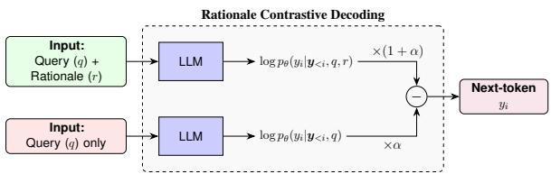
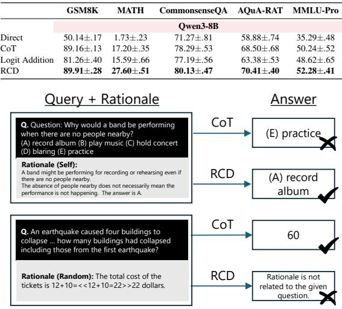
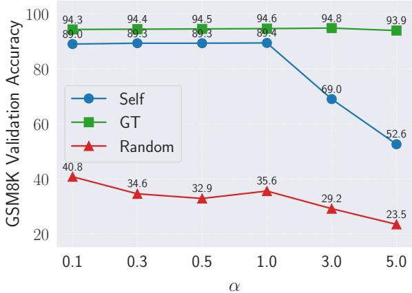

# Mitigating Query Shortcuts in Chain-of-Thought with Context-Aware Decoding

Shin’ya Yamaguchi

NTT shinya.yamaguchi@ntt.com

## Abstract

While Chain-of-Thought (CoT) prompting improves the reasoning performance of large language models (LLMs), recent studies have shown that final answers do not always depend on the generated rationales. In particular, LLMs may rely on query-specific shortcuts rather than the information provided by their reasoning steps. In this paper, we investigate whether context-aware decoding (CAD), an existing contrastive decoding method, can mitigate such shortcut behavior when applied to CoT reasoning. We study this application as Rationale Contrastive Decoding (RCD), which contrasts the next-token distributions conditioned on the query with and without its rationale, amplifying tokens whose likelihood increases due to the rationale. We provide a theoretical interpretation of this decoding rule via a KL-regularized reward-maximization objective. Experiments across five reasoning benchmarks demonstrate that RCD improves answer accuracy over standard CoT. Furthermore, intervention analyses using ground-truth and random rationales reveal that RCD increases the behavioral dependence of final answers on the rationale content. Our findings suggest that contrastive decoding offers a simple, training-free approach to mitigating query shortcuts.

## 1 Introduction

Chain-of-Thought (CoT) prompting (Wei et al., 2022; Kojima et al., 2022) has emerged as an effective inference strategy for improving the reasoning performance of Large Language Models (LLMs). By generating multiple intermediate reasoning steps, or rationales, before producing a final answer, CoT enables LLMs to solve complex problems. Beyond improving task performance, these rationales are often interpreted as explanations of the model’s predictions. However, recent studies have revealed that generated rationales do not necessarily reflect the actual decision-making process (Turpin et al., 2023; Arcuschin et al., 2025; Lewis-Lim et al., 2025). In particular, LLMs may rely on shortcut information directly from the input query, even when their rationales suggest a different conclusion. Such query-shortcut behavior weakens the behavioral dependency between rationales and final answers, raising concerns about the reliability of CoT.

Prior research has investigated this issue by rationale interventions that measure whether changes to reasoning steps affect final predictions (Lanham et al., 2023; Turpin et al., 2023) or improving rationale reliability with additional supervision or rationale selection (Paul et al., 2024; Sun et al., 2026). While these studies provide important insights, a complementary question is whether query-shortcut behavior can be mitigated directly during answer decoding, without modifying model parameters or employing external evaluators. In standard CoT decoding, the query and generated rationale are jointly provided as context for next-token prediction. However, this formulation does not explicitly distinguish the contributions of the query and the rationale, allowing the model to generate answers primarily from query-conditioned predictions.

In this work, we investigate the application of Context-Aware Decoding (CAD) (Shi et al., 2024) to mitigate query-shortcut behavior in CoT. CAD is an established contrastive decoding approach originally developed to prioritize contextual evidence over a model’s parametric knowledge. We examine whether the same principle can encourage LLMs to rely more heavily on self-generated rationales during decoding. Specifically, we study Rationale Contrastive Decoding (RCD), an application of CAD in which the context part is a CoT rationale rather than an external document. RCD contrasts the nexttoken distributions conditioned on both the query and rationale with those conditioned only on the query. By subtracting query-only logits, this decoding rule increases the relative preference for tokens supported by the rationale, potentially suppressing query-shortcut behavior without additional training. We further interpret this established decoding formulation as a KL-regularized reward-maximization objective, in which the reward is the log-density ratio between the rationale-conditioned and queryonly distributions.

We empirically investigate RCD through comprehensive experiments across multiple reasoning benchmarks. First, intervention analyses with ground-truth and randomly substituted rationales demonstrate that RCD makes final predictions more sensitive to rationale content, providing behavioral evidence of increased rationale–answer dependency. Second, RCD consistently improves answer accuracy over standard CoT across five reasoning benchmarks and multiple model families. Third, an analysis of rationale correctness reveals that the performance gains primarily stem from correcting answers that fail to follow valid rationales, rather than repairing incorrect reasoning. These findings suggest that applying contrastive decoding to CoT can mitigate query-shortcut behavior and improve the utilization of generated rationales.

## 2 Preliminary

## 2.1 Next-token Prediction in LLM

Consider an auto-regressive LLM, parameterized by $\theta .$ Given a query q, an LLM generates an output token sequence $\pmb { y } = ( y _ { 1 } , \dots , y _ { L } ) \in \mathcal { V } ^ { L }$ following:

$$
p ( \pmb { y } | \boldsymbol { q } ) = \prod _ { i = 1 } ^ { L } p _ { \theta } ( y _ { i } | \pmb { y } _ { < i } , \boldsymbol { q } ) ,\tag{1}
$$

where L is token length, V is token vocabulary, and $\mathbf { \delta } \mathbf { \mathcal { Y } } { } _ { < i }$ are preceding output tokens. $p _ { \theta } ( y _ { i } | \pmb { y } _ { < i } , q )$ over $\nu$ is computed by the softmax of the model’s output logit $\mathrm { s } _ { \theta } ( y _ { i } | \pmb { y } _ { < i } , q )$ as follows.

$$
p _ { \theta } ( y _ { i } | \pmb { y } _ { < i } , \pmb { q } ) = \sigma ( \mathrm { l o g i t s } _ { \theta } ( y _ { i } | \pmb { y } _ { < i } , \pmb { q } ) )\tag{2}
$$

$$
= { \frac { \exp ( \log \mathrm { i } \mathrm { t s } _ { \theta } ( y _ { i } | \pmb { y } _ { < i } , \boldsymbol { q } ) ) } { \sum _ { w \in \mathscr { V } } \exp ( \log \mathrm { i } \mathrm { t s } _ { \theta } ( y _ { i } = w | \pmb { y } _ { < i } , \boldsymbol { q } ) ) } } .\tag{3}
$$

Each token $y _ { i }$ is generated from $p _ { \theta } ( y _ { i } | \pmb { y } _ { < i } , q )$ via a decoding strategy such as greedy decoding and sampling. We define a function for an arbitrary decoding strategy:

$$
\begin{array} { r } { { \pmb y } = \mathrm { g e n e r a t e } _ { \theta } ( q ) . } \end{array}\tag{4}
$$

## 2.2 Chain-of-Thought (CoT)

CoT aims to enhance LLM reasoning by incorporating multi-step rationale generation during decoding (Wei et al., 2022; Kojima et al., 2022). First, LLMs generate a rationale $r$ from query $q$ with instruction prompt, e.g., Let’s think step-by-step (Kojima et al., 2022), as follows.

$$
r = \mathrm { g e n e r a t e } _ { \theta } ( q ) .\tag{5}
$$

Adding r to the input context, LLMs generate the final answer by the next-token prediction, similar to Eq. (4):

$$
\begin{array} { r } { { \pmb y } = \mathrm { g e n e r a t e } _ { \theta } ( { \pmb q } , r ) . } \end{array}\tag{6}
$$

For simplicity, we assume that the rationale and answer generation steps are separated, and that the generated rationale can be intervened by alternative rationales, e.g., ground truth.

In Eq. (6), each answer token $y _ { i }$ is decoded by the next-token distribution $p _ { \theta } ( y _ { i } | \pmb { y } _ { < i } , q , r )$ , and thus, it is not guaranteed that the output tokens are based on the rationale r, i.e., LLMs can directly answer from the query q. In fact, previous works have reported the unfaithful behavior of CoT, such as post-hoc rationalizing by biasing toward the order of multiple-choice options for the answer (Turpin et al., 2023), silent error correction, where the model implicitly fixes the computational or logical errors in the rationales due to shortcuts (Arcuschin et al., 2025). These findings indicate that standard CoT can exhibit weak or inconsistent behavioral dependence on its rationale.

## 3 Method

## 3.1 Rationale Contrastive Decoding (RCD)

We investigate whether context-aware decoding can mitigate query-shortcut behavior in CoT by increasing the influence of rationales during answer generation. To this end, we study Rationale Contrastive Decoding (RCD), which applies Context-Aware Decoding (CAD; Shi et al. (2024)) to self-generated CoT rationales rather than external contexts (Fig. 1). Following CAD, RCD instead reweights this distribution using the density ratio:

$$
\hat { p } _ { \theta } ( y _ { i } ) \propto p _ { \theta } ( y _ { i } | y _ { < i } , q , r ) \times \bigg ( \frac { p _ { \theta } ( y _ { i } | y _ { < i } , q , r ) } { p _ { \theta } ( y _ { i } | y _ { < i } , q ) } \bigg ) ^ { \alpha } ,\tag{7}
$$

where α controls the contrastive strength. During decoding, this is equivalently implemented by the

Figure 1: Overview of Rationale Contrastive Decoding (RCD), which applies context-aware decoding to CoT answer generation. Instead of standard decoding, RCD contrasts the rationale-conditioned pass and the queryonly pass to explicitly strengthen the dependency on the rationales, without any parameter updates.

logit-level computation in a batch-parallel manner:

$$
\begin{array} { r l } & { \mathrm { l o g i t s } _ { \theta } ( y _ { i } ) : = ( 1 + \alpha ) \mathrm { l o g i t s } _ { \theta } ( y _ { i } | y _ { < i } , q , r ) } \\ & { \quad \quad \quad - \alpha \mathrm { l o g i t s } _ { \theta } ( y _ { i } | y _ { < i } , q ) . } \end{array}\tag{8}
$$

For $\alpha > 0$ , the density ratio increases the relative preference for tokens whose probability rises when conditioning on the rationale. Unlike logit addition, which reinforces tokens favored by both distributions, subtraction emphasizes the information contributed by the rationale beyond the query alone as shown in Section 4. This aims to mitigate query-shortcut behavior rather than simply increase agreement with query-only predictions.

## 3.2 Theoretical Insight

Eq. (7) can be interpreted as the closed-form solution to the following KL-regularized reward maximization problem (Schulman et al., 2015, 2017):

$$
\operatorname* { m a x } _ { \pi } \mathbb { E } _ { \pi } [ R ] - \beta \mathbb { D } _ { \mathrm { K L } } [ \pi | | \pi _ { \mathrm { r e f } } ] ,\tag{9}
$$

where $\begin{array} { r } { R = \log \frac { p _ { \theta } ( y _ { i } | \pmb { y } _ { < i } , \pmb { q } , \boldsymbol { r } ) } { p _ { \theta } ( y _ { i } | \pmb { y } _ { < i } , \pmb { q } ) } } \end{array}$ is reward function, $\pi _ { \mathrm { r e f } } = p _ { \theta } ( y _ { i } | \pmb { y } _ { < i } , q , r )$ is reference policy, and $\beta$ is a hyperparameter modulating the KL-penalty term. Theorem 3.1. Sampling by Eq. (7) is equivalent to samplingfrom the optimal policy $\pi ^ { * }$ for Eq. (9).

Proof. See Appendix A.

□

Intuitively, maximizing Eq. (9) means finding the next-token distribution $\pi$ that yields a token clearly highlighting the difference from the queryonly distribution while preserving the likelihood of the original query-rationale conditional distribution. As a result, the LLM is expected to generate an answer by relying heavily on the CoT rationale $^ { r } \cdot$

## 4 Experiments

## 4.1 Settings

We used five representative reasoning-intensive benchmark datasets: GSM8K (Cobbe et al., 2021),

Table 1: Intervention Analysis with Ground-Truth (GT) and Irrelevant (Random) Rationales.
<table><tr><td></td><td>Self (↑)</td><td>GSM8K GT (↑)</td><td>Random (↓)</td></tr><tr><td></td><td></td><td>Qwen3-8B</td><td></td></tr><tr><td>Direct</td><td> $5 0 . 1 4 { \pm } . 1 7 $ </td><td></td><td></td></tr><tr><td>CoT</td><td> $8 9 . 1 6 { \pm } . 1 3 $ </td><td> $9 4 . 9 3 { \pm } . 0 4 $ </td><td>43.35±.03</td></tr><tr><td>Logit Addition</td><td> $8 1 . 2 6 { \pm } . 4 0 $ </td><td> $8 3 . 4 1 { \pm } . 6 8 $ </td><td>50.82±.72</td></tr><tr><td>RCD</td><td> $\mathbf { 8 9 . 9 1 } 2 . 2 8 $ </td><td> ${ \bf 9 5 . 8 2 \pm . 0 1 }$ </td><td> $2 7 . 7 9 2 . 0 3$ </td></tr></table>

MATH (Hendrycks et al.), CommonsenseQA (Talmor et al., 2019), AQuA-RAT (Ling et al., 2017), and MMLU-Pro (Wang et al., 2024). For LLMs, we used Qwen3 (Yang et al., 2025), Gemma3 (Team et al., 2025), and Llama-3.1 (Grattafiori et al., 2024). To examine the effect of contrastive subtraction, we additionally evaluate Logit Addition, which sums the rationale-conditioned and queryonly logits, corresponding to a Product-of-Experts combination. This baseline allows us to investigate whether subtracting query-only predictions is more effective than reinforcing them. We set $\alpha = 1$ for RCD by grid-searching on the GSM8K train subset. For sampling, we used the official default parameters (temperature: 0.7, top\_k: 20, top\_p: 0.8) for Qwen3. CoT and RCD shared the same rationales. All experiments were run three times on an NVIDIA H100 with 80 GB of VRAM.

## 4.2 Proof-of-Concept by Intervention Analysis

We conduct an intervention analysis on GSM8K by replacing the rationale r in Eq. (6) with either ground-truth (GT) or random rationales. If a decoding method sensitive to rationales, GT rationales should improve performance and irrelevant random rationales should degrade it. We use the GT rationales provided in GSM8K and construct random rationales by shuffling them across examples.

Table 1 shows the intervention results. Standard CoT improves over direct answering, but still keeps non-trivial accuracy even with random rationales, suggesting that it can often ignore the given rationale and rely on shortcut biases. In contrast, RCD achieves higher accuracy with GT rationales and substantially lower accuracy with random rationales, indicating stronger behavioral dependence on rationale content. Notably, Logit Addition degrades accuracy with both self-generated and GT rationales while retaining higher accuracy with random rationales. These contrasting results suggest that subtracting query-only logits, rather than reinforcing them, is effective in increasing rationale–answer dependency.

Table 2: Performance on Reasoning Benchmarks.
<table><tr><td></td><td>GSM8K</td><td>MATH</td><td>CommonsenseQA</td><td>AQuA-RAT</td><td>MMLU-Pro</td></tr><tr><td></td><td colspan="5">Qwen3-8B</td></tr><tr><td>Direct</td><td>50.14±.17</td><td>1.73±.23</td><td>71.27±.81</td><td>58.88±.74</td><td>35.29±.48</td></tr><tr><td>CoT</td><td>89.16±.13</td><td>17.20±.35</td><td>78.29±.53</td><td>68.50±.68</td><td>50.24±.52</td></tr><tr><td>Logit Addition</td><td>81.26±.40</td><td>15.59±.66</td><td>77.19±.56</td><td>63.38±.53</td><td>48.62±.65</td></tr><tr><td>RCD</td><td>89.91±.28</td><td>27.60±.51</td><td>80.13±.47</td><td>70.41±.40</td><td>52.28±.41</td></tr></table>

  
Figure 2: Qualitative Evaluation with Qwen3-8B. Top: Given a self-generated rationale supporting answer (A), standard CoT predicts (E), whereas RCD follows the rationale and predicts (A). Bottom: Given an irrelevant rationale randomly sampled from another question, standard CoT produces the correct answer, whereas RCD indicates that the rationale is unrelated to the query. These examples illustrate RCD’s stronger sensitivity to rationale content.

## 4.3 Multiple Reasoning Benchmarks

Table 2 shows the performance across the benchmarks. We see that RCD outperforms the standard CoT and Logit Addition for all cases. This suggests that RCD’s increasing reliance on rationales is effective, particularly for reasoning-intensive tasks. We also analyze RCD on varying α, multiple LLM backbones, and the combination with Self-Consistency in the Appendix.

## 4.4 Qualitative Analysis

Figure 2 shows examples of RCD in CoT. In the top example, CoT ignores the rationale’s conclusion, i.e., “the answer is A”, whereas RCD generates the correct answer based on the conclusion. The bottom case also highlights the RCD’s reliance: CoT generates the correct answer by ignoring the rationale, whereas RCD increased reliance and answered that it cannot draw a conclusion from it.

## 4.5 Analysis with Human Annotation

To examine how rationale correctness affects RCD, we annotated the rationales generated by Qwen3- 8B on the GSM8K test set (1,319 samples) and analyzed prediction transitions from CoT to RCD. Table 3 summarizes the results. Among 1,201 correct rationales, RCD corrects 10 of 33 CoT errors (30.30%) without corrupting any correct predictions. In contrast, among 118 incorrect rationales, RCD neither corrects any of the 110 CoT errors nor changes any of the eight correct predictions. These results indicate that RCD’s accuracy gains primarily stem from improving adherence to correct rationales, while increased reliance on incorrect rationales can occasionally be detrimental.

Table 3: Prediction Transitions from CoT to RCD
<table><tr><td>Rationale</td><td>CoT Acc.</td><td>RCD Acc.</td><td>Wrong→Correct</td><td>Correct→Wrong</td></tr><tr><td></td><td colspan="4">Qwen3-8B</td></tr><tr><td>Correct (N=1,201)</td><td>97.25</td><td>98.08</td><td>10/33 (30.30%)</td><td>0/1,168 (0.00%)</td></tr><tr><td>Incorrect (N=118)</td><td>6.78</td><td>6.78</td><td>0/110 (0.00%)</td><td>0/8 (0.00%)</td></tr></table>

## 5 Related Work

Recent studies have examined CoT faithfulness through rationale interventions (Lanham et al., 2023) and methods for measuring or improving rationale-answer alignment (Paul et al., 2024; Sun et al., 2026). These approaches primarily focus on faithfulness evaluation or require additional mechanisms (e.g., preference tuning and multiplerationale evaluations), rather than directly providing comparable answer-decoding baselines. In contrast, we investigate the application of existing Context-Aware Decoding (Shi et al., 2024) to CoT rationales, without training or external evaluators. We therefore focus on decoding baselines and separately examine compatibility with Self-Consistency (Wang et al., 2023) in Appendix H.

## 6 Conclusion

In this work, we investigated the application of context-aware contrastive decoding to mitigate query-shortcut behavior in Chain-of-Thought reasoning. By contrasting rationale-conditioned and query-only next-token distributions, Rationale Contrastive Decoding (RCD) encourages LLMs to generate answers that depend more strongly on their rationales. Our experiments demonstrate increased behavioral rationale–answer dependency and consistent accuracy improvements over standard CoT across multiple reasoning benchmarks. These findings suggest that existing contrastive decoding techniques can improve the utilization of CoT rationales without additional training or external evaluators. Nevertheless, stronger rationale dependency does not guarantee faithful reasoning, particularly when the rationales themselves are incorrect. Our study thus highlights both the potential and the limitations of decoding-level interventions for mitigating query shortcuts in CoT.

## Acknowledgment

The initial ideas for this project were developed in February 2026 in collaboration with Manami Hasegawa of Japan Women’s University, who was working as an NTT intern at the time.

## Limitations

First, although our rationale interventions show that RCD increases the behavioral dependency of final answers on the provided rationales, they do not establish that the rationales faithfully reflect the model’s internal reasoning process. In particular, changes in accuracy under ground-truth or randomly shuffled rationales measure sensitivity to rationale content but do not necessarily indicate more correct or faithful reasoning. Therefore, our findings should be interpreted as evidence of stronger rationale–answer dependency rather than a general improvement in reasoning reliability.

Second, stronger rationale dependency can be detrimental when rationales are incorrect or incomplete. Since RCD does not verify rationale correctness, it may amplify erroneous reasoning while suppressing useful information from the query-only distribution. Future work could explore adaptive contrastive weighting based on rationale quality.

We further discuss potential societal and deployment risks in Appendix B.

## References

Iván Arcuschin, Jett Janiak, Robert Krzyzanowski, Senthooran Rajamanoharan, Neel Nanda, and Arthur Conmy. 2025. Chain-of-thought reasoning in the wild is not always faithful. arXiv preprint arXiv:2503.08679.

Karl Cobbe, Vineet Kosaraju, Mohammad Bavarian, Mark Chen, Heewoo Jun, Lukasz Kaiser, Matthias Plappert, Jerry Tworek, Jacob Hilton, Reiichiro Nakano, and 1 others. 2021. Training verifiers to solve math word problems. arXiv preprint arXiv:2110.14168.

Aaron Grattafiori, Abhimanyu Dubey, Abhinav Jauhri, Abhinav Pandey, Abhishek Kadian, Ahmad Al-Dahle, Aiesha Letman, Akhil Mathur, Alan Schelten, Alex Vaughan, and 1 others. 2024. The llama 3 herd of models. arXiv preprint arXiv:2407.21783.

Dan Hendrycks, Collin Burns, Saurav Kadavath, Akul Arora, Steven Basart, Eric Tang, Dawn Song, and Jacob Steinhardt. Measuring mathematical problem solving with the math dataset. In Thirty-fifth Conference on Neural Information Processing Systems Datasets and Benchmarks Track (Round 2).

Takeshi Kojima, Shixiang Shane Gu, Machel Reid, Yutaka Matsuo, and Yusuke Iwasawa. 2022. Large language models are zero-shot reasoners. Advances in neural information processing systems.

Tamera Lanham, Anna Chen, Ansh Radhakrishnan, Benoit Steiner, Carson Denison, Danny Hernandez, Dustin Li, Esin Durmus, Evan Hubinger, Jackson Kernion, and 1 others. 2023. Measuring faithfulness in chain-of-thought reasoning. arXiv preprint arXiv:2307.13702.

Samuel Lewis-Lim, Xingwei Tan, Zhixue Zhao, and Nikolaos Aletras. 2025. Analysing chain of thought dynamics: Active guidance or unfaithful post-hoc rationalisation? In Proceedings of the 2025 Conference on Empirical Methods in Natural Language Processing, pages 29826–29841.

Wang Ling, Dani Yogatama, Chris Dyer, and Phil Blunsom. 2017. Program induction by rationale generation: Learning to solve and explain algebraic word problems. In Proceedings ofthe 55th annual meeting of the association for computational linguistics (volume 1: Long papers), pages 158–167.

Debjit Paul, Robert West, Antoine Bosselut, and Boi Faltings. 2024. Making reasoning matter: Measuring and improving faithfulness of chain-of-thought reasoning. In Findings ofthe Associationfor Computational Linguistics: EMNLP 2024, pages 15012– 15032.

Rafael Rafailov, Archit Sharma, Eric Mitchell, Christopher D Manning, Stefano Ermon, and Chelsea Finn. 2023. Direct preference optimization: Your language model is secretly a reward model. Advances in Neural Information Processing Systems.

John Schulman, Sergey Levine, Pieter Abbeel, Michael Jordan, and Philipp Moritz. 2015. Trust region policy optimization. In International conference on machine learning. PMLR.

John Schulman, Filip Wolski, Prafulla Dhariwal, Alec Radford, and Oleg Klimov. 2017. Proximal policy optimization algorithms. arXiv preprint arXiv:1707.06347.

Weijia Shi, Xiaochuang Han, Mike Lewis, Yulia Tsvetkov, Luke Zettlemoyer, and Wen-tau Yih. 2024. Trusting your evidence: Hallucinate less with contextaware decoding. In Proceedings ofthe 2024 Conference of the North American Chapter of the Association for Computational Linguistics: Human Language Technologies (Volume 2: Short Papers), pages 783–791.

Yuxi Sun, Aoqi Zuo, Haotian Xie, Wei Gao, Mingming Gong, and Jing Ma. 2026. Fact-e: Causality-inspired evaluation for trustworthy chain-of-thought reasoning. arXiv preprint arXiv:2604.10693.

Alon Talmor, Jonathan Herzig, Nicholas Lourie, and Jonathan Berant. 2019. Commonsenseqa: A question

answering challenge targeting commonsense knowledge. In Proceedings of the 2019 Conference of the North American Chapter ofthe Associationfor Computational Linguistics: Human Language Technologies, Volume 1 (Long and Short Papers), pages 4149–4158.

Gemma Team, Aishwarya Kamath, Johan Ferret, Shreya Pathak, Nino Vieillard, Ramona Merhej, Sarah Perrin, Tatiana Matejovicova, Alexandre Ramé, Morgane Rivière, and 1 others. 2025. Gemma 3 technical report. arXiv preprint arXiv:2503.19786.

Miles Turpin, Julian Michael, Ethan Perez, and Samuel Bowman. 2023. Language models don’t always say what they think: Unfaithful explanations in chain-ofthought prompting. Advances in Neural Information Processing Systems, 36:74952–74965.

Xuezhi Wang, Jason Wei, Dale Schuurmans, Quoc Le, Ed Chi, Sharan Narang, Aakanksha Chowdhery, and Denny Zhou. 2023. Self-consistency improves chain of thought reasoning in language models. In International Conference on Learning Representations.

Yubo Wang, Xueguang Ma, Ge Zhang, Yuansheng Ni, Abhranil Chandra, Shiguang Guo, Weiming Ren, Aaran Arulraj, Xuan He, Ziyan Jiang, and 1 others. 2024. Mmlu-pro: A more robust and challenging multi-task language understanding benchmark. Advances in Neural Information Processing Systems, 37:95266–95290.

Jason Wei, Xuezhi Wang, Dale Schuurmans, Maarten Bosma, Fei Xia, Ed Chi, Quoc V Le, Denny Zhou, and 1 others. 2022. Chain-of-thought prompting elicits reasoning in large language models. Advances in neural information processing systems, 35:24824– 24837.

Shin’ya Yamaguchi, Kosuke Nishida, and Daiki Chijiwa. 2026. Rationale-enhanced decoding for multi-modal chain-of-thought. In Proceedings of the IEEE/CVF Conference on Computer Vision and Pattern Recognition.

An Yang, Anfeng Li, Baosong Yang, Beichen Zhang, Binyuan Hui, Bo Zheng, Bowen Yu, Chang Gao, Chengen Huang, Chenxu Lv, and 1 others. 2025. Qwen3 technical report. arXiv preprint arXiv:2505.09388.

## A Proof of Theorem 3.1

Proof. Consider the general KL-regularized reward maximization objective (Schulman et al., 2015, 2017; Rafailov et al., 2023):

$$
\operatorname* { m a x } _ { \pi } \mathbb { E } _ { \pi } [ R ( s , a ) ] - \beta \mathbb { D } _ { \mathrm { K L } } [ \pi ( a | s ) | | \pi _ { \mathrm { r e f } } ( a | s ) ] ,\tag{10}
$$

where R is a reward function, s is a state (input context), and a is an action (output). Obviously, Eq. (9) is a special case of Eq. (10). From Appendix A.1 of Rafailov et al. (2023), the optimal policy $\pi ^ { * } ( a | s )$ for this objective is given by

$$
\pi ^ { * } ( a | s ) \propto \pi _ { \mathrm { r e f } } ( a | s ) \exp \left( \frac { 1 } { \beta } R ( s , a ) \right) .\tag{11}
$$

In the maximization of Eq. (9), given $a = y _ { i }$ and $s ~ = ~ ( y _ { i < } , q , r )$ , we can set each component in Eq. (10) as $\pi _ { \mathrm { r e f } } ( a | s ) = p _ { \theta } ( y _ { i } | y _ { < i } , q , r ) , R ( s , a ) =$ log $\frac { p _ { \theta } ( y _ { i } | \pmb { y } _ { < i } , q , r ) } { p _ { \theta } ( y _ { i } | \pmb { y } _ { < i } , q ) }$ , and $\beta = 1 / \alpha$ . Substituting them into Eq. (11) yields

$$
\begin{array} { r l } & { \pi ^ { * } ( a | s ) } \\ & { \propto p _ { \theta } ( y _ { i } | y _ { < i } , q , r ) \exp { \left( \alpha \log \frac { p _ { \theta } ( y _ { i } | y _ { < i } , q , r ) } { p _ { \theta } ( y _ { i } | y _ { < i } , q ) } \right) } } \\ & { = p _ { \theta } ( y _ { i } | y _ { < i } , q , r ) \left( \frac { p _ { \theta } ( y _ { i } | y _ { < i } , q , r ) } { p _ { \theta } ( y _ { i } | y _ { < i } , q ) } \right) ^ { \alpha } } \\ & { = \mathrm { E q . ~ } ( 7 ) . } \end{array}
$$

Therefore, sampling by Eq. (7) is indeed equivalent to sampling from the optimal policy $\pi ^ { * } ( a | s )$ for the maximization in Eq. (9). □

Note that while this theoretical framework is shared with RED (Yamaguchi et al., 2026), which multiplies the separated image-conditioned and rationale-conditioned distributions as product-ofexperts for multimodal CoT, our RCD and RED have different formalizations and objectives.

## B Potential Risks

First, RCD has potential dual-use risks. By making answers more consistent with explicit rationales, the method could be misused to produce more persuasive but misleading explanations, such as rationalized misinformation, deceptive arguments, or fabricated justifications. While our work does not target such applications, future deployment of rationale-sensitive decoding methods should consider monitoring, provenance tracking, and safeguards against persuasive misuse.

<table><tr><td>Artifact</td><td>Type</td><td>License / Terms</td></tr><tr><td>GSM8K</td><td>Dataset</td><td>MIT License</td></tr><tr><td>MATH</td><td>Dataset</td><td>MIT License</td></tr><tr><td>CommonsenseQA</td><td>Dataset</td><td>MIT License</td></tr><tr><td>AQuA-RAT</td><td>Dataset</td><td>MIT License</td></tr><tr><td>MMLU-Pro</td><td>Dataset</td><td>Apache License 2.0</td></tr><tr><td>Qwen3</td><td>Model</td><td>Apache License 2.0</td></tr><tr><td>Gemma3</td><td>Model</td><td>Gemma Terms of Use</td></tr><tr><td>Llama3.1</td><td>Model</td><td>LLAMA 3.1 Community License</td></tr></table>

Table 4: Licenses or terms of use for the public artifacts used in this work, based on their public dataset or model cards.

Second, the fairness and robustness implications of RCD remain underexplored. Our experiments focus on standard English reasoning benchmarks and do not evaluate multilingual, culturally grounded, or demographically sensitive scenarios. If the generated rationales encode social biases or culturally narrow assumptions, increasing the model’s reliance on them may reinforce biased outputs. Future work should evaluate RCD on more diverse languages, domains, and user populations before deployment in broad-facing applications.

## C Artifact Licenses and Terms of Use

We use existing public artifacts only for research evaluation. Specifically, our experiments use public reasoning benchmarks, GSM8K, MATH, CommonsenseQA, AQuA-RAT, and MMLU-Pro, and the Qwen3/Gemma3/Llama3.1 model families. We do not create, modify, or redistribute these artifacts as part of this work; we only use them to evaluate inference-time decoding methods. Table 4 summarizes the licenses or terms reported by the corresponding public artifact pages.

Our use of these artifacts is consistent with their intended research use: the datasets are used as evaluation benchmarks, and the pretrained language models are used as fixed inference backbones. We do not fine-tune the models, release model derivatives, or redistribute benchmark data. We cite the original papers and artifact pages associated with each dataset and model. Users who reproduce or extend our experiments should consult the latest official artifact pages and comply with the corresponding licenses and terms of use.

## D Use of AI Assistant

We used ChatGPT to polish the structure and grammar of the manuscript. We used Claude Code as a supporting tool for building experimental code.

## E Instruction Prompts

## Instruction for Rationale Generation

## Instruction   
For the provided question, please provide detailed step-by-step reasoning descriptions as the rationale to output the answer. Please compose your output with short and clear sentences. Output only reasoning descriptions and DO NOT output the final answer.   
## Question   
[Placeholder for Question]   
## Response

## Instruction for Answer Generation

## Instruction   
Answer the following question based on the given rationales. Please directly output answer in short. ## Rationales   
[Placeholder for Rationales]   
## Question   
[Placeholder for Question]   
## Response

## Instruction for Direct Baseline

## Instruction   
Answer the following question directly in short without reasoning steps.   
## Question   
[Placeholder for Question]   
## Response

## F Grid Search for α

For the validation dataset, we randomly extracted 1,000 samples from the training set of GSM8K. Then, we searched α from the search space of {0.1, 0.3, 0.5, 1, 3, 5}.

## F.1 Ablation Study

Effects of α. Figure 3 shows the validation performance when varying α. We observed that increasing α enhances the reliance on the rationales, but accuracy actually decreases once a certain value is exceeded. This is because if the query-only conditions in Eq. (8) are significantly reduced with larger α, the performance of the query itself also declines. Model Generality. We show the performance when varying the model size and families in Table 5. RCD stably performed on multiple models. The performance gain over CoT increases with model size, suggesting that RCD can significantly improve answer quality with stronger rationales when a model has strong reasoning capabilities.

## G Computational Analysis

RCD requires two model evaluations at each answer-decoding step. To quantify the practical cost, we measured end-to-end latency and peak VRAM on Qwen3-8B/GSM8K under the same hardware and decoding settings. Table 6 shows the results. Relative to CoT, RCD increases the observed end-to-end latency by only 1.5% and peak VRAM by 1.4% in our batch-parallel implementation. Thus, although RCD increases answer-stage model computation, its measured wall-clock and memory overhead are small in this setting.

  
Figure 3: Effects of α on GSM8K validation accuracy (%) using Qwen3-8B. We evaluate self-generated (Self), ground-truth (GT), and randomly shuffled (Random) rationales on 1,000 validation examples. Increasing (α) generally reduces accuracy with random rationales, while excessively large values degrade accuracy with self-generated rationales, illustrating the trade-off between rationale reliance and answer accuracy.

## H Compatibility with Self-Consistency

We further examine whether RCD can be combined with Self-Consistency (SC; Wang et al. (2023)), which aggregates predictions from multiple sampled rationales. Unlike SC, which improves answer selection through multiple reasoning paths, RCD modifies the answer decoding distribution conditioned on each rationale. We evaluate their combination on GSM8K using Qwen3-8B with three sampled rationales (k = 3).

Table 7 presents the results. Standard SC achieves 89.58% accuracy, whereas combining SC with RCD improves accuracy to 90.79%. Similarly, in the single-rationale setting, RCD improves standard CoT from 89.16% to 89.91%. These results suggest that RCD is complementary to multisample aggregation. Furthermore, RCD incurs only a 1.5% increase in end-to-end latency over standard CoT, indicating that its additional computational overhead is small in this setting.

## I Human Annotation

We annotated binary labels for the correctness of the generated rationales in the analysis of Sec-

Table 5: GSM8K test accuracy (%) across different model families and sizes, including Qwen3, Gemma3, and Llama-3.1. We compare direct answering (Direct), standard CoT, and RCD with $( \alpha = 1 )$ . CoT and RCD share the same generated rationales. RCD consistently improves accuracy over standard CoT across all evaluated models, demonstrating its applicability across model architectures and scales.
<table><tr><td>Model</td><td>Direct</td><td>GSM8K CoT</td><td>RCD</td></tr><tr><td>Qwen3-0.6B</td><td> $2 3 . 4 9 { \pm } . 1 1 $ </td><td> $4 7 . 4 4 \pm . 1 8 $ </td><td> ${ \bf 4 7 . 9 6 } \pm . 2 2$ </td></tr><tr><td>Qwen3-8B</td><td> $5 0 . 1 4 \pm . 1 7$ </td><td> $8 9 . 1 6 { \pm } . 1 3 $ </td><td> $\mathbf { 8 9 . 9 1 } 2 . 2 8 $ </td></tr><tr><td>Qwen3-14B</td><td> $3 8 . 3 8 { \pm } . 4 3 $ </td><td> $8 9 . 6 1 \pm . 2 2$ </td><td> $\mathbf { 9 0 . 3 1 } { \pm . 2 0 }$ </td></tr><tr><td>Qwen3-32B</td><td> $4 8 . 2 3 { \pm } . 3 7 $ </td><td> $9 1 . 3 1 { \pm } . 3 3 $ </td><td> $9 3 . 2 7 { \pm } . 2 8 $ </td></tr><tr><td>Gemma3-4B</td><td> $8 . 5 9 \pm . 0 3$ </td><td> $8 0 . 6 9 { \pm } . 1 3 $ </td><td> $\mathbf { 8 1 . 9 3 } \pm . \mathbf { 0 3 }$ </td></tr><tr><td>Gemma3-12B</td><td> $1 8 . 3 8 { \pm } . 0 7$ </td><td> $8 8 . 4 1 \pm . 2 1 $ </td><td> $\mathbf { 9 0 . 1 8 { \pm . 1 6 } }$ </td></tr><tr><td>Llama3.1-8B</td><td> $5 4 . 6 3 { \pm } . 2 0 $ </td><td> $8 4 . 3 5 { \pm } . 1 2 $ </td><td> $\mathbf { 8 5 . 5 9 \pm . 2 2 }$ </td></tr></table>

Table 6: Computational Analysis (GSM8K)
<table><tr><td>Latency (s/query)</td><td>Peak VRAM (GB)</td></tr><tr><td colspan="2">Qwen3-8B</td></tr><tr><td>Direct</td><td>1.506 15.33</td></tr><tr><td>CoT</td><td>2.823 15.64</td></tr><tr><td>RCD 2.864</td><td>15.86</td></tr></table>

tion 4.5. For each triple of query, generated rationale, and ground truth answer, we asked “Is the rationales behind this query and answer correct?” We used one annotator for this annotation process.

Table 7: Comparison with Self-Consistency (SC) on GSM8K using Qwen3-8B. k denotes the number of sampled rationales. Latency is measured end-to-end per query.
<table><tr><td>Method</td><td>k</td><td>Accuracy (%)</td><td>Latency (s/query)</td></tr><tr><td>CoT</td><td>1</td><td>89.16</td><td>2.82</td></tr><tr><td>RCD</td><td>1</td><td>89.91</td><td>2.86</td></tr><tr><td>SC</td><td>3</td><td>89.58</td><td>8.63</td></tr><tr><td> $\mathrm { S C } + \mathrm { R C D }$ </td><td>3</td><td>90.79</td><td>8.65</td></tr></table>