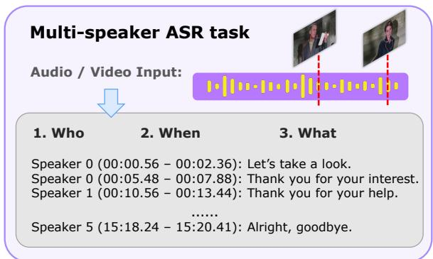
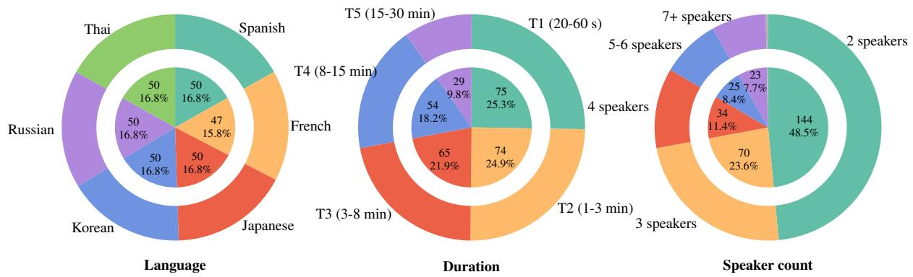
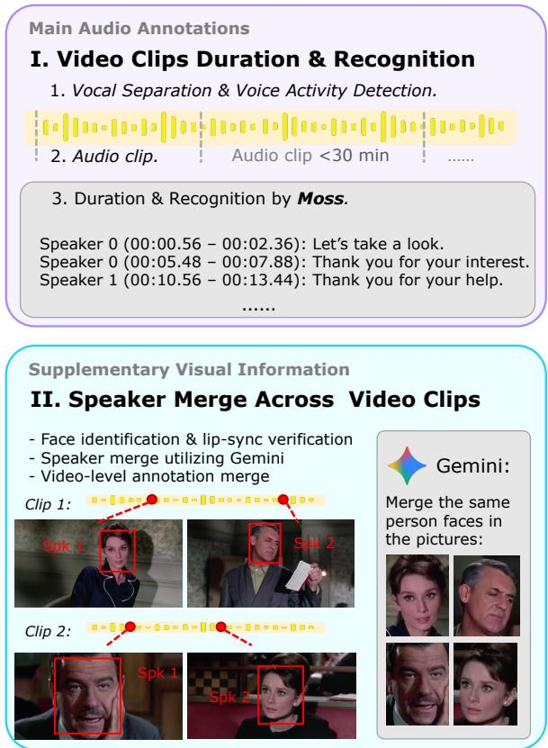
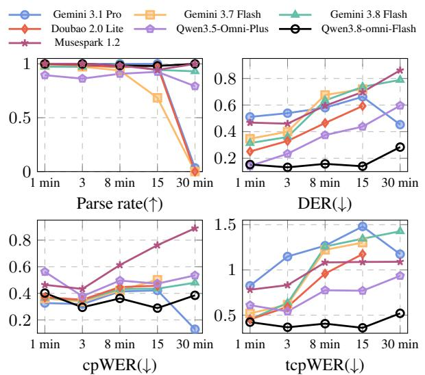
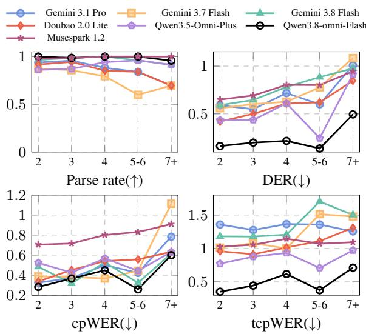
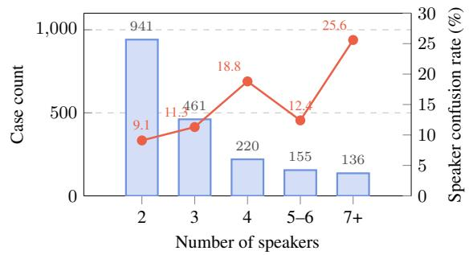
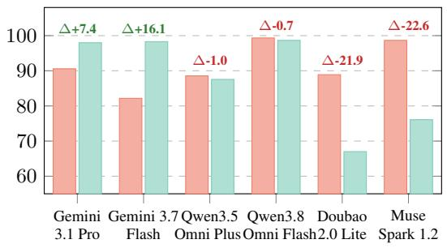
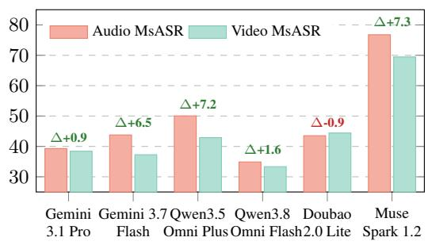
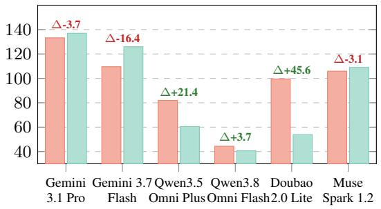
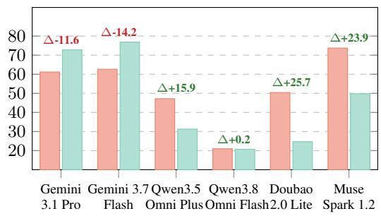

# OMNILINGUAL-MSASR: Benchmarking Multimodal, Multilingual, Long-Form Multi-Speaker ASR of Omni Large Language Models

Yuan Ge1,2, Pei Zhang2, Xize Cheng2, Lingzhou Mu2, Mingyang Wang2, Jin Xu2,   
Baosong Yang2, Shengxiang Gao3, Jingbo Zhu1,4, Zhengtao Yu3, Tong Xiao1,4\* 1 Northeastern University, China 2 Alibaba Token Hub, Alibaba 3 Kunming University of Science and Technology 4 NiuTrans Research

## Abstract

Omni-modal large language models (LLMs) have achieved remarkable progress in audio and video understanding. However, existing models struggle with long-form, multi-speaker videos, especially in understanding the entire video and recognizing who says what and when. To characterize the capability limit of current omni LLMs and guide future model development, we introduce OMNILINGUAL-MSASR, a multilingual, multimodal benchmark for long-form Multi-speaker Automatic Speech Recognition (MsASR) covering six languages, recordings up to 30 minutes, and scenarios with up to 20 speakers. OMNILINGUAL-MSASR provides parallel audio and video inputs to evaluate models’ cross-modal consistency and their ability to exploit complementary cues across modalities. Extensive evaluations of leading omni-modal LLMs reveal substantial performance bottlenecks, while their tcpWERs frequently exceed 100%. These findings highlight fine-grained temporal localization, speaker disambiguation, and cross-modal synergy as key challenges for future omni-modal foundation models 1.

## 1 Introduction

Omni large language models (LLMs) have recently achieved remarkable progress in audio understanding (Arora et al., 2025; Guo et al., 2026). Multispeaker automatic speech recognition (MsASR) reflects this ability by transcribing audio into structured text that specifies who speaks, when each utterance begins and ends, and what is said (He and Whitehill, 2025; Wang et al., 2024; Lin et al., 2025; Shi et al., 2026), as shown in Fig. 1. Such transcription grounds downstream tasks such as speech translation and voice interaction.

However, existing benchmarks fail to probe the boundary of omni LLMs’ audio-visual transcription, where videos in practice are long-form, multilingual, and multi-speaker. Traditional MsASR datasets annotate speaker identity, utterance boundaries, and transcripts, but cover only monolingual English or Chinese (Kraaij et al., 2005; Fu et al., 2021; Yu et al., 2022; Cornell et al., 2023). Multilingual dialogue benchmarks push forward language coverage, but the audio durations remain far shorter than the context-window limits of modern LLMs (Wang et al., 2021; Sinhamahapatra et al., 2026; Mu et al., 2026). Moreover, these benchmarks overlook the potential of the visual modality to aid speaker identification and transcription.

  
Figure 1: Overview of the MsASR task. The model is required to jointly predicting speaker identities (who), timestamps (when), and text transcriptions (what) in a structured format as shown in Sec. 4.2.

We introduce OMNILINGUAL-MSASR, a multimodal, multilingual, and long-form multi-speaker ASR benchmark that reflects the real audio-visual transcription capability boundary of omni LLMs. We collect publicly available videos on diverse topics spanning six languages, namely Spanish, French, Japanese, Korean, Russian, and Thai, with audio durations ranging from short clips of around 20 seconds to long videos of about 30 minutes, each containing up to 20 speakers. The MsASR annotations combine an automatic pipeline built from frontier tools with careful manual verification by experienced language experts. The resulting OMNILINGUAL-MSASR comprises roughly 50 videos per language across the six languages, totaling 297 long-form multi-speaker ASR instances.

We conduct extensive evaluations of leading omni-modal LLMs, including two open-source models and seven frontier commercial omni LLMs. Empirical results reveal that while current models achieve robust linguistic transcription, precise temporal grounding remains a major bottleneck: Gemini family omni-LLMs exhibit low cpWER (e.g., 0.23–0.44) but drastically worse tcpWER that frequently exceeds 1.0. Furthermore, model efficacy deteriorates sharply as context scales. Extending audio inputs toward 30 minutes compounds timestamp errors, and scaling speaker counts from two to over seven drives overall speaker confusion from 9.1% to 25.6%, causing Gemini 3.7 Flash’s cpWER to surge from 0.387 to 1.113. Finally, our parallel audio-video benchmark uncover divergent cross-modal integration strategies across architectures: while visual cues markedly boost temporal localization for Doubao-Seed-2.0-Lite, they act as confounding noise that degrades temporal grounding for Gemini 3.7 Flash. These findings highlight that fine-grained temporal estimation, multi-speaker disambiguation, and crossmodal synergy remain critical for future omnimodal foundation models. Our contributions are:

• We introduce OMNILINGUAL-MSASR, a multimodal, multilingual, and long-form multi-speaker ASR benchmark featuring paralleled audio and video inputs.

• We develop a reliable annotation pipeline that integrates audio and visual cues to generate high-quality pseudo-labels, followed by human refinement under standardized guidelines to ensure final data quality.

• We conduct a systematic evaluation across widely leading commercial and open-source LLMs, highlighting the current strengths and key challenges in long-form MsASR.

## 2 Related Work

## 2.1 Omni-modal Large Language Models

Recent omni-modal large language models extend text-centric LLMs toward unified perception across text, vision, audio, and video, as exemplified by GPT-4o (OpenAI, 2024), Gemini 2.5 (Comanici et al., 2025), and Qwen3.8-Omni (Team, 2026b). Their audio capabilities have been evaluated on increasingly diverse tasks, including speech recognition, audio question answering, acoustic understanding and reasoning (Yang et al., 2024; Ge et al., 2026a; S Sakshi et al., 2025; Ge et al., 2026b).

However, broad audio competence does not necessarily imply reliable speaker-aware transcription. Recent studies reveal a substantial gap between understanding what was said and identifying who said it (Wang et al., 2025; Kwon et al., 2026). By requiring models to bind linguistic content to persistent speaker identities across turns and overlaps, speaker-aware transcription provides a concrete, though not exhaustive, indicator of fine-grained conversational understanding.

## 2.2 Long-Form Video Understanding

Long-form video understanding evaluates whether models can retain, retrieve, and reason over information distributed across extended temporal contexts. EgoSchema (Mangalam et al., 2023), LongVideoBench (Wu et al., 2024), MLVU (Zhou et al., 2025), and Video-MME (Fu et al., 2025) extend video-language evaluation to minute- or hourlong inputs, with an emphasis on long-range memory, information retrieval, and temporal reasoning.

The emergence of Omni LLMs has further expanded this setting from predominantly visuallanguage inputs to joint audio-visual perception. LongVALE (Geng et al., 2025) introduces temporally grounded vision-audio-language events, while OmniVideoBench (Li et al., 2026), LVOmniBench (Tao et al., 2026) and Mula-bench (Yang et al., 2026) evaluate cross-modal reasoning over extended audio-visual contexts (Tao et al., 2026; Yang et al., 2026). However, their question-answering and event-description objectives do not capture dense speaker-aware transcription, which requires jointly preserving speech content, speaker identity, and temporal boundaries.

## 2.3 Multilingual Multi-Speaker ASR

Multi-speaker ASR aims to recover speaker attributed transcripts from conversations containing multiple, potentially overlapping speakers. Unlike conventional ASR, which determines what was said, or speaker diarization, which determines who spoke when, multi-speaker ASR must jointly resolve speech content and speaker attribution.

Meeting corpora and challenges such as AMI (Carletta et al., 2006), CHiME-6 (Watanabe et al.,

  
Figure 2: Benchmark composition of OMNILINGUAL-MSASR in three views: languages, audio duration and speaker count. For each view we shows case quantity, category labels, and necessary explanations.

2020a), Aishell-3 (Shi et al., 2021), AliMeeting (Yu et al., 2022), and NOTSOFAR-1 (Vinnikov et al., 2024) have established standard evaluation settings for multi-speaker transcription. Recent efforts such as Muscat (Sinhamahapatra et al., 2026) and MLC-SLM (Mu et al., 2026) further extend conversational speech modeling to multilingual conditions. Nevertheless, existing benchmarks remain concentrated on short-form audio, acoustic domains, or specialized sepeech systems without omni LLMs.

Multi speaker ASR methods have progressed from modular diarization, separation, and ASR pipelines to permutation-invariant and serialized end-to-end modeling (Yu et al., 2017; Kanda et al., 2020), followed by LLM-based systems such as MT-LLM and SpeakerLM (Meng et al., 2025; Yin et al., 2026). Although these systems demonstrate the feasibility of LLM-based multi-speaker transcription, existing evaluations provide only limited evidence about general-purpose omni LLMs (Kwon et al., 2026; Tawara et al., 2026). Their robustness across languages, recording durations, speaker counts, and overlap conditions therefore remains insufficiently characterized.

## 3 OMNILINGUAL-MSASR

## 3.1 Overview

In this section, we introduce OMNILINGUAL-MSASR, a multimodal, multilingual, and longform MsASR benchmark designed to probe the capability boundaries of omni LLMs in real-world audio-visual transcription. As shown in Fig. 2, OMNILINGUAL-MSASR comprises 297 instances spanning six diverse languages, with 50 instances each for Spanish, Japanese, Korean, Thai, and Russian, alongside 47 instances for French.

To assess model scalability across extended temporal contexts, instance durations range from 20 s short clips to 30 min long-form videos. Considering the sample distribution across durations, we stratify OMNILINGUAL-MSASR into five tiers partitioned by cutoffs at 1, 3, 8, and 15 minutes, as shown in the middle panel of Fig. 2.

Furthermore, speaker density serves as a critical indicator of MsASR complexity. OMNILINGUAL-MSASR scales up to 20 speakers per instance to challenge omni LLMs at their limits. To maintain balanced sample sizes across subsets, we aggregate instances into discrete categories, specifically consolidating cases with five to six speakers and those with seven or more speakers, thereby facilitating a robust evaluation of speaker identity, detailed in the right panel of Fig. 2.

Notably, OMNILINGUAL-MSASR provides parallel evaluation for both audio-only and audiovisual MsASR. For human listeners, speaker identification relies on purely acoustic signals is inherently challenging, especially under high vocal similarity. Conversely, visual information such as facial appearance provides crucial speaker cues. Through this dual-eval setup, we explore whether omni LLMs have surpassed the inflection point where visual context effectively enhances speaker identification, or redundant visual signals conversely introduce noise that impact model performance.

## 3.2 Data Source

To ensure public accessibility and reproducibility, we collected long-form video candidates ranging from 1.5 to 2 hours from YouTube, initially sourcing 10 videos per language. We then conducted manual filtering to discard videos with fewer than two speakers, as well as variety shows with excessive speech overlap, which poses significant annotation challenges. The resulting corpus consists of multilingual, multi-speaker longform videos spanning diverse domains, including meetings, podcasts, news broadcasts, TV dramas, speeches, prayers, and daily vlogs.

  
Figure 3: Overview of automatic data pipeline. The pipeline first leverages audio models to segment and annotate individual clips, followed by visual models to identify and consolidate cross-clip speaker identities into pseudo MsASR annotations of long-form videos.

## 3.3 Automatic Data Pipeline

To generate high-quality pseudo labels, our automated pipeline leverages frontier models for scalable annotation, as illustrated in Fig. 3. To annotate long-form videos that exceed model context limits, the pipeline first acoustically segments raw videos into clips, subsequently generates clip-level annotations using MOSS Transcribe Diarize 0.9B, and finally reconciles cross-clip speaker identities using complementary visual cues to form unified long-form annotations of the whole videos.

Audio-Centric Pseudo Labeling. Given the diverse acoustic noise in YouTube videos, we first apply MossFormer2\_SE for speech enhancement to improve annotation robustness. Because full-length recordings (∼2 hours) exceed the context window of MOSS Transcribe Diarize 0.9B, we segment the video streams into parallel video and audio sub-30-minute clips. To prevent bisecting utterances, we utlize Voice Activity Detection and split clips exclusively along silence intervals. Finally, each clip is processed by MOSS Transcribe Diarize 0.9B to extract multi-speaker ASR pseudo-labels, comprising speaker durations and transcriptions.

Visual-Aided Cross-Clip Identity Merging. Independently annotating individual clips introduces fragmented, local speaker IDs for the same individual across clips as shown in Fig. 3. Audio-only clustering struggles as fixed acoustic embedding thresholds fail to balance inner-speaker diversity against inter-speaker timbre similarity. Therefore, we leverage visual facial cues to globally align speaker identities. Specifically, we utilize SyncNet (Chung and Zisserman, 2016) for lip-sync verification to identify active speaking faces, and then prompt Gemini 3.1 Pro with paired local speaker IDs and face crops to resolve cross-clip identities. Then, utterance timestamps are subsequently shifted to the global timeline. To ensure balanced durations and category distributions, benchmark samples are sampled as sub-segments with potential overlap from these merged video annotations.

## 3.4 Linguistic Expert Annotation

Following the automatic data pipeline, we implemented a rigorous three-stage verification protocol: Annotation, Review, and Spot-checking.

The first two stages were conducted by linguistic experts, who verified the alignment of speaker identities, timestamps, and transcriptions against the corresponding videos. Specifically, annotators first corrected the pipeline outputs, after which an independent, disjoint pool of experts reviewed the annotations to ensure quality. In the final stage, the authors audited a randomly sampled subset. Constrained by multilingual proficiency, this check primarily focused on language-agnostic attributes, namely speaker labels and timestamps. Detailed annotation guidelines are provided in Appendix A.

## 3.5 Ethical and Privacy Audit

Following expert verification, we collected approximately 60 annotated instances per language, from which 50 instances were carefully curated to form a preliminary benchmark, prioritizing balanced temporal distribution and content diversity.

Subsequently, we conducted an ethical and privacy audit. During this stage, three French instances were found to contain Personally Identifiable Information (PII), specifically authentic social media handles and email addresses. To mitigate privacy leakage risks and adhere to ethical research standards, we removed these instances, yielding a finalized benchmark of 297 high quality samples.

## 4 Experiments

## 4.1 Experimental Setup

Baseline models. We conduct extensive evaluations of frontier omni-modal LLMs. Open-source models include task-specific MOSS Transcribe Diarize 0.9B (AI et al., 2026) and omni LLM Qwen3-Omni-30B-A3B (Xu et al., 2025). We also evaluate top-tier commercial models including Gemini 3.1 Pro, Gemini 3.7 Flash, Gemini 3.8 Flash, Qwen3.5-Omni-Plus (Team, 2026a), Qwen3.8-Omni-Flash (Team, 2026b), Muse Spark 1.2, and Doubao-Seed-2.0-Lite.

Inference hyperparameter. For all models, we retain the default inference hyperparameter settings to elicit optimal model performance. The opensource model runs on 8x A100 GPUs.

## 4.2 Evaluate Metrics

To evaluate the MsASR performance, we use four metrics: parse rate, diarization error rate (DER) (Shafey et al., 2019), concatenated minimumpermutation word error rate (cpWER) (Watanabe et al., 2020b), and time-constrained permutation WER (tcpWER) (von Neumann et al., 2023).

Parse rate measures the instruction following capability of omni LLMs. We require omni LLMs to output speaker id, timestamp, and text as follow:

Output format   
<soc>   
<sos>   
<start\_time>text<end\_time><speakerX>   
<eos>   
<sos>   
<start\_time>text<end\_time><speakerX>   
<eos>   
<eoc>

Few cases that models fail to follow the instruction or degenerate into repetitive generation, rendering their outputs unparsable. We exclude such cases from the three WER metrics, so that a few outliers with extremely high error rates do not distort the overall assessment of model capability.

DER measures who spoke when while ignoring the transcribed content, which is defined as:

$$
\mathrm { D E R } = \frac { T _ { \mathrm { m i s s } } + T _ { \mathrm { f a } } + T _ { \mathrm { c o n f } } } { T _ { \mathrm { t o t a l } } }\tag{1}
$$

where $T _ { \mathrm { m i s s } }$ is the missed-speech time, $T _ { \mathrm { f a } }$ is the false-alarm time, and $T _ { \mathrm { c o n f } }$ is the speaker-confusion time, while $T _ { \mathrm { t o t a l } }$ denotes the total reference speaking time. We use a forgiveness collar of 0.5 s around each reference boundary in DER.

cpWER jointly scores transcription and speaker attribution while ignoring the timestamps:

$$
\mathrm { c p W E R } = { \frac { S + D + I } { N } }\tag{2}
$$

where S, D, and I are the total numbers of substituted, deleted, and inserted words summed over all speakers under the speaker pairing that minimizes the total edit distance between the per-speaker concatenated transcripts, and N is the total number of reference words.

tcpWER augments cpWER by allowing a reference and hypothesis word to be aligned only when their timestamps are close, so temporally misplaced words are penalized even if the text is correct:

$$
\mathrm { c p W E R } = \frac { S _ { \tau } + D _ { \tau } + I _ { \tau } } { N }\tag{3}
$$

where $S _ { \tau } , D _ { \tau }$ , and $I _ { \tau }$ are the substituted, deleted, and inserted word counts obtained when only words whose timestamps lie within the collar $\tau$ are allowed to be aligned, and N is the total number of reference words as above. We use a temporal collar of $\tau = 5$ s in tcpWER.

## 5 Results and Deep Analysis

## 5.1 Main Results

In this section, we present the main evaluation results of frontier omni-LLMs across six languages on OMNILINGUAL-MSASR. First, output parsing rates reveal disparities in multilingual instruction following. While most commercial models achieve consistently high parse rates, notable degradations occur with Gemini 3.7 Flash on fr and ko, as well as Qwen3.5-Omni-Plus on es, both falling below 80%. This highlights the uneven multilingual instruction-following capability in omni LLMs.

<table><tr><td rowspan="2">Model</td><td colspan="4">es</td><td colspan="4">fr</td><td colspan="4">ja</td></tr><tr><td>Parse</td><td>DER</td><td>cpWER</td><td>tcpWER</td><td>Parse</td><td>DER</td><td>cpWER</td><td>tcpWER</td><td>Parse</td><td>DER</td><td>cpWER</td><td>tcpWER</td></tr><tr><td colspan="9">I. Frontier Commercial Omni-Modal Large Language Models</td><td></td><td></td><td></td><td></td></tr><tr><td>gemini 3.1 pro</td><td>90</td><td>0.628</td><td>0.257</td><td>1.385</td><td>88</td><td>0.567</td><td>0.373</td><td>1.248</td><td>90</td><td>0.599</td><td>0.423</td><td>1.311</td></tr><tr><td>gemini 3.7 flash</td><td>84</td><td>0.516</td><td>0.294</td><td>0.921</td><td>76</td><td>0.637</td><td>0.348</td><td>1.050</td><td>88</td><td>0.565</td><td>0.410</td><td>0.987</td></tr><tr><td>gemini 3.8 flash</td><td>98</td><td>0.590</td><td>0.230</td><td>1.079</td><td>98</td><td>0.738</td><td>0.440</td><td>1.322</td><td>96</td><td>0.677</td><td>0.441</td><td>1.325</td></tr><tr><td>qwen3.5-omni-plus</td><td>76</td><td>0.383</td><td>0.395</td><td>0.864</td><td>84</td><td>0.360</td><td>0.439</td><td>0.799</td><td>94</td><td>0.464</td><td>0.577</td><td>0.873</td></tr><tr><td>qwen3.8-omni-flash</td><td>100</td><td>0.160</td><td>0.267</td><td>0.344</td><td>100</td><td>0.178</td><td>0.362</td><td>0.453</td><td>98</td><td>0.085</td><td>0.329</td><td>0.360</td></tr><tr><td>muse spark 1.2</td><td>100</td><td>0.696</td><td>0.678</td><td>1.038</td><td>98</td><td>0.779</td><td>0.782</td><td>1.090</td><td>100</td><td>0.757</td><td>0.804</td><td>1.034</td></tr><tr><td>doubao-seed-2.0-lite</td><td>86</td><td>0.390</td><td>0.288</td><td>0.865</td><td>90</td><td>0.532</td><td>0.437</td><td>1.041</td><td>90</td><td>0.447</td><td>0.424</td><td>0.990</td></tr><tr><td colspan="9">II. Open Source Omni-Modal Large Language Model</td><td></td><td></td><td></td></tr><tr><td>qwen3-omni-30b-thinking</td><td>80</td><td>0.532</td><td>0.469</td><td>0.996</td><td>77</td><td>0.694</td><td>0.672</td><td>1.251</td><td>74</td><td>0.561</td><td>0.597</td><td>1.058</td></tr><tr><td>III. Expert Diarization Model</td><td></td><td></td><td></td><td>0.213</td><td>100</td><td>0.187</td><td>0.348</td><td></td><td></td><td></td><td></td><td></td></tr><tr><td colspan="9">moss-transcribe-diarize 100 0.115 0.206</td><td colspan="4">100 0.059 0.273 0.276</td></tr><tr><td>Model</td><td></td><td></td><td>ko</td><td></td><td></td><td></td><td>ru</td><td></td><td></td><td></td><td>th</td><td></td></tr><tr><td colspan="9">Parse DER cpWER tcpWER Parse DER cpWER</td><td>Parse DER</td><td>cpWER</td><td>tcpWER</td></tr><tr><td>I. Frontier Commercial Omni-Modal Large Language Models</td><td></td><td></td><td></td><td></td><td></td><td></td><td></td><td></td><td></td><td></td><td></td><td></td></tr><tr><td>gemini 3.1 pro</td><td>92</td><td>0.589</td><td>0.302</td><td>1.275</td><td>90</td><td>0.567</td><td>0.436</td><td>1.344</td><td>90</td><td>0.806</td><td>1.352</td><td>1.828</td></tr><tr><td>gemini 3.7 flash</td><td>70</td><td>0.662</td><td>0.315</td><td>1.044</td><td>86</td><td>0.737</td><td>0.453</td><td>1.230</td><td>88</td><td>0.684</td><td>1.654</td><td>2.099</td></tr><tr><td>gemini 3.8 flash</td><td>94</td><td>0.697</td><td>0.317</td><td>1.185</td><td>100</td><td>0.662</td><td>0.402</td><td>1.189</td><td>96</td><td>1.059</td><td>2.457</td><td>2.988</td></tr><tr><td>qwen3.5-omni-plus</td><td>96</td><td>0.634</td><td>0.611</td><td>0.887</td><td>90</td><td>0.305</td><td>0.388</td><td>0.676</td><td>90</td><td>0.855</td><td>1.217</td><td>1.432</td></tr><tr><td>qwen3.8-omni-flash</td><td>100</td><td>0.171</td><td>0.277</td><td>0.405</td><td>100</td><td>0.185</td><td>0.305</td><td>0.491</td><td>98</td><td>0.682</td><td>1.323</td><td>1.412</td></tr><tr><td>muse spark 1.2 doubao-seed-2.0-lite</td><td>96 88</td><td>0.763 0.517</td><td>0.807 0.467</td><td>1.066 0.952</td><td>100 90</td><td>0.722 0.575</td><td>0.780 0.466</td><td>1.040 1.042</td><td>98</td><td>0.732</td><td>0.995</td><td>1.117</td></tr><tr><td colspan="9"></td><td>88 0.619</td><td>1.011</td><td>1.306</td></tr><tr><td>II. Open Source Omni-Modal Large Language Model</td><td></td><td></td><td></td><td></td><td></td><td></td><td></td><td>1.452</td><td></td><td></td><td></td><td></td></tr><tr><td colspan="9">qwen3-omni-30b-thinking 82 0.826 0.673 1.280 82 0.661 0.769</td><td>58 0.804</td><td>1.081</td><td>1.230</td></tr><tr><td>III. Expert Diarization Model</td><td></td><td></td><td></td><td>0.202</td><td>100</td><td>0.163</td><td>0.271</td><td>0.298</td><td></td><td></td><td></td><td></td></tr><tr><td colspan="9">moss-transcribe-diarize 96 0.091 0.197</td><td>100 0.420</td><td>0.841</td><td>0.929</td><td></td></tr></table>

Table 1: Multi-speaker ASR results of six languages: Spanish (es), French (fr), Japanese (ja), Korean (ko), Russian (ru), and Thai (th). Parse(%) is the format parse rate of model output. Lower is better for three multi-speaker speech recognition metrics: DER(↓), cpWER(↓), and tcpWER(↓).

Second, current models excel at transcription but struggle with temporal alignment. Across es, fr, ja, ko, and ru, cpWER is consistently and substantially lower than both DER and tcpWER for the Gemini, Muse Spark, and Doubao series. This indicates that while these models can differentiate speakers and transcribe linguistic content, they lack the capability to precisely estimate time boundaries. In contrast, the Qwen series significantly outperforms other models on DER, demonstrating a clear advantage in speech duration.

Third, Thai presents unique acoustic challenges. Performance on Thai is markedly inferior across all evaluated models. We attribute this to intrinsic video difficulty: human inspection reveals higher timbre similarity among Thai speakers, which considerably complicates speaker identification.

Fourth, frontier commercial omni-LLMs substantially outperform their open-source counterparts and approach specialized diarization models. Notably, Qwen3-Omni-30B falls markedly behind the best commercial results. Furthermore, while general-purpose omni-LLMs are comparable to the task-specific MOSS-Transcribe-Diarize-0.9B, MOSS still retains a clear lead over nearly all competing models in all languages.

Overall, MOSS-Transcribe-Diarize-7B and Qwen3.8-Omni-Flash delivers the strongest overall performance on OMNILINGUAL-MSASR benchmark, consistently ranking in the top three across virtually all evaluation metrics.

## 5.2 Analysis of Audio Duration

Analysis of DER components. While our primary results show that current models excel at transcription, they struggle with temporal alignment. To determine whether the high DER stems from speaker misidentification or imprecise timestamp prediction, we dissect DER into its three components as described in Eq. 1: missed speech $T _ { \mathrm { m i s s } } .$ false alarm $T _ { \mathrm { f a } }$ , and speaker confusion $T _ { \mathrm { c o n f } } .$ . Averaged across seven models, missed speech constitutes the majority 31.7% of the overall 54.4% DER, whereas false alarm and speaker confusion account for only 10.2% and 12.5%, respectively. This further confirms that the bottleneck of current models lies primarily in accurate timestamp prediction rather than speaker discrimination.

  
Figure 4: Performance across audio durations on OMNILINGUAL-MSASR. Omni LLMs performance generally degrade as audio duration increase. Audio duration categories detalied at Fig. 2.

Model performance with longer audio duration. Long-form audio understanding remains a key challenge for omni LLMs. In this section, we investigate their MsASR performance across varying audio lengths. Specifically, OMNILINGUAL-MSASR spans audio durations from 20 seconds to 30 minutes, partitioned into five duration buckets, as detailed in middle sub-figure of Fig 2.

As illustrated in Fig. 4, model performance generally degrades as audio duration increases. Notably, Doubao-Seed-2.0-Lite and Gemini 3.7 Flash exhibit a marked drop in parseability rate within the 15–30 minute range. Furthermore, the time-sensitive metrics DER and tcpWER consistently deteriorate on longer inputs, whereas this trend is far less pronounced for cpWER. This disparity indicates that temporal perception errors in omni LLMs compound over extended contexts, leading to degraded timestamp accuracy.

  
Figure 5: Performance across speaker counts on OMNILINGUAL-MSASR. Omni LLM performance generally degrades with increasing speaker numbers.

  
Figure 6: Analysis of speaker identification. Blue bars represents the quantity of cases per category, and the red line gives the speaker confusion rate.

## 5.3 Analysis of Speaker Number

Disentangling multiple speakers remains a nontrivial challenge for omni-LLMs. In this section, we investigate the impact of speaker count on MsASR performance. While OMNILINGUAL-MSASR contains up to 20 speakers, we partition the speaker counts into five categories as shown on right side of Fig 2, and exclude a single-speaker outlier to maintain a balanced sample distribution.

As illustrated in Fig. 5, the parse rates of omni LLMs remain largely stable, suggesting that their instruction-following capability does not degrade with acoustic complexity. However, metrics factoring in speaker identification (DER, cpWER, and tcpWER) deteriorate substantially as the number of speakers grows. Notably, the cpWER of Gemini 3.7 Flash surges from 0.387 with two speakers to 1.113 in the most crowded setting.

(a) Parse Rate (%) ↑  
  
(c) tcpWER (%) ↓

(b) cpWER (%) ↓  

(d) DER (%) ↓  
  
Figure 7: Comparison between audio and video MsASR, where $\Delta$ represents the advantage of visual modality.

Fig. 6 further reports the speaker confusion rate:

$$
\mathrm { S C R } = { \frac { T _ { \mathrm { c o n f } } } { T _ { \mathrm { t o t a l } } } }\tag{4}
$$

Experimental results reveal a pronounced upward trajectory despite a slight fluctuation at five speakers. These findings highlight that robust speaker identification in multi-speaker scenarios remains an open challenge for omni-modal LLMs.

## 5.4 Multi-speaker Video ASR

Prior benchmarks predominantly overlook the visual modality’s potential to facilitate speaker identification and transcription. Human perception naturally integrates visual and acoustic cues: listeners direct their gaze toward the sound source to disambiguate speakers under acoustic ambiguity. Motivated by this, OMNILINGUAL-MSASR establish a parallel evaluation comparing audio-only and audio-visual (video) MsASR. We investigate whether current omni-modal LLMs have passed the inflection point where visual context effectively enhances MsASR, or whether redundant visual signals conversely introduce confounding noise.

As illustrated in Fig. 7, the visual modality does not consistently benefit MsASR. In terms of parsing rate, neither modality exhibits a uniform advantage: the Qwen family shows near-identical adherence across settings, the Gemini family yields higher parsing rates with video inputs, whereas other models perform better with audio. This discrepancy reflects a latent modality gap and highlights divergent cross-modal alignment strategies across models. Notably, Qwen3.8-omni-flash demonstrates high cross-modal consistency across both settings. Intriguingly, while Doubao-seed-2.0-lite achieves comparable cpWER between modalities, its video MsASR substantially outperforms the audio counterpart in tcpWER and DER, indicating that visual cues significantly aid Doubao’s temporal boundary and timestamp prediction. Conversely, Gemini-3.7 exhibits an inverted trend: video context improves cpWER but degrades tcpWER and DER, suggesting that visual signals hinder Gemini’s temporal grounding capabilities. Further DER analysis shows that video inputs aid speech activity detection, reducing the speaker miss rate by 0.15, while failing to improve speaker discrimination, resulting in a 0.014 increase in speaker confusion.

Experimental findings of this paper highlight fine-grained temporal localization, speaker disambiguation, and cross-modal synergy as key challenges for future omni-modal foundation models.

## 6 Conclusions

We present OMNILINGUAL-MSASR, a multimodal, multilingual, and long-form benchmark for multi-speaker ASR of omni LLMs. It comprises 297 instances with parallel audio and video inputs across six languages. Further, we conduct extensive experiments on frontier omni LLMs, revealing that temporal grounding and speaker disambiguation remain key bottlenecks. We hope OMNILINGUAL-MSASR will facilitate progress in temporal grounding, speaker disambiguation, and audio-visual integration for omni-modal LLMs.

## Limitations

The pseudo-labels of OMNILINGUAL-MSASR are generated by MOSS Transcribe Diarize and Gemini 3.1 Pro, and we notice that timestamps are corrected during expert verification only when obvious errors are found. This may bias the evaluation in favor of MOSS Transcribe Diarize, particularly on time-sensitive metrics. Additionally, inference with commercial APIs is stochastic, so the exact reproducibility of the OMNILINGUAL-MSASR benchmark results cannot be guaranteed.

## Ethical Considerations

Data source and release. All videos are publicly available on YouTube, and OMNILINGUAL-MSASR is released for non-commercial research only, in accordance with the platform’s terms of service. Speaker labels are anonymous indices local to each video and are not linked to real-world identities. We will remove any instance upon request from the content owner or a depicted individual.

Privacy. Facial cues are used only to link speakers within the same video during annotation, and face crops are not part of the released benchmark. A dedicated privacy audit identified three French instances containing personally identifiable information, namely real social media handles and email addresses, and these instances were removed.

Annotators. The verification was carried out by professional linguistic experts who were informed of the research purpose and fairly compensated through the company. No personal information about annotators was collected.

Potential misuse. Speaker-attributed transcription of long-form video could be misused for surveillance or for profiling individuals. OMNILINGUAL-MSASR is designed solely to evaluate model capabilities, and we discourage its use for identifying or tracking specific people.

## References

MOSI AI, Donghua Yu, Zhengyuan Lin, Hanfu Chen, Chen Yang, Yiyang Zhang, Jingqi Chen, Ke Chen, Liwei Fan, Yi Jiang, et al. 2026. Moss transcribe diarize technical report. arXiv preprint arXiv:2601.01554.

Siddhant Arora, Kai Wei Chang, Chung Ming Chien, Yifan Peng, Haibin Wu, Yossi Adi, Emmanuel Dupoux, Hung Yi Lee, Karen Livescu, and Shinji Watanabe. 2025. On the landscape of spoken language models: A comprehensive survey. Transactions on Machine Learning Research.

Jean Carletta, Simone Ashby, Sebastien Bourban, Mike Flynn, Mael Guillemot, Thomas Hain, Jaroslav Kadlec, Vasilis Karaiskos, Wessel Kraaij, Melissa Kronenthal, Guillaume Lathoud, Mike Lincoln, Agnes Lisowska, Iain McCowan, Wilfried Post, Dennis Reidsma, and Pierre Wellner. 2006. The AMI meeting corpus: A pre-announcement. In Machine Learning for Multimodal Interaction, pages 28–39. Springer.

J. S. Chung and A. Zisserman. 2016. Out of time: automated lip sync in the wild. In Workshop on Multiview Lip-reading, ACCV.

Gheorghe Comanici, Eric Bieber, Mike Schaekermann, Ice Pasupat, Noveen Sachdeva, Inderjit Dhillon, Marcel Blistein, Ori Ram, Dan Zhang, Evan Rosen, et al. 2025. Gemini 2.5: Pushing the frontier with advanced reasoning, multimodality, long context, and next generation agentic capabilities. arXiv preprint arXiv:2507.06261.

Samuele Cornell, Matthew S Wiesner, Shinji Watanabe, Desh Raj, Xuankai Chang, Paola Garcia, Yoshiki Masuyam, Zhong-Qiu Wang, Stefano Squartini, and Sanjeev Khudanpur. 2023. The chime-7 dasr challenge: Distant meeting transcription with multiple devices in diverse scenarios. In Proc. CHiME 2023, pages 1–6.

Chaoyou Fu, Yuhan Dai, Yongdong Luo, Lei Li, Shuhuai Ren, Renrui Zhang, Zihan Wang, Chenyu Zhou, Yunhang Shen, Mengdan Zhang, Peixian Chen, Yanwei Li, Shaohui Lin, Sirui Zhao, Ke Li, Tong Xu, Xiawu Zheng, Enhong Chen, Caifeng Shan, and 2 others. 2025. Video-MME: The first-ever comprehensive evaluation benchmark of multi-modal LLMs in video analysis. In Proceedings ofthe IEEE/CVF Conference on Computer Vision and Pattern Recognition, pages 24108–24118.

Yihui Fu, Luyao Cheng, Shubo Lv, Yukai Jv, Yuxiang Kong, Zhuo Chen, Yanxin Hu, Lei Xie, Jian Wu, Hui Bu, et al. 2021. Aishell-4: An open source dataset for speech enhancement, separation, recognition and speaker diarization in conference scenario. In Proc. Interspeech 2021, pages 3665–3669.

Yuan Ge, Junxiang Zhang, Xiaoqian Liu, Bei Li, Xiangnan Ma, Chenglong Wang, Kaiyang Ye, Yangfan Du, Linfeng Zhang, Yuxin Huang, Tong Xiao, Zhengtao Yu, and Jingbo Zhu. 2026a. Sagelm: A multi-aspect

and explainable large language model for speech judgement. Proceedings of the AAAI Conference on Artificial Intelligence, 40(36):30807–30815.

Yuan Ge, Haishu Zhao, AoKai Hao, Junxiang Zhang, Bei Li, Xiaoqian Liu, Chenglong Wang, Jianjin Wang, Bingsen Zhou, Bingyu Liu, JingBo Zhu, Zhengtao Yu, and Tong Xiao. 2026b. On the emotion understanding of synthesized speech. In Proceedings ofthe 64th Annual Meeting ofthe Associationfor Computational Linguistics (Volume 1: Long Papers), pages 8209–8223, San Diego, California, United States. Association for Computational Linguistics.

Tiantian Geng, Jinrui Zhang, Qingni Wang, Teng Wang, Jinming Duan, and Feng Zheng. 2025. Long-VALE: Vision-audio-language-event benchmark towards time-aware omni-modal perception of long videos. In Proceedings of the IEEE/CVF Conference on Computer Vision and Pattern Recognition, pages 18959–18969.

Zhihan Guo, Wenqian Cui, Guan-Ting Lin, Daxin Tan, Jingyao Li, Qiyong Zheng, Dingdong Wang, Jing Xiong, Han Shi, Jiaya Jia, et al. 2026. A survey of audio reasoning in multimodal foundation models. arXiv preprint arXiv:2605.21008.

Xinlu He and Jacob Whitehill. 2025. Survey of endto-end multi-speaker automatic speech recognition for monaural audio. Computer Speech & Language, page 101925.

Naoyuki Kanda, Yashesh Gaur, Xiaofei Wang, Zhong Meng, and Takuya Yoshioka. 2020. Serialized output training for end-to-end overlapped speech recognition. In Proceedings of Interspeech, pages 2797– 2801.

Wessel Kraaij, Thomas Hain, Mike Lincoln, and Wilfried Post. 2005. The ami meeting corpus. In Proc. International Conference on Methods and Techniques in Behavioral Research, pages 1–4.

Yejin Kwon, Taewoo Kang, Hyunsoo Yoon, and Chang Ouk Kim. 2026. M3-SLU: Evaluating speaker-attributed reasoning in multimodal large language models. In Proceedings ofthe Fifteenth Language Resources and Evaluation Conference, pages 5722–5736. ELRA Language Resource Association.

Caorui Li, Yu Chen, Yiyan Ji, Jin Xu, Zhenyu Cui, Shihao Li, Yuanxing Zhang, Zhenghao Song, Dingling Zhang, Ying He, et al. 2026. Omnivideobench: Towards audio-visual understanding evaluation for omni mllms. In International Conference on Learning Representations, volume 2026, pages 138214– 138236.

Yuke Lin, Ming Cheng, Ze Li, Beilong Tang, and Ming Li. 2025. Diarization-aware multi-speaker automatic speech recognition via large language models. arXiv preprint arXiv:2506.05796.

Karttikeya Mangalam, Raiymbek Akshulakov, and Jitendra Malik. 2023. EgoSchema: A diagnostic benchmark for very long-form video language understanding. In Advances in Neural Information Processing Systems, volume 36.

Lingwei Meng, Shujie Hu, Jiawen Kang, Zhaoqing Li, Yuejiao Wang, Wenxuan Wu, Xixin Wu, Xunying Liu, and Helen Meng. 2025. Large language model can transcribe speech in multi-talker scenarios with versatile instructions. In IEEE International Conference on Acoustics, Speech and Signal Processing.

Bingshen Mu, Pengcheng Guo, Zhaokai Sun, Shuai Wang, Hexin Liu, Mingchen Shao, Lei Xie, Eng Siong Chng, Longshuai Xiao, Qiangze Feng, et al. 2026. Summary on the multilingual conversational speech language model challenge: Datasets, tasks, baselines, and methods. In ICASSP 2026- 2026 IEEE International Conference on Acoustics, Speech and Signal Processing (ICASSP), pages 19442–19446. IEEE.

OpenAI. 2024. GPT-4o system card. arXiv preprint arXiv:2410.21276.

S Sakshi, Utkarsh Tyagi, Sonal Kumar, Ashish Seth, Ramaneswaran Selvakumar, Oriol Nieto, Ramani Duraiswami, Sreyan Ghosh, and Dinesh Manocha. 2025. MMAU: A massive multi-task audio understanding and reasoning benchmark. In International Conference on Learning Representations.

Laurent El Shafey, Hagen Soltau, and Izhak Shafran. 2019. Joint speech recognition and speaker diarization via sequence transduction. In Proc. Interspeech 2019, pages 396–400.

Xian Shi, Xiong Wang, Zhifang Guo, Yongqi Wang, Pei Zhang, Xinyu Zhang, Zishan Guo, Hongkun Hao, Yu Xi, Baosong Yang, et al. 2026. Qwen3-asr technical report. arXiv preprint arXiv:2601.21337.

Yao Shi, Hui Bu, Xin Xu, Shaoji Zhang, and Ming Li. 2021. Aishell-3: A multi-speaker mandarin tts corpus. In Proc. Interspeech 2021, pages 2756–2760.

Supriti Sinhamahapatra, Thai-Binh Nguyen, Yigit O ˘ guz,˘ Enes Ugan, Jan Niehues, and Alexander Waibel. 2026. Muscat: Multilingual, scientific conversation benchmark. arXiv preprint arXiv:2604.15929.

Keda Tao, Yuhua Zheng, Jia Xu, Wenjie Du, Kele Shao, Hesong Wang, Xueyi Chen, Xin Jin, Junhan Zhu, Bohan Yu, Weiqiang Wang, Jian Liu, Can Qin, Yulun Zhang, Ming-Hsuan Yang, and Huan Wang. 2026. LVOmniBench: Pioneering long audio-video understanding evaluation for omnimodal LLMs. arXiv preprint arXiv:2603.19217.

Naohiro Tawara, Samuele Cornell, Alexander Polok, Marc Delcroix, Lukáš Burget, and Shinji Watanabe. 2026. Who spoke what when? evaluating spoken language models for conversational ASR with semantic and overlap-aware metrics. arXiv preprint arXiv:2603.22709.

Qwen Team. 2026a. Qwen3. 5-omni technical report. arXiv preprint arXiv:2604.15804.

Qwen Team. 2026b. Qwen3. 8-omni: Towards native omni-modal agents. arXiv preprint arXiv:2609.25611.

Alon Vinnikov, Amir Ivry, Aviv Hurvitz, Igor Abramovski, Sharon Koubi, Ilya Gurvich, Shai Peer, Xiong Xiao, Benjamin Martinez Elizalde, Naoyuki Kanda, Xiaofei Wang, Shalev Shaer, Stav Yagev, Yossi Asher, Sunit Sivasankaran, Yifan Gong, Min Tang, Huaming Wang, and Eyal Krupka. 2024. NOTSOFAR-1 challenge: New datasets, baseline, and tasks for distant meeting transcription. In Proceedings ofInterspeech, pages 5003–5007.

Thilo von Neumann, Christoph Boeddeker, Marc Delcroix, and Reinhold Haeb-Umbach. 2023. Meeteval: A toolkit for computation of word error rates for meeting transcription systems. In Proc. CHiME 2023, pages 27–32.

Changhan Wang, Morgane Riviere, Ann Lee, Anne Wu, Chaitanya Talnikar, Daniel Haziza, Mary Williamson, Juan Pino, and Emmanuel Dupoux. 2021. Voxpopuli: A large-scale multilingual speech corpus for representation learning, semi-supervised learning and interpretation. In Proceedings of the 59th Annual Meeting of the Association for Computational Linguistics and the 11th International Joint Conference on Natural Language Processing (Volume 1: Long Papers), pages 993–1003.

Quan Wang, Yiling Huang, Guanlong Zhao, Evan Clark, Wei Xia, and Hank Liao. 2024. Diarizationlm: Speaker diarization post-processing with large language models. In Proc. Interspeech 2024, pages 3754–3758.

Shuai Wang, Zhaokai Sun, Zhennan Lin, Chengyou Wang, Zhou Pan, and Lei Xie. 2025. MSU-Bench: Towards understanding the conversational multitalker scenarios. arXiv preprint arXiv:2508.08155.

Shinji Watanabe, Michael Mandel, Jon Barker, Emmanuel Vincent, Ashish Arora, Xuankai Chang, Sanjeev Khudanpur, Vimal Manohar, Daniel Povey, Desh Raj, David Snyder, Aswin Shanmugam Subramanian, Jan Trmal, Bar Ben Yair, Christoph Boeddeker, Zhaoheng Ni, Yusuke Fujita, Shota Horiguchi, Naoyuki Kanda, and 2 others. 2020a. CHiME-6 challenge: Tackling multispeaker speech recognition for unsegmented recordings. In 6th International Workshop on Speech Processing in Everyday Environments, pages 1–7.

Shinji Watanabe, Michael Mandel, Jon Barker, Emmanuel Vincent, Ashish Arora, Xuankai Chang, Sanjeev Khudanpur, Vimal Manohar, Daniel Povey, Desh Raj, et al. 2020b. Chime-6 challenge: Tackling multispeaker speech recognition for unsegmented recordings. In Proc. CHiME 2020, pages 1–7.

Haoning Wu, Dongxu Li, Bei Chen, and Junnan Li. 2024. LongVideoBench: A benchmark for longcontext interleaved video-language understanding. In Advances in Neural Information Processing Systems, volume 37.

Jin Xu, Zhifang Guo, Hangrui Hu, Yunfei Chu, Xiong Wang, Jinzheng He, Yuxuan Wang, Xian Shi, Ting He, Xinfa Zhu, et al. 2025. Qwen3-omni technical report. arXiv preprint arXiv:2509.17765.

Qian Yang, Jin Xu, Wenrui Liu, Yunfei Chu, Ziyue Jiang, Xiaohuan Zhou, Yichong Leng, Yuanjun Lv, Zhou Zhao, Chang Zhou, and Jingren Zhou. 2024. AIR-bench: Benchmarking large audio-language models via generative comprehension. In Proceedings of the 62nd Annual Meeting of the Association for Computational Linguistics, pages 1979–1998.

Zeyu Yang, Xinyu Zhang, Zibo Bi, Pei Zhang, Xize Cheng, Jin Xu, Baosong Yang, and Satoshi Nakamura. 2026. Mula-bench: A multilingual long-form audio understanding benchmark via multi-tier auditing. arXiv preprint arXiv:2609.23416.

Han Yin, Yafeng Chen, Chong Deng, Luyao Cheng, Hui Wang, Chao-Hong Tan, Qian Chen, Wen Wang, and Xiangang Li. 2026. SpeakerLM: End-to-end versatile speaker diarization and recognition with multimodal large language models. In Proceedings ofthe AAAI Conference on Artificial Intelligence.

Dong Yu, Morten Kolbæk, Zheng-Hua Tan, and Jesper Jensen. 2017. Permutation invariant training of deep models for speaker-independent multi-talker speech separation. In IEEE International Conference on Acoustics, Speech and Signal Processing, pages 241– 245.

Fan Yu, Shiliang Zhang, Yihui Fu, Lei Xie, Siqi Zheng, Zhihao Du, Weilong Huang, Pengcheng Guo, Zhijie Yan, Bin Ma, et al. 2022. M2met: The icassp 2022 multi-channel multi-party meeting transcription challenge. In ICASSP 2022-2022 IEEE International Conference on Acoustics, Speech and Signal Processing (ICASSP), pages 6167–6171. IEEE.

Junjie Zhou, Yan Shu, Bo Zhao, Boya Wu, Zhengyang Liang, Shitao Xiao, Minghao Qin, Xi Yang, Yongping Xiong, Bo Zhang, Tiejun Huang, and Zheng Liu. 2025. MLVU: Benchmarking multi-task long video understanding. In Proceedings ofthe IEEE/CVF Conference on Computer Vision and Pattern Recognition, pages 13691–13701.

## A Specifics Document about Human Annotation Guidelines

In this section, we introduce the annotation guidelines of linguistic expert annotation and review. The detailed instructions are shown below:

## Languages:

Spanish, French, Japanese, Korean, Thai, Russian Each expert is responsible only for their assigned language.

## Data Format:

60 data entries per language; each entry is on a separate sheet, as shown below.

1 Id es 9G50W13vN0E s0022-0022   
2 YouTube https:/w.youtube.comwatch?v=9G50W13yN0E   
3 start\_time 00:43:52.260   
and\_time 00:44:52.140   
5 start end speaker taxt   
6 00:43:52.260 00:43:57.980 speaker 0 Y y él ha tenido la posibilidad de vivir el proceso espiritual, de acercarse a lo que es eso, ¿no?   
Entonces desde aquí a abogo, ¿no?, a algún médico, a enfermera, alguna persona de la salud que quiera formarse en acompañ   
7 00:43:58.300 00:44:05,460 8peaker 0 amiento   
800:44:05.940 00:44:13,340 speaker 0 a al al proceso de muerte, no hay nadie mejor que que Enric Benito con con sus másteres porque realmente, ¿no?, te te   
9 00:44:13.820 00:44:19.140 speaker 0 te pone sobre la mesa la experiencia espiritual de la muerte y él dice, es un orgasmo cósmico   
10 00:44:20.180 0044:22,700 speaker 0 Es que yo no he visto a nadie que lo describa mejor   
11 00:44:25.460 00:44:35.220 speaker 1 Es cambiar cambiar ese concepto María que hemos tenido del miedo, del terror, no, a través de pues la historia de la humanida   
12 00:44:35.460 00:44:41.940 speaker 1 la manera de tratar de buscar de que el ser humano sea bueno, ¿no?   
13 00:44:42.140 00:44:43.940 speaker 0 Y la iconografla.   
1 00:44:43.940 00:44:45.020 8peaker 1 Miedo, ¿no?   
15 00:44:45.020 00:44:52.140 speaker 0 Si, uno va a un sitio del lado y se encuentra una iconografia, que le da un miedo

## Field Descriptions:

• id: Task ID

• YouTube: Video URL

• start\_time / end\_time: Start and end timestamps of the video clip corresponding to this entry

• Starting from Row 6, each row is a speaker diarization record , including:

◦ start: Speaker speechstart timestamp

◦ end: Speaker speech end timestamp

◦ speaker: Speaker ID, 0-indexed

◦ text: Transcribed content of the speaker

◦ . Each record must contain only one speaker

## Task Description:

1. Open the YouTube video link and skip forward to start\_time

2. Verify whether the speech activity between start\_time and end\_time matches all speaker diarization records (this requires verifying the correctness of speaker identity, timestamps, and speech content).

## 3. Corrections (Add / Delete / Modify):

a. If the timestamps, speaker, or speech content are incorrect, modify them directly in place.

b. If a single speaker diarization record actually contains multiple speakers, it must be split into separate records. e.g., If the segment in Row 10 actually has 3 speakers (speaker 0, speaker 1, speaker 2) speaking sequentially, insert two rows below Row 10. These three rows should separately record each speaker’s start and end times (start, end), label the speaker with the corresponding ID, and transcribe the actual spoken text.

c. If an annotator identifies an unindexed speaker, simply add a new speaker ID. e.g., If there are actually three distinct speakers in the clip above, use speaker 2 where necessary.

d. Timestamps must be annotated to one decimal place.

## Notes:

• If the video begins with group singing/chorus, treat the ensemble as a single speaker .

• If one or two individuals speak first followed by group singing (where the transitions are clearly audible), each speaker and the subsequent singing must be segmented and labeled separately.

## B Inference Prompt for MsASR

The prompt configuration of OMNILINGUAL-MSASR utilized for omni-LLMs inference is detailed below.

## # Role

You are a professional audio transcription expert specializing in Automatic Speech Recognition (ASR) with Speaker Attribution (multi-speaker labels and timestamps).

## # Task

Listen to the given audio, then generate ASR text with speaker labels and timestamps. Use the acoustic cues (voice timbre, pitch, speaking rate and style) only to tell the speakers apart and keep their IDs consistent; the transcribed text itself must come from what is spoken.

## # Output Format Rules

Please strictly follow the XML-like tag format below. Do not include any additional explanations, Markdown code block markers (e.g., \`\`\`xml), or idle chatter—output only the final result string.

1. \*\*Overall structure\*\*:

\- Start with \`<soc>\`.

\- End with \`<eoc>\`.

2. \*\*Segment structure\*\*:   
Each utterance segment must be concatenated in exactly the following order:   
\`<sos>\`+ \`<start time>\`+ \`ASR text content\`+ \`<end time>\`+ \`<speaker ID>\`+ \`<eos>\`

## Where:

\- \`<sos>\`: segment start marker \`<start time>\`: floating-point format, \*\*must keep exactly two decimal places\*\* (e.g., 0.00, 12.50).

\- \`ASR text content\`: the recognized text.

\- \`<end time>\`: floating-point format, \*\*must keep exactly two decimal places\*\*.

\- \`<speaker ID>\`: formatted as \`<speakerN>\`, where N is an integer.

3. \*\*Speaker ID assignment logic\*\*:

\- IDs start counting from 0.

\- Assign IDs sequentially according to the order of each speaker’s \*\*first appearance\*\* in the audio.

\- In later segments, the same speaker must reuse the already assigned ID.

\- When a new speaker appears, assign the next available integer ID.

\# Few-Shot Example

The input audio contains two speakers:

\- Speaker A speaks “Mm.” from 0.00s to 0.67s

\- Speaker B speaks “Probably more towards three than two.” from 1.68s to 2.81s

The correct output is: <soc><sos><0.00>Mm.<0.67><speaker0><eos> <sos><1.68>Probably more towards three than two.<2.81><speaker1><eos><eoc>

Now please process the input audio according to the requirements above

Transcribe the dialogue with speaker identification and timestamps.   
Output format:   
<soc><sos><start\_time>text<end\_time> <speakerX><eos>...<eoc>.

For video MsASR, we utilize the same prompt, except that "audio" is replaced with "video". Note that the inference settings of MOSS-Transcribe-Diarize-0.9B are consistent with the official implementation, as specialized models do not require task-specific prompts. Similarly, the output of MOSS is parsed following the default format, in contrast to Sec. 4.2.

## C Data Statement and License

Data Usage Statement. For third-party original audio/video, this dataset provides only index references and text annotation results. It does not include, copy or redistribute any such original audio/video content. It is for academic research only, not for commercial use, and the copyright of such original audio/video content belongs to its respective creators and rights holders. When accessing and using the referenced material, users must comply with the terms of service of the original content platforms.

License. The above indexes and text annotations are licensed under CC BY-NC 4.0 (Attribution–NonCommercial 4.0 International). License text: https://creativecommons.org/ licenses/by-nc/4.0/legalcode.en. This license applies only to the indexes and annotations provided by this repository and does not cover any rights in the original audio/video content.

Offensive content. During the benchmark build process, we discovered that some of the data contained profanity and other offensive content. We removed the data containing offensive content.