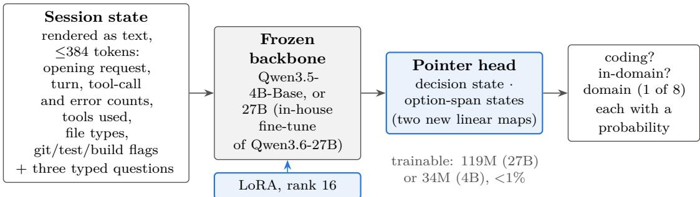
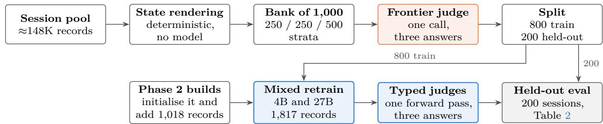
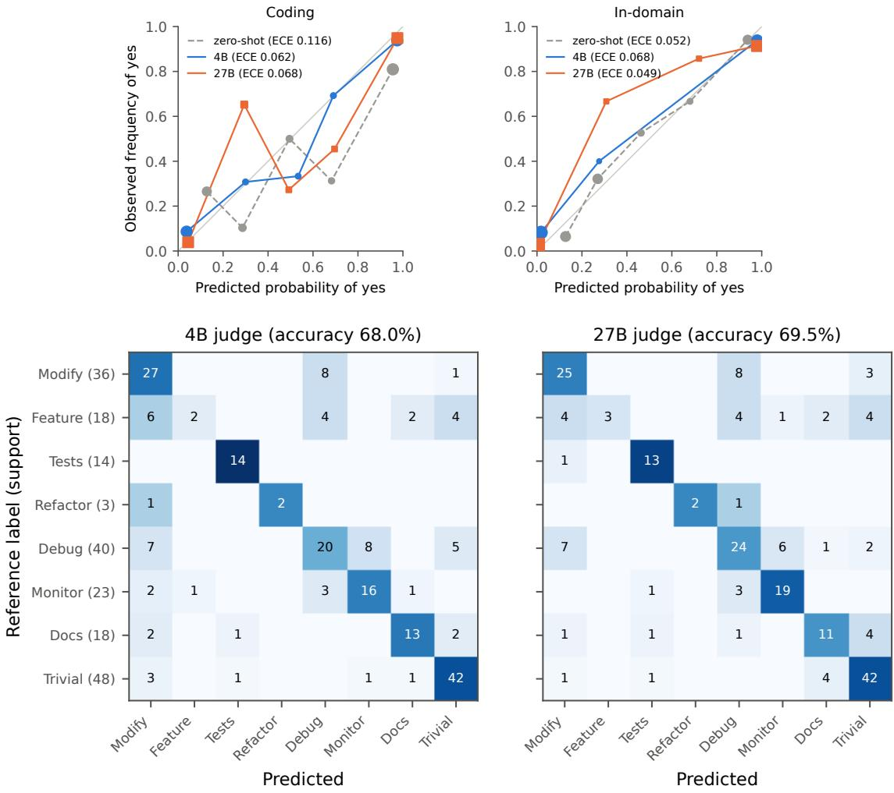
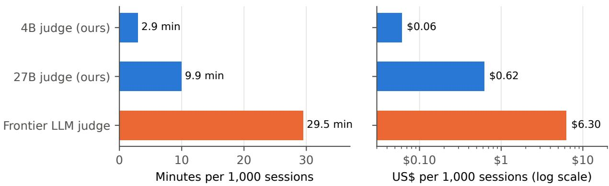
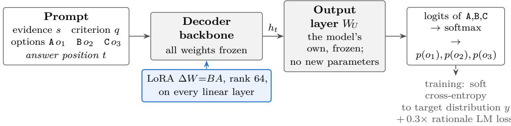

# Our Own Jev: Typed Decisions in One Forward Pass, from an In-House Judge to Open LoRA Models

Yuchuan Weng, Chi Liu, Xin Chen, Srinivasan Manoharan PayPal.AI

## Abstract

A typed decision maps evidence, a question and a fixed set of options to a probability for every option, computed in one forward pass, by reading a language model’s logits or a small head over its hidden states, instead of generating and parsing text. The commercial system Jev popularised this System 1 interface, and open reproductions have followed. We repor two uses of the pattern. Part I describes an in-house System 1 judge that triages about 148K agentic coding session records for a training corpus. It replaces a frontier LLM judge that cost on the order of \$1,000 per pass and whose stored labels matched a fresh two-judge consensus on only 26.9% of the sessions where the two judges agreed; a self-hosted frozen backbone with a rank-16 LoRA adapter and a pointer head answers three typed questions in one forward pass, judges 1,000 sessions in about three minutes of one GPU, about \$0.06 at a reference rate and roughly 1% of the frontier judge’s cost, and keeps every session inside the organisation. Part II asks whether a readout that adds no parameters can be competitive and whether training one helps. Applying the public Eikos recipe and corpus of about 25K decisions to three further backbones (1B, 2B and 35B), we read the frozen output layer of a LoRA-adapted decoder. On the 111 public hard items of JevBench our single-seed 35B, developed with those items in view, scores 79.3%, not significantly diferent from the commercial reference (73.0%, unadjusted p = 0.12) and ahead of five open systems after Holm–Bonferroni correction; our 2B is ahead of all four kev checkpoints on the leaderboard. A single-seed ablation finds no detectable benefit from training the 26 letter rows of the output layer, and a retrain on a later corpus release moves the 2B’s hard-tier accuracy by 11.7 points, which shows how little small evaluations resolve.

## 1 Introduction

“System 1 operates automatically and quickly, with little or no efort and no sense of voluntary control. System 2 allocates attention to the efortful mental activities that demand it.” Kahneman (2011)

Many operational decisions have a fixed set of allowed answers: which queue a ticket goes to, whether a clause in a document is satisfied, whether a coding session is worth keeping as training data. Today they are usually automated with System 2 machinery: prompt a chat model, ask it for JSON and parse the reply. That spends hundreds of generated tokens on a choice among a handful of options, fails whenever the model writes prose instead of an object, and returns a confidence value the model composes as text rather than computes.

A typed decision interface is the System 1 alternative. Given evidence, a question and the options, the mode returns a probability for every option from a single forward pass, read from the model’s outputs (its logits, or a small head over its hidden states) rather than generated. The commercial system Jev (TypeSafe AI, 2026) popularised this interface, and JevBench (Standhartinger, 2026) benchmarks systems that implement it on accuracy, calibration, speed and cost. Because the product is closed, an open-source race followed, with reproductions built on encoders, frozen base models, pointer heads and new readouts (Section 2); a fifth project, Eikos (Vicentino, 2026), releases a corpus, a training recipe, an evaluation harness and models that read letter logits without adding parameters.

This paper reports two eforts with the same pattern in two settings.

Part I: an in-house System 1 judge (§3–4). We collect agentic coding sessions, about 148,000 session records and growing, as training data for an in-house coding model, and each must be triaged by three typed questions before it enters the corpus. A frontier LLM judge cost on the order of \$1,000 per pass, needed about 73 hours of judging time, and its stored labels had drifted to the point that, where two fresh judges agreed, their label matched the stored one on only 26.9% of sessions; the data also could not leave the organisation. A self-hosted judge built on the kev architecture (a frozen 4B or 27B backbone, a rank-16 LoRA adapter and a pointer head) answers all three questions in one forward pass, judges 1,000 sessions in about three minutes of one GPU, about \$0.06 at a reference rate and roughly a hundredth of the frontier judge’s cost, and reaches 83–85% (coding), 91–92.5% (in-domain) and 68–69.5% (eight-way domain) agreement with frontier-judge labels on a fixed, class-balanced held-out set of 200 sessions (1.5 to 3.8 points lower on the 144 of them that share no state with the training records).

Part II: open typed-decision models (§5–9). Part II asks whether a readout that adds no parameters can be competitive, and whether training one helps. We read the existing output layer of a decoder language model at the single position where the answer letter would be generated, restrict it to the letters in play, and train only a LoRA adapter (Hu et al., 2022) with soft cross-entropy. The prompt format (SemIf’s), the training recipe, the evaluation battery and the corpus of about 25K public decisions are those of the open Eikos project, which pairs a letter-logit readout with task training; ours are the adapters for three further backbones (a 1B, a 2B and a 35B mixture of experts), the paired comparisons on JevBench’s 111 public hard items and a single-seed test of whether training the readout helps. The 35B reaches 79.3%: after Holm–Bonferroni correction it is significantly ahead of five open systems, but not significantly diferent from the commercial reference (73.0%, unadjusted $p = 0 . 1 2 )$ . Training the readout buys nothing we can measure, and a retrain of the 2B on a later corpus release moved its hard-tier accuracy from 61.3% to 73.0% although the two runs difer in more than the seed (Sections 8 and 9).

All JevBench numbers in Sections 6–8 are on the public half (version 1.4.2.2); the sealed half is scored only by its operator. Section 9 discloses provenance and which builds were developed with the public items in view.

## 2 Background and related work

Typed decisions and JevBench. An item consists of a state s (free text or structured evidence), a question q of one of three types (boolean, categorical choice, or ordinal score), and options $O = \left( o _ { 1 } , \ldots , o _ { K } \right)$ a system returns $p \in \Delta ^ { K - 1 }$ . JevBench (Standhartinger, 2026), in version 1.4.2.2, publishes 231 items in three tiers (easy 48, standard 72, hard 111); the rest, including a judge tier, are held by the operator and scored only on submission.

Open reproductions. Table 1 summarises the open reproductions whose code we read; they difer mainly in where the decision is computed. Laya (Convai Innovations, 2026) is a ModernBERT encoder (Warner et al., 2024). SemIf (Lee, 2026) reads option-letter logits from an unmodified Qwen3.5-4B, with a structured prompt that Eikos later adopted. kev (Palmer, 2026) adds a pointer head and a block-causal option-isolation mask that lets one pass answer several questions (Part I builds on kev). imajev (Garg, 2026) adds a 256-code readout, copied from the output layer and then trained on about a million decisions. Eikos (Vicentino, 2026), the source of Part II’s recipe, data and evaluation battery, reads the same letter logits with no added parameters from LoRA-adapted Qwen backbones trained on its own corpus of about 25K decisions. The other systems we compare, from the JevBench leaderboard (“the board”), are reflex (kshetrajna12, 2026) (a Qwen model read by direct logits), Winnow (Ring, 2026) (a LoRA-tuned Gemma), djev (Maisa, 2026) (an inference method on a difusion language model), jqv (Octalab, 2026) (a zero-shot Qwen3-32B) and OpenJev Verdict (heman10x, 2026) (a 151M encoder). None of Laya, SemIf, kev and imajev combines task training with a readout that adds no parameters; Eikos does (as do other board entries such as reflex-4B), and we build on that idea rather than claim it. Part II supplies evidence on other backbones, paired comparisons with a selection of the field, and a test of whether the readout needs training at all.

Table 1: Open typed-decision reproductions, as described by each project’s published code and documentation at the time of writing, and Part II’s.
<table><tr><td></td><td>Backbone</td><td>Readout</td><td>Training</td><td>Stated or observed limit</td></tr><tr><td>Laya</td><td>ModernBERT-large (421M)</td><td>softmax over option markers</td><td>own recipe</td><td>512-token budget</td></tr><tr><td>SemIf</td><td>Qwen3.5-4B, unmodified</td><td>option-letter logits</td><td>none</td><td>score questions excluded</td></tr><tr><td>kev</td><td>Qwen decoder</td><td>new pointer head</td><td>LoRA + head from scratch</td><td>mask not applied on hybrid backbones</td></tr><tr><td>imajev</td><td>Qwen3.5 2B/4B/9B</td><td>256-code layer copied from the output layer</td><td>LoRA, 5 stages, ~1M decisions</td><td>raw hard-tier calibration error 0.113</td></tr><tr><td>Eikos</td><td>Qwen3.5-4B, Qwen3.8-27B</td><td>option-letter logits, frozen output layer</td><td>LoRA, soft targets, ~25K decisions</td><td>self-reported hard tier 72.1 (4B), 82.9 (27B)</td></tr><tr><td>Ours (Part II)</td><td>MiniCPM5-1B/2B. Qwen3.6-35B-A3B</td><td>frozen output layer; no new parameters</td><td>Eikos recipe and corpus</td><td>26 letters per pass</td></tr></table>

Related techniques. Scoring multiple-choice answers by the probability of an option symbol is standard in LLM evaluation (Hendrycks et al., 2021; Robinson & Wingate, 2023) and can be well calibrated (Kadavath et al., 2022); models are sensitive to option order and label bias (Zheng et al., 2024a; Pezeshkpour & Hruschka, 2024; Zhao et al., 2021), which motivates our per-example reshufling. We measure calibration with expected calibration error (Naeini et al., 2015; Guo et al., 2017), consider temperature scaling and report error under selective prediction (El-Yaniv & Wiener, 2010; Geifman & El-Yaniv, 2017). Soft targets follow knowledge distillation (Hinton et al., 2015), the rationale loss follows Hsieh et al. (2023), and we adapt with LoRA through PEFT (Mangrulkar et al., 2022). Our analysis draws on work on significance testing and power in NLP (Card et al., 2020; Dror et al., 2018; Berg-Kirkpatrick et al., 2012), error bars and small test sets (Miller, 2024; Bowyer et al., 2025) and seed and numerical variance (Dodge et al., 2020; Bouthillier et al., 2021; Madaan et al., 2024; Summers & Dinneen, 2021; Zhuang et al., 2022), and uses McNemar’s exact test (McNemar, 1947; Dietterich, 1998), the paired bootstrap (Efron & Tibshirani, 1993) and the Holm–Bonferroni correction (Holm, 1979). Our contamination check is an n-gram overlap test in the tradition of Brown et al. (2020), with the caveats of Sainz et al. (2023). The judge of Part I replaces an LLM-as-a-judge (Zheng et al., 2023).

## 3 Part I. An in-house System 1 judge: the task

We begin with the question that motivated our interest in typed decisions: what happens when the pattern replaces an LLM judge on a real, growing, sensitive workload. The system described here is built on the open kev architecture (Palmer, 2026); Part II then asks whether a simpler readout sufices, and Section 4.8 connects the two. All numbers in Part I come from the deployment’s own evaluation harness.

## 3.1 148,000 sessions and a judge that could not keep up

We are building locally hosted coding models, fine-tuned on in-house engineering sessions, aiming for low cost and fast turnaround on our own infrastructure. Before a session (a transcript of an AI coding assistant working in an engineer’s repository) can enter that training corpus, three questions must be answered: is this coding work at all, is it in our own engineering domain, and which of eight fine-grained domains does it belong to. At the time of writing the pool held about 148,000 session records (about 114,000 distinct sessions, some recorded more than once), and it grows daily. Using a learned model to decide which data enters a training corpus is established practice in pre-training data curation (Li et al., 2024; Penedo et al., 2024); our setting difers in that the unit is a long agentic session, the decision has three typed parts, and the data cannot leave the organisation.

Until recently those questions were answered by a two-stage pipeline. Cheap rule-based signals came first: tool-call counts, file extensions touched, whether git, tests or builds ran. Sessions the rules could not resolve went to an LLM judge pass (Zheng et al., 2023), in which a frontier LLM did most of the work and smaller, faster models filled gaps. The resulting labels were stored in a legacy 14-category taxonomy and fed the corpus that trains the next model.

Two things made this expensive rather than merely slow. The obvious one is cost and latency. We measured a frontier judge working as an agent over batches of sessions: at the per-token rates recorded with the run (\$2 and \$10 per million input and output tokens, \$0.20 and \$2.50 for cache reads and writes) it costs about \$6.30 per 1,000 sessions, and its wall-clock time is 1.77 seconds per session. Projected to all 148,000 records, a pass would cost on the order of \$1,000 and take roughly 73 hours of judging time. That is acceptable for a one-of audit, not for something to re-run whenever the taxonomy changes or a new batch lands. The less obvious one is that the stored labels had drifted. We ran two fresh frontier judges independently over the same 500 sessions in the legacy taxonomy. They agreed with each other on 376 of the 500 (75.2%, Cohen’s κ = 0.72 (Cohen, 1960)), but on those 376 sessions their shared label matched the stored one only 101 times (26.9%). Labels drift as the models, prompts and taxonomy evolve underneath them, so keeping them correct becomes a recurring cost of its own. The question was therefore not how to make the LLM judge cheaper, but why a System 2 tool was being used for a System 1 problem (Kahneman, 2011).

## 3.2 Two ways to judge a session

The System 1 / System 2 split of Section 1 describes the two ways of building this judge. A large language model asked to judge a session reads it, reasons in prose and writes a verdict at the end; in our measurement this takes 1.77 seconds per session and costs about \$6.30 per 1,000 sessions. The alternative feeds the same session into a frozen model with a small trained decision head, which assigns a probability to each of a smal set of typed outputs in one forward pass, with nothing generated. Neither approach is wrong, but at this scale they are not interchangeable.

## 3.3 Why not call a hosted decision API

A hosted typed-decision API would remove the generation cost, and we considered it. Two reasons ruled it out. The first is the data boundary. A session transcript contains raw source code and difs, internal package names, internal hostnames and endpoints, and references to internal tickets and conversations. Automated redaction checks can miss sensitive content in agentic traces, such as internal identifiers and configuration secrets, and a clean self-check is not proof of a clean session. So sessions stay inside the organisation. Redacting and then sending only moves the residual risk: whatever the check missed leaves with the session.

The second reason is control. A hosted model is a black box whose “latest” version can change under its callers, which is why version pinning is recommended; scores we cannot reproduce on our own terms are a weak basis for curating a training corpus. A self-hosted judge keeps the weights, the GPU and the request inside our infrastructure, and lets us pin the model, the weight hash and the serving version ourselves. It also answers to the same request and response schema as the hosted API, so nothing downstream has to change.

## 4 Part I. The judge: architecture, training and results

## 4.1 Architecture

The judge forks kev (Palmer, 2026). A frozen decoder backbone carries a rank-16 LoRA adapter (Hu et al., 2022), and kev’s pointer decision head reads the answer (Figure 1). We use two backbones: Qwen3.5-4B-Base, the base of the released kev-4b checkpoint, for speed, and a 27B model for accuracy, which is our own supervised fine-tune of Qwen3.6-27B on in-house coding sessions. The head consists of two new linear maps that project the hidden state at the decision position and the hidden states of each option’s span into a 256-dimensional space; their scaled dot products, passed through a softmax, are the typed answer. The adapter and the head together hold 119M trainable parameters on the 27B backbone and 34M on the 4B, under 1% of either model. Almost everything the judge knows about language it knew before this project;

  
Figure 1: The in-house judge. Blue components are trained. Unlike the open models of Part II (Figure 5), which read the backbone’s frozen output layer, this design adds a trained pointer head.

what training teaches is narrow and specific: given this session, where to point. That is also where the speed and cost come from. An LLM judge must generate its way to an answer, paying a forward pass per token, while the typed judge computes hidden states once and reads them of.

## 4.2 What the judge sees

The judge does not read the raw transcript. A deterministic script, with no model in the loop, renders each session into a short state: the first 200 characters of the opening request (already redacted in the pool), the number of turns, tool calls and errors, a histogram of the tools used, the file types touched, any frameworks detected, and whether a git commit, a push, a test run or a build occurred. The frontier judge that produced our labels reads the same rendered state, so the typed judge learns to reproduce one teacher’s decisions from identical inputs. Each session is one request to the server. Because both backbones are hybrids (§4.7), the three questions are scored as separate causal rows that each continue the shared session state rather than as one packed sequence; every latency figure below covers the whole request. Appendix F gives an illustrative state, the three questions and the eight domain definitions.

Consider an illustrative session (details altered; counts rounded) in which the assistant writes unit tests for a service class in a JVM codebase. Its state records roughly 90 turns and 40 tool calls, no errors, edits to source and test files, a test run and no build. The typed judge returns its three answers, each with a probability, in one forward pass. A frontier LLM judge given the same state reasons in prose and reaches the same conclusion about 1.77 seconds later. On a session this legible the two systems almost certainly agree; the diference is the cost of getting there.

## 4.3 Data, labels and evaluation

Figure 2 summarises how the data were built. We first pointed the released kev-4b checkpoint, with no training on our task, at a blind sample of 500 sessions, and measured the two frontier judges of Section 3 on the same sample. That early comparison is not the one we report against. For evaluation we assembled a fixed bank of 1,000 sessions from the pool, stratified by design: 250 coding sessions in our own domain, 250 coding sessions outside it, and 500 non-coding sessions. On the held-out split this puts the share of coding sessions at 50% and of in-domain sessions at 44%, far from the production mix, in which most sessions are coding. Candidates were mined from the pool with rule-based stratum hints, and a frontier LLM judge labelled each candidate with one call that answers all three questions; a candidate entered a stratum only if that judge’s labels confirmed it. The bank was then split 800/200 into training and held-out sessions with the strata balanced across the split. All accuracies in Table 2 are agreement with these single-judge labels on the 200 held-out sessions. Because the strata were confirmed by the same judge, sessions the judge finds ambiguous are likely under-represented, and the accuracies may be optimistic for borderline trafic.

The eight domains are a subset of the legacy 14-category taxonomy. Six categories (code comprehension and questions, security, infrastructure and release, code review, data and configuration, build and dependencies) are outside the vocabulary, and the domain question has no “other” option, so such sessions are forced into one of the eight. In the 500-session sample, 27.6% of the stored labels and 36.4% of the fresh judge’s labels fall in those six categories.

  
Figure 2: How the Part I data were built and used. The orange box is the only step that calls an LLM. Section 4.5 reports which held-out sessions overlap the training records.

Table 2: The judge on the fixed, class-balanced 200-session held-out set (accuracy against single frontier-judge labels, %, with exact 95% Clopper–Pearson intervals (Clopper & Pearson, 1934) in brackets). Table 16 in the appendix repeats the comparison without the 56 sessions that overlap the training records.
<table><tr><td>Training</td><td>System</td><td>Coding</td><td></td><td>In-domain</td><td>8-way domain</td></tr><tr><td>none (rules)</td><td>state rules (no model)</td><td>73.5 [66.8, 79.5]</td><td></td><td>56.0 [48.8, 63.0]</td><td>24.0 [18.3, 30.5]</td></tr><tr><td>none (zero-shot)</td><td>released kev-4b</td><td>72.5 [65.8, 78.6]</td><td></td><td>81.5 [75.4, 86.6]</td><td>52.5 [45.3, 59.6]</td></tr><tr><td>mixed retrain</td><td>4B backbone</td><td>85.0 [79.3, 89.6]</td><td></td><td>91.0 [86.1, 94.6]</td><td>68.0 [61.1, 74.4]</td></tr><tr><td>mixed retrain</td><td>27B backbone</td><td>83.0 [77.1, 87.9]</td><td></td><td>92.5 [87.9, 95.7]</td><td>69.5 [62.6, 75.8]</td></tr></table>

## 4.4 From zero-shot to a mixed-retrain judge

We report three systems on the held-out set. Zero-shot is the released kev-4b checkpoint with no training on our task. Before the mixed retrain we trained Phase 2 builds for the two binary questions on 800 sessions labelled by the same frontier judge. On a diferent, earlier held-out set, with diferent labels and class balance, they reached 97.0% (in-domain) and 98.0% (coding) with the 27B backbone and 95.5% and 97.5% with the 4B; these numbers are not comparable with Table 2 and are omitted there. The mixed retrain (Phase 3) adds the eight-way domain question to the same forward pass. Each backbone warm-starts from its Phase 2 build through kev’s init\_from option. The corpus has 1,818 records: the 800 bank training sessions with all three questions, the 800 Phase 2 sessions with the two binary questions, and 218 sessions from the early 500-session sample with the domain question only; one record exceeded the trainer’s 384-token state limit and was dropped. Appendix F lists the training configuration.

Before the mixed retrain we also ran a 100-question, eight-way exam with no training on the eight-way question. The released kev-4b scored 59%, our Phase 2 4B (initialised from the released checkpoint and trained on the binary questions) scored 52%, and our Phase 2 27B, whose head had been trained from scratch on the two binary questions only, scored 14%, against a chance rate of 12.5%. A pointer head never trained on the eight-way choice carries no signal for it, and a fine-tuned backbone does not rescue it; this motivated retraining on the mixed corpus. Part II asks what a readout with no new parameters does instead (§8), which bears on this result.

Table 2 gives the results. As a no-model reference, a rule baseline reads the same state: it calls a session coding when any file type was touched or an edit or write tool was used (73.5%, recall 53%, specificity 94%), and since no simple state rule separates the in-domain and domain answers it predicts the training-set majority for those two (56.0% and 24.0%). Both judges beat it on all three questions (exact McNemar $p \leq 0 . 0 1 1 ; p \leq 0 . 0 1 4$ on the 144 non-overlapping sessions). Both mixed-retrain judges also beat zero-shot on all three questions, by 9.5 to 17.0 points (exact McNemar $p \leq 0 . 0 0 5$ in all six paired comparisons, with paired-bootstrap 95% intervals for the gain entirely above zero). Brier scores (Brier, 1950) on coding and in-domain fall from 0.196 and 0.131 for zero-shot to 0.095 and 0.076 for the 4B and 0.097 and 0.063 for the

27B. Expected calibration error (10 bins) is less uniform: on coding it falls from 0.116 to 0.062 and 0.068, while on in-domain it is 0.052 for zero-shot, 0.068 for the 4B and 0.049 for the 27B, so the Brier gain on that question comes mainly from accuracy rather than from better calibrated confidence. Figure 3 shows the reliability curves and the eight-way confusion matrices; at 200 sessions the middle probability bins hold few sessions and the curves are noisy there. On the binary questions the 4B recalls 87% of coding sessions with 83% specificity and 87.5% of in-domain sessions with 93.8% specificity; the 27B reaches 80% and 86% on coding and 92.0% and 92.9% on in-domain. For a corpus filter, the coding misses (13% and 20% of coding sessions) are data discarded.

These accuracies are bounded by label noise. On an earlier set of 1,000 sessions, two frontier judges agreed on 96.8% of coding answers (Cohen’s $\kappa = 0 . 5 0 ;$ ; 95% of that set is coding, which inflates raw agreement) and on 94.2% of in-domain answers $\left( \kappa = 0 . 8 1 \right)$ , and the labelling judge disagreed with its own earlier pass on 15 of 177 re-labelled sessions (8.5%) for the binary questions. In-domain accuracy of 91–92.5% is therefore close to the agreement two frontier judges reach with each other.

The two backbones, by contrast, cannot be separated. The 4B is nominally ahead on coding (85.0 against 83.0) and the 27B on in-domain (92.5 against 91.0) and on domain (69.5 against 68.0), but none of the paired diferences is significant (exact McNemar $p = 0 . 5 2$ , 0.45 and 0.74 for coding, in-domain and domain), and the paired-bootstrap intervals for the diference all span zero (−2.5 to +6.5, −4.0 to +1.0 and −7.5 to +4.5 points). At $n = 2 0 0$ the minimum detectable paired gap (80% power, $\alpha = 0 . 0 5 )$ is 3.7 to 8.5 points for this comparison and 8.0 to 11.7 points against zero-shot, so the 4B’s two-point coding lead is not an efect we can claim. 200 sessions cannot tell the backbones apart. That makes the cheaper 4B a reasonable default, but it is not evidence that the two are equally accurate.

The confusion matrices locate most eight-way errors. Both judges spread new-feature work over modifying existing code, debugging and trivial sessions, recalling only 2 (4B) and 3 (27B) of the 18 new-feature sessions, and both send a share of debugging sessions to modifying existing code. Test authoring and trivial sessions are recognised most reliably. Some of these boundaries are hard to draw from the state alone: whether an edit adds a feature or changes an existing one is often not visible in counts and file types. If the domain label is used to balance a training corpus, new-feature sessions would be under-counted; Refactor, with three held-out sessions, cannot be assessed at all.

## 4.5 Overlap between training and held-out sessions

The held-out split was drawn from the bank, but the mixed-retrain corpus also contains the earlier Phase 2 sessions, and some bank sessions had been reused from that earlier set. A check of the rendered states found that 56 of the 200 held-out sessions overlap the training records: 28 appear among the Phase 2 training sessions, with their two binary labels, and 28 have a rendered state identical to that of a diferent bank training session. These overlapping sessions are easier than the rest for every system, including zero-shot, which never saw them (zero-shot coding accuracy 83.9% on them against 68.1% on the other 144). On the 144 sessions with no overlap (Table 16), every conclusion above holds: both judges still beat zero-shot on all three questions (exact McNemar $p \leq 0 . 0 1 7 )$ , and no backbone diference is significant $\left( p \ge 0 . 4 5 \right)$ . Absolute accuracies of the trained judges are 1.5 to 3.8 points lower than in Table 2.

## 4.6 Speed and cost

Figure 4 compares the three systems on the same 1,000 sessions. The two typed judges are measured as served, one request at a time: the 4B on one A100-40GB GPU has a median server-side latency of 176 ms per session, about 2.9 minutes per 1,000, and the 27B, sharded across three A100-40GB GPUs, has a median of 596 ms, about 9.9 minutes. Measured at the evaluation client, which sent one request at a time over the network, the same 1,000 sessions took 18.1 minutes (4B) and 26.8 minutes (27B); the diference is request handling, transport and client overhead outside the model, which batching and a co-located client would largely remove. The frontier judge’s 1.77 seconds per session is the end-to-end wall-clock of an agent that handled about 7.5 sessions per call (67 calls for 500 sessions), so 1,000 sessions take about half an hour. Its cost, about \$6.30 per 1,000 sessions, is the token usage of that run at the rates given in Section 3. For the self-hosted judges we report GPU time, 0.049 A100-hours per 1,000 sessions for the 4B and 0.50 for the 27B, and price it at a reference rate of \$1.25 per A100-hour, which gives about \$0.06 and \$0.62. The rate is an assumption, not a quote; the comparison does not depend on it, since the 4B stays cheaper than the frontier judge at any price below about \$129 per A100-hour and the 27B below about \$12.7. These figures cover inference only. Training the mixed-retrain judges took 41.6 minutes on one GPU for the 4B and 89.5 minutes on three GPUs for the 27B, a one-time cost.

  
Figure 3: Diagnostics on the 200 held-out sessions. Top: reliability of the two binary questions (five equalwidth bins, bins with fewer than five sessions omitted, marker area proportional to bin size; ECE uses ten bins). Bottom: eight-way confusion matrices of the mixed-retrain judges, shaded by row-normalised recall, with counts; reference support in parentheses.

Projected to the full pool of 148,000 records at the measured latency, a pass with the 4B judge would take about seven A100-hours. A judge that costs \$1,000 and three days of judging time per pass is something one schedules and budgets for; one that costs a few GPU-hours is something one runs on every session, every time, rather than on a sample one hopes is representative.

## 4.7 Changes to the open kev implementation

Our fork of the kev codebase is not publicly released. The changes concern model loading and device placement rather than the decision head, and each is visible in the fork’s history. The list also notes one upstream constraint that shapes how both judges run.

  
Figure 4: Judging 1,000 coding sessions: time and cost. Typed judges: measured median server-side latency, one request at a time, priced at a reference \$1.25 per A100-hour (4B on one GPU, 27B on three). Frontier judge: end-to-end wall-clock of a batching agent, 1.77 s per session over 500 sessions; cost from its token usage at the rates recorded with the run.

• Multimodal-wrapper bases. The 27B checkpoint is a vision-language wrapper around a text backbone. The loader detects such configurations, loads them through the image-text-to-text model class and extracts the text backbone, leaving the vision tower unused. Text-only bases load as before.

• Optional multi-GPU sharding. For a backbone larger than one GPU, a device map with a per-device memory cap spreads its layers across cards, for both frozen serving and LoRA training. Hidden states are moved to the head’s device before the readout, and the whole-model device move is skipped when the backbone is sharded.

• Adapters on sharded backbones. When loading a trained checkpoint onto a sharded backbone, the LoRA adapter is attached without re-homing the model, so each adapter weight stays on the device of its parent layer.

• No option isolation. Both backbones are hybrids with recurrent (Gated DeltaNet) layers, which cannot honour kev’s block-causal option-isolation mask, and kev refuses the mask on such backbones. This is upstream behaviour rather than a change of ours, but it applies to both judges: each question is evaluated as its own causal row continuing from the shared session state.

• Warm start. The mixed retrain initialises each backbone’s LoRA adapter and pointer head from its Phase 2 checkpoint through kev’s init\_from option, which first checks that the base, LoRA configuration and head size are compatible.

## 4.8 Reuse, and how the two parts connect

Nothing in this judge is specific to coding sessions. A frozen backbone, a small LoRA adapter, a typed decision readout and a schema-compatible API apply to any classification or routing problem that needs low latency, low cost and data that stays inside the organisation, and teams with such a bottleneck can reuse the architecture rather than only the results. Part II examines what we would change. The judge uses kev’s trained pointer head; on JevBench we find that a readout with no new parameters is competitive (§7), that training even a readout initialised from the output layer buys nothing measurable (§8), and that the kev family scales poorly. Whether the zero-parameter letter readout would match the pointer head on this task is untested, and it is the next comparison we intend to run, together with another round against JevBench. Two caveats apply to everything in Part I. Accuracy here means agreement with the labels of one frontier judge, which disagrees with its own earlier pass on 8.5% of binary answers and whose labels also confirmed the bank strata. The held-out set has 200 sessions, is class-balanced rather than drawn at the production mix, covers only the eight-category vocabulary, and 56 of its sessions overlap the training records.

## 5 Part II. Open typed-decision models: readout, recipe and data

The judge of Part I reads its answer through kev’s trained pointer head. Part II asks whether a readout that adds no parameters at all can be competitive, and whether training one helps. The recipe, the corpus and the evaluation battery are those of the open Eikos project (Vicentino, 2026), whose released models already read letter logits this way; Part II adds adapters for three further backbones, paired comparisons with the commercial system and a selection of the open field on JevBench, and a single-seed test of whether training the readout helps (§8). It does not compare a pointer head with the letter readout under matched conditions. The two parts share an interface and a lesson, not an experiment: Part I shows what the pattern buys in a deployment, Part II tests the readout on a public benchmark, and in both the evaluation sets (200 sessions, 111 items) are too small to resolve the diferences that matter.

## 5.1 A readout with no new parameters

We render the state, the question and the options into a prompt in which option k is introduced by a letter token $\ell _ { k } \in \{ { \tt A } , { \tt B } , \ldots \}$ , and end the prompt exactly where the answer letter would be generated. The prompt is SemIf’s structured format (Lee, 2026) as adopted by Eikos: a JSON object with the evidence, the criterion and a list of options, each with a letter and a description, under a system instruction to answer with the uppercase letter of one option. Let $h _ { t } ( \theta )$ be the final hidden state at that position for a backbone with frozen weights and LoRA parameters θ, and let $W _ { U }$ be the backbone’s own, frozen, unembedding matrix. The decision is

$$
p _ { \theta } ( o _ { k } \mid s , q , O ) = \frac { \exp { \left( z _ { \ell _ { k } } \right) } } { \sum _ { j = 1 } ^ { K } \exp { \left( z _ { \ell _ { j } } \right) } } , \qquad z = W _ { U } h _ { t } ( \theta ) .\tag{1}
$$

We call this the letter readout (Figure 5). Only θ is trained. Boolean, choice and ordinal score questions share it. With single-letter labels, the configuration we use, one pass handles up to 26 options; larger sets are answered by a tournament over blocks of at most 26 whose winners are asked again.

Equation 1 is the standard way of reading a class probability from a pretrained output layer, as in the verbalizers of prompt-based fine-tuning (Schick & Schütze, 2021; Gao et al., 2021) and monoT5’s “true”/“false” logits (Nogueira et al., 2020), and it keeps the backbone’s calibration over those letters. kev learns a pointer head from scratch and imajev trains a new 256 × d layer initialised from the rows of $W _ { U } ;$ ; SemIf and Eikos add no parameters. Section 8 tests training the 26 letter rows.

## 5.2 Recipe and data

The recipe is Eikos’s and we tuned none of it: LoRA adapters of rank 64 on every linear projection, one epoch, learning rate $1 0 ^ { - 4 }$ , efective batch 32, soft cross-entropy against a full target distribution over the options, an auxiliary loss on a short written rationale (weight 0.3, never used at inference (Hsieh et al., 2023)) and option order re-permuted per example. The 1B and 2B follow Eikos’s 4B settings (its first run, without weight averaging or auxiliary terms) and add a symmetric KL divergence (weight 0.5) between the option distributions of an item and of its English or Brazilian-Portuguese view; the 35B follows its 27B settings (no views, a 14,000-token context). Apart from the readout we ablated none of these choices. The data is the public eikos-decisions corpus (Vicentino, 2026) (CC BY 4.0), as cloned on 2026-09-24: programmatically generated items with computed answers, teacher distributions, derivatives of FinEntity (Tang et al., 2023), TAT-QA and GSM8K training data, long-context dossiers and the views. Our 1B and 2B used a snapshot of 25,130 rows (a task family, a topic and a language held out whole, 1,191 rows) plus 1,619 view rows; our 35B used 24,447 rows. A subset was retracted by the corpus author after our snapshot was taken (Section 9). Inference is one forward pass and a softmax over at most 26 logits at temperature 1; several questions about one state share a prefix, as in Eikos’s serving code (Kwon et al., 2023; Zheng et al., 2024b).

  
Figure 5: The model. One forward pass; the decision is read from the backbone’s own output layer at a single position, restricted to the letters in play. Only the LoRA matrices (blue) are trained; the rationale loss is used in training only.

## 6 Experimental setup

Models and benchmark. We adapt MiniCPM5-1B, MiniCPM5-2B (Hu et al., 2024) and Qwen3.6-35B-A3B (Qwen Team, 2025) with Eikos’s settings by size (Section 5.2); each is trained once, with a single seed, and the 2B is released as a merged standalone model (Kailune-AI, 2026). We score the 231 public JevBench items (commit fd54ea7, v1.4.2.2; later versions are not rerun) and recompute competitors from its published per-item records, so comparisons are paired (52 systems have such records; we use 15, selected by us; imajev-4b publishes aggregates only). To measure what 111 items cannot, we also use the seven-suite battery of the Eikos repository (7,371 items: the JevBench public items, DecisionBench, Eikos’s template-generated trade and rulebook suites, which make up 31%, a general battery and two finance suites) and its policy of deciding at confidence $\geq 0 . 9$

Statistics. Paired comparisons use the exact McNemar test, and 95% intervals are exact Clopper–Pearson intervals (mapped to the diference for paired comparisons), except the ECE interval, a 20,000-sample bootstrap. Because we report many paired tests, we apply the Holm–Bonferroni correction (Holm, 1979) within the comparisons we report for each model (11 for the 35B, 15 for the 2B and 3 for the 1B, whose comparison with the commercial reference is descriptive; our selection, not preregistered), call a diference significant only if its adjusted p is below 0.05, and call the rest not significant, which on 111 items is not evidence of equivalence. A 111-item tier has 80% power only for diferences of about ten points between two runs of one recipe (twelve to twenty between unrelated systems, which disagree on more items).

## 7 Results on JevBench

## 7.1 Accuracy and paired comparisons

Table 3 gives hard-tier accuracy for 15 of the 52 systems whose outcomes the benchmark publishes (our selection; imajev-4b is added from its published aggregates) and the paired diferences of our 35B and 2B from each. Of the 37 systems we did not compare, 11 score higher than our 2B (up to 76.6%) and none higher than our 35B. The 35B is significantly ahead of five open systems (Laya, kev 8B, reflex-4B, SemIf and jqv, the last two untrained) and behind the two frontier LLMs by 17.1 points. Against the commercial reference it is +6.3 points (unadjusted $p = 0 . 1 1 9 )$ , so on 111 items we can say neither that it is better nor that the two are equivalent; so does djev, Winnow-12B and reflex-27B. The 35B’s five “ahead” rows do not depend on the choice of Holm family (the largest raw p is 0.0003). The 2B is significantly ahead of Laya and of all four kev checkpoints, significantly behind reflex-27B and the frontier LLMs, and not significantly diferent from SemIf, jqv and reflex-4B (60–61% on the hard tier); the 1B is significantly ahead of kev 4B and Laya (a family of three, excluding the reference) and trails the commercial reference by 18.9 points. Three of the 2B’s verdicts sit at the edge: kev 8B, kev 0.6B and reflex-27B would not survive a correction over all 52 systems (adjusted $p = 0 . 1 4 8$ , 0.154 and 0.182), whereas “ahead of every kev checkpoint”, read as a conjunction, needs only that each raw $p$ is below 0.05 (the largest is 0.0055). Part II’s first question, whether a readout with no new parameters can be competitive, therefore has only a weak answer: the 35B is significantly ahead of five open systems and not shown to be worse than the commercial reference.

Accuracy rises with size across our builds (54.1, 61.3 and 79.3) but not across kev’s checkpoints (29.7, 43.2, 36.9 and 45.0 at 0.5B, 0.6B, 4B and 8B; the 8B is two items ahead of the 0.6B, $p = 0 . 8 7 )$ , which is the evidence behind Part I’s remark that kev scales poorly. Both patterns are suggestive only: our builds use diferent backbones and one seed each, the 1B–2B gap is below what a 111-item tier can resolve (Section 8), and kev’s checkpoints are of a previous generation, with a Qwen2.5 base at 0.5B (the Qwen3.5-based kev of Part I is not on the board); their 0.6B–4B inversion is seven items (exact McNemar p = 0.28). SemIf’s 61.3 from an unmodified 4B is what letter logits give without task training, which our 2B matches at about 60% of the parameters; since the 35B’s lead over the untrained reflex-27B is not significant, these data do not show how much of its score comes from training. Two board systems run the same Qwen3.6-35B-A3B backbone (SimpleJev, 65.8, direct logits, and openjev-sglang, 73.0; the board describes no training for either); our 79.3 is 13.5 and 6.3 points above them, with no 35B per-item scores to pair. Eikos’s own models report 72.1 (4B) and 82.9 (27B) in its README, without per-item records, 11 and 4 points above our 2B and 35B, so we do not claim that the recipe transfers without loss.

Table 3: Hard-tier accuracy (111 public items, v1.4.2.2) and paired diferences of our 35B and 2B from each system (points; Holm-adjusted p in parentheses, within each model’s reported comparisons: 11 for the 35B, 15 for the 2B; ∗ adjusted p < 0.05; – not in that model’s family). “Training” is what the board or the project’s documentation says is trained. 2B rows are recomputed from per-item scores; 35B rows come from the original evaluation (merged rows share one recorded diference).
<table><tr><td>System</td><td>Training</td><td>Hard</td><td>35B vs. system</td><td>2B vs. system</td></tr><tr><td>DeepSeek Flash; GPT-5.6 Luna</td><td>generative</td><td>96.4</td><td>−17.1 (&lt;.002)*</td><td>-35.1 (&lt;.0001)*</td></tr><tr><td>Ours 35B-A3B</td><td>LoRA</td><td>79.3</td><td></td><td></td></tr><tr><td>reflex-27B</td><td>none</td><td>75.7</td><td>+3.6 (.48)</td><td>-14.4 (.049)*</td></tr><tr><td>Winnow-12B</td><td>LoRA</td><td>73.0</td><td>+6.3 (.42)</td><td>-11.7 (.18)</td></tr><tr><td>Jev 1.13.0</td><td>closed</td><td>73.0</td><td>+6.3 (.36)</td><td>-11.7 (.088)</td></tr><tr><td>imajev-4b</td><td>LoRA, readout</td><td>72.1</td><td></td><td></td></tr><tr><td>djev</td><td>none</td><td>67.6</td><td>+11.7 (.096)</td><td>–6.3 (1.0)</td></tr><tr><td>jqv; SemIf 4B</td><td>none</td><td>61.3</td><td>+18.0 (.002)*</td><td>0.0 (1.0)</td></tr><tr><td>Ours 2B</td><td>LoRA</td><td>61.3</td><td></td><td></td></tr><tr><td>reflex-4B</td><td>LoRA</td><td>60.4</td><td>+18.9 (&lt;.002)*</td><td>+0.9 (1.0)</td></tr><tr><td>Ours 1B</td><td>LoRA</td><td>54.1</td><td></td><td></td></tr><tr><td>kev 8B</td><td>LoRA, head</td><td>45.0</td><td>+34.2 (&lt;.002)*</td><td>+16.2 (.046)*</td></tr><tr><td>kev 0.6B</td><td>LoRA, head</td><td>43.2</td><td></td><td>+18.0 (.046)</td></tr><tr><td>OpenJev Verdict 1.4</td><td>encoder, trained</td><td>36.9</td><td></td><td>+24.3 (.001)*</td></tr><tr><td>kev 4B</td><td>LoRA, head</td><td>36.9</td><td></td><td>+24.3 (.0002)*</td></tr><tr><td>Laya</td><td>encoder, trained</td><td>35.1</td><td>+44.1 (&lt;.002)*</td><td>+26.1 (.003)*</td></tr><tr><td>kev 0.5B</td><td>LoRA, head</td><td>29.7</td><td></td><td>+31.5 (&lt;.0001)*</td></tr></table>

## 7.2 Calibration and selective decisions

For a decision system the operative question is often how wrong it is when it is confident enough to act without review. Table 4 reports, on the 7,371-item battery, the share of decisions made at confidence ≥ 0.9 and the error among them: the 35B commits on 42.3% of items and is wrong on 1.9% of those. Two cautions apply. First, up to 31% of the battery is template siblings of the training data, where the models are far more accurate: for the 2B the error among confident decisions is 4.2% on the full battery but 7.7% (95% interval 6.0–9.7) on the four external suites we could score per item. Second, the commercial system’s 5.9% is Eikos’s figure on six suites that exclude the JevBench public items and we did not rerun Jev, so the two are not comparable. On the hard tier our expected calibration error (ECE) is 0.084 (35B), 0.090 (1B) and 0.120 (2B), against imajev-4b’s published 0.082 after its fitted temperature, but ECE on 111 items is noisy (a bootstrap 95% interval for the 2B’s is [0.079, 0.208]). A fitted temperature does not help our larger models: it comes out below one (0.80 for the 35B, 0.95 for the 2B) and worsens hard-tier ECE on held-out halves of the public items. No held-out family, topic or language collapses toward chance at any size (Table 4, bottom).

Table 4: Top: selective decisions and ECE on the 7,371-item battery, and for the 2B on the four external suites we could score per item (4,403 items); Jev’s figure is Eikos’s, on six other suites, and not comparable. Bottom: categorical held-out sets, accuracy (%) / ECE.
<table><tr><td></td><td>Decided at ≥0.9</td><td>Error among those</td><td></td><td>ECE</td></tr><tr><td>Ours 35B</td><td></td><td>42.3%</td><td>1.9%</td><td>0.028</td></tr><tr><td>Ours 2B</td><td>27.0%</td><td></td><td>4.2%</td><td>0.021</td></tr><tr><td>Ours 1B</td><td>6.9%</td><td></td><td>4.3%</td><td>0.060</td></tr><tr><td>Ours 2B, external suites Jev 1.13.0</td><td>19.1%</td><td></td><td>7.7%</td><td></td></tr><tr><td></td><td></td><td></td><td>5.9%</td><td></td></tr><tr><td>Held out</td><td></td><td>35B</td><td>2B</td><td>1B</td></tr><tr><td>Family: tradeoff</td><td>93.6 / .074</td><td>85.9 / .051</td><td>71.8  / .064</td><td></td></tr><tr><td>Topic: healthcare adm.</td><td>96.1 / .050</td><td>90.5 / .056</td><td>81.6 / .072</td><td></td></tr><tr><td>Language: Spanish</td><td>93.5 / .045</td><td>89.0 / .041</td><td>77.7 / .057</td><td></td></tr></table>

Table 5: Trained vs. frozen readout rows, one seed per arm (hard tier: 111 items; battery: 7,371 paired items). Control rows: frozen arm vs. released model of the same size (same readout rows; fp32 linear vs. bf16 gather; diferent trainer file); 1B interval not recomputed.
<table><tr><td>Size</td><td></td><td colspan="2">Accuracy (%)</td><td rowspan="2">∆(pp)</td><td rowspan="2">95% CI</td><td rowspan="2">p</td></tr><tr><td></td><td>Set</td><td>trained</td><td>frozen</td></tr><tr><td>2B</td><td>hard tier</td><td>63.1</td><td>67.6</td><td>-4.5</td><td>[−11.0, +3.6]</td><td>0.332</td></tr><tr><td>1B</td><td>hard tier</td><td>48.6</td><td>54.1</td><td>-5.4</td><td>[−11.2, +2.5]</td><td>0.210</td></tr><tr><td>2B</td><td>battery</td><td>70.6</td><td>70.2</td><td>+0.41</td><td>[−0.43, +1.24]</td><td>0.348</td></tr><tr><td>1B</td><td>battery</td><td>59.2</td><td>58.8</td><td>+0.41</td><td>[−0.40, +1.21]</td><td>0.330</td></tr><tr><td>2B</td><td>battery, control</td><td>frozen vs. released</td><td></td><td>-1.11</td><td>[-1.88,-0.34]</td><td>0.0046</td></tr><tr><td>1B</td><td>battery, control</td><td>frozen vs. released</td><td></td><td>+0.62</td><td></td><td>0.059</td></tr></table>

## 8 Does the readout need to be trained?

imajev-4b trains its readout rows and ships a frozen-rows fallback without comparing them. We ran that comparison as a single-variable ablation at two sizes, which also shows how much two single-seed runs can difer.

Design. For MiniCPM5-1B and 2B we trained two arms with identical data, schedule and seed. In trained, the letter rows of WU are copied into a separate fp32 linear layer and unfrozen; in frozen, the same copied layer stays frozen. The arms difer only in whether those rows receive gradients (the readout gradient also enters the global clipping norm); the trained rows moved 5.4% (2B) and 4.1% (1B) in relative norm. This tests the mechanism, not imajev’s shipped configuration (256 rows, 655K parameters at 4B, about a million decisions, five stages): ours updates 26 rows (53K parameters at 2B) on about 23K decisions.

Result. Table 5 shows no detectable efect. On the hard tier the trained readout is nominally worse at both sizes, but neither diference is significant, and that tier’s minimum detectable efect is about ten points. On the 7,371-item battery the diferences are +0.41 points at both sizes, with intervals whose upper ends are +1.24 and +1.21 points, which reflect item sampling only, not the variation between training runs (below). With one seed per arm, training the readout buys no accuracy we can measure; that is a statement about benefits of about two points or more, and about this 26-row version of the idea.

Run-to-run floor. A frozen arm and the released model of the same size have identical readout rows but compute the logits through an fp32 matrix product rather than a bf16 gather (identical in exact arithmetic, not numerically), come from diferent trainer files and share a seed. After 708 steps they difer by −1.11 points on the battery at $p = 0 . 0 0 4 6 \ \mathrm { ( 2 B ) }$ and +0.62 at $p = 0 . 0 5 9$ (1B), and by +6.3 and 0.0 points on the hard tier. McNemar’s test conditions on items but not on the variance between training trajectories, which here is confounded with the treatment. Two pairs cannot estimate run-to-run spread, but near-identical runs can difer by about a point on the battery and several points on the hard tier, so we treat pooled-battery diferences below about 1.5 points as unresolved regardless of $p .$

The hard-tier floor. A 2B retrained with Eikos’s 27B settings on the corpus release that applies the retraction of Section 9 (seed 7) scores 73.0% on the hard tier against 61.3% for the released 2B: +11.7 points (95% interval [+2.6, +17.6], exact McNemar $p = 0 . 0 1 1 )$ . The runs difer in more than the seed (corpus release, code version of the imported Eikos modules, batch shape, context limit, and a loss with no view rows or view term), so the diference cannot be attributed to the seed, to the retraction or to any one other change. The 2B-class runs we have (released 61.3, trained readout 63.1, frozen readout 67.6, an exploratory ordinal-loss arm 66.7, the retrain 73.0) span 61.3 to 73.0. Two pilot arms on that release added 2,400 generated drill rows (designed after inspecting public-item failures) or 1,739 CC BY sentiment rows and score 65.8 and 62.2, 7.2 and 10.8 below the retrain, so data changes alone moved the tier by 7 to 11 points. We read hard-tier diferences below about ten points between 2B-class systems as unresolved.

Relation to Part I. Part I (Section 4.4) found that a pointer head trained from scratch on other questions answered the untrained eight-way question at about chance (14% for the 27B; 4B heads initialised from kev’s checkpoint scored 52–59%). A readout with no new parameters has no such head, but we did not test the eight-way question with it; the held-out family, topic and language of Table 4 are the closest evidence that the letter readout transfers to question types unseen in training.

## 9 Provenance, contamination and selection

Training data and a retraction. All training data of the Part II models is the public eikos-decisions corpus (CC BY 4.0), apart from 1.7–2.4K public or programmatically generated rows added in two of the further runs of Section 8; no proprietary or internal data and no outputs of the commercial system were used. On 2026-09-27 the corpus author removed 1,994 FinEntity-derived rows, because those documents are test items of another benchmark suite (not the DecisionBench of our battery), and asked that they be excluded from future training. Our snapshots were taken on 2026-09-24, so every Part II model, including the released 2B, was trained on them. We report no result on that suite, and an exact match of all 968 documents against five of our evaluation suites found no overlap. We retrained the 2B only without them. The retrain loses 23.0 points on the 300-item financial-sentiment task of the battery’s finance suite (71.7% to 48.7%), a task closely related to what the retracted rows teach, with no significant change on the other two finance tasks (pooled −2.5 points, 95% interval [−6.6, +1.6]), DecisionBench or the general battery, and gains 11.7 points on the JevBench hard tier (Section 8). The finance numbers in this paper therefore very probably depend on the retracted rows; the 1B and the 35B have not been retrained.

Contamination. We applied the corpus author’s published check (word 8-grams over the state and the question instructions, containment in both directions, flagged above 0.15). Against the 231 public items, no row of the 1B/2B snapshot or of the 35B snapshot is flagged; the maximum containment is 0.0398 and positive controls fire. The check is lexical: it cannot detect paraphrase, translation or regeneration from a shared template, five public items are too short for it, and the teacher model that produced the soft labels may itself have seen the benchmark, a channel we cannot measure. The corpus also deliberately covers the benchmark’s task taxonomy.

Selection. The released 2B was trained on 2026-09-24, before the benchmark was first downloaded to our machines; its development set is a hash split of our own corpus, it was trained once on a fixed schedule with no checkpoint selection, and it ships at temperature 1. The same cannot be said of the 1B or the 35B (both were trained or selected after public-item scores of earlier builds had been seen), of the drill arm of Section 8 (its rows were designed after inspecting public-item failures) or of further builds that we trained and do not report. We report the exact-recipe 35B, chosen when both 35B builds’ public scores were known (79.3 versus 80.2 on hard), launched on 2026-09-27, the day of the retraction, from the snapshot of 2026-09-24. Their public-item numbers are therefore optimistic in the usual way. Nor are the recipe and the corpus independent of the public items: in its own JevBench submission the corpus author states that the 231 public items were one of the project’s development evaluation sets, used to choose its final checkpoint, and that they were never trained on. Our hyperparameters are the upstream ones, so the exposure is indirect. The comparison systems were likewise selected by us from the 52 with published per-item records.

Reproducibility. Part II uses only public inputs (the Eikos corpus and code as cloned on 2026-09-24, the base models, JevBench’s public items and per-item records). Our released 2B is a merged standalone model (Kailune-AI, 2026); the 1B and 35B adapters and their per-item scores are not released. Part I’s inputs are internal session records and cannot be released (Section 3). Appendix F is the only appendix (Part I’s lettering and Tables 14–16).

## 10 Limitations

• Part I evidence. The in-house judge uses kev’s pointer head rather than the readout of Part II. It is evaluated against the labels of a single frontier judge, which also confirmed the bank strata, on 200 class-balanced held-out sessions, 56 of which overlap the training records (the conclusions hold without them). The domain question covers eight of fourteen legacy categories, with no “other” option. Numbers come from the deployment’s own harness; self-hosted costs are GPU time priced at a reference rate, and full-pool figures are projections from measured latency.

• Borrowed recipe, data and evaluation. The training recipe, the corpus, the prompt format and the seven-suite evaluation battery with its confidence-0.9 decision policy are Eikos’s. Besides the readout we ablated only an exploratory ordinal-loss arm and two data-addition runs (Section 8), and our adapters inherit the corpus’s coverage, its teacher and its licence mix.

• No matched comparison and no untrained baselines of our own. We did not train a pointer head or an encoder on the same backbone and data, so the comparison with kev is across checkpoints that difer in base model, data and training, and we did not score our own backbones untrained, so what the adapters add is not measured (two board systems run the 35B’s backbone, Section 7). Nor did we train a cheap non-LLM classifier on Part I’s rendered state, the natural cost competitor to the typed judge, so Part I does not show that the typed interface is needed for its savings. The ablation tests a 26-row version of imajev’s readout, not its shipped configuration.

• No sealed measurement. Every JevBench number above is on the public half of v1.4.2.2, and systems score far lower on the sealed half than on the public items; we report no sealed result.

• One seed and selection. The observed diference between near-identical runs is about one point on a 7,371-item battery (1.1 and 0.6 in two pairs; we treat diferences below 1.5 as unresolved) and, from one retrain that difers in more than the seed, about ten points on the hard tier; efects below those sizes are unresolved, including the readout ablation. The 1B and the 35B were developed with the public items visible, the upstream recipe was itself exposed to them indirectly (§9), and we chose the comparison systems and multiplicity families from 52 systems with per-item records.

• Retracted training rows. All Part II models were trained on since-retracted rows; only the 2B was retrained without them, in a run that difers in more than the data.

• Evaluation suites. The trade and rulebook suites are template siblings of training data (up to 31% of the battery), so battery-wide confident-error rates are lower than on external suites. The commercia reference appears only through JevBench’s per-item records and, for confident-decision error, Eikos’s published figure. The raw p-values of the 35B and 1B comparisons come from the original evaluation, whose per-item files are not released; the Holm adjustments were applied here. The 35B needs about 80 GB of memory.

## 11 Conclusion and next steps

The typed-decision pattern holds up in both settings we studied. In-house (Part I), a self-hosted System 1 judge turns a projected \$1,000, 73-hour LLM-judge pass over 148K coding session records into about seven GPU-hours, without any session leaving the organisation, at accuracy that 200 held-out sessions cannot distinguish between a 4B and a 27B backbone. In the open (Part II), reading a language model’s own output layer in one forward pass, with a LoRA adapter trained on about 25K public decisions under the Eikos recipe and no new parameters, gives a 35B that is significantly ahead of five open systems (two without task training) on the hard tier and not significantly diferent from the commercial reference, and a 2B that is ahead of all four kev checkpoints on the board; training 26 letter rows on top of the output layer bought nothing we could measure at one seed. Small evaluation sets bound what either part can claim: a 111-item tier has 80% power only for diferences of about ten points between two runs of one recipe and a retrain on a later corpus release (with other changes) moved our 2B by 11.7 points on it.

Three steps follow. First, a sealed evaluation of our 2B, together with a multi-seed replication of the readout ablation and a retraining of every model without the retracted rows. Second, the 2B rather than the 35B as the candidate deployable open model, once retrained without the retracted rows: its single-question latency on one H100 is about a quarter of the 35B’s (20.5 against 83.2 ms). Third, pointing the open recipe at our own decisions: other bounded, high-volume decisions in the organisation (for example triage, routing and categorisation) share the evidence, question and options shape of Part I, and there we will compare the zero-parameter letter readout against the pointer head directly.

## Broader Impact Statement

Typed-decision models are built to automate high-volume decisions, some of which afect people: eligibility, prioritisation and routing of requests. Calibrated probabilities and the low error rate we measure among confident decisions make it tempting to let such systems act without review. Those error rates are measured on benchmark items, not on any deployment distribution, and Section 8 shows how little a small public tier can resolve. Deployments should re-measure calibration on their own trafic, keep humans in the loop for consequential decisions, and treat the confidence threshold as a policy choice. On the positive side, self-hosting keeps sensitive inputs within the organisation that holds them and makes model versions auditable.

## Acknowledgments

We thank the author of Eikos for the open corpus, recipe and code, and the JevBench maintainer for the per-item records.

## References

Taylor Berg-Kirkpatrick, David Burkett, and Dan Klein. An empirical investigation of statistical significance in NLP. In Joint Conference on Empirical Methods in Natural Language Processing and Computational Natural Language Learning, pp. 995–1005, 2012. URL https://aclanthology.org/D12-1091/.

Xavier Bouthillier, Pierre Delaunay, Mirko Bronzi, Assya Trofimov, Brennan Nichyporuk, Justin Szeto, Nazanin Mohammadi Sepahvand, Edward Raf, Kanika Madan, Vikram Voleti, Samira Ebrahimi Kahou, Vincent Michalski, Tal Arbel, Chris Pal, Gaël Varoquaux, and Pascal Vincent. Accounting for variance in machine learning benchmarks. In Proceedings of Machine Learning and Systems, 2021.

Sam Bowyer, Laurence Aitchison, and Desi R. Ivanova. Position: Don’t use the CLT in LLM evals with fewer than a few hundred datapoints. In International Conference on Machine Learning, pp. 81143–81184, 2025. URL https://proceedings.mlr.press/v267/bowyer25a.html. arXiv:2503.01747.

Glenn W. Brier. Verification of forecasts expressed in terms of probability. Monthly Weather Review, 78(1): 1–3, 1950.

Tom B. Brown, Benjamin Mann, Nick Ryder, Melanie Subbiah, Jared Kaplan, Prafulla Dhariwal, Arvind Neelakantan, Pranav Shyam, Girish Sastry, Amanda Askell, et al. Language models are few-shot learners. In Advances in Neural Information Processing Systems, 2020.

Dallas Card, Peter Henderson, Urvashi Khandelwal, Robin Jia, Kyle Mahowald, and Dan Jurafsky. With little power comes great responsibility. In Conference on Empirical Methods in Natural Language Processing, 2020.

C. J. Clopper and E. S. Pearson. The use of confidence or fiducial limits illustrated in the case of the binomial. Biometrika, 26(4):404–413, 1934.

Jacob Cohen. A coeficient of agreement for nominal scales. Educational and Psychological Measurement, 20 (1):37–46, 1960.

Convai Innovations. Laya. https://huggingface.co/convaiinnovations/laya, 2026.

Thomas G. Dietterich. Approximate statistical tests for comparing supervised classification learning algorithms. Neural Computation, 10(7):1895–1923, 1998.

Jesse Dodge, Gabriel Ilharco, Roy Schwartz, Ali Farhadi, Hannaneh Hajishirzi, and Noah Smith. Fine-tuning pretrained language models: Weight initializations, data orders, and early stopping. arXiv preprint arXiv:2002.06305, 2020.

Rotem Dror, Gili Baumer, Segev Shlomov, and Roi Reichart. The hitchhiker’s guide to testing statistica significance in natural language processing. In Annual Meeting of the Association for Computational Linguistics, pp. 1383–1392, 2018. URL https://aclanthology.org/P18-1128/.

Bradley Efron and Robert J. Tibshirani. An Introduction to the Bootstrap. Chapman & Hall, 1993.

Ran El-Yaniv and Yair Wiener. On the foundations of noise-free selective classification. Journal of Machine Learning Research, 11(53):1605–1641, 2010. URL https://www.jmlr.org/papers/v11/el-yaniv10a. html.

Tianyu Gao, Adam Fisch, and Danqi Chen. Making pre-trained language models better few-shot learners. In Annual Meeting of the Association for Computational Linguistics and the International Joint Conference on Natural Language Processing, pp. 3816–3830, 2021. URL https://aclanthology.org/2021.acl-long. 295/. arXiv:2012.15723.

Mohit Garg. imajev: An open Jev-style decision model for images and text. https://github.com/ mohit67890/imajev, 2026.

Yonatan Geifman and Ran El-Yaniv. Selective classification for deep neural networks. In Advances in Neural Information Processing Systems, 2017.

Chuan Guo, Geof Pleiss, Yu Sun, and Kilian Q. Weinberger. On calibration of modern neural networks. In International Conference on Machine Learning, 2017.

heman10x. openJev Verdict. https://huggingface.co/heman10x/rlcd-modernbert-151m, 2026.

Dan Hendrycks, Collin Burns, Steven Basart, Andy Zou, Mantas Mazeika, Dawn Song, and Jacob Steinhardt. Measuring massive multitask language understanding. In International Conference on Learning Representations, 2021.

Geofrey Hinton, Oriol Vinyals, and Jef Dean. Distilling the knowledge in a neural network. arXiv preprint arXiv:1503.02531, 2015.

Sture Holm. A simple sequentially rejective multiple test procedure. Scandinavian Journal of Statistics, 6(2): 65–70, 1979. URL https://www.jstor.org/stable/4615733.

Cheng-Yu Hsieh, Chun-Liang Li, Chih-Kuan Yeh, Hootan Nakhost, Yasuhisa Fujii, Alexander Ratner, Ranjay Krishna, Chen-Yu Lee, and Tomas Pfister. Distilling step-by-step! outperforming larger language models with less training data and smaller model sizes. In Findings of the Association for Computational Linguistics: ACL, 2023.

Edward J. Hu, Yelong Shen, Phillip Wallis, Zeyuan Allen-Zhu, Yuanzhi Li, Shean Wang, Lu Wang, and Weizhu Chen. LoRA: Low-rank adaptation of large language models. In International Conference on Learning Representations, 2022. arXiv:2106.09685.

Shengding Hu, Yuge Tu, Xu Han, Chaoqun He, Ganqu Cui, Xiang Long, Zhi Zheng, Yewei Fang, Yuxiang Huang, Weilin Zhao, et al. MiniCPM: Unveiling the potential of small language models with scalable training strategies. arXiv preprint arXiv:2404.06395, 2024.

Saurav Kadavath, Tom Conerly, Amanda Askell, Tom Henighan, Dawn Drain, Ethan Perez, Nicholas Schiefer, Zac Hatfield-Dodds, Nova DasSarma, Eli Tran-Johnson, et al. Language models (mostly) know what they know. arXiv preprint arXiv:2207.05221, 2022.

Daniel Kahneman. Thinking, Fast and Slow. Farrar, Straus and Giroux, 2011.

Kailune-AI. pjev-2b: a LoRA typed-decision model on MiniCPM5-2B. https://huggingface.co/ Kailune-AI/pjev-2b, 2026.

kshetrajna12. reflex. https://github.com/kshetrajna12/reflex, 2026.

Woosuk Kwon, Zhuohan Li, Siyuan Zhuang, Ying Sheng, Lianmin Zheng, Cody Hao Yu, Joseph E. Gonzalez, Hao Zhang, and Ion Stoica. Eficient memory management for large language model serving with PagedAttention. In ACM Symposium on Operating Systems Principles, 2023.

Theodore Lee. SemIf, formerly OpenJev. https://github.com/TheoLeeCJ/openjev, 2026.

Jefrey Li, Alex Fang, Georgios Smyrnis, Maor Ivgi, Matt Jordan, Samir Gadre, Hritik Bansal, Etash Guha, Sedrick Keh, Kushal Arora, et al. DataComp-LM: In search of the next generation of training sets for language models. arXiv preprint arXiv:2406.11794, 2024.

Lovish Madaan, Aaditya K. Singh, Rylan Schaefer, Andrew Poulton, Sanmi Koyejo, Pontus Stenetorp, Sharan Narang, and Dieuwke Hupkes. Quantifying variance in evaluation benchmarks. arXiv preprint arXiv:2406.10229, 2024.

Maisa. djev. https://github.com/Davipar/djev-dev, 2026.

Sourab Mangrulkar, Sylvain Gugger, Lysandre Debut, Younes Belkada, Sayak Paul, Benjamin Bossan, and Marian Tietz. PEFT: State-of-the-art parameter-eficient fine-tuning methods. https://github.com/ huggingface/peft, 2022.

Quinn McNemar. Note on the sampling error of the diference between correlated proportions or percentages. Psychometrika, 12(2):153–157, 1947.

Evan Miller. Adding error bars to evals: A statistical approach to language model evaluations. arXiv preprint arXiv:2411.00640, 2024. URL https://arxiv.org/abs/2411.00640.

Mahdi Pakdaman Naeini, Gregory F. Cooper, and Milos Hauskrecht. Obtaining well calibrated probabilities using Bayesian binning. In AAAI Conference on Artificial Intelligence, 2015.

Rodrigo Nogueira, Zhiying Jiang, Ronak Pradeep, and Jimmy Lin. Document ranking with a pretrained sequence-to-sequence model. In Findings of the Association for Computational Linguistics: EMNLP, pp. 708–718, 2020. URL https://aclanthology.org/2020.findings-emnlp.63/. arXiv:2003.06713.

Octalab. jqv. https://github.com/Octalab-Inc/jqv, 2026.

Jared Palmer. kev: Typed decisions with a pointer head. https://github.com/jaredpalmer/kev, 2026.

Guilherme Penedo, Hynek Kydlíček, Loubna Ben Allal, Anton Lozhkov, Margaret Mitchell, Colin Rafel, Leandro Von Werra, and Thomas Wolf. The FineWeb datasets: Decanting the web for the finest text data at scale. arXiv preprint arXiv:2406.17557, 2024.

Pouya Pezeshkpour and Estevam Hruschka. Large language models sensitivity to the order of options in multiple-choice questions. In Findings of the Association for Computational Linguistics: NAACL, 2024.

Qwen Team. Qwen3 technical report. arXiv preprint arXiv:2505.09388, 2025.

Eldan Ring. Winnow-12B. https://huggingface.co/EldanRing/Winnow-12B, 2026.

Joshua Robinson and David Wingate. Leveraging large language models for multiple choice question answering. In International Conference on Learning Representations, 2023.

Oscar Sainz, Jon Ander Campos, Iker García-Ferrero, Julen Etxaniz, Oier Lopez de Lacalle, and Eneko Agirre. NLP evaluation in trouble: On the need to measure LLM data contamination for each benchmark. In Findings of the Association for Computational Linguistics: EMNLP, 2023.

Timo Schick and Hinrich Schütze. Exploiting cloze-questions for few-shot text classification and natural language inference. In Conference of the European Chapter of the Association for Computational Linguistics, pp. 255–269, 2021. URL https://aclanthology.org/2021.eacl-main.20/. arXiv:2001.07676.

Florian Standhartinger. JevBench: A benchmark for typed one-pass decision models. https://github.com/ fstandhartinger/jevbench; leaderboard at https://benchmarkheaven.com/jev-models, 2026. Public split at commit fd54ea7.

Cecilia Summers and Michael J. Dinneen. Nondeterminism and instability in neural network optimization. In International Conference on Machine Learning, pp. 9913–9922, 2021. URL https://proceedings.mlr. press/v139/summers21a.html. arXiv:2103.04514.

Yixuan Tang, Yi Yang, Allen H. Huang, Andy Tam, and Justin Z. Tang. FinEntity: Entity-level sentiment classification for financial texts. In Conference on Empirical Methods in Natural Language Processing, 2023.

TypeSafe AI. Jev: Typed decisions from language models. Commercial API, 2026. Version 1.13.0 as evaluated on JevBench.

Caio Vicentino. Eikos: Open, calibrated, single-pass typed-decision models for finance and trading. https:// github.com/caiovicentino/eikos; dataset at https://huggingface.co/datasets/caiovicentino1/ eikos-decisions (CC BY 4.0), 2026.

Benjamin Warner, Antoine Chafin, Benjamin Clavié, Orion Weller, Oskar Hallström, Said Taghadouini, Alexis Gallagher, Raja Biswas, Faisal Ladhak, Tom Aarsen, Nathan Cooper, Grifin Adams, Jeremy Howard, and Iacopo Poli. Smarter, better, faster, longer: A modern bidirectional encoder for fast, memory eficient, and long context finetuning and inference. arXiv preprint arXiv:2412.13663, 2024.

Tony Z. Zhao, Eric Wallace, Shi Feng, Dan Klein, and Sameer Singh. Calibrate before use: Improving few-shot performance of language models. In International Conference on Machine Learning, pp. 12697–12706, 2021. URL https://proceedings.mlr.press/v139/zhao21c.html. arXiv:2102.09690.

Chujie Zheng, Hao Zhou, Fandong Meng, Jie Zhou, and Minlie Huang. Large language models are not robust multiple choice selectors. In International Conference on Learning Representations, 2024a.

Lianmin Zheng, Wei-Lin Chiang, Ying Sheng, Siyuan Zhuang, Zhanghao Wu, Yonghao Zhuang, Zi Lin, Zhuohan Li, Dacheng Li, Eric P. Xing, Hao Zhang, Joseph E. Gonzalez, and Ion Stoica. Judging LLMas-a-judge with MT-Bench and Chatbot Arena. In Advances in Neural Information Processing Systems, Datasets and Benchmarks Track, 2023.

Lianmin Zheng, Liangsheng Yin, Zhiqiang Xie, Chuyue Sun, Jef Huang, Cody Hao Yu, Shiyi Cao, Christos Kozyrakis, Ion Stoica, Joseph E. Gonzalez, Clark Barrett, and Ying Sheng. SGLang: Eficient execution of structured language model programs. In Advances in Neural Information Processing Systems, 2024b.

Donglin Zhuang, Xingyao Zhang, Shuaiwen Leon Song, and Sara Hooker. Randomness in neural network training: Characterizing the impact of tooling. In Proceedings of Machine Learning and Systems, pp. 316–336, 2022. URL https://proceedings.mlsys.org/paper\_files/paper/2022/hash/ 427e0e886ebf87538afdf0badb805b7f-Abstract.html. arXiv:2106.11872.

## F Part I: inputs, training configuration and overlap check

Illustrative state and questions. The state below is constructed for illustration; its values are altered and do not come from a real session. The field layout is exactly what the judge reads.

opening(kind=text): "Add unit tests for the request router service and make sure   
the suite passes. Reuse the existing test helpers."; turns=90; tool\_calls=40;   
errors=0; tools={"Bash": 12, "Edit": 11, "Grep": 4, "Read": 13};   
file\_exts=.java,.xml; frameworks=junit; git\_commit=False; git\_push=False;   
test\_run=True; build=False

The two binary questions are answered yes or no. The coding question is used verbatim: “Is this session primarily hands-on software engineering (writing, modifying, debugging, testing, or reviewing code), as opposed to documentation, ops/infra, monitoring, data/SQL, security review, or general chat?” The indomain question asks whether the session is specific to our organisation’s internal engineering (internal APIs or packages, internal hostnames or repositories, company-specific infrastructure), as opposed to generic coding that could happen at any company; the deployed wording names internal packages and is paraphrased here. The domain question asks the model to classify the session into exactly one category and chooses among the eight categories of Table 14, each given to the model with its criterion.

Table 14: The eight domain categories, their criteria as given to the model, and their support in the 200-session held-out set.
<table><tr><td>Category</td><td>Criterion</td><td>Held-out</td></tr><tr><td>Coding · Modify existing</td><td>changing or extending existing code</td><td>36</td></tr><tr><td>Coding · Feature / New</td><td>building new functionality, new files/modules</td><td>18</td></tr><tr><td>Coding · Test authoring</td><td>writing or fixing tests</td><td>14</td></tr><tr><td>Coding·Refactor</td><td>restructuring code without intended behavior change</td><td>3</td></tr><tr><td>Debugging / Troubleshooting</td><td>diagnosing an error, failure, or unexpected behavior</td><td>40</td></tr><tr><td>Monitoring / Observability</td><td>logs, metrics, dashboards, alerting, tracing</td><td>23</td></tr><tr><td>Documentation</td><td>writing or editing docs/READMEs</td><td>18</td></tr><tr><td>Trivial / Non-engineering / Noise</td><td>chat, small talk, non-work asks, trivial requests</td><td>48</td></tr></table>

Training configuration. Table 15 lists the settings of the Phase 2 and mixed-retrain runs, read from the configuration and metrics files each run writes. Both backbones use kev’s trainer with AdamW (weight decay 0.01), a one-cycle schedule with 10% warm-up, LoRA on every linear projection of the backbone (including the projections of the recurrent layers, since both backbones are hybrids) with α = 32 and dropout 0.05, a pointer dimension of 256, a 384-token state limit, a micro-batch of one with eight accumulation steps, bf16 computation and seed 0.

Table 15: Part I training runs. LR is the peak learning rate of the LoRA adapter, with the pointer head’s rate after the slash where it difers.
<table><tr><td>Run</td><td>Initialised from</td><td>LR</td><td>Records</td><td></td><td>Epochs</td><td>Steps</td><td>Wall</td><td>GPUs</td></tr><tr><td>4B, Phase 2</td><td>released kev-4b</td><td>2e-5</td><td></td><td>800</td><td>2</td><td>200</td><td>19.5 min</td><td>1</td></tr><tr><td>27B, Phase 2</td><td>new adapter and head</td><td>5e-5 / 1e-4</td><td></td><td>800</td><td>2</td><td>200</td><td>41.2 min</td><td>multi-GPU</td></tr><tr><td>4B, mixed retrain</td><td>4B, Phase 2</td><td>2e-5</td><td></td><td>1,817</td><td>2</td><td>456</td><td>41.6 min</td><td>1</td></tr><tr><td>27B, mixed retrain</td><td>27B, Phase 2</td><td>5e-5 / 1e-4</td><td></td><td>1,817</td><td>2</td><td>456</td><td>89.5 min</td><td>3</td></tr></table>

All GPUs are A100-40GB. The 4B keeps fp32 master weights; the 27B keeps its weights in bf16. Each mixed-retrain epoch processes about 0.50M tokens.

Overlap check. We rendered every held-out session with the same script as the training corpus and searched the 1,818 training records for an identical state. Section 4.5 describes the 56 matches. Table 16 repeats Table 2 on the 144 held-out sessions without a match.

Table 16: The judge on the 144 held-out sessions whose state appears nowhere in the training records (accuracy, %, exact 95% Clopper–Pearson intervals). Exact McNemar p against zero-shot is at most 0.017 in all six comparisons; 4B against 27B gives p = 0.52, 0.45 and 1.00.
<table><tr><td>System</td><td></td><td>Coding</td><td></td><td>In-domain</td><td>8-way domain</td></tr><tr><td>Rule baseline (no model)</td><td></td><td>67.4 [59.1, 74.9]</td><td></td><td>50.7 [42.2, 59.1]</td><td>21.5 [15.1, 29.1]</td></tr><tr><td>Zero-shot (released kev-4b)</td><td></td><td>68.1 [59.8, 75.6]</td><td></td><td>76.4 [68.6, 83.1]</td><td>47.2 [38.9, 55.7]</td></tr><tr><td>4B, mixed retrain</td><td></td><td>81.9 [74.7, 87.9]</td><td>88.9 [82.6, 93.5]</td><td></td><td>66.0 [57.6, 73.7]</td></tr><tr><td>27B, mixed retrain</td><td></td><td>79.2 [71.6, 85.5]</td><td>91.0 [85.1, 95.1]</td><td></td><td>66.7 [58.3, 74.3]</td></tr></table>