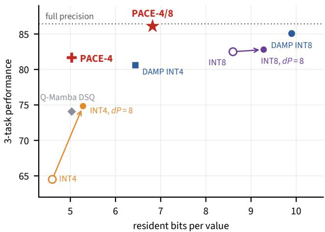
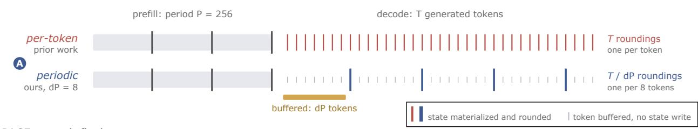
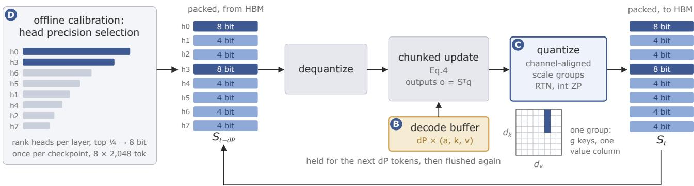
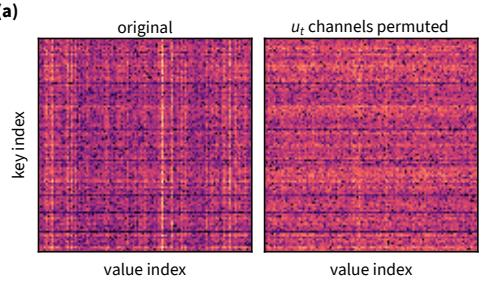
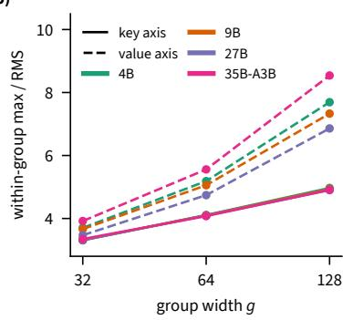
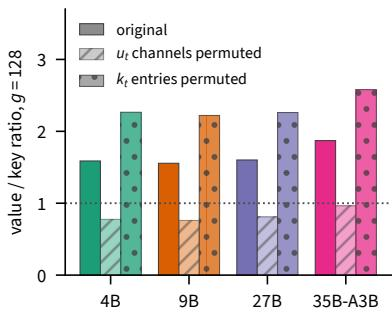
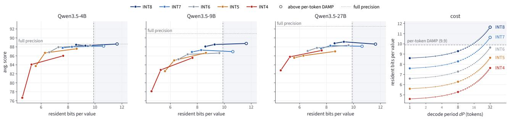
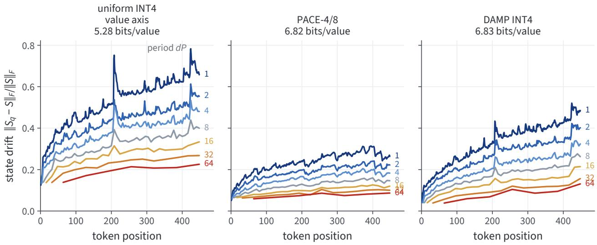
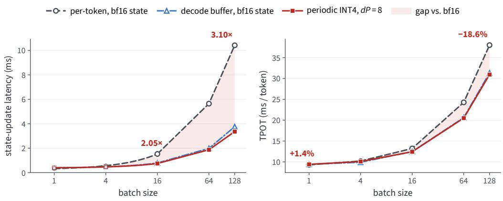
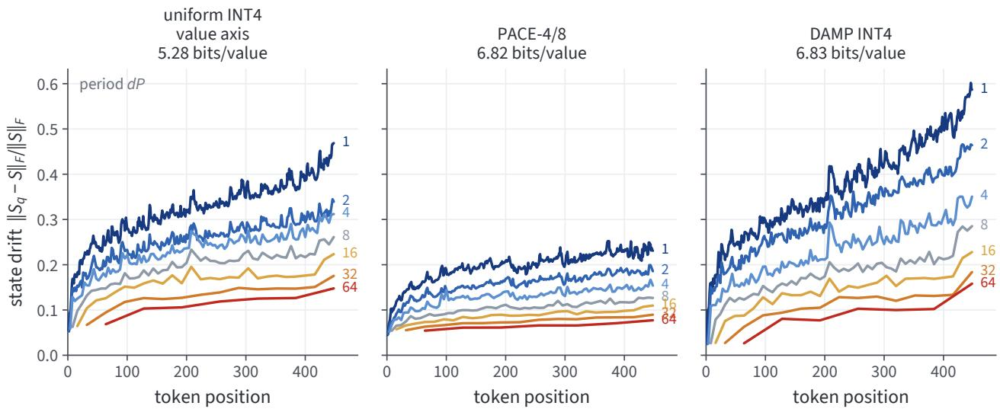

# PACE: Periodic and Channel-Aligned Encoding of Four-Bit Recurrent States

Patrick Haller Filipe Laitenberger Alan Akbik

Humboldt-Universität zu Berlin

## Abstract

Linear-attention language models keep their context in a recurrent state of fixed size, where an inference system stores one copy of this state for every sequence it decodes at the same time. Storing the state at lower precision therefore lets more sequences share an accelerator. Existing state quantizers round the state after every generated token and report that four bits lose accuracy unless the bit width is raised or the model is fine-tuned.

We introduce PACE, a post-hoc four-bit state quantizer. PACE rounds the state only once every few generated tokens, as chunked kernels already do once per chunk during prefill, and keeps the tokens generated in between in a small bufer. Rounding less often reduces the error that accumulates in the state. Additionally, we find that the large entries of the gated-delta state gather in columns, because some channels of the update written at each token remain large across many tokens. PACE therefore shares each quantization scale within one column. It also keeps the heads that retain rounding error longest at eight bits. On four hybrid models from 4B to 35B parameters, PACE with mixed four- and eight-bit heads is competitive with eight-bit DAMP on the three larger models at about two thirds of its memory, PACE with four-bit heads throughout scores higher than Q-Mamba at equal memory, and rounding every few tokens preserves the decoding speedup of the bufer.

Date: October 22, 2026 Correspondence: patrick.haller.1@hu-berlin.de

  
Figure 1: Mean performance of MMLU-Pro, IFEval and RULER-32k against resident bits per value on Qwen3.5-9B. Arrows join per-token and dP=8 rounding variants.

## 1 Introduction

Linear-attention language models replace the key–value cache of a Transformer with a recurrent state of fixed size and have become competitive with Transformers [31, 32]. Every recurrent layer holds one state matrix per head, and a server stores one copy for every sequence it decodes at the same time. At 64 concurrent sequences, the fp32 states take between 10 and 41 % of the memory that weights and states occupy together. Storing the state at lower precision lets more sequences fit on the same accelerator. Existing state quantizers [4, 5, 21, 33] difer in how they scale and round the state, and all of them round it after every generated token. With per-token rounding, the methods that evaluate a four-bit state report a loss in accuracy (Figure 1). The published remedies either raise the bit width to eight bits or fine-tune part of the model weights. NVIDIA et al. [20] round the state less often, but only with eight or more bits per value.

During prefill, chunked kernels process 64 to 1,024 tokens at a time and write the state only at the end of each chunk, so every published quantizer already rounds the prefill state once per chunk. During decoding the kernel is called once per generated token, so the state is written, and rounded, after every token (Figure 2a).

In this work, we introduce PACE (Periodic And Channel-aligned state Encoding), a post-hoc four-bit state quantizer that requires no training (Figure 2). During decoding, PACE rounds the state once every dP generated tokens (the decode period) instead of after every token (○A ). The tokens generated in between are held in a decode bufer, a small store of recent keys and values from which the state is advanced in one step. Recent serving work uses such bufers to speed up decoding [15, 16, 36]. The bufer occupies memory, and every memory total we report counts it together with the state (○B ).

The gated-delta state has one row per key dimension and one column per channel of the delta value, the vector the recurrence writes into the state at each token. Channels that stay large across many tokens produce columns of large entries, and when the channels are permuted at every token, the large entries no longer form columns (Section 4). PACE therefore forms each scale group from the entries of one column, that is, along the key axis (○C ). PACE has two variants: PACE-4 keeps all heads at four bits, and PACE-4/8 keeps the quarter of heads in each layer that retain rounding error longest at eight bits (○D ).

## Our contributions are:

• A bound on the rounding error a head retains as a function of the rounding period and the head’s decay (Section 3), together with a memory accounting that includes the decode bufer (Section 5.1). On four backbones, rounding every eight generated tokens reduces the accuracy loss at every bit width below eight (Section 7.1).

• The observation that the large entries of the gated-delta state form columns, explained by channels of the delta value that stay large across tokens and confirmed by permuting those channels (Section 4).

• PACE, a four-bit state quantizer with channel-aligned scale groups and head-level precision allocation (Section 5), compared with DAMP and Q-Mamba on four hybrid models from 4B to 35B parameters (Section 7.2).

• Triton kernels for periodic decoding with a packed four-bit state, with which we show that rounding every few tokens keeps the decoding speedup of the decode bufer (Section 7.5).

(a)Periodic rounding  
  
(b)PACE at each flush

  
Figure 2: Overview of PACE. (a) Prior state quantizers round the recurrent state after every generated token; PACE rounds it once every $d P$ tokens (○A ), as prefill already does at each kernel chunk boundary. (b) At each flush, the packed state is dequantized, advanced over the tokens held in the decode bufer (○B ), and requantized in channel-aligned scale groups (○C ). PACE-4/8 also holds a quarter of the heads in each layer at eight bits, selected once per checkpoint (○D ).

## 2 Background and Related Work

## 2.1 Gated Delta Rule

Linear attention [12, 26] removes the softmax, so that attention becomes a recurrence over a state $S _ { t } \in \mathbb { R } ^ { d _ { k } \times d _ { v } }$ per head,

$$
{ \cal S } _ { t } = { \cal S } _ { t - 1 } + k _ { t } v _ { t } ^ { \top } , \qquad o _ { t } = { \cal S } _ { t } ^ { \top } q _ { t } .\tag{1}
$$

The state replaces the key–value cache. It holds the whole past, does not grow with context, and is read and written at every step.

Variants difer in how $S _ { t - 1 }$ is modified before the new token is written [2, 23, 28, 32]. We work with the gated delta rule [31], which applies a data-dependent decay $a _ { t } \in ( 0 , 1 )$ and removes the component of the state along the current key before writing,

$$
\boldsymbol { S } _ { t } = \boldsymbol { a } _ { t } \left( \boldsymbol { I } - \beta _ { t } \boldsymbol { k } _ { t } \boldsymbol { k } _ { t } ^ { \top } \right) \boldsymbol { S } _ { t - 1 } + \beta _ { t } \boldsymbol { k } _ { t } \boldsymbol { v } _ { t } ^ { \top } ,\tag{2}
$$

with write strength $\beta _ { t }$ . The read-out is unchanged. Expanding Eq. 2, every write is an outer product,

$$
\begin{array} { r } {  { \boldsymbol { S } } _ { t } = a _ { t }  { \boldsymbol { S } } _ { t - 1 } + k _ { t }  { \boldsymbol { u } } _ { t } ^ { \top } ,  { \boldsymbol { u } } _ { t } = \beta _ { t } \big (  { \boldsymbol { v } } _ { t } - a _ { t }  { \boldsymbol { S } } _ { t - 1 } ^ { \top } k _ { t } \big ) , } \end{array}\tag{3}
$$

where we call $u _ { t }$ the delta value, the part of $v _ { t }$ that the decayed state does not already return for $k _ { t }$ scaled by $\beta _ { t }$

## 2.2 Chunk-wise Kernels

Evaluating Eq. 2 token by token is sequential and memory-bound. Chunk-wise kernels [31, 32] split the sequence into chunks of length C and process each chunk from the state at its start. Writing $\textstyle \alpha _ { i } = \prod _ { j \leq i } a _ { j }$ for the cumulative decay within a chunk, the state after $C$ tokens is

$$
S _ { C } = \alpha _ { C } S _ { 0 } + \sum _ { i = 1 } ^ { C } \frac { \alpha _ { C } } { \alpha _ { i } } k _ { i } u _ { i } ^ { \top } ,\tag{4}
$$

and the outputs follow from $S _ { 0 }$ and the chunk’s own tokens by matrix multiplication. The delta values $u _ { i }$ of Eq. 3 are obtained from a triangular solve over the chunk, so Eq. 4 is evaluated with dense arithmetic rather than a loop. Only $S _ { 0 }$ and $S _ { C }$ are formed as tensors. The states at positions inside the chunk are never written.

(a)  

(b)  

(c)  
  
Figure 3: Large entries of the recurrent state form columns indexed by the value coordinate. (a) |S| of one head of Qwen3.5-9B on a shared logarithmic scale, in the original model and with the channels of the delta value $u _ { t }$ permuted at every token; the head is the median head of the median layer by the value-to-key ratio. (b) Within-group max/RMS against group width, for groups along the key axis (solid) and the value axis (dashed). (c) Ratio of the value-axis to the key-axis statistic at $g { = } 1 2 8$ , in the original model and with $u _ { t }$ or $k _ { t }$ permuted at every token.

## 2.3 Decode Bufers

Decoding calls the kernel once per token, so the state is written every step and the chunk structure is lost. Recent serving work recovers it with a decode bufer. Recent keys and values are held, and the state is advanced once per flush, the step at which the bufered tokens are applied, instead of once per token. This removes the per-token write of the state from memory trafic. KVBufer [36] derives an optimal bufer of about 23 tokens and reports its best latency at 32, ReplaySSM [16] uses 16 for Qwen3.5, and DeltaLog [15] merges every 8 tokens for Gated DeltaNet. None of them quantizes the state.

## 2.4 State Quantization

Quantizing the recurrent state. Quamba2 [5] stores cached states at eight bits with static scales. Q-Mamba [4] reaches four bits by scaling the state with one vector per axis and fine-tuning about 2% of the weights. MambaQuant [30] rotates weights and activations before rounding and leaves the state unquantized. DAMP [33] ranks key channels by quantization error times decay persistence, keeps the riskiest in fp16 and reports 9.9 bits per value; it rounds once per chunk in prefill and after every token in decoding. The Nemotron report [21] keeps the state in fp16 with stochastic rounding, and NVIDIA et al. [20] store the state every eight decoding steps at eight bits and above, in emulation. Kozyrev and Maiboroda [13] quantize the weights and activations of the recurrent layers and leave the state unquantized. None of them varies the rounding period below eight bits or counts the bufer it requires.

Error propagation. Rounding a recurrence is the fixed-point filter problem [11, 22], in which rounding noise of variance $\sigma ^ { 2 }$ , injected at every step of a recurrence with decay a, accumulates to $\sigma ^ { 2 } / ( 1 - a ^ { 2 } )$ Zhang et al. [33] rederive the accumulated error for the gated delta rule and reduce the error per rounding; we reduce the number of roundings (Eq. 5). Kozyrev and Maiboroda [13] find that whole-state error stays flat from token 256 on. Zhao et al. [34] clip the state during quantization-aware training and Siegel et al. [27] quantize an S4D state through its convolutional form.

KV-cache quantization. KIVI [18] and KVQuant [9] reach two to four bits on a cache whose entries are written once and only read, and rotation methods [1, 3, 17] redistribute magnitude before rounding. A recurrent state is instead re-rounded at every write.

## 3 Rounding Period and Error Propagation

## 3.1 The Rounding Period

A quantizer can round the state only where the kernel writes it, which gives three regimes under Eq. 4 (Figure 2a). In prefill the chunked kernel forms $S _ { 0 }$ as the initial state and $S _ { C } ,$ so the state is rounded once per chunk without an additional kernel call. In unbufered decoding each call carries one token, $S _ { t }$ is formed at every step, and the period is one. Under a decode bufer the state is advanced once per flush, and the period is the number of tokens the bufer holds.

We call one choice of bit width, scale groups, bufer precision and rounding periods for the quantized state a configuration. Each configuration carries two periods. We write P for the prefill period, which equals the kernel chunk length $C$ and which we fix at 256 tokens in all benchmark evaluations, and $d P$ for the decode period, which is the variable under study.

## 3.2 Error Propagation

Each rounding adds an error to the state, and the recurrence carries it forward. Between two roundings the error is multiplied at every token by $a _ { t } ( I - \beta _ { t } k _ { t } k _ { t } ^ { \top } ) ~ ( \mathrm { E q . ~ 2 ) }$ , whose norm is at most $a _ { t }$ for a unit-norm key. With $a _ { h }$ the mean decay of head $h ,$ , an error of energy $e _ { h }$ injected at one rounding retains at most $a _ { h } ^ { 2 { \bar { d } } P }$ of its energy at the next, and independent errors from successive roundings accumulate to at most

$$
E _ { h } = \frac { e _ { h } } { 1 - a _ { h } ^ { 2 d P } } .\tag{5}
$$

A longer period lowers $E _ { h }$ , because more decay separates two roundings. In the gated delta rule the decay is one scalar per head, so $E _ { h }$ is a per-head quantity.

Finding 1. The rounding error a head retains falls with the rounding period and rises with the head’s decay

## 4 Channel Structure of the Recurrent State

A group-wise quantizer divides the state of each head into scale groups of g consecutive entries and rounds all entries of a group with one shared step size, which is proportional to the largest absolute entry of the group. A group runs either along the key axis, within one column of the state, or along the value axis, within one row. When a group contains one large entry, its small entries are rounded with a coarse step, so the error at four bits depends on which entries share a group. Section 4.1 measures along which axis the large entries of the state cluster, and Section 4.2 traces this structure to the delta value.

## 4.1 Column Structure of the State

We compute the state over 2,048-token WikiText-103 sequences on all four backbones. In a representative head the large entries form columns, that is, they occur at the same value index for every key index (Figure 3a). We quantify this with the ratio of the largest absolute entry of a group to the root mean square of its entries (max/RMS). The larger the ratio, the fewer quantization levels a typical entry of the group receives. Groups along the value axis, which cross columns, have the larger ratio at every group width, and the diference grows with the width (Figure 3b).

Finding 2. The large entries of the recurrent state concentrate in columns.

## 4.2 Channel Identity of the Delta Value

At each token, the recurrence adds the outer product $k _ { t } u _ { t } ^ { \top }$ to the decayed state $\left( \operatorname { E q . 3 } \right)$ . A value channel that is large across many tokens therefore accumulates in one column, and a key coordinate that is large across many tokens accumulates in one row. Either factor could therefore produce the columns of Section 4.1. To separate them, we recompute the state from the recurrence inputs with the channels of $u _ { t }$ permuted at every token, which keeps the values of $u _ { t }$ but assigns them to a diferent channel at each token, and separately with the entries of $k _ { t }$ permuted. With $u _ { t }$ permuted, key-axis groups have the larger max/RMS ratio on all four backbones, and with $k _ { t }$ permuted the diference between the two axes widens (Figure 3c).

Finding 3. The columns of large entries in the state come from channels of the delta value $u _ { t }$ that stay large across tokens.

## 5 Method

PACE has four components (Figure 2): periodic rounding $\textcircled{4}$ with a decode bufer $\textcircled{8}$ (Section 5.1), which follow from Section $^ { 3 ; }$ channel-aligned scale groups ○C (Section 5.2), from Findings 2 and 3; and head-level precision allocation ○D (Section 5.3), from Finding 1. PACE-4 uses ○A –○C ; PACE-4/8 adds ○D .

## 5.1 Periodic Rounding with a Decode Bufer (⃝A ⃝B )

Rounding every dP tokens requires holding the tokens generated since the last rounding in the decode bufer, which adds to the memory of each configuration. Prior work reports only the stored state, that is, the b-bit payload and its group scales [33]; with one fp16 scale per g values, this gives $b + 1 6 / g$ bits per value. We define resident bits per value as the bits of the stored state and the bufer together, divided by the number of state values. The bufer holds $\left( { { a } _ { t } } , { { k } _ { t } } , { { v } _ { t } } \right)$ per token, the key once per key head and the value once per value head, so with keys at $b _ { k }$ and values at $b _ { v }$ bits it adds per state value

$$
c d P , \qquad c = \frac { b _ { k } d _ { k } / \gamma + b _ { v } d _ { v } + 3 2 } { d _ { k } d _ { v } } ,\tag{6}
$$

where $\gamma$ is the number of value heads sharing a key head. At $d P = 1$ the bufer holds only the current token. Resident bits in Figure 4 and Appendix A include the bufer; Table 6 does not. In uniform configurations, which hold every head at the same bit width, the bufer holds keys and values at eight bits. In the mixed configuration of PACE-4/8, which holds a quarter of the heads at eight bits, it holds the keys at four bits and the values in bf16, since rounding the bufered values below eight bits reduces accuracy more than rounding the keys (Appendix D).

## 5.2 Channel-Aligned Scale Groups (⃝C )

We store the state at four bits in channel-aligned scale groups and keep the per-token decay and the group scales at higher precision.

Scale groups. We divide each head’s state $S \in \mathbb { R } ^ { d _ { k } \times d _ { v } }$ into groups of $g$ consecutive entries along the key axis, so that each group holds g entries of one column, and store one fp16 scale per group (Figure 2, ○C ). Uniform configurations round symmetrically with a step size proportional to the absolute maximum of the group at $b + 1 6 / g$ bits per value; the mixed configuration uses an afine grid per group whose zero point is stored as a b-bit code, at $b + ( 1 6 + b ) / 3 2$ bits per value (Appendix E). Prior work groups along the value axis [33]. We call our groups channel-aligned because each takes its entries from one channel of the delta value (Finding 3), whereas a group along the value axis spans columns of diferent magnitude, and its step size follows the largest of them. We round to nearest throughout.

  
Figure 4: Mean score over GSM8K, IFEval and RULER-32k against resident bits per value for uniform value-axis states of four to eight bits on the three Qwen3.5 backbones (Qwen3.6-35B-A3B in Appendix A). Each line is one width, with $d P = 1 , 8 , 3 2$ from left to right; dotted: full precision; shaded: above the 9.9 bits of DAMP INT8. Right: resident bits per value against dP (Eq. 6).

## 5.3 Head-Level Precision Allocation (⃝D )

We hold the heads that retain rounding error longest at eight bits and the rest at four, applying the allocation criterion of Zhang et al. [33] per head instead of per channel (Finding 1). For each head h, we measure the energy $e _ { h }$ of the error that one rounding adds and assign eight bits to the heads with the largest retained error $E _ { h } \ ( \mathrm { E q . \ 5 } )$ . The ranking is computed once per checkpoint on eight held-out windows of 2,048 tokens. With a quarter of the heads per layer at 8 bits, the payload is $0 . 7 5 \cdot 4 . 6 2 5 + 0 . 2 5 \cdot 8 . 7 5 = 5 . 6 6$ bits per value, the same as DAMP INT4.

We evaluate two variants: PACE-4, a uniform four-bit state with symmetric key-axis groups of 64 and an int8 bufer, and PACE-4/8, which adds head allocation, uses key-axis groups of 32 with an integer zero point (Appendix E), and holds the bufered keys at four bits and the values in bf16.

## 6 Experimental Setup

Models. We evaluate Qwen3.5-4B, 9B and 27B and Qwen3.6-35B-A3B [24, 25], hybrids that interleave gated-delta layers with full-attention layers. The gated-delta layers run on the fla kernels.

Benchmarks. We evaluate on GSM8K [6], MMLU-Pro [29] on a subset of 40 questions per subject (n=560), IFEval [35] (n=541), RULER variable tracking [10] at 32,768 tokens, and MATH-500 [8, 14]. Perplexity is measured on WikiText-103 [19]. All generative tasks are zero-shot with the chat template and thinking disabled.

Baselines. We compare against the full-precision state, against DAMP [33] and against the decoupled scale quantization (DSQ) of Q-Mamba [4], which we reimplement. DAMP INT8 follows the published configuration: value-axis groups of 32 at eight bits, and the 16 of 128 key channels per head with the highest error–persistence score held in fp16. It rounds the state after every generated token and serves as our reference for resident memory; we list it at its published 9.9 bits per value. DAMP INT4 applies the same construction at a four-bit base, with 32 key channels per head held at eight bits. Q-Mamba DSQ scales the state by one fp16 vector per axis, computed at each rounding; we implement the quantizer without the fine-tuning step of the published method.

Protocol. All benchmarks run in the LM Evaluation Harness [7] with greedy decoding. Generation is capped at 1,024 tokens for GSM8K and MATH-500 and 8,192 for MMLU-Pro. We report GSM8K (flexible-extract filter) and MATH-500 as exact match, IFEval as prompt-level strict accuracy, and RULER as variable-tracking accuracy. Unless stated otherwise, every quantized configuration uses a four-bit base width and an int8 decode bufer at $d P { = } 8$ . Tables 1 and 2 and Appendix A come from separate evaluation runs, each with its own full-precision row.

## 7 Results

We first isolate the decode period (Section 7.1), then compare PACE with DAMP and Q-Mamba (Section 7.2), test its components one at a time (Section 7.3), and measure state drift (Section 7.4) and decoding throughput (Section 7.5).

## 7.1 Efect of the Decode Period

To isolate the period, we use the quantizer of prior work, uniform round-to-nearest with value-axis groups of 32, at four to eight bits and $d P \in \{ 1 , 8 , 3 2 \}$ (Figure 4; per-benchmark scores in Appendix A). Per-token rounding loses more accuracy as the width falls, and rounding every eight tokens scores above per-token rounding at every width below eight bits on all four backbones.

The default period of eight closes most of the gap that a period of 32 closes, with a quarter of the bufer memory, and matches the flush interval of DeltaLog [15]. On the three larger backbones a gap to full precision remains at every width, concentrated in IFEval and RULER-32k. The RULER-32k gap is similar at all three decode periods, which suggests that this part of the gap arises in prefill.

## 7.2 Main Results

Table 1 compares PACE with DAMP and Q-Mamba DSQ on four backbones. On the three larger backbones PACE-4/8 scores below DAMP INT8 on IFEval and close to it on average, and the other benchmarks difer in both directions. On Qwen3.5-4B its average is lower, with lower scores on GSM8K, MMLU-Pro and IFEval.

<table><tr><td>state</td><td>bits/value</td><td>GSM8K</td><td>MMLU-Pro</td><td>IFEval</td><td>RULER-32k</td><td>MATH-500</td><td>avg</td></tr><tr><td>Qwen3.54B</td><td></td><td></td><td></td><td></td><td></td><td></td><td></td></tr><tr><td>full precision state</td><td>32.00</td><td>89.2</td><td>72.3</td><td>83.3</td><td>100.0</td><td>59.0</td><td>80.8</td></tr><tr><td>DAMP INT8, per token</td><td>9.90</td><td>89.1</td><td>73.4</td><td>82.8</td><td>100.0</td><td>59.0</td><td>80.9</td></tr><tr><td>DAMP INT4</td><td>6.44</td><td>89.0</td><td>71.8</td><td>80.6</td><td>100.0</td><td>58.2</td><td>79.9</td></tr><tr><td>Q-Mamba DSQ</td><td>5.03</td><td>88.0</td><td>63.2</td><td>74.9</td><td>97.3</td><td>52.4</td><td>75.2</td></tr><tr><td>PACE-4/8, int8 buffer</td><td>6.44</td><td>88.7</td><td>71.1</td><td>81.5</td><td>100.0</td><td>62.6</td><td>80.8</td></tr><tr><td>PACE-4/8</td><td>6.82</td><td>86.5</td><td>70.4</td><td>78.2</td><td>100.0</td><td>60.4</td><td>79.1</td></tr><tr><td>PACE-4</td><td>5.03</td><td>88.6</td><td>71.2</td><td>80.6</td><td>99.3</td><td>58.4</td><td>79.6</td></tr><tr><td>Qwen3.5 9B</td><td></td><td></td><td></td><td></td><td></td><td></td><td></td></tr><tr><td>full precision state</td><td>32.00</td><td>94.2</td><td>74.8</td><td>84.5</td><td>100.0</td><td>68.8</td><td>84.5</td></tr><tr><td>DAMP INT8, per token</td><td>9.90</td><td>94.1</td><td>71.8</td><td>83.4</td><td>100.0</td><td>69.4</td><td>83.7</td></tr><tr><td>DAMP INT4</td><td>6.44</td><td>91.5</td><td>70.5</td><td>78.0</td><td>93.3</td><td>65.2</td><td>79.7</td></tr><tr><td>Q-Mamba DSQ</td><td>5.03</td><td>90.4</td><td>63.6</td><td>70.6</td><td>88.0</td><td>51.6</td><td>72.8</td></tr><tr><td>PACE-4/8, int8 buffer</td><td>6.44</td><td>91.3</td><td>70.4</td><td>78.6</td><td>98.7</td><td>68.0</td><td>81.4</td></tr><tr><td>PACE-4/8</td><td>6.82</td><td>92.2</td><td>77.0</td><td>81.3</td><td>100.0</td><td>68.0</td><td>83.7</td></tr><tr><td>PACE-4</td><td>5.03</td><td>91.0</td><td>70.2</td><td>76.5</td><td>98.3</td><td>63.8</td><td>80.0</td></tr><tr><td>Qwen3.5 27B</td><td></td><td></td><td></td><td></td><td></td><td></td><td></td></tr><tr><td>full precision state DAMP INT8, per token</td><td>32.00</td><td>96.4</td><td>83.8</td><td>86.9</td><td>100.0</td><td>70.2</td><td>87.5</td></tr><tr><td></td><td>9.90</td><td>96.4</td><td>83.8</td><td>88.0</td><td>100.0</td><td>69.0</td><td>87.4</td></tr><tr><td>DAMP INT4</td><td>6.44</td><td>96.1</td><td>81.1</td><td>79.1</td><td>92.7</td><td>70.2</td><td>83.8</td></tr><tr><td>Q-Mamba DSQ</td><td>5.03</td><td>96.0</td><td>78.0</td><td>73.2</td><td>87.3</td><td>59.8</td><td>78.9</td></tr><tr><td>PACE-4/8, int8 buffer</td><td>6.44</td><td>96.4</td><td>81.6</td><td>79.9</td><td>95.0</td><td>69.8</td><td>84.5</td></tr><tr><td>PACE-4/8</td><td>6.82</td><td>96.5</td><td>82.5</td><td>86.1</td><td>100.0</td><td>71.6</td><td>87.3</td></tr><tr><td>PACE-4</td><td>5.03</td><td>95.9</td><td>81.2</td><td>79.3</td><td>96.0</td><td>68.8</td><td>84.2</td></tr><tr><td>Qwen3.6 35B-A3B</td><td></td><td></td><td></td><td></td><td></td><td></td><td></td></tr><tr><td>full precision state DAMP INT8, per token</td><td>32.00</td><td>96.3</td><td>82.1</td><td>83.7</td><td>100.0</td><td>70.6</td><td>86.5</td></tr><tr><td></td><td>9.90</td><td>96.1</td><td>83.4</td><td>83.0</td><td>100.0</td><td>69.2</td><td>86.3</td></tr><tr><td>DAMP INT4</td><td>6.44</td><td>93.9</td><td>66.6</td><td>69.9</td><td>71.0</td><td>43.8</td><td>69.0</td></tr><tr><td>Q-Mamba DSQ</td><td>5.03</td><td>93.6</td><td>72.5</td><td>63.2</td><td>66.7</td><td>59.8</td><td>71.2</td></tr><tr><td>PACE-4/8, int8 buffer</td><td>6.44</td><td>95.5</td><td>77.7</td><td>74.1</td><td>84.3</td><td>60.0</td><td>78.3</td></tr><tr><td>PACE-4/8</td><td>6.82</td><td>95.3</td><td>80.5</td><td>81.0</td><td>100.0</td><td>68.4</td><td>85.0</td></tr><tr><td>PACE-4</td><td>5.03</td><td>95.0</td><td>77.0</td><td>72.6</td><td>83.0</td><td>58.8</td><td>77.3</td></tr></table>

Table 1: PACE-4/8 and PACE-4 (shaded) hold 0.69 and 0.51 of the resident bits of DAMP INT8. Bits per value are resident bits (Eq. 6); all configurations except DAMP INT8 round the state every eight generated tokens $( d P { = } 8 )$ . The average is the mean over all benchmarks.

At the resident bits of DAMP INT4, PACE-4/8 with an int8 bufer scores above DAMP INT4 on every backbone, with the largest diference on Qwen3.6-35B-A3B. With its mixed bufer, PACE-4/8 scores higher than this variant on the three larger backbones and lower on Qwen3.5-4B. PACE-4 holds the same resident bits as Q-Mamba DSQ and scores higher on every backbone.

## 7.3 Ablations

We compare state quantizers on Qwen3.5-4B and 27B, changing one component at a time, and report IFEval with a 95% interval on the paired diference to the full-precision state and perplexity on WikiText-103 at 32,768 tokens (Table 2).

Groups along the key axis yield a lower perplexity than groups along the value axis at the same width, with and without head allocation, and a higher IFEval score without it. Q-Mamba DSQ yields a higher perplexity than key-axis groups at the same resident bits per value.

At equal resident bits, head-level allocation yields a lower perplexity than DAMP INT4.
<table><tr><td>configuration</td><td>bits</td><td>IFEval 4B</td><td>IFEval 27B</td><td>ppl 4B</td></tr><tr><td>full precision</td><td>32.00</td><td>82.26</td><td>86.69</td><td>7.713</td></tr><tr><td>Scale structure</td><td></td><td></td><td></td><td></td></tr><tr><td>value axis,  $g { = } 3 2$ </td><td>5.28</td><td> $7 3 . 7 5 { \scriptstyle \pm 3 . 2 9 }$ </td><td> $7 5 . 0 5 { \scriptstyle \pm 3 . 2 4 }$ </td><td>8.158</td></tr><tr><td>Q-Mamba DSQ [4]</td><td>5.03</td><td> $7 4 . 8 6 _ { \pm 3 . 2 2 }$ </td><td> $7 3 . 9 4 { \scriptstyle \pm 3 . 3 3 }$ </td><td>8.320</td></tr><tr><td>key axis,  $g { = } 3 2$ </td><td>5.28</td><td> $8 0 . 5 9 { \scriptstyle \pm 2 . 5 3 }$ </td><td> $7 8 . 3 7 { \scriptstyle \pm 2 . 8 4 }$ </td><td>7.719</td></tr><tr><td>key axis,  $g { = } 6 4$ </td><td>5.03</td><td> $8 0 . 5 9 { \scriptstyle \pm 2 . 7 3 }$ </td><td> $7 8 . 9 3 { \scriptstyle \pm 2 . 7 8 }$ </td><td>7.734</td></tr><tr><td>Precision allocation</td><td></td><td></td><td></td><td></td></tr><tr><td>channel protection, value axis (DAMP INT4)</td><td>6.44</td><td> $7 9 . 4 8 _ { \pm 2 . 6 8 }$ </td><td> $\mathbf { 7 9 . 8 5 { \scriptstyle \pm 2 . 9 1 } }$ </td><td>8.003</td></tr><tr><td>head allocation, value axis</td><td>6.44</td><td> $8 0 . 4 1 { \scriptstyle \pm 2 . 7 6 }$ </td><td> $7 7 . 6 3 { \scriptstyle \pm 2 . 9 6 }$ </td><td>7.776</td></tr><tr><td>head allocation, key axis</td><td>6.44</td><td> $\mathbf { 8 1 . 5 2 _ { \pm 2 . 5 1 } }$ </td><td> $7 8 . 0 0 { \scriptstyle \pm 2 . 8 8 }$ </td><td>7.687</td></tr></table>

Table 2: Scaling the four-bit state along the key axis and allocating eight bits per head reduce the loss of the uniform value-axis quantizer. Bits are resident bits per value at $d P { = } 8$ with an int8 decode bufer.

## 7.4 State Drift under Periodic Rounding

To measure the efect of the rounding period on the state itself, we compare the quantized state with the full-precision state at the same token. We run Qwen3.5-4B on the first 512 tokens of the WikiText-103 test set [19], round the state every $d P$ tokens over the whole sequence, for $d P$ from 1 to 64, and report the median over recurrent layers of the relative error $\| S _ { q } - S \| _ { F } / \| S \| _ { F } .$ , which we call drift. We compare three four-bit quantizers: uniform INT4 with value-axis groups, DAMP INT4, and the state quantizer of PACE-4/8 (Figure 5).

  
Figure 5: Relative state error against token position on Qwen3.5-4B, one curve per period $d P .$ . The DAMP panel (right) keeps 16 key channels per head in fp16.

For all three quantizers, drift decreases as $d P$ grows at every token position, and the same ordering holds on Qwen3.6-35B-A3B (Appendix B). Drift grows more slowly than the number of roundings, which is consistent with a decaying recurrence that removes old rounding error while each rounding adds new error (Section 3.2).

## 7.5 Throughput

We measure decoding cost on Qwen3.5-4B on one H100 PCIe GPU at a 512-token context and batch sizes from 1 to 128. We compare per-token decoding with a bf16 state, the decode bufer with a bf16 state [36], and periodic decoding at dP=8 with a uniform INT4 state and an int8 bufer, for which we implement Triton kernels that apply the bufered tokens to the packed state. We report time per output token (TPOT) and the latency of the state update (Figure 6, Appendix F).

Periodic rounding lets a four-bit state keep the speedup of the decode bufer. Periodic INT4 decoding has a lower TPOT than per-token bf16 decoding from batch 16 upward, and the diference grows with batch size, as reading and writing the per-sequence state take a growing share of each decoding step. The decode bufer with a bf16 state accounts for most of this reduction, and the INT4 state reduces TPOT slightly further. The memory each configuration holds per sequence, measured in the same run, agrees with the resident bits of Eq. 6 (Appendix F).

  
Figure 6: Decoding cost on Qwen3.5-4B (H100 PCIe, 512-token context) against batch size. Left: latency of the recurrent-state update. Right: time per output token. The shading marks the gap to bf16. Labels give the ratio to bf16 (left) and the relative change in TPOT (right) at the ends of each curve.

## 8 Conclusion

We introduced PACE, a post-hoc four-bit state quantizer for gated-delta models that rounds the state once every few generated tokens and holds the tokens in between in a decode bufer. For uniform configurations, a period of eight tokens reduces the accuracy loss at every width below eight bits on four backbones. This is consistent with the bound of Section 3, under which more decay between two roundings leaves less of each rounding error in the state. The large entries of the state gather in columns that follow the channels of the delta value, and PACE forms each scale group from the entries of one such column. PACE-4/8 comes close to the accuracy of DAMP INT8 on the three larger backbones at about two thirds of its resident memory, and PACE-4 scores higher than Q-Mamba DSQ at equal resident bits. Periodic rounding also keeps the decoding speedup of the decode bufer.

## Limitations

We evaluate four hybrid models from the Qwen3.5 and Qwen3.6 families, all of which use the gated delta rule. Periodic rounding applies to any linear-attention layer whose state can be advanced over several tokens at once, which includes the chunked forms of gated linear attention, Mamba-2 and DeltaNe variants. The head decays that enter the error bound, the column structure that motivates key-axis scale groups, and the head ranking are measured only on these models. None of them is shown to carry over to other model families, to models whose layers are all recurrent, or to token mixers with a diferent update or decay.

Periodic rounding changes when the state is rounded and leaves the choice of quantizer open. Besides PACE, we evaluate DAMP INT4 and Q-Mamba DSQ under the same period. We do not test quantizers with static scales, stochastic rounding or rotations of the state under periodic rounding.

The configuration space of periodic state quantization is large. It spans the prefill and decode periods, the bit widths of the state and of the bufered keys and values, the axis and width of the scale groups, and the fraction of heads held at eight bits, and we explore only part of it. The prefill period in particular is fixed at the 256-token chunk of the kernel in all benchmark evaluations, so the efect of rounding the state more or less often during prefill is not measured. Throughput is timed only for a uniform four-bit state; the key-axis groups and head allocation of PACE are not timed.

## Acknowledgments

Alan Akbik and Patrick Haller are supported by the Deutsche Forschungsgemeinschaft (DFG, German Research Foundation) under Emmy Noether grant “Eidetic Representations of Natural Language” (project number 448414230). Alan Akbik is furthermore supported under Germany’s Excellence Strategy “Science of Intelligence” (EXC 2002/1, project number 390523135). The authors gratefully acknowledge the scientific support and HPC resources provided by the Erlangen National High Performance Computing Center (NHR@FAU) of the Friedrich-Alexander-Universität Erlangen-Nürnberg (FAU) under the NHR project “Pre-Training SLMs via Knowledge Distillation”. NHR funding is provided by federal and Bavarian state authorities.

## References

[1] Saleh Ashkboos, Amirkeivan Mohtashami, Maximilian L. Croci, Bo Li, Pashmina Cameron, Martin Jaggi, Dan Alistarh, Torsten Hoefler, and James Hensman. 2024. QuaRot: Outlier-free 4-bit inference in rotated LLMs. In Advances in Neural Information Processing Systems (NeurIPS), volume 37, pages 100213–100240.

[2] Maximilian Beck, Korbinian Pöppel, Markus Spanring, Andreas Auer, Oleksandra Prudnikova, Michael Kopp, Günter Klambauer, Johannes Brandstetter, and Sepp Hochreiter. 2024. xLSTM: Extended long short-term memory. In Advances in Neural Information Processing Systems (NeurIPS), volume 37.

[3] Jerry Chee, Yaohui Cai, Volodymyr Kuleshov, and Christopher De Sa. 2023. QuIP: 2-bit quantization of large language models with guarantees. In Advances in Neural Information Processing Systems (NeurIPS), volume 36.

[4] Tianqi Chen, Yuanteng Chen, Peisong Wang, Weixiang Xu, Zeyu Zhu, and Jian Cheng. 2025. Q-Mamba: Towards more eficient Mamba models via post-training quantization. In Findings of the Association for Computational Linguistics: ACL 2025, pages 10594–10610.

[5] Hung-Yueh Chiang, Chi-Chih Chang, Natalia Frumkin, Kai-Chiang Wu, Mohamed S. Abdelfattah, and Diana Marculescu. 2025. Quamba2: A robust and scalable post-training quantization framework for selective

state space models. In Proceedings of the 42nd International Conference on Machine Learning (ICML), volume 267 of Proceedings of Machine Learning Research, pages 10411–10427.

[6] Karl Cobbe, Vineet Kosaraju, Mohammad Bavarian, Mark Chen, Heewoo Jun, Lukasz Kaiser, Matthias Plappert, Jerry Tworek, Jacob Hilton, Reiichiro Nakano, Christopher Hesse, and John Schulman. 2021. Training verifiers to solve math word problems. arXiv preprint arXiv:2110.14168.

[7] Leo Gao, Jonathan Tow, Baber Abbasi, Stella Biderman, Sid Black, Anthony DiPofi, Charles Foster, Laurence Golding, Jefrey Hsu, Alain Le Noac’h, Haonan Li, Kyle McDonell, Niklas Muennighof, Chris Ociepa, Jason Phang, Laria Reynolds, Hailey Schoelkopf, Aviya Skowron, Lintang Sutawika, and 5 others. 2024. The language model evaluation harness. Zenodo, https://doi.org/10.5281/zenodo.12608602.

[8] Dan Hendrycks, Collin Burns, Saurav Kadavath, Akul Arora, Steven Basart, Eric Tang, Dawn Song, and Jacob Steinhardt. 2021. Measuring mathematical problem solving with the MATH dataset. In Advances in Neural Information Processing Systems (NeurIPS) Datasets and Benchmarks Track, volume 1.

[9] Coleman Hooper, Sehoon Kim, Hiva Mohammadzadeh, Michael W. Mahoney, Yakun Sophia Shao, Kurt Keutzer, and Amir Gholami. 2024. KVQuant: Towards 10 million context length LLM inference with KV cache quantization. In Advances in Neural Information Processing Systems (NeurIPS), volume 37, pages 1270–1303.

[10] Cheng-Ping Hsieh, Simeng Sun, Samuel Kriman, Shantanu Acharya, Dima Rekesh, Fei Jia, Yang Zhang, and Boris Ginsburg. 2024. RULER: What’s the real context size of your long-context language models? In Conference on Language Modeling (COLM).

[11] Leland B. Jackson. 1970. Roundof-noise analysis for fixed-point digital filters realized in cascade or parallel form. IEEE Transactions on Audio and Electroacoustics, 18(2):107–122.

[12] Angelos Katharopoulos, Apoorv Vyas, Nikolaos Pappas, and François Fleuret. 2020. Transformers are RNNs: Fast autoregressive transformers with linear attention. In Proceedings of the 37th International Conference on Machine Learning (ICML), volume 119 of Proceedings of Machine Learning Research, pages 5156–5165.

[13] Sergii Kozyrev and Davyd Maiboroda. 2026. Why gated DeltaNet survives 4-bit quantization: NVFP4 W4A4 for the recurrent half of a hybrid 27B LLM. arXiv preprint arXiv:2609.04098.

[14] Hunter Lightman, Vineet Kosaraju, Yura Burda, Harri Edwards, Bowen Baker, Teddy Lee, Jan Leike, John Schulman, Ilya Sutskever, and Karl Cobbe. 2024. Let’s verify step by step. In International Conference on Learning Representations (ICLR).

[15] Junqing Lin, Jingwei Sun, and Guangzhong Sun. 2026. DeltaLog: Deferred materialization of recurrent states for linear attention decoding. arXiv preprint arXiv:2608.15533.

[16] Ze-Wei Liou and Tri Dao. 2026. ReplaySSM: Cache SSM inputs, not state. Blog post, https://tridao. me/blog/2026/replayssm/.

[17] Zechun Liu, Changsheng Zhao, Igor Fedorov, Bilge Soran, Dhruv Choudhary, Raghuraman Krishnamoorthi, Vikas Chandra, Yuandong Tian, and Tijmen Blankevoort. 2025. SpinQuant: LLM quantization with learned rotations. In International Conference on Learning Representations (ICLR).

[18] Zirui Liu, Jiayi Yuan, Hongye Jin, Shaochen Zhong, Zhaozhuo Xu, Vladimir Braverman, Beidi Chen, and Xia Hu. 2024. KIVI: A tuning-free asymmetric 2bit quantization for KV cache. In Proceedings of the 41st International Conference on Machine Learning (ICML), volume 235 of Proceedings of Machine Learning Research, pages 32332–32344.

[19] Stephen Merity, Caiming Xiong, James Bradbury, and Richard Socher. 2017. Pointer sentinel mixture models. In International Conference on Learning Representations (ICLR).

[20] NVIDIA, Aaron Blakeman, Aaron Thomas, Aastha Jhunjhunwala, et al. 2026. Nemotron 3 Ultra: Open, eficient mixture-of-experts hybrid Mamba-transformer model for agentic reasoning. arXiv preprint arXiv:2606.15007.

[21] NVIDIA, Aakshita Chandiramani, Aaron Blakeman, Abdullahi Olaoye, et al. 2026. Nemotron 3 Super: Open, eficient mixture-of-experts hybrid Mamba-transformer model for agentic reasoning. arXiv preprint arXiv:2604.12374.

[22] Alan V. Oppenheim and Cliford J. Weinstein. 1972. Efects of finite register length in digital filtering and the fast Fourier transform. Proceedings of the IEEE, 60(8):957–976.

[23] Bo Peng, Eric Alcaide, Quentin Anthony, Alon Albalak, Samuel Arcadinho, Stella Biderman, Huanqi Cao, Xin Cheng, Michael Chung, Leon Derczynski, Xingjian Du, Matteo Grella, Kranthi Gv, Xuzheng He, Haowen Hou, Przemyslaw Kazienko, Jan Kocon, Jiaming Kong, Bartłomiej Koptyra, and 13 others. 2023. RWKV: Reinventing RNNs for the transformer era. In Findings of the Association for Computational Linguistics: EMNLP 2023, pages 14048–14077.

[24] Qwen Team. 2026. Qwen3.5: Towards native multimodal agents. https://qwen.ai/blog?id=qwen3.5.

[25] Qwen Team. 2026. Qwen3.6-35B-A3B: Agentic coding power, now open to all. https://qwen.ai/blog? id=qwen3.6-35b-a3b.

[26] Imanol Schlag, Kazuki Irie, and Jürgen Schmidhuber. 2021. Linear transformers are secretly fast weight programmers. In Proceedings of the 38th International Conference on Machine Learning (ICML), volume 139 of Proceedings of Machine Learning Research, pages 9355–9366.

[27] Sebastian Siegel, Ming-Jay Yang, Younes Bouhadjar, Maxime Fabre, Emre Neftci, and John Paul Strachan. 2026. QS4D: Quantization-aware training for eficient hardware deployment of structured state-space sequential models. Advanced Intelligent Systems, 8(4):e202501019.

[28] Yutao Sun, Li Dong, Shaohan Huang, Shuming Ma, Yuqing Xia, Jilong Xue, Jianyong Wang, and Furu Wei. 2023. Retentive network: A successor to transformer for large language models. arXiv preprint arXiv:2307.08621.

[29] Yubo Wang, Xueguang Ma, Ge Zhang, Yuansheng Ni, Abhranil Chandra, Shiguang Guo, Weiming Ren, Aaran Arulraj, Xuan He, Ziyan Jiang, Tianle Li, Max Ku, Kai Wang, Alex Zhuang, Rongqi Fan, Xiang Yue, and Wenhu Chen. 2024. MMLU-Pro: A more robust and challenging multi-task language understanding benchmark. In Advances in Neural Information Processing Systems (NeurIPS) Datasets and Benchmarks Track, volume 37.

[30] Zukang Xu, Yuxuan Yue, Xing Hu, Zhihang Yuan, Zixu Jiang, Zhixuan Chen, Jiangyong Yu, Chen Xu, Sifan Zhou, and Dawei Yang. 2025. MambaQuant: Quantizing the Mamba family with variance aligned rotation methods. In International Conference on Learning Representations (ICLR).

[31] Songlin Yang, Jan Kautz, and Ali Hatamizadeh. 2025. Gated delta networks: Improving Mamba2 with delta rule. In International Conference on Learning Representations (ICLR).

[32] Songlin Yang, Bailin Wang, Yikang Shen, Rameswar Panda, and Yoon Kim. 2024. Gated linear attention transformers with hardware-eficient training. In Proceedings of the 41st International Conference on Machine Learning (ICML), volume 235 of Proceedings of Machine Learning Research, pages 56501–56523.

[33] Tao Zhang, Jianchao Tan, Pingwei Sun, Yanqi Yu, Zunhai Su, Zixu Jiang, Yuchen Xie, Xunliang Cai, and Ziqian Zeng. 2026. DAMP: Decay-aware mixed-precision recurrent-state quantization. arXiv preprint arXiv:2608.27513v1.

[34] Leo Zhao, Tristan Torchet, Melika Payvand, Laura Kriener, and Filippo Moro. 2025. Quantizing small-scale state-space models for edge AI. In 2025 International Conference on Neuromorphic Systems (ICONS), pages 158–165.

[35] Jefrey Zhou, Tianjian Lu, Swaroop Mishra, Siddhartha Brahma, Sujoy Basu, Yi Luan, Denny Zhou, and Le Hou. 2023. Instruction-following evaluation for large language models. arXiv preprint arXiv:2311.07911.

[36] Longwei Zou and Lin Zhong. 2026. KVBufer: IO-aware serving for linear attention. arXiv preprint arXiv:2605.19049.

## A Per-Benchmark Scores across Widths and Periods

## Table 3 gives the per-benchmark scores behind Figure 4.

(a) Qwen3.5-4B
<table><tr><td rowspan=1 colspan=6>state        resident GSM8K IFEval RULER-32k</td><td rowspan=1 colspan=1>avg</td></tr><tr><td rowspan=1 colspan=2>full precision</td><td rowspan=1 colspan=1>32.00</td><td rowspan=1 colspan=1>82.7</td><td rowspan=1 colspan=1>83.3</td><td rowspan=1 colspan=1>100.0</td><td rowspan=1 colspan=1>88.7</td></tr><tr><td rowspan=1 colspan=2>INT8, dP=1</td><td rowspan=1 colspan=1>8.60</td><td rowspan=1 colspan=1>84.3</td><td rowspan=1 colspan=1>81.1</td><td rowspan=1 colspan=1>100.0</td><td rowspan=1 colspan=1>88.5</td></tr><tr><td rowspan=1 colspan=2>INT8, dP=8</td><td rowspan=1 colspan=1>9.28</td><td rowspan=1 colspan=1>84.8</td><td rowspan=1 colspan=1>80.0</td><td rowspan=1 colspan=1>100.0</td><td rowspan=1 colspan=1>88.3</td></tr><tr><td rowspan=1 colspan=2>INT8, dP=32</td><td rowspan=1 colspan=1>11.64</td><td rowspan=1 colspan=1>84.2</td><td rowspan=1 colspan=1>81.7</td><td rowspan=1 colspan=1>100.0</td><td rowspan=1 colspan=1>88.6</td></tr><tr><td rowspan=1 colspan=1>INT7,</td><td rowspan=1 colspan=1>dP=1</td><td rowspan=1 colspan=1>7.60</td><td rowspan=1 colspan=1>84.2</td><td rowspan=1 colspan=1>79.1</td><td rowspan=1 colspan=1>100.0</td><td rowspan=1 colspan=1>87.8</td></tr><tr><td rowspan=1 colspan=1>INT7,</td><td rowspan=1 colspan=1>dP=8</td><td rowspan=1 colspan=1>8.28</td><td rowspan=1 colspan=1>83.6</td><td rowspan=1 colspan=1>80.4</td><td rowspan=1 colspan=1>100.0</td><td rowspan=1 colspan=1>88.0</td></tr><tr><td rowspan=1 colspan=1>INT7,</td><td rowspan=1 colspan=1>dP=32</td><td rowspan=1 colspan=1>10.64</td><td rowspan=1 colspan=1>83.8</td><td rowspan=1 colspan=1>80.8</td><td rowspan=1 colspan=1>100.0</td><td rowspan=1 colspan=1>88.2</td></tr><tr><td rowspan=1 colspan=1>INT6,</td><td rowspan=1 colspan=1>dP=1</td><td rowspan=1 colspan=1>6.60</td><td rowspan=1 colspan=1>82.4</td><td rowspan=1 colspan=1>78.0</td><td rowspan=1 colspan=1>100.0</td><td rowspan=1 colspan=1>86.8</td></tr><tr><td rowspan=1 colspan=1>INT6,</td><td rowspan=1 colspan=1>dP=8</td><td rowspan=1 colspan=1>7.28</td><td rowspan=1 colspan=1>83.5</td><td rowspan=1 colspan=1>80.6</td><td rowspan=1 colspan=1>99.7</td><td rowspan=1 colspan=1>87.9</td></tr><tr><td rowspan=1 colspan=1>INT6,</td><td rowspan=1 colspan=1>dP=32</td><td rowspan=1 colspan=1>9.64</td><td rowspan=1 colspan=1>84.0</td><td rowspan=1 colspan=1>81.3</td><td rowspan=1 colspan=1>99.7</td><td rowspan=1 colspan=1>88.3</td></tr><tr><td rowspan=1 colspan=1>INT5,</td><td rowspan=1 colspan=1>dP=1</td><td rowspan=1 colspan=1>5.60</td><td rowspan=1 colspan=1>80.6</td><td rowspan=1 colspan=1>70.6</td><td rowspan=1 colspan=1>100.0</td><td rowspan=1 colspan=1>83.7</td></tr><tr><td rowspan=1 colspan=1>INT5,</td><td rowspan=1 colspan=1>dP=8</td><td rowspan=1 colspan=1>6.28</td><td rowspan=1 colspan=1>83.2</td><td rowspan=1 colspan=1>77.1</td><td rowspan=1 colspan=1>99.7</td><td rowspan=1 colspan=1>86.7</td></tr><tr><td rowspan=1 colspan=1>INT5,</td><td rowspan=1 colspan=1>dP=32</td><td rowspan=1 colspan=1>8.64</td><td rowspan=1 colspan=1>83.8</td><td rowspan=1 colspan=1>79.3</td><td rowspan=1 colspan=1>99.7</td><td rowspan=1 colspan=1>87.6</td></tr><tr><td rowspan=1 colspan=1>INT4,</td><td rowspan=1 colspan=1>dP=1</td><td rowspan=1 colspan=1>4.60</td><td rowspan=1 colspan=1>69.3</td><td rowspan=1 colspan=1>61.4</td><td rowspan=1 colspan=1>99.3</td><td rowspan=1 colspan=1>76.7</td></tr><tr><td rowspan=1 colspan=1>INT4,</td><td rowspan=1 colspan=1>dP=8</td><td rowspan=1 colspan=1>5.28</td><td rowspan=1 colspan=1>80.2</td><td rowspan=1 colspan=1>73.0</td><td rowspan=1 colspan=1>99.0</td><td rowspan=1 colspan=1>84.1</td></tr><tr><td rowspan=1 colspan=1>INT4,</td><td rowspan=1 colspan=1>dP=32</td><td rowspan=1 colspan=1>7.64</td><td rowspan=1 colspan=1>82.0</td><td rowspan=1 colspan=1>77.1</td><td rowspan=1 colspan=1>99.0</td><td rowspan=1 colspan=1>86.0</td></tr></table>

(c) Qwen3.5-27B

(b) Qwen3.5-9B
<table><tr><td rowspan=1 colspan=6>state        resident GSM8K IFEval RULER-32k</td><td rowspan=1 colspan=1>avg</td></tr><tr><td rowspan=1 colspan=2>full precision</td><td rowspan=1 colspan=1>32.00</td><td rowspan=1 colspan=1>88.4</td><td rowspan=1 colspan=1>84.5</td><td rowspan=1 colspan=1>100.0</td><td rowspan=1 colspan=1>91.0</td></tr><tr><td rowspan=1 colspan=2>INT8, dP=1</td><td rowspan=1 colspan=1>8.60</td><td rowspan=1 colspan=1>88.4</td><td rowspan=1 colspan=1>78.2</td><td rowspan=1 colspan=1>97.7</td><td rowspan=1 colspan=1>88.1</td></tr><tr><td rowspan=1 colspan=2>INT8, dP=8</td><td rowspan=1 colspan=1>9.28</td><td rowspan=1 colspan=1>89.0</td><td rowspan=1 colspan=1>78.9</td><td rowspan=1 colspan=1>97.7</td><td rowspan=1 colspan=1>88.5</td></tr><tr><td rowspan=1 colspan=2>INT8, dP=32</td><td rowspan=1 colspan=1>11.64</td><td rowspan=1 colspan=1>89.2</td><td rowspan=1 colspan=1>79.1</td><td rowspan=1 colspan=1>98.0</td><td rowspan=1 colspan=1>88.8</td></tr><tr><td rowspan=1 colspan=2>INT7, dP=1</td><td rowspan=1 colspan=1>7.60</td><td rowspan=1 colspan=1>88.5</td><td rowspan=1 colspan=1>75.8</td><td rowspan=1 colspan=1>96.3</td><td rowspan=1 colspan=1>86.9</td></tr><tr><td rowspan=1 colspan=2>INT7, dP=8</td><td rowspan=1 colspan=1>8.28</td><td rowspan=1 colspan=1>88.6</td><td rowspan=1 colspan=1>77.6</td><td rowspan=1 colspan=1>95.7</td><td rowspan=1 colspan=1>87.3</td></tr><tr><td rowspan=1 colspan=2>INT7, dP=32</td><td rowspan=1 colspan=1>10.64</td><td rowspan=1 colspan=1>88.9</td><td rowspan=1 colspan=1>76.0</td><td rowspan=1 colspan=1>96.0</td><td rowspan=1 colspan=1>86.9</td></tr><tr><td rowspan=1 colspan=2>INT6, dP=1</td><td rowspan=1 colspan=1>6.60</td><td rowspan=1 colspan=1>87.3</td><td rowspan=1 colspan=1>73.4</td><td rowspan=1 colspan=1>95.0</td><td rowspan=1 colspan=1>85.2</td></tr><tr><td rowspan=1 colspan=2>INT6, dP=8</td><td rowspan=1 colspan=1>7.28</td><td rowspan=1 colspan=1>87.7</td><td rowspan=1 colspan=1>76.0</td><td rowspan=1 colspan=1>95.3</td><td rowspan=1 colspan=1>86.3</td></tr><tr><td rowspan=1 colspan=2>INT6, dP=32</td><td rowspan=1 colspan=1>9.64</td><td rowspan=1 colspan=1>87.6</td><td rowspan=1 colspan=1>76.9</td><td rowspan=1 colspan=1>95.3</td><td rowspan=1 colspan=1>86.6</td></tr><tr><td rowspan=1 colspan=1>INT5,</td><td rowspan=1 colspan=1>dP=1</td><td rowspan=1 colspan=1>5.60</td><td rowspan=1 colspan=1>86.1</td><td rowspan=1 colspan=1>68.4</td><td rowspan=1 colspan=1>93.3</td><td rowspan=1 colspan=1>82.6</td></tr><tr><td rowspan=1 colspan=1>INT5,</td><td rowspan=1 colspan=1>dP=8</td><td rowspan=1 colspan=1>6.28</td><td rowspan=1 colspan=1>87.5</td><td rowspan=1 colspan=1>74.5</td><td rowspan=1 colspan=1>93.0</td><td rowspan=1 colspan=1>85.0</td></tr><tr><td rowspan=1 colspan=1>INT5,</td><td rowspan=1 colspan=1>dP=32</td><td rowspan=1 colspan=1>8.64</td><td rowspan=1 colspan=1>88.6</td><td rowspan=1 colspan=1>77.4</td><td rowspan=1 colspan=1>94.0</td><td rowspan=1 colspan=1>86.7</td></tr><tr><td rowspan=1 colspan=1>INT4,</td><td rowspan=1 colspan=1>dP=1</td><td rowspan=1 colspan=1>4.60</td><td rowspan=1 colspan=1>82.6</td><td rowspan=1 colspan=1>61.4</td><td rowspan=1 colspan=1>90.3</td><td rowspan=1 colspan=1>78.1</td></tr><tr><td rowspan=1 colspan=1>INT4,</td><td rowspan=1 colspan=1>dP=8</td><td rowspan=1 colspan=1>5.28</td><td rowspan=1 colspan=1>87.3</td><td rowspan=1 colspan=1>71.3</td><td rowspan=1 colspan=1>90.0</td><td rowspan=1 colspan=1>82.9</td></tr><tr><td rowspan=1 colspan=1>INT4,</td><td rowspan=1 colspan=1>dP=32</td><td rowspan=1 colspan=1>7.64</td><td rowspan=1 colspan=1>88.1</td><td rowspan=1 colspan=1>76.9</td><td rowspan=1 colspan=1>91.7</td><td rowspan=1 colspan=1>85.6</td></tr></table>

(d) Qwen3.6-35B-A3B

<table><tr><td rowspan=1 colspan=7>state        resident GSM8K IFEval RULER-32k avg</td></tr><tr><td rowspan=1 colspan=2>full precision</td><td rowspan=1 colspan=1>32.00</td><td rowspan=1 colspan=1>90.8</td><td rowspan=1 colspan=1>86.9</td><td rowspan=1 colspan=1>100.0</td><td rowspan=1 colspan=1>92.6</td></tr><tr><td rowspan=1 colspan=2>INT8, dP=1</td><td rowspan=1 colspan=1>8.60</td><td rowspan=1 colspan=1>90.8</td><td rowspan=1 colspan=1>80.2</td><td rowspan=1 colspan=1>95.3</td><td rowspan=1 colspan=1>88.8</td></tr><tr><td rowspan=1 colspan=2>INT8, dP=8</td><td rowspan=1 colspan=1>9.28</td><td rowspan=1 colspan=1>91.3</td><td rowspan=1 colspan=1>80.8</td><td rowspan=1 colspan=1>95.3</td><td rowspan=1 colspan=1>89.1</td></tr><tr><td rowspan=1 colspan=2>INT8, dP=32</td><td rowspan=1 colspan=1>11.64</td><td rowspan=1 colspan=1>91.6</td><td rowspan=1 colspan=1>78.9</td><td rowspan=1 colspan=1>95.3</td><td rowspan=1 colspan=1>88.6</td></tr><tr><td rowspan=1 colspan=2>INT7, dP=1</td><td rowspan=1 colspan=1>7.60</td><td rowspan=1 colspan=1>91.1</td><td rowspan=1 colspan=1>77.8</td><td rowspan=1 colspan=1>94.0</td><td rowspan=1 colspan=1>87.6</td></tr><tr><td rowspan=1 colspan=2>INT7, dP=8</td><td rowspan=1 colspan=1>8.28</td><td rowspan=1 colspan=1>91.2</td><td rowspan=1 colspan=1>79.3</td><td rowspan=1 colspan=1>94.3</td><td rowspan=1 colspan=1>88.3</td></tr><tr><td rowspan=1 colspan=1>INT7,</td><td rowspan=1 colspan=1>dP=32</td><td rowspan=1 colspan=1>10.64</td><td rowspan=1 colspan=1>90.6</td><td rowspan=1 colspan=1>79.5</td><td rowspan=1 colspan=1>94.3</td><td rowspan=1 colspan=1>88.1</td></tr><tr><td rowspan=1 colspan=1>INT6,</td><td rowspan=1 colspan=1>dP=1</td><td rowspan=1 colspan=1>6.60</td><td rowspan=1 colspan=1>91.5</td><td rowspan=1 colspan=1>75.8</td><td rowspan=1 colspan=1>94.0</td><td rowspan=1 colspan=1>87.1</td></tr><tr><td rowspan=1 colspan=1>INT6,</td><td rowspan=1 colspan=1>dP=8</td><td rowspan=1 colspan=1>7.28</td><td rowspan=1 colspan=1>91.8</td><td rowspan=1 colspan=1>76.5</td><td rowspan=1 colspan=1>95.0</td><td rowspan=1 colspan=1>87.8</td></tr><tr><td rowspan=1 colspan=1>INT6,</td><td rowspan=1 colspan=1>dP=32</td><td rowspan=1 colspan=1>9.64</td><td rowspan=1 colspan=1>92.0</td><td rowspan=1 colspan=1>79.5</td><td rowspan=1 colspan=1>93.7</td><td rowspan=1 colspan=1>88.4</td></tr><tr><td rowspan=1 colspan=1>INT5,</td><td rowspan=1 colspan=1>dP=1</td><td rowspan=1 colspan=1>5.60</td><td rowspan=1 colspan=1>91.4</td><td rowspan=1 colspan=1>74.7</td><td rowspan=1 colspan=1>90.7</td><td rowspan=1 colspan=1>85.6</td></tr><tr><td rowspan=1 colspan=1>INT5,</td><td rowspan=1 colspan=1>dP=8</td><td rowspan=1 colspan=1>6.28</td><td rowspan=1 colspan=1>90.8</td><td rowspan=1 colspan=1>76.7</td><td rowspan=1 colspan=1>90.7</td><td rowspan=1 colspan=1>86.0</td></tr><tr><td rowspan=1 colspan=1>INT5,</td><td rowspan=1 colspan=1>dP=32</td><td rowspan=1 colspan=1>8.64</td><td rowspan=1 colspan=1>91.4</td><td rowspan=1 colspan=1>78.6</td><td rowspan=1 colspan=1>91.0</td><td rowspan=1 colspan=1>87.0</td></tr><tr><td rowspan=1 colspan=1>INT4,</td><td rowspan=1 colspan=1>dP=1</td><td rowspan=1 colspan=1>4.60</td><td rowspan=1 colspan=1>88.5</td><td rowspan=1 colspan=1>69.5</td><td rowspan=1 colspan=1>90.3</td><td rowspan=1 colspan=1>82.8</td></tr><tr><td rowspan=1 colspan=1>INT4,</td><td rowspan=1 colspan=1>dP=8</td><td rowspan=1 colspan=1>5.28</td><td rowspan=1 colspan=1>89.9</td><td rowspan=1 colspan=1>75.8</td><td rowspan=1 colspan=1>91.7</td><td rowspan=1 colspan=1>85.8</td></tr><tr><td rowspan=1 colspan=1>INT4,</td><td rowspan=1 colspan=1>dP=32</td><td rowspan=1 colspan=1>7.64</td><td rowspan=1 colspan=1>91.2</td><td rowspan=1 colspan=1>78.7</td><td rowspan=1 colspan=1>91.7</td><td rowspan=1 colspan=1>87.2</td></tr></table>

<table><tr><td rowspan=1 colspan=7>state        resident GSM8K IFEval RULER-32k avg</td></tr><tr><td rowspan=1 colspan=2>full precision</td><td rowspan=1 colspan=1>32.00</td><td rowspan=1 colspan=1>92.8</td><td rowspan=1 colspan=1>83.7</td><td rowspan=1 colspan=1>100.0</td><td rowspan=1 colspan=1>92.2</td></tr><tr><td rowspan=1 colspan=2>INT8, dP=1</td><td rowspan=1 colspan=1>8.60</td><td rowspan=1 colspan=1>90.5</td><td rowspan=1 colspan=1>69.3</td><td rowspan=1 colspan=1>83.0</td><td rowspan=1 colspan=1>80.9</td></tr><tr><td rowspan=1 colspan=2>INT8, dP=8</td><td rowspan=1 colspan=1>9.28</td><td rowspan=1 colspan=1>90.4</td><td rowspan=1 colspan=1>72.3</td><td rowspan=1 colspan=1>83.7</td><td rowspan=1 colspan=1>82.1</td></tr><tr><td rowspan=1 colspan=2>INT8, dP=32</td><td rowspan=1 colspan=1>11.64</td><td rowspan=1 colspan=1>90.4</td><td rowspan=1 colspan=1>72.1</td><td rowspan=1 colspan=1>84.0</td><td rowspan=1 colspan=1>82.2</td></tr><tr><td rowspan=1 colspan=2>INT7, dP=1</td><td rowspan=1 colspan=1>7.60</td><td rowspan=1 colspan=1>90.5</td><td rowspan=1 colspan=1>69.7</td><td rowspan=1 colspan=1>83.0</td><td rowspan=1 colspan=1>81.1</td></tr><tr><td rowspan=1 colspan=2>INT7, dP=8</td><td rowspan=1 colspan=1>8.28</td><td rowspan=1 colspan=1>89.8</td><td rowspan=1 colspan=1>71.2</td><td rowspan=1 colspan=1>83.0</td><td rowspan=1 colspan=1>81.3</td></tr><tr><td rowspan=1 colspan=2>INT7, dP=32</td><td rowspan=1 colspan=1>10.64</td><td rowspan=1 colspan=1>90.1</td><td rowspan=1 colspan=1>70.8</td><td rowspan=1 colspan=1>81.7</td><td rowspan=1 colspan=1>80.8</td></tr><tr><td rowspan=1 colspan=2>INT6, dP=1</td><td rowspan=1 colspan=1>6.60</td><td rowspan=1 colspan=1>88.9</td><td rowspan=1 colspan=1>65.6</td><td rowspan=1 colspan=1>83.0</td><td rowspan=1 colspan=1>79.2</td></tr><tr><td rowspan=1 colspan=1>INT6,</td><td rowspan=1 colspan=1>dP=8</td><td rowspan=1 colspan=1>7.28</td><td rowspan=1 colspan=1>90.4</td><td rowspan=1 colspan=1>71.5</td><td rowspan=1 colspan=1>84.0</td><td rowspan=1 colspan=1>82.0</td></tr><tr><td rowspan=1 colspan=1>INT6,</td><td rowspan=1 colspan=1>dP=32</td><td rowspan=1 colspan=1>9.64</td><td rowspan=1 colspan=1>90.4</td><td rowspan=1 colspan=1>70.8</td><td rowspan=1 colspan=1>83.3</td><td rowspan=1 colspan=1>81.5</td></tr><tr><td rowspan=1 colspan=1>INT5,</td><td rowspan=1 colspan=1>dP=1</td><td rowspan=1 colspan=1>5.60</td><td rowspan=1 colspan=1>88.4</td><td rowspan=1 colspan=1>61.6</td><td rowspan=1 colspan=1>82.3</td><td rowspan=1 colspan=1>77.4</td></tr><tr><td rowspan=1 colspan=1>INT5,</td><td rowspan=1 colspan=1>dP=8</td><td rowspan=1 colspan=1>6.28</td><td rowspan=1 colspan=1>89.8</td><td rowspan=1 colspan=1>70.4</td><td rowspan=1 colspan=1>82.3</td><td rowspan=1 colspan=1>80.9</td></tr><tr><td rowspan=1 colspan=1>INT5,</td><td rowspan=1 colspan=1>dP=32</td><td rowspan=1 colspan=1>8.64</td><td rowspan=1 colspan=1>90.1</td><td rowspan=1 colspan=1>72.6</td><td rowspan=1 colspan=1>83.7</td><td rowspan=1 colspan=1>82.1</td></tr><tr><td rowspan=1 colspan=1>INT4,</td><td rowspan=1 colspan=1>dP=1</td><td rowspan=1 colspan=1>4.60</td><td rowspan=1 colspan=1>80.0</td><td rowspan=1 colspan=1>54.7</td><td rowspan=1 colspan=1>77.3</td><td rowspan=1 colspan=1>70.7</td></tr><tr><td rowspan=1 colspan=1>INT4,</td><td rowspan=1 colspan=1>dP=8</td><td rowspan=1 colspan=1>5.28</td><td rowspan=1 colspan=1>89.3</td><td rowspan=1 colspan=1>66.2</td><td rowspan=1 colspan=1>76.3</td><td rowspan=1 colspan=1>77.3</td></tr><tr><td rowspan=1 colspan=1>INT4,</td><td rowspan=1 colspan=1>dP=32</td><td rowspan=1 colspan=1>7.64</td><td rowspan=1 colspan=1>90.9</td><td rowspan=1 colspan=1>68.8</td><td rowspan=1 colspan=1>75.7</td><td rowspan=1 colspan=1>78.4</td></tr></table>

Table 3: Results on post-hoc state quantization on four backbones: (a) Qwen3.5-4B, (b) Qwen3.5-9B, (c) Qwen3.5-27B and (d) Qwen3.6-35B-A3B. Every row rounds the state to nearest in value-axis groups of 32. The prefill period is P=256 throughout, so $d P$ changes only decoding. resident gives resident bits per value (Eq. 6), including the decode bufer at 0.098 bits per value per token of the period. avg is the unweighted mean of GSM8K, IFEval and RULER-32k.

  
Figure 7: State drift on Qwen3.6-35B-A3B, measured as in Figure 5.

## C State Statistics along the Two Axes

A two-way additive decomposition of log |S| within each head assigns more variance to the row (keyindex) efect than to the column efect on all four backbones, so this bulk statistic ranks the two axes opposite to the max/RMS ratio. The step size of a group follows its largest entry, which the tail statistics in Figure 3 and Table 4 measure.

<table><tr><td rowspan="2">condition</td><td colspan="4">value/key max/RMS,  $g { = } 1 2 8$ </td><td colspan="4">outlier mass on columns</td></tr><tr><td>4B</td><td>9B</td><td>27B</td><td>35B-A3B</td><td>4B</td><td>9B</td><td>27B</td><td>35B-A3B</td></tr><tr><td>original</td><td>1.588</td><td>1.555</td><td>1.601</td><td>1.871</td><td>82.6</td><td>78.6</td><td>83.9</td><td>87.8</td></tr><tr><td> $u _ { t }$  channels permuted per token</td><td>0.776</td><td>0.760</td><td>0.808</td><td>0.963</td><td>35.5</td><td>34.5</td><td>37.1</td><td>45.4</td></tr><tr><td>k entries permuted per token</td><td>2.265</td><td>2.220</td><td>2.261</td><td>2.580</td><td>93.1</td><td>92.3</td><td>93.9</td><td>92.7</td></tr></table>

Table 4: Permuting the channels of the delta value at every token gives key-axis groups the larger max/RMS; permuting the key entries widens the diference. Left: ratio of the value-axis to the key-axis max/RMS at $g { = } 1 2 8$ . Right: share of large entries that fall in the heaviest 5% of columns, in percent.

## D Separate Key and Value Bufer Widths

To locate which bufered tensor limits the bufer width, we round only the keys or only the values to four bits and keep the other in bf16, with the state quantizer of PACE-4/8 at dP=8. Rounding the values reduces accuracy more than rounding the keys (Table 5). The rank-one form of the update predicts the opposite order, since a key error misaddresses both the read and the write, while a value error afects only the write. Rounding either tensor to four bits gives a similar relative input error, but the kernel L2-normalizes the bufered keys after rounding, so only the direction of a key error reaches the state, while a value error enters it unchanged.

<table><tr><td></td><td></td><td colspan="3">IFEval</td><td colspan="3">RULER-32k</td></tr><tr><td> $k / v$ </td><td>bits</td><td>4B</td><td>9B</td><td>27B</td><td>35B</td><td>9B</td><td>27B 35B</td></tr><tr><td>full precision</td><td>32.00</td><td>83.2</td><td>84.5</td><td>86.9</td><td>83.4</td><td>100.0 100.0</td><td>100.0</td></tr><tr><td>key axis</td><td></td><td></td><td></td><td></td><td></td><td></td><td></td></tr><tr><td>int8 int8</td><td>6.44</td><td>81.5</td><td>78.2</td><td>79.9</td><td>72.8</td><td>98.3 95.0</td><td>84.3</td></tr><tr><td>int4 bf16</td><td>6.82</td><td>78.2</td><td>82.4</td><td>86.5</td><td>80.4</td><td>100.0 100.0</td><td>100.0</td></tr><tr><td>bf16 int4</td><td>6.44</td><td>13.9</td><td>22.7</td><td>37.0</td><td>12.2</td><td>1.7 34.3</td><td>0.0</td></tr><tr><td>value axis</td><td></td><td></td><td></td><td></td><td></td><td></td><td></td></tr><tr><td>int8  / int8</td><td>6.44</td><td></td><td></td><td>80.4 76.7 78.7 71.5</td><td></td><td>97.0 94.0</td><td>82.7</td></tr><tr><td>int4 / bf16</td><td>6.82</td><td>77.1</td><td>81.1</td><td>84.8</td><td>80.8 100.0</td><td>96.3</td><td>99.7</td></tr><tr><td>bf16/ int4</td><td></td><td></td><td></td><td>6.44 14.0 22.7 37.5 11.3</td><td></td><td>4.3 32.3</td><td>0.0</td></tr></table>

Table 5: Rounding the bufered values to four bits reduces accuracy more than rounding the bufered keys. $\mathrm { P A C E { - } 4 / 8 }$ state quantizer at $d P { = } 8 ; k / v$ gives the widths of the bufered keys and values; bits are resident bits per value.

## E Integer Zero Point

The afine grid needs a zero point, and storing it as a float means an entry that has decayed to zero is rounded to a nonzero value at every rounding. We snap the zero point onto the payload grid and store it as a b-bit code, so the side information is $( 1 6 + b ) / 3 2$ bits per value and a decayed entry rounds to zero by construction. An afine 4-bit group takes 4.625 bits per value and an 8-bit group 8.75.

## F Throughput Measurement and Memory

The state-update latency is the TPOT minus the TPOT of the same model with the recurrent operator replaced by a constant. All timings use CUDA graphs and the median over 15 timing blocks.

<table><tr><td>configuration</td><td>state</td><td>buffer</td><td>other</td><td>bits/value</td><td>Eq.6</td></tr><tr><td>per-token, bf16 state</td><td>24.00</td><td></td><td></td><td>16.00</td><td>16.00</td></tr><tr><td>decode buffer, bf16 state</td><td>24.75</td><td>1.14</td><td>0.08</td><td>17.32</td><td>17.28</td></tr><tr><td>periodic INT4, dP=8</td><td>6.75</td><td>1.14</td><td>0.08</td><td>5.32</td><td>5.28</td></tr></table>

Table 6: Recurrent-state memory per sequence on Qwen3.5-4B in MiB, measured in the run of Figure 6, and the bits per state value it implies, next to the resident bits of Eq. 6. other holds the bufered decays and kernel scratch space.