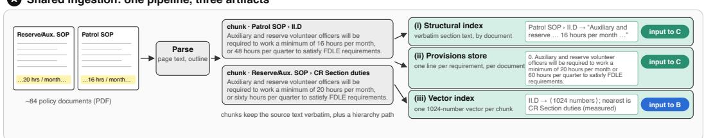
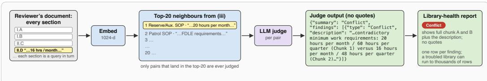
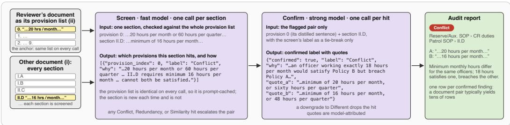
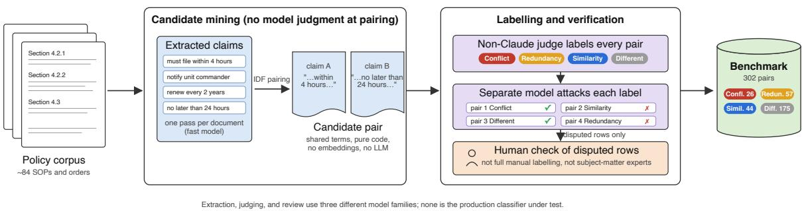

# Policy Central: Detecting Conflicts, Redundancy, and Similarity in Deployed Police Policy

Holly Baker\* Michael Kuo Kyana Pollas PolicingLab, Miami, Florida, United States {baker,kuo,pollas}@policinglab.org

## Abstract

Policy Central is a deployed system that helps police departments find relationships between sections of their written policy: whether two sections conflict, are redundant, are merely similar, or are different. We describe the system and compare two architectures. Retrieve-Judge, a retrieve-then-classify pipeline, runs as a cheap library-wide health signal; Screen-Confirm, a screen-then-confirm cascade, is a selective audit of the documents a reviewer chooses, checking them exhaustively against one another. On a 302-pair benchmark drawn from one department’s \~84 real policy documents, given each pair Screen-Confirm reaches 0.795 aggregate recall and 0.885 on Conflict, so current models judge well. Finding the pair is the hard part: Retrieve-Judge’s composed recall falls to 0.457, and Screen-Confirm recovers 0.472 (0.615 on Conflict). Today these pairs are found by reading the whole library, nearly 20,000 sections, checked against one another and re-checked after every revision. A scan that returns half of them in minutes, at low cost, and can be re-run on demand changes the economics of policy review even before recall improves.

## 1 Introduction

Police departments run on written policy: standard operating procedures, general orders, and directives, written by each agency for itself (Sutton and Dahir, 2025) and edited over many years. The result routinely contains internal tension: one order requires what another forbids, or two procedures cover the same ground in different words. Finding them by hand is slow, and getting it wrong has real consequences in the field.

We introduce Policy Central, a system in pilot at one U.S. police department with broader rollout underway, which surfaces these relationships automatically. It classifies pairs of policy sections into one of four relationships: Conflict (the sections cannot both be followed), Redundancy (they say the same thing and one is unnecessary), Similarity (they are related but not redundant), or Different (unrelated). Conflict is the high-value, low-frequency case; most pairs in a real library are Different.

Policy Central serves two operational needs with two architectures. Given the pair, current models judge well, Conflict included; when they must find the pair themselves, both architectures lose much of that recall, in different places. This paper reports where, and what it took to recover some of it. Our contributions:

1. A deployed system with two architectures, Retrieve-Judge and Screen-Confirm: the first a retrieve-then-classify pipeline run as a library-wide health signal, the second a screenthen-confirm cascade run as a selective audit of the documents a reviewer chooses.

2. A 302-pair benchmark of real policy pairs, on which we compare both architectures and two baselines (Llama zero-shot, DeBERTa NLI), given the pair and having to find it, and report the production cost and time of both modes.

## 2 Related Work

The problem. Legal and regulatory text grows steadily (Coupette et al., 2021a), and with it the room for contradiction. Policing shows it at scale: a review of over 11,000 pages of use-of-force policy from the 100 largest U.S. cities found policies varying widely in structure and length, some departments spreading their force rules across multiple sections of their general orders (Sutton and Dahir, 2025), and a systematic review of NLP in policing covers no work on policy documents themselves (Sarzaeim et al., 2023).

Prior systems. Approaches range from formal machinery to text-level methods. Knowledgegraph systems detect conflict over a structured representation, extracted automatically from text in PoliGraph (Cui et al., 2023) or hand-encoded as deontic axioms (Robaldo and Pozzato, 2025). Benchmark work targets conflict directly: LegalWiz generates legal-style documents with injected contradictions (Mantravadi et al., 2025), and Clash-of-Leges and a Chinese legal-conflict dataset benchmark statutory conflict detection (Italiani et al., 2026; Zhao et al., 2026). Applied compliance systems work against an external standard rather than within one library: a procurement-audit framework checks purchase records against compliance policy on real procurement data (Wang et al., 2020), and a maintenance-manual retrieval system keeps every answer traceable to certified sources (Jo, 2026). Neither judges whether two sections of one library conflict. Duplication in the U.S. Code (Coupette et al., 2021b) and an open-source NLI pipeline over U.S. defence policy documents (Addison, 2021) measure relations directly.

  
Figure 1: Policy Central, traced on one real benchmark pair (hp-0026, Appendix A). One ingestion pipeline (A) writes three artifacts. Retrieve-Judge (B) reads only the vector index and judges each section’s top-k neighbours; for this pair, the partner section is the nearest neighbour. Screen-Confirm (C) reads the structural index and provisions store, never the vector index, and sweeps every section through a cheap-screen / expensive-confirm cascade. Every model output shown is the scored pipeline’s actual output, abbreviated with “. . . ”.

Framing. Natural language inference is the natural framing (Koreeda and Manning, 2021; Yin et al., 2021), adapted in Section 3.1. Conflict is hard for models: even GPT-4 is unreliable on selfcontradictions that need context to see (Li et al., 2024), and current LLMs fail to detect conflicts across clinical guidelines (Xie and Du, 2026). Our two architectures rest on existing patterns: Screen-Confirm is a cost cascade (Chen et al., 2024a; Rabanser et al., 2025; Khalili et al., 2022; Viola and Jones, 2001); Retrieve-Judge combines similarity retrieval (Robertson and Zaragoza, 2009; Muennighoff et al., 2023) with a prompt-based LLM judge, as in Schumann et al. (2026). Retrieving by similarity alone can miss what a task needs (Gan et al., 2024), and a rule that conflicts with another need not read like it.

## 3 System Design

A reviewer picks a policy document and the system reports which sections elsewhere in the library relate to it, each pair labelled with a one-line reason. Two architectures produce that report. Retrieve-Judge embeds every section, retrieves its nearest neighbours, and judges each pair (panel B of Figure 1, ending in the library-health report). Screen-Confirm checks every section of another document (the compared document) against every requirement of the reviewer’s (the anchor), cheaply first and carefully on what survives (panel C, ending in the audit report). Both read the artifacts that one ingestion pipeline writes (panel A).

<table><tr><td>Label</td><td>Definition</td><td>Example (from the corpus)</td></tr><tr><td>Conflict</td><td>Requirements that cannot both be satisfied.</td><td>&quot;Must attend a two hour refresher training annually.&quot; vs. &quot;Must attend a four (4) hour refresher training</td></tr><tr><td>Redundancy</td><td>Same requirement; one section is deletable with no loss.</td><td>&quot;In sensitive criminal matters, the Unit Commander shall be notified prior to the reopening of an investigation&quot;, in two</td></tr><tr><td>Similarity</td><td>Related; a reader needs both, but neither subsumes the other.</td><td>“.. kept secret unless . .. duty requires otherwise&quot; vs. &quot;At no time ... release any information considered</td></tr><tr><td>Different</td><td>No operationally relevant relation.</td><td>to be confidential.&quot; &quot;Being armed in any manner.&quot; vs. &quot;Must be a minimum of 14 years of age.&quot;</td></tr></table>

Table 1: The four relation labels, each with a verbatim excerpt pair from the pilot department’s corpus that the deployed system labelled correctly (provenance in Appendix A).

## 3.1 Relation Taxonomy

Table 1 defines the four labels with real excerpt pairs; each maps to a different reviewer action.

The product exists to surface Conflict, because two sections that cannot both be followed mean the library is wrong somewhere. Redundancy matters for upkeep, since a requirement stated twice can be cut to one copy so that future edits happen once. Similarity exists so that a reviewer drafting or revising one policy sees the related sections elsewhere in the library, to reference or reconcile rather than delete. Redundancy and Similarity are separated by a deletion test: if one section can go because the other carries its content, the pair is Redundant; if both must stay, it is Similar. Similarity versus Different is likewise a question about the reviewer, not the text: two sections are Similar if a reviewer revising one would need to read the other, and Different if not, however much wording they

share.

The four labels are natural language inference (NLI) labels adapted to what a reviewer does next. Building on NLI gives “contradicts” a precise meaning, connects to prior work on legal documents (Koreeda and Manning, 2021; Yin et al., 2021), and supplies trained models as a free baseline. The mapping is: contradiction → Conflict; entailment in both directions → Redundancy; neutral → Similarity or Different, split by whether a reviewer must act. Conflict drops NLI’s direction: NLI asks whether a premise contradicts a hypothesis, whereas two rules that cannot both be followed conflict whichever is read first. The last line is where policy review departs from NLI, since two of our labels share one NLI label. An off-the-shelf NLI model can therefore find Conflict at best and collapses the rest, which is what DeBERTa NLI shows (Section 4.3): 0.654 Conflict recall and near zero on Redundancy and Similarity.

## 3.2 Data Ingestion

A single pipeline (panel A) serves both architectures but writes three artifacts, each read by a different consumer. The parse (page-by-page extraction, Unicode normalisation, and outline-aware segmentation that records each chunk’s hierarchy\_path) is shown in the figure. Chunking is a deterministic length-based split (∼600 tokens) that keeps the source text verbatim.

The artifacts are: (i) a structural index: raw chunk text and hierarchy\_path, no embeddings, read by Screen-Confirm for its compared document; (ii) a distilled provisions store, read by Screen-Confirm for its anchor document; and (iii) a vector index (Qdrant): each leaf chunk embedded once (Section 3.3) for similarity search, read only by Retrieve-Judge. The provisions store is built by a separate ingest-time LLM pass (Claude Haiku, once per document) that rewrites a document’s chunks into one standalone sentence per requirement (prompt in Appendix G.1), each grounded back to its source chunk, an obligation-level analogue of proposition retrieval units (Chen et al., 2024b) and atomic facts (Min et al., 2023). It is cached and reused by every later scan. A requirement it fails to extract is invisible on the anchor side; Section 4.3 measures that loss.

Retrieve-Judge’s retrieval unit is the leaf chunk (19,737 across the department’s ∼84 documents, Table 2); Screen-Confirm judges whole sections, so the two compare different-sized units (Limitations).

## 3.3 Retrieve-Judge

Retrieve-Judge (panel B) takes each leaf chunk of the reviewer’s document in turn: each is embedded, its top-k nearest neighbours by embedding similarity, drawn from every document in the library, are retrieved, and each (chunk, neighbour) pair is judged. Chunks are embedded with Cohere Embed v4 via Bedrock (1024 dimensions). The deployed audit retrieves k=20 under cosine distance and keeps neighbours above a 0.75 similarity threshold. The judge returns one JSON object per pair, {summary, findings[{type, description}]}: a label and a one-sentence description that must name the relation (“deadline is 4 hours in A versus 24 hours in B”), with no reasoning trace and no quotations (Appendix G). Retrieval is dense-only; a reranker, hypothetical-document queries, BM25, embedding-side changes, and a larger k were all tried and none moved recall (Appendix C), and Section 4.3 shows that judge swaps do not either. The constraint is structural: Conflict is a logical relation, not a similarity one. Similarity surfaces contradictions that share wording: the 20-hour and 16-hour minimums in Figure 1 are each other’s top-1 neighbour. It has no signal for conflicts that share no wording: a rule that narcotics officers never wear uniform off duty and one that uniform must be worn on extra-duty jobs conflict, yet neither is in the other’s top-20 (a benchmark pair). Retrieve-Judge therefore samples the library rather than covering it, and we use it as a library-health scan rather than an audit (Limitations).

## 3.4 Screen-Confirm

Screen-Confirm (panel C) replaces similarity sampling with an exhaustive two-stage cascade: discard the Different majority cheaply, reason carefully about the survivors, the Viola–Jones intuition (Viola and Jones, 2001) as a cost cascade (Wang et al., 2011). No model ever sees a whole PDF. The compared document is walked one section at a time, and each section is matched against the anchor document’s provision list, its distilled oneline-per-requirement form, rather than its raw text. Each screen call is therefore short, and the provisions block is the same on every call, so it can be prompt-cached. Headings, definitions, and repeated administrative language that distillation left out are never sent to the model.

Screen. One Claude Haiku call per compareddocument section receives the numbered provisions list plus that section and returns a JSON array of candidate hits (as in the figure). There is no score or threshold: any hit labelled Conflict, Redundancy, or Similarity escalates that provision–section pair, and only Different does not.

Confirm. Each escalated pair goes to one Claude Sonnet call that sees three things: the flagged provision as its distilled sentence rather than its source chunk, the compared document’s raw section, and the screen’s label, which it may use only as a tie-breaker. It returns a confirmed label with quote\_a and quote\_b; a downgrade to Different drops the hit. quote\_a is therefore drawn from the distilled sentence and quote\_b from the section, and neither is code-validated against the source, so we call them model-attributed. Confirm does not cache (each pair is unique); findings render as an audit report (panel C), typically tens of rows for a document pair.

A scan costs N screen calls plus M confirm calls (N sections, M escalations); distillation is a once-per-document ingest cost.

## 4 Evaluation

## 4.1 Benchmark and Its Construction

Our benchmark is 302 pairs (26 Conflict, 57 Redundancy, 44 Similarity, 175 Different), a distribution that reflects real policy libraries, where Different is the large majority. Every pair is two real sections from the pilot department’s policies. Labels are semi-automatic rather than subject-matter expert: a Haiku pass extracts checkable claims per document and a pure-code stage (no LLM) pairs them, a non-Claude judge (GPT-5.6 Sol) labels each pair, an Opus model attacks each label, and people check the disputed rows, following the extract-then-verify pattern of Bahaj and Ghogho (2026) (Figure 2, Appendix A).

We do not field the mining pipeline as a detector, since scoring it on a benchmark it produced would be circular; one dependency remains, in that its claim extraction and production distillation are both Haiku passes (Limitations).

## 4.2 Systems and Methodology

We compare four systems on the 302 pairs. Screen-Confirm and Retrieve-Judge are as described in Section 3. Llama zero-shot is a single call with a four-line prompt, no examples and no retrieval, a floor for judgment. DeBERTa NLI is an off-theshelf zero-shot NLI checkpoint, not fine-tuned on our data (Appendix G.6).

<table><tr><td></td><td>Screen-Confirm</td><td>Retrieve-Judge</td></tr><tr><td>Given the pair</td><td>Screen: the gold provision and 15 others sections. from its document, against the gold section. Confirm: each hit.</td><td>Judge: the two gold</td></tr><tr><td>Must find the pair</td><td>Screen: every anchor provision (mean 614, max 13,352) against every section of the compared document. Confirm: each hit.</td><td>Retrieve: nearest of 19,737 chunks by cosine (k=20 in deployment; recall scored at 10). Judge: each retrieved pair.</td></tr></table>

Table 2: What each system is shown in the two settings of Table 3.

Table 3 asks two questions. The lower block asks how well each system judges a pair it is handed; the upper block asks how much of that survives when the system must find the pair itself. Each architecture appears in both, so the gap between its two rows is what finding costs it. Table 2 lists what each system sees in each setting. Handed the pair, the cascade’s screen still has to pick the right provision, but out of 16 rather than out of the whole anchor, and Retrieve-Judge’s judge simply reads the two sections. To find the pair, Retrieve-Judge must first retrieve it, so we estimate its recall (R, the fraction of gold pairs caught) as $R _ { \mathrm { f i n d } } = R _ { \mathrm { r e t r i e v e } } \times R _ { \mathrm { j u d g e } }$ , where Rretrieve is the fraction of gold pairs whose partner is in the top 10 and $R _ { \mathrm { j u d g e } }$ the fraction the judge labels correctly when handed the pair; for Conflict, $0 . 5 7 1 \times 0 . 7 3 1 = 0 . 4 1 8$ . Multiplying assumes the two are independent (Limitations). Retrieval recall is measured on the 137 pairs whose two quotes both map to an indexed leaf chunk (14 Conflict, 13 Redundancy, 25 Similarity), each queried in both directions; judge recall is over every pair of the class. Screen-Confirm’s end-to-end recall is measured directly, one pass per pair, but reads the same way: $R _ { \mathrm { e 2 e } } = R _ { \mathrm { r e a c h } } \times R _ { \mathrm { s c r e e n } } \times R _ { \mathrm { c o n f i r m } } ,$ the fractions of gold positives that reach the screen, that the screen then escalates, and that confirm then labels correctly. Over all classes that is $0 . 9 4 5 \times 0 . 7 4 2 \times 0 . 6 7 4 = 0 . 4 7 2$ (Appendix D gives the counts).

All model calls use temperature 0 and pinned model IDs; prompts are in Appendix G.

## 4.3 Results by Relation Class

Given the pair, judgment is largely solved: a plain zero-shot Llama reaches 0.764 and Screen-Confirm

<table><tr><td>System</td><td>Confl. (26)</td><td>Redun. (57)</td><td>Simil. (44)</td><td>Agg. † (127)</td></tr><tr><td>Must find the pair</td><td></td><td></td><td></td><td></td></tr><tr><td>Retrieve-Judge, retrieval only</td><td>0.571</td><td>0.846</td><td>0.480</td><td>0.663</td></tr><tr><td>Retrieve-Judge, Sonnet 4.5 judge</td><td>0.418</td><td>0.668</td><td>0.207</td><td>0.457</td></tr><tr><td>Retrieve-Judge, Llama judge</td><td>0.462</td><td>0.757</td><td>0.262</td><td>0.525</td></tr><tr><td>Screen-Confirm, end-to-end*</td><td>0.615</td><td>0.561</td><td>0.273</td><td>0.472</td></tr><tr><td>Given the pair</td><td></td><td></td><td></td><td></td></tr><tr><td>Retrieve-Judge judge, Sonnet 4.5</td><td>0.731</td><td>0.789</td><td>0.432</td><td>0.654</td></tr><tr><td>Screen-Confirm</td><td>0.885</td><td>0.842</td><td>0.682</td><td>0.795</td></tr><tr><td>Llama 3.3 70B zero-shot</td><td>0.885</td><td>0.947</td><td>0.455</td><td>0.764</td></tr><tr><td>DeBERTa NLI, off the shelf</td><td>0.654</td><td>0.000</td><td>0.023</td><td>0.142</td></tr></table>

Table 3: Recall by relation class. †Support-weighted recall over Conflict, Redundancy, Similarity (n = 127); Different is excluded, since predicting Different for everything would score well on it while catching nothing. Upper block: the system must find the partner section. Retrieve-Judge rows are retrieval recall (R@10, over the 137 pairs whose quotes map to indexed leaf chunks, Section 4.2) alone, then retrieval times judge recall for two of eight judges (Appendix B); ∗measured on the production data path. Lower block: the system is handed the pair. Confl., Redun., Simil.: Conflict, Redundancy, Similarity.

0.795, with the cascade’s gain concentrated on Similarity (0.682 vs. 0.455), and Retrieve-Judge’s own judge 0.654. Having to find the pair is what costs, and the end-to-end figures should be read against the alternative, a reviewer reading the library. We did not choose this recall. The cascade is tuned to over-flag rather than miss, so its low precision is by design, but every missed pair is a loss, and Appendix D shows at which stage each one was lost. The rest of this section reports what we tried to raise it and what did not move. Retrieve-Judge falls from 0.654 to 0.457, and the loss is retrieval: its retrieval alone recovers 0.663, swapping its judge across eight models moves the composed figure by only about 0.12, and replacing the dense retriever with BM25 barely moves it (0.455 against 0.468 on the same pairs). Screen-Confirm falls from 0.795 to 0.472 and pays at its screen (Appendix D); on Conflict it keeps 0.615, above Retrieve-Judge’s 0.418– 0.462.

Read by class, the pattern is consistent. Redundancy is the easy class everywhere: duplicated text shares wording, so retrieval reaches 0.846 and most judges score it highest; when the cascade loses a Redundancy pair end to end, the largest single cause is confirm calling it Similarity (8 of 25 misses). Conflict is harder to find than to judge: embeddings rank by how alike two chunks are overall, and two rules that contradict each other differ at one detail while the chunk holding the partner rule often sits among unrelated requirements, so a cosine neighbourhood ranks it behind chunks that merely discuss the same topic. Retrieval reaches only 0.571, and end-to-end the cascade keeps 0.615, with the screen the larger loss; handed the pair, the capable judges reach 0.73 to 0.89. Similarity is the hard class in every setting (retrieval 0.480, judges 0.43 to 0.68, end-to-end 0.273), because it is the residual class, bounded on one side by Redundancy and on the other by Different, so every call on it is a call on two judgment boundaries at once, and confirm’s errors go both ways (5 Similarity pairs read as Redundancy, 8 as Conflict).

Swapping the confirm model did not help: every alternative lowered Conflict recall or lost the ability to walk a false escalation back to Different (Table 6, Appendix B).

## 4.4 Time and Cost on the Department’s Library

Table 4 gives what the two modes cost on the 78 of the department’s 84 documents that were indexed when these runs were made (19,646 sections, Screen-Confirm’s unit), from production run records and Bedrock’s token metrics. Retrieve-Judge has audited the whole library: one pass judges the roughly 4,800 neighbour pairs above the 0.75 threshold for \$13 in five minutes, with the judge’s static prompt cached (8.9M of 10.4M input tokens were cache reads). Screen-Confirm has run only as targeted scans of one document against one or two others, at list price because a provision store that small is below the screen model’s cacheable minimum; scaled by sections, one SOP against the whole library would take about an hour at ten workers and cost \$40 to \$80. Full-library scans are not the intended use: in the pilot, reviewers told us their main use is comparing a document against the few documents they are revising or need to align, which is the targeted-scan case in Table 4. Cheaper models would cut cost further: zero-shot Llama 3.3 70B scores 0.764 given the pair against Screen-Confirm’s 0.795 at about one two-hundredth of the cost (Appendix E). The two modes therefore serve different cases: the thresholded audit is the cheap library-wide signal, the exhaustive scan the per-pair check, and at today’s recall either gives a reviewer a starting point that reading the library does not.

## 5 Conclusion and Future Work

Finding rules that contradict or repeat one another is currently a manual review task. Policy Central does not replace that review, but it gives the reviewer a report of candidate pairs to start from. Conflict is a logical relation, not a similarity, so a retrieve-then-judge pipeline has a ceiling that none of the judge or retriever swaps we tried lifts. Handed a pair, current models label it well, and the losses come from reaching the pair. An exhaustive cascade over distilled requirements fits the operational need: it trades precision for recall, since a reviewer dismisses a false flag quickly but never sees a missed one; its cost is linear in the number of sections, low enough to re-run after each edit; and it reports on a document pair in minutes, so a reviewer can fix and re-check in one sitting.

<table><tr><td>Scan</td><td>Calls</td><td>Cost</td><td>Time</td></tr><tr><td colspan="4">Screen-Confirm, measured targeted scans</td></tr><tr><td>SOP (54 prov.) vs. 2 SOPs, 885 sec. 885+216</td><td></td><td>$1.60</td><td>150 s</td></tr><tr><td>SOP (56 prov.) vs. 1 SOP, 100 sec.</td><td>100+66</td><td>$0.41</td><td>42s</td></tr><tr><td>Screen-Confirm, projected One SOP vs. library, 19.6k sec.</td><td>25-33k</td><td>$40-80</td><td>~1h</td></tr><tr><td>Retrieve-Judge, measured audit Library audit, 4,807 pairs judged</td><td>5.2k $12.86 4.8 min</td><td></td><td></td></tr></table>

Table 4: Cost and wall-clock of production scans on the deployment (ten scan workers). Calls are screen + confirm for Screen-Confirm and judge calls for Retrieve-Judge; times are from the run records; costs are Bedrock’s logged token counts for each run at list rate, cache reads at the cache rate. The projected row scales the measured per-section cost and time; it is an upper bound, not the intended use.

In deployment, the next steps are improving finding quality against reviewer feedback from the pilot, extending the rollout under way to further departments, and reporting usage data. Ingestion is the main barrier to other corpora: the parser is pattern-based and tuned to one department’s directive formats, and layout-aware document models (Xu et al., 2020; Kim et al., 2022) are one possible route to ingesting any agency’s PDFs unchanged. Beyond policing, other rule-bound domains report the same inconsistency problem: clinical guidelines (Bowles et al., 2019), contracts (Koc and Gurgun, 2022), and immigration rules (Vigneswaran and de León, 2023). Recall matters most for a possible step after detection: an agent that runs the scan, resolves the clear cases, and brings the reviewer the edge cases, an extension that Ethical Considerations flags for separate review. Rewrites reopen evaluation, since a proposed text must be graded for grammaticality, naturalness, and completeness as in the QA2D evaluation of Demszky et al. (2018).

## Limitations

Benchmark. The most important limitation is label provenance: the 302 pairs are real, but their labels are semi-automatic, not subject-matter expert. Our SME annotators did label an earlier pool, whose underlying pairs turned out too narrowly distributed to report; the annotators and protocol are in place and labelling this benchmark is the next step. We have no inter-annotator agreement figure for this benchmark. The label set has no “partly redundant” class, so pairs that share only part of their content are forced to Redundancy or Similarity; a fifth label would only move that boundary. The benchmark is also one department’s library: 302 pairs from a single corpus of about 84 documents, with 26 Conflicts, so the Conflict figures carry wide intervals (Appendix F) and transfer to other departments’ formats and drafting conventions is untested. The end-to-end Conflict recall of 0.615 is a reported finding about the production path, not a property of the models; Appendix D attributes the shortfall stage by stage.

Development and evaluation share one benchmark. The definition fix, the prompt iterations and two design fixes of Appendix D were found and measured on the same 302 pairs, with no held-out split. Absolute recall is therefore optimistic, and the number to trust is the direction of each change rather than its size. The model-swap and retriever ablations vary one component with everything else fixed, so they are relative comparisons and less exposed. Every model-swap result was obtained under prompts tuned against Sonnet 4.5, so swaps measure prompt transfer as much as model capability. The SME labelling above will provide the held-out set.

Measurement. Retrieve-Judge judges leaf chunks and Screen-Confirm whole sections, so unit size is an uncontrolled variable in the comparison. Parsing errors cascade (Zhang et al., 2024), and here they are silent: a wrong section boundary changes what confirm reads and can turn a correct judgment into a wrong one with no trace in the output. Our stage-by-stage attribution of misses (Appendix D) checks that gold text is present in the index and that a section can be located, not that boundaries are right, and we report no boundarylevel accuracy for the parser; the three ingest faults were found only because that attribution placed misses before any model call. The cascade itself is a design choice with a counter-argument: escalation pays only when the screen’s decision to escalate carries information about whether confirm will be right. Our screen escalates 36 to 71% of sections in the end-to-end run depending on anchor size, and the gain we measure over a single pass is in recall, not in cost per correct finding, which we have not measured. Distillation recall is a lower bound: we ask whether each gold quote is contained in some provision, a token-overlap test, so a requirement the distiller restated in its own words counts as missed. The misses we did see are mostly descriptive statements that a requirement-extraction prompt does not treat as rules, such as “Sworn personnel work ten hours a day,four days a week”, a Redundancy target in the benchmark that never became a provision. Confirm also judges the distilled sentence rather than the source chunk it was distilled from, whereas the given-pair test handed it source text; each provision retains its chunk id, so passing the chunk to confirm is a one-line change that would also make quote\_a verbatim from the document, and we have not yet measured it.

What the benchmark cannot see. Benchmark candidates were mined by a Claude Haiku pass, and production distillation is also a Haiku pass, with separate code and prompts. A kind of requirement that Haiku reliably fails to extract, for instance one stated as a schedule or in a table rather than as a “shall”, would be missing from the benchmark and from the provisions store alike, so the benchmark would score the system as complete where it is not. Candidates were also paired by shared terms, so the benchmark contains no pair with zero lexical overlap, and Retrieve-Judge’s retrieval gap is measured on pairs that do share wording. And because the benchmark is enriched for the rare classes, precision will be lower in deployment, while recall, the figure we report, does not depend on how rare a class is (Appendix F works the numbers).

Retrieval churn. A distinct limitation concerns using Retrieve-Judge repeatedly as a library-health check. Because its top-k retrieval is corpus-statedependent, re-running an audit after document edits changes the embeddings and therefore the neighbor sets: fixed pairs can drop out before their resolution is confirmed, genuinely new pairs surface, and the reported issue count can stay flat or even rise despite real improvement, purely from retrieval churn rather than any statement about the underlying corpus. This is a known property to design around, and it is the main reason we route iterative, check-yourwork usage to Screen-Confirm, whose exhaustive per-section screen re-checks the full space on every run and so drops reliably as issues are fixed.

Composed estimates. Retrieve-Judge’s find-thepair figures are a product of two separately measured quantities, retrieval recall and judge recall given retrieval, which assumes the two difficulties are independent for a given pair, a simplification prior RAG work has named (Zamani and Bendersky, 2024). If they are correlated, for instance if ambiguous pairs are both harder to retrieve and harder to judge, the true figure could sit on either side of the estimate, and retrieval metrics are known to track downstream performance only weakly (Salemi and Zamani, 2024). The retrieval factor is measured only on the 137 pairs whose quotes could be mapped to indexed leaf chunks, so the composition applies a subset’s retrieval rate to the whole class’s judge rate. The estimate also uses recall at 10 with no score threshold, whereas the production audit keeps only neighbours above 0.75 cosine, so it is an upper bound on what the deployed audit retrieves. Measuring Retrieve-Judge end-toend in one pass, as we do for Screen-Confirm, is the next measurement step.

## Ethical Considerations

Policy Central operates on police policy, a sensitive domain. The system is advisory: it surfaces candidate relationships for human policy reviewers and never edits, approves, or enforces policy. Whether two policies in fact conflict, and what to do about it, remains a determination for the agency’s policy and legal personnel; the system only proposes. Every finding carries model-attributed quotes so a reviewer can check it against the source text, and reviewers are told that Conflict findings are lowprecision (0.404) by design. The failure mode that matters more is the false negative: on the production path the system recovers 0.615 of benchmark Conflicts, so a clean report is not evidence that a library is clean, and the tool is presented to departments as a complement to review, not a certification of it. The policies are public records of the department, and the department reviewed Policy Central’s output and gave feedback throughout the pilot. Policy text is processed within the operating organisation’s own AWS environment. The only policy text reproduced here is the short excerpts in Table 1, Figure 1, and Appendix A, with document identifiers removed. The benchmark was labeled semi-automatically rather than by subjectmatter experts, so its labels are not an authoritative reading of any policy. Finally, a tool that flags policy conflicts could be misread as evidence about an individual officer’s compliance; the system is scoped to document review and is neither designed nor validated for adjudicating individual conduct. Systems built for a narrow advisory purpose tend to expand into adjacent decision areas without a corresponding reassessment, so any extension of Policy Central toward proposing or applying fixes, or toward enforcement-relevant determinations, should trigger a fresh risk assessment rather than inherit this one.

## References

Parker Addison. 2021. policy-contradictions-nlp: Pipeline to detect contradictions in policy documents using NLP and transformers. GitHub repository.

Adil Bahaj and Mounir Ghogho. 2026. MizanQA: A benchmark for multi-answer Moroccan legal QA. In Proceedings ofthe 19th Conference ofthe European Chapter of the Association for Computational Linguistics (Volume 5: Industry Track), pages 132–144, Rabat, Morocco. Association for Computational Linguistics.

Juliana Bowles, Marco B. Caminati, Sabina Cha, and Julian Mendoza. 2019. A framework for automated conflict detection and resolution in medical guidelines. Science ofComputer Programming, 182:42– 63.

Lingjiao Chen, Matei Zaharia, and James Zou. 2024a. FrugalGPT: How to use large language models while reducing cost and improving performance. Transactions on Machine Learning Research. Preprint: arXiv:2305.05176.

Tong Chen, Hongwei Wang, Sihao Chen, Wenhao Yu, Kaixin Ma, Xinran Zhao, Hongming Zhang, and Dong Yu. 2024b. Dense X retrieval: What retrieval granularity should we use? In Proceedings of the 2024 Conference on Empirical Methods in Natural Language Processing. Association for Computational Linguistics.

Corinna Coupette, Janis Beckedorf, Dirk Hartung, Michael Bommarito, and Daniel Martin Katz. 2021a. Measuring law over time: A network analytical framework with an application to statutes and regulations in the united states and germany. Frontiers in Physics, 9.

Corinna Coupette, Jyotsna Singh, and Holger Spamann. 2021b. Simplify your law: Using information theory to deduplicate legal documents. In 2021 International Conference on Data Mining Workshops (ICDMW), pages 631–638. IEEE.

Hao Cui, Rahmadi Trimananda, Athina Markopoulou, and Scott Jordan. 2023. PoliGraph: Automated privacy policy analysis using knowledge graphs. In Proceedings of the 32nd USENIX Security Symposium (USENIX Security 23). USENIX Association.

Dorottya Demszky, Kelvin Guu, and Percy Liang. 2018. Transforming question answering datasets into natural language inference datasets. arXiv preprint arXiv:1809.02922.

Chunjing Gan, Dan Yang, Binbin Hu, Hanxiao Zhang, Siyuan Li, Ziqi Liu, Yue Shen, Lin Ju, Zhiqiang Zhang, Jinjie Gu, Lei Liang, and Jun Zhou. 2024. Similarity is not all you need: Endowing retrieval augmented generation with multi layered thoughts. Preprint, arXiv:2405.19893.

Paolo Italiani, Gianluca Moro, and Luca Ragazzi. 2026. Clash-of-leges: A bilingual dataset for conflict detection and explanation in statutory law. Expert Systems with Applications, 300:130182.

Byungho Jo. 2026. A compliance-preserving retrieval system for aircraft MRO task search. In Proceedings of the 19th Conference of the European Chapter of the Association for Computational Linguistics (Volume 5: Industry Track), pages 317–329, Rabat, Morocco. Association for Computational Linguistics.

Leila Khalili, Yao You, and John Bohannon. 2022. Babybear: Cheap inference triage for expensive language models. arXiv preprint arXiv:2205.11747.

Geewook Kim, Teakgyu Hong, Moonbin Yim, JeongYeon Nam, Jinyoung Park, Jinyeong Yim, Wonseok Hwang, Sangdoo Yun, Dongyoon Han, and Seunghyun Park. 2022. Ocr-free document understanding transformer. In Computer Vision – ECCV 2022. Springer.

Kerim Koc and Asli Pelin Gurgun. 2022. Ambiguity factors in construction contracts entailing conflicts. Engineering, Construction and Architectural Management, 29(5):1946–1964.

Yuta Koreeda and Christopher D. Manning. 2021. Contractnli: A dataset for document-level natural language inference for contracts. In Findings of the Association for Computational Linguistics: EMNLP 2021, pages 1907–1919. Association for Computational Linguistics.

Jierui Li, Vipul Raheja, and Dhruv Kumar. 2024. ContraDoc: Understanding self-contradictions in documents with large language models. In Proceedings ofthe 2024 Conference ofthe North American Chapter ofthe Associationfor Computational Linguistics: Human Language Technologies (Volume 1: Long Papers), pages 6509–6523. Association for Computational Linguistics.

Ananya Mantravadi, Shivali Dalmia, Olga Pospelova, Abhishek Mukherji, Nand Dave, and Anudha Mittal. 2025. Legalwiz: A multi-agent generation framework for contradiction detection in legal documents. Preprint, arXiv:2510.03418.

Sewon Min, Kalpesh Krishna, Xinxi Lyu, Mike Lewis, Wen-tau Yih, Pang Wei Koh, Mohit Iyyer, Luke Zettlemoyer, and Hannaneh Hajishirzi. 2023. FActScore: Fine-grained atomic evaluation of factual precision in long form text generation. In Proceedings ofthe 2023 Conference on Empirical Methods in Natural Language Processing. Association for Computational Linguistics.

Niklas Muennighoff, Nouamane Tazi, Loic Magne, and Nils Reimers. 2023. Mteb: Massive text embedding benchmark. In Proceedings of the 17th Conference of the European Chapter of the Association for Computational Linguistics (EACL 2023), pages 2014–2037, Dubrovnik, Croatia. Association for Computational Linguistics.

Stephan Rabanser, Nathalie Rauschmayr, Achin Kulshrestha, Petra Poklukar, Wittawat Jitkrittum, Sean Augenstein, Congchao Wang, and Federico Tombari. 2025. Gatekeeper: Improving model cascades through confidence tuning. In Advances in Neural Information Processing Systems 38 (NeurIPS 2025).

Livio Robaldo and Gian Luca Pozzato. 2025. Handling irresolvable conflicts in the semantic web: An RDFbased conflict-tolerant version of the deontic traditional scheme. Journal of Logic and Computation, 35(8):exaf054.

Stephen E. Robertson and Hugo Zaragoza. 2009. The probabilistic relevance framework: Bm25 and beyond. Foundations and Trends in Information Retrieval, 3(4):333–389.

Alireza Salemi and Hamed Zamani. 2024. Evaluating retrieval quality in retrieval-augmented generation. In Proceedings of the 47th International ACM SI-GIR Conference on Research and Development in Information Retrieval (SIGIR ’24), pages 2395–2400. Association for Computing Machinery.

Paria Sarzaeim, Qusay H. Mahmoud, Akramul Azim, Gary Bauer, and Ian Bowles. 2023. A systematic review of using machine learning and natural language processing in smart policing. Computers, 12(12):255.

Gerrit Schumann, Jorge Marx Gómez, and Hergen Pargmann. 2026. Detection of contradictions and inconsistencies in regulatory documents using promptengineering. In Proceedings of the 59th Hawaii International Conference on System Sciences (HICSS-59), pages 1766–1775.

Dan Sutton and Fatima Dahir. 2025. Police use of force policies across america. Technical report, Stanford Center for Racial Justice, Stanford Law School. Analysis of 11,000 pages of policy documents and 2,200 policy provisions across the 100 largest U.S. cities.

Darshan Vigneswaran and Ernesto de León. 2023. The inconsistency of immigration policy: The limits of “top-down” approaches. Ethnic and Racial Studies, 47(10):2060–2084.

Paul Viola and Michael J. Jones. 2001. Rapid object detection using a boosted cascade of simple features. In Proceedings ofthe 2001 IEEE Computer Society Conference on Computer Vision and Pattern Recognition (CVPR), volume 1, pages I–511–I–518. IEEE.

Ke Wang, Michael Zipperle, Marius Becherer, Florian Gottwalt, and Yu Zhang. 2020. An AI-based automated continuous compliance awareness framework (CoCAF) for procurement auditing. Big Data and Cognitive Computing, 4(3):23.

Lidan Wang, Jimmy Lin, and Donald Metzler. 2011. A cascade ranking model for efficient ranked retrieval. In Proceedings of the 34th International ACM SI-GIR Conference on Research and Development in Information Retrieval (SIGIR), pages 105–114.

Shiyao Xie and Jian Du. 2026. Neuro-symbolic resolution of recommendation conflicts in multimorbidity clinical guidelines. In Proceedings of the 40th AAAI Conference on Artificial Intelligence (Bridge Program on Logic and AI).

Yiheng Xu, Minghao Li, Lei Cui, Shaohan Huang, Furu Wei, and Ming Zhou. 2020. Layoutlm: Pre-training of text and layout for document image understanding. In Proceedings of the 26th ACM SIGKDD International Conference on Knowledge Discovery & Data Mining (KDD ’20), pages 1192–1200. Association for Computing Machinery.

Wenpeng Yin, Dragomir Radev, and Caiming Xiong. 2021. DocNLI: A large-scale dataset for documentlevel natural language inference. In Findings of the Association for Computational Linguistics: ACL-IJCNLP 2021, pages 4913–4922. Association for Computational Linguistics.

Hamed Zamani and Michael Bendersky. 2024. Stochastic rag: End-to-end retrieval-augmented generation through expected utility maximization. In Proceedings of the 47th International ACM SIGIR Conference on Research and Development in Information Retrieval (SIGIR ’24), pages 2641–2646. Association for Computing Machinery.

Qintong Zhang, Victor Shea-Jay Huang, Bin Wang, Junyuan Zhang, Zhengren Wang, Hao Liang, Shawn Wang, Matthieu Lin, Conghui He, and Wentao Zhang. 2024. Document parsing unveiled: Techniques, challenges, and prospects for structured information extraction. Preprint, arXiv:2410.21169.

Siwen Zhao, Yunnuo Xu, Zhe Chen, Feng Qiao, Hailong Chen, XiaoRui Li, Sen Lin, Zhonghang Ji, Yujun Li, and Wei Wang. 2026. Bridging the gap in Chinese legal conflict review: A dataset, benchmark tasks, and framework. Scientific Data, 13:835.

## A Benchmark Construction and Example Provenance

Figure 2 shows the four-stage construction of the 302-pair benchmark described in Section 4.1: mechanical candidate mining with no model judgment at the pairing step, labelling by a non-Claude judge, an adversarial review pass by a separate model, and human verification of the disputed subset only. Candidates entered the pool three ways: a stratified random sample of extracted claim pairs (174), a value-mismatch gate that pairs claims on one topic carrying different numbers or thresholds (75), and a same-topic gate that pairs claims restating one value (53), which supplies most Redundancy candidates. Every passage is verbatim document text; only the pairing step differs. 33 of the 57 Redundancy pairs are character-identical text appearing in two places.

## B Judge-Model Leaderboard

Table 5 gives the full Retrieve-Judge leaderboard across the eight judge models we evaluated. The headline point is the tight clustering: every model lands between 0.46 and 0.57 aggregate recall, a spread of about 0.12, so the choice of judge model moves Retrieve-Judge far less than the architecture does. This is the evidence behind the claim in Section 4 that the ceiling is intrinsic to the retrieve-then-judge architecture rather than to any one model.

<table><tr><td>Judge model</td><td>Aggregate recall</td></tr><tr><td>Sonnet 4.5</td><td>0.457</td></tr><tr><td>Sonnet 4.6</td><td>0.539*</td></tr><tr><td>Sonnet 5</td><td>0.497</td></tr><tr><td>Llama 3.3 70B</td><td>0.525</td></tr><tr><td>GPT-5.6 Sol</td><td>0.574*</td></tr><tr><td>GPT-5.6 Terra</td><td>0.548*</td></tr><tr><td>GPT-5.6 Luna</td><td>0.567*</td></tr><tr><td>GPT-OSS 120B</td><td>0.476*</td></tr></table>

Table 5: Full eight-model Retrieve-Judge leaderboard (composed retrieval+judge aggregate recall, 302-pair benchmark). Sonnet 4.5, Sonnet 5, and Llama 3.3 70B are measured directly; cells marked ∗ are composed from each model’s measured per-class judge recall and the shared leaf-corrected per-class retrieval recall (Conflict 0.571, Redundancy 0.846, Similarity 0.480), support-weighted over Conflict/Redundancy/Similarity. The retrieval factor is common to every row, so it sets the band’s absolute level but not the model ordering.

The Llama 3.3 70B row also measures prompt transfer: under the Sonnet-tuned judge prompt its judge-only Conflict recall was 0.654, and a fromscratch Llama-specific prompt raised it to 0.808 while Conflict precision held near 0.49, a labelboundary limit rather than a wording one.

The confirm-model swap of Section 4.3 is in Table 6.

  
Figure 2: Benchmark construction. Claims are extracted per document and paired by shared terms with no model judgment; every pair is labelled by a non-Claude judge, each label is attacked by a separate model, and only disputed rows are hand-checked; the hand-checked label is final and replaces the judge’s.

<table><tr><td>Confirm model</td><td colspan="4">Confl. Redun. Simil. Diff. Acc.</td></tr><tr><td>Sonnet 4.5 (production)</td><td>0.885</td><td>0.842</td><td>0.682 0.789 0.791</td><td></td></tr><tr><td>Sonnet 5</td><td>0.692</td><td>0.930</td><td>0.773 0.709 0.758</td><td></td></tr><tr><td>Opus 4.8</td><td>0.423</td><td>0.895</td><td>0.5680.823 0.765</td><td></td></tr><tr><td>GPT-5.6 Terra</td><td>0.808</td><td>0.895</td><td>0.705 0.709 0.752</td><td></td></tr><tr><td>GPT-5.6 Luna</td><td>0.808</td><td>0.877</td><td>0.705 0.623 0.699</td><td></td></tr><tr><td>GPT-OSS 120B</td><td>0.731</td><td>0.912</td><td>0.7270.543 0.656</td><td></td></tr><tr><td>Llama 3.3 70B</td><td>0.846</td><td>0.982</td><td>0.6590.474 0.629</td><td></td></tr></table>

Table 6: Screen-Confirm with its confirm model swapped (Haiku screen fixed): per-class recall (including Different) and four-class accuracy on the 302 pairs. Conflict recall is not monotonic in general model strength; the Different column tracks each model’s ability to walk a false escalation back to Different, where Llama is weakest (0.474).

## C Negative Ablations

For completeness we list experiments that produced no usable improvement and are not part of the deployed system; each was run in full before being set aside.

• Embedding-side retrieval fixes (five, all negative). Parent-section index alongside leaves, LLM-generated context concatenated into the embedding, section/document title prepended to embedded text, 1024→1536 output dimension, and float32 versus int8 Cohere-side quantization. None improved Conflict or Similarity R@10; two regressed it. The retrieval gap is structural (chunk boundaries and the leaf filter), not an embedding parameter.

• Reranking and hypothetical-document queries. Cohere Rerank over the dense top-20 moved per-class R@10 by at most ±0.05 and changed no composed cell, so the scored configuration is dense-only. Hypothetical partner passages generated by Haiku and embedded as the query (HyDE) landed on the right topic but not the annotated partner among many same-topic chunks, with no net R@10 gain.

• Chain-of-thought judge prompt. A forced reasoning protocol before the label lowered Retrieve-Judge Conflict precision on the benchmark (0.444→0.304): it applied the new rule inconsistently across near-duplicate phrasings.

• Long-context, no-retrieval baseline. Feeding whole documents (up to 533K tokens) to the judge scored within noise of quote-only judging on an 18-pair pilot at roughly 39× the input tokens per pair.

• Agentic tool-use judge. Letting the judge fetch surrounding context at its own discretion was a wash on 302 pairs (24 rows fixed, 24 broken) at about 3.7× cost, and introduced a new failure: irrelevant adjacent context turning correct Different calls into false Conflicts.

## D Which Fixes Moved Recall

Screen-Confirm’s end-to-end row is scored on the production index: for each benchmark pair the screen reads the anchor document’s entire provisions store (614 provisions on average over the 78 indexed documents; 13,352 for the 957-page Departmental Orders) against the section of the compared document that holds the partner text, and confirm follows. It scores 0.472 aggregate and 0.615 on Conflict. Table 7 shows where each gold positive was lost: 7 of 127 positives never reach a model, the screen drops 31, confirm relabels 29, and 20 of 175 Different pairs survive as false positives. Cross-document pairs recover 0.541; within-

document pairs 0.377. Precision with confidence intervals is in Appendix F.
<table><tr><td>Class (n)</td><td></td><td>Absent No prov. Screen Confirm Found Recall</td><td></td><td></td><td></td><td></td></tr><tr><td>Confl. (26)</td><td>0</td><td>0</td><td>6</td><td>4</td><td>16</td><td>16/26</td></tr><tr><td>Redun. (57)</td><td>3</td><td>3</td><td>8</td><td>11</td><td>32</td><td>32/51</td></tr><tr><td>Simil. (44)</td><td>1</td><td>0</td><td>17</td><td>14</td><td>12</td><td>12/43</td></tr><tr><td>All (127)</td><td>4</td><td>3</td><td>31</td><td>29</td><td>60</td><td>60/120</td></tr></table>

Table 7: Where each of the 127 gold positives ended on the production data path, final run. Absent: its text is not in the index. No prov. (no provision): indexed, but distillation produced no provision for it. Screen, Confirm: lost at that stage. Found: labelled correctly. Recall: over pairs that reached the screen.

This stage-by-stage attribution was re-run after each fix, and each run said what to fix next. The first run lost 67 of 127 positives before any model call, to three ingest faults: split-PDF parts overwrote each other’s chunks, short chunks were dropped, and distillation batches were truncated. Fixing them took recall from 0.260 to 0.354 and left 4 positives absent. Two design faults followed. The screen read about 6,000 provisions per call; windows of about 1,500 took recall to 0.449 (Conflict 12 → 17 of 26) at about 2.3× the run’s cost. Confirm judged a provision against a whole section, so a sentence duplicated inside a longer section read as Similarity; asking it to label against the matching passage took recall to 0.472 (Redundancy 27 → 32 of 57). Both cost precision, with Different pairs surviving confirm rising from 12 to 20 of 175.

## E Benchmark-Scale Cost and Latency

Table 8 gives cost and latency for the 302-pair benchmark run, with the pair given; deploymentscale costs are in Section 4.4.

<table><tr><td>System</td><td>Cost</td><td>$/1k</td><td>Latency</td></tr><tr><td>Screen-Confirm</td><td>$1.95</td><td>$6.47</td><td> ${ \sim } 1 9 \mathrm { m i n } ^ { \ S }$ </td></tr><tr><td>Retrieve-Judge</td><td>$2.13</td><td>$7.04</td><td> ${ \sim } 2 8 \mathrm { m i n } ^ { \ S }$ </td></tr><tr><td>Llama (zero-shot)</td><td>$0.01</td><td>$0.03</td><td>~2 min</td></tr><tr><td>DeBERTa NLI</td><td>$0.00</td><td>$0.00</td><td> ${ \sim } 2 \mathrm { m i n }$ </td></tr></table>

Table 8: Benchmark-scale cost and latency, sequential single worker, not production cost. Costs are summed from logged token counts at list rate. ‡Retrieve-Judge output tokens estimated from a 40-pair sample; with prompt caching its cost falls to ∼\$0.91. §Wall-clock from an earlier 376-pair run of the same pipelines; the 302-pair run did not log it.

## F Precision and Confidence Intervals

Screen-Confirm’s per-class precision and recall with the pair given (the setting of Table 3), with 95% Wilson intervals on recall. Redundancy precision is 1.000 and Similarity’s 0.612: every pair the cascade called Redundancy was Redundancy, and its mistakes were Redundancy pairs called Similarity. It did not mislabel any pair as Conflict or Different.

<table><tr><td>Class (n)</td><td>Prec.</td><td>Recall</td><td>95% CI</td></tr><tr><td>Conflict (26)</td><td>0.404</td><td>0.885</td><td>[0.710, 0.960]</td></tr><tr><td>Redundancy (57)</td><td>1.000</td><td>0.842</td><td>[0.726, 0.915]</td></tr><tr><td>Similarity (44)</td><td>0.612</td><td>0.682</td><td>[0.534, 0.800]</td></tr><tr><td>Different (175)</td><td>0.932</td><td>0.789</td><td>[0.722, 0.843]</td></tr></table>

Table 9: Screen-Confirm precision/recall per class, with 95% Wilson intervals on recall.

Because the benchmark is enriched for the rare classes, precision will be lower in deployment. Conflict is 26 of the 302 pairs, about 9%. Given the pair, the cascade flags 57 Conflicts, 23 right and 34 wrong (precision 0.404). If true Conflicts are ten times rarer in a real corpus, the 23 become about 2 while the 34 false flags remain, and precision falls to about 0.06. Recall does not move: 0.885 of true Conflicts are caught whatever their number.

## G Prompts

The five prompts below are reproduced verbatim. Variable slots filled at call time are shown in {braces}; section headers within a prompt are set in bold for readability and em dashes in the originals are shown as hyphens, with no other change to the text. The Retrieve-Judge judge prompt is the longest because it carries the label definitions, decision order, and five worked examples; the distillation and screen prompts are short and rely on the provisions list for context.

## G.1 Provision Distillation Prompt (Ingest, Fast Model)

System prompt; each call receives a batch of up to 100 chunks, each prefixed with its header.

## Provision distillation (system prompt, fast model)

You are a policy analyst. Extract every distinct requirement, rule, or obligation from the policy text. Each chunk of input is prefixed with a header like [chunk:<id> | <section> | p.<page>]. Return one bullet per requirement. Each bullet must begin with the exact chunk header from its source chunk,

then the requirement as a complete, standalone sentence. Example: [chunk:abc | I > I.A | p.3] Officers must maintain their service weapon. No headings, no grouping, no commentary. Return only prefixed bullets, one per line.

## G.2 Retrieve-Judge Judge Prompt

## Retrieve-Judge judge (system prompt)

You are a senior police policy analyst verifying whether two policy chunks have a genuine relationship that officers need to know about.

These chunks were pre-screened as potentially related. Your job is to CONFIRM the relationship type or REJECT as Different. Decide EVERY boundary by normative CONTENT, not by wording overlap. Apply the DECISION ORDER below in exact order; Similarity is NOT a leftover bucket - confirm its three positive conditions.

DEFINITIONS (decide by normative CONTENT, never by shared word count):

\- Conflict: THE SAME OFFICER in THE SAME SITUATION cannot comply with both - obeying one puts them in breach of the other. Time frames, thresholds, or procedures directly contradict.

\- Redundancy: the two impose materially the SAME obligation - same actor, same scope, same threshold - so deleting one loses NO requirement. Strip formatting, casing, punctuation, and filler words first; if the only remaining differences are non-normative (reworded, an inserted "the", a unicode variant, reordering), it is Redundancy even when the wording is not word-for-word. - Similarity: ALL THREE hold - (1) SAME SUBJECT (same act, object, event, or decision; an officer handling one would foreseeably meet the other), (2) COMPATIBLE (both can be obeyed together; neither breaches the other), and (3) MATERIAL NORMATIVE DELTA (each imposes normative content the other lacks: a different duty, actor, recipient, threshold, phase, or added condition). Related rules that neither restate nor contradict each other.

\- Different: no shared act, object, event, or decision - one carries nothing that bears on the other.

DECISION ORDER (apply in this exact order): 1. Redundancy check FIRST, by content: same obligation on the same actor/scope/threshold, differing only in non-normative ways? -> Redundancy.

2. Conflict check: could obeying one ever breach the other for the same subject in one situation? -> Conflict. A difference in wording, or different-but-compatible details, is NOT a Conflict.

3. Different check: does one carry nothing that bears on the other? -> Different. 4. Otherwise -> Similarity (same subject + compatible + material normative delta). EXCEPTION HANDLING (a general rule paired with a narrower passage):

\- The narrower passage EXPLICITLY subordinates itself and fully dissolves the tension ("unless", "except", or it names the sub-population it exempts) - the tension is resolved -> Different.

\- It is a conditional override the reader must CROSS-REFERENCE to apply correctly (e.g. a default threshold plus a different threshold when a condition holds) -> Similarity.

NOTIFICATION ROUTING - apply this before classifying any communication/reporting pair as Conflict:

Requiring notification to Person A (one policy) and Person B (another policy) is NOT a Conflict - the officer can notify both. It is Similarity.

A Conflict exists only when both policies specify the SAME notification slot but assign it to mutually exclusive recipients.

REDUNDANCY vs SIMILARITY - the content test (never decide this by shared word count): Does either passage impose normative content the other lacks - a different duty, actor, recipient, threshold, phase, or added condition?

\- No material delta (only wording/formatting differs) -> Redundancy, even if the two are not word-for-word identical.

\- At least one material delta -> Similarity, even when long spans of wording are shared. HARD REJECTION CRITERIA for Conflict (output Similarity or Different if ANY apply):

\- Different actors (officer vs supervisor vs dispatcher vs records staff) are a MATERIAL DELTA: an otherwise-duplicate rule that assigns the duty to a different actor is Similarity, not Redundancy.

CARVE-OUT - Conflict: same procedure, contradictory parameters for situations involving the same officer -> Conflict regardless of unit labels.

\- Different phases (initial response vs follow-up report vs administrative review)

\- Same broad topic but different specific situations

\- General guidance vs specific procedure - One policy sets a standard, the other implements it in a different context

\- SAME-DOCUMENT PAIRS - apply extra caution: apparent contradictions are often complementary steps or sequential procedures. Default to Similarity over Conflict unless a specific numeric value, deadline, or threshold directly contradicts with no possible sequential or role-based reading. AUDIENCE AND UNIT CHECK - before any

Confirm both chunks apply to the same unit, role, and operational context. If different audiences, units, or operational phases are plausible, classify as Different or Similarity rather than Conflict.

## FINAL CHECK:

\- Conflict: Name the specific scenario where the same officer cannot comply with both simultaneously. If you cannot -> Similarity or Different.

\- Redundancy: Confirm NO material normative delta remains after stripping formatting and

Screen-Confirm screen (fast model)   
Below is a list of numbered provisions from   
Policy A, then a section from Policy B.   
This is a fast first-pass screen. Flag every   
provision that plausibly relates to the   
Policy B section so it can be re-checked   
later; when in doubt, INCLUDE it.   
Use these labels:   
- Conflict: the provision and the section   
give directives that cannot both be followed   
for the same subject - one requires what the   
other forbids, or they set different   
thresholds/deadlines/numbers for the same   
thing.   
- Redundancy: the provision and the section   
impose the same obligation on the same actor   
and scope - the same requirement restated,   
differing only in wording or formatting   
(decide by content, not by shared word   
count).   
- Similarity: same subject and compatible, but   
each carries some normative content the other   
lacks - a different duty, actor, recipient,   
threshold, phase, or added condition - so   
neither restates nor contradicts the other.   
Examples of what to flag:   
- Provision ’Reports are due by the 5th of the   
month’ vs section ’Reports shall be submitted   
by the 5th of each month’ -> Redundancy (same   
requirement, near-identical text).   
- Provision ’Officers must always wear a   
uniform’ vs section ’Plain-clothes officers

wording. If a delta remains (different actor, threshold, phase, added condition) ->   
Similarity.   
EXAMPLES:   
Example 1 - Conflict (time limit):   
Chunk A: "Officers involved in a use-of-force incident shall submit a written report to their immediate supervisor within four (4) hours of the incident."   
Chunk B: "A Use of Force Report shall be   
completed and submitted by the involved   
officer no later than twenty-four (24) hours following any use of force occurrence."   
Output: {"summary": "Conflict", "findings": [{"type": "Conflict", "description": "Use of force report deadline is 4 hours (Chunk A) versus 24 hours (Chunk B) - the same officer filing the same report faces contradictory deadlines."}]}   
Example 2 - Conflict (authorisation   
threshold):   
Chunk A: "Purchases of evidence-related   
supplies exceeding \$500.00 require prior   
written approval from the unit commander." Chunk B: "Unit expenditures on evidence   
supplies up to \$1,000.00 may be authorised by the division supervisor without additional approval."   
Output: {"summary": "Conflict", "findings": [{"type": "Conflict", "description": "A \$750 evidence supply purchase requires prior   
commander approval (Chunk A) but falls within the supervisor’s self-authorisation limit (Chunk B) - the same officer cannot determine which approval pathway applies."}]}   
Example 3 - Redundancy (near-verbatim):   
Chunk A: "Officers must complete a Use of Force Report (Form UF-1) within twenty-four (24) hours of any use of force incident." Chunk B: "A Use of Force Report (Form UF-1) shall be completed by the involved officer within twenty-four (24) hours following any use of force occurrence."   
Output: {"summary": "Redundancy", "findings": [{"type": "Redundancy", "description": "Both sections require Form UF-1 within 24 hours of a use of force incident using near-identical wording - this requirement is duplicated   
across two documents."}]}   
Example 4 - Similarity (notification to   
different people - NOT a Conflict):   
Chunk A: "Officers shall notify their   
immediate supervisor within one (1) hour of any use of force incident."   
Chunk B: "Following any use of force, the officer shall notify the on-duty watch   
commander as soon as practicable."   
Output: {"summary": "Similarity", "findings": [{"type": "Similarity", "description": "Both policies require post-use-of-force   
notifications but to different recipients (supervisor vs watch commander) - an officer must satisfy both, so awareness of each is operationally relevant."}]}   
Example 5 - Different:   
Chunk A: "The Records Unit shall maintain all arrest reports for a minimum of seven (7) years."

Chunk B: "Officers responding to domestic   
disturbance calls shall request a supervisor   
to respond to the scene."   
Output: {"summary": "Different", "findings":   
[]}   
OUTPUT ONLY valid JSON - no other text:   
{"summary": "Conflict|Redundancy|Similarity|   
Different", "findings": [{"type": "Conflict|   
Redundancy|Similarity", "description":   
"concise description of the issue"}]}   
For Different: {"summary": "Different",   
"findings": []}   
WRITING GUIDANCE - officers review thousands   
of these:   
- State the specific contradiction,   
duplication, or connection in one sentence   
- Embed section references in parentheses -   
do not start with "Section X.X requires..."   
- Do not use: "appears in both", "creating   
divergence risk", "mutually exclusive",   
"cannot simultaneously comply"   
- Do not add a second sentence unless   
critical information will not fit in one

## G.3 Screen-Confirm Screen Prompt (Fast Model)

Sent after the cached, numbered provisions block and the Policy B section (“Policy B section (<key>):” followed by the section text). This is the version scored in Section 4; the deployed version at the time of writing is a shorter earlier one with the same output contract.

may work in civilian dress’ -> Conflict   
(cannot both hold for the same officers).   
Skip only provisions that are completely   
unrelated - a different subject with no   
overlap - and output nothing for them.   
Return a JSON array. Each item:   
{"provision\_index": int, "label": "Conflict|   
Redundancy|Similarity", "why": str}.   
If nothing matches, return []. Return JSON   
array only, no other text.

## G.4 Screen-Confirm Confirm Prompt (Strong Model)

Cross-document version, scored in Section 4; as above, the deployed version is a shorter earlier one. The screen’s label enters only at step 3 as a tiebreaker.

\- Conflict: the two requirements CANNOT both be satisfied for the same subject in the same situation. Apply this concrete test - would obeying Policy A put someone in breach of Policy B in that same situation? Only ’yes’ is a Conflict. Shared topic, overlapping wording, or different-but-compatible details are NOT a Conflict.

\- Similarity: ALL THREE hold - same subject, compatible (both can be obeyed together), and a MATERIAL NORMATIVE DELTA (each imposes content the other lacks: a different duty, actor, recipient, threshold, phase, or added condition). A different actor or threshold is a material delta - Similarity, not Redundancy, even when wording is largely shared.

Contrastive examples (same format, opposite outcomes):   
- A ’Officers shall document any use of force within 24 hours’ vs B ’Supervisors shall   
review all use-of-force reports’ ->   
Similarity: same subject (use of force), each imposes a different but compatible duty;   
neither contradicts or restates the other. - A ’Officers shall document any use of force within 24 hours’ vs B ’Fleet vehicles shall be refueled at the end of each shift’ ->   
Different: unrelated subjects, no shared   
requirement.   
Step 3 - A first-pass screen guessed: {label} (reason: {why}). Use this only as a   
tie-breaker: keep your step-2 label as-is; adopt the guess ONLY if you were genuinely undecided between two labels and it breaks the tie. Do not switch to it merely because it was provided.   
Reply with JSON only:   
{"confirmed": true/false, "label": "Conflict| Redundancy|Similarity|Different", "why": str, "quote\_a": str, "quote\_b": str}   
confirmed: true if your final label equals the first-pass guess, false otherwise.   
quote\_a: short verbatim phrase from Policy A most relevant to the finding (1-2 sentences, empty string if Different).   
quote\_b: short verbatim phrase from Policy B most relevant to the finding (1-2 sentences, empty string if Different).

End-to-end runs (Section 4.3) replace the opening instruction with: The Policy B section may contain several requirements. First find the single passage (1–3 sentences) in it that addresses the same subject as the Policy A text. Classify the relationship between the Policy A text and THAT passage only; ignore requirements elsewhere in the section.

## G.5 Screen-Confirm Confirm Prompt, Same-Document Variant

Used when both passages come from one document (the exception-handling rules differ).

circumstances).

Step 2 - Using ONLY your step-1 reading, choose the label:

\- Conflict: the two passages issue directives that CANNOT both be complied with for the same subject under the same circumstances. Apply this concrete test - would obeying Passage A put someone in breach of Passage B in that same situation? Only ’yes’ is a Conflict.

\- NOT a conflict (label Different): a general rule paired with a narrower exception that is EXPLICITLY subordinated to it - the narrower passage signals it is a carve-out (e.g. ’unless’, ’except’, ’shall not ... unless’, or it names the specific sub-population it exempts from the general rule). The exception refines the rule and both can be followed together. But if the two passages are each free-standing rules that independently reach OPPOSITE determinations about the same subject (neither is written as an exception to the other), that remains a Conflict. - NOT a conflict (label Different): passages that govern different subjects, roles, units, materials, or circumstances, even when they share wording or cite different numbers/thresholds.

\- Redundancy: the two impose materially the SAME obligation - same actor, scope, and threshold - differing only in non-normative ways (wording, casing, formatting). Decide by content, not by shared word count.

\- Similarity: ALL THREE hold - same subject, compatible, and a MATERIAL NORMATIVE DELTA (each imposes content the other lacks: a different duty, actor, threshold, phase, or added condition). This INCLUDES a general default plus a conditional override the reader must CROSS-REFERENCE to apply correctly (e.g. a different threshold when some condition holds, neither written as an explicit exception to the other). A different actor or threshold is a material delta - Similarity, not Redundancy. Finding ONE distinguishing detail does not by itself make a pair Different when both still address the same subject.

\- Different: no shared act, object, event, or decision, or an apparent contradiction resolved by an explicit exception or by differing scope as above.

Contrastive examples (same format, opposite outcomes):

\- A ’All prisoners will be handcuffed during transport’ vs B ’Juveniles 12 and under shall not be handcuffed unless they pose a threat’ -> Different: B is an explicit exception (’unless’) carved out of A; both can be followed together.

\- A ’Use-of-force reports are due within 24 hours’ vs B ’Use-of-force reports are due within 72 hours’ -> Conflict: two free-standing rules set incompatible deadlines for the same report, neither written as an exception to the other. Step 3 - A first-pass screen guessed: {label} (reason: {why}). Use this only as a tie-breaker: keep your step-2 label as-is;

adopt the guess ONLY if you were genuinely undecided between two labels and it breaks the tie. Do not switch to it merely because it was provided.   
Reply with JSON only:   
{"confirmed": true/false, "label": "Conflict| Redundancy|Similarity|Different", "why": str, "quote\_a": str, "quote\_b": str}   
confirmed: true if your final label equals the first-pass guess, false otherwise.   
quote\_a: short verbatim phrase from Passage A most relevant to the finding (1-2 sentences, empty string if Different).   
quote\_b: short verbatim phrase from Passage B most relevant to the finding (1-2 sentences, empty string if Different).

## G.6 Baseline Setups

Llama zero-shot. us.meta.llama3-3-70b-instruct-v1:0 via Bedrock, one call per pair, quote-only, temperature 0, no examples. System instruction:

## Llama zero-shot baseline (system instruction)

You classify the relationship between two police policy statements into exactly one of four categories:   
Conflict: an officer cannot comply with both at once; they contradict.   
- Redundancy: they impose the same   
requirement; one duplicates the other.   
- Similarity: related and compatible, but each adds something the other lacks.   
- Different: unrelated; neither bears on the other.   
Answer with only one word: Conflict,   
Redundancy, Similarity, or Different.

DeBERTa NLI. MoritzLaurer/ deberta-v3-large-zeroshot-v2.0, not finetuned, run as zero-shot classification over the concatenated pair with the hypothesis template “These two policy statements are {}.” and one candidate per label: in conflict, redundant, similar, unrelated. The highest entailment score wins; ties break in that order.