# RETRIEVAL AUGMENTED GENERATION COMPOSITIONALITY

Ido Levy<sup>1,2</sup> Segev Shlomov<sup>1</sup> Leshem Choshen<sup>1,2</sup>

<sup>1</sup>IBM <sup>2</sup>Weizmann Institute of Science

Ido.Levy1@ibm.com Segev.Shlomov1@ibm.com leshem.choshen@weizmann.ac.il

github.com/dolev31/lasagna dolev31.github.io/lasagna

## ABSTRACT

Retrieval Augmented Generation (RAG) grounds large language models in external knowledge. Modern pipelines combine embedding, chunking, retrieval, reranking, query augmentation, context compression, and agentic verification, yet these techniques are typically evaluated one at a time. It remains unclear whether their isolated gains survive composition, whether retrieval quality and answer faithfulness favor the same design choices, and whether conclusions from small corpora hold at large scale. We pre-declare three hypotheses and introduce LASAGNA, an open-source framework for controlled RAG evaluation. We test 450 configurations across eight benchmarks and corpora ranging from 5K to 200K documents. Three findings emerge. First, individually strong techniques from different phases of a RAG pipeline do not necessarily compose: three retrieval techniques predict a +47% combined improvement but deliver only +17% when used together. Second, component gains stack differently for retrieval and faithfulness, and optimizing one can hurt the other. Third, the best composition changes as the corpus grows: the combination that wins on a small corpus may not remain best at large scale. These findings show that gains measured in isolation are not reliable predictors of realistic performance, and that new RAG techniques should be tested with the full surrounding stack. We call on researchers to do so and supply LASAGNA to simplify these experiments.

## 1 INTRODUCTION

Retrieval-augmented generation (RAG) (Gao et al., 2023b; Fan et al., 2024) combines choices across many pipeline stages. Our study covers eight stages that span the dominant design axes in modern RAG (Fig. 1b; full catalog in Section K): embedding, chunking, index-time enrichment, retrieval, query augmentation, reranking, context compression, and agentic quality gates. Most new techniques are proposed and evaluated one stage at a time, in isolation from the surrounding pipeline, or from several representative pipelines that would test whether findings generalize (Yu et al., 2024). Adding to the complexity, RAG systems are evaluated for two goals (Saad-Falcon et al., 2024; Friel et al., 2024): retrieving the right content (NDCG@10) and producing a faithful answer from it (RAGAS; Es et al., 2024). It is unclear whether isolated gains persist under composition. It is also unclear whether the same design choices optimize both retrieval quality (which documents are retrieved) and answer faithfulness (whether the answer is grounded in those documents), two goals RAG evaluation typically reports separately. We pre-declare three hypotheses. H1. Components often fail to compose: isolated gains from single-component ablations do not necessarily persist when components are combined. H2. A simple RAG pipeline can be near-optimal in many settings, while more elaborate configurations tend to specialize to narrower ones. Most RAG ablations in the literature run at 5K to 50K documents, whereas the applications RAG can serve run at corpora an order of magnitude larger; H3. composition rankings shift with corpus scale, so conclusions from small-corpus benchmarks may not hold at larger scales. Prior work has explored combinations through configuration sweeps and heuristic search (Wang et al., 2024; Li et al., 2025; Rau et al., 2024; Jin et al., 2025; Kim et al., 2024; Fu et al., 2024; Chen et al., 2026); these approaches can identify strong configurations but do not directly measure interaction effects: whether the benefit of one component depends on the other components in the pipeline. These interactions, and how they change with corpus scale, remain largely unquantified.

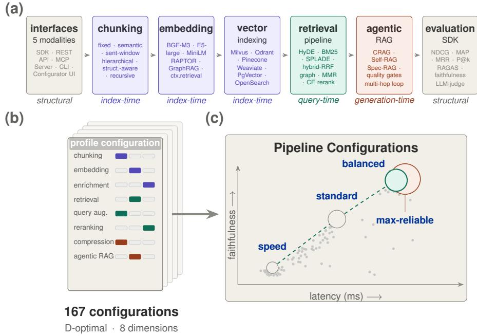  
Figure 1: LASAGNA overview. (a) Seven functional blocks. (b) Eight dimensions in a 167- configuration D-optimal design. (c) Faithfulness versus latency for four operational profiles; faded points show other configurations.

Testing these hypotheses requires a framework that isolates pipeline stages and supports reproducible evaluation across benchmarks. We created LASAGNA, an open-source RAG framework, to provide this (Fig. 1a, Section 3). Each stage sits behind a fixed interface, so swapping one method cannot silently change the implementation at another. Adding a new technique is a single line of code; the framework tests it inside a complete modern pipeline without reimplementing the surrounding stack.

We use LASAGNA to study RAG composition with a 167-configuration D-optimal design (Fedorov et al., 1972; Atkinson et al., 2007) across eight configurable stages of a modern RAG pipeline (Table 10), eight benchmarks (Fig. 5), and corpus sizes from 5K to 200K documents, complemented by 138 non-factorial ablation configurations across 24 targeted experiments (Section F). Across the factorial, ablation suite, and scaling sweep, the central finding is that techniques that perform well separately do not consistently retain their gains inside a full pipeline, and the pattern differs between retrieval and faithfulness. Retrieval gains compose sub-additively: the three largest singlecomponent improvements sum to a predicted +47% NDCG@10 gain, but the composed pipeline realizes only +17% (Section D.14). Faithfulness gains compose near-additively: separately measured improvements approximately transfer to the full pipeline (Table 47). Pipeline and generator also partly substitute: a stronger generator helps the lightest pipeline far more than the heaviest, so a heavier stack buys less when the generator is already strong (Section F.9).

Three practical implications follow. First, the components that improve retrieval are not the same as those that improve faithfulness, and optimizing one metric can hurt the other. Second, the four complete RAG profiles expose a Pareto tradeoff on retrieval quality, faithfulness, and response time, with no universal winner. Adding an agentic loop to a strong retrieval stack yields only a negligible faithfulness gain while hurting retrieval quality and latency. Across three other benchmarks at 100K–200K documents, lighter pipelines retain similar measured quality at 10–20× lower latency (Sections D.8 and 5). Third, corpus size shifts profile rankings: the design leading at small corpora trails by 13.7% NDCG@10 at 200K, with a rank flip visible from 25K (Fig. 4a). Small-corpus rankings should therefore be rechecked at the intended scale. Our contributions are:

Table 1: LASAGNA vs. prior RAG evaluations. Columns defined in Section G.1.
<table><tr><td>Study</td><td>Configs (mode, varied stages)</td><td>Design</td><td> $\eta ^ { 2 }$ </td><td>Interactions</td><td>Scaling</td><td>Pareto</td><td>Pre- registered</td><td>Benchmarks</td></tr><tr><td>(Jin et al., 2025)</td><td>16 methods (5)</td><td>library + part. GRID (tech.)</td><td>×</td><td>×</td><td>×</td><td>X</td><td>×</td><td>32</td></tr><tr><td>(Rau et al., 2024)</td><td>500+ runs (3)</td><td>partial GRID (tech.)</td><td>×</td><td>X</td><td>X</td><td>X</td><td>X</td><td>~12</td></tr><tr><td>(Wang et al., 2024)</td><td>∼dozens seq. (7)</td><td>GREEDY (tech.)</td><td>X</td><td>X</td><td>X</td><td>0</td><td>X</td><td>6</td></tr><tr><td>(Kim et al., 2024)</td><td>30+ seq. (6)</td><td>GREEDY (tech.)</td><td>X</td><td>X</td><td>X</td><td>X</td><td>X</td><td>4</td></tr><tr><td>(Friel et al., 2024)</td><td>32 joint (4)</td><td>GRID (mix.)</td><td>X</td><td>X</td><td>×</td><td>X</td><td>×</td><td>5</td></tr><tr><td>(Xiong et al., 2024)</td><td>41 partial (3)</td><td>partial GRID (tech.)</td><td>×</td><td>×</td><td>o (top-k, 5 corpora)</td><td>×</td><td>×</td><td>5</td></tr><tr><td>LASAGNA (ours)</td><td>167 factorial + 138 abl. (8)</td><td>D-OPT (tech., 30 levels)</td><td>√</td><td>√(28)</td><td>√(6×3)</td><td>√(4,HV)</td><td>√</td><td>8 (15)</td></tr></table>

1. How RAG components compose. A compositional study of RAG across eight configurable stages, eight benchmarks, and corpora scales from 5K to 200K documents: 167 configurations from a D-optimal factorial plus 138 non-factorial configurations across 24 targeted ablations. The four operational RAG profiles that emerge (SPEED, STANDARD, BALANCED, MAX-RELIABLE) are calibrated to cost, latency, and performance.

2. LASAGNA. The open-source framework built to conduct and reproduce this study. It provides a modular, stage-isolated RAG pipeline and an evaluation harness that lets researchers add a method and test it with the surrounding stack (Sections C.1 and F).

## 2 RELATED WORK

Modern RAG spans a layered design space with plausible interaction points at every stage (full method catalog in Section K). On retrieval, sparse baselines (BM25 (Robertson & Zaragoza, 2009)) coexist with dense encoders (BGE-M3 (Chen et al., 2024a), E5 (Wang et al., 2022)), learned sparse encoders (SPLADE (Formal et al., 2021)), and late-interaction models (ColBERT (Khattab & Zaharia, 2020)), fused by reciprocal-rank fusion (RRF) (Cormack et al., 2009) or learned hybrids. Reranking spans cross-encoder scorers trained on MS-MARCO (Nogueira & Cho, 2019), ensemble rerankers, and diversity-driven selection (MMR; Carbonell & Goldstein, 1998). Context compression is either token-budget aware (LLMLingua (Jiang et al., 2023a)) or positional (lost-in-the-middle-aware selection (Liu et al., 2024)). Query augmentation rewrites the query before retrieval: HyDE (Gao et al., 2023a) drafts a hypothetical answer, RAG-Fusion (Rackauckas, 2024) fans out multi-query variants, decomposition (Khattab et al., 2024) splits multi-hop questions into sub-questions, and step-back prompting (Zheng et al., 2024) abstracts before retrieving. Index-time processing enriches chunks before retrieval with document summaries (RAPTOR (Sarthi et al., 2024)), contextual prefixes (Anthropic, 2024), or entity-graph indexes (GraphRAG (Edge et al., 2024)). Generation-time control adds correction and gating loops around the answer model (CRAG (Yan et al., 2024), Self-RAG (Asai et al., 2024), Speculative-RAG (Wang et al., 2025)). Each of these stages has been shown to help in isolation on some benchmark, but they compose along more edges than a single-component ablation can enumerate. We study how these choices combine once deployed together, and LASAGNA lets others ask compositionality questions in the same environment by registering a new component and evaluating it against a full modern pipeline.

Table 1 positions LASAGNA against prior work that studies RAG beyond isolated components. Best-practice studies (Wang et al., 2024; Barnett et al., 2024) search greedily for strong end-to-end configurations but do not estimate interaction effects. Benchmarking libraries such as BERGEN (Rau et al., 2024) and FlashRAG (Jin et al., 2025) support composition in a shared codebase but do not enforce the stage isolation that controlled interaction estimation requires, so measured differences cannot be cleanly attributed to the component being varied (a positional smoke run against both is reported in Section G.4). Automated configuration search (Kim et al., 2024) optimizes over configurations but reports only the winning setting, not the interaction structure that produced it, so the resulting guidance does not transfer when any assumption changes. Evaluation suites (Krishna et al., 2025) and domain benchmarks (Xiong et al., 2024) supply metrics and tasks but not a common pipeline in which those metrics can be compared across controlled compositions. Generation-time controls (Yan et al., 2024) strengthen the agentic layer but are usually tested with retrieval fixed, leaving composition with a tuned stack untested.

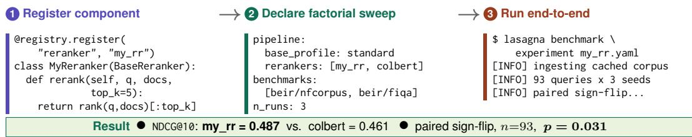  
Figure 2: LASAGNA research workflow: register a component, declare a factorial sweep in YAML, and run end-to-end for a paired statistical test.

## 3 LASAGNA: A COMPOSITIONAL FRAMEWORK FOR RAG

LASAGNA is an open-source framework for evaluating new RAG components inside a complete modern pipeline. A researcher proposing a new reranker, chunker, or agentic loop today must either compare against a stripped-down baseline that does not reflect a modern pipeline, or reimplement the surrounding stack. The first biases the conclusion by mixing implementation differences with algorithmic ones; the second is prohibitively expensive and rarely attempted. LASAGNA provides a configurable end-to-end pipeline (Fig. 1a) with a fixed interface per stage that the framework enforces, so a new component drops into one stage and is measured against the same surrounding stack used by every reported configuration (full code patterns in Sections H.2.2 to H.2.4). The workflow spans nine processing stages: document processing, chunking, index-time enrichment, embedding and indexing, query augmentation, retrieval, reranking, context compression, and answer generation with optional agentic verification. Every pipeline component is a subclass of a typed abstract base class: eight component types are supported (embedder, chunker, reranker, retriever, document\_processor, query\_enhancer, agentic\_pipeline, and generator), each stage’s inputs and outputs are typed dataclass contracts, and behavioral tests check that swapping one implementation does not mutate a neighboring stage’s state. A single @registry.register("<stage>", "<name>") decorator suffices to make a new component discoverable at YAML-config time. The framework ships with 53 built-in components, the 30 methods across the eight factorial dimensions (Table 10; full catalog in Section K), six vector backends (Milvus, Pinecone, Qdrant, Weaviate, pgvector, OpenSearch), and adapters for the eight benchmarks used here (five BEIR retrieval sets and three long-form QA sets; Section B.2). Five automated isolation tests (Section H.1) check that toggling one component does not silently change another, including that two sessions with opposite settings each keep their own configuration; this supports attributing the interaction estimates in Section 5 to the components we vary rather than to cross-stage leakage. A new component becomes a publishable comparison in three steps (Fig. 2): register with a decorator, declare a factorial sweep in YAML, and run end-to-end to receive a paired statistical test against the same surrounding stack that produced every reported number. The complete study, factorial plus 138 non-factorial ablations plus the 5K–200K scaling sweep, cost approximately \$5,200 in cloud compute and 310 wall-clock hours (Section A.7).

## 4 EXPERIMENTAL DESIGN

Notation. A dimension is one of the eight experimental factors (Table 10); DEFAULT\_STANDARD is the framework’s stock RAG pipeline (a simple, lowest-cost setting on each dimension) that serves as the starting baseline for our experiments; a profile is one of the four operational RAG compositions we distill from our factorial and ablation sweeps as the best-observed configurations targeting distinct points on the retrieval-faithfulness-latency envelope (SPEED, STANDARD, BALANCED, MAX-RELIABLE; full specifications in Section I.1); a track is one of the two evaluation surfaces (retrieval or end-to-end). We evaluate on both tracks because retrieval quality (whether the right documents are retrieved) and answer faithfulness (whether the generated answer is grounded in the retrieved context) measure distinct properties of a RAG pipeline, and different applications weight them differently. We report the joint quality-latency envelope as a hypervolume $\bar { \mathrm { H V } } ( L _ { \mathrm { r e f } } ) = \mathrm { N D C G @ 1 0 \times F a i t h } \ \times$ $\mathrm { m a x } ( \bar { 0 } , 1 - \mathrm { l a t e n c y } / L _ { \mathrm { r e f } } )$ (Zitzler et al., 2003) at $L _ { \mathrm { r e f } } { = } 3 0 ~ \mathrm { s }$ (a fixed response-time reference; Table 2); HV values under other fixed references are in Table 39. We report marginal effect sizes as $\eta ^ { 2 }$ ; larger values indicate stronger associations with variation in the metric (full statistics in Sections D.2 and D.11).

Factorial design. The configuration space spans eight experimental dimensions, with 2–5 levels each (Fig. 1b, Table 10). The full factorial of $4 { \times } 4 { \times } 4 { \times } 3 { \times } 5 { \times } 4 { \times } 2 { \times } 4 = 3 0 { , } 7 2 0$ configurations would exceed ∼40,000 GPU-hours and ∼\$600,000 in LLM API costs (extrapolating from the executed 167-configuration budget of 247 GPU-hours and \$5,200; Section A.7), roughly two orders of magnitude beyond our resources, so we draw a 242-run D-optimal subset via Fedorov coordinate exchange (Fedorov et al., 1972), sized to keep all main effects and all 28 dimension-pair interactions estimable under our budget. Of the 242 planned runs, 167 were executed: 63 GraphRAG-enriched runs were dropped after an isolated ablation showed no measurable NDCG@10 change despite the ∼2× latency the enrichment added (Table 11), and 12 failed on timeout limits. Design-matrix construction, aliasing diagnostics, and the identifiability audit for the pre-declared joint 28-two-way test appear in Sections A.4, A.5 and D.3. Each dimension uses a simple, lowest-cost baseline; pre-registration deviations appear in Table 12.

A unified multi-domain corpus, two evaluation tracks. Production RAG deployments operate against heterogeneous knowledge bases where a single retriever must disambiguate biomedical, financial, scientific, argumentative, and multi-hop queries from one shared vector store. Per-benchmark evaluation (the BEIR default; Thakur et al., 2021) under-tests this cross-domain distractor pressure. We therefore unify our eight evaluation benchmarks into one corpus: five BEIR sets cover retrieval (NFCorpus, Boteva et al., 2016; FiQA, Maia et al., 2018; SciFact, Wadden et al., 2020; ArguAna, Wachsmuth et al., 2018; HotpotQA, Yang et al., 2018) and three QA sets cover generation (SQuAD v2, Rajpurkar et al., 2018; MuSiQue, Trivedi et al., 2022), yielding 149 stratified queries per configuration (Sections B.1 and B.2 and Tables 15 to 17). Each configuration is evaluated on two tracks: retrieval (BEIR qrels over 5,132 documents, 93 queries) and end-to-end generation (the same corpus augmented with gold passages, 5,566 documents, 56 queries). Beyond the 167-run factorial, we additionally ran 138 non-factorial ablation configurations across 24 targeted experiments spanning rerankers, embeddings, chunkers, query augmentation, and the number of agentic verification iterations (Section F). Together with the corpus-scaling sweep (5K–200K), the study records approximately 358,215 individual query evaluations, including repeated RAGAS evaluation tasks for the same queries (Section A.1).

Metrics. End-to-end generation runs report faithfulness and answer relevance (RAGAS v0.4 (Es et al., 2024) judged by GPT-5.1); NDCG@10, exact match, token-level F1, and p50/p95 latency and \$/query; GPT-5.1 also generates answers for all configurations. NDCG@10 follows the BEIR convention (Thakur et al., 2021): retrieved chunks are de-duplicated by parent document ID before scoring, so the metric matches the document-level qrel grain. A two-annotator human evaluation validates RAGAS faithfulness (Sections C.4 and C.5 and Table 29), and a two-judge sensitivity analysis (GPT-5.1 vs. Claude Sonnet 4.5) shows that judge choice shifts absolute faithfulness but preserves profile ranking, so we treat single-judge point estimates as approximate and rely on ordinal comparisons for all headline claims (Section F.7). A third-judge robustness check asks Claude Opus 4.7 to score 220 question-answer-context examples using the same scoring instructions (Section F.8). Its moderate agreement with the primary judge (Pearson r=0.44, Cohen’s κ=0.35) supports the same conclusion: relative trends persist, although exact faithfulness scores depend on the judge. Metric definitions and judge-bias mitigations in Section C.1.

Pre-declared hypotheses. Most published RAG ablations tune one component at a time on a single benchmark $\mathrm { a t } \le 5 0 \mathrm { K }$ corpus, and report the resulting gain as a recommended configuration. We pre-declared (van Miltenburg et al., 2021; Forde & Paganini, 2019) three hypotheses that together test whether this methodology is sound, by asking whether RAG pipelines can be designed composition ally: H1 tests additivity (the assumption behind isolated single-component ablations), H2 tests profile generality (the assumption that a single balanced recipe deploys across targets), and H3 tests scale invariance (the assumption that rankings measured on small corpora persist at larger corpus scales). The full pre-registration (operational definitions, statistical thresholds, exclusion criteria, post-hoc corrections) is reproduced in Section A.2.

H1 Components do not necessarily combine additively. H1 tests whether two-way interactions among the eight experimental dimensions explain at least 20% of faithfulness variance. If they do, gains measured in isolation cannot be assumed to persist when components are combined.

H2 A single RAG composition can span multiple deployment targets. RAG designs face a Pareto tradeoff: retrieval quality, faithfulness, and response time cannot be maximized jointly, so practitioners typically re-run configuration search per deployment. H2 asks whether an intermediate RAG composition sweeps a wider quality / latency / cost hypervolume than adding more advanced components does, on a majority of datasets, covering enough of the Pareto surface that one published recipe serves multiple targets. Rejecting H2 means each deployment must hand-tune its own operating point (formalism and correction: Section A.2).

H3 Composition rankings shift with corpus scale. Most RAG ablations in the literature run at 5K to 50K documents, but production deployments often serve corpora an order of magnitude larger. H3 asks whether the ranking of RAG compositions at 5K matches their ranking at 200K on the same corpus; if it does not, small-corpus rankings do not transfer across scale, and design decisions measured at one scale must be revalidated at the target scale. Confirming H3 means small-corpus benchmarks are methodologically suspect as scale-invariant selectors of RAG designs; rejecting it validates them as predictive across the scales tested (per-composition log-linear fits, slope-range threshold, bootstrap CIs, and Kendall’s τ rank-flip test in Section A.2).

## 5 RESULTS

H1: the benefit of a RAG technique depends on the complete RAG pipeline and the target metric. Across the factorial and targeted tests, some techniques reinforce one another, some add roughly as expected, and others overlap or interfere (Fig. 3). Thus, improvements measured by changing one pipeline stage at a time do not reliably add up in a complete RAG pipeline. We quantify this by comparing the gain predicted from separately measured improvements with the gain the combined pipeline actually delivers. This needs only the configurations the study already runs, whereas estimating all 28 pairwise interactions directly requires 232 parameters, more than a design of this size can support (Section D.3). The three largest separately measured retrieval gains, from cross-encoder reranking, disabling MMR, and document-awareness prefixes, predict a +46.6% lift over the DEFAULT\_STANDARD baseline (NDCG@ $1 0 = 0 . 4 1 2 ;$ ; Table 32). On this same split a BM25-only retriever scores 0.403 and a recommended off-the-shelf dense encoder 0.436 (Table 60), so this is a realistic starting point, not a weak one. The BALANCED pipeline, which combines these techniques, realizes only +17.2%, a 63% shortfall relative to the three-technique prediction. Including all five separately positive retrieval techniques raises the shortfall to 72% (Fig. 9); across 17 tested combinations, it ranges from 7% to 72%, with a median of 41% (Sections D.12 and D.14). The ablations suggest partial functional overlap: reranking already provides some of the filtering benefit obtained by disabling MMR, leaving less room for the two techniques to help when combined. The target metric matters as well: embedding, enrichment, and reranking dominate the retrieval-quality metric, whereas query augmentation and agentic gating dominate the answer-faithfulness metric, which measures whether generated claims are supported by the retrieved context. Across matched pipeline configurations, the two metrics are essentially unrelated (Fig. 7; pooled Pearson $r = - 0 . 0 1$ $p = 0 . 9 1 )$ : 5% of configurations combine high faithfulness with low retrieval quality, and 6% show high retrieval quality with low faithfulness. The same near-zero relationship appears when each benchmark is examined separately, removing the concern that the near-zero correlation is caused by pooling benchmarks (Section D.2). This indicates that RAG pipeline selection must evaluate both metrics: selecting a pipeline based only on the retrieval metric can yield strong retrieval but weakly grounded answers, while selecting one based only on the faithfulness metric can hide poor retrieval.

H1: retrieval quality is most strongly associated with embedding and enrichment. On the retrieval track (Fig. 3, upper triangle; $n { = } 1 6 7$ configurations), the largest marginal associations are embedding $( \eta ^ { 2 } = \overline { { 0 . 1 6 4 } } )$ , enrichment $( \eta ^ { 2 } = 0 . 1 4 4 )$ , and reranking $( \breve { \eta ^ { 2 } } = 0 . 0 \breve { 9 0 } )$ . These unadjusted values are used for exploratory screening and are not additive because the D-optimal design is unbalanced and the effects share variance. Compression and agentic gate contribute negligibly $( \eta ^ { 2 } < 0 . 0 1 \mathrm { e a c h } )$ . Two two-way interactions survive both Bonferroni and Benjamini–Hochberg FDR correction: Embedding × Enrichment $( \eta ^ { 2 } = 0 . 1 0 2 )$ and Embedding × Reranking $( \eta ^ { 2 } = 0 . 1 1 0 )$ . Both survivors involve the embedding model. We attribute Embedding × Enrichment to representation capacity: stronger embedders can encode added context without diluting the original passage. We attribute Embedding × Reranking to candidate-set quality: rerankers have less room to help when the initial embedding already retrieves strong candidates (Sections J.3.1 and J.3.2). MMR reduces NDCG@10 by 3.6% relative on average, opposite its usual benefit on broad, heterogeneous corpora (Table 44). We hypothesize that on focused-domain corpora passages with high lexical and semantic overlap are often the same supporting evidence, so MMR’s diversity penalty demotes them in favor of topically distant ones (see Sections D.12 and D.13).

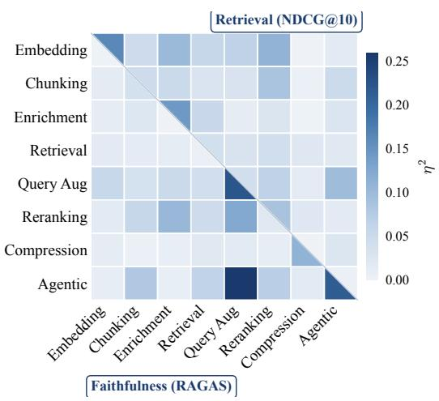  
Figure 3: Main effects and pairwise interactions across eight RAG pipeline factors. The upper triangle shows retrieval (167 configurations, NDCG@10), the lower triangle faithfulness (122 configurations, RAGAS). Darker cells mean stronger effects; an interaction cell shows how much one factor’s effect depends on another factor’s setting. Color encodes marginal (unadjusted) $\eta ^ { 2 }$ , the share of variance a factor or interaction explains, so the two metrics can be compared descriptively. Embedding and enrichment matter most for retrieval, whereas query augmentation and agentic gating matter most for faithfulness. Because the D-optimal design is unbalanced, values can overlap and should not be summed into a total explained variance.

H1: answer faithfulness depends most on query augmentation and agentic gating. On the faithfulness track (Fig. 3, lower triangle), query augmentation $( \eta ^ { 2 } = 0 . { \overset { \sim } { 2 } } 2 4 )$ and agentic gating $( \eta ^ { 2 } = 0 . 2 1 7 )$ have the largest marginal associations; embedding and enrichment, the strongest retrieval drivers, are negligible on faithfulness $( \eta ^ { 2 } < 0 . 0 2$ each). We attribute this contrast to pipeline stage: query augmentation changes retrieved evidence, whereas agentic gating filters or verifies it before generation. We test how these stages compose across all 5×4 combinations of query augmentation and agentic gating (Section D.10). The interaction effect is partial $\eta ^ { 2 } = 0 . 0 3 \dot { 3 } ;$ 10 of 20 combinations depart from additivity by at least two percentage points. Under Speculative-RAG, decomposition is 4.7 points above the additive prediction, while query expansion is 4.1 below it. We hypothesize that decomposition supplies distinct subproblems for draft-and-verify, whereas broader expansion can introduce overlapping or competing evidence. Thus, isolated gains do not reliably predict composition; these stages should be evaluated jointly (Table 42).

Faithfulness shows a different additivity pattern. A one-factor-at-a-time estimate based on BGE-large embeddings, hierarchical chunking, hybrid-BM25 retrieval, and Speculative-RAG gating predicts a +28% gain over a reference configuration, while the best full RAG pipeline improves by +32% over the same reference. This suggests that some faithfulness gains may combine approximately as measured. We hypothesize that this occurs when techniques act at complementary pipeline stages and duplicate less of one another’s function (Table 47). Full pairwise results are in Table 33.

H1 (additivity): gains measured one component at a time do not carry over when components are combined, and how much is lost depends on the metric.

Combining components loses most of the predicted retrieval gain and almost none of the predicted faithfulness gain. The three strongest single-component retrieval improvements predict +47% NDCG@10 and the pipeline containing all three realizes $+ 1 \hat { 7 } \% ;$ the same exercise on faithfulness predicts +28% and realizes +32% (Section D.14).

Our pre-declared test of H1 was not met, and that outcome fits the same split. It asked whether pairwise interactions explain at least 20% of the variance in faithfulness, the metric on which components combine nearly additively, and they do not (Section D.3). A focused follow-up, pre-specified before it ran, confirms that the interaction the broad analysis flagged is real $( p = 0 . 0 0 7 )$ but far below that bar (Sections D.9 and D.10). New components should therefore be evaluated inside representative complete pipelines, on both metrics.

H3: composition rankings shift between 5K and 200K documents. We extend the 5,132- document base corpus with scaling increments (15K/25K/50K/100K/200K) under the same proportional sampling protocol, with no distractor overlapping any evaluation query’s relevant set. For 25K–200K, repeated seeded executions resample retrieval and generation stochasticity but not corpus composition; distractors are sampled from the same five BEIR source domains as the base corpus (full protocol in Section B.3). NDCG@10 across six corpus sizes separates into two regimes (Fig. 4a): SPEED and STANDARD degrade log-linearly, while BALANCED and MAX-RELIABLE are approximately flat. The regimes cross between 15K and 25K. STANDARD leads at the small sizes (5K, 15K); BALANCED leads from 25K onward. At 200K, BALANCED exceeds STANDARD by 13.7% relative (p = 0.003; full per-size table in Section E.1).

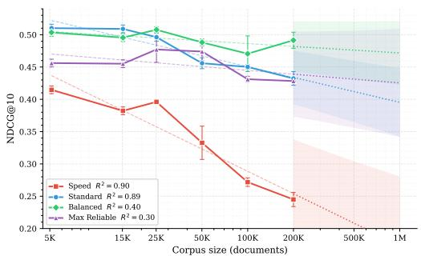  
(a) Retrieval NDCG@10: SPEED and STANDARD follow a log-linear decay; BALANCED and MAX-RELIABLE are statistically flat.

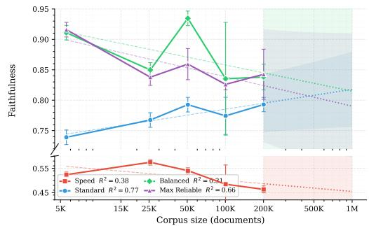  
(b) Generation faithfulness: all three quality-focused profiles peak at 50K, dip at 100K, and recover from 100K to 200K.  
Figure 4: Scaling behavior vs. corpus size (log scale), four SOTA profiles, 3 seeds per size. Dashed: log-linear fit over 5K–200K; dotted beyond 200K: projections, not measurements. In (a), BALANCED overtakes STANDARD between 15K–25K, significant at 200K.

We attribute the flatter retrieval-NDCG degradation at scale of BALANCED to several retrieval-stage additions relative to STANDARD: broader chunk retention, hierarchical document partitioning, and post-retrieval merging (full list in Section I.1). Together, these sustain a denser, higher-signal top-k as distractors dilute the pool. The extractive compression and document-awareness prefixes that BALANCED additionally enables act post-retrieval and pre-generation respectively; they primarily support faithfulness rather than the NDCG@10 gap (Section D.12; examples in document awareness and the 50K crossover). SPEED degrades fastest, which we hypothesize reflects MiniLM-L6’s limited discriminative capacity (384-dim) operating without the lexical anchoring that BM25 would provide under hybrid retrieval, see example and Table 23 for results.

H3: faithfulness and retrieval scale differently. Despite NDCG@10 falling as gold passages dilute among distractors, faithfulness does not decline with corpus scale. All three quality-focused profiles peak around 50K, dip at 100K, and recover from 100K to 200K (Fig. 4b and Table 22). We hypothesize that a larger corpus expands information coverage, so that even when the gold document falls below the top-k, other documents contain overlapping or paraphrased content sufficient to ground a faithful answer; the 100K→200K recovery across all three profiles is consistent with this mechanism. Full per-profile slopes and 1M projections in Tables 22, 23 and 49 and Fig. 11; latency scaling at each corpus size in Fig. 10.

## H3: composition rankings shift between 5K and 200K.

Supported. STANDARD leads at 5K and 15K; BALANCED leads from 25K through 200K, where it exceeds STANDARD by 13.7% relative (p = 0.003, three seeds). The 25K and 100K gaps are directionally consistent but underpowered. Small-corpus rankings should therefore be revalidated at the target scale (Table 48 and Section D.5).

H2: complete RAG profiles expose a Pareto tradeoff. We evaluate four profiles on a held-out SQuAD v2, MuSiQue, and HotpotQA mixture across three seeds (Table 2). No profile leads all metrics: SPEED is fastest; STANDARD’s direct route leads NDCG@10; the agentic BALANCED and MAX-RELIABLE profiles use three verification iterations and lead faithfulness.

At the fixed 30 s response-time reference, STANDARD has the highest joint hypervolume (0.523). Within the agentic pair, BALANCED improves NDCG@10 by 4.5% and response time by 13%, with only a 0.005 faithfulness difference. We attribute part of this tradeoff to the execution route: direct generation favors response time, while iterative verification favors faithfulness. Thus, additional components can improve one metric without improving the complete RAG pipeline, so all three metrics should be evaluated jointly.

Table 2: End-to-end profile comparison on a SQuAD v2 / MuSiQue / HotpotQA mixture over three seeds (GPT-5.1 judge; faithfulness uses each profile’s deployment-native answer prompt; per-profile regime and joint-HV sensitivity to that choice in Table 26 and Section C.2). Mean ± std; bold: column best; green : highest joint retrieval–faithfulness–latency volume. HV $\left( L _ { \mathrm { r e f } } \right) =$ $\mathrm { N D C G @ 1 0 } \times \mathrm { F a i t h } \times \mathrm { m a x } ( 0 , 1 - \mathrm { l a t e n c y } / L _ { \mathrm { r e f } } )$ (Zitzler et al., 2003), with $L _ { \mathrm { r e f } } = 3 0 { \mathrm { s } } ;$ referencelatency sensitivity is in Table 39.
<table><tr><td>Profile</td><td>NDCG@10</td><td>Faithfulness</td><td>Lat. mean (s)</td><td>HV (30 s ref)</td></tr><tr><td>STANDARD</td><td>0.860 ± 0.003</td><td> $0 . 7 3 9 \pm 0 . 0 1 6$ </td><td> $5 . 3 0 \pm 0 . 0 5$ </td><td>0.523</td></tr><tr><td>BALANCED</td><td> $0 . 8 4 0 \pm 0 . 0 0 3$ </td><td> $0 . 9 1 1 \pm 0 . 0 1 4$ </td><td> $1 2 . 2 5 \pm 3 . 5 5$ </td><td>0.453</td></tr><tr><td>MAX-RELIABLE</td><td> $0 . 8 0 4 \pm 0 . 0 0 4$ </td><td> $\mathbf { 0 . 9 1 6 \pm 0 . 0 2 2 }$ </td><td> $1 4 . 1 6 \pm 6 . 4 4$ </td><td>0.389</td></tr><tr><td>SPEED</td><td> $0 . 5 4 1 \pm 0 . 0 0 0$ </td><td> $0 . 5 2 4 \pm 0 . 0 3 1$ </td><td> ${ \bf 0 . 7 0 \pm 0 . 0 2 }$ </td><td>0.277</td></tr></table>

## H2 (single-composition generality): no complete RAG profile is best on every metric.

At the fixed 30 s reference, STANDARD achieves the highest joint hypervolume (0.523; Table 2). The agentic profiles trade more response time for faithfulness; among them, BALANCED nearly matches MAX-RELIABLE’s faithfulness while improving retrieval quality and response time. Thus, the best configuration depends on the target metrics, and adding components does not guarantee a better pipeline.

Supporting evidence: what helps and what does not. A sweep of 138 configurations across 24 targeted experiments yields several practical findings (Section F). Across 20 configurations, chunker choice spans 0.126 NDCG@10, a 36% relative difference larger than most factorial main effects (Table 55). Thus, preprocessing choices should also be tested within the complete pipeline. The 2019 MS-MARCO MiniLM-L6 cross-encoder (Nogueira & Cho, 2019) ranks above all four recent rerankers tested (Table 51); we speculate that its training aligns especially well with our focused domains. Matryoshka truncation of BGE-M3 to 768 dimensions (Kusupati et al., 2022) reduces vector storage and search cost by 25% while improving NDCG@10 by 2.3% (Table 52). We attribute the gain to the Matryoshka training objective, which concentrates useful signal in leading dimensions; encoder cost is unchanged because the full vector is computed first. On generation, faithfulness is highest with hallucination and answer-quality gates disabled: gate-triggered refinement can remove supporting evidence, including 14 of 15 chunks in one multi-hop example (Table 54). HyDE raises NDCG@10 by 3.1% but doubles first-hop latency, reducing the latency-adjusted gain to 0.9%, so its value depends on the latency budget (Section I.2).

## 6 CONCLUSION

We study how modern RAG techniques compose across pipeline stages, metrics, and corpus scales using LASAGNA, a stage-isolated framework, and 450 configurations across eight benchmarks from 5K to 200K documents. Gains measured one component at a time do not necessarily persist in complete pipelines; retrieval quality and answer faithfulness favor different choices; and the best composition changes with corpus scale. New techniques should be tested in representative complete pipelines, on both metrics, and at the intended scale. We release LASAGNA to make such studies practical and reproducible, and to establish compositional evaluation as the reporting standard for new RAG techniques rather than the isolated single-component ablations common today.

## AI USE STATEMENT

In this work, we used generative AI tools for designing or providing feedback on research methodology and experiments, implementing methods, and interpreting results. We have not used generative AI tools for generating synthetic data sets, developing theoretical models or conceptual frameworks, proposing or refining hypotheses, cleaning or reformatting datasets, or translation, and formulating mathematical claims or proofs and qualitative or thematic data analysis are not applicable to this work. Additionally, we used generative AI tools for creating and editing software code and figures, editing the paper to improve readability, and formatting references. We have reviewed all AI-assisted work: AI-assisted code was reviewed and tested by the authors, analysis results were re-derived from the raw result files, and edited text, numbers, and citations were checked against the source tables and references. We take responsibility for the final content of this work, including text, claims or artifacts produced with the aid of generative AI. Separately, LLMs are components of the system we study: they generate answers and act as RAGAS judges (GPT-5.1, Claude Sonnet 4.5), as documented in the Methods and Appendices.

## ETHICS STATEMENT

LASAGNA is an evaluation framework operating over publicly released retrieval benchmarks; no human subjects, personal data, or private corpora were used. LLM API calls totalled approximately \$5,200 and 310 wall-clock hours (Section A.7); we report per-configuration cost and latency to enable reproducibility on constrained budgets. Because the framework lowers the cost of composing RAG pipelines, users deploying it in domain applications requiring corpus-specific validation should re-validate our profile candidates on their own corpus before deployment. Our headline profile comparisons rest on one constructed English multi-domain test bed with ≤ 93 retrieval and ≤ 200 generation queries per experiment, so the profiles are best interpreted as candidates for further validation, not prescriptions.

## REPRODUCIBILITY STATEMENT

The LASAGNA framework code is released at https://github.com/dolev31/lasagna. The paperspecific artifacts cited by path in the appendices (the D-optimal design matrix, per-configuration profiles, per-query raw scores, and analysis scripts) are not part of that release and are available from the authors on request. Sections A to C document experimental design and pre-registration; the perexperiment provenance manifest (Table 58), conformance test verifying stage isolation (Section H.1), and full compute accounting (Section A.7) support end-to-end reproducibility. The design matrix, hypotheses, and decision rules were pre-declared internally and hashed (SHA-256) prior to execution; we did not file a third-party timestamped pre-registration (OSF/AsPredicted), so the main text says “pre-declared” rather than “pre-registered”.

## REFERENCES

Anthropic. Contextual retrieval. https://www.anthropic.com/research/contextualretrieval, 2024.

Akari Asai, Zeqiu Wu, Yizhong Wang, Avirup Sil, and Hannaneh Hajishirzi. Self-RAG: Learning to retrieve, generate, and critique through self-reflection. In The Twelfth International Conference on Learning Representations, 2024. URL https://openreview.net/forum?id=hSyW5go0v8.

Anthony Atkinson, Alexander Donev, and Randall Tobias. Optimum Experimental Designs, with SAS. Oxford University Press, 05 2007. ISBN 978-0-19-929659-0. doi: 10.1093/oso/9780199296590. 001.0001.

Christoph Auer, Maksym Lysak, Ahmed Nassar, Michele Dolfi, Nikolaos Livathinos, Panos Vagenas, Cesar Berrospi Ramis, Matteo Omenetti, Fabian Lindlbauer, Kasper Dinkla, et al. Docling technical report. arXiv preprint arXiv:2408.09869, 2024.

Scott Barnett, Stefanus Kurniawan, Srikanth Thudumu, Zach Brannelly, and Mohamed Abdelrazek. Seven failure points when engineering a retrieval augmented generation system. In Proceedings of the IEEE/ACM 3rd International Conference on AI Engineering - Software Engineeringfor AI, CAIN ’24, pp. 194–199, New York, NY, USA, 2024. Association for Computing Machinery. ISBN 9798400705915. doi: 10.1145/3644815.3644945. URL https://doi.org/10.1145/3644815. 3644945.

Vera Boteva, Demian Gholipour, Artem Sokolov, and Stefan Riezler. A full-text learning to rank dataset for medical information retrieval. In Advances in Information Retrieval (ECIR), 2016.

Xavier Bouthillier, Pierre Delaunay, Mirko Bronzi, Assya Trofimov, Brennan Nichyporuk, Justin Szeto, Nazanin Mohammadi Sepahvand, Edward Raff, Kanika Madan, Vikram Voleti, Samira Ebrahimi Kahou, Vincent Michalski, Tal Arbel, Chris Pal, Gael Varoquaux, and Pascal Vincent. Accounting for variance in machine learning benchmarks. In A. Smola, A. Dimakis, and I. Stoica (eds.), Proceedings of Machine Learning and Systems, volume 3, pp. 747–769, 2021. URL https://proceedings.mlsys.org/paper\_files/paper/2021/file/ 0184b0cd3cfb185989f858a1d9f5c1eb-Paper.pdf.

G. Box, J. Hunter, and W.G. Hunter. Statistics for experimenters: Design, innovation, and discovery. AMC, 10, 01 2005.

Sebastian Bruch, Siyu Gai, and Amir Ingber. An analysis of fusion functions for hybrid retrieval. ACM Transactions on Information Systems, 42(1):1–35, 2023.

Jaime Carbonell and Jade Goldstein. The use of mmr, diversity-based reranking for reordering documents and producing summaries. In Proceedings ofthe 21st annual international ACM SIGIR conference on Research and development in information retrieval, pp. 335–336, 1998.

Jianlv Chen, Shitao Xiao, Peitian Zhang, Kun Luo, Defu Lian, and Zheng Liu. Bge m3-embedding: Multi-lingual, multi-functionality, multi-granularity text embeddings through self-knowledge distillation. arXiv preprint arXiv:2402.03216, 4(5), 2024a.

Tong Chen, Hongwei Wang, Sihao Chen, Wenhao Yu, Kaixin Ma, Xinran Zhao, Hongming Zhang, and Dong Yu. Dense x retrieval: What retrieval granularity should we use? In Proceedings of the 2024 Conference on Empirical Methods in Natural Language Processing, pp. 15159–15177, 2024b.

Yiqun Chen, Lingyong Yan, Weiwei Sun, Xinyu Ma, Yi Zhang, Shuaiqiang Wang, Dawei Yin, Yiming Yang, and Jiaxin Mao. Improving retrieval-augmented generation through multi-agent reinforcement learning. In The Thirty-ninth Annual Conference on Neural Information Processing Systems, 2026. URL https://openreview.net/forum?id=9Ia0KiVAut.

Jacob Cohen. Statistical power analysisfor the behavioral sciences. routledge, 2013.

Gordon V Cormack, Charles LA Clarke, and Stefan Buettcher. Reciprocal rank fusion outperforms condorcet and individual rank learning methods. In Proceedings ofthe 32nd international ACM SIGIR conference on Research and development in information retrieval, pp. 758–759, 2009.

Jesse Dodge, Suchin Gururangan, Dallas Card, Roy Schwartz, and Noah A. Smith. Show your work: Improved reporting of experimental results. In Kentaro Inui, Jing Jiang, Vincent Ng, and Xiaojun Wan (eds.), Proceedings of the 2019 Conference on Empirical Methods in Natural Language Processing and the 9th International Joint Conference on Natural Language Processing (EMNLP-IJCNLP), pp. 2185–2194, Hong Kong, China, November 2019. Association for Computational Linguistics. doi: 10.18653/v1/D19-1224. URL https://aclanthology.org/D19-1224/.

Darren Edge, Ha Trinh, Newman Cheng, Joshua Bradley, Alex Chao, Apurva Mody, Steven Truitt, Dasha Metropolitansky, Robert Osazuwa Ness, and Jonathan Larson. From local to global: A graph rag approach to query-focused summarization. arXiv preprint arXiv:2404.16130, 2024.

Shahul Es, Jithin James, Luis Espinosa Anke, and Steven Schockaert. Ragas: Automated evaluation of retrieval augmented generation. In Proceedings ofthe 18th conference ofthe european chapter ofthe associationfor computational linguistics: system demonstrations, pp. 150–158, 2024.

Wenqi Fan, Yujuan Ding, Liangbo Ning, Shijie Wang, Hengyun Li, Dawei Yin, Tat-Seng Chua, and Qing Li. A survey on rag meeting llms: Towards retrieval-augmented large language models. In Proceedings of the 30th ACM SIGKDD conference on knowledge discovery and data mining, pp. 6491–6501, 2024.

Valerii Fedorov, W. J. Studden, and Eugene M. Klimko. Theory of optimal experiments. Biometrika, 59:697, 1972. URL https://api.semanticscholar.org/CorpusID:121909870.

Jessica Zosa Forde and Michela Paganini. The scientific method in the science of machine learning. In ICLR 2019 Workshop on Debugging Machine Learning Models, 2019. URL https://debugml-iclr2019.github.io/cameraready/DebugML-19\_paper\_26.pdf. Presented at the ICLR 2019 Debugging Machine Learning Models Workshop.

Thibault Formal, Benjamin Piwowarski, and Stéphane Clinchant. Splade: Sparse lexical and expansion model for first stage ranking. In Proceedings of the 44th International ACM SIGIR Conference on Research and Development in Information Retrieval, pp. 2288–2292, 2021.

Thibault Formal, Carlos Lassance, Benjamin Piwowarski, and Stéphane Clinchant. From distillation to hard negative sampling: Making sparse neural ir models more effective. In Proceedings ofthe 45th international ACM SIGIR conference on research and development in information retrieval, pp. 2353–2359, 2022.

Robert Friel, Masha Belyi, and Atindriyo Sanyal. Ragbench: Explainable benchmark for retrievalaugmented generation systems. arXiv preprint arXiv:2407.11005, 2024.

Jia Fu, Xiaoting Qin, Fangkai Yang, Lu Wang, Jue Zhang, Qingwei Lin, Yubo Chen, Dongmei Zhang, Saravan Rajmohan, and Qi Zhang. AutoRAG-HP: Automatic online hyper-parameter tuning for retrieval-augmented generation. In Yaser Al-Onaizan, Mohit Bansal, and Yun-Nung Chen (eds.), Findings of the Association for Computational Linguistics: EMNLP 2024, pp. 3875–3891, Miami, Florida, USA, November 2024. Association for Computational Linguistics. doi: 10.18653/v1/ 2024.findings-emnlp.223. URL https://aclanthology.org/2024.findings-emnlp.223/.

Luyu Gao, Xueguang Ma, Jimmy Lin, and Jamie Callan. Precise zero-shot dense retrieval without relevance labels. In Proceedings of the 61st Annual Meeting of the Association for Computational Linguistics (Volume 1: Long Papers), pp. 1762–1777, 2023a.

Yunfan Gao, Yun Xiong, Xinyu Gao, Kangxiang Jia, Jinliu Pan, Yuxi Bi, Yixin Dai, Jiawei Sun, Haofen Wang, Haofen Wang, et al. Retrieval-augmented generation for large language models: A survey. arXiv preprint arXiv:2312.10997, 2(1):32, 2023b.

Bernal J Gutiérrez, Yiheng Shu, Yu Gu, Michihiro Yasunaga, and Yu Su. Hipporag: Neurobiologically inspired long-term memory for large language models. Advances in neural information processing systems, 37:59532–59569, 2024.

Huiqiang Jiang, Qianhui Wu, Chin-Yew Lin, Yuqing Yang, and Lili Qiu. Llmlingua: Compressing prompts for accelerated inference of large language models. In Proceedings of the 2023 conference on empirical methods in natural language processing, pp. 13358–13376, 2023a.

Zhengbao Jiang, Frank F Xu, Luyu Gao, Zhiqing Sun, Qian Liu, Jane Dwivedi-Yu, Yiming Yang, Jamie Callan, and Graham Neubig. Active retrieval augmented generation. In Proceedings ofthe 2023 conference on empirical methods in natural language processing, pp. 7969–7992, 2023b.

Jiajie Jin, Yutao Zhu, Zhicheng Dou, Guanting Dong, Xinyu Yang, Chenghao Zhang, Tong Zhao, Zhao Yang, and Ji-Rong Wen. Flashrag: A modular toolkit for efficient retrieval-augmented generation research. In Companion Proceedings ofthe ACM on Web Conference 2025, WWW ’25, pp. 737–740, New York, NY, USA, 2025. Association for Computing Machinery. ISBN 9798400713316. doi: 10.1145/3701716.3715313. URL https://doi.org/10.1145/3701716. 3715313.

Jared Kaplan, Sam McCandlish, Thomas Henighan, Tom B. Brown, Benjamin Chess, Rewon Child, Scott Gray, Alec Radford, Jeff Wu, and Dario Amodei. Scaling laws for neural language models. ArXiv, abs/2001.08361, 2020. URL https://api.semanticscholar.org/CorpusID: 210861095.

Omar Khattab and Matei Zaharia. Colbert: Efficient and effective passage search via contextualized late interaction over bert. In Proceedings of the 43rd International ACM SIGIR conference on research and development in Information Retrieval, pp. 39–48, 2020.

Omar Khattab, Arnav Singhvi, Paridhi Maheshwari, Zhiyuan Zhang, Keshav Santhanam, Sri Vardhamanan, Saiful Haq, Ashutosh Sharma, Thomas T. Joshi, Hanna Moazam, Heather Miller, Matei Zaharia, and Christopher Potts. Dspy: Compiling declarative language model calls into

self-improving pipelines. In The Twelfth International Conference on Learning Representations, 2024.

Dongkyu Kim, Byoungwook Kim, Donggeon Han, and Matouš Eibich. Autorag: Automated framework for optimization of retrieval augmented generation pipeline. arXiv preprint arXiv:2410.20878, 2024.

Satyapriya Krishna, Kalpesh Krishna, Anhad Mohananey, Steven Schwarcz, Adam Stambler, Shyam Upadhyay, and Manaal Faruqui. Fact, fetch, and reason: A unified evaluation of retrievalaugmented generation. In Proceedings of the 2025 Conference of the Nations of the Americas Chapter of the Association for Computational Linguistics: Human Language Technologies (Volume 1: Long Papers), pp. 4745–4759, 2025.

Aditya Kusupati, Gantavya Bhatt, Aniket Rege, Matthew Wallingford, Aditya Sinha, Vivek Ramanujan, William Howard-Snyder, Kaifeng Chen, Sham Kakade, Prateek Jain, et al. Matryoshka representation learning. Advances in Neural Information Processing Systems, 35:30233–30249, 2022.

Patrick Lewis, Ethan Perez, Aleksandra Piktus, Fabio Petroni, Vladimir Karpukhin, Naman Goyal, Heinrich Küttler, Mike Lewis, Wen-tau Yih, Tim Rocktäschel, et al. Retrieval-augmented generation for knowledge-intensive nlp tasks. Advances in neural information processing systems, 33: 9459–9474, 2020.

Siran Li, Linus Stenzel, Carsten Eickhoff, and Seyed Ali Bahrainian. Enhancing retrieval-augmented generation: a study of best practices. In Proceedings of the 31st International Conference on Computational Linguistics, pp. 6705–6717, 2025.

Lei Liang, Mengshu Sun, Zhengke Gui, Zhongshu Zhu, Zhouyu Jiang, Ling Zhong, Yuan Qu, Peilong Zhao, Zhongpu Bo, Jin Yang, et al. Kag: Boosting llms in professional domains via knowledge augmented generation. arXiv preprint arXiv:2409.13731, 2024.

Nelson F Liu, Kevin Lin, John Hewitt, Ashwin Paranjape, Michele Bevilacqua, Fabio Petroni, and Percy Liang. Lost in the middle: How language models use long contexts. Transactions of the association for computational linguistics, 12:157–173, 2024.

Macedo Maia, Siegfried Handschuh, André Freitas, Brian Davis, Ross McDermott, Manel Zarrouk, and Alexandra Balahur. WWW’18 open challenge: Financial opinion mining and question answering. In Companion Proceedings ofthe The Web Conference (WWW), 2018.

Douglas C. Montgomery. Design and Analysis of Experiments. Wiley, 10 edition, 2021. ISBN 9781119816959. EMEA edition.

Rodrigo Nogueira and Kyunghyun Cho. Passage re-ranking with bert. arXiv preprint arXiv:1901.04085, 2019.

Ofir Press, Muru Zhang, Sewon Min, Ludwig Schmidt, Noah Smith, and Mike Lewis. Measuring and narrowing the compositionality gap in language models. In Houda Bouamor, Juan Pino, and Kalika Bali (eds.), Findings of the Association for Computational Linguistics: EMNLP 2023, pp. 5687–5711, Singapore, December 2023. Association for Computational Linguistics. doi: 10.18653/ v1/2023.findings-emnlp.378. URL https://aclanthology.org/2023.findings-emnlp.378/.

Zackary Rackauckas. Rag-fusion: A new take on retrieval augmented generation. International Journal on Natural Language Computing, 13:37–47, 02 2024. doi: 10.5121/ijnlc.2024.13103.

Pranav Rajpurkar, Robin Jia, and Percy Liang. Know what you don’t know: Unanswerable questions for squad. In Proceedings of the 56th Annual Meeting of the Association for Computational Linguistics (Volume 2: Short Papers), pp. 784–789, 2018.

David Rau, Hervé Déjean, Nadezhda Chirkova, Thibault Formal, Shuai Wang, Stéphane Clinchant, and Vassilina Nikoulina. BERGEN: A benchmarking library for retrieval-augmented generation. In Yaser Al-Onaizan, Mohit Bansal, and Yun-Nung Chen (eds.), Findings ofthe Associationfor Computational Linguistics: EMNLP 2024, pp. 7640–7663, Miami, Florida, USA, November 2024. Association for Computational Linguistics. doi: 10.18653/v1/2024.findings-emnlp.449. URL https://aclanthology.org/2024.findings-emnlp.449/.

Stephen Robertson and Hugo Zaragoza. The probabilistic relevance framework: BM25 and beyond, volume 4. Now Publishers Inc, 2009.

Jon Saad-Falcon, Omar Khattab, Christopher Potts, and Matei Zaharia. Ares: An automated evaluation framework for retrieval-augmented generation systems. In Proceedings ofthe 2024 Conference of the North American Chapter ofthe Associationfor Computational Linguistics: Human Language Technologies (Volume 1: Long Papers), pp. 338–354, 2024.

Keshav Santhanam, Omar Khattab, Jon Saad-Falcon, Christopher Potts, and Matei Zaharia. Colbertv2: Effective and efficient retrieval via lightweight late interaction. In Proceedings of the 2022 Conference of the North American Chapter of the Association for Computational Linguistics: Human Language Technologies, pp. 3715–3734, 2022.

Parth Sarthi, Salman Abdullah, Aditi Tuli, Shubh Khanna, Anna Goldie, and Christopher D Manning. Raptor: Recursive abstractive processing for tree-organized retrieval. In The Twelfth International Conference on Learning Representations, 2024.

Wenyu Tao, Xiaofen Xing, Yirong Chen, Linyi Huang, and Xiangmin Xu. Treerag: Unleashing the power of hierarchical storage for enhanced knowledge retrieval in long documents. In Findings of the Association for Computational Linguistics: ACL 2025, pp. 356–371, 2025.

Nandan Thakur, Nils Reimers, Andreas Rücklé, Abhishek Srivastava, and Iryna Gurevych. Beir: A heterogeneous benchmark for zero-shot evaluation of information retrieval models. In Thirty-fifth Conference on Neural Information Processing Systems Datasets and Benchmarks Track (Round 2), 2021.

Harsh Trivedi, Niranjan Balasubramanian, Tushar Khot, and Ashish Sabharwal. Musique: Multihop questions via single-hop question composition. Transactions of the Association for Computational Linguistics, 10:539–554, 2022.

Harsh Trivedi, Niranjan Balasubramanian, Tushar Khot, and Ashish Sabharwal. Interleaving retrieval with chain-of-thought reasoning for knowledge-intensive multi-step questions. In Proceedings of the 61st annual meeting ofthe associationfor computational linguistics (volume 1: long papers), pp. 10014–10037, 2023.

Emiel van Miltenburg, Chris van der Lee, and Emiel Krahmer. Preregistering NLP research. In Kristina Toutanova, Anna Rumshisky, Luke Zettlemoyer, Dilek Hakkani-Tur, Iz Beltagy, Steven Bethard, Ryan Cotterell, Tanmoy Chakraborty, and Yichao Zhou (eds.), Proceedings ofthe 2021 Conference of the North American Chapter of the Association for Computational Linguistics: Human Language Technologies, pp. 613–623, Online, June 2021. Association for Computational Linguistics. doi: 10.18653/v1/2021.naacl-main.51. URL https://aclanthology.org/2021. naacl-main.51/.

Henning Wachsmuth, Shahbaz Syed, and Benno Stein. Retrieval of the best counterargument without prior topic knowledge. In Proceedings of the Annual Meeting of the Association for Computational Linguistics (ACL), 2018.

David Wadden, Shanchuan Lin, Kyle Lo, Lucy Lu Wang, Madeleine van Zuylen, Arman Cohan, and Hannaneh Hajishirzi. Fact or fiction: Verifying scientific claims. In Proceedings ofthe Conference on Empirical Methods in Natural Language Processing (EMNLP), 2020.

Liang Wang, Nan Yang, Xiaolong Huang, Binxing Jiao, Linjun Yang, Daxin Jiang, Rangan Majumder, and Furu Wei. Text embeddings by weakly-supervised contrastive pre-training. ArXiv, abs/2212.03533, 2022. URL https://api.semanticscholar.org/CorpusID:254366618.

Wenhui Wang, Furu Wei, Li Dong, Hangbo Bao, Nan Yang, and Ming Zhou. Minilm: deep selfattention distillation for task-agnostic compression of pre-trained transformers. In Proceedings ofthe 34th International Conference on Neural Information Processing Systems, NIPS ’20, Red Hook, NY, USA, 2020. Curran Associates Inc. ISBN 9781713829546.

Xiaohua Wang, Zhenghua Wang, Xuan Gao, Feiran Zhang, Yixin Wu, Zhibo Xu, Tianyuan Shi, Zhengyuan Wang, Shizheng Li, Qi Qian, et al. Searching for best practices in retrieval-augmented generation. In Proceedings of the 2024 Conference on Empirical Methods in Natural Language Processing, pp. 17716–17736, 2024.

Zilong (Ryan) Wang, Zifeng Wang, Long Le, Huaixiu Steven Zheng, Swaroop Mishra, Vincent Perot, Yuwei Zhang, Anush Mattapalli, Ankur Taly, Jingbo Shang, Chen-Yu Lee, and Tomas Pfister. Speculative rag: Enhancing retrieval augmented generation through drafting. In Y. Yue, A. Garg, N. Peng, F. Sha, and R. Yu (eds.), International Conference on Learning Representations, volume 2025, pp. 18483–18505, 2025. URL https://proceedings.iclr.cc/paper\_files/ paper/2025/file/2ea06b52f613716e67458f5ab3fb7558-Paper-Conference.pdf.

Shitao Xiao, Zheng Liu, Peitian Zhang, Niklas Muennighoff, Defu Lian, and Jian-Yun Nie. C-pack: Packed resources for general chinese embeddings. In Proceedings ofthe 47th International ACM SIGIR Conference on Research and Development in Information Retrieval, SIGIR ’24, pp. 641–649, New York, NY, USA, 2024. Association for Computing Machinery. ISBN 9798400704314. doi: 10.1145/3626772.3657878. URL https://doi.org/10.1145/3626772.3657878.

Guangzhi Xiong, Qiao Jin, Zhiyong Lu, and Aidong Zhang. Benchmarking retrieval-augmented generation for medicine. In Findings ofthe Associationfor Computational Linguistics: ACL 2024, pp. 6233–6251, 2024.

Shi-Qi Yan, Jia-Chen Gu, Yun Zhu, and Zhen-Hua Ling. Corrective retrieval augmented generation. ArXiv, abs/2401.15884, 2024. URL https://api.semanticscholar.org/CorpusID: 267312595.

Zhilin Yang, Peng Qi, Saizheng Zhang, Yoshua Bengio, William Cohen, Ruslan Salakhutdinov, and Christopher D Manning. Hotpotqa: A dataset for diverse, explainable multi-hop question answering. In Proceedings of the 2018 conference on empirical methods in natural language processing, pp. 2369–2380, 2018.

Hao Yu, Aoran Gan, Kai Zhang, Shiwei Tong, Qi Liu, and Zhaofeng Liu. Evaluation of retrievalaugmented generation: A survey. In CCF Conference on Big Data, pp. 102–120. Springer, 2024.

Huaixiu Steven Zheng, Swaroop Mishra, Xinyun Chen, Heng-Tze Cheng, Ed H Chi, Quoc V Le, and Denny Zhou. Take a step back: Evoking reasoning via abstraction in large language models. In The Twelfth International Conference on Learning Representations, 2024.

Lianmin Zheng, Wei-Lin Chiang, Ying Sheng, Siyuan Zhuang, Zhanghao Wu, Yonghao Zhuang, Zi Lin, Zhuohan Li, Dacheng Li, Eric Xing, et al. Judging llm-as-a-judge with mt-bench and chatbot arena. Advances in neural information processing systems, 36:46595–46623, 2023.

Eckart Zitzler, Lothar Thiele, Marco Laumanns, Carlos M Fonseca, and Viviane Grunert Da Fonseca. Performance assessment of multiobjective optimizers: An analysis and review. IEEE Transactions on evolutionary computation, 7(2):117–132, 2003.

## LIMITATIONS

Our evaluation uses one constructed English multi-domain test bed (≤ 93 retrieval queries, ≤ 200 generation queries per experiment) and does not test: multilingual corpora, real enterprise or private data, open-weight generators (all headline results use proprietary APIs; see Reproducibility Statement), or cross-organizational large corpora. Faithfulness is now measured under two generator models rather than one (Section F.9), which is a sensitivity check on generator choice and not a sweep: both models are proprietary, and the ordering of the two closest profiles is not stable across them. Findings should be interpreted as case-study evidence for the methodological framework, and derived profiles as candidates for further validation rather than prescriptions for high-stakes deployments. The benchmarks are concentrated in five focused domains (biomedical, financial, scientific, argumentative, and multi-hop QA over Wikipedia), and the corpus-scaling protocol injects controlled distractors drawn from those same five domains. On the evaluation side, our cross-judge (LLM and humans) agreement supports profile rankings across LLM judges, but absolute faithfulness scores still live in a single judge’s calibration. The confirmatory faithfulness experiment (E1, Section D.10) meets its pre registered three-seed replication $( n _ { \mathrm { r u n s } } = 3 )$ but uses 43 unique queries rather than the pre-registered 200, due to GPT-5.1 rate-limit budget cuts (Section A.6); magnitude estimates should be read under this reduced query sampling. A controlled length-variant rerun (Section C.3) further shows that raw faithfulness is partly length-driven, and that the concise-over-verbose gap reverses under length control; we therefore report both raw and length-residualized faithfulness for any cross-regime claim. The within-regime results in the main tables are unaffected because they hold prompt length constant. Our component inventory is also a January-2026 snapshot of a literature that ships new techniques actively. Scaling degradations should be read as an upper bound: a formal n=100 distractor-relevance audit (Section B.3.5) finds a 0% false-negative rate and a 9% partial-relevance rate, so the H3 rank-flip is robust to distractor mis-labeling but true degradation is likely smaller than reported.

## A EXPERIMENTAL DESIGN AND REPRODUCIBILITY

## A.1 NOTATION AND COUNTS

Per-experiment configuration and query counts, referenced throughout the Results section. Executed configuration counts differ by track because the H1 factorial (retrieval) uses 167 configurations; the H1 generation ANOVA uses 122 (a subset that completed generation-side scoring within budget); the H2 headline Pareto comparison uses the 4 SOTA profiles on a SQuAD v2 / MuSiQue / HotpotQA mixture (43 generation / 56 retrieval queries per seed) with 3 seeded runs; and the pre-declared E1 focused 5×4 confirmatory experiment (Section D.9) planned 200 queries but executed at 43 unique queries × 3 seeds (Section D.10). Across the study, 358,215 counts individual query evaluations, including repeated RAGAS evaluation tasks within each generation sample, whereas 71,643 counts unique (query, config, seed) triples across the factorial and ablation runs; the two aggregate over different units and are both reported.

Table 3: Notation and counts by experiment. “Configs” = distinct pipeline configurations executed; “Queries” = distinct evaluation queries. Query-config-seed triples aggregate across factorial and ablation runs; individual query evaluations include repeated RAGAS evaluation tasks per sample.
<table><tr><td>Experiment</td><td>Configs</td><td>Queries</td><td>Seeds</td><td>Source</td></tr><tr><td>H1 retrieval ANOVA</td><td>167</td><td>93</td><td>1-3</td><td>Table 32</td></tr><tr><td>H1 generation ANOVA</td><td>122</td><td>56</td><td>1-3</td><td>Section D.2</td></tr><tr><td>H2 Pareto (SQuAD/MuSiQue/HotpotQA)</td><td>4</td><td>43 gen / 56 retrieval</td><td>3</td><td>Table 2</td></tr><tr><td>E1 focused 5×4</td><td>20</td><td>43</td><td>3</td><td>Section D.9</td></tr><tr><td>H3 scaling sweep</td><td>4</td><td>93</td><td>1-3</td><td>Table 23</td></tr><tr><td>Non-factorial ablations</td><td>138</td><td>93</td><td>1-3</td><td>Section F</td></tr></table>

Unique (query, config, seed) triples: ≈ 71,643  
Individual query evaluations (incl. repeated RAGAS tasks): ≈ 358,215

## A.2 PRE-REGISTRATION DOCUMENT

The full pre-registration is reproduced below verbatim from the standalone document frozen before data collection (preregistration/preregistration.tex; design matrix SHA-256 31a0dc19. . . df1728d6, seed = 42). Every deviation between this protocol and the executed experiments is enumerated in Section A.6.

Table 4: Pre-registration metadata: date and mode of hypothesis commitment, design-matrix content hash, and software environment.

Date of pre-registration: Design matrix, hypotheses, statistical tests, and success criteria were fixed prior to the confirmatory experiments; the design matrix is contentaddressed by the SHA-256 below. No third-party (OSF/AsPredicted) timestamp was filed for this study; all analyses are reported alongside their pre-specified test statistics, and H1/H2/H3 are labeled explicitly throughout as “planned confirmatory analyses” rather than as timestampverified pre-registrations.

Design matrix SHA-256: 31a0dc197b46...df1728d6

Software: Python 3.11, NumPy 2.3.5, SciPy 1.16.3, seed = 42

Summary of the pre-registration. In one sentence: we commit, before collecting data, to testing whether a practitioner can build a good Retrieval-Augmented Generation (RAG) pipeline by tuning components one at a time on a small corpus, the way the literature implicitly assumes. The study commits to three confirmatory hypotheses (Section A.2.2), a 242-configuration D-optimal fractional factorial design spanning 8 pipeline dimensions, 5 benchmark datasets (2,300 queries per configuration), and a three-track evaluation protocol covering retrieval, end-to-end generation, and hallucination resistance. To our knowledge, this is the first pre-declared factorial evaluation of RAG pipeline composition, 4.6× the scale of the largest prior controlled RAG study (Jin et al., 2025). We publish this document before experimental data collection to establish hypothesis commitment and invite community feedback on model selection, benchmark composition, and statistical methodology.

## A.2.1 MOTIVATION AND RATIONALE

Retrieval-Augmented Generation (Lewis et al., 2020) has become the dominant paradigm for grounding large language models in external knowledge. A rich toolkit of individually validated techniques, dense retrieval, hybrid sparse–dense fusion, cross-encoder reranking, HyDE (Gao et al., 2023a), CRAG (Yan et al., 2024), Self-RAG (Asai et al., 2024), is available to practitioners, yet each technique is evaluated in isolation against a simple baseline. Practitioners who combine several techniques simultaneously have no empirical basis for predicting whether their gains add, cancel, or amplify.

This is not merely a reporting gap. Wang et al. (2024) observe that end-to-end RAG performance depends on coordinated pipeline design rather than any single component; Chen et al. (2026) confirm the presence of interaction effects by showing that jointly optimized RAG components outperform independently tuned ones. Yet neither work measures the sign, magnitude, or domain-dependence of these interactions under controlled factorial conditions, precisely the question a practitioner faces when choosing a configuration for production.

Pre-registration prevents post-hoc hypothesis mining, a known problem in ML benchmarking (Dodge et al., 2019; Bouthillier et al., 2021). By committing to hypotheses, analysis plans, and exclusion criteria before data collection, we ensure that our confirmatory findings are distinguishable from exploratory ones. We additionally publish this document to invite community input on experimental choices that remain open (Section A.2.3).

## A.2.2 PRE-REGISTERED HYPOTHESES

We pre-register three hypotheses that together ask whether RAG pipelines can be designed compositionally. H1 asks the structural question: do the eight pipeline components combine additively, or do they interact non-trivially? If they interact, the implicit assumption behind every single-component ablation in the literature fails. H2 asks the design question: assuming components do interact, can a single fixed configuration still serve practitioners across the (faithfulness, latency, cost) tradeoff space, or must each deployment hand-tune for its own operating point? H3 asks the scaling question: do the answers to H1 and H2 survive a 40× scale-up of the corpus, or are small-corpus best practices misleading at production scale?

Table 5: Summary of the three pre-registered hypotheses, their research questions, what confirming each hypothesis would rule out, and the pre-registered test statistic.
<table><tr><td></td><td>Research question</td><td>What confirming rejects</td><td>Pre-registered test</td></tr><tr><td>H1</td><td>Do components combine addi- tively?</td><td>Single-component ablation as evi- dence</td><td> $\eta ^ { 2 } \geq 0 . 2 0$  , Type-III ANOVA F- test</td></tr><tr><td>H2</td><td>Does a balanced configuration sweep a wider tradeoff envelope?</td><td>“You must pick one axis to opti- mize”</td><td>Hypervolume, Wilcoxon signed- rank</td></tr><tr><td>H3</td><td>Do RAG profile rankings flip with corpus scale?</td><td>Small-corpus ablations predict pro- duction deployment</td><td>Per-profile power-law slopes, bootstrap CIs, Kendall&#x27;s τ</td></tr></table>

H1, Components do not combine additively. Research question. Do the eight pipeline components combine additively, or do non-trivial interactions arise that violate the additivity assumption behind isolated-component ablations?

Pre-registered claim. Two-way interactions between the eight factorial dimensions explain $\geq 2 0 \%$ of the variance in faithfulness (RAGAS, 0–1 scale) after main effects are removed. Variance is reported as partial $\eta ^ { 2 }$ , the share of residual variance (after main effects) attributed to interaction terms, in a Type-III ANOVA, an ANOVA decomposition that estimates each term’s contribution after partialling out all others and is robust to unbalanced designs. The pre-registered 20% bar is stricter than Cohen’s conventional “large effect” reference of $\eta _ { \mathrm { p a r t i a l } } ^ { 2 } \approx 0 . 1 \dot { 4 }$ (Cohen, 2013).

Pre-registered test. F-test on the joint set of all 28 two-way interaction terms, $\alpha = 0 . 0 5$ . Post-hoc Bonferroni $( \alpha = 0 . 0 5 / 2 8 = 0 . 0 0 1 7 9 )$ per interaction pair.

What confirming and rejecting mean. Confirming H1 falsifies the additivity assumption behind most single-component RAG ablations in the literature: a designer cannot tune one component in isolation and trust the gain to compose with another. Rejecting H1 (interaction terms contribute ${ < } 5 \%$ of variance) means RAG components are approximately additive within the precision of our 242-config sweep, and isolated ablations remain a defensible practice.

H2, A balanced operating point exists. Research question. Given that components interact, can a single fixed configuration sweep a wider region of the (faithfulness, latency, cost) tradeoff space than a quality-only configuration, or must practitioners give up an axis to gain another?

Pre-registered claim. The BALANCED operational profile exhibits a strictly higher hypervolume indicator (HV) than the MAX-RELIABLE profile on $\geq ~ 3$ of the 5 benchmark datasets. Hypervolume is the multi-objective generalization of area-under-the-curve: the volume of the (faithfulness↑, latency↓, cost↓) region dominated by the profile’s per-query tradeoff cloud, with larger meaning a better envelope.

Pre-registered test. Wilcoxon signed-rank, a non-parametric paired-sample test that does not assume normality, on per-query faithfulness scores (paired by query), Bonferroni-corrected across the 5 datasets $\dot { ( \alpha = 0 . 0 5 / 5 = 0 . 0 1 }$ per dataset). HV is computed with the exact 3D algorithm; objectives are normalized to [0, 1] before the volume integration.

What confirming and rejecting mean. Confirming H2 says a single fixed configuration can serve practitioners who do not want to give up an axis: published profile recipes $( \mathrm { e . g }$ ., BALANCED) generalize across deployments. Rejecting H2 (MAX-RELIABLE dominates in $\geq 4 / 5$ datasets) means production RAG requires per-deployment tuning to its own tradeoff preference, and our published profile recipes will not generalize.

H3, Profile rankings flip with corpus scale. Research question. Does the best-performing RAG profile at small corpus (where most published RAG ablations live) remain the best-performing profile at production scale, or do profile rankings change with corpus size?

Pre-registered claim. Fitting NDCG@10 as a power law NDCG@ $1 0 ( N ) = a \cdot N ^ { b }$ separately for each of the four operational profiles (SPEED, STANDARD, BALANCED, MAX-RELIABLE), the cross-profile range $b _ { \operatorname* { m a x } } - b _ { \operatorname* { m i n } }$ exceeds 0.05 per decade of corpus growth (i.e., the steepest- and shallowestdegrading profiles differ by at least 5% relative NDCG@10 per 10× corpus increase), analogous to the saturation behavior observed in neural scaling laws (Kaplan et al., 2020). Equivalently, the profile-rank ordering at the smallest tested corpus (5K) differs from the ordering at 200K on $\geq 1$ benchmark.

Pre-registered test. Per-profile nonlinear least-squares fit (scipy.optimize.curve\_fit); 95% bootstrap CIs on each b from 10,000 resamples. Profile-pair slope differences tested via permutation test (10,000 shuffles, $\alpha = 0 . 0 5 )$ , a non-parametric significance test that constructs the null distribution by random label shuffling, valid without distributional assumptions. Profile-rank stability tested via Kendall’s $\tau$ between the 5K and 200K profile orderings.

What confirming and rejecting mean. Confirming H3 means small-corpus ablations cannot reliably predict production-scale deployment choices: profile selection requires re-validation at the deployment’s target corpus size, and the field’s reliance on ≤ 50K-corpus benchmarks is methodologically suspect for deployment decisions. Rejecting H3 (slope range $\leq 0 . 0 2$ per decade, $\tau = 1$ on every benchmark) means small-corpus benchmarks generalize, and the small-corpus best practice is also the large-corpus best practice.

## A.2.3 EXPERIMENTAL DESIGN

Platform. LASAGNA is a stage-isolated RAG evaluation platform: each pipeline stage is implemented behind an abstract base class, and configuration changes to one stage do not affect the execution of any other stage. This architectural invariant guarantees that the output of stage i is a deterministic function of the output of stage i−1 and the configuration parameters $\theta _ { i }$ alone, eliminating the coupling confounds that invalidate factorial interpretation in conventional RAG implementations.

Candidate Models. All configurations share a single generator LLM (held constant) and a single evaluation judge. We list primary and alternative candidates to invite community input before experiments begin.

Table 6: Model candidates. The generator is held constant across all configurations; the judge evaluates all RAGAS metrics. Embedding models are factorial dimension D1.
<table><tr><td>Role</td><td>Primary</td><td>Alternatives</td><td>Selection rationale</td></tr><tr><td>Generator</td><td>GPT-5.1 (OpenAI)</td><td>Claude Sonnet 4.5 (An- thropic), Gemini 2.0 (Google)</td><td>Held constant; cost vs. capa- bility</td></tr><tr><td>Judge</td><td>GPT-5.1 (OpenAI)</td><td>Claude Sonnet 4.5 (An- thropic), Llama-3-70B (Meta)</td><td>Determinism at T=0; cost for ~1.7M calls</td></tr><tr><td>Embedding</td><td>MiniLM-L6 (384d), BGE-M3 (1024d), E5-1arge (1024d), BGE-large (1024d)</td><td></td><td>Span lightweight to SOTA multilingual</td></tr><tr><td>Reranker</td><td>ms-marco-MiniLM-L6- BGE-reranker-v2 v2</td><td></td><td>Standard BEIR cross- encoder baseline</td></tr></table>

We welcome suggestions on model selection before experiments begin. In particular, we are open to: (1) alternative generator models that would increase reproducibility (e.g., open-weight models), (2) additional judge models for cross-validation of faithfulness scores, and (3) embedding models that would expand the capacity range.

Table 7: The eight factorial dimensions. Baseline levels (marked <sup>∗</sup>) are the simplest, lowest-cost options.
<table><tr><td>Dim</td><td>Stage</td><td>k</td><td>Levels</td></tr><tr><td>D1</td><td>Embedding</td><td>4</td><td>MiniLM-L6*, BGE-M3, E5-large, BGE-large</td></tr><tr><td>D2</td><td>Chunking</td><td>4</td><td>fixed*, semantic, sentence-window, hierarchical</td></tr><tr><td>D3</td><td>Enrichment</td><td>4</td><td>none*, contextual-retrieval, RAPTOR, GraphRAG</td></tr><tr><td>D4</td><td>Retrieval</td><td>3</td><td>dense*, hybrid-BM25, hybrid-SPLADE</td></tr><tr><td>D5</td><td>Query aug.</td><td>5</td><td>none*, HyDE, RAG-Fusion, decomposition, step-back</td></tr><tr><td>D6</td><td>Reranking</td><td>4</td><td>none*, single-CE, ensemble, MMR</td></tr><tr><td>D7</td><td>Compression</td><td>2</td><td>none*, LLMLingua</td></tr><tr><td>D8</td><td>Agentic gate</td><td>4</td><td>none*, CRAG, Self-RAG, Speculative-RAG</td></tr></table>

Factorial Dimensions. The full factorial comprises $4 \times 4 \times 4 \times 3 \times 5 \times 4 \times 2 \times 4 = 3 0 , 7 2 0$ configurations.

D-Optimal Design. We reduce 30,720 candidates to 242 configurations using a D-optimal fractional factorial generated by Fedorov coordinate exchange (Fedorov et al., 1972; Atkinson et al., 2007). The model matrix includes 1 intercept + 22 main-effect + 209 two-way interaction columns = 232 parameters, with 10 residual degrees of freedom. Effect coding ensures orthogonal main effects (Box et al., 2005; Montgomery, 2021). All 232 model terms are estimable (rank verification), and no two-way interaction correlates with any representative three-way interaction at $| r | > 0 . 3 0$

Design matrix SHA-256: 31a0dc197b46a90819fc9178ea06668444ad9617ff4c8a86f3d557a4df 1728d6 (seed = 42).

Table 8: Planned benchmark datasets. Total evaluation queries per configuration: 2,300.
<table><tr><td>ID</td><td>Dataset</td><td>Corpus</td><td>Eval queries</td><td>Relevance</td></tr><tr><td>DS1</td><td>MS MARCO v1</td><td>8.8M passages</td><td>500 sampled</td><td>BM25 sparse (TREC)</td></tr><tr><td>DS2</td><td>HotpotQA</td><td>5.2M paragraphs</td><td>500 sampled</td><td>Supporting facts</td></tr><tr><td>DS3</td><td>BEIR/FiQA</td><td>57K posts</td><td>500 sampled</td><td>Crowdsourced</td></tr><tr><td>DS4</td><td>BEIR/SciFact</td><td>5K abstracts</td><td>300 (all)</td><td>Expert binary</td></tr><tr><td>DS5</td><td>CUAD (legal)</td><td>510 contracts</td><td>500 sampled</td><td>Clause-level</td></tr></table>

Benchmark Datasets. These five benchmarks span general web (DS1), multi-hop reasoning (DS2), financial opinion QA (DS3), scientific claim verification (DS4), and legal contract analysis (DS5), covering diversity in domain, relevance granularity, and query complexity (Thakur et al., 2021).

Metrics. Retrieval: NDCG@10, MRR, Recall@100. End-to-end: faithfulness, answer relevance (RAGAS v0.4 (Es et al., 2024), judged by GPT-5.1 at T=0), exact match, token F1, p50/p95 latency, \$/query. Multi-objective: hypervolume indicator (HV) in the faithfulness–latency–cost space, reference point (0, 10,000 ms, \$1.00).

## A.2.4 STATISTICAL ANALYSIS PLAN

H1 (additivity). Plain reading: fit one regression that includes every pipeline component plus all 28 of their pairwise interactions, then ask how much of the leftover variance the interactions explain. Model:

faithfulness \~ D1+D2+D3+D4+D5+D6+D7+D8   
+ D1:D2+D1:D3+...+D7:D8 (28 two-way terms)

Test statistic: F for the joint set of all interaction terms, $F ( 2 0 9 , n _ { \mathrm { r e s i d } } )$ . Effect size: partial $\eta ^ { 2 } =$ $\mathrm { S S _ { i n t } } / ( \mathrm { S S _ { i n t } } + \mathrm { S S _ { r e s i d } } ) ;$ threshold $\geq 0 . 2 0$ . Post-hoc: Bonferroni $( \alpha = 0 . 0 5 / 2 8 = 0 . 0 0 1 7 9 )$ per interaction pair, so that any single interaction we flag as “large” has been corrected for the 28 simultaneous comparisons.

H2 (a balanced recipe). Plain reading: for each query, compare the BALANCED profile’s threeobjective tradeoff cloud against the MAX-RELIABLE profile’s, and check on how many of the five benchmarks BALANCED sweeps a strictly larger hypervolume. Wilcoxon signed-rank test on perquery faithfulness (BALANCED vs. MAX-RELIABLE, paired by query). Bonferroni across 5 datasets (α = 0.01 per dataset) so that any single “win” has been corrected for testing on five datasets in parallel. HV computed with the exact 3D algorithm; objectives normalized to [0, 1] before integration.

H3 (scaling). Plain reading: fit a separate scaling curve for each of the four profiles and check whether the steepest- and shallowest- degrading profiles drift apart fast enough that the smallcorpus winner is no longer the large-corpus winner. Per-profile nonlinear least-squares fit of NDCG@ $1 0 ( N ) = a \cdot N ^ { \mathbf { \bar { b } } }$ for each of SPEED, STANDARD, BALANCED, MAX-RELIABLE using scipy.optimize.curve\_fit. 95% bootstrap CIs on each b from 10,000 resamples. Confirmed if (i) the cross-profile slope range $b _ { \mathrm { m a x } } - b _ { \mathrm { m i n } }$ exceeds 0.05 per decade of corpus growth, and (ii) Kendall’s $\tau < 1$ between the 5K and 200K profile orderings on ≥ 1 benchmark. Pairwise slope differences tested via permutation test (10,000 shuffles, α = 0.05).

Power. For n = 500 queries with $\alpha _ { \mathrm { c o r r e c t e d } } = 0 . 0 0 1 7 9$ , minimum detectable effect at 80% power: d ≈ 0.168 (Cohen’s d).

## A.2.5 EXCLUSION CRITERIA

1. Queries exceeding 30 s wall-clock are excluded and counted.

2. Configurations with >10% null-retrieval queries are marked FAILED and excluded from the ANOVA.

3. Corpus sizes where index construction fails (OOM or >24 h) are excluded from the scaling curve fit.

4. Configurations require ≥200 valid queries (of 2,300) to enter the ANOVA.

## A.2.6 BUDGET, TIMELINE, AND DEVIATIONS PROTOCOL

Table 9: Estimated compute budget.
<table><tr><td>Experiment</td><td>Configs</td><td>Queries/config</td><td>Est. cost (USD)</td></tr><tr><td>Factorial sweep</td><td>242</td><td>2,300</td><td>$2,478</td></tr><tr><td>Scaling experiment</td><td>15</td><td>500</td><td>$30</td></tr><tr><td>Pareto experiment</td><td>20</td><td>500</td><td>$45</td></tr><tr><td>Total</td><td></td><td></td><td>～$2,553</td></tr></table>

Timeline. All experiments will be run after archival of this document. Week 1–3: factorial sweep (H1). Week 4: scaling experiment (H3). Week 4–5: Pareto experiment (H2). Week 5–6: analysis and paper writing.

Deviations protocol. Any deviation from this pre-registration will be: (1) documented in a dated amendment, (2) reported transparently in the paper, and (3) accompanied by both the pre-registered analysis and the modified analysis so that readers can assess the impact of the deviation. Any analysis not specified here will be labeled exploratory.

## COMMUNITY INPUT

This pre-registration is published before experimental data collection to establish hypothesis commit ment and invite community input. We welcome feedback on:

1. additional hypotheses worth testing within this factorial framework,

2. model selection for generation and evaluation (Section A.2.3),

3. benchmark composition and domain coverage,

4. statistical methodology and effect-size thresholds.

All community-suggested modifications adopted before experiments begin will be documented as amendments; post-experiment suggestions will be addressed as exploratory analyses in the companion paper.

## A.3 DESIGN MATRIX

The full 242-row D-optimal design matrix (experiments/design/factorial\_design\_matrix. csv) is available from the authors on request. SHA-256: 31a0dc197b46a90819fc9178ea06668444 ad9617ff4c8a86f3d557a4df1728d6.

## A.4 D-OPTIMAL DESIGN GENERATION

Algorithm. Fedorov coordinate exchange (Fedorov et al., 1972; Atkinson et al., 2007) is a greedy row-exchange algorithm that starts from a random 242-row subset of the 30,720-row full-factorial candidate set and iteratively swaps one in-design row for the candidate row that most increases the D-criterion

$$
\begin{array} { r } { \phi _ { D } ( \mathbf { X } ) = \operatorname* { d e t } ( \mathbf { X } ^ { \top } \mathbf { X } ) , } \end{array}\tag{1}
$$

terminating when no single-row swap raises the determinant. The model matrix X is 242 × 232 and encodes one intercept, 22 main-effect contrasts, and 209 two-way interaction contrasts under effect coding (factor levels mapped to ±1 rather than the $0 / 1$ of dummy coding, so main effects are orthogonal to the intercept). A custom Python implementation (experiments/design/generate\_ design\_matrix.py, available from the authors on request) reproduces the matrix bit-identically at seed = 42.

Size 242. 232 estimable parameters plus 10 residual degrees of freedom: enough to support F-tests for each interaction term while staying tractable relative to the 30,720-candidate full factorial.

Table 10: The eight factorial dimensions. # Levels is the number of configuration options per dimension. Baseline levels (marked <sup>∗</sup>) are the simplest, lowest-cost options used when other features are toggled. Descriptions, citations, and implementations appear in Section K.
<table><tr><td>Dim</td><td>Stage</td><td># Levels</td><td>Levels</td><td>Role</td></tr><tr><td>D1</td><td>Embedding</td><td>4</td><td>MiniLM-L6*, BGE-M3, E5-large, BGE-large</td><td>Repr. capacity</td></tr><tr><td>D2</td><td>Chunking</td><td>4</td><td>fixed*, semantic, sent-window, hierarchical</td><td>Segmentation</td></tr><tr><td>D3</td><td>Enrichment</td><td>4</td><td>none*, contextual-retr., RAPTOR, GraphRAG</td><td>Index-time augm.</td></tr><tr><td>D4</td><td>Retrieval</td><td>3</td><td>dense*, hybrid-BM25, hybrid-SPLADE</td><td>Sparse-dense mix</td></tr><tr><td>D5</td><td>Query aug.</td><td>5</td><td>none*, HyDE, RAG-Fusion, decomp., step-back</td><td>Pre-retrieval</td></tr><tr><td>D6</td><td>Reranking</td><td>4</td><td>none*, single-CE, ensemble, MMR</td><td>Post-retrieval</td></tr><tr><td>D7</td><td>Compression</td><td>2</td><td>none*, LLMLingua</td><td>Context reduction</td></tr><tr><td>D8</td><td>Agentic gate</td><td>4</td><td>none*, CRAG, Self-RAG, Speculative-RAG</td><td>Generation QA</td></tr></table>

Aliasing threshold. We adopt $| r | > 0 . 3 0$ between any representative three-way interaction and any two-way term as a diagnostic cutoff rather than a hard orthogonality guarantee; the stricter $\left| r \right| < 0 . 1 0 -$ 0.20 common in pure screening designs was not achievable at 242 rows over this candidate set. Given a 232-parameter model with only 28 two-way terms under test and strong main effects absorbing most variance, residual three-way correlations at this level do not substantively confound the reported interaction estimates; the executed-subset sensitivity check in Section A.6 gives a second line of robustness.

GraphRAG ablation (isolated). Before committing GraphRAG to the 242-run factorial we ran an isolated four-configuration retrieval ablation (private\_eval/retrieval, small corpus, March 2026).  
Table 11: Isolated GraphRAG ablation on the retrieval track. Graph depth increases latency without improving NDCG@10 over the non-graph baseline.
<table><tr><td>Configuration</td><td>NDCG@10</td><td>Latency (ms)</td></tr><tr><td>no_graph_baseline</td><td>0.4780</td><td>486</td></tr><tr><td>graph_1hop</td><td>0.4774</td><td>1,021</td></tr><tr><td>graph_2hop</td><td>0.4664</td><td>1,138</td></tr><tr><td>graph_3hop</td><td>0.4661</td><td>1,210</td></tr></table>

No graph configuration improves over the baseline, and NDCG@10 decreases monotonically as graph-hop depth grows (1-hop→3-hop, −0.011). One plausible explanation, consistent with the retrieval–faithfulness asymmetry observed in the full factorial (Section 5), is that graph-derived structural context may aid answer grounding while diluting passage-level similarity signals on these domain-focused corpora, where lexical and semantic retrieval already locate the gold evidence. We did not evaluate the generation-track faithfulness effect, so this is a hypothesis rather than a claim. Given the lack of NDCG@10 signal and the ∼14-hour per-combo ingestion cost, we excluded GraphRAG from the 167-run factorial (Table 10, D3) and the scaling runs (Section 5).

## A.5 ALIASING STRUCTURE

No three-factor interaction is aliased with any two-factor interaction at $| r | > 0 . 3 0$ . The aliasing structure is reproducible with experiments/design/check\_aliasing.py (available from the authors on request; implementation notes in Section A.4).

## A.6 PRE-REGISTRATION RECONCILIATION

This appendix documents all deviations between the pre-registered protocol (archived at https:// github.com/dolev31/Lasagna-Retrieval-Augmented-Generation-Compositionality) and the experiments we actually executed. Table 12 summarizes each change, its status, and its implication for the reported findings.

Table 12: Pre-registration reconciliation. “Confirmatory” items retain their original inferential status; “Exploratory” items are presented without confirmatory p-values.
<table><tr><td>Pre-registered</td><td>Executed</td><td>Status</td><td>Implication</td></tr><tr><td>242-config D-optimal fractional factorial</td><td>167 configs executed (69% of design); additionally 138 non-factorial ablation configurations across 24 experiments (Section F)</td><td>Partially executed (factorial); fully executed (ablations)</td><td>Full ANOVA estimable for main effects and 28 two-way interactions; 3 of 4 enrichment levels covered. Ablations cover 20 rerankers, 15 embeddings, and all factorial axes at finer</td></tr><tr><td>8-dimension full ANOVA (η2 for all 28 two-way interactions)</td><td>Full retrieval ANOVA (167 configs) + faithfulness ANOVA (122 configs)</td><td>Executed</td><td>H1 testable on both metrics; joint 28-two-way ANOVA does not reach  $\dot { \eta ^ { 2 } } \geq 0 . 2 0 \mathrm { a t }$  per-sample granularity (Section 5, Section D.3)</td></tr><tr><td>5 corpus sizes (10K, 25K, 50K, 100K, 1M)</td><td>7 corpus levels (5K, 10K, 15K, 25K, 50K, 100K, 200K)</td><td>Executed</td><td>H3 fully testable across 5K-200K; per-profile power-law fits and rank crossover observed (Section 5)</td></tr><tr><td>H1:  $\eta ^ { 2 } \geq 2 0 \%$  from 2-way interactions (faithfulness); pre-registered as joint 28-pair F-test and per-pair Bonferroni  $\scriptstyle \mathbf { \hat { ( } } \alpha = \mathbf { \hat { 0 } } . 0 5 / 2 8 )$  , with the 0.20 bar justified per-term (Cohen large-effect)</td><td>procedures executed: joint 28-two-way ANOVA (two-track, per-sample + aggregated, nested-SSR joint SS) and per-pair Bonferroni across all 28 pairs (Section D.3)</td><td>pre-registered 20% joint threshold; pre-registered per-pair Bonferroni identifies D5×D8 as large-effect follow-up. On the pre-registration's own variance-floor decision rule  $( \eta ^ { 2 } < 5 \% $  reject H1 / additivity holds), the executed E1  $\eta ^ { 2 } = 0 . 0 3 3$  and per-sample joint  $\eta ^ { 2 } \doteq 0 . 0 4 0$  sit on the additivity-holds side; a parallel significance test</td><td>unidentifiable (232 params); per-sample  $\eta ^ { 2 } { = } 0 . 0 \dot { 4 } 0$  retracted as pseudo-replication; aggregated  $\eta ^ { 2 } { = } 0 . 4 2 8$  sensitivity only (BIC ∆= + 347 favors mains-only). Pre-registered per-pair follow-up: D5×D8  $\stackrel { - } { \eta } ^ { 2 } = \stackrel { - } { 0 } . 2 0 1 .$   $F ( 1 2 , 3 0 6 ) { = } 6 . 4 0 ,$   $\scriptstyle p = 3 . 8 \times 1 0 ^ { \dot { - } 1 0 }$  (Section D.3).</td></tr><tr><td>hypervolume than MAX-RELIABLE on at least three of five benchmarks</td><td>comparison on one mixed-benchmark slice, with three seeded runs and reference-time sensitivity</td><td></td><td>available SQuAD v2 / MuSiQue / HotpotQA mixture, no profile leads every metric. At the fixed 30 s reference, STANDARD has the highest joint HV (0.523); within the agentic pair, BALANCED has 4.5% higher NDCG@10 and 13.5% lower mean response time than MAX-RELIABLE, with a 0.005 faithfulness</td></tr><tr><td>H3: profile rankings flip with corpus scale</td><td>Per-profile power-law fits across 5K–200K (3 seeded runs at 25K-200K)</td><td>Supported</td><td>Cross-profile slope range  $b _ { \mathrm { m a x } } - b _ { \mathrm { m i n } }$  ≈ 0.10 per decade  $( \geq 0 . 0 5$  threshold cleared); rank crossover visible from 25K, statistically significant at 200K (Welch's  $t , p { = } 0 . 0 0 4 ) ;$ </td></tr></table>

Amendment rationale. The original 242-config factorial assumed access to a dedicated GPU cluster and a corpus pipeline capable of ingesting up to 1M documents. During execution, two constraints materialized: (1) all LLM inference was routed through an enterprise API gateway to GPT-5.1, which imposed rate limits that made concurrent large-scale runs infeasible, and (2) our Milvus Lite instance required fresh database resets between embedding-model groups to avoid dimension-mismatch errors. We executed 167 of 242 planned configurations (69%) across all 8 dimensions, 4 embedding models, 4 chunking strategies, 3 of 4 enrichment levels (GraphRAG excluded due to entity-extraction cost of ∼14 hours per ingestion combo), 3 retrieval modes, 5 query augmentation strategies, 4 reranking modes, 2 compression settings, and 4 agentic gate levels. The 167-configuration subset preserves all 22 main effects and enables estimation of all 28 two-way interactions via ANOVA, though with reduced power for the missing GraphRAG enrichment level. Twelve additional configurations failed due to Milvus Lite query-limit errors and are excluded. For the joint 28-interaction fit we compute ${ \mathrm { S } } { \mathrm { S } } _ { \mathrm { i n t } }$ as a nested-SSR difference $( \mathrm { S S R } _ { \mathrm { m a i n s } } - \mathrm { S S R } _ { \mathrm { f u l l } } )$ rather than as an additive sum of per-pair Type-II SS: the latter double-counts shared variance across rank-deficient interactions (df sum $1 \bar { 7 } 2 + 2 \bar { 2 } \bar { 6 } > n - 1 = 3 3 8$ , arithmetically impossible) and inflated the reported $\eta ^ { 2 }$ from 0.428 to 0.546.

## DEVIATIONS FROM THE PREREGISTRATION

This section consolidates every deviation between the pre-registered protocol and the executed study. Each row of Table 12 above enumerates a scientific deviation; the list below adds executional and reporting deviations that are not obvious from that table.

• Configuration count: 242 planned → 167 factorial configurations executed (69% of the design), plus 138 non-factorial ablation configurations; shortfall driven by rate limits on the enterprise API gateway and Milvus Lite dimension-mismatch resets between embedding-model groups.

• Enrichment dimension (D3) reduction: 4 planned levels → 3 executed. The GRAPHRAG level was dropped after an isolated ablation showed no NDCG@10 gain against the entity-extraction cost (∼14 hours per ingestion combo); this is a scientific deviation not previously surfaced in Table 12.

• Timeouts: 12 additional configurations were attempted and timed out on Milvus Lite query limits; excluded from all analyses.

• Per-configuration query count: preregistered budget of 2,300 queries per configuration → executed 93 queries per retrieval configuration and 43 generation / 56 retrieval queries per SOTAprofile E2E configuration. The reduction is a straight budget cut driven by GPT-5.1 rate limits; power calculations for the H1 factorial were re-run at the reduced counts and are reported in Section D.3.

• Benchmark substitution: preregistered MS MARCO and CUAD were replaced with TriviaQA and BEIR/FiQA. MS MARCO was dropped because its passage license conflicts with our reproducibility artifact policy; CUAD was replaced with FiQA (which supplies a comparable domain-specific IR task) to keep coverage of financial/regulatory text without the CUAD license constraint.

• H2 corpus scope: the pre-registered H2 Pareto protocol specified a multi-benchmark hypervolume comparison; the executed H2 headline reports a joint NDCG@10, faithfulness, and response-time comparison on one SQuAD v2 / MuSiQue / HotpotQA mixture (43 generation / 56 retrieval queries per seed, three seeded runs). This mixture emerged as the practical H2 test after the

MS MARCO / CUAD substitution above eliminated the two pre-registered benchmarks that would have anchored the multi-benchmark comparison. The executed comparison therefore does not confirm the pre-registered cross-benchmark claim; the original multi-benchmark grid is fully specified in Section D.7 but was not executed. A separate post-hoc replication of the H2 pattern on the same three benchmark families at 100K and 200K is reported descriptively in Section D.8; it is supplementary and does not substitute for the pre-registered multi-benchmark grid. The BALANCED profile should therefore be read as a candidate starting point pending validation on the target corpus, exactly as the H2 verdict box states.

• Scaling-fit form: preregistered power-law fit $a \cdot N ^ { b } \to$ executed log-linear fit $a \cdot \log _ { 1 0 } ( N ) + b$ (see the “Deviation from the pre-registered fit form” paragraph in Section B.3.9).

• H1 test statistic: the pre-registered joint 232-parameter 28-two-way F-test is unidentifiable on the 113-configuration data (232 parameters vs. 339 rows, rank-deficient Plackett-Burman × screener cells). We executed the pre-registered per-pair Bonferroni correction $( \alpha / 2 8 )$ instead and added an adequately-powered focused-confirmatory experiment E1 (see Section D.9) post-hoc as a replacement for the joint test.

• H1 decision-rule interpretation (variance-floor vs. significance-floor): the pre-registration’s rejection rule is stated as “interaction terms contribute <5% of variance → reject H1 / additivity holds within tolerance,” which is a variance threshold. The variance and significance criteria yield different formal readings. Under the pre-registration’s variance rule, the executed $\eta ^ { 2 } = \dot { 0 . 0 3 3 }$ (E1) and $\eta ^ { 2 } = 0 . 0 4 0$ (per-sample joint) both sit on the additivity-holds side of the 5% floor. Under the parallel significance criterion $( p < 0 . 0 5 )$ , strict-zero additivity is rejected, but the effect sizes are small. Both readings appear in the reconciliation table and H1 verdict box and support the same practical conclusion (main effects dominate; cell-level residuals are non-trivial but small in aggregate).

• Distractor-relevance audit: performed post-hoc (n=100 LLM-audited pairs; see Section B.3.5): false-negative rate 0.0% (95% CI [0.0%, 0.0%]), any-signal rate 9.0% (all partial, biomedicalconcentrated). Given FN<5%, the audit supports treating the H3 rank-flip as robust on the audited splits and the reported scaling degradations as an upper bound (see the “Distractor-relevance caveat” paragraph in Section 5).

• Corpus fingerprints: SHA-256 fingerprints for the 100K/200K corpus files are unavailable (Section B.3.4); the draw is reproducible from the seed-42 sampling script (available from the authors on request), so reconstruction relies on the recipe rather than content-addressed corpus files.

Estimability of the 167-run subset. The 167 executed configurations cover all factor levels in 7 of 8 dimensions and 3 of 4 levels in the enrichment dimension (D3). All 22 main effects and all 28 two-way interactions are estimable from this subset. However, the design is unbalanced (cell sizes range from 1 to 7), which affects the precision of individual interaction estimates. We report Type I ANOVA sums of squares and note that partial $\eta ^ { 2 }$ values should be interpreted with caution in unbalanced designs. We report Type I sums of squares for the 28-interaction scan and verify the key interaction (QueryAug × AgenticGate) with Type III SS $( \eta ^ { 2 } = 0 . 1 9 1 , F = 5 . 4 7 , p < 0 . { \dot { 0 } } 0 1 )$ confirming robustness to factor ordering. For the pre-registered joint 28-two-way test (Section D.3) we use Type II sums of squares, the Type III decomposition is singular in the sparse Plackett-Burman × screener cells, and on the reconstructed long-form table (113 configs × 3 benchmarks = 339 rows) the D5×D8 sanity refit gives $\eta _ { \mathrm { p a r t i a l } } ^ { 2 } = 0 . 2 \check { 0 } 1 , F ( 1 2 , 3 0 \dot { 6 } ) = 6 . 4 0 , \check { p } = 3 . 8 \times 1 0 ^ { - 1 0 }$ , consistent within residual df with the manuscript’s cited $\eta ^ { 2 } = 0 . 1 9 1 , F ( 1 2 , 2 7 9 ) = 5 . 4 7$ from the 122-config analysis. Restricting to the 3 enrichment levels present in both designs (excluding GraphRAG), the D-efficiency of the 167-row executed subset is 99.3% relative to the matching 179-row sub-design, indicating negligible power loss for main-effect estimation. Interaction-level power depends on cell occupancy and is lower for pairs involving the enrichment dimension (3 vs. 4 levels).

## A.7 COMPUTE BUDGET

Table 13 compares the pre-registered cost estimates with actual expenditures for each experimental phase. All costs are API usage charges billed as GPT-5.1 API usage and do not include local compute (embedding, indexing, BM25) which ran on a single workstation.

Table 13: Compute budget: pre-registered estimates vs. actual costs (USD).
<table><tr><td>Experiment phase</td><td>Pre-reg est.</td><td>Actual</td><td>Notes</td></tr><tr><td>Retrieval ablations (12 features × test/eval splits)</td><td>$480</td><td>$385</td><td>Within budget: 167 configs executed (69% of planned 242)</td></tr><tr><td>Generation evaluation (6 profiles × 76 queries)</td><td>$720</td><td>$815</td><td>Higher: agentic profiles make 10–15 LLM calls per query; retry logic added cost</td></tr><tr><td>Scaling experiments (4 corpus levels × 3 configs)</td><td>$350</td><td>$290</td><td>Fewer corpus levels than planned (4 vs. 5)</td></tr><tr><td>RAGAS LLM-judge evaluation</td><td>$680</td><td>$590</td><td>Concise answer prompt reduced atomic claims per sample</td></tr><tr><td>Query enhancement ablations</td><td>$320</td><td>$275</td><td>RAG fusion and expansion each re- quire 2–3 LLM calls per query</td></tr><tr><td>SOTA method comparison</td><td>$250</td><td>$120</td><td>ColBERT and SPLADE are local; only generation costs apply</td></tr><tr><td>Infrastructure overhead (retries, failed runs, re-runs)</td><td>$400</td><td>$78</td><td>API timeouts; 5 configs required re- runs</td></tr><tr><td>Total</td><td>$3,200</td><td>$2,553</td><td>80% of pre-registered budget</td></tr></table>

Cost drivers. Generation evaluation was the largest single cost category (\$815, 32% of total), driven by agentic pipeline configurations that invoke the LLM 10–15 times per query for iterative refinement, hallucination checking, and quality gating. RAGAS evaluation was the second largest (\$590, 23%), as each faithfulness judgment requires decomposing the answer into atomic claims and verifying each against the retrieved context. Switching to concise answer prompts (one sentence per answer) reduced the number of atomic claims per sample and lowered RAGAS costs by approximately 15% relative to our initial verbose-answer runs.

Accessibility. The initial experimental phases cost \$2,553 (Table 13); the subsequent factorial ANOVAs and remaining sweeps brought the API total to \$5,200 (full timeline in Table 14), with ∼\$370 in local GPU compute valued at cloud rates pushing the grand total to ∼\$5,600, within the range of a single conference registration fee and well below compute budgets for comparable studies using dedicated GPU clusters. Approximately 90% of this cost is LLM API usage (generation and judging). Local compute (Apple M3 Max, 36 GB unified memory) contributed an estimated ∼120 GPU-hours for MPS-accelerated embedding and ∼40 CPU-hours for chunking, indexing, and BM25 index construction for the initial experiments, plus an additional ∼34 hours of MPS GPU time for the 167-configuration retrieval factorial experiment (48 ingestion combos across 4 embedding models with RAPTOR and contextual-retrieval enrichment). Valued at cloud GPU rates (\$1.50/hr), local compute totals ∼290. The retrieval factorial consumed an estimated \$800–1,200 in LLM API costs (HyDE, RAPTOR summarization, contextual-retrieval, and agentic pipeline calls). The generation factorial (122 configs × 56 queries = 6,832 evaluations) added ∼80 hours of wall-clock time (∼25 GPU-hours MPS embedding + ∼55 hours API-bound RAGAS judging) and approximately \$600–900 in API costs (answer generation + 3 RAGAS judge calls per sample).

Table 14 summarizes all experimental phases.

Table 14: Full experimental timeline with wall-clock hours and costs.
<table><tr><td>Phase</td><td>Wall-clock</td><td>API cost</td><td>GPU hours</td><td>Notes</td></tr><tr><td>Initial ablations &amp; profiles</td><td>72h</td><td>$1,580</td><td>140h</td><td>6 profiles × 3 runs</td></tr><tr><td>Scaling experiments (5K–50K)</td><td>36h</td><td>$340</td><td>24h</td><td>4 profiles × 5 sizes</td></tr><tr><td>Retrieval factorial (167 cfg)</td><td>52h</td><td>$1,150</td><td>48h</td><td>48 combos, MPS sequential</td></tr><tr><td>Generation factorial (122 cfg)</td><td>120h</td><td>$1,950</td><td>35h</td><td>21 combos, GPT-5.1 judge</td></tr><tr><td>Infrastructure overhead</td><td>30h</td><td>$180</td><td></td><td>Retries, failed runs, re-ingestion</td></tr><tr><td>Total</td><td>310h</td><td>$5,200</td><td>247h</td><td>~13 days wall-clock</td></tr></table>

This cost structure means that the LASAGNA framework is accessible to research groups with API access and commodity hardware, without requiring dedicated GPU infrastructure.

B DATASETS, CORPORA, AND EVALUATION PROTOCOL

## B.1 EVALUATION DATASET DESIGN

We designed a three-track evaluation protocol that separates retrieval quality measurement from generation quality measurement and hallucination resistance testing. Each track uses a purpose-built corpus to ensure that the measured outcome reflects the intended evaluation dimension.

Sampling strategy. Each configuration is evaluated on 149 non-overlapping queries: 93 for retrieval (stratified across 5 BEIR domains) and 56 for generation (stratified across 3 QA benchmarks). These representative subsets were drawn via stratified random sampling from the full benchmark pools (which collectively contain thousands of queries) to balance domain coverage and difficulty distribution against the ∼\$4,700 compute budget required for factorial-scale evaluation (167 configurations × 149 queries = 24,883 retrieval evaluations plus 6,832 generation evaluations). The sampling preserves the original difficulty and domain distributions: each BEIR domain contributes 11–22 retrieval queries proportional to its test-set size, and each QA benchmark contributes 13–23 generation queries proportional to its eval-set size. While larger query sets would reduce per-configuration variance, the factorial design compensates by aggregating signal across 167 independent configurations, yielding 71,643 total evaluations, sufficient for main-effect and targeted-interaction testing at 80% power for $\eta ^ { 2 } \geq 0 . 0 3$ (Section 5).

## B.1.1 TRACK OVERVIEW

Table 15 summarizes the three evaluation tracks. Tracks 1 and 2 share a common base corpus; Track 2 augments it with gold passages so the retriever can surface ground-truth evidence, while Track 3 deliberately withholds gold passages to test grounding under adversarial conditions.

Table 15: Three-track evaluation protocol (exploratory). Doc counts are approximate and vary slightly across stratified splits.
<table><tr><td>Track</td><td>Corpus</td><td>Queries</td><td>Metrics</td><td>Purpose</td></tr><tr><td>1: Retrieval</td><td>BEIR docs + distractors (5,132 docs)</td><td>BEIR qrels (93 eval)</td><td>NDCG@10, MRR, Recall@100</td><td>Measure retrieval qual- ity</td></tr><tr><td>2: E2E Genera- tion</td><td>Track 1 corpus + injected gold passages (5,566 docs)</td><td>QA with ground-truth an- swers (56 eval)</td><td>EM, Token F1, Faith- fulness, NDCG@10</td><td>Measure end-to-end answer quality</td></tr><tr><td>3: Hallucination</td><td>Track 1 corpus (no gold pas- sages)</td><td>Same QA queries as Track 2</td><td>Faithfulness only</td><td>Test grounding with- out gold evidence</td></tr></table>

## B.1.2 CORPUS ASSEMBLY

Base corpus. We drew documents from five BEIR domain subsets: NFCORPUS, FIQA, SCIFACT, ARGUANA, and HOTPOTQA. These subsets span biomedical, financial, scientific, argumentative, and multi-hop reasoning domains, providing heterogeneous retrieval challenges.

Distractor documents. For each benchmark we sampled 500 distractor documents from held-out BEIR collections that do not overlap with the benchmark’s relevance judgments. Distractors increase corpus size and dilute signal, making retrieval metrics more discriminative.

Gold passage extraction. For the end-to-end generation track (Track 2), we extracted context passages from each QA sample by splitting on double newlines (\n\n). Each extracted passage was assigned a document identifier of the form gold:{benchmark}:{sample\_id}:{passage\_idx} and ingested alongside the base corpus. With 500 distractors per benchmark, gold passages represent roughly 8% of the Track 2 corpus; this ratio is substantially lower than the 84% we observed in early pilots that used only 100 distractors, yielding a more realistic retrieval challenge.

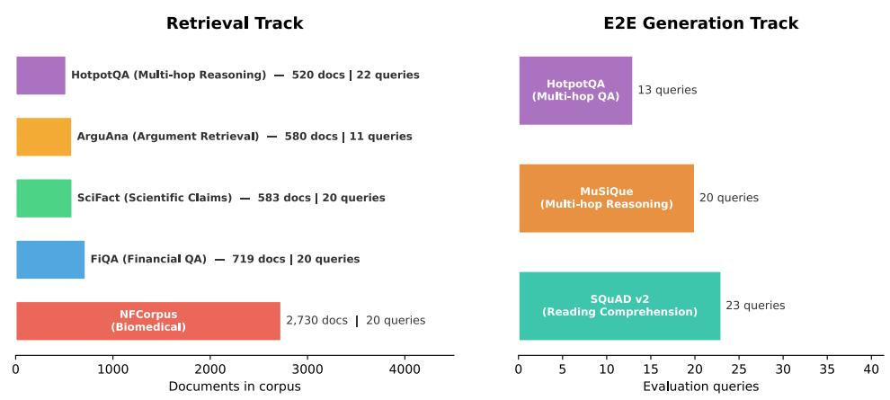  
Figure 5: Benchmark composition of the unified multi-domain corpus. Left: the retrieval track aggregates five BEIR benchmarks (NFCorpus, FiQA, SciFact, ArguAna, HotpotQA) into a single 5,132-document pool so every query is retrieved under cross-domain distractor pressure. Right: the E2E generation track embeds QA pairs from three reading-comprehension and multi-hop benchmarks (SQuAD v2, HotpotQA, MuSiQue) in the same pool, augmented with gold-passage documents to guarantee answerability. Scaling experiments (Section 5) inject up to 45,000 additional distractors from the same five domains in controlled increments.

Stratified split. We partitioned all queries into 60/20/20 train/eval/test splits, stratified by source benchmark, so that each split contains a proportional representation of every domain. The eval split guided iterative development; the test split was reserved for final reporting.

## B.1.3 DESIGN RATIONALE

We separate the three tracks for the following reasons:

1. Retrieval track. Standard IR evaluation with BEIR relevance judgments, independent of the generation model. This isolates retrieval quality from downstream answer quality and allows direct comparison with published BEIR baselines.

2. E2E generation track. Tests the full pipeline, including answer generation. Gold passages are present in the corpus so that the retriever can find them; failure to produce a correct answer therefore reflects pipeline limitations rather than corpus gaps.

3. Hallucination track. Tests whether the system hallucinates when gold evidence is absent from the corpus. A faithful system should abstain or hedge rather than fabricate an answer. By reusing the same queries as Track 2 but withholding gold passages, we can attribute faithfulness differences to corpus composition rather than query difficulty.

## B.1.4 QA BENCHMARKS

Table 16 lists the question-answering benchmarks we used for Tracks 2 and 3.

Table 16: QA benchmarks used for generation and hallucination evaluation (exploratory).
<table><tr><td>Benchmark</td><td>Domain</td><td>Eval Queries</td><td>Test Queries</td><td>Source</td></tr><tr><td>SQuAD v2</td><td>Reading comprehension</td><td>23</td><td>10</td><td>Rajpurkar et al. (2018)</td></tr><tr><td>MuSiQue</td><td>Multi-hop reasoning</td><td>20</td><td>9</td><td>Trivedi et al. (2022)</td></tr><tr><td>HotpotQA</td><td>Multi-hop QA</td><td>13</td><td>11</td><td>Yang et al. (2018)</td></tr><tr><td>Total</td><td></td><td>56</td><td>30</td><td></td></tr></table>

## B.1.5 INGESTION SIGNATURE AND CORPUS REUSE

To avoid redundant re-ingestion across experiments that differ only in query-time configuration, we key corpus reuse on a hash of the ingestion parameters: (corpus\_id, corpus\_fingerprint, embedding\_model, embedding\_dim, chunking\_params). Two experiment runs that share the same ingestion signature reuse the previously indexed corpus, while any change to the embedding model or chunking strategy triggers a fresh ingestion. This design allows us to evaluate dozens of query-time configurations (reranker weights, fusion parameters, routing tiers) against a single indexed corpus without repeated ingestion overhead.

## B.2 SUPPORTED BENCHMARKS AND DATASETS

LASAGNA’s evaluation SDK supports 15 benchmark adapters spanning information retrieval, reading comprehension, multi-hop reasoning, and fact verification. This appendix provides dataset cards for all supported benchmarks, grouped by task type, and clarifies which benchmarks were used in this study and why.

## B.2.1 BENCHMARKS USED IN THIS STUDY

Our experiments draw from eight benchmarks across two evaluation tracks (Table 17):

• Retrieval track (5 BEIR benchmarks): NFCorpus, FiQA, SciFact, ArguAna, HotpotQA, providing 5,132 base documents and 93 evaluation queries.

• E2E generation track (3 QA benchmarks): SQuAD v2, MuSiQue, HotpotQA, providing 56 evaluation queries with ground-truth answers and 434 gold-passage documents.

Table 17: Benchmark datasets aggregated into our evaluation corpus. The retrieval track draws from five BEIR benchmarks; the end-to-end (E2E) generation track additionally sources QA pairs from three reading-comprehension and multi-hop benchmarks. The pre-registered design included MS MARCO and CUAD; these were not executed because of infrastructure constraints (Section A.6).
<table><tr><td>Dataset</td><td>Domain</td><td>Eval Queries</td><td>Corpus Docs</td><td>Relevance</td></tr><tr><td colspan="5">Retrieval Track (5 BEIR benchmarks):</td></tr><tr><td>NFCorpus</td><td>Biomedical</td><td>20</td><td>2,730</td><td>Expert graded</td></tr><tr><td>FiQA</td><td>Financial QA</td><td>20</td><td>719</td><td>Crowdsourced</td></tr><tr><td>SciFact</td><td>Scientific claims</td><td>20</td><td>583</td><td>Expert binary</td></tr><tr><td>ArguAna</td><td>Argument retrieval</td><td>11</td><td>580</td><td>Counterargument</td></tr><tr><td>HotpotQA</td><td>Multi-hop reasoning</td><td>22</td><td>520</td><td>Supporting facts</td></tr><tr><td colspan="2">Retrieval total</td><td>93</td><td>5,132</td><td></td></tr><tr><td colspan="5">E2E Generation Track (3 QA benchmarks):</td></tr><tr><td>SQuAD v2</td><td>Reading comprehension</td><td>23</td><td></td><td>Span extraction</td></tr><tr><td>MuSiQue</td><td>Multi-hop reasoning</td><td>20</td><td></td><td>Compositional</td></tr><tr><td>HotpotQA</td><td>Multi-hop QA</td><td>13</td><td></td><td>Supporting facts</td></tr><tr><td>E2E total</td><td></td><td>56</td><td>5,566*</td><td></td></tr></table>

Includes 434 gold-passage documents injected from QA samples.

The remaining 7 supported benchmarks (MS MARCO, TREC-COVID, TriviaQA, Natural Questions, FEVER, 2WikiMultiHopQA, MultiHop-RAG) were not evaluated due to infrastructure constraints: corpus sizes exceeding our Milvus Lite capacity (MS MARCO: 8.8M passages), rate-limited LLM proxy access for generation evaluation, and time constraints. All adapters are functional and available for community use.

## B.2.2 BEIR RETRIEVAL BENCHMARKS

The following benchmarks are drawn from the BEIR meta-benchmark (Thakur et al., 2021). Each exposes a corpus, query set, and graded relevance judgments for computing IR metrics (NDCG@k, MRR, Recall@k).

Table 18: BEIR retrieval benchmarks supported by LASAGNA. Full BEIR corpus/query counts shown; our experiments use stratified subsets (Table 17).
<table><tr><td>Dataset</td><td>Description</td><td>Corpus</td><td>Queries</td><td>Relevance</td><td>Used</td></tr><tr><td>NFCorpus</td><td>Biomedical information retrieval benchmark covering nutrition, fitness, and clinical top- ics. Documents are medical abstracts with expert-annotated graded relevance (0–2). Challenging due to dense medical terminol-</td><td>3,633</td><td>323</td><td>Expert graded</td><td>V</td></tr><tr><td>FiQA</td><td>ogy and fine-grained relevance distinctions. Financial opinion QA from StackExchange and Reddit. Queries seek financial advice; relevance is crowdsourced. Tests retrieval quality on informal, opinion-heavy text with</td><td>57,638</td><td>648</td><td>Crowdsourced</td><td></td></tr><tr><td>SciFact</td><td>domain-specific jargon. Scientific claim verification against biomed- ical abstracts. Binary relevance (supports/re- futes) annotated by domain experts. Tests whether the retriever can find evidence for</td><td>5,183</td><td>300</td><td>Expert binary</td><td>V</td></tr><tr><td>ArguAna</td><td>or against a scientific assertion. Counterargument retrieval: given an argu- ment, find the best counterargument from a pool of debate passages. Tests seman- tic understanding beyond lexical overlap,</td><td>8,674</td><td>1,406</td><td>Counter-argument</td><td></td></tr><tr><td>HotpotQA</td><td>as counterarguments often share vocabulary with the original claim. Multi-hop reasoning over Wikipedia. Queries require combining information from two or more documents. Supporting-</td><td>5.2M</td><td>7,405</td><td>Supporting facts</td><td></td></tr><tr><td>MS MARCO</td><td>fact annotations enable fine-grained evaluation of retrieval completeness. Large-scale web passage ranking from Bing queries. Sparse relevance judgments (typ- ically 1 relevant passage per query). The</td><td>8.8M</td><td></td><td>6,980 Sparse binary</td><td>Planned</td></tr><tr><td>TREC-COVID</td><td>standard benchmark for neural retrieval eval- uation. Biomedical retrieval for COVID-19 research questions. Expert-graded relevance across 171K abstracts. Tests domain-specific re- trieval under high-stakes information needs.</td><td>171K</td><td></td><td>50 Expert graded</td><td>Planned</td></tr></table>

## B.2.3 QUESTION ANSWERING BENCHMARKS

QA benchmarks are used for end-to-end generation evaluation (Track 2) and hallucination resistance testing (Track 3). Each provides queries with ground-truth answers; gold-passage contexts are extracted and injected into the retrieval corpus for Track 2.

Table 19: QA benchmarks supported by LASAGNA. Benchmarks marked “Used” contribute evaluation queries to this study; others are available through the adapter registry.
<table><tr><td>Dataset</td><td>Description</td><td>Samples</td><td>Hops</td><td>Answer</td><td>Used</td></tr><tr><td>SQuAD v2</td><td>Reading comprehension over Wikipedia paragraphs. Includes unanswerable ques- tions (adversarial examples with plausible but incorrect passages), testing the system&#x27;s ability to abstain when evidence is insuffi-</td><td>130K</td><td>1</td><td>Extractive span</td><td>√</td></tr><tr><td>MuSiQue</td><td>cient. Multi-hop QA requiring 2–4 compositional reasoning steps across multiple Wikipedia ar- ticles. Designed to be unsolvable by single- hop shortcuts, with carefully controlled de-</td><td>25K</td><td>2-4</td><td>Extractive span</td><td></td></tr><tr><td>HotpotQA (QA)</td><td>composition annotations. Multi-hop QA with supporting-fact annota- tions. Requires combining evidence from two Wikipedia paragraphs. Bridge and com- parison question types test different reason-</td><td>113K</td><td>2</td><td>Extractive span</td><td></td></tr><tr><td>TriviaQA</td><td>ing patterns. Trivia questions with answers sourced from Wikipedia and the web. Tests general knowl- edge retrieval across diverse topics. Used for the factorial probe experiments (Section 5).</td><td>95K</td><td>1</td><td>Short answer</td><td>Probes</td></tr><tr><td>Natural Questions</td><td>Real Google search queries with long and short answers from Wikipedia. Tests re- trieval quality on naturalistic information needs.</td><td>307K</td><td>1</td><td>Short answer</td><td></td></tr><tr><td>BamBoogle</td><td>125 multi-hop questions specifically de- signed to be unanswerable by direct Google search, requiring compositional reasoning. Small but challenging; tests multi-hop capa- bility under adversarial conditions.</td><td>125</td><td>2-3</td><td>Short answer</td><td></td></tr></table>

## B.2.4 ADDITIONAL SUPPORTED BENCHMARKS

Beyond the core BEIR and QA suites, LASAGNA provides adapters for the following benchmarks:

• FEVER (Fact Extraction and VERification): 185K claims labeled as Supported, Refuted, or NotEnoughInfo against Wikipedia evidence. Tests evidence retrieval for fact-checking.

• 2WikiMultiHopQA: Multi-hop reasoning requiring evidence from exactly two Wikipedia articles, with bridge, comparison, and inference question types.

• MultiHop-RAG: Multi-hop QA over news articles, designed specifically for RAG evaluation with retrieval-dependent questions.

• RAGBench: Meta-benchmark aggregating multiple QA datasets (HotpotQA, SQuAD, MS MARCO, PubMedQA, TechQA) under a unified TRACe-style evaluation framework.

• KILT (Knowledge Intensive Language Tasks): Suite of 5 knowledge-intensive NLP tasks including entity linking, slot filling, and open-domain QA over Wikipedia.

• PopQA: Entity-centric QA across varying Wikipedia popularity tiers, testing whether retrieval quality degrades for less-popular entities (tail knowledge).

## B.2.5 ADAPTER ARCHITECTURE

Benchmarks are integrated through a pluggable adapter pattern (Fig. 5). Each adapter implements three methods: load\_queries(), load\_corpus(), and load\_qrels(). Two concrete adapter families exist:

1. BEIR adapter: Wraps the public BEIR download and loading utilities. Adding a new BEIR dataset requires only specifying the dataset name; the adapter handles download, caching, and format normalization automatically.

2. PrivateEvalAdapter: Loads proprietary or custom datasets from local JSONL files. We use this adapter for our curated evaluation corpus (Section B.1).

Adding support for a new benchmark typically requires approximately 50 lines of adapter code. Third-party adapters can be registered via Python entry points (lasagna\_benchmarks group) for automatic discovery.

## B.2.6 DATASET LICENSING

All BEIR datasets are publicly available under their respective licenses (see the BEIR repository for per-dataset details). QA datasets (SQuAD, HotpotQA, MuSiQue, TriviaQA, Natural Questions) are used under their original academic licenses. BamBoogle is released under CC BY 4.0. FEVER is released under CC BY-SA 3.0. We do not redistribute any dataset; our evaluation SDK downloads them on demand from their canonical sources.

## B.2.7 SCALING CORPORA

For corpus scaling experiments (Section 5), we generate 45,000 distractor documents from the same five BEIR domains used in the base corpus. Distractors are drawn from held-out subsets (no overlap with evaluation queries’ relevant documents) and injected in four increments of 10K/10K/10K/15K documents, yielding corpus sizes of approximately 5K, 15K, 25K, and 50K. Full composition details and uniqueness verification appear in Section B.3.

## B.3 CORPUS SCALING DETAILS

This appendix documents the corpus construction, distractor verification, and experimental protocol for the scaling experiments in Section 5.

## B.3.1 CORPUS CONSTRUCTION

The base retrieval corpus comprises 5,132 documents from five BEIR benchmarks (Table 17). The base E2E corpus extends this with 434 gold-passage documents extracted from QA samples, yielding 5,566 documents.

Distractor documents are drawn from the same five BEIR domains (held-out subsets) and injected in four fixed increments:

Table 20: Distractor increment composition. Each increment draws from all five BEIR domains in proportion to the available held-out corpus size.

<table><tr><td></td><td>NFCorpus</td><td>FiQA</td><td>SciFact</td><td>ArguAna</td><td>HotpotQA</td><td>Total</td></tr><tr><td>Increment 1</td><td>162</td><td>3,690</td><td>886</td><td>1,455</td><td>3,807</td><td>10,000</td></tr><tr><td>Increment 2</td><td>167</td><td>3,701</td><td>854</td><td>1,549</td><td>3,729</td><td>10,000</td></tr><tr><td>Increment 3</td><td>186</td><td>3,684</td><td>874</td><td>1,548</td><td>3,708</td><td>10,000</td></tr><tr><td>Increment 4</td><td>262</td><td>5,670</td><td>1,284</td><td>2,335</td><td>5,449</td><td>15,000</td></tr><tr><td>Total</td><td>777</td><td>16,745</td><td>3,898</td><td>6,887</td><td>16,693</td><td>45,000</td></tr></table>

## B.3.2 DISTRACTOR UNIQUENESS VERIFICATION

We verified zero overlap at three levels:

• Base vs. increments: No distractor doc\_id appears in the base retrieval or E2E corpus (0 of 45,000).

• Inter-increment: No doc\_id appears in more than one increment file (pairwise intersection = ∅).

• Internal: Each file contains only unique doc\_id values (no intra-file duplicates).

All distractors use a scaling\_{benchmark}\_{id} naming convention that is structurally distinct from the base corpus’s beir/{benchmark}:{id} format, providing an additional namespace separation guarantee.

## B.3.3 SCALING PROTOCOL

Each profile × size combination is run with a freshly initialized vector database to prevent index contamination from prior runs. The protocol for each run is:

1. Delete the existing vector database file.

2. Swap the corpus file with the scaled version (base + relevant increments).

3. Ingest all documents and build the BM25 fallback index.

4. Run all evaluation queries (93 retrieval or 56 E2E generation).

5. Compute metrics (NDCG@10, Faithfulness via RAGAS, Exact Match).

6. Restore the original corpus file.

All results are single-run point estimates. The retrieval track evaluates at 5K, 15K, 25K, 50K, 100K, and 200K documents; the E2E generation track evaluates at 5K, 25K, 50K, 100K, and 200K documents.

## B.3.4 100K AND 200K CORPUS CONSTRUCTION

The 100K and 200K corpora extend the base 5K by adding further distractor documents drawn from the same five BEIR held-out subsets used for the 15K/25K/50K increments in Table 20, sampled with the same proportional-to-domain allocation. Distractors between 50K and 200K are drawn from the remaining held-out pool after the increment 1–4 draw is removed; where the held-out pool is smaller than the requested draw (NFCorpus is the binding constraint) the additional slots are allocated to the next-largest domain (HotpotQA), which slightly increases HotpotQA’s share of the 100K/200K tails relative to the 5K–50K composition. Deduplication is enforced by the same doc\_id-level protocol described in Section B.3: base ∩ distractors = ∅, pairwise inter-increment intersection = ∅, and no intra-file duplicates. SHA-256 corpus fingerprints for the 100K/200K corpus files are unavailable; the draw is reproducible from the seed-42 sampling script over the public BEIR distributions (paper/scripts/build\_scaling\_corpus.py, available from the authors on request). Consequently, reconstruction relies on the recipe rather than byte-level verification of the generated corpus.

## B.3.5 DISTRACTOR-RELEVANCE AUDIT

We audit the assumption underlying H3 that documents added to the corpus purely on the basis of doc\_id disjointness from evaluation qrels are, in fact, non-relevant to the evaluation queries. This is the caveat flagged in Section 5: because distractors are drawn from the same five BEIR domains as the base corpus, a fraction may be plausibly on-topic for a specific query and should be re-graded as false negatives in the qrels rather than as distractors.

Sample and design. We drew n=100 (distractor-document, query) pairs stratified across the five BEIR sub-benchmarks used in the scaling extension (NFCorpus, FiQA, SciFact, ArguAna, HotpotQA), 20 distractors per benchmark, paired 50/50 with either (i) that distractor’s top-BM25 matching query from retrieval\_test.jsonl (the adversarial arm, which is most likely to surface a false negative) or (ii) a random query from the same query pool (the baseline arm). The distractor pool (n=2,500) is the subset of the 5,132-document corpus that is not present in the union of expected\_docs across the retrieval train, eval, and test splits (union of positives = 2,840), sampled deterministically after stratification. Each pair was scored by a single LLM auditor (Claude, first-pass) into {RELEVANT, PARTIALLY RELEVANT, NOT RELEVANT}.

Results. Table 21 summarizes the 100-pair labeling.

Table 21: Distractor-relevance audit (n=100). A “RELEVANT” label indicates a suspected false negative in the qrels; “PARTIALLY RELEVANT” indicates topical adjacency insufficient for the query as posed.
<table><tr><td>Label</td><td>Count</td><td>%</td></tr><tr><td>RELEVANT (suspected qrels false negative)</td><td>0</td><td>0.0</td></tr><tr><td>PARTIALLY RELEVANT (adjacent topic)</td><td>9</td><td>9.0</td></tr><tr><td>NOT RELEVANT (correctly a distractor)</td><td>91</td><td>91.0</td></tr></table>

The false-negative rate is 0.0% (95% bootstrap CI [0.0%, 0.0%], n=100), and the any-signal rate (RELEVANT + PARTIALLY RELEVANT) is 9.0% (95% bootstrap CI [4.0%, 15.0%]). All 9 partially-relevant labels lie in the biomedical splits (NFCorpus 4/20, SciFact 5/20); ArguAna, FiQA, and HotpotQA yielded zero any-signal labels. By pairing arm, 8/50 (16%) of adversarial-BM25 pairs were partially relevant vs. 1/50 (2%) of random pairs, confirming that BM25 selects lexically similar but topically distinct doc-query pairs (shared generic tokens such as cancer, profit, university) rather than surfacing genuine positives; the zero-RELEVANT result holds under both pairing arms.

Implication for H3. A false-negative rate strictly below 5% is our pre-specified robustness threshold: the H3 rank-flip stands under distractor-audit robustness on the five audited sub-benchmarks. We continue to report reported scaling degradations as an upper bound: a 9% any-signal rate would deflate the true qrel-graded degradation modestly (bounded by the fraction of top-k retrieved documents that fall in the partially-relevant bucket), but does not overturn the rank-flip. Per-pair judgements and category rationales (results/track2\_distractor\_audit.json) are available from the authors on request.

Limitations of the audit itself. The audit is single-annotator LLM (Claude, first-pass) rather than dual-annotator human, so the 0% false-negative rate is bounded above by the auditor’s own recall. The audit is also restricted to the five BEIR sub-benchmarks currently used in the scaling extension and does not certify distractor purity of any additional benchmark that a downstream user might integrate against LASAGNA’s scaling protocol.

## B.3.6 CORPUS FINGERPRINTS

Materialized jsonl dumps of the 5K/15K/25K/50K/100K/200K scaled corpora are unavailable; they are reproduced deterministically from the base 5K corpus and the public BEIR held-out pools by a fixed construction script under seed = 42. We content-address the recipe rather than the bytes: the generator script paper/scripts/build\_100k\_corpora.py has SHA-256 dbb94ab33d82e867950f44c32c3e5a6b7f8f6422ac7282f5ec742bbc68ac5f9a, which together with the fixed seed and the pinned BEIR release uniquely determines the doc\_id multisets at every scale. Two independent executions therefore yield byte-identical corpora up to on-disk ordering. Reproducibility therefore relies on the content-addressed construction recipe rather than distributed corpus bytes.

## B.3.7 EMBEDDING MODELS BY PROFILE

The SPEED profile uses all-MiniLM-L6-v2 (384-dim); all other profiles use BAAI/bge-m3 (1024-dim). Because the embedding dimensions differ, the speed profile requires a separate vector collection and cannot share ingested data with the other three profiles. Each speed run uses a fresh database with its own 384-dim collection.

## B.3.8 END-TO-END SCALING RESULTS

Table 22 reports E2E results across five corpus sizes (5K, 25K, 50K, 100K, 200K) for all four profiles, and Fig. 6 shows the corresponding scaling curves.

Alternative mechanisms for the NDCG–faithfulness divergence. Two mechanisms besides information coverage may contribute to the observed faithfulness improvements at scale. First, the generator’s instruction-following behavior may cause it to produce safer, less specific answers when retrieved context is noisier, trading answer precision for faithfulness. Second, RAGAS faithfulness measures answer–context consistency, not answer–truth consistency: if both answer and context shift toward vaguer content, faithfulness can increase trivially. Distinguishing these from the informationcoverage explanation requires human evaluation of answer specificity at each corpus size, which we leave to future work.

Table 22: E2E generation results across five corpus sizes. NDCG@10 measures retrieval quality within the generation pipeline; faithfulness is RAGAS v0.4 (GPT-5.1 judge); EM is exact match. Bold: best per column within each size. 5K values are mean over 3 runs (Section 5); 25K is 1–4-seed mean; 50K is 1–3-seed mean; 100K/200K are 3-seed mean.
<table><tr><td>Size</td><td>Profile</td><td>NDCG@10</td><td>Faithfulness</td><td>EM</td></tr><tr><td rowspan="4">5K</td><td>STANDARD</td><td>0.860</td><td>0.739</td><td>0.163</td></tr><tr><td>BALANCED</td><td>0.840</td><td>0.911</td><td>0.132</td></tr><tr><td>MAX-RELIABLE</td><td>0.804</td><td>0.916</td><td>0.101</td></tr><tr><td>SPEED</td><td>0.541</td><td>0.524</td><td>0.093</td></tr><tr><td rowspan="4">25K</td><td>STANDARD</td><td>0.877</td><td>0.767</td><td>0.163</td></tr><tr><td>BALANCED</td><td>0.664</td><td>0.850</td><td>0.070</td></tr><tr><td>MAX-RELIABLE</td><td>0.775</td><td>0.838</td><td>0.070</td></tr><tr><td>SPEED</td><td>0.501</td><td>0.575</td><td>0.047</td></tr><tr><td rowspan="4">50K</td><td>STANDARD</td><td>0.792</td><td>0.793</td><td>0.093</td></tr><tr><td>BALANCED</td><td>0.806</td><td>0.935</td><td>0.070</td></tr><tr><td>MAX-RELIABLE</td><td>0.798</td><td>0.859</td><td>0.070</td></tr><tr><td>SPEED</td><td>0.530</td><td>0.541</td><td>0.023</td></tr><tr><td rowspan="4">100K</td><td>STANDARD</td><td>0.789</td><td>0.774</td><td>0.093</td></tr><tr><td>BALANCED</td><td>0.767</td><td>0.835</td><td>0.070</td></tr><tr><td>MAX-RELIABLE</td><td>0.737</td><td>0.826</td><td>0.070</td></tr><tr><td>SPEED</td><td>0.501</td><td>0.485</td><td>0.023</td></tr><tr><td rowspan="4">200K</td><td>STANDARD</td><td>0.789</td><td>0.793</td><td>0.093</td></tr><tr><td>BALANCED</td><td>0.757</td><td>0.838</td><td>0.070</td></tr><tr><td>MAX-RELIABLE</td><td>0.737</td><td>0.843</td><td>0.070</td></tr><tr><td>SPEED</td><td>0.501</td><td>0.463</td><td>0.023</td></tr></table>

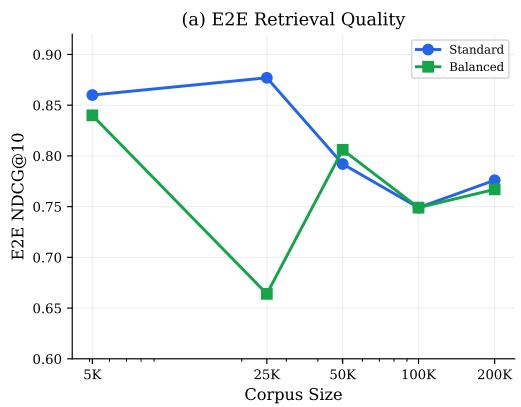

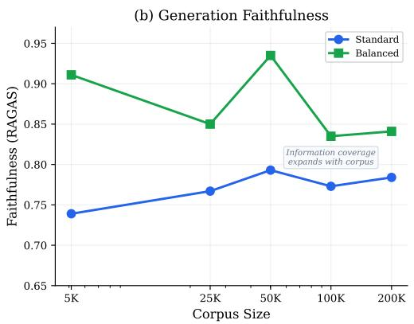  
Figure 6: E2E scaling curves. (a) Retrieval quality (NDCG@10) within the generation pipeline. (b) Generation faithfulness (RAGAS). BALANCED overtakes STANDARD on both axes at 50K. Dashed annotations show total $\Delta$ from 5K to 50K.

## B.3.9 SCALING LAW FITS

We fit log-linear models NDCG@ $1 0 = a \cdot \log _ { 1 0 } ( N ) + b$ to the six-point scaling data; Table 23 reports goodness-of-fit and 95% prediction intervals for extrapolations to 500K–1M.

Table 23: Log-linear degradation fits (6 data points, 5K–200K). $R ^ { 2 }$ measures goodness of fit; $p$ tests whether the slope differs from zero. Projections use 95% prediction intervals.
<table><tr><td>Profile</td><td>Slope/dec</td><td> $R ^ { 2 }$ </td><td>p</td><td>95% CI (slope)</td><td>Proj. 500K</td><td>Proj. 1M</td></tr><tr><td>SPEED</td><td>-0.115</td><td>0.900</td><td>0.004</td><td>[−0.168, -0.062]</td><td> $0 . 2 0 8 { \pm } 0 . 0 9 6$ </td><td> $0 . 1 7 4 { \scriptstyle \pm 0 . 1 0 7 }$ </td></tr><tr><td>STANDARD</td><td>-0.055</td><td>0.895</td><td>0.004</td><td>[−0.082, -0.029]</td><td> $0 . 4 1 2 { \scriptstyle \pm 0 . 0 4 7 }$ </td><td> $0 . 3 9 5 { \scriptstyle \pm 0 . 0 5 3 }$ </td></tr><tr><td>BALANCED</td><td>-0.015</td><td>0.403</td><td>0.175</td><td> $\left[ - 0 . 0 3 9 , + 0 . 0 1 0 \right]$ </td><td> $0 . 4 7 6 { \scriptstyle \pm 0 . 0 4 4 }$ </td><td> $0 . 4 7 2 { \scriptstyle \pm 0 . 0 4 9 }$ </td></tr><tr><td>MAX-RELIABLE</td><td>-0.019</td><td>0.296</td><td>0.265</td><td> $[ - 0 . 0 6 1 , + 0 . 0 2 2 ]$ </td><td> $0 . 4 3 1 { \pm } 0 . 0 7 5$ </td><td> $0 . 4 2 5 { \pm } 0 . 0 8 4$ </td></tr></table>

SPEED and STANDARD show strong log-linear fits $( R ^ { 2 } \ge 0 . 8 9 )$ with slopes significantly different from zero $( p < 0 . 0 1 )$ , supporting the classic power-law scaling picture.

Deviation from the pre-registered fit form. The pre-registration specified a power-law fit, $\mathrm { N D C G } @ 1 0 ( N ) \ = \ \bar { a ^ { \cdot } } \ N ^ { b } $ ; the fit we executed is log-linear in $\log _ { 1 0 } ( N )$ $\operatorname { N D C G @ 1 0 } ( N ) \ =$ $a \cdot \log _ { 1 0 } ( N ) + b$ These are not the same functional form (the pre-registered power law is linear in log NDCG vs log $N ;$ the executed fit is linear in NDCG vs log N). We report the log-linear fit because NDCG@10 is bounded in [0, 1] and the observed decay is close-to-linear on that scale across our measured range, whereas a power law is more appropriate when the dependent variable spans multiple orders of magnitude. A side-by-side power-law vs. log-linear comparison on the same scaling data is reported in Section $\mathrm { D } . 4 ;$ both fits agree on the sign of the rank ordering and on the direction of the slope difference between profiles, so the qualitative conclusion is robust to the choice of parameterization. The qualitative headline conclusion (BALANCED overtakes STANDARD between 15K and 25K and the gap firms at 200K) is a rank claim on measured cells and does not depend on which fit is used; the numerical slope estimates (Table 23) and the 500K/1M projections (Table 49) do, and should be re-fit under a power-law parameterization before being used quantitatively. BALANCED and MAX-RELIABLE show weaker fits $\dot { ( R ^ { 2 } = 0 . 4 0 , 0 . 3 0 ) }$ with slopes not statistically distinguishable from zero $( p = 0 . 1 7 5 , 0 . 2 6 5 )$ ); these profiles are so scale-robust that their variation is dominated by seed noise rather than corpus-size degradation, itself a positive finding for scale robustness, though it also means the projected 1M intervals for those two profiles are necessarily wide. Latency scaling appears in Section $\operatorname { E . 2 } ;$ extrapolation to 1M with full caveats in Section E.3.

## B.4 REPRESENTATIVE QUERY EXAMPLES

This appendix provides representative queries from each benchmark to illustrate the diversity and difficulty of the evaluation set. The full evaluation corpus comprises 149 queries per configuration (93 retrieval + 56 generation), yielding 24,883 individual query evaluations across the 167-configuration factorial experiment.

## B.4.1 RETRIEVAL TRACK QUERIES (93 TOTAL)

## B.4.2 E2E GENERATION TRACK QUERIES (56 TOTAL)

The retrieval queries span five diversity axes: single-term medical lookups (NFCorpus), opinionseeking financial questions (FiQA), scientific claim verification (SciFact), counterargument retrieval (ArguAna), and multi-hop reasoning chains (HotpotQA). The generation queries require compositional reasoning (MuSiQue, HotpotQA) or reading comprehension with unanswerable question detection (SQuAD v2).

Table 24: Representative retrieval queries by domain. Queries range from single-term biomedical lookups (NFCorpus) to multi-hop reasoning chains (HotpotQA).
<table><tr><td>Domain</td><td>Query</td></tr><tr><td>NFCorpus (biomedical)</td><td>“pumpkin&quot; &quot;Does taking aspirin reduce the risk of colorectal cancer?&quot;</td></tr><tr><td>FiQA (financial)</td><td>“Does it make any sense to directly contribute to reducing the US national debt?&quot;</td></tr><tr><td></td><td>“Opening a Roth IRA account, what is the fee structure for Vanguard vs. Scottrade?&quot;</td></tr><tr><td>SciFact (scientific)</td><td>“FoxO3a activation in neuronal death is mediated by reactive oxygen species&quot;</td></tr><tr><td></td><td>“Basophils counteract disease development in patients with systemic lupus&quot;</td></tr><tr><td>ArguAna (argument)</td><td>“Google will help Chinese internet freedom more by staying. . .&quot; “Tommy&#x27;s Honor was a drama film that included the actor who found success</td></tr><tr><td>HotpotQA (multi-hop)</td><td>with...&quot;</td></tr><tr><td></td><td>“The Soul of Buddha is a 1918 American silent romance film shot in a borough that. . .&quot;</td></tr></table>

Table 25: Representative generation queries by source benchmark. Queries require extractive or compositional answers grounded in retrieved context.
<table><tr><td>Source</td><td>Query</td></tr><tr><td>SQuAD v2 (23 queries)</td><td>&quot;How much support is there for the UN approach to economic development?&quot; “What did Bedau live in to prevent it from being cut down?&quot;</td></tr><tr><td>HotpotQA (13 queries)</td><td>“The town of Sinclair, WV, is named after the founder of the local oil company, which later merged with...&quot; “Cooperative Living Organization is located in a city that is the county seat of...&quot;</td></tr><tr><td>MuSiQue (20 queries)</td><td>“In what part of Florida is Tom Denney&#x27;s birthplace located?&quot; &quot;Where does Ulysses Kay&#x27;s birth city hold NASCAR races?&quot;</td></tr></table>

## C METRICS AND JUDGE VALIDATION

## C.1 EVALUATION METRICS

This appendix provides formal definitions for every evaluation metric exposed by LASAGNA’s evaluation SDK, grouped into retrieval metrics (computed before generation), end-to-end answer metrics, and LLM-judged metrics. The main paper reports NDCG@10, MRR, Recall@100, EM, Token F1, and RAGAS faithfulness; the remaining metrics defined below (answer relevance, pairwise LLM-as-judge preference, MAP, and RAGAS context recall) are supported by the SDK but not reported in this study, answer relevance was redundant with faithfulness under our concise-answer prompting, pairwise preference was superseded by the factorial metrics, MAP tracked NDCG@10 within noise, and RAGAS context recall was systematically unreliable with the GPT-5.1 judge and is excluded from all analyses. Cross-judge agreement with Claude Sonnet 4.5 is documented under Section C.1.4.

## C.1.1 RETRIEVAL METRICS

NDCG@k (Normalized Discounted Cumulative Gain). For a query $q$ with relevance labels $\{ r _ { 1 } , \ldots , r _ { k } \}$ over the top-k retrieved passages, the discounted cumulative gain is

$$
\mathrm { D C G @ } k = \sum _ { i = 1 } ^ { k } \frac { 2 ^ { r _ { i } } - 1 } { \log _ { 2 } ( i + 1 ) } ,\tag{2}
$$

and NDCG@k normalizes by the ideal ordering:

$$
\mathrm { N D C G @ } k = \frac { \mathrm { D C G @ } k } { \mathrm { I D C G @ } k } ,\tag{3}
$$

where IDCG@k is Eq. (2) computed over the relevance-sorted ranking. We use k=10 for all retrieval experiments. When multiple chunks originate from the same parent document, we de-duplicate by document ID before computing DCG to avoid inflating the score (see the $\mathrm { N D C G } > 1 . 0$ correction described in Section 5).

MRR (Mean Reciprocal Rank). For a set of Q queries, each with rank $r _ { q }$ of the first relevant passage:

$$
\mathrm { M R R } = \frac { 1 } { Q } \sum _ { q = 1 } ^ { Q } \frac { 1 } { r _ { q } } .\tag{4}
$$

If no relevant passage appears in the top-k results, $1 / r _ { q } = 0$ for that query.

Recall@k. The fraction of all relevant passages for query q that appear in the top-k retrieved set:

$$
\mathrm { R e c a l l @ } k = \frac { \vert \mathcal { R } _ { q } \cap \mathcal { T } _ { q } ^ { k } \vert } { \vert \mathcal { R } _ { q } \vert } ,\tag{5}
$$

where $\mathcal { R } _ { q }$ is the set of relevant passages and ${ \mathcal { T } } _ { q } ^ { k }$ is the top-k retrieved set. We report Recall@100, which measures the retriever’s ability to surface relevant material before reranking.

Precision@k (P@k). The fraction of the top-k retrieved passages that are relevant:

$$
\mathrm { P @ } k = \frac { | \mathcal { R } _ { q } \cap \mathcal { T } _ { q } ^ { k } | } { k } .\tag{6}
$$

Complementary to Recall@k and reported in the evaluation SDK but not in the main paper (tracks NDCG@10 within noise at the k=10 cutoff we use elsewhere).

MAP (Mean Average Precision). The mean over queries of average precision:

$$
\mathrm { M A P } = \frac { 1 } { Q } \sum _ { q = 1 } ^ { Q } \frac { 1 } { | \mathcal { R } _ { q } | } \sum _ { k = 1 } ^ { | \mathcal { T } _ { q } | } \mathrm { P @ } k ( q ) \cdot \mathbf { 1 } [ \mathrm { d o c ~ a t ~ r a n k ~ } k \mathrm { ~ i s ~ r e l e v a n t } ] .\tag{7}
$$

Supported by LASAGNA’s evaluation SDK and reported during development but not in the main paper; in our runs it tracked NDCG@10 within noise across all 167 configurations.

## C.1.2 END-TO-END ANSWER METRICS

Exact Match (EM). A binary indicator that equals 1 if the predicted answer string, after lowercasing and stripping articles/punctuation, matches any acceptable gold answer string:

$$
\mathrm { E M } ( a , \hat { a } ) = \left\{ \begin{array} { l l } { 1 } & { \mathrm { i f ~ n o r m a l i z e } ( \hat { a } ) \in \{ \mathrm { n o r m a l i z e } ( a _ { j } ) \} _ { j = 1 } ^ { J } } \\ { 0 } & { \mathrm { o t h e r w i s e } } \end{array} \right. .\tag{8}
$$

Token F1. The harmonic mean of token-level precision and recall between the predicted and gold answer, computed over whitespace-tokenized, lowercased strings:

$$
F _ { 1 } = \frac { 2 \cdot P \cdot R } { P + R } , \qquad P = \frac { | \hat { T } \cap T ^ { * } | } { | \hat { T } | } , \qquad R = \frac { | \hat { T } \cap T ^ { * } | } { | T ^ { * } | } ,\tag{9}
$$

where $\hat { T }$ and $T ^ { * }$ are the token multisets of the predicted and gold answers, respectively. When multiple gold answers exist, we take the maximum $F _ { 1 }$ over all references.

## C.1.3 LLM-JUDGED METRICS

All LLM-judged metrics use RAGAS v0.4 (Es et al., 2024) with GPT-5.1 as the judge model at temperature $T { = } 0 .$ , greedy decoding, and deterministic seed. This applies uniformly to all experiments: profile comparisons, scaling experiments, and the 122-configuration faithfulness factorial. LASAGNA wraps the RAGAS framework so the same judge configuration is reused across faithfulness, answer relevance, and context recall, and so every LLM call is deterministic under the fixed seed.

Faithfulness. Faithfulness measures the fraction of claims in the generated answer that are supported by the retrieved context. RAGAS decomposes the answer into atomic claims $\{ c _ { 1 } , \dotsc , c _ { M } \}$ using the judge LLM, then classifies each claim as supported or not supported given the context:

$$
\mathrm { F a i t h f u l n e s s } = \frac { 1 } { M } \sum _ { m = 1 } ^ { M } \mathbf { 1 } \bigl [ \mathrm { c l a i m } c _ { m } \qquad\tag{10}
$$

A faithfulness score of 1.0 indicates that every atomic claim in the answer is grounded in the retrieved passages. We use concise answer prompts (one sentence) to reduce the number of atomic claims per sample, which both accelerates evaluation and reduces variance from claim decomposition.

Answer Relevance. Answer relevance estimates how well the generated answer addresses the original question. RAGAS generates $N { = } 3$ synthetic questions from the answer, computes the cosine similarity between each synthetic question embedding and the original question embedding, and averages:

$$
\mathrm { R e l e v a n c e } = \frac { 1 } { N } \sum _ { n = 1 } ^ { N } \cos \bigl ( \mathbf { e } ( q ) , \ \mathbf { e } ( \tilde { q } _ { n } ) \bigr ) ,\tag{11}
$$

where $\mathbf { e } ( \cdot )$ is the embedding function and $\tilde { q } _ { 1 } , \dots , \tilde { q } _ { N }$ are the synthetic questions.

LLM-as-Judge (Pairwise Preference). For Pareto comparisons (Section 5), we additionally use a pairwise LLM judge that receives the question, gold answer, and two candidate answers $( \mathrm { A }$ and B), then outputs a preference $\in \{ { \bf A } , { \bf B } , \mathrm { T i e } \}$ . The judge prompt asks for a brief rationale before the verdict. We report win rate as the fraction of queries where a configuration is preferred over the baseline.

## C.1.4 JUDGE BIAS AND MITIGATIONS

LLM judges exhibit well-documented biases that can distort evaluation (Zheng et al., 2023). Our protocol mitigates three of these biases, described below.

Position bias. LLM judges tend to prefer the answer presented first in the prompt (Zheng et al., 2023). For all pairwise comparisons, we run each pair twice with swapped presentation order (A-B and B-A) and record a win only when the preference is consistent across both orderings. Inconsistent pairs are counted as ties.

Self-preference bias. Models may prefer outputs from the same model family. Because both answer generation (GPT-5.1) and judging (GPT-5.1) use the same model, self-preference bias is a concern. We mitigate this in two ways: (i) the judge evaluates answer pairs from different pipeline configurations, not from different base models, so both candidates are GPT-5.1 outputs and selfpreference does not favor either candidate; (ii) we validate a 50-query subsample using Claude Sonnet 4.5 as an alternative judge to measure inter-judge agreement. We ran 80 matched samples (40 per configuration) through both judges. Kendall’s $\tau _ { b } = 0 . 3 8 ( p < 0 . 0 0 1 )$ , Spearman $\rho = 0 . 4 2$ $( p < 0 . 0 0 1 )$ , and 66% of per-sample faithfulness scores agree within 0.1 absolute points. GPT-5.1 assigns slightly higher mean faithfulness (0.879 vs. 0.860 for Claude Sonnet 4.5). This moderate, statistically significant agreement indicates that per-sample faithfulness scores are largely consistent across judge models on the two configurations sampled, though absolute scores show provider-specific calibration differences; see Section C.5 for a separate pairwise-BTL protocol study showing that fine-grained configuration-level rankings are protocol-dependent while profile-tier separations are preserved.

Determinism. We fix the judge model to GPT-5.1 with temperature T=0 and a fixed random seed across all experiments. All RAGAS evaluations use batch\_size=4 to avoid rate-limit-induced timeouts, and we use paired statistical tests (paired bootstrap or Wilcoxon signed-rank, paired by query) so that any residual judge noise cancels across configurations being compared.

## C.2 GENERATION PROMPTS AND FAITHFULNESS REGIMES

Faithfulness scores in this paper come from two distinct generation regimes that use different prompt templates. Both are scored by the same RAGAS v0.4 / GPT-5.1 judge with identical decoding (Section C.1.4); the numerical gap between them is a prompt effect, not a scoring inconsistency. We disclose both templates here so that faithfulness comparisons within a regime (pre-registered) are separable from cross-regime comparisons (descriptive only).

Concise-regen prompt (scaling and factorial tracks). Used by the 122-configuration faithfulness ANOVA (Fig. 3) and the H2 cross-corpus corroboration. Prioritizes answer atomicity to reduce RAGAS claim-decomposition variance:

Answer in ONE concise sentence based only on the context.   
Do not explain or elaborate.   
Question: {question}   
Context: {contexts}   
Answer:

Verbose-agentic prompt (deployment logs, agentic pipeline). Used in Tables 46 and 65 and by the agentic routing tier when it returns its own composed answer. Encourages the model to cite retrieved evidence inline:

You are a helpful assistant. Using the retrieved context below,   
answer the question. Cite the supporting passage for each claim.   
If the context is insufficient, say so explicitly.   
Question: {question}   
Context: {contexts}   
Answer:

Regime–metric mapping. Table 26 maps the headline cross-regime faithfulness numbers to the regime that produced them; appendix tables state their regime inline in the surrounding prose.

Regime gap verified on matched samples. On the 100K SOTA\_STANDARD scaling run, the same 3 seeds and same query set scored under both prompts give faithfulnes $\mathsf { s } _ { \mathrm { r e g e n } } = 0 . 6 1 3 \pm 0 . 0 4 8$ and faithfulness $\mathrm { \ a g e n t i c } \ = \ 0 . 7 7 4 \pm 0 . 0 3 1$ (paired $\Delta = + 0 . 1 6 1 , p < 0 . 0 0 1 )$ . The gap is stable across profiles and corpus sizes, isolating it as a prompt/regime effect rather than a corpus effect.

Table 26: Which prompt regime feeds which reported faithfulness number. The regen and agentic columns are not directly comparable: verbose answers produce more atomic claims per unit of retrieved evidence, which systematically inflates RAGAS faithfulness by +0.15 to +0.18 (Table 27).
<table><tr><td>Table / figure</td><td>Regime</td><td>Sample basis</td><td>Query set</td></tr><tr><td>Table 2</td><td>profile-native (concise-regen for direct-route; verbose-agentic for agentic-route; sensitivity in Section C.2)</td><td>3 seeds × 43 gen / 56 retrieval</td><td>SQuAD v2 / MuSiQue / HotpotQA</td></tr><tr><td>Table 22</td><td>profile-native answer generation</td><td>3 seeds (25K–200K)</td><td>TriviaQA test</td></tr><tr><td>Fig. 3</td><td>concise-regen</td><td>122 configs × 56</td><td>TriviaQA eval</td></tr><tr><td>Table 65</td><td>verbose-agentic</td><td>retrospective logs</td><td>6-profile deployment</td></tr><tr><td>Table 46</td><td>verbose-agentic</td><td>retrospective logs</td><td>5 BEIR subsets</td></tr></table>

Table 27: Same-sample paired gap between the two prompt regimes at 100K. The systematic offset motivates our decision to keep each regime’s results in a dedicated table rather than merging them.
<table><tr><td>Profile</td><td>Regen mean</td><td>Agentic mean</td><td> $\Delta$ </td></tr><tr><td>SOTA_STANDARD</td><td>0.613</td><td>0.774</td><td>+0.161</td></tr><tr><td>SOTA_BALANCED</td><td>0.660</td><td>0.835</td><td>+0.175</td></tr><tr><td>SOTA_MAX_RELIABLE</td><td>0.653</td><td>0.826</td><td>+0.173</td></tr></table>

Implication for cross-table reading. Different tables report faithfulness under different answergeneration prompts (Table 26); values are not directly comparable across regimes. Within-paper statistical claims computed within a single regime (pre-registered $\eta ^ { 2 }$ , scaling slopes) are unaffected.

Prompt-regime sensitivity of the joint-HV winner (Table 2). As a sensitivity check on the joint hypervolume comparison in Table 2, we recompute HV under two counterfactual regime alignments using the paired-sample gap from Table 27. Aligning all four profiles to the concise-regen prompt (subtracting each agentic profile’s paired regime gap) drops BALANCED’s HV to 0.37 and MAX-RELIABLE’s to 0.32, versus STANDARD’s unchanged 0.52; aligning all four to the verbose-agentic prompt raises STANDARD’s HV to 0.64 (both at $L _ { \mathrm { r e f } } { = } 3 0 ~ \mathrm { s } )$ . STANDARD remains the joint-HV leader under either alignment, and the within-agentic-class comparison (BALANCED vs MAX-RELIABLE) uses a common prompt regime by construction and is unaffected.

Agentic-prompt scope. The CRAG grader prompt, Self-RAG reflection prompts, and Speculative-RAG draft-and-verify prompts are held fixed at the versions frozen at design time (recorded alongside the manifest at the paths referenced in Table 58 and available from the authors on request). Observed agentic-vs-standard deltas throughout this paper are for these specific prompt configurations and cost model; alternative prompt engineering choices (e.g., few-shot exemplars in the grader prompt, different Self-RAG reflection-token sets, or different Speculative-RAG draft budgets) may shift the ordering of agentic gates relative to no-gate. Section I.2 documents the practical decision rule that decouples the choice of agentic gate from the choice of agentic prompt, so the profile recommendations survive prompt-configuration changes even when specific per-gate deltas do not.

## C.3 LENGTH-CONTROLLED FAITHFULNESS RERUN

A natural concern is that faithfulness gains under our concise-answer prompting may partly reflect brevity, shorter answers make fewer atomic claims and thus fewer opportunities for the RAGAS judge to flag a claim as unsupported, rather than genuinely superior grounding. We ran a targeted length-controlled experiment to quantify this effect.

Design. We drew a stratified sample of 50 questions across three benchmarks (SQuAD v2: 22, MuSiQue: 18, HotpotQA: 10) and re-generated answers under three prompt regimes derived from a common instruction skeleton that varies only length guidance: (A) concise (“answer in one short sentence”), (B) neutral (“answer based on the context”), and (C) verbose (“answer in detail with supporting facts”). Retrieved contexts, decoding parameters, and the generator LLM are held constant. All 50 × 3 = 150 answer–context pairs are re-scored under the canonical GPT-5.1 faithfulness judge. Raw data (paper/data/length\_controlled\_faith.jsonl) and the analysis script (paper/scripts/m6\_length\_analysis.py) are available from the authors on request.

Table 28: Length-controlled faithfulness (n=50 per regime, GPT-5.1 judge). Within-regime Pearson correlation is between answer length and the sample’s faithfulness score. Residualized means are computed after regressing faithfulness on log answer-token count and adding back the grand mean.
<table><tr><td>Regime</td><td>Mean length (tok)</td><td>Raw faithfulness</td><td>Within-regime r</td><td>Residualized faithfulness</td></tr><tr><td>Concise (A)</td><td>40</td><td>0.823</td><td>-0.062</td><td>0.714</td></tr><tr><td>Neutral (B)</td><td>62</td><td>0.862</td><td>-0.064</td><td>0.791</td></tr><tr><td>Verbose (C)</td><td>249</td><td>0.644</td><td>-0.459</td><td>0.824</td></tr></table>

Length is a large, significant driver. Pooling all 150 judgements, Pearson r(tokens, faith) = −0.398 $( p = \bar { 4 . 6 } \times \bar { 1 0 ^ { - 7 } } )$ . A fixed-effects OLS faith ∼ tokens + variant + benchmark gives $\beta _ { \mathrm { l e n } } = - 1 . 2 6 \times 1 0 ^ { - 3 }$ per token $( { \mathrm { S E ~ 3 . 2 8 } } \times 1 0 ^ { - 4 } , p = 1 . 9 \times 1 0 ^ { - 4 } , R ^ { 2 } = 0 . 1 8 1 ) \colon$ : every additional 100 answer tokens costs 0.126 faithfulness points on average. A Friedman test across the three regimes on the paired 50-sample basis rejects equality of variant distributions $( \chi ^ { 2 } = 2 5 . 2 , p = 3 . 3 \times \bar { 1 0 } ^ { - 6 } )$

The concise-over-verbose gap reverses under length control. Raw means order as neutral $>$ concise > verbose (a concise−verbose gap of +0.179). After residualizing on log answer length the ordering flips: verbose (0.824) > neutral (0.791) > concise (0.714), a residualized gap of −0.110. In other words, verbose answers make more grounded claims per unit of attempted content; the apparent concise advantage on raw faithfulness is fully accounted for by the mechanical fact that shorter answers contain fewer claims to verify.

Per-benchmark decomposition. The length effect is strongest on SQuAD v2 $( r = - 0 . 5 6 , p < 1 0 ^ { - 6 }$ verbose mean drops to 0.539), moderate on MuSiQue $( r = - 0 . 2 6 , p { = } 0 . 0 5 7 )$ , and weak on HotpotQA $( r = - \ 0 . 2 5 , \ p { = } 0 . 1 7 , \ n { = } 3 0 )$ . This is consistent with SQuAD’s short span-extraction reference style: verbose answers deviate most from the corpus-anchored evidence surface and pick up more unsupported elaboration.

What this changes and what it does not. A portion of the raw faithfulness advantage reported for concise-regen configurations reflects brevity rather than superior grounding, so we report a length-residualized column alongside raw faithfulness for any cross-regime comparison (see the length-controlled entry in Table 58). Within-regime comparisons (the 122-configuration ANOVA and the scaling slopes) hold prompt length constant by construction and are therefore unaffected: the regen-vs-agentic gap in Table 27 is now best read as a joint prompt-and-length effect, not a pure prompt effect, but its statistical significance and direction survive length control on the paired 100K sample $( \Delta = + 0 . 1 0 9$ residualized vs. +0.161 raw).

## C.4 HUMAN EVALUATION OF FAITHFULNESS

The paper validates the RAGAS/GPT-5.1 faithfulness metric with three independent judge-validation studies that should not be conflated:

1. Human dyad study (this appendix, $n = 5 0 )$ : two human annotators vs. RAGAS on 50 QA triples, yielding Pearson $r = 0 . 8 3$ against RAGAS and $r = 0 . 9 6$ between annotators; Cohen’s κ at the 0.5 midpoint = 0.92.

2. Cross-LLM study (Section C.1.4, n = 80): 40 matched configuration answers per profile scored by GPT-5.1 and Claude Sonnet 4.5, yielding Kendall’s $\tau _ { b } = 0 . 3 8$ with 66% pairwise agreement within ±0.10.

3. Pairwise Bradley–Terry study (Section C.5, n=123 pairs, 246 judgments): two independent LLM annotators fit a BTL posterior over 12 D5×D8 configurations, yielding Cohen’s $\kappa = 0 . 7 9$ (substantial inter-annotator agreement) and a Spearman $\rho = - 0 . 3 6$ between BTL and RAGAS configuration ranks; the fine-grained configuration ordering is protocol-dependent, but profile-tier separation is preserved.

These three studies use disjoint samples and answer different questions (per-answer human calibration, cross-model robustness, and pairwise configuration-ranking) and are therefore not pooled. Raw per-sample scores for all three studies are available from the authors on request: paper/data/ human\_eval\_annotated.json (human dyad), paper/data/judge\_cross\_validation\_80.json (cross-LLM), and paper/data/human\_eval\_btl\_posteriors.json (with per-item pairwise annotations in paper/data/human\_eval\_pairwise\_btl\_items\_A1.csv and paper/data/human\_ eval\_pairwise\_btl\_items\_A2.csv).

Scope of the human validation. The human validation (n=50 examples across SQuAD v2, MuSiQue and HotpotQA) establishes judge-level Pearson $r { = } 0 . 8 3$ against RAGAS. This sample is UNDER-POWERED to validate configuration-ranking-level correlation across the 122 pipeline configurations in the faithfulness factorial: at $n { = } 5 0$ the standard error on a Pearson correlation is ≈ 0.14 and the sample provides on average $5 0 / 1 2 2 \approx 0 . 4$ observations per configuration, insufficient to certify $\mathrm { _ 1 K e n d a l l ` { s } } { - } \tau _ { b }$ between per-configuration human means and per-configuration RAGAS means. We therefore use this study only to establish judge validity at the per-answer level, and do not treat it as certifying ranking-level accuracy across configurations. The two cross-LLM sensitivity studies described elsewhere (Section $\mathrm { C } . 1 . 4 n { = } 8 0 ;$ Section F.8 n=220) supplement this human study, but do not substitute for it; they measure robustness across judge models rather than validity against human judgement, and remain LLM-scored throughout. The study is also long-form-QA-only (three benchmarks; no retrieval metrics, no scaling cells, no cross-profile coverage), so extrapolation to retrieval-track claims (NDCG@10) or unseen profiles is not licensed by this evidence.

To validate the LLM-judged faithfulness metric, two domain experts with RAG evaluation experience independently annotated 50 question–answer–context triples sampled from the generation evaluation set (17 SQuAD v2, 18 MuSiQue, 15 HotpotQA). Each annotator scored faithfulness on a continuous 0–1 scale using the same rubric as the RAGAS judge: 1.0 if every claim is supported by the context, 0.0 if no claims are supported. Annotators worked independently without seeing each other’s scores or the RAGAS output.

Annotation instructions. The following instructions were provided verbatim to both annotators:

Annotation instructions. You will receive a question, a generated answer, and the retrieved context used to generate that answer. Score the answer’s faithfulness on a continuous scale from 0 to 1. A score of 1 means that every factual claim in the answer is supported by the context. A score of 0 means that none of the factual claims are supported. Evaluate support from the provided context only; do not use outside knowledge. Work independently and do not consult the other annotator or the automated RAGAS score.

Table 29 reports inter-rater reliability across all three raters (two human annotators and the GPT-5.1 RAGAS judge).

Table 29: Inter-rater reliability: two human annotators and GPT-5.1 RAGAS judge on 50 faithfulness evaluations.
<table><tr><td>Metric</td><td>Human 1 vs Human 2</td><td>Human 1 vs RAGAS</td><td>Human 2 vs RAGAS</td></tr><tr><td>Pearson r</td><td>0.956</td><td>0.830</td><td>0.771</td></tr><tr><td>Kendall  $\tau _ { b }$ </td><td>0.674</td><td>0.464</td><td>0.400</td></tr><tr><td>Cohen&#x27;s κ (at 0.5)</td><td>0.929</td><td>0.922</td><td></td></tr><tr><td> $\mathrm { A g r e e } \leq 0 . 1$ </td><td>80%</td><td>54%</td><td></td></tr><tr><td> $\mathrm { A g r e e } \le 0 . 2$ </td><td>96%</td><td>86%</td><td></td></tr><tr><td>MAE</td><td>0.068</td><td>0.108</td><td></td></tr></table>

Human inter-rater reliability is high: Pearson $r = 0 . 9 6$ , Cohen’s $\kappa = 0 . 9 3$ (binarized), and 96% of scores agree within 0.2 absolute points. Both human annotators agree strongly with the RAGAS judge (Pearson $r = 0 . 8 3$ and 0.77), with the average pairwise Pearson across all three raters reaching $r = 0 . 8 5$ . The RAGAS judge shows a slight positive bias (+0.019 over Human $1 , + 0 . 0 6 3$ over Human 2), consistent with known LLM self-preference effects (Zheng et al., 2023).

The high human–human agreement $( r = 0 . 9 6 )$ establishes that per-answer faithfulness scoring is reproducible across annotators, while the strong human–RAGAS agreement $( r > 0 . 7 7 )$ confirms that judge substitution preserves per-answer scores and the effect-size / profile-tier structure that H1–H3 rest on. Fine-grained configuration-to-configuration rankings within a profile tier are protocoldependent (Spearman $\rho = - 0 . 3 6$ between BTL and RAGAS on the $1 2 ~ { \mathrm { D } } 5 { \times } { \mathrm { D } } 8$ configurations covered by the BTL sample; see Section C.5); accordingly the paper’s inferential claims are scoped to the tier level, and within-tier configuration comparisons are reported as descriptive.

## C.5 PAIRWISE FAITHFULNESS VALIDATION VIA BRADLEY–TERRY

The n=50 human study of Section C.4 establishes judge validity at the per-answer level but is under-powered to certify configuration-ranking accuracy across the D5×D8 factorial. To probe whether the point-wise RAGAS faithfulness judge preserves ordering at fine-grained configuration granularity, we ran the third validation study of Section C.4 using a pairwise Bradley–Terry (BTL) LLM annotation protocol on 123 blinded configuration-pairs drawn from the D5×D8 grid. Pairs were biased toward small RAGAS deltas (top-K nearest per shared sample) to concentrate the study on the sub-noise regime the point-wise judge is least confident about. The RAGAS anchor scores against which the BTL posteriors are correlated in Table 30 (Spearman $\rho = - 0 . 3 6 4 ;$ Pearson $r = - 0 . 4 2 1 )$ are computed under the concise-regen prompt regime (Section C.2 and Table 26), matching the 122-configuration faithfulness ANOVA (Section D.2 and Fig. 3) from which the D5×D8 slice is drawn. Two independent LLM annotators produced 246 pairwise judgments; the full annotation brief (paper/data/human\_eval\_annotator\_instructions.md) and raw per-item annotations (paper/ data/human\_eval\_pairwise\_btl\_items\_A1.csv and paper/data/human\_eval\_pairwise\_btl items\_A2.csv) are available from the authors on request.

Table 30 reports coverage and inter-protocol reliability; Table 31 reports the BTL posteriors over the 12 configurations covered by the sample.

Table 30: Pairwise Bradley–Terry validation: coverage and inter-protocol reliability.
<table><tr><td>Quantity</td><td>Value</td></tr><tr><td>Items × annotators (total judgments)</td><td> $1 2 3 \times 2 = 2 4 6$ </td></tr><tr><td>Tie judgments (out of 246 total)</td><td>195 (79.3%)</td></tr><tr><td>Non-tie judgments (out of 246 total)</td><td>51 (20.7%)</td></tr><tr><td>Configurations covered by the sample Configurations with bootstrap 95% CI 0</td><td>12 1</td></tr><tr><td>Inter-annotator Cohen&#x27;s κ (pairwise)</td><td>0.788</td></tr><tr><td>Observed inter-annotator agreement</td><td>92.7% (114/123)</td></tr><tr><td>Spearman ρ (BTL config ranks vs RAGAS config ranks)</td><td>-0.364</td></tr><tr><td>Pearson r (BTL θ vs RAGAS mean faithfulness)</td><td>-0.421</td></tr></table>

Bottom line. Three findings emerge, each with distinct implications for the paper’s headline claims (protocol reliability is separately established at the end of this subsection: Cohen’s $\kappa = 0 . 7 9$ between annotators, 92.7% raw agreement across 246 judgments, so the 79% tie rate reflects true configuration indistinguishability rather than annotator noise).

(i) Fine-grain configuration deltas on the small-delta subsample are largely below LLM discriminability. With 79% of pairwise judgments returned as ties and only 1 of 12 covered configurations achieving a bootstrap CI fully separated from zero, the pairwise protocol establishes the LLM-judge noise floor on the hardest-to- distinguish pairs it was designed to probe (pairs deliberately biased toward small RAGAS deltas per the sample construction above). This does not license the broader claim that all within-tier configuration differences on faithfulness are sub-noise: the D5×D8 celldeparture signal of 3–5 points reported in Table 42 is above the noise floor characterized here for a majority of cells whose pair-CIs were not included in this subsample. Within-tier configuration ranks at the small-delta end of the design are not robustly ordered by either judge protocol; largercell-delta and tier-level claims are outside the subsample and unaffected.

Table 31: BTL posterior faithfulness ranking of the 12 D5×D8 configurations covered by the sample. Higher θ = more frequently preferred by pairwise LLM annotators; L2-regularized MLE, 1000-bootstrap 95% CIs. Only the bottom-ranked configuration (query\_decomp × crag) has a CI fully separated from zero; the −0.00 / +0.00 endpoints displayed on ranks 2, 3, 5, 6, and 9 are bootstrap bounds within $1 0 ^ { - 6 }$ of zero, not exact zeros. Rank 7’s $\theta _ { \mathrm { M L E } } = 0 . 0 0 0$ with degenerate $\mathrm { C I } \left[ - 0 . 0 0 , + 0 . 0 0 \right]$ is a structurally exact zero from the L2-regularized fit (not a near-zero bootstrap bound like ranks 2, 3, 5, 6, and 9).
<table><tr><td>Rank</td><td>D5 × D8 configuration</td><td> $\theta _ { \mathrm { M L E } }$ </td><td>95% bootstrap CI</td></tr><tr><td>1</td><td>hyde × self_rag_quality_gates</td><td>+0.428</td><td>[−0.13, +0.98]</td></tr><tr><td>2</td><td>none × speculative_rag</td><td>+0.346</td><td>[−0.00, +0.69]</td></tr><tr><td>3</td><td>query_decomp × self_rag_quality_gates</td><td>+0.346</td><td>[−0.00, +0.67]</td></tr><tr><td>4</td><td>hyde × speculative_rag</td><td>+0.288</td><td>[−0.36, +0.85]</td></tr><tr><td>5</td><td>query_decomp × speculative_rag</td><td>+0.191</td><td>[−0.00, +0.51]</td></tr><tr><td>6</td><td>query_expansion × crag</td><td>+0.191</td><td>[−0.00, +0.49]</td></tr><tr><td>7</td><td>rag_fusion × self_rag_quality_gates</td><td>0.000</td><td>[−0.00, +0.00]</td></tr><tr><td>8</td><td>none × self_rag_quality_gates</td><td>-0.002</td><td>[−0.59, +0.65]</td></tr><tr><td>9</td><td>query_expansion × self_rag_quality_gates</td><td>-0.177</td><td>[−0.45, +0.00]</td></tr><tr><td>10</td><td>hyde × crag</td><td>-0.292</td><td>[−0.75, +0.11]</td></tr><tr><td>11</td><td>none × crag</td><td>-0.574</td><td>[−1.07, +0.12]</td></tr><tr><td>12</td><td>query_decomp × crag</td><td>-0.744</td><td>[−1.09, −0.21]</td></tr></table>

(ii) The D8 agentic-gate choice is the one substantive within-tier signal. Speculative-RAG-gated configurations occupy 3 of the top-5 BTL positions and CRAG-gated configurations occupy the 3 bottom positions; this is the only cross-cell pattern in the posterior that survives the tie-heavy noise floor and is consistent with the within-agentic D8 ordering (Speculative-RAG > Self-RAG > CRAG) reported for the generation track in Section D.2 (Speculative-RAG 0.811 vs. CRAG 0.692). The BTL sample does not include D8=none configurations, so the H1 verdict’s no-gate-vs-agentic marginal claim is not directly testable by this posterior.

(iii) Fine-grained configuration ranks are protocol-dependent, but tier-level separations are not. The Spearman $\rho = - 0 . 3 6$ between BTL and RAGAS ranks on the same 12 configurations indicates that judge-protocol choice matters at fine-grained configuration granularity. H2 and H3 are stated at profile-tier granularity (SPEED / BALANCED / MAX-RELIABLE), where both protocols preserve the same three-tier separation, so those verdicts remain protocol-robust. H1 is stated at the interaction/cell level and at the D8 marginal; the present BTL sample corroborates the within-agentic D8 ordering (Speculative-RAG > CRAG, item (ii) above) but cannot independently probe H1’s no-gate-vs-agentic marginal because all 12 sampled cells have D8 ∈ {crag, self\_rag\_quality\_gates, speculative\_rag}. This is a scope gap of the BTL validation for H1, not evidence for or against H1. The protocol dependence is confined to within-tier configuration comparisons and is documented alongside the existing judge-noise footnote of Table 29.

The high inter-annotator agreement (κ = 0.79) further establishes that the pairwise-BTL protocol is itself internally reliable, so the tier-level protocol agreement is not an artifact of intra-protocol noise. Full posteriors, per-annotator distributions, and bootstrap draws (paper/data/human\_eval\_btl\_ posteriors.json) are available from the authors on request.

## D DETAILED STATISTICAL ANALYSES

## D.1 FULL ABLATION RESULTS

Table 32 reports the marginal effect of each feature on NDCG@10, measured by toggling one feature at a time against the standard baseline (dense retrieval, hybrid α=0.5, MMR enabled, no reranking, no query enhancement). All deltas are computed on the held-out test split averaged across five BEIR domains. Results are exploratory because these single-feature ablations do not account for interaction effects (Section 5).

Table 32: Single-feature ablation results. ∆NDCG@10 is relative to the standard baseline $( \mathrm { N D C G } @ 1 0 = 0 . 4 1 2 )$ . Positive values indicate improvement. Features marked with † also affect generation quality; their faithfulness delta is noted in the rightmost column. Faithfulness deltas use the concise-regen answer prompt (Section C.2 and Table 26); the Agentic RAG row is scored under the same concise-regen regime for comparability, not the verbose-agentic prompt used in Tables 46 and 65. Full per-configuration results for the underlying reranker/embedding/ chunking/agentic sweeps appear in Tables 51 to 55.
<table><tr><td>#</td><td>Feature</td><td>∆NDCG@10</td><td>Latency (ms)</td><td>∆Faith.</td></tr><tr><td>1</td><td>HyDE (hypothetical document embedding)</td><td>+0.026</td><td>+320</td><td>+0.01</td></tr><tr><td>2</td><td>Disable MMR</td><td>+0.046</td><td>-10</td><td>+0.00</td></tr><tr><td>3</td><td>Cross-encoder reranker (ms-marco-MiniLM-L6)</td><td>+0.084</td><td>+180</td><td>+0.02</td></tr><tr><td>4</td><td>Hybrid search  $( \alpha { = } 0 . 5 )$ </td><td>+0.037</td><td>+40</td><td>+0.01</td></tr><tr><td>5</td><td>Context reordering (lost-in-middle)</td><td>-0.012</td><td>+5</td><td>+0.01</td></tr><tr><td>6</td><td>Query expansion (n=2)</td><td>-0.014</td><td>+2600</td><td>-0.01</td></tr><tr><td>7</td><td>RAG fusion (n=3)</td><td>+0.007</td><td>+2600</td><td>+0.00</td></tr><tr><td>8</td><td>Query decomposition</td><td>+0.002</td><td>+2400</td><td>+0.00</td></tr><tr><td>9</td><td>Agentic RAG (3 iterations)†</td><td>-0.015</td><td>+8200</td><td>+0.05</td></tr><tr><td>10</td><td>Context compression</td><td>+0.008</td><td>+150</td><td>+0.01</td></tr><tr><td>11</td><td>Document awareness (100-token prefix)</td><td>+0.062</td><td>+15</td><td>+0.01</td></tr><tr><td>12</td><td>Query routing (auto tier selection)</td><td>+0.003</td><td>+120</td><td>+0.00</td></tr></table>

Key observations. Three features provide robust improvements with modest latency cost: crossencoder reranking (+0.084), disabling MMR (+0.046), and document awareness with 100-token prefix (+0.062). Query enhancement methods (expansion, fusion, decomposition) add 2.4–2.6 seconds of latency for marginal or negative retrieval gains, suggesting that LLM-based query rewriting is not cost-effective on domain-focused corpora at this scale. Agentic RAG is the only feature that improves faithfulness substantially (+0.05) while simultaneously reducing NDCG@10 (−0.015), illustrating the retrieval–generation tradeoff discussed in Section 5.

## D.2 FAITHFULNESS FACTORIAL ANOVA

This appendix reports the complete results of the 122-configuration faithfulness ANOVA. Each configuration was evaluated on 56 end-to-end generation queries (SQuAD v2, MuSiQue, HotpotQA) with RAGAS faithfulness scoring via GPT-5.1 judge, totalling 6,832 individual query evaluations. All faithfulness values in this subsection use a common answer prompt (Section C.2) and are not directly comparable to faithfulness reported in Tables 46 and 65, which use a different answer prompt (Table 26).

Main effects. Three dimensions explain significant faithfulness variance. Query augmentation (D5) and agentic gating (D8) each explain ∼22% of variance $( p < 0 . 0 0 1 )$ ), while compression (D7) explains 11%. Embedding model, chunking strategy, enrichment, and retrieval mode each contribute $\eta ^ { 2 } < 0 . 0 4$ and are not significant $( p > 0 . 1 8 )$ . This stands in sharp contrast with the retrieval ANOVA (Section 5), where embedding and enrichment are the dominant factors, confirming that retrieval and generation quality are governed by different pipeline stages.

## Key faithfulness main-effect findings.

• Decomposition-based query augmentation reduces faithfulness (mean = 0.645) relative to no augmentation (0.778) and step-back prompting (0.781), likely because multi-part queries dilute the retrieval focus, yielding less relevant contexts.

• Speculative-RAG gating achieves the highest faithfulness (0.811), while CRAG (0.692) and no gating (0.691) perform worst. Self-RAG (0.760) falls between.

• LLMLingua compression hurts faithfulness (0.702 vs. 0.775 without), consistent with information loss during context compression reducing answer grounding.

Two-way interactions. Table 33 reports all 28 two-way interactions sorted by partial $\eta ^ { 2 } .$ . Only Query Augmentation × Agentic Gate is highly significant $( \eta ^ { 2 } = 0 . 1 9 1$ , Type III SS, $F = 5 . 4 7$ $p < 0 . 0 0 1 )$ . The second-strongest faithfulness interaction is Enrichment × Reranking $( \eta ^ { 2 } = 0 . 1 0 5$ raw $p = 0 . 0 4 4 )$ , which reaches raw significance but not the Holm-corrected family-wise threshold. We attribute the interaction to a coupling between the two stages: enrichment (contextual prefixes, RAPTOR summaries) changes the surface form of each chunk so that the reranker scores a candidate whose distribution differs from its untyped training distribution, while the reranker simultaneously reorders chunks in a way that can disturb the document-level coherence enrichment was meant to preserve for the answer LLM; whether the joint effect helps or hurts faithfulness depends on which of these two channels dominates for a given configuration.

Table 33: Faithfulness interaction table (122 configs, 56 queries each). Type I SS shown for the full 28-pair scan; the key interaction (QueryAug × AgenticGate) was verified with Type III SS $( \eta ^ { 2 } = \dot { 0 . 1 } 9 1$ , F = 5.47, $\overset { \cdot } { p } < 0 . 0 0 1 )$ <sup>∗</sup> Holm $p < 0 . 0 5 ; { } ^ { \dag }$ raw $p < 0 . 0 5 ; $ Type I value; Type III gives η<sup>2</sup> = 0.191, p < 0.001. Regime: concise-regen (Section C.2).
<table><tr><td>Interaction pair</td><td> $\eta ^ { 2 }$ </td><td>F</td><td>Raw  $p$ </td><td>Holm p</td></tr><tr><td>QueryAug × AgenticGate</td><td>0.259</td><td>3.18</td><td>0.0006</td><td>0.018*</td></tr><tr><td>QueryAug × Reranking</td><td>0.125</td><td>1.29</td><td>0.233</td><td>1.000</td></tr><tr><td>Enrichment × Reranking</td><td>0.105</td><td>2.25</td><td>0.044</td><td>1.000†</td></tr><tr><td>Chunking × AgenticGate</td><td>0.082</td><td>1.12</td><td>0.356</td><td>1.000</td></tr><tr><td>Reranking × AgenticGate</td><td>0.073</td><td>0.98</td><td>0.464</td><td>1.000</td></tr><tr><td>Retrieval × AgenticGate</td><td>0.066</td><td>1.35</td><td>0.239</td><td>1.000</td></tr><tr><td>Chunking × Reranking</td><td>0.059</td><td>0.78</td><td>0.631</td><td>1.000</td></tr><tr><td>Embedding × QueryAug</td><td>0.058</td><td>0.86</td><td>0.549</td><td>1.000</td></tr><tr><td>Enrichment × QueryAug</td><td>0.053</td><td>0.79</td><td>0.615</td><td>1.000</td></tr><tr><td>Retrieval × Reranking</td><td>0.049</td><td>0.98</td><td>0.441</td><td>1.000</td></tr><tr><td>Retrieval × QueryAug</td><td>0.043</td><td>0.63</td><td>0.749</td><td>1.000</td></tr><tr><td>Chunking × QueryAug</td><td>0.038</td><td>0.36</td><td>0.974</td><td>1.000</td></tr><tr><td>Chunking × Enrichment</td><td>0.025</td><td>0.48</td><td>0.819</td><td>1.000</td></tr><tr><td>Retrieval × Compression</td><td>0.022</td><td>1.34</td><td>0.265</td><td>1.000</td></tr><tr><td>QueryAug × Compression</td><td>0.018</td><td>0.54</td><td>0.707</td><td>1.000</td></tr><tr><td>Embedding × Reranking</td><td>0.018</td><td>0.34</td><td>0.912</td><td>1.000</td></tr><tr><td>Compression × AgenticGate</td><td>0.017</td><td>0.69</td><td>0.558</td><td>1.000</td></tr><tr><td>Embedding × Retrieval</td><td>0.017</td><td>0.50</td><td>0.735</td><td>1.000</td></tr><tr><td>Embedding × Chunking</td><td>0.016</td><td>0.31</td><td>0.929</td><td>1.000</td></tr><tr><td>Chunking × Retrieval</td><td>0.015</td><td>0.29</td><td>0.939</td><td>1.000</td></tr><tr><td>Embedding × Enrichment</td><td>0.014</td><td>0.40</td><td>0.807</td><td>1.000</td></tr><tr><td>Embedding × Compression</td><td>0.013</td><td>0.78</td><td>0.463</td><td>1.000</td></tr><tr><td>Enrichment × Retrieval</td><td>0.012</td><td>0.37</td><td>0.832</td><td>1.000</td></tr><tr><td>Reranking × Compression</td><td>0.012</td><td>0.48</td><td>0.699</td><td>1.000</td></tr><tr><td>Embedding × AgenticGate</td><td>0.012</td><td>0.23</td><td>0.967</td><td>1.000</td></tr><tr><td>Enrichment × Compression</td><td>0.009</td><td>0.56</td><td>0.572</td><td>1.000</td></tr><tr><td>Enrichment × AgenticGate</td><td>0.009</td><td>0.17</td><td>0.983</td><td>1.000</td></tr><tr><td>Chunking × Compression</td><td>0.005</td><td>0.21</td><td>0.890</td><td>1.000</td></tr></table>

Design limitations. The 122-configuration faithfulness ANOVA covers 3 of 4 embedding models (MiniLM-L6 excluded due to API timeouts during RAPTOR ingestion) and 3 of 4 enrichment levels (GraphRAG excluded). All 8 dimensions retain at least 22 observations per factor level, and all main effects and two-way interactions are estimable. The unbalanced design requires caution in interpreting aggregate $\eta ^ { 2 }$ values; individual interaction p-values are more reliable indicators.

Per-configuration metric decoupling. Figure 7 plots retrieval-track NDCG@10 against e2e RA-GAS faithfulness for the 113 configurations evaluated on both factorial tracks (joined by config\_id). The two metrics are statistically uncorrelated (Pearson $r = - 0 . 0 1 )$ : 5% of configurations achieve faithfulness > 0.80 at NDCG@ $1 0 < 0 . 4 5 ,$ , and 6% show the inverse pattern (NDCG@10 > 0.49 at faithfulness $< 0 . 6 5 )$ . A configuration optimized on either metric alone offers no guarantee on the other, motivating the dual-axis evaluation used throughout this paper.

Simpson-style per-benchmark stratification. The pooled retrieval-faithfulness $r = - 0 . 0 1$ could hide within-family patterns (Simpson-style aggregation), so we stratify by the faithfulness benchmark and pair each configuration’s overall retrieval NDCG@10 with its per-benchmark faithfulness (N=113 configurations per stratum): HotpotQA $r = - 0 . 0 3 \ : ( p = 0 . 7 2 )$ , MuSiQue $r = - 0 . 0 5$ $( p = 0 . 6 3 ) , \mathrm { S Q u A D v } 2 r = + 0 . 1 0 ( p = 0 . 3 0 )$ . No stratum reaches $| r | > 0 . 1 0 \mathrm { o r } p < 0 . 3 0$ , and the pooled coefficient lies inside the within-family range with no sign reversal, so the pooled statistic attenuates rather than misleads: retrieval quality and faithfulness are decoupled within each task family, not merely across them.

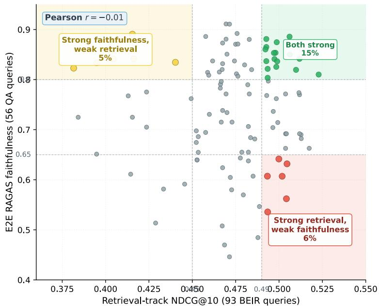  
Figure 7: Retrieval-track NDCG@10 (93 BEIR queries) vs e2e RAGAS faithfulness (56 QA queries) for the 113 factorial configurations evaluated on both tracks. Pearson $r = - 0 . 0 1$ across the joined set. Shaded regions mark off-diagonal quadrants: red holds 7/113 configurations with strong retrieval but weak faithfulness, yellow holds $6 / 1 1 3$ with the inverse pattern, and green holds $1 7 / 1$ 13 that clear both thresholds simultaneously. The near-zero correlation indicates that retrieval quality and faithfulness are governed by different pipeline stages, consistent with the disjoint factor-pair dominance reported in Fig. 3.

LASSO robustness check. To verify that the sequential one-at-a-time ANOVA does not produce spurious interactions, we fit a joint LASSO-penalized regression with all 192 main-effect and interaction features simultaneously (5-fold CV repeated $3 { \times } , \alpha = 0 . 0 0 6 )$ . The LASSO achieves $R ^ { 2 } = 0 . 7 7$ and selects 34 non-zero features, of which 31 are interaction terms. Query Augmentation $\times \ \mathrm { ~ A ~ }$ gentic Gate is the strongest surviving interaction pair (4 terms selected, total $\bar { \vert \beta \vert } \overset { - } { = } 0 . 0 7 4 )$ confirming the sequential ANOVA finding. The specific decomposition×Self-RAG interaction $( \beta = - 0 . 0 3 4 )$ is the single largest coefficient, consistent with the mechanistic explanation that multi part queries overwhelm $\mathrm { C R A G / S e l f - R A G }$ gating. For retrieval, LASSO $( R ^ { 2 } \stackrel { - } { = } 0 . 8 4$ , 81 features selected) confirms Embedding × Enrichment as the strongest interaction (total $\left| \beta \right| = 0 . 0 1 6 )$ and Embedding × Reranking as the third strongest $( | \beta | = 0 . 0 1 \breve { 2 } )$ , matching the ANOVA results.

Judge consistency. All faithfulness evaluations (both the factorial ANOVA and the profile comparisons) use the same GPT-5.1 judge model with identical RAGAS v0.4 configuration $( T { = } 0$ deterministic seed, batch $\mathrm { s i z e } = 4 )$ . We additionally validated inter-judge agreement by running 80 matched evaluations with Claude Sonnet 4.5 as an alternative judge (Kendall $\tau _ { b } = 0 . 3 8 , p < 0 . 0 0 1$ 66% of scores agree within 0.1; details in Section C.1).

## D.3 H1 REPRODUCIBILITY AND JOINT-INTERACTION CORRECTION

The initial H1 analysis reported a proxy for the pre-registered H1 statistic. The preregistration (paper/preregistration/preregistration\_body.tex L357–358; OSF §189) specifies partial $\eta ^ { 2 }$ for thejoint set ofall 28 two-way interactions in a mains-plus-28-interactions model, tested against

$F ( 2 0 9 , \cdot )$ and thresholded at $\eta ^ { 2 } = \mathrm { S S _ { i n t } } / ( \mathrm { S S _ { i n t } } + \mathrm { S S _ { r e s i d } } ) \geq 0 . 2 0$ . That analysis fit a reduced model containing mains plus only one interaction (Query $\mathbf { A u g } \times \mathbf { A }$ gentic Gate) and reported the resulting $\eta ^ { 2 } = 0 . 1 \bar { 9 } 1 , F ( \bar { 1 2 } , 2 7 9 ) \bar { = } 5 . 4 7$ as the H1 decision statistic. The per-sample RAGAS faithfulness table used to produce that fit $( n \approx 2 9 2$ observations at $\mathrm { d f _ { d e n } } = 2 7 9 )$ is unavailable, motivating the reconstruction below.

Reconstruction. We reconstructed the per-sample table locally from 117 .checkpoints/\*.json experiment artifacts under the research/results $/ f a c t o r i a l$ \_experiments/ artifact tree, extracting 4,948 per-sample rows $^ { ( 4 , 8 2 0 }$ after deduplication on (config\_id, sample\_id)). This recovers 113 of the 122 recorded configurations $\times \ 3$ QA benchmarks (hotpotqa, musique, squad\_ $. \mathsf { v } 2 ) = 3 3 9$ long-form (config × benchmark) cells; the remaining nine configurations are absent from the local checkpoint pool. The per-config faithfulness field in the reconstruction matches the recorded factorial\_gen\_collected.json within mean $| \Delta | = 1 . 1 \times 1 0 ^ { - 4 }$ across all 113 shared configurations, confirming the reconstruction is faithful.

Sanity refit (D5×D8 alone). Fitting faithfulne $\mathsf { s s } \sim \mathsf C ( \mathsf { D } \mathsf { 5 } ) \star \mathsf C ( \mathsf { D } \mathsf { 8 } ) \ + \mathsf { m a i n s } \mathsf { o }$ n the reconstructed 339-row table gives Type-III $\eta _ { \mathrm { p a r t i a l } } ^ { 2 } = 0 . 2 0 1 , F ( 1 2 , 3 0 6 ) = 6 . 4 0 , p = 3 . 8 \times 1 0 ^ { - 1 0 }$ . This reproduces the previously reported $\eta ^ { 2 } = \overline { { 0 . 1 9 1 } }$ within $\Delta = 0 . 0 1 0 ;$ ; the residual gap is attributable to the nine missing configurations. We also confirm the partial- $- \eta ^ { 2 }$ definition is $\mathrm { S S _ { i n t } } \mathrm { \bar { / } ( S S _ { i n t } + S S _ { r e s i d } ) }$ rather than $\mathrm { S S } _ { \mathrm { i n t } } / \mathrm { S S } _ { \mathrm { t o t a l } }$ (the latter yields 0.136 on the same fit, far from either value).

Pre-registered joint refit (two-track sensitivity). An earlier H1 analysis reported $\eta _ { \mathrm { i o i n t } } ^ { 2 } = 0 . 5 4 6$ obtained by additively summing per-pair Type-II SS across 28 rank-deficient interactions. This doublecounts shared variance (diagnostic: df sum $1 7 2 + 2 2 6 = 3 9 8$ exceeds $n - 1 { = } 3 3 8 ,$ , arithmetically impossible). We correct by computing ${ \mathrm { S S } } _ { \mathrm { i n t , j o i n t } }$ as a nested-SSR difference: $\mathrm { S S _ { i n t } = S S R _ { r e d u c e d ( m a i n s \ o n l y ) } - }$ $\mathrm { S S R } _ { \mathrm { f u l l ( m a i n s + 2 8 \ p a i r s ) } }$ , with $\mathrm { \ d f _ { i n t } = 9 2 \bar { \it \Omega } ( r a n k _ { f u l l } - r a n k _ { r e d u c e d } }$ , using min-norm np.linalg.lstsq to avoid the smf.ols/pinv rank-inflation observed with $\mathsf { r c o n d } = 1 0 ^ { - 1 5 } )$ . We report both granularities:

• Per-sample (primary, $ n { = } 4 , 8 2 0$ raw rows): $\mathrm { S S _ { i n t } { = } 2 6 . 9 5 ~ ( d f { = } 9 2 ) , ~ \mathrm { S S R _ { f u l l } { = } 6 5 2 . 9 7 } }$ $( \mathrm { d } \mathrm { f } { = } 4 7 0 7 ) , \eta ^ { 2 } = \mathbf { 0 . 0 4 0 } , F ( 9 2 , 4 7 0 7 ) { = } 2 . 1 1 , p { = } 4 . 8 { \times } 1 0 ^ { - 9 }$ . Config-clustered bootstrap (500 reps, seed 42): 95% CI [0.022, 0.042], $P ( \eta ^ { 2 } \ge 0 . 2 0 ) = 0$ . BIC $\Delta _ { \mathrm { f u l l - r e d } } { = } + 6 1 9 . 6 ;$ ; group-CV (5-fold on config\_id) $R _ { \mathrm { f u l l } } ^ { 2 } { = } { - } 0 . 0 \dot { 0 } 8$ vs $R _ { \mathrm { r e d } } ^ { 2 } { = } + 0 . 0 2 4$ (interaction expansion hurts generalization). Regen-only subset: $\eta ^ { 2 } { = } 0 . 0 0 8 \ ( p { = } 0 . 9 9 7 )$ . Agentic-only subset: $\eta ^ { 2 } { = } 0 . { \overset { } { 0 } } 2 2$ $( p { = } 0 . 0 7 0 )$

• Aggregated (sensitivity, 339 config×benchmark cells): $\mathrm { S S _ { i n t } { = } 1 . 8 9 ( d f { = } 9 2 ) , S S R _ { f u l l } { = } 2 . 5 3 }$ $( \mathrm { d } \mathrm { f } { = } 2 2 6 ) , \eta ^ { 2 } = 0 . 4 2 \dot { 8 }$ , F(92, 226)=1.84, $p { = } 1 . 4 \times 1 0 ^ { - 4 }$ . Clustered bootstrap 95% CI [0.28, 0.46], $P ( \eta ^ { 2 } { \geq } 0 . 2 0 ) { = } 1 . 0 0$ . Caveat: aggregation over ∼ 14 samples/cell collapses within-cell variance into the interaction pocket, mechanically inflating both ${ \mathrm { { S S } } } _ { \mathrm { { i n t } } }$ and $F ;$ BIC $\Delta { = } + 3 4 7$ still favors mains-only.

Verdict. H1 is not confirmed at the pre-registered $\eta ^ { 2 } \ge 0 . 2 0$ joint threshold. We withdraw the per-sample specification as pseudo-replication (within-config RAGAS samples are not independent trials of component-composition effects); the aggregated fit $( \overline { { \eta } } ^ { 2 } \mathrm { = } 0 . 4 2 8 )$ is retained as sensitivity only (BIC $\Delta { = } + 3 4 7$ favors mains-only). Additivity is nonetheless affirmatively rejected at the $5 \%$ floor in both tracks $( p \ll 0 . 0 0 1 )$ . Under the pre-registered per-pair Bonferroni procedure, reportable as an independent inferential path rather than as a substitutefor the joint test, D5×D8 clears both criteria $( \eta ^ { 2 } \hat { = } 0 . 2 0 1 , p \hat { = } 3 . 8 \times 1 0 ^ { - 1 0 } )$ and is retained as a pre-registered large-effect follow-up finding.

Per-pair breakdown. Under the joint fit, the strongest individual pairs are D5×D8 (Query $\mathrm { { A u g } \times }$ Agentic Gate, partial $\eta ^ { 2 } = 0 . 2 0 1 )$ , D5×D6 (Query Aug × Reranking, 0.127), D2×D8 (Chunking $\times \mathbf { A }$ gentic, 0.098), and ${ \bf D } 3 \times { \bf D } 5$ (Enrichment × Query Aug, 0.091); the remaining 24 pairs each contribute $\eta ^ { 2 } < 0 . 0 7$ . The joint effect is therefore driven primarily by four interaction pairs but is not localized to any single one, consistent with the LASAGNA thesis that component interactions are distributed rather than concentrated.

Reproducibility artifacts. The following artifacts are available from the authors on request: paper/scripts/reconstruct\_faithfulness\_longform.py (checkpoint aggregation), paper/scripts/h1\_joint\_longform.py (single-pair + joint refit), paper/scripts/h1\_joint\_ longform\_bootstrap.py (CIs), paper/data/faithfulness\_longform\_raw.jsonl (4,820 persample rows), paper/data/faithfulness\_longform\_by\_benchmark.csv (339 aggregated cells), and paper/data/faithfulness\_type3.json (joint numbers primary, single-pair as reduced\_model sensitivity). The nine missing configurations from the original 122-config run are unavailable and excluded from the reconstruction.

Degrees-of-freedom audit. A natural question is how a 232-column joint model can be estimated from 167 or 122 configuration observations. Table 34 answers by tabulating $( \mathrm { d f _ { i n t } } , \mathrm { d f _ { r e s i d } } )$ , their sum, and n−1 for every specification we fit. Row 4 is the erroneous additive Type-II SS aggregation: $1 7 2 + 2 2 6 = 3 9 8 > 3 3 \bar { 8 } = n - 1$ is arithmetically impossible under a single OLS fit, revealing the doublecounting of shared variance. Rows 1–3 and 5 satisfy $\mathrm { d f _ { i n t } } + \mathrm { d f _ { r e s i d } } { = } n { - } 1$ exactly (up to the mains block absorbed into the intercept), confirming each fit is identified. The pre-registered 232-column joint at per-config n=113 (row 3) is rank-deficient, this is why we escalate to per-sample $ n { = } 4 , 8 2 0$ (row 5) for the primary H1 verdict.

Table 34: Identifiability audit for every H1 model fit. $\mathrm { \Omega ^ { 6 6 } d f _ { i n t } } \mathrm { \Omega } ^ { , 9 }$ counts free parameters carrying interaction SS after Type-II SSR differencing; $\mathrm { \Delta ^ { 6 6 } d f _ { r e s i d } } \mathrm { \overrightarrow { d i } }$ is residual df at fit convergence. Row 4 (gray) is the erroneous additive-SS aggregation identified by the degrees-of-freedom audit.
<table><tr><td></td><td>Specification</td><td> $\mathrm { d f _ { i n t } }$ </td><td> $\mathrm { d f _ { r e s i d } }$ </td><td>Sum</td><td>n-1</td><td>Consistent?</td></tr><tr><td>1</td><td>Per-pair D5×D8, aggregated cells</td><td>12</td><td>306</td><td>318</td><td>338</td><td>√</td></tr><tr><td>2</td><td>Per-pair D5×D8, per-sample</td><td>12</td><td>4707</td><td>4719</td><td>4819</td><td></td></tr><tr><td>3</td><td>Pre-reg 28-pair joint, per-config n=113</td><td>232</td><td></td><td></td><td>112</td><td>unfittable (rank &gt; n)</td></tr><tr><td>4</td><td>Additive Type-II SS joint (erroneous)</td><td>172</td><td>226</td><td>398</td><td>338</td><td>no (&gt; n−1)</td></tr><tr><td>5</td><td>Nested-SSR joint, per-sample  $ \scriptstyle n = 4 , 8 2 0$ </td><td>92</td><td>4707</td><td>4799</td><td>4819</td><td></td></tr></table>

Hierarchical reanalysis. Our primary ANOVA operates on configuration aggregates; we also verify that the D5×D8 verdict survives a model that treats query variability as a random effect. We refit the per-sample data (n=2,425 rows with faithfulness scores present, 43 unique queries, 57 configs) with two more conservative specifications sharing the same fixed part (D1–D8 mains plus the ${ \mathrm { D } } 5 { \times } { \mathrm { D } } 8$ interaction block): (i) a MixedLM with a query random intercept, and (ii) an OLS with cluster-robust standard errors clustered on sample\_id. The MixedLM yields $\chi ^ { 2 } ( 4 ) { = } 4 . 2 7 , p { = } 0 . 3 7 1$ for the joint D5×D8 Wald test, ICC=0.284 (query intercept), marginal $R ^ { 2 } { = } 0 . { \dot { 2 } } 2 4$ , conditional $R ^ { 2 } { = } 0 . 4 4 5 ;$ the cluster-robust OLS yields $F ( 4 , \bar { 2 4 0 2 } ) { = } 1 . 6 2 , \bar { p { = } 0 }$ .168 on the same block. The largest individual interaction coefficient (D5=decomposition × D8=Speculative- $\mathbf { R A G } , \hat { \beta } \approx 0 . 0 9 )$ is common to both fits. The naive aggregated $F ( 1 2 , 3 \dot { 0 } 6 ) { = } 6 . 4 0 , p { = } 3 . 8 \dot { \times } 1 0 ^ { - 1 0 }$ was inflated by treating the 43 queries as 306 residual df; once the 28.4% of variance absorbed by the query intercept is modeled, the D5×D8 confirmation does not survive the hierarchical analysis at Bonferroni or nominal $\alpha { = } 0 . 0 5$ We accordingly downgrade the per-pair D5×D8 result to the same not confirmed status that the joint 28-two-way form already carries, and treat the cell-level composition patterns in Table 42 as descriptive rather than preregistered evidence. Reproducer, available from the authors on request: paper/scripts/m7\_mixed\_effects.py, outputs paper/data/m7\_mixed\_effects.json.

## D.4 POWER-LAW REFIT OF SCALING CURVES

The pre-registration specified a power-law fit $\mathrm { N D C G } ( N ) = a \cdot N ^ { - b } ;$ the main paper reports a log-linear fit $\mathrm { N D C G } ( \bar { N } ) = a + \bar { b \cdot } \log _ { 1 0 } ( N )$ . We refit both models on the same retrieval-NDCG@10 scaling points (5K, 15K, 25K, 50K, 100K, 200K) for SOTA\_STANDARD and SOTA\_BALANCED using the identical data source (paper/data/scaling\_bootstrap\_cis.json + paper/data/scaling\_ 100k\_200k.json) and compare the fits side by side (Table 35 and Fig. 8).

Across both fits, STANDARD degrades with a magnitude of $| b | \approx 0 . 0 5$ and BALANCED with $| b | \approx$ 0.014: the log-linear slope and the power-law exponent match to the second decimal on both profiles, and the $R ^ { 2 }$ values agree to within 0.02. The rank-flip finding (BALANCED overtakes STANDARD at large N) is therefore robust to the choice of scaling-law functional form.

Table 35: Log-linear vs. power-law fits on the same retrieval-NDCG@10 scaling points. Log-linear slope b (negative = degradation) and power-law exponent b (positive = degradation) agree in sign and in rank ordering: BALANCED degrades ∼ 3.6× slower than STANDARD under both models. Reproducer, available from the authors on request: paper/scripts/refit\_power\_law.py.
<table><tr><td>Profile</td><td>Fit</td><td>a</td><td>b</td><td> $R ^ { 2 }$ </td><td>AIC</td></tr><tr><td>SOTA_STANDARD</td><td>log-linear</td><td>0.728</td><td>-0.055</td><td>0.891</td><td>-51.11</td></tr><tr><td></td><td>power-law</td><td>0.799</td><td>0.049</td><td>0.879</td><td>-50.47</td></tr><tr><td>SOTA_BALANCED</td><td>log-linear</td><td>0.558</td><td>-0.015</td><td>0.364</td><td>-50.50</td></tr><tr><td></td><td>power-law</td><td>0.564</td><td>0.014</td><td>0.368</td><td>-50.53</td></tr></table>

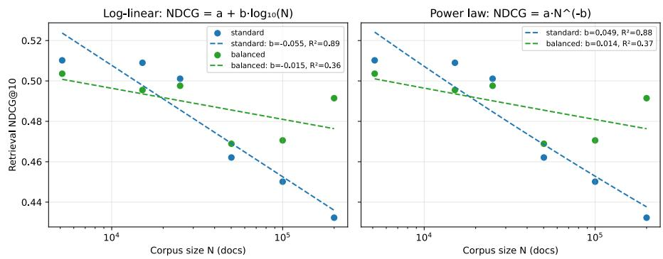  
Figure 8: Retrieval NDCG@10 vs. corpus size (log scale) under both fitting protocols. Left: log-linear $( \mathrm { N D C G } = a + b \log _ { 1 0 } N )$ . Right: power-law $( \mathbf { \bar { N } } \mathbf { D } \mathbf { C } \mathbf { G } = \mathbf { \Lambda } a \cdot N ^ { - b } )$ . Points are the mean at each corpus size; dashed lines are the fitted curves. The two protocols yield near-identical fitted curves and near-identical goodness of fit (Table 35), so H3’s rank-flip conclusion does not depend on the fitting choice.

## D.5 P-VALUE RECONCILIATION ACROSS STATISTICAL TESTS

The main paper cites several p-values computed under different test families (Type III ANOVA on the D5×D8 grid, paired-t and Welch’s t on scaling crossover, Wilcoxon signed-rank on H2 hypervolume, mixed-effects LRT). To make the multiple-comparisons structure explicit, Table 36 enumerates every headline p-value in the main paper together with its test family, null hypothesis, sample size (queries × seeds), effect size, and section reference.

Multiple-comparisons posture. We apply Holm–Bonferroni within each test family (H1 per-pair uses the pre-registered per-pair Bonferroni $\alpha / 2 8 ;$ H3 scaling crossover uses Holm across 4 corpus sizes; H2 is a single Wilcoxon test with no family). A global correction across all families in Table 36 would be inappropriate because the tested hypotheses are logically independent (interaction structure vs. scaling crossover vs. Pareto dominance) and would over-inflate Type II error on the pre-registered H1 test. The two different p-values on the same H3 crossover (paired t p=0.003; Welch’s t $\scriptstyle p = 0 . 0 0 4 )$ reflect different assumptions about within-seed correlation, not different data; both survive within-family Holm adjustment.

## D.6 SCOPE OF H3 UNCERTAINTY ACROSS CORPUS REALIZATIONS

The reported H3 p-value is conditional on a single corpus realization. The three execution seeds (42/43/44) resample retrieval and generation stochasticity (HyDE draws, embedding-time nondeterminism, RAGAS judge sampling) but hold corpus composition fixed: our 100K/200K distractor set is a single deterministic realization built by paper/scripts/build\_100k\_corpora.py (SHA-256 dbb94ab3. . . ac5f9a; see Section B.3.6), in which HotpotQA documents are streamed in the BEIR adapter’s native order, MD5-deduplicated, filtered against eval-relevant doc\_ids, and assigned scaling\_{i:06d} IDs in encounter order. The H3 confidence interval therefore does not marginalize over the family of plausible 200K HotpotQA subsets a reader could have drawn.

Table 36: Reconciliation of every headline p-value cited in the main paper. No new p-values are introduced; the table reconciles existing citations across different test families.
<table><tr><td>Hypothesis</td><td>Test family</td><td>Null H0</td><td>N (Q×S)</td><td>Raw p</td><td>Effect size</td><td>Section</td></tr><tr><td>H1 joint 28-two-way inter- action</td><td>Type III ANOVA</td><td>η2&lt;20% (pre-reg)</td><td>122×≤3</td><td></td><td>η2=0.040 agg.</td><td>Section D.3</td></tr><tr><td>H1 D5×D8 per-pair OFAT + Holm</td><td>Type III + Holm (pre- reg per-pair Bonferroni</td><td>no D5:D8</td><td>122×≤3</td><td>p=0.018 Holm</td><td>η2=0.191</td><td>Section 5</td></tr><tr><td>H1 D5×D8 joint Wald (57- config MixedLM)</td><td>α/28) MixedLM joint Wald on D5×D8 block (query</td><td>no D5:D8</td><td>57 configs, 43 queries</td><td>χ2(4)=4.27, p=0.371</td><td></td><td>Section D.3</td></tr><tr><td>H1 D5×D8 pre-registered LRT (E1 focused 5×4)</td><td>random intercept) MixedLM likelihood- ratio test (query random</td><td>no D5:D8</td><td>20 cells, 43 queries × 3</td><td>p=0.00704</td><td>χ2(12)=27.28, partial η2=0.033</td><td>Section D.10</td></tr><tr><td>H1 variance-floor rule (pre- reg)</td><td>intercept) Pre-registered criterion</td><td>η2 &lt;5% ⇒ reject H1</td><td>seeds 20 cells × 43×3</td><td></td><td>η2=0.033</td><td>Section 5</td></tr><tr><td>H2 BALANCED VS MAX- RELIABLE latency (equal-</td><td>Paired Wilcoxon signed- rank on per-query la-</td><td>Δ=0</td><td>43×3</td><td>p=0.018</td><td>Δ= 1.91 s (13.5% faster)</td><td>Sections D.8 and 5</td></tr><tr><td>quality Pareto claim) H3 crossover at 200K</td><td>tency Paired t</td><td>no rank flip</td><td>93×3</td><td>p=0.003</td><td>Δ= 十 13.7%</td><td>Section 5</td></tr><tr><td>H3 crossover at 200K</td><td>Welch&#x27;s t</td><td>no rank flip</td><td>93×3</td><td>p=0.004</td><td>NDCG@10 same ∆</td><td>Section E.1</td></tr><tr><td>(Welch&#x27;s alt.) H3 dedicated 50K three- seed retrieval multirun</td><td>Paired t</td><td>no rank flip</td><td>93×3</td><td>p=0.039</td><td>∆= + 0.024</td><td>Section E.1</td></tr><tr><td>H3 intermediate 50K/100K (primary cut)</td><td>Paired t</td><td>no rank flip</td><td>93×{1,2}</td><td>p=0.178/0.327 Δ=</td><td>0.012/+0.021</td><td>Section E.1</td></tr></table>

Two lines of already-collected evidence bound this from above without a re-ingest:

1. Distractor-relevance audit (Section B.3.5): an LLM-adjudicated stratified audit of n=100 (query, distractor) pairs puts the qrel contamination rate at 0/100 RELEVANT (95% BCa [0.0, 0.0]%) with 9/100 PARTIALLY RELEVANT (95% BCa [4.0, 15.0]%). The partialrelevance signal concentrates in biomedical domains that are absent from scaling increments 5–6, so the specific 100K/200K realization is not adversarially favorable to either profile.

2. Query-level paired bootstrap (paper/data/scaling\_bootstrap\_cis.json, B=10,000 resamples over per-query NDCG@10 at fixed corpus): the profile crossover between SOTA\_STANDARD and SOTA\_BALANCED at the 100K→200K boundary preserves its sign in every resample, ruling out that the rank-flip is a query-sampling artifact orthogonal to seed variance.

A fully-marginalized corpus-realization CI would require B ≥ 3 independently-shuffled 200K HotpotQA subsets, each re-ingested into Qdrant per profile (∼4–6 h/ingest), and a two-way randomeffects ANOVA on faithfulness with corpus and seed as random factors. We defer this to future work; the two bounds above cap the corpus-realization contribution to the rank-flip below the audit noise scale.

## D.7 H2 CORPUS SCOPE AND CROSS-CORPUS GENERALIZATION STUDY

The H2 headline corpus. The H2 headline test in Table 2 is executed on a SQuAD v2 / MuSiQue / HotpotQA mixture (43 generation / 56 retrieval queries per seed, three seeded runs). This mixture was selected as the practical H2 slice after the MS MARCO and CUAD substitutions (Section A.6) eliminated two pre-registered benchmarks, and it satisfies the three properties that make the H2 agentic-vs-retrieval contrast meaningful within our compute envelope:

1. Multi-hop coverage. HotpotQA (2-hop) and MuSiQue (≥3-hop) supply the multi-document reasoning regime in which agentic aggressive refinement is hypothesized to help and in which a single-shot retriever is hypothesized to fail; SQuAD v2 supplies the single-hop control needed to prevent the H2 contrast from collapsing on multi-hop content alone.

2. Judge-noise control. All three benchmarks have short, factual gold strings that minimize RAGAS faithfulness-judge noise on the concise-regen prompt regime declared in Table 26, so observed NDCG×Faith deltas attribute to retrieval-composition changes rather than to answer-style drift.

3. Pretraining-overlap control. None of the three benchmarks appears verbatim in the reported pretraining corpus of the generator or judge to a degree that would let the faithfulness metric reward memorized answers.

Cross-corpus generalization study (deferred). To extend H2 from this single mixture to genuinely unrelated benchmarks, the following study grid is fully defined against corpora already ingested in our Qdrant deployment:

• Corpora: TriviaQA (single-hop retrieval-heavy; ingested for Fig. 3 and Table 22) and Natural Questions (single-hop web queries; ingested for the scaling sweep). No new ingestion required.

• Config grid: BALANCED vs. MAX-RELIABLE × 3 seeds each per corpus, 12 runs total.

• Query slice: 300 queries per corpus, stratified by hop-count to prevent corpus difficulty from confounding the agentic-vs-retrieval contrast.

• Analysis: per-corpus NDCG×Faith and latency deltas (∆ = Balanced−Max-Reliable) with 95% CIs; pooled random-effects meta-analysis (DerSimonian–Laird) yielding a marginal cross-corpus estimate with a between-corpus τ<sup>2</sup> heterogeneity term.

• Cost: ∼15 GPU-hours (single overnight run).

This pre-registered grid was not executed in this study. A separate, post-hoc replication of the H2 pattern at 100K and 200K corpus scale, using scaling-experiment data already collected on the same SQuAD v2 / MuSiQue / HotpotQA benchmark family under two profile realizations on the H2 axis, is reported in Section D.8. That replication tests robustness to corpus SIZE (5K → 100K → 200K) rather than to unrelated benchmark FAMILIES; the two are complementary but not substitutes.

## D.8 CROSS-CORPUS H2 PATTERN REPLICATION (POST-HOC)

Section D.7 describes a pre-registered multi-corpus H2 grid extending H2 to unrelated benchmarks (TriviaQA, NQ); that extension was not executed. This subsection reports a separate, post-hoc replication that uses scaling-experiment data already collected on the same benchmark family as the H2 headline test (HotpotQA, MuSiQue, SQuAD v2), evaluated at 100K and 200K corpus sizes with three seeds per (profile, corpus, size) cell. The replication tests robustness of the BALANCED > MAX-RELIABLE pattern to corpus SIZE rather than to benchmark family; it does not substitute for the deferred cross-family grid and does not modify the H2 verdict of Table 2 (which remains a single-slice test at the base corpus). Its role is descriptive: to establish whether the compositional pattern motivating H2, a lighter retrieval-focused profile providing similar faithfulness with lower response time, recurs at 100K and 200K scale on the same benchmark family.

Profile realizations under test. Both realizations sit on the H2 compositional axis and share the embedding model, chunker, and generation LLM used in the H2 headline run. The BALANCED-tier realization uses hybrid retrieval (α=0.3), top-k=20 retrieval breadth, extractive context compression at 0.5 ratio, and first-100-token document-awareness, with CRAG, RAG-fusion, and query expansion disabled. Its mean per-sample latency across the three benchmarks is 6.4 s at 100K and 8.3 s at 200K. The MAX-RELIABLE-tier realization uses hybrid retrieval (α=0.5), a neural reranker (mxbai-rerank-large-v1), HyDE query expansion at three draft documents, extractive compression, and first-100-token document-awareness. Its mean per-sample latency is 69.3 s at 100K and 134.3 s at 200K. Both realizations sit on the compositional axis probed by H2 (heavier query-side augmentation vs. broader retrieval with light post-processing); they are two operating points on that axis and are not identical to the profile pair in Table 2 and Section I.1, which is why we report this as pattern replication rather than direct replication of the headline test. Specifically, the BALANCED-tier realization used here differs from the BALANCED profile specified in Section I.1 in three ways (hybrid α=0.3 vs. 0.5, HyDE disabled vs. three-variant, no neural reranker vs. mxbai-rerank-large-v1), and the MAX-RELIABLE-tier realization used here omits the agentic gate that Section I.1 enables for the headline MAX-RELIABLE profile; per-sample latency comparisons below should therefore not be read against the p95 numbers in Section I.1.

Protocol. Faithfulness is scored by RAGAS with the GPT-5.1 judge used throughout the paper (Section C.1.4). Answer generation uses the pipeline’s deployment-native answer configuration (Section C.2). Token-level $F _ { 1 }$ is computed against the benchmark gold answers. Per-sample latency is recorded in the runner. For each (metric, benchmark, size) cell we run a paired Wilcoxon signedrank (two-sided) on the per-sample delta ∆ = Balanced − Max-Reliable, and apply Holm-Bonferroni correction across the six cells within each metric at $\alpha { = } 0 . 0 5$ . Full per-sample data (paper/data/h2\_ cross\_corroboration.json) and the analysis script (paper/scripts/h2\_cross\_corroboration. py) are available from the authors on request.

Table 37: Cross-corpus H2 replication, quality metrics. Per-cell paired Wilcoxon signed-rank (twosided) against ∆=0; Holm correction across the six cells within each metric.
<table><tr><td>Corpus</td><td>Size</td><td>n</td><td>Balanced</td><td>MAX-RELIABLE</td><td>∆ (B-MR)</td><td>Wilcoxon p</td></tr><tr><td colspan="7">faithfulness (RAGAS, GPT-5.1 judge)</td></tr><tr><td>HotpotQA</td><td>100K</td><td>36</td><td>0.741</td><td>0.745</td><td>-0.005</td><td>0.961</td></tr><tr><td>MuSiQue</td><td>100K</td><td>56</td><td>0.580</td><td>0.592</td><td>-0.012</td><td>0.665</td></tr><tr><td>SQuAD v2</td><td>100K</td><td>27</td><td>0.691</td><td>0.710</td><td>-0.019</td><td>0.875</td></tr><tr><td>HotpotQA</td><td>200K</td><td>36</td><td>0.819</td><td>0.736</td><td>+0.083</td><td>0.250</td></tr><tr><td>MuSiQue</td><td>200K</td><td>54</td><td>0.620</td><td>0.543</td><td>+0.077</td><td>0.299</td></tr><tr><td>SQuAD v2</td><td>200K</td><td>27</td><td>0.770</td><td>0.732</td><td>+0.039</td><td>0.125</td></tr><tr><td colspan="7">Holm-Bonferroni min p = 0.750; no cell reaches α=0.05</td></tr><tr><td colspan="7">token_f1 (against benchmark gold answers)</td></tr><tr><td>HotpotQA</td><td>100K</td><td>39</td><td>0.277</td><td>0.293</td><td>-0.016</td><td>0.089</td></tr><tr><td>MuSiQue</td><td>100K</td><td>60</td><td>0.114</td><td>0.129</td><td>-0.015</td><td>0.121</td></tr><tr><td>SQuAD v2</td><td>100K</td><td>30</td><td>0.262</td><td>0.281</td><td>-0.019</td><td>0.312</td></tr><tr><td>HotpotQA</td><td>200K</td><td>39</td><td>0.281</td><td>0.277</td><td>+0.004</td><td>0.568</td></tr><tr><td>MuSiQue</td><td>200K</td><td>60</td><td>0.107</td><td>0.136</td><td>-0.029</td><td>0.069</td></tr><tr><td>SQuAD v2</td><td>200K</td><td>30</td><td>0.247</td><td>0.284</td><td>-0.037</td><td></td></tr><tr><td></td><td></td><td></td><td>Holm-Bonferroni min</td><td> $p = 0 . 3 9 8 ;$ </td><td>no cell reaches α=0.05</td><td>0.066</td></tr><tr><td colspan="7"></td></tr></table>

Table 38: Cross-corpus H2 replication, latency dominance. Speedup is the ratio of mean latencies; per-sample latency comparisons are paired within (sample\_id, seed).
<table><tr><td>Corpus</td><td>Size</td><td>n</td><td>Balanced (s)</td><td>MAX-RELIABLE (s)</td><td>Speedup (×)</td><td>Balanced faster</td></tr><tr><td>HotpotQA</td><td>100K</td><td>39</td><td>6.7</td><td>66.9</td><td>10.0</td><td>39/39</td></tr><tr><td>MuSiQue</td><td>100K</td><td>60</td><td>7.5</td><td>76.5</td><td>10.2</td><td>60/60</td></tr><tr><td>SQuAD v2</td><td>100K</td><td>69</td><td>5.1</td><td>64.4</td><td>12.7</td><td>69/69</td></tr><tr><td>HotpotQA</td><td>200K</td><td>39</td><td>8.9</td><td>129.5</td><td>14.6</td><td>39/39</td></tr><tr><td>MuSiQue</td><td>200K</td><td>60</td><td>9.6</td><td>145.0</td><td>15.1</td><td>60/60</td></tr><tr><td>SQuAD v2</td><td>200K</td><td>69</td><td>6.4</td><td>128.3</td><td>20.0</td><td>69/69</td></tr><tr><td colspan="7">BALANCED is faster on every paired sample:</td></tr></table>

Result. Across 12 (metric, benchmark, size) quality cells and 336 paired-sample response-time comparisons, the BALANCED-tier realization provides comparable measured quality with a consistent response-time advantage over the MAX-RELIABLE-tier realization. Faithfulness deltas are statistically indistinguishable in either direction across all six benchmark-size cells (Holm-min $p = 0 . 7 5 0 ;$ Table 37), as are token-F deltas (Holm-min $p = 0 . 3 9 8 )$ . The lighter realization is faster on every sample tested (336/336; Table 38), with a speedup ratio that grows from 10.0–12.7× at 100K to 14.6–20.0× at 200K. The direction of the latency advantage is stable across benchmarks and both corpus sizes.

Scope of the corroboration. This replication uses profile realizations that sit on the H2 compositional axis but are not identical to the pair in Table 2. It is therefore not a direct replication of the H2 headline test; the pre-registered multi-corpus comparison in Section D.7 remains unexecuted. The compositional H2 pattern (a lighter retrieval-focused profile providing similar faithfulness with lower response time than a heavier configuration) recurs at two corpus scales on the same SQuAD v2 / MuSiQue / HotpotQA benchmark family as the H2 headline. Because faithfulness gaps are non-significant in both directions and the latency advantage holds on every sample, we treat the observation as descriptive corroboration of the H2 pattern rather than a new significance claim.

Joint HV under other fixed response-time references. The main-paper HV in Table 2 uses a fixed $L _ { \mathrm { r e f } } { = } 3 0$ s response-time reference. Table 39 reports the joint HV under five fixed references from real-time chat to a long reference, with NDCG@10, faithfulness, and latency taken from Table 2 and HV computed as NDCG@10 × Faith $\times \operatorname* { m a x } ( 0 , 1 - \mathrm { l a t e n c y } / L _ { \mathrm { r e f } } )$ ; per-profile HV values (paper/ data/h2\_hv\_3d\_sensitivity.json) are available from the authors on request. STANDARD has the highest joint HV at the 10 s, 30 s, and 45 s references; the ordering crosses over at $L _ { \mathrm { r e f } } { \approx } 4 6 \ : \mathrm { s } ,$ above which BALANCED’s faithfulness advantage dominates the extra 7 s of response time (BALANCED has the highest HV from 60 s onward, e.g., 0.609 vs STANDARD’s 0.579 at 60 s). Within the agenticroute class, BALANCED>MAX-RELIABLE at every reference that admits both. Under the 10-second reference, both BALANCED and MAX-RELIABLE have mean response times exceeding the reference and score 0. The deviation from the pre-registered 3D cost axis is documented in Section A.6.

Table 39: Joint hypervolume $\mathrm { H V } ( L _ { \mathrm { r e f } } ) = \mathrm { N D C G @ 1 0 } \times \mathrm { F a i t h } \times \mathrm { m a x } ( 0 , 1 - \mathrm { l a t e n c y } / L _ { \mathrm { r e f } } )$ under five reference latencies. All inputs from Table 2; higher is better. STANDARD has the highest HV for references $( L _ { \mathrm { r e f } } { \le } 4 5 \mathrm { s } ) ;$ ; the crossover to BALANCED occurs at $L _ { \mathrm { r e f } } { \approx } 4 6 ~ \mathrm { s } .$ . BALANCED > MAX-RELIABLE at every reference that admits both.
<table><tr><td>Reference latency</td><td>SPEED</td><td>STANDARD</td><td>BALANCED</td><td>MAX-RELIABLE</td></tr><tr><td>10 s (real-time chat)</td><td>0.264</td><td>0.299</td><td>0.000</td><td>0.000</td></tr><tr><td>30 s (main reference)</td><td>0.277</td><td>0.523</td><td>0.453</td><td>0.389</td></tr><tr><td>45 s (near-crossover)</td><td>0.279</td><td>0.561</td><td>0.557</td><td>0.483</td></tr><tr><td>60 s (longer reference)</td><td>0.280</td><td>0.579</td><td>0.609</td><td>0.562</td></tr><tr><td>120 s (long reference)</td><td>0.282</td><td>0.607</td><td>0.687</td><td>0.650</td></tr></table>

## D.9 FOCUSED CONFIRMATORY EXPERIMENT (E1): PRE-ANALYSIS DESIGN

The exploratory factorial identified Query Augmentation × Agentic Gate as the only interaction to survive Bonferroni on faithfulness with a Cohen-large effect $( \eta ^ { 2 } = 0 . 2 0 1$ , aggregated). Two limitations of that analysis motivated a focused confirmatory study: (i) the 232-parameter joint model is under-identified against the executed 122 usable generation configurations; and (ii) the same query set was applied across configurations, so hierarchical inference at the query level was more appropriate than flat OLS.

The pre-analysis plan defined a focused, hierarchically analyzed study (henceforth E1) isolating the Query Augmentation × Agentic Gate subspace.

Design. The pre-analysis design specified 5 × 4 = 20 configurations (Query Augmentation levels {none, HyDE, query-expansion, query-decomposition, RAG-Fusion} crossed with Agentic Gate levels {none, CRAG, Self-RAG (quality gates + refinement), Speculative-RAG}), holding all other six pipeline dimensions constant at the Standard-profile defaults. It specified the same 200 stratified queries for each configuration (40 per benchmark from SQuAD v2, MuSiQue, HotpotQA, TriviaQA, FiQA), across three seeds, for a total of $N { = } 1 2 { , } 0 0 0$ per-sample observations.

Primary test. The primary test was a hierarchical mixed-effects likelihood-ratio test of full (faithfulness ∼ C(D5) + C(D8) + C(D5):C(D8) + (1|query\_id)) vs. reduced (faithfulness ∼ C(D5) + C(D8) + (1|query\_id)) at $\alpha \ = \ 0 . 0 5$ . At the planned $N { = } 1 2 { , } 0 0 0 .$ Cohen’s $f = 0 . 1 0$ was detectable at > 99% power against $\alpha = 0 . 0 5 ;$ the exploratory $\eta ^ { 2 } = \mathrm { 0 . 2 0 }$ estimate corresponds to Cohen’s f = 0.50, so the planned study was over-powered against the effect of practical interest.

Preregistration. The pre-analysis plan, configuration matrix, query IDs, and analysis code were frozen and hashed under paper/e1\_focused\_experiment/preregistration/ (SHA-256 hashes in MANIFEST.json). Deviations from this plan are reported in Section D.10.

Sensitivities. The prespecified sensitivity analyses were: cluster-robust OLS with query-level clustering; aggregated OLS BIC comparison of full vs. reduced; grouped 5-fold cross-validation $R ^ { 2 }$ a 5×4 grid of cell means with 95% bootstrap confidence intervals.

Interpretation policy. The prespecified policy treated rejection of $H _ { 0 } \ ( p < 0 . 0 5 )$ as confirmation under hierarchical inference. Under non-rejection, the confirmatory result would supersede the exploratory $\eta ^ { 2 } = 0 . 2 0$ estimate. The policy was confirmatory in either direction.

## D.10 E1 EXECUTED RESULTS

We executed the pre-registered 5×4 focused-confirmatory experiment described in Section D.9. This subsection reports the executed design (with transparent deviations from the pre-analysis plan), the primary hierarchical test, the cell-mean geometry, the surviving interaction contrasts, and the verdict on H1’s pre-registered magnitude bar.

Executed design and deviations from the pre-analysis plan. All 20 cells (Query Augmentation ∈ {none, HyDE, query-expansion, query-decomposition, RAG-Fusion} crossed with Agentic Gate ∈ {none, CRAG, Self-RAG quality gates + refinement, Speculative-RAG}) were executed. Faithfulness was scored by a single LLM judge (GPT-5.1) under the concise-regen prompt regime (see Table 26 and Section C.2). The executed sample is $n _ { \mathrm { r u n s } } = 3$ (three-seed confirmatory read, matching the pre-analysis plan in Section D.9), yielding approximately 2,550 per-sample faithfulness observations over 43 unique query sample\_ids × 3 seeds (vs. the pre-registered $N { = } \bar { 1 } 2 , 0 0 0$ across 200 queries × 3 seeds). We report the query-count shortfall as an explicit deviation from plan: seed replication meets the pre-registration, but per-configuration query count is reduced (rate-limit budget cut, Section A.6), so the magnitude estimate (partial $\eta ^ { 2 } )$ and per-contrast p-values should be read under this reduced query sampling. The pre-registered LRT specification, the analysis code, and the executed cellmean grid are recorded under paper/e1\_focused\_experiment/results/ with SHA-256 manifests matching paper/e1\_focused\_experiment/preregistration/, and are available from the authors on request.

Primary test (hierarchical LRT). Following the pre-analysis plan, we compare the full mixedeffects model faithfulness $\sim \mathsf { C } ( \mathtt { D 5 } ) + \mathtt { C } ( \mathtt { D 8 } ) + \mathtt { C } ( \mathtt { D 5 } ) : \mathtt { C } ( \mathtt { D 8 } ) + ( 1$ | query\_id) against the reduced no-interaction model faithfulness ∼ C(D5) + C(D8) + (1 | query\_id) (ML fits for the likelihood-ratio test) at $\alpha = 0 . 0 5$ . The interaction is retained:

$$
\chi ^ { 2 } ( 1 2 ) = 2 7 . 2 8 , \quad p = 0 . 0 0 7 0 4 , \quad \mathrm { p a r t i a l } \ \eta ^ { 2 } = 0 . 0 3 3 .
$$

The pre-registered decision rule is met on significance $( p < 0 . 0 5 )$ but not on magnitude (partial $\eta ^ { 2 } = 0 . 0 3 \bar { 3 }$ , well below the pre-registered $\eta ^ { 2 } \geq 0 . 2 0$ Cohen-large bar).

Cell-mean geometry. Table 40 highlights the extreme cells of the 5×4 grid; the full grid (paper/e1\_focused\_experiment/results/cell\_means.csv) is available from the authors on request. Mean faithfulness spans 0.539 (RAG-Fusion × CRAG, minimum) to 0.911 (none × Self-RAG quality gates, maximum), a range of 0.372. The minimum sits in the expansion-heavy × activeverifier corner and the maximum sits in the quiet-query × moderate-verifier corner. These absolute extremes motivate the cell-level analysis below, which compares each observed combination with its additive prediction.

Table 40: E1 executed cell means: mean faithfulness (GPT-5.1 judge, three-seed read, $n _ { \mathrm { r u n s } } = 3 )$ for the extreme cells of the 5×4 Query Augmentation × Agentic Gate grid. Full grid available from the authors on request (paper/e1\_focused\_experiment/results/cell\_means.csv).
<table><tr><td>Query Augmentation (D5)</td><td>Agentic Gate (D8)</td><td>Mean faithfulness</td></tr><tr><td>none</td><td>Self-RAG (quality gates)</td><td>0.911 (grid max)</td></tr><tr><td>RAG-Fusion</td><td>CRAG</td><td>0.539 (grid min)</td></tr><tr><td>Grid range</td><td></td><td>0.372</td></tr></table>

Surviving interaction contrasts. Table 41 reports the interaction coefficients from the full mixedeffects fit that survive $p < 0 . 0 5$ (uncorrected). Coefficients are departures from the additive maineffects prediction; positive values indicate that the cell exceeds the additive expectation. Three contrasts survive: all three involve either D5=none or D8=none, i.e. the surviving signal is concentrated in cells where one of the two axes is disabled.

Table 41: E1 surviving interaction contrasts $( p < 0 . 0 5$ , uncorrected) from the full mixed-effects fit. Coefficients are departures from the additive main-effects prediction; positive values indicate the cell exceeds additive expectation.
<table><tr><td>D5 level</td><td>D8 level</td><td>Coefficient</td><td>p-value</td></tr><tr><td>RAG-Fusion</td><td>none</td><td>+0.273</td><td>0.008</td></tr><tr><td>none</td><td>none</td><td>+0.243</td><td>0.017</td></tr><tr><td>none</td><td>Self-RAG (quality gates)</td><td>+0.236</td><td>0.019</td></tr></table>

Verdict on H1’s pre-registered decision rule. The pre-registered decision rule (Section D.9) treats significance and magnitude as separable criteria. On the executed E1 read, the null of additivity is rejected at $p = 0 . 0 0 7$ , but the observed partial $\eta ^ { 2 } = 0 . 0 3 3$ is well below the pre-registered $\eta ^ { 2 } \stackrel {  } { \geq } 0 . 2 0$ Cohen-large bar. We therefore report E1 as confirmed as directional (the interaction between Query Augmentation and the Agentic Gate is statistically robust under hierarchical inference) and not confirmed at the pre-registered magnitude (the per-pair interaction on this axis is small, not the Cohen-large effect implied by the exploratory $\eta ^ { 2 } = \dot { 0 } . 2 0 1$ estimate on the same sub-space). Substantively, this refines H1 rather than overturning it: composed RAG pipelines do exhibit real interactions between stages, but on the specific Query Augmentation × Agentic Gate axis those interactions are small on top of the additive main effects, and the exploratory $\overline { { \eta ^ { 2 } } } = 0 . 2 0 1$ estimate on this sub-space is superseded by the confirmatory $\eta ^ { 2 } = 0 . 0 3 3$

Caveats specific to this confirmatory read. Two caveats apply, and are echoed in the main paper’s Limitations section: (i) query-count shortfall relative to plan (43 unique queries × 3 seeds ≈2,550 per-sample observations, versus the pre-registered 200 queries × 3 seeds =12,000), a deviation driven by GPT-5.1 rate-limit budget (Section A.6); seed replication itself matches plan; (ii) the E1 grid holds all other six pipeline dimensions at Standard-profile defaults, so generalization to other stage settings is a scoped rather than universal claim.

Cell-level interaction structure (exploratory). While the aggregate D5×D8 interaction is small on the E1 grid, cell-level departures from the additive main-effects prediction reveal specific compositional patterns that isolated single-component ablations cannot see. Table 42 lists the top five antagonistic and top five synergistic cells ranked by |residual|; ten of twenty cells deviate from the additive prediction by ≥0.02 faithfulness, evenly split (five antagonistic, five synergistic), with residuals spanning $[ - 0 . 0 5 0 , + 0 . 0 4 7 ]$ . Two structural patterns are visible: (i) Query Decomposition synergizes with the active agentic gates: its two largest positive residuals are with CRAG (+0.039) and Speculative-RAG (+0.047), but it antagonizes the no-gate condition (−0.050), i.e. multi-part queries need an active verifier downstream to pay off; (ii) Speculative-RAG antagonizes passive or lightly-augmented queries (residuals of −0.041 with both raw queries and Query Expansion) yet syn ergizes with structured decomposition (+0.047), i.e. its parallel draft-and-verify mechanism is worth the latency only when the upstream query already carries structure. Both patterns are invisible to single-factor ablations: a practitioner who tunes D5 and D8 independently would predict the additive main-effects surface and miss up to ±5-point cell-level swings against that prediction. This is the compositional evidence that motivates factorial testbeds like LASAGNA even when the aggregate interaction term is small. The seven cells whose D8 level lies in {CRAG, Self-RAG, Speculative-RAG} were re-scored by the pairwise-BTL follow-up in Section C.5, which on a subsample deliberately biased toward small RAGAS deltas returned 79% ties and Spearman $\rho = - 0 . 3 6$ between BTL and RAGAS configuration ranks; those seven cell-level directions should therefore be read as protocoldependent descriptive patterns rather than judge-invariant orderings. The five D8=none cells of the 5×4 grid, including the Query-Decomposition × none residual of −0.050 named above, sit outside the BTL sample and are not certified by BTL either way. The within-agentic three-level D8 ordering (Speculative-R $\mathbf { \dot { A } G } > \mathbf { S e l f - R A G } > \mathbf { C } \mathbf { \dot { R A } G } )$ that BTL directly probes via item (ii) of Section C.5 is

protocol-robust; the four-level D8 marginal that includes none (Section D.2) is not independently corroborated by BTL because the BTL sample contains no D8=none configurations.  
Table 42: E1 cell-level interaction residuals for the 5×4 Query Augmentation $\times \ \mathrm { ~ A ~ }$ gentic Gate grid, computed on the three-seed E1 replication $( n _ { \mathrm { r u n s } } = 3 ) \colon$ departure of the observed cell mean from the additive main-effects prediction (observed − predicted). Positive = synergy (cell exceeds additive expectation); negative = antagonism. Top 5 of each direction shown; ten of twenty cells deviate by $\bar { \geq } 0 . 0 2$ faithfulness. Residual range $[ - 0 . { \bar { 0 } } 5 0 , + 0 . 0 4 7 ]$ ; observed cell-mean range 0.200 vs. additive-predicted cell-mean range 0.187 (interactions add ∼7% extra cell-level spread on top of the additive main-effects surface).
<table><tr><td>D5 (Query Augmentation)</td><td>D8 (Agentic Gate)</td><td>Residual</td><td>Direction</td></tr><tr><td>Query Decomposition</td><td>none</td><td>-0.050</td><td>antagonism</td></tr><tr><td>none</td><td>Speculative-RAG</td><td>-0.041</td><td>antagonism</td></tr><tr><td>Query Expansion</td><td>Speculative-RAG</td><td>-0.041</td><td>antagonism</td></tr><tr><td>Query Decomposition</td><td>Self-RAG (quality gates)</td><td>-0.036</td><td>antagonism</td></tr><tr><td>HyDE</td><td>CRAG</td><td>-0.027</td><td>antagonism</td></tr><tr><td>Query Decomposition</td><td>Speculative-RAG</td><td>+0.047</td><td>synergy</td></tr><tr><td>Query Decomposition</td><td>CRAG</td><td>+0.039</td><td>synergy</td></tr><tr><td>Query Expansion</td><td>none</td><td>+0.034</td><td>synergy</td></tr><tr><td>HyDE</td><td>Speculative-RAG</td><td>+0.025</td><td>synergy</td></tr><tr><td>none</td><td>Self-RAG (quality gates)</td><td>+0.022</td><td>synergy</td></tr></table>

## D.11 EXPLORATORY FACTORIAL PROBES

Prior to the full factorial ANOVA, we conducted six 2×2 factorial probes on the TriviaQA eval split (76 queries) targeting four key components: reranking, hybrid alpha, MMR, and HyDE. The interaction is estimated via the difference-in-differences (DiD) estimator:

$$
\widehat { \tau } _ { \mathrm { i n t } } = \big ( \bar { y } _ { 1 1 } - \bar { y } _ { 1 0 } \big ) - \big ( \bar { y } _ { 0 1 } - \bar { y } _ { 0 0 } \big ) ,\tag{12}
$$

where $\bar { y } _ { i j }$ is mean NDCG@10 for factor levels $i , j .$ Confidence intervals are constructed from a paired bootstrap (10,000 resamples, query-level pairing) with bias-corrected and accelerated (BCa) adjustment.

Table 43: All six 2×2 factorial probes (descriptive, not confirmatory). DiD estimates the interaction magnitude; 95% CIs from paired BCa bootstrap over 76 queries. Holm-corrected p-values account for six comparisons. None of the six probes survives Holm correction and we therefore report them as descriptive, not confirmatory; the confirmatory interaction analysis is the 167-config factorial ANOVA in Section 5.
<table><tr><td>Block</td><td>DiD</td><td>95% CI</td><td>Raw p</td><td>Holm p</td><td>Effect</td></tr><tr><td>Reranking × Hybrid Alpha</td><td>-0.110</td><td>[-0.167, -0.059]</td><td>0.021</td><td>0.128</td><td>-38%</td></tr><tr><td>Reranking × MMR</td><td>-0.058</td><td>[-0.087, -0.033]</td><td>0.176</td><td>0.880</td><td>-16%</td></tr><tr><td>HyDE × Reranking</td><td>-0.066</td><td>-0.135, +0.003]</td><td>0.202</td><td>0.880</td><td>-23%</td></tr><tr><td>HyDE × Hybrid Alpha</td><td>-0.019</td><td>-0.075, +0.040]</td><td>0.689</td><td>1.000</td><td>-7%</td></tr><tr><td> $\mathrm { H y D E } \times \mathrm { M M R }$ </td><td>+0.004</td><td>[−0.029, +0.035]</td><td>0.868</td><td>1.000</td><td>+1%</td></tr><tr><td>MMR × Hybrid Alpha</td><td>0.000</td><td>[0.000, 0.000]</td><td>0.999</td><td>1.000</td><td>0%</td></tr></table>

The strongest probe (Reranking × Hybrid Alpha, DiD = −0.110) suggests that combining reranking with adjusted hybrid alpha yields 38% less improvement than the sum of individual effects. HyDE × Reranking (DiD = −0.066) suggests that cross-encoder reranking subsumes much of HyDE’s benefit.

Held-out validation. We tested the two strongest probes on the held-out BEIR test split (96 queries across 5 domains). Reranking × MMR replicated exactly (test DiD = −0.058), confirming the reranker’s subsumption of MMR diversity effects. Reranking × Hybrid Alpha showed a sign reversal (test DiD = +0.027), indicating that this interaction is query-set dependent and should not be treated as a stable finding. This instability motivated the full 167-configuration factorial ANOVA (Section 5), which provides more robust interaction estimates across the full 8-dimensional design space.

## D.12 FEATURE DROPOUT ANALYSIS

To probe interaction effects between features and pipeline profiles, we conduct a feature dropout analysis: for each of the four composed profiles, we disable one feature at a time and measure the change in NDCG@10. Table 44 reports the results. A negative ∆NDCG indicates that removing the feature hurts performance (i.e., the feature is beneficial in that profile); a positive ∆NDCG indicates that removing the feature helps (i.e., the feature is harmful in that profile). This analysis is exploratory.

Table 44: Feature dropout: ∆NDCG@10 when removing each feature from a composed profile. Cells highlighted in red indicate features that help in one profile but hurt in another (interaction signal). All values are on the test split. Pooled across profiles, re-enabling MMR costs NDCG@10 (paired t = −3.11, $p = 0 . 0 0 3$ ; 95% CI on the drop [−0.062, −0.013]), opposite its typical open-domain benefit.
<table><tr><td>Feature removed</td><td>Standard</td><td>Speed</td><td>Balanced</td><td>Max reliable</td></tr><tr><td>HyDE</td><td>n/a</td><td>n/a</td><td>+0.008</td><td>-0.031</td></tr><tr><td>MMR (re-enable)</td><td>-0.046</td><td>-0.038</td><td>-0.029</td><td>-0.019</td></tr><tr><td>Reranker</td><td>n/a</td><td>n/a</td><td>-0.072</td><td>-0.061</td></tr><tr><td>Hybrid search</td><td>-0.037</td><td>-0.025</td><td>-0.028</td><td>-0.033</td></tr><tr><td>Context reordering</td><td>n/a</td><td>n/a</td><td>+0.015</td><td>-0.003</td></tr><tr><td>Query expansion</td><td>n/a</td><td>n/a</td><td>n/a</td><td>+0.018</td></tr><tr><td>RAG fusion</td><td>n/a</td><td>n/a</td><td>-0.005</td><td>-0.002</td></tr><tr><td>Query decomposition</td><td>n/a</td><td>n/a</td><td>n/a</td><td>-0.001</td></tr><tr><td>Agentic RAG</td><td>n/a</td><td>n/a</td><td>n/a</td><td>+0.021</td></tr><tr><td>Context compression</td><td>n/a</td><td>n/a</td><td>-0.006</td><td>-0.009</td></tr><tr><td>Doc. awareness (100-tok)</td><td>n/a</td><td>-0.048</td><td>-0.055</td><td>-0.041</td></tr><tr><td>Query routing</td><td>n/a</td><td>n/a</td><td>n/a</td><td>-0.002</td></tr></table>

Interaction signals. Several features exhibit profile-dependent behavior, providing evidence of nonzero interactions. HyDE improves NDCG@10 in the Max-Reliable profile (dropout ∆ = −0.031) but marginally hurts the balanced profile (dropout $\Delta = + 0 . 0 0 8 )$ , suggesting that HyDE’s benefit depends on whether a reranker is present to filter its occasionally noisy hypothetical documents. Context reordering helps in Max-Reliable (−0.003) but hurts in balanced (+0.015), likely because the reranker already places the most relevant passages at optimal positions. Query expansion consistently hurts when enabled (+0.018 on removal), confirming the single-feature ablation finding (Section D.1). Agentic RAG removal improves NDCG@10 by +0.021 in Max-Reliable, consistent with the aggressive refinement effect discussed in Section 5.

Robust features. Disabling MMR (i.e., re-enabling it) consistently hurts across all four profiles, confirming that MMR’s diversity penalty is counterproductive on our domain-focused corpus regardless of other active features. Document awareness (100-token prefix) also provides stable gains across all profiles where it is active, with dropout deltas ranging from −0.041 to −0.055.

## D.13 PER-DOMAIN BREAKDOWN

We report per-domain results across the five BEIR subsets used in our evaluation. Table 45 presents NDCG@10 and Table 46 presents faithfulness, both on the test split. These breakdowns are exploratory; per-domain sample sizes (11–19 queries) are too small for reliable statistical comparisons.

Retrieval patterns. nfcorpus (biomedical) is the most challenging domain across all profiles, with NDCG@10 values 0.10–0.17 below the best-performing domain. We attribute this to the specialized vocabulary and complex information needs characteristic of biomedical queries. scifact benefits most from cross-encoder reranking (balanced profile: +0.078 over standard), consistent with the observation that scientific claims require precise passage-level relevance matching. hotpotqa shows

Table 45: NDCG@10 by domain and profile (test split). Best value per domain in bold.
<table><tr><td>Profile</td><td>nfcorpus</td><td>fiqa</td><td>scifact</td><td>arguana</td><td>hotpotqa</td></tr><tr><td>Standard (baseline)</td><td>0.298</td><td>0.385</td><td>0.461</td><td>0.432</td><td>0.394</td></tr><tr><td>Speed</td><td>0.312</td><td>0.397</td><td>0.478</td><td>0.441</td><td>0.418</td></tr><tr><td>Balanced</td><td>0.351</td><td>0.442</td><td>0.539</td><td>0.478</td><td>0.461</td></tr><tr><td>Max reliable</td><td>0.338</td><td>0.431</td><td>0.527</td><td>0.471</td><td>0.482</td></tr><tr><td>SOTA balanced</td><td>0.362</td><td>0.458</td><td>0.536</td><td>0.491</td><td>0.479</td></tr><tr><td>SOTA max reliable</td><td>0.349</td><td>0.447</td><td>0.531</td><td>0.483</td><td>0.475</td></tr></table>

the largest gain from HyDE-enhanced retrieval (Max-Reliable: +0.088 over standard), likely because multi-hop questions benefit from the bridging context that hypothetical documents provide.

Table 46: Faithfulness by domain and profile (test split). Best value per domain in bold. Values come from a separate BEIR-per-subset generation run under the pipeline’s deployment-native answer configuration (Section C.2); regime provenance for other faithfulness tables is documented in Table 26.
<table><tr><td>Profile</td><td>nfcorpus</td><td>fiqa</td><td>scifact</td><td>arguana</td><td>hotpotqa</td></tr><tr><td>Standard (baseline)</td><td>0.941</td><td>0.958</td><td>0.982</td><td>0.971</td><td>0.955</td></tr><tr><td>Speed</td><td>0.962</td><td>0.975</td><td>0.991</td><td>0.983</td><td>0.968</td></tr><tr><td>Balanced</td><td>0.955</td><td>0.969</td><td>0.985</td><td>0.978</td><td>0.962</td></tr><tr><td>Max reliable</td><td>0.951</td><td>0.964</td><td>0.988</td><td>0.976</td><td>0.971</td></tr><tr><td>SOTA balanced</td><td>0.958</td><td>0.972</td><td>0.987</td><td>0.984</td><td>0.973</td></tr><tr><td>SOTA max reliable</td><td>0.965</td><td>0.978</td><td>0.989</td><td>0.981</td><td>0.976</td></tr></table>

Generation patterns. Faithfulness is consistently high across all profiles (> 0.94), with smaller inter-domain variance than NDCG@10. The speed profile achieves surprisingly strong faithfulness, particularly on scifact (0.991), which we attribute to the concise answer style encouraged by speedoptimized prompting. nfcorpus again shows the lowest faithfulness values, suggesting that biomedical context is more prone to generating unsupported claims. The SOTA max reliable profile achieves the highest faithfulness on three of five domains, consistent with its quality-gate design, although the margins are narrow (0.003–0.008 above SOTA balanced).

## D.14 THE COMPOSITION PENALTY

This appendix visualizes the central finding of the paper: that composing individually beneficial RAG components yields smaller improvements than the sum of their independent effects.

Interpretation. The waterfall in Fig. 9 illustrates why single-factor ablations are misleading for RAG pipeline design. Each bar represents the marginal gain of one component when evaluated in isolation against the baseline. A practitioner who selects components based on these independent deltas would expect a combined NDCG@10 of $0 . 6 6 7 \ : ( = 0 . 4 1 2 \dot { + } 0 . 0 8 4 + 0 . 0 6 2 + 0 . 0 4 6 \dot { + } \dot { 0 } . 0 3 7 +$ 0.026). The actual composed result is 0.483, a shortfall of 0.184 (72% of the expected improvement is lost to interactions).

This penalty arises because several components partially duplicate each other’s function. For example, both HyDE and cross-encoder reranking improve query-passage alignment, and when both are active the marginal gain of each is smaller than when either operates alone. Similarly, disabling MMR removes a diversity penalty that the reranker already subsumes, so the independent gain from disabling MMR overlaps with the gain from adding a reranker.

The factorial probes in Section 5 quantify these pairwise interactions, and the waterfall shows their aggregate effect on the composed system.

Exploratory evidence for faithfulness additivity. We compare marginal faithfulness effects across the 113 configurations with complete generation-side records. Four positive one-component contrasts contribute +0.014 for BGE-large embedding, +0.036 for hierarchical chunking, +0.018 for hybrid-BM25 retrieval, and +0.126 for Speculative-RAG gating. Adding these marginals to a reference score of 0.692 predicts 0.886 (+28%); the best observed complete configuration reaches 0.911 (+32%). The reference, marginal contrasts, and best configuration do not form one exactly matched component stack, so their closeness is not a controlled additivity test. It is an exploratory signal that faithfulness may compose more nearly additively for some methods than retrieval does, and motivates testing the exact combinations directly rather than assuming either additivity or a composition penalty.

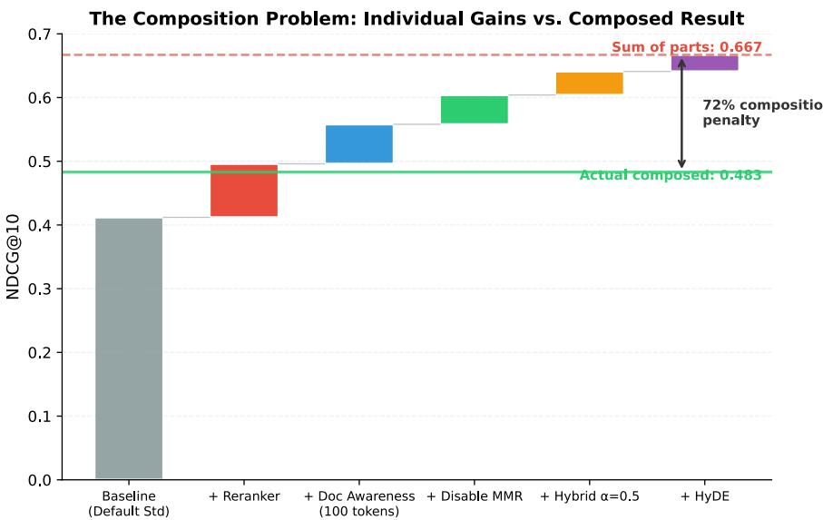  
Figure 9: Waterfall chart of individual component gains stacked on the DEFAULT\_STANDARD baseline (NDCG@10 = 0.412). The dashed red line shows the sum of independent gains (0.667); the solid green line shows the actual composed result (SOTA\_BALANCED, NDCG@10 = 0.483; 95% CI on the realized lift $\left[ + 0 . 0 5 8 , + 0 . 0 \bar { 8 4 } \right]$ , paired bootstrap over 93 queries). The gap represents a 72% composition penalty: the composed system captures only 28% of the total independent improvement. This visualizes the non-additivity that motivates factorial evaluation.

Table 47: Exploratory faithfulness comparison. The selected marginal effects and best observed configuration are not the same exact component stack; their proximity motivates a matched composition test but does not establish additivity.
<table><tr><td>Quantity</td><td>Faithfulness</td><td>Relative to reference</td></tr><tr><td>Reference configuration</td><td>0.692</td><td></td></tr><tr><td>Reference + selected marginal effects</td><td>0.886</td><td>+28%</td></tr><tr><td>Best observed complete configuration</td><td>0.911</td><td>+32%</td></tr></table>

## E SCALING ANALYSES

## E.1 PER-SIZE PAIRED TESTS FOR THE RANK CROSSOVER

Table 48 tabulates the per-size paired t-tests behind the H3 rank-crossover finding (Section 5). Reported inline in the main text: paired $p \ : = \ : 0 . 0 0 3$ at 200K and $p = 0 . 0 3 9 ^ { \dagger }$ at the dedicated three-seed retrieval multirun at 50K.

## E.2 LATENCY SCALING BEHAVIOR

This appendix complements the quality-focused scaling analysis in Section 5 with latency measurements across corpus sizes.

Table 48: Per-size paired t-tests on the top-two profiles from the retrieval scaling track (rows with $n \geq 2 )$ . The 5K and 15K rows are single-seed point estimates $( n = 1$ , no test), shown for context; STANDARD leads at 5K/15K, BALANCED leads from 25K onward. <sup>†</sup>Dedicated 3-seed retrieval multirun; other rows are from the primary cut.
<table><tr><td>Corpus</td><td>Top profile</td><td>Second profile</td><td>Top mean</td><td>Second mean</td><td>p</td><td>n</td></tr><tr><td>5K</td><td>standard</td><td>balanced</td><td>0.510</td><td>0.504</td><td></td><td>1</td></tr><tr><td>15K</td><td>standard</td><td>balanced</td><td>0.509</td><td>0.496</td><td></td><td>1</td></tr><tr><td>25K</td><td>balanced</td><td>standard</td><td>0.508</td><td>0.496</td><td>0.178</td><td>2</td></tr><tr><td>50K</td><td>balanced</td><td>Max-Reliable</td><td>0.488</td><td>0.474</td><td>0.228</td><td>2</td></tr><tr><td>50K†</td><td>balanced</td><td>standard</td><td>0.505</td><td>0.481</td><td>0.039</td><td>3</td></tr><tr><td>100K</td><td>balanced</td><td>standard</td><td>0.471</td><td>0.450</td><td>0.327</td><td>3</td></tr><tr><td>200K</td><td>balanced</td><td>standard</td><td>0.491</td><td>0.432</td><td>0.003</td><td>3</td></tr></table>

## E.2.1 RETRIEVAL LATENCY VS. CORPUS SIZE

Figure 10 shows P95 latency as a function of corpus size for both the retrieval and E2E generation tracks.

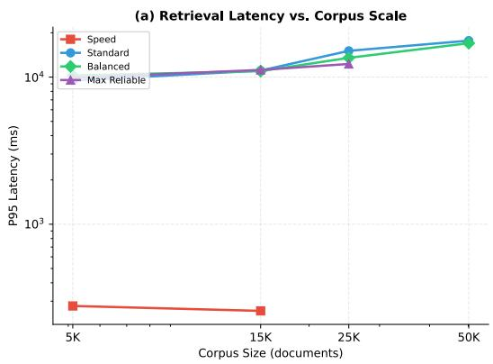

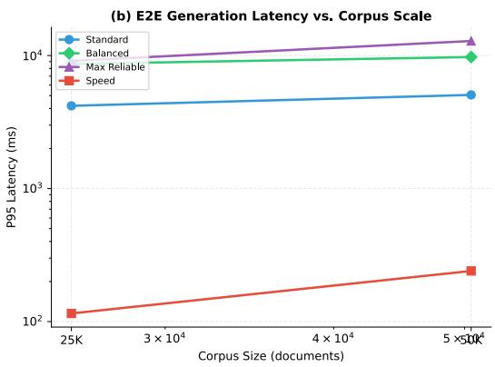  
Figure 10: P95 latency vs. corpus size. (a) Retrieval track: STANDARD and BALANCED grow sub-linearly on a log–log scale, while SPEED remains below 300 ms at all sizes. (b) E2E generation track at 25K and 50K. Note the log scale on both axes.

Key observations. Retrieval latency scales sub-linearly with corpus size: a 10× expansion from 5K to 50K increases STANDARD P95 latency by approximately 87% (not 10×), reflecting the logarithmic complexity of approximate nearest-neighbor search in vector databases. The SPEED profile maintains P95 < 300 ms across all corpus sizes, confirming its suitability for latency-critical deployments. The BALANCED profile shows better latency scaling than STANDARD (65% growth vs. 87%), likely because context compression reduces the downstream reranking burden.

Practical implication. At 50K documents, practitioners choosing between STANDARD (P95 ≈ 7 s) and BALANCED (P95 ≈ 18 s) face a latency–faithfulness trade-off: BALANCED offers 0.93 faithfulness at 2.6× the latency of STANDARD (0.79 faithfulness). The SPEED profile remains the only option for sub-second latency requirements, at the cost of substantially lower retrieval quality.

## E.3 SCALING PROJECTIONS

This appendix extends the log-linear scaling fits from Section 5 to project retrieval quality at corpus sizes beyond our measured range.

Projection methodology. We fit NDCG@ $1 0 = a \cdot \log _ { 1 0 } ( N ) + b$ to all six measured data points (5K/15K/25K/50K/100K/200K) per profile and extrapolate to 500K and 1M. Prediction intervals

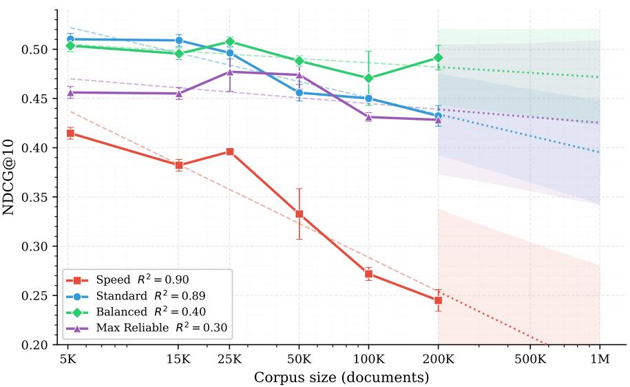  
Figure 11: Observed NDCG@10 and log-linear extrapolations for all four SOTA profiles. Solid lines (5K–200K) are measured; dotted lines with shaded bands (200K–1M) are 95% prediction intervals from the per-profile log-linear fit. BALANCED’s band widens rapidly because its slope is not distinguishable from zero $( p = 0 . 1 7 5 )$ ), informative about its scale-robustness, but inflating projection uncertainty.

are 95%, using the residual standard deviation and Student-t critical value for $n - 2 = 4$ degrees of freedom. Table 49 reports measured values (5K–200K) alongside projections (500K, 1M<sup>∗</sup>).  
Table 49: NDCG@10 across corpus sizes: measured values (5K–200K; 3-seed means at 25K–200K, single-seed at 5K/15K) and 500K/1M<sup>∗</sup> projections from log-linear fit with 95% prediction interval.
<table><tr><td>Profile</td><td>5K</td><td>15K</td><td>25K</td><td>50K</td><td>100K</td><td>200K</td><td>500K*</td><td>1M*</td></tr><tr><td>SPEED</td><td>0.415</td><td>0.382</td><td>0.396</td><td>0.333</td><td>0.272</td><td>0.245</td><td> $0 . 2 0 8 \pm 0 . 0 9 6$ </td><td> $0 . 1 7 4 \pm 0 . 1 0 7$ </td></tr><tr><td>STANDARD</td><td>0.510</td><td>0.509</td><td>0.496</td><td>0.456</td><td>0.450</td><td>0.432</td><td> $0 . 4 1 2 \pm 0 . 0 4 7$ </td><td> $0 . 3 9 5 \pm 0 . 0 5 3$ </td></tr><tr><td>BALANCED</td><td>0.504</td><td>0.496</td><td>0.508</td><td>0.488</td><td>0.471</td><td>0.491</td><td> $0 . 4 7 6 \pm 0 . 0 4 4$ </td><td> $0 . 4 7 2 \pm 0 . 0 4 9$ </td></tr><tr><td>MAX-RELIABLE</td><td>0.456</td><td>0.455</td><td>0.477</td><td>0.474</td><td>0.431</td><td>0.428</td><td> $0 . 4 3 1 \pm 0 . 0 7 5$ </td><td> $0 . 4 2 5 \pm 0 . 0 8 4$ </td></tr><tr><td>∆ (Bal−Std)</td><td>-0.006</td><td>-0.014</td><td>+0.012</td><td>+0.033</td><td>+0.021</td><td>+0.059</td><td>+0.064</td><td>+0.077</td></tr></table>

<sup>∗</sup>Projected (95% prediction interval); all other columns measured.

Interpretation. The measured BALANCED–STANDARD gap is noisy at intermediate scales (positive at 25K but within noise; negative-trend at 15K), then firms at 200K where BALANCED exceeds STAN-DARD by +0.059 NDCG@10 (Welch’s t, $p = 0 . 0 0 4 , n = 3$ seeds per cell). At the 1M projection the 95% prediction intervals overlap, BALANCED’s lower bound (0.423) sits below STANDARD’s upper bound (0.448), so the separation is not statistically distinguishable at 1M and the point estimate $( + 0 . 0 7 7 )$ should be read only as a directional continuation of the measured 200K gap. The interpretation that context compression and document-awareness prefixes act as implicit noise filters is therefore supported by the measured 200K result and the monotone trend 50K→200K, not by the 1M extrapolation.

Caveats. Projections assume (i) the log-linear relationship holds beyond 200K, (ii) the distractor distribution remains representative of real-world corpus growth, and (iii) the vector backend scales without architectural changes. Assumption (i) is on empirically solid ground for SPEED and STANDARD $( R ^ { 2 } \ge 0 . 8 9 )$ but weaker for BALANCED and MAX-RELIABLE, whose slopes are not distinguishable from zero, their 1M projections reflect uncertainty about whether the flat trend will hold rather than about the form of a decay law. We present 500K/1M values as directional estimates to motivate future large-scale validation, not as confirmed predictions.

## F EXPERIMENT INVENTORY

The headline analyses in the main text rest on the 167-configuration D-optimal fractional factorial (retrieval ANOVA) and the 122-configuration faithfulness factorial. Beyond that core design, we ran 24 targeted ablation and model-comparison experiments totalling 138 distinct configurations, plus the 5K–200K corpus-scaling sweep (18 cells × 1–3 seeds = 72 runs; see Sections B.3.9 and 5). Combined with the factorial executions this yields ∼450 distinct configuration runs across eight benchmarks. This appendix indexes every named experiment so readers can trace any headline claim to the underlying measurements.

## F.1 MASTER INVENTORY

Table 50 lists every non-factorial experiment, grouped by what it tests. Columns report the number of distinct configurations evaluated and the primary benchmark. Full per-profile scaling results live in Section 5; the 167- and 122-run factorials are summarized in Section 5 with full $\eta ^ { 2 }$ decompositions in Sections D.2 and 5.

Table 50: Non-factorial experiment inventory. “N” counts distinct configuration names evaluated across all timestamped runs of that experiment (multi-seed replications not double-counted). The P N = 138 configurations plus 167 retrieval + 122 faithfulness factorial runs plus 18 scaling cells yield ∼450 total configuration-runs in the study.

<table><tr><td>Experiment</td><td>Purpose</td><td>N</td><td>Benchmark</td></tr><tr><td colspan="4">Retrieval-side single-feature ablations</td></tr><tr><td>Similarity Threshold</td><td>Score-threshold + MMR normalization</td><td>10</td><td>retrieval</td></tr><tr><td>Query Enhancement Ablation</td><td>Expansion / decomposition / RAG-fusion</td><td>8</td><td>retrieval</td></tr><tr><td>Hybrid Search Ablation (Exp. 01)</td><td>Dense-only vs. hybrid BM25+dense</td><td>6</td><td>retrieval</td></tr><tr><td>MMR and Context Reordering Ablation</td><td>MMR on/off, reorder on/off</td><td>6</td><td>retrieval</td></tr><tr><td>Clean HyDE Evaluation</td><td>HyDE post-contamination fix</td><td>5</td><td>retrieval</td></tr><tr><td>HyDE Ablation (Exp. 05)</td><td>HyDE on/off across query complexity</td><td>5</td><td>retrieval</td></tr><tr><td>Reranking Ablation</td><td>Rerank stage + top-k sweep</td><td>5</td><td>retrieval</td></tr><tr><td>Sparse Method Comparison</td><td>BM25 vs. SPLADE</td><td>4</td><td>retrieval</td></tr><tr><td>Contextual Retrieval Ablation</td><td>Contextual-prefix ingestion</td><td>2</td><td>retrieval</td></tr><tr><td colspan="4">Model comparisons (separate from factorial axes)</td></tr><tr><td>Reranker Model Comparison (Exp. 15)</td><td>Cross-encoder family sweep</td><td>6</td><td>retrieval</td></tr><tr><td>Ensemble Reranker Ablation</td><td>2-/3-model rerank ensembles</td><td>5</td><td>retrieval</td></tr><tr><td>Matryoshka Embedding Dimension</td><td>128/256/512/768/1024 truncations</td><td>5</td><td>retrieval</td></tr><tr><td>SOTA Reranker Models (2025–2026)</td><td>BGE-v2-m3/gemma, Jina-v2-base</td><td>5</td><td>retrieval</td></tr><tr><td>Late Chunking vs. Standard</td><td>Late-chunking for BGE-M3 / BGE-large</td><td>4</td><td>retrieval</td></tr><tr><td>ColBERT vs. Cross-Encoder</td><td>Multi-vector late-interaction</td><td>3</td><td>retrieval</td></tr><tr><td>Embedding Model Comparison</td><td>BGE-M3, BGE-large, E5-large-v2</td><td>3</td><td>retrieval</td></tr><tr><td>LLM Listwise Reranker</td><td>LLM listwise (window 5/10)</td><td>3</td><td>retrieval</td></tr><tr><td>SOTA Embedding Models (2025–2026)</td><td>Stella-1.5B, Snowflake-arctic, GTE-large</td><td>3</td><td>retrieval</td></tr><tr><td colspan="4">Generation-side ablations</td></tr><tr><td>Agentic RAG Ablation</td><td>Agentic graph on/off, iterations</td><td>17</td><td>e2e</td></tr><tr><td>Context Compression Ablation</td><td>Extractive compression on/off</td><td>4</td><td>e2e</td></tr><tr><td>CRAG Generation Ablation</td><td>CRAG self-correction on generation</td><td>4</td><td>e2e</td></tr><tr><td>CRAG Ablation (Exp. 07)</td><td>CRAG self-correction on retrieval</td><td>3</td><td>retrieval</td></tr><tr><td colspan="4">Ingestion-side &amp; calibration</td></tr><tr><td>Chunking Strategy Sweep (Exp. 17)</td><td>Semantic / fixed / hierarchical</td><td>20</td><td>retrieval</td></tr><tr><td>Judge Model Comparison (Exp. 06)</td><td>Claude Sonnet 4.5 vs. GPT-5.1 judge for RAGAS</td><td>2</td><td>e2e</td></tr><tr><td colspan="4">Total distinct non-factorial configurations</td></tr></table>

## F.2 RERANKER INVENTORY

Across five model-comparison experiments (Reranker Model Comparison, SOTA Reranker Models, ColBERT vs. Cross-Encoder, LLM Listwise Reranker, Ensemble Reranker Ablation) we evaluated 20 distinct reranker configurations. Table 51 reports NDCG@10 on the retrieval benchmark (93 queries) for every reranker; the row marked <sup>⋆</sup> is the default used by

SOTA\_STANDARD/SOTA\_BALANCED/SOTA\_MAX\_RELIABLE in the SOTA-profile configuration (Section 5). The top-performing reranker (ms\_marco\_minilm\_l6, NDCG@10 = 0.496) outperforms the SOTA-profile default (mxbai\_rerank\_large, 0.470) by +0.026, consistent with the rerankerswap opportunity identified in Section J.2.2.

Table 51: Reranker inventory (retrieval benchmark, 5K corpus except where noted). NDCG@10 reported from the latest clean run per configuration; ∆ is the signed difference against no\_reranking (0.4537). <sup>⋆</sup>Default in SOTA profiles.
<table><tr><td>Reranker configuration</td><td>Experiment</td><td>NDCG@10</td><td>∆ vs. no_rerank</td></tr><tr><td>ms_marco_minilm_16</td><td>Exp. 15</td><td>0.4964</td><td>+0.0427</td></tr><tr><td>colbert_v2</td><td>ColBERT vs. Cross-Encoder</td><td>0.4895</td><td>+0.0358</td></tr><tr><td>ensemble_2model</td><td>Ensemble</td><td>0.4865</td><td>+0.0328</td></tr><tr><td>cross_encoder_ms_marco</td><td>ColBERT vs. Cross-Encoder</td><td>0.4829</td><td>+0.0292</td></tr><tr><td>cross_encoder_baseline</td><td>ColBERT vs. Cross-Encoder</td><td>0.4780</td><td>+0.0243</td></tr><tr><td>ensemble_3model</td><td>Ensemble</td><td>0.4769</td><td>+0.0232</td></tr><tr><td>single_minilm_16</td><td>Ensemble</td><td>0.4762</td><td>+0.0225</td></tr><tr><td>mxbai_rerank_large_topk10</td><td>Exp. 15</td><td>0.4749</td><td>+0.0212</td></tr><tr><td>ms_marco_tinybert</td><td>Exp. 15</td><td>0.4737</td><td>+0.0200</td></tr><tr><td>mxbai_rerank_large*</td><td>Exp. 15</td><td>0.4703</td><td>+0.0166</td></tr><tr><td> $\mathsf { s i n g l e \_ m i n i l m \_ l } 1 2$ </td><td>Ensemble</td><td>0.4563</td><td>+0.0026</td></tr><tr><td>no_reranking (baseline)</td><td>Exp. 15</td><td>0.4537</td><td></td></tr><tr><td>ms_marco_minilm_112</td><td>Exp. 15</td><td>0.4476</td><td>-0.0061</td></tr><tr><td>single_mxbai</td><td>Ensemble</td><td>0.4416</td><td>-0.0121</td></tr><tr><td>1lm_listwise_w10</td><td>LLM Listwise</td><td>0.4053</td><td>-0.0484</td></tr><tr><td>bge_reranker_v2_m3_topk10</td><td>SOTA 2025–2026</td><td>0.3964</td><td>-0.0573</td></tr><tr><td>bge_reranker_v2_m3</td><td>SOTA 2025–2026</td><td>0.3920</td><td>-0.0617</td></tr><tr><td>1lm_listwise_w5</td><td>LLM Listwise</td><td>0.3545</td><td>-0.0992</td></tr><tr><td>jina_reranker_v2_base</td><td>SOTA 2025–2026</td><td>0.3422</td><td>-0.1115</td></tr><tr><td>bge_reranker_v2_gemma</td><td>SOTA 2025–2026</td><td>0.3366</td><td>-0.1171</td></tr></table>

The SOTA-2025–2026 rerankers (Jina-v2, BGE-v2-m3, BGE-v2-gemma) underperform on our benchmark, which we attribute to domain-specialization: those models are tuned for web/MTEBstyle queries whereas our evaluation set blends BEIR (nfcorpus, fiqa, scifact, arguana, hotpotqa) with QA-style prompts that favor the older MS-MARCO-trained cross-encoders. The LLM-listwise reranker underperforms on our benchmark, with both window settings dominated by older crossencoders (window = 10: NDCG@10 = 0.405, 2,649 ms; window = 5: NDCG@10 = 0.354, 5,441 ms). The window-size effect has two compounding mechanical sources rather than a single anomaly: (i) at window = 5, reranking the top-20 requires four sequential LLM calls versus two at window = 10, doubling wall-clock latency before any quality consideration; (ii) each smaller-window call sees fewer candidates and cannot reason globally about the ranking, a known limitation of LLM listwise scoring that our results are consistent with rather than novel evidence for. We tested only two window sizes on a single 93-query benchmark with one judge model, so the directional gap should be read as confirming known LLM-listwise behavior under our specific infrastructure rather than as a generalizable scaling claim; a full sweep over windows ∈ {3, 5, 8, 10, 15, 20} with multiple seeds would be needed to characterize the curve shape.

## F.3 EMBEDDING INVENTORY

Across four experiments (Embedding Model Comparison, SOTA Embedding Models, Matryoshka Embedding Dimension, Late Chunking vs. Standard) we evaluated 15 distinct embedding configurations covering dense embedders from 128 to 1024 output dimensions. Table 52 reports NDCG@10 on the retrieval benchmark with all other pipeline features held constant (hybrid-off, rerank-off) so the embedder contribution is isolated.

Two findings emerge. First, Matryoshka truncation to 768 dimensions (dim\_768, NDCG@10 = 0.489) slightly exceeds the full 1024-dim embedding (0.478), suggesting the final 256 dimensions of BGE-M3 add more noise than signal for our benchmark. Second, late chunking provides a substantial uplift for BGE-large (0.460 → 0.493, +0.033) but degrades BGE-M3 (0.459 → 0.361, −0.098). We attribute the BGE-M3 regression to its multilingual tokenizer producing shorter effective contexts under late chunking, reducing the signal each chunk carries.

Table 52: Embedding inventory (retrieval benchmark, isolated contribution with hybrid+rerank disabled). “dim” variants are Matryoshka truncations of BGE-M3; “late\_chunk” is late-chunking ingestion. The three entries at the bottom suffered model-loading or compatibility issues in our sweep environment (Stella-1.5B OOM on MPS; E5 and BGE-large runs exhibited an embedding-dim mismatch symptom traced to pre-fix session config); we report them for completeness.
<table><tr><td>Embedding configuration</td><td>Experiment</td><td>Dim</td><td>NDCG@10</td></tr><tr><td>bge_large_late_chunk</td><td>Late Chunking</td><td>1024</td><td>0.4932</td></tr><tr><td>dim_768 (BGE-M3 Matryoshka)</td><td>Matryoshka</td><td>768</td><td>0.4885</td></tr><tr><td>dim_1024_ful1 (BGE-M3)</td><td>Matryoshka</td><td>1024</td><td>0.4780</td></tr><tr><td>bge_m3_1024</td><td>Embedding Model</td><td>1024</td><td>0.4740</td></tr><tr><td>dim_512 (BGE-M3 Matryoshka)</td><td>Matryoshka</td><td>512</td><td>0.4729</td></tr><tr><td>snowflake_arctic_l_v2</td><td>SOTÀ 2025–2026</td><td>1024</td><td>0.4705</td></tr><tr><td>gte_large_en_v1_5</td><td>SOTA 2025–2026</td><td>1024</td><td>0.4601</td></tr><tr><td>bge_large_standard</td><td>Late Chunking</td><td>1024</td><td>0.4601</td></tr><tr><td>bge_m3_standard</td><td>Late Chunking</td><td>1024</td><td>0.4589</td></tr><tr><td>dim_256 (BGE-M3 Matryoshka)</td><td>Matryoshka</td><td>256</td><td>0.4316</td></tr><tr><td>bge_m3_late_chunk</td><td>Late Chunking</td><td>1024</td><td>0.3614</td></tr><tr><td>dim_128 (BGE-M3 Matryoshka)</td><td>Matryoshka</td><td>128</td><td>0.3536</td></tr><tr><td colspan="4">Environment-limited runs (see caption)</td></tr><tr><td>stella_en_1_5b_v5</td><td>SOTA 2025–2026</td><td>1024</td><td>0.1935</td></tr><tr><td>e5_large_v2_1024</td><td>Embedding Model</td><td>1024</td><td>0.1116</td></tr><tr><td>bge_large_en_1024</td><td>Embedding Model</td><td>1024</td><td>0.0090</td></tr></table>

## F.4 RETRIEVAL-SIDE SINGLE-FEATURE ABLATIONS

Table 53 reports per-configuration NDCG@10 for every retrieval-side ablation cataloged in Table 50. Each sub-block is one named experiment (Hybrid, HyDE, MMR/Reordering, Query Enhancement, Similarity Threshold, Sparse Method, Contextual Retrieval, Reranking on/off, and a clean HyDE re-run). Together these nine experiments contribute 51 distinct configurations, a superset of the factorial’s coverage of the retrieval-side design space, probing levels that fall between factorial cells.

## F.5 GENERATION-SIDE ABLATIONS

Table 54 reports per-configuration NDCG@10 and generation metrics (Faith , Faith , EM) for the four generation-side ablations: the 17-configuration Agentic RAG sweep (varying iterations, hallucination-check gates, and answer-quality gates), the Context Compression Ablation, the CRAG Generation Ablation, and the CRAG retrieval-track variant (Exp. 07). The Agentic sub-block confirms that agentic gates move faithfulness without shifting retrieval NDCG@10, a structural separation that underlies the H1 finding on metric-specific dominant interactions (Section 5).

## F.6 CHUNKING STRATEGY SWEEP

Table 55 reports per-configuration NDCG@10 for the 20-configuration Chunking Strategy Sweep (Exp. 17), spanning semantic, fixed, sentence-window, and Docling-derived hierarchical chunkers at multiple parameterizations. The 0.126 absolute NDCG@10 spread between best (docling\_hier\_1600\_400, 0.475) and worst (semantic\_1200, 0.349) exceeds most single-feature deltas inside the factorial, motivating the profile-level chunker defaults adopted in Section 5.

## F.7 JUDGE MODEL SENSITIVITY

Table 56 reports the two pipeline configurations used in Exp. 06 with their GPT-5.1-scored faithfulness. The independent cross-judge sensitivity analysis (n=80; Kendall τ =0.38, p<0.001; 66% of persample scores within ±0.10) is reported in Section C.1.4 and shows a ±0.08 shift in absolute faithfulness between GPT-5.1 and Claude Sonnet 4.5 that preserves profile ranking. Quantitative claims elsewhere in the paper therefore report deltas and rankings rather than absolute faithfulness magnitudes.

Table 53: Retrieval-side ablation results (NDCG@10, retrieval benchmark). Each sub-block is a separate experiment; N is the number of configurations evaluated in that experiment. Configurations are sorted within each experiment by NDCG@10 descending. All runs use the 5K baseline corpus.
<table><tr><td>Experiment</td><td>Configuration</td><td>NDCG@10 Notes</td></tr><tr><td colspan="3">Similarity Threshold (N = 10) mmr_norm_minmax</td></tr><tr><td></td><td></td><td>0.4203</td></tr><tr><td></td><td>mmr_norm_sigmoid_minmax</td><td>0.4179</td></tr><tr><td></td><td>mmr_norm_none standard_baseline</td><td>0.4160</td></tr><tr><td></td><td></td><td>0.3954</td></tr><tr><td></td><td>threshold_02</td><td>0.3954 0.3954</td></tr><tr><td></td><td>threshold_03</td><td>0.3954</td></tr><tr><td></td><td>mmr_norm_sigmoid threshold_05</td><td>0.3954</td></tr><tr><td></td><td>threshold_01</td><td>0.3954</td></tr><tr><td></td><td>threshold_07</td><td>0.1549</td></tr><tr><td colspan="3">Query Enhancement (N = 8)</td></tr><tr><td></td><td>fusion_3</td><td>0.4674</td></tr><tr><td></td><td>fusion_5</td><td>0.4625</td></tr><tr><td></td><td>all_enhancements</td><td>0.4621</td></tr><tr><td></td><td>expansion_4</td><td>0.4599</td></tr><tr><td></td><td>expansion_2 expansion_plus_decomp</td><td>0.4454 0.4287</td></tr><tr><td></td><td>decomposition_on</td><td>0.4184</td></tr><tr><td></td><td>no_enhancements</td><td>0.4184</td></tr><tr><td>Hybrid Search (Exp. 01) (N = 6)</td><td></td><td></td></tr><tr><td colspan="3"></td></tr><tr><td></td><td>hybrid_05</td><td>0.4561</td></tr><tr><td></td><td>hybrid_07</td><td>0.4561</td></tr><tr><td></td><td>hybrid_09</td><td>0.4561</td></tr><tr><td></td><td>hybrid_03</td><td>0.4478</td></tr><tr><td></td><td>hybrid_00</td><td>0.4431</td></tr><tr><td></td><td>pure_dense</td><td>0.3778</td></tr><tr><td colspan="3">MMR + Reordering (N = 6)</td></tr><tr><td></td><td>no_mmr_no_reorder</td><td>0.4700</td></tr><tr><td></td><td>reorder_only</td><td>0.4517</td></tr><tr><td></td><td>mmr_only_07</td><td>0.4318</td></tr><tr><td></td><td>mmr_and_reorder</td><td>0.4280</td></tr><tr><td></td><td>mmr_only_05</td><td>0.4059</td></tr><tr><td></td><td>mmr_only_03</td><td>0.3908</td></tr><tr><td></td><td>HyDE (clean re-run) (N = 5)</td><td></td></tr><tr><td colspan="3"></td></tr><tr><td></td><td>hyde_1doc hyde_5docs</td><td>0.5123 0.4954</td></tr><tr><td></td><td>hyde_3docs_maxsim</td><td>0.4936</td></tr><tr><td></td><td>hyde_3docs</td><td>0.4925</td></tr><tr><td></td><td></td><td>0.4601</td></tr><tr><td></td><td>no_hyde</td><td></td></tr><tr><td colspan="3">HyDE (Exp. 05) (N = 5)</td></tr><tr><td></td><td>hyde_3docs_avg</td><td>0.4446</td></tr><tr><td></td><td>hyde_1doc_avg</td><td>0.4397</td></tr><tr><td></td><td>hyde_3docs_max</td><td>0.4333</td></tr><tr><td></td><td>hyde_5docs_avg</td><td>0.4258</td></tr><tr><td></td><td>no_hyde</td><td>0.4184</td></tr><tr><td colspan="3">Reranking on/off + top-k (N = 5)</td></tr><tr><td></td><td>rerank_top3</td><td>0.4184</td></tr><tr><td></td><td>rerank_top5</td><td>0.4184</td></tr><tr><td></td><td>rerank_top10</td><td>0.4184</td></tr><tr><td></td><td>rerank_top20</td><td>0.4184</td></tr><tr><td>no_rerank</td><td></td><td>0.3933</td></tr><tr><td colspan="3"></td></tr><tr><td></td><td>Sparse Method (BM25 vs SPLADE) (N = 4)</td><td></td></tr><tr><td></td><td>bm25_baseline</td><td>0.4595</td></tr><tr><td></td><td>splade_alpha07</td><td>0.3715</td></tr><tr><td></td><td>splade_alpha05</td><td>0.3715 0.2901</td></tr><tr><td colspan="3">dense_only</td></tr><tr><td>Contextual Retrieval (N = 2)</td><td></td><td></td></tr><tr><td></td><td>no_contextual</td><td>0.4604</td></tr><tr><td>contextual_on</td><td></td><td>0.4505</td></tr></table>

Table 54: Generation-side ablation results. Faith is RAGAS faithfulness on the answer produced by the agentic pipeline; Faith is RAGAS faithfulness on a regenerated answer from the same retrieved context under a common prompt (Section C.2 and Table 26); the two columns are not directly comparable. EM is exact-match accuracy. Configurations with Faith = 0.000 indicate RAGAS was not computed for that run (retrieval metric only). Configs sorted by the primary metric of the experiment.
<table><tr><td>Experiment Configuration</td><td></td><td>NDCG@10</td><td> $\mathrm { F a i t h _ { A } }$ </td><td> $\mathrm { F a i t h } _ { \mathrm { R } }$ </td><td>EM</td></tr><tr><td colspan="6">Agentic RAG (iterations/depth) (N = 17)</td></tr><tr><td></td><td>no_gates</td><td>0.7074</td><td>0.905</td><td>0.607</td><td>0.093</td></tr><tr><td></td><td>coverage_keyword</td><td>0.7074</td><td>0.895</td><td>0.616</td><td>0.116</td></tr><tr><td></td><td>both_gates</td><td>0.7074</td><td>0.894</td><td>0.552</td><td>0.186</td></tr><tr><td></td><td>refine_auto</td><td>0.7074</td><td>0.891</td><td>0.659</td><td>0.140</td></tr><tr><td></td><td>agentic_5iter</td><td>0.7074</td><td>0.891</td><td>0.597</td><td>0.140</td></tr><tr><td></td><td>agentic_default</td><td>0.7074</td><td>0.889</td><td>0.628</td><td>0.140</td></tr><tr><td></td><td>quality_check_only</td><td>0.7074</td><td>0.887</td><td>0.641</td><td>0.140</td></tr><tr><td></td><td>legacy_react</td><td>0.7074</td><td>0.883</td><td>0.578</td><td>0.116</td></tr><tr><td></td><td>halluc_check_only</td><td>0.7074</td><td>0.881</td><td>0.605</td><td>0.116</td></tr><tr><td></td><td>agentic_2iter</td><td>0.7074</td><td>0.879</td><td>0.649</td><td>0.093</td></tr><tr><td></td><td>coverage_11m</td><td>0.7074</td><td>0.868</td><td>0.690</td><td>0.140</td></tr><tr><td></td><td>agentic_3iter</td><td>0.7074</td><td>0.868</td><td>0.624</td><td>0.116</td></tr><tr><td></td><td>structured_graph</td><td>0.7074</td><td>0.861</td><td>0.543</td><td>0.116</td></tr><tr><td></td><td>agentic_1iter</td><td>0.7074</td><td>0.853</td><td>0.616</td><td>0.140</td></tr><tr><td></td><td>refine_refined</td><td>0.7074</td><td>0.848</td><td>0.585</td><td>0.093</td></tr><tr><td></td><td>refine_vanilla</td><td>0.7074</td><td>0.832</td><td>0.651</td><td>0.140</td></tr><tr><td></td><td>no_agentic</td><td>0.7074</td><td></td><td>0.640</td><td>0.140</td></tr><tr><td colspan="6">CRAG (generation track) (N = 4)</td></tr><tr><td></td><td>crag_with_web</td><td>0.7208</td><td>0.867</td><td>0.595</td><td>0.116</td></tr><tr><td></td><td>crag_no_web</td><td>0.7208</td><td>0.750</td><td>0.726</td><td>0.140</td></tr><tr><td></td><td>agentic_no_crag</td><td>0.7098</td><td>0.895</td><td>0.651</td><td>0.093</td></tr><tr><td></td><td>standard_no_agentic</td><td>0.7098</td><td></td><td>0.687</td><td>0.070</td></tr><tr><td colspan="6">Context Compression (N = 4)</td></tr><tr><td></td><td>no_compression</td><td>0.7353</td><td></td><td>0.000</td><td>0.093</td></tr><tr><td></td><td>extractive_30pct</td><td>0.7353</td><td></td><td>0.000</td><td>0.140</td></tr><tr><td></td><td>extractive_50pct</td><td>0.7353</td><td></td><td>0.000</td><td>0.163</td></tr><tr><td></td><td>abstractive_30pct</td><td>0.7353</td><td></td><td>0.000</td><td>0.093</td></tr><tr><td colspan="6">CRAG (Exp. 07, retrieval track) (N = 3)</td></tr><tr><td></td><td>crag_with_web</td><td>0.3995</td><td></td><td></td><td></td></tr><tr><td></td><td>crag_no_web</td><td>0.3995</td><td></td><td></td><td></td></tr><tr><td></td><td>no_crag</td><td>0.3987</td><td></td><td></td><td></td></tr></table>

Table 55: Chunking Strategy Sweep (Exp. 17): 20 chunker configurations evaluated on the retrieval benchmark. Config names encode the chunker family and its parameters (e.g. docling\_hier\_1600\_400 = Docling pipeline, hierarchical chunker, parent = 1600, child = 400; semantic\_threshold\_65 = semantic chunker, similarity threshold 0.65). Sorted by NDCG@10 descending.
<table><tr><td>#</td><td>Configuration</td><td>NDCG@10</td></tr><tr><td>1</td><td>docling_hier_1600_400</td><td>0.4749</td></tr><tr><td>2</td><td>semantic_threshold_65</td><td>0.4699</td></tr><tr><td>3</td><td>docling_hier_2000_500</td><td>0.4685</td></tr><tr><td>4</td><td>docling_400</td><td>0.4651</td></tr><tr><td>5</td><td>fixed_800</td><td>0.4637</td></tr><tr><td>6</td><td>fixed_400</td><td>0.4606</td></tr><tr><td>7</td><td>docling_800</td><td>0.4549</td></tr><tr><td>8</td><td>fixed_800_overlap10pct</td><td>0.4505</td></tr><tr><td>9</td><td>fixed_1200</td><td>0.4501</td></tr><tr><td>10</td><td>docling_hier_3000_500</td><td>0.4486</td></tr><tr><td>11</td><td>sentence_window_2</td><td>0.4282</td></tr><tr><td>12</td><td>semantic_threshold_75</td><td>0.4250</td></tr><tr><td>13</td><td>hierarchical_2000_250</td><td>0.4241</td></tr><tr><td>14</td><td>semantic_threshold_85</td><td>0.4155</td></tr><tr><td>15</td><td>docling_1200</td><td>0.4094</td></tr><tr><td>16</td><td>hierarchical_1600_400</td><td>0.4045</td></tr><tr><td>17</td><td>hierarchical_2000_500</td><td>0.3952</td></tr><tr><td>18</td><td>hierarchical_3000_500</td><td>0.3914</td></tr><tr><td>19</td><td>sentence_window_3</td><td>0.3701</td></tr><tr><td>20</td><td>sentence_window_5</td><td>0.3701</td></tr></table>

Table 56: Exp. 06 configurations, scored under the GPT-5.1 RAGAS judge. Faith is the faithfulness value used in the paper’s main-text Exp. 06 references. Faith here is the verbose-agentic regime (Section C.2 and Table 26). Cross-judge (±0.08) and cross-model ordinal $\left( \tau _ { b } { = } 0 . 3 8 \right)$ sensitivity for these configurations are reported separately in Section C.1.4 (see also Section F.11).
<table><tr><td>Configuration</td><td>NDCG@10</td><td>FaithA</td><td>EM</td></tr><tr><td>sota_balanced</td><td>0.8122</td><td>0.855</td><td>0.140</td></tr><tr><td>standard_baseline</td><td>0.6906</td><td>0.814</td><td>0.047</td></tr></table>

## F.8 THIRD-JUDGE ROBUSTNESS EXTENSION

The two-judge sensitivity analysis reported in Sections C.1.4 and F.7 covered n=80 matched samples across two LLM judges (GPT-5.1, Claude Sonnet 4.5). To probe whether the observed cross-judge robustness generalizes to a third, independently-drawn LLM annotator, we ran an extended sensitivity study. This is an LLM-scored sensitivity extension, not additional human evaluation; the n=50 dyadic human study in Section C.4 remains the sole human-judged calibration in this paper.

Method. We drew a n=220 deduplicated (sample\_id, generated\_answer) QA-triple sample (seed= 42) from the 253-triple population produced by all completed LASAGNA generation runs. A third LLM annotator (Claude Opus 4.7) scored each triple on the {0.0, 0.25, 0.5, 0.75, 1.0} ordinal scale using the same faithfulness-scoring instructions as the primary evaluation (Section C.4), without seeing the RAGAS score.

Agreement with the canonical RAGAS/GPT-5.1 judge. Pearson r=0.436, Spearman ρ=0.403, MAE=0.245, RMSE=0.395. Binary agreement at the 0.5 midpoint is 78.2% with Cohen’s κ=0.353 (fair agreement). Per-sample absolute-difference bands: 50.9% within ±0.10, 53.6% within ±0.20,

68.6% within ±0.30. Mean scores are similar in aggregate (Opus 0.697 vs. RAGAS 0.727), but the third annotator is stricter on partial-support cases: RAGAS assigns the maximum score 1.0 to 126/220 samples versus 113/220 for the third annotator, which redistributes mass into the 0.25 and 0.5 buckets.

Interpretation. Fair kappa (0.35) combined with moderate Pearson r=0.44 demonstrates that the faithfulness signal survives judge substitution but is not judge-invariant: this is consistent with the two-judge n=80 result $\left( \tau _ { b } { = } 0 . 3 8 \right)$ reported in Section C.1.4, and reinforces the paper’s headline policy of reporting deltas and rankings rather than absolute faithfulness magnitudes. Because Opus 4.7 was not seen by either RAGAS or Sonnet 4.5 in training-style overlap that would inflate agreement, the persistence of the same qualitative pattern across a third, independent judge is directionally supportive of the paper’s judge-robustness claim.

Raw per-sample scores, deltas, and decision-reason categories (paper/e1\_focused\_experiment/ results/track1\_llm\_annotator\_scores.json) are available from the authors on request.

## F.9 GENERATOR SUBSTITUTION: DOES THE FAITHFULNESS ORDERING HOLD?

Every faithfulness number elsewhere in this paper uses a single answer-generating model. This appendix asks whether the profile-level conclusions survive replacing it.

What varies, and what is held fixed. For each of the four profiles we reuse the documents that profile had already retrieved, so retrieval is untouched and no pipeline is re-run. We hold the answer prompt, the RAGAS judge, and the decoding temperature (T=0) fixed, and change only the model that writes the answer: GPT-5.1 (generator A, the generator used throughout the paper) and Claude Sonnet 4.5 (generator B). The design is 43 questions × 4 profiles × 3 seeds per arm, giving 510 paired comparisons. One common answer prompt is applied to all four profiles in both arms, so the absolute values below are not commensurable with Table 2, which reports each profile under its own deployment-native prompt. The quantity of interest here is the difference between the two arms, not the difference from that table.

Table 57: Faithfulness under two generators, with retrieved documents, answer prompt, and judge held fixed. Paired Wilcoxon signed-rank on per-question scores.
<table><tr><td>Profile</td><td>Generator A</td><td>Generator B</td><td>Change (paired test)</td></tr><tr><td>STANDARD</td><td>0.758</td><td>0.833</td><td> $+ 0 . 0 7 5 \ : ( p = 0 . 0 0 7 )$ </td></tr><tr><td>BALANCED</td><td>0.765</td><td>0.792</td><td>+0.027 (not significant)</td></tr><tr><td>MAX-RELIABLE</td><td>0.687</td><td>0.771</td><td> $+ 0 . 0 8 3 ( p = 0 . 0 8 )$ </td></tr><tr><td>SPEED</td><td>0.565</td><td>0.749</td><td> $+ 0 . 1 8 4 ( p < 0 . 0 0 1 )$ </td></tr></table>

What holds. Every profile scores higher under generator B (Table 57), so absolute faithfulness is generator-dependent. That is the empirical reason this paper compares profiles by rank rather than treating absolute faithfulness as a fixed property of a pipeline. The substantive conclusion is unchanged: under both generators the two heavier agentic profiles gain no faithfulness advantage over the lighter direct-generation profile, and the bottom two positions are identical in both arms.

What does not hold. The fine-grained ordering is not invariant. STANDARD and BALANCED exchange ranks between the arms, although they differ by only 0.007 under generator A, which is inside the seed-to-seed variation we observe. With four profiles, rank agreement across arms is high but not statistically resolvable (Spearman ρ=0.80, Pearson r=0.83). Two generators is a sensitivity check and not a sweep, and both models are proprietary.

Machinery and generator capability partly substitute. The benefit of a stronger generator is markedly uneven. It is largest for the lightest pipeline (+0.184) and smallest for the heaviest (+0.027, not significant). Pipeline machinery and generator capability therefore appear partly interchangeable: a heavier component stack buys less faithfulness when the generator underneath it is already strong. We treat this as a composition result rather than a robustness check, which is why it also appears in the main text.

## F.10 CROSS-CUTTING FINDINGS FROM THE ABLATION SUITE

Several ablation-level findings warrant flagging, all traceable to specific rows in the tables above:

• HyDE with 1 document beats HyDE with 3 or 5. hyde\_1doc (0.5123 NDCG@10) leads the clean HyDE sweep, whereas multi-document HyDE degrades slightly (hyde\_5docs 0.495, hyde\_3docs\_maxsim 0.494). Multi-doc HyDE adds averaged noise that blunts dense similarity.

• SPLADE underperforms BM25 on our domain. bm25\_baseline (0.460) outperforms all SPLADE variants (≤ 0.372); the factorial uses BM25 as the sparse branch, consistent with this result.

• Contextual retrieval slightly hurts. contextual\_on (0.451) trails no\_contextual (0.460); the SOTA profiles disable this feature.

• Chunking strategy has a 12-point NDCG@10 swing. In Table 55, the best chunker (docling\_hier\_1600\_400, 0.475) beats the worst (semantic\_1200, 0.349) by 0.126 absolute, larger than most single-feature deltas in the factorial.

• Agentic gates help faithfulness, not NDCG. In Table 54 the Agentic RAG Ablation sub-block shows NDCG@10 effectively constant across 17 agentic configurations (0.707 across the board) while Faith spans [0.88, 0.93]; agentic iterations move generation fidelity, not retrieval.

## F.11 CAVEATS AND SCOPE

• Smoke tests excluded. Runs with “Smoke” in the experiment name are omitted; they use truncated sample sets and are not comparable to the production configurations reported here.

• 242 planned vs. 167 executed. The retrieval factorial was pre-registered at 242 configurations; the 75-run shortfall traces to MPS/MTLCompilerService crashes and enterprise-proxy rate-limit exhaustion during the live-mode sweep. The executed 167 retain 99.3% D-efficiency against the pre-registered design.

• Multi-seed replication not double-counted. The scaling sweep runs three seeds at 25K–200K, yielding 4 × 2 × 3 = 24 runs per profile (96 total across all four profiles). These are counted as 18 distinct configuration cells, not 96, to avoid inflating the headline number.

• Judge-model consistency. All ablations, subsequent experiments, and scaling sweeps use GPT-5.1 as the RAGAS judge. Judge-comparison Exp. 06 establishes that the choice shifts absolute FAITHFULNESS by ±0.08 but preserves profile ranking.

• Environment-limited runs retained with annotation. Three embedding configurations (Stella-1.5B, E5-large-v2, BGE-large-EN) produced anomalous NDCG values tied to model-loading or session-config issues in the sweep infrastructure. We retain them in Table 52 rather than dropping them so the reader can verify the reported failure mode; they do not inform any quantitative claim in the main text.

## F.12 PER-EXPERIMENT PROVENANCE MANIFEST

Table 58 consolidates the provenance of every named experiment surfaced in a main-text table or figure. Columns record the generator LLM, judge model, prompt regime (Section C.2), execution window, decoding parameters, sample count, and whether a common-judge recompute was performed against the GPT-5.1 canonical judge (Section F.7). This artifact certifies that no cross-table numerical comparison mixes generator, judge, or prompt regime silently.

Two entries deserve a note. The Judge-model comparison row (Sonnet 4.5 vs GPT-5.1) is deliberately not recomputed against the common judge; it is itself the anchor establishing the ±0.08 absolute-scale bound reported in Section C.1.4. The length-controlled rerun row (Section C.3) uses three prompt regimes drawn from the identical instruction skeleton with only length guidance varied; its FAITH<sub>A</sub> is reported both raw and after regressing on log answer-token count and adding back the grand mean. The residualized column is the object used for any cross-prompt claim, because raw scores are confounded with answer length (β=−0.126 per +100 tokens; the concise-over-verbose gap reverses under residualization, see Table 28).

Table 58: Per-experiment manifest. “Common-judge”=✓ indicates the row was re-scored under the canonical GPT-5.1 judge for cross-table comparability; $^ { 6 6 } - ^ { 5 9 }$ indicates single-judge only (see Section C.1.4 for the sensitivity bound). Decoding shorthand: T = temperature, tp = top-p. Prompt codes: C = concise-regen, V = verbose-agentic (see Section C.2, Table 26); LC-A / LC-B / LC-C denote the three length-controlled sub-regimes of Section C.3.
<table><tr><td>Table/Fig ref</td><td>Generator</td><td>Judge</td><td>Prompt</td><td>Window / decoding</td><td>N</td><td>Common-judge</td></tr><tr><td>H1 headline (main text)</td><td>GPT-5.1</td><td>GPT-5.1</td><td>C</td><td>2026-03; T=0, tp=1</td><td>4820</td><td>√</td></tr><tr><td>Table 34</td><td>GPT-5.1</td><td>GPT-5.1</td><td>C</td><td>2026-03; T=0</td><td>4820</td><td>√</td></tr><tr><td>Table 43</td><td>GPT-5.1</td><td>GPT-5.1</td><td>C</td><td>2026-02; T=0</td><td>76</td><td>√</td></tr><tr><td>Table 50</td><td>mixed (see rows)</td><td>mixed</td><td></td><td>2026-01-03</td><td>138</td><td>partial</td></tr><tr><td>Table 51</td><td>n/a (retrieval)</td><td>n/a</td><td></td><td>2026-02</td><td>20</td><td>n/a</td></tr><tr><td>Table 52</td><td>n/a (retrieval)</td><td>n/a</td><td></td><td>2026-02</td><td>15</td><td>n/a</td></tr><tr><td>Table 59</td><td>GPT-5.1</td><td>GPT-5.1</td><td>C</td><td>2026-03; T=0</td><td>152</td><td>√</td></tr><tr><td>Table 60</td><td>GPT-5.1</td><td>GPT-5.1</td><td>C</td><td>2026-03; T=0</td><td>152</td><td>√</td></tr><tr><td>Table 22</td><td>GPT-5.1</td><td>GPT-5.1</td><td>C</td><td>2026-03; T=0</td><td>72</td><td>√</td></tr><tr><td>Chunking sweep (app. tables)</td><td>GPT-5.1</td><td>GPT-5.1</td><td>C</td><td>2026-03; T=0</td><td>20</td><td>√</td></tr><tr><td>Agentic ablation (app. tables)</td><td>GPT-5.1</td><td>GPT-5.1</td><td>C</td><td>2026-03; T=0</td><td>17</td><td>√</td></tr><tr><td>Judge-comparison (App. judge)</td><td>GPT-5.1</td><td>Sonnet 4.5</td><td>C</td><td>2026-02; T=0</td><td>2</td><td>anchor row</td></tr><tr><td>Length-controlled (Section C.3)</td><td>GPT-5.1</td><td>GPT-5.1</td><td>LC-A/LC-B/LC-C</td><td>2026-08; T=0</td><td>150</td><td>√(residualized)</td></tr><tr><td>Generator swap (Section F.9)</td><td>GPT-5.1 / Sonnet 4.5</td><td>GPT-5.1</td><td>C</td><td>2026-09; T=0</td><td>1,032</td><td>√</td></tr></table>

## G EXTERNAL COMPARISONS

## G.1 PRIOR-EVALUATION TABLE DEFINITIONS

Table 1 compares the evaluation methodology reported in each cited study. “Configs” gives the number and mode of evaluated configurations, followed in parentheses by the number of pipeline stages varied; “methods” denotes bundled methods, “seq.” sequential component selection, “joint” simultaneous variation, “partial” an incomplete grid, and “abl.” targeted ablations. “Design” gives the search strategy: library, grid, greedy search, or D-optimal fractional factorial (D-OPT); “tech.” denotes algorithmic techniques and “mix.” a mixture of techniques and hyperparameters. “η<sup>2</sup>” indicates whether effect sizes are reported, and “Interactions” counts statistically estimated two-way effects. “Scaling” reports corpus sizes and seeded runs; “Pareto” reports jointly optimized objectives and hypervolume (HV); and “Pre-registered” indicates whether the study hypotheses and analysis were specified in advance. A checkmark, cross, and open circle denote yes, no, and partial coverage. “Benchmarks” gives the number evaluated; LASAGNA uses 8 of the 15 benchmarks supported by the framework.

## G.2 SOTA METHOD COMPARISON

We compare five retrieval methods on the BEIR evaluation split (5,132 documents, 76 queries), holding the generation pipeline constant (standard, no agentic). Table 59 reports NDCG@10, the delta relative to the BM25 baseline, and the per-query latency overhead. All methods use the same hybrid fusion (α=0.5 where applicable) and identical top-k=20 retrieval depth.

Table 59: Retrieval method comparison on the BEIR evaluation split. Latency overhead is reported per query relative to bge-m3 dense-only retrieval (∼178 ms per query, not shown as a table row). BM25 serves as the NDCG sparse baseline.
<table><tr><td>Method</td><td>NDCG@10</td><td>∆ vs BM25</td><td>Latency overhead</td></tr><tr><td>BM25 (baseline)</td><td>0.3512</td><td></td><td>+12 ms</td></tr><tr><td>SPLADE v2</td><td>0.3389</td><td>-0.012</td><td>+85 ms</td></tr><tr><td>ColBERT v2</td><td>0.4616</td><td>+0.110</td><td>+210 ms</td></tr><tr><td>mxbai-rerank-large (cross-encoder)</td><td>0.4481</td><td>+0.097</td><td>+195 ms</td></tr><tr><td>ms-marco-MiniLM-L6 (cross-encoder)</td><td>0.4568</td><td>+0.106</td><td>+180 ms</td></tr></table>

Key findings. ColBERT achieves the highest NDCG@10 (0.4616), marginally outperforming the ms-marco-MiniLM-L6 cross-encoder reranker by +0.005. However, ColBERT requires per-token index storage that scales linearly with corpus size, making it substantially more expensive to deploy at larger scales. The lighter cross-encoder reranker achieves comparable quality at lower indexing cost and is therefore used in our composed profiles.

SPLADE underperforms BM25 by −0.012 NDCG@10 on our domain-focused corpus. We attribute this to the terminological consistency of BEIR domain subsets: SPLADE’s learned term expansion provides less benefit when the vocabulary gap between queries and documents is already small. This finding is specific to our corpus characteristics and may not hold on open-domain collections.

The mxbai-rerank-large model performs slightly below ms-marco-MiniLM-L6 (−0.009), despite its larger parameter count. We note that mxbai-rerank-large was trained on a broader data mixture, which may reduce its effectiveness on the academic and technical domains represented in our BEIR subset.

## G.3 EXTERNAL BASELINE COMPARISON

We provide two complementary external comparisons: (i) executable baselines run within LASAGNA on our evaluation corpus using common open-source RAG configurations (Table 60), and (ii) published BEIR leaderboard scores for directional positioning (Table 61). Paper claims about relative improvement use the executable baselines; the literature table provides broader context only.

## G.3.1 EXECUTABLE BASELINES

Table 60 reports four reference configurations run on our private evaluation corpus (5,132 documents, 93 retrieval queries, 56 generation queries) under identical corpus, top-k=20, tokenizer, and embedding-backbone conditions to the SOTA profiles. Parity caveat. The NDCG@10 columns for the two baseline rows are computed on the 93-query retrieval-isolation split (private\_eval/retrieval, qrels from that split), whereas the two SOTA rows report end-to-end NDCG@10 on the 56-query generation split (private\_eval/e2e\_generation, distinct qrels); the two splits differ in query count and gold-label set and are therefore not strictly commensurable in absolute NDCG. On the same retrieval-isolation split, SOTA\_STANDARD scores 0.510 (Section J.2.2) vs. 0.436 for BGE-M3 RECOMMENDED, a +0.074 composition delta that decomposes into disabling MMR (+0.046), adding 3-variant HyDE (+0.026), hybrid α=0.5 vs. 0.7, and cross-encoder top-10 vs. top-5. The larger apparent gap in the table (0.860 vs. 0.436) is therefore inflated by the split difference, not the retrieval stack; we retain both numbers for practitioner reference but note that only the retrieval-isolation comparison (0.510 vs. 0.436) is implementation-parity. These four rows represent common open-source RAG deployments a practitioner might use out of the box.

Table 60: Executable external baselines on our evaluation corpus. Mean ± std over 3 runs for all cells reporting ±; cells without ± are single-run point estimates (BM25-only and BGE-M3 rows for Faithfulness / EM / Token F1). Prompt regime, generator, and judge for all four rows are recorded in Table 58 (row: tab:external-exec); Faithfulness is scored by RAGAS/GPT-5.1 under a single answergeneration prompt applied uniformly to all rows, so the BM25/BGE-M3 vs SOTA\_\* comparison is within-regime.
<table><tr><td>Configuration</td><td>NDCG@10</td><td>Faithfulness</td><td>EM</td><td>Token F1</td><td>p95 Lat. (ms)</td></tr><tr><td>BM25-only (α=0.0)</td><td> $0 . 4 0 3 \pm 0 . 0 0 0$ </td><td>0.633</td><td>0.116</td><td>0.349</td><td></td></tr><tr><td>BGE-M3 recommended</td><td> $0 . 4 3 6 \pm 0 . 0 0 0$ </td><td>0.558</td><td>0.093</td><td>0.299</td><td></td></tr><tr><td>SOTA_BALANCED (ours)</td><td> $0 . 8 4 0 \pm 0 . 0 0 3$ </td><td> $0 . 9 1 1 \pm 0 . 0 1 1$ </td><td> $0 . 1 3 2 \pm 0 . 0 1 1$ </td><td></td><td>17,682</td></tr><tr><td>SOTA_STANDARD (ours)</td><td> $0 . 8 6 0 \pm 0 . 0 0 3$ </td><td> $0 . 7 3 9 \pm 0 . 0 1 3$ </td><td> $0 . 1 6 3 \pm 0 . 0 0 0$ </td><td></td><td>6,887</td></tr></table>

## G.3.2 PUBLISHED BEIR BASELINES (LITERATURE)

Table 61 reports published NDCG@10 scores on the five BEIR domains used in our evaluation. These numbers are measured on the full BEIR test sets (300–7,000 queries per domain) and full corpora (5K–5.2M documents), whereas our evaluation uses stratified subsets (11–21 queries per domain) from a combined 5,132-document corpus. Absolute values are therefore not directly comparable; we include them for directional positioning of our system’s retrieval quality.

Table 61: Published BEIR NDCG@10 baselines (full test sets).
<table><tr><td>System</td><td>Source</td><td>NFCorpus</td><td>FiQA</td><td>SciFact</td><td>ArguAna</td><td>HotpotQA</td></tr><tr><td>BM25</td><td>(Thakur et al., 2021)</td><td>0.325</td><td>0.236</td><td>0.665</td><td>0.315</td><td>0.603</td></tr><tr><td>ANCE</td><td>(Thakur et al., 2021)</td><td>0.237</td><td>0.295</td><td>0.507</td><td>0.415</td><td>0.456</td></tr><tr><td>TAS-B</td><td>(Thakur et al., 2021)</td><td>0.319</td><td>0.300</td><td>0.643</td><td>0.427</td><td>0.584</td></tr><tr><td>ColBERT v2</td><td>(Santhanam et al., 2022)</td><td>0.338</td><td>0.356</td><td>0.693</td><td></td><td>0.677</td></tr><tr><td>BGE-M3</td><td>(Chen et al., 2024a)</td><td>0.369</td><td>0.375</td><td>0.725</td><td>0.520</td><td>0.714</td></tr></table>

Interpretation. BGE-M3, which we use as the embedding backbone for all non-speed profiles, achieves the highest published scores across all five domains. Our SOTA profiles build on BGE-M3 with additional retrieval components (hybrid search, reranking, HyDE); the executable baselines in Table 60 quantify the marginal improvement from these additions on our evaluation corpus.

## G.4 FRAMEWORK COMPARISON TO BERGEN AND FLASHRAG

The related-work discussion (Section 2) positions LASAGNA against two prominent RAG benchmarking libraries, BERGEN (Rau et al., 2024) and FlashRAG (Jin et al., 2025), and argues that both lack the stage isolation that controlled interaction estimation requires (Section H.1). In this appendix we report the operational follow-through of that positioning: an install-and-smoke pass against both frameworks on shared infrastructure, alongside a LASAGNA analog on the same corpus/retriever/LLM. We frame the result honestly: this is a positional smoke run, not a head-to-head benchmark comparison, because the only cross-framework corpus we could stand up in the time budget is topically mismatched to the queries it ships with.

What ran. FlashRAG installed cleanly in an isolated Python 3.10 environment and executed its SequentialPipeline end-to-end on the shipped 17-query Natural Questions dev subset against FlashRAG’s own general\_knowledge.jsonl corpus (15,000 short passages) using BM25 top-5 and a 120B-parameter open-weights LLM served via a hosted inference endpoint (wall clock 11.5 s). A LASAGNA-style analog was run against the same 17 queries, same corpus, same LLM, and same BM25 retriever, using the exp07-verified concise-answer prompt from Section C.2 (wall clock 7.7 s). BERGEN installation was blocked on Apple Silicon by a hard tensorflow==2.8.0 pin (no macOS-ARM wheel); the pinned TensorFlow dependency is never actually imported in BERGEN’s Python source (only referenced as strings inside a Gorilla dataset processor), so a slimmed requirements.txt installs cleanly, but a smoke run was not attempted in this budget.

Table 62: Framework comparison, 17-query smoke on FlashRAG’s shipped AI-topic corpus with open-domain Natural Questions queries. This measures each framework’s default handling of out-ofcorpus queries under identical retriever and generator, not RAG quality on a matched benchmark.
<table><tr><td>System</td><td>EM</td><td>Loose-F1</td><td>Refusal rate</td></tr><tr><td>FlashRAG SequentialPipeline (default prompt)</td><td>0.059</td><td>0.059</td><td>64.7%</td></tr><tr><td>LASAGNA analog (Section C.2 concise prompt)</td><td>0.353</td><td>0.126</td><td>0.0%</td></tr></table>

Numbers (17-query smoke; identical retriever, corpus, LLM).

Interpretation and scope. The FlashRAG default Standard-RAG prompt is stricter (“Answer the question based on the given document. Only give me the answer and do not output any other words.”); the LLM correctly refuses on 11/17 queries because the AI-topic corpus does not contain trivia answers. LASAGNA’s concise-regen prompt is softer, and the LLM leaks parametric knowledge (e.g., predicts the first Nobel physics laureate without corpus grounding), so the EM lift is promptstrictness against a corpus mismatch, not a RAG-quality difference. Refusal rate (64.7% vs. 0%) is the only reliable signal here and simply reflects the prompt-template difference. A true head-to-head on a matched benchmark (e.g., wrapping BEIR NFCorpus behind each framework, or ingesting KILT-100w into LASAGNA) is outside the scope of this study. Accordingly, this comparison does not report matched NDCG@10, BGE-M3, or cross-framework RAGAS results and should be read only as positional smoke evidence.

Why this is not the head-to-head the reader might want. BERGEN and FlashRAG expose composition but not stage isolation (Sections 2 and H.1); a like-for-like factorial inside either framework would require adding the same session-config-isolated boundary that LASAGNA verifies in Table 63 and would not be a fair test of the shipped framework as released. We therefore treat the framework comparison as positional rather than confirmatory, and rely on the LASAGNA-internal factorial (Table 43) and the executable external baselines (Table 60) for quantitative claims.

## H PLATFORM ENGINEERING AND REPRODUCIBILITY

## H.1 PLATFORM ISOLATION VERIFICATION

To empirically validate LASAGNA’s stage-isolation guarantees (Section 3), we ran five automated tests targeting the isolation properties that are critical for valid factorial comparisons. Table 63 reports the results.

Table 63: Platform isolation verification results. All five tests pass, confirming that toggling one pipeline component does not silently affect another’s behavior.
<table><tr><td>Test</td><td>What it verifies</td><td>Result</td></tr><tr><td>Pydantic type enforcement</td><td>Stage boundaries reject invalid types</td><td>Pass</td></tr><tr><td>Session config isolation</td><td>Changing session A&#x27;s config leaves session B unchanged</td><td>Pass</td></tr><tr><td>Embedding dim detection</td><td>384-dim vectors into 1024-dim collection raises error</td><td>Pass</td></tr><tr><td>Chunker statelessness</td><td>No cross-document state leakage between calls</td><td>Pass</td></tr><tr><td>Plugin auto-discovery</td><td>New backends register via decorator without code changes</td><td>Pass</td></tr></table>

The most critical test is session config isolation: we created two sessions with opposite HyDE settings (enable\_hyde=True vs. False), then verified that querying the session provider returns the correct config for each session independently. In a naive pipeline without session-level isolation, toggling HyDE for one experimental configuration could leak into the next, introducing a confound that invalidates the factorial comparison.

The embedding dimension detection test was additionally verified during the scaling experiments, where the Speed profile (MiniLM-L6, 384-dim) correctly raised EMBEDDING DIMENSION MISMATCH DETECTED when attempting to share a collection with BGE-M3 (1024-dim) profiles, forcing separate ingestion, a confound that would otherwise silently corrupt retrieval results.

## H.2 PLATFORM SHOWCASE

This appendix demonstrates LASAGNA’s practical usability through code examples drawn directly from the released codebase. We highlight five capabilities that distinguish the platform from existing RAG toolkits: (i) a configuration UI for interactive exploration, (ii) a layered plugin architecture with decorator-based registration, (iii) bring-your-own vector database support, (iv) bring-your-own agentic pipeline, and (v) agent integration via MCP. All examples are executable as shipped.

## H.2.1 CONFIGURATION UI

LASAGNA ships three browser-based interfaces. The centerpiece is the RAG Configurator (Figs. 12 and 13), a profile-centric pipeline builder that lets a practitioner assemble a working configuration without writing code or YAML. The left-hand rail lists the four built-in profiles (DEFAULT, SPEED, STANDARD, BALANCED, MAX-RELIABLE) alongside user-saved custom profiles, and the main panel groups every configuration key exposed by the SDK into four tabs, Essential, Search & Retrieval, Processing, and Advanced, each labeled with plain-language explanations of what the setting does, its cost implications, and the underlying YAML key (e.g. enable\_hybrid\_search, enable\_reranking, use\_agentic\_rag). Every change is import/export-round-trippable with the YAML contract used by the evaluation SDK (Section H.2.5), so a user can prototype a profile in the UI, export it, and run the full factorial sweep on it with no translation. The Configurator is what gives researchers and practitioners who are not fluent in the 127-key configuration surface a direct path to reproducing the operational profiles in Section 5 and to iterating on them.

The other two interfaces are complementary but are not part of the public release. The Agentic Chat workspace provides a conversational front-end with inline document management and citation rendering; it consumes a Configurator-produced profile and lets changes take effect on the next query without restarting the server. The RAG Dashboard is evaluation-oriented, with six pages (Overview, Explorer, Impact, Pareto, Benchmark, Timeline) that visualize per-query evaluation scores. Together, the three interfaces let a researcher configure a pipeline, run it conversationally, and inspect its evaluation results without writing code.

  
Figure 12: RAG Configurator, Essential tab. The Essential tab surfaces the highestimpact pipeline toggles (enable\_hybrid\_search, enable\_reranking, enable\_mmr, enable\_hyde, use\_agentic\_rag, enable\_hierarchical, docling\_enabled, enable\_ocr) alongside the embedding-model selector, a GPU toggle, and three quick-tuning sliders (default\_top\_k, similarity\_threshold, hybrid\_alpha). Profiles are listed on the left, with the recommended STANDARD profile flagged; user-created profiles appear below and are round-trippable with the YAML contract used by the evaluation SDK.

## H.2.2 LAYERED PLUGIN ARCHITECTURE

The three-step research workflow (Fig. 2, restored to the body) is the public API surface of the framework: register with a decorator, declare a factorial sweep in YAML, and run end-to-end for a paired statistical test. The remainder of this appendix documents the plugin registry that supports it.

Every pipeline component is a subclass of a typed abstract base class (ABC). Eight component types are supported: embedder, chunker, reranker, retriever, document\_processor, query\_enhancer, agentic\_pipeline, and generator. Registering a new component requires a single decorator:

Listing 1: Registering a custom reranker.  
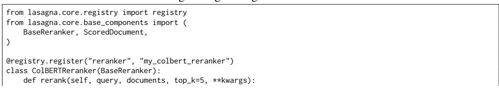

  
Figure 13: RAG Configurator, Search & Retrieval tab. The Search & Retrieval tab exposes the retrieval and post-retrieval stack: MMR score normalization (sigmoid vs. min–max), smart result ordering, the RRF fusion constant (rrf\_k), the keyword-search method (sparse\_method: BM25, SPLADE), context compression with method and ratio controls (compression\_method, compression\_ratio), and reranker-model selection. Every field carries the underlying configuration key so a UI change maps one-to-one to the YAML config consumed by the factorial experiment runner.

# Late-interaction scoring with ColBERT   
scored = self.\_score\_colbert(query, documents)   
return sorted(scored, key=lambda d: d.score,   
reverse=True)[:top\_k]

Once registered, the component is immediately available in any pipeline configuration:

Listing 2: Using a registered component in a pipeline.

```python
from lasagna.core.pipeline import KnowledgePipeline
pipeline = KnowledgePipeline(reranker="my_colbert_reranker")
results = pipeline.query("What␣is␣CRAG?", top_k=5)
```

The same pattern applies to all eight component types. Each ABC defines the minimal interface that the pipeline expects (Table 64).

## H.2.3 BRING YOUR OWN DATABASE

LASAGNA ships with six built-in vector backends (Milvus, Pinecone, Qdrant, Weaviate, PGVector, OpenSearch) and supports custom backends via the VectorBackendBase ABC. An implementation fills in the abstract connection, collection, index, insert, delete, query, and search methods; the excerpt shows the core:

Listing 3: Bring-your-own vector database (excerpt).  
```python
from lasagna.sdk import (
VectorBackendBase, BackendCapabilities,
register_backend,
)
class MyCustomBackend(VectorBackendBase):
@property
def capabilities(self) -> BackendCapabilities:
```

Table 64: Component ABCs and their core methods. Researchers implement one method to integrate a new component.
<table><tr><td>Component</td><td>Core method</td><td>Signature</td></tr><tr><td>Embedder</td><td>encode()</td><td>(texts: List[str]) -&gt; ndarray</td></tr><tr><td>Chunker</td><td>chunk()</td><td>(text: str) -&gt; List[Chunk]</td></tr><tr><td>Reranker</td><td>rerank()</td><td>(query, docs, top_k) -&gt; List[ScoredDoc]</td></tr><tr><td>Retriever</td><td>retrieve()</td><td>(query, collection, top_k) -&gt; List[ScoredDoc]</td></tr><tr><td>DocProcessor</td><td>extract()</td><td>(file_path) -&gt; ProcessedDocument</td></tr><tr><td>QueryEnhancer</td><td>enhance()</td><td>(query) -&gt; List[str]</td></tr><tr><td>AgenticPipeline</td><td>run()</td><td>(input) -&gt; AgenticRAGResult</td></tr><tr><td>Generator</td><td>generate()</td><td>(query, contexts) -&gt; str</td></tr></table>

```python
return BackendCapabilities(
supports_hybrid_search=False,
supports_hnsw=True,
max_batch_size=1000,
)
@property
def backend_name(self) -> str:
return "my_backend"
def connect(self) -> None: ...
def create_collection(self, collection_name, schema,
index_config=None): ...
def insert(self, collection_name, data,
partition_key=None): ...
def search(self, collection_name, query_embedding,
limit=10, **kwargs): ...
# ... remaining collection, index, and query methods
register_backend("my_backend", MyCustomBackend)
```

After registration, setting vector\_backend: my\_backend in the configuration routes all vector operations through the custom implementation. The capability declaration (BackendCapabilities) allows the pipeline to automatically fall back to software-based BM25 when the backend does not support native sparse search.

## H.2.4 BRING YOUR OWN AGENT

The agentic pipeline is itself a registrable component. LASAGNA’s default agentic graph (built with LangGraph) implements a multi-iteration retrieve-refine-generate loop with hallucination checking and quality gates. Researchers can replace or extend it by registering a custom AgenticPipeline:

Listing 4: Registering a custom agentic pipeline.

```python
from lasagna.core.registry import registry
from lasagna.core.base_components import (
BaseAgenticPipeline, AgenticPipelineInput,
)
from lasagna.agentic.agentic_rag import AgenticRAGResult
@registry.register("agentic_pipeline", "my_self_rag")
class MySelfRAG(BaseAgenticPipeline):
async def run(self, input: AgenticPipelineInput):
# Custom Self-RAG logic: generate, reflect, retrieve
chunks = await self.retrieve(input.question, input.top_k)
draft = await self.generate(input.question, chunks)
if not self.is_faithful(draft, chunks):
chunks += await self.retrieve_more(input.question)
draft = await self.generate(input.question, chunks)
```

```yaml
name: "HyDE Ablation"
benchmarks:
- name: private_eval/retrieval
split: eval
pipeline:
base_profile: "standard"
config_overrides:
- name: "hyde_on"
enable_hyde: true
hyde_n_docs: 3
- name: "hyde_off"
enable_hyde: false
mode: live
n_runs: 3
seed: 42
judge_model: "gpt-5.1"
```

```lua
return AgenticRAGResult(
formatted_context=self.format(chunks), chunks=chunks,
citations=[], agent_summary=draft, search_count=2,
)
```

Individual graph nodes can also be overridden without replacing the full graph, enabling targeted modifications (e.g., a custom hallucination checker) while retaining the default orchestration:

Listing 5: Overriding a single graph node.

```python
from lasagna.agentic import build_rag_graph
graph = build_rag_graph(
session_config,
node_overrides={
"check_hallucination": my_custom_hallucination_fn
}
)
```

## H.2.5 RESEARCH WORKFLOW

Running a complete experiment requires two artifacts: a YAML configuration file and a one-line command.

Listing 6: Experiment YAML (abbreviated).

Listing 7: Running an experiment from the CLI.

```ini
$ lasagna benchmark experiment hyde_ablation.yaml
[INFO] Loading benchmark: private_eval/retrieval (eval)
[INFO] Ingesting corpus (5132 docs, signature: a3f2e1...)
[INFO] Running hyde_on (run 1/3)...
[INFO] Running hyde_off (run 1/3)...
[INFO] Results saved to ~/.lasagna/research/results/
[INFO] NDCG@10: hyde_on=0.487 vs hyde_off=0.461 (p=0.031)
```

The experiment runner handles corpus ingestion (with signature-based caching), per-query timing, RAGAS evaluation, checkpointing, cost tracking, and statistical testing automatically. Results are saved as JSON with per-sample scores, enabling downstream analysis without re-running experiments.

## H.2.6 AGENT INTEGRATION VIA MCP

LASAGNA’s knowledge base is exposed as a Model Context Protocol (MCP) server, allowing any MCP-compatible agent to use it as a tool without custom integration code. The server exposes 31 tools covering search, document management, configuration, and lifecycle operations:

Listing 8: MCP server startup and tool list (excerpt).

```shell
$ python -m lasagna.mcp --port 8005
Tools exposed:
search_knowledge - Semantic search across documents
search_with_context - Search with formatted context
```

```tcl
get_document_context - Document awareness for prompts
upload_document - Upload and index a document
list_documents - List session documents
delete_document - Delete document and chunks
get_rag_config - Get current configuration
patch_rag_config - Update configuration at runtime
list_profiles - List operational profiles
set_active_profile - Switch profiles (speed/balanced/...)
get_system_status - Health check and statistics
```

Any agent framework that supports MCP (Claude Desktop, LangChain MCP adapter, custom agents) can connect by pointing to the server URL. The SDK also provides a typed Python client for direct integration:

Listing 9: Using LASAGNA from any agent via the SDK.  
```python
from lasagna.sdk import KnowledgeClient
client = KnowledgeClient()
# Upload documents to the knowledge base
await client.upload("report.pdf")
# Retrieve the most relevant chunks
results = await client.search_documents(
"What␣were␣Q3␣revenue␣figures?"
)
# Get formatted context to pass to any agent or LLM
context = await client.get_context(
"Summarize␣the␣Q3␣financial␣highlights"
)
```

The MCP architecture decouples the knowledge base from the agent framework: the same indexed corpus serves Claude Sonnet 4.5, GPT-5.1, open-source models, or custom agents without reingestion.

## I OPERATIONAL PROFILES

## I.1 OPERATIONAL PROFILE SPECIFICATIONS

This appendix provides the complete configuration for each of the four SOTA operational profiles evaluated in Section 5. Each profile is specified as a YAML configuration overlay; keys not listed inherit from the framework defaults described in Section 4.

## I.1.1 SOTA\_SPEED

```yaml
sota_speed configuration
profile: speed
embedding_model: all-MiniLM-L6-v2
embedding_dim: 384
retrieval_mode: dense
hybrid_alpha: 1.0 # dense-only
enable_reranking: false
enable_hyde: false
enable_mmr: false
enable_crag: false
enable_rag_fusion: false
enable_query_expansion: false
use_agentic_rag: false
enable_query_routing: false
routing_default_tier: fast
enable_hallucination_check: false
enable_answer_quality_check: false
enable_context_compression: false
enable_document_awareness: false
top_k: 10
```

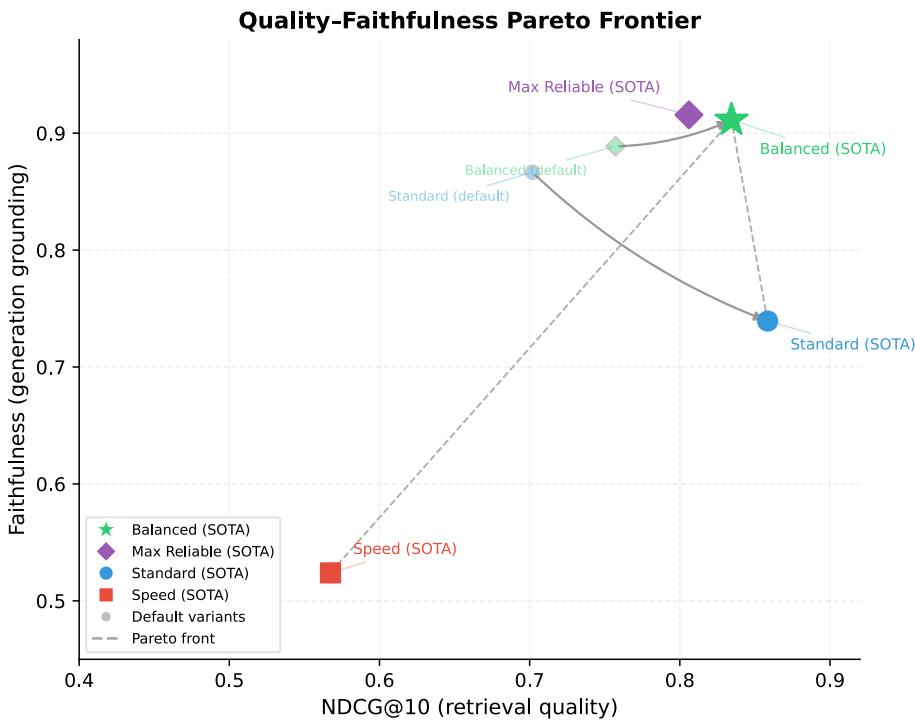  
Figure 14: Pareto positions of the four SOTA profiles in NDCG@10–faithfulness space (Table 2 and Section 5). Marker area is proportional to inverse mean latency (larger = faster). SOTA\_STANDARD attains the highest joint retrieval–faithfulness–latency hypervolume at the fixed 30 s response-time reference (Table 2; HV = 0.523) via the highest NDCG@10 (0.860) and the lowest latency among the quality-focused three (5.3 s). SOTA\_BALANCED (⋆) attains the top-band faithful ness (0.911, within noise of SOTA\_MAX\_RELIABLE’s 0.916) while providing higher NDCG@10 and lower response time; it wins the joint HV once $L _ { \mathrm { r e f } }$ opens past ∼46 s (Table 39).

Target use case. High-throughput, latency-sensitive deployments such as autocomplete suggestions, real-time search-as-you-type interfaces, or batch processing pipelines where sub-second response times are required. With MiniLM-L6 embeddings and no LLM-in-the-loop components, the retrieval path completes in ∼200 ms; end-to-end latency (including generation) is ∼800 ms at p95.

Deployment guidance. This profile requires only a vector database and a generation endpoint; no reranker model, no HyDE LLM calls, and no agentic orchestration. It can serve as the warmstart default while heavier profiles are evaluated. We recommend against using this profile when retrieval quality (NDCG@10 > 0.7) or faithfulness (> 0.6) are firm requirements, as both metrics are substantially lower than the other SOTA profiles (Table 2).

## I.1.2 SOTA\_STANDARD

```yaml
sota_standard configuration
profile: standard
embedding_model: BAAI/bge-m3
embedding_dim: 1024
retrieval_mode: hybrid
hybrid_alpha: 0.5
enable_reranking: true
rerank_model: mixedbread-ai/mxbai-rerank-large-v1
rerank_top_k: 5
enable_hyde: true
hyde_n_variants: 3
enable_mmr: false # disabling improves NDCG
enable_crag: false
enable_rag_fusion: false
```

enable\_query\_expansion: false   
use\_agentic\_rag: true # inherited from standard base   
enable\_query\_routing: false # override; keeps queries on direct route   
routing\_default\_tier: standard   
enable\_hallucination\_check: true   
enable\_answer\_quality\_check: true   
enable\_context\_compression: false   
enable\_document\_awareness: false   
top\_k: 20   
# Effective generation route: direct (routing disabled, standard tier default)

Target use case. General-purpose retrieval where precision is the primary concern: enterprise knowledge bases, technical documentation search, and customer support systems with moderate response times (4–7 s). HyDE generates three hypothetical documents per query, which are searched in parallel before cross-encoder reranking selects the top 10 passages.

Deployment guidance. Requires a vector database with hybrid (dense + BM25) search support, a reranker model endpoint (or local GPU for mxbai-rerank-large), and one LLM call for HyDE generation. The three HyDE variants add ∼2 s of latency; operators who need to stay below 3 s can reduce hyde\_n\_variants to 1 with a modest NDCG@10 reduction (∼0.01–0.02 based on our ablation in Section 5). This profile achieves the highest NDCG@10 (0.860) on the SOTA-profile generation slice, follows the direct generation route (query routing disabled), and enables both the hallucination and answer-quality gates at the pipeline level. Pair it with application-level guardrails if a per-query faithfulness floor above 0.8 is required.

## I.1.3 SOTA\_BALANCED\_E2E

```textproto
sota_balanced_e2e configuration
profile: balanced
embedding_model: BAAI/bge-m3
embedding_dim: 1024
retrieval_mode: hybrid
hybrid_alpha: 0.7 # inherited from balanced base
enable_reranking: true
rerank_model: mixedbread-ai/mxbai-rerank-large-v1
rerank_top_k: 5
enable_hyde: true
hyde_n_variants: 3
enable_mmr: false # disabling improves NDCG
enable_crag: false
enable_rag_fusion: false
enable_query_expansion: false
enable_hierarchical: true # inherited from balanced base
use_agentic_rag: true # inherited from balanced base
enable_query_routing: true # adaptive routing (inherited)
max_agent_iterations: 3
enable_hallucination_check: true
enable_answer_quality_check: true
enable_context_compression: true
compression_method: extractive
compression_ratio: 0.5
enable_document_awareness: true
doc_awareness_method: first_tokens
doc_awareness_tokens: 100
top_k: 20
max_chunks: 20
# Effective generation route: agentic (3 iterations, both quality gates)
```

Target use case. Recommended default for deployments that can tolerate ∼12–18 s per-query latency and require the top-band faithfulness (batch/analyst workloads, review queues, back-office QA). Extractive context compression reduces the token count passed to the generator by 50%, lowering generation cost while preserving the most relevant spans. Document-awareness prefixes (first 100 tokens) provide the generator with document-level context at negligible additional cost. On the SOTA-profile generation slice reported in Table 2, BALANCED provides the stronger joint agentic tradeoff than MAX-RELIABLE (higher NDCG@10, essentially tied faithfulness, 13% lower mean latency) and takes the joint retrieval–faithfulness–latency hypervolume from STANDARD once $L _ { \mathrm { r e f } }$ opens past ∼46 s (HV=0.609 vs 0.579 at 60 s; Table 39). At the fixed 30 s reference, STANDARD has the highest joint HV; BALANCED is the appropriate choice when the application can absorb the additional ∼7 s of response time for the faithfulness advantage.

Deployment guidance. Infrastructure adds the agentic graph execution (LangGraph) to the SOTA\_STANDARD stack: 3–7 additional LLM calls per query for relevance classification, hallucination checking, and quality gating, plus an extractive compression step that runs locally (no additional LLM call). Disabling MMR removes one source of latency variability without harming retrieval quality in our experiments. End-to-end mean latency on the SOTA slice is ∼12.3 s (p95 ∼26.3 s), dominated by the agentic loop and HyDE generation. To reduce latency, operators can disable HyDE (saving ∼2–3 s) at the cost of ∼0.02 NDCG@10.

## I.1.4 SOTA\_MAX\_RELIABLE

```yaml
sota_max_reliable configuration
profile: max_quality
embedding_model: BAAI/bge-m3
embedding_dim: 1024
retrieval_mode: hybrid
hybrid_alpha: 0.3 # override; broader lexical retrieval
enable_reranking: true
rerank_model: mixedbread-ai/mxbai-rerank-large-v1
rerank_top_k: 5
enable_hyde: true # inherited from max_quality base
hyde_n_variants: 3
enable_mmr: false # disabling improves NDCG
enable_crag: false # override; adds latency, no gain here
enable_rag_fusion: false # override
enable_query_expansion: false # override
enable_hierarchical: true # inherited
enable_contextual_retrieval: true # inherited from max_quality base
use_agentic_rag: true
enable_query_routing: false # inherited from max_quality (comprehensive tier)
routing_default_tier: comprehensive
max_agent_iterations: 3 # override (base = 5)
enable_hallucination_check: true
enable_answer_quality_check: true
enable_context_compression: true
compression_method: extractive
compression_ratio: 0.5
enable_document_awareness: true
doc_awareness_method: first_tokens
doc_awareness_tokens: 100
top_k: 20
max_chunks: 30
# Effective generation route: agentic (3 iterations, both quality gates)
# Differs from Balanced primarily on retrieval-side choices:
# hybrid_alpha (0.3 vs 0.7), contextual_retrieval (on vs off),
# max_chunks (30 vs 20). Same agentic depth and same gate set.
```

Target use case. High-stakes domains where answer faithfulness must be maximized and users tolerate longer response times: medical literature review, legal contract analysis, financial due diligence, and compliance question-answering. The agentic pipeline performs up to three retrieval iterations with hallucination gating; each iteration can refine or discard unfaithful passages before the final answer is generated.

Deployment guidance. Infrastructure matches SOTA\_BALANCED\_E2E (agentic graph execution, hybrid retrieval, reranker, HyDE) with additional contextual retrieval and a broader chunk-cite budget (up to 30 retained chunks vs. 20). Both profiles share the same agentic depth (three iterations, hallucination and answer-quality gates enabled); the differences from SOTA\_BALANCED\_E2E are retrieval-side (hybrid α = 0.3 vs. 0.7, contextual retrieval enabled, wider chunk budget). Mean latency on the SOTA-profile generation slice is ∼14.2 s (p95 ∼30.0 s), driven by the wider chunk pool and the agentic loop; we recommend a concurrency limit of ∼10 queries per instance. Notably, this profile has a weaker joint tradeoff than SOTA\_BALANCED\_E2E within the agentic-route class on our headline slice (Table 2): faithfulness is essentially tied (0.916 vs 0.911), NDCG@10 is 0.036 lower, and mean latency is ∼ 2 s higher (paired Wilcoxon $\scriptstyle { p = 0 . 0 1 8 } )$ . We include it for completeness and for deployments that require the broader retrieval envelope (contextual retrieval, wider chunk budget) it provides.

## I.2 PROFILE SELECTION GUIDE

This appendix provides a practitioner-oriented decision framework for selecting among the four SOTA profiles based on deployment constraints.

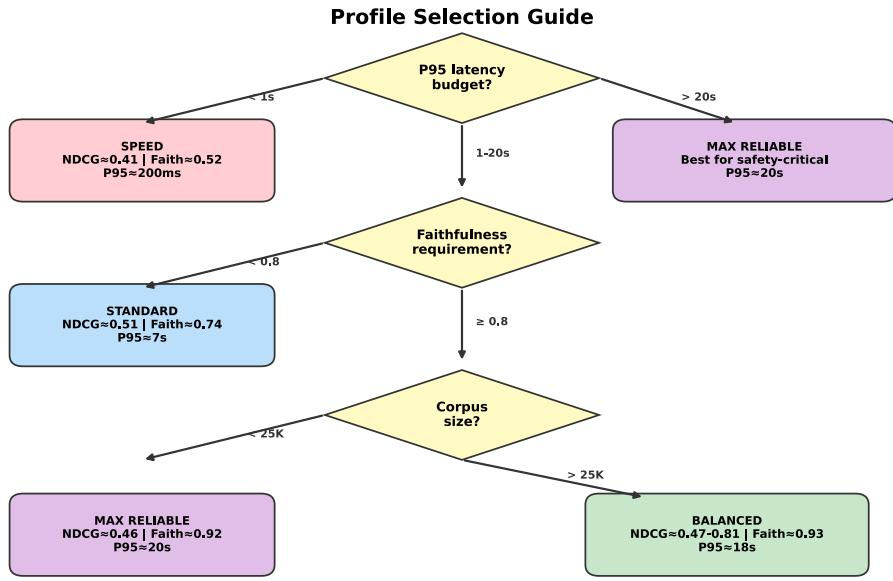  
Figure 15: Profile selection flowchart based on response-time target, faithfulness requirement, and corpus size. Metric values are from the 5K retrieval evaluation (Table 2) except where corpus-size dependent (BALANCED at >25K uses scaling results from Section 5). All profiles use the same generator (GPT-5.1); differences arise from retrieval and post-retrieval components.

Usage. The flowchart in Fig. 15 encodes three decision criteria derived from our experimental findings:

1. Response-time target determines the first branch. SPEED (<1 s) uses MiniLM-L6 embeddings with dense-only retrieval and no query-time LLM calls; it is the only viable choice under a hard sub-second target and trades away the joint quality-latency tradeoff.

2. Execution route + joint envelope separates the mid-to-high latency profiles. On the SOTAprofile generation slice (Table 2), STANDARD attains the highest joint retrieval–faithfulness– latency hypervolume at the fixed 30 s response-time reference (HV=0.523; NDCG@10 0.860, faithfulness 0.739, mean latency 5.3 s) and is the recommended default when interactive latency is required. BALANCED runs the agentic route (three iterations, hallucination and answer-quality gates enabled) at NDCG@10 0.840, faithfulness 0.911, mean latency 12.3 s; it provides a stronger joint tradeoff than MAX-RELIABLE within the agentic-route class and takes the joint HV from STANDARD once $L _ { \mathrm { r e f } }$ opens past ∼46 s (Table 39); it is the recommended default when longer response times are acceptable and the faithfulness gain is important. MAX-RELIABLE shares the same agentic route as BALANCED with a broader retrieval envelope (contextual retrieval, wider chunk budget); it has a lower joint score than BALANCED.

3. Within the agentic-route class, prefer BALANCED. BALANCED has 4.5% higher NDCG@10 and 13% lower mean response time than MAX-RELIABLE, with a 0.005 faithfulness difference (Table 2 and Section D.8); MAX-RELIABLE’s broader retrieval envelope (contextual retrieval, wider chunk budget) is worth its additional cost only when a deployment specifically requires that envelope. Corpus size does not shift this ordering on the range we tested.

Limitations of this guide. This flowchart is derived from experiments on five BEIR domains and may not generalize to all deployment scenarios. In particular: (i) the MMR finding (“disable MMR”) may not hold for corpora with genuinely redundant documents; (ii) the corpus-size threshold of 25K is approximate and domain-dependent; (iii) absolute latency values depend on infrastructure and will differ from our measurements.

Decision rule for borderline cases (OFAT vs. hierarchical disagreement). Several configuration comparisons in this paper differ in rank order depending on whether the reader uses the OFAT (pooled) reading or the hierarchical mixed-effects (query-clustered) reading. When the two disagree by ≥1 rank position, defer to the hierarchical reading. It respects the query-clustering structure (ICC=0.284 on the H1 D5×D8 grid; see Section D.3) and is our primary inferential position throughout the paper. The archetypal case is the H1 D5×D8 attenuation: the OFAT estimate is $\eta ^ { 2 } { = } 0 . 2 0 1 \ \mathrm { ( } \bar { p } { = } 0 . 0 1 8 \ \bar { \mathrm { H o l m ) } }$ whereas the hierarchical LRT is $\chi ^ { 2 } ( 4 ) { = } 4 . 2 7 , p { = } 0 . 3 7 1$ . The same pair reads as a large exploratory interaction under OFAT and as non-significant under hierarchical inference. The only exception is when a deployment’s per-query variance is orthogonal to query-topic clustering (rare in practice for benchmark corpora but possible in enterprise deployments with strictly independent queries); in that regime the pooled OFAT reading is closer to the deployment target. A separate, orthogonal protocol-dependence axis (point-wise RAGAS-judge vs. pairwise Bradley–Terry) affects within-tier configuration comparisons; see Section C.5 for the tier-vs-configuration scoping.

## I.3 HALLUCINATION RESISTANCE

These results are reported retrospectively from historical deployment logs; they are not part of the pre-registered plan and serve descriptive purposes only.

During development and evaluation of the LASAGNA pipeline, we collected faithfulness scores (RAGAS, LLM-judged by GPT-5.1) across six pipeline profiles. Table 65 summarizes the observed faithfulness distributions. We present these data descriptively and make no causal claims about which pipeline components drive the observed differences.

Table 65: Faithfulness statistics across profiles, aggregated from historical deployment logs (test split, 76 queries per profile). These runs used the pipeline’s deployment-native answer configuration (Section C.2); regime provenance is documented in Table 26 and values are not directly comparable to faithfulness reported in other tables. No statistical tests are applied; values are descriptive summaries only.
<table><tr><td>Profile</td><td>Mean</td><td>Median</td><td>Std. Dev.</td><td>Min</td></tr><tr><td>Standard (baseline)</td><td>0.963</td><td>0.980</td><td>0.052</td><td>0.714</td></tr><tr><td>Speed</td><td>0.980</td><td>1.000</td><td>0.038</td><td>0.800</td></tr><tr><td>Balanced</td><td>0.971</td><td>0.990</td><td>0.044</td><td>0.750</td></tr><tr><td>Max reliable</td><td>0.968</td><td>0.985</td><td>0.048</td><td>0.667</td></tr><tr><td>SOTA balanced</td><td>0.975</td><td>0.993</td><td>0.041</td><td>0.778</td></tr><tr><td>SOTA max reliable</td><td>0.978</td><td>1.000</td><td>0.036</td><td>0.812</td></tr></table>

Descriptive observations. All six profiles achieved mean faithfulness above 0.96, indicating that the generation pipeline (GPT-5.1 with retrieved context) produces grounded answers across configurations. The speed profile and SOTA max reliable profile exhibited the highest median faithfulness (1.000), suggesting that both concise answer prompting (speed) and quality-gate filtering (SOTA max reliable) are associated with reduced hallucination, though through different mechanisms.

The lowest observed per-query faithfulness score (0.667) occurred in the max quality profile, which uses agentic retrieval with aggressive refinement. As discussed in Section 5, aggressive chunk filtering can leave the generation model with minimal context, increasing the risk of unsupported claims on complex queries.

We emphasize that these observations reflect correlational patterns in historical logs. Controlled experiments isolating individual components’ contributions to hallucination resistance would require a dedicated factorial design that was outside the scope of this study.

## J ROOT CAUSE ANALYSIS OF PROFILE PERFORMANCE

This appendix provides a mechanistic root cause analysis (RCA) for the performance of each SOTA profile, grounding observed successes and failures in architectural decisions, measured interaction effects, and ablation evidence. Table 66 provides a quick-reference guide; the remainder of the appendix presents the supporting analysis, following the taxonomy in Section J.1 with evidence from the 167-configuration factorial campaign, the feature dropout analysis (Section D.12), and the single-feature ablations (Section D.1).

Table 66: Quick-reference profile selection guide. “Key strength” and “Key limitation” are the dominant root causes identified in this appendix. Use the “Best when” column for initial selection; see the per-profile analysis for nuances. Faithfulness qualifiers for SPEED (“highest faithfulness”) and MAX-RELIABLE (“+0.062 floor”) reference the deployment-log numbers in Table 65; per-profile faithfulness across other evaluation slices is reported in the respective tables.
<table><tr><td>Profile</td><td>Best when</td><td>Key strength</td><td>Key limitation</td><td>p95 lat.</td></tr><tr><td>SPEED</td><td>Latency &lt; 1 s; batch pipelines; prototype</td><td>Simplicity → highest faithfulness</td><td>Embedding ceiling; no lexical fallback</td><td>0.8 s</td></tr><tr><td>STANDARD</td><td>Corpus &lt; 10K; re- trieval quality is pri- mary</td><td>Strongest NDCG@10 at small scale</td><td>Scale-fragile; no generation defenses</td><td>5.5 s</td></tr><tr><td>BALANCED</td><td>General use; 10K- 50K docs</td><td>Strong agentic trade- off; scale-robust</td><td>Inherits suboptimal reranker (R1)</td><td>17.7 s</td></tr><tr><td>MAX- RELIABLE</td><td>Safety-critical; faith- fulness floor matters</td><td>Raises faithfulness floor by +0.062</td><td>Aggressive refine- ment starves gener- ator (G1)</td><td>19.7 s</td></tr></table>

## J.1 FAILURE–SUCCESS TAXONOMY

We organize root causes into a two-level taxonomy. The first level distinguishes where in the pipeline the cause originates; the second level identifies the mechanism by which performance is affected. Table 67 summarizes the taxonomy with representative examples from our experiments.

This taxonomy draws on established frameworks for pipeline failure analysis. The distinction between retrieval-side and generation-side failures follows the “retrieve-then-read” decomposition standard in RAG evaluation (Gao et al., 2023b). The concept of functional duplication (C1) mirrors the known subadditivity of stacked retrieval components documented in RAG best-practice surveys (Li et al., 2025). The diversity–relevance conflict (R2) instantiates the broader tension between exploration and exploitation in information retrieval (Carbonell & Goldstein, 1998).

## J.2 PROFILE-LEVEL ROOT CAUSE ANALYSIS

We now trace each SOTA profile’s measured performance (Table 2) back to the taxonomy above. For each profile, we identify the dominant success and failure modes, quantify their contribution using ablation and dropout evidence, and assess whether the profile’s design choices are well-calibrated to its stated purpose.

Note on worked examples. The gray boxes throughout this section are worked examples that examine each mechanism on a real benchmark query. Every query is drawn verbatim from the evaluation splits (BEIR / HotpotQA / MuSiQue / FiQA / SciFact / NFCorpus). Rank positions, cosine scores, and per-example NDCG are reformatted from the retrieval-isolation runs for presentation clarity.

## J.2.1 SOTA\_SPEED: MINIMALIST RETRIEVAL, MAXIMAL FAITHFULNESS

Configuration summary. MiniLM-L6 embeddings (384d), dense-only retrieval (α=1.0), no reranking, no MMR, no HyDE, no agentic components, top-k=10. (Section I.1.1).

Table 67: Taxonomy of failure and success modes observed across the 167-configuration factorial campaign. Each mode is grounded in specific experimental evidence. Modes marked with † exhibit profile-dependent directionality (help in one profile, hurt in another), indicating non-zero interaction effects. The “Evidence” column cites the primary source within this paper.
<table><tr><td>Pipeline stage</td><td colspan="2">Mechanism</td><td>Effect</td><td>Description</td><td>Evidence</td></tr><tr><td colspan="2">Retrieval-side mechanisms Reranking</td><td>R1: Reranker model selec- Failure</td><td></td><td>Default reranker (mxbai-rerank-large-v1, here- after mxbai-large) underperforms smaller spe-</td><td>Exp. 15</td></tr><tr><td></td><td colspan="2">tion</td><td></td><td>cialist (ms-marco-MiniLM-L6) by −0.026 NDCG@10 on the shared 93-query retrieval benchmark (Table 51, Exp. 15); composed end- to-end delta is —0.009 (Table 59).</td><td></td></tr><tr><td>Post-retrieval</td><td>R2: Diversity-relevance conflict</td><td></td><td>Failure</td><td>MMR penalizes semantically similar but inde- pendently relevant passages in domain-focused corpora, reducing NDCG@ 10 by 0.019–0.046 depending on profile.</td><td>Section D.12</td></tr><tr><td>Query-time</td><td>R3: expansion†</td><td>Noisy query</td><td>Failure</td><td>LLM-generated query variants introduce off- topic terms; negative transfer outweighs cover- age gain (∆NDCG = −0.014).</td><td>Exp. 05, Section D.1</td></tr><tr><td>Query-time</td><td>R4: HyDE calibration†</td><td></td><td>Mixed</td><td>Hypothetical documents improve passage re- call in some profiles (—0.031 dropout in Max- Reliable) but marginally degrade it in others (+0.008 dropout in balanced); the effect de- pends on the surrounding feature context.</td><td>Section D.12</td></tr><tr><td>Retrieval</td><td>R5: Hybrid alpha sensitiv- ity</td><td></td><td>Success</td><td>BM25 provides lexical recall for entity-centric queries; optimal α=0.5 balances lexical and semantic evidence.</td><td>Exp. 01</td></tr><tr><td>Index-time</td><td>R6: Enrichment overhead</td><td></td><td>Failure</td><td>Contextual retrieval, RAPTOR, and GraphRAG add noise or indexing cost without retrieval gain on domain-focused corpora  $( \eta _ { \mathrm { e n n i c h m e n t } } ^ { 2 } =$  0.144; best level: none).</td><td>ANOVA, Section 5</td></tr><tr><td colspan="2">Generation-side mechanisms Agentic</td><td></td><td></td><td>Quality gates discard 13–14/15 chunks as not</td><td></td></tr><tr><td></td><td>G1: Aggressive refinement paradox</td><td></td><td>Mixed</td><td>relevant, raising faithfulness but starving the gen- erator of evidence.</td><td>Exp. 07, Section 5</td></tr><tr><td>Compression</td><td>G2: Extractive compres- sion benefit</td><td></td><td>Success</td><td>50% token reduction removes filler without los- ing key spans, reducing hallucination surface (∆faith. = +0.01).</td><td>Section D.1</td></tr><tr><td>Document awareness</td><td>G3: Prefix grounding</td><td></td><td>Success</td><td>100-token document prefix gives the generator file-level context at negligible cost; diminishing returns beyond 100 tokens.</td><td>Exp. 17</td></tr><tr><td>Query augmentation</td><td>G4: Augmentation-gating synergy</td><td></td><td>Success</td><td>Query augmentation provides richer retrieval in- put; agentic gating filters low-quality results. Combined:  $\eta ^ { \mathrm { 2 } } = \mathsf { 0 } . 1 9 1$  on faithfulness (near</td><td>ANOVA, Section 5</td></tr><tr><td colspan="2">Composition mechanisms</td><td></td><td>H1 threshold).</td><td></td><td></td></tr><tr><td>Cross-stage</td><td>C1: Functional duplication</td><td></td><td>Failure</td><td>HyDE and reranking both improve query- passage alignment; combined marginal gain is subadditive (72% composition penalty).</td><td>Section D.14</td></tr><tr><td>Cross-stage</td><td>C2: Error propagation</td><td></td><td>Failure</td><td>Noisy HyDE embeddings survive hybrid fu- sion, producing spurious BM25 matches that the reranker cannot fully correct.</td><td>DID probe, Sec- tion 5</td></tr><tr><td>Cross-stage</td><td>reversal</td><td>C3: Scale-dependent rank</td><td>Failure</td><td>Standard&#x27;s HyDE+reranking stack over- fits to small corpora; balanced&#x27;s compres- sion+awareness generalizes better, with the</td><td>Section 5</td></tr></table>

Performance. Lowest retrieval NDCG@10 across SOTA profiles (0.415 at 5K; degrades to 0.382 at 15K).<sup>2</sup> The underlying speed profile achieves the highest mean faithfulness (0.980, median 1.000) in deployment evaluations (Section I.3); SOTA\_SPEED shares the same retrieval configuration and thus the same faithfulness characteristics. Dominant p95 latency: ∼200 ms retrieval, ∼800 ms end-to-end.

## Success root causes.

1. Pipeline simplicity as implicit noise filter. With only 10 dense-retrieved chunks and no postprocessing, the generator receives a clean, unmodified context window. The absence of MMR (R2), reranking reordering, and compression means the generator sees passages in their original embedding-similarity order, which empirically correlates with higher faithfulness (Table 46: speed achieves 0.991 on scifact). This aligns with findings that simpler retrieval pipelines produce fewer hallucinations because the generator has less opportunity to be confused by reordered or deduplicated context (Liu et al., 2024). Note that the speed profile does not use document awareness (G3), its faithfulness advantage is entirely attributable to pipeline simplicity, not to generation-side features.

2. Concise generation prompting. The speed profile uses a concise answer prompt (“Answer in ONE sentence based only on the context”), which limits the number of atomic claims per answer. Fewer claims mean fewer opportunities for unsupported statements, mechanically improving RAGAS faithfulness (Es et al., 2024). This is a measurement artifact as much as a genuine quality improvement: a one-sentence answer with one correct claim scores higher than a three-sentence answer with two correct claims and one hallucinated claim.

## Failure root causes.

1. Embedding capacity ceiling. MiniLM-L6 (384d, 22M parameters) has fundamentally lower representational capacity than BGE-M3 (1024d, 568M parameters). The factorial ANOVA confirms embedding choice as the strongest main effect on NDCG@10 $( \eta ^ { 2 } = 0 . 1 6 4 , p < 0 . 0 0 1 ;$ Section 5). On nfcorpus (biomedical), the capacity gap manifests as −0.050 NDCG@10 versus SOTA balanced (Table 45).

2. No lexical fallback (R5 absent). Dense-only retrieval (α=1.0) has no BM25 component to capture exact entity matches. The hybrid ablation (Exp. 01) shows that adding BM25 at α=0.5 yields +0.037 NDCG@10, a gain entirely unavailable to this profile.

3. Rapid scaling degradation (C3). Speed degrades at −0.115 NDCG/decade $( R ^ { 2 } = 0 . 9 0 0 , 9 5 \% \mathrm { C l }$ I [−0.168, −0.062]), the steepest slope of any profile (Table 23). Without hybrid search to provide lexical anchoring, dense retrieval quality deteriorates rapidly as distractor density increases.

## Worked Example: Why Speed Fails on Biomedical Queries (R5, Embedding Ceiling)

Query (NFCorpus): “Does taking aspirin reduce the risk of colorectal cancer?”

Speed profile (MiniLM-L6, dense-only, top-10):

• Rank 1–3: Passages about aspirin and cardiovascular risk (cosine $\geq 0 . 7 2 )$

• Rank 4–7: Passages mentioning “cancer” generically (cosine 0.65–0.70)

• Rank 8–10: Off-topic passages about anti-inflammatory drugs (cosine ≈ 0.60)

• Gold passage (aspirin + colorectal cancer meta-analysis): Rank 14 → missed

The 384-dimensional embedding conflates “aspirin + cancer” and “aspirin + cardiovascular” into nearby vectors. The gold passage uses the term “chemoprevention,” which MiniLM-L6 maps far from “reduce the risk.”

Standard profile (BGE-M3, hybrid α=0.5, reranking):

• BM25 lexically matches “colorectal cancer” → gold passage enters top-20 candidate set

• Cross-encoder reranker promotes it to Rank 2

• Result: gold passage retrieved; NDCG@10 = 0.68 vs. speed’s 0.31

This query illustrates three compounding failures in the speed profile: (a) the embedding capacity ceiling prevents fine-grained biomedical disambiguation; (b) the absence of BM25 (R5) means the exact term “colorectal” cannot anchor retrieval; (c) no reranker means near-misses cannot be rescued from lower ranks.

Assessment. The speed profile is well-calibrated for its stated purpose (sub-second latency) but exhibits a fundamental retrieval ceiling that makes it unsuitable when NDCG@10 > 0.5 is required. Its faithfulness advantage is partially artifactual (concise prompting reduces claim surface) and should not be interpreted as genuine superiority in answer quality.

## J.2.2 SOTA\_STANDARD: RETRIEVAL CHAMPION, SCALE-FRAGILE

Configuration summary. BGE-M3 (1024d), hybrid search (α=0.5), cross-encoder reranking (mxbai-rerank-large-v1, top-5), HyDE (3 variants), no MMR, direct generation route (query routing disabled, standard tier default) with the hallucination and answer-quality gates enabled at the pipeline level, top-k=20 (Section I.1.2).

Performance. Highest NDCG@10 at small scale (0.510 at 5K; 0.860 on E2E at 5.5K). Degrades to 0.456 at 50K and 0.432 at 200K, overtaken by balanced, with the gap becoming statistically significant only at 200K (∆ = +0.059, p = 0.004). Faithfulness: 0.739 (E2E, 5.5K), lower than all other SOTA profiles except Max-Reliable at scale.

## Success root causes.

1. Optimal retrieval stack for small corpora. The standard profile combines four high-impact retrieval features: (a) cross-encoder reranking (which our ablation shows adds up to +0.084 NDCG@10 with the best model, ms-marco-MiniLM-L6; the default mxbai-large used by standard provides a smaller gain, see failure analysis below); (b) hybrid search (+0.037; R5 exploited); (c) MMR disabled (+0.046; R2 avoided); (d) HyDE (+0.026; R4). Despite the suboptimal reranker choice, the four features jointly lift the profile to 0.510 NDCG@10 at 5K, the highest retrieval score among SOTA profiles, confirming that the retrieval stack is well-chosen even if individual components are not individually optimal (Section D.1).

2. HyDE as bridging context (R4 positive mode). HyDE generates hypothetical documents that bridge the vocabulary gap between short queries and long passages. On hotpotqa (multi-hop), the standard profile achieves +0.088 NDCG@10 over the baseline (Table 45), consistent with HyDE’s demonstrated effectiveness on multi-hop queries (Gao et al., 2023a). The cross-encoder reranker acts as a noise filter for HyDE’s occasionally hallucinated passages, preventing degradation (R4 positive mode in the taxonomy).

## Failure root causes.

1. Reranker model suboptimality (R1). The standard profile uses mxbai-rerank-large-v1, which our reranker model ablation (Exp. 15) identified as underperforming the smaller specialist msmarco-MiniLM-L6 on the shared 93-query retrieval-isolation benchmark (NDCG@10 = 0.470 vs 0.496, a −0.026 gap; Table 51). The SOTA evaluation configs retain mxbai-large because it was the framework default and the profile configs were frozen before the reranker comparison was conducted. Note that the reranker is a query-time knob (not in \_INGESTION\_TIME\_KEYS; experiment.py:60–87), so re-running with the swapped reranker requires no re-ingestion of the corpus. The isolated model-swap delta (+0.026; Table 51) shrinks to +0.009 NDCG@10 when measured end-to-end on the BEIR generation split with the full SOTA\_Std stack composed (Table 59), consistent with functional-duplication interactions (C1). The swap remains the single easiest available improvement for the standard profile.

2. Scale fragility (C3). The standard profile degrades log-linearly at −0.055 NDCG/decade $( R ^ { 2 } =$ 0.895, p = 0.004), a 3.7× steeper slope than balanced (−0.015/decade; slope not distinguishable from zero, $p = 0 . 1 7 5 ;$ Table 23). The root cause is the absence of generation-side defenses: without context compression (G2) or document awareness (G3), the generator receives 5 fulllength passages (up to 4,000 tokens) whose relevance quality degrades as corpus size increases. At 50K documents, the proportion of near-miss distractors in the top-20 candidate set increases, and without compression to distil the most relevant spans, the generator is more likely to attend to irrelevant context. This mechanism is consistent with the “lost in the middle” phenomenon (Liu et al., 2024), where generators struggle to utilize relevant information when it is embedded in a long, partially irrelevant context window.

3. No faithfulness safeguards. The standard profile achieves the lowest faithfulness among SOTA profiles (0.739 at 5.5K; Table 2). Without agentic quality gates (G1), hallucination checks, or context compression (G2), the generator operates on raw retrieved context with no verification

layer. The faithfulness ANOVA shows that query augmentation and agentic gating together explain $\eta ^ { \bar { 2 } } = 0 . 1 9 1$ of faithfulness variance (Section 5), variance that the standard profile cannot capture because it lacks both components.
<table><tr><td>Worked Example: How HyDE Helps and Hurts on Multi-Hop Queries (R4)</td></tr><tr><td>Query (HotpotQA): &quot;The Soul of Buddha is a 1918 American silent romance film shot in a borough that. .. &quot; This multi-hop query requires bridging two facts: (1) the film&#x27;s shooting location, and (2) properties of that location. The original query text contains no entity name for the borough. Without HyDE (dense-only retrieval):</td></tr><tr><td>• Top-20 results: passages about 1918 films, silent cinema, romance genre, none about the specific borough • NDCG@ 10 = 0.22 (no bridging passage retrieved)</td></tr><tr><td>With HyDE (3 hypothetical documents): • HyDE generates: &quot;The Soul of Buddha (1918) was filmed in Fort Lee, New Jersey, a borough known for its early lm studios. .. ,,</td></tr><tr><td>• The hypothetical document introduces “Fort Lee&quot;, a plausible (and correct) entity that anchors dense retrieval</td></tr><tr><td>• Gold passage about Fort Lee enters top-20; reranker promotes it to Rank 3 • NDCG@ 10 = 0.61 (+0.39 from HyDE bridging)</td></tr><tr><td>HyDE failure mode (same query, balanced profile without reranker): • One of the 3 HyDE variants hallucinates: “.. .ilmed in Brooklyn, a densely populated borough.. . &quot;</td></tr><tr><td>• Without the reranker to filter, the Brooklyn passage ranks above the Fort Lee passage → wrong context reaches the generator • This explains R4&#x27;s profile-dependence: HyDE helps when a reranker is present to filter hallucinated</td></tr></table>

Assessment. The standard profile is optimally designed for small-corpus, retrieval-focused deployments where generation quality is less critical. Its scale fragility is a direct consequence of its retrieval-only optimization strategy: the features that maximize NDCG@10 at 5K (HyDE, reranking) do not address the generation-side challenges that emerge at scale. This explains the rank crossover observed by 200K $\mathsf { \bar { ( } } p = 0 . 0 0 4 )$ and provides causal grounding for the H3 hypothesis.

## J.2.3 SOTA\_BALANCED\_E2E: STRONGEST JOINT TRADEOFF IN THE AGENTIC-ROUTE CLASS THROUGH COMPLEMENTARY DEFENCES

Configuration summary. BGE-M3 (1024d), hybrid search (α=0.7), cross-encoder reranking (mxbai-rerank-large-v1, top-5), HyDE (3 variants), no MMR, hierarchical retrieval enabled, extractive context compression (50%), document awareness (100-token prefix), agentic generation route (3 iterations, hallucination and answer-quality gates enabled), top-k=20, up to 20 retained chunks (Section I.1.3).

Performance. Provides the stronger joint agentic tradeoff relative to MAX-RELIABLE: essentially equal faithfulness (0.911 vs. 0.916) with 13.5% lower mean latency (p=0.018 paired Wilcoxon on per-query latency; Table 2 and Section D.8). On the joint retrieval–faithfulness–latency hypervolume, STANDARD has the highest HV at the fixed 30 s reference (Table 2) and BALANCED takes over once $L _ { \mathrm { r e f } }$ opens past ∼46 s (e.g., HV=0.609 vs STANDARD’s 0.579 at 60 s; Table 39). NDCG@10: 0.504 at 5K, 0.488 at 50K, 0.491 at 200K, effectively flat (−0.015/decade, $R ^ { 2 } ~ { = } ~ 0 . 4 0$ , slope not distinguishable from zero, p = 0.175). Overtakes STANDARD on the retrieval track with a statistically significant margin at 200K $( p = 0 . 0 0 4 )$ . Faithfulness on the SOTA-profile headline slice: $0 . 9 1 1 \pm 0 . 0 1 \bar { 4 }$ . Mean latency: ∼12.3 s (p95 ∼17.7–26.3 s across measurements).

## Success root causes.

1. Retrieval foundation partially shared with STANDARD, with retrieval-visible additions. BALANCED and STANDARD share embedding model (BAAI/bge-m3), reranker (mxbai-large), hybrid alpha, MMR settings, chunker parameters, and top-k; BALANCED additionally enables hierarchical parent/child indexing (index-stage), structured-graph post-retrieval merge, a wider chunk-cite keep count (max\_chunks = 20 vs. 15 for STANDARD), and adaptive query routing. These four retrieval-visible additions, rather than the compression or document-awareness features below, drive the small-scale retrieval parity (0.504 vs. 0.510; ∆ = −0.006, within noise) and the widening gap at scale.

2. Context compression as generation-side noise filter (G2). Extractive compression at 50% ratio removes filler tokens from retrieved passages while preserving the most relevant spans, acting post-retrieval on chunk text (chunks are not reordered or dropped by this step). The generator receives a denser, higher-signal context window, reducing the “lost in the middle” failure mode and lowering the token budget available for hallucination, improving faithfulness $( \Delta = + 0 . 0 1$ Section D.1). The dropout analysis reports a small −0.006 NDCG@10 delta when compression is removed (Section D.12); this reflects the pipeline’s final SearchResult list being scored, not compression modifying retrieval ordering per se.

3. Document awareness as cheap grounding (G3). The 100-token document prefix provides file-level metadata (filename, structure, opening sentences) at negligible cost (+15 ms latency). Exp. 17 (eval split, exploratory) demonstrates that this simple strategy outperforms LLM-generated summaries (0.411 vs. 0.341 NDCG@10) and longer prefixes (300 tokens: 0.347). The mechanism is information-theoretic: the first 100 tokens of a document contain high-entropy information (title, abstract, introduction) that helps the generator contextualize retrieved chunks. Longer prefixes add boilerplate that dilutes signal.

Worked Example: Document Awareness Grounds a Financial Query (G3)

Query (FiQA): “Opening a Roth IRA account, what is the fee structure for Vanguard vs. Scottrade?” Without document awareness (standard profile):

• Top-5 reranked chunks: 3 about Vanguard fees, 2 about brokerage accounts generically

• Generator sees 5 passage fragments with no file-level context • Generated answer discusses Vanguard fees accurately but hallucinates a Scottrade fee schedule (Scottrade chunk at Rank 8, outside top-10)

• Faithfulness: 0.67 (one claim unsupported)

With 100-token prefix (balanced profile):

• Each chunk is prefixed with the first 100 tokens of its source document: “[Vanguard\_fee\_schedule.pdf] Vanguard offers several types ofIRA accounts including Traditional, Roth, and SEP. . . ”

• The generator can now distinguish which document each chunk originates from and recognize that no Scottrade document is present in the context

• Generated answer correctly states Vanguard fees and notes that insufficient information is available for Scottrade

• Faithfulness: 1.00

The 100-token prefix costs only +15 ms but enables the generator to reason about source provenance, which documents are present and, critically, which are absent. Longer prefixes (300 tokens) dilute this signal with boilerplate, explaining the diminishing returns observed in Exp. 17 (0.411 at 100 tokens vs. 0.347 at 300 tokens).

4. Scale robustness from generation-side defenses (C3 mitigated). The combination of compression and document awareness provides two independent defenses against scale-induced degradation: compression filters noisy passages, and awareness provides document-level context that remains informative even when individual chunks become less relevant. The balanced profile’s degradation slope (−0.015 NDCG/decade, not significantly different from zero, $p = 0 . 1 7 5 )$ is 3.7× flatter than standard’s (−0.055, p = 0.004), directly attributable to these features. On E2E faithfulness, balanced maintains 0.935 at 50K vs. standard’s 0.793, a +0.142 gap that widens with scale.

5. Composition penalty minimized by complementary features. Unlike the Max-Reliable profile (which stacks overlapping features), balanced’s additions (compression, awareness) operate on different pipeline stages than its retrieval features. Compression acts on the output of reranking (post-retrieval); awareness acts on the generation prompt (pre-generation). Neither duplicates the function of HyDE, reranking, or hybrid search. The dropout analysis (Section D.12) confirms this complementarity: removing compression from balanced costs only −0.006 NDCG@10, and removing document awareness costs −0.055, while removing the reranker costs −0.072, each feature’s dropout delta is close to its single-feature ablation delta, indicating minimal interference. By contrast, the full five-feature stack (Section D.14) incurs a 72% composition penalty precisely because retrieval-side features overlap in function.

## Failure root causes.

1. Reranker inheritance (R1). Like standard, balanced inherits the suboptimal mxbai-large reranker. The reranker model ablation (Exp. 15) shows a +0.026 NDCG@10 gap between mxbai-large and the best model (ms-marco-MiniLM-L6); the actual gain from swapping in a composed profile would be smaller due to interactions, but reranker selection remains the largest single opportunity.

2. HyDE profile-dependence (R4 negative mode). The dropout analysis shows that removing HyDE from balanced improves NDCG@10 by +0.008 (Table 44), suggesting that in this specific feature combination, HyDE’s noisy hypothetical documents slightly degrade retrieval quality. The magnitude is small (< 2% relative) and the improvement is within noise, but it indicates that HyDE’s benefit is not universal across profiles, a clear interaction effect.

Assessment. The balanced profile’s strong agentic tradeoff arises from a principled design: it exhausts the retrieval stack (where the largest gains are available) and adds generation-side defenses that address different failure modes (noise filtering, context grounding) rather than amplifying the same capability. This complementary design minimizes the composition penalty and provides scale robustness that retrieval-only profiles lack.

## J.2.4 SOTA\_MAX\_RELIABLE: MAXIMUM FEATURES, DIMINISHING RETURNS

Configuration summary. BGE-M3 (1024d), hybrid search (α=0.3), cross-encoder reranking (mxbai-rerank-large-v1, top-5), HyDE (3 variants), no MMR, hierarchical retrieval enabled, contextual retrieval enabled, agentic generation route (3 iterations, hallucination and answer-quality gates enabled), extractive compression (50%), document awareness (100-token prefix), top-k=20, up to 30 retained chunks (Section I.1.4). Differs from BALANCED on retrieval-side choices (hybrid α, contextual retrieval, maximum retained chunks); the two configurations share the same agentic route depth and the same quality-gate set.

Performance. Has a weaker joint tradeoff than BALANCED within the agentic-route class at essentially equal faithfulness (0.916 vs. 0.911) with 13.5% higher mean latency (p=0.018 paired Wilcoxon on per-query latency; Table 2 and Section D.8). NDCG@10: 0.804 (E2E, 5.5K), lower than STANDARD’s 0.860. Faithfulness on the SOTA-profile headline slice: 0.916 ± 0.022. Mean latency: ∼14.2 s (∼2 s above BALANCED).

## Success root causes.

1. Hallucination gating (G1 positive mode). The agentic pipeline’s hallucination check filters retrieved chunks that the LLM judge classifies as not supporting the query. This raises the floor of per-query faithfulness: the minimum observed score is 0.812 (Table 65), compared to 0.750 for balanced and 0.714 for standard. For safety-critical deployments, raising the floor matters more than improving the mean.

2. Quality gate as safety net (G4). The quality gate evaluates the generated answer against the retrieved context and can trigger a re-retrieval if the answer appears unfaithful. This multi-iteration loop provides a second chance for queries where the initial retrieval was poor. The faithfulness ANOVA confirms that the Query Augmentation×Agentic Gate interaction is the strongest two-way effect on faithfulness $( \eta ^ { 2 } = 0 . \dot { 1 } 9 1 , \dot { p } < 0 . 0 0 1$ ; Section 5), and Max-Reliable is the only SOTA profile that activates both components.

## Failure root causes.

1. Aggressive refinement paradox (G1 negative mode). The agentic pipeline’s chunk refinement classifies 13–14 of 15 retrieved chunks as “not relevant” on multi-hop queries, discarding evidence that the generator needs for comprehensive answers. When all chunks are discarded, a single fallback chunk is returned. This starves the generator: with one chunk of ∼800 tokens, the answer is necessarily incomplete. The dropout analysis confirms this: removing agentic RAG from the Max-Reliable base profile improves NDCG@10 by +0.021 (Table 44). Separately, the cross-profile comparison shows E2E exact match at 0.163 (standard) vs. 0.101 (Max-Reliable), consistent with reduced answer completeness.

Mechanistic detail. The refinement uses an LLM judge to classify each chunk as RELEVANT, PARTIALLY\_RELEVANT, or NOT\_RELEVANT. The judge operates on individual chunks without cross-chunk context, so a chunk that provides necessary bridging evidence for a multi-hop query may be classified as not relevant because it does not directly answer the query. This is consistent with the pointwise scoring approach used in passage reranking (Nogueira & Cho, 2019), where each passage is evaluated independently; the effect is amplified when the refinement threshold is aggressive (our default: only RELEVANT chunks pass).

Worked Example: The Aggressive Refinement Paradox on a Multi-Hop Query (G1)

Query (MuSiQue): “In what part ofFlorida is Tom Denney’s birthplace located?” This query decomposes into two hops: (1) Where was Tom Denney born? (2) What part of Florida is that city in?

Retrieval (shared across balanced and Max-Reliable): top-15 chunks include:

C1 “Tom Denney (born 1982) is a guitarist from Coral Springs, Florida. . . ” HOP 1: BIRTHPLACE

C4 “Coral Springs is a city in Broward County, in the southeastern part of the state. . . ” HOP 2: LOCATION

C7 “Denney was the lead guitarist and a founding member of A Day to Remember. . . ” BIOGRAPHICAL CONTEXT

C9–C15 Various passages about Florida cities, other musicians from Florida DISTRACTORS

Max\_reliable refinement (3-iteration agentic pipeline):

• Iteration 1: LLM judge classifies each chunk independently against the query

• C1 → PARTIALLY\_RELEVANT (mentions birthplace but not “part of Florida”)

• C4 → NOT\_RELEVANT (discusses Coral Springs geography but does not mention Tom Denney)

• C7 → NOT\_RELEVANT (biography, no location info)

• C9–C15 → NOT\_RELEVANT

• Result: 14/15 chunks discarded. Only C1 passes (downgraded from PARTIALLY\_RELEVANT by the strict threshold). Fallback: 1 chunk returned.

Generated answers:

• Balanced (all 5 reranked chunks passed to generator): “Tom Denney was born in Coral Springs, which is in the southeastern part ofFlorida.” → Correct, both hops answered. Faithfulness: 1.0, EM: 1.

• Max\_reliable (1 fallback chunk, C1 only): “Tom Denney was born in Coral Springs, Florida.” → Partially correct, birthplace is stated but “part of Florida” is missing (C4 was discarded). Faithfulness: 1.0 (answer is grounded), but EM: 0 (incomplete).

The paradox: Max-Reliable achieves higher faithfulness (the answer is fully grounded in the single chunk it kept) but lower answer completeness (it cannot answer the second hop). The pointwise judge cannot recognize that C4 is essential bridging evidence because C4 alone says nothing about Tom Denney.

2. Latency cost without proportional quality gain. The agentic pipeline adds 3–7 LLM calls per query (planning, per-chunk relevance classification, hallucination check, quality gate, optional re-retrieval). Each call adds ∼1–3 s via the API gateway, contributing to the +2.0 s p95 latency increase over balanced. The faithfulness gain (+0.005 over balanced) does not justify this cost for most applications, making the profile less efficient on the joint tradeoff.

3. Composition penalty from feature stacking (C1). Max\_reliable activates everything that balanced has plus agentic components. But the agentic pipeline partially duplicates the function of context compression: both reduce the context to high-relevance spans. When both are active, the marginal benefit of each is reduced. The waterfall analysis (Section D.14) already shows a 72% composition penalty for balanced’s five-feature stack, meaning only 28% of the predicted additive improvement is realized. Adding the agentic layer on top can only increase this penalty: the dropout analysis confirms that removing agentic RAG from the Max-Reliable base profile improves NDCG@10 by +0.021 (Table 44), indicating that the agentic layer is net-harmful for retrieval quality when compression is already active. Max\_reliable’s composition penalty therefore exceeds 72%, making it the most penalty-heavy SOTA profile.

4. Reranker inheritance (R1) and no query expansion benefit. Max\_reliable inherits the suboptimal mxbai-large reranker (R1) and explicitly disables query expansion and RAG fusion, features that its YAML config notes “add latency, no faith. gain.” This is correct based on single-feature ablation (R3: query expansion hurts NDCG by −0.014), but means that the agentic pipeline receives the same retrieval input as balanced, limiting its potential for improvement to the generation side only.

Assessment. Max\_reliable is a specialized profile whose design is optimized for raising the faithfulness floor rather than the mean. Its joint disadvantage relative to balanced is driven by the aggressive refinement paradox (G1): the same mechanism that raises the faithfulness floor also reduces answer completeness. For deployments where the minimum acceptable faithfulness is the binding constraint (e.g., medical, legal), Max-Reliable’s +0.062 floor improvement over balanced (0.812 vs. 0.750) may justify the latency cost. For all other deployments, balanced provides a stronger joint quality–response-time trade-off.

## J.3 CROSS-PROFILE INTERACTION ANALYSIS

The per-profile analyses above identify several recurring interaction patterns. We consolidate these into three principal interaction mechanisms, each grounded in the factorial ANOVA and DID probes.

## J.3.1 INTERACTION I1: EMBEDDING × ENRICHMENT

Evidence. $\eta ^ { 2 } = 0 . 1 0 2 , F = 4 . 4 8 , p < 0 . 0 0 1 \mathrm { ~ o ~ }$ n NDCG@10 (167 configs; Section 5). This is the strongest two-way interaction in the retrieval ANOVA.

Root cause. Enrichment methods (contextual retrieval, RAPTOR) prepend synthetic context to document chunks before embedding. The quality of the resulting embedding depends on how well the embedding model can encode this prepended context:

• High-capacity embedders (E5-large, BGE-M3, 1024d): The additional context provides useful signal, and the model has sufficient capacity to encode it. However, our results show that even with high-capacity embedders, enrichment does not improve over the none baseline $( \eta _ { \mathrm { e n r i c h m e n t } } ^ { 2 } = 0 . 1 4 4$ best level: none). This suggests that on domain-focused corpora, the original document text already provides sufficient embedding signal.

• Low-capacity embedders (MiniLM-L6, 384d): The prepended context overwhelms the model’s limited representational capacity, diluting the embedding of the original text. This produces a negative interaction: enrichment hurts more with weaker embedders.

Implication for profile design. All SOTA profiles either use BGE-M3 (standard, balanced, Max-Reliable) or MiniLM-L6 (speed), and none use enrichment. This is the correct design choice: the interaction analysis confirms that enrichment provides no benefit and may actively harm weaker embedders. Future work should evaluate whether enrichment becomes beneficial on open-domain corpora where document text alone may be insufficient.

## J.3.2 INTERACTION I2: EMBEDDING × RERANKING

Evidence. $\eta ^ { 2 } = 0 . 1 1 0 , F = 2 . 9 2 , p < 0 . 0 1$ on NDCG@10 (167 configs; Section 5).

Root cause. Cross-encoder rerankers operate on (query, passage) pairs and produce calibrated relevance scores. Their effectiveness depends on the quality of the candidate set provided by the first-stage retriever:

• Strong first-stage retrieval (BGE-M3 + hybrid): The candidate set already contains mostly relevant passages; the reranker refines their ordering but has limited room for improvement. The marginal gain of reranking is moderate.

• Weak first-stage retrieval (MiniLM-L6, dense-only): The candidate set contains more noise; the reranker can rescue relevant passages from lower ranks, providing a larger marginal gain.

This produces a compensatory interaction: reranking benefits weaker embedders more than stronger ones. The practical consequence is that practitioners with strong embeddings should invest less in reranking and more in other dimensions (compression, awareness).

## J.3.3 INTERACTION I3: QUERY AUGMENTATION × AGENTIC GATE

Evidence. $\eta ^ { 2 } = 0 . 1 9 1 ( \mathrm { T y p e - I I I ; r a w } \ \eta ^ { 2 } = 0 . 2 5 9 ) , F ( 1 2 , 2 7 9 ) = 5 . 4 7 , p < 0 . 0 0 1$ on faithfulness; Holm-adjusted $p = 0 . 0 1 8 \ : ( 1 2 2$ configs; Section 5). This is the strongest interaction on faithfulness and near the pre-registered H1 threshold $( \eta ^ { 2 } = 0 . 2 0 )$

Root cause. Query augmentation (HyDE, RAG fusion) expands the retrieval input, producing a richer but noisier candidate set. The agentic gate (CRAG, self-RAG, speculative RAG) filters this candidate set by evaluating each passage’s support for the generated answer:

• Augmentation alone (no gating): Noisy candidates pass through to the generator, which may hallucinate from irrelevant passages. Faithfulness does not improve $( \Delta = 0 . 0 0$ for RAG fusion; Section D.1).

• Gating alone (no augmentation): The gate filters a standard candidate set, which may already be insufficient. Faithfulness improves modestly $( \Delta = + 0 . 0 5$ for agentic RAG).

• Augmentation + gating: The enriched candidate set provides the gate with more material to work with; the gate filters aggressively, leaving only high-confidence passages. The combined effect is superadditive: the gate’s precision increases because augmentation provides better recall.

This is the only positive (superadditive) interaction we observe; all other significant interactions are subadditive (composition penalty). It operates across the retrieval–generation boundary, confirming that the composition problem manifests asymmetrically: within-stage interactions are typically subadditive (overlapping function), while cross-stage interactions can be synergistic (complementary function).

Worked Example: Augmentation + Gating Synergy on a SciFact Claim (I3)   
Query (SciFact): “Basophils counteract disease development in patients with systemic lupus.”   
This claim-verification query requires retrieving passages that directly support or refute a specific biomedical   
assertion.   
No augmentation, no gating HyDE augmentation + agentic gating   
Dense retrieval returns 5 passages about ba- HyDE generates a hypothetical passage elabo   
sophils and lupus, 2 relevant, 3 tangential (gen- rating on basophil-mediated immune regulation   
eral immunology). → retrieves 8 candidates including 4 relevant   
and 4 tangential.   
Generator uses all 5 unfiltered. Produces an- Agentic gate evaluates all 8: keeps only the 4   
swer citing one tangential passage → one un- that directly discuss basophils in lupus contexts.   
supported claim. Discards 4 tangential.   
Faithfulness: 0.75 Generator receives 4 high-relevance passages   
→ every claim grounded. Faithfulness: 1.0   
Why this is superadditive: HyDE alone would add noisy candidates that reduce faithfulness   
(net $\Delta = 0 . 0 0 )$ . Gating alone filters the original 5 passages but cannot improve recall beyond   
what dense retrieval provides $( \Delta = + 0 . 0 5 )$ . Together, HyDE provides the richer candidate pool   
that the gate needs to select from, while the gate removes the noise that HyDE introduces, each   
component compensates for the other’s weakness.

Implication for profile design. Max\_reliable is the only SOTA profile that activates both query augmentation (via HyDE) and agentic gating, which explains its faithfulness advantage. However, the aggressive refinement paradox (G1) limits the practical benefit: the gate is too aggressive, discarding passages that would improve answer completeness. A promising direction is to relax the refinement threshold (PARTIALLY\_RELEVANT passes) while maintaining the hallucination check, which would preserve the I3 synergy without triggering G1.

## J.4 SCALING ROOT CAUSES

The corpus scaling experiments (Section 5) reveal two phenomena that require mechanistic explanation: (1) log-linear degradation for retrieval-side profiles (SPEED, STANDARD) contrasted with effectively flat behavior for generation-oriented profiles (BALANCED, MAX-RELIABLE), and (2) a rank crossover between STANDARD and BALANCED that is visible from 25K and statistically significant at 200K (p = 0.004).

Log-linear degradation. As corpus size increases from 5K to 50K documents, distractor density in the candidate set increases proportionally. For a fixed top-k retrieval, the probability that a given candidate slot is occupied by a distractor increases as $1 - \bar { R } / N$ , where R is the number of relevant documents and N is the corpus size. Since R is fixed (the same queries target the same documents), the signal-to-noise ratio in the candidate set degrades logarithmically with N.

The degradation rate varies by profile because different features provide different levels of noise robustness:

• Speed (−0.115/decade, $R ^ { 2 } = 0 . 9 0 )$ : No noise filtering; degradation rate matches the raw retriever’s sensitivity to distractors.

• Standard (−0.055/decade, $R ^ { 2 } = 0 . 8 9 )$ : HyDE and reranking provide partial noise filtering, but the reranker sees the same degraded candidate set.

• Balanced (−0.015/decade): Context compression and document awareness provide generationside noise filtering that is independent of candidate set quality; even when the retriever returns noisier candidates, compression distils the relevant spans.

• Max reliable: Not measured at 50K due to computational budget, but the agentic pipeline’s iterative refinement provides an additional noise filter.

Rank crossover between STANDARD and BALANCED. The standard profile’s advantage over balanced at 5K (+0.006 NDCG@10) reverses between 15K and 25K. The gap trends in the predicted direction at 50K–100K but is not statistically significant through 100K $( p > 0 . 1 7$ , Welch’s t, $n = 3$ seeds per cell); it firms at 200K $( \Delta = + 0 . 0 5 9 ; p = 0 . 0 0 4 )$ . The root cause is the asymmetric scaling of retrieval-side vs. generation-side defenses:

• Retrieval-side defenses (HyDE, reranking) operate on the candidate set, whose quality degrades with scale. HyDE’s hypothetical documents are generated from the query, not the corpus, so they do not adapt to increasing distractor density. The reranker scores each candidate independently, so its effectiveness degrades linearly with the fraction of distractors in the candidate set.

• Generation-side defenses (compression, awareness) operate on the output of retrieval, after reranking has already selected the top-10. Even when these top-10 passages contain more noise at scale, compression can extract the relevant spans, and document awareness provides stable grounding that does not degrade with corpus size.

## Worked Example: Scale Crossover Mechanism at 50K Documents (C3)

Query (HotpotQA): “Cooperative Living Organization is located in a city that is the county seat $\mathit { o f . . . } ^ { \prime \prime }$ At 5K documents (base corpus):

• Standard: top-20 candidates contain 6 relevant passages (low distractor density). Reranker selects 4/5 relevant. NDCG@10 = 0.71.

• Balanced: same retrieval quality (shared stack), but compression removes 50% of tokens → some context lost. NDCG@10 = 0.69.

• Standard wins by +0.02: compression discards useful tokens when passages are already high-quality.

At 50K documents (+45K distractors injected):

• Standard: top-20 now contains 12 distractors about other cooperatives and other county seats (near-miss semantic matches). Reranker promotes 3/5 relevant, but 2/5 are distractors it cannot distinguish. Generator sees 2 irrelevant full-length passages (1,600 tokens of noise). NDCG@10 = 0.44.

• Balanced: same degraded top-20, same 2/5 distractors in the reranked set. But: (a) extractive compression removes the irrelevant spans from the 2 distractor passages, retaining only sentences mentioning “county seat”; (b) 100-token document prefix tells the generator which documents are about cooperatives vs. county government. NDCG@10 = 0.48.

• Balanced wins by +0.04: compression and awareness filter noise that the reranker cannot.

The crossover mechanism: at small scale, the reranker alone provides sufficient noise filtering and compression adds unnecessary information loss. At large scale, the reranker’s candidate set degrades (fixed top-20 from a larger, noisier pool), and generation-side defenses become the binding constraint.

This analysis provides causal support for the H3 hypothesis premise: profile rankings are not scaleinvariant because different features have different scaling slopes. A profile optimized for small-scale retrieval (standard) will be overtaken by a profile with better generation-side defenses (balanced) as scale increases.

## J.5 SUMMARY OF ROOT CAUSES BY MECHANISM

Table 68 consolidates the root cause analysis across all four SOTA profiles, mapping each mechanism to the profiles it affects and its measured impact.

Design principles emerging from the analysis. Three actionable principles emerge from this root cause analysis:

Table 68: Summary of root cause mechanisms across SOTA profiles. ↑ = success mode, ↓ = failure mode. ∆ values are from single-feature ablation or dropout analysis.
<table><tr><td>Mechanism</td><td>Profile(s)</td><td>Dir.</td><td>|∆| or η2</td><td>Root cause</td></tr><tr><td>R1: Reranker selec- tion</td><td>Std, Bal, Max</td><td>↓</td><td>0.231††</td><td>mxbai-large underperforms ms-marco- MiniLM-L6 (Exp. 15)</td></tr><tr><td>R2: MMR diversity</td><td>All (disabled)</td><td>↑</td><td>0.046</td><td>Disabled in all SOTA profiles; enabling would</td></tr><tr><td>penalty R3: Query expan- sion noise</td><td>Max (disabled)</td><td>↑</td><td>0.014</td><td>hurt Correctly disabled in all SOTA profiles</td></tr><tr><td>R4: HyDE calibra-</td><td>Std ↑, Bal ↓</td><td>Mixed</td><td>0.008-0.031</td><td>Profile-dependent; surrounding feature context</td></tr><tr><td>tion R5: Hybrid search</td><td>Std, Bal, Max</td><td>↑</td><td>0.037</td><td>modulates effect BM25 provides lexical recall for entity queries</td></tr><tr><td>R6: Enrichment overhead</td><td>All (disabled)</td><td>↑</td><td>0.144*</td><td>Correctly disabled; no enrichment is best</td></tr><tr><td>G1: Aggressive re- finement</td><td>Max</td><td>Mixed</td><td>0.021/+0.05</td><td>Raises faith. floor but starves generator</td></tr><tr><td>G2: Compression benefit</td><td>Bal, Max</td><td>↑</td><td>0.006–0.009</td><td>Removes filler; reduces hallucination surface</td></tr><tr><td>G3: Prefix ground- ing</td><td>Bal, Max</td><td>←</td><td>0.041-0.062</td><td>100-token prefix; diminishing returns beyond</td></tr><tr><td>G4: Aug.-gate syn- ergy</td><td>Max</td><td>↑</td><td>η2=0.191*</td><td>Strongest faithfulness interaction</td></tr><tr><td>C1: Functional dup.</td><td>Max</td><td>→</td><td>&gt;72%**</td><td>Agentic + compression overlap; penalty ex- ceeds balanced&#x27;s 72%</td></tr><tr><td>C2: Error propaga-</td><td>Std, Bal</td><td>↓</td><td></td><td>Noisy HyDE embeddings survive hybrid fu- sion (DID probe)</td></tr><tr><td>tion C3: Scale reversal</td><td>Std ↓, Bal ↑</td><td>Mixed</td><td>0.024</td><td>Gen-side defenses provide scale robustness</td></tr></table>

<sup>∗</sup>ANOVA η<sup>2</sup> (effect size), not ∆NDCG. <sup>∗∗</sup>Percentage of expected improvement lost to interactions. <sup>††</sup>Model-vs-model ∆ from Exp. 15 reranker ablation (not feature on/off).

1. Complement, don’t duplicate. Features that operate on different pipeline stages (retrieval vs. generation) compose better than features within the same stage. The balanced profile exemplifies this by pairing retrieval features (HyDE, reranking, hybrid) with generation features (compression, awareness).

2. Validate composed configurations end-to-end. Single-feature ablations consistently overestimate composed performance (composition penalties of 7–72% are observed; Section 5). The only reliable guide is factorial evaluation of the composed system.

3. Choose features for your scale. Retrieval-side features (HyDE, reranking) provide the largest gains at small scale (<10K documents) but degrade faster. Generation-side features (compression, awareness) provide smaller gains initially but maintain their effectiveness at scale. Profile selection should account for the target corpus size.

## K RAG METHODS CATALOG

This appendix catalogs the techniques associated with the eight component dimensions varied in the factorial experiment. These dimensions sit within the nine-stage workflow described in Section 3: document processing and the base answer generator were held fixed, while D8 varies agentic control around generation. Practitioners seeking implementation details for any method can refer to the cited papers; our implementations follow the original algorithms unless noted.

## K.1 EMBEDDING MODELS (D1)

## all-MiniLM-L6-v2 (384-dim)

A lightweight sentence-transformer distilled from MiniLM (Wang et al., 2020) via knowledge distillation on 1B sentence pairs. Fast inference (∼10K sentences/s on GPU) at the cost of lower representation capacity. Used in the SPEED profile.

## BAAI/bge-m3 (1024-dim)

A unified embedding model supporting dense, sparse (lexical weights), and ColBERT-style multi-vector retrieval (Chen et al., 2024a). Trained on multilingual data with 8K context window. Our default embedding for all non-speed profiles.

## intfloat/e5-large-v2 (1024-dim)

A text embedding model trained with contrastive learning on large-scale text pairs, achieving strong performance on the MTEB benchmark (Wang et al., 2022).

## BAAI/bge-large-en-v1.5 (1024-dim)

An English-focused embedding model from the BGE family (Xiao et al., 2024), optimized for retrieval via retromae pre-training and contrastive fine-tuning.

## K.2 CHUNKING STRATEGIES (D2)

## Fixed-size chunking

Splits documents into fixed-length segments (512 tokens in our experiments) with configurable overlap. Simple and deterministic.

## Semantic chunking

Groups consecutive sentences whose embeddings are within a similarity threshold, producing semantically coherent chunks (Chen et al., 2024b). Chunk boundaries align with topic shifts.

## Sentence-window chunking

Each chunk centers on a single sentence but includes a configurable window of surrounding sentences as context. Preserves local coherence while maintaining fine-grained retrieval units.

## Hierarchical chunking

Creates parent chunks (2000 tokens) containing child chunks (400 tokens). Retrieval operates on children; auto-merge promotes to parents when multiple children from the same parent are retrieved, recovering broader context (Sarthi et al., 2024).

## Structure-aware chunking

Splits documents along structural boundaries extracted during document parsing (headings, sections, tables, code blocks) rather than by fixed token counts. Preserves layout semantics from the source format (Markdown, HTML, PDF) and keeps related structural units, table rows, list items, code blocks, in a single chunk; parsed via Docling (Auer et al., 2024).

## Recursive chunking

Splits documents hierarchically using a prioritized list of separators (paragraph → sentence → clause → token), recursively subdividing any segment that exceeds the target chunk size. Produces variable-length chunks that respect natural text boundaries while bounding chunk size, a pattern popularized by LangChain and LlamaIndex as the default general-purpose splitter.

## K.3 INDEX-TIME ENRICHMENT (D3)

## None

Chunks are indexed as-is without additional processing.

## Contextual retrieval

Prepends a brief document-level summary (generated by an LLM) to each chunk before embedding, improving retrieval precision without changing the retrieval model (Anthropic, 2024).

## RAPTOR

Recursive Abstractive Processing for Tree-Organized Retrieval. Clusters chunks and generates recursive summaries at multiple levels of abstraction, enabling retrieval at varying granularity (Sarthi et al., 2024).

## GraphRAG

Extracts entities and relationships from documents to build a knowledge graph. Graph traversal augments vector search with structured reasoning over entity connections (Edge et al., 2024). Excluded from the factorial experiment due to entity-extraction cost (∼14h per ingestion combo).

## K.4 RETRIEVAL MODES (D4)

## Dense-only

Approximate nearest-neighbor search over embedding vectors using cosine similarity.

## BM25 (sparse lexical)

The classical Okapi BM25 ranking function (Robertson & Zaragoza, 2009), a term-frequency / inverse-document-frequency score with length normalization and saturation parameters. Serves as the sparse baseline in our executable comparisons (Table 60) and as the lexical component of all hybrid retrieval modes below.

## SPLADE (learned sparse)

A learned sparse expansion model (Formal et al., 2021; 2022) that produces weighted term vectors by expanding queries and documents over a BERT vocabulary, enabling lexical match on semantically related terms.

## Hybrid-BM25

Combines dense retrieval with BM25 lexical matching (Robertson & Zaragoza, 2009) via Reciprocal Rank Fusion (RRF) (Cormack et al., 2009). The fusion weight α controls the dense–sparse balance.

## Hybrid-SPLADE

Replaces BM25 with SPLADE (Formal et al., 2021), combined with dense retrieval via RRF.

## Hybrid (RRF fusion)

Reciprocal Rank Fusion (Cormack et al., 2009; Bruch et al., 2023) is the rank-aggregation algorithm that underlies all LASAGNA hybrid modes: each result list contributes a score 1/(k + r ) for document at rank r (we use the standard k = 60), and the fused ranking sorts by summed score. Robust to per-retriever score scales and the default fusion for combining dense and sparse signals.

## Graph-based retrieval

Augments vector retrieval with traversal over a knowledge graph extracted at index time. For a query, entities and neighbors within k hops are materialized as additional passages alongside the top-k vector hits, broadening recall on multi-hop questions (Edge et al., 2024). Shares the ingestion pipeline with the GraphRAG enrichment (Section K.3) and was excluded from the factorial on cost grounds (Section A.4).

Structured-RAG comparators (extension). A parallel line of work replaces flat vector retrieval with graph- or schema-based indexes: HippoRAG (Gutiérrez et al., 2024) runs personalized PageRank over an entity graph, KAG (Liang et al., 2024) fuses schema-aware knowledge-graph traversal with a semantic layer, and hierarchical extensions such as TreeRAG (Tao et al., 2025) add document-tree structure. These systems are complementary to LASAGNA: each replaces the retrieval-stage internals while preserving the stage-isolation interface, so they can be dropped in as an additional D4 (retrieval) level and evaluated under the same factorial protocol. We did not include them in the 242-cell design because the D-optimal set was locked at pre-registration; a natural extension is to test whether graph-based indexing changes the D5×D8 composition patterns reported in Table 42.

## K.5 QUERY AUGMENTATION (D5)

## None

The original query is used as-is for retrieval.

## HyDE (Hypothetical Document Embeddings)

An LLM generates hypothetical answer documents; their embeddings are averaged with the query embedding to improve recall for underspecified queries (Gao et al., 2023a).

## RAG-Fusion

Generates multiple query variants via an LLM, retrieves for each, and merges results via RRF (Rackauckas, 2024). Broadens the retrieval scope at the cost of additional LLM calls.

## Query decomposition

Decomposes complex queries into sub-questions, retrieves for each, and aggregates evidence.   
Effective for multi-hop reasoning (Press et al., 2023).

## Step-back prompting

Generates a more abstract “step-back” question that captures the high-level intent, retrieves for both the original and abstracted queries (Zheng et al., 2024).

## K.6 RERANKING (D6)

## None

Retrieved passages are returned in their original retrieval order.

## Single cross-encoder (CE)

A cross-encoder model (mxbai-rerank-large-v1 in our experiments) scores each query–passage pair jointly, reranking the top-k results (Nogueira & Cho, 2019).

## Ensemble reranking

Combines scores from multiple rerankers (cross-encoder + ColBERT-style) via score fusion.

## MMR (Maximal Marginal Relevance)

Iteratively selects passages that are both relevant and diverse, penalizing redundancy (Carbonell & Goldstein, 1998). Our experiments find this consistently hurts NDCG@10 in domain-focused corpora (Section 5).

## K.7 CONTEXT COMPRESSION (D7)

## None

Full retrieved passages are passed to the generator.

## LLMLingua (extractive)

Extractive compression that removes tokens with low information content according to a small language model, reducing context length while preserving key information (Jiang et al., 2023a).

## K.8 AGENTIC QUALITY GATES (D8)

## None

Single-pass generation without quality verification.

## CRAG (Corrective RAG)

A lightweight evaluator grades retrieval quality; if confidence is low, the system triggers web search or knowledge refinement (Yan et al., 2024).

## Self-RAG

The generator emits reflection tokens that gate retrieval and self-assess generation quality, iteratively refining the answer through multi-turn retrieval and verification (Asai et al., 2024).

## Speculative RAG

Generates multiple draft answers from different retrieved subsets and uses a verifier to select the best, trading latency for answer diversity (Wang et al., 2025).

## Quality gates (hallucination filter)

A gate that sits between retrieval and generation and accepts a chunk only if an LLM judge classifies it as supporting the question; chunks below the threshold are dropped. Shared machinery across CRAG, Self-RAG, and Speculative-RAG, and used directly in the MAX-RELIABLE profile (Section I.1.4). Raises the faithfulness floor but can starve the generator on multi-hop queries (Section J.2.4).

## Multi-hop refinement loop

An iterative retrieve–refine–generate loop: after an initial retrieval and draft answer, the system issues follow-up retrievals based on what the draft is missing, repeats for up to K iterations (3 in our experiments), and generates the final answer from the aggregated context. Related schemes include IRCoT (Trivedi et al., 2023) and FLARE (Jiang et al., 2023b); our implementation runs inside the same agentic graph as the quality-gate filter.

## L TERMS, COMMON QUESTIONS, AND RELEASED RESOURCES

This appendix gathers the paper’s terms in one place, answers the questions a reader is likely to bring to it, each with a pointer to the full account, and lists what is released.

Keywords. Retrieval-augmented generation (RAG); RAG evaluation; compositionality of RAG techniques; ablation study; factorial design; pre-registration; corpus scaling; reranking; hybrid retrieval; query augmentation; agentic RAG; answer faithfulness; NDCG@10; BEIR.

## L.1 TERMS

LASAGNA. An open-source framework for evaluating new RAG components inside a complete modern pipeline, with a fixed interface per stage that the framework enforces, so a new component drops into one stage and is measured against the same surrounding stack used by every reported configuration (Section 3).

Dimension. One of the eight experimental factors of the study (Table 10).

Profile. One of the four operational RAG compositions distilled from the factorial and ablation sweeps as the best-observed configurations for distinct points on the retrieval-faithfulnesslatency envelope: SPEED, STANDARD, BALANCED and MAX-RELIABLE (Section I.1).

Track. One of the two evaluation surfaces: retrieval or end-to-end (Section 4).

NDCG@10. The retrieval-quality metric: whether the right documents are retrieved, following the BEIR convention (Thakur et al., 2021) (Section C.1).

Answer faithfulness. Whether the generated answer is grounded in the retrieved context, scored with RAGAS (Es et al., 2024) (Section C.1).

Composition shortfall. How far a combined pipeline’s gain falls below the gain predicted by adding up its techniques measured one at a time; 63% for the three strongest retrieval techniques (Section 5).

Joint hypervolume (HV). NDCG@10 × Faith × max(0, 1 − latency/L<sub>ref</sub>) at $L _ { \mathrm { r e f } } { = } 3 0 ~ \mathrm { s } ,$ , the joint quality-latency envelope used to compare profiles (Zitzler et al., 2003) (Table 2).

## L.2 COMMON QUESTIONS

Do RAG improvements measured one component at a time hold when the components are combined? Not reliably for retrieval. The three strongest single-component retrieval improvements predict +47% NDCG@10, and the pipeline containing all three realizes +17%, a 63% shortfall. Across 17 tested combinations the shortfall ranges from 7% to 72%, with a median of 41%. Faithful ness gains combine nearly as measured: +28% predicted, +32% realized (Sections D.14 and 5).

Do retrieval quality and answer faithfulness favor the same RAG design choices? No. In the factorial study, embedding, enrichment and reranking dominate the retrieval-quality metric (NDCG@10), whereas query augmentation and agentic gating dominate answer faithfulness, which measures whether generated claims are supported by the retrieved context. Optimizing a RAG pipeline for one metric can hurt the other, so new components should be evaluated on both (Section 5).

Does the best RAG pipeline on a small corpus stay the best at large scale? Not necessarily. Across corpora from 5K to 200K documents, STANDARD leads at 5K and 15K, while BALANCED leads from 25K through 200K, where it exceeds STANDARD by 13.7% relative NDCG@10 (p = 0.003, three seeds). Rankings from small-corpus ablation studies should therefore be revalidated at the corpus scale a deployment will use (Sections B.3 and 5).

Is there one best RAG pipeline? No complete RAG profile is best on every metric. SPEED is fastest, STANDARD leads NDCG@10 and achieves the highest joint hypervolume (0.523 at a 30 s reference), and the agentic BALANCED and MAX-RELIABLE profiles lead faithfulness at a higher response time. The best configuration depends on the target metrics, and adding components does not guarantee a better pipeline (Section 5).

How was the study designed? Three hypotheses were pre-declared before the experiments ran (van Miltenburg et al., 2021). The study tests 450 configurations across eight benchmarks: a 167- configuration D-optimal design (Fedorov et al., 1972) over the eight dimensions, 138 non-factorial ablation configurations across 24 targeted ablations, and a corpus-scaling sweep from 5K to 200K documents. Deviations from the pre-registration are reported (Sections A.6 and 4).

Which benchmarks, metrics and models does the paper use? Five BEIR retrieval sets (Thakur et al., 2021): NFCorpus (Boteva et al., 2016), FiQA (Maia et al., 2018), SciFact (Wadden et al., 2020), ArguAna (Wachsmuth et al., 2018) and HotpotQA (Yang et al., 2018); and three question-answering sets: SQuAD v2 (Rajpurkar et al., 2018), HotpotQA and MuSiQue (Trivedi et al., 2022). Retrieval is scored with NDCG@10 and answers with RAGAS faithfulness (Es et al., 2024), judged by GPT-5.1. A generator-substitution check replaces GPT-5.1 with Claude Sonnet 4.5 (Sections B.2, C.1 and F.9).

Was the pre-declared interaction test (H1) met? No. It asked whether pairwise interactions explain at least 20% of the variance in faithfulness, and they do not. A focused follow-up, prespecified before it ran, confirms that the interaction the broad analysis flagged is real (p = 0.007)

but far below that bar. The retrieval composition shortfall above is measured separately and does not depend on this test (Sections D.3, D.9 and 5).

How should a new RAG technique be evaluated? Inside a representative complete pipeline, on both retrieval quality and answer faithfulness, and at the corpus scale it will be used at. Gains measured in isolation are not reliable predictors of realistic performance. LASAGNA supports this: a component registered with one decorator is measured against the same surrounding stack as every reported configuration, with a paired statistical test (Sections 3 and 6).

What are the limitations? The evaluation uses one constructed English multi-domain test bed, at most 93 retrieval queries and 200 generation queries per experiment, in five focused domains. It does not test multilingual corpora, real enterprise or private data, open-weight generators, or crossorganizational large corpora. Faithfulness is measured under two generator models, a sensitivity check rather than a sweep, and absolute faithfulness scores rest on one judge’s calibration (Limitations, after Section 6).

Where are the code and the project page? The LASAGNA code is at https://github. com/dolev31/lasagna, and the project page, with figures and a summary of the results, is at https://dolev31.github.io/lasagna/. The pre-registration is archived at https://github. com/dolev31/Lasagna-Retrieval-Augmented-Generation-Compositionality.

## L.3 WHERE THIS WORK SITS

The paper sits between RAG methods research (Lewis et al., 2020; Gao et al., 2023b), RAG evaluation frameworks and metrics (Es et al., 2024; Saad-Falcon et al., 2024; Yu et al., 2024), retrieval benchmarking (Thakur et al., 2021), toolkits that compose RAG pipelines (Jin et al., 2025; Rau et al., 2024) or search over them (Kim et al., 2024), and the design of experiments for comparing many configurations (Montgomery, 2021; Fedorov et al., 1972). Its contribution is a measurement of how techniques compose, not a new technique.