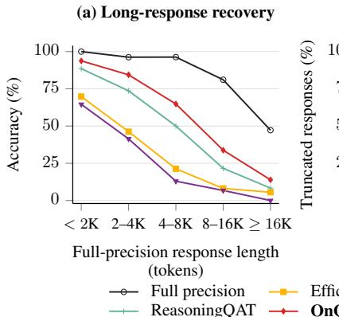
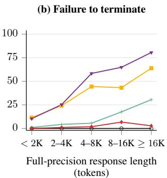
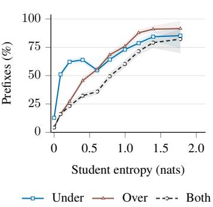
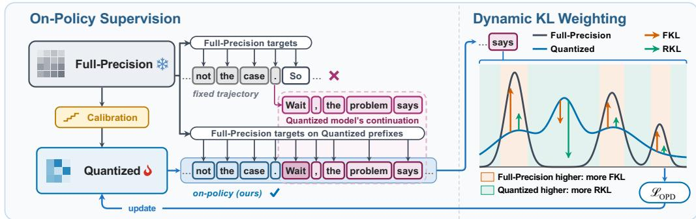
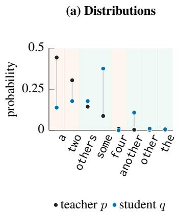
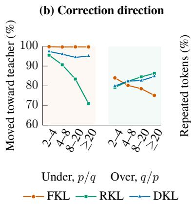
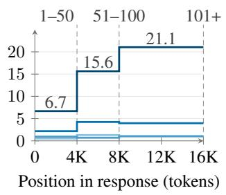
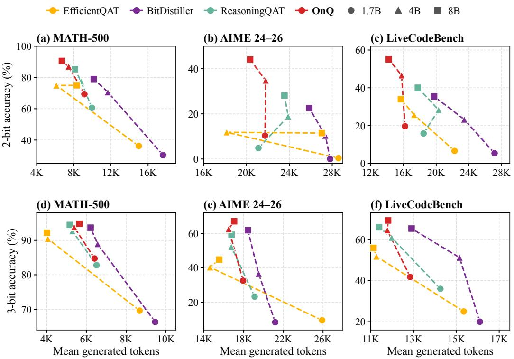
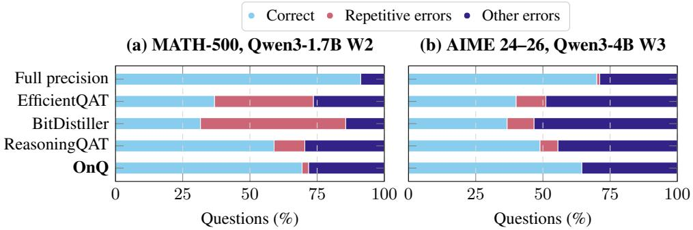

# RIGHT ON Q: RECOVERING REASONING UNDER QUANTIZATION VIA SELF-GENERATED TRAJECTORIES

Boyuan Zheng1, Jing Xiong2, Chenwei Wu1, Hui Shen1,

Zesen Zhao1, Hei Ting Una Chan1, Xueshen Liu1, Zhen Zhang2,

Liyue Shen1,†, Zechun Liu3,†,‡, Z. Morley Mao1,†,‡

1University of Michigan, Ann Arbor 2University of California, Santa Barbara 3Meta AI

## ABSTRACT

Quantization-aware training (QAT) aims to recover reasoning capabilities in lowbit large language models (LLMs). Existing recipes typically supervise the quantized student with the original full-precision model on fixed response sequences. However, the resulting low-bit quantized models still struggle on long-horizon reasoning tasks and often fail to terminate within a token budget that suffices for the full-precision model. We identify two challenges in closing this gap. First, fixed-response supervision leaves a mismatch between training prefixes and those encountered during student generation, and this trajectory divergence grows as responses lengthen. Second, on its own prefixes, the student underpredicts some next-token candidates and overpredicts others, and this distributional misalignment becomes more frequent at high-entropy prefixes. We present OnQ, a low-bit recovery pipeline that combines on-policy distillation and candidate-wise Dynamic KL. Starting from block-wise calibration, the quantized student generates responses and receives full-precision teacher supervision on its own prefixes. Dynamic KL weights forward and reverse KL by each candidate’s teacher–student probability ratio to balance correction of under- and overprediction. Across Qwen3-1.7B, 4B, and 8B at 2- and 3-bit precision, OnQ achieves the highest nine-benchmark average, with the largest gains on long-horizon reasoning benchmarks. At 2 bits, it outperforms every baseline on every benchmark at every model size, improving the Qwen3-8B average by 10.26 points over the strongest baseline. It also produces shorter responses with fewer truncations and repetitive errors.

## 1 INTRODUCTION

Low-bit quantization reduces the memory footprint of large language models (LLMs), making their deployment more practical (Frantar et al., 2022; Chen et al., 2025). Preserving reasoning capabilities at low precision remains challenging: prior work reports substantial accuracy loss (Liu et al., 2025) and inefficient generation (Lotfi et al., 2026) in quantized reasoning models. Quantization-aware training (QAT) addresses this loss by adapting model parameters through quantized forward passes, often with supervision from the original full-precision model (Hinton et al., 2015; Liu et al., 2024; Du et al., 2024; Okoshi et al., 2026). These distillation recipes typically train on fixed response sequences. Their effectiveness therefore depends on how well the training prefixes cover those encountered by the quantized student during inference (Agarwal et al., 2024).

To examine the remaining challenges in low-bit reasoning, we analyze Qwen3-1.7B at 2-bit precision (Figure 1). On MATH-500, QAT baselines recover little of the full-precision model’s accuracy on questions eliciting long full-precision responses (Figure 1.a). They also frequently reach the token limit on these questions, while the full-precision model terminates within the same budget (Figure 1.b). Fixed-response distillation supervises only reference prefixes, but quantization changes how the student generates: the longer the response, the more the student conditions on its own outputs and the further its context drifts from those prefixes. This trajectory divergence motivates teacher supervision on the student’s own trajectories.

(c) Prediction error

  
Figure 1: Low-bit fixed-response QAT fails on long-horizon reasoning; OnQ outperforms all QAT baselines (Qwen3-1.7B W2). (a) MATH-500 accuracy and (b) share of responses that reach the token limit, grouped by full-precision response length. (c) Share of prefixes with underpredicted candidates, overpredicted candidates, or both, by student entropy.

Training on the student’s own prefixes raises a second challenge: distributional misalignment. On these prefixes, the calibrated student exhibits two-sided probability errors: it substantially underpredicts some candidates and overpredicts others at the same prefix. These two-sided errors become more frequent at high-entropy prefixes (Figure 1.c). Prior work also finds that quantized models oversample overthinking markers at high-entropy positions (Lotfi et al., 2026). Neither Kullback–Leibler (KL) direction alone corrects both sides equally well: forward KL divergence more reliably moves severely underpredicted candidates toward the teacher, while reverse KL does so for severely overpredicted candidates (Section 3.2). This calls for an objective that balances correction across both sides of the distribution.

Motivated by these findings, we introduce OnQ, a low-bit recovery pipeline that combines on-policy distillation (OPD) and candidate-wise Dynamic KL (Jung et al., 2025). Starting from a block-wise calibrated checkpoint, the quantized student generates responses and receives supervision from a frozen full-precision teacher on those same prefixes (Agarwal et al., 2024). Dynamic KL weights forward and reverse KL according to each candidate’s teacher–student probability ratio, balancing the correction of under- and overpredicted probabilities along these evolving trajectories. On MATH-500, OnQ recovers more accuracy than every QAT baseline at every response length and rarely reache the token limit (Figure 1.a–b).

The key contributions of this study are as follows: 1 We identify two challenges, trajectory divergence and distributional misalignment, that limit low-bit reasoning recovery. 2 We present OnQ, a low-bit recovery pipeline combining on-policy distillation and candidate-wise Dynamic KL. 3 We show that OnQ achieves the highest nine-benchmark average in all six settings spanning Qwen3-1.7B, 4B, and 8B at 2- and 3-bit precision, improving the Qwen3-8B average at 2 bits by 10.26 points over the strongest baseline. It also improves generation behavior, producing shorter responses with fewer repetitive errors, and outperforms fixed-response distillation.

## 2 RELATED WORK

Low-bit reasoning recovery. Aggressive post-training quantization (PTQ) (Frantar et al., 2022; Cheng et al., 2024) can impair reasoning capabilities (Liu et al., 2025; Lotfi et al., 2026). QAT recovers low-bit accuracy by adapting model parameters through quantized forward passes, often with supervision from a full-precision teacher (Liu et al., 2024; Du et al., 2024; Liu et al., 2026; Lv et al., 2026). EfficientQAT uses block-wise optimization followed by end-to-end refinement of quantization step sizes (Chen et al., 2025), while ReasoningQAT (Okoshi et al., 2026) combines mixed-domain calibration with teacher-guided fine-tuning to preserve reasoning capabilities acquired after pre-training. LLM-QAT (Liu et al., 2024), BitDistiller (Du et al., 2024), and ReasoningQAT compute teacher supervision on fixed training sequences rather than on the student’s own generations.

  
Figure 2: Overview of OnQ. Left: On-policy distillation trains the calibrated student on its own generated prefixes. Right: Dynamic KL weights forward and reverse KL by each candidate’s teacher– student probability ratio.

On-policy distillation. Training on fixed prefixes while generating from the model’s own predictions at inference causes exposure bias, which imitation learning and sequence modeling mitigate by training on the learner’s own outputs (Ross et al., 2011; Bengio et al., 2015; Ranzato et al., 2016). OPD makes the student’s current behavior part of the training distribution: the teacher supervises prefixes generated by the student itself (Lin et al., 2020; Agarwal et al., 2024; Lu & Thinking Machines Lab, 2025). Alongside the source of training prefixes, the distillation objective determines how teacher–student discrepancies are weighted: BitDistiller mixes forward and reverse KL with a precomputed teacher-confidence coefficient (Du et al., 2024), while adaptive objectives adjust this balance using distribution discrepancies, teacher entropy, or candidate-wise probability ratios (Wu et al., 2025; Jin et al., 2026; Jung et al., 2025). Related recipes combine distillation with reinforcement learning (Xu et al., 2025) or run reinforcement learning on quantized models (Huang et al., 2026; Gu et al., 2026; Lv et al., 2026). OnQ applies candidate-wise Dynamic KL on quantized student rollouts, adapting distillation feedback to teacher–student probability discrepancies.

## 3 METHOD

OnQ targets low-bit capability recovery through teacher supervision along the quantized student’s own reasoning trajectories (Figure 2). Block-wise calibration provides the initialization for on-policy training. The student then samples responses through its quantized forward pass, and its full-precision teacher supplies next-token distributions conditioned on the same prefixes; this on-policy supervision addresses trajectory divergence. To address distributional misalignment, we align the student with these distributions using candidate-wise Dynamic KL, which weights forward and reverse KL (FKL and RKL) according to the teacher–student probability ratio for each candidate token.

## 3.1 QUANTIZATION AND INITIALIZATION

We use uniform asymmetric weight quantization (Chen et al., 2025; Okoshi et al., 2026). A fullprecision latent weight w is mapped to an N-bit code $w _ { \mathrm { i n t } }$ and a dequantized weight wˆ:

$$
\begin{array} { r } { w _ { \mathrm { i n t } } = \mathrm { c l a m p } ( \lfloor w / s \rceil + z , 0 , 2 ^ { N } - 1 ) , } \\ { \hat { w } = s ( w _ { \mathrm { i n t } } - z ) . \qquad } \end{array}\tag{1}
$$

Here $s > 0$ is the scale, z is the integer zero point used in the forward pass, and N is the target bit width; ⌊·⌉ rounds to the nearest integer, and ${ \mathrm { c l a m p } } ( x , a , b )$ clips x to $[ a , b ]$ . The scale and zero point are shared within each group of weights. The quantized forward pass uses wˆ, while training updates the latent weight w.

We initialize the student with block-wise calibration, following Block-AP in EfficientQAT (Chen et al., 2025). Starting from round-to-nearest (RTN) quantization with clipped per-group ranges, we train each transformer block $f _ { l }$ in sequence on the calibration set C, updating its weights $W _ { l } \mathrm { ~ . ~ }$ , scales

Initialization Step 50   
Step 100 Step 200

  
(c) Repetition during training

  
Figure 3: Qwen3-1.7B W2. (a) Teacher and student probabilities at one prefix of the calibrated student. (b) Share of under- and overpredicted candidates at high-entropy prefixes that each objective moves toward the teacher. (c) Share of repeated tokens by response position during training; dashed lines mark the rollout caps, labeled with the training steps that use each cap.

$s _ { l } ,$ and zero points $z _ { l }$ with a block-wise reconstruction loss:

$$
\operatorname* { m i n } _ { W _ { l } , s _ { l } , z _ { l } } \mathbb { E } _ { \boldsymbol { \mathcal { C } } } \left[ \mathrm { M S E } \Big ( f _ { l } ( \hat { X } _ { l - 1 } ; \hat { W } _ { l } ) , X _ { l } ^ { \mathrm { F P } } \Big ) \right] .\tag{2}
$$

Here $\hat { W } _ { l }$ follows Equation $1 , \hat { X } _ { l - 1 }$ is the input from preceding calibrated blocks, and $X _ { l } ^ { \mathrm { F P } }$ is the output of the full-precision block on full-precision inputs. This calibrated checkpoint provides the starting policy for on-policy distillation (Appendix A.2).

## 3.2 ON-POLICY DISTILLATION WITH DYNAMIC KL

Student-generated prefixes. Let $Q _ { \theta }$ be the quantized student with trainable $\theta = \left( W , s \right)$ and fixed zero points $z ,$ and $P$ the frozen full-precision teacher. For a prompt x, the student samples a response y through its quantized forward pass. The teacher supplies next-token distributions at each generated prefix $h _ { t } = ( x , y _ { < t } )$ , including prefixes containing earlier student errors (Agarwal et al., 2024) (Figure 2, left).

Dynamic KL objective. At a student-generated prefix h, let $p _ { v } = P ( v \mid h )$ and $q _ { v } = Q _ { \theta } ( v \mid h )$ denote the teacher and student probabilities of candidate v. The calibrated student exhibits twosided probability errors: it underpredicts some candidates and overpredicts others at the same prefix (Figure 3.a). These errors become more frequent as student entropy rises (Figure 1.c).

Under local logit updates, FKL moves a larger fraction of severely underpredicted candidates $( p _ { v } / q _ { v } \ge 2 0 )$ toward the teacher, whereas RKL moves a larger fraction of severely overpredicted candidates $( q _ { v } / p _ { v } \ge 2 0 )$ (Figure 3.b; Appendix A.4). Motivated by these complementary correction patterns, we adopt candidate-wise Dynamic KL (DKL) (Jung et al., 2025), which weights the two directions according to each candidate’s teacher–student probability ratio:

$$
D _ { \mathrm { d y n } } ( h ) = \sum _ { v } \Big [ \underbrace { \alpha _ { v } p _ { v } \log \frac { p _ { v } } { q _ { v } } } _ { \mathrm { F o r w a r d ~ K L } } + \underbrace { \left( 1 - \alpha _ { v } \right) q _ { v } \log \frac { q _ { v } } { p _ { v } } } _ { \mathrm { R e v e r s e ~ K L } } \Big ] .\tag{3}
$$

The sum runs over vocabulary candidates $v \in \mathcal V$ , and $\alpha _ { v } = \mathrm { s g } [ p _ { v } / ( p _ { v } + q _ { v } ) ]$ is the candidate-specific mixing weight computed at prefix h, where sg denotes stop-gradient. The weighting has two cases (Figure 2, right):

• Underprediction $( p _ { v } > q _ { v } ) \colon \alpha _ { v } > 1 / 2$ gives greater weight to FKL.

• Overprediction $( q _ { v } > p _ { v } ) \colon \alpha _ { v } < 1 / 2$ gives greater weight to RKL.

For severely underpredicted candidates, Dynamic KL moves nearly as large a fraction toward the teacher as FKL. For severely overpredicted candidates, it approaches RKL (Figure 3.b). We evaluate the objective using a top-K approximation $\widetilde { D } _ { \mathrm { d y n } , \theta } ( h )$ ), with implementation details in Appendix A.3.

On-policy optimization. Each step samples B prompts $x _ { i }$ from the prompt pool X and one response $y _ { i }$ per prompt from the student. We minimize candidate-wise Dynamic KL averaged over all response tokens in the batch, at prefixes $h _ { i , t } = ( x _ { i } , y _ { i , < t } )$

$$
\mathcal { L } _ { \mathrm { O P D } } ( \boldsymbol { \theta } ; \boldsymbol { \theta } _ { k } ) = \mathbb { E } _ { \{ \boldsymbol { x } _ { i } \} _ { i = 1 } ^ { B } \sim \mathcal { X } , \boldsymbol { y } _ { i } \sim Q _ { \boldsymbol { \theta } _ { k } } ( \cdot | \boldsymbol { x } _ { i } ) } \left[ \frac { 1 } { \sum _ { i = 1 } ^ { B } | \boldsymbol { y } _ { i } | } \sum _ { i = 1 } ^ { B } \sum _ { t = 1 } ^ { | \boldsymbol { y } _ { i } | } \widetilde { D } _ { \mathrm { d y n } , \boldsymbol { \theta } } ( \boldsymbol { h } _ { i , t } ) \right] .\tag{4}
$$

At step $k ,$ we sample responses from $Q _ { \theta _ { k } }$ and hold the rollout policy, sampled responses, and teacher targets fixed while updating θ (Agarwal et al., 2024); θ enters $\widetilde { D } _ { \mathrm { d y n } , \theta }$ only through the student probabilities. We jointly update latent weights W and scales s (Esser et al., 2020; Liu et al., 2026) to minimize $\mathcal { L } _ { \mathrm { O P D } }$ . The updated student then generates fresh responses, keeping teacher supervision aligned with the prefixes visited by its evolving quantized policy.

Response-length schedule. Right after calibration, the student repeats itself, mostly late in long responses, and the repetition fades within the first 100 training steps (Figure 3.c; Appendix A.4). For Qwen3-1.7B at 2 bits, the share of repeated tokens at initialization rises from 6.7% in the first 4K response tokens to 21.1% beyond 8K; by step 100 it is about 1% at every position. Since $\mathcal { L } _ { \mathrm { O P D } }$ weights all response tokens equally, long early rollouts would spend supervision on this repeated text. We therefore cap responses at 4,096 tokens for steps 1–50, 8,192 for steps 51–100, and 16,384 afterwards for all model sizes and bit widths.

## 4 EXPERIMENTAL SETUP

Training. We conduct experiments on Qwen3-1.7B, 4B, and 8B (Yang et al., 2025) at 2- and 3-bit weight precision (W2 and W3). OnQ uses uniform asymmetric weight quantization with group size 128 and BF16 activations (Chen et al., 2025). Block-wise calibration uses 4,096 windows of 2,048 tokens, with two epochs per block. OPD starts from the calibrated checkpoint and uses a multi-domain pool of 25,600 prompts spanning mathematics, code, science, and general instruction following. Each student is supervised by its original BF16 counterpart. OPD uses AdamW (Loshchilov & Hutter, 2019) at a constant learning rate of $1 0 ^ { - 6 }$ . OPD runs for 400 steps on Qwen3-1.7B and 300 steps on Qwen3-4B and 8B.

Baselines. We compare OnQ with two groups of baselines (Table 1): GPTQ (Frantar et al., 2022) and AutoRound (Cheng et al., 2024) for PTQ, and EfficientQAT (Chen et al., 2025), BitDistiller (Du et al., 2024), and ReasoningQAT (Okoshi et al., 2026) for QAT. Their training data and configurations are detailed in Appendix A.1 and Appendix A.5.

Evaluation. We evaluate in thinking mode with EvalScope (ModelScope Team, 2024) on nine benchmarks: GSM8K (Cobbe et al., 2021), MATH-500 (Hendrycks et al., 2021; Lightman et al., 2024), and AIME 24–26 (Zhang & Math-AI, 2024; 2025; 2026) for mathematics; HumanEval+, MBPP+ (Chen et al., 2021; Austin et al., 2021; Liu et al., 2023), and LiveCodeBench (Jain et al., 2025) for code; MMLU-Redux (Gema et al., 2025) and GPQA-Diamond (Rein et al., 2024) for knowledge and science; and IFEval (Zhou et al., 2023) for instruction following. We report pass@1 for code and accuracy for the other tasks. We use a response cap of 32,768 tokens, with 8,192-token exceptions for selected PTQ settings. We count responses terminated by the output-token limit as truncated. Scores are percentages; Avg. is the unweighted mean across the nine benchmarks. Full-precision, GPTQ, and QAT results average evaluation seeds 42, 43, and 44; AutoRound uses seed 42. Decoding settings and benchmark versions are given in Appendix A.6.

Table 1: Quantization results (%) on Qwen3, averaged over three evaluation seeds (AutoRound: seed 42). QAT and OnQ SDs: Table 9. Bold: best quantized score per model/bit group. W/A: weight/activation bits.
<table><tr><td rowspan="2">Method</td><td rowspan="2">W/A GSM8K</td><td colspan="2"></td><td rowspan="2">MATH- AIME Human</td><td rowspan="2"></td><td rowspan="2">MBPP+</td><td colspan="2">LiveCode MMLU-</td><td rowspan="2">GPQA- Diamond</td><td rowspan="2">IFEval</td><td rowspan="2">Avg.</td></tr><tr><td>500</td><td>24-26 Eval+</td><td>Bench</td><td>Redux</td></tr><tr><td>Qwen3-1.7B</td><td></td><td></td><td></td><td></td><td></td><td></td><td></td><td></td><td></td><td></td><td></td></tr><tr><td>Full precision</td><td>16/16</td><td>90.55</td><td>90.13</td><td>41.85</td><td>79.07</td><td>68.96</td><td>53.46</td><td>74.36</td><td>38.72</td><td>71.10</td><td>67.58</td></tr><tr><td>GPTQ</td><td>3/16</td><td>53.70</td><td>20.13</td><td>0.37</td><td>4.47</td><td>15.43</td><td>0.25</td><td>10.39</td><td>8.75</td><td>31.73</td><td>16.14</td></tr><tr><td>AutoRound</td><td>3/16</td><td>83.78</td><td>75.20</td><td>14.44</td><td>57.93</td><td>55.03</td><td>26.92</td><td>64.49</td><td>29.29</td><td>60.63</td><td>51.97</td></tr><tr><td>EfficientQAT</td><td>3/16</td><td>74.00</td><td>69.60</td><td>9.63</td><td>57.52</td><td>43.03</td><td>24.99</td><td>60.74</td><td>16.50</td><td>46.89</td><td>44.77</td></tr><tr><td>BitDistiller</td><td>3/16</td><td>80.39</td><td>66.33</td><td>8.52</td><td>56.71</td><td>49.47</td><td>20.00</td><td>61.51</td><td>24.75</td><td>58.78</td><td>47.38</td></tr><tr><td>ReasoningQAT</td><td>3/16</td><td>86.96</td><td>82.80</td><td>23.33</td><td>66.67</td><td>58.29</td><td>36.02</td><td>68.24</td><td>30.81</td><td>63.34</td><td>57.38</td></tr><tr><td>OnQ</td><td>3/16</td><td>87.64</td><td>84.73</td><td>32.59</td><td>71.14</td><td>62.35</td><td>41.77</td><td>69.84</td><td>30.98</td><td>65.87</td><td>60.77</td></tr><tr><td>GPTQ</td><td>2/16</td><td>1.92</td><td>2.53</td><td>0.00</td><td>0.00</td><td>0.00</td><td>0.00</td><td>3.32</td><td>3.03</td><td>11.65</td><td>2.49</td></tr><tr><td>AutoRound</td><td>2/16</td><td>11.30</td><td>4.80</td><td>0.00</td><td>6.71</td><td>10.85</td><td>0.76</td><td>31.89</td><td>15.66</td><td>24.03</td><td>11.78</td></tr><tr><td>EfficientQAT</td><td>2/16</td><td>46.70</td><td>36.20</td><td>0.37</td><td>20.73</td><td>21.78</td><td>6.67</td><td>43.57</td><td>14.65</td><td>33.15</td><td>24.87</td></tr><tr><td>BitDistiller</td><td>2/16</td><td>46.63</td><td>30.33</td><td>0.00</td><td>17.48</td><td>28.75</td><td>5.43</td><td>32.39</td><td>11.62</td><td>38.20</td><td>23.42</td></tr><tr><td>ReasoningQAT</td><td>2/16</td><td>71.44</td><td>60.60</td><td>4.81</td><td>44.92</td><td>39.15</td><td>15.86</td><td>52.41</td><td>24.92</td><td>53.23</td><td>40.82</td></tr><tr><td>OnQ</td><td>2/16</td><td>79.05</td><td>69.33</td><td>10.37</td><td>47.76</td><td>42.59</td><td>19.72</td><td>55.49</td><td>27.10</td><td>55.70</td><td>45.24</td></tr><tr><td>Qwen3-4B</td><td></td><td></td><td></td><td></td><td></td><td></td><td></td><td></td><td></td><td></td><td></td></tr><tr><td>Full precision</td><td>16/16</td><td>94.59</td><td>94.93</td><td>70.37</td><td>89.02</td><td>77.34</td><td>71.66</td><td>83.95</td><td>54.04</td><td>83.43</td><td>79.93</td></tr><tr><td>GPTQ</td><td>3/16</td><td>93.53</td><td>93.73</td><td>51.85</td><td>85.98</td><td>73.02</td><td>56.97</td><td>78.65</td><td>43.94</td><td>76.52</td><td></td></tr><tr><td>AutoRound</td><td>3/16</td><td>92.57</td><td>88.60</td><td>38.89</td><td>81.10</td><td>70.90</td><td>50.81</td><td>79.16</td><td>44.95</td><td>79.30</td><td>72.69 69.59</td></tr><tr><td>EfficientQAT</td><td>3/16</td><td>92.62</td><td>90.47</td><td>40.37</td><td>81.10</td><td>64.99</td><td>51.75</td><td>74.73</td><td>29.46</td><td>69.13</td><td>66.07</td></tr><tr><td>BitDistiller</td><td>3/16</td><td>92.67</td><td>88.93</td><td>36.67</td><td>83.74</td><td>71.34</td><td>51.22</td><td>79.42</td><td>39.90</td><td>76.65</td><td>68.95</td></tr><tr><td>ReasoningQAT</td><td>3/16</td><td>93.61</td><td>92.67</td><td>52.22</td><td>84.15</td><td>73.81</td><td>60.92</td><td>80.89</td><td>50.51</td><td>79.17</td><td>74.22</td></tr><tr><td>OnQ</td><td>3/16</td><td>93.91</td><td>93.80</td><td>62.59</td><td>84.55</td><td>75.22</td><td>64.55</td><td>81.40</td><td>49.16</td><td>81.45</td><td>76.29</td></tr><tr><td>GPTQ</td><td>2/16</td><td>1.74</td><td>2.13</td><td>0.37</td><td></td><td></td><td>0.00</td><td>5.17</td><td>5.89</td><td></td><td></td></tr><tr><td>AutoRound</td><td>2/16</td><td>32.83</td><td>15.40</td><td>0.00</td><td>0.00 14.02</td><td>0.00 20.63</td><td>2.75</td><td>45.18</td><td>18.69</td><td>9.37</td><td>2.74</td></tr><tr><td>EfficientQAT</td><td>2/16</td><td>85.90</td><td>74.93</td><td>11.85</td><td></td><td>45.24</td><td>25.72</td><td>63.42</td><td>24.41</td><td>27.36</td><td>19.65</td></tr><tr><td>BitDistiller</td><td>2/16</td><td>82.76</td><td>70.60</td><td></td><td>50.41</td><td></td><td>23.29</td><td>60.86</td><td></td><td>52.62</td><td>48.28</td></tr><tr><td>ReasoningQAT</td><td>2/16</td><td>86.25</td><td></td><td>10.37</td><td>57.32</td><td>54.59</td><td></td><td></td><td>23.23</td><td>62.42</td><td>49.49</td></tr><tr><td>OnQ</td><td>2/16</td><td>91.15</td><td>77.60 87.07</td><td>18.89 34.81</td><td>61.99</td><td>56.70</td><td>28.34 46.64</td><td>59.12 72.23</td><td>30.64</td><td>60.26</td><td>53.31</td></tr><tr><td></td><td></td><td></td><td></td><td></td><td>77.85</td><td>65.17</td><td></td><td></td><td>37.04</td><td>72.58</td><td>64.95</td></tr><tr><td>Qwen3-8B Full precision</td><td>16/16</td><td>95.73</td><td>95.53</td><td>71.85</td><td></td><td></td><td>73.59</td><td>87.42</td><td>59.93</td><td></td><td>81.82</td></tr><tr><td>GPTQ</td><td>3/16</td><td></td><td></td><td></td><td>88.21</td><td>79.28</td><td></td><td></td><td></td><td>84.84</td><td></td></tr><tr><td>AutoRound</td><td>3/16</td><td>94.92 94.84</td><td>95.20 91.00</td><td>57.41 52.22</td><td>86.99 85.37</td><td>75.57 75.13</td><td>63.44 57.63</td><td>83.98 83.81</td><td>50.34 47.47</td><td>80.04 81.52</td><td>76.43 74.33</td></tr><tr><td>EfficientQAT</td></table>

## 5 MAIN RESULTS

OnQ outperforms both PTQ and QAT baselines on every backbone and bit width. It achieves the highest nine-benchmark average in all six model/bit settings and the highest score on 48 of the 54 benchmark–setting pairs (Table 1).

The advantage of OnQ grows as precision falls. At every model size, the margin over the strongest baseline is larger at 2 bits than at 3 bits, and at 2 bits it exceeds 10 points on Qwen3-4B and 8B. At 2 bits, the PTQ baselines perform poorly, while OnQ, trained on the trajectories that the 2-bit student actually generates, achieves the highest score on every benchmark at every model size. On Qwen3-4B at 2 bits, it achieves a higher nine-benchmark average than every 2-bit baseline on Qwen3-8B, a model twice its size. At 3 bits, OnQ comes within four points of the full-precision average on Qwen3-4B and 8B.

  
Figure 4: Accuracy versus mean generated tokens for Qwen3 models at 2 bits (top, a–c) and 3 bits (bottom, d–f), averaged over three evaluation seeds. Dashed lines connect model sizes within each method.

The largest gains occur on benchmarks that require long-horizon reasoning. In five of the six settings, the largest margin of OnQ over the strongest baseline falls on AIME or LiveCodeBench, and among the code benchmarks it falls on LiveCodeBench in every setting. HumanEval+ and MBPP+ ask for single functions from short specifications, whereas LiveCodeBench poses competitiveprogramming problems that require long-horizon reasoning before the final program; even at full precision, LiveCodeBench responses are about three times as long. Among the mathematics benchmarks, the largest margin likewise falls on AIME in every setting but one. For every QAT method and model size, AIME and LiveCodeBench elicit much longer responses than MATH-500 (Figure 4), so the student conditions on its own outputs over thousands of tokens, where small errors compound into wrong or unfinished solutions. Fixed-response QAT supervises only reference prefixes and never trains on these long student trajectories, whereas OnQ supervises them directly.

## 6 ANALYSIS

## 6.1 HOW DOES ONQ CHANGE LOW-BIT GENERATION?

OnQ is more accurate with fewer generated tokens. Figure 4 plots accuracy against mean response length. At 2 bits, across MATH-500, AIME, and LiveCodeBench, OnQ achieves the highest accuracy at all three model sizes and shorter mean responses than the most accurate baseline in eight of the nine cases. On Qwen3-4B LiveCodeBench, accuracy rises from 28.34% for ReasoningQAT to 46.64% while the mean response shortens by more than a fifth: OnQ produces fewer and shorter incorrect responses. At 3 bits, OnQ again achieves the highest accuracy among QAT methods on all three benchmarks at every model size, with shorter mean responses than the most accurate baseline in six of the nine cases (Figure 4.d–f). On Qwen3-1.7B AIME, accuracy rises from 23.33% for ReasoningQAT to 32.59% while the mean response shortens by 6%. Beyond these three benchmarks, OnQ has the lowest average truncation rate among QAT methods in all six settings (Appendix C).

  
Figure 5: Generation outcomes on MATH-500 (Qwen3-1.7B W2, a) and AIME (Qwen3-4B W3, b). OnQ reduces repetitive errors on both benchmarks.

Table 2: Scores (%) across recovery stages. OnQ denotes calibration followed by on-policy distillation. OnQ results average evaluation seeds 42, 43, and 44; RTN and calibration results use seed 42. Bold marks the best score within each model/bit group.
<table><tr><td>Method</td><td>W/A GSM8K</td><td></td><td>MATH- 500</td><td>AIME 24-26</td><td>Human Eval+</td><td>MBPP+</td><td>LiveCode MMLU- Bench</td><td>Redux</td><td>GPQA- Diamond</td><td>IFEval</td><td>Avg.</td></tr><tr><td>Qwen3-1.7B</td><td></td><td></td><td></td><td></td><td></td><td></td><td></td><td></td><td></td><td></td><td></td></tr><tr><td>RTN</td><td>3/16</td><td>0.68</td><td>1.20</td><td>1.11</td><td>0.00</td><td>0.00</td><td>0.00</td><td>8.72</td><td>9.60</td><td>12.01</td><td>3.70</td></tr><tr><td>+ Calibration 3/16</td><td></td><td>87.11</td><td>80.00</td><td>17.78</td><td>58.54</td><td>58.20</td><td>30.71</td><td>67.16</td><td>29.80</td><td>61.92</td><td>54.58</td></tr><tr><td>OnQ</td><td>3/16</td><td>87.64</td><td>84.73</td><td>32.59</td><td>71.14</td><td>62.35</td><td>41.77</td><td>69.84</td><td>30.98</td><td>65.87</td><td>60.77</td></tr><tr><td>RTN</td><td>2/16</td><td>1.67</td><td>2.40</td><td>0.00</td><td>0.00</td><td>0.00</td><td>0.00</td><td>8.60</td><td>11.62</td><td>10.91</td><td>3.91</td></tr><tr><td>+ Calibration 2/16</td><td></td><td>42.84</td><td>25.60</td><td>0.00</td><td>15.85</td><td>19.84</td><td>2.84</td><td>45.07</td><td>21.72</td><td>36.41</td><td>23.35</td></tr><tr><td>OnQ</td><td>2/16</td><td>79.05</td><td>69.33</td><td>10.37</td><td>47.76</td><td>42.59</td><td>19.72</td><td>55.49</td><td>27.10</td><td>55.70</td><td>45.24</td></tr><tr><td>Qwen3-4B</td><td></td><td></td><td></td><td></td><td></td><td></td><td></td><td></td><td></td><td></td><td></td></tr><tr><td>RTN</td><td>3/16</td><td>81.58</td><td>65.00</td><td>5.56</td><td>46.95</td><td>45.77</td><td>14.22</td><td>65.26</td><td>25.25</td><td>56.56</td><td>45.13</td></tr><tr><td>+ Calibration 3/16</td><td></td><td>92.72</td><td>92.00</td><td>50.00</td><td>82.93</td><td>72.22</td><td>56.87</td><td>80.49</td><td>48.99</td><td>78.19</td><td>72.71</td></tr><tr><td>OnQ</td><td>3/16</td><td>93.91</td><td>93.80</td><td>62.59</td><td>84.55</td><td>75.22</td><td>64.55</td><td>81.40</td><td>49.16</td><td>81.45</td><td>76.29</td></tr><tr><td>RTN</td><td>2/16</td><td>1.52</td><td>2.00</td><td>0.00</td><td>0.00</td><td>0.00</td><td>0.00</td><td>1.74</td><td>2.02</td><td>12.75</td><td>2.23</td></tr><tr><td>+ Calibration 2/16</td><td></td><td>78.54</td><td>59.40</td><td>1.11</td><td>42.68</td><td>48.68</td><td>16.30</td><td>63.09</td><td>26.26</td><td>50.83</td><td>42.99</td></tr><tr><td>OnQ</td><td>2/16</td><td>91.15</td><td>87.07</td><td>34.81</td><td>77.85</td><td>65.17</td><td>46.64</td><td>72.23</td><td>37.04</td><td>72.58</td><td>64.95</td></tr><tr><td>Qwen3-8B</td><td></td><td></td><td></td><td></td><td></td><td></td><td></td><td></td><td></td><td></td><td></td></tr><tr><td>RTN</td><td>3/16</td><td>33.59</td><td>17.00</td><td>0.00</td><td>11.59</td><td>26.46</td><td>0.28</td><td>25.84</td><td>13.13</td><td>37.71</td><td>18.40</td></tr><tr><td>+ Calibration 3/16</td><td></td><td>94.54</td><td>93.00</td><td>53.33</td><td>85.37</td><td>74.60</td><td>61.33</td><td>84.77</td><td>53.03</td><td>80.04</td><td>75.56</td></tr><tr><td>OnQ</td><td>3/16</td><td>95.22</td><td>94.80</td><td>67.04</td><td>87.20</td><td>76.10</td><td>69.23</td><td>85.57</td><td>55.39</td><td>82.13</td><td>79.19</td></tr><tr><td>RTN</td><td>2/16</td><td>1.82</td><td>1.40</td><td>0.00</td><td>0.00</td><td>0.00</td><td>0.00</td><td>4.18</td><td>3.03</td><td>8.32</td><td>2.08</td></tr><tr><td>+ Calibration 2/16</td><td></td><td>84.91</td><td>65.00</td><td>15.56</td><td>56.71</td><td>58.47</td><td>18.77</td><td>69.70</td><td>27.78</td><td>53.97</td><td>50.10</td></tr><tr><td>OnQ</td><td>2/16</td><td>93.48</td><td>90.60</td><td>44.07</td><td>82.93</td><td>70.72</td><td>55.04</td><td>78.75</td><td>43.43</td><td>77.08</td><td>70.68</td></tr></table>

OnQ substantially reduces repetitive generation in low-bit models. Figure 5 separates incorrect responses into repetitive errors, in which responses emit the same sentence, block, or computation again and again, and all other errors (Appendix B), for Qwen3-1.7B at 2 bits on MATH-500 and Qwen3-4B at 3 bits on AIME. The full-precision models produce no repetitive errors on MATH-500 and one on AIME, whereas these errors become much more frequent after quantization. The fixed-response QAT baselines produce repetitive errors on 11.4–54.0% of the MATH-500 questions and on 6.7–11.1% of the AIME questions. Trained on its own generations, OnQ produces repetitive errors on only 2.4% of the MATH-500 questions, and this reduction accounts for most of its accuracy gain over ReasoningQAT. On AIME, OnQ produces no repetitive errors. Repetition likewise appears in the calibrated student’s early rollouts and fades within the first 100 steps of on-policy training (Section 3.2).

## 6.2 WHICH DESIGN CHOICES DRIVE THE GAINS OF ONQ?

Contribution of each stage. To separate the two stages of OnQ, Table 2 reports each model after RTN, after calibration, and after on-policy distillation. Direct RTN severely degrades 2-bit accuracy, motivating restoration of a working policy before training on the student’s own rollouts. Calibration provides one but still struggles on long-horizon reasoning at 2 bits, as its Live-CodeBench scores show. On-policy distillation then closes about half or more of the remaining gap to full precision in every setting, with substantial gains on MATH-500 and LiveCodeBench,

Table 3: Fixed-response versus on-policy distillation on Qwen3-1.7B W2 from shared calibration. Scores in %; best scores in bold.
<table><tr><td>Method</td><td>MATH- 500</td><td>Human Eval+</td><td>MMLU- Redux</td></tr><tr><td>Fixed-response FKL</td><td>59.00</td><td>39.63</td><td>52.28</td></tr><tr><td>Fixed-response DKL</td><td>61.00</td><td>42.07</td><td>52.68</td></tr><tr><td>On-policy DKL (OnQ)</td><td>69.40</td><td>48.78</td><td>55.75</td></tr></table>

and lowers truncation in all six settings (Appendix D).

On-policy versus fixed-response distillation. We compare OnQ with fixed-response distillation using either forward KL (FKL) or Dynamic KL (DKL) on Qwen3-1.7B W2 (Table 3). All three runs start from the same calibrated checkpoint and use the same number of response tokens; fixed-response training uses the QAT baselines’ question–response pairs and on-policy training uses our prompt pool (Appendices A.1 and A.7). On-policy Dynamic KL exceeds fixed-response Dynamic KL on all three benchmarks, by up to 8.40 points, and replacing FKL with Dynamic KL in fixed-response distillation adds up to 2.44.

Dynamic KL versus other on-policy objectives. We compare on-policy objectives using a shared initialization, training set, and step budget. Table 4 reports results for OnQ, Vanilla OPD (Lu & Thinking Machines Lab, 2025), GKD (Agarwal et al., 2024), GRPO (Shao et al., 2024), and OPD + GRPO on Qwen3-1.7B W2. Vanilla OPD uses RKL, and we use the FKL variant of GKD as the other singledirection on-policy baseline. GRPO uses reinforcement learning with verifiable rewards (RLVR) alone, and OPD + GRPO adds this RLVR objective to sampled-RKL

Table 4: On-policy objectives on Qwen3-1.7B W2 (400 steps from a shared cold start). Scores in %; best scores in bold.
<table><tr><td>Method</td><td>Objective</td><td>MATH- 500</td><td>Human Eval+</td><td>MMLU- Redux</td></tr><tr><td>Cold start</td><td>一</td><td>41.40</td><td>3.66</td><td>45.12</td></tr><tr><td>Vanilla OPD</td><td>RKL</td><td>63.00</td><td>10.98</td><td>48.18</td></tr><tr><td>OPD + GRPO</td><td>RKL + RLVR</td><td>66.00</td><td>4.27</td><td>48.84</td></tr><tr><td>GKD</td><td>FKL</td><td>66.20</td><td>11.59</td><td>48.82</td></tr><tr><td>GRPO</td><td>RLVR</td><td>31.40</td><td>0.61</td><td>34.05</td></tr><tr><td>OnQ</td><td>Dynamic KL</td><td>67.20</td><td>10.98</td><td>49.58</td></tr></table>

OPD. All runs start from a shared cold-start checkpoint and train on DeepScaleR mathematics problems (Luo et al., 2025) (Appendix A.7).

Dynamic KL achieves the highest average over the three benchmarks and the highest MATH-500 and MMLU-Redux scores. Relative to FKL (GKD) and RKL (Vanilla OPD), it improves MATH-500 by 1.0 and 4.2 points, respectively. Relying solely on teacher supervision and trained only on mathematics prompts, OnQ outperforms OPD + GRPO and GRPO on all three benchmarks, showing stronger transfer to code generation and knowledge.

## 7 CONCLUSION

We present OnQ, a low-bit recovery pipeline that addresses trajectory divergence with on-policy distillation and distributional misalignment with candidate-wise Dynamic KL. On Qwen3-1.7B, 4B, and 8B at 2 and 3 bits, OnQ achieves the highest nine-benchmark average in all six settings, with the largest gains at 2 bits and on long-horizon reasoning benchmarks. The recovered models also produce shorter responses with fewer repetitive errors. On-policy training outperforms fixed-response distillation, and Dynamic KL achieves the best average among the on-policy objectives we compare. These results establish training on self-generated trajectories as an effective route to recovering reasoning under aggressive quantization.

## REFERENCES

Rishabh Agarwal, Nino Vieillard, Yongchao Zhou, Piotr Stanczyk, Sabela Ramos Garea, Matthieu Geist, and Olivier Bachem. On-policy distillation of language models: Learning from selfgenerated mistakes. In The Twelfth International Conference on Learning Representations, ICLR 2024, Vienna, Austria, May 7-11, 2024. OpenReview.net, 2024. URL https://openreview.net/ forum?id=3zKtaqxLhW.

Wasi Uddin Ahmad, Somshubra Majumdar, Aleksander Ficek, Sean Narenthiran, Mehrzad Samadi, Jocelyn Huang, Siddhartha Jain, Vahid Noroozi, and Boris Ginsburg. OpenCodeReasoning-II: A simple test time scaling approach via self-critique. CoRR, abs/2507.09075, 2025. doi: 10.48550/ARXIV.2507.09075. URL https://doi.org/10.48550/arXiv.2507.09075.

Anthropic. Introducing Claude Sonnet 5.5. Official model announcement, September 2026. URL https://www.anthropic.com/claude-sonnet-5-5.

Jacob Austin, Augustus Odena, Maxwell I. Nye, Maarten Bosma, Henryk Michalewski, David Dohan, Ellen Jiang, Carrie J. Cai, Michael Terry, Quoc V. Le, and Charles Sutton. Program synthesis with large language models. CoRR, abs/2108.07732, 2021. doi: 10.48550/ARXIV.2108.07732. URL https://doi.org/10.48550/arXiv.2108.07732.

Samy Bengio, Oriol Vinyals, Navdeep Jaitly, and Noam Shazeer. Scheduled sampling for sequence prediction with recurrent neural networks. In Corinna Cortes, Neil D. Lawrence, Daniel D. Lee, Masashi Sugiyama, and Roman Garnett (eds.), Advances in Neural Information Processing Systems 28: Annual Conference on Neural Information Processing Systems 2015, December 7-12, 2015, Montreal, Quebec, Canada, pp. 1171–1179, 2015. URL https://proceedings.neurips.cc/ paper/2015/hash/e995f98d56967d946471af29d7bf99f1-Abstract.html.

Yoshua Bengio, Nicholas Léonard, and Aaron C. Courville. Estimating or propagating gradients through stochastic neurons for conditional computation. CoRR, abs/1308.3432, 2013. doi: 10.48550/ARXIV.1308.3432. URL https://doi.org/10.48550/arXiv.1308.3432.

Mark Chen, Jerry Tworek, Heewoo Jun, Qiming Yuan, Henrique Pondé de Oliveira Pinto, Jared Kaplan, Harri Edwards, Yuri Burda, Nicholas Joseph, Greg Brockman, Alex Ray, Raul Puri, Gretchen Krueger, Michael Petrov, Heidy Khlaaf, Girish Sastry, Pamela Mishkin, Brooke Chan, Scott Gray, Nick Ryder, Mikhail Pavlov, Alethea Power, Lukasz Kaiser, Mohammad Bavarian, Clemens Winter, Philippe Tillet, Felipe Petroski Such, Dave Cummings, Matthias Plappert, Fotios Chantzis, Elizabeth Barnes, Ariel Herbert-Voss, William Hebgen Guss, Alex Nichol, Alex Paino, Nikolas Tezak, Jie Tang, Igor Babuschkin, Suchir Balaji, Shantanu Jain, William Saunders, Christopher Hesse, Andrew N. Carr, Jan Leike, Joshua Achiam, Vedant Misra, Evan Morikawa, Alec Radford, Matthew Knight, Miles Brundage, Mira Murati, Katie Mayer, Peter Welinder, Bob McGrew, Dario Amodei, Sam McCandlish, Ilya Sutskever, and Wojciech Zaremba. Evaluating large language models trained on code. CoRR, abs/2107.03374, 2021. doi: 10.48550/ARXIV.2107. 03374. URL https://doi.org/10.48550/arXiv.2107.03374.

Mengzhao Chen, Wenqi Shao, Peng Xu, Jiahao Wang, Peng Gao, Kaipeng Zhang, and Ping Luo. EfficientQAT: Efficient quantization-aware training for large language models. In Wanxiang Che, Joyce Nabende, Ekaterina Shutova, and Mohammad Taher Pilehvar (eds.), Proceedings of the 63rd Annual Meeting of the Association for Computational Linguistics (Volume 1: Long Papers), ACL 2025, Vienna, Austria, July 27 - August 1, 2025, pp. 10081–10100. Association for Computational Linguistics, 2025. doi: 10.18653/V1/2025.ACL-LONG.498. URL https: //doi.org/10.18653/v1/2025.acl-long.498.

Wenhua Cheng, Weiwei Zhang, Haihao Shen, Yiyang Cai, Xin He, Kaokao Lv, and Yi Liu. Optimize weight rounding via signed gradient descent for the quantization of LLMs. In Yaser Al-Onaizan, Mohit Bansal, and Yun-Nung Chen (eds.), Findings ofthe Associationfor Computational Linguistics: EMNLP 2024, Miami, Florida, USA, November 12-16, 2024, volume EMNLP 2024 of Findings of ACL, pp. 11332–11350. Association for Computational Linguistics, 2024. doi: 10.18653/V1/2024.FINDINGS-EMNLP.662. URL https://doi.org/10.18653/v1/2024. findings-emnlp.662.

Karl Cobbe, Vineet Kosaraju, Mohammad Bavarian, Mark Chen, Heewoo Jun, Lukasz Kaiser, Matthias Plappert, Jerry Tworek, Jacob Hilton, Reiichiro Nakano, Christopher Hesse, and John Schulman. Training verifiers to solve math word problems. CoRR, abs/2110.14168, 2021. doi: 10.48550/ARXIV.2110.14168. URL https://doi.org/10.48550/arXiv.2110.14168.

Dayou Du, Yijia Zhang, Shijie Cao, Jiaqi Guo, Ting Cao, Xiaowen Chu, and Ningyi Xu. BitDistiller: Unleashing the potential of sub-4-bit LLMs via self-distillation. In Lun-Wei Ku, Andre Martins, and Vivek Srikumar (eds.), Proceedings of the 62nd Annual Meeting of the Association for Computational Linguistics (Volume 1: Long Papers), ACL 2024, Bangkok, Thailand, August 11-16, 2024, pp. 102–116. Association for Computational Linguistics, 2024. doi: 10.18653/V1/2024.ACL-LONG.7. URL https://doi.org/10.18653/v1/2024.acl-long.7.

Steven K. Esser, Jeffrey L. McKinstry, Deepika Bablani, Rathinakumar Appuswamy, and Dharmendra S. Modha. Learned step size quantization. In 8th International Conference on Learning Representations, ICLR 2020, Addis Ababa, Ethiopia, April 26-30, 2020. OpenReview.net, 2020. URL https://openreview.net/forum?id=rkgO66VKDS.

Elias Frantar, Saleh Ashkboos, Torsten Hoefler, and Dan Alistarh. Gptq: Accurate post-training quantization for generative pre-trained transformers. arXiv preprint arXiv:2210.17323, 2022.

Aryo Pradipta Gema, Joshua Ong Jun Leang, Giwon Hong, Alessio Devoto, Alberto Carlo Maria Mancino, Rohit Saxena, Xuanli He, Yu Zhao, Xiaotang Du, Mohammad Reza Ghasemi Madani, Claire Barale, Robert McHardy, Joshua Harris, Jean Kaddour, Emile van Krieken, and Pasquale Minervini. Are we done with MMLU? In Luis Chiruzzo, Alan Ritter, and Lu Wang (eds.), Proceedings ofthe 2025 Conference ofthe Nations ofthe Americas Chapter ofthe Association for Computational Linguistics: Human Language Technologies, NAACL 2025 - Volume 1: Long Papers, Albuquerque, New Mexico, USA, April 29 - May 4, 2025, pp. 5069–5096. Association for Computational Linguistics, 2025. doi: 10.18653/V1/2025.NAACL-LONG.262. URL https: //doi.org/10.18653/v1/2025.naacl-long.262.

Hao Gu, Hao Wang, Jiacheng Liu, Lujun Li, Qiyuan Zhu, Bei Liu, Binxing Xu, Lei Wang, Xintong Yang, Sida Lin, Sirui Han, and Yike Guo. QaRL: Rollout-aligned quantization-aware RL for fast and stable training under training-inference mismatch. In Maria Liakata, Viviane P. Moreira, Jiajun Zhang, and David Jurgens (eds.), Findings ofthe Associationfor Computational Linguistics, ACL 2026, San Diego, California, United States, July 2-7, 2026, pp. 17051–17064. Association for Computational Linguistics, 2026. doi: 10.18653/V1/2026.FINDINGS-ACL.841. URL https: //doi.org/10.18653/v1/2026.findings-acl.841.

Dan Hendrycks, Collin Burns, Saurav Kadavath, Akul Arora, Steven Basart, Eric Tang, Dawn Song, and Jacob Steinhardt. Measuring mathematical problem solving with the MATH dataset. In Joaquin Vanschoren and Sai-Kit Yeung (eds.), Proceedings ofthe Neural Information Processing Systems Track on Datasets and Benchmarks 1, NeurIPS Datasets and Benchmarks 2021, December 2021, virtual, 2021. URL https://datasets-benchmarks-proceedings.neurips.cc/paper/ 2021/hash/be83ab3ecd0db773eb2dc1b0a17836a1-Abstract-round2.html.

Geoffrey E. Hinton, Oriol Vinyals, and Jeffrey Dean. Distilling the knowledge in a neural network. CoRR, abs/1503.02531, 2015. doi: 10.48550/ARXIV.1503.02531. URL https://doi.org/10. 48550/arXiv.1503.02531.

Wei Huang, Yi Ge, Shuai Yang, Yicheng Xiao, Huizi Mao, Yujun Lin, Hanrong Ye, Sifei Liu, Ka Chun Cheung, Hongxu Yin, Yao Lu, Xiaojuan Qi, Song Han, and Yukang Chen. QeRL: Beyond efficiency - quantization-enhanced reinforcement learning for LLMs. In Carl Vondrick, Bharath Hariharan, Colin Raffel, Lerrel Pinto, Diyi Yang, and Aleksandra Faust (eds.), The Fourteenth International Conference on Learning Representations, ICLR 2026, Rio de Janeiro, Brazil, April 23-27, 2026. proceedings.iclr.cc, 2026. URL https://proceedings.iclr.cc/paper\_files/paper/2026/ hash/a15a2ece7f0663d1ba7db91103ac61c9-Abstract-Conference.html.

Naman Jain, King Han, Alex Gu, Wen-Ding Li, Fanjia Yan, Tianjun Zhang, Sida Wang, Armando Solar-Lezama, Koushik Sen, and Ion Stoica. LiveCodeBench: Holistic and contamination free evaluation of large language models for code. In The Thirteenth International Conference on Learning Representations, ICLR 2025, Singapore, April 24-28, 2025. OpenReview.net, 2025. URL https://openreview.net/forum?id=chfJJYC3iL.

Woogyeol Jin, Taywon Min, Yongjin Yang, Dennis Wei, Yi Zhou, Swanand Ravindra Kadhe, Nathalie Baracaldo, and Kimin Lee. Entropy-aware on-policy distillation of language models. In Tong Zhang, Miroslav Dudik, Martin Jaggi, Alekh Agarwal, Sharon Li, Dale Schuurmans, Jerry Zhu, Felix Berkenkamp, Hanze Dong, and Alberto Bietti (eds.), Proceedings ofthe 43rd International Conference on Machine Learning, volume 306 of Proceedings of Machine Learning Research, pp. 53926–53943. PMLR, 06–11 Jul 2026. URL https://proceedings.mlr.press/v306/jin26e. html.

Seongryong Jung, Suwan Yoon, DongGeon Kim, and Hwanhee Lee. ToDi: Token-wise distillation via fine-grained divergence control. In Christos Christodoulopoulos, Tanmoy Chakraborty, Carolyn Rose, and Violet Peng (eds.), Proceedings of the 2025 Conference on Empirical Methods in Natural Language Processing, EMNLP 2025, Suzhou, China, November 4-9, 2025, pp. 8078–8091. Association for Computational Linguistics, 2025. doi: 10.18653/V1/2025.EMNLP-MAIN.409. URL https://doi.org/10.18653/v1/2025.emnlp-main.409.

Woosuk Kwon, Zhuohan Li, Siyuan Zhuang, Ying Sheng, Lianmin Zheng, Cody Hao Yu, Joseph Gonzalez, Hao Zhang, and Ion Stoica. Efficient memory management for large language model serving with PagedAttention. In Jason Flinn, Margo I. Seltzer, Peter Druschel, Antoine Kaufmann, and Jonathan Mace (eds.), Proceedings ofthe 29th Symposium on Operating Systems Principles, SOSP 2023, Koblenz, Germany, October 23-26, 2023, pp. 611–626. ACM, 2023. doi: 10.1145/ 3600006.3613165. URL https://doi.org/10.1145/3600006.3613165.

Nathan Lambert, Jacob Morrison, Valentina Pyatkin, Shengyi Huang, Hamish Ivison, Faeze Brahman, Lester James Validad Miranda, Alisa Liu, Nouha Dziri, Xinxi Lyu, Yuling Gu, Saumya Malik, Victoria Graf, Jena D. Hwang, Jiangjiang Yang, Ronan Le Bras, Oyvind Tafjord, Christopher Wilhelm, Luca Soldaini, Noah A. Smith, Yizhong Wang, Pradeep Dasigi, and Hannaneh Hajishirzi. Tulu 3: Pushing frontiers in open language model post-training. In Second Conference on Language Modeling, 2025. URL https://openreview.net/forum?id=i1uGbfHHpH.

Hunter Lightman, Vineet Kosaraju, Yuri Burda, Harrison Edwards, Bowen Baker, Teddy Lee, Jan Leike, John Schulman, Ilya Sutskever, and Karl Cobbe. Let’s verify step by step. In The Twelfth International Conference on Learning Representations, ICLR 2024, Vienna, Austria, May 7-11, 2024. OpenReview.net, 2024. URL https://openreview.net/forum?id=v8L0pN6EOi.

Alexander Lin, Jeremy Wohlwend, Howard Chen, and Tao Lei. Autoregressive knowledge distillation through imitation learning. In Bonnie Webber, Trevor Cohn, Yulan He, and Yang Liu (eds.), Proceedings of the 2020 Conference on Empirical Methods in Natural Language Processing, EMNLP 2020, Online, November 16-20, 2020, pp. 6121–6133. Association for Computational Linguistics, 2020. doi: 10.18653/V1/2020.EMNLP-MAIN.494. URL https://doi.org/10. 18653/v1/2020.emnlp-main.494.

Jiawei Liu, Chunqiu Steven Xia, Yuyao Wang, and Lingming Zhang. Is your code generated by ChatGPT really correct? rigorous evaluation of large language models for code generation. In Alice Oh, Tristan Naumann, Amir Globerson, Kate Saenko, Moritz Hardt, and Sergey Levine (eds.), Advances in Neural Information Processing Systems 36: Annual Conference on Neural Information Processing Systems 2023, NeurIPS 2023, New Orleans, LA, USA, December 10 - 16, 2023, 2023. URL http://papers.nips.cc/paper\_files/paper/2023/hash/ 43e9d647ccd3e4b7b5baab53f0368686-Abstract-Conference.html.

Ruikang Liu, Yuxuan Sun, Manyi Zhang, Haoli Bai, Xianzhi Yu, Tiezheng YU, Chun Yuan, and Lu Hou. Quantization hurts reasoning? an empirical study on quantized reasoning models. In Second Conference on Language Modeling, 2025. URL https://openreview.net/forum?id= BM192Ps5Nv.

Zechun Liu, Barlas Oguz, Changsheng Zhao, Ernie Chang, Pierre Stock, Yashar Mehdad, Yangyang Shi, Raghuraman Krishnamoorthi, and Vikas Chandra. LLM-QAT: data-free quantization aware training for large language models. In Lun-Wei Ku, Andre Martins, and Vivek Srikumar (eds.), Findings of the Association for Computational Linguistics, ACL 2024, Bangkok, Thailand and virtual meeting, August 11-16, 2024, volume ACL 2024 of Findings ofACL, pp. 467–484. Associ ation for Computational Linguistics, 2024. doi: 10.18653/V1/2024.FINDINGS-ACL.26. URL https://doi.org/10.18653/v1/2024.findings-acl.26.

Zechun Liu, Changsheng Zhao, Hanxian Huang, Sijia Chen, Jing Zhang, Jiawei Zhao, Scott Roy, Lisa Jin, Yunyang Xiong, Yangyang Shi, et al. Paretoq: Improving scaling laws in extremely low-bit llm quantization. Advances in Neural Information Processing Systems, 38:91311–91336, 2026.

Ilya Loshchilov and Frank Hutter. Decoupled weight decay regularization. In 7th International Conference on Learning Representations, ICLR 2019, New Orleans, LA, USA, May 6-9, 2019. OpenReview.net, 2019. URL https://openreview.net/forum?id=Bkg6RiCqY7.

Sanae Lotfi, Polina Kirichenko, Steven Li, and Zechun Liu. Quantized reasoning models think they need to think longer, but they do not. CoRR, abs/2606.00206, 2026. doi: 10.48550/ARXIV.2606. 00206. URL https://doi.org/10.48550/arXiv.2606.00206.

Kevin Lu and Thinking Machines Lab. On-policy distillation. Thinking Machines Lab: Connectionism, 2025. doi: 10.64434/tml.20251026. URL https://thinkingmachines.ai/blog/onpolicy-distillation.

Michael Luo, Sijun Tan, Justin Wong, Xiaoxiang Shi, William Y. Tang, Manan Roongta, Colin Cai, Jeffrey Luo, Li Erran Li, Raluca Ada Popa, and Ion Stoica. Deep-ScaleR: Surpassing O1-Preview with a 1.5B model by scaling RL, 2025. URL https://pretty-radio-b75.notion.site/DeepScaleR-Surpassing-O1-Preview-with-a-1-5B-Model-by-Scaling-RL-19681902c1468005bed8ca303013a4e2. Notion Blog.

Keyu Lv, Manyi Zhang, Xiaobo Xia, Jingchen Ni, Shannan Yan, Xianzhi Yu, Lu Hou, Chun Yuan, and Haoli Bai. What makes low-bit quantization-aware training work for reasoning LLMs? A systematic study. CoRR, abs/2601.14888, 2026. doi: 10.48550/ARXIV.2601.14888. URL https://doi.org/10.48550/arXiv.2601.14888.

ModelScope Team. EvalScope: Evaluation framework for large models, 2024. URL https:// github.com/modelscope/evalscope.

Ivan Moshkov, Darragh Hanley, Ivan Sorokin, Shubham Toshniwal, Christof Henkel, Benedikt Schifferer, Wei Du, and Igor Gitman. AIMO-2 winning solution: Building state-of-the-art mathematical reasoning models with openmathreasoning dataset. CoRR, abs/2504.16891, 2025. doi: 10.48550/ARXIV.2504.16891. URL https://doi.org/10.48550/arXiv.2504.16891.

NVIDIA. Nemotron-Instruction-Following-Chat-v1. Hugging Face dataset, 2025a. URL https: //huggingface.co/datasets/nvidia/Nemotron-Instruction-Following-Chat-v1.

NVIDIA. OpenScienceReasoning-2. Hugging Face dataset, 2025b. URL https://huggingface. co/datasets/nvidia/OpenScienceReasoning-2.

Yasuyuki Okoshi, Hikari Otsuka, Daichi Fujiki, and Masato Motomura. Towards quantizationaware training for ultra-low-bit reasoning LLMs. In Carl Vondrick, Bharath Hariharan, Colin Raffel, Lerrel Pinto, Diyi Yang, and Aleksandra Faust (eds.), The Fourteenth International Conference on Learning Representations, ICLR 2026, Rio de Janeiro, Brazil, April 23-27, 2026. proceedings.iclr.cc, 2026. URL https://proceedings.iclr.cc/paper\_files/paper/2026/ hash/209423f076b6479ab3a4f45886e30306-Abstract-Conference.html.

Valentina Pyatkin, Saumya Malik, Victoria Graf, Hamish Ivison, Shengyi Huang, Pradeep Dasigi, Nathan Lambert, and Hanna Hajishirzi. Generalizing verifiable instruction following. In Danielle Belgrave, Cheng Zhang, Laura N. Montoya, Hsuan-Tien Lin, Razvan Pascanu, Piotr Koniusz, Marzyeh Ghassemi, Nancy Chen, Iván Vladimir Meza Ruíz, and Arturo Loaiza-Bonilla (eds.), Advances in Neural Information Processing Systems 38: Annual Conference on Neural Information Processing Systems 2025, NeurIPS 2025, San Diego, CA, USA, December 2-7, 2025 / Mexico City, Mexico, November 30 - December 5, 2025, 2025. URL http://papers.nips.cc/paper\_files/paper/2025/hash/ 46499a0622ecf568b72d17b61e45dbd5-Abstract-Datasets\_and\_Benchmarks\_Track.html.

Marc’Aurelio Ranzato, Sumit Chopra, Michael Auli, and Wojciech Zaremba. Sequence level training with recurrent neural networks. In Yoshua Bengio and Yann LeCun (eds.), 4th International Conference on Learning Representations, ICLR 2016, San Juan, Puerto Rico, May 2-4, 2016, Conference Track Proceedings, 2016. doi: 10.48550/ARXIV.1511.06732. URL https://doi. org/10.48550/arXiv.1511.06732.

David Rein, Betty Li Hou, Asa Cooper Stickland, Jackson Petty, Richard Yuanzhe Pang, Julien Dirani, Julian Michael, and Samuel R. Bowman. GPQA: A graduate-level google-proof q&a benchmark. In First Conference on Language Modeling, 2024. URL https://openreview.net/forum?id= Ti67584b98.

Stéphane Ross, Geoffrey J. Gordon, and Drew Bagnell. A reduction of imitation learning and structured prediction to no-regret online learning. In Geoffrey J. Gordon, David B. Dunson, and Miroslav Dudík (eds.), Proceedings ofthe Fourteenth International Conference on Artificial Intelligence and Statistics, AISTATS 2011, Fort Lauderdale, USA, April 11-13, 2011, volume 15 of JMLR Proceedings, pp. 627–635. JMLR.org, 2011. URL http://proceedings.mlr.press/ v15/ross11a/ross11a.pdf.

Zhihong Shao, Peiyi Wang, Qihao Zhu, Runxin Xu, Junxiao Song, Xiao Bi, Haowei Zhang, Mingchuan Zhang, YK Li, Yang Wu, et al. Deepseekmath: Pushing the limits of mathematical reasoning in open language models. arXiv preprint arXiv:2402.03300, 2024. URL https://arxiv.org/abs/2402.03300.

Guangming Sheng, Chi Zhang, Zilingfeng Ye, Xibin Wu, Wang Zhang, Ru Zhang, Yanghua Peng, Haibin Lin, and Chuan Wu. HybridFlow: A flexible and efficient RLHF framework. In Proceedings of the Twentieth European Conference on Computer Systems, EuroSys 2025, Rotterdam, The Netherlands, 30 March 2025 - 3 April 2025, pp. 1279–1297. ACM, 2025. doi: 10.1145/3689031. 3696075. URL https://doi.org/10.1145/3689031.3696075.

Team Olmo, Allyson Ettinger, Amanda Bertsch, Bailey Kuehl, David Graham, David Heineman, Dirk Groeneveld, Faeze Brahman, Finbarr Timbers, Hamish Ivison, et al. Olmo 3. arXiv preprint arXiv:2512.13961, 2025. URL https://arxiv.org/abs/2512.13961.

Taiqiang Wu, Chaofan Tao, Jiahao Wang, Runming Yang, Zhe Zhao, and Ngai Wong. Rethinking Kullback-Leibler divergence in knowledge distillation for large language models. In Owen Rambow, Leo Wanner, Marianna Apidianaki, Hend Al-Khalifa, Barbara Di Eugenio, and Steven Schockaert (eds.), Proceedings of the 31st International Conference on Computational Linguistics, COLING 2025, Abu Dhabi, UAE, January 19-24, 2025, pp. 5737–5755. Association for Computa tional Linguistics, 2025. URL https://aclanthology.org/2025.coling-main.383/.

Hongling Xu, Qi Zhu, Heyuan Deng, Jinpeng Li, Lu Hou, Yasheng Wang, Lifeng Shang, Ruifeng Xu, and Fei Mi. KDRL: post-training reasoning LLMs via unified knowledge distillation and reinforcement learning. CoRR, abs/2506.02208, 2025. doi: 10.48550/ARXIV.2506.02208. URL https://doi.org/10.48550/arXiv.2506.02208.

An Yang, Anfeng Li, Baosong Yang, Beichen Zhang, Binyuan Hui, Bo Zheng, Bowen Yu, Chang Gao, Chengen Huang, Chenxu Lv, et al. Qwen3 technical report. arXiv preprint arXiv:2505.09388, 2025. URL https://arxiv.org/abs/2505.09388.

Yifan Zhang and Team Math-AI. American invitational mathematics examination (AIME) 2024. Hugging Face dataset, 2024. URL https://huggingface.co/datasets/math-ai/aime24.

Yifan Zhang and Team Math-AI. American invitational mathematics examination (AIME) 2025. Hugging Face dataset, 2025. URL https://huggingface.co/datasets/math-ai/aime25.

Yifan Zhang and Team Math-AI. American invitational mathematics examination (AIME) 2026. Hugging Face dataset, 2026. URL https://huggingface.co/datasets/math-ai/aime26.

Jeffrey Zhou, Tianjian Lu, Swaroop Mishra, Siddhartha Brahma, Sujoy Basu, Yi Luan, Denny Zhou, and Le Hou. Instruction-following evaluation for large language models. CoRR, abs/2311.07911, 2023. doi: 10.48550/ARXIV.2311.07911. URL https://doi.org/10.48550/arXiv.2311. 07911.

## A EXPERIMENTAL DETAILS

## A.1 DATA

Table 5 lists the calibration, OPD, and QAT baseline data, drawn from OpenMathReasoning (Moshkov et al., 2025), OpenCodeReasoning-2 (Ahmad et al., 2025), OpenScienceReasoning-2 (NVIDIA, 2025b), Dolci-Think (Team Olmo et al., 2025), Tülu 3 (Lambert et al., 2025), IF-multi-constraints (Pyatkin et al., 2025), and Nemotron-Instruction-Following-Chat (NVIDIA, 2025a).

Table 5: Training data: calibration windows (2,048 tokens), OPD prompts, and question–response pairs shared by the three QAT baselines.
<table><tr><td>Source</td><td>Calib.</td><td>OPD</td><td>Baselines</td></tr><tr><td>OpenMathReasoning</td><td>1,229</td><td>7,680</td><td>9,831</td></tr><tr><td>OpenCodeReasoning-2</td><td>1,229</td><td>7,680</td><td>9,831</td></tr><tr><td>OpenScienceReasoning-2</td><td>614</td><td>3,840</td><td>4,915</td></tr><tr><td>Dolci-Think</td><td>1,024</td><td></td><td>6,553</td></tr><tr><td>Tülu 3</td><td></td><td>5,120</td><td></td></tr><tr><td>IF-multi-constraints</td><td></td><td>1,280</td><td></td></tr><tr><td>Nemotron-IF-Chat</td><td></td><td></td><td>1,638</td></tr><tr><td>Total</td><td>4,096</td><td>25,600</td><td>32,768</td></tr></table>

## A.2 TRAINING DETAILS

We quantize all linear layers in the transformer blocks, with a straight-through estimator for rounding (Bengio et al., 2013). Calibration uses batch size 2 and initializes quantization ranges at 0.7 times each group’s minimum and maximum weights. Learning rates start at ${ \bar { 2 } } \times 1 0 ^ { - 5 } \ ( 2 { \cdot } \mathrm { b i t } ) { \bar { \mathrm { o r } } } \ 1 0 ^ { - 5 } \ ( 3 { \cdot } \mathrm { b i t } )$ for latent weights and $1 0 ^ { - 4 }$ for scales and zero points, with cosine decay to 5% of their initial values.

OPD uses verl (Sheng et al., 2025) on NVIDIA H100 and H200 GPUs, with the full-precision teacher served by vLLM (Kwon et al., 2023). Each step samples one response for each of 128 prompts at temperature 1.0, without top-p or top-k truncation, and applies a single update. AdamW uses no warmup, weight decay 0.01, and gradient-norm clipping at 1.0.

## A.3 DYNAMIC KL IMPLEMENTATION

At a prefix h, let $\mathcal { U } ( h )$ be the union of the teacher’s and the student’s top-20 tokens, and $S ( h ) =$ $\mathcal { U } ( h ) \cup \{ \bot \}$ , where the residual category ⊥ carries the remaining mass $\begin{array} { r } { p _ { \perp } = 1 - \sum _ { v \in \mathcal { U } ( h ) } p _ { v } } \end{array}$ and $\begin{array} { r } { q _ { \perp } = 1 - \sum _ { v \in \mathcal { U } ( h ) } q _ { v } } \end{array}$ . The teacher returns its probability for every token in $\mathcal { U } ( h )$ . We smooth the teacher categories as $\bar { p } _ { c } = ( p _ { c } + \epsilon ) / ( 1 + | S ( h ) | \epsilon )$ with $\epsilon = 1 0 ^ { - 8 }$ , leave the student categories unsmoothed, and evaluate Equation 3 and its mixing weights over $S ( h )$ , which gives $\widetilde { D } _ { \mathrm { d y n } , \theta } ( h )$ . All student categories, including q⊥, keep their gradients.

## A.4 MOTIVATION DIAGNOSTICS

• Figure 1.a–b. Seed-42 MATH-500 responses of Qwen3-1.7B W2 (32,768-token cap), grouped by the length of the full-precision response.

• Figure 1.c and Figure 3.a–b. We compare teacher and student probabilities at 16,384 evenly spaced prefixes of 128 calibrated-student responses (temperature 1, 2,048-token cap).

• Under- and overpredicted. A candidate is underpredicted when $q _ { v } < p _ { v }$ and overpredicted when $q _ { v } > p _ { v }$ . We count it only if the two probabilities differ by at least 0.05 and by a factor of at least 2; the residual category is excluded.

• Figure 1.c. For each student-entropy bin, the share of prefixes with an underpredicted candidate, an overpredicted candidate, or both. Bands are 95% bootstrap intervals over prompts.

• Figure 3.a. The eight candidates most probable under the teacher or the student at one prefix.

• Figure 3.b. For each objective, we check whether one small gradient step on the student logits raises the probability of an underpredicted candidate or lowers that of an overpredicted one. We use prefixes with entropy of at least 0.5 nats. Among the 1,913 underpredicted candidates off by a factor of at least 20, FKL does so for 99.7%, RKL for 70.9%, and Dynamic KL for 95.1%. Among the 1,828 overpredicted ones, FKL does so for 75.1%, RKL for 86.3%, and Dynamic KL for 84.7%.

• Figure 3.c. Responses to 128 training prompts (16,384-token cap) from the checkpoints at initialization and steps 50, 100, and 200. A token is repeated if it lies in the third or later non-overlapping occurrence of an identical 32-token span.

## A.5 BASELINE CONFIGURATIONS

Table 6 summarizes the optimization settings.

• Training. The three QAT baselines use the 32,768 single-turn question–response pairs in Table 5, with sequences cut at 8,192 tokens.

• EfficientQAT. Starts from the same calibrated checkpoint as OnQ and follows its end-to-end stage settings.

• ReasoningQAT. Starts from the same calibrated checkpoint and follows its released implementation.

• BitDistiller. Follows its original settings, with its own clipping initialization and CAKLD objective.

Table 6: Baseline configurations for Table 1. Batch size counts sequences per optimizer step. All methods use group size 128 and 2- or 3-bit weights.
<table><tr><td>Method</td><td>Setting</td><td>Steps</td><td>Batch</td><td>Learning rate</td></tr><tr><td>EfficientQAT</td><td>W2 /W3</td><td>1,024</td><td>32</td><td> $\overline { { 2 \times 1 0 ^ { - 5 } / 1 0 ^ { - 5 } } }$ </td></tr><tr><td>BitDistiller</td><td>W2 /W3</td><td>768 /256</td><td>128</td><td> $8 \times 1 0 ^ { - 6 }$ </td></tr><tr><td>ReasoningQAT</td><td>1.7B W2</td><td>1,536</td><td>64</td><td> $5 \times 1 0 ^ { - 6 }$ </td></tr><tr><td></td><td>4B/8B W2</td><td>512</td><td>64</td><td> $1 0 ^ { - 4 }$ </td></tr><tr><td></td><td>All W3</td><td>512</td><td>64</td><td> $1 0 ^ { - 6 }$ </td></tr><tr><td colspan="5">PTQ calibration: 4,096 sequences of 2,048 tokens, seed 42.</td></tr><tr><td>GPTQ AutoRound</td><td colspan="5">Asymmetric; block size 128; damping 0.01; activation ordering disabled. Symmetric; 200 iterations per block; batch size 8; rounding and min/max learning rates 0.005.</td></tr></table>

## A.6 EVALUATION

Decoding uses temperature 0.6, top-p 1.0, and top-k 20, with one response per question. We use EvalScope 1.5.1, with EvalPlus 0.3.1 for the full HumanEval+ and MBPP+ tests, and report promptlevel strict accuracy for IFEval. AIME 24–26 comprises the 90 AIME I and II problems from 2024 to 2026, and LiveCodeBench uses the release-v6 set of 1,055 problems (Jain et al., 2025).

## A.7 ABLATION SETTINGS

• On-policy versus fixed-response (Table 3). All runs use the same number of response tokens in the loss; fixed-response sequences are cut at 8,192 tokens as for the QAT baselines.

• On-policy objectives (Table 4). All runs train on DeepScaleR mathematics problems because RLVR requires verifiable answers. They start from a shared cold-start checkpoint and train for 400 steps.

## B RESPONSE CLASSIFICATION

Figure 5 uses seed-42 responses, with correctness determined by the benchmark scorers. Claude Sonnet 5.5 (Anthropic, 2026) with high reasoning effort labels each incorrect response in two independent passes, with model identities withheld; Figure 6 gives the definition of a repetitive error. The passes agree on 93.6% of the MATH-500 responses (Cohen’s κ = 0.87) and on 95.9% of the

Definition   
A response is looping if it contains a stretch where the text itself is stuck: one   
unit (a sentence, a line, a paragraph, a formula step, or a single token or digit) is   
emitted again and again, verbatim or with only trivial changes (a counter, a number,   
one or two words). To count, the stuck stretch must have at least about 8 consecutive   
repetitions of the unit, or run for at least about 1,000 characters. It may sit   
anywhere in the response; most often the response is still stuck when it ends.   
Not looping:   
- The same derivation or conclusion redone several times in different words   
(re-checking, second-guessing, restarting). Rewording is not a stuck text, however   
unproductive.   
- A finite, purposeful enumeration: a table or case list that covers distinct cases   
and then stops (for example values for i = 2..20 followed by an answer). A list that   
just counts upward without end, or keeps testing values long after the answer is   
settled, is looping.   
- Ordinary structural repetition: recurring formula scaffolding, headings, a final   
answer section that restates the solution once.   
- A conclusion restated a handful of times ("the answer is 15") inside otherwise   
moving text.

Figure 6: Labeling instructions for identifying repetitive errors (excerpt). “Looping” in the instructions denotes the repetitive-error category of this paper.

AIME responses (κ = 0.88). Disagreements and doubtful cases go to author review: the authors read them in full and set the final labels.

## C TRUNCATION RATES OF THE MAIN RESULTS

Table 7 reports the percentage of responses terminated by the output-token limit for the QAT methods in Table 1; lower is better, and Avg. is the unweighted mean across the nine benchmarks. OnQ has the lowest average truncation rate in all six model/bit settings.

## D TRUNCATION RATES ACROSS RECOVERY STAGES

Table 8 tracks truncation rates across the recovery stages in Table 2. Calibration lowers average truncation at every model size and bit width, and on-policy distillation further reduces it in all six settings.

## E VARIATION ACROSS EVALUATION SEEDS

Table 9 reports sample standard deviations across the three evaluation seeds for each QAT and OnQ result in Table 1, using the divisor n − 1 with n = 3. For Avg., we first average the nine benchmark scores within each seed, then compute the SD across seeds.

Table 7: Truncation rates (%) for Table 1. QAT baselines and OnQ, averaged over evaluation seeds 42, 43, and 44. Bold marks the lowest rate per model/bit group.
<table><tr><td>Method</td><td>W/A GSM8K</td><td></td><td>MATH- AIME 500</td><td>24-26</td><td>Human Eval+</td><td>MBPP+</td><td>LiveCode MMLU- Bench</td><td>Redux</td><td>GPQA- Diamond</td><td>IFEval</td><td>Avg.</td></tr><tr><td>Qwen3-1.7B</td><td></td><td></td><td></td><td></td><td></td><td></td><td></td><td></td><td></td><td></td><td></td></tr><tr><td>EfficientQAT</td><td>3/16</td><td>8.82</td><td>11.80</td><td>57.78</td><td>6.10</td><td>9.26</td><td>19.12</td><td>5.02</td><td>54.21</td><td>30.44</td><td>22.50</td></tr><tr><td>BitDistiller</td><td>3/16</td><td>0.25</td><td>7.07</td><td>21.48</td><td>1.42</td><td>3.35</td><td>15.45</td><td>0.51</td><td>6.40</td><td>8.81</td><td>7.19</td></tr><tr><td>ReasoningQAT 3/16</td><td></td><td>0.03</td><td>2.00</td><td>13.33</td><td>0.61</td><td>1.59</td><td>3.38</td><td>0.12</td><td>0.67</td><td>5.73</td><td>3.05</td></tr><tr><td>OnQ</td><td>3/16</td><td>0.00</td><td>0.87</td><td>5.56</td><td>0.41</td><td>1.41</td><td>1.23</td><td>0.05</td><td>0.34</td><td>5.85</td><td>1.75</td></tr><tr><td>EfficientQAT</td><td>2/16</td><td>16.40</td><td>32.53</td><td>81.85</td><td>25.41</td><td>23.90</td><td>60.47</td><td>8.13</td><td>54.88</td><td>48.49</td><td>39.12</td></tr><tr><td>BitDistiller</td><td>2/16</td><td>13.42</td><td>39.87</td><td>73.70</td><td>51.02</td><td>43.39</td><td>75.10</td><td>26.04</td><td>64.81</td><td>29.21</td><td>46.28</td></tr><tr><td>ReasoningQAT 2/16</td><td></td><td>0.30</td><td>8.33</td><td>28.52</td><td>4.67</td><td>4.41</td><td>24.83</td><td>0.38</td><td>4.55</td><td>9.24</td><td>9.47</td></tr><tr><td>OnQ</td><td>2/16</td><td>0.03</td><td>2.20</td><td>14.81</td><td>1.42</td><td>1.85</td><td>4.52</td><td>0.12</td><td>2.02</td><td>7.76</td><td>3.86</td></tr><tr><td>Qwen3-4B</td><td></td><td></td><td></td><td></td><td></td><td></td><td></td><td></td><td></td><td></td><td></td></tr><tr><td>EfficientQAT</td><td>3/16</td><td>0.10</td><td>1.53</td><td>13.33</td><td>2.44</td><td>3.53</td><td>9.57</td><td>4.65</td><td>50.17</td><td>14.36</td><td>11.08</td></tr><tr><td>BitDistiller</td><td>3/16</td><td>0.15</td><td>3.33</td><td>22.22</td><td>1.42</td><td>2.20</td><td>10.43</td><td>0.21</td><td>1.35</td><td>4.25</td><td>5.06</td></tr><tr><td>ReasoningQAT 3/16</td><td></td><td>0.00</td><td>0.87</td><td>12.96</td><td>1.02</td><td>1.59</td><td>4.52</td><td>0.12</td><td>0.34</td><td>2.46</td><td>2.65</td></tr><tr><td>OnQ</td><td>3/16</td><td>0.00</td><td>0.33</td><td>8.52</td><td>1.02</td><td>0.79</td><td>2.31</td><td>0.06</td><td>0.34</td><td>1.91</td><td>1.70</td></tr><tr><td>EfficientQAT</td><td>2/16</td><td>0.28</td><td>3.13</td><td>17.41</td><td>15.04</td><td>12.43</td><td>35.04</td><td>1.92</td><td>27.27</td><td>25.26</td><td>15.31</td></tr><tr><td>BitDistiller</td><td>2/16</td><td>1.90</td><td>18.67</td><td>70.37</td><td>12.80</td><td>20.02</td><td>59.97</td><td>3.05</td><td>22.56</td><td>15.65</td><td>25.00</td></tr><tr><td>ReasoningQAT</td><td>2/16</td><td>0.35</td><td>8.93</td><td>43.70</td><td>8.54</td><td>13.58</td><td>39.81</td><td>0.81</td><td>7.58</td><td>6.35</td><td>14.41</td></tr><tr><td>OnQ</td><td>2/16</td><td>0.00</td><td>2.93</td><td>27.04</td><td>1.22</td><td>2.03</td><td>8.82</td><td>0.11</td><td>1.01</td><td>6.41</td><td>5.51</td></tr><tr><td>Qwen3-8B</td><td></td><td></td><td></td><td></td><td></td><td></td><td></td><td></td><td></td><td></td><td></td></tr><tr><td>EfficientQAT</td><td>3/16</td><td>8.47</td><td>1.47</td><td>11.85</td><td>23.58</td><td>2.91</td><td>14.09</td><td>6.67</td><td>61.28</td><td>12.75</td><td>15.90</td></tr><tr><td>BitDistiller</td><td>3/16</td><td>0.00</td><td>1.53</td><td>20.00</td><td>1.42</td><td>1.76</td><td>5.21</td><td>0.06</td><td>0.51</td><td>3.76</td><td>3.81</td></tr><tr><td>ReasoningQAT 3/16</td><td></td><td>0.00</td><td>1.00</td><td>11.85</td><td>0.81</td><td>0.71</td><td>3.76</td><td>0.06</td><td>0.34</td><td>3.76</td><td>2.48</td></tr><tr><td>OnQ</td><td>3/16</td><td>0.03</td><td>0.67</td><td>12.59</td><td>1.02</td><td>0.62</td><td>2.59</td><td>0.03</td><td>0.34</td><td>3.02</td><td>2.32</td></tr><tr><td>EfficientQAT</td><td>2/16</td><td>9.45</td><td>13.00</td><td>75.56</td><td>5.69</td><td>7.67</td><td>32.35</td><td>9.19</td><td>65.32</td><td>20.89</td><td>26.57</td></tr><tr><td>BitDistiller</td><td>2/16</td><td>0.61</td><td>13.00</td><td>63.70</td><td>4.88</td><td>6.53</td><td>37.50</td><td>1.95</td><td>10.61</td><td>9.80</td><td>16.51</td></tr><tr><td>ReasoningQAT</td><td>2/16</td><td>0.20</td><td>7.07</td><td>43.33</td><td>4.67</td><td>8.11</td><td>27.20</td><td>0.77</td><td>5.89</td><td>6.78</td><td>11.56</td></tr><tr><td>OnQ</td><td>2/16</td><td>0.00</td><td>2.33</td><td>23.33</td><td>0.81</td><td>1.23</td><td>5.97</td><td>0.03</td><td>0.34</td><td>5.42</td><td>4.39</td></tr></table>

Table 8: Truncation rates (%) for Table 2; bold marks the lowest rate per model/bit group.
<table><tr><td>Method</td><td>W/A GSM8K</td><td></td><td>MATH- 500</td><td>AIME 24-26</td><td>Human Eval+</td><td>MBPP+</td><td>Bench</td><td>LiveCode MMLU- Redux</td><td>GPQA- Diamond</td><td>IFEval</td><td>Avg.</td></tr><tr><td>Qwen3-1.7B</td><td></td><td></td><td></td><td></td><td></td><td></td><td></td><td></td><td></td><td></td><td></td></tr><tr><td>RTN</td><td>3/16</td><td>94.16</td><td>94.00</td><td>97.78</td><td>98.78</td><td>97.09</td><td>93.55</td><td>99.46</td><td>100.00</td><td>86.88</td><td>95.74</td></tr><tr><td>+ Calibration 3/16</td><td></td><td>0.08</td><td>2.60</td><td>16.67</td><td>0.61</td><td>1.06</td><td>8.34</td><td>0.12</td><td>0.51</td><td>7.21</td><td>4.13</td></tr><tr><td>OnQ</td><td>3/16</td><td>0.00</td><td>0.87</td><td>5.56</td><td>0.41</td><td>1.41</td><td>1.23</td><td>0.05</td><td>0.34</td><td>5.85</td><td>1.75</td></tr><tr><td>RTN</td><td>2/16</td><td>99.85</td><td>100.00</td><td>100.00</td><td>100.00</td><td>100.00</td><td>99.91</td><td>100.00</td><td>100.00</td><td>100.00</td><td>99.97</td></tr><tr><td>+ Calibration 2/16</td><td></td><td>0.68</td><td>20.80</td><td>52.22</td><td>17.68</td><td>25.66</td><td>58.96</td><td>3.67</td><td>22.73</td><td>36.04</td><td>26.49</td></tr><tr><td>OnQ</td><td>2/16</td><td>0.03</td><td>2.20</td><td>14.81</td><td>1.42</td><td>1.85</td><td>4.52</td><td>0.12</td><td>2.02</td><td>7.76</td><td>3.86</td></tr><tr><td>Qwen3-4B</td><td></td><td></td><td></td><td></td><td></td><td></td><td></td><td></td><td></td><td></td><td></td></tr><tr><td>RTN</td><td>3/16</td><td>1.21</td><td>21.60</td><td>61.11</td><td>39.63</td><td>32.80</td><td>69.00</td><td>6.54</td><td>21.21</td><td>11.09</td><td>29.36</td></tr><tr><td>+ Calibration 3/16</td><td></td><td>0.08</td><td>1.20</td><td>21.11</td><td>1.22</td><td>1.59</td><td>6.92</td><td>0.19</td><td>0.51</td><td>3.14</td><td>3.99</td></tr><tr><td>OnQ</td><td>3/16</td><td>0.00</td><td>0.33</td><td>8.52</td><td>1.02</td><td>0.79</td><td>2.31</td><td>0.06</td><td>0.34</td><td>1.91</td><td>1.70</td></tr><tr><td>RTN</td><td>2/16</td><td>99.77</td><td>99.80</td><td>100.00</td><td>100.00</td><td>100.00</td><td>100.00</td><td>99.96</td><td>100.00</td><td>100.00</td><td>99.95</td></tr><tr><td>+ Calibration</td><td>2/16</td><td>0.61</td><td>22.20</td><td>77.78</td><td>12.80</td><td>12.43</td><td>53.84</td><td>1.72</td><td>16.16</td><td>11.09</td><td>23.18</td></tr><tr><td>OnQ</td><td>2/16</td><td>0.00</td><td>2.93</td><td>27.04</td><td>1.22</td><td>2.03</td><td>8.82</td><td>0.11</td><td>1.01</td><td>6.41</td><td>5.51</td></tr><tr><td>Qwen3-8B</td><td></td><td></td><td></td><td></td><td></td><td></td><td></td><td></td><td></td><td></td><td></td></tr><tr><td>RTN</td><td>3/16</td><td>55.12</td><td>80.80</td><td>94.44</td><td>64.02</td><td>41.27</td><td>78.29</td><td>50.56</td><td>82.83</td><td>65.43</td><td>68.09</td></tr><tr><td>+ Calibration 3/16</td><td></td><td>0.08</td><td>1.80</td><td>18.89</td><td>1.22</td><td>1.85</td><td>8.34</td><td>0.05</td><td>0.00</td><td>4.07</td><td>4.03</td></tr><tr><td>OnQ</td><td>3/16</td><td>0.03</td><td>0.67</td><td>12.59</td><td>1.02</td><td>0.62</td><td>2.59</td><td>0.03</td><td>0.34</td><td>3.02</td><td>2.32</td></tr><tr><td>RTN</td><td>2/16</td><td>98.18</td><td>98.80</td><td>98.89</td><td>98.17</td><td>99.21</td><td>99.72</td><td>97.93</td><td>98.48</td><td>99.45</td><td>98.76</td></tr><tr><td>+ Calibration 2/16</td><td></td><td>1.06</td><td>24.40</td><td>70.00</td><td>9.15</td><td>11.64</td><td>54.79</td><td>4.67</td><td>18.69</td><td>20.33</td><td>23.86</td></tr><tr><td>OnQ</td><td>2/16</td><td>0.00</td><td>2.33</td><td>23.33</td><td>0.81</td><td>1.23</td><td>5.97</td><td>0.03</td><td>0.34</td><td>5.42</td><td>4.39</td></tr></table>

Table 9: Sample standard deviations (percentage points) of QAT and OnQ scores in Table 1 over evaluation seeds 42, 43, and 44.
<table><tr><td>Method</td><td>W/A GSM8K</td><td></td><td>MATH- AIME Human 500</td><td>24-26</td><td>Eval+</td><td>MBPP+</td><td>LiveCode MMLU- Bench</td><td>Redux</td><td>GPQA- Diamond</td><td>IFEval</td><td>Avg.</td></tr><tr><td>Qwen3-1.7B</td><td></td><td></td><td></td><td></td><td></td><td></td><td></td><td></td><td></td><td></td><td></td></tr><tr><td>EfficientQAT</td><td>3/16</td><td>0.35</td><td>1.00</td><td>1.70</td><td>2.82</td><td>1.76</td><td>0.61</td><td>0.10</td><td>4.08</td><td>4.44</td><td>0.97</td></tr><tr><td>BitDistiller</td><td>3/16</td><td>0.34</td><td>1.01</td><td>2.31</td><td>1.61</td><td>0.95</td><td>0.43</td><td>0.59</td><td>2.02</td><td>1.61</td><td>0.42</td></tr><tr><td>ReasoningQAT 3/16</td><td></td><td>0.30</td><td>0.20</td><td>2.22</td><td>1.86</td><td>2.65</td><td>0.25</td><td>0.08</td><td>2.67</td><td>0.93</td><td>0.19</td></tr><tr><td>OnQ</td><td>3/16</td><td>0.65</td><td>1.42</td><td>2.31</td><td>1.53</td><td>0.55</td><td>0.63</td><td>0.26</td><td>0.77</td><td>0.21</td><td>0.49</td></tr><tr><td>EfficientQAT</td><td>2/16</td><td>1.59</td><td>2.75</td><td>0.64</td><td>1.83</td><td>0.85</td><td>0.81</td><td>0.49</td><td>1.82</td><td>3.49</td><td>0.80</td></tr><tr><td>BitDistiller</td><td>2/16</td><td>0.50</td><td>3.48</td><td>0.00</td><td>2.54</td><td>1.19</td><td>0.36</td><td>0.96</td><td>2.31</td><td>1.11</td><td>0.56</td></tr><tr><td>ReasoningQAT 2/16</td><td></td><td>0.43</td><td>1.39</td><td>0.64</td><td>2.54</td><td>1.85</td><td>0.43</td><td>0.20</td><td>2.28</td><td>0.49</td><td>0.48</td></tr><tr><td>OnQ</td><td>2/16</td><td>0.90</td><td>0.31</td><td>2.57</td><td>3.47</td><td>1.37</td><td>0.43</td><td>0.23</td><td>1.54</td><td>0.38</td><td>0.47</td></tr><tr><td>Qwen3-4B</td><td></td><td></td><td></td><td></td><td></td><td></td><td></td><td></td><td></td><td></td><td></td></tr><tr><td>EfficientQAT</td><td>3/16</td><td>0.32</td><td>1.17</td><td>3.90</td><td>3.05</td><td>1.46</td><td>0.72</td><td>2.12</td><td>4.91</td><td>1.64</td><td>0.86</td></tr><tr><td>BitDistiller</td><td>3/16</td><td>0.49</td><td>0.42</td><td>2.22</td><td>3.36</td><td>1.50</td><td>1.09</td><td>0.36</td><td>2.02</td><td>0.95</td><td>0.78</td></tr><tr><td>ReasoningQAT 3/16</td><td></td><td>0.37</td><td>1.14</td><td>2.94</td><td>2.79</td><td>0.70</td><td>0.20</td><td>0.12</td><td>1.82</td><td>1.26</td><td>0.43</td></tr><tr><td>OnQ</td><td>3/16</td><td>0.27</td><td>0.53</td><td>1.70</td><td>2.14</td><td>0.55</td><td>0.28</td><td>0.49</td><td>4.80</td><td>1.05</td><td>1.10</td></tr><tr><td>EfficientQAT</td><td>2/16</td><td>0.77</td><td>0.95</td><td>2.31</td><td>2.14</td><td>1.21</td><td>1.22</td><td>0.25</td><td>5.92</td><td>3.27</td><td>1.39</td></tr><tr><td>BitDistiller</td><td>2/16</td><td>0.81</td><td>0.53</td><td>2.80</td><td>1.22</td><td>1.22</td><td>1.19</td><td>0.67</td><td>2.53</td><td>1.19</td><td>0.88</td></tr><tr><td>ReasoningQAT</td><td>2/16</td><td>0.16</td><td>1.22</td><td>2.94</td><td>2.75</td><td>1.36</td><td>0.25</td><td>0.27</td><td>0.77</td><td>0.49</td><td>0.62</td></tr><tr><td>OnQ</td><td>2/16</td><td>0.54</td><td>0.31</td><td>2.31</td><td>2.31</td><td>1.50</td><td>0.28</td><td>0.09</td><td>0.77</td><td>0.83</td><td>0.43</td></tr><tr><td>Qwen3-8B</td><td></td><td></td><td></td><td></td><td></td><td></td><td></td><td></td><td></td><td></td><td></td></tr><tr><td>EfficientQAT</td><td>3/16</td><td>2.47</td><td>1.04</td><td>1.70</td><td>9.37</td><td>1.25</td><td>0.49</td><td>1.38</td><td>2.49</td><td>3.55</td><td>2.17</td></tr><tr><td>BitDistiller</td><td>3/16</td><td>0.08</td><td>0.81</td><td>1.70</td><td>0.35</td><td>0.40</td><td>0.72</td><td>0.16</td><td>0.00</td><td>0.49</td><td>0.30</td></tr><tr><td>ReasoningQAT 3/16</td><td></td><td>0.12</td><td>0.31</td><td>3.90</td><td>1.27</td><td>1.59</td><td>1.88</td><td>0.12</td><td>2.54</td><td>0.74</td><td>0.67</td></tr><tr><td>OnQ</td><td>3/16</td><td>0.27</td><td>0.20</td><td>2.80</td><td>0.00</td><td>1.00</td><td>0.47</td><td>0.22</td><td>3.58</td><td>0.95</td><td>0.70</td></tr><tr><td>EfficientQAT</td><td>2/16</td><td>1.61</td><td>0.92</td><td>5.59</td><td>2.20</td><td>1.99</td><td>1.16</td><td>1.61</td><td>2.87</td><td>3.37</td><td>1.13</td></tr><tr><td>BitDistiller</td><td>2/16</td><td>0.20</td><td>1.40</td><td>1.28</td><td>1.06</td><td>0.26</td><td>0.47</td><td>0.25</td><td>1.82</td><td>1.61</td><td>0.42</td></tr><tr><td>ReasoningQAT 2/16</td><td></td><td>0.45</td><td>1.15</td><td>2.57</td><td>1.96</td><td>3.23</td><td>0.77</td><td>0.66</td><td>0.87</td><td>1.12</td><td>1.09</td></tr><tr><td>OnQ</td><td>2/16</td><td>0.15</td><td>0.00</td><td>4.49</td><td>1.06</td><td>1.10</td><td>0.38</td><td>0.22</td><td>2.31</td><td>0.55</td><td>0.42</td></tr></table>