# Remembering Through Change: Provenance-Preserving Hypergraph Memory for Multimodal Agents

Jielong Tang1,2∗, Ling-An Zeng2†, Xujie Yuan1, Xiao Dong3, Zhiqian Xia4,2∗, Qingfeng Li1, Shixiong Kai2, Kaichao Liang2, Rong Yao2 and Jian Yin1†

1 Sun Yat-sen University 2 Huawei Technologies, Noah Arks’ Lab

3 Shandong Normal University 4 Southeast University

## Abstract

Long-term memory for multimodal agents remains challenging, as it must preserve fine-grained visual evidence while tracking entity evolution across sessions. Existing abstraction-based memories compress images into text, often discarding visually discriminative details, whereas pixel-preserving memories retain raw observations but struggle to reliably associate diverse observations with persistent entity identities and track their evolving states. To address these limitations, we propose MHG-Mem, a multimodal hy pergraph memory that jointly organizes entity identity, state evolution, and provenance to visual evidence. Specifically, MHG-Mem represents distinct entity mentions and their observed facts as individual nodes, grouping identity-consistent mentions and facts through occurrence hyperedges. It then synthesizes aspect-specific evolution states from these grouped observations and links them to supporting entities, facts, and source evidence through evolutionary and evidential hyperedges. To navigate this structured memory, we introduce hypergraph-based agentic search, which adaptively selects an entry layer, traverses typed hyperedges across memory levels, and inspects source observations when fine-grained verification is required. These designs support both detailed visual verification and reasoning over cross-session state changes. Extensive experiments across three benchmarks demonstrate the efectiveness of MHG-Mem, improving performance by 8.20–9.98% over the strongest baseline.

## 1 Introduction

Long-term memory enables large language model (LLM) agents to reuse past experience beyond their context windows (Packer et al., 2023; Xu et al., 2025). As agents increasingly browse websites and interact with users through images, multimodal memory becomes essential for understanding user needs and providing personalized assistance (Guo et al., 2026; Liu et al., 2026a). As shown in Fig. 1(a), a web agent encounters several backpacks across sessions, with varying page layouts, product views, prices, and availability. Subsequent queries require inspecting the main zipper of the purchased backpack (Q1) or determining whether an earlier ofer for the same backpack was both cheaper and in stock (Q2). Answer ing these queries remains challenging. Memory must preserve fine-grained visual evidence while tracking the entity’s state across sessions despite variations in its visual observation.

Existing multimodal memories address these requirements only partially. As illustrated in Fig. 1(b), abstraction-based memory converts visual observations into textual descriptions or structured records for subsequent consolidation and retrieval (Wang & Chen, 2025; Feng et al., 2026). Such abstractions may omit visual details needed for inspection or for distinguishing similar entities. Pixel-preserving memory retains original images, allowing relevant observations to be retrieved and inspected at query time (Lu et al., 2026). Yet the retrieved images remain isolated observations. Nothing records that the product photo in one session and the listing page in another show the same backpack, or how its price and availability evolved. Without reliable associations, an agent may confuse similar entities or incorrectly combine attributes in diferent observations. These raise the question: How can multimodal memory organize visually diverse observations of the same entity into coherent state histories while keeping each state traceable to its supporting evidence?

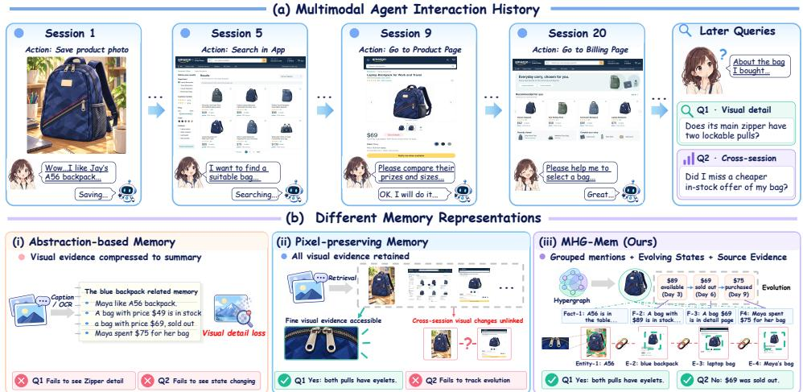  
Figure 1: (a) Long-term agent–user multimodal interaction example. (b) Comparison of existing approaches: (i) Abstraction-based memory loses visual details (failing Q1, Q2); (ii) Pixel-preserving memory lacks persistent identity–evolution bindings (failing Q2); (iii) Our MHG-Mem organizes multimodal observations via typed hyperedges, preserving both finegrained visual crops for inspection and traceable evolution across diverse entity mentions.

Addressing this question requires preserving individual observations while explicitly organizing how they relate across sessions. The underlying memory structure is inherently higher-order: the same entity may be observed diferently across sessions, with each observation jointly associating several entity mentions, facts, and visual evidence, while its evolutions must integrate these observations into coherent state histories. These relationships therefore extend beyond isolated entities or facts and naturally form structured groups at diferent semantic levels. Motivated by this, we propose MHG-Mem, a multimodal hypergraph memory that uses typed hyperedges to explicitly organize these higher-order relationships while preserving each observation separately. Specifically, occurrence hyperedges group identity-consistent entity mentions and their associated facts across sessions, evolution nodes summarize aspect-specific state changes from temporally ordered observations, and evolutionary and evidential hyperedges connect each evolution to the participating entity mentions and its supporting facts, respectively. Because these facts retain provenance to the original dialogue and images, each inferred state remains traceable to its source evidence.

This structured memory naturally exposes evidence at multiple granularities, but diferent queries require diferent retrieval paths. Q1 ultimately requires inspecting a particular source image, whereas Q2 requires first locating the backpack’s state history and then verifying the facts underlying the relevant price and availability states. A fixed retrieval strategy therefore cannot serve both efectively. To this end, we introduce Hypergraph-based Agentic Search, which adaptively selects an entry layer, traverses typed hyperedges across entity, evolution, and fact-level memory, and follows provenance links to inspect source observations when necessary. In this way, compact evolution records guide cross-session reasoning, while grounded facts and images provide fine-grained, verifiable evidence. Our contributions are summarized as follows:

• We propose MHG-Mem, a multimodal hypergraph memory framework that organizes cross-session observations into coherent entity evolution histories through typed hyperedges, while preserving visual evidence and state-specific provenance.

• We introduce Hypergraph-based Agentic Search, which adaptively accesses entity groups, state histories, and their supporting observations to assemble query-relevant evidence across granularities.

• Experiments across three benchmarks and three backbones demonstrate MHG-Mem’s efectiveness, improving average performance by 8.20–9.98% over the strongest baseline.

## 2 Related Work

Long-Term Multimodal Agent Memory. As agents increasingly interact with the physical and digital world, long-term memory research has expanded beyond text-centric systems (Packer et al., 2023; Xu et al., 2025; Kang et al., 2025; Chhikara et al., 2025; Zhong et al., 2024; Yuan et al., 2026) to multimodal retrieval (Chen et al., 2022; Yeo et al., 2026; Tang et al., 2026), episodic video memory (Jeong et al., 2025; Fan et al., 2025), and multimodal conversational memory (Bei et al., 2026; Maharana et al., 2024). Recent benchmarks further examine whether agents can retain action trajectories, and visually evolving states across long-horizon interactions (Liu et al., 2026a; Guo et al., 2026). Existing systems address important aspects of this problem by compressing observations into semantic abstractions (Wang & Chen, 2025; Feng et al., 2026; Jain et al., 2025), organizing experiences around entities or events for cross-session reasoning (Long et al., 2025; Chen et al., 2026; Nguyen et al., 2026; Liu et al., 2026b), and retrieving evidence across modalities or memory stores (Kang et al., 2026; Lu et al., 2026; Tian et al., 2026). Yet these capabilities remain dificult to reconcile: semantic abstraction improves memory organization but may discard visual cues needed to distinguish similar observations, while preserving raw pixels alone does not establish which observations refer to the same entity or how their attributes evolve over time. MHG-Mem jointly addresses these challenges by preserving multimodal occurrences, associating them with persistent entity identities, synthesizing aspect-specific state histories, and grounding each state in supporting facts and source images within a typed hypergraph, enabling agentic search to traverse between compact abstractions and verifiable evidence.

Hypergraph-based Agent Memory. Graph memory has evolved from knowledge graphs (Rasmussen et al., 2025; Gutierrez et al., 2024), toward entity-centered graph such as M3-Agent (Long et al., 2025) and query-aware evidence expansion in GraphMemix (Li et al., 2026). Hypergraph methods then make higher-order membership explicit: Hyper-GraphRAG (Luo et al., 2025b) represents n-ary facts for corpus-level RAG, HGMEM (Zhou et al., 2025) uses hypergraph working memory for multi-step reasoning, and HyperMem (Yue et al., 2026) organizes long conversations as topic–episode–fact hypergraphs with coarse-tofine retrieval. Despite their efectiveness, these approaches remain largely confined to textcentric memory organization, limiting their applicability to information-dense and dynamically evolving multimodal agent interactions. In contrast, MHG-Mem uses typed hyperedges to jointly organize persistent multimodal occurrences, entity-specific aspect evolutions and provenance, enabling identity-aware state tracking and fine-grained visual verification within a unified long-term memory framework.

## 3 Methodology

To track entity states across sessions while preserving their supporting evidence, we propose MHG-Mem, a multimodal hypergraph memory framework. Typed hyperedges organize entity mentions, facts, and state evolutions into reusable histories while retaining observationspecific visual evidence and links from individual states to their sources. Hypergraph-based agentic search then adapts retrieval to the query, navigating these histories and inspecting the underlying evidence as needed. Figure 2 illustrates (a) memory construction, (b) the multimodal hypergraph memory structure, and (c) hypergraph-based agentic search.

Provenance-Preserving Multimodal Hypergraph Memory  
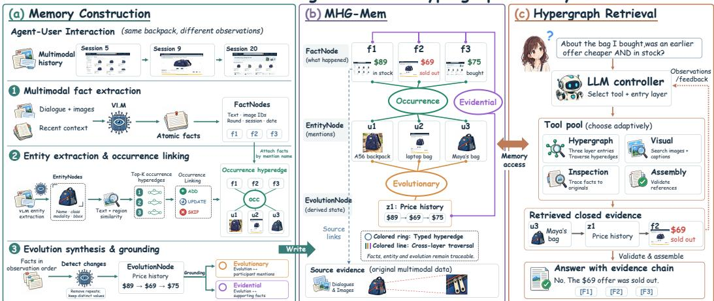  
Figure 2: Overview of MHG-Mem. (a) Memory construction proceeds through three steps. (b) The three-layer MHG-Mem architecture and three types of hyperedges enable cross-layer traversal and provenance tracing. (c) Hypergraph-based agentic search employs four types of tools to adaptively construct query-aware evidence chains.

## 3.1 Problem Formulation

Let $\mathcal { D } _ { \leq T } = ( d _ { 1 } , \ldots , d _ { T } )$ denote an agent’s ordered multimodal interaction history across sessions , where each round $\boldsymbol { d _ { t } } = \left( \boldsymbol { x _ { t } } , \mathcal { T } _ { t } , \delta _ { t } \right)$ comprises dialogue text $x _ { t } ,$ , images $\mathcal { T } _ { t } .$ and a recorded date $\delta _ { t } . \mathrm { ~ A ~ }$ memory construction operator W maps this history to persistent memory $\mathcal { M } _ { T } = \mathcal { W } ( \mathcal { D } _ { \leq T } )$ before subsequent queries are known. Given a query $\boldsymbol { q } = \left( \boldsymbol { x } _ { q } , \mathcal { T } _ { q } \right)$ with optional visual input $\scriptstyle { \mathcal { T } } _ { q } ,$ a retrieval operator $s$ selects relevant evidence from $\mathcal { M } _ { T }$ . A multimodal agent then generates an answer conditioned on the query and retrieved evidence:

$$
E _ { q } = { \cal S } ( q , M _ { T } ) , \qquad \hat { y } \sim p _ { \theta } ( \mathbf { \hat { \mu } } \cdot \mathbf { \hat { \mu } } q , E _ { q } ) ,\tag{1}
$$

where $E _ { q }$ denotes the retrieved evidence and θ denotes fixed model parameters. The objective is to design W and S to support accurate answering of multimodal agent.

## 3.2 Multimodal Hypergraph Memory Structure

MHG-Mem represents multimodal memory using three node types and three types of n-ary hyperedges. Nodes encode memory units at diferent levels of granularity, while hyperedges capture cross-level associations and provenance, allowing high-level memory to be traced back to their supporting evidence. We formalize this memory as an attributed hypergraph:

$$
\begin{array} { r } { \mathcal { H } = ( \mathcal { V } , \mathcal { E } , \iota , \tau _ { V } , \tau _ { E } ) , \quad \mathcal { V } = \mathcal { F } \dot { \cup } \mathcal { U } \dot { \cup } \mathcal { Z } , \quad \mathcal { E } = \mathcal { E } _ { \mathrm { o c c } } \dot { \cup } \mathcal { E } _ { \mathrm { e v o } } \dot { \cup } \mathcal { E } _ { \mathrm { e v d } } , \quad \iota : \mathcal { E }  2 ^ { \mathcal { V } } } \end{array}\tag{2}
$$

where ι(e) denotes the set of nodes incident to hyperedge $e ,$ while $\tau _ { V }$ and $\tau _ { E }$ specify the node and hyperedge types, respectively. The contribution of nodes and hyperedges is defined as follows: ❶ FactNodes store atomic multimodal observations. ❷ EntityNodes store individual textual or visual entity mentions. We denote EntityNodes linked to the same underlying entity as a referent group r. ❸ EvolutionNodes store state changes in an entity attribute or relation. ❹ Occurrence hyperedges bind a referent’s EntityNodes to its associated FactNodes. ❺ Evolutionary hyperedges connect EvolutionNodes to its associated EntityNodes. ❻ Evidential hyperedges connect EvolutionNodes to the supporting FactNodes used for verification.

The complete node, hyperedge, and incidence definitions are given in Appendix B.1. The notation is summarized in Appendix A. This memory structure supports cross-session identity tracking, state synthesis, and provenance tracing while preserving original visual evidence.

## 3.3 MHG-Mem Construction

Step 1: Multimodal Fact Extraction. In each round $d _ { t }$ , a vision-language model (VLM) extracts atomic multimodal fact descriptions from dialogue and images, using recent withinsession context $\mathcal { C } _ { t }$ to resolve references. These descriptions are grounded as FactNodes:

$$
\mathcal { F } _ { t } = \mathrm { G r o u n d } _ { t } ( \mathrm { V L M } _ { \mathrm { f a c t } } ( d _ { t } ; \mathcal { C } _ { t } ) ) ,\tag{3}
$$

where Ground creates each $f = ( \ell _ { f } , \mathscr { T } _ { f } , t _ { f } , s _ { f } , \delta _ { f } )$ by attaching the current round’s image identifiers and source metadata to the extracted description $\ell _ { f }$

Step 2: Multimodal Entity Extraction and Occurrence Linking. A VLM extracts multimodal entity mentions from $d _ { t }$ . For each mention $u ,$ we score an occurrence hyperedge by independently maximizing textual and visual similarity over its constituent EntityNodes:

$$
s ( u , e _ { r } ^ { \mathrm { o c c } } ) = w _ { T } \operatorname* { m a x } _ { v \in \mathcal { U } _ { r } } c _ { T } ( u , v ) + w _ { I } \operatorname* { m a x } _ { v \in \mathcal { U } _ { r } ^ { \mathrm { v i s } } } c _ { I } ( u , v ) .\tag{4}
$$

Here, $c _ { T }$ and $c _ { I }$ are cosine similarities between mention-name and image-region embeddings, respectively, and ${ \mathcal { U } } _ { r } ^ { \mathrm { v i s } }$ contains the visual mentions in $\mathcal { U } _ { r }$ . Conditioned on $d _ { t } , \ u ,$ and the top-K hyperedges ranked by $s ,$ the model selects one of three actions for occurrence linking: UPDATE adds u to the mention set $\mathcal { U } _ { r }$ of a matching referent group, ADD creates a new group r with $\mathcal { U } _ { r } = \{ \boldsymbol { u } \}$ and its occurrence hyperedge, and SKIP rejects an invalid entity mention. Each accepted mention remains a distinct EntityNode, retaining its visual region when available. We then attach facts in $\mathcal { F } _ { t }$ to occurrence hyperedges by mention-name matching:

$$
{ \mathcal { F } } _ { r }  { \mathcal { F } } _ { r } \cup \{ f \in { \mathcal { F } } _ { t } : A ( f , e _ { r } ^ { \mathrm { o c c } } ) = 1 \} .\tag{5}
$$

Here, $A ( f , e _ { r } ^ { \mathrm { o c c } } ) \in \{ 0 , 1 \}$ is a lexical matching indicator that equals 1 if $\ell _ { f }$ contains the name of at least one EntityNode in $\mathcal { U } _ { r }$ . The resulting membership is $\iota ( e _ { r } ^ { \mathrm { o c c } } ) \doteq \mathcal { U } _ { r } \cup \mathcal { F } _ { r }$ .

Step 3: Evolution Synthesis and Grounding. To track the evolving states of the same entity across sessions, we synthesize the facts grouped by each occurrence hyperedge into state histories with explicit evidence grounding. For each occurrence hyperedge $e _ { r } ^ { \mathrm { o c c } }$ candidate EvolutionNodes $\widehat { \mathcal { Z } } _ { r }$ are generated from the associated facts ${ \mathcal { F } } _ { r }$ :

$$
\begin{array} { r } { \widehat { \mathcal { Z } } _ { r } = \mathrm { L L M } _ { \mathrm { e v o } } ( \operatorname { O r d e r } ( \mathcal { F } _ { r } ) ) , } \end{array}\tag{6}
$$

where Order follows observation-order $t _ { f }$ in $\mathcal { D } _ { \leq T }$ . The model identifies changes in the same attribute or relation $a _ { z }$ across sessions, excluding repeated descriptions and incidental scene variation. Each retained $z \in { \widehat { \mathcal { Z } } } _ { r }$ records the subject referent $r _ { z } = r$ , summary $\sigma _ { z }$ , update type $\kappa _ { z }$ (replacement, update, or addition), and state sequence

$$
S _ { z } = \left( \left( \boldsymbol { v } _ { j } , f _ { j } \right) \right) _ { j = 1 } ^ { m _ { z } } , \qquad \mathcal { F } _ { z } = \left\{ f _ { j } : 1 \leq j \leq m _ { z } \right\} \subseteq \mathcal { F } _ { r _ { z } } ,\tag{7}
$$

where $v _ { j }$ is the changing value extracted for $a _ { z } .$ , and the $m _ { z }$ states follow observation order.   
Retention requires valid references within $\mathcal { F } _ { r _ { z } }$ and at least two distinct values.

The evolutionary hyperedge $e _ { z } ^ { \mathrm { e v o } }$ then connects z to subject mentions $\mathcal { U } _ { z } ^ { \mathrm { s u b j } } \subseteq \mathcal { U } _ { r _ { 3 } }$ and coactor mentions $\mathcal { U } _ { z } ^ { \mathrm { c o } }$ . Coactors come from cited rounds of other groups $r ^ { \prime } \neq r _ { z }$ sharing supporting facts, $\mathcal { F } _ { r ^ { \prime } } \cap \mathcal { F } _ { z } \neq \emptyset$ . The evidential hyperedge $e _ { z } ^ { \mathrm { e v d } }$ links z to its supporting facts $\mathcal { F } _ { z }$ , with $S _ { z }$ retaining the individual state–fact correspondence. Please refer to Appendix B.2 for more details of MHG-Mem construction.

## 3.4 Hypergraph-based Agentic Search

Since diferent queries require integrating evidence at diferent levels of granularity, fixed retrieval and graph traversal still struggle to get the optimal evidence chain (Luo et al., 2025a). We therefore implement $s$ as agentic search that adaptively selects a memory layer, traverses hyperedges across memory layers, and follows provenance links to sources.

Adaptive Search. Given a multimodal query q with optional images and search history $h _ { k } = ( ( a _ { i } , o _ { i } ) ) _ { i < k }$ , an LLM controller $\pi _ { \theta }$ selects a tool call $a _ { k }$ and receives observation $o _ { k } \colon$

$$
a _ { k } \sim \pi _ { \theta } ( \cdot \mid q , h _ { k } ) , \qquad o _ { k } = \mathrm { E x e c u t e } ( a _ { k } , { \mathcal { M } } _ { T } ) .\tag{8}
$$

Four tool types support this agent loop: (i) Hypergraph Tool (ii) Visual Tool (iii) Inspection Tool and (iv) Assembly Tool. Table 4 shows the tool details, the search process is outlined in Algorithm 2.

Hypergraph Retrieval. Each memory layer provides an isolated search tool (as described in Table 4), with hyperedge traversal among retrieved entities, evolutions and facts.

Fact-layer Search. For a search query w generated by the LLM, we rank $f \in { \mathcal { F } }$ using

$$
s _ { F } ( w , q , f ) = \lambda _ { T } s _ { T } ( w , f ) + \lambda _ { T I } s _ { T I } ( w , f ) + \lambda _ { I I } s _ { I I } ( q , f ) ,\tag{9}
$$

where $s _ { T } , \ s _ { T I } ,$ and $s _ { I I }$ measure text–text, text–image, and image–image cosine similarity with weights $\lambda _ { T } , \lambda _ { T I } ,$ , and $\lambda _ { I I }$ . Visual terms take the best match over associated images, including $\mathcal { T } _ { q }$ for $s _ { I I }$ . Retrieved facts retain their source references for inspection.

Entity-layer Search. A name or query image identifies referent groups through maximum textual similarity to referent entity names and visual similarity over ${ \mathcal { U } } _ { r } ^ { \mathrm { v i s } }$ (equation 4). We then traverse each matched occurrence hyperedge $e _ { r } ^ { \mathrm { o c c } }$ from the entity layer to the fact layer $\mathcal { F } _ { r } = \iota ( e _ { r } ^ { \mathrm { o c c } } ) \cap \mathcal { F }$ . This gathers observations of the same underlying entity across rounds.

Evolution-layer Search. To retrieve how an entity changes over time, we first identify its referent group r from a name or query image and retrieve the EvolutionNodes belonging to that group $( r _ { z } = r )$ . The evolutionary hyperedge $e _ { z } ^ { \mathrm { e v o } }$ connects each such node to mentions of its subject entity. We then compare the query text $x _ { q }$ with each node’s attribute $a _ { z }$ and summary $\sigma _ { z }$ to assess relevance:

$$
s _ { Z } ( q , z ) = \cos \bigl ( \phi _ { T } ( x _ { q } ) , \phi _ { T } ( a _ { z } \parallel \sigma _ { z } ) \bigr ) .\tag{10}
$$

Here, $\phi _ { T }$ encodes text, cos(·) denotes cosine similarity, and ∥ concatenates the attribute and summary. For each selected $z ,$ we traverse its evidential hyperedge $e _ { z } ^ { \mathrm { e v d } }$ from the evolution layer to the fact layer, getting the supporting facts $\mathcal { F } _ { z }$ in the order recorded by $S _ { z }$

Cross-layer Traversal. A traversal step moves from a retrieved node $v \in \mathcal V$ to another memory layer through incident hyperedges. Given selected hyperedges ${ \mathcal { E } } ^ { \prime } \subseteq { \mathcal { E } }$ and a target layer $\check { \mathcal { V } ^ { \prime } } \in \left\{ \mathcal { F } , \mathcal { U } , \mathcal { Z } \right\}$ with $v \not \in \mathcal { V } ^ { \prime }$ , the cross-layer traversal can be formalized as:

$$
{ \mathrm { T r a v e r s e } } ( v , { \mathcal { E } } ^ { \prime } , \mathcal { V } ^ { \prime } ) = \bigcup _ { e \in { \mathcal { E } } ^ { \prime } , v \in \iota ( e ) } ( \iota ( e ) \cap \mathcal { V } ^ { \prime } ) .\tag{11}
$$

Source Inspection and Evidence Assembly. The Inspection Tool follows $\rho ( \cdot )$ from retrieved FactNodes to the original observations, enabling the controller to inspect finegrained evidence for queries that require detailed information or visual verification. For an EvolutionNode $z ,$ traversing $e _ { z } ^ { \mathrm { e v d } }$ to supporting facts $f \in \mathcal { F } _ { z }$ and then following $\rho ( f )$ keeps its state history traceable to the original observations. The Assembly Tool organizes selected evidence and image references, together with optional summary, into an evidence chain $E _ { q }$ . After reference validation, this chain is submitted to the $\mathrm { Q A }$ model with the cited textual and visual evidence to answer q as in Equation equation 1.

## 4 Experiment

## 4.1 Experimental Setup

Benchmarks and Metrics. We evaluate on three multimodal memory benchmarks: Mem-Eye (Guo et al., 2026), Mem-Gallery (Bei et al., 2026), and WorldMemArena-S (subset) (Liu et al., 2026a). We report exact match (EM) for MemEye’s multiple-choice (MCQ) questions, token-level F1 for the other two benchmarks, and BLEU-1 (B-1) and LLM-as-a-judge (Judge) score for open-ended answers on all three. For memory quality evaluation, we follow (Liu et al., 2026a) using the same judging rubrics, recall, and retrieval coverage. Dataset and metric details are provided in Appendix C.1.

Implementation Details. We use Qwen3-VL-8B (Bai et al., 2025), GPT-4.1-mini (OpenAI, 2025), and Qwen3.8-27B (Qwen Team, 2026) as diferent memory backbones, GPT-5.4- mini (OpenAI, 2026) as LLM-as-a-judge model. MHG-Mem uses all-MiniLM-L6-v2 for text embeddings and SigLIP2 (Tschannen et al., 2025) for visual and cross-modal embeddings.

Table 1: Comparison with state-of-the-art memory systems across diferent backbone models. We report Exact Match (EM), BLEU-1 (B-1), and LLM-Judge (Judge) on MemEye, Mem-Gallery, and WorldMemArena-S. Avg. J. denotes the average Judge score across the three benchmarks. Bold and underlined results indicate the best and second-best performance, respectively.
<table><tr><td rowspan="2">Type</td><td rowspan="2">Method</td><td rowspan="2">Venue</td><td colspan="3">MemEye</td><td colspan="3">Mem-Gallery</td><td colspan="3">WorldMemArena-S</td><td rowspan="2">Avg. J.</td></tr><tr><td>EM</td><td>B-1</td><td>Judge</td><td>F1</td><td>B-1</td><td>Judge</td><td>F1</td><td>B-1</td><td>Judge</td></tr><tr><td colspan="10">Qwen3-VL-8B</td><td></td><td></td><td></td></tr><tr><td rowspan="4">Unimodal</td><td>A-Mem</td><td>NIPS&#x27;25</td><td>45.15</td><td>19.22</td><td>29.38</td><td>47.68</td><td>41.76</td><td>66.93</td><td>25.23</td><td>12.16</td><td>46.57</td><td>47.63</td></tr><tr><td>MemoryOS</td><td>EMNLP&#x27;25</td><td>40.23</td><td>17.22</td><td>26.28</td><td>39.36</td><td>35.28</td><td>58.86</td><td>10.24</td><td>3.50</td><td>20.18</td><td>35.11</td></tr><tr><td>SimpleMem</td><td>ICML&#x27;26</td><td>44.27</td><td>16.04</td><td>31.26</td><td>37.36</td><td>33.12</td><td>52.43</td><td>14.33</td><td>4.71</td><td>33.50</td><td>39.06</td></tr><tr><td>HyperMem</td><td>ACL&#x27;26</td><td>42.31</td><td>16.84</td><td>28.42</td><td>41.05</td><td>32.80</td><td>62.56</td><td>20.06</td><td>12.33</td><td>40.45</td><td>43.81</td></tr><tr><td rowspan="4">Multimodal</td><td>M2A</td><td>Arxiv&#x27;26</td><td>39.96</td><td>10.40</td><td>18.41</td><td>18.19</td><td>14.03</td><td>37.65</td><td>23.02</td><td>11.31</td><td>41.64</td><td>32.57</td></tr><tr><td>MMA</td><td>AACL&#x27;26</td><td>46.92</td><td>20.62</td><td>38.17</td><td>34.80</td><td>30.34</td><td>57.49</td><td>21.73</td><td>10.82</td><td>38.95</td><td>44.87</td></tr><tr><td>SRAG</td><td>Arxiv&#x27;26</td><td>56.78</td><td>24.87</td><td>41.80</td><td>40.74</td><td>35.89</td><td>63.62</td><td>23.53</td><td>11.21</td><td>43.93</td><td>49.78</td></tr><tr><td>UniversalRAG</td><td>ACL&#x27;26</td><td>57.48</td><td>23.92</td><td>42.09</td><td>51.05</td><td>46.39</td><td>66.23</td><td>14.96</td><td>5.06</td><td>36.33</td><td>48.21</td></tr><tr><td>Ours</td><td>MHG-Mem</td><td></td><td>61.26 26.52</td><td></td><td>46.28</td><td>66.00</td><td>60.90</td><td>76.89</td><td>23.17</td><td>15.29</td><td>50.78</td><td>57.98 (+8.20)</td></tr><tr><td colspan="10">GPT-4.1-mini</td></tr><tr><td>Unimodal</td><td>A-Mem MemoryOS</td><td>NIPS&#x27;25 EMNLP&#x27;25</td><td>49.73 45.75</td><td>21.11 13.12</td><td>38.27 34.91</td><td>44.08 43.09</td><td>38.37 37.76</td><td>64.35 64.64</td><td>33.39 17.46</td><td>17.54 6.63</td><td>60.40 35.87</td><td>54.34 45.14</td></tr><tr><td rowspan="4"></td><td>SimpleMem HyperMem</td><td>ICML&#x27;26</td><td>50.34</td><td>9.42</td><td>42.59</td><td>34.73</td><td>28.90</td><td>58.33</td><td>23.75</td><td>14.71</td><td>56.13</td><td>52.35</td></tr><tr><td></td><td>ACL&#x27;26</td><td>47.82</td><td>19.64</td><td>36.43</td><td>44.57</td><td>33.42</td><td>66.76</td><td>24.91</td><td>15.62</td><td>52.04</td><td>51.74</td></tr><tr><td>M2A</td><td>Arxiv&#x27;26</td><td>52.31</td><td>6.31</td><td>44.50</td><td>15.04</td><td>10.28</td><td>51.81</td><td>29.26</td><td>18.55</td><td>53.38</td><td>49.90</td></tr><tr><td>MMA</td><td>AACL&#x27;26</td><td>50.96</td><td>16.32</td><td>43.81</td><td>26.99</td><td>20.60</td><td>60.87</td><td>30.10</td><td>16.33</td><td>51.15</td><td>51.95</td></tr><tr><td rowspan="4">Multimodal Ours</td><td>SRAG</td><td>Arxiv&#x27;26</td><td>58.36</td><td>31.48</td><td>50.54</td><td>41.07</td><td>35.03</td><td>67.06</td><td>30.47</td><td>18.34</td><td>54.27</td><td>57.29</td></tr><tr><td>UniversalRAG</td><td>ACL&#x27;26</td><td>60.49</td><td>11.23</td><td>52.61</td><td>48.36</td><td>41.90</td><td>70.63</td><td>26.44</td><td>13.03</td><td>50.95</td><td>58.06</td></tr><tr><td>MHG-Mem</td><td></td><td></td><td></td><td></td><td></td><td></td><td></td><td></td><td></td><td></td><td></td></tr><tr><td></td><td></td><td>66.84</td><td>22.36</td><td>59.73</td><td>52.58</td><td>45.75</td><td>81.56</td><td>33.61</td><td>21.52</td><td>62.57</td><td>67.95(+9.89)</td></tr><tr><td colspan="10">Qwen3.8-27B</td></tr><tr><td rowspan="4"></td><td></td><td></td><td></td><td></td><td></td><td></td><td></td><td>75.98</td><td>27.99</td><td>13.92</td><td>57.49</td><td>55.71</td></tr><tr><td>A-Mem MemoryOS</td><td>NIPS&#x27;25 EMNLP&#x27;25</td><td>45.10 42.24</td><td>18.13 16.67</td><td>33.64</td><td>60.56</td><td>54.37 37.49</td><td>70.19</td><td>10.17</td><td>3.76</td><td>20.95</td><td>39.80</td></tr><tr><td>SimpleMem</td><td>ICML&#x27;26</td><td>47.84</td><td>5.37</td><td>28.25 37.40</td><td>42.82 49.43</td><td>43.26</td><td>68.70</td><td>18.95</td><td>7.34</td><td>46.33</td><td>50.81</td></tr><tr><td>HyperMem</td><td>ACL&#x27;26</td><td>50.56</td><td>21.02</td><td>39.66</td><td>47.23</td><td>36.64</td><td>73.03</td><td>22.84</td><td>10.61</td><td>50.57</td><td>54.42</td></tr><tr><td rowspan="4">Multimodal</td><td>M2A</td><td>Arxiv&#x27;26</td><td>48.23</td><td>19.51</td><td>35.90</td><td>20.46</td><td>15.49</td><td>65.30</td><td>28.15</td><td>14.14</td><td>55.58</td><td>52.25</td></tr><tr><td>MMA</td><td>AACL&#x27;26</td><td>56.47</td><td>24.95</td><td>47.30</td><td>35.18</td><td>29.03</td><td>69.32</td><td>26.66</td><td>13.35</td><td>52.80</td><td>56.47</td></tr><tr><td>SRAG</td><td>Arxiv&#x27;26</td><td>66.95</td><td>28.26</td><td>53.37</td><td>41.45</td><td>35.68</td><td>75.80</td><td>28.78</td><td>13.97</td><td>59.69</td><td>62.95</td></tr><tr><td>UniversalRAG</td><td>ACL&#x27;26</td><td>67.85</td><td>13.45</td><td>60.64</td><td>57.30</td><td>50.51</td><td>76.18</td><td>22.11</td><td>9.34</td><td>53.07</td><td>63.30</td></tr><tr><td>Ours</td><td>MHG-Mem</td><td></td><td>78.76</td><td>39.54</td><td>65.93</td><td>66.07</td><td>59.84</td><td>87.85</td><td>30.48</td><td>21.21</td><td>66.05</td><td>73.28 (+9.98)</td></tr></table>

For a fair comparison, we reproduce all baseline methods with the same model setting and running environment of MHG-Mem. Results are averaged over 3 runs. Additional implementation settings are provided in Appendix C.2.

Baselines. We compare with four unimodal memory methods using dense image caption: A-Mem (Xu et al., 2025), MemoryOS (Kang et al., 2025), SimpleMem (Liu et al., 2026c), and HyperMem (Yue et al., 2026); and four multimodal memory or RAG methods: M2A (Feng et al., 2026), MMA (Lu et al., 2026), SRAG (Guo et al., 2026), and UniversalRAG (Yeo et al., 2026). Detailed baseline descriptions are deferred to Appendix C.3.

## 4.2 Main Results

Table 1 compares MHG-Mem with eight memory systems across three benchmarks and three backbones. Figure 3 shows memory quality on WorldMemArena-S and fine-grained task performance on WorldMemArena-S and Mem-Gallery. We highlight four key findings:

(1) MHG-Mem consistently outperforms existing memory systems across benchmarks and backbones. MHG-Mem achieves the highest Judge score in every benchmark– backbone setting, with Avg. J. scores of 57.98% (+8.20%), 67.95% (+9.89%), and 73.28% (+9.98%) on Qwen3-VL-8B, GPT-4.1-mini, and Qwen3.8-27B, respectively. Moreover, MHG-Mem achieves the best or second-best results on metrics including EM, BLEU-1, and F1. These consistent improvements across models and benchmarks demonstrate the efectiveness and generalization of provenance-preserving multimodal hypergraph memory.

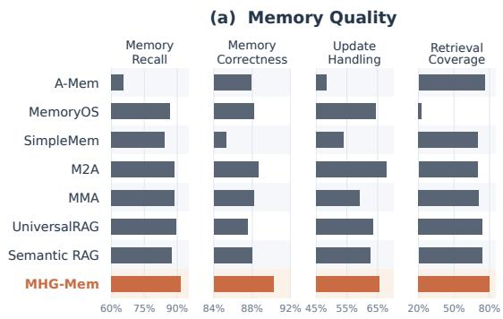

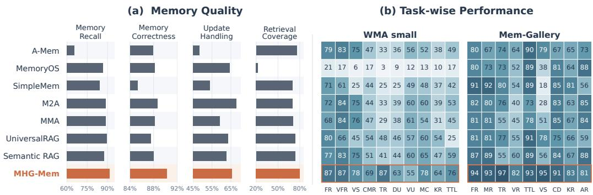  
Figure 3: (a) Memory quality and (b) fine-grained tasks performance on WorldMemArena-S (WMA-S) and Mem-Gallery with Qwen3.8-27B.

(2) Efective visual memory requires structured access to preserved observations. On the visual-centric MemEye benchmark, MHG-Mem with Qwen3.8-27B achieves 78.76% EM, compared with 67.85% for UniversalRAG and 66.95% for SRAG. A similar advantage appears in visually demanding categories in Figure 3(b): MHG-Mem achieves 82% versus 60% on visual reasoning (VR) in Mem-Gallery and 87% versus 83% on visual fact recall (VFR) in WorldMemArena-S. These results suggest that retaining images alone is insuficient when relevant observations cannot be reliably associated with the underlying entity. Occurrence hyperedges address this limitation by grouping visually diverse mentions of the same referent while preserving direct access to observation-specific visual evidence.

(3) Substantial performance gains on temporal and cross-modal reasoning. MHG-Mem achieves the best performance in 17 of the 19 task categories in Figure 3(b), with particularly large gains on tasks requiring integration of observations across sessions. On WorldMemArena-S, temporal reasoning (TR) improves from 48% to 87% over the strongest baseline, while dynamic update (DU), test-time learning (TTL), and cross-modal reasoning (CMR) improve by 17%, 17%, and 15%, respectively. On Mem-Gallery, visual reasoning (VR) and temporal reasoning (TR) improve by 18% and 17%. These gains are supported by our evolution design, which summarize time-ordered entity states to guide retrieval, together with evidential hyperedges that preserve state–fact correspondence and enable provenance tracing from synthesized states back to the originating dialogue and images.

(4) Memory quality and evidence accessibility improve together. As shown in Figure 3(a), MHG-Mem achieves the highest memory recall, memory correctness, and retrieval coverage among all compared systems. The simultaneous improvement in memory quality and coverage indicates that MHG-Mem preserves useful information accurately while keeping its supporting evidence readily accessible.

## 4.3 Ablation Study

Tables 2 and 3 evaluate memory construction and retrieval components using the average LLM-judge score across the three benchmarks. Memory components are introduced cumulatively, whereas retrieval components are removed individually. Specifically, w/o Agentic Search replaces agentic search with three-layer top-k retrieval; w/o Inspection Tool, w/o Cross-layer Traversal, and w/o Visual Tool disable the corresponding functionality.

Memory-side ablation. (1) Efectiveness of the entity node with occurrence hyperedge. The entity layer with occurrence hyperedges improves performance by 5.48% over fact-only memory. Occurrence hyperedges account for 4.78% of this gain, with improvements across all three benchmarks. These hyperedges connect mentions and facts associated with the same entity, enabling retrieval of its observations across sessions. (2) Efectiveness of the evolution node with evolutionary hyperedge. The evolution layer with evolutionary hyperedges yields a further 3.37% improvement. This representation makes state histories directly retrievable and associates them with entities in subject and coactor roles, supporting reasoning about changes across sessions. (3) Efectiveness of the evidential hyperedge. Evidential hyperedges provide an additional 1.56% gain by linking evolution states to their supporting facts. These connections preserve provenance and allow retrieved states to be checked against the observations from which they were derived.

Table 2: Ablation of memory side with Qwen3.8-27B.
<table><tr><td>Layers</td><td>Hyperedges</td><td></td><td>MemEye Mem-Gallery WMA-S</td><td></td><td>Avg.</td></tr><tr><td>F</td><td></td><td>53.81</td><td>76.08</td><td>58.72</td><td>62.87</td></tr><tr><td>F∪U</td><td></td><td>54.06</td><td>77.54</td><td>59.10</td><td>63.57</td></tr><tr><td>FUU</td><td>εocc</td><td>60.69</td><td>82.13</td><td>62.24</td><td>68.35</td></tr><tr><td>F∪U∪Z</td><td>Eocc  Eevo</td><td>64.70</td><td>85.48</td><td>64.97</td><td>71.72</td></tr><tr><td>F∪UZ εoccεevoεevd|</td><td></td><td>65.93</td><td>87.85</td><td>66.05</td><td>73.28</td></tr></table>

Table 3: Ablation of retrieval side with Qwen3.8-27B.
<table><tr><td>Method</td><td>MemEye Mem-Gallery WMA-S</td><td></td><td></td><td>Avg.</td></tr><tr><td>w/o Agentic Search</td><td>60.59</td><td>82.06</td><td>61.90</td><td>68.18</td></tr><tr><td>w/o Inspection Tool</td><td>61.77</td><td>84.64</td><td>63.12</td><td>69.84</td></tr><tr><td>w/o Cross-layer Traversal</td><td>62.33</td><td>84.49</td><td>63.74</td><td>70.19</td></tr><tr><td>w/o Visual Tool</td><td>63.52</td><td>86.98</td><td>65.23</td><td>71.91</td></tr><tr><td>MHG-Mem (Full)</td><td>65.93</td><td>87.85</td><td>66.05</td><td>73.28</td></tr></table>

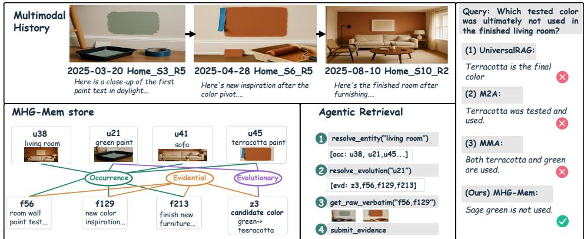  
Figure 4: Case study in a home renovation scenario. MHG-Mem tracks wall paint color changes through evolution nodes and traces supporting facts to source images via evidential hyperedges, forming a verifiable evidence chain.

Retrieval-side ablation. (1) Efectiveness of agentic search. Three-layer top-k retrieval underperforms agentic search by 5.10%, the largest decline among the retrieval ablations. This result supports query-adaptive selection of retrieval entry points and subsequent evidence expansion. (2) Efectiveness of the inspection tool. Without source inspection, performance falls by 3.44%, the largest decline among individual tool ablations. Access to original dialogue and images enables the agent to verify fine-grained evidence that facts and evolution summaries may omit. (3) Efectiveness of cross-layer traversal. Removing cross-layer traversal reduces performance by 3.09%. Traversal connects entities to their associated facts and evolution records to supporting observations, allowing the agent to assemble evidence across memory granularities. (4) Efectiveness of the visual tool. Performance decreases by 1.37% when image retrieval is disabled. Direct visual search provides a complementary route to relevant observations, extending evidence access beyond entity- and evolution-centred retrieval.

## 4.4 Case Analysis

Figure 4 illustrates the advantages of MHG-Mem in a home renovation scenario involving successive living room color schemes. To identify the scheme the user did not adopt, the memory system must trace the progression from color trials through revisions to completion and inspect the corresponding images. UniversalRAG and M2A retrieve bedroom images by similarity but miss the initial color information, while MMA preserves the pixels without tracking the evolving schemes. MHG-Mem identifies paint as the tracked entity, preserves its mentions across rounds, and links atomic facts through occurrence hyperedges. Evolution nodes record the change in candidate color from sage green to terracotta. During retrieval, the agent follows evidential hyperedges to f56 and f129, then inspects their source images to verify the colors and answer correctly.

## Conclusion

We presented MHG-Mem, a multimodal hypergraph memory framework that organizes visually diverse observations of the same entity into coherent state histories while preserving fine-grained visual evidence. Typed n-ary hyperedges connect entity mentions, atomic facts, and evolution records, keeping individual states traceable to their supporting observations. Hypergraph-based agentic search adaptively navigates these memory levels, using state histories to guide retrieval and original dialogue and images to verify evidence. Ablations demonstrate the contributions of entity associations, explicit state histories, evidence grounding, and adaptive retrieval. These findings support the joint design of memory organization and evidence access for reasoning over evolving multimodal experience.

## References

Shuai Bai, Yuxuan Cai, Ruizhe Chen, Keqin Chen, Xionghui Chen, Zesen Cheng, Lianghao Deng, Wei Ding, Chang Gao, Chunjiang Ge, Wenbin Ge, Zhifang Guo, Qidong Huang, Jie Huang, Fei Huang, Binyuan Hui, Shutong Jiang, Zhaohai Li, Mingsheng Li, Mei Li, Kaixin Li, Zicheng Lin, Junyang Lin, Xuejing Liu, Jiawei Liu, Chenglong Liu, Yang Liu, Dayiheng Liu, Shixuan Liu, Dunjie Lu, Ruilin Luo, Chenxu Lv, Rui Men, Lingchen Meng, Xuancheng Ren, Xingzhang Ren, Sibo Song, Yuchong Sun, Jun Tang, Jianhong Tu, Jianqiang Wan, Peng Wang, Pengfei Wang, Qiuyue Wang, Yuxuan Wang, Tianbao Xie, Yiheng Xu, Haiyang Xu, Jin Xu, Zhibo Yang, Mingkun Yang, Jianxin Yang, An Yang, Bowen Yu, Fei Zhang, Hang Zhang, Xi Zhang, Bo Zheng, Humen Zhong, Jingren Zhou, Fan Zhou, Jing Zhou, Yuanzhi Zhu, and Ke Zhu. Qwen3-VL Technical Report. arXiv preprint arXiv:2511.21631, 2025. URL https://arxiv.org/abs/2511.21631.

Yuanchen Bei, Tianxin Wei, Xuying Ning, Yanjun Zhao, Zhining Liu, Xiao Lin, Yada Zhu, Hendrik Hamann, Jingrui He, and Hanghang Tong. Mem-Gallery: Benchmarking Multimodal Long-Term Conversational Memory for MLLM Agents. arXiv preprint arXiv:2601.03515, 2026. URL https://arxiv.org/abs/2601.03515.

Wenhu Chen, Hexiang Hu, Xi Chen, Pat Verga, and William W. Cohen. MuRAG: Multimodal Retrieval-Augmented Generator for Open Question Answering over Images and Text. In Proceedings of the 2022 Conference on Empirical Methods in Natural Language Processing, pp. 5558–5570, Abu Dhabi, United Arab Emirates, December 2022. Association for Computational Linguistics. doi: 10.18653/v1/2022.emnlp-main.375. URL https://aclanthology.org/2022.emnlp-main.375/.

Yijun Chen, Yaqi Zheng, Yanya Li, Boyi Xiao, Buqiang Xu, Shuofei Qiao, Jizhan Fang, Xinle Deng, Yunzhi Yao, Xuehai Wang, Liuxin Zhang, Hui Li, Huajun Chen, and Shumin Deng. EM2Mem: Event-Centric Multimodal Memory for Large Language Models. arXiv preprint arXiv:2609.00551, 2026. URL https://arxiv.org/abs/2609.00551.

Prateek Chhikara, Dev Khant, Saket Aryan, Taranjeet Singh, and Deshraj Yadav. Mem0: Building production-ready ai agents with scalable long-term memory. arXiv preprint arXiv:2504.19413, 2025.

Yue Fan, Xiaojian Ma, Rujie Wu, Yuntao Du, Jiaqi Li, Zhi Gao, and Qing Li. VideoAgent: A Memory-Augmented Multimodal Agent for Video Understanding. In Computer Vision – ECCV 2024, volume 15080 of Lecture Notes in Computer Science, pp. 75–92, Cham, 2025. Springer Nature Switzerland. doi: 10.1007/978-3-031-72670-5\_5. URL https: //doi.org/10.1007/978-3-031-72670-5\_5.

Junyu Feng, Binxiao Xu, Jiayi Chen, Mengyu Dai, Cenyang Wu, Haodong Li, Bohan Zeng, Yunliu Xie, Hao Liang, Ming Lu, and Wentao Zhang. M2A: Multimodal Memory Agent with Dual-Layer Hybrid Memory for Long-Term Personalized Interactions. arXiv preprint arXiv:2602.07624, 2026. URL https://arxiv.org/abs/2602.07624.

Minghao Guo, Qingyue Jiao, Zeru Shi, Yihao Quan, Boxuan Zhang, Danrui Li, Liwei Che, Wujiang Xu, Shilong Liu, Zirui Liu, Mubbasir Kapadia, Vladimir Pavlovic, Jiang Liu, Mengdi Wang, Yiyu Shi, Dimitris N. Metaxas, and Ruixiang Tang. MemEye: A

Visual-Centric Evaluation Framework for Multimodal Agent Memory. arXiv preprint arXiv:2605.15128, 2026. URL https://arxiv.org/abs/2605.15128.

Bernal Jimenez Gutierrez, Yiheng Shu, Yu Gu, Michihiro Yasunaga, and Yu Su. HippoRAG: Neurobiologically inspired long-term memory for large language models. In The Thirtyeighth Annual Conference on Neural Information Processing Systems, 2024. URL https: //openreview.net/forum?id=hkujvAPVsg.

Jitesh Jain, Shubham Maheshwari, Ning Yu, Wen-mei Hwu, and Humphrey Shi. AU GUSTUS: An LLM-Driven Multimodal Agent System with Contextualized User Memory. arXiv preprint arXiv:2510.15261, 2025. URL https://arxiv.org/abs/2510.15261.

Soyeong Jeong, Kangsan Kim, Jinheon Baek, and Sung Ju Hwang. VideoRAG: Retrieval Augmented Generation over Video Corpus. In Findings of the Association for Computational Linguistics: ACL 2025, pp. 21278–21298, Vienna, Austria, July 2025. Association for Computational Linguistics. doi: 10.18653/v1/2025.findings-acl.1096. URL https://aclanthology.org/2025.findings-acl.1096/.

Dingyi Kang, Dongming Jiang, Yi Li, Guanpeng Li, and Bingzhe Li. V-Mem: Modality-Routed Retrieval for Long-Term Multimodal Agentic Memory. arXiv preprint arXiv:2608.01543, 2026. URL https://arxiv.org/abs/2608.01543.

Jiazheng Kang, Mingming Ji, Zhe Zhao, and Ting Bai. Memory OS of AI Agent. In Proceedings of the 2025 Conference on Empirical Methods in Natural Language Processing, pp. 25961–25970, Suzhou, China, November 2025. Association for Computational Linguistics. doi: 10.18653/v1/2025.emnlp-main.1318. URL https://aclanthology.org/ 2025.emnlp-main.1318/.

Geng Li, Yuhao Wang, Dong Li, Jianye Hao, and Yuxin Peng. GraphMemix: Query-Aware Evidence Forests for Long-Term Multimodal Agent Memory. arXiv preprint arXiv:2608.26983, 2026. URL https://arxiv.org/abs/2608.26983.

Chengzhi Liu, Yuzhe Yang, Sophia Xiao Pu, Yepeng Liu, Lin Long, Yichen Guo, Nuo Chen, Zhaotian Weng, Elena Kochkina, Simerjot Kaur, Charese Smiley, Xiaomo Liu, James Zou, Sheng Liu, Yuheng Bu, Songyou Peng, and Xin Eric Wang. WorldMemArena: Evaluating Multimodal Agent Memory Through Action-World Interaction. arXiv preprint arXiv:2605.29341, 2026a. URL https://arxiv.org/abs/2605.29341.

Jiaqi Liu, Zipeng Ling, Shi Qiu, Yanqing Liu, Siwei Han, Peng Xia, Haoqin Tu, Zeyu Zheng, Cihang Xie, Charles Fleming, Mingyu Ding, and Huaxiu Yao. Omni-SimpleMem: Autoresearch-Guided Discovery of Lifelong Multimodal Agent Memory. arXiv preprint arXiv:2604.01007, 2026b. URL https://arxiv.org/abs/2604.01007.

Jiaqi Liu, Yaofeng Su, Peng Xia, Siwei Han, Zeyu Zheng, Cihang Xie, Mingyu Ding, and Huaxiu Yao. SimpleMem: Eficient Lifelong Memory for LLM Agents. arXiv preprint arXiv:2601.02553, 2026c. URL https://arxiv.org/abs/2601.02553.

Lin Long, Yichen He, Wentao Ye, Yiyuan Pan, Yuan Lin, Hang Li, Junbo Zhao, and Wei Li. Seeing, Listening, Remembering, and Reasoning: A Multimodal Agent with Long-Term Memory. arXiv preprint arXiv:2508.09736, 2025. URL https://arxiv.org/abs/2508. 09736.

Yihao Lu, Wanru Cheng, Zeyu Zhang, and Hao Tang. MMA: Multimodal Memory Agent. arXiv preprint arXiv:2602.16493, 2026. URL https://arxiv.org/abs/2602.16493.

Haoran Luo, Haihong E, Guanting Chen, Qika Lin, Yikai Guo, Fangzhi Xu, Zemin Kuang, Meina Song, Xiaobao Wu, Yifan Zhu, and Anh Tuan Luu. Graph-R1: Towards Agentic GraphRAG Framework via End-to-end Reinforcement Learning. arXiv preprint arXiv:2507.21892, 2025a. URL https://arxiv.org/abs/2507.21892.

Haoran Luo, Haihong E, Guanting Chen, Yandan Zheng, Xiaobao Wu, Yikai Guo, Qika Lin, Yu Feng, Zemin Kuang, Meina Song, Yifan Zhu, and Anh Tuan Luu.

HyperGraphRAG: Retrieval-Augmented Generation via Hypergraph-Structured Knowledge Representation. In Advances in Neural Information Processing Systems, volume 38, Main Conference, pp. 152206–152234. Curran Associates, Inc., 2025b. doi: 10.52202/085713-5089. URL https://proceedings.neurips.cc/paper\_files/paper/ 2025/file/df55ee6e59f8ac4a625219e11fe9ddba-Paper-Conference.pdf.

Adyasha Maharana, Dong-Ho Lee, Sergey Tulyakov, Mohit Bansal, Francesco Barbieri, and Yuwei Fang. Evaluating very long-term conversational memory of llm agents. In Proceedings of the 62nd Annual Meeting of the Association for Computational Linguistics (Volume 1: Long Papers), pp. 13851–13870, 2024.

Viet Nguyen, Thao Nguyen, Vishal M. Patel, and Yuheng Li. Personal Visual Memory from Explicit and Implicit Evidence. arXiv preprint arXiv:2605.28806, 2026. URL https: //arxiv.org/abs/2605.28806.

OpenAI. GPT-4.1 Mini. OpenAI API model documentation, 2025. URL https: //developers.openai.com/api/docs/models/gpt-4.1-mini.

OpenAI. GPT-5.4 Mini. OpenAI API model documentation, 2026. URL https: //developers.openai.com/api/docs/models/gpt-5.4-mini.

Charles Packer, Sarah Wooders, Kevin Lin, Vivian Fang, Shishir G. Patil, Ion Stoica, and Joseph E. Gonzalez. MemGPT: Towards LLMs as Operating Systems. arXiv preprint arXiv:2310.08560, 2023. URL https://arxiv.org/abs/2310.08560.

Qwen Team. Qwen3.8-27B. Hugging Face model card, 2026. URL https://huggingface. co/Qwen/Qwen3.8-27B.

Preston Rasmussen, Pavlo Paliychuk, Travis Beauvais, Jack Ryan, and Daniel Chalef. Zep: A Temporal Knowledge Graph Architecture for Agent Memory. arXiv preprint arXiv:2501.13956, 2025. URL https://arxiv.org/abs/2501.13956.

Jielong Tang, Xujie Yuan, Jiayang Liu, Jianxing Yu, Xiao Dong, Lin Chen, Yunlai Teng, Shimin Di, and Jian Yin. SAKE: Self-aware knowledge exploitation-exploration for grounded multimodal named entity recognition. In Proceedings ofthe 32nd ACM SIGKDD Conference on Knowledge Discovery and Data Mining V.2, KDD ’26, pp. 4592–4603. Association for Computing Machinery, 2026. doi: 10.1145/3770855.3817763. URL https://doi.org/10.1145/3770855.3817763.

Zhoujin Tian, Hao Zhang, Yao Tian, Cheng Chen, Yakun Li, Lei Zhang, and Xiaofang Zhou. Beyond Retrieval: Analytic Memory for Multimodal Agents. arXiv preprint arXiv:2607.29440, 2026. URL https://arxiv.org/abs/2607.29440.

Michael Tschannen, Alexey Gritsenko, Xiao Wang, Muhammad Ferjad Naeem, Ibrahim Alabdulmohsin, Nikhil Parthasarathy, Talfan Evans, Lucas Beyer, Ye Xia, Basil Mustafa, Olivier Hénaf, Jeremiah Harmsen, Andreas Steiner, and Xiaohua Zhai. SigLIP 2: Multilingual Vision-Language Encoders with Improved Semantic Understanding, Lo calization, and Dense Features. arXiv preprint arXiv:2502.14786, 2025. URL https: //arxiv.org/abs/2502.14786.

Yu Wang and Xi Chen. MIRIX: Multi-Agent Memory System for LLM-Based Agents. arXiv preprint arXiv:2507.07957, 2025. URL https://arxiv.org/abs/2507.07957.

Wujiang Xu, Zujie Liang, Kai Mei, Hang Gao, Juntao Tan, and Yongfeng Zhang. A-Mem: Agentic Memory for LLM Agents. In Advances in Neural Information Processing Systems, volume 38, Main Conference, pp. 17577–17604. Curran Associates, Inc., 2025. doi: 10.52202/085713-0593. URL https://proceedings.neurips.cc/paper\_files/paper/ 2025/file/19909c36f51abc4856b4560aff3d36d6-Paper-Conference.pdf.

Woongyeong Yeo, Kangsan Kim, Soyeong Jeong, Jinheon Baek, and Sung Ju Hwang. UniversalRAG: Retrieval-Augmented Generation over Corpora of Diverse Modalities and Granularities. In Proceedings of the 64th Annual Meeting of the Association for Computational Linguistics (Volume 1: Long Papers), pp. 3843–3871, San Diego, California,

United States, July 2026. Association for Computational Linguistics. doi: 10.18653/v1/ 2026.acl-long.177. URL https://aclanthology.org/2026.acl-long.177/.

Xujie Yuan, Shimin Di, Jielong Tang, Libin Zheng, and Jian Yin. Towards self-cognitive exploration: Metacognitive knowledge graph retrieval augmented generation. In Proceedings of the 32nd ACM SIGKDD Conference on Knowledge Discovery and Data Mining V.1, KDD ’26, pp. 1844–1855. Association for Computing Machinery, 2026. doi: 10.1145/3770854.3780156. URL https://doi.org/10.1145/3770854.3780156.

Juwei Yue, Chuanrui Hu, Jiawei Sheng, Zuyi Zhou, Wenyuan Zhang, Tingwen Liu, Li Guo, and Yafeng Deng. HyperMem: Hypergraph Memory for Long-Term Conversations. In Proceedings of the 64th Annual Meeting of the Association for Computational Linguistics (Volume 1: Long Papers), pp. 35237–35254, San Diego, California, United States, July 2026. Association for Computational Linguistics. doi: 10.18653/v1/2026.acl-long.1627. URL https://aclanthology.org/2026.acl-long.1627/.

Wanjun Zhong, Lianghong Guo, Qiqi Gao, He Ye, and Yanlin Wang. Memorybank: Enhancing large language models with long-term memory. In Proceedings of the AAAI conference on artificial intelligence, volume 38, pp. 19724–19731, 2024.

Chulun Zhou, Chunkang Zhang, Guoxin Yu, Fandong Meng, Jie Zhou, Wai Lam, and Mo Yu. HGMEM: Hypergraph-based Working Memory to Improve Multi-step RAG for Long-Context Complex Relational Modeling. arXiv preprint arXiv:2512.23959, 2025. URL https://arxiv.org/abs/2512.23959.

## Appendix Contents

A Notation Definition 15   
B Additional Method Details 16   
B.1 Detailed Hypergraph Memory Schema 16   
B.2 Detailed Memory Construction 16   
B.3 Agentic Search and Tool Specification 18   
B.4 Provenance Preservation 18   
C Additional Experimental Details 19   
C.1 Benchmarks and Metrics . 19   
C.2 Implementation Details 21   
C.3 Baselines 22   
D Additional Experiment Results and Analysis 23   
D.1 Retrieval Tool Analysis 23   
D.2 Cost Analysis . 24   
D.3 Memory Quality and Fine-grained Analysis on More Backbones . 25   
D.4 Hyperparameter Analysis 25   
D.5 More Case Studies 26   
E Prompt Templates 28   
E.1 Atomic fact construction 28   
E.2 Multimodal entity extraction 29   
E.3 Occurrence linking 29   
E.4 State evolution synthesis 30   
E.5 Hypergraph-based agentic search 31

## A Notation Definition

<table><tr><td>Symbol</td><td>Meaning</td><td>Symbol</td><td>Meaning</td></tr><tr><td> $\mathcal { D } _ { \leq T }$ </td><td>Ordered multimodal history</td><td> $d _ { t }$ </td><td>Interaction round t</td></tr><tr><td> $x _ { t }$ </td><td>Dialogue text in round t</td><td> $\mathcal { L } _ { t }$ </td><td>Images in round t</td></tr><tr><td> $\delta _ { t }$ </td><td>Date of round t</td><td> $\mathcal { C } _ { t }$ </td><td>Recent within-session context</td></tr><tr><td> $\boldsymbol { q } = \left( \boldsymbol { x } _ { q } , \mathcal { T } _ { q } \right)$ </td><td>Multimodal query</td><td> $\boldsymbol { \mathcal { W } } , \boldsymbol { S }$ </td><td>Memory construction and retrieval operators</td></tr><tr><td> $E _ { q } , \hat { y }$ </td><td>Retrieved evidence and θ generated answer</td><td></td><td>Fixed model parameters</td></tr><tr><td> $\mathcal { H }$ </td><td>Attributed multimodal hypergraph</td><td> $\mathcal { M } _ { T }$ </td><td>Persistent memory at history length T</td></tr><tr><td> $\nu , \varepsilon$ </td><td>Node and hyperedge sets</td><td></td><td>Hyperedge incidence map</td></tr><tr><td> $\tau _ { V } , \tau _ { E }$ </td><td>Node-type and hyperedge-type maps</td><td></td><td>Source-round reference map</td></tr><tr><td> $\mathcal { F } , \mathcal { U } , \mathcal { Z }$ </td><td>FactNode, EntityNode, K and EvolutionNode</td><td></td><td>Stored embedding indices</td></tr><tr><td> $\mathcal { E } _ { \mathrm { o c c } } , \mathcal { E } _ { \mathrm { e v o } } , \mathcal { E } _ { \mathrm { e v d } }$ </td><td>sets Occurrence, evolutionary, and evidential hyperedge</td><td></td><td>Referent group</td></tr><tr><td> $f = ( \ell _ { f } , { \cal T } _ { f } , t _ { f } , s _ { f } , \delta _ { f } )$ </td><td>families FactNode and its text, images, round, session,</td><td> $u = ( n _ { u } , c _ { u } , \mu _ { u } , i _ { u } , b _ { u } )$ </td><td>EntityNode and its mention attributes</td></tr><tr><td> $\mathcal { U } _ { r } , \mathcal { F } _ { r }$ </td><td>and date Mentions and facts associated with</td><td> $e _ { r } ^ { \mathrm { o c c } }$ </td><td>Occurrence hyperedge of r</td></tr><tr><td> $\boldsymbol { z } = \left( r _ { z } , a _ { z } , \sigma _ { z } , S _ { z } , \kappa _ { z } \right)$ </td><td>referent r EvolutionNode and its subject, aspect, summary, state trace,</td><td> $\mathcal { F } _ { z }$ </td><td>Facts supporting evolution z</td></tr><tr><td> $S _ { z } = ( ( v _ { j } , f _ { j } ) ) _ { j = 1 } ^ { m _ { z } }$ </td><td>and update type Ordered state-fact trace of z</td><td> $v _ { j } , m _ { z }$ </td><td>State value at position j and number of</td></tr><tr><td> $\mathcal { U } _ { z } ^ { \mathrm { s u b j } } , \mathcal { U } _ { z } ^ { \mathrm { c o } }$ </td><td>Subject and coactor mentions of z</td><td> $e _ { z } ^ { \mathrm { e v o } } , e _ { z } ^ { \mathrm { e v d } }$ </td><td>recorded states Evolutionary and evidential hyperedges</td></tr><tr><td> $a _ { k } , o _ { k } , h _ { k }$ </td><td>Tool action, observation, and search</td><td>πθ</td><td>LLM search controller</td></tr><tr><td> $B _ { \mathrm { s t e p } } , B _ { \mathrm { i m g } }$ </td><td>history at step k Search-step and image budgets</td><td>w</td><td>Controller-generated fact-search string</td></tr><tr><td> $\mathcal { F } _ { t } , \widehat { \mathcal { Z } } _ { r }$ </td><td>Current-round facts and candidate</td><td>A</td><td>Fact-to-occurrence anchoring predicate</td></tr><tr><td> $s _ { T } , s _ { T I } , s _ { I I } ; \lambda _ { T } , \lambda _ { T I } , \lambda _ { I I }$ </td><td>evolutions Fact-level component scores and weights</td><td> $w _ { T } , w _ { I } , c _ { T } , c _ { I }$ </td><td>Entity-linking weights and similarities</td></tr><tr><td> $s _ { F } , s _ { Z }$ </td><td>Fact- and evolution-level</td><td> $\phi _ { T } , \phi _ { I } , \psi _ { T }$ </td><td>Text, image, and cross-modal encoders</td></tr><tr><td> ${ \mathrm { T r a v e r s e } } ( v , \mathcal { E } ^ { \prime } , \mathcal { V } ^ { \prime } )$ </td><td>relevance scores Cross-layer traversal</td><td> $R _ { z }$ </td><td>Source rounds cited by</td></tr><tr><td> $\mathcal { R } , \operatorname { S r c } ( z )$ </td><td>operator Retained archive and recorded source set of z</td><td> $K$ </td><td>evolution z Candidate limit in construction</td></tr></table>

## B Additional Method Details

This section provides more detailed hypergraph schema, notation definition, construction and search algorithms, tool specifications, and a source-recoverability proof.

## B.1 Detailed Hypergraph Memory Schema

MHG-Mem is an attributed hypergraph with three node types and three typed n-ary hyperedge families:

Nodes. FactNode is an atomic multimodal observation such as an event, state, visual attribute, or spatial relation. Each $f \in { \mathcal { F } }$ stores

$$
f = ( \ell _ { f } , \mathscr { T } _ { f } , t _ { f } , s _ { f } , \delta _ { f } ) ,\tag{12}
$$

where $\ell _ { f }$ is the fact description, $\mathcal { T } _ { f }$ is its set of image identifiers, and $\left( t _ { f } , s _ { f } , \delta _ { f } \right)$ gives the source round, session, and date.

EntityNode represents a distinct entity mention expressed as a text span, an image region, or both. Each $u \in \mathcal { U }$ stores

$$
u = ( n _ { u } , c _ { u } , \mu _ { u } , i _ { u } , b _ { u } ) , \qquad b _ { u } = ( x _ { 1 } , y _ { 1 } , x _ { 2 } , y _ { 2 } ) \in [ 0 , 1 ] ^ { 4 } ,\tag{13}
$$

where $n _ { u }$ is its name, $c _ { u }$ its entity class, $\mu _ { u }$ its modality, $i _ { u }$ an optional image identifier, and $b _ { u }$ an optional normalized visual region. EntityNodes linked to the same underlying entity form a referent group r with mention set $\begin{array} { r } { \lambda _ { r } ; } \end{array}$ every mention remains a distinct observation.

EvolutionNode records a change in an attribute or relation of a referent group, such as changes in appearance, price, or location. Each $z \in { \mathcal { Z } }$ stores

$$
z = ( r _ { z } , a _ { z } , \sigma _ { z } , S _ { z } , \kappa _ { z } ) , \qquad S _ { z } = ( ( v _ { j } , f _ { j } ) ) _ { j = 1 } ^ { m _ { z } } , \qquad \mathcal { F } _ { z } = \{ f _ { j } : 1 \leq j \leq m _ { z } \} \subseteq \mathcal { F } _ { r _ { z } } ,\tag{14}
$$

where $r _ { z }$ is the subject referent, $a _ { z }$ is the evolving attribute or relation, $\sigma _ { z }$ summarizes the observed states, $S _ { z }$ is the ordered state–fact trace, and $\kappa _ { z }$ is the update type.

Hyperedges. Occurrence hyperedge binds all mentions and associated facts of a referent group:

$$
\iota ( e _ { r } ^ { \mathrm { o c c } } ) = \mathcal { U } _ { r } \cup \mathcal { F } _ { r } , \qquad \mathcal { U } _ { r } = \iota ( e _ { r } ^ { \mathrm { o c c } } ) \cap \mathcal { U } .\tag{15}
$$

Evolutionary hyperedge binds an EvolutionNode to its subject and coactor mentions:

$$
\iota ( e _ { z } ^ { \mathrm { e v o } } ) = \{ z \} \cup \mathcal { U } _ { z } ^ { \mathrm { s u b j } } \cup \mathcal { U } _ { z } ^ { \mathrm { c o } } ,\tag{16}
$$

where $\mathcal { U } _ { z } ^ { \mathrm { s u b j } } \subseteq \mathcal { U } _ { r _ { \bar { z } } }$ contains mentions of the changing entity and $\mathcal { U } _ { z } ^ { \mathrm { c o } }$ contains mentions from other participating referents.

Evidential hyperedge connects the evolution to its supporting facts:

$$
\begin{array} { r } { \iota ( e _ { z } ^ { \mathrm { e v d } } ) = \{ z \} \cup \mathcal { F } _ { z } . } \end{array}\tag{17}
$$

Finally, $\rho ( v )$ gives the source-round reference for $v \in \mathcal { F } \cup \mathcal { U }$ , while $\mathcal { T } _ { f }$ and $( i _ { u } , b _ { u } )$ retain image-level and region-level grounding. The complete memory is

$$
\begin{array} { r } { \mathcal { M } _ { T } = ( \mathcal { H } , \rho , \mathcal { K } ) . } \end{array}\tag{18}
$$

## B.2 Detailed Memory Construction

Algorithm 1 combines the three construction steps. Original rounds and images are archived before extraction. FactNodes retain round-level image references $\mathcal { T } _ { f }$ , whereas visual EntityNodes retain observation-specific regions $( i _ { u } , b _ { u } )$ ; both use $\rho$ to locate their source rounds.

Algorithm 1 MHG-Mem construction   
Require: History $\mathcal { D } _ { \leq T }$ , construction models, candidate limit K   
Ensure: Memory $\bar { \mathcal { M } _ { T } } = ( \mathcal { H } , \rho , \mathcal { K } )$   
1: Initialize the archive, $\mathcal { H } , \rho ,$ and $\kappa$   
2: for $t = 1 , \dots , T$ do   
3: Archive $d _ { t } ;$ index its images and captions   
4: Extract $\mathcal { F } _ { t }$ using Equation equation 3 ▷ Step 1   
5: Store $\mathcal { F } _ { t } ,$ source references, and text embeddings   
6: Extract entity candidates from $d _ { t }$ ▷ Step 2   
7: for each candidate u do   
8: Rank occurrence hyperedges by Equation equation 4   
9: Condition on $d _ { t } , u ,$ and the top-K candidates   
10: Select UPDATE, ADD, or SKIP   
11: if the action is not SKIP then   
12: Store u and $\rho ( u )$ ; execute the occurrence update   
13: Index its name and available visual region   
14: end if   
15: end for   
16: Anchor $\mathcal { F } _ { t }$ using Equation equation 5   
17: end for   
18: for each referent group r with facts across sessions do   
19: Generate $\widehat { \mathcal { Z } } _ { r }$ using Equation equation 6 ▷ Step 3   
20: Filter and order state references; apply Equation equation 19   
21: for each retained $z \in \widehat { \mathcal { Z } } _ { r }$ do   
22: Set $r _ { z } = r ;$ construct subject and coactor memberships   
23: Store z, $e _ { z } ^ { \mathrm { e v o } } .$ , and $e _ { z } ^ { \mathrm { e v d } }$   
24: Index $\phi _ { T } ( a _ { z } \parallel \sigma _ { z } )$ in $\kappa$   
25: end for   
26: end for   
27: return $\mathcal { M } _ { T }$

Evolution validation and participants. The synthesizer reads ordered fact descriptions and their identifiers, and proposes histories for changing attributes or relations across sessions. Invalid fact references and repeated references are removed; the remaining state–fact pairs are ordered by $t _ { f }$ . For a candidate with subject $r _ { z } = r ,$ , retention requires

$$
\begin{array} { r l r } & { f _ { j } \in \mathscr { F } _ { r } \qquad } & { ( 1 \leq j \leq m _ { z } ) , } \\ & { t _ { f _ { j } } \leq t _ { f _ { j + 1 } } } & { ( 1 \leq j < m _ { z } ) , } \\ & { \left| \{ v _ { j } : 1 \leq j \leq m _ { z } \} \right| \geq 2 . } \end{array}\tag{19}
$$

The values must be nonempty, and distinctness is checked after case and whitespace normalization. These checks validate the recorded sequence; identifying a meaningful change remains the synthesizer’s task.

Let $R _ { z } = \{ \rho ( f ) : f \in \mathscr { F } _ { z } \}$ be the cited round references. Subject mentions are selected from $\mathcal { U } _ { r _ { z } }$ with $\rho ( u ) \in R _ { z } ;$ if none occurs in these rounds, one stored subject mention identifies the referent. For each other group $r ^ { \prime } \neq r _ { z }$ with $\mathcal { F } _ { r ^ { \prime } } \cap \mathcal { F } _ { z } \not = \emptyset$ , a mention satisfying $\rho ( u ) \in R _ { z }$ is selected as a coactor when available. These role sets define $e _ { z } ^ { \mathrm { e v o } }$ ; the distinct state references define $e _ { z } ^ { \mathrm { e v d } }$ through Equations equation 16 and equation 17. The ordered correspondence remains in $S _ { z }$

Incremental construction. At a new session boundary, only groups receiving newly anchored facts require resynthesis. Their evolution records are regenerated from the updated $\mathcal { F } _ { r }$ . Successful replacements update the derived nodes, hyperedges, and embeddings while retaining the underlying facts, mentions, and original sources.

Table 4: Four tool types for hypergraph-based agentic search. Query images, when supplied, are available to the visual lookups.
<table><tr><td>Type</td><td>Tool</td><td>Input</td><td>Returned information</td></tr><tr><td rowspan="3">Hypergraph</td><td>resolve_facts</td><td>Text query w</td><td>Ranked facts and source references.</td></tr><tr><td>resolve_entity</td><td>Entity name or query image</td><td>Candidate referent groups and corresponding occurrence</td></tr><tr><td>resolve_evolution</td><td>Referent name, query image, or evolution_id</td><td>linking facts. Evolutions and evidential linking facts.</td></tr><tr><td>Visual Inspection</td><td>search_image</td><td>Text query or query image Source-round identifier</td><td>Matching images.</td></tr><tr><td></td><td>get_raw_verbatim</td><td></td><td>Original dialogue and images.</td></tr><tr><td>Assembly</td><td>submit_evidence</td><td>Fact and image references; optional summary</td><td>Validation feedback; accepted evidence forms  $E _ { q } .$ </td></tr></table>

## B.3 Agentic Search and Tool Specification

Table 4 specifies the six tools available to the controller. Algorithm 2 uses them under a step budget $B _ { \mathrm { s t e p } }$ and a budget $B _ { \mathrm { i m g } }$ on distinct images presented during search.

Multimodal embedding scoring. Using the text encoder $\phi _ { T }$ from the main text, let ϕI encode images and ψ encode text in $\phi _ { I } \mathrm { { ^ { s } } }$ feature space. An image identifier is resolved to its pixels before encoding. The components of Equation equation 9 are

$$
\begin{array} { r l } & { \quad s _ { T } ( w , f ) = \cos \bigl ( \phi _ { T } ( w ) , \phi _ { T } ( \ell _ { f } ) \bigr ) , } \\ & { \quad s _ { T I } ( w , f ) = \operatorname* { m a x } \bigl ( \{ 0 \} \cup \{ \cos ( \psi _ { T } ( w ) , \phi _ { I } ( I ) ) : I \in \mathcal { T } _ { f } \} \bigr ) , } \\ & { \quad s _ { I I } ( q , f ) = \operatorname* { m a x } \bigl ( \{ 0 \} \cup \{ \cos ( \phi _ { I } ( J ) , \phi _ { I } ( I ) ) : J \in \mathcal { T } _ { q } , \ I \in \mathcal { T } _ { f } \} \bigr ) . } \end{array}\tag{20}
$$

Visual scores are floored at zero, and unavailable terms contribute zero without renormalizing $\lambda _ { T } , \lambda _ { T I } , \lambda _ { I I }$ . The Visual Tool searches stored captions for a text lookup and image embeddings for a query-image lookup.

Traversal and evidence assembly. Entity and evolution lookups perform the membership expansions described in Section 3.4. Evolution relevance uses $a _ { z } \parallel \sigma _ { z }$ , while readout dereferences the supporting facts in the order retained by $S _ { z }$ . Source inspection follows $\rho ( f )$ to recover original observations. Facts returned by retrieval or associated with accessed rounds are registered for citation. At submission, fact identifiers must be registered and available, and attached image identifiers must belong to the cited fact’s source round. Invalid references are removed. The retained references select textual and visual evidence for $E _ { q } ,$ together with the optional controller summary. These checks validate identifier associations, not the semantic content of that summary.

## B.4 Provenance Preservation

Let R be the archive mapping source-round identifiers to retained observations, so $\rho ( f ) \in$ dom(R) means that the source of $f$ is available. For $S _ { z } = ( ( v _ { j } , f _ { j } ) ) _ { j = 1 } ^ { m _ { z } }$ , define the recorded source set

$$
\operatorname { S r c } ( z ) = \{ \rho ( f _ { j } ) : 1 \leq j \leq m _ { z } \} .\tag{21}
$$

The following property concerns access to recorded evidence, independently of extraction accuracy or the truth of generated summaries.

Proposition 1 (Source recoverability). Suppose every retained state cites $f _ { j } \in \mathcal { F } _ { r _ { z } }$ with $\rho ( f _ { j } ) \in \mathrm { d o m } ( \mathcal { R } )$ , and $e _ { z } ^ { \mathrm { e v d } }$ stores exactly the distinct facts cited in $S _ { z }$ as in Equation equation 17. Then each state has a trace to its original observation, and expanding $e _ { z } ^ { \mathrm { e v d } }$ followed

by $\rho$ recovers exactly $\operatorname { S r c } ( z )$ . This property is preserved by fact and mention additions and validated evolution insertions or replacements with valid fact identifiers, source bindings, and archive records.

Proof. Because $\mathcal { F }$ and $\mathcal { Z }$ are disjoint, $z \not \in { \mathcal { F } }$ . Since every $f _ { j } \in \mathcal { F } _ { r _ { z } } \ \subseteq \mathcal { F }$ , Equation equation 11 gives

$$
\begin{array} { r l } & { \mathrm { T r a v e r s e } ( z , \{ e _ { z } ^ { \mathrm { e v d } } \} , \mathcal { F } ) = \iota ( e _ { z } ^ { \mathrm { e v d } } ) \cap \mathcal { F } } \\ & { \qquad = ( \{ z \} \cup \mathcal { F } _ { z } ) \cap \mathcal { F } = \mathcal { F } _ { z } . } \end{array}\tag{22}
$$

For every $1 \le j \le m _ { z }$ , the membership $f _ { j } \in \mathcal { F } _ { z }$ and the source-availability assumption therefore define the trace

$$
z \xrightarrow { e _ { z } ^ { \mathrm { e v d } } } \{ f _ { j } \xrightarrow { \rho } \rho ( f _ { j } ) \xrightarrow { \mathcal { R } } \mathcal { R } ( \rho ( f _ { j } ) ) .\tag{23}
$$

Applying $\rho$ to all recovered fact members yields

$$
\begin{array} { r l } & { \{ \rho ( f ) : f \in \operatorname { T r a v e r s e } ( z , \{ e _ { z } ^ { \mathrm { e v d } } \} , \mathcal { F } ) \} } \\ & { \qquad = \{ \rho ( f ) : f \in \mathcal { F } _ { z } \} } \\ & { \qquad = \{ \rho ( f _ { j } ) : 1 \leq j \leq m _ { z } \} = \operatorname { S r c } ( z ) . } \end{array}\tag{24}
$$

Thus expansion neither adds nor omits a recorded source. The set equality deduplicates shared sources; the index-specific association $j \mapsto f _ { j } \mapsto \rho ( f _ { j } )$ remains available through $S _ { z }$

For preservation, denote the evolution sets before and after an update by $\mathcal { Z } ^ { - }$ and $\mathcal { Z } ^ { + }$ . If $\mathcal { Z } _ { \mathrm { d e l } }$ contains removed evolutions and ${ \mathcal { Z } } _ { \mathrm { n e w } }$ contains validated new evolutions, then

$$
\mathcal { Z } ^ { + } = ( \mathcal { Z } ^ { - } \setminus \mathcal { Z } _ { \mathrm { d e l } } ) \dot { \cup } \mathcal { Z } _ { \mathrm { n e w } } .\tag{25}
$$

For every surviving z, unchanged state references and source bindings give

$$
\operatorname { S r c } ^ { + } ( z ) = \operatorname { S r c } ^ { - } ( z ) \subseteq \operatorname { d o m } ( \mathcal { R } ^ { - } ) \subseteq \operatorname { d o m } ( \mathcal { R } ^ { + } ) ,\tag{26}
$$

where superscripts identify the corresponding memory snapshots. Its evidential membership is unchanged, so Equations equation 22–equation 24 continue to hold. For every new evolution, validation supplies the same assumptions, and the preceding argument applies directly. Fact and mention additions are the case $\mathcal { Z } _ { \mathrm { d e l } } = \mathcal { Z } _ { \mathrm { n e w } } = \emptyset$ The empty memory satisfies the property vacuously; induction over these operations establishes it for every successfully constructed snapshot. 口

## C Additional Experimental Details

## C.1 Benchmarks and Metrics

MemEye. MemEye (Guo et al., 2026) evaluates visual memory along two axes: visual evidence granularity, from scene-level to pixel-level details, and memory reasoning depth, from atomic retrieval to evolutionary synthesis. It contains eight everyday scenarios and 371 questions, each with paired multiple-choice and open-ended versions. These tasks require agents to recover visually grounded facts, distinguish similar instances, and reason over observations accumulated across sessions.

Mem-Gallery. Mem-Gallery (Bei et al., 2026) evaluates long-term multimodal conversational memory using persona-driven dialogues across 20 scenarios. The evaluated release contains 240 sessions, 3,962 dialogue rounds, 1,490 images, and 1,711 open-ended questions. It probes memory extraction, reasoning, and knowledge management over extended text–image histories.

Algorithm 2 Hypergraph-based agentic search   
Require: Query $q ,$ memory $\mathcal { M } _ { T }$ , controller $\pi _ { \theta } ,$ step budget $B _ { \mathrm { s t e p } } .$ , image budget $B _ { \mathrm { i m g } }$   
Ensure: Retrieved evidence $E _ { q }$   
1: Initialize $h _ { 1 } = ( )$ and an empty registry of retrieved facts   
2: for $k = 1 , \ldots , \tilde { B } _ { \mathrm { s t e p } }$ do   
3: Reason over $q , h _ { k } ;$ select $a _ { k } \sim \pi _ { \theta } ( \cdot \mid q , h _ { k } )$   
4: if $a _ { k }$ selects hypergraph retrieval then   
5: $o _ { k } \gets$ layer-specific retrieval with applicable traversal (Eq. equation 11)   
6: else if $a _ { k }$ selects visual retrieval then   
7: $o _ { k } \gets$ matching images and captions   
8: else if $a _ { k }$ selects source inspection then   
9: o ← original dialogue and images via $\rho$   
10: else ▷ Evidence submission   
11: Validate submitted references and source associations   
12: if submission is accepted then   
13: return $E _ { q }$ assembled from selected evidence and notes   
14: end if   
15: $o _ { k } \gets$ feedback requesting additional evidence   
16: end if   
17: Register retrieved facts and facts associated with accessed sources   
18: Attach requested images to $o _ { k }$ within $B _ { \mathrm { i m g } }$   
19: $h _ { k + 1 }  h _ { k } \parallel ( a _ { k } , o _ { k } )$   
20: end for   
21: return Finalize $E _ { q }$ through forced evidence submission

WorldMemArena-S. WorldMemArena (Liu et al., 2026a) evaluates memory in GUI and embodied-agent trajectories, as well as lifelong personal and project interactions. We use its released 150-sample subset, denoted WorldMemArena-S, containing 7,906 questions. Its 11 question types cover textual memory, visual memory, and reasoning, including factua recall, dynamic updates, conflict resolution, and cross-modal reasoning. Evaluation follows the annotated QA checkpoints: MHG-Mem constructs memory from only the sessions covered by each checkpoint. Prefix checkpoints reuse the corresponding historical state, while non-prefix session windows are constructed independently to prevent access to out-of-scope observations.

Evaluation Metrics. Let $\mathcal { Q } _ { b }$ denote the open-ended questions of benchmark b and $\mathcal { Q } _ { \mathrm { M e m E y e } } ^ { \mathrm { M C Q } }$ its multiple-choice questions. Answers are lowercased, punctuation-normalized, and whitespace-normalized before scoring; all reported values are percentages.

For MemEye, options are rotated across $R _ { q }$ equivalent instances. Exact Match (EM) is the mean accuracy over rotations and questions:

$$
\mathrm { E M } = \frac { 1 } { | \mathcal { Q } _ { \mathrm { M e m E y e } } ^ { \mathrm { M C Q } } | } \sum _ { q } \frac { 1 } { R _ { q } } \sum _ { r = 1 } ^ { R _ { q } } \mathbf { 1 } [ \hat { c } _ { q , r } = c _ { q , r } ^ { \star } ] .\tag{27}
$$

For open-ended answers, let $\widetilde { T } ( \cdot )$ be the normalized token multiset after Porter stemming and $C _ { q } = \widetilde { T } ( \hat { y } _ { q } ) \cap \widetilde { T } ( y _ { q } ^ { \star } )$ . Token F1 is

$$
F _ { 1 , q } = \frac { 2 P _ { q } R _ { q } } { P _ { q } + R _ { q } } , \quad P _ { q } = \frac { | C _ { q } | } { | \widetilde { T } ( \hat { y } _ { q } ) | } , \quad R _ { q } = \frac { | C _ { q } | } { | \widetilde { T } ( y _ { q } ^ { \star } ) | } , \qquad \mathrm { F } 1 _ { b } = \frac { 1 } { | { \mathcal Q } _ { b } | } \sum _ { q \in { \mathcal Q } _ { b } } F _ { 1 , q }\tag{28}
$$

with $F _ { 1 , q } = 0$ when the overlap is empty. BLEU-1 uses the same normalization without stemming and combines clipped unigram precision with a brevity penalty:

$$
\mathrm { B L E U 1 } _ { q } = \mathrm { B P } _ { q } \frac { \sum _ { w } \operatorname* { m i n } \{ c _ { \hat { y } _ { q } } ( w ) , c _ { y _ { q } ^ { * } } ( w ) \} } { \sum _ { w } c _ { \hat { y } _ { q } } ( w ) } , \qquad \mathrm { B } \ – 1 _ { b } = \frac { 1 } { | \mathcal { Q } _ { b } | } \sum _ { q \in \mathcal { Q } _ { b } } \mathrm { B L E U 1 } _ { q }\tag{29}
$$

where $\mathrm { B P } _ { q } = 1 \ \mathrm { i f } \ | \hat { y } _ { q } | > \ | y _ { q } ^ { \star } |$ and otherwise $\mathrm { B P } _ { q } = \exp ( 1 - | y _ { q } ^ { \star } | / | \hat { y } _ { q } | )$ . We use NLTK method-1 smoothing for sentence-level BLEU-1.

MemEye and Mem-Gallery use their native reference-based judge, whose parsed score is $s _ { q } \in$ $\{ 0 , 0 . 5 , 1 \}$ ; Jud $\begin{array} { r } { { \mathrm { l g e } } _ { b } = | \mathcal { Q } _ { b } | ^ { - 1 } \sum _ { q \in \mathcal { Q } _ { b } } s _ { q } } \end{array}$ . WorldMemArena-S labels each answer as correct, hallucination, or omission and reports $\mathrm { Q A ^ { - C } }$ as its Judge:

$$
{ \mathrm { Q A - C } } = { \mathrm { J u d g e } } _ { \mathrm { W M A - S } } = { \frac { \left| \left\{ q \in { \mathrm { ~ } } Q _ { \mathrm { W M A - S } } : \ell _ { q } = \mathrm { c o r r e c t } \right\} \right| } { N _ { \mathrm { v a l i d } } } }\tag{30}
$$

For WorldMemArena memory diagnostics, let $\mathcal { G } _ { s }$ be the gold memory points, $\mathcal { D } _ { s }$ the stored add/update items, and $\mathcal { C } _ { s }$ the gold points judged covered by $\mathcal { D } _ { s }$ . With importance weight $w _ { g }$ , Memory Recall is

$$
\mathtt { M e m o r y \_ R e c a l l } _ { s } = \frac { \sum _ { g \in \mathcal { C } _ { s } } w _ { g } } { \sum _ { g \in \mathcal { G } _ { s } } w _ { g } } , \qquad \mathtt { M e m o r y \_ R e c a l l } = \operatorname* { m e a n } _ { s : | \mathcal { G } _ { s } | > 0 } \mathtt { M e m o r y \_ R e c a l l } _ { s } .\tag{31}
$$

If $n _ { s } ^ { \mathrm { C } }$ stored items are judged correct, Memory Correctness is

$$
\mathtt { M e m o r y \_ C o r r e c t n e s s } = \operatorname* { m e a n } _ { s : } | \mathscr { D } _ { s } | > 0 \ \frac { n _ { s } ^ { \mathrm { C } } } { | \mathscr { D } _ { s } | } ,\tag{32}
$$

implemented by the released evaluator as $1 - n _ { s } ^ { \mathrm { i n c o r r e c t } } / n _ { s } ^ { \mathrm { c h e c k e d } }$ . For each update, the postsession memory is classified as updated, both, or outdated, yielding

$$
\mathrm { U p d a t e \_ H a n d l i n g } = \frac { N _ { \mathrm { u p d a t e d } } + 0 . 5 N _ { \mathrm { b o t h } } + 0 N _ { \mathrm { o u t d a t e d } } } { N _ { \mathrm { t o t a l } } } .\tag{33}
$$

Finally, if $\mathcal { V } _ { q }$ is the gold evidence set and covere $\mathrm { l } _ { q }$ is the number of evidence points found by the LLM judge in the returned retrieval list, retrieval hit rate is

$$
\mathrm { r e t r i e v a l \_ h i t \_ r a t e } = \frac { 1 } { | \mathcal Q _ { \mathrm { W M A \mathrm { - } S } } | } \sum _ { q \in \mathcal Q _ { \mathrm { W M A \mathrm { - } S } } } \frac { \mathrm { c o v e r e d } _ { q } } { | \mathcal V _ { q } | } ,\tag{34}
$$

where questions without gold evidence contribute zero. WMA metrics are first computed per trajectory and then averaged across evaluated instances.

Table 5 consolidates the fine-grained task semantics used by Mem-Gallery and WorldMemArena-S. Shared capabilities are listed once, while benchmark-specific labels and definitions are retained.

## C.2 Implementation Details

We use Qwen3-VL-8B, GPT-4.1-mini, and Qwen3.8-27B memory backbones. The selected backbone performs memory construction, agentic retrieval,and answer generation in MHG-Mem. We instantiate the text encoder $\phi _ { T }$ with all-MiniLM-L6-v2, and the image and cross-modal encoders $\left( \phi _ { I } , \psi _ { T } \right)$ with google/siglip2-base-patch16-384. Qwen3-VL-8B and Qwen3.8-27B are served using vLLM on four NVIDIA A800 GPUs, while GPT-4.1- mini is accessed through the oficial API. All models apply 65,536 max token limit and 0 temperature. Each result is averaged over three runs.

In memory construction stage, the context $\mathcal { C } _ { t }$ contains up to three preceding rounds from the same session, and at most eight images from $\mathcal { T } _ { t }$ are passed to the construction models. Occurrence linking uses the top $\bar { K } = 3$ candidate hyperedges in Eq. equation 4, with $w _ { T } =$ $w _ { I } = 0 . 5$ . Evolution synthesis retains only records z grounded in at least two facts in $\mathcal { F } _ { z }$ and observations from at least two sessions. For WorldMemArena-S, $\widehat { \mathcal { Z } } _ { r }$ is refreshed after every visible session checkpoint; for the static MemEye and Mem-Gallery corpora, it is synthesized after the available history $\mathcal { D } _ { \leq T }$ has been constructed.

In memory retrieval stage, the controller $\pi _ { \theta }$ follows the search loop in Algorithm 2 with $B _ { \mathrm { s t e p } } = 1 \check { 6 }$ and $B _ { \mathrm { i m g } } = { \mathrm { 1 0 } }$ . The entity-layer search returns at most 3 referent groups; the visual search returns at most 5 images. Evolution-layer search returns at most 3 relevant evolution aspects. The fact-layer search returns at most 30 candidates facts. For MemEye and Mem-Gallery, source inspection exposes the rounds referenced by $\rho ( f )$ ; WorldMemArena-S exposes the cited FactNodes $f \in { \bar { \mathcal { F } } }$ . We follow the benchmark-specific QA and judging procedures defined above.

Table 5: Fine-grained task definitions used by Mem-Gallery and WorldMemArena-S. A dash indicates that the benchmark has no directly corresponding task label.
<table><tr><td>Capability</td><td>Mem-Gallery</td><td>WorldMemArena-S</td></tr><tr><td>Fact recall</td><td>FR (Factual Retrieval): retrieve an explicit fact from the conversation.</td><td>FR (Fact Recall): retrieve one concrete fact stated earlier in the trajectory.</td></tr><tr><td>Multi-entity reasoning</td><td>MR (Multi-entity Reasoning): combine retrieved information about multiple entities to infer an answer.</td><td></td></tr><tr><td>Temporal reasoning Visual or cross-modal</td><td>TR (Temporal Reasoning): resolve a time-dependent question. VR (Visual-centric Reasoning): use visual information in addition to</td><td>TR (Temporal Reasoning): reason about timing, ordering, or duration. CMR (Cross-modal Reasoning): combine textual and visual memory.</td></tr><tr><td>reasoning Test-time</td><td>the dialogue. TTL (Test-time Learning): learn visual knowledge from historical</td><td>TTL (Test-Time Learning): apply a rule or skill taught earlier in the</td></tr><tr><td>learning Visual search</td><td>images and apply it during QA. VS (Visual-centric Search): find the</td><td>trajectory. VS (Visual Search): locate an object or</td></tr><tr><td></td><td>image(s) matching a query and return their image IDs. CD (Conflict Detection): detect a</td><td>attribute across visual memory. MC (Memory Conflict): resolve</td></tr><tr><td>Conflict handling</td><td>contradiction between the history and the question.</td><td>disagreement between two memory items using context.</td></tr><tr><td>Knowledge reasoning or resolution</td><td>KR (Knowledge Resolution): resolve updates or conflicts by prioritizing the most recent</td><td>KR (Knowledge Reasoning): combine stored facts with general world knowledge.</td></tr><tr><td>Answer boundary</td><td>information. AR (Answer Refusal): answer “Not</td><td></td></tr><tr><td></td><td>mentioned&quot; when the information is absent.</td><td>DU (Dynamic Update): report the</td></tr><tr><td>Dynamic update</td><td></td><td>latest value after a queried fact is overwritten.</td></tr><tr><td>Visual fact recall</td><td></td><td>VFR (Visual Fact Recall): recover a</td></tr><tr><td>Visual update</td><td></td><td>fact anchored to a specific image. VU (Visual Update): report the most recent state after a visual attribute</td></tr></table>

## C.3 Baselines

A-Mem. A-Mem (Xu et al., 2025) organizes textual memories as interconnected notes inspired by the Zettelkasten method. It enriches each note with contextual descriptions and indexing attributes, establishes links to related notes, and updates existing memories as new observations arrive.

MemoryOS. MemoryOS (Kang et al., 2025) maintains short-term, mid-term, and longterm memory. Storage, updating, retrieval, and generation modules coordinate the transfer and consolidation of conversational information across these tiers to support persistent user knowledge and preferences.

SimpleMem. SimpleMem (Liu et al., 2026c) compresses interactions into compact, selfcontained textual memory units. Its pipeline combines semantic structured compression, online semantic synthesis, and intent-aware retrieval planning to reduce redundancy and assemble query-relevant context. The unimodal category refers to textual memory representations.

HyperMem. HyperMem (Yue et al., 2026) organizes long-term conversations into topic, episode, and fact levels. Hyperedges group associated episodes and facts, while hybrid lexical–semantic indexing and coarse-to-fine retrieval recover related information across these levels.

M2A. M2A (Feng et al., 2026) combines an immutable raw-message store with a semanticmemory store of higher-level observations. A conversational agent and a memory manager coordinate memory updates and iterative retrieval, retaining links between semantic memories and their original multimodal evidence.

MMA. MMA (Lu et al., 2026) is a confidence-aware multimodal memory agent. It combines semantic relevance with memory reliability, estimated from source credibility, tempora decay, and conflict-aware consensus, to reduce reliance on stale or conflicting observations.

SRAG. SRAG denotes the multimodal Semantic RAG baseline in MemEye (Guo et al., 2026). It ranks historical records by combining text and image embedding similarities and supplies retrieved text and associated original images to the answer model. It provides a direct retrieval comparison to methods that construct additional memory abstractions or relational structures.

UniversalRAG. UniversalRAG (Yeo et al., 2026) routes queries to corpora organized by modality and granularity. Modality-aware routing selects the appropriate evidence source, while retrieval at diferent granularities supplies context for answer generation.

## D Additional Experiment Results and Analysis

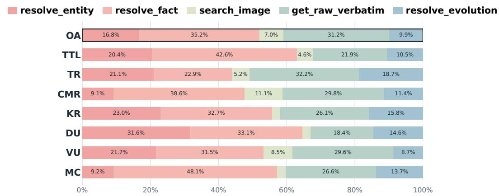  
Figure 5: Average tool utilization on WorldMemArena-S with Qwen3.8-27B, reported overall and by 7 task types: OA (Overall Average), TTL (Test-time Learning), TR (Temporal Reasoning), CMR (Cross-modal Reasoning), KR (Knowledge Reasoning), DU (Dynamic Updating), VU (Visual Update), and MC (Memory Conflict).

## D.1 Retrieval Tool Analysis

Figure 5 reports average tool usage on WorldMemArena-S with Qwen3.8-27B. Hypergraph tools (resolve\_entity, resolve\_fact, and resolve\_evolution) and the inspection tool (get\_raw\_verbatim) dominate agentic search. In particular, resolve\_fact and get\_raw\_verbatim are invoked most frequently, suggesting that many questions can be traced through atomic facts and verified against original dialogue or visual evidence. Entityand evolution-layer retrieval also accounts for substantial usage in TTL, TR, KR, DU, and VU tasks. This pattern suggests that, for temporal reasoning and multimodal updates, the agent links observations of the same entity and retrieves relevant state histories to reason about attribute updates, conflicts, and replacements.

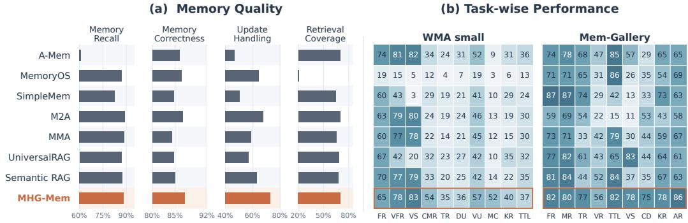

## D.2 Cost Analysis

Figure 6 compares token consumption and QA performance across methods. Following prior work, we measure the average total number of LLM input and output tokens per sample across memory construction, retrieval, and QA. For multimodal methods, this count also includes image input tokens determined by the corresponding LLM’s visual encoding. We additionally report MHG-Mem $( \mathrm { w } / \mathrm { o } \ \bar { \mathrm { A } } . \mathrm { S } . )$ , an ablation that replaces agentic search with top-k hypergraph retrieval.

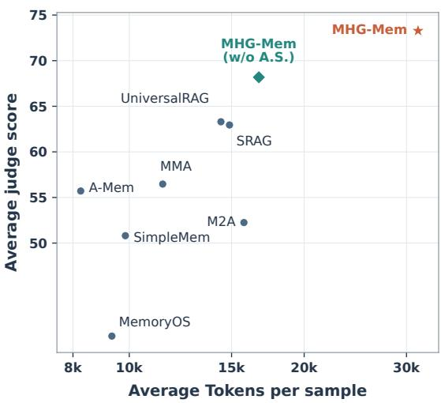

Among the baselines, unimodal memory   
methods that abstract images into textual   
captions consume fewer tokens but achieve   
lower QA performance, as fine-grained vi  
sual details are omitted. Among multimodal   
methods, RAG-based approaches (SRAG,   
MMA, and UniversalRAG) require fewer to  
kens than memory-based approaches (M2A   
Mem’s agentic search with top-k retrieval.and MHG-Mem) because they avoid explicit and MHG-Mem) because they avoid explicit memory construction and iterative search. memory construction and iterative search.

Figure 6: Trade-of between token consumption and QA performance among diferentMMA, and UniversalRAG) require fewer tobaselines. w/o A.S. represents replace MHG-

Although MHG-Mem improves benchmark-averaged QA performance by 8.20–9.98 points over the strongest baseline for each backbone, it consumes approximately 2x tokens, reflecting both the processing of multimodal information during memory construction and iterative tool calls during retrieval. The additional cost primarily arises from agentic search: MHG-Mem (w/o A.S.) requires only approximately 1–2k more tokens than multimodal baselines while still delivering performance gains of 5%–15%, ofering a favorable balance between cost and performance. These results suggest using similarity-based hypergraph retrieval in resource-constrained settings and agentic hypergraph search when higher QA performance is the priority.

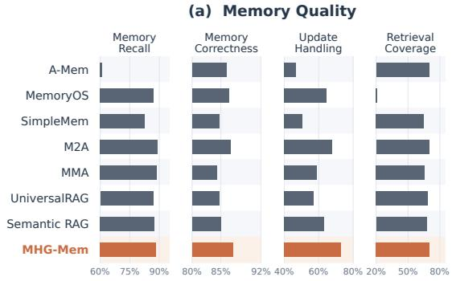  
Figure 7: (a) Memory quality and (b) fine-grained tasks performance on WorldMemArena-S (WMA-S) and Mem-Gallery with Qwen3-VL-8B.

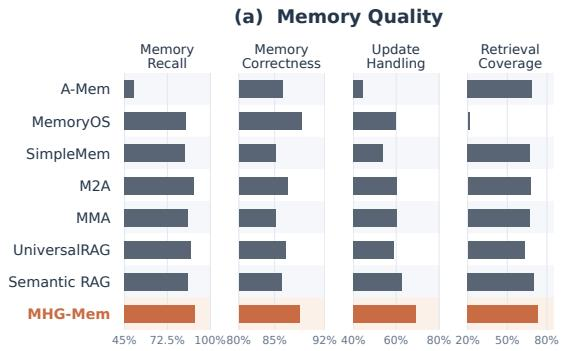

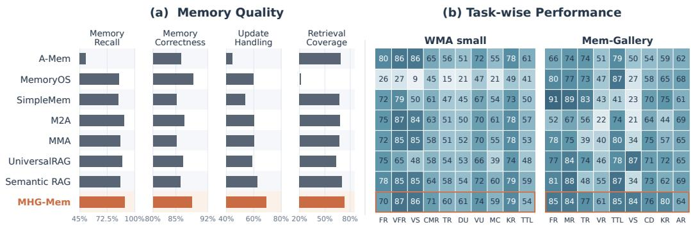  
Figure 8: (a) Memory quality and (b) fine-grained tasks performance on WorldMemArena-S (WMA-S) and Mem-Gallery with GPT-4.1-mini.

## D.3 Memory Quality and Fine-grained Analysis on More Backbones

Figure 7 and 8 extend the memory quality and task-level analysis to Qwen3-VL-8B and GPT-4.1-mini, respectively. Across both backbones, MHG-Mem achieves the highest memory correctness and update handling, with retrieval coverage among the best. These results show that efective state maintenance coexists with accurate memory retention and strong evidence coverage, consistent with our objective of organizing evolving observations while keeping their supporting evidence accessible.

The most consistent task-level advantages concern visual evidence use and state evolution. On WorldMemArena-S, MHG-Mem outperforms all compared baselines in cross-modal reasoning, temporal reasoning, dynamic updates, and visual updates with both backbones. In particular, cross-modal reasoning improves over the strongest baseline by 20% and 6% with Qwen3-VL-8B and GPT-4.1-mini, respectively. On Mem-Gallery, visual-centric reasoning improves by 4% and 6%, while knowledge resolution improves by 5% under both backbones; conflict detection also benefits in both settings. These recurring gains align with the two requirements motivating MHG-Mem: accessing relevant visual observations and integrating changes across interaction histories. They are consistent with the intended role of entity histories and state-specific evidence links in supporting comparison and verification across observations.

The improvements nevertheless depend on the task and backbone. For example, Mem-Gallery temporal reasoning improves by 3% with Qwen3-VL-8B but remains 6% below the strongest baseline with GPT-4.1-mini. MHG-Mem also trails the strongest factual-recall baseline on both benchmarks under both backbones. Thus, the memory-quality improvements do not translate uniformly into every downstream capability: visual evidence use and state updates show reproducible benefits, while factual recall remain areas for improvement.

## D.4 Hyperparameter Analysis

Analysis of the occurrence-linking candidate count K. The upper half of Table 6 reports QA performance with diferent top-K candidate counts for occurrence linking during memory construction. Across the tested values of K, scores vary by only 1.48, 2.26, and 1.94 points on MemEye, Mem-Gallery, and WorldMemArena-S, respectively. The average score is 73.28 at $K = 3$ , compared with 73.33 at the best tested value, $K = 5$ , indicating that performance is relatively insensitive to K. Since larger candidate sets increase context length with limited performance gains, we retrieve at most $K = 3$ candidates for occurrence linking.

Analysis of agentic budgets $B _ { \mathrm { s t e p } }$ and $B _ { \mathrm { i m g } } .$ The lower half of Table 6 examines the efects of retrieval budgets. Increasing $\boldsymbol { B } _ { \mathrm { s t e p } }$ or $B _ { \mathrm { i m g } }$ allows longer retrieval trajectories or more image evidence, respectively, but also increases input token consumption. Raising the budgets from (4, 4) to (16, 8) improves the average QA score from 67.29 to 72.48, a gain of 5.19 percentage points, while reducing the forced-submission rate from 37.3% to 17.9%. These results suggest that restrictive budgets can prevent the agent from gathering suficient evidence through hypergraph search. For example, questions requiring fine-grained visual distinctions among multiple entities may require inspecting more image crops than the budgets permit, leading to premature submission and lower performance. However, increasing $( \bar { B _ { \mathrm { s t e p } } } , B _ { \mathrm { i m g } } )$ further to (24, 16) yields only a 0.24-point improvement over (16, 10) while consuming more tokens. To balance the cost and performance trade-of, we therefore set $( B _ { \mathrm { s t e p } } , B _ { \mathrm { i m g } } ) \breve { = } ( 1 6 , 1 0 )$ for experiment.

Table 6: Hyperparameter sensitivity at the construction and retrieval stages with Qwen3.8- 27B. The construction-stage sweep varies the number of top-K occurrence-linking candidates. The retrieval-stage sweep evaluates the agentic search budget $( B _ { \mathrm { s t e p } } , B _ { \mathrm { i m g } } )$ and reports the force-submit rate. LLM-Judge scores are reported. Avg. means the average judge score across three benchmark. Bold values are the best within each stage.
<table><tr><td>Setting</td><td></td><td>MemEye Mem-Gallery</td><td>WMA-S</td><td>Avg.</td><td>Force-submit (%)</td></tr><tr><td colspan="6">Construction stage</td></tr><tr><td>K = 1</td><td>64.70</td><td>85.84</td><td>64.41</td><td>71.65</td><td></td></tr><tr><td> $K = 2$ </td><td>65.54</td><td>86.99</td><td>65.67</td><td>72.73</td><td></td></tr><tr><td> $K = 3$ </td><td>65.93</td><td>87.85</td><td>66.05</td><td>73.28</td><td></td></tr><tr><td> $K = 4$ </td><td>65.22</td><td>87.46</td><td>66.35</td><td>73.01</td><td></td></tr><tr><td> $K = 5$ </td><td>66.18</td><td>88.10</td><td>65.71</td><td>73.33</td><td></td></tr><tr><td colspan="6">Retrieval stage</td></tr><tr><td> $( B _ { \mathrm { s t e p } } , B _ { \mathrm { i m g } } ) = ( 4 , 4 )$ </td><td>59.44</td><td>81.79</td><td>60.63</td><td>67.29</td><td>37.3</td></tr><tr><td> $( B _ { \mathrm { s t e p } } , B _ { \mathrm { i m g } } ) = ( 1 0 , 4 )$ </td><td>62.02</td><td>84.76</td><td>62.37</td><td>69.72</td><td>26.8</td></tr><tr><td> $( B _ { \mathrm { s t e p } } , B _ { \mathrm { i m g } } ) = ( 1 0 , 8 )$ </td><td>63.91</td><td>86.30</td><td>63.10</td><td>71.10</td><td>24.6</td></tr><tr><td> $( B _ { \mathrm { s t e p } } , B _ { \mathrm { i m g } } ) = ( 1 6 , 8 )$ </td><td>65.42</td><td>87.04</td><td>64.99</td><td>72.48</td><td>17.9</td></tr><tr><td> $( B _ { \mathrm { s t e p } } , B _ { \mathrm { i m g } } ) = ( 1 6 , 1 0 )$ </td><td>65.73</td><td>87.85</td><td>66.05</td><td>73.21</td><td>17.5</td></tr><tr><td> $( B _ { \mathrm { s t e p } } , B _ { \mathrm { i m g } } ) = ( 2 4 , 1 0 )$ </td><td>65.47</td><td>87.63</td><td>66.51</td><td>73.20</td><td>13.4</td></tr><tr><td> $( B _ { \mathrm { s t e p } } , B _ { \mathrm { i m g } } ) = ( 2 4 , 1 6 )$ </td><td>66.09</td><td>87.46</td><td>66.80</td><td>73.45</td><td>13.5</td></tr></table>

## D.5 More Case Studies

Figures 9 and 10 illustrate how MHG-Mem reconstructs entity histories through adaptive retrieval and source verification. In Figure 9, the agent retrieves the faucet’s evolution record and traces its supporting facts to original frames, recovering the complete of–running–of sequence; the baselines omit states or fail to answer. In Figure 10, retrieval begins with entity resolution, followed by evolution retrieval and source inspection. This recovers the oak-log count sequence $1  2  5$ and verifies the latest count from the inventory image, whereas UniversalRAG and M2A recover only 1 → 2. Both cases highlight the value of linking observations under a shared entity identity while preserving state-specific evidence for cross-session synthesis and visual verification.

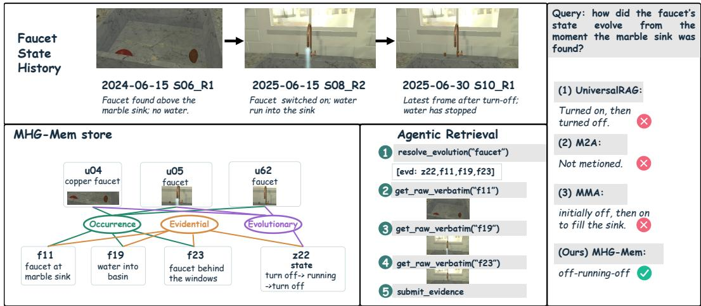  
Figure 9: Case study in an embodied agent scenario. MHG-Mem records the faucet’s state throughout the multimodal agent’s action history.

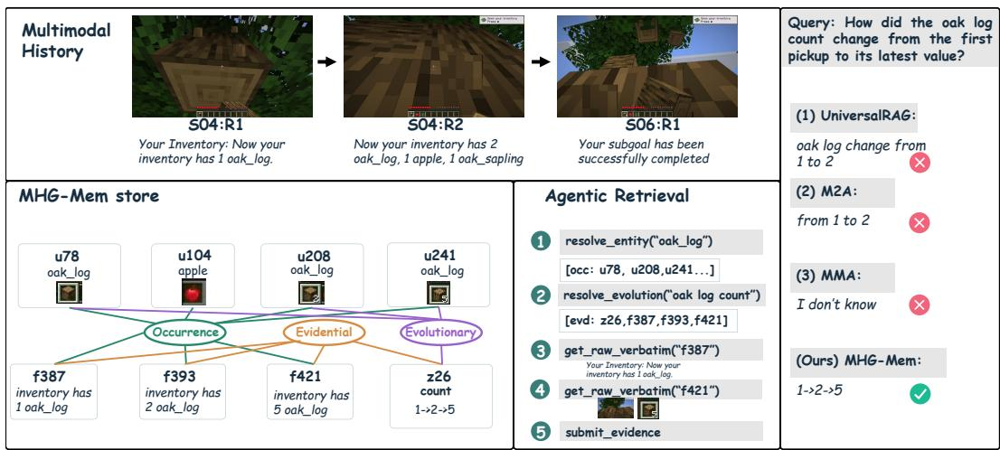  
Figure 10: Case study in a GUI agent scenario. MHG-Mem records the count state of oak log in Minecraft throughout the multimodal agent’s action history.

## E Prompt Templates

The five prompt templates below cover memory construction (Appendix B.2) and agentic search (Table 4). We preserve prompt wording and placeholders, omit Python assignment wrappers, and adjust line wrapping for readability. For additional LLM-as-a-judge and QA prompts, we use the original benchmark-provided prompts to ensure fair comparisons.

## E.1 Atomic fact construction

Converts the current round into standalone facts while retaining temporal and visual details.

## 01 Atomic fact construction

You convert ONE conversation round into a set of ATOMIC MEMORIES — short, standalone facts that a separate answerer will later retrieve to answer questions. You are given the round’s dialogue text, its image caption(s), and its REAL image(s). You may also see up to three EARLIER rounds of the same conversation as read-only context (their text and image captions only — no earlier pictures), and a list of EXISTING MEMORIES already stored from past rounds. Write memories ONLY for the CURRENT round; use the earlier rounds and the current image(s) just to understand the round and to resolve references.

Read BOTH the caption AND the real pixels of the current round. The caption often spells a detail out in words (card names, on-screen text, dashboard labels, message transcripts); the pixels carry details the caption omits (colors, counts, spatial layout, what is actually shown). Capture from both.

## ## ADD-ONLY against EXISTING MEMORIES

If an \`## EXISTING MEMORIES\` list is given, treat it as memories that are ALREADY STORED. Your job is ADDITIVE: output the facts from the CURRENT round that are NOT already represented there. Do not restate, paraphrase, or lightly reword an existing memory. Never create a memory from the existing list alone — every memory you output must be supported by the CURRENT round.

\- Default to WRITING a fact. Suppress a candidate ONLY when it is the SAME fact about the SAME moment as an existing memory. When in doubt, WRITE it — a missed fact can never be recovered, a near-duplicate is cheap.

\- The mere presence of the same entity, brand, game, route, dashboard, or template in an existing memory does NOT make the current round a duplicate. A new event, a new state, a changed value, a diferent date/session, a new opinion or conclusion the user draws, or any new detail is ALWAYS a new memory — write it.

Write each memory to this STANDARD:

\- ATOMIC & self-contained: one fact per memory — a single event, state, attribute, or relationship — understandable on its own. Begin from the concrete named subject.

\- ABSOLUTE time: anchor every time reference to the Observation Date given. Convert "today / tomorrow / yesterday / last week / this Monday" to an explicit calendar date (YYYY-MM-DD). Never store a bare relative time or weekday.

\- DESCRIBE the state, do NOT compute the answer. Record what is shown or said — list the cards in a hand, the panels on a dashboard and their values, the people in a chat and who said what. Do NOT add totals, counts across rounds, winners, comparisons, or any conclusion the data merely implies. Faithful state, never a frozen verdict.

\- CAPTURE what a later question could ask: numbers, colors, spatial relations (left / right / above / below / lower-left / behind / beside / under), in-image text, per-item attributes, who did what, and any change from the earlier context.

\- Only return an empty list when the CURRENT round genuinely contains NOTHING beyond what is already stored (e.g. a bare "ok", "thanks", "correct" with no new content of its own). Return ONLY JSON:

{"atomic\_facts":["<one standalone memory>","<another standalone memory>"]}

If the round carries nothing new worth remembering, return {"atomic\_facts":[]}.

## E.2 Multimodal entity extraction

Extracts nameable entities and grounds visual or multimodal mentions in image regions.

## 02 Multimodal entity extraction 02 Multimodal entity extraction

You extract MULTIMODAL ENTITIES from ONE conversation round (its dialogue text AND its   
image, if any).   
An ENTITY is a persistent, nameable THING that could be asked about later — for example: a   
brand, logo, product. This list is illustrative, not exhaustive — extract any concrete, nameable   
thing a later question could point at   
Give each entity ONE modality, decided by WHERE you learned about it:   
- \`visual\`: something you can SEE in the image. This is the DEFAULT for anything in the   
picture — objects, people, places, logos, products, signs, on-screen panels. Give it a short   
specific name (e.g. "red delivery truck", "Coca-Cola logo"). bbox required.   
- \`multimodal\`: visible in the image AND also named in the dialogue text. Name it from the   
dialogue; the box is on the region that shows it. bbox required.   
- \`text\`: named in the dialogue text (what the USER or ASSISTANT actually typed) but NOT   
visible in the image. bbox is null. This is RARE — use it ONLY for things mentioned in the   
conversation that you cannot see.   
For every \`visual\` and \`multimodal\` entity, bbox is absolute pixels \`[x0,y0,x1,y1]\` in the   
image’s pixel frame, tight around the thing.   
Return ONLY JSON:   
{"entities":[{"name":"...","type":"<brand|person|character|object|product|place|animal|   
organization|other>","modality":"visual|multimodal|text","bbox":[x0,y0,x1,y1] or null}]}   
Rules:   
- Only extract things written in the dialogue or clearly visible in the image — never invent.   
- If nothing qualifies, return {"entities":[]}.

## E.3 Occurrence linking

Associates a candidate mention with a stored referent, creates a new referent, or rejects an invalid extraction.

03 Occurrence linking   
You decide how to store ONE candidate entity into a memory of already-known entities.   
You are given:   
- ROUND CONTEXT: the conversation round the candidate was found in (its text, and the full   
round image if any) — use it to understand what the candidate actually is.   
- CANDIDATE: its name, type, modality, and, if visual, its cropped region (shown below).   
- MATCHES: most similar to the candidate (by text and visual similarity), each with its   
best-matching stored region (shown below).   
Choose EXACTLY ONE action:   
- \`update\`: the candidate is the SAME real-world thing as one MATCH— link to that entity id.   
Also use \`update\` for a repeat sighting of a thing already stored, to record this new occurrence.   
- \`add\`: the candidate is a REAL entity but none of the MATCHES is the same real-world thing.   
- \`skip\`: ONLY when the candidate is NOT a real, storable entity (an extraction mistake or   
abstract concept).   
Return ONLY JSON:   
\`{{"action":"update|add|skip","target\_entity\_id":"<id, only if update>",   
"add\_alias":"<optional new alias>","reason":"<one line>"}}

## E.4 State evolution synthesis

Identifies changing aspects and binds each reported state to its supporting fact identifier.

## 04 State evolution synthesis

You are given ONE referent (a thing that recurs in a long conversation) and the time-ordered list of ATOMIC FACTS recorded about it. Your job is to report which ASPECTS of this referent actually CHANGED over time.

An ASPECT is a single named property that can hold diferent values at diferent times — for example: hand\_size, location, owner, color, price, status, score, version, participants, weight.

## ## What counts as a change

A change means: the SAME aspect of the SAME referent holds DIFFERENT values at diferent times. For example:

\- "is in the kitchen" then "is in the bedroom"-> aspect \`location\` CHANGED. Report it.

\- "costs \$12" then "costs \$9"-> aspect \`price\` CHANGED. Report it.

\## What does NOT count as a change (this is the common case — read carefully)

\- A value stated repeatedly, or restated in diferent words, is NOT a change.

\- New, additional details about DIFFERENT aspects are NOT a change unless one aspect’s own value is replaced by another value.

## ## How to write what you find

For each aspect that genuinely changed:

\- \`aspect\`: a short lowercase snake\_case key naming the property (\`hand\_size\`, not "the size of the hand").

\- \`states\`: two or more entries in TIME ORDER. Each entry MUST carry:

\- \`value\`: the value at that time, as short as possible (a number, a color, a place, a name).

\- \`fact\_id\`: the id of the fact you read that value from. It MUST be one of the fact ids listed below, copied exactly. Never invent an id.

\- \`summary\`: one sentence DESCRIBING the observed states in order, with their dates.

\- \`update\_type\`: one of

\- \`replacement\` — the new value replaces the old one (a measurement, a location, a price)

\- \`correction\` — the later fact says the earlier one was wrong

\- \`addition\` — the value grew by accumulating items rather than being replaced Return ONLY JSON:

{"aspects":[{"aspect":"<snake\_case>","states":[{"value":"<v1>","fact\_id":"<id>"},

{"value":"<v2>","fact\_id":"<id>"}],"summary":"<one sentence describing the states in order>","update\_type":"replacement|correction|addition"}]}

If no aspect of this referent changed, return exactly {"aspects":[]}.

## E.5 Hypergraph-based agentic search

Guides sequential tool use to assemble evidence for the separate answer model.

The placeholders [MEMORY\_SCHEMA], [TOOL\_SCHEMA], and {max\_steps} denote the memory schema, tool definitions, and search budget, respectively. The five gathering tools collect evidence; submit\_evidence terminates retrieval.

05 Hypergraph-based agentic search   
You are a hypergraph memory retriever. Given a QUESTION, you SEARCH a long-term   
multimodal memory of past conversation rounds and assemble an EVIDENCE CHAIN for a   
separate QA model. You do NOT answer the question yourself.   
## What is in memory: [MEMORY\_SCHEMA]   
## Tool Definition: [TOOL\_SCHEMA]   
## Format — EXACTLY ONE action per reply, nothing after it   
Each reply MUST be exactly:   
Action: <one tool name>   
Action Input:    
STRICT RULES:   
- Output ONE Action, ONE Action Input, then STOP. Do NOT write a second Thought/Action   
in the same reply — you will only see the result of the FIRST action, so any extra ones are   
wasted.   
- After \`Action Input: {{...}}\` write NOTHING more. Do not narrate, do not plan further steps.   
- you will receive \`Observation: {{...}}\` (and any images). Read it, then send your NEXT   
single action.   
When the evidence is suficient, call submit\_evidence.   
## Strategy   
- You have five hypergraph gathering tools; use whichever fit the question. Call ONE per turn   
and read its Observation before the next.   
- If the question hinges on a visual/pixel detail, open the most promising facts’ rounds with   
get\_raw\_verbatim (or use search\_image) so you actually SEE the images before citing.   
- Be eficient: you have at most {max\_steps} steps. Submit as soon as the evidence is suficient.