# S-EDL: Eliciting Self-Evidence from Sequence Likelihoods for Semantic Calibration of LLMs

Yawei Li1,3 Jiazheng Li² David Rügamer1,3 Bernd Bischl1,3 Yulan He2 Mina Rezaei1,3

1LMU Munich 2King's College London   
3Munich Center for Machine Learning (MCML)

## Abstract

Calibrating large language models (LLMs) in open-ended generation is uniquely challenging because many distinct token sequences can express the same underlying meaning. Prior calibration techniques target either fixed-set classification confidence or the binary correctness of individual strings, making them inherently ill-suited for the dynamic, multi-string nature of open-ended semantic outcomes. To bridge this gap, we introduce S-EDL, a novel evidential method that natively optimizes LLMs for semantic calibration. By eliciting evidence from the sequence likelihoods of the model itself, S-EDL constructs a differentiable Dirichlet prior over prompt-specific semantic classes. Optimizing the evidential loss under this prior yields a calibration-aware training signal over variable semantic classes, completely bypassing the need for fixed multiple-choice options. Evaluations across four open-ended benchmarks and three models demonstrate that S-EDL substantially reduces semantic calibration error while improving accuracy. By aligning generative likelihoods with semantic correctness, this work establishes a framework for deploying trustworthy LLMs in complex, open-ended applications. Code is available at: https://github.com/sandylaker/s-edl.

## 1 Introduction

Large language models (LLMs) are increasingly used for open-ended reasoning tasks, where reliable confidence estimates are important for deciding when model outputs can be trusted [25, 28, 32 56]. Early research has primarily focused on multiple-choice question answering (MCQA), where calibration can be defined over a small set of answer labels [24, 37, 48, 53]. Open-ended generation is more subtle: many distinct token sequences can express the same answer, and the probability assigned to a surface form does not necessarily reflect confidence in its semantic content.

Prior work has studied open-ended uncertainty and calibration through several related targets. Semantic uncertainty metrics [12, 20] sample multiple generations and group equivalent responses to evaluate the predictive distribution over semantic classes. Building on this perspective, semantic calibration [33] translates this grouping concept into an evaluation metric for open-ended generation. In parallel, verbal confidence calibration methods [3, 9, 18, 30, 43, 52, 55] teach models to report a confidence score of correctness. However, this calibrates the binary correctness of a single response rather than the underlying distribution over alternative semantic answers. Thus, a gap remains: how to fine-tune open-ended LLMs under a semantic calibration objective.

Evidential deep learning (EDL) natively bridges this gap. By placing a Dirichlet prior over categorical probabilities, it explicitly models the strength of evidence for multiple competing meanings, allowing calibration losses to act on distributions over semantic meanings. Building on this, we propose S-EDL, a self-evidenced EDL method tailored for semantic calibration. Unlike conventional EDL methods that require a fixed set of answer labels [7, 39], S-EDL accommodates the dynamic nature of open-ended generation by transforming the sequence likelihoods of the model into a differentiable evidence vector. This formulation allocates greater evidential support to semantic classes backed by highly probable strings. The evidence vector then parametrizes a Dirichlet prior over the semantic outcomes, providing a calibration-aware training signal. Our contributions are three-fold:

• We extend EDL from fixed-choice calibration to open-ended semantic calibration, allowing LLMs to optimize their confidence over diverse semantic meanings.

• We introduce a novel parametrization that derives a differentiable evidence vector from the model's sequence likelihoods. This formulation also theoretically unifies post-hoc metrics such as Semantic Entropy [12, 20] under a common evidential framework.

• Across three models and four open-ended benchmarks, S-EDL jointly improves average accuracy and calibration over supervised fine-tuning (SFT), reducing average calibration error by up to roughly 1/3.

## 2 Related work

From MCQA to semantic calibration. Early LLM calibration focused on MCQA, where a fixed label set enables standard classification-style methods, including Bayesian low-rank adaptation [37, 42, 48, 53] and evidential approaches [24]. Open-ended generation introduces a level mismatch: many distinct sequences can express the same answer. Semantic uncertainty metrics [6, 11, 12, 20, 34, 36] sample generations and group by meaning, and semantic calibration [33] turns this view into a calibration target for open-ended generation. Our work follows this semantic line.

Verbal and token-level calibration. A separate line of work asks models to emit a scalar correctness score [3, 9, 18, 30, 43, 52, 55], which calibrates a Bernoulli pushforward (correct vs. incorrect) of the output distribution rather than a categorical distribution over semantic outcomes. Meanwhile, SelfReflect [19] captures the categorical distribution by a verbalized string. Token-level methods such as label smoothing [15, 44], temperature scaling [22, 41], RCFT [50], and CATTO [35], regularize per-token distributions, supervising a different granularity than the semantic marginal targeted here.

Evidential deep learning. EDL [4, 5, 7, 10, 17, 31, 39, 54] places a Dirichlet prior over class probabilities through an evidence vector. Although previous work has applied EDL to calibrate LLMs in MCQA [24] and detect misbehavior in vision-language models [16], S-EDL is, to the best of our knowledge, the first instantiation of EDL for calibrating LLMs in open-ended generation.

## 3 Background

## 3.1 Semantic calibration in open-ended LLM generation

Our work focuses on calibration in open-ended generation, for which we adopt the framework of B-calibration [33]. Let D be a distribution over prompt-completion pairs $( \bar { x } , y ) \in \mathcal { V } ^ { * } \times \mathcal { V } ^ { L }$ where x is a prompt over vocabulary $\nu ^ { * }$ and $y \in \hat { \mathcal { V } } ^ { L }$ is a ground-truth completion of length $L .$ An autoregressive LLM $p _ { \pmb { \theta } }$ with parameters $\pmb \theta \in \Theta$ assigns probability $p _ { \theta } ( z | x )$ to each candidate response $\bar { z } \in \mathcal { V } ^ { L }$ . Because distinct token sequences can convey the same meaning $( \mathrm { e . g . , \ ^ { 6 4 } h a l f ^ { \circ } }$ vs. “0.5”), B-calibration [33] introduces a collapsing function $\dot { B } : \mathcal { V } ^ { * } \times \mathcal { V } ^ { L } $ N mapping each prompt-response pair to a global semantic class, a raw identifier $s \in \mathbb { N }$ We write $s : = B ( x , z )$ for a generation's class and $s ^ { * } : \bar { = } B ( x , y )$ for the ground-truth class of $( x , y )$ . The collapsing function B can be implemented by a verification tool or an LLM-as-judge that clusters responses by meaning. A semantic distribution is then defined as the categorical distribution over semantic classes:

$$
\begin{array} { r } { \pi _ { x } ( s ) : = \sum _ { z : B ( x , z ) = s } p _ { \pmb \theta } ( z | x ) , \quad s \in \mathbb { N } , z \in \mathcal { V } ^ { L } . } \end{array}\tag{1}
$$

Further, denote the top class $s _ { x } ^ { \mathrm { t o p } } : = \arg \operatorname* { m a x } _ { s } \pi _ { x } ( s )$ and the semantic confidence conf $\dot {  { \left( x \right) } } : = \pi _ { x } ( s _ { x } ^ { \mathrm { t o p } } )$ Semantic calibration requires that the confidence aligns with the true probability of correctness:

$$
\mathbb { E } _ { ( x , y ) \sim \mathcal { D } } \big [ \mathbb { 1 } \{ s _ { x } ^ { \mathrm { t o p } } = s ^ { * } \} \big | \mathrm { c o n f } ( x ) \big ] = \mathrm { c o n f } ( x ) \quad \mathrm { a l m o s t ~ s u r e l y } .
$$

That ${ \mathrm { i s } } ,$ among all prompts for which the model reports semantic confidence $c ,$ the top semantic class should indeed be correct with frequency c [33].

## 3.2 Evidential deep learning

The calibration objective above asks the model to report not just which semantic class is most likely but also how confident it is in that belief. EDL [31, 39] provides a framework for the latter: rather than predicting a single categorical $\pmb { p } \in \Delta ^ { K }$ over K classes, it predicts a distribution over $^ { p , }$ accounting for uncertainty over class probabilities instead of training only against a point estimate.

Dirichlet prior and evidence. In this subsection, $k \in [ K ]$ denotes a generic class index for a standard fixed-K classification problem, separate from the semantic-label notation of Section 3.1. EDL places a Dirichlet prior $\operatorname { D i r } ( p ; \alpha )$ on $\pmb { \dot { p } } \in \Delta ^ { K }$ , with Dirichlet parameters ${ \pmb { \alpha } } = ( \alpha _ { k } ) _ { k \in [ K ] } \in$ $[ 1 , + \infty ) ^ { K }$ built from a non-negative evidence vector $\pmb { e } = ( e _ { k } ) _ { k \in [ K ] } \in \mathbb { R } _ { \geq 0 } ^ { K }$ via $\alpha _ { k } = e _ { k } + 1$

Each $e _ { k }$ represents the accumulated support for class k. Conventional EDL employs a classification model $f _ { \theta }$ to predict the evidence directly, $e = \mathrm { S o f t P l u s } ( f _ { \pmb { \theta } } ( x ) )$ , and the Dirichlet mean serves as the predictive distribution: $\begin{array} { r } { \hat { p } _ { k } = \mathbb { E } _ { p \sim \mathrm { D i r } ( \cdot ; \alpha ) } [ p _ { k } ] = \frac { \alpha _ { k } } { \alpha _ { 0 } } } \end{array}$ , with Dirichlet strength $\begin{array} { r } { \alpha _ { 0 } = \sum _ { k = 1 } ^ { K } \alpha _ { k } } \end{array}$

EDL training objective. Given a one-hot target $\pmb { q } = ( q _ { k } ) _ { k \in [ K ] } \in \{ 0 , 1 \} ^ { K }$ with $q _ { k } = \mathbb { 1 } \{ k = t \}$ Sensoy et al. [39] learn the model's parameter $\pmb \theta \in \Theta$ by minimizing the Bayes risk of MSE objective

$$
\mathcal { L } _ { \mathrm { M S E } } ( \pmb { \theta } ) = \mathbb { E } _ { p \sim \mathrm { D i r } ( \cdot ; \alpha ) } \| \pmb { q } - p \| _ { 2 } ^ { 2 } = \sum _ { k = 1 } ^ { K } \left( q _ { k } - \frac { \alpha _ { k } } { \alpha _ { 0 } } \right) ^ { 2 } + \sum _ { k = 1 } ^ { K } \frac { \alpha _ { k } ( \alpha _ { 0 } - \alpha _ { k } ) } { \alpha _ { 0 } ^ { 2 } ( \alpha _ { 0 } + 1 ) } ,\tag{2}
$$

which admits a closed form. Previous work IB-EDL [24] has shown that EDL methods are very effective in calibrating LLMs in the MCQA setting, but their approach is limited to a fixed set of options such as A/B/C/D. In the following section, we move a step forward and instantiate this framework in the open-ended generation setting, deriving e from the LLM's own generations.

## 4 Methodology

## 4.1 Motivation

Given EDL's effectiveness for calibrating LLMs in MCQA, we now discuss the adaptations required to apply it in open-ended generation. Instantiating the EDL framework in this setting hinges on one design choice: how to parametrize the evidence vector e. Conventional EDL learns e through a dedicated prediction head whose output dimension equals the number of classes. This recipe does not transfer to our setting for two reasons. First, the relevant semantic class inventory is promptdependent and not known in advance, so there is no canonical fixed output space. Second, and most fundamentally, the distribution whose calibration we ultimately care about is $p _ { \pmb { \theta } } ( \cdot | \boldsymbol { x } )$ ; routing evidence through an independent head decouples it from the very object we aim to calibrate. We therefore look for a parametrization that derives e from $p _ { \theta } ( \cdot | x )$

A natural choice for constructing e is utilizing $\pi _ { x }$ itself, which already encodes how $p _ { \theta } ( \cdot | x )$ distributes mass over semantic classes. Since $\mathcal { V } ^ { L }$ is typically vast, Nakkiran et al. [33] estimate $\pi _ { x }$ from $N$ i.i.d. Monte-Carlo samples $z ^ { ( i ) } \sim p _ { \theta } ( \cdot | x )$ with semantic classes $\boldsymbol { s } ^ { ( i ) } = B ( \boldsymbol { x } , z ^ { ( i ) } )$ , which induce the prompt-specific semantic class set $\mathcal { S } _ { x } : = \{ s ^ { ( i ) } : i \in [ N ] \} \subset \mathbb { N }$ . Further details regarding the empirical construction of $S _ { x }$ in edge cases are in Appendix B.1. The plug-in estimator of $\pi _ { x }$ is then

$$
\begin{array} { r } { \hat { \pi } _ { x } ( s ) = \frac { 1 } { N } \sum _ { i = 1 } ^ { N } \mathbb { 1 } [ s ^ { ( i ) } = s ] , \quad s \in \mathcal { S } _ { x } . } \end{array}\tag{3}
$$

However, this histogram is not a suitable evidence vector for EDL training. Once the samples are drawn, the class indicators are constants with respect to $\theta ,$ so an evidence vector proportional to $\hat { \pi } _ { x }$ provides no differentiable path from the EDL loss back to the model parameters. In addition, the histogram treats all samples equally, regardless of their likelihood under $p _ { \theta } ( \cdot \mid x )$ . This is misaligned with the evidential interpretation of e: a semantic class supported by high-likelihood generations should contribute more evidence than one represented only by low-likelihood samples.

Desiderata. These observations lead to two desiderata for parametrizing evidence e:

(a) The parametrization should assign more evidence to semantic classes supported by highlikelihood completions, so that likely completions contribute more to evidence.

(b) The parametrization should remain differentiable through the sample log-likelihoods, so that the EDL loss can update the likelihoods underlying the sampled semantic estimate.

Next, we instantiate these desiderata through a Monte-Carlo estimate of a tempered semantic distribution, and use this estimate to define a Dirichlet prior over the sampled semantic classes.

## 4.2 Formulation of self-evidence

Throughout this subsection, we fix the input prompt x and drop the subscript from prompt-specific quantities $( \mathrm { e . g . , } \pi _ { x } \mathrm { t o } \pi , S _ { x }$ to S) to lighten notation; all such objects remain implicitly conditional on x. We work directly with semantic labels $s \in S$ , without introducing a separate local class index. In addition, we use the term self-evidence to refer to evidential support constructed from the LLM's own Monte-Carlo samples. At the sample level, each generation $z ^ { ( i ) }$ receives a scalar self-evidence weight $u ^ { ( i ) } ;$ at the class level, these weights aggregate into the self-evidence vector e.

Tempered semantic distribution. For a scalar $\beta \geq 1$ , we define the tempered semantic distribution over classes $s \in S$ and $z , z ^ { \prime } \in \mathcal { V } ^ { L }$ as

$$
\pi _ { \beta } ( s ) : = \frac { \sum _ { z : B ( x , z ) = s } p _ { \pm } ( z | x ) ^ { \beta } } { \sum _ { z ^ { \prime } \in \mathcal { V } ^ { L } } p _ { \pm } ( z ^ { \prime } | x ) ^ { \beta } } .\tag{4}
$$

For $\beta = 1$ , Eq. (4) recovers the standard semantic distribution $\pi$ in Eq. (1). For $\beta > 1$ , raising per-sequence likelihoods to a higher power shifts mass toward classes that the model supports with high-confidence sequences, formalizing desideratum (a).

Self-evidence estimator. Direct evaluation of Eq. (4) is intractable because both the classwise numerator and the global normalizer require sums over $\mathcal { V } ^ { L }$ . We therefore estimate $\pi _ { \beta }$ from the same N Monte-Carlo samples introduced in Section 4.1. Writing $\ell ^ { ( i ) } : = \log p _ { \pmb { \theta } } ( z ^ { ( i ) } | x )$ for teacher-forcing log-likelihood for sample ¿, we assign to each sample the self-evidence weight

$$
u ^ { ( i ) } : = \exp \Bigl ( ( \beta - 1 ) \ell ^ { ( i ) } \Bigr ) = p _ { \pm } ( z ^ { ( i ) } | x ) ^ { \beta - 1 } .\tag{5}
$$

The exponent is $\beta - 1$ rather than $\beta$ because the samples $z ^ { ( i ) }$ are themselves drawn from $p _ { \pmb { \theta } } ( \cdot | \boldsymbol { x } )$ , SO multiplying by $p _ { \pmb { \theta } } \big ( z ^ { ( i ) } | x \big ) ^ { \beta - 1 }$ recovers the $p _ { \pmb { \theta } } ^ { \beta }$ terms of $\pi _ { \beta }$ in Eq. (4) (made precise in Proposition 1) Because $u ^ { ( i ) }$ is a smooth function of $\ell ^ { ( i ) }$ , gradients can pass through the sample log-likelihoods to θ and satisfy desideratum (b). We aggregate the weights within each semantic class and normalize:

$$
U _ { s } : = \sum _ { i \in [ N ] : s ^ { ( i ) } = s } u ^ { ( i ) } , \qquad \hat { \pi } _ { \beta } ( s ) : = \frac { U _ { s } } { \sum _ { r \in S } U _ { r } } .\tag{6}
$$

A natural question is whether this estimator $\hat { \pi } _ { \beta }$ recovers the true tempered distribution $\pi _ { \beta }$ as the number of samples grows. The next result confirms this (see the proof in Appendix A.1).

Proposition 1. As $N \to \infty , { \hat { \pi } } _ { \beta } ( s ) \ { \xrightarrow { a . s . } } \ \pi _ { \beta } ( s )$ for every s ∈ S.

Connection to Semantic Entropy and the practical choice of $\beta .$ Semantic Entropy (SE) [12, 20] also aggregates samples by their sequence probabilities $p _ { \theta } ( z ^ { ( i ) } | x )$ , which under $\mathrm { E q . } ( 5 )$ corresponds to the special case $\beta \stackrel { \triangledown } { = } 2$ . In our experiments, we adopt a small value $\beta = 1 . 2$ (ablation in Section 5.5). The choice of $\beta$ reflects the two methods’ different purposes: SE measures the uncertainty as a post-hoc metric, while S-EDL uses $\pi _ { \beta }$ as a training signal that drives gradient updates (Section 4.3).

Self-evidence vector and Dirichlet prior. We finally convert $\hat { \pi } _ { \beta }$ into an evidential prior by distributing the sample budget $N$ over the semantic classes according to the estimated tempered distribution:

$$
e _ { s } : = N \cdot \hat { \pi } _ { \beta } ( s ) , \qquad \alpha _ { s } : = e _ { s } + 1 , \qquad s \in \mathcal { S } .\tag{7}
$$

Because $\hat { \pi } _ { \beta }$ is a probability vector, the Dirichlet strength is determined a priori by the sample budget and the semantic class count: $\begin{array} { r } { \alpha _ { 0 } = \sum _ { s \in \mathcal { S } } \alpha _ { s } = N + | \mathcal { S } | } \end{array}$ . This differs from conventional EDL, where the model freely predicts the per-cĪass evidences $e _ { k }$ (equivalently, the Dirichlet parameters $\alpha _ { k } = e _ { k } + 1 )$ , so the total strength $\begin{array} { r } { \alpha _ { 0 } = \sum _ { k } \alpha _ { k } } \end{array}$ is not fixed a priori. Here $\alpha _ { 0 } = N + | \bar { S } |$ is pinned by construction, and all flexibility in the prior is routed through $\hat { \pi } _ { \beta }$ . The resulting $\operatorname { D i r } ( \cdot ; \alpha )$ is fed into the MSE loss of Eq. (2), completing the differentiable path promised by desideratum (b), as the entire computational chain $\ell ^ { ( i ) } \stackrel { - } { \to } u ^ { ( i ) } \stackrel { - } { \to } \hat { \pi } _ { \beta } \to e \to \alpha \stackrel { - } { \to } \bar { \mathcal { L } } _ { \mathrm { M S E } }$ is differentiable w.r.t. θ.

In training, we optimize the $\mathcal { L } _ { \mathrm { M S E } }$ jointly with standard supervised fine-tuning (SFT). The SFT loss retains the next-token learning signal, while the evidential term provides the semantic-level calibration signal. Let ${ \mathcal { L } } _ { \mathrm { S F T } }$ denote the next-token cross-entropy loss on a pair $( x , y )$ . Our final objective then is

$$
{ \mathcal { L } } _ { \mathrm { S - E D L } } ( \theta ) = { \mathcal { L } } _ { \mathrm { S F T } } ( \theta ) + \lambda _ { \mathrm { M S E } } { \mathcal { L } } _ { \mathrm { M S E } } ( \theta ) ,
$$

where $\lambda _ { \mathrm { M S E } }$ is the weight for the evidential loss. The next subsection analyzes the gradient of $\mathcal { L } _ { \mathrm { M S E } }$

## 4.3 Gradient structure of S-EDL

Having constructed the self-evidence vector and the Dirichlet prior, we next examine the optimization signal S-EDL produces. The result below shows that the gradient with respect to per-sample loglikelihood factors into a normalized sample weight and a class-level correction term.

Theorem 1. For each class $s \in S$ let $d _ { s } : = \partial \mathcal { L } _ { M S E } / \partial \hat { \pi } _ { \beta } ( s )$ , and let $\begin{array} { r } { \bar { d } : = \sum _ { r \in \mathcal { S } } \hat { \pi } _ { \beta } ( r ) d _ { r } } \end{array}$ denote their weighted mean. Let $\textstyle w ^ { ( i ) } : = u ^ { ( i ) } / \sum _ { i = 1 } ^ { N } u ^ { ( j ) } , i \in [ N ]$ be the normalized sample weight. Then

$$
\frac { \partial \mathcal { L } _ { M S E } } { \partial \ell ^ { \left( i \right) } } = \left( \beta - 1 \right) w ^ { \left( i \right) } \left( d _ { s ^ { \left( i \right) } } - \bar { d } \right) .\tag{8}
$$

The proof is shown in Appendix A.2. Theorem 1 shows that each sample's contribution is determined by the sample weight $w ^ { \hat { ( i ) } }$ and the class-level signal $d _ { s ^ { ( i ) } } - \bar { d } .$ Since $\mathbf { \dot { \boldsymbol { w } } } ^ { ( i ) } \propto p _ { \theta } ( \boldsymbol { z } ^ { ( i ) } | \boldsymbol { x } ) ^ { \beta - 1 }$ , samples with larger model likelihoods receive larger gradient weights. Optimization is therefore concentrated on the “high-probability region" of $p _ { \theta } ( \cdot | x )$ . We next characterize its direction on the two semantic classes most relevant to calibration: the ground-truth class and the most overconfident incorrect class.

Corollary 1. Assume $\beta > 1$ . For any sample $i \in [ N ]$ in the correct class $( s ^ { ( i ) } = s ^ { * } ) , \partial \mathcal { L } _ { M S E } / \partial \ell ^ { ( i ) } \leq$ 0, with strict inequality $i f \hat { \pi } _ { \beta } ( s ^ { * } ) < 1$ . Conversely, for any sample in the most overconfident incorrect class $s ^ { - } : = \arg \operatorname* { m a x } _ { s \neq s ^ { \ast } } \hat { \pi } _ { \beta } ( s )$ , it holds that $\partial \mathcal { L } _ { M S E } / \partial \ell ^ { ( i ) } \geq 0 ,$ with strict inequality $i f \hat { \pi } _ { \beta } ( s ^ { * } ) > 0 .$

The proof is detailed in Appendix $_ { \mathrm { A } . 3 }$ Consequently, minimizing $\mathcal { L } _ { \mathrm { M S E } }$ steers the model in the desired direction. In any realistic training scenario where the model's semantic distribution has not entirely collapsed $( 0 < \hat { \pi } _ { \beta } ( s ^ { * } ) < 1 )$ , the objective actively promotes the sequences in ground-truth semantic class, while simultaneously penalizing those in the most overconfident incorrect one. The next corollary shows that the per-sample gradients are balanced across the samples.

Corollary 2. For the gradients $\partial \mathcal { L } _ { M S E } / \partial \ell ^ { ( i ) }$ in Theorem 1, their sum $\begin{array} { r } { \sum _ { i = 1 } ^ { N } \partial \mathcal { L } _ { M S E } / \partial \ell ^ { ( i ) } = 0 . } \end{array}$

See Appendix A.4 for the proof. S-EDL therefore conservatively reallocates log-likelihoods rather than uniformly inflating or suppressing them: combined with the sign structure above, the update shifts probability mass away from overconfident incorrect classes and toward the ground-truth class.

## 5 Experiments

## 5.1 Experimental setup

Datasets. We conduct training and evaluation on four open-ended STEM datasets: GSM8K [8], MATH [13], ChemistryQA [49], and FormulaReasoning [23], a physics QA dataset. These benchmarks share two properties that make them well suited to our study. First, final answers admit canonical numerical or symbolic forms, so the collapsing function that groups sampled responses into semantic classes (a symbolic verifier or an LLM-as-judge) incurs comparatively low evaluation noise. Second, they often require multi-step reasoning, so calibration over complete semantic outcomes is more relevant than calibration over individual tokens. We train on the training split of each dataset and evaluate on the corresponding test split, with the exception of MATH, where we follow standard practice [13, 26] and evaluate on MATH-500, a subset of the MATH test split widely used in other literature. Dataset construction is detailed in Appendix B.3.

Models and training. We fine-tune Qwen3-8B-Base [45], Ministral3-8B-Base [27], and MiMo-7B-Base [51] with LoRA adapters [14] of rank $r _ { \mathrm { L o R A } } = 1 6$ and $\alpha _ { \mathrm { L o R A } } = 3 2 $ . For $\mathrm { S - E D L } , \beta = 1 . 2$ and MSE loss weight $\lambda _ { \mathrm { M S E } } = 5 . 0$ are held fixed across all models and datasets. In addition, the number of generations per prompt during training $N _ { \mathrm { t r a i n } }$ is set as large as GPU memory permits. On GSM8K, where outputs are comparatively short, we use $N _ { \mathrm { t r a i n } } = 3 \bar { 2 }$ for all models. On the remaining three datasets, the memory ceiling reduces to $N _ { \mathrm { t r a i n } } = 8$ for Qwen3-8B-Base and $N _ { \mathrm { t r a i n } } = 1 2$ for Ministral3- 8B-Base and MiMo-7B-Base. Complete optimization hyperparameters are in Appendix B.4.

Table 1: Calibration and accuracy across four open-ended question answering datasets. We report the single-sequence metricPass@1 (↑) and two semantic-level metrics: Semantic Accuracy (S-Acc. ↑) andSmooth ECE (smECE, ↓). Entries show means over three seeds with standard deviations as smaller subscripts (meanstd). The Average columns report means across the four datasets. The best and second-best results are highlighted.
<table><tr><td rowspan="2">Method</td><td colspan="2">GSM8K</td><td colspan="2"></td><td colspan="2">MATH-500</td><td colspan="3">ChemistryQA</td><td colspan="3">FormulaReasoning</td><td colspan="3">Average</td></tr><tr><td colspan="10">Pass@1↑S-Acc.↑ smECE↓Pass@1↑S-Acc.↑ smECE↓Pass@1↑S-Acc.↑ smECE↓Pass@1↑S-Acc.↑ smECE↓Pass@1↑S-Acc.↑ smECE↓</td><td rowspan="19"></td><td rowspan="3"></td></tr><tr><td></td><td></td><td></td><td></td><td></td><td>Fine-tuned model: Qwen3-8B-Base</td><td></td><td></td><td></td><td></td><td></td><td></td><td></td><td></td></tr><tr><td colspan="10">93.40.4 20.20.4 49.42.8 68.72.7</td><td></td><td>8.90.3</td><td></td><td>60.9</td><td>75.6</td></tr><tr><td>SFT RCFT</td><td>70.81.2 79.10.2</td><td>92.80.1</td><td>12.90.2</td><td>50.10.3 71.11.4</td><td>16.10.6 17.51.6</td><td>47.90.7 49.73.9</td><td>52.91.4 55.44.3</td><td>20.70.6 15.11.5</td><td>75.60.8 78.40.3</td><td>87.50.3 89.50.2</td><td>8.90.1</td><td>64.3</td><td>77.6</td><td>16.5 13.6</td></tr><tr><td>LS</td><td>79.11.0</td><td>92.70.2</td><td>12.50.6</td><td>49.60.2</td><td>70.70.7 17.50.7</td><td>50.70.7</td><td>58.10.3</td><td>11.80.7</td><td>76.81.0</td><td>88.90.4</td><td>9.40.8</td><td>64.0</td><td>77.6</td><td>12.8</td></tr><tr><td>BLoB</td><td>79.10.1</td><td>92.50.9</td><td>12.40.3</td><td>49.90.3</td><td>69.51.5 15.91.6</td><td>52.40.9</td><td>57.90.2</td><td>14.91.3</td><td>78.41.3</td><td>90.30.6</td><td>10.60.1</td><td>64.9</td><td>77.6</td><td>13.4</td></tr><tr><td>Dr.GRPO</td><td>80.80.3</td><td>93.20.6</td><td>11.80.6</td><td>56.20.5</td><td>74.60.6 15.50.5</td><td>53.00.3</td><td>59.20.2</td><td>14.41.4</td><td>79.50.4</td><td>89.50.5</td><td>7.20.6</td><td>67.4</td><td>79.1</td><td>12.2</td></tr><tr><td>S-EDL</td><td>84.11.0</td><td>94.30.3</td><td>9.50.2</td><td>64.60.5</td><td>81.31.2 14.10.7</td><td>52.80.2</td><td>59.90.6</td><td>12.60.9</td><td>80.60.2</td><td>89.50.3</td><td>5.80.7</td><td>70.5</td><td>81.3</td><td>10.5</td></tr><tr><td colspan="10">Fine-tuned model: Ministral3-8B-Base</td><td colspan="3"></td><td colspan="3"></td></tr><tr><td>SFT</td><td>64.40.4</td><td>80.90.4</td><td>12.00.3</td><td>35.60.7</td><td>54.21.3</td><td>11.20.2 48.20.8</td><td>55.40.6</td><td>15.01.0</td><td>72.92.1</td><td>85.30.8</td><td></td><td>10.60.5</td><td>55.3</td><td>69.0 12.2</td></tr><tr><td>RCFT</td><td>63.40.6</td><td>78.80.5</td><td>10.90.2</td><td>37.60.4</td><td>55.71.6 10.81.6</td><td>48.11.0</td><td>55.10.3</td><td>13.11.4</td><td>74.71.8</td><td>86.50.8</td><td>9.01.0</td><td>55.9</td><td>69.0</td><td>10.9</td></tr><tr><td>LS</td><td>58.50.3</td><td>77.21.0</td><td>13.40.1</td><td>34.14.5</td><td>52.74.7 11.41.6</td><td>47.31.6</td><td>53.90.3</td><td>12.81.3</td><td>69.01.7</td><td>86.23.4</td><td>13.02.9</td><td>52.2</td><td>67.5</td><td>12.6</td></tr><tr><td>BLoB</td><td>63.50.2</td><td>80.50.3</td><td>13.10.5</td><td>37.41.0</td><td>54.30.1 9.41.0</td><td>47.70.8</td><td>53.81.6</td><td>14.91.4</td><td>74.41.0</td><td>86.10.4</td><td>8.81.1</td><td>55.7</td><td>68.7</td><td>11.6</td></tr><tr><td>Dr.GRPO S-EDL</td><td>76.51.7</td><td>83.00.8</td><td>15.53.0</td><td>48.01.1</td><td>55.40.4 7.70.5</td><td>45.00.8</td><td>52.81.0</td><td>14.20.4</td><td>80.40.9</td><td>89.50.6</td><td>8.20.6</td><td>62.5</td><td>70.2</td><td>11.4</td></tr><tr><td></td><td>82.00.5</td><td>89.40.5</td><td>5.40.4</td><td>50.81.3</td><td>68.20.7 11.31.3</td><td>47.81.0</td><td>55.91.9</td><td>11.51.2</td><td>81.00.9</td><td>89.70.3</td><td>5.90.8</td><td>65.4</td><td>75.8</td><td>8.6</td></tr><tr><td colspan="10">Fine-tuned model: MiMo-7B-Base</td><td colspan="7"></td></tr><tr><td></td><td>73.81.1</td><td>87.50.1</td><td>11.50.2</td><td>34.00.5</td><td>53.90.1</td><td>14.30.4 46.70.9</td><td></td><td>53.40.7</td><td>11.90.3</td><td>70.40.7</td><td>83.90.6</td><td>10.91.0</td><td>56.2</td><td>69.7</td><td>12.1</td></tr><tr><td>RCFT</td><td>70.90.8</td><td>86.80.4</td><td>14.50.6</td><td>33.70.3</td><td>53.30.6</td><td>13.00.7</td><td>43.61.0</td><td>54.00.4</td><td>7.91.9</td><td>63.91.2</td><td>82.11.7</td><td>15.12.0</td><td>53.0</td><td>69.1</td><td>12.7</td></tr><tr><td>LS</td><td>71.30.9</td><td>87.30.6</td><td>13.50.2</td><td>32.90.3</td><td>52.50.8</td><td>13.20.8</td><td>41.81.5</td><td>51.72.4</td><td>6.80.9</td><td>67.93.4</td><td>85.54.5</td><td>14.21.2</td><td>53.5</td><td>69.3</td><td>11.9</td></tr><tr><td>BLoB</td><td>71.20.2</td><td>88.00.3</td><td>14.00.1</td><td>33.40.4</td><td>50.92.8</td><td>11.62.4</td><td>43.92.0</td><td>53.91.5</td><td>9.21.0</td><td>64.42.1</td><td>81.12.9</td><td>13.72.0</td><td>53.2</td><td>68.5</td><td>12.1</td></tr><tr><td>Dr.GRPO S-EDL</td><td>81.00.9</td><td>90.41.1</td><td>7.71.0</td><td>51.01.3</td><td>66.30.3</td><td>10.71.0</td><td>45.31.0</td><td>54.91.1</td><td>11.11.1</td><td>72.71.6</td><td>84.80.4</td><td>9.70.4</td><td>62.5</td><td>74.1</td><td>9.8</td></tr><tr><td></td><td>81.00.4</td><td>90.70.2</td><td>8.50.4</td><td>56.00.4</td><td>72.61.7</td><td>12.32.5</td><td>45.31.7</td><td>56.11.4</td><td>7.50.6</td><td>74.90.4</td><td>87.30.4</td><td>9.41.3</td><td>64.3</td><td>76.7</td><td>9.4</td></tr></table>

Evaluation protocol. We use top-p = 0.9 for all models, with temperature 0.8 for Qwen3-8B-Base, 0.6 for Ministral3-8B-Base, and 0.7 for MiMo-7B-Base. The per-model temperature is chosen on a held-out validation split to approximately match the entropy of the respective model, and is fixed across fine-tuning methods. Following Nakkiran et al. [33], we report two semantic-level metrics computed from $N _ { \mathrm { e v a l } } = 5 0$ generations per question: Semantic Accuracy (S-Acc.), the accuracy of majority voting over semantically clustered responses, and Smooth ECE (smECE), a kernel-smoothed calibration error metric. As a single-sequence-level metric, we additionally report Pass@ 1 accuracy.

Baselines. Besides standard SFT, we compare S-EDL against baselines spanning three categories: (i) token-level calibration, including Label Smoothing (LS) [15] and RCFT [50], which regularize token-wise output distributions; (ii) Bayesian ensembling, represented by BLoB [48]; and (iii) sequence-level correctness optimization, represented by Dr.GRPO [29] with a binary 0/1 correctness reward. We include Dr.GRPO as a control that isolates the effect of sequence-level supervision on calibration: under the binary reward, it maximizes the probability of the correct semantic class without an explicit calibration term, which lets us assess whether operating at the sequence level alone accounts for the gains of S-EDL or whether the Brier-style calibration objective like Eq. (2) is required. The details about the baselines are outlined in Appendix B.5.

## 5.2 Calibration performance on in-distribution datasets

As shown in Table 1, S-EDL attains the lowest average smECE across all three models, improving over the strongest token-level baseline by 2.3 points on Qwen3-8B-Base (10.5 vs. LS's 12.8), 2.3 points on Ministral3-8B-Base (8.6 vs. RCFT's 10.9), and 2.5 points on MiMo-7B-Base (9.4 vs. LS's 11.9). Dr.GRPO also outperforms every token-level baseline in average smECE on Qwen3-8B-Base and MiMo-7B-Base, but its 11.4 on Ministral3-8B-Base does not improve over RCFT's 10.9, suggesting that operating at the sequence level alone is not sufficient and that the choice of training signal also matters.

The underperformance of token-level methods may reflect a level mismatch between supervision and evaluation: LS and RCFT calibrate per-token conditional distributions, whereas sequence-level objectives act on complete responses; S-EDL further applies its loss to a sampled estimate of the semantic distribution, matching the granularity of the semantic metrics. This mismatch may be amplified in chain-of-thought generation, where a small subset of decisive tokens (e.g., a branching choice indicated by “alternatively") largely determines the semantic outcome [47], while most tokens are routine continuations; per-token regularization applies to both groups, potentially diluting the signal on the tokens that actually matter.

Furthermore, we observe that several baselines improve over SFT on one metric at the cost of the other. LS provides a representative example: on MiMo-7B-Base, it lowers average Pass@ 1 from 56.2 to 53.5 while improving smECE only marginally, from 12.1 to 11.9. Averaged across the four datasets, S-EDL improves over SFT on all three metrics for every model, e.g., with +9.6 Pass@ 1, +5.7 S-Acc, and —6.0 smECE on Qwen3-8B-Base. Fig. 6 in Appendix C.2 visualizes the averaged S-Acc × smECE plane. S-EDL consistently lies on the Pareto frontier of the plane. The structure of the evidential loss may help explain this behavior. Eq. (2) is a Brier-style proper scoring rule, which penalizes both classification error and miscalibration simultaneously. Dr.GRPO with a binary 0/1 reward, maximizes the probability of the correct semantic class without an explicit calibration term, and may improve accuracy at the cost of miscalibration.

## 5.3 Cross-domain evaluation

To test the transferability of each method, we train on MATH and evaluate on three other crossdomain datasets as shown in Table 2. This setting tests not only whether accuracy transfers, but also whether semantic confidence remains aligned with correctness. The grouping into sequence-level (Dr.GRPO, S-EDL) and token-level/Bayesian (LS, RCFT, BLoB) baselines from Section 5.2 separates more sharply in average Pass@1 in cross-domain evaluation than in-domain. The average Pass@1 gap between the better-performing sequence-level method and the strongest token-level/Bayesian baseline widens from 5.6/9.5/10.8 points in-domain to 13.8/16.5/13.6 points cross-domain on Qwen3-8B-Base, Ministral3-8B-Base, and MiMo-7B-Base, respectively.

A consistent diagnostic appears against the SFT reference: on Qwen3-8B-Base and MiMo-7B-Base none of LS, RCFT, or BLoB improves average cross-domain smECE over plain SFT. One possible interpretation is that per-token regularization and Bayesian ensembling shape conditional distributions tied to the lexical statistics of the training distribution, so the resulting effect on the implied semantic distribution need not be preserved when input statistics change. In contrast, objectives defined over complete responses are less tied to token-level statistics and better aligned with the semantic nature.

The two sequence-level methods themselves, however, do not behave identically under shift. In cross-domain evaluation, the average Pass@ 1 of S-EDL exceeds that of Dr.GRPO by 7.3/6.3/3.3 points across the three models. Its average cross-domain smECE is lower by 4.7/3.0/0.1 points. While Dr.GRPO is effective at optimizing correctness, its binary reward does not explicitly regularize the semantic confidence. The performance gap between the two methods suggests that coupling sequence-level training with an explicit evidential calibration objective could contribute to more generalizable improvements in accuracy and calibration.

## 5.4 Token probability profiles of generated solutions

To investigate the source of calibration improvements in S-EDL, we analyze the sampled-token probability profiles of generated solutions. For each generated solution z and decoded position t, we record $p _ { \pmb { \theta } } \big ( z _ { t } \mid x , z _ { < t } \big )$ and pool these values across all token positions t and samples z.

Fig. 1 and Fig. 7 (in Appendix C.3) illustrate three distinct mechanisms for altering token confidence on MATH-500. In Fig. 1, LS globally suppresses token probability, yielding the lowest mean p(sampled token) values of 0.413, 0.507, and 0.411 across the three models. Conversely, Dr.GRPO systematically sharpens distributions, reaching high-end means of 0.904, 0.954, and 0.939.

Unlike LS and Dr.GRPO, S-EDL preserves the SFT token probability profile. Across all twelve model-dataset pairs, the absolute difference between the S-EDL mean and the SFT mean remains below 0.06, and the sign of this minor difference varies across settings. Furthermore, S-EDL maintains a pooled token profile statistically indistinguishable from those of RCFT and BLoB, with means differing by at most 0.06, yet achieves average smECE values at least 2 points lower than all three. The calibration gain therefore cannot be explained by a coarse shift in token concentration.

This empirical behavior directly corroborates the semantic-level reallocation described by Corollary 2. S-EDL achieves semantic calibration by operating on the semantic-class marginal rather than uniformly on token distributions, routing probability mass between semantic outcomes without imposing a fixed direction of change on token probabilities. Pooled statistics cannot rule out positionor class-specific shifts, but the absence of global drift is informative: it isolates the calibration gain to a structural property of evidential loss rather than a side effect of token-level regularization.

Table 2: Cross-domain evaluation. A → B denotes training on dataset A and evaluating on dataset B.
<table><tr><td rowspan="2">Method</td><td colspan="3">IAIH GSM8K</td><td colspan="3">IV ChemistryQA Pass@1↑S-Acc.↑ smECE↓Pass@1↑S-Acc.↑ smECE↓Pass@1↑S-Acc.↑</td><td colspan="3"></td><td colspan="3">Average Pass@1↑S-Acc.↑ smECE↓</td></tr><tr><td></td><td></td><td></td><td></td><td></td><td></td><td></td><td>smECE↓</td><td></td><td></td><td></td><td></td></tr><tr><td colspan="10">Fine-tuned model: Qwen3-8B-Base</td><td colspan="3"></td></tr><tr><td>SFT</td><td> $7 9 . 1 _ { 1 . 9 }$ </td><td> $9 2 . 8 _ { 1 . 7 } $ </td><td> $1 4 . 7 _ { 2 . 0 }$ </td><td> $3 8 . 9 _ { 0 . 5 }$ </td><td>49.50.6</td><td> $7 . 5 _ { 0 . 3 }$ </td><td> $5 0 . 4 _ { 0 . 4 }$   $7 2 . 0 _ { 1 . 3 }$ </td><td></td><td> $1 6 . 8 _ { 1 . 9 }$ </td><td>56.1</td><td>71.4</td><td>13.0</td></tr><tr><td>RCFT</td><td> $7 7 . 2 _ { 0 . 4 }$ </td><td> $9 3 . 0 _ { 1 . 6 }$ </td><td> $1 5 . 6 _ { 1 . 2 }$ </td><td> $3 8 . 2 _ { 1 . 7 }$ </td><td> $4 9 . 8 _ { 1 . 3 }$ </td><td> $6 . 6 _ { 0 . 8 }$ </td><td> $4 7 . 6 _ { 1 . 7 }$   $7 6 . 5 _ { 0 . 2 }$ </td><td> $2 2 . 1 _ { 0 . 8 }$ </td><td></td><td>54.3</td><td>73.1</td><td>14.8</td></tr><tr><td>LS</td><td> $7 8 . 4 _ { 1 . 7 }$ </td><td> $9 3 . 7 _ { 0 . 5 }$ </td><td> $1 4 . 6 _ { 0 . 2 }$ </td><td> $3 8 . 9 _ { 0 . 5 }$ </td><td> $5 1 . 3 \phantom { 0 } _ { 0 . 7 }$ </td><td> $\mathbf { 4 . 9 } _ { 1 . 0 }$ </td><td> $4 5 . 2 _ { 1 . 2 }$   $7 4 . 3 _ { 1 . 4 }$ </td><td></td><td> $2 2 . 7 _ { 1 . 7 }$ </td><td>54.2</td><td>73.1</td><td>14.1</td></tr><tr><td>BLoB</td><td> $7 5 . 5 _ { 0 . 8 }$ </td><td> $\underline { { 9 4 . 8 _ { 0 . 3 } } }$ </td><td> $1 6 . 5 _ { 1 . 0 }$ </td><td> $3 8 . 6 _ { 1 . 2 }$ </td><td> ${ \underline { { 5 1 . 3 } } } _ { 0 . 7 }$ </td><td> $\underline { { 5 . 9 _ { 0 . 4 } } }$ </td><td> $4 9 . 4 _ { 0 . 6 }$   $\underline { { 7 7 . 6 _ { 0 . 9 } } }$ </td><td></td><td> $2 1 . 4 _ { 0 . 7 }$ </td><td>54.5</td><td>74.6</td><td>14.6</td></tr><tr><td>Dr.GRPO</td><td> $\underline { { 8 5 . 4 _ { 1 . 9 } } }$ </td><td> $\mathbf { 9 5 . 6 } _ { 1 . 5 }$ </td><td> $\underline { { 8 . 3 } } _ { 1 . 2 }$ </td><td> $4 1 . 4 \mathrm { _ 0 . s }$ </td><td> $5 0 . 9 _ { 0 . 2 }$ </td><td> $1 0 . 9 _ { 0 . 8 }$ </td><td> $5 6 . 0 _ { 1 . 6 }$ </td><td> $7 5 . 4 _ { 0 . 4 }$ </td><td> $\underline { { 1 2 . 6 } } _ { 0 . 7 }$ </td><td>60.9</td><td>74.0</td><td>10.6</td></tr><tr><td>S-EDL</td><td> $\mathbf { 8 8 . 0 } _ { 1 . 8 }$ </td><td> $\mathbf { 9 5 . 6 } _ { 1 . 0 }$ </td><td> $5 . 7 _ { 1 . 6 }$ </td><td> ${ \bf 4 5 . 6 } _ { 0 . 2 }$ </td><td> $\pmb { 5 4 . 6 } _ { 0 . 4 }$ </td><td> $8 . 6 _ { 1 . 1 }$ </td><td> ${ 7 1 . 2 _ { 2 . 0 } }$ </td><td> $7 9 . 6 \phantom { 0 } _ { 0 . 8 }$ </td><td> $3 . 3 _ { 1 . 0 }$ </td><td>68.3</td><td>76.6</td><td>5.9</td></tr><tr><td colspan="10">Fine-tuned model: Ministral3-8B-Base</td><td colspan="3"></td></tr><tr><td></td><td> $6 2 . 9 _ { 0 . 3 }$ </td><td> $\mathbf { 9 6 . 7 } _ { 0 . 2 }$ </td><td> $2 3 . 4 _ { 0 . 8 }$ </td><td> $3 1 . 6 _ { 1 . 3 }$ </td><td> $4 3 . 7 _ { 0 . 6 }$ </td><td> $6 . 4 \mathrm { _ 1 . 1 }$ </td><td> $2 4 . 1 _ { 1 . 6 }$ </td><td> $4 8 . 6 \phantom { 0 } _ { 0 . 6 }$ </td><td> $\mathbf { 1 5 . 5 } _ { 0 . 8 }$ </td><td>39.5</td><td>63.0</td><td>15.1</td></tr><tr><td>RCFT</td><td> $7 2 . 5 _ { 0 . 8 }$ </td><td> $8 8 . 6 _ { 0 . 4 }$ </td><td> $1 4 . 2 _ { 0 . 7 }$ </td><td> $3 3 . 7 _ { 0 . 6 }$ </td><td> $4 3 . 2 _ { 0 . 7 }$ </td><td> $6 . 7 _ { 0 . 8 }$ </td><td> $2 8 . 7 _ { 0 . 8 }$   $5 4 . 5 _ { 0 . 7 } $ </td><td></td><td> $1 7 . 9 _ { 0 . 9 } $ </td><td>45.0</td><td>62.1</td><td>12.9</td></tr><tr><td>LS</td><td> $5 5 . 1 _ { 3 . 1 }$ </td><td> $8 0 . 9 _ { 2 . 2 }$ </td><td> $2 2 . 4 _ { 1 . 2 }$ </td><td> $2 6 . 0 \phantom { 0 } _ { 0 . 8 }$ </td><td> $4 1 . 2 _ { 0 . 6 }$ </td><td> ${ \bf 6 . 2 } _ { 1 . 7 }$ </td><td> $2 4 . 1 _ { 0 . 5 }$ </td><td> $5 1 . 4 _ { 0 . 8 }$ </td><td> $2 0 . 8 \phantom { 0 } _ { 0 . 6 }$ </td><td>35.1</td><td>57.8</td><td>16.5</td></tr><tr><td>BLoB</td><td>69  $. 9 _ { 0 . 8 }$ </td><td> $8 9 . 3 _ { 1 . 0 }$ </td><td> $1 8 . 0 _ { 1 . 4 }$ </td><td> $3 4 . 4 _ { 0 . 9 } $ </td><td> $4 4 . 9 _ { 0 . 9 } $ </td><td> $6 . 5 _ { 0 . 6 }$ </td><td> $2 9 . 2 _ { 1 . 0 }$ </td><td> $5 5 . 0 _ { 0 . 8 }$ </td><td> $1 8 . 0 _ { 1 . 4 }$ </td><td>44.5</td><td>63.1</td><td>14.2</td></tr><tr><td>Dr.GRPO</td><td> $\underline { { 8 3 . 0 _ { 0 . 5 } } }$ </td><td> $8 6 . 5 _ { 0 . 4 }$ </td><td> $\mathbf { 3 . 0 } _ { 0 . 7 }$ </td><td> $\underline { { 3 9 . 9 _ { 0 . 5 } } }$ </td><td> $\underline { { 4 5 . 2 } } _ { 0 . 6 }$ </td><td> $2 1 . 1 _ { 0 . 5 }$ </td><td> $\underline { { 4 2 . 5 } } _ { 0 . 8 }$ </td><td> ${ \underline { { 5 8 . 1 _ { 0 . 9 } } } }$ </td><td> $1 6 . 6 _ { 1 . 0 }$ </td><td>55.1</td><td>63.3</td><td>13.6</td></tr><tr><td>S-EDL</td><td> $\mathbf { 8 7 . 7 _ { 1 . 4 } }$ </td><td> $\underline { { 9 4 . 1 _ { 0 . 6 } } }$ </td><td> $5 . 0 _ { 0 . 6 }$ </td><td> ${ \bf 4 1 . 5 _ { 1 . 0 } }$ </td><td> $\mathbf { 5 1 . 8 } _ { 1 . 8 }$ </td><td> $1 1 . 0 _ { 0 . 8 }$ </td><td> $5 5 . 2 \mathrm { _ 0 . 6 }$ </td><td> $7 6 . 5 \mathrm { _ { 0 . 7 } }$ </td><td> $\underline { { 1 5 . 8 } } _ { 1 . 1 }$ </td><td>61.5</td><td>74.1</td><td>10.6</td></tr><tr><td colspan="10">Fine-tuned model: MiMo-7B-Base</td><td colspan="3"></td></tr><tr><td>SFT</td><td> $6 3 . 3 _ { 1 . 6 }$ </td><td>87.10.8</td><td>22.31.0</td><td>27.80.5</td><td>42.90.6</td><td> $\underline { { 4 . 7 } } _ { 0 . 1 }$ </td><td> $2 2 . 0 _ { 0 . 9 }$ </td><td> $5 0 . 9 _ { 0 . 3 }$ </td><td> $\underline { { 2 0 . 9 } } _ { 0 . 9 }$ </td><td>37.7</td><td>60.3</td><td>16.0</td></tr><tr><td>RCFT</td><td> $6 6 . 4 _ { 0 . 9 }$ </td><td> $8 7 . 2 _ { 0 . 1 }$ </td><td>22.10.9</td><td> $2 8 . 2 _ { 1 . 8 }$ </td><td>44.61.2</td><td> $5 . 9 _ { 0 . 4 }$ </td><td>23.40.3</td><td> $4 9 . 2 _ { 0 . 3 }$ </td><td> $2 1 . 3 \phantom { 0 } _ { 0 . 7 }$ </td><td>39.3</td><td>60.3</td><td>16.4</td></tr><tr><td>LS</td><td> $6 4 . 2 _ { 1 . 6 }$ </td><td> $8 6 . 9 _ { 0 . 8 }$ </td><td>22.00.7</td><td> $2 6 . 8 \mathrm { _ 1 . 8 }$ </td><td> $4 2 . 6 _ { 1 . 8 }$ </td><td> $4 . 9 _ { 1 . 6 }$ </td><td> $2 1 . 2 _ { 1 . 8 }$ </td><td> $4 9 . 3 _ { 0 . 8 }$ </td><td> $2 2 . 7 _ { 0 . 5 }$ </td><td>37.4</td><td>59.6</td><td>16.5</td></tr><tr><td>BLoB</td><td> $6 6 . 8 \mathrm { _ 0 . 9 }$ </td><td> $9 0 . 0 _ { 0 . 9 } $ </td><td> $2 1 . 6 _ { 0 . 4 }$ </td><td> $2 9 . 2 _ { 0 . 9 }$ </td><td> $4 3 . 2 _ { 0 . 6 }$ </td><td> $4 . 4 _ { 0 . 9 }$ </td><td> $2 1 . 8 _ { 0 . 9 }$ </td><td> $5 1 . 0 _ { 1 . 2 }$ </td><td> $2 2 . 0 \phantom { 0 } _ { 0 . 8 }$ </td><td>39.3</td><td>61.4</td><td>16.0</td></tr><tr><td>Dr.GRPO</td><td> $\mathbf { 8 2 . 4 } _ { 0 . 8 }$ </td><td> ${ \underline { { 9 1 . 5 } } } _ { 0 . 3 }$ </td><td> $\mathbf { 8 . 6 } _ { 0 . 2 }$ </td><td> $3 5 . 2 \ i . 6$ </td><td> $4 4 . 6 _ { 1 . 2 }$ </td><td> $7 . 0 _ { 0 . 5 }$ </td><td> $\underline { { 3 1 . 4 } } _ { 0 . 3 }$ </td><td> ${ \underline { { 5 9 . 0 _ { 0 . 3 } } } }$ </td><td> $2 1 . 2 _ { 0 . 4 }$ </td><td>49.7</td><td>65.0</td><td>12.3</td></tr><tr><td>S-EDL</td><td> $\underline { { 8 1 . 6 _ { 0 . 7 } } }$ </td><td> $\mathbf { 9 2 . 6 } _ { 0 . 8 }$ </td><td> $\underline { { 1 1 . 0 _ { 0 . 6 } } }$ </td><td> $3 5 . 8 _ { 0 . 9 }$ </td><td> ${ \bf 4 7 . 6 } _ { 0 . 7 }$ </td><td> $6 . 6 _ { 0 . 5 }$ </td><td> ${ \bf 4 1 . 4 } _ { 0 . 6 }$ </td><td> ${ \bf 6 7 . 0 _ { 0 . 9 } }$ </td><td> $\mathbf { 1 9 . 1 } _ { 0 . 6 }$ </td><td>52.9</td><td>69.1</td><td>12.2</td></tr></table>

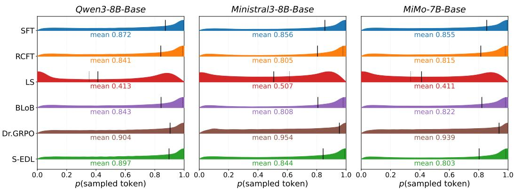  
Figure 1: Violin plots of per-token probability profiles on MATH-500 generated answers. We record the probabilities of the sampled tokens. Solid and dotted black ticks mark the mean and median, respectively. Logarithm is applied to the violin widths to improve readability.

## 5.5 Ablation study

Fig. 2 shows how S-EDL responds to $\beta$ and $\lambda _ { \mathrm { M S E } }$ . Across the four values of $\lambda _ { \mathrm { M S E } }$ spanning more than an order of magnitude, all three metrics improve over the SFT reference. As λmsE grows, Pass @ 1 rises and smECE decreases mildly, at the cost of a small drop in $\mathbf { S - A c c } .$ The behavior of $\beta$ aligns with the gradient analysis in Theorem 1. Since the per-sample gradient of $\mathcal { L } _ { \mathrm { M S E } }$ is scaled by $\beta - 1$ , the extreme setting $\beta = 1 . 0 1$ attenuates the calibration signal by two orders of magnitude, and we include it as a stress test. For the remaining values $\beta \in \mathsf { \bar { \{ 1 . 1 , 1 . 2 , 1 . 5 \} } }$ , S-EDL improves over SFT on all three metrics, with $\beta = 1 . 2$ providing the best balance; $\beta = 1 .$ 5 overweights the highest-likelihood samples and yields slightly worse calibration. We therefore adopt $\beta = 1 . 2$ and $\lambda _ { \mathrm { M S E } } = 5 . 0$ throughout all experiments. See Appendix C.4 for $\beta$ and $\lambda _ { \mathrm { M S E } }$ ablations in other settings.

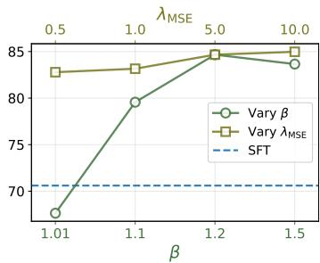  
(a) Pass@1 (↑)

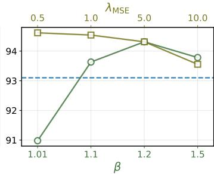  
(b) S-Acc. (↑)

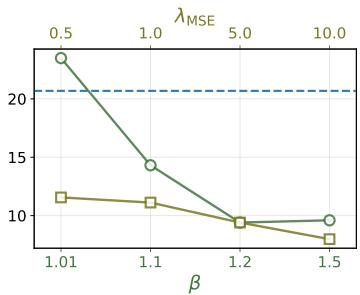  
(c) smECE (↓)

Figure 2: Ablation study on β and $\lambda _ { \mathrm { M S E } }$ with Qwen3-8B-Base trained and evaluated on GSM8K. The bottom x-axis varies β with $\lambda _ { \mathrm { M S E } } = 5 . 0$ held fixed; the top x-axis varies $\lambda _ { \mathrm { M S E } }$ with $\beta = 1 . 2$ fixed.  
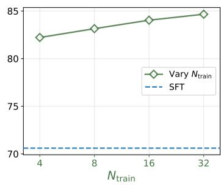  
(a) Pass@1 (↑)

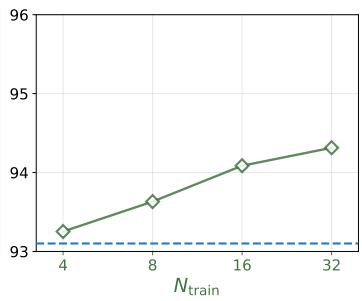  
(b) S-Acc. (↑)

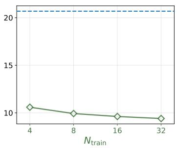  
(c) smECE (↓)  
Figure 3: Ablation study on the number of Monte-Carlo samples $N _ { \mathrm { t r a i n } }$ with Qwen3-8B-Base trained and evaluated on GSM8K. The bottom x-axis varies $N _ { \mathrm { t r a i n } }$ with $\beta = 1 . 2$ and $\lambda _ { \mathrm { M S E } } = 5 . 0$ held fixed.

In Fig. 3, $N _ { \mathrm { t r a i n } }$ varies from 4 to 32. Even at $N _ { \mathrm { t r a i n } } = 4 , \mathrm { S } – \mathrm { E D L }$ already improves over SFT on all three metrics. Increasing $N _ { \mathrm { t r a i n } }$ yields monotonic gains, with Pass@1 and S-Acc rising and smECE decreasing, consistent with Proposition 1.

## 5.6 Accelerating semantic clustering by a find-first algorithm

The number of sampled sequences $N _ { \mathrm { t r a i n } }$ also affects training speed, since computing the EDL loss requires clustering these sequences into semantic classes. To simplify the notation in the following analysis, we will use N instead of $N _ { \mathrm { t r a i n } } .$ A naive approach, which compares every pair of sequences, requires $O ( N ^ { 2 } )$ oracle calls. By contrast, Dr.GRPO uses the verifier or LLM judge to score each sequence individually, requiring only $O ( N )$ calls. To reduce this gap, we introduce a find-first clustering algorithm, detailed in Algorithm 1 in Appendix B.2. Instead of exhaustive pairwise checks the algorithm maintains a growing list of cluster representatives and compares each new sequence against them until it finds an equivalent one. If no match is found, it then creates a new cluster.

As illustrated in Fig. 4, clustering $N = 5 0$ sampled sequences with the naive pairwise approach requires $N ( N - 1 ) \bar { / 2 } = 1 2 2 5$ verifier calls per prompt. Across the evaluated models, find-first clustering reduces the average to approximately 65 calls on GSM8K and 165 calls on MATH, corresponding to roughly 1.3N and 3.3N calls, respectively. This cuts the computational burden to a small fraction of the $\mathsf { \bar { O } } ( \mathsf { N } ^ { 2 } )$ worst case, bringing the practical cost much closer to $O ( N )$

For general tasks that rely on an LLM judge, each sequence can instead be matched against all current cluster representatives in a single classification call. This implementation requires $O ( N )$ judge calls per question prompt, matching the $O ( N )$ calls of Dr.GRPO. Decision models such as Jev [46] could be explored to further accelerate this classification step. Across both verifier-based and judge-based settings, these implementations substantially narrows the gap in oracle calls between S-EDL and other sequence-level methods such as Dr.GRPO.

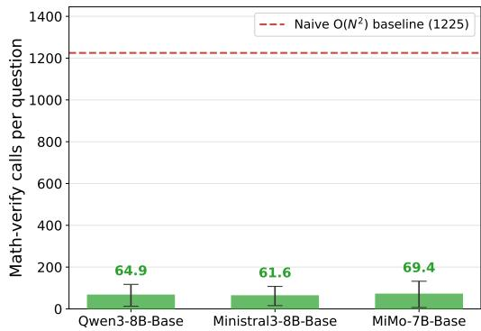  
(a) GSM8K

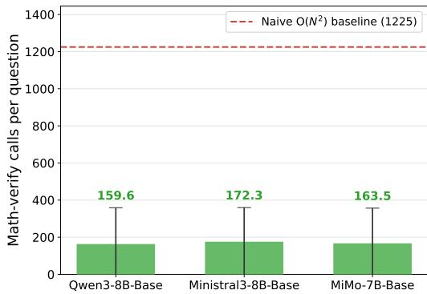  
(b) MATH  
Figure 4: Empirical cost of find-first semantic clustering on math tasks. Bars show the mean number of symbolic verifier calls per question when clustering $N = 5 0$ generated sequences, with error bars denoting one standard deviation. The dashed red line marks the naive pairwise baseline of $N ( N - 1 ) / \bar { 2 } = 1 2 2 5$ calls per question. The find-first algorithm achieves a substantial reduction in computational cost, bringing the empirical cost much closer to $O ( N )$ . Specifically, it averages roughly 1.3N calls on GSM8K and 3.3N calls on MATH. The reduction is smaller on MATH, where harder problems produce more distinct semantic classes and therefore require more comparisons.

## 6 Conclusion

We presented S-EDL, a method that constructs a Dirichlet prior over prompt-specific semantic classes from a model's own sequence likelihoods, yielding a differentiable evidential objective for fine-tuning LLMs toward semantic calibration. Our gradient analysis shows that this objective conservatively reallocates probability mass across semantic outcomes, raising the likelihoods of sequences in the ground-truth class while suppressing those of the most overconfident incorrect alternative. Empirically, this reallocation produces simultaneous gains in accuracy and calibration. More broadly, our results suggest that grounding calibration objectives in a model's own generative distribution offers a principled path toward trustworthy open-ended LLMs.

Limitations. While our find-first algorithm mentioned above substantially accelerates semantic grouping, the associated sampling and clustering steps entail a moderate training overhead compared to standard SFT. Additionally, for general tasks that necessitate an LLM judge, this requirement imposes unavoidable memory overhead and potential noise in clustering outcomes. To streamline this process, future work could bypass external verifiers or LLMs entirely by leveraging the hidden representations of generated sequences to estimate semantic dispersion, conceptually similar to methods like EigenScore [6]. Finally, we have not yet tested S-EDL on long-context tasks or domains where semantic equivalence is intrinsically difficult to define, such as code generation. Adapting S-EDL to these challenging scenarios remains an important direction for future exploration.

## Acknowledgment

We gratefully acknowledge the funding that supported this work. YL and MR were supported by the Amazon Research Award. JL was supported by a PhD scholarship from AQA. YH was supported in part by the UK Engineering and Physical Sciences Research Council through a Turing AI Fellowship (grant no. EP/V020579/1, EP/V020579/2) and the Prosperity Partnership scheme (grant no. UKRI566).

## References

[1] Sandhini Agarwal, Lama Ahmad, Jason Ai, Sam Altman, Andy Applebaum, Edwin Arbus, Rahul K Arora, Yu Bai, Bowen Baker, Haiming Bao, et al. gpt-oss-120b & gpt-oss-20b model card. arXiv preprint arXiv:2508.10925, 2025.

[2] Max Bachmann. rapidfuzz/RapidFuzz: Release 3.13.0, April 2025. URL https://doi .org/ 10.5281/zenodo.15133267. Version 3.13.0

[3] David Bani-Harouni, Chantal Pellegrini, Paul Stangel, Ege Özsoy, Kamilia Zaripova, Nassir Navab, and Matthias Keicher. Rewarding doubt: A reinforcement learning approach to calibrated confidence expression of large language models. In The Fourteenth International Conference on Learning Representations, 2026.

[4] Bertrand Charpentier, Daniel Zügner, and Stephan Günnemann. Posterior network: Uncertainty estimation without ood samples via density-based pseudo-counts. Advances in neural information processing systems, 33:1356–1367, 2020.

[5] Bertrand Charpentier, Oliver Borchert, Daniel Zügner, Simon Geisler, and Stephan Günnemann. Natural posterior network: Deep bayesian predictive uncertainty for exponential family distributions. In International Conference on Learning Representations, 2022. URL https://openreview.net/forum?id=tV3NODWMxCg.

[6] Chao Chen, Kai Liu, Ze Chen, Yi Gu, Yue Wu, Mingyuan Tao, Zhihang Fu, and Jieping Ye. INSIDE: LLMs' internal states retain the power of hallucination detection. In The Twelfth International Conference on Learning Representations, 2024.

[7] Mengyuan Chen, Junyu Gao, and Changsheng Xu. R-edl: Relaxing nonessential settings of evidential deep learning. In The Twelfth International Conference on Learning Representations, 2024.

[8] Karl Cobbe, Vineet Kosaraju, Mohammad Bavarian, Mark Chen, Heewoo Jun, Lukasz Kaiser, Matthias Plappert, Jerry Tworek, Jacob Hilton, Reiichiro Nakano, et al. Training verifiers to solve math word problems. arXiv preprint arXiv:2110.14168, 2021.

[9] Mehul Damani, Isha Puri, Stewart Slocum, Idan Shenfeld, Leshem Choshen, Yoon Kim, and Jacob Andreas. Beyond binary rewards: Training lms to reason about their uncertainty. arXiv preprint arXiv:2507.16806, 2025.

[10] Danruo Deng, Guangyong Chen, Yang Yu, Furui Liu, and Pheng-Ann Heng. Uncertainty estimation by fisher information-based evidential deep learning. In International conference on machine learning, pages 7596–7616. PMLR, 2023.

[11] Jinhao Duan, Hao Cheng, Shiqi Wang, Alex Zavalny, Chenan Wang, Renjing Xu, Bhavya Kailkhura, and Kaidi Xu. Shifting attention to relevance: Towards the predictive uncertainty quantification of free-form large language models. In Proceedings of the 62nd Annual Meeting of the Association for Computational Linguistics (Volume 1: Long Papers), pages 5050–5063, 2024.

[12] Sebastian Farquhar, Jannik Kossen, Lorenz Kuhn, and Yarin Gal. Detecting hallucinations in large language models using semantic entropy. Nature, 630(8017):625–630, 2024.

[13] Dan Hendrycks, Collin Burns, Saurav Kadavath, Akul Arora, Steven Basart, Eric Tang, Dawn Song, and Jacob Steinhardt. Measuring mathematical problem solving with the MATH dataset. In Thirty-fifth Conference on Neural Information Processing Systems Datasets and Benchmarks Track (Round 2), 2021.

[14] Edward J Hu, yelong shen, Phillip Wallis, Zeyuan Allen-Zhu, Yuanzhi Li, Shean Wang, Lu Wang, and Weizhu Chen. LoRA: Low-rank adaptation of large language models. In International Conference on Learning Representations, 2022.

[15] Jerry Huang, Peng Lu, and Qiuhao Zeng. Calibrated language models and how to find them with label smoothing. In International Conference on Machine Learning, pages 25593–25612. PMLR, 2025. URL https://openreview.net/forum?id=soLNj412EL.

[16] Tao Huang, Rui Wang, Xiaofei Liu, Yi Qin, Li Duan, and Liping Jing. Detecting misbehaviors of large vision-language models by evidential uncertainty quantification. In The Fourteenth International Conference on Learning Representations, 2026. URL https://openreview. net/forum?id=xJT4fXJr1Q.

[17] Taejong Joo, Uijung Chung, and Min-Gwan Seo. Being bayesian about categorical probability. In International conference on machine learning, pages 4950–4961. PMLR, 2020.

[18] Sanyam Kapoor, Nate Gruver, Manley Roberts, Katherine Collins, Arka Pal, Umang Bhatt, Adrian Weller, Samuel Dooley, Micah Goldblum, and Andrew G Wilson. Large language models must be taught to know what they don't know. Advances in Neural Information Processing Systems, 37:85932–85972, 2024.

[19] Michael Kirchhof, Luca Füger, Adam Golinski, Eeshan Gunesh Dhekane, Arno Blaas. Seong Joon Oh, and Sinead Williamson. Selfreflect: Can LLMs communicate their internal answer distribution? In The Fourteenth International Conference on Learning Representations, 2026.

[20] Lorenz Kuhn, Yarin Gal, and Sebastian Farquhar. Semantic uncertainty: Linguistic invariances for uncertainty estimation in natural language generation. In The Eleventh International Conference on Learning Representations, 2023.

[21] Hynek Kydlíček. Math-Verify: Math Verification Library. https://github.com/ huggingface/Math-Verify, 2025. Version 0.6.1.

[22] Tom A. Lamb, Desi R. Ivanova, Philip Torr, and Tim G. J. Rudner. Improving semantic uncertainty quantification in language model question-answering via token-level temperature scaling. In The 29th International Conference on Artificial Intelligence and Statistics, 2026.

[23] Xiao Li, Bolin Zhu, Kaiwen Shi, Sichen Liu, Yin Zhu, Yiwei Liu, and Gong Cheng. Formulareasoning: A dataset for formula-based numerical reasoning. arXiv preprint arXiv:2402.12692, 2024.

[24] Yawei Li, David Rügamer, Bernd Bischl, and Mina Rezaei. Calibrating LLMs with informationtheoretic evidential deep learning. In The Thirteenth International Conference on Learning Representations, 2025. URL https://openreview.net/forum?id=YcML3rJ10N.

[25] Yawei Li, Benjamin Bergner, Yinghan Zhao, Vihang Prakash Patil, Bei Chen, and Cheng Wang. Steering large reasoning models towards concise reasoning via flow matching. Transactions on Machine Learning Research, 2026. ISSN 2835-8856. URL https: //openreview. net/ forum?id=qwcJMdGerK.

[26] Hunter Lightman, Vineet Kosaraju, Yuri Burda, Harrison Edwards, Bowen Baker, Teddy Lee, Jan Leike, John Schulman, Ilya Sutskever, and Karl Cobbe. Let's verify step by step. In The twelfth international conference on learning representations, 2024.

[27] Alexander H Liu, Kartik Khandelwal, Sandeep Subramanian, Victor Jouault, Abhinav Rastogi, Adrien Sadé, Alan Jeffares, Albert Jiang, Alexandre Cahill, Alexandre Gavaudan, et al. Ministral 3. arXiv preprint arXiv:2601.08584, 2026.

[28] Xiaoou Liu, Tiejin Chen, Longchao Da, Chacha Chen, Zhen Lin, and Hua Wei. Uncertainty quantification and confidence calibration in large language models: A survey. In Proceedings of the 31st ACM SIGKDD Conference on Knowledge Discovery and Data Mining V. 2, pages 6107–6117, 2025.

[29] Zichen Liu, Changyu Chen, Wenjun Li, Penghui Qi, Tianyu Pang, Chao Du, Wee Sun Lee, and Min Lin. Understanding r1-zero-like training: A critical perspective. In Second Conference on Language Modeling, 2025.

[30] Yuyin Lu, Ziran Liang, Yanghui Rao, Wenqi Fan, Fu Lee Wang, and Qing Li. Double-calibration: Towards trustworthy llms via calibrating knowledge and reasoning confidence. arXiv preprint arXiv:2601.11956, 2026.

[31] Andrey Malinin and Mark Gales. Predictive uncertainty estimation via prior networks. Advances in neural information processing systems, 31, 2018.

[32] Zhiting Mei, Christina Zhang, Tenny Yin, Justin Lidard, Ola Sho, and Anirudha Majumdar. Reasoning about uncertainty: Do reasoning models know when they don't know? In Findings of the Association for Computational Linguistics: EACL 2026, pages 3408–3458, 2026.

[33] Preetum Nakkiran, Arwen Bradley, Adam Golinski, Eugene Ndiaye, Michael Kirchhof, and Sinead Williamson. Trained on tokens, calibrated on concepts: The emergence of semantic calibration in LLMs. In The Fourteenth International Conference on Learning Representations, 2026. URL https://openreview.net/forum?id=0sCyk9Tr5J.

[34] Alexander V Nikitin, Jannik Kossen, Yarin Gal, and Pekka Marttinen. Kernel language entropy: Fine-grained uncertainty quantification for LLMs from semantic similarities. In The Thirty-eighth Annual Conference on Neural Information Processing Systems, 2024. URL https://openreview.net/forum?id=j2wCrWmgMX.

[35] Nisarg Parikh, Ananya Sai, Pannaga Shivaswamy, Kunjal Panchal, and Andrew Lan. Catto: Balancing preferences and confidence in language models. arXiv preprint arXiv:2601.23096, 2026.

[36] pragatheeswaran vipulanandan, Kamal Premaratne, and Dilip Sarkar. Semantic uncertainty quantification of hallucinations in LLMs: A quantum tensor network based method. In The Fourteenth International Conference on Learning Representations, 2026.

[37] Amir Hossein Rahmati, Sanket Jantre, Weifeng Zhang, Yucheng Wang, Byung-Jun Yoon, Nathan Urban, and Xiaoning Qian. C-loRA: Contextual low-rank adaptation for uncertainty estimation in large language models. In The Thirty-ninth Annual Conference on Neural Information Processing Systems, 2025. URL https://openreview.net/forum?id=siPeAstQLq.

[38] John Schulman, Filip Wolski, Prafulla Dhariwal, Alec Radford, and Oleg Klimov. Proximal policy optimization algorithms. arXiv preprint arXiv:1707.06347, 2017.

[39] Murat Sensoy, Lance Kaplan, and Melih Kandemir. Evidential deep learning to quantify classification uncertainty. Advances in neural information processing systems, 31, 2018.

[40] Zhihong Shao, Peiyi Wang, Qihao Zhu, Runxin Xu, Junxiao Song, Xiao Bi, Haowei Zhang, Mingchuan Zhang, YK Li, Yang Wu, et al. Deepseekmath: Pushing the limits of mathematical reasoning in open language models. arXiv preprint arXiv:2402.03300, 2024.

[41] Maohao Shen, Subhro Das, Kristjan Greenewald, Prasanna Sattigeri, Gregory W Wornell, and Soumya Ghosh. Thermometer: Towards universal calibration for large language models. In International Conference on Machine Learning, pages 44687–44711. PMLR, 2024.

[42] Haizhou Shi, Yibin Wang, Ligong Han, Huan Zhang, and Hao Wang. Training-free bayesianization for low-rank adapters of large language models. In The Thirty-ninth Annual Conference on Neural Information Processing Systems, 2025. URL https://openreview.net/forum? id=itXwzGwGFC.

[43] Elias Stengel-Eskin, Peter Hase, and Mohit Bansal. Lacie: Listener-aware finetuning for calibration in large language models. Advances in Neural Information Processing Systems, 37: 43080–43106, 2024.

[44] Christian Szegedy, Vincent Vanhoucke, Sergey Ioffe, Jon Shlens, and Zbigniew Wojna. Rethinking the inception architecture for computer vision. In Proceedings of the IEEE conference on computer vision and pattern recognition, pages 2818–2826, 2016.

[45] Qwen Team. Qwen3 technical report, 2025. URL https://arxiv.org/abs/2505.09388.

[46] TypeSafe AI. Introduction. https://docs.typesafe.ai/introduction, 2026. Documentation for Jev, TypeSafe AI's first System One model. Accessed: 2026-10-06.

[47] Shenzhi Wang, Le Yu, Chang Gao, Chujie Zheng, Shixuan Liu, Rui Lu, Kai Dang, Xiong-Hui Chen, Jianxin Yang, Zhenru Zhang, Yuqiong Liu, An Yang, Andrew Zhao, Yang Yue, Shiji Song, Bowen Yu, Gao Huang, and Junyang Lin. Beyond the 80/20 rule: High-entropy minority tokens drive effective reinforcement learning for LLM reasoning. In The Thirty-ninth Annual Conference on Neural Information Processing Systems, 2025.

[48] Yibin Wang, Haizhou Shi, Ligong Han, Dimitris Metaxas, and Hao Wang. Blob: Bayesian lowrank adaptation by backpropagation for large language models. Advances in neural information processing systems, 37:67758–67794, 2024.

[49] Zhuoyu Wei, Wei Ji, Xiubo Geng, Yining Chen, Baihua Chen, Tao Qin, and Daxin Jiang. Chemistry{qa}: A complex question answering dataset from chemistry, 2021. URL https: //openreview.net/forum?id=oeHTRAehiFF.

[50] Jiancong Xiao, Bojian Hou, Zhanliang Wang, Ruochen Jin, Qi Long, Weijie J Su, and Li Shen. Restoring calibration for aligned large language models: A calibration-aware fine-tuning approach. In International Conference on Machine Learning, pages 68364–68390. PMLR, 2025. URL https://openreview.net/forum?id=51tMpvPNSm.

[51] LLM Xiaomi, Bingquan Xia, Bowen Shen, Dawei Zhu, Di Zhang, Gang Wang, Hailin Zhang, Huaqiu Liu, Jiebao Xiao, Jinhao Dong, et al. Mimo: Unlocking the reasoning potential of language model–from pretraining to posttraining. arXiv preprint arXiv:2505.07608, 2025.

[52] Tianyang Xu, Shujin Wu, Shizhe Diao, Xiaoze Liu, Xingyao Wang, Yangyi Chen, and Jing Gao. Sayself: Teaching llms to express confidence with self-reflective rationales. In Proceedings of the 2024 Conference on Empirical Methods in Natural Language Processing, pages 5985–5998, 2024.

[53] Adam X. Yang, Maxime Robeyns, Xi Wang, and Laurence Aitchison. Bayesian low-rank adaptation for large language models. In The Twelfth International Conference on Learning Representations, 2024.

[54] Taeseong Yoon and Heeyoung Kim. Uncertainty estimation by flexible evidential deep learning In The Thirty-ninth Annual Conference on Neural Information Processing Systems, 2025.

[55] Jiaxin Zhang, Xiangyu Peng, Qinglin Chen, Qinyuan Ye, Caiming Xiong, and Chien-Sheng Wu. The illusion of certainty: Decoupling capability and calibration in on-policy distillation. arXiv preprint arXiv:2604.16830, 2026.

[56] Thomas Zollo, Jimmy Wang, and Richard Zemel. Unsupervised confidence calibration for reasoning llms from a single generation. arXiv preprint arXiv:2604.19444, 2026.

## A Proofs

## A.1 Proof of Proposition 1

Proof of Proposition 1. Apply the Strong Law of Large Numbers separately to the numerator and denominator of Eq. (6). The numerator $\begin{array} { r } { \frac { 1 } { N } U _ { s } = \frac { 1 } { N } \sum _ { i = 1 } ^ { N } u ^ { ( i ) } \mathbb { 1 } \{ s ^ { ( i ) } = s \} } \end{array}$ is a sample average of i.i.d. terms under $z ^ { ( i ) } \sim p _ { \theta } ( \cdot | x )$ , so almost surely

$$
\operatorname* { l i m } _ { N \to \infty } \frac { 1 } { N } U _ { s } = \mathbb { E } _ { z \sim p _ { \theta } ( \cdot \vert x ) } \left[ p _ { \theta } ( z \vert x ) ^ { \beta - 1 } \mathbb { 1 } \{ B ( x , z ) = s \} \right]\tag{9}
$$

$$
= \sum _ { z \in \mathcal { V } ^ { L } } p _ { \pmb \theta } ( z | x ) \cdot p _ { \pmb \theta } ( z | x ) ^ { \beta - 1 } \mathbb { 1 } \{ B ( x , z ) = s \}\tag{10}
$$

$$
= \sum _ { z : B ( x , z ) = s } p _ { \pm } ( z | x ) ^ { \beta } .\tag{11}
$$

An identical argument applied to ${ \frac { 1 } { N } } \sum _ { r \in S } U _ { r }$ yields the partition function $\begin{array} { r } { \sum _ { z ^ { \prime } \in \mathcal { V } ^ { L } } p \pmb { \theta } ( z ^ { \prime } | x ) ^ { \beta } } \end{array}$ . The continuous mapping theorem then identifies the ratio of the two limits with $\pi _ { \beta } ( s )$ in Eq. (4). □

## A.2 Proof of Theorem 1

Proof of Theorem 1. The forward pass composes four maps:

$$
\ell ^ { ( i ) } ~ \xrightarrow { \mathrm { \scriptsize ~ e x p } ( ( \beta - 1 ) \cdot ) } ~ u ^ { ( i ) } ~ \xrightarrow { \mathrm { \scriptsize ~ c l a s s \ s u m } } ~ U _ { s } ~ \xrightarrow { \mathrm { \scriptsize ~ n o r m a l i z e } } ~ \hat { \pi } _ { \beta } ( s ) ~ \xrightarrow { \mathrm { \scriptsize ~ E D L \log s s } } ~ \mathcal { L } _ { \mathrm { \scriptsize ~ M S E } } .
$$

We establish $d _ { s } = \partial \mathcal { L } _ { \mathrm { M S E } } / \partial \hat { \pi } _ { \beta } ( s )$ first, then backpropagate along the remaining three links.

Step 1: derivative w.r.t. $\hat { \pi } _ { \beta } ( s )$ . Since $\alpha _ { s } = N \hat { \pi } _ { \beta } ( s ) + 1$ , we have $\partial \alpha _ { s } / \partial { \hat { \pi } } _ { \beta } ( s ) = N$ , and the Dirichlet strength $\alpha _ { 0 } = N + | \boldsymbol { \mathcal { S } } |$ is constant in $\hat { \pi } _ { \beta }$ . Let $q _ { s } : = \mathbb { 1 } \{ s = s ^ { * } \}$ be the binary indicator of the ground truth class. Differentiating the closed-form MSE in Eq. (2) gives

$$
\begin{array} { r l } & { \frac { \partial \mathcal { L } _ { \mathrm { M S E } } } { \partial \hat { \pi } _ { \beta } ( s ) } = \underbrace { \frac { \partial \alpha _ { s } } { \partial \hat { \pi } _ { \beta } ( s ) } } _ { = N } \cdot \frac { \partial \mathcal { L } _ { \mathrm { M S E } } } { \partial \alpha _ { s } } } \\ & { \qquad = N \left[ 2 \left( \frac { \alpha _ { s } } { \alpha _ { 0 } } - q _ { s } \right) \frac { 1 } { \alpha _ { 0 } } + \frac { \alpha _ { 0 } - 2 \alpha _ { s } } { \alpha _ { 0 } ^ { 2 } ( \alpha _ { 0 } + 1 ) } \right] } \\ & { \qquad = \frac { N } { \alpha _ { 0 } ^ { 2 } ( \alpha _ { 0 } + 1 ) } \left[ 2 ( \alpha _ { s } - q _ { s } \alpha _ { 0 } ) ( \alpha _ { 0 } + 1 ) + \alpha _ { 0 } - 2 \alpha _ { s } \right] } \\ & { \qquad = \frac { N } { \alpha _ { 0 } ( \alpha _ { 0 } + 1 ) } \left[ 2 \alpha _ { s } - 2 q _ { s } ( \alpha _ { 0 } + 1 ) + 1 \right] . } \end{array}\tag{12}
$$

Substituting $\alpha _ { 0 } = N + | S |$ yields

$$
d _ { s } = \frac { N \left[ 2 \alpha _ { s } - 2 ( N + \vert S \vert + 1 ) q _ { s } + 1 \right] } { ( N + \vert S \vert ) ( N + \vert S \vert + 1 ) } ,\tag{13}
$$

Step 2: backpropagation from $\hat { \pi } _ { \beta }$ to $\ell ^ { ( i ) }$ . Let $\begin{array} { r } { U : = \sum _ { s \in \mathcal { S } } U _ { s } = \sum _ { i = 1 } ^ { N } u ^ { ( i ) } } \end{array}$ . Then:

1. $\frac { \partial \hat { \pi } _ { \beta } ( s ) } { \partial U _ { r } } = \frac { 1 } { U } \left( \delta _ { s r } - \hat { \pi } _ { \beta } ( s ) \right)$ , by direct differentiation of $U _ { s } / U$

$$
2 . \frac { \partial \mathcal { L } _ { \mathrm { M S E } } } { \partial U _ { r } } = \sum _ { s \in \mathcal { S } } d _ { s } \cdot \frac { 1 } { U } \left( \delta _ { s r } - \hat { \pi } _ { \beta } ( s ) \right) = \frac { 1 } { U } \left( d _ { r } - \bar { d } \right) .
$$

3. $\partial U _ { s } / \partial u ^ { ( i ) } = \mathbb { 1 } \{ s ^ { ( i ) } = s \}$ , hence $\partial \mathcal { L } _ { \mathrm { M S E } } / \partial u ^ { ( i ) } = ( 1 / U ) \left( d _ { s ^ { ( i ) } } - \bar { d } \right)$

4. $\partial u ^ { ( i ) } / \partial \ell ^ { ( i ) } = ( \beta - 1 ) u ^ { ( i ) }$ , so

$$
\frac { \partial \mathcal { L } _ { \mathrm { M S E } } } { \partial \ell ^ { ( i ) } } = \frac { \left( \beta - 1 \right) u ^ { ( i ) } } { U } \left( d _ { s ^ { ( i ) } } - \bar { d } \right) = \left( \beta - 1 \right) w ^ { ( i ) } \left( d _ { s ^ { ( i ) } } - \bar { d } \right) ,
$$

which is Eq. (8).

## A.3 Proof of Corollary 1

Proof of Corollary 1. Substituting $\alpha _ { s } = N \hat { \pi } _ { \beta } ( s ) + 1$ into Eq. (13) reveals that the class-level derivatives $d _ { s }$ possess opposite signs for the ground-truth class and the incorrect classes. Specifically, for the ground-truth class $s ^ { * }$ , we have

$$
d _ { s ^ { * } } \propto 2 N ( \hat { \pi } _ { \beta } ( s ^ { * } ) - 1 ) - 2 | S | + 1 < 0 ,
$$

and for any incorrect class $s \neq s ^ { * }$ , we have

$$
d _ { s } \propto 2 N \hat { \pi } _ { \beta } ( s ) + 3 > 0 .
$$

Consequently, $d _ { s ^ { * } } < d _ { s }$ holds for every $s \neq s ^ { * }$ . Furthermore, since $d _ { s }$ strictly increases with respect to $\hat { \pi } _ { \beta } ( s )$ among the incorrect classes, the most overconfident incorrect class defined by $s ^ { - } \ : = \ \arg \operatorname* { m a x } _ { s \neq s ^ { \ast } } \hat { \pi } _ { \beta } ( s )$ attains the maximum value of $d _ { s }$ among the incorrect classes, and therefore among all classes. From Theorem 1, the gradient with respect to the sample log-likelihood is given by

$$
\frac { \partial \mathcal { L } _ { \mathrm { M S E } } } { \partial \ell ^ { ( i ) } } = ( \beta - 1 ) w ^ { ( i ) } \big ( d _ { s ^ { ( i ) } } - \bar { d } \big ) , \qquad \mathrm { w h e r e ~ } \bar { d } = \sum _ { s } \hat { \pi } _ { \beta } \big ( s \big ) d _ { s } .
$$

Given that $\beta > 1$ and the normalized sample weight $w ^ { ( i ) } > 0$ , the sign of the gradient is entirely determined by the difference $d _ { s ( i ) } - \bar { d } .$ Because d is a convex combination of all class-level derivatives and $d _ { s } ,$ represents the global minimum among them, it follows naturally that $d _ { s ^ { * } } - \bar { d } \leq 0$ . Therefore, for any sample belonging to the ground-truth class $( s ^ { ( i ) } = s ^ { * } )$ , the gradient satisfies $\begin{array} { r } { \frac { \partial \mathcal { L } _ { \mathrm { M S E } } } { \partial \ell ^ { ( i ) } } \leq 0 } \end{array}$ . This inequality is strict provided the semantic distribution has not fully collapsed to the ground-truth class $( \hat { \pi } _ { \beta } ( s ^ { * } ) < 1 )$ , because the convex combination d will include positive weights from the strictly larger derivatives of the incorrect classes.

Similarly, because $d _ { s ^ { - } }$ is the global maximum among the class-level derivatives, we have $d _ { s ^ { - } } - - \bar { d } \geq 0$ Thus, for any sample mapped to the most overconfident incorrect class $( s ^ { ( i ) } = s ^ { - } )$ , the gradient satisfies $\begin{array} { r } { \frac { \partial \mathcal { L } _ { \mathrm { M S E } } } { \partial \ell ^ { ( i ) } } \geq 0 } \end{array}$ . This inequality becomes strict whenever $\hat { \pi } _ { \beta } { \left( s ^ { * } \right) } > 0 ,$ as the convex combination ā then incorporates a positive weight from the strictly smaller derivative $d _ { s ^ { * } } < d _ { s ^ { - } }$ . This concludes the proof. □

## A.4 Proof of Corollary 2

Proof of Corollary 2. Using Theorem 1 and $\begin{array} { r } { \sum _ { j : s ^ { ( j ) } = s } w ^ { ( j ) } = \hat { \pi } _ { \beta } \big ( s \big ) } \end{array}$ , we have

$$
\sum _ { i = 1 } ^ { N } \frac { \partial \mathcal { L } _ { \mathrm { M S E } } } { \partial \ell ^ { ( i ) } } = ( \beta - 1 ) \sum _ { i = 1 } ^ { N } w ^ { ( i ) } ( d _ { s ^ { ( i ) } } - \bar { d } ) = ( \beta - 1 ) \left( \sum _ { s } \hat { \pi } _ { \beta } ( s ) d _ { s } - \bar { d } \sum _ { i = 1 } ^ { N } w ^ { ( i ) } \right) = 0 .
$$

The last equality follows from $\begin{array} { r } { \bar { d } = \sum _ { s } \hat { \pi } _ { \beta } ( s ) d _ { s } } \end{array}$ and $\begin{array} { r } { \sum _ { i = 1 } ^ { N } w ^ { ( i ) } = 1 } \end{array}$

## A.5 Relation to GRPO-like updates

In this subsection, we show that S-EDL gradients can also be interpreted as GRPO-like updates. Before detailing this connection, we note that the SFT term in ${ \mathcal { L } } _ { \mathrm { S - E D L } }$ is not essential to the formulation of S-EDL. In principle, the model can be trained using $\mathcal { L } _ { \mathrm { M S E } }$ alone with $\beta > 1$ . Its practical role is to provide dense token-level supervision early in training, when correct completions are rare and the positive signal from sampled semantic classes can be weak, as in sparse-reward learning. Therefore, the following analysis omits the SFT term and focuses on $\mathcal { L } _ { \mathrm { M S E } }$

For a fixed set of sampled sequences and semantic assignments, Eq. (8) gives S-EDL a grouprelative update structure similar to GRPO [40]. The key idea is to interpret the negative gradient $- \partial \mathcal { L } _ { \mathrm { M S E } } / \partial \ell ^ { ( i ) }$ as a reward signal for each sampled sequence. Define the uncentered class reward $r _ { s } : = - d _ { s }$ and its weighted mean $\begin{array} { r } { \bar { r } : = \sum _ { s \in \mathcal { S } } \hat { \pi } _ { \beta } ^ { \mathbf { \Upsilon } } ( s ) r _ { s } \overset { \cdot } { = } - \bar { d } . } \end{array}$ The negative gradient with respect to each sample log-likelihood then acts as an advantage coefficient:

$$
A ^ { ( i ) } : = - \frac { \partial \mathcal { L } _ { \mathrm { M S E } } } { \partial \ell ^ { ( i ) } } = ( \beta - 1 ) w ^ { ( i ) } \big ( r _ { s ^ { ( i ) } } - \bar { r } \big ) ,\tag{14}
$$

and then we have

$$
- \nabla _ { \pmb { \theta } } \mathcal { L } _ { \mathrm { M S E } } = \sum _ { i = 1 } ^ { N } A ^ { ( i ) } \nabla _ { \pmb { \theta } } \ell ^ { ( i ) } .\tag{15}
$$

Here, the group comparison is over the semantic classes associated with the same prompt. The class derivative $d _ { s ( i ) }$ is centered by ${ \bar { d } } ,$ and the centered signal is modulated by $( \beta - 1 ) w ^ { ( i ) }$ , with the sign reversed for likelihood ascent. Original GRPO centers rewards over sampled completions using their arithmetic mean and divides by a reward standard deviation shared by the group. S-EDL instead uses a semantic-probability-weighted mean and a sample-dependent modulation factor, so completions in the same class share the class reward but can receive different update weights.

This interpretation allows S-EDL to be incorporated into proximal policy optimization (PPO) implementations [38], with clipping and micro-batch updates as in GRPO variants. This can improve the sample efficiency and stability of S-EDL training.

## B Implementation details

## B.1 Construction of semantic class set and handling unobserved ground-truth classes

Previous work on semantic calibration [33] establishes evaluation metrics based entirely on the sampled distribution. When adapting this purely sample-based perspective into a training objective, if the correct semantic class is absent from the generated samples, the evidential loss $\mathcal { L } _ { \mathrm { M S E } }$ can still be computed, as the label vector q then simply consists of all zero entries. Consequently, the gradient only suppresses the incorrect overconfident completions, but lacks the effect of increasing the likelihoods of the correct completions.

To remedy this and ensure the gradient direction toward the ground-truth class established in Corollary 1 remains available, S-EDL conditionally introduces s\* into the semantic class set $S _ { x }$ strictly when it is absent from the generated samples. This guarantees that we do not artificially inflate the sample count or alter the distribution when the model naturally generates the correct answer. We apply this conditional handling as follows to maximize consistency across the training and evaluation pipelines.

• When the ground-truth class is already present in the sampled generations, we use the sampled set directly without any modifications during both training and evaluation.

• When the ground-truth class is unobserved during training, we explicitly include it by feeding the ground-truth sequence $y$ to the model to compute its log-likelihood and applying a penalty of —4.6. This penalty scales down its probability mass to reflect that the sequence was not naturally sampled, while still preserving the gradient path for optimization.

• When the ground-truth class is unobserved during evaluation, we similarly include it but strictly set its sampled count to 0, ensuring the evaluation accurately reflects the true generative distribution of the model.

Deterministically adding the ground-truth completion y means the estimator is no longer a pure Monte Carlo estimator based solely on samples from $p _ { \pmb { \theta } }$ . Instead, it creates a hybrid objective that mixes the generative distribution of the model with a supervised finite-candidate signal. We accept this theoretical trade-off to maintain a robust and differentiable training path

## B.2 Find-first algorithm for semantic clustering

Sequence-level training methods like Dr.GRPO require comparing N sampled sequences against the ground truth answer, resulting in an $O ( N )$ computational complexity per prompt. By contrast, computing the evidential loss in S-EDL requires grouping the generated sequences into semantic classes. A naive pairwise comparison between all sequences scales as $O ( N ^ { 2 } )$ , imposing a substantial computational bottleneck.

To address this scaling gap, we introduce a find-first semantic clustering algorithm as shown in Algorithm 1. Instead of brute-force pairwise comparison, the algorithm maintains a growing list of cluster representatives and dynamically evaluates each new sequence against them. To optimize the comparison order, we sort the existing representatives by descending string similarity to the new sequence using rapidfuzz [2]. The equivalence oracle MATCH is then instantiated in two ways depending on the evaluation domain.

```latex
Algorithm 1 Find-first semantic clustering
Require: generated sequences $z ^ { ( 1 ) } , \dots , z ^ { ( N ) }$ ; equivalence oracle MATCH; string similarity function
$\sigma ( \cdot , \cdot )$
Ensure: clusters ${ \mathcal { C } } ,$ each a pair $( r , M )$ of representative answer and member set
1: ${ \mathcal { C } } \gets \langle \rangle$
2: for $i \stackrel { \cdot \cdot } { = } 1 , \ldots , N$ do
3: $K \gets | { \mathcal { C } } |$
4: $\pi  \operatorname { a r g s o r t } _ { k \in \{ 1 , . . . , K \} } \big ( - \sigma ( z ^ { ( i ) } , r _ { k } ) \big )$ order reps by descending similarity to $z ^ { ( i ) }$
5: $j \gets \mathbf { M A T C H } \big ( z ^ { ( i ) } , \ : [ r _ { \pi ( 1 ) } , \ldots , r _ { \pi ( K ) } ] \big )$ position in list, or ⊥ if none equivalent
6: $\mathbf { i f } \ j \neq \perp$ then
7: $\stackrel { \prime } { M } _ { \pi ( j ) }  M _ { \pi ( j ) } \cup \{ z ^ { ( i ) } \}$ assign $z ^ { ( i ) }$ to the matched cluster
8: else
9: append $( r , M ) \gets ( z ^ { ( i ) } , \{ z ^ { ( i ) } \} )$ to C ▶ open a new cluster
10: end if
11: end for
12: return C
```

Mathematical tasks $\mathbf { M A T C H } ( z , [ r _ { 1 } , \dots , r _ { K } ] )$ evaluates equivalence using a symbolic verifier (e.g. math-verify[21]). It sequentially checks the candidate against the sorted representatives and returns the first index j where $z \equiv r _ { j }$ , returning ⊥ if no match exists. The string similarity ordering heavily biases the search toward early termination.

General tasks For general subject tasks that rely on an LLM as a judge, MATCH replaces iterative pairwise checks with a single listwise classification prompt. The judge evaluates the sequence against all current cluster representatives in one forward pass, directly returning the matched index in $\{ 1 , \ldots , K \} \ \mathrm { o r } \ \perp$ . The system is shown in Appendix C.5.1. In this context, the string similarity ordering ensures the most plausible candidate appears first in the prompt context. By grouping the comparisons into a single listwise operation, the temporal complexity of semantic clustering is reduced to exactly O(N), identically matching the scaling of Dr.GRPO.

## B.3 Dataset construction

GSM8K We use the original training and test splits from the official release, along with the provided solutions and chain-of-thought reasoning steps.

MATH We utilize the official training split and the associated chain-of-thought solutions. For evaluation, we employ the widely adopted MATH-500 test split.

ChemistryQA We use the official training and test splits. To construct the training data, we prompt the GPT-OSS-120B model [1] to generate chain-of-thought solutions, retaining only those that yield the correct final answer. This filtering process results in 3062 training samples. For evaluation, we use the complete test set and assess performance directly against the provided ground-truth answers.

FormulaReasoning We similarly use the official training and test splits. We generate chain-ofthought solutions using the GPT-OSS-120B model and filter for correctness, which yields 4096 training samples. We evaluate on the complete test set using the official ground-truth answers. During the cross-domain evaluation, we observed that models fine-tuned on the MATH dataset experience a severe accuracy degradation for all studied fine-tuning methods. This drop makes calibration performance indistinguishable across the fine-tuning methods, as most samples exhibit uniformly low semantic confidence and low accuracy across all methods. We identified that the models struggle to recall the necessary physical laws. Consequently, we manually augment the testing prompts with the relevant physical laws as hints. These hint-augmented prompts are applied exclusively during the cross-domain evaluation. Furthermore, these hint-augmented prompts are used across evaluation of all fine-tuning methods to ensure fairness.

Table 3: EDL fine-tuning hyperparameters for Qwen3-8B-Base across the four evaluation datasets.
<table><tr><td>Hyperparameter</td><td>GSM8K</td><td>MATH</td><td>ChemistryQA</td><td>FormulaReasoning</td></tr><tr><td>Model &amp; LoRA</td><td></td><td></td><td></td><td></td></tr><tr><td>Model max_seq_length</td><td>2048</td><td>4096</td><td>4096</td><td>4096</td></tr><tr><td>LoRA r / α / dropout</td><td>16 / 32 / 0.0</td><td>16 / 32 / 0.0</td><td>16 / 32 / 0.0</td><td>16 / 32 / 0.0</td></tr><tr><td>LoRA target modules</td><td>Q,K,V,O,gate,up,down</td><td>Q,K,V,O,gate,up,down</td><td>Q,K,V,O,gate,up,down</td><td>Q,K,V,O,gate,up,down</td></tr><tr><td>LoRA bias</td><td>none</td><td>none</td><td>none</td><td>none</td></tr><tr><td>Precision</td><td>bf16</td><td>bf16</td><td>bf16</td><td>bf16</td></tr><tr><td>Optimizer (cosine schedule)</td><td></td><td></td><td></td><td></td></tr><tr><td>Optimizer</td><td>AdamW</td><td>AdamW</td><td>AdamW</td><td>AdamW</td></tr><tr><td>LR scheduler</td><td>cosine</td><td>cosine</td><td>cosine</td><td>cosine</td></tr><tr><td>Warmup ratio</td><td>0.06</td><td>0.06</td><td>0.06</td><td>0.06</td></tr><tr><td>Max grad norm</td><td>1.0</td><td>1.0</td><td>1.0</td><td>1.0</td></tr><tr><td>Gradient checkpointing</td><td>enabled</td><td>enabled</td><td>enabled</td><td>enabled</td></tr><tr><td>EDL training</td><td></td><td></td><td></td><td></td></tr><tr><td>EDL initialization</td><td>base</td><td>base</td><td>base</td><td>base</td></tr><tr><td>num_train_epochs</td><td>1</td><td>1</td><td>1</td><td>1</td></tr><tr><td>Per-device batch size</td><td>4</td><td>4</td><td>4</td><td>4</td></tr><tr><td>Peak LR</td><td>2×10⁻⁴</td><td>2×10</td><td> $2 \times 1 0 ^ { - 4 }$ </td><td>2×10−4</td></tr><tr><td>edl_weight_start_step</td><td>0.5</td><td>0.5</td><td>0.5</td><td>0.5</td></tr><tr><td>EDLβ</td><td>1.2</td><td>1.2</td><td>1.2</td><td>1.2</td></tr><tr><td>EDL weight λMSE</td><td>5.0</td><td>5.0</td><td>5.0</td><td>5.0</td></tr><tr><td>Ntrain</td><td>32</td><td>8</td><td>8</td><td>8</td></tr><tr><td>Sampling max_tokens</td><td>256</td><td>768</td><td>768</td><td>768</td></tr><tr><td>Sampling temperature</td><td>1.0</td><td>1.0</td><td>1.0</td><td>1.0</td></tr><tr><td>Sampling top_p</td><td>0.9</td><td>0.9</td><td>0.9</td><td>0.9</td></tr><tr><td>Evaluation</td><td></td><td></td><td></td><td></td></tr><tr><td>Neval</td><td>50</td><td>50</td><td>50</td><td>50</td></tr><tr><td>Temperature</td><td>0.8</td><td>0.8</td><td>0.8</td><td>0.8</td></tr><tr><td>top-p</td><td>0.9</td><td>0.9</td><td>0.9</td><td>0.9</td></tr><tr><td>max_tokens</td><td>1024</td><td>2048</td><td>2048</td><td>2048</td></tr></table>

Note. All EDL runs use a cosine LR schedule with warmup\_ratio = 0.06 over the entire num\_train\_epochs; the EDL loss is enabled starting at fraction ed1\_weight\_start\_step of total steps. Where EDL initialization is base, the cosine schedule covers the full run and EDL begins partway through the decay; where EDL initialization is SFT ckpt (epoch=1), the run is short and the cosine schedule covers only the EDL phase.

Table 4: EDL fine-tuning hyperparameters for Ministral-3-8B-Base across the four evaluation datasets.
<table><tr><td>Hyperparameter</td><td>GSM8K</td><td>MATH</td><td>ChemistryQA</td><td>FormulaReasoning</td></tr><tr><td>Model &amp; LoRA</td><td></td><td></td><td></td><td></td></tr><tr><td>Model max_seq_length</td><td>2048</td><td>4096</td><td>4096</td><td>4096</td></tr><tr><td>LoRA r / α / dropout</td><td>16 / 32 / 0.0</td><td>16 / 32 / 0.0</td><td>16 / 32 / 0.0</td><td>16 / 32 / 0.0</td></tr><tr><td>LoRA target modules</td><td>Q,K,V,O,gate,up,down</td><td>Q,K,V,O,gate,up,down</td><td>Q,K,V,O,gate,up,down</td><td>Q,K,V,O,gate,up,down</td></tr><tr><td>LoRA bias</td><td>none</td><td>none</td><td>none</td><td>none</td></tr><tr><td>Precision</td><td>bf16</td><td>bf16</td><td>bf16</td><td>bf16</td></tr><tr><td>Optimizer (cosine schedule)</td><td></td><td></td><td></td><td></td></tr><tr><td>Optimizer</td><td>AdamW</td><td>AdamW</td><td>AdamW</td><td>AdamW</td></tr><tr><td>LR scheduler</td><td>cosine</td><td>cosine</td><td>cosine</td><td>cosine</td></tr><tr><td>Warmup ratio</td><td>0.06</td><td>0.06</td><td>0.06</td><td>0.06</td></tr><tr><td>Max grad norm</td><td>1.0</td><td>1.0</td><td>1.0</td><td>1.0</td></tr><tr><td>Gradient checkpointing</td><td>enabled</td><td>enabled</td><td>enabled</td><td>enabled</td></tr><tr><td>EDL training</td><td></td><td></td><td></td><td></td></tr><tr><td>EDL initialization</td><td>base</td><td>SFT ckpt (epoch=1)</td><td>SFT ckpt (epoch=1)</td><td>SFT ckpt (epoch=1)</td></tr><tr><td>num_train_epochs</td><td>2.5</td><td>0.3</td><td>0.3</td><td>0.5</td></tr><tr><td>Per-device batch size</td><td>4</td><td>4</td><td>4</td><td>4</td></tr><tr><td>Peak LR</td><td>2×10−4</td><td>5×10 5</td><td>5×10−5</td><td>5×10−5</td></tr><tr><td>edl_weight_start_step</td><td>0.8</td><td>0.0</td><td>0.0</td><td>0.0</td></tr><tr><td>EDL β</td><td>1.2</td><td>1.2</td><td>1.2</td><td>1.2</td></tr><tr><td>EDL weight λMSE</td><td>5.0</td><td>5.0</td><td>5.0</td><td>5.0</td></tr><tr><td>Ntrain</td><td>32</td><td>12</td><td>12</td><td>8</td></tr><tr><td>Sampling max_tokens</td><td>256</td><td>512</td><td>512</td><td>512</td></tr><tr><td>Sampling temperature</td><td>1.0</td><td>0.5</td><td>0.5</td><td>1.0</td></tr><tr><td>Sampling top-p</td><td>0.9</td><td>0.9</td><td>0.9</td><td>0.9</td></tr><tr><td>Evaluation</td><td></td><td></td><td></td><td></td></tr><tr><td>Neval</td><td>50</td><td>50</td><td>50</td><td>50</td></tr><tr><td>Temperature</td><td>0.6</td><td>0.6</td><td>0.6</td><td>0.6</td></tr><tr><td>top-p</td><td>0.9</td><td>0.9</td><td>0.9</td><td>0.9</td></tr><tr><td>max_tokens</td><td>1024</td><td>2048</td><td>2048</td><td>2048</td></tr></table>

Note. All EDL runs use a cosine LR schedule with warmup\_ratio = 0.06 over the entire num\_train\_epochs; the EDL loss is enabled starting at fraction ed1\_weight\_start\_step of total steps. Where EDL initialization is base, the cosine schedule covers the full run and EDL begins partway through the decay; where EDL initialization is SFT ckpt (epoch=1), the run is short and the cosine schedule covers only the EDL phase.

Table 5: EDL fine-tuning hyperparameters for MiMo-7B-Base across the four evaluation datasets.
<table><tr><td>Hyperparameter</td><td>GSM8K</td><td>MATH</td><td>ChemistryQA</td><td>FormulaReasoning</td></tr><tr><td>Model &amp; LoRA</td><td></td><td></td><td></td><td></td></tr><tr><td>Model max_seq_length</td><td>2048</td><td>4096</td><td>4096</td><td>4096</td></tr><tr><td>LoRA r / α / dropout</td><td>16 / 32 / 0.0</td><td>16 / 32 / 0.0</td><td>16 / 32 / 0.0</td><td>16 / 32 / 0.0</td></tr><tr><td>LoRA target modules</td><td>Q,K,V,O,gate,up,down</td><td>Q,K,V,O,gate,up,down</td><td>Q,K,V,O,gate,up,down</td><td>Q,K,V,O,gate,up,down</td></tr><tr><td>LoRA bias</td><td>none</td><td>none</td><td>none</td><td>none</td></tr><tr><td>Precision</td><td>bf16</td><td>bf16</td><td>bf16</td><td>bf16</td></tr><tr><td>Optimizer (cosine schedule)</td><td></td><td></td><td></td><td></td></tr><tr><td>Optimizer</td><td>AdamW</td><td>AdamW</td><td>AdamW</td><td>AdamW</td></tr><tr><td>LR scheduler</td><td>cosine</td><td>cosine</td><td>cosine</td><td>cosine</td></tr><tr><td>Warmup ratio</td><td>0.06</td><td>0.06</td><td>0.06</td><td>0.06</td></tr><tr><td>Max grad norm</td><td>1.0</td><td>1.0</td><td>1.0</td><td>1.0</td></tr><tr><td>Gradient checkpointing</td><td>enabled</td><td>enabled</td><td>enabled</td><td>enabled</td></tr><tr><td>EDL training</td><td></td><td></td><td></td><td></td></tr><tr><td>EDL initialization</td><td>base</td><td>SFT ckpt (epoch=1)</td><td>SFT ckpt (epoch=1)</td><td>SFT ckpt (epoch=1)</td></tr><tr><td>num_train_epochs</td><td>2.5</td><td>0.3</td><td>0.3</td><td>0.5</td></tr><tr><td>Per-device batch size</td><td>4</td><td>4</td><td>4</td><td>4</td></tr><tr><td>Peak LR</td><td>2×10−4</td><td>5×10 -5</td><td>5×10−5</td><td>5×10−5</td></tr><tr><td>edl_weight_start_step</td><td>0.8</td><td>0.0</td><td>0.0</td><td>0.0</td></tr><tr><td>EDL β</td><td>1.2</td><td>1.2</td><td>1.2</td><td>1.2</td></tr><tr><td>EDL weight λMSE</td><td>5.0</td><td>5.0</td><td>5.0</td><td>5.0</td></tr><tr><td>Ntrain</td><td>32</td><td>12</td><td>12</td><td>12</td></tr><tr><td>Sampling max_tokens</td><td>256</td><td>512</td><td>512</td><td>512</td></tr><tr><td>Sampling temperature</td><td>1.0</td><td>0.5</td><td>0.5</td><td>1.0</td></tr><tr><td>Sampling top_p</td><td>0.9</td><td>0.9</td><td>0.9</td><td>0.9</td></tr><tr><td>Evaluation</td><td></td><td></td><td></td><td></td></tr><tr><td>Neval</td><td>50</td><td>50</td><td>50</td><td>50</td></tr><tr><td>Temperature</td><td>0.7</td><td>0.7</td><td>0.7</td><td>0.7</td></tr><tr><td>top-p</td><td>0.9</td><td>0.9</td><td>0.9</td><td>0.9</td></tr><tr><td>max_tokens</td><td>1024</td><td>2048</td><td>2048</td><td>2048</td></tr></table>

Note. All EDL runs use a cosine LR schedule with warmup\_ratio = 0.06 over the entire num\_train\_epochs; the EDL loss is enabled starting at fraction ed1\_weight\_start\_step of total steps. Where EDL initialization is base, the cosine schedule covers the full run and EDL begins partway through the decay; where EDL initialization is SFT ckpt (epoch=1), the run is short and the cosine schedule covers only the EDL phase.

## B.4 Training hyperparameters

The full training and evaluation hyperparameters for each (model, dataset) cell are listed in Table 3, Table 4, and Table 5, covering Qwen3-8B-Base, Ministral-3-8B-Base, and MiMo-7B-Base respectively. For MATH and GSM8K we use math-verify [21] for semantic clustering at both training and evaluation time. On ChemistryQA and FormulaReasoning, we employ GPT-OSS-20B [1] as an LLM-as-judge for semantic clustering at both training and evaluation time, with the system prompt shown in Appendix C.5.1.

## B.5 Hyperparameters of baselines

BLoB During training, we set bayes\_samples to 1, bayes\_epsilon to 0.05, bayes\_beta to 0.2, and bayes\_kllr to 0.1, with bayes\_kl\_reweighting enabled. During evaluation, we use 5 Bayesian samples. We refer readers to the official BLoB codebase for the precise definitions of these hyperparameters.

RCFT During training, we configure the hyperparameters by setting rcft\_alpha to 0.5, rcft\_calibration\_scale to 0.001, rcft\_num\_bins to 10, and rcft\_eps to 0.000001. Please refer to the official RCFT codebase for detailed explanations of these variables.

## LS During training, we apply a label smoothing coefficient of 0.1.

Dr.GRPO We start the fine tuning process from the supervised checkpoint at epoch 1. To ensure a fair comparison, we set the total number of training steps for Dr.GRPO to exactly match the number of steps where the evidential loss is active during S-EDL training. We use a group size of 8. Following Liu et al. [29], we do not use the KL divergence penalty w.r.t. the reference model.

## C Extended experimental results

## C.1 In-distribution evaluations across varying temperatures

We evaluate the fine-tuned models across a range of sampling temperatures from 0.4 to 1.0 to test the effectiveness of calibration performance at different temperatures. The experimental settings are identical to those detailed in Section 5.2, except for the varied temperature values, and we report the average performance metrics for the three models in Fig. 5. S-EDL and Dr.GRPO maintain competitive semantic accuracy across the temperature spectrum. Furthermore, S-EDL generally achieves low calibration error across the evaluated temperatures. In addition, this experiment also indicates that temperature scaling techniques [22, 41] can be used together with our method to further boost the calibration performance.

smECE ↓  
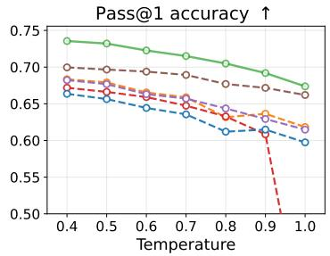

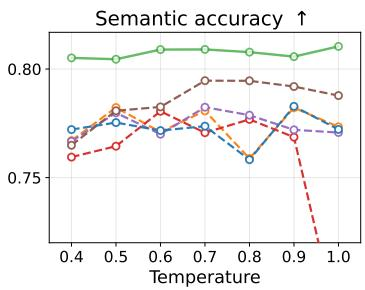  
(a) Fine-tuned model: Qwen3-8B-Base

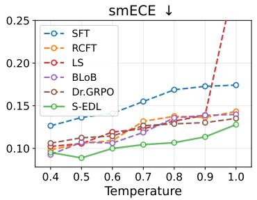

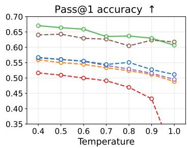

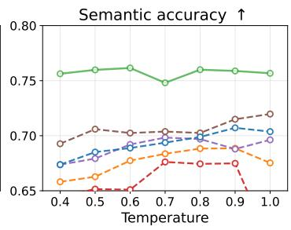  
(b) Fine-tuned model: Ministral3-8B-Base

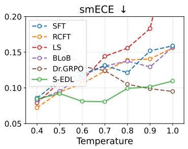

Pass@1 accuracy ↑  
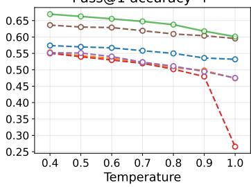

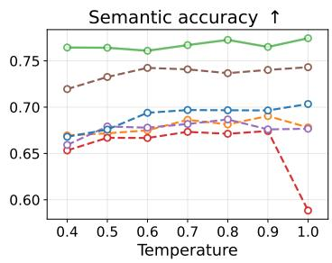

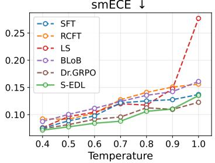  
(c) Fine-tuned model: MiMo-7B-Base

Figure 5: Average in-distribution performance across varying temperatures. Experiment settings are consistent with Section 5.2, except for the various temperatures. Note that certain data points, such as those for LS, may fall outside the plotted area because the y-axis limits are clamped to ensure better readability and visual clarity.

## C.2 Visualization of the accuracy-calibration plane

Fig. 6 visualizes the averaged semantic accuracy and smECE plane across the four evaluated datasets. An optimal model should be situated in the bottom right corner of the plane, indicating both high accuracy and low calibration error. S-EDL consistently lies on the Pareto frontier of this plane across all three models.

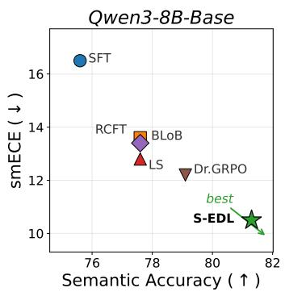  
(a) Qwen3-8B-Base

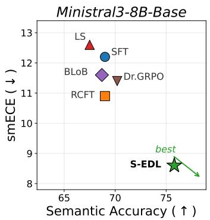  
(b) Ministral3-8B-Base

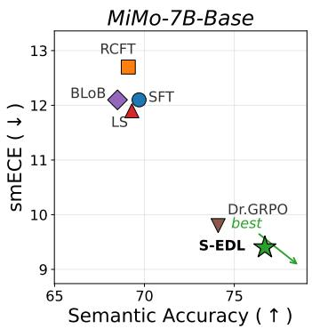  
(c) MiMo-7B-Base  
Figure 6: Accuracy-calibration plane, averaged across the four datasets. Bottom-right is the best corner (high S-Acc, low smECE).

## C.3 Extended per-token probability profiles

We provide the extended per token probability profiles for the GSM8K, ChemistryQA, and FormulaReasoning datasets to supplement the main text analysis. Fig. 7 visualizes the token probability distributions across these three benchmarks. Consistent with the observations on the MATH dataset, the absolute difference between the S-EDL mean and the supervised fine tuning mean stays below 0.06 across all model and dataset pairs. This demonstrates that S-EDL achieves semantic calibration improvements without causing a drastic or systematic shift in the overall token level probability distribution. See Fig. 7 for the complete visual comparisons.

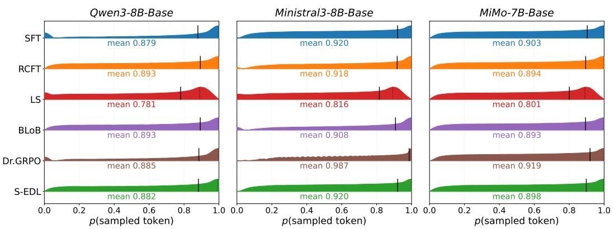

(a) GSM8K  
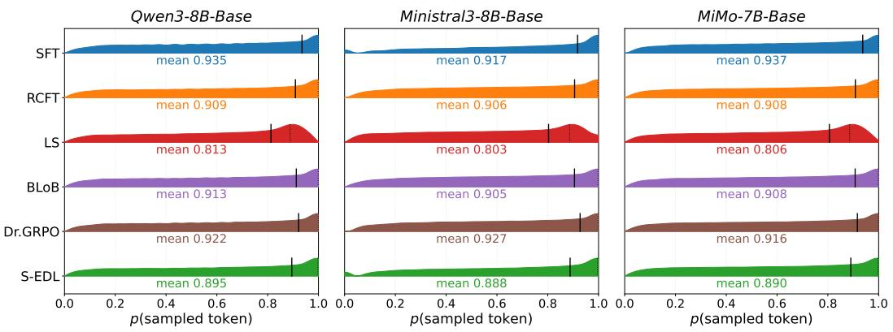

(b) ChemistryQA  
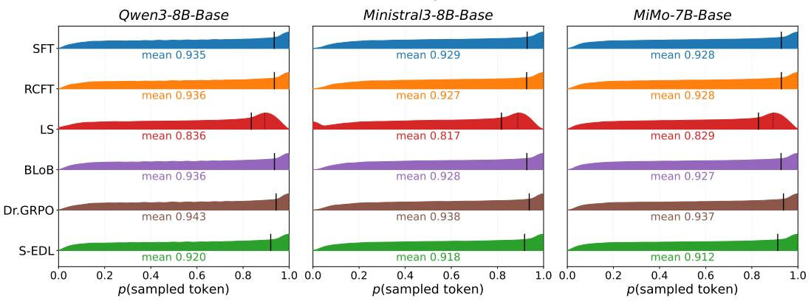  
(c) FormulaReasoning  
Figure 7: Token probability distributions on GSM8K, ChemistryQA, and FormulaReasoning benchmarks.

## C.4 Additional ablation study on $\beta$ and λMSE

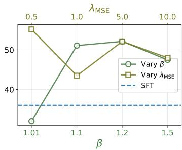  
(a) Pass@1 (↑)

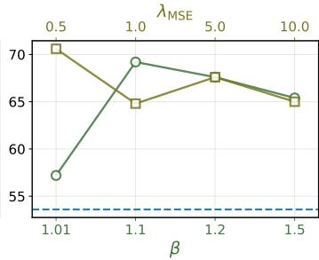  
(b) S-Acc. (↑)

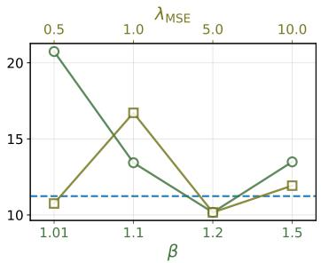  
(c) smECE (↓)  
Figure 8: Ablation study on $\beta$ and $\lambda _ { \mathrm { M S E } }$ with Ministral3-8B-Base trained on MATH and evaluated on MATH-500. The bottom x-axis varies $\beta$ with $\lambda _ { \mathrm { M S E } } = 5 . 0$ held fixed; the top x-axis varies $\lambda _ { \mathrm { M S E } }$ with $\beta = 1 . 2$ fixed. The default values $\beta = 1 . 2$ and $\lambda _ { \mathrm { M S E } } = 5 . 0$ demonstrate strong performance and are used throughout all experiments.

We present an additional ablation study on the hyperparameters $\beta$ and $\lambda _ { \mathrm { M S E } }$ using the Ministral3-8B-Base model trained on the MATH dataset and evaluated on the MATH-500 benchmark. As shown in Fig. 8, the performance trends are consistent with those observed on the GSM8K dataset in the main text. Setting $\beta$ to a value close to 1, such as 1.01, severely weakens the evidential learning signal, which leads to a noticeable drop in accuracy and a spike in calibration error compared to the SFT baseline. In contrast, using the default parameters of $\beta = 1 . 2$ and $\lambda _ { \mathrm { M S E } } = 5 . 0$ provides a strong balance across all metrics, improving both Pass @ 1 and semantic accuracy while effectively lowering the smECE. This confirms that the selected default hyperparameters generalize well to harder reasoning tasks

## C.5 Prompts

## C.5.1 System prompt of the LLM-as-judge

System prompt of the LLM-as-judge for semantic clustering   
You are an answer-equivalence judge.   
Task:   
• You are given a Candidate Answer and a list of cluster representatives indexed as:   
0: , 1:, 2: .   
• Return the index of the cluster representative that is equivalent to the Candidate   
Answer.   
• If none are equivalent, return —1.   
Equivalence rules:   
1. Treat formatting differences as equivalent when numeric meaning matches: deci  
mal/fraction/scientific/percentage/currency/unit notation.   
2. Unit omission is acceptable if numeric value matches.   
3. Allow rounding differences only when values agree to at least 3 significant digits.   
4. Reject sign flips and order-of-magnitude errors.   
5. For non-numeric answers, judge semantic equivalence of meaning, ignoring minor   
phrasing or word-order differences.   
6. For chemical equations:   
• Arrow variants are equivalent $(  ,  , \longrightarrow , \equiv )$   
• Ordering of species within each side is irrelevant $( \mathbf { A } + \mathbf { B } \equiv \mathbf { B } + \mathbf { A } )$

```latex
• Subscript/superscript vs inline notation is equivalent $( \mathrm { N _ { 2 } H _ { 4 } } \equiv \mathrm { N 2 H 4 } , \mathrm { C l O _ { 3 } ^ { - } \equiv }$
ClO3-).
• Stoichiometrically scaled equations (all coefficients multiplied by the same
positive integer) are equivalent.
• State symbol omission is acceptable, but conflicting state symbols are NOT
equivalent (e.g., H2O matches H2O(1), but H2O(g) does NOT match H2O(1)).
Few-shot examples:
Candidate Answer: 3.50 mol
Cluster representatives:
0: 3500 mmol
1: 3.5 moles
2: 0.35 mol
Matching index: 1
Candidate Answer: $\frac { 8 4 } { 2 }$
Cluster representatives:
0:41
1:42
2:-42
Matching index: 1
Candidate Answer: 42
Cluster representatives:
0: 42 J
1:43
Matching index: 0
Candidate Answer: the speed is about 10.3 m/s²
Cluster representatives:
0: 10.3 m/s
1: −10.3 m/s²
Matching index: —1
Candidate Answer: 4 $\mathrm { C l O _ { 3 } ^ { - } ( a q ) } + 3 \mathrm { N } _ { 2 } \mathrm { H } _ { 4 } ( \mathrm { g } ) \to 4 \mathrm { C l ^ { - } ( a q ) } + 6 \mathrm { H } _ { 2 } \mathrm { O ( l ) } + 6 \mathrm { N O ( g ) }$
Cluster representatives:
0: $3 \mathrm { N } _ { 2 } \mathrm { H } _ { 4 } ^ { - } ( \mathbf { g } ) + 4 \mathrm { C l } \mathrm { O } _ { 3 } ^ { - } ( \mathbf { a q } ) \to 6 \mathrm { N O } ( \mathbf { g } ) + 6 \mathrm { H } _ { 2 } \mathrm { O } ( \mathbf { g } ) + 4 \mathrm { C l } ^ { - } ( \mathbf { a q } )$
$1 \colon 3 \mathrm { ~ N _ { 2 } H _ { 4 } ( g ) } + 4 \mathrm { ~ C l O _ { 3 } ^ { - } ( a q ) }  6 \mathrm { ~ N O ( g ) } + 6 \mathrm { ~ H _ { 2 } O ( l ) } + 4 \mathrm { ~ C l ^ { - } ( a q ) }$
Matching index: 1
Output format:
• Final line must be exactly:
Matching index: <integer>
• Use —1 when none match.
```

## C.6 Examples of training prompts

In the following, we provide examples of the training prompts used for fine tuning Qwen3-8B-Base. We intentionally do not enclose the chain of thought reasoning within <think> and </think> blocks. We empirically observed that the base models have not been extensively trained on data containing these special tokens. Introducing these structural tokens during LoRA fine tuning causes the model to append random text after the \boxed{} output and occasionally become trapped in repetitive generation loops.

An example of training prompts on GSM8K dataset   
<lim\_startl>system   
Solve the following problem. First, reason through the problem step by step after 'Reasoning:'.   
Then, provide your final answer after 'My answer is:' wrapped in \boxed{}.<lim\_endl>

<lim\_startl>user   
Question: Natalia sold clips to 48 of her friends in April, and then she sold half as many clips   
in May. How many clips did Natalia sell altogether in April and May?   
Answer:<lim\_endl>   
<lim\_startl>assistant   
Reasoning: Natalia sold 48/2 = <<48/2=24>>24 clips in May.   
Natalia sold 48+24 = <<48+24=72>>72 clips altogether in April and May.   
My answer is: \boxed{72}<lendoftextl>

An example of training prompts on MATH dataset   
<lim\_startl>system   
Solve the following problem. First, reason through the problem step by step after 'Reasoning:'.   
Then, provide your final answer after 'My answer is:' wrapped in \boxed{}.<lim\_endl>   
<lim\_startl>user   
Question: How many 4-letter words with at least one consonant can be constructed from the   
letters \$A\$, \$B\$, \$C\$, \$D\$, and \$E\$? (Note that \$B\$, \$C\$, and \$D\$ are consonants, any   
word is valid, not just English language words, and letters may be used more than once.)   
Answer:<lim endl>   
<lim\_startl>assistant   
Reasoning: First we count the number of all 4-letter words with no restrictions on the word.   
Then we count the number of 4-letter words with no consonants. We then subtract to get the   
answer.   
Each letter of a word must be one of \$A\$, \$B\$, \$C\$, \$D\$, or \$E\$, so the number   
of 4-letter words with no restrictions on the word is \$5\times 5\times 5\times 5=625\$. Each   
letter of a word with no consonant must be one of \$A\$ or \$E\$. So the number of all 4-letter   
words with no consonants is \$2\times 2\times 2\times 2=16\$. Therefore, the number of   
4-letter words with at least one consonant is \$625-16=609\$.   
My answer is: \boxed{609}<lendoftextl>

```latex
An example of training prompts on ChemistryQA dataset
<lim_startl>system
Solve the following problem. First, reason through the problem step by step after 'Reasoning:'.
Then, provide your final answer after 'My answer is:' wrapped in \boxed{}.<lim_endl>
<lim_startl>user
Question: A mixture of #"N"_2#, #"O"_2#. and #"CO"_2# has a total pressure of #"740
torr"# In this mixture, the partial pressure of #"N"_2# is #"120 torr"# and the partial pressure
of #"O"_2# is #"400 torr"#. What is the partial pressure of #"CO"_2# ?
Answer:<lim_endl>
<lim_startl>assistant
Reasoning: The total pressure equals the sum of the partial pressures:
\[
P_{\text{total} } = P_{\mathrm{N_2}} + P_{\mathrm{O_2}} + P_{\mathrm{CO_2}}.
1]
Given \(P_{\text{total} } = 740\ \text{torr},\; P_{\mathrm{N_2}} = 120\ \text{torr},\;
P_{\mathrm{O_2}} = 400\ \text{torr }\),
\[
P_{\mathrm{CO_2} } = 740 - (120 + 400) = 740 - 520 = 220\ \text{torr}.
\]
My answer is: \boxed{220\ \text{torr} }<lendoftextl>
```

## An example of training prompts on FormulaReasoning dataset

<table><tr><td>&lt;lim_startl&gt;system Solve the following problem. First, reason through the problem step by step after &#x27;Rea- soning:&#x27;. Then, provide your final answer with units after &#x27;My answer is:&#x27; wrapped in</td><td></td><td></td><td></td><td></td></tr><tr><td>\boxed{}.&lt;lim_endl&gt; &lt;lim_startl&gt;user</td><td></td><td></td><td></td><td></td></tr><tr><td>Question: Rational classification and utilization of waste can protect the environment and turn waste into valuables. Under certain conditions, 1 ton of classified waste can &quot;ex-</td><td></td><td></td><td></td><td></td></tr><tr><td>tract&quot; [X] of fuel oil, where the calorific value of the fuel oil is</td><td></td><td></td><td></td><td></td></tr><tr><td>[c_water=4  $. 2 { \times } 1 0 { \wedge } 3 \mathrm { J } / ( \mathrm { k g } { \cdot } ^ { \circ } \mathrm { C } ) ]$ </td><td></td><td></td><td> $3 . 0 { \times } 1 0 ^ { \wedge } 7 ~ \mathrm { J / k g }$ </td><td>Question:</td></tr><tr><td>pletely burned? The specific heat capacity of water is</td><td></td><td></td><td>How much heat energy is released when the fuel oil is com-</td><td></td></tr><tr><td>know that the answer to the above question is</td><td></td><td></td><td> $4 . 2 \times 1 0 ^ { \wedge } 3 ~ \mathrm { J / ( k g . ^ { \circ } C ) }$ </td><td>. If we already</td></tr><tr><td>corresponding to [X] in the question?</td><td></td><td> $4 . 2 \times 1 0 ^ { \wedge 9 } \mathrm { { J } }$ </td><td>, then what should be the content</td><td></td></tr><tr><td>Answer:&lt;lim_endl&gt;</td><td></td><td></td><td></td><td></td></tr><tr><td></td><td></td><td></td><td></td><td></td></tr><tr><td>&lt;lim_startl&gt;assistant</td><td></td><td></td><td></td><td></td></tr><tr><td>Reasoning: The heat energy released when fuel oil is burned is calculated using</td><td></td><td></td><td></td><td></td></tr><tr><td>\text{calorific value} $. Rearranging for mass $ m $, we get $ m = \frac{Q} {\text{calorific</td><td></td><td></td><td></td><td> $\$ 0= m$  \cdot</td></tr><tr><td></td><td></td><td></td><td></td><td></td></tr><tr><td>value}} = \frac{4.2 \times 10^9 \, \text{J} }{3.0 \times</td><td></td><td> $1 0 ^ { \bar { \wedge } } 7 ^ { \cdot }$ </td><td> $\{ { \mathrm { J } } / { \mathrm { k g } } \} \} = 1 4 0 \backslash .$ </td><td></td></tr><tr><td></td><td></td><td></td><td></td><td>\text{kg}</td></tr><tr><td></td><td></td><td></td><td></td><td></td></tr><tr><td>$. Since this mass corresponds to the fuel oil extracted from 1 ton (1000 kg) of waste, $[X]$</td><td></td><td></td><td></td><td></td></tr><tr><td></td><td></td><td></td><td></td><td></td></tr><tr><td></td><td></td><td></td><td></td><td></td></tr><tr><td></td><td></td><td></td><td></td><td></td></tr><tr><td>must be 140 kg.</td><td></td><td></td><td></td><td></td></tr><tr><td></td><td></td><td></td><td></td><td></td></tr><tr><td></td><td></td><td></td><td></td><td></td></tr><tr><td></td><td></td><td></td><td></td><td></td></tr><tr><td>My answer is: \boxed{140 kg}&lt;lendoftextl&gt;</td><td></td><td></td><td></td><td></td></tr><tr><td></td><td></td><td></td><td></td><td></td></tr><tr><td></td><td></td><td></td><td></td><td></td></tr><tr><td></td><td></td><td></td><td></td><td></td></tr><tr><td></td><td></td><td></td><td></td><td></td></tr><tr><td></td><td></td><td></td><td></td><td></td></tr><tr><td></td><td></td><td></td><td></td><td></td></tr><tr><td></td><td></td><td></td><td></td><td></td></tr><tr><td></td><td></td><td></td><td></td><td></td></tr><tr><td></td><td></td><td></td><td></td><td></td></tr><tr><td></td><td></td><td></td><td></td><td></td></tr><tr><td></td><td></td><td></td><td></td><td></td></tr><tr><td></td><td></td><td></td><td></td><td></td></tr><tr><td></td><td></td><td></td><td></td><td></td></tr><tr><td></td><td></td><td></td><td></td><td></td></tr><tr><td></td><td></td><td></td><td></td><td></td></tr><tr><td></td><td></td><td></td><td></td><td></td></tr><tr><td></td><td></td><td></td><td></td><td></td></tr><tr><td></td><td></td><td></td><td></td><td></td></tr><tr><td></td><td></td><td></td><td></td><td></td></tr><tr><td></td><td></td><td></td><td></td><td></td></tr><tr><td></td><td></td><td></td><td></td><td></td></tr><tr><td></td><td></td><td></td><td></td><td></td></tr></table>

## NeurIPS Paper Checklist

## 1. Claims

Question: Do the main claims made in the abstract and introduction accurately reflect the paper's contributions and scope?

Answer: [Yes]

Justification: The abstract and introduction state three contributions: (i) extending EDL from fixed-choice to open-ended semantic calibration, (ii) a novel parametrization that derives a differentiable evidence vector from sequence likelihoods and theoretically unifies Semantic Entropy under the evidential framework, and (iii) empirical gains compared to baselines. These claims are directly supported by the methodology in Section 4, the theoretical results in Section 4.3, and the experimental results in Tables 1 and 2 and Section 5.

## Guidelines:

• The answer [N/A] means that the abstract and introduction do not include the claims made in the paper.

• The abstract and/or introduction should clearly state the claims made, including the contributions made in the paper and important assumptions and limitations. A [No] or [N/A] answer to this question will not be perceived well by the reviewers.

• The claims made should match theoretical and experimental results, and reflect how much the results can be expected to generalize to other settings.

• It is fine to include aspirational goals as motivation as long as it is clear that these goals are not attained by the paper.

## 2. Limitations

Question: Does the paper discuss the limitations of the work performed by the authors?

Answer: [Yes]

Justification: Section 6 contains a dedicated “Limitations" paragraph.

Guidelines:

• The answer [N/A] means that the paper has no limitation while the answer [No] means that the paper has limitations, but those are not discussed in the paper.

• The authors are encouraged to create a separate “Limitations" section in their paper.

• The paper should point out any strong assumptions and how robust the results are to violations of these assumptions (e.g., independence assumptions, noiseless settings, model well-specification, asymptotic approximations only holding locally). The authors should reflect on how these assumptions might be violated in practice and what the implications would be.

• The authors should reflect on the scope of the claims made, e.g., if the approach was only tested on a few datasets or with a few runs. In general, empirical results often depend on implicit assumptions, which should be articulated.

• The authors should reflect on the factors that influence the performance of the approach For example, a facial recognition algorithm may perform poorly when image resolution is low or images are taken in low lighting. Or a speech-to-text system might not be used reliably to provide closed captions for online lectures because it fails to handle technical jargon.

• The authors should discuss the computational efficiency of the proposed algorithms and how they scale with dataset size.

• If applicable, the authors should discuss possible limitations of their approach to address problems of privacy and fairness.

• While the authors might fear that complete honesty about limitations might be used by reviewers as grounds for rejection, a worse outcome might be that reviewers discover limitations that aren't acknowledged in the paper. The authors should use their best judgment and recognize that individual actions in favor of transparency play an important role in developing norms that preserve the integrity of the community. Reviewers will be specifically instructed to not penalize honesty concerning limitations.

## 3. Theory assumptions and proofs

Question: For each theoretical result, does the paper provide the full set of assumptions and a complete (and correct) proof?

## Answer: [Yes]

Justification: The paper presents Proposition 1, Theorem 1, Corollary 1, and Corollary 2, each with explicitly stated assumptions $( \mathbf { e } . \mathbf { g } . , \beta > 1$ for Corollary 1; i.i.d. Monte Carlo sampling for Proposition 1) and full proofs provided in Appendices A.1 to A.4. All theoretical statements are numbered and cross-referenced from the main text.

## Guidelines:

• The answer [N/A] means that the paper does not include theoretical results.

• All the theorems, formulas, and proofs in the paper should be numbered and crossreferenced.

• All assumptions should be clearly stated or referenced in the statement of any theorems.

• The proofs can either appear in the main paper or the supplemental material, but if they appear in the supplemental material, the authors are encouraged to provide a short proof sketch to provide intuition.

• Inversely, any informal proof provided in the core of the paper should be complemented by formal proofs provided in appendix or supplemental material.

• Theorems and Lemmas that the proof relies upon should be properly referenced.

## 4. Experimental result reproducibility

Question: Does the paper fully disclose all the information needed to reproduce the main experimental results of the paper to the extent that it affects the main claims and/or conclusions of the paper (regardless of whether the code and data are provided or not)?

## Answer: [Yes]

Justification: Section 5.1 specifies the three base models (Qwen3-8B-Base, Ministral3-8B-Base, MiMo-7B-Base), LoRA configuration (rank 16, α=32), evidential hyperparameters (β = 1.2, λMsE = 5.0), per-dataset $N _ { \mathrm { t r a i n } }$ values, and the evaluation protocol (top\_p = 0.9, per-model temperatures, $N _ { \mathrm { { e v a l } } } = 5 0 )$ . Appendix B.3 details dataset construction, Appendix B.4 lists full optimization hyperparameters, and Appendix B.5 documents baseline configurations. The find-first clustering algorithm is fully specified in Algorithm 1, and example training prompts are given in Appendix C.5.

## Guidelines:

• The answer [N/A] means that the paper does not include experiments.

• If the paper includes experiments, a [No] answer to this question will not be perceived well by the reviewers: Making the paper reproducible is important, regardless of whether the code and data are provided or not.

• If the contribution is a dataset and/or model, the authors should describe the steps taken to make their results reproducible or verifiable.

• Depending on the contribution, reproducibility can be accomplished in various ways. For example, if the contribution is a novel architecture, describing the architecture fully might suffice, or if the contribution is a specific model and empirical evaluation, it may be necessary to either make it possible for others to replicate the model with the same dataset, or provide access to the model. In general. releasing code and data is often one good way to accomplish this, but reproducibility can also be provided via detailed instructions for how to replicate the results, access to a hosted model (e.g., in the case of a large language model), releasing of a model checkpoint, or other means that are appropriate to the research performed.

• While NeurIPS does not require releasing code, the conference does require all submissions to provide some reasonable avenue for reproducibility, which may depend on the nature of the contribution. For example

(a) If the contribution is primarily a new algorithm, the paper should make it clear how to reproduce that algorithm.

(b) If the contribution is primarily a new model architecture, the paper should describe the architecture clearly and fully.

(c) If the contribution is a new model (e.g., a large language model), then there should either be a way to access this model for reproducing the results or a way to reproduce the model (e.g., with an open-source dataset or instructions for how to construct the dataset).

(d) We recognize that reproducibility may be tricky in some cases, in which case authors are welcome to describe the particular way they provide for reproducibility. In the case of closed-source models, it may be that access to the model is limited in some way (e.g., to registered users), but it should be possible for other researchers to have some path to reproducing or verifying the results.

## 5. Open access to data and code

Question: Does the paper provide open access to the data and code, with sufficient instructions to faithfully reproduce the main experimental results, as described in supplemental material?

Answer: [Yes]

Justification: We will release the code repository upon acceptance or upon requests from reviewers, including training scripts, the find-first clustering implementation, evaluation pipelines, and configuration files. The four datasets (GSM8K, MATH, ChemistryQA, FormulaReasoning) are publicly available; we provide preprocessing scripts to reproduce the filtered training splits described in Appendix B.3.

Guidelines:

• The answer [N/A] means that paper does not include experiments requiring code.

• Please see the NeurIPS code and data submission guidelines (https://neurips. cc/ public/guides/CodeSubmissionPolicy) for more details.

• While we encourage the release of code and data, we understand that this might not be possible, so [No] is an acceptable answer. Papers cannot be rejected simply for not including code, unless this is central to the contribution (e.g., for a new open-source benchmark).

• The instructions should contain the exact command and environment needed to run to reproduce the results. See the NeurIPS code and data submission guidelines (https: //neurips.cc/public/guides/CodeSubmissionPolicy) for more details.

• The authors should provide instructions on data access and preparation, including how to access the raw data, preprocessed data, intermediate data, and generated data, etc.

• The authors should provide scripts to reproduce all experimental results for the new proposed method and baselines. If only a subset of experiments are reproducible, they should state which ones are omitted from the script and why.

• At submission time, to preserve anonymity, the authors should release anonymized versions (if applicable).

• Providing as much information as possible in supplemental material (appended to the paper) is recommended, but including URLs to data and code is permitted.

## 6. Experimental setting/details

Question: Does the paper specify all the training and test details (e.g., data splits, hyperparameters, how they were chosen, type of optimizer) necessary to understand the results?

Answer: [Yes]

Justification: Section 5.1 documents data splits, base models, LoRA rank, evidential hyperparameters, the per-model decoding temperatures (chosen on a held-out validation split to match per-model entropy), and Neval. Appendix B.3 specifies how each dataset's training split was constructed, Appendix B.4 lists optimizer, learning rate, batch size, and other training details, and Appendix B.5 documents the hyperparameters used for every baseline (RCFT, LS, BLoB, Dr.GRPO).

Guidelines:

• The answer [N/A] means that the paper does not include experiments.

• The experimental setting should be presented in the core of the paper to a level of detail that is necessary to appreciate the results and make sense of them.

• The full details can be provided either with the code, in appendix, or as supplemental material.

## 7. Experiment statistical significance

Question: Does the paper report error bars suitably and correctly defined or other appropriate information about the statistical significance of the experiments?

Answer: [No]

Justification: The main calibration and accuracy results in Table 1 and Table 2 report point estimates from a single training run per (model, dataset, method) configuration without error bars, due to compute constraints associated with fine-tuning three 7–8B parameter models across four datasets and six methods. Variance information is reported where available (Fig. 4 shows standard deviations of verifier-call counts; Fig. 1 and Fig. 7 visualize full token-probability distributions).

## Guidelines:

• The answer [N/A] means that the paper does not include experiments

• The authors should answer [Yes] if the results are accompanied by error bars, confidence intervals, or statistical significance tests, at least for the experiments that support the main claims of the paper.

• The factors of variability that the error bars are capturing should be clearly stated (for example, train/test split, initialization, random drawing of some parameter, or overall run with given experimental conditions).

• The method for calculating the error bars should be explained (closed form formula call to a library function, bootstrap, etc.)

• The assumptions made should be given (e.g., Normally distributed errors).

• It should be clear whether the error bar is the standard deviation or the standard error of the mean.

• It is OK to report 1-sigma error bars, but one should state it. The authors should preferably report a 2-sigma error bar than state that they have a 96% CI, if the hypothesis of Normality of errors is not verified.

• For asymmetric distributions, the authors should be careful not to show in tables or figures symmetric error bars that would yield results that are out of range (e.g., negative error rates).

• If error bars are reported in tables or plots, the authors should explain in the text how they were calculated and reference the corresponding figures or tables in the text.

## 8. Experiments compute resources

Question: For each experiment, does the paper provide sufficient information on the computer resources (type of compute workers, memory, time of execution) needed to reproduce the experiments?

Answer: [Yes]

Justification: All fine-tuning experiments were conducted on NVIDIA H100 / H200 GPUs. Each run uses LoRA adapters (rank 16). Per-run training time is approximately 1-12 hours, depending on the fine-tuning method. Memory constraints determined Ntrain per dataset (see Section 5.1). Total compute including baselines, ablations, and preliminary runs is approximately 2,500 GPU-hours.

Guidelines:

• The answer [N/A] means that the paper does not include experiments.

• The paper should indicate the type of compute workers CPU or GPU, internal cluster, or cloud provider, including relevant memory and storage.

• The paper should provide the amount of compute required for each of the individual experimental runs as well as estimate the total compute.

• The paper should disclose whether the full research project required more compute than the experiments reported in the paper (e.g., preliminary or failed experiments that didn't make it into the paper).

## 9. Code of ethics

Question: Does the research conducted in the paper conform, in every respect, with the NeurIPS Code of Ethics https://neurips.cc/public/EthicsGuidelines?

## Answer: [Yes]

Justification: The research uses publicly available datasets and open-weight base models, does not involve human subjects, and aims to improve the trustworthiness of LLM outputs by reducing miscalibration. We have reviewed the NeurIPS Code of Ethics and the work conforms with it in all respects.

Guidelines:

• The answer [N/A] means that the authors have not reviewed the NeurIPS Code of Ethics.

• If the authors answer [No], they should explain the special circumstances that require a deviation from the Code of Ethics.

• The authors should make sure to preserve anonymity (e.g., if there is a special consideration due to laws or regulations in their jurisdiction).

## 10. Broader impacts

Question: Does the paper discuss both potential positive societal impacts and negative societal impacts of the work performed?

## Answer: [Yes]

Justification: Improving semantic calibration helps users and downstream systems decide when to trust an LLM's open-ended output, which is broadly beneficial in high-stakes settings such as scientific reasoning and decision support. Potential negative impacts are limited: S-EDL is a fine-tuning objective rather than a capability-extending technique, and a better-calibrated model could in principle make over-trusted but plausible, looking incorrect outputs less obvious, we mitigate this concern by reporting both accuracy and calibration error so practitioners can audit both dimensions.

## Guidelines:

• The answer [N/A] means that there is no societal impact of the work performed.

• If the authors answer [N/A] or [No], they should explain why their work has no societal impact or why the paper does not address societal impact

• Examples of negative societal impacts include potential malicious or unintended uses (e.g., disinformation, generating fake profiles, surveillance), fairness considerations (e.g., deployment of technologies that could make decisions that unfairly impact specific groups), privacy considerations, and security considerations.

• The conference expects that many papers will be foundational research and not tied to particular applications, let alone deployments. However, if there is a direct path to any negative applications, the authors should point it out. For example, it is legitimate to point out that an improvement in the quality of generative models could be used to generate Deepfakes for disinformation. On the other hand, it is not needed to point out that a generic algorithm for optimizing neural networks could enable people to train models that generate Deepfakes faster.

• The authors should consider possible harms that could arise when the technology is being used as intended and functioning correctly, harms that could arise when the technology is being used as intended but gives incorrect results, and harms following from (intentional or unintentional) misuse of the technology.

• If there are negative societal impacts, the authors could also discuss possible mitigation strategies (e.g., gated release of models, providing defenses in addition to attacks, mechanisms for monitoring misuse, mechanisms to monitor how a system learns from feedback over time, improving the efficiency and accessibility of ML).

## 11. Safeguards

Question: Does the paper describe safeguards that have been put in place for responsible release of data or models that have a high risk for misuse (e.g., pre-trained language models, image generators, or scraped datasets)?

Answer: [N/A]

Justification: The paper does not release new pre-trained models, image generators, or scraped datasets that pose a high risk of misuse. The contribution is a fine-tuning method evaluated on existing benchmarks.

## Guidelines:

• The answer [N/A] means that the paper poses no such risks.

• Released models that have a high risk for misuse or dual-use should be released with necessary safeguards to allow for controlled use of the model, for example by requiring that users adhere to usage guidelines or restrictions to access the model or implementing safety filters.

• Datasets that have been scraped from the Internet could pose safety risks. The authors should describe how they avoided releasing unsafe images.

• We recognize that providing effective safeguards is challenging, and many papers do not require this, but we encourage authors to take this into account and make a best faith effort.

## 12. Licenses for existing assets

Question: Are the creators or original owners of assets (e.g., code, data, models), used in the paper, properly credited and are the license and terms of use explicitly mentioned and properly respected?

Answer: [Yes]

Justification: All datasets (GSM8K, MATH, ChemistryQA, FormulaReasoning) and base models (Qwen3-8B-Base, Ministral3-8B-Base, MiMo-7B-Base) are properly cited. External tools math-verify and rapidfuzz are credited with version numbers.

Guidelines:

• The answer [N/A] means that the paper does not use existing assets.

• The authors should cite the original paper that produced the code package or dataset.

• The authors should state which version of the asset is used and, if possible, include a URL.

• The name of the license (e.g., CC-BY 4.0) should be included for each asset.

• For scraped data from a particular source (e.g., website), the copyright and terms of service of that source should be provided.

• If assets are released, the license, copyright information, and terms of use in the package should be provided. For popular datasets, paperswithcode. com/datasets has curated licenses for some datasets. Their licensing guide can help determine the license of a dataset.

• For existing datasets that are re-packaged, both the original license and the license of the derived asset (if it has changed) should be provided.

• If this information is not available online, the authors are encouraged to reach out to the asset's creators.

## 13. New assets

Question: Are new assets introduced in the paper well documented and is the documentation provided alongside the assets?

Answer: [N/A]

Justification: The paper does not release new assets.

Guidelines:

• The answer [N/A] means that the paper does not release new assets.

• Researchers should communicate the details of the dataset/code/model as part of their submissions via structured templates. This includes details about training, license, limitations, etc.

• The paper should discuss whether and how consent was obtained from people whose asset is used.

• At submission time, remember to anonymize your assets (if applicable). You can either create an anonymized URL or include an anonymized zip file.

## 14. Crowdsourcing and research with human subjects

Question: For crowdsourcing experiments and research with human subjects, does the paper include the full text of instructions given to participants and screenshots, if applicable, as well as details about compensation (if any)?

Answer: [N/A]

Justification: The paper does not involve crowdsourcing nor research with human subjects. Guidelines:

• The answer [N/A] means that the paper does not involve crowdsourcing nor research with human subjects.

• Including this information in the supplemental material is fine, but if the main contribution of the paper involves human subjects, then as much detail as possible should be included in the main paper.

• According to the NeurIPS Code of Ethics, workers involved in data collection, curation, or other labor should be paid at least the minimum wage in the country of the data collector.

## 15. Institutional review board (IRB) approvals or equivalent for research with human subjects

Question: Does the paper describe potential risks incurred by study participants, whether such risks were disclosed to the subjects, and whether Institutional Review Board (IRB) approvals (or an equivalent approval/review based on the requirements of your country or institution) were obtained?

Answer: [N/A]

Justification: The paper does not involve crowdsourcing nor research with human subjects. Guidelines:

• The answer [N/A] means that the paper does not involve crowdsourcing nor research with human subjects.

• Depending on the country in which research is conducted, IRB approval (or equivalent) may be required for any human subjects research. If you obtained IRB approval, you should clearly state this in the paper.

• We recognize that the procedures for this may vary significantly between institutions and locations, and we expect authors to adhere to the NeurIPS Code of Ethics and the guidelines for their institution.

• For initial submissions, do not include any information that would break anonymity (if applicable), such as the institution conducting the review.

## 16. Declaration of LLM usage

Question: Does the paper describe the usage of LLMs if it is an important, original, or non-standard component of the core methods in this research? Note that if the LLM is used only for writing, editing, or formatting purposes and does not impact the core methodology, scientific rigor, or originality of the research, declaration is not required.

Answer: [Yes]

Justification: LLMs are used as components of the methodology beyond writing assistance: (i) GPT-OSS-120B is used to generate chain-of-thought solutions for the ChemistryQA and FormulaReasoning training splits, with filtering to retain only correct generations (Appendix B.3); (ii) for general (non-mathematical) semantic clustering, an LLM-as-judge is used as the equivalence oracle MATCH in Algorithm 1, with the system prompt provided verbatim in Appendix C.5.1. The core S-EDL objective itself does not depend on LLM-judge supervision; it operates on the model's own sequence likelihoods.

Guidelines:

• The answer [N/A] means that the core method development in this research does not involve LLMs as any important, original, or non-standard components.

• Please refer to our LLM policy in the NeurIPS handbook for what should or should not be described.