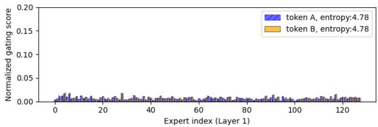
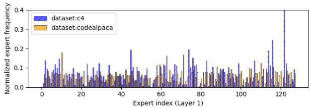
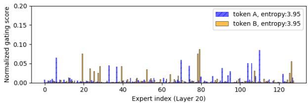
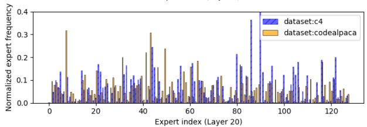
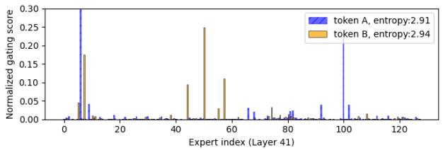
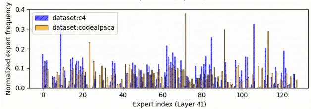
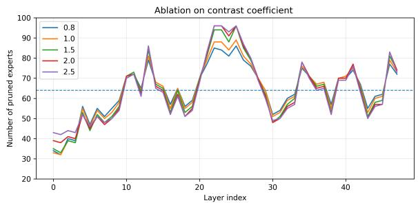
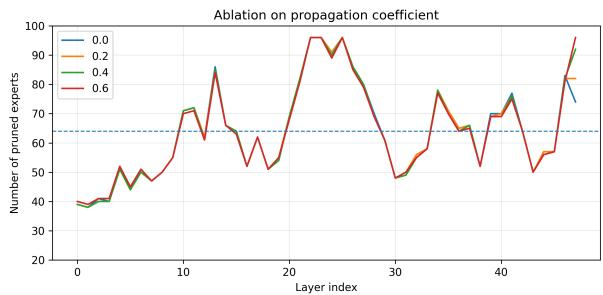
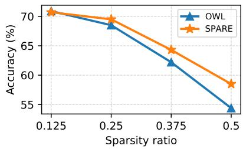

# SPARE: Sparsity Allocation via Routing Entropy for Efficient MoEs

Yifan Yang Hanling Yi Dongquan Yang Feng Lin Rong Xiao Aijun Li Xiaotian Yu Intellifusion Inc.

## Abstract

Mixture-of-Experts (MoE) architectures scale model capacity efficiently, yet their substan tial memory footprint poses a major barrier to deployment. Expert pruning reduces this footprint, but most methods focus on which experts to remove and prune every layer equally. We propose SPARE (Sparsity Allocation via Routing Entropy), a training-free, selectoragnostic method that decides how many experts to remove from each layer using routing entropy, the entropy of tokens’ normalized Top K gate weights on calibration data. When a token’s gate weight is spread evenly, removing one active expert discards little of it, so SPARE prunes layers with more diffuse routing more aggressively. A perturbation bound under random pruning formalizes this intuition, and controlled interventions with a fixed selector link concentrated routing to larger output changes. With the same selector and budget, SPARE improves average accuracy over uniform allocation on Mixtral, Qwen3, and DeepSeek mod els, especially at high pruning ratios. At 50% expert pruning, it raises the eight-task average of Qwen3-30B-A3B from 57.2% to 63.8%, and the math, code, and science average of DeepSeek-R1 from 80.1 to 82.8.

## 1 Introduction

The pursuit of stronger reasoning capabilities has pushed Large Language Models (LLMs) to the trillion-parameter scale, incurring prohibitive computational costs. The Mixture-of-Experts (MoEs) architecture addresses this challenge through conditional computation, which activates only a sparse subset of parameters per input token (Shazeer et al., 2017; Lepikhin et al., 2020; Fedus et al., 2022; Dai et al., 2024). While conditional computation drastically reduces FLOPs, the memory overhead necessitates loading the full set of experts. Furthermore, the requirement to distribute these experts across devices complicates the communication topology, leading to efficiency bottlenecks. This highlights the urgent need for compression techniques capable of shrinking pre-trained MoEs.

To address this, recent research has focused on expert pruning, which removes entire experts to reduce model size. Existing approaches usually estimate an expert-level importance score from activation frequency, routing statistics, or reconstruction error (Dong et al., 2025; Lasby et al., 2025). These scores provide useful criteria for selecting experts within a layer. However, using expert importance directly for cross-layer pruning is less reliable. Scores computed in different layers are not necessarily calibrated, since activation scales, expert functions, and token distributions vary across depth. The calibration domain can further change which experts appear important. As a result, globally ranking experts across all layers may over-prune sensitive layers (Chowdhury et al., 2024; Lasby et al., 2025).

This limitation comes from conflating two decisions: inter-layer allocation, which determines how many experts to remove from each layer under a global budget, and intra-layer selection, which determines which experts to remove within a layer. Existing criteria such as REAP and EASY-EP address the second; SPARE addresses the first and can be paired with any of them. Non-uniform allocation has been explored in dense LLMs (Men et al., 2025; Yin et al., 2024) and, more recently, in MoE expert pruning (Yang et al., 2024; Li et al., 2026), using signals such as calibration loss or expert-usage frequency. SPARE instead allocates budgets by how gate weight is distributed among each token’s active experts, a training-free signal distinct from usage statistics across inputs.

To capture these routing dynamics, we use routing entropy: the Shannon entropy of each token’s normalized Top-K gate weights, averaged over calibration tokens. As illustrated in Figure 1, highentropy layers spread gate weight broadly among the active experts, so removing one active expert discards only a small share of each token’s weight, which is then reassigned to the remaining experts. Low-entropy layers concentrate weight on fewer experts, suggesting stronger input-conditioned specialization and making aggressive pruning riskier. This signal is layer-level rather than expert-level: it assumes neither that particular experts are indispensable nor that the same experts are selected across domains. Although expert identities shift between web text, code, math, and science, layer-wise entropy rankings remain stable across calibration domains, making them a robust basis for allocation.

Leveraging this insight, we introduce SPARE, a training-free sparsity allocation framework that assigns non-uniform pruning budgets across MoE layers. Our main contributions are:

• Entropy-guided, plug-and-play allocation. We formulate MoE expert pruning as an inter-layer budget allocation problem and replace uniform allocation with entropy-aware budgets. SPARE decides how many experts to prune in each layer, while existing criteria such as REAP and EASY-EP decide which ones, without retraining or modifying the router.

• Theoretical foundation. We derive a perturbation bound that, under uniform random pruning, grows with the routing entropy gap. The analysis provides a layer-level sensitivity signal and an existence argument for deterministic masks.

• Empirical validation. With the same selector and budget, SPARE improves average accuracy over uniform allocation on Mixtral, Qwen3, and DeepSeek models, especially at high pruning ratios. At 50% expert pruning, it raises the eighttask average of Qwen3-30B-A3B from 57.2% to 63.8%, and the math, code, and science average of DeepSeek-R1 from 80.1 to 82.8.

## 2 Related Work

Routing Heterogeneity. MoEs scale model capacity through conditional computation (Shazeer et al., 2017; Fedus et al., 2022). Despite loadbalancing objectives, expert behavior can remain non-uniform: Su et al. (2025) identify “superexperts” that produce extreme activation outliers, and Lo et al. (2024) examine relationships between routing weights and expert outputs. These observations motivate studying routing heterogeneity across layers.

Expert Pruning and Compression. Expert pruning reduces the memory footprint of pretrained MoEs. Selection criteria use routing statistics (Dong et al., 2025; Koishekenov et al., 2023), router-weighted activation saliency (Lasby et al., 2025), or reconstruction loss (Lu et al., 2024); EEP (Liu et al., 2024) instead uses evolutionary search. Shapley-MoE (Huang et al., 2025) ranks experts globally across layers via router-guided sampling; we exclude it from comparisons under fixed layer budgets, which would alter its selection rule. Chowdhury et al. (2024) provide a pruning guarantee for fine-tuned sparse MoEs based on changes in router distributions. SEER-MoE (Muzio et al., 2024), MoE-SVD (Li et al., 2025), and AdaWhiten (Anonymous, 2026) explore further pruning and decomposition strategies, alongside task-specific pruning (Chen et al., 2022) and benchmarks such as MC-Suite (Jaiswal et al., 2025). Expert merging, skipping, dynamic Top-K routing, and intra-expert pruning (Xie et al., 2024) operate at other granularities; SPARE instead targets budget allocation.

Layer-wise Sparsity Allocation. In dense LLMs, ShortGPT (Men et al., 2025) studies block removal, whereas OWL (Yin et al., 2024) allocates weight sparsity using activation-aware outlier statistics. SlimGPT (Ling et al., 2024) also adopts non-uniform pruning schedules. For MoEs, MoE-I2 (Yang et al., 2024) estimates layer importance from calibration losses after removing individual experts, assigns non-uniform pruning ratios, and selects experts through genetic and block-wise search; its full pipeline additionally includes lowrank decomposition and LoRA recovery. C-GNN-PRUNE (Li et al., 2026) computes the entropy of expert-selection frequencies pooled over calibration samples and retains more experts in layers with higher usage entropy. Its expert-selection procedure uses learned graph embeddings. SPARE averages, over tokens, the entropy of each token’s normalized Top-K gate weights and prunes more experts in layers with higher gate entropy. Usage entropy describes how broadly expert identities are used across inputs; gate entropy describes how evenly weight is spread among the experts active for a single token. The rules therefore treat high entropy in opposite ways without contradiction: they measure different distributions. SPARE contributes this routing signal and a selector-independent allocation rule.

  
Figure 1: Visualization of routing heterogeneity and domain sensitivity on Qwen3-30B-A3B. Left: gating distributions for two representative tokens at selected layers. These single-token examples illustrate diffuse and concentrated routing; quantitative analyses use layer-aggregated statistics. Right: expert selection frequencies on C4 and CodeAlpaca. The selected expert identities can differ substantially across domains, which makes pruning directly from single-domain expert frequencies brittle. SPARE instead uses layer-wise routing entropy, an aggregated concentration statistic, to guide inter-layer sparsity allocation.

## 3 Routing Entropy and Heterogeneity of MoE Layers

We analyze layer-wise routing heterogeneity in MoEs and define routing entropy as the signal used by SPARE for inter-layer budget allocation.

## 3.1 Problem Formulation

Consider an MoE layer ℓ with N experts. For token x, the router selects the Top-K expert set $\mathcal { T } _ { \ell } ( \mathbf { x } )$ and computes the normalized gating distribution

$$
g _ { \ell , j } ( \mathbf { x } ) = \frac { \exp ( z _ { \ell , j } ( \mathbf { x } ) ) } { \sum _ { t \in \mathcal { T } _ { \ell } ( \mathbf { x } ) } \exp ( z _ { \ell , t } ( \mathbf { x } ) ) } \mathbf { 1 } \{ j \in \mathcal { T } _ { \ell } ( \mathbf { x } ) \} .\tag{1}
$$

Let $\mathbf { m } = [ m _ { 0 } , \ldots , m _ { L - 1 } ] ^ { \top }$ denote the layer-wise pruning profile, where mℓ is the number of experts removed from layer ℓ. Given a global target $M _ { \mathrm { t a r g e t } }$ , SPARE solves the inter-layer allocation problem

$$
\sum _ { \ell = 0 } ^ { L - 1 } m _ { \ell } = M _ { \mathrm { t a r g e t } } , \qquad 0 \le m _ { \ell } \le N - K ,\tag{2}
$$

while leaving the intra-layer choice of removed experts to an expert-ranking rule such as EASY-EP (Dong et al., 2025) or REAP (Lasby et al., 2025).

## 3.2 Routing Entropy Gap

For each token, we define the Top-K routing entropy as

$$
H _ { \ell } ( \mathbf { x } ) = - \sum _ { j \in \mathcal { T } _ { \ell } ( \mathbf { x } ) } g _ { \ell , j } ( \mathbf { x } ) \log g _ { \ell , j } ( \mathbf { x } ) .\tag{3}
$$

The layer-average entropy and routing entropy gap are

$$
\begin{array} { r } { \bar { H } _ { \ell } = \mathbb { E } _ { \mathbf { x } \sim \mathcal { D } } [ H _ { \ell } ( \mathbf { x } ) ] , \qquad S _ { \ell } = \log K - \bar { H } _ { \ell } . } \end{array}\tag{4}
$$

Equivalently,

$$
\begin{array} { r } { S _ { \ell } = \mathbb { E } _ { \mathbf { x } \sim \mathcal { D } } \left[ D _ { \mathrm { K L } } \left( \mathbf { g } _ { \ell } ( \mathbf { x } ) \middle | \middle | u _ { \mathcal { T } _ { \ell } ( \mathbf { x } ) } \right) \right] , } \end{array}\tag{5}
$$

where $u _ { \mathcal { T } _ { \ell } ( \mathbf { x } ) }$ is the uniform distribution over the active experts. A larger $S _ { \ell }$ means sharper routing concentration and motivates a more conservative pruning budget.

## 3.3 Layer-wise Routing Heterogeneity

Figure 1 shows that gating concentration varies across layers (left), while selected expert identities vary across domains (right). SPARE therefore allocates budgets with the layer-level statistic $\bar { H } _ { \ell }$ rather than domain-specific expert frequencies. Routing entropy indicates how much gate weight a token loses when an active expert is removed, but not whether the remaining experts can compensate, so we test pruning tolerance directly.

We divide the 48 layers of Qwen3-30B-A3B into entropy terciles and use REAP to prune 50% of experts within one tercile at a time, removing about 16.7% of all routed experts. From an unpruned eight-task average of 72.1%, pruning the high-, medium-, and low-entropy terciles yields 68.2%, 67.2%, and 66.4%, respectively, supporting entropy as a pruning-tolerance signal in this setting (see also Sections 6.3 and 6.6).

## 4 Theoretical Analysis: Routing-Entropy Perturbation Bounds

We analyze how routing entropy can guide the allocation of a fixed expert-pruning budget across layers. Under the stated routing and bounded-output assumptions, we first bound the output perturbation for any fixed pruning mask using the routing mass assigned to removed experts. For uniform random pruning, this bound takes an explicit form involving the routing entropy gap. We then give a sufficient condition under which a deterministic expert selector inherits the same entropy-dependent bound, with an additive term when the condition holds approximately. Finally, we describe how local pruning perturbations propagate through the network.

## 4.1 Single-Layer Pruning Perturbation

Consider a layer ℓ with output $\begin{array} { r l } { y _ { \ell } ( \mathbf { x } ) \ } & { { } = } \end{array}$ $\begin{array} { r } { \sum _ { i } g _ { \ell , j } ( \mathbf { x } ) f _ { \ell , j } ( \mathbf { x } ) } \end{array}$ After removing $P \subseteq$ $\{ 1 , \cdot \cdot . , N \} , | P | \ = \ m \ \leq \ N - { \cal K }$ , we recompute Top-K among remaining experts with unchanged logits and fixed tie-breaking, then apply softmax on the new support to obtain $g _ { \ell } ^ { ( P ) }$ . Write $y _ { \ell } ^ { ( P ) } ( \mathbf { x } ) ~ = ~ \sum _ { j } g _ { \ell , j } ^ { ( P ) } ( \mathbf { x } ) f _ { \ell , j } ( \mathbf { x } )$ and $\delta _ { \ell } ( { \bf x } , P ) =$ $y _ { \ell } ^ { ( P ) } ( \mathbf x ) - y _ { \ell } ( \mathbf x )$

The following lemma quantifies the routing change.

Lemma 4.1 (Exact $\ell _ { 1 }$ Identity under Top-K Rerouting). Let $\begin{array} { r } { \mathcal { E } _ { \ell } ( \mathbf { x } , P ) \ \triangleq \ \sum _ { j \in \mathcal { T } _ { \ell } ( \mathbf { x } ) \cap P } g _ { \ell , j } ( \mathbf { x } ) } \end{array}$ be the probability mass assigned to pruned experts. The $\ell _ { 1 }$ distance between the original and pruned gating distributions satisfies:

$$
\begin{array} { r } { \left\| g _ { \ell } ^ { ( P ) } ( { \bf x } ) - g _ { \ell } ( { \bf x } ) \right\| _ { 1 } = 2 \mathcal { E } _ { \ell } ( { \bf x } , P ) . } \end{array}\tag{6}
$$

Proof. The new softmax normalizer cannot increase, so surviving original Top-K weights cannot decrease. Unpruned experts gain exactly the removed mass $\mathcal { E } _ { \ell }$ , yielding an $\ell _ { 1 }$ change of $2 \mathcal { E } _ { \ell }$ (Appendix C.3).

We first separate the mask-wise perturbation bound from the distribution used to select pruning masks.

Proposition 4.2 (Perturbation bound for arbitrary selectors). Fix $0 \leq m \leq N - K$ and let $\mathcal { P } _ { \ell , m }$ contain all size-m pruning masks. Under the rerouting rule in Appendix C.1.5 and bounded expert outputs $\| f _ { \ell , j } ( x ) \| _ { 1 } \leq B _ { \ell } ,$ , every admissible P and x satisfy

$$
\| \delta _ { \ell } ( x , P ) \| _ { 1 } ^ { 2 } \leq 4 B _ { \ell } ^ { 2 } \mathcal { E } _ { \ell } ( x , P ) ^ { 2 } .\tag{7}
$$

Condition onfixed calibration data. For any tokenindependent distribution q on $\mathcal { P } _ { \ell , m } ,$ , let $\mathcal { M } _ { \ell } ( q _ { \ell } ) =$ $\mathbb { E } _ { x , P \sim q _ { \ell } } [ \mathcal { E } _ { \ell } ( x , P ) ^ { 2 } ]$ . Then

$$
\begin{array} { r } { \mathbb { E } _ { x , P \sim q _ { \ell } } [ \| \delta _ { \ell } ( x , P ) \| _ { 1 } ^ { 2 } ] \le 4 B _ { \ell } ^ { 2 } \mathcal { M } _ { \ell } ( q _ { \ell } ) . } \end{array}\tag{8}
$$

A deterministic selector has $q _ { \ell } ( P ) = { \bf 1 } \{ P = P _ { A } \}$

Uniform random pruning gives a closed-form special case of Proposition 4.2.

Theorem 4.3 (Expected perturbation under random pruning). Under Proposition 4.2’s assumptions, let $P \sim \mathrm { U n i f } ( \mathcal { P } _ { \ell , m } )$ independently of x. Then

$$
\begin{array} { r l } & { \mathbb { E } _ { x , P } \big [ \| \delta _ { \ell } ( x , P ) \| _ { 1 } ^ { 2 } \big ] \leq 4 B _ { \ell } ^ { 2 } \Big ( c _ { 0 } ( m , N ) } \\ & { ~ + c _ { 1 } ( m , N ) \left[ \frac { 1 } { K } + 2 S _ { \ell } \right] \Big ) , } \end{array}
$$

where

$$
\begin{array} { l } { { \displaystyle c _ { 0 } ( m , N ) = \frac { m ( m - 1 ) } { N ( N - 1 ) } , } } \\ { { \displaystyle c _ { 1 } ( m , N ) = \frac { m ( N - m ) } { N ( N - 1 ) } . } } \end{array}\tag{9}
$$

and $S _ { \ell } = \log K - \bar { H } _ { \ell }$ is the routing entropy gap.

The proof combines the uniform-subset second moment with Pinsker’s inequality; see Appendix C.3.

Corollary 4.4 (Entropy bound for deterministic selectors). Under the same assumptions, write $\Psi _ { \ell } ( m )$ for the bracketed term in Eq. (9) and let $U _ { \ell , m } = \mathrm { U n i f } ( \mathcal { P } _ { \ell , m } )$ . If a deterministic selector returns $P _ { A }$ satisfying

$$
\begin{array} { r } { \mathbb { E } _ { \boldsymbol { x } } [ \mathcal { E } _ { \ell } ( \boldsymbol { x } , P _ { \boldsymbol { A } } ) ^ { 2 } ] \leq \mathcal { M } _ { \ell } ( U _ { \ell , m } ) } \\ { + \varepsilon _ { \boldsymbol { A } , \ell } , ~ } \end{array}\tag{10}
$$

for some $\varepsilon _ { \mathcal { A } , \ell } \geq 0$ . Then

$$
\begin{array} { r } { \mathbb { E } _ { x } [ \| \delta _ { \ell } ( x , P _ { \boldsymbol { \mathcal { A } } } ) \| _ { 1 } ^ { 2 } ] \le 4 B _ { \ell } ^ { 2 } \big ( \Psi _ { \ell } ( m ) } \\ { + \varepsilon _ { \boldsymbol { \mathcal { A } } , \ell } \big ) . \qquad } \end{array}\tag{11}
$$

If this second moment is no greater than the uniform random pruning baseline, $\varepsilon _ { \mathcal { A } , \ell } = 0$ suffices.

Proofs of Proposition 4.2 and Corollary 4.4 are in Appendix C.3. The condition in Eq. (10) is not established for REAP or EASY-EP.

## 4.2 End-to-End Propagation as a Weighting Factor

Consider an L-layer residual network with original states $h _ { \ell } ,$ , pruned states $\hat { h } _ { \ell } .$ , and identical initial states. Assume deterministic Lipschitz constants $\lambda _ { \ell }$ hold uniformly over admissible masks on a common domain containing both trajectories. Unrolling the error recursion gives:

Proposition 4.5 (Propagation decomposition). For any fixed sequence of pruning masks $\{ P _ { \ell } \} _ { \ell = 0 } ^ { L - 1 }$

$$
\begin{array} { r } { \| \widehat { h } _ { L } - h _ { L } \| _ { 1 } \leq \displaystyle \sum _ { \ell = 0 } ^ { L - 1 } \Gamma _ { \ell } \| \delta _ { \ell } ( h _ { \ell } , P _ { \ell } ) \| _ { 1 } , } \\ { \Gamma _ { \ell } = \displaystyle \alpha \displaystyle \prod _ { k = \ell + 1 } ^ { L - 1 } ( 1 + \alpha \lambda _ { k } ) . \qquad } \end{array}\tag{12}
$$

The proof follows by discrete Gronwall unrolling; see Appendix C.4. Taking expectations and applying Proposition 4.2 yields

$$
\mathbb { E } \| \hat { h } _ { L } - h _ { L } \| _ { 1 } \leq 2 \sum _ { \ell = 0 } ^ { L - 1 } \Gamma _ { \ell } B _ { \ell } \sqrt { \mathcal { M } _ { \ell } ( q _ { \ell } ) } .\tag{13}
$$

Here $\mathcal { M } _ { \ell }$ uses the original layer-input distribution, with masks independent of the evaluation input given fixed calibration data. Its bound is $\Psi _ { \ell } ( m _ { \ell } )$ for uniform random pruning and $\Psi _ { \ell } ( m _ { \ell } ) + \varepsilon _ { \mathcal { A } , \ell }$ under Eq. (10). The decomposition motivates a propagation regularizer, without identifying an exact estimator of $\Gamma _ { \ell }$

## 4.3 Implications for Pruning Strategy

For fixed $( m , N , K , B _ { \ell } )$ and selector residual, the bound increases with $S _ { \ell } = \log K - \bar { H } _ { \ell }$ . SPARE does not minimize the summed bound; it uses $S _ { \ell }$ as a layer-ranking signal and ignores the layerdependent scale $B _ { \ell } .$ The allocation score in Section 5 is therefore a heuristic.

Since exact Lipschitz products are intractable for large MoEs, SPARE uses a cosine-based proxy as an empirical propagation regularizer; entropy remains the primary allocation signal.

## 5 Entropy-Aware Sparsity Allocation

SPARE converts layer-wise routing entropy into an integer pruning profile under the global budget. It uses entropy as the primary signal and an optional propagation-aware term as a lightweight regularizer.

## 5.1 Entropy-Based Allocation Score

Since $S _ { \ell } = \log K - \bar { H } _ { \ell } .$ , smaller entropy gap is equivalent to larger routing entropy. We therefore define the normalized allocation score

$$
\mathcal { R } _ { \ell } = \frac { \bar { H } _ { \ell } - \operatorname* { m i n } _ { k } \bar { H } _ { k } } { \operatorname* { m a x } _ { k } \bar { H } _ { k } - \operatorname* { m i n } _ { k } \bar { H } _ { k } } .\tag{14}
$$

Layers with larger $\mathcal { R } _ { \ell }$ are assigned larger pruning budgets. A contrast coefficient $p$ controls the sharpness of allocation:

$$
\mathcal { W } _ { \mathrm { b a s e } } ^ { ( \ell ) } = ( \mathcal { R } _ { \ell } ) ^ { p } .\tag{15}
$$

## 5.2 Propagation-Aware Regularization

Equation (12) motivates accounting for downstream propagation, but exact Lipschitz products are intractable for large MoEs. We use cosine similarity only as a data-dependent proxy. Let $c _ { k }$ be the average cosine similarity between the input and output activations of layer k. We define

$$
D _ { \ell } = \sum _ { k = \ell + 1 } ^ { L - 1 } ( 1 - c _ { k } ) , \qquad \phi _ { \mathrm { s t a b } } ^ { ( \ell ) } = \exp ( - \beta D _ { \ell } ) .\tag{16}
$$

This term mildly reduces the pruning weight of layers whose perturbations pass through more transformative downstream blocks. When $\beta = 0$ , SPARE reduces to entropy-only allocation.

## 5.3 Discrete Budget Projection

The final continuous allocation weight is

$$
\mathcal { W } _ { \ell } = \mathcal { W } _ { \mathrm { b a s e } } ^ { ( \ell ) } \phi _ { \mathrm { s t a b } } ^ { ( \ell ) } .\tag{17}
$$

We convert {Wℓ} into an integer pruning profile by solving for a global scaling factor $\lambda ^ { * }$ :

$$
\sum _ { \ell = 0 } ^ { L - 1 } \mathcal { P } _ { \mathbb { Z } } \left( \lambda ^ { * } \mathcal { W } _ { \ell } \right) = M _ { \mathrm { t a r g e t } } ,\tag{18}
$$

where $\mathcal { P } _ { \mathbb { Z } } ( \cdot )$ rounds to the nearest feasible integer under $0 \leq m _ { \ell } \leq N - K$ . Since the left-hand side is monotone in $\lambda ^ { * }$ , we solve it by bisection and obtain the final profile m.

## 6 Experiments

We ask three questions: (RQ1) Does entropyguided allocation improve benchmark performance over uniform allocation at the same pruning budget? (RQ2) Does the gain persist across the evaluated expert selectors, and does entropy correlate with pruning risk when the selector is fixed? (RQ3) How stable are entropy profiles across calibration domains, and how does non-uniform allocation affect throughput in the tested implementation?

## 6.1 Experimental Setup

Models. We evaluate Mixtral-8x7B-Instruct-v0.1, Qwen3-30B-A3B, Qwen3-235B-A22B, and DeepSeek-R1.

Benchmarks. We assess capabilities across four distinct domains: (i) Multiple-choice tasks: MMLU (Hendrycks et al., 2020), ARC-Challenge (ARC-c) / ARC-Easy (ARC-e) (Clark et al., 2018), BoolQ (Clark et al., 2019), HellaSwag (Hella) (Zellers et al., 2019), OpenBookQA (OBQA) (Mihaylov et al., 2018), Recognizing Textual Entailment Challenge (RTE) (Bentivogli et al., 2009), and WinoGrande (WinG) (Sakaguchi et al., 2021); (ii) Reasoning: MATH-500 (Lightman et al., 2024); (iii) Science question answering: GPQA-Diamond (Rein et al., 2023); and (iv) Code: LiveCodeBench (Jain et al., 2025).

Calibration. For Mixtral and Qwen3-30B-A3B, we use a calibration set of 1024 randomly sampled sequences from C4 to estimate layer-average routing entropy $( \bar { H } _ { \ell } )$ . For large-scale reasoning models such as DeepSeek-R1, we sample 25 instances each from AIME (math), LiveCodeBench (code), and GPQA (science).

Baselines and Protocols. To disentangle the benefits of sparsity allocation from expert selection, we structure our comparison along two orthogonal dimensions. 1) Intra-layer Expert Ranking: Determines expert priority within a layer. We employ: (i) Random; (ii) EASY-EP (Dong et al., 2025); and (iii) REAP (Lasby et al., 2025). 2) Inter-layer Sparsity Allocation: Determines the pruning budget m per layer. We compare: (i) Uniform; (ii) OWL (Yin et al., 2024); and (iii) SPARE.

## 6.2 Main Results

Table 1 shows improvements in macro-average accuracy in all ten evaluated combinations of model, pruning ratio, and intra-layer selector. The largest gain occurs on Qwen3-30B-A3B at 50% pruning: with EASY-EP fixed, SPARE raises mean accuracy from 57.2% to 63.8%, a gain of 6.6 percentage points. At the same pruning ratio, gains with Random and REAP are 0.9 and 2.3 points, respectively, showing that the benefit depends on the selector. Improvements at 25% pruning are smaller, ranging from 0.1 to 0.7 points.

## 6.3 Controlled Analysis of Pruning Risk

Entropy groups with a fixed selector. On Mixtral-8×7B, we estimate routing entropy using 128 C4 samples and divide layers into high-, middle-, and low-entropy groups. Within each group, we use the same selector, REAP, to prune four of the eight experts per layer while retaining the expert with the highest REAP score. Table 3 reports normalized output perturbation on held-out samples. The low-entropy group has higher perturbation than the high-entropy group in all three domains, although the middle group does not follow a uniformly monotonic ordering. The point estimates indicate an association under this selection procedure.

Single-layer pruning and output-distribution changes. We next test whether this association holds when each layer is pruned in isolation. For each MoE layer, we remove its lowest-saliency experts under REAP, with saliency estimated on C4, while keeping all other layers intact; the pruning ratios in Table 4 apply only to the intervened layer. We measure the resulting output-distribution change on C4, Math, Code, and MMLU with KL divergence truncated to the unpruned model’s top-64 tokens, and summarize each layer by its mean over the four domains and by its worst (maximum) domain. We define routing concentration as $C _ { \ell } = 1 - \bar { H } _ { \ell } / \log K = S _ { \ell } / \log K$ , so a larger $C _ { \ell }$ corresponds to lower routing entropy. In both models, at both pruning ratios, and under both aggregations, the correlation between $C _ { \ell }$ and pruninginduced KL is positive, ranging from 0.26 to 0.45. These correlations are moderate: routing concentration accounts for only part of the layer-to-layer variation in pruning risk. We therefore use it to rank layers for budget allocation, not to predict the perturbation of an individual layer.

Table 1: Benchmark accuracy (%) and unweighted eight-task averages under expert pruning. PR denotes the global pruning ratio. Inter.: uniform (Uni.) or SPARE budget allocation. Intra.: Random, REAP, or EASY-EP expert selection. Bold indicates the best score within each model/PR setting; gains in Avg. compare SPARE with uniform allocation using the same selector.
<table><tr><td>Model</td><td>PR</td><td>Inter.</td><td>Intra.</td><td>ARC-c</td><td>ARC-e</td><td>BoolQ</td><td>Hella</td><td>MMLU</td><td>OBQA</td><td>RTE</td><td>WinG</td><td>Avg.↑</td></tr><tr><td rowspan="5">Mixtral-8x7B -Instruct-v0.1</td><td>0%</td><td colspan="2">Baseline</td><td>65.0</td><td>84.2</td><td>88.7</td><td>86.1</td><td>69.1</td><td>49.6</td><td>72.2</td><td>74.0</td><td>73.6</td></tr><tr><td>25%</td><td>Uni.</td><td>Random REAP</td><td>59.6 60.6</td><td>81.4 80.7</td><td>86.9 87.5</td><td>82.9 83.5</td><td>62.7 63.3</td><td>46.8 48.6</td><td>71.1 71.9</td><td>75.6 70.9</td><td>70.9 70.9</td></tr><tr><td rowspan="2"></td><td>SPARE</td><td>Random REAP</td><td>60.1 61.8</td><td>81.9 81.5</td><td>87.1 87.9</td><td>83.2 84.0</td><td>63.1 64.5</td><td>47.5 49.2</td><td>71.9 71.9</td><td>75.8 72.1</td><td>71.3 (↑0.4) 71.6 (↑0.7)</td></tr><tr><td>Uni. 50%</td><td>Random REAP</td><td>51.4 50.9</td><td>73.3 76.2</td><td>81.5 85.3</td><td>75.7 78.1</td><td>52.1 51.9</td><td>41.0 44.6</td><td>70.2 71.6</td><td>69.5 72.5</td><td>64.3 66.4</td></tr><tr><td>0%</td><td>SPARE</td><td>Random REAP</td><td>50.9 53.6</td><td>75.5 78.4</td><td>81.7 86.9</td><td>77.2 78.2</td><td>54.4 53.1</td><td>42.0 44.4</td><td>70.8 70.4</td><td>70.2 74.1</td><td>65.3 (↑1.0) 67.4 (↑1.0)</td></tr><tr><td rowspan="6">Qwen3-30B -A3B</td><td rowspan="2">25%</td><td colspan="2">Baseline Random</td><td>56.2</td><td>79.1</td><td>88.3</td><td>77.6</td><td>77.9</td><td>44.6</td><td>81.6</td><td>71.1</td><td>72.1</td></tr><tr><td colspan="2">Uni. REAP</td><td>50.8 55.8</td><td>75.6 78.3</td><td>84.8 87.1</td><td>70.7 75.8</td><td>69.7 71.9</td><td>40.2 44.6</td><td>80.5 79.4</td><td>68.8 70.5</td><td>67.6 70.4</td></tr><tr><td rowspan="3"></td><td></td><td>Easy-EP</td><td>53.2</td><td>78.0</td><td>88.8</td><td>76.6</td><td>74.2</td><td>44.0</td><td>81.9</td><td>70.7</td><td>70.9</td></tr><tr><td rowspan="2">SPARE</td><td>Random</td><td>50.6 56.0</td><td>76.8 78.4</td><td>85.5 87.5</td><td>70.8 76.0</td><td>68.8 72.1</td><td>41.2</td><td>79.0</td><td>69.0</td><td>67.7 (↑0.1)</td></tr><tr><td>REAP Easy-EP</td><td>53.8</td><td>78.4</td><td>89.0</td><td>76.9</td><td>74.4</td><td>44.8 44.6</td><td>80.1 81.5</td><td>70.6 69.4</td><td>70.7 (↑0.3) 71.0 (↑0.1)</td></tr><tr><td rowspan="4">50%</td><td rowspan="2"></td><td>Random</td><td>40.0</td><td>62.8</td><td>77.9</td><td>55.5</td><td></td><td>49.6</td><td>25.4</td><td>74.1</td><td>61.1</td><td>55.8</td></tr><tr><td>Uni.</td><td>REAP</td><td>40.5 37.2</td><td>61.2</td><td>82.9</td><td>64.4</td><td>51.1</td><td>36.2</td><td>61.0</td><td>64.5</td><td>57.7</td></tr><tr><td rowspan="2"></td><td>Easy-EP</td><td></td><td></td><td>58.1</td><td>81.0</td><td>66.7</td><td>49.0</td><td>37.6</td><td>63.2</td><td>64.7</td><td>57.2</td></tr><tr><td>SPARE</td><td>Random REAP</td><td>39.8 43.1</td><td>63.1 64.6</td><td>77.1 83.3</td><td>55.9 64.5</td><td>50.6 48.9</td><td>31.8 37.0</td><td>74.0 74.7</td><td>61.2 63.6</td><td>56.7 (↑0.9)</td></tr><tr><td></td><td></td><td></td><td>Easy-EP</td><td>42.5</td><td>65.2</td><td>84.9</td><td>73.2</td><td>59.1</td><td>41.2</td><td>75.8</td><td>68.4</td><td>60.0 (↑2.3) 63.8 (↑6.6)</td></tr></table>

Table 2: Large-scale MoEs at 50% global expert pruning (PR), using EASY-EP for both allocation rules. DS-R1: DeepSeek-R1; Qwen3: Qwen3-235B-A22B. LCB/Math/GPQA: LiveCodeBench/MATH-500/GPQA-Diamond. Avg. is the unweighted threescore mean; gains compare with uniform allocation.
<table><tr><td>Model</td><td>PR</td><td>Inter.</td><td>|LCB</td><td>Math</td><td>GPQA</td><td>Avg.↑</td></tr><tr><td rowspan="2">DS-R1</td><td>一</td><td>| Baseline</td><td>84.5</td><td>96.0</td><td>69.7</td><td>83.4</td></tr><tr><td>50%</td><td>Uni. SPARE</td><td>79.0 82.0</td><td>94.7 94.3</td><td>66.7 72.2</td><td>80.1 82.8 (↑2.7)</td></tr><tr><td rowspan="2">Qwen3</td><td>一</td><td>| Baseline</td><td>92.5</td><td>96.0</td><td>77.5</td><td>88.7</td></tr><tr><td>50%</td><td>Uni. SPARE</td><td>89.0 93.0</td><td>95.7 95.7</td><td>74.4 75.1</td><td>86.4 87.9 (↑1.5)</td></tr></table>

## 6.4 Scalability to Large-scale Reasoning MoEs

At 50% global expert pruning, we compare SPARE and uniform allocation on Qwen3-235B-A22B and DeepSeek-R1, using EASY-EP for both (Table 2). On both models, SPARE narrows the gap to the unpruned model in the unweighted three-score mean. It raises this mean from 80.1 to 82.8 on DeepSeek-R1, compared with 83.4 before pruning, and from 86.4 to 87.9 on Qwen3-235B-A22B. On DeepSeek-R1, GPQA-Diamond improves by 5.5 points and

Table 3: Normalized output perturbation on Mixtral-8×7B under the same REAP selection procedure. Columns denote layer entropy groups.
<table><tr><td>Domain</td><td>High</td><td>Middle</td><td>Low</td></tr><tr><td>WikiText2</td><td>0.721</td><td>0.641</td><td>0.726</td></tr><tr><td>MATH-500</td><td>0.673</td><td>0.736</td><td>0.728</td></tr><tr><td>HumanEval</td><td>0.726</td><td>0.725</td><td>0.763</td></tr></table>

LiveCodeBench by 3.0 points over uniform allocation, while MATH-500 declines by 0.4 points. Deployment efficiency is reported in Appendix A.

## 6.5 Comparison with Layer-wise Allocation Baselines

We compare SPARE with OWL (Yin et al., 2024) adapted from weight-sparsity allocation to expert pruning, holding EASY-EP fixed for both methods. On Qwen3-30B-A3B, average accuracy is comparable at 12.5% pruning and higher with SPARE at 25%, 37.5%, and 50% (Appendix B). Direct comparisons with other MoE-specific allocation pipelines remain outside the evaluation.

  
Figure 2: Layer-wise allocation profiles on Qwen3-30B-A3B with EASY-EP at 50% global expert pruning. Left: varying p with $\beta = 0$ changes the contrast between more- and less-pruned layers. Right: varying $\beta \in [ 0 , 0 . 6 ]$ with $p = 2 . 0$ produces similar profiles.

Table 4: Pearson correlation between routing concentration $C _ { \ell } = 1 - \bar { H } _ { \ell } /$ log K and pruning-induced KL under single-layer REAP pruning, computed over n = 26 (DeepSeek-V2-Lite) and $n = 4 8$ (Qwen3-30B-A3B) MoE layers. PR is the pruning ratio of the intervened layer; KL is truncated to the teacher’s top-64 tokens.
<table><tr><td>Model</td><td>PR</td><td>Mean-domain KL</td><td>Worst-domain KL</td></tr><tr><td>DeepSeek-V2-Lite</td><td>25%</td><td>+0.435</td><td>+0.450</td></tr><tr><td>DeepSeek-V2-Lite</td><td>50%</td><td>+0.340</td><td>+0.272</td></tr><tr><td>Qwen3-30B-A3B</td><td>25%</td><td>+0.288</td><td>+0.257</td></tr><tr><td>Qwen3-30B-A3B</td><td>50%</td><td>+0.314</td><td>+0.329</td></tr></table>

Table 5: Cross-domain correlations of layer-average routing entropy on DeepSeek-R1, using C4 as the reference calibration domain.
<table><tr><td>Model</td><td>Calibration analysis</td><td>Pearson r</td><td>Spearman ρ</td></tr><tr><td>DeepSeek-R1</td><td>C4 vs. MATH-500</td><td>0.988</td><td>0.962</td></tr><tr><td>DeepSeek-R1</td><td>C4 vs. LiveCodeBench</td><td>0.991</td><td>0.974</td></tr><tr><td>DeepSeek-R1</td><td>C4 vs. GPQA-Diamond</td><td>0.979</td><td>0.958</td></tr></table>

## 6.6 Calibration Robustness

We compare DeepSeek-R1 layer-average entropy across four calibration domains: C4 (web), MATH-500 (math), LiveCodeBench (code), and GPQA-Diamond (science). Table 5 reports correlations relative to C4. Spearman correlations range from 0.958 to 0.974, indicating similar layer rankings across these domains. This analysis measures entropy-profile stability; it does not establish identical integer budgets or unchanged downstream performance under every calibration choice.

## 6.7 Ablation on Hyper-parameters

We run two separate sweeps on Qwen3-30B-A3B with EASY-EP at 50% global expert pruning (Table 6). The p sweep fixes $\beta = 0 :$ mean accuracy peaks at $p = 2 . 0 \ ( 6 3 . 2 \% )$ and falls to 58.5% at $p = 2 . 5$ , showing that stronger contrast need not help. The $\beta$ sweep fixes $p = 2 . 0$ : scores range from 63.1% to 63.8%, peaking at $\beta = 0 . 6$ . These are separate sweeps, not a joint parameter grid.

Table 6: Hyper-parameter ablation. Qwen3-30B-A3B with EASY-EP at 50% global pruning. Unweighted eight-task mean accuracy (%); the p sweep fixes $\beta = 0 ,$ and the $\beta$ sweep fixes $p = 2 . 0$ . Bold marks the best score within each sweep.
<table><tr><td>一</td><td colspan="5">p</td><td colspan="5">一 一</td></tr><tr><td>Param</td><td>0.8</td><td>1.0</td><td>1.5</td><td>2.0</td><td>2.5</td><td>Param</td><td>0.0</td><td>0.2</td><td>0.4</td><td>0.6</td></tr><tr><td>Avg.↑</td><td>61.9</td><td>61.5</td><td>62.8</td><td>63.2</td><td>58.5</td><td>Avg.↑</td><td>63.2</td><td>63.1</td><td>63.1</td><td>63.8</td></tr></table>

The allocation profiles in Figure 2 show that larger p increases the contrast between more- and less-pruned layers, while the profiles for $\beta \in$ [0, 0.6] remain close. We selected $p = 2 . 0$ and $\beta = 0 . 6$ on the reported Qwen3-30B-A3B evaluation benchmarks and fixed them for all other models.

## 7 Conclusion and Future Work

We introduced SPARE, a training-free method that uses token-level routing entropy to allocate expertpruning budgets across MoE language-model layers and can be paired with existing intra-layer selectors. A perturbation analysis and controlled interventions with a fixed selector associate concentrated routing with greater pruning risk. Under the same expert selector and global budget, SPARE improves average performance in the evaluated settings, with larger gains at high pruning ratios: at 50% expert pruning, it raises the Qwen3-30B-A3B eight-task average from 57.2% to 63.8%, and the DeepSeek-R1 three-benchmark average from 80.1 to 82.8, close to the unpruned 83.4. Future work includes studying calibration shift and combining entropy-guided allocation with quantization and expert merging.

## Limitations

SPARE yields its largest gains at aggressive pruning ratios; at moderate ratios such as 25%, its improvements over uniform allocation are small. We study SPARE only for expert pruning; combining it with quantization or expert merging is left for future work.

## References

Anonymous. 2026. AdaWhiten: Adaptive Factor Selection for Low-Rank MoE Compression. Under review.

Luisa Bentivogli, Peter Clark, Ido Dagan, and Danilo Giampiccolo. 2009. The fifth pascal recognizing textual entailment challenge. TAC, 7(8):1.

Tianyu Chen, Shaohan Huang, Yuan Xie, Binxing Jiao, Daxin Jiang, Haoyi Zhou, Jianxin Li, and Furu Wei. 2022. Task-specific expert pruning for sparse mixture-of-experts. arXiv preprint arXiv:2206.00277.

Mohammed Nowaz Rabbani Chowdhury, Meng Wang, Kaoutar El Maghraoui, Naigang Wang, Pin-Yu Chen, and Christopher Carothers. 2024. A provably effective method for pruning experts in fine-tuned sparse mixture-of-experts. In Proceedings of the 41st In ternational Conference on Machine Learning, pages 8815–8847.

Christopher Clark, Kenton Lee, Ming-Wei Chang, Tom Kwiatkowski, Michael Collins, and Kristina Toutanova. 2019. Boolq: Exploring the surprising difficulty of natural yes/no questions. arXiv preprint arXiv:1905.10044.

Peter Clark, Isaac Cowhey, Oren Etzioni, Tushar Khot, Ashish Sabharwal, Carissa Schoenick, and Oyvind Tafjord. 2018. Think you have solved question answering? try arc, the ai2 reasoning challenge. arXiv preprint arXiv:1803.05457.

Damai Dai, Chengqi Deng, Chenggang Zhao, RX Xu, Huazuo Gao, Deli Chen, Jiashi Li, Wangding Zeng, Xingkai Yu, Yu Wu, et al. 2024. Deepseekmoe: Towards ultimate expert specialization in mixture-of-experts language models. arXiv preprint arXiv:2401.06066.

Zican Dong, Han Peng, Peiyu Liu, Wayne Xin Zhao, Dong Wu, Feng Xiao, and Zhifeng Wang. 2025. Domain-specific pruning of large mixture-of-experts models with few-shot demonstrations. arXiv preprint arXiv:2504.06792.

William Fedus, Barret Zoph, and Noam Shazeer. 2022. Switch transformers: Scaling to trillion parameter models with simple and efficient sparsity. Preprint, arXiv:2101.03961.

Dan Hendrycks, Collin Burns, Steven Basart, Andy Zou, Mantas Mazeika, Dawn Song, and Jacob Steinhardt. 2020. Measuring massive multitask language understanding. arXiv preprint arXiv:2009.03300.

Weizhong Huang, Yuxin Zhang, Xiawu Zheng, Fei Chao, Rongrong Ji, and Liujuan Cao. 2025. Discovering important experts for mixture-of-experts models pruning through a theoretical perspective. In The Thirty-ninth Annual Conference on Neural Information Processing Systems.

Naman Jain, King Han, Alex Gu, Wen-Ding Li, Fanjia Yan, Tianjun Zhang, Sida Wang, Armando Solar-Lezama, Koushik Sen, and Ion Stoica. 2025. Livecodebench: Holistic and contamination free evaluation of large language models for code. In International Conference on Learning Representations.

Ajay Jaiswal, Jianyu Wang, Yixiao Li, Pingzhi Li, Tianlong Chen, Zhangyang Wang, Chong Wang, Ruoming Pang, and Xianzhi Du. 2025. Finding fantastic experts in moes: A unified study for expert dropping strategies and observations. arXiv preprint arXiv:2504.05586.

Yeskendir Koishekenov, Alexandre Berard, and Vassilina Nikoulina. 2023. Memory-efficient nllb-200: Language-specific expert pruning of a massively multilingual machine translation model. In Proceedings of the 61st Annual Meeting of the Association for Computational Linguistics (Volume 1: Long Papers), pages 3567–3585.

Mike Lasby, Ivan Lazarevich, Nish Sinnadurai, Sean Lie, Yani Ioannou, and Vithursan Thangarasa. 2025. Reap the experts: Why pruning prevails for one-shot moe compression. arXiv preprint arXiv:2510.13999.

Dmitry Lepikhin, HyoukJoong Lee, Yuanzhong Xu, Dehao Chen, Orhan Firat, Yanping Huang, Maxim Krikun, Noam Shazeer, and Zhifeng Chen. 2020. Gshard: Scaling giant models with conditional computation and automatic sharding. arXiv preprint arXiv:2006.16668.

Lin Li, Yan Wang, and Zhuopeng Wang. 2026. C-GNN-PRUNE: A unified graph-based framework for structure-aware pruning of mixture-of-experts models. Proceedings of the AAAI Conference on Artificial Intelligence, 40(27):22976–22984.

Wei Li, Lujun Li, Hao Gu, You-Liang Huang, Mark G Lee, Shengjie Sun, Wei Xue, and Yike Guo. 2025. Moe-svd: Structured mixture-of-experts llms compression via singular value decomposition. In Fortysecond International Conference on Machine Learning.

Hunter Lightman, Vineet Kosaraju, Yura Burda, Harri Edwards, Bowen Baker, Teddy Lee, Jan Leike, John Schulman, Ilya Sutskever, and Karl Cobbe. 2024. Let’s verify step by step. In International Conference on Learning Representations.

Gui Ling, Ziyang Wang, and Qingwen Liu. 2024. Slimgpt: Layer-wise structured pruning for large language models. Advances in Neural Information Processing Systems, 37:107112–107137.

Enshu Liu, Junyi Zhu, Zinan Lin, Xuefei Ning, Matthew B Blaschko, Shengen Yan, Guohao Dai, Huazhong Yang, and Yu Wang. 2024. Efficient expert pruning for sparse mixture-of-experts language models: Enhancing performance and reducing inference costs. arXiv preprint arXiv:2407.00945.

Ka Man Lo, Zeyu Huang, Zihan Qiu, Zili Wang, and Jie Fu. 2024. A closer look into mixture-ofexperts in large language models. arXiv preprint arXiv:2406.18219.

Xudong Lu, Qi Liu, Yuhui Xu, Aojun Zhou, Siyuan Huang, Bo Zhang, Junchi Yan, and Hongsheng Li. 2024. Not all experts are equal: Efficient expert pruning and skipping for mixture-of-experts large language models. In Proceedings of the 62nd Annual Meeting ofthe Associationfor Computational Linguistics, pages 6159–6172.

Xin Men, Mingyu Xu, Qingyu Zhang, Qianhao Yuan, Bingning Wang, Hongyu Lin, Yaojie Lu, Xianpei Han, and Weipeng Chen. 2025. Shortgpt: Layers in large language models are more redundant than you expect. In Findings ofthe Associationfor Computational Linguistics: ACL 2025, pages 20192–20204.

Todor Mihaylov, Peter Clark, Tushar Khot, and Ashish Sabharwal. 2018. Can a suit of armor conduct electricity? a new dataset for open book question answering. arXiv preprint arXiv:1809.02789.

Alexandre Muzio, Alex Sun, and Churan He. 2024. Seer-moe: Sparse expert efficiency through regularization for mixture-of-experts. arXiv preprint arXiv:2404.05089.

David Rein, Betty Li Hou, Asa Cooper Stickland, Jackson Petty, Richard Yuanzhe Pang, Julien Dirani, Julian Michael, and Samuel R. Bowman. 2023. Gpqa: A graduate-level google-proof q&a benchmark. arXiv preprint arXiv:2311.12022.

Keisuke Sakaguchi, Ronan Le Bras, Chandra Bhagavatula, and Yejin Choi. 2021. Winogrande: An adversarial winograd schema challenge at scale. Communications ofthe ACM, 64(9):99–106.

Noam Shazeer, Azalia Mirhoseini, Krzysztof Maziarz, Andy Davis, Quoc Le, Geoffrey Hinton, and Jeff Dean. 2017. Outrageously large neural networks: The sparsely-gated mixture-of-experts layer. arXiv preprint arXiv:1701.06538.

Zunhai Su, Qingyuan Li, Hao Zhang, YuLei Qian, Yuchen Xie, and Kehong Yuan. 2025. Unveiling super experts in mixture-of-experts large language models. arXiv preprint arXiv:2507.23279.

Yanyue Xie, Zhi Zhang, Ding Zhou, Cong Xie, Ziang Song, Xin Liu, Yanzhi Wang, Xue Lin, and An Xu. 2024. Moe-pruner: Pruning mixture-of-experts large language model using the hints from its router. arXiv preprint arXiv:2410.12013.

Cheng Yang, Yang Sui, Jinqi Xiao, Lingyi Huang, Yu Gong, Yuanlin Duan, Wenqi Jia, Miao Yin, Yu Cheng, and Bo Yuan. 2024. Moe-i2: Compressing mixture of experts models through inter-expert pruning and intra-expert low-rank decomposition. In Findings ofthe Associationfor Computational Linguistics: EMNLP 2024, pages 10456–10466.

Lu Yin, You Wu, Zhenyu Zhang, Cheng-Yu Hsieh, Yaqing Wang, Yiling Jia, Gen Li, Ajay Jaiswal, Mykola Pechenizkiy, Yi Liang, et al. 2024. Outlier weighed layerwise sparsity (owl) a missing secret sauce for pruning llms to high sparsity. In Proceedings of the 41st International Conference on Machine Learning, pages 57101–57115.

Rowan Zellers, Ari Holtzman, Yonatan Bisk, Ali Farhadi, and Yejin Choi. 2019. Hellaswag: Can a machine really finish your sentence? arXiv preprint arXiv:1905.07830.

## A Additional results

To further validate the applicability of SPARE to fine-grained MoE architectures, we extend our evaluation to the recent GLM-5. Our main experiments already cover representative fine-grained MoEs, including Qwen3-30B-A3B, Qwen3-235B-A22B, and DeepSeek-R1. As summarized in Table 7, these models differ in the number of routed experts, the use of shared experts, and the number of MoE layers. GLM-5 follows a structure similar to DeepSeek-R1, with 256 routed experts, top-8 routing, and one shared expert, but increases the number of layers from 61 to 78.

Table 7: Architectural configurations of fine-grained MoEs. We compare the routed expert count, routing top-K, shared expert design, and layer count across the evaluated MoE models.
<table><tr><td>Model</td><td>|Routed Experts | Top-K | Shared | Layers</td><td></td><td></td><td></td></tr><tr><td>DeepSeek-R1 (671B)</td><td>256</td><td></td><td>Yes (1)</td><td>61</td></tr><tr><td>Qwen3-30B-A3B</td><td>128</td><td>8888</td><td>No</td><td>48</td></tr><tr><td>Qwen3-235B-A22B</td><td>128</td><td></td><td>No</td><td>94</td></tr><tr><td>GLM-5</td><td>256</td><td></td><td>Yes (1)</td><td>78</td></tr></table>

As in Section 6.4, both SPARE and uniform allocation use EASY-EP at 50% global expert pruning. On GLM-5, SPARE improves the average accuracy from 87.5% to 89.8%, yielding a +2.3 point gain over uniform allocation. This additional result extends the observed average improvement to another fine-grained MoE architecture.

Deployment efficiency. At the same global pruning budget, SPARE and uniform allocation remove the same total number of experts, giving equal routed-expert parameter storage when expert sizes and precision match. We use modified fused MoE Triton kernels to support variable per-layer expert counts. Table 8 reports throughput on a DeepSeekstyle architecture at 50% pruning. Relative differences from uniform allocation range from a 1.16% decrease to a 0.56% increase across the tested batch sizes. Throughput is similar in these measured configurations.

Additionally, non-uniform allocation opens future optimization possibilities: layers retaining more experts can use padded expert placement to co-locate the most frequently activated experts, potentially reducing HBM transfer beyond what uniform pruning achieves.

Table 8: Throughput under different batch sizes.
<table><tr><td>Batch size</td><td>1</td><td>16</td><td>32</td><td>64</td></tr><tr><td>Uniform</td><td>8.61</td><td>172.32</td><td>181.54</td><td>162.31</td></tr><tr><td>SPARE</td><td>8.51</td><td>172.57</td><td>182.56</td><td>162.24</td></tr></table>

  
Figure 3: Average benchmark accuracy versus global expert-pruning ratio on Qwen3-30B-A3B.

## B Comparison with Layer-wise Allocation Methods

We compare SPARE with the adapted OWL allocation on Qwen3-30B-A3B, holding EASY-EP fixed for both methods. Figure 3 plots average benchmark accuracy against the global expert-pruning ratio. The methods are comparable at 12.5% pruning; SPARE has higher average accuracy at 25%, 37.5%, and 50%. OWL uses activation-aware weight outlier statistics, whereas SPARE uses token-level routing entropy.

## C Proof of Main Theorem

## C.1 Notation and Mathematical Definitions

## C.1.1 Data and Tokens

Let D denote the target token distribution (e.g., pruning-evaluation domain). We write $x \sim \mathcal { D }$ for a random token representation entering a given MoE layer. In practice, D is approximated by a finite calibration set of M tokens, $D = \{ x _ { 1 } , \ldots , x _ { M } \}$

## C.1.2 MoE Layer, Experts, and Router

Consider a fixed MoE layer ℓ with:

• N experts indexed by $j \in \{ 1 , \ldots , N \}$ , each mapping token input x to an output vector $f _ { \ell , j } ( x ) \in \mathbb { R } ^ { d }$ (dimension d depends on the model).

$$
\begin{array} { r l r } & { \bullet \mathrm { ~ R o u t e r ~ } \qquad \mathrm { l o g i t s } } & { z _ { \ell } ( x ) } \\ & { } & { ( z _ { \ell , 1 } ( x ) , \ldots , z _ { \ell , N } ( x ) ) \in \mathbb { R } ^ { N } . \qquad } \end{array}
$$

C.1.3 Top-K Routing and Gating Distribution Let $K < N$ be the number of selected experts per token. Define the Top-K index set

$$
T _ { \ell } ( x ) \ \triangleq \ \mathrm { T o p K } \big ( z _ { \ell } ( x ) \big ) , \qquad | T _ { \ell } ( x ) | = K ,\tag{19}
$$

where TopK(·) returns indices of the K largest components, using a fixed ordering of expert indices to break ties before and after pruning.

The Top-K gating distribution $g _ { \ell } ( x )$ is defined by softmax restricted to $T _ { \ell } ( x )$

$$
g _ { \ell , j } ( x ) \ \triangleq \ \left\{ { \begin{array} { l l } { \displaystyle e ^ { z _ { \ell , j } ( x ) } } & { j \in { \cal T } _ { \ell } ( x ) , } \\ { \sum _ { t \in { \cal T } _ { \ell } ( x ) } e ^ { z _ { \ell , t } ( x ) } } & { j \not \in { \cal T } _ { \ell } ( x ) , } \\ { 0 , } & { j \not \in { \cal T } _ { \ell } ( x ) . } \end{array} } \right.\tag{20}
$$

Thus $g _ { \ell , j } ( x ) \geq 0$ and $\textstyle \sum _ { j = 1 } ^ { N } g _ { \ell , j } ( x ) = 1$ , but only K entries are nonzero.

## C.1.4 Layer Output (MoE Branch)

The MoE layer output (restricted to the expert mixture branch) is

$$
\begin{array} { l } { { \displaystyle y _ { \ell } ( x ) \triangleq \sum _ { j = 1 } ^ { N } { g _ { \ell , j } ( x ) } f _ { \ell , j } ( x ) } } \\ { { \displaystyle \qquad = \sum _ { t \in T _ { \ell } ( x ) } { g _ { \ell , t } ( x ) } f _ { \ell , t } ( x ) } . } \end{array}\tag{21}
$$

## C.1.5 Pruning Operation and Top-K Rerouting

Let $P \subseteq \{ 1 , \ldots , N \}$ denote the removed expert set, with $| P | = m \le N - K$ . Router logits are unchanged by pruning. We recompute Top-K over the remaining experts, retaining their original indices:

$$
\begin{array} { r l } & { T _ { \ell , P } ( x ) \triangleq \mathrm { T o p K } _ { j \notin P } \big ( z _ { \ell , j } ( x ) \big ) , } \\ & { | T _ { \ell , P } ( x ) | = K . } \end{array}
$$

This uses the same tie-breaking rule as the original routing. The removed experts that were originally active and their gate mass are

$$
\begin{array} { c } { { D _ { \ell } ( x ) \triangleq T _ { \ell } ( x ) \cap P , } } \\ { { \displaystyle \mathcal E _ { \ell } ( x , P ) \triangleq \sum _ { j \in D _ { \ell } ( x ) } g _ { \ell , j } ( x ) , } } \end{array}\tag{22}
$$

where $\mathcal { E } _ { \ell } ( x , P )$ is the total probability mass assigned to pruned experts within the original Top-K support.

The post-pruning gating distribution is softmax over the recomputed support:

$$
g _ { \ell , j } ^ { ( P ) } ( x ) \triangleq \left\{ \begin{array} { l l } { \frac { e ^ { z _ { \ell , j } ( x ) } } { \sum _ { t \in { T _ { \ell , P } } ( x ) } e ^ { z _ { \ell , t } ( x ) } } , } & { j \in T _ { \ell , P } ( x ) , } \\ { 0 , } & { \mathrm { o t h e r w i s e } , } \end{array} \right.\tag{23}
$$

Since $N \ - \ m \ \geq \ K .$ , this remains well defined even when every originally active expert is removed. The post-pruning output is $\begin{array} { r } { \bar { y } _ { \ell } ^ { ( P ) } ( x ) = \sum _ { j } g _ { \ell , j } ^ { ( P ) } ( x ) \bar { f _ { \ell , j } } ( x ) } \end{array}$ , and the perturbation is $\delta _ { \ell } ( x , P ) = y _ { \ell } ^ { ( P ) } ( x ) - y _ { \ell } ( x )$

## C.1.6 Routing Entropy and Concentration

For a Top-K sparse distribution $g _ { \ell } ( x )$ , define Shannon entropy

$$
H ( g _ { \ell } ( x ) ) \stackrel { \triangle } { = } - \sum _ { j = 1 } ^ { N } g _ { \ell , j } ( x ) \log g _ { \ell , j } ( x ) ,\tag{24}
$$

where the convention 0 log $0 = 0$ is used. Since only K entries are nonzero, we have $0 \quad \leq$ $H ( g _ { \ell } ( x ) ) \leq \log K$

Define the layer-average entropy and routing entropy gap as in Eq. (4). Equivalently, let $u _ { T _ { \ell } ( x ) }$ denote the uniform distribution on the Top-K support $T _ { \ell } ( x ) \colon u _ { T _ { \ell } ( x ) } ( j ) = 1 / K \mathrm { i f } j \in T _ { \ell } ( x )$ and 0 otherwise. Then

$$
\begin{array} { r l } & { \mathrm { K L } \big ( g _ { \ell } ( x ) \big | \big | u _ { T _ { \ell } ( x ) } \big ) = \log K - H ( g _ { \ell } ( x ) ) , } \\ & { \qquad S _ { \ell } = \mathbb { E } _ { x } \bigl [ \mathrm { K L } \big ( g _ { \ell } ( x ) \big | \big | u _ { T _ { \ell } ( x ) } \big ) \bigr ] . } \end{array}\tag{25}
$$

Interpretation. Larger $S _ { \ell }$ means greater routing concentration: the gating distribution is further from uniform on its active support.

## C.2 Assumptions

We state the assumption used to relate routing concentration to pruning perturbation.

Assumption 1 (Output scale control). For each layer ℓ, there exists $B _ { \ell } > 0$ such that

$$
\| f _ { \ell , j } ( x ) \| _ { 1 } \leq B _ { \ell } \quad \forall x , P , j \in T _ { \ell } ( x ) \cup T _ { \ell , P } ( x ) ,\tag{26}
$$

where P ranges over admissible pruning sets with $| P | \le N - K$

## C.3 Single-Layer Pruning Perturbation

Proofs for general and deterministic selectors. For Proposition 4.2, the triangle inequality, bounded expert outputs, and the routing identity

proved below give, pointwise for every admissible x and P,

$$
\begin{array} { r l } & { \| \delta _ { \ell } ( x , P ) \| _ { 1 } \le B _ { \ell } \| g _ { \ell } ^ { ( P ) } ( x ) - g _ { \ell } ( x ) \| _ { 1 } } \\ & { \qquad = 2 B _ { \ell } \mathcal { E } _ { \ell } ( x , P ) . } \end{array}
$$

Squaring before taking expectations yields Eqs. (7) and (8) for any mask distribution $q _ { \ell } . \mathrm { \bf ~ A }$ deterministic selector is the special case with all probability on its returned mask. All expectations are conditional on fixed calibration data and are taken over the stated evaluation-token distribution.

For Corollary 4.4, the bracketed term in Eq. (9) is

$$
\begin{array} { l } { \displaystyle \Psi _ { \ell } ( m ) = c _ { 0 } ( m , N ) } \\ { \displaystyle + c _ { 1 } ( m , N ) \left[ \frac { 1 } { K } + 2 S _ { \ell } \right] . } \end{array}\tag{27}
$$

Lemmas C.3 and C.4 give

$$
\begin{array} { l } { \displaystyle \mathcal { M } _ { \ell } ( U _ { \ell , m } ) = c _ { 0 } ( m , N ) + c _ { 1 } ( m , N ) \mathbb { E } _ { x } [ Q _ { \ell } ( x ) ] } \\ { \displaystyle \qquad \leq \Psi _ { \ell } ( m ) . } \end{array}
$$

Combining this with Eqs. (7) and (10) proves Eq. (11). In particular, a selector that minimizes $\mathbb { E } _ { x } [ \mathcal { E } _ { \ell } ( x , P ) ^ { 2 } ]$ over the finite mask family satisfies the condition with $\varepsilon _ { \mathcal { A } , \ell } = 0$ , since its minimum cannot exceed the uniform average. This observation does not establish the condition for selectors optimizing a different saliency criterion. A residual measured on calibration samples is an empirical estimate and does not by itself certify the condition on the evaluation distribution.

Proof Sketch for Main Theorem. Pruning a subset P changes the Top-K routing distribution from $g _ { \ell } ( x ) \mathop { \mathrm { t o } } g _ { \ell } ^ { ( \breve { P } ) } ( x )$ . Let $\mathcal { E } _ { \ell } ( x , P )$ denote the total gate mass assigned to experts that are both pruned and originally selected. A key identity shows that the routing change is exact: $\| g _ { \ell } ^ { ( P ) } ( x ) - g _ { \ell } ( x ) \| _ { 1 } =$ $2 \mathcal { E } _ { \ell } ( x , P )$ (Lemma C.1). Since the MoE output is a convex combination of bounded expert outputs, the output perturbation satisfies $\| \delta _ { \ell } ( x , P ) \| _ { 1 } ^ { \bar { 2 } } \ \leq$ $4 B _ { \ell } ^ { 2 } \mathcal { E } _ { \ell } ( x , P ) ^ { 2 }$ (Lemma C.2). Under uniform random pruning, $\mathbb { E } _ { P } [ \mathcal { E } _ { \ell } ( x , P ) ^ { 2 } ]$ decomposes into a constant term and a collision term proportional to $\begin{array} { r } { Q _ { \ell } ( x ) = \sum _ { j } g _ { \ell , j } ( x ) ^ { 2 } } \end{array}$ (Lemma C.3). Finally, for Top-K sparse routing, the collision probability is upper bounded by the entropy gap $Q _ { \ell } ( x ) \leq$ $\begin{array} { r } { \frac { 1 } { K } + 2 ( \log K - H ( g _ { \ell } ( x ) ) ) } \end{array}$ (Lemma C.4), which yields the stated bound and establishes monotonic dependence on routing entropy gap.

Lemma C.1 (Exact $\ell _ { 1 }$ identity). Fix layer ℓ, token x, andpruned set P. Let $D _ { \ell } ( x ) \triangleq T _ { \ell } ( x ) \cap P$ be the set of pruned experts that were originally in $T o p { \cdot } K ,$ and define $\begin{array} { r } { \mathcal { E } _ { \ell } ( x , P ) = \sum _ { j \in D _ { \ell } ( x ) } g _ { \ell , j } ( x ) } \end{array}$ . Then

$$
\begin{array} { r } { \| g _ { \ell } ^ { ( P ) } ( x ) - g _ { \ell } ( x ) \| _ { 1 } = 2 \mathcal { E } _ { \ell } ( x , P ) . } \end{array}\tag{28}
$$

Proof. For brevity, suppress layer ℓ and token x in notation. Let $T \triangleq T _ { \ell } ( x )$ and $T _ { P } \triangleq T _ { \ell , P } ( x )$ Define

$$
D \triangleq T \cap P , \quad U \triangleq T \setminus D , \quad R \triangleq T _ { P } \setminus U .
$$

Unchanged logits and consistent tie-breaking imply $U \subseteq T _ { P }$ . Thus $T = U \cup D$ and $T _ { P } = U \cup R ,$ with $| R | = | D |$ since both supports have size K.

Define the Top-K softmax normalizers:

$$
Z \triangleq \sum _ { t \in T } e ^ { z t } , \qquad Z _ { P } \triangleq \sum _ { t \in T _ { P } } e ^ { z t } .
$$

For any $u \in U$ , we have

$$
\begin{array} { c } { { g _ { u } = \displaystyle \frac { e ^ { z _ { u } } } { Z } , } } \\ { { g _ { u } ^ { ( P ) } = \displaystyle \frac { e ^ { z _ { u } } } { Z _ { P } } = \alpha g _ { u } , ~ \alpha \triangleq \displaystyle \frac { Z } { Z _ { P } } . } } \end{array}
$$

The factor α is common to all $u \in U$ because softmax shares the denominator $Z _ { P } ;$ if U is empty, the statements about its entries are vacuous.

Next, since T consists of the top-K logits, every $r \in R$ satisfies $z _ { r } \le \operatorname* { m i n } _ { t \in T } z _ { t }$ , while every $d \in D$ satisfies $z _ { d } \geq \operatorname* { m i n } _ { t \in T } z _ { t }$ . Because $| R | = | D |$ , it follows that

$$
\begin{array} { r l r } {  { \sum _ { r \in R } e ^ { z _ { r } } \le \sum _ { d \in D } e ^ { z _ { d } } \quad \Rightarrow } } \\ & { } & { Z _ { P } = \sum _ { u \in U } e ^ { z _ { u } } + \sum _ { r \in R } e ^ { z _ { r } } } \\ & { } & { \le \sum _ { u \in U } e ^ { z _ { u } } + \sum _ { d \in D } e ^ { z _ { d } } = Z . } \end{array}
$$

Hence $\alpha = Z / Z _ { P } \geq 1$

Now compute the $\ell _ { 1 }$ difference by partitioning indices into D, U, R and the remainder:

• For $d \in D , g _ { d } > 0$ but $g _ { d } ^ { ( P ) } = 0 , \ : \mathrm { s o } \ : | g _ { d } ^ { ( P ) } -$ gd| = gd.

$$
\begin{array} { r } { \bullet \mathrm { ~ F o r ~ } u \in U , g _ { u } ^ { ( P ) } = \alpha g _ { u } \geq g _ { u } , \mathrm { ~ s o ~ } | g _ { u } ^ { ( P ) } } \\ { g _ { u } | = ( \alpha - 1 ) g _ { u } . \qquad } \end{array}
$$

• For $r \in R , g _ { r } = 0$ and $g _ { r } ^ { ( P ) } > 0 , \mathrm { s o } | g _ { r } ^ { ( P ) }$ $g _ { r } | = g _ { r } ^ { ( P ) }$

• All other indices have both weights 0 and contribute nothing.

Therefore,

$$
\| g ^ { ( P ) } - g \| _ { 1 } = \sum _ { d \in D } g _ { d } + \sum _ { u \in U } ( \alpha - 1 ) g _ { u } + \sum _ { r \in R } g _ { r } ^ { ( P ) } .
$$

By definition, we have $\begin{array} { r } { L \triangleq \sum _ { d \in D } g _ { d } . } \end{array}$ . Because $\textstyle \sum _ { j } g _ { j } = 1$ and $\begin{array} { r } { \sum _ { j } g _ { j } ^ { ( P ) } = 1 } \end{array}$ , and $g _ { d } ^ { ( P ) } = 0$ for $d \in D$ , we have

$$
\begin{array} { c } { { \displaystyle \sum _ { i \not \in D } ( g _ { i } ^ { ( P ) } - g _ { i } ) = \left( \sum _ { i } g _ { i } ^ { ( P ) } \right) - \left( \sum _ { d \in D } g _ { d } ^ { ( P ) } \right) } } \\ { { - \left[ \left( \sum _ { i } g _ { i } \right) - \left( \sum _ { d \in D } g _ { d } \right) \right] } } \\ { { } } \\ { { = ( 1 - 0 ) - ( 1 - L ) = L . } } \end{array}
$$

Moreover, for $i \notin D$ we have $g _ { i } ^ { ( P ) } \ge g _ { i }$ (since U entries scale up and R entries become positive), so

$$
\sum _ { i \notin D } | g _ { i } ^ { ( P ) } - g _ { i } | = \sum _ { i \notin D } ( g _ { i } ^ { ( P ) } - g _ { i } ) = L .
$$

Combining with $\begin{array} { r } { \sum _ { d \in D } | g _ { d } ^ { ( P ) } - g _ { d } | = \sum _ { d \in D } g _ { d } = } \end{array}$ L yields

$$
\| g ^ { ( P ) } - g \| _ { 1 } = L + L = 2 L ,
$$

which proves the claim.

□

Intuition. The pruned experts in D lose exactly L probability mass (their original total gate mass), and because the gating distribution must still sum to 1, the remaining indices must gain exactly L mass in total. Since the gain occurs only on indices where $g ^ { ( P ) } \geq g$ (common scaling on retained Top-K plus newly activated replacements), the $\ell _ { 1 }$ distance equals (loss $L ) + ( \sin L ) = 2 L$

Lemma C.2 (Perturbation bound: bounded-norm variant). Under Assumption 1 in (26), for any pruned set P, we have

$$
\begin{array} { r l } & { \mathbb { E } _ { x } [ \| \delta _ { \ell } ( x , P ) \| _ { 1 } ] \le B _ { \ell } \mathbb { E } _ { x } \big [ \| g _ { \ell } ^ { ( P ) } ( x ) - g _ { \ell } ( x ) \| _ { 1 } \big ] } \\ & { \qquad = 2 B _ { \ell } \mathbb { E } _ { x } [ \mathcal { E } _ { \ell } ( x , P ) ] . } \end{array}\tag{29}
$$

Consequently,

$$
\begin{array} { r } { \mathbb { E } _ { x } [ \| \delta _ { \ell } ( x , P ) \| _ { 1 } ^ { 2 } ] \le 4 B _ { \ell } ^ { 2 } \mathbb { E } _ { x } [ \mathcal { E } _ { \ell } ( x , P ) ^ { 2 } ] . } \end{array}\tag{30}
$$

Proof. By definition,

$$
\delta _ { \ell } ( x , P ) = \sum _ { j = 1 } ^ { N } \bigl ( g _ { \ell , j } ^ { ( P ) } ( x ) - g _ { \ell , j } ( x ) \bigr ) f _ { \ell , j } ( x ) .
$$

Apply triangle inequality we have:

$$
\| \delta _ { \ell } ( x , P ) \| _ { 1 } \leq \sum _ { j = 1 } ^ { N } | g _ { \ell , j } ^ { ( P ) } ( x ) - g _ { \ell , j } ( x ) | \| f _ { \ell , j } ( x ) \| _ { 1 }
$$

Assumption 1 gives the pointwise inequality $\begin{array} { r l r } { \| \delta _ { \ell } ( x , P ) \| _ { 1 } } & { { } \le } & { B _ { \ell } \| g _ { \ell } ^ { ( P ) } ( x ) \ - \ g _ { \ell } ( x ) \| _ { 1 } \quad = } \end{array}$ $2 B _ { \ell } \mathcal { E } _ { \ell } ( x , P )$ . Taking expectation over x yields

$$
\begin{array} { r } { \mathbb { E } _ { x } [ \| \delta _ { \ell } ( x , P ) \| _ { 1 } ] \le B _ { \ell } \mathbb { E } _ { x } [ \| g _ { \ell } ^ { ( P ) } ( x ) - g _ { \ell } ( x ) \| _ { 1 } ] . } \end{array}
$$

The equality in (29) follows from Lemma C.1. Squaring the pointwise inequality before taking expectation yields (30). □

Intuition. The MoE output is a convex combination of expert outputs. Pruning changes only the mixing weights. Thus, the output perturbation is controlled by (i) how much the gating distribution changes $( \| g ^ { \cdot } ( P ) - g \| )$ , and (ii) the scale of expert outputs. Lemma C.1 makes (i) exact in terms of the pruned gate mass L.

Lemma C.3 (uniform random pruning). Fix $m \in$ $\{ 1 , \ldots , N - 1 \}$ . Let P be drawn uniformly at random from all subsets of size m. Then for any fixed x,

$$
\begin{array} { c } { { \mathbb { E } _ { P } [ { \mathcal { E } } _ { \ell } ( x , P ) ^ { 2 } \mid x ] } } \\ { { = c _ { 0 } ( m , N ) + c _ { 1 } ( m , N ) Q _ { \ell } ( x ) , } } \end{array}\tag{31}
$$

where

$$
\begin{array} { r } { c _ { 0 } ( m , N ) \triangleq \displaystyle \frac { m ( m - 1 ) } { N ( N - 1 ) } , } \\ { c _ { 1 } ( m , N ) \triangleq \displaystyle \frac { m ( N - m ) } { N ( N - 1 ) } , } \\ { Q _ { \ell } ( x ) \triangleq \displaystyle \sum _ { j = 1 } ^ { N } g _ { \ell , j } ( x ) ^ { 2 } . } \end{array}\tag{32}
$$

Proof. Let $I _ { j } = { \bf 1 } \{ j \in P \}$ be the inclusion indicator. Then

$$
\mathcal { E } _ { \ell } ( x , P ) = \sum _ { j = 1 } ^ { N } I _ { j } g _ { \ell , j } ( x ) .
$$

Therefore

$$
\mathcal { E } _ { \ell } ( x , P ) ^ { 2 } = \sum _ { j } I _ { j } g _ { j } ^ { 2 } + 2 \sum _ { j < k } I _ { j } I _ { k } g _ { j } g _ { k } ,
$$

where we suppress $\ell , x$ in g for readability. For uniform sampling without replacement, E $[ I _ { j } ] = $ $m / N$ and $\begin{array} { r } { \mathbb { E } [ I _ { j } I _ { k } ] = \frac { m ( m - 1 ) } { N ( N - 1 ) } } \end{array}$ for $j \neq k$ . Taking expectation over $P$ conditional on x:

$$
\mathbb { E } _ { P } [ L ^ { 2 } | x ] = \frac { m } { N } \sum _ { j } g _ { j } ^ { 2 } + 2 \cdot \frac { m ( m - 1 ) } { N ( N - 1 ) } \sum _ { j < k } g _ { j } g _ { k } .
$$

Note that $\begin{array} { r } { \sum _ { j < k } g _ { j } g _ { k } = \frac { 1 } { 2 } \left\lceil ( \sum _ { j } g _ { j } ) ^ { 2 } - \sum _ { j } g _ { j } ^ { 2 } \right\rceil = } \end{array}$ ${ \frac { 1 } { 2 } } ( 1 - Q )$ since $\textstyle \sum _ { j } g _ { j } = 1$ . Hence

$$
\begin{array} { l } { \displaystyle \mathbb { E } _ { P } [ L ^ { 2 } | x ] = \frac { m } { N } Q + \frac { m ( m - 1 ) } { N ( N - 1 ) } ( 1 - Q ) } \\ { \displaystyle \qquad = \frac { m ( m - 1 ) } { N ( N - 1 ) } } \\ { \displaystyle \qquad + \left[ \frac { m } { N } - \frac { m ( m - 1 ) } { N ( N - 1 ) } \right] Q . } \end{array}
$$

Simplifying the coefficient yields $c _ { 1 } ( m , N ) \ =$ $\frac { m ( { \hat { N _ { - } } } m ) } { N ( N - 1 ) }$ , proving (31). □

Intuition. Randomly pruning m experts is like sampling m indices. The second moment of the removed probability mass depends on how concentrated g is. Concentration is captured by collision mass $Q = \| g \| _ { 2 } ^ { 2 }$

Lemma C.4 (Entropy–collision bound for Top-K sparse distributions). For any Top-K sparse distribution $g _ { \ell } ( x )$ (support size at most K),

$$
\begin{array} { l } { \displaystyle { Q _ { \ell } ( x ) = \sum _ { j } g _ { \ell , j } ( x ) ^ { 2 } } } \\ { \displaystyle { \ \leq \frac { 1 } { K } + 2 \Big ( \log K - H ( g _ { \ell } ( x ) ) \Big ) . } } \end{array}\tag{33}
$$

Proof. Let $T = T _ { \ell } ( x )$ be the support (Top-K set) of $g = g _ { \ell } ( x )$ . Let u be the uniform distribution on $T , \mathrm { i } . \mathrm { e } . , u _ { j } = 1 / K$ for $j \in T$ . Then

$$
\begin{array} { r } { Q = \| g \| _ { 2 } ^ { 2 } \overset { 1 } { = } \| u \| _ { 2 } ^ { 2 } + \| g - u \| _ { 2 } ^ { 2 } } \\ { = \displaystyle \frac { 1 } { K } + \| g - u \| _ { 2 } ^ { 2 } , } \end{array}
$$

where the equality 1 holds because:

$$
\begin{array} { l } { \displaystyle | | g - u | | _ { 2 } ^ { 2 } = | | g | | _ { 2 } ^ { 2 } + | | u | | _ { 2 } ^ { 2 } - 2 g \cdot u } \\ { \displaystyle \quad \quad = | | g | | _ { 2 } ^ { 2 } + \frac { 1 } { K } - \frac { 2 } { K } } \\ { \displaystyle \quad = | | g | | _ { 2 } ^ { 2 } - | | u | | _ { 2 } ^ { 2 } . } \end{array}
$$

Using $\| v \| _ { 2 } ~ \leq ~ \| v \| _ { 1 }$ and Pinsker’s inequality $\| g - u \| _ { 1 } ^ { 2 } \leq 2 \mathrm { K L } ( g \| u )$ , we have

$$
\begin{array} { r } { \| g - u \| _ { 2 } ^ { 2 } \leq \| g - u \| _ { 1 } ^ { 2 } \leq 2 \mathrm { K L } ( g \| u ) . } \end{array}
$$

Finally, $\mathrm { K L } ( g \| u ) = \log K - H ( g )$ (by direct algebra, see (25)), which yields (33). □

Intuition. Among distributions on K points, the uniform distribution minimizes collision mass $( Q = 1 / K )$ . Deviations from uniformity increase $Q ,$ and the entropy gap log $K - H ( g )$ quantifies such deviation.

With these lemmas, we can now prove our main theorem.

Theorem C.5 (Expected perturbation upper bound under random pruning). Fix layer ℓ with N experts and Top-K rerouting as defined in Section C.1.5. Let P be uniformly random among subsets of size m $\le N - K$ , independently of x. Under Assumption $^ { l , }$ we have:

$$
\begin{array} { r l } & { \mathbb { E } _ { x , P } \big [ \| \delta _ { \ell } ( x , P ) \| _ { 1 } ^ { 2 } \big ] } \\ & { \le 4 B _ { \ell } ^ { 2 } \left( c _ { 0 } ( m , N ) + c _ { 1 } ( m , N ) \mathbb { E } _ { x } [ Q _ { \ell } ( x ) ] \right) } \\ & { \le 4 B _ { \ell } ^ { 2 } \left( c _ { 0 } ( m , N ) + c _ { 1 } ( m , N ) \left[ \displaystyle \frac { 1 } { K } + 2 S _ { \ell } \right] \right) , } \end{array}\tag{34}
$$

with $c _ { 0 } , c _ { 1 }$ as in (32) and $\bar { H } _ { \ell } = \mathbb { E } _ { x } [ H ( g _ { \ell } ( x ) ) ]$

Proof. Combine Lemma C.2 with Lemma C.3 and Lemma C.4. Specifically, for any admissible pruned set P, Lemma C.2 gives $\mathbb { E } _ { x } [ \| \delta _ { \ell } ( x , P ) \| _ { 1 } ^ { 2 } ] \le$ $4 B _ { \ell } ^ { 2 } \mathbb { E } _ { x } [ \mathcal { E } _ { \ell } ( x , P ) ^ { 2 } ]$ . Taking expectation over random $P$ conditional on x and applying Lemma C.3 yields dependence on $Q _ { \ell } ( x )$ . Finally, Lemma C.4 upper bounds $Q _ { \ell } ( x )$ by a function of log $K -$ $H ( g _ { \ell } ( x ) )$ , and taking expectation over x gives log $K - { \bar { H } } _ { \ell }$ □

Interpretation. For fixed $( m , N , K )$ and layer scale $B _ { \ell } .$ , the upper bound increases monotonically with

$$
S _ { \ell } = \log K - \bar { H } _ { \ell } .
$$

Thus, for fixed $( m , N , K , B _ { \ell } )$ , a larger entropy gap increases this upper bound, without establishing an ordering of actual perturbations across layers.

Corollary C.6 (Random-to-deterministic implication). For a fixed layer ℓ and pruning budget m, define the deterministic-mask error

$$
\begin{array} { r l r } { \mathcal { E } _ { \ell } ( P ) = \mathbb { E } _ { x \sim \mathcal { D } } \left[ \Vert \delta _ { \ell } ( x , P ) \Vert _ { 1 } ^ { 2 } \right] , } & { { } } & { P \in \mathcal { P } _ { \ell , m } . } \end{array}
$$

Then

$$
\begin{array} { r l } { \displaystyle \operatorname* { m i n } _ { P \in \mathcal { P } _ { \ell , m } } \mathcal { E } _ { \ell } ( P ) \leq \mathbb { E } _ { P \sim \mathrm { U n i f } ( \mathcal { P } _ { \ell , m } ) } \mathcal { E } _ { \ell } ( P ) } & { } \\ { \leq 4 B _ { \ell } ^ { 2 } \Big ( c _ { 0 } ( m , N ) } & { } \\ { + c _ { 1 } ( m , N ) \left[ \displaystyle \frac { 1 } { K } + 2 S _ { \ell } \right] \Big ) . } \end{array}\tag{35}
$$

The minimum over the finite mask family cannot exceed its uniform average. This proves the existence of at least one deterministic mask satisfying the entropy-dependent bound, without identifying a particular selector’s output.

## C.4 End-to-End Expert Pruning Error Bound via Discrete Gronwall

## C.4.1 Model: Residual Network with MoE Blocks

Let $h _ { 0 } \in \mathbb { R } ^ { d }$ denote the input representation. We define a residual network of depth L with residual scaling factor $\alpha > 0$ according to the recursion:

$$
h _ { \ell + 1 } = h _ { \ell } + \alpha F _ { \ell } ( h _ { \ell } ) , \quad \ell = 0 , 1 , \ldots , L - 1 ,\tag{36}
$$

where $F _ { \ell }$ represents the layer transition map. We assume $F _ { \ell }$ decomposes into an unpruned component $A _ { \ell }$ (encapsulating operations such as attention and normalization) and a modifiable component yℓ (e.g., a Mixture-of-Experts branch). Under a pruning policy $P _ { \ell } .$ , the original and pruned transformations are defined respectively as:

$$
\begin{array} { l } { { F _ { \ell } ( h ) = A _ { \ell } ( h ) + y _ { \ell } ( h ) , } } \\ { { \hat { F } _ { \ell } ( h ) = A _ { \ell } ( h ) + \tilde { y } _ { \ell , P _ { \ell } } ( h ) . } } \end{array}\tag{37}
$$

Consequently, for any input $h ,$ , the approximation error introduced by pruning is given by:

$$
\begin{array} { r } { \hat { F } _ { \ell } ( h ) - F _ { \ell } ( h ) = \tilde { y } _ { \ell , P _ { \ell } } ( h ) - y _ { \ell } ( h ) : = \delta _ { \ell } ( h , P _ { \ell } ) . } \end{array}\tag{38}
$$

The dynamics of the pruned network are therefore governed by the recursion:

$$
\hat { h } _ { \ell + 1 } = \hat { h } _ { \ell } + \alpha , \hat { F } _ { \ell } ( \hat { h } _ { \ell } ) , \quad \ell = 0 , 1 , \ldots , L\tag{1,}
$$

(39)

initialized with the same state $\hat { h } _ { 0 } = h _ { 0 }$

Assumption A2 (Local Lipschitz continuity of pruned blocks). For each layer ℓ, assume there is a deterministic constant $\lambda _ { \ell } \geq 0$ such that the following inequality holds for every admissible pruning mask. The common domain $\mathcal { D } \subseteq \mathbb { R } ^ { d }$ contains both the original and pruned layer-input trajectories for all masks under consideration:

$$
\begin{array} { r l r } & { } & { \left\| \hat { F } _ { \ell } ( \boldsymbol { u } ) - \hat { F } _ { \ell } ( \boldsymbol { v } ) \right\| _ { 1 } \leq \lambda _ { \ell } \left\| \boldsymbol { u } - \boldsymbol { v } \right\| _ { 1 } , ~ } \\ & { } & { ~ \forall \boldsymbol { u } , \boldsymbol { v } \in \mathcal { D } . } \end{array}\tag{40}
$$

Remark C.7 (Interpretation and practical scope of Assumption A2). Assumption A2 imposes a local stability condition: within the relevant trajectory domain $\mathcal { D } \left( \mathrm { e . g . } \right.$ , the set of layer inputs reachable under the target data distribution), the pruned block $\hat { F } _ { \ell }$ does not amplify input perturbations by more than a factor $\lambda _ { \ell }$ in the $\ell _ { 1 } { \mathrm { - n o r m } }$ . In our subsequent error-propagation analysis, λℓ determines the propagation factor $\begin{array} { r } { \prod _ { k > \ell } ( 1 + \alpha \lambda _ { k } ) } \end{array}$ (or its exponential upper bound), which quantifies the extent to which upstream perturbations introduced at layer $\ell$ are magnified by subsequent layers.

Assumption A3 (Layer-wise independent random pruning). The sequence of pruning masks $\{ P _ { \ell } \} _ { \ell = 0 } ^ { L - 1 }$ forms a collection of mutually independent random variables. For each layer $\ell ,$ the mask $P _ { \ell }$ is uniformly distributed over the set of all subsets of indices $\{ 1 , \ldots , N _ { \ell } \}$ having cardinality $m \ell .$ i.e.,

$$
\begin{array} { c } { P _ { \ell } \sim \operatorname { U n i f } \Big ( \big \{ P \subseteq \{ 1 , \dots , N _ { \ell } \} : | P | = m _ { \ell } \big \} \Big ) , } \\ { \ell = 0 , 1 , \dots , L - 1 . } \end{array}\tag{41}
$$

Furthermore, the entire sequence $\{ P _ { \ell } \} _ { \ell = 0 } ^ { L - 1 }$ is statistically independent of the input initialization $h _ { 0 }$ Remark C.8 (Role of Assumption A3 and deterministic pruning). Assumption A3 permits closedform evaluation of the local second moments under uniform random pruning. The error-propagation recursion and discrete-Gronwall bound remain valid for every fixed pruning sequence. Under Assumption $\mathbf { A } 2 ,$ their expected form also applies to an arbitrary mask distribution independent of the evaluation input, as in Eq. (13); independence between layer masks is not required for that general bound. For a deterministic selector, the explicit entropy form additionally requires Eq. (10), giving a local term $\Psi _ { \ell } ( m _ { \ell } ) + \varepsilon _ { \mathcal { A } , \ell }$ . The uniform random pruning theorem below is the special case with local term $\Psi _ { \ell } ( m _ { \ell } )$

## C.4.2 Key Lemmas: One-step recursion and discrete Gronwall bound

Lemma C.9 (One-step error decomposition). Let $\mathcal { E } _ { \ell } \triangleq \Vert \hat { h } _ { \ell } - h _ { \ell } \Vert _ { \cdot }$ 1 denote the $\ell _ { 1 }$ -norm error at layer ℓ. Under the recursion definitions (36)–(39) and Assumption A2, the error satisfies the following recurrence relationfor $\ell = 0 , \ldots , L - 1$

$$
\begin{array} { r } { E _ { \ell + 1 } \ \leq \ \left( 1 + \alpha \lambda _ { \ell } \right) \mathcal { E } _ { \ell } \ + \ \alpha \| \delta _ { \ell } ( h _ { \ell } , P _ { \ell } ) \| _ { 1 } . } \end{array}\tag{42}
$$

Proof. Subtracting (36) from (39) and applying the triangle inequality yields:

$$
\begin{array} { r l } & { E _ { \ell + 1 } = \big \| ( \hat { h } _ { \ell } + \alpha \hat { F } _ { \ell } ( \hat { h } _ { \ell } ) ) - ( h _ { \ell } + \alpha F _ { \ell } ( h _ { \ell } ) ) \big \| _ { 1 } } \\ & { \qquad \leq \| \hat { h } _ { \ell } - h _ { \ell } \| _ { 1 } + \alpha \big \| \hat { F } _ { \ell } ( \hat { h } _ { \ell } ) - F _ { \ell } ( h _ { \ell } ) \big \| _ { 1 } . } \end{array}\tag{43}
$$

We decompose the functional difference by adding and subtracting $\hat { F } _ { \ell } ( h _ { \ell } )$

$$
\begin{array} { r l } & { \| \hat { F } _ { \ell } ( \hat { h } _ { \ell } ) - F _ { \ell } ( h _ { \ell } ) \| _ { 1 } \leq \| \hat { F } _ { \ell } ( \hat { h } _ { \ell } ) - \hat { F } _ { \ell } ( h _ { \ell } ) \| _ { 1 } } \\ & { \qquad + \| \hat { F } _ { \ell } ( h _ { \ell } ) - F _ { \ell } ( h _ { \ell } ) \| _ { 1 } } \\ & { \qquad \leq \lambda _ { \ell } \| \hat { h } _ { \ell } - h _ { \ell } \| _ { 1 } } \\ & { \qquad + \| \delta _ { \ell } ( h _ { \ell } , P _ { \ell } ) \| _ { 1 } , \qquad ( 4 \ell } \end{array}\tag{4}
$$

where the second inequality follows from the Lipschitz property (Assumption A2) and the definition of the injection error (38). Substituting this back into the expression for $E _ { \ell + 1 }$ concludes the proof. □

Lemma C.10 (Global error bound via Discrete Gronwall). Suppose $\hat { h } _ { 0 } = h _ { 0 } ( i . e . , E _ { 0 } = 0 )$ . Then, for any fixed sequence of pruning masks $\{ P _ { \ell } \}$ , the final layer error satisfies:

$$
\begin{array} { l } { { \displaystyle { E _ { L } \leq \alpha \sum _ { \ell = 0 } ^ { L - 1 } \left( \prod _ { k = \ell + 1 } ^ { L - 1 } ( 1 + \alpha \lambda _ { k } ) \right) } } } \\ { { ~ \cdot ~ \| \delta _ { \ell } ( h _ { \ell } , P _ { \ell } ) \| _ { 1 } . } } \end{array}\tag{45}
$$

Here, we adopt the convention that the empty product $\begin{array} { r } { \prod _ { k = L } ^ { L - 1 } ( \cdot ) } \end{array}$ equals 1.

Note that the product $\begin{array} { r l } {  { \prod _ { k = \ell + 1 } ^ { L - 1 } ( 1 + \alpha \lambda _ { k } ) } } \end{array}$ appears because the perturbation injected at layer ℓ is subsequently amplified only by later layers.

Proof. We proceed by induction or simply unrolling the recurrence from Lemma C.9. For $E _ { 0 } = 0$ , we have:

$$
\begin{array} { r l } & { E _ { 1 } \leq \alpha \| \delta _ { 0 } \| _ { 1 } , } \\ & { E _ { 2 } \leq ( 1 + \alpha \lambda _ { 1 } ) E _ { 1 } + \alpha \| \delta _ { 1 } \| _ { 1 } } \\ & { \qquad \leq \alpha ( 1 + \alpha \lambda _ { 1 } ) \| \delta _ { 0 } \| _ { 1 } + \alpha \| \delta _ { 1 } \| _ { 1 } . } \end{array}\tag{46}
$$

Iterating this substitution L times yields the summation in (45). The term $\| \delta _ { \ell } \| _ { 1 }$ is introduced at step ℓ and is subsequently scaled by the expansion factors $\left( 1 + \alpha \lambda _ { k } \right)$ for all future layers $k > \ell$ □

Lemma C.11 (Exponential upper bound). For any non-negative sequence $\{ \lambda _ { k } \}$ , the product term admits the exponential upper bound:

$$
\prod _ { k = \ell + 1 } ^ { L - 1 } ( 1 + \alpha \lambda _ { k } ) \ \leq \ \exp \left( \alpha \sum _ { k = \ell + 1 } ^ { L - 1 } \lambda _ { k } \right) .\tag{47}
$$

Proof. The result follows immediately from the elementary inequality $1 + x \leq e ^ { x }$ for $x \geq 0$ . Taking the product over k yields $\prod ( 1 + \alpha \lambda _ { k } ) \leq \prod e ^ { \alpha \lambda _ { k } } =$ $e ^ { \alpha \sum \lambda _ { k } }$ □

## C.4.3 Main Theorem: End-to-end Expected Perturbation Bound

Theorem C.12 (End-to-end perturbation upper bound under layer-wise random pruning). Suppose Assumptions A1–A3 hold. Let the network follow

the recursion defined in (36)–(39). The expected $\ell _ { 1 }$ -norm perturbation at thefinal layer satisfies:

$$
\begin{array} { r l r } {  { \mathbb { E } [ \| \hat { h } _ { L } - h _ { L } \| _ { 1 } ] \le \alpha \sum _ { \ell = 0 } ^ { L - 1 } w _ { \ell } } } \\ & { } & { \cdot \sqrt { \mathbb { E } _ { x \sim \mathcal { D } _ { \ell } , P _ { \ell } } [ \| \delta _ { \ell } ( x , P _ { \ell } ) \| _ { 1 } ^ { 2 } ] } , } \end{array}\tag{48}
$$

where wℓ denotes the downstream propagation factor for layer ℓ:

$$
w _ { \ell } \triangleq \prod _ { k = \ell + 1 } ^ { L - 1 } ( 1 + \alpha \lambda _ { k } ) .\tag{49}
$$

For compactness, define the entropy-dependent local term

$$
\begin{array} { l } { { { \cal R } _ { \ell } \triangleq c _ { 0 } ( m _ { \ell } , N _ { \ell } ) } } \\ { ~ + c _ { 1 } ( m _ { \ell } , N _ { \ell } ) \left[ \displaystyle \frac 1 K + 2 ( \log K - \bar { H } _ { \ell } ) \right] . }  \end{array}\tag{50}
$$

Substituting the single-layer bound (34) then yields

$$
\mathbb { E } \big [ \| \hat { h } _ { L } - h _ { L } \| _ { 1 } \big ] \leq 2 \alpha \sum _ { \ell = 0 } ^ { L - 1 } w _ { \ell } B _ { \ell } \sqrt { R _ { \ell } } .\tag{51}
$$

Finally, applying the exponential upper boundfrom Lemma C.11, we obtain:

$$
\mathbb { E } \big [ \| \hat { h } _ { L } - h _ { L } \| _ { 1 } \big ] \leq 2 \alpha \sum _ { \ell = 0 } ^ { L - 1 } \exp \left( \alpha \sum _ { k = \ell + 1 } ^ { L - 1 } \lambda _ { k } \right)\tag{52}
$$

Proof. We commence with the unrolled discrete Gronwall bound established in Lemma C.10 (Eq. 45):

$$
\| \hat { h } _ { L } - h _ { L } \| _ { 1 } \leq \alpha \sum _ { \ell = 0 } ^ { L - 1 } w _ { \ell } \| \delta _ { \ell } ( h _ { \ell } , P _ { \ell } ) \| _ { 1 } .\tag{53}
$$

Taking the expectation with respect to the initialization $h _ { 0 } \sim \mathcal { D } _ { 0 }$ and the sequence of independent pruning masks $\{ P _ { \ell } \}$ , we have:

$$
\mathbb { E } \big [ \| \hat { h } _ { L } - h _ { L } \| _ { 1 } \big ] \leq \alpha \sum _ { \ell = 0 } ^ { L - 1 } w _ { \ell } \mathbb { E } \big [ \| \delta _ { \ell } ( h _ { \ell } , P _ { \ell } ) \| _ { 1 } \big ] .\tag{54}
$$

Since $f ( z ) ~ = ~ z ^ { 2 }$ is convex, Jensen’s inequality implies $\mathbb { E } [ X ] \ \leq \ \sqrt { \mathbb { E } [ X ^ { 2 } ] }$ for any non-negative random variable X. Applying this to the error term:

$$
\mathbb { E } \left[ \Vert \delta _ { \ell } ( h _ { \ell } , P _ { \ell } ) \Vert _ { 1 } \right] \leq \sqrt { \mathbb { E } \left[ \Vert \delta _ { \ell } ( h _ { \ell } , P _ { \ell } ) \Vert _ { 1 } ^ { 2 } \right] } .\tag{55}
$$

By definition, the distribution of the layer input $h _ { \ell }$ is denoted by $\mathcal { D } _ { \ell }$ . Under Assumption A3, the mask $P _ { \ell }$ is independent of $h _ { \ell }$ and uniformly distributed. We can therefore rewrite the expectation over the joint distribution:

$$
\begin{array} { r } { \mathbb { E } \big [ \| \delta _ { \ell } ( h _ { \ell } , P _ { \ell } ) \| _ { 1 } ^ { 2 } \big ] = \mathbb { E } _ { x \sim \mathcal { D } _ { \ell } , P _ { \ell } } \big [ \| \delta _ { \ell } ( x , P _ { \ell } ) \| _ { 1 } ^ { 2 } \big ] . } \end{array}\tag{56}
$$

Substituting (55) into (54) yields the generic bound (48).

To derive the explicit forms, we substitute the single-layer result (34) for the squared error term into (48), which directly yields (51). The final exponential form (52) follows by applying the inequality $\Pi ( 1 + x ) \leq \exp ( \sum x )$ to the propagation weights $w _ { \ell } .$ □

## C.5 Corollaries and Design Implications

Corollary C.13 (Stability under Depth-scaled Initialization). Consider a scaling regime where $\alpha =$ $\frac { 1 } { L }$ . The error bound (52) simplifies to:

$$
\mathbb { E } \big [ \| \hat { h } _ { L } - h _ { L } \| _ { 1 } \big ] \leq \frac { 2 } { L } \sum _ { \ell = 0 } ^ { L - 1 } \exp \left( \frac { 1 } { L } \sum _ { k = \ell + 1 } ^ { L - 1 } \lambda _ { k } \right)\tag{57}
$$

If the Lipschitz constants satisfy $\begin{array} { r l r } { \lambda _ { k } } & { { } \le } & { \lambda } \end{array}$ max, the propagation factor obeys exp $\begin{array} { r } { \mathopen { } \mathclose \bgroup \left( \sum _ { k = \ell + 1 } ^ { L - 1 } \frac { \lambda _ { k } } { L } \aftergroup \egroup \right) \leq } \end{array}$ $e ^ { \lambda _ { \mathrm { m a x } } }$ . Under the stated depth scaling, this factor is bounded independently ofL.

Remark C.14 (Scope of the allocation surrogate). For large $N _ { \ell }$ at low removal ratios $m _ { \ell } / N _ { \ell } \ll 1$ $c _ { 0 }$ is second order in the removal ratio and c ≈ $m _ { \ell } / N _ { \ell }$ . This approximation does not apply to the main 50% pruning setting, where both coefficients approach $1 / 4$ as $N _ { \ell }$ grows. Moreover, the coefficients depend on the removal budget and cannot be discarded when optimizing the bound. SPARE uses routing concentration only as a layer-ranking heuristic:

$$
\mathrm { p r o x y } _ { \ell } \propto S _ { \ell }\tag{58}
$$

The allocation rule does not minimize the summed perturbation bound and omits the layer-dependent output scale $B _ { \ell }$

## D Communication cost analysis

2 nodes → 1 node: cross-node EP traffic savings. In EP, each MoE layer incurs two all-toall exchanges (dispatch + combine), whose activation payload is 2 N kdb bytes per layer, where

N is the number of routed tokens per step (prefill: $N { = } B \times T$ , decode: $N { = } B )$ , d is hidden width, k is top-k routing, and b is bytes/element. When the EP group spans $S { = } 2$ nodes and expert ownership is balanced, the expected cross-node fraction is $p _ { \mathrm { c r o s s } } \approx 1 - \frac { 1 } { 2 } = \frac { 1 } { 2 }$ . Therefore, the cross-node all-to-all volume per step across $L _ { \mathrm { m o e } }$ MoE layers is

$$
\begin{array} { c } { { V _ { \mathrm { c r o s s } } ( S { = } 2 ) \approx \left( 2 N k d b \right) L _ { \mathrm { m o e } } \cdot \frac 1 2 } } \\ { { = N k d b L _ { \mathrm { m o e } } . } } \end{array}\tag{59}
$$

Plugging DeepSeek-R1-like settings (k=8, d=7168, b=2 bytes, $L _ { \mathrm { m o e } } { = } 5 8 )$

$$
\begin{array} { r l r } {  { V _ { \mathrm { c r o s s } } ( S { = } 2 ) \approx 6 , 6 5 1 , 9 0 4 N \mathrm { b y t e s } } } \\ & { } & { \approx 6 . 6 5 \mathrm { M B } \cdot N } \\ & { } & { \approx 6 . 3 4 \mathrm { M i B } \cdot N \mathrm { p e r s t e p } . } \end{array}\tag{60}
$$

If pruning enables consolidating EP from $S { = } 2$ to $S { = } 1$ , then $p _ { \mathrm { c r o s s } } = 0$ and the cross-node traffic vanishes. Hence the saved cross-node communication is simply

$$
\begin{array} { r } { \Delta V _ { \mathrm { c r o s s } } ( 2  1 ) \approx V _ { \mathrm { c r o s s } } ( S { = } 2 ) \qquad } \\ { \approx 6 . 3 4 \mathrm { M i B } \cdot N \mathrm { p e r s t e p . } } \end{array}\tag{61}
$$

For example, in decode with batch $B , N { = } B$ so the saving is ≈ 6.34 MiB $\times \textit { B }$ per step.