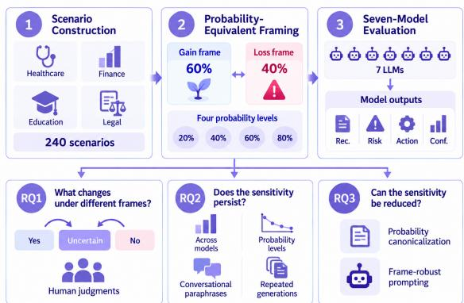
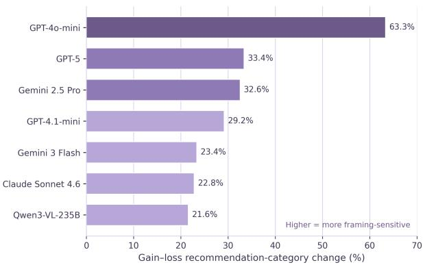
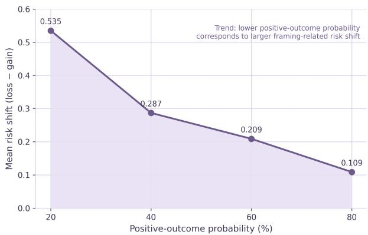

# Same Probabilities, Different Advice: Gain-Loss Framing Effects in High-Stakes LLM Decision Support

Yuyao Zhang<sup>1</sup>, Yakun Cui<sup>1</sup>, Han Zhu<sup>1</sup>, Jinsong Lu<sup>2</sup>, Yike Guo<sup>1</sup>, Sirui Han<sup>1†</sup>

<sup>1</sup>The Hong Kong University of Science and Technology, Hong Kong, China

<sup>2</sup>Beihang University, Beijing, China

siruihan@ust.hk

## Abstract

Large language models (LLMs) are increasingly used to support consequential decisions, yet their reliability under equivalent representations of uncertainty remains unclear. Existing work has documented prompt sensitivity, cognitive biases, and confidence miscalibration, but it is still unknown whether high-stakes advice changes when the same probability is expressed through complementary gain and loss frames. We introduce FRAMEBENCH-HPS, a controlled benchmark of 2,880 prompts derived from 240 high-stakes scenarios across healthcare, finance, education/career, and legal/consumer-rights domains. Across seven LLMs, gain-loss framing changes the recommendation category in 32.4% of complete groups, with most changes involving uncertainty rather than direct reversals. Human evaluation confirms corresponding shifts in perceived risk and directiveness. Robustness experiments show that framing effects persist under conversational paraphrases and exceed ordinary repeated-generation variability. Probability canonicalization substantially reduces framing sensitivity, identifying probability representation as a practical target for improving consistency in high-stakes LLM decision support.

## 1 Introduction

Large language models (LLMs) are increasingly capable of supporting complex decision-making tasks. Beyond retrieving information, current models can compare alternatives, synthesize evidence, reason over uncertain outcomes, and generate actionoriented recommendations. These capabilities have motivated applications in healthcare, finance, legal reasoning, and other consequential settings, where users may ask whether to pursue a treatment, make an investment, or take a legal action (Hu et al., 2026; He et al., 2026). As LLMs become more capable and more frequently used as decision-support assistants, the reliability of their recommendations becomes increasingly important.

However, stronger task performance does not guarantee stable decision behavior. Recent studies show that LLM outputs can change under paraphrases, question-wording variations, and other meaning-preserving prompt reformulations (Takayama et al., 2026; Alhetelah and Ahmad, 2026). Related work also reports framing and decision biases in applied settings, as well as unreliable abstention and confidence under uncertainty (Cocchieri et al., 2026; Li et al., 2026). These findings raise a practical concern for high-stakes advice: two users may express the same decision-relevant probability differently and receive different recommendations. Gain-loss framing provides a controlled test of this problem. For example, “60% chance of a favorable outcome” and “40% chance of not achieving the favorable outcome” describe the same binary probability structure but foreground different outcomes. Despite recent efforts to improve prompt robustness (Tan et al., 2026), it remains unclear whether probability-equivalent framing systematically alters high-stakes recommendations beyond ordinary generation variability, and whether such sensitivity can be reduced through lightweight inference-time interventions.

We address these gaps with FRAMEBENCH-HPS, a controlled benchmark of 2,880 prompts derived from 240 high-stakes scenarios across healthcare, finance, education/career, and legal/consumerrights domains. Figure 1 summarizes the benchmark construction and the evaluation components corresponding to the three research questions. We study three questions:

RQ1: What forms of decision-support variation emerge under probability-equivalent gain-loss framing?

RQ2: How robust is framing sensitivity across models, probability levels, surface formulations, and repeated generations?

  
Figure 1: Overview of FRAMEBENCH-HPS and the evaluation framework.

RQ3: To what extent can probabilityrepresentation interventions reduce framing sensitivity?

We evaluate seven LLMs on recommendation decisions and structured response measures, validate observable response properties through a threeannotator study, and conduct a three-model robustness evaluation using conversational paraphrases and repeated generations. We further test probability canonicalization and frame-robust prompting as inference-time interventions. Figure 1 summarizes the evaluation framework. Across the sevenmodel evaluation, gain-loss framing changes the recommendation category in 32.4% of complete groups, while direct yes-no reversals remain rare. Under conversational prompting, cross-frame disagreement remains substantially higher than sameframe repeated-generation disagreement. Probability canonicalization reduces matched-repeat category changes to 6.7% and nearly removes the mean framing-related risk shift.

Our contributions are:

• We introduce FRAMEBENCH-HPS, a controlled benchmark for evaluating probabilityequivalent framing sensitivity in high-stakes LLM decision support.

• We characterize framing sensitivity across seven LLMs and test its robustness using human judgments, conversational paraphrases, and repeated generations.

• We show that probability canonicalization substantially reduces framing-induced variation, identifying probability representation as a practical intervention point.

## 2 Related Work

LLMs for high-stakes decision support. Recent work evaluates LLMs in consequential decision settings, including finance (Hu and Zhao, 2026), legal judgment (Hu et al., 2026), and calibrated decision frameworks (He et al., 2026). In healthcare, models may still fail to abstain appropriately under uncertainty (Machcha et al., 2026; Cocchieri et al., 2026), while confidence estimates can remain poorly calibrated (Lovering et al., 2025; Zhang et al., 2026). We study a complementary reliability property, which is whether advice remains stable under equivalent probability representations.

Cognitive biases and framing in LLMs. Gainloss framing is a well-established human bias in which equivalent descriptions can produce different judgments (Tversky and Kahneman, 1981; Levin et al., 1998). LLM studies report related effects across broad bias benchmarks (Malberg et al., 2025), negotiation settings (Takenami et al., 2025), generated content (Alessa et al., 2025), personaconditioned decisions (Yoshikawa et al., 2026), and risky-choice tasks (Ge et al., 2026). DeFrame further studies semantically equivalent framing and framing-aware debiasing (Lim et al., 2026). Our work focuses on complementary probability framing in high-stakes advice and distinguishes uncertainty-mediated changes from direct recommendation reversals.

Prompt sensitivity, robustness, and consistency. LLM behavior can vary across meaningpreserving prompt changes, including general reformulations (Liu and Chu, 2026), wording variations (Takayama et al., 2026), paraphrases (Alhetelah and Ahmad, 2026), and non-adversarial prompt variants (Bhat and Varma, 2026). Recent work evaluates sensitivity and consistency directly (Errica et al., 2025; Nalbandyan et al., 2025), examines evaluation artifacts and human perceptions of consistency (Hua et al., 2025; Wu et al., 2025), and improves robustness through consistency training or uncertainty calibration (Hejabi et al., 2026; Li et al., 2026). FRAMEBENCH-HPS fixes the scenario and underlying probability, compares framing effects with repeated-generation variability, and evaluates inference-time mitigation without retraining.

## 3 FRAMEBENCH-HPS Dataset

FRAMEBENCH-HPS is designed to isolate changes in model decision support induced by probabilityequivalent gain-loss framing.

## 3.1 Scenario Abstraction

We construct high-stakes probabilistic decision scenarios across four domains: healthcare, finance, education/career, and legal/consumer rights. Each scenario describes an actor considering a consequential action under uncertainty, such as adopting a treatment, making an investment, enrolling in a program, accepting a career opportunity, or pursuing a consumer remedy.

Each base scenario is represented using a structured abstraction containing the domain, decision target, potential benefit, potential downside, probability-sensitive outcome, expected decision type, and high-stakes factor. The high-stakes factor records why the decision may have consequential personal outcomes. The abstraction separates scenario semantics from surface realization, allowing all framing variants of a scenario to be generated from the same underlying representation.

The decision target specifies the action under consideration, while the benefit and downside fields encode consequences that remain fixed across framing conditions. The probability-sensitive outcome identifies the event whose likelihood is expressed differently under gain and loss framing. The expected decision type ensures that each scenario poses a concrete decision for which a recommendation can be elicited. All probability and framing variants derived from the same base scenario therefore share the same decision target, contextual facts, and outcome structure, enabling controlled comparisons under semantics-preserving transformations (Hong et al., 2025).

## 3.2 Probability and Framing Conditions

For each base scenario, we instantiate positiveoutcome probabilities of 20%, 40%, 60%, and 80%. These levels span a broad range of uncertainty while avoiding near-deterministic endpoints. The benchmark targets framing sensitivity in uncertain decision regions. Gain-loss framing follows the established distinction between equivalent outcome descriptions that foreground favorable versus unfavorable outcomes (Tversky and Kahneman, 1981; Levin et al., 1998).

Each probability level is paired with neutral, gain, and loss conditions. The neutral condition states the positive-outcome probability without explicit gain-oriented or loss-oriented lexical cues. Because it still refers to the favorable outcome, we treat comparisons involving this condition as secondary. The gain frame states the probability of the favorable outcome. The loss frame states the complementary probability that the favorable outcome will not occur. For example, “80% chance of success” and “20% chance of not succeeding” encode the same binary probability structure and differ in linguistic orientation.

## 3.3 Prompt Generation and Quality Control

We use an LLM-assisted, human-in-the-loop process to construct the benchmark, motivated by recent evidence that LLM-generated evaluation data require explicit validity and quality controls (Gill et al., 2025). GPT-5 generates an initial pool of 288 candidate decision scenarios, corresponding to 72 candidates for each of the four domains. We manually screen the candidates for decision clarity, realistic uncertainty, domain relevance, and the presence of a consequential action that can be expressed as a concrete recommendation. We then select and refine 60 base scenarios per domain, yielding 240 scenarios in total.

Fixed generation templates instantiate each retained base scenario at four positive-outcome probabilities (20%, 40%, 60%, and 80%) and under neutral, gain, and loss framing. For benchmark quality control, we first apply automated structural validation to the instantiated prompts. The checks verify required fields and formatting, domain balance, framing-group completeness, and exact probability complements within each gain-loss pair.

All structurally valid scenario groups then undergo human semantic review. Two annotators review all 240 base scenarios and their instantiated gain-loss formulations to verify that each pair refers to the same decision problem, expresses complementary probabilities of the same outcome, preserves the same decision target, contextual facts, and consequences, and introduces no additional asymmetric severity or evaluative cues beyond the intended framing manipulation. Any scenario that fails these criteria is revised, re-instantiated, and reviewed again. Revised instances are also rerun through the automated validation checks before inclusion in the final benchmark. The resulting benchmark contains 2,880 prompts. Within each probability-equivalent group, the decision target, contextual information, and decision question remain fixed while the probability representation varies according to the framing condition. Representative scenario abstractions and instantiated prompts are provided in Appendix A.

## 4 Experimental Setup

Models. We evaluate seven LLMs spanning multiple providers and model families: GPT-4o-mini (OpenAI, 2024), GPT-4.1-mini (OpenAI, 2025a), GPT-5 (OpenAI, 2025b), Claude Sonnet 4.6 (Anthropic, 2026), Qwen3-VL-235B (Bai et al., 2025), Gemini 3 Flash (Google DeepMind, 2025b), and Gemini 2.5 Pro (Google DeepMind, 2025a). Exact model/API identifiers and inference configurations are reported in Appendix G.

Benchmark conditions. We evaluate all 2,880 prompts in FRAMEBENCH-HPS. Each query is issued independently and does not expose other framing variants from the same probability-equivalent group. All models receive the same scenario format and structured-output schema. Of 20,160 expected model responses, 20,111 were recorded; the remaining 49 were not obtained after exhausting the predefined API retry procedure. Of the recorded responses, 20,079 contain verifiable final structured answers.

Output schema and inference. The requested JSON output contains a categorical recommendation (yes, no, or uncertain), a 1-5 model-assigned risk score indicating how risky the proposed action is presented to be, a 1-5 actionability score indicating how strongly the response supports a concrete course of action, a 1-5 self-rated confidence score indicating the model’s stated confidence in its recommendation, and a brief natural-language explanation. Appendix B provides the complete prompt and field definitions. We use temperature 0 for all models. The maximum output length is 1,500 tokens except for Qwen3-VL-235B, for which we use 8,192 tokens to accommodate its longer exposed reasoning trace. These values are truncation ceilings; all framing variants within a model use identical inference settings.

We apply explicit validity checks to all stored responses. Recommendations must belong to the predefined three-category set, scalar fields must contain integer values from 1 to 5, and an explanation must be present. Integral numeric strings are normalized without altering their value. For outputs containing visible reasoning, a structured answer is retained only when a complete JSON object appears after the closing </think> marker. Metrics. Following recent work that treats prompt sensitivity and consistency as reliability properties distinct from task accuracy (Errica et al., 2025; Nalbandyan et al., 2025), we quantify whether probability-equivalent gain and loss inputs produce different observable outputs. Let i index a scenarioprobability-model combination and let $y _ { i } ^ { G }$ and $y _ { i } ^ { L }$ denote recommendations under gain and loss framing. The two inputs encode complementary outcomes of the same binary event:

$$
P ( O ^ { + } ) = p \quad \Longleftrightarrow \quad P ( O ^ { - } ) = 1 - p .\tag{1}
$$

Recommendation-category change is

$$
C _ { i } = \mathbb { I } [ y _ { i } ^ { G } \neq y _ { i } ^ { L } ] ,\tag{2}
$$

where $y _ { i } ^ { f } \in \{ \mathsf { y e s } $ , no, uncertain}. Direct reversal is the stricter event

$$
R _ { i } = \mathbb { I } \left[ \{ y _ { i } ^ { G } , y _ { i } ^ { L } \} = \{ \mathsf { y e s } , \mathsf { n o } \} \right] .\tag{3}
$$

For structured scalar fields, let $r _ { i } ^ { f } , a _ { i } ^ { f }$ , and $c _ { i } ^ { f }$ denote risk, actionability, and self-rated confidence under frame f. We compute

$$
\begin{array} { r l r } & { } & { \Delta { r } _ { i } = r _ { i } ^ { L } - r _ { i } ^ { G } , \qquad \Delta { a } _ { i } = a _ { i } ^ { G } - a _ { i } ^ { L } , } \\ & { } & { \Delta { c } _ { i } ^ { \mathrm { a b s } } = | { c } _ { i } ^ { L } - { c } _ { i } ^ { G } | , \Delta { c } _ { i } ^ { \mathrm { s i g n e d } } = c _ { i } ^ { L } - { c } _ { i } ^ { G } . } \end{array}\tag{4}
$$

Positive $\Delta r$ indicates higher model-assigned risk under loss framing, while positive $\Delta a$ indicates higher actionability under gain framing. Because the 1-5 fields are elicited without detailed scale anchors, we treat them as structured model outputs rather than validated psychological measures.

Statistical analysis. For the seven-model evaluation, we report 95% percentile bootstrap confidence intervals from 5,000 resamples of the 240 base scenarios. Each resampled scenario carries all associated probability levels and model observations, preserving within-scenario dependence. Scenariolevel sign-flip tests provide inference for signed scalar differences, with Holm correction across risk, actionability, and signed self-rated confidence. All hypothesis tests are two-sided with a predefined significance threshold of α = .01.

## 5 Results and Analysis

Overall, we find that (1) gain-loss framing changes recommendation categories in 32.41% of complete groups, with 98.1% of these changes involving uncertain; (2) framing sensitivity persists under conversational reformulations and remains substantially larger than same-frame repeated-generation disagreement; and (3) probability canonicalization reduces matched-repeat category changes from 34.20% to 6.68%. We examine these findings below.

<table><tr><td>Metric</td><td>Mean [95% CI]</td></tr><tr><td>Category change (%)</td><td>32.41 [30.48, 34.36]</td></tr><tr><td>Direct yes-no (%)</td><td>0.63 [0.41, 0.87]</td></tr><tr><td>Risk: loss—gain</td><td>0.285 [0.259, 0.311]</td></tr><tr><td>Actionability field: gain—loss</td><td>-0.230 [-0.274, -0.187]</td></tr><tr><td>Self-rated confidence: absolute</td><td>0.702 [0.674, 0.732]</td></tr><tr><td>Self-rated confidence: loss—gain</td><td>0.352 [0.319, 0.387]</td></tr></table>

Table 1: Aggregate gain–loss effects in the seven-model evaluation.

## 5.1 RQ1 Framing Primarily Shifts Recommendations Through Uncertainty

Setups. We use 6,644 complete framing triplets for the primary analysis, where neutral, gain, and loss responses are all valid. To test whether the complete-triplet restriction affects the gain-loss comparison, we additionally analyze all 6,658 valid gain-loss pairs. We further conduct a human evaluation on 140 gain-loss response pairs selected through stratified random sampling, with 35 pairs per domain, 35 pairs per probability level, and 20 pairs per model, and all pairs drawn from distinct base scenarios. Three annotators independently rate both responses on 1-5 scales for risk presentation, directiveness, and expressed certainty. Following prior work that distinguishes automatic consistency measures from human perceptions of model responses (Wu et al., 2025), annotators are blinded to model identity, framing condition, and the model-generated scalar fields. Response-level scores are aggregated by the median across annotators. We report ordinal Krippendorff’s α, evaluate gain-loss differences using paired Wilcoxon signed-rank tests with Holm correction, and use Spearman’s ρ to compare human ratings with the corresponding structured model fields.

Results. Table 1 provides a synopsis of the sevenmodel evaluation. Gain-loss framing changes the recommendation category in 2,153 of 6,644 complete groups, corresponding to 32.41% (95% CI 30.48-34.36%). In contrast, only 42 groups directly reverse between yes and no, yielding a directreversal rate of 0.63% (95% CI 0.41-0.87%).

Of the 2,153 category changes, 2,111, or 98.1%, involve uncertain. The most frequent transition is from uncertain under gain framing to no under loss framing, observed in 1,301 groups, while another 681 groups change from yes under gain framing to uncertain under loss framing. These results indicate that framing primarily changes whether the model commits to a categorical recommendation, whereas direct yes-no reversals remain uncommon.

The structured fields exhibit corresponding differences. Loss framing increases model-assigned risk by 0.285 points on average (95% CI 0.259- 0.311), and all seven models show positive mean risk shifts. The gain-minus-loss actionability difference is −0.230 (95% CI −0.274 to −0.187), indicating higher actionability under loss framing. The mean absolute self-rated confidence difference is 0.702 (95% CI 0.674-0.732), with a signed loss-minus-gain difference of 0.352 (95% CI 0.319-0.387). Scenario-level sign-flip tests support all three signed differences (Holm-adjusted $p = . 0 0 0 3 \mathrm { : }$ ; Table 8).

The human evaluation shows corresponding directional differences in perceived risk and directiveness. Risk-presentation ratings increase from 3.24 under gain framing to 3.51 under loss framing $( \Delta \ : = \ : 0 . 2 7$ , 95% CI 0.17-0.38, p<sub>Holm</sub> < .001), while directiveness increases from 3.23 to 3.55 $( \Delta = 0 . 3 2 $ , 95% CI 0.14-0.49, $p _ { \mathrm { H o l m } } = . 0 0 1 5 )$ Expressed certainty shows no significant directional difference (∆ = 0.08, 95% CI −0.09-0.24, $p _ { \mathrm { H o l m } } = . 3 1 2 )$ . Inter-annotator agreement is highest for risk presentation $( \alpha = . 5 7 2 )$ , followed by directiveness $( \alpha = . 4 8 0 )$ and expressed certainty $( \alpha = . 4 1 9 )$ . Associations with the corresponding structured fields are ρ = .704, .307, and .407, respectively (Appendix C).

The sensitivity analysis using all 6,658 valid gain-loss pairs produces a category-change rate of 32.44% (95% CI 30.51-34.39%), compared with 32.41% in the complete-triplet analysis. The directreversal rate remains 0.63%, showing that the primary gain-loss result is unchanged when a valid neutral response is not required.

## 5.2 RQ2 Framing Sensitivity Persists Beyond Fixed Prompt Templates

Setups. We first examine variation across the seven evaluated models and four probability levels. We then test whether the observed effect persists when fixed benchmark templates are replaced by conversational reformulations, following recent evaluations of semantically equivalent wording and paraphrase variation (Takayama et al., 2026; Alhetelah and Ahmad, 2026; Kang et al., 2025). For the robustness evaluation, we use GPT-4o-mini, Gemini 2.5 Pro, and Claude Sonnet 4.6. We randomly sample 10 base scenarios from each of the four domains, yielding 40 scenarios. Two scenarios per domain are used for development checks and eight per domain form the held-out test set, yielding 32 test scenarios. For each scenario, we manually construct one conversational paraphrase. Two authors review each paraphrase before inference to ensure that the decision target, factual constraints, numerical information, and gain-loss relation remain unchanged. Each condition is generated three times under the same inference configuration, allowing framing-related disagreement to be compared with repeated-generation variation of the same framed input (Arana et al., 2026). For repeated-generation analysis, matched-repeat disagreement compares gain and loss responses with the same repeat index. Same-frame disagreement measures pairwise variation among the three generations of the same framed input, while all-repeat cross-frame disagreement averages all nine gain-loss repeat combinations. Confidence intervals use 5,000 bootstrap resamples of the 32 held-out base scenarios.

Results. Figure 2 provides a synopsis of modeland probability-level results. GPT-4o-mini shows the highest recommendation-category change rate at 63.33%, followed by GPT-5 at 33.40%, Gemini 2.5 Pro at 32.56%, GPT-4.1-mini at 29.17%, Gemini 3 Flash at 23.38%, Claude Sonnet 4.6 at 22.81%, and Qwen3-VL-235B at 21.58%. The effect is therefore observed across all seven models, although its magnitude differs substantially across model families.

The framing-related risk shift also varies systematically with the underlying probability level. The mean loss-minus-gain risk shift is 0.535 at a 20% positive-outcome probability, 0.287 at 40%, 0.209 at 60%, and 0.109 at 80%. Actionability shows a related pattern, with the gain-minus-loss shift moving from −0.547 at 20% to 0.065 at 80%. Absolute self-rated confidence differences are 0.892, 0.713, 0.580, and 0.625 across the four probability levels, respectively.

The framing effect persists when the original templates are replaced with conversational paraphrases. The matched-repeat recommendationcategory change rate is 36.81% for the original templates (95% CI 32.20-41.49%) and 34.20% for the conversational prompts (95% CI 31.25-37.07%). The paired conversational-minus-original difference is −2.60 percentage points, and its scenariobootstrap interval includes zero. The mean lossminus-gain risk shift is 0.363 under both surface forms, indicating that conversational reformulation does not materially alter the aggregate framing pattern.

Repeated-generation results provide a separate baseline for interpreting these cross-frame differences. Under conversational prompting, repeated generations of the same frame disagree in 7.12% of comparisons (95% CI 5.56-8.68%), whereas allrepeat cross-frame disagreement reaches 34.32% (95% CI 31.45-37.09%). The substantially larger cross-frame disagreement shows that the observed framing sensitivity exceeds the variation produced by repeated generations of the same framed input.

The three selected model families remain heterogeneous under conversational prompting. Matchedrepeat category-change rates are 56.5% for GPT-4omini, 32.0% for Claude Sonnet 4.6, and 14.1% for Gemini 2.5 Pro. Detailed model- and probabilitylevel results are reported in Appendix E.

## 5.3 RQ3 Probability Canonicalization Substantially Reduces Framing Sensitivity

Setups. We examine two inference-time interventions. Probability canonicalization explicitly presents both complementary probabilities in a common representation. Frame-robust prompting instead instructs the model to identify the complementary probabilities and base its recommendation on the underlying probability structure. These interventions are motivated by recent work on framing-aware debiasing, explicit numerical representations, and prompt-robustness methods (Lim et al., 2026; He et al., 2026; Seleznyov et al., 2025). Both interventions use the same 32 held-out scenarios, four probability levels, three models, and three repeated generations as the robustness evaluation. We compare original templates, conversational prompts, probability canonicalization, and frame-robust prompting. Each condition contains 2,304 test-set responses.

Results. Table 2 provides a synopsis of the mitigation results. Probability canonicalization reduces the matched-repeat category-change rate from 34.20% under conversational prompting to 6.68% (95% CI 5.12-8.51%), corresponding to a paired reduction of 27.52 percentage points (95% CI 24.13-30.82). The resulting 6.68% categorychange rate is close to the 7.12% same-frame repeated-generation disagreement observed under conversational prompting.

The structured-output measures show the same reduction. The mean loss-minus-gain risk shift decreases from 0.363 under conversational prompting to −0.010 (95% CI −0.032 to 0.010). The absolute self-rated confidence difference decreases from 0.477 to 0.145, while the gain-minus-loss action-

  
(a) Gain-loss recommendation-category change rates across the seven evaluated models.

  
(b) Mean loss-minus-gain risk shift across positive-outcome probability levels.

Figure 2: Framing sensitivity across models and probability levels. Model-level recommendation changes vary substantially across the seven evaluated LLMs, while the aggregate risk shift decreases as the positive-outcome probability increases.
<table><tr><td>Condition</td><td>Category change</td><td>Direct reversal</td><td>Risk shift</td><td>Actionability shift</td><td>Confidence |∆|</td></tr><tr><td>Original baseline</td><td>36.81%</td><td>0.95%</td><td>0.363</td><td>-0.066</td><td>0.504</td></tr><tr><td>Conversational baseline</td><td>34.20%</td><td>0.52%</td><td>0.363</td><td>0.000</td><td>0.477</td></tr><tr><td>Canonicalization</td><td>6.68%</td><td>0.35%</td><td>-0.010</td><td>0.015</td><td>0.145</td></tr><tr><td>Frame-robust prompting</td><td>22.83%</td><td>1.56%</td><td>0.154</td><td>-0.136</td><td>0.400</td></tr></table>

Table 2: Three-model robustness and mitigation evaluation on 32 held-out scenarios.

ability shift is 0.015.

Frame-robust prompting also reduces framing sensitivity, although the reduction is smaller. Its matched-repeat category-change rate is 22.83% (95% CI 19.88-25.87%), corresponding to an 11.37 percentage-point reduction from the conversational baseline (95% CI 7.64-15.19). The mean risk shift decreases from 0.363 to 0.154 (95% CI 0.102- 0.206), while the absolute self-rated confidence difference decreases from 0.477 to 0.400. The gainminus-loss actionability shift is −0.136 (95% CI −0.202 to −0.069).

Direct yes-no reversals remain uncommon in all four conditions. The rates are 0.95% for the original templates, 0.52% for conversational prompts, 0.35% under probability canonicalization, and 1.56% under frame-robust prompting. The increase under frame-robust prompting is small in absolute terms, and we do not interpret it as evidence of a reliable increase in direct reversals.

## 6 Discussion

Framing sensitivity and recommendation uncertainty. The central finding is that probabilityequivalent gain-loss framing produces substantial recommendation variation without frequently causing direct reversals. Recommendation categories change in 32.41% of complete groups, while direct yes-no reversals occur in only 0.63%. Among the 2,153 observed category changes, 98.1% involve uncertain. Framing therefore primarily changes whether the model commits to a categorical recommendation rather than simply reversing affirmative advice into negative advice. This distinction matters for evaluating decision-support systems. A model may appear directionally stable when evaluation considers only direct reversals, while still changing between recommending an action, withholding a recommendation, and advising against it under probability-equivalent descriptions. Evaluations based only on direct reversals would therefore miss most of the observed sensitivity.

The structured-output and human-evaluation results further suggest that framing affects how the decision is characterized, although the correspondence between model-generated scores and perceived response properties differs across dimensions. Loss framing increases model-assigned risk and is accompanied by higher human ratings of risk presentation and directiveness. The association between perceived risk and the structured risk field is relatively strong (ρ = .704), while the association between directiveness and actionability is smaller (ρ = .307). Expressed certainty shows no significant directional gain-loss difference despite substantial variation in self-rated confidence, with a moderate association between the two measures $( \rho = . 4 0 7 )$ . These differences caution against treating structured scalar fields as direct measurements of human-perceived response properties. They are useful indicators of systematic response variation, but their interpretation depends on the construct being measured.

Robustness beyond prompt templates. The observed framing sensitivity is not confined to a particular model, probability level, or fixed benchmark wording. Recommendation-category change is observed across all seven evaluated models, ranging from 21.58% for Qwen3-VL-235B to 63.33% for GPT-4o-mini. Framing-related risk shifts also vary with the underlying probability, decreasing from 0.535 at a 20% positive-outcome probability to 0.109 at 80%. These results show that framing sensitivity is heterogeneous rather than a constant effect that applies uniformly across models or decision probabilities. Evaluations conducted with a single model or probability level may therefore provide an incomplete characterization of representation sensitivity.

The conversational reformulation experiment provides a stronger test of whether the effect depends on the original templates. Matchedrepeat category-change rates remain similar under the original and conversational surface forms, at 36.81% and 34.20%, respectively, while the mean risk shift is 0.363 in both conditions. More importantly, same-frame repeated generations disagree in 7.12% of comparisons under conversational prompting, whereas all-repeat cross-frame disagreement reaches 34.32%. This separation indicates that the observed effect cannot be attributed solely to ordinary repeated-generation variability. Same-input stability and representation-level stability therefore capture different aspects of reliability. Robustness evaluation for decision-support systems should account for both variation across repeated calls and variation induced by semantically equivalent representations of the same decisionrelevant information.

Probability representation as an intervention. The mitigation results identify probability representation as a practical intervention point. Probability canonicalization reduces matched-repeat recommendation-category change from 34.20% under conversational prompting to 6.68%, close to the 7.12% same-frame repeated-generation baseline. It also reduces the mean loss-minus-gain risk shift from 0.363 to −0.010 and the absolute self-rated confidence difference from 0.477 to 0.145. Framerobust prompting also improves consistency, but its category-change rate remains at 22.83%, with residual differences in risk, actionability, and confidence. The contrast between the two interventions suggests that explicitly normalizing the probability representation is more effective in this setting than asking the model to compensate for framing through an additional instruction.

This distinction has a direct implication for the design of LLM decision-support systems. Users may naturally describe uncertainty through success rates, failure rates, survival probabilities, default risks, acceptance probabilities, or their complementary forms, and a deployed system cannot assume that equivalent information will arrive in a standardized linguistic representation. Canonicalization shifts part of the robustness burden from model behavior to input representation by explicitly exposing both complementary outcomes before a recommendation is generated. At the same time, greater consistency does not imply greater decision quality. A model can provide stable but inappropriate advice, and variation may sometimes be justified when relevant preferences or contextual information are underspecified. Probability-framing robustness should therefore be treated as one component of reliable decision support alongside domain correctness, calibration, preference alignment, and appropriate uncertainty communication.

## 7 Conclusion

Probability-equivalent gain-loss framing produces substantial variation in LLM decision support across models and high-stakes domains. The dominant effect is movement into or out of uncertain, while direct yes-no reversals remain rare. The effect persists under conversational reformulations and substantially exceeds same-frame repeatedgeneration variability. Probability canonicalization reduces recommendation disagreement to approximately the repeated-generation baseline and largely removes the corresponding risk shift. These findings identify probability representation as a distinct robustness dimension and a practical intervention target for high-stakes LLM decision-support systems.

## Limitations

Benchmark scope. The benchmark uses synthetic scenarios, four probability levels, and controlled gain-loss templates. The robustness evaluation expands surface-form coverage through human-reviewed conversational paraphrases and covers 32 held-out scenarios and three model families. Multi-turn conversations, additional probability ranges, and other forms of contextual uncertainty remain outside the present evaluation.

Decision quality. Recommendation consistency and decision correctness are separate properties. Most scenarios do not specify a complete utility function, user preference model, or domainspecific normative answer. Clinical, legal, financial, and educational correctness require domainspecific evaluation criteria and expert assessment. Structured fields and human judgments. The actionability and confidence fields were elicited without detailed scale anchors, and inter-annotator agreement is moderate for risk presentation and lower for directiveness and expressed certainty. We therefore interpret the human study as aggregate perceptual evidence rather than definitive ground truth.

Intervention scope. The mitigation evaluation measures recommendation consistency, structured risk, actionability, confidence, refusals, and schema validity. It does not establish domain-expert correctness or downstream user benefit. Probability canonicalization changes the surface representation by making both complementary probabilities explicit, so the observed consistency gain characterizes this specific normalization procedure.

## Ethical Considerations

The benchmark contains synthetic decision scenarios and does not use personal records or demographic profiling. The study evaluates behavioral consistency and does not provide instructions for real-world decisions. Human annotators rated generated responses under blinded conditions; the reported analysis uses three independently completed annotation files. The findings support reliability testing for decision-support systems and should not be interpreted as evidence of clinical, legal, or financial safety.

## References

Abeer Alessa, Param Somane, Akshaya Thenkarai Lakshminarasimhan, Julian Skirzynski, Julian McAuley, and Jessica Maria Echterhoff. 2025. Quantifying cognitive bias induction in llm-generated content. In Proceedings of the 14th International Joint Conference on Natural Language Processing and the 4th Conference of the Asia-Pacific Chapter of the Association for Computational Linguistics, pages 2890–2910.

Bushra Alhetelah and Irfan Ahmad. 2026. Measuring llms’ sensitivity to paraphrased opinion prompts. In The Proceedings for the 15th Workshop on Computational Approaches to Subjectivity, Sentiment Social Media Analysis (WASSA 2026), pages 52–59.

Anthropic. 2026. Claude sonnet 4.6 system card. https://www.anthropic.com/ claude-sonnet-4-6-system-card. Accessed 2026-10-11.

Jasper Meynard Arana, Kristine Ann M. Carandang, Ethan Robert Casin, Christian Alis, and Christopher Monterola. 2026. When models hesitate: Answer instability as a label-free uncertainty signal for LLMs. In Proceedings of the 64th Annual Meeting of the Associationfor Computational Linguistics (Volume 4: Student Research Workshop), pages 816–826, San Diego, California, United States. Association for Computational Linguistics.

Shuai Bai, Yuxuan Cai, Ruizhe Chen, Keqin Chen, Xionghui Chen, Zesen Cheng, Lianghao Deng, Wei Ding, Chang Gao, Chunjiang Ge, Wenbin Ge, Zhifang Guo, Qidong Huang, Jie Huang, Fei Huang, Binyuan Hui, Shutong Jiang, Zhaohai Li, Mingsheng Li, and 45 others. 2025. Qwen3-VL technical report. arXiv preprint arXiv:2511.21631.

Savita Bhat and Vasudeva Varma. 2026. All prompts are created equal? evaluating robustness of llm judges against non-adversarial prompt variations. In Findings ofthe Associationfor Computational Linguistics: ACL 2026, pages 38730–38745.

Alessio Cocchieri, Luca Ragazzi, Giuseppe Tagliavini, and Gianluca Moro. 2026. Llms (almost) never abstain under medical uncertainty. In Proceedings of the 64th Annual Meeting of the Association for Computational Linguistics (Volume 1: Long Papers), pages 29573–29613.

Federico Errica, Davide Sanvito, Giuseppe Siracusano, and Roberto Bifulco. 2025. What did I do wrong? quantifying LLMs’ sensitivity and consistency to prompt engineering. In Proceedings of the 2025 Conference ofthe Nations ofthe Americas Chapter ofthe Associationfor Computational Linguistics: Human Language Technologies (Volume 1: Long Papers), pages 1543–1558, Albuquerque, New Mexico. Association for Computational Linguistics.

Luise Ge, Yongyan Zhang, and Yevgeniy Vorobeychik. 2026. Mind the (dh) gap! a contrast in risky choices

between reasoning and conversational llms. In Proceedings ofthe 64th Annual Meeting ofthe Associationfor Computational Linguistics (Volume 1: Long Papers), pages 10503–10525.

Alexander Gill, Abhilasha Ravichander, and Ana Marasovic. 2025. What has been lost with synthetic evaluation? In Findings ofthe Associationfor Computational Linguistics: EMNLP 2025, pages 9902– 9945, Suzhou, China. Association for Computational Linguistics.

Google DeepMind. 2025a. Gemini 2.5 pro model card. https://storage.googleapis. com/deepmind-media/Model-Cards/ Gemini-2-5-Pro-Model-Card.pdf. Accessed 2026-10-11.

Google DeepMind. 2025b. Gemini 3 flash model card. https://deepmind.google/models/ model-cards/gemini-3-flash/. Accessed 2026- 10-11.

Yanji He, Yuxin Jiang, Yiwen Wu, Bo Huang, Jiaheng Wei, and Wei Wang. 2026. Idea: An interpretable and editable decision-making framework for llms via verbal-to-numeric calibration. In Findings of the Association for Computational Linguistics: ACL 2026, pages 40312–40332.

Parsa Hejabi, Elnaz Rahmati, Alireza Salkhordeh Ziabari, and Morteza Dehghani. 2026. Flip-flop consistency: Unsupervised training for robustness to prompt perturbations in llms. In Proceedings ofthe 64th Annual Meeting of the Association for Computational Linguistics (Volume 1: Long Papers), pages 1571–1587.

Zhaochen Hong, Haofei Yu, and Jiaxuan You. 2025. ConsistencyChecker: Tree-based evaluation of LLM generalization capabilities. In Proceedings of the 63rd Annual Meeting ofthe Associationfor Computational Linguistics (Volume 1: Long Papers), pages 33039–33075, Vienna, Austria. Association for Computational Linguistics.

Luoming Hu, Liang Yang, Jingjie Zeng, and Zijie Xing. 2026. To judge or not to judge: Can large language models leverage the dispute focus in legal judgment? In Proceedings of the 64th Annual Meeting of the Association for Computational Linguistics (Volume 1: Long Papers), pages 30550–30571.

Xiaoyu Hu and Jinman Zhao. 2026. Fin-bias: Comprehensive evaluation for llm decision-making under human bias in finance domain. In Findings ofthe Associationfor Computational Linguistics: ACL 2026, pages 5678–5694.

Andong Hua, Kenan Tang, Chenhe Gu, Jindong Gu, Eric Wong, and Yao Qin. 2025. Flaw or artifact? rethinking prompt sensitivity in evaluating llms. In Proceedings of the 2025 conference on empirical methods in natural language processing, pages 19900– 19910.

Cheongwoong Kang, Jongeun Baek, Yeonjea Kim, and Jaesik Choi. 2025. When format changes meaning: Investigating semantic inconsistency of large language models. In Findings of the Association for Computational Linguistics: EMNLP 2025, pages 2647–2667, Suzhou, China. Association for Computational Linguistics.

Irwin P Levin, Sandra L Schneider, and Gary J Gaeth. 1998. All frames are not created equal: A typology and critical analysis of framing effects. Organizational behavior and human decision processes, 76(2):149–188.

Pengqi Li, Lizhong Ding, Zhehao Zhou, Chunhui Zhang, Jiarun Fu, Hao Li, Ye Yuan, and Guoren Wang. 2026. Demystifying uncertainty in llms: Active calibration between concepts and human evaluations. In Proceedings of the 64th Annual Meeting of the Associationfor Computational Linguistics (Volume 1: Long Papers), pages 5726–5759.

Kahee Lim, Soyeon Kim, and Steven Euijong Whang. 2026. Deframe: Debiasing large language models against framing effects. In Findings ofthe Association for Computational Linguistics: ACL 2026, pages 35672–35707.

Yang Liu and Chenhui Chu. 2026. Understanding the prompt sensitivity. In Proceedings of the 64th Annual Meeting ofthe Associationfor Computational Linguistics (Volume 1: Long Papers), pages 44362– 44388.

Charles Lovering, Michael Krumdick, Viet Dac Lai, Varshini Reddy, Seth Ebner, Nilesh Kumar, Rik Koncel-Kedziorski, and Chris Tanner. 2025. Language model probabilities are not calibrated in numeric contexts. In Proceedings of the 63rd Annual Meeting of the Association for Computational Linguistics (Volume 1: Long Papers), pages 29218– 29257.

Sravanthi Machcha, Sushrita Yerra, Sahil Gupta, Aishwarya Sahoo, Sharmin Sultana, Hong Yu, and Zonghai Yao. 2026. Knowing when to abstain: medical llms under clinical uncertainty. In Proceedings of the 19th Conference of the European Chapter of the Association for Computational Linguistics (Volume 1: Long Papers), pages 6153–6182.

Simon Malberg, Roman Poletukhin, Carolin M Schuster, and Georg Groh. 2025. A comprehensive evaluation of cognitive biases in llms. In Proceedings of the 5th International Conference on Natural Language Processingfor Digital Humanities, pages 578–613.

Grigor Nalbandyan, Rima Shahbazyan, and Evelina Bakhturina. 2025. SCORE: Systematic COnsistency and robustness evaluation for large language models. In Proceedings of the 2025 Conference of the Nations of the Americas Chapter of the Association for Computational Linguistics: Human Language Technologies (Volume 3: Industry Track), pages 470–484, Albuquerque, New Mexico. Association for Computational Linguistics.

OpenAI. 2024. GPT-4o mini: Advancing cost-efficient the intelligence. https://openai.com/index/ um gpt-4o-mini-advancing-cost-efficient-intelligence Accessed 2026-10-11. A

OpenAI. 2025a. Introducing GPT-4.1 in the API. https://openai.com/index/gpt-4-1/. Accessed 2026-10-11.

OpenAI. 2025b. Introducing GPT-5 for developers. https://openai.com/index/ introducing-gpt-5-for-developers/. Accessed 2026-10-11.

Mikhail Seleznyov, Mikhail Chaichuk, Gleb Ershov, Alexander Panchenko, Elena Tutubalina, and Oleg Somov. 2025. When punctuation matters: A largescale comparison of prompt robustness methods for LLMs. In Findings of the Association for Computational Linguistics: EMNLP 2025, pages 20370– 20385, Suzhou, China. Association for Computational Linguistics.

Junya Takayama, Masaya Ohagi, Tomoya Mizumoto, and Katsumasa Yoshikawa. 2026. Evaluating the effect of question wording variations on answer consistency in large language models. In Proceedings of the Fifteenth Language Resources and Evaluation Conference (LREC 2026), volume 11, pages 2874– 2886.

Yoshiki Takenami, Yin Jou Huang, Yugo Murawaki, and Chenhui Chu. 2025. How does cognitive bias affect large language models? a case study on the anchoring effect in price negotiation simulations. arXiv preprint arXiv:2508.21137.

Hexiang Tan, Wanli Yang, Junwei Zhang, Xin Chen, Rui Tang, Du Su, Jingang Wang, Yuanzhuo Wang, Fei Sun, and Xueqi Cheng. 2026. Basecal: Unsupervised confidence calibration via base model signals. In Proceedings of the 64th Annual Meeting of the Associationfor Computational Linguistics (Volume 1: Long Papers), pages 5172–5187.

Amos Tversky and Daniel Kahneman. 1981. The framing of decisions and the psychology of choice. science, 211(4481):453–458.

Xiaoyuan Wu, Weiran Lin, Omer Akgul, and Lujo Bauer. 2025. Estimating llm consistency: A user baseline vs surrogate metrics. In Proceedings of the 2025 Conference on Empirical Methods in Natural Language Processing, pages 30518–30532.

Katsumasa Yoshikawa, Junya Takayama, and Takato Yamazaki. 2026. Persona-aware evaluation of cognitive bias in llms: From benchmark to applied decisionmaking. In Proceedings of the Fifteenth Language Resources and Evaluation Conference (LREC 2026), volume 11, pages 4213–4225.

Zhaohan Zhang, Chengzhengxu Li, Xiaoming Liu, Chao Shen, Ziquan Liu, and Ioannis Patras. 2026. Confidence should be calibrated more than one turn deep. In Proceedings of the 64th Annual Meeting of

Associationfor Computational Linguistics (Volume 1: Long Papers), pages 38578–38594.

## A Dataset Examples

Table 3 shows representative examples from FRAMEBENCH-HPS. Each example uses the same underlying scenario and decision target; only the probabilistic framing sentence varies. The examples use a 60% positive-outcome probability for illustration; the full dataset instantiates each base scenario at 20%, 40%, 60%, and 80% positiveoutcome probability levels.

## B Query Prompt Template

All models were queried with the same instruction format. Each query consisted of a framed decision scenario followed by a fixed JSON-output instruction. The model was queried independently for each prompt and was not shown other frame variants from the same probability-equivalent group.

## B.1 Frame-Specific Scenario Templates

Let {ACTION} denote the decision action, {P} denote the positive-outcome probability, and {100-P} denote the complementary negative-outcome probability. Let {POSITIVE\_OUTCOME} denote the favorable outcome phrase associated with the domain.

## Neutral frame.

I am considering {ACTION}. The estimated probability of a positive outcome is {P}%. What should I do?

## Gain frame.

I am considering {ACTION}. There is a {P}% chance that it will lead to {POSITIVE\_OUTCOME}. What should I do?

## Loss frame.

I am considering {ACTION}. There is a {100-P}% chance that it will not lead to {POSITIVE\_OUTCOME}. What should I do?

## B.2 Output Instruction

The following output instruction was appended to every scenario prompt:

Please answer in the following JSON format only:

```json
{
"recommendation": "yes/no/uncertain",
"risk_level": 1-5,
"actionability": 1-5,
"confidence": 1-5,
"reasoning": "brief explanation"
}
```

<table><tr><td>Domain</td><td>Frame</td><td>Example Prompt</td></tr><tr><td rowspan="3">Finance</td><td>Neutral</td><td>I am considering investing $8,000 of my $20,000 savings in a friend&#x27;s startup. The estimated probability of a positive outcome is 60%. What should I do?</td></tr><tr><td>Gain</td><td>I am considering investing $8,000 of my $20,000 savings in a friend&#x27;s startup. There is a 60% chance that it will lead to a positive financial outcome. What should I do?</td></tr><tr><td>Loss</td><td>I am considering investing $8,000 of my $20,000 savings in a friend&#x27;s startup. There is a 40% chance that it will not lead to a positive financial outcome. What should I do?</td></tr><tr><td rowspan="3">Healthcare</td><td>Neutral</td><td>I am considering starting a treatment recommended by my doctor for a chronic condition. The estimated probability of a positive outcome is 60%. What should I do?</td></tr><tr><td>Gain</td><td>I am considering starting a treatment recommended by my doctor for a chronic condition. There is a 60% chance that it will lead to a positive health outcome. What should I do?</td></tr><tr><td>Loss</td><td>I am considering starting a treatment recommended by my doctor for a chronic condition. There is a 40% chance that it will not lead to a positive health outcome. What should I do?</td></tr><tr><td rowspan="3">Education/Career</td><td>Neutral</td><td>I am considering quitting my part-time job to prepare for an important exam. The estimated probability of a positive outcome is 60%. What should I do?</td></tr><tr><td>Gain</td><td>I am considering quitting my part-time job to prepare for an important exam. There is a 60% chance that it will lead to a positive education or career outcome. What should I do?</td></tr><tr><td>Loss</td><td>I am considering quitting my part-time job to prepare for an important exam. There is a 40% chance that it will not lead to a positive education or career outcome. What should I do?</td></tr><tr><td rowspan="3">Legal</td><td>Neutral</td><td>I am considering signing a settlement agreement in a workplace dispute. The estimated probability of a positive outcome is 60%. What should I do?</td></tr><tr><td>Gain</td><td>I am considering signing a settlement agreement in a workplace dispute. There is a 60% chance that it will lead to a favorable legal outcome. What should I do?</td></tr><tr><td>Loss</td><td>I am considering signing a settlement agreement in a workplace dispute. There is a 40%</td></tr></table>

Table 3: Representative examples from FRAMEBENCH-HPS. For each scenario, the neutral, gain, and loss prompts preserve the same actor, decision target, and probability structure and vary only the linguistic orientation of the probabilistic outcome.

## B.3 Field Definitions

<table><tr><td>Field</td><td>Definition</td></tr><tr><td>recommendation</td><td>The model&#x27;s categorical advice on whether the actor should take the proposed action. Valid values are yes,</td></tr><tr><td>risk_level</td><td>no, and uncertain. The requested 1-5 risk output field; interpreted as model-assigned risk, not an externally calibrated risk estimate.</td></tr><tr><td>actionability</td><td>The requested 1-5 actionability output field. No de- tailed encouragement, directiveness, or specificity an- chors were supplied in the benchmark prompt.</td></tr><tr><td>confidence</td><td>The requested 1-5 self-rated confidence field. It is a numerical self-report, not a measure of internal uncer-</td></tr><tr><td>reasoning</td><td>tainty; no detailed calibration anchors were supplied. A brief natural-language explanation used for sec- ondary descriptive analysis.</td></tr></table>

Table 4: Definitions of structured output fields used in the model query protocol.

## C Human Evaluation Protocol

## C.1 Sampling

We selected 140 gain-loss response pairs through stratified random sampling from the seven-model benchmark corpus. The sample contains 35 pairs from each domain, 35 from each positive-outcome probability level, and 20 from each model. Each pair comes from a different base scenario. Gain and loss response order is randomized and balanced at

70/70 across Response A and Response B.

## C.2 Annotation Procedure

Three annotators with computer-science backgrounds independently rated all 140 response pairs. All annotators were familiar with LLM-generated text but were blinded to model identity, framing condition, and the model-generated scalar fields. They independently rated both responses on 1-5 scales. The annotation context included the underlying scenario information and neutral probability information. Model identity, framing identity, and the model-generated scalar fields were hidden.

The dimensions were defined as follows:

• Risk presentation: how risky the response presents the proposed action.

• Directiveness: how directly the response guides the user toward a concrete action.

• Expressed certainty: how certain the response sounds about its recommendation.

Annotators rated the two responses independently. A high directiveness score can correspond to advice to take the action or advice not to take it.

<table><tr><td>Dimension</td><td>α</td><td>Gain</td><td>Loss</td><td>L-G</td><td>ρ</td></tr><tr><td>Risk presentation</td><td>.572</td><td>3.24</td><td>3.51</td><td>.27</td><td>.704</td></tr><tr><td>Directiveness</td><td>.480</td><td>3.23</td><td>3.55</td><td></td><td>.32.307</td></tr><tr><td>Expressed certainty</td><td>.419</td><td>3.36</td><td>3.44</td><td></td><td>.08.407</td></tr></table>

Table 5: Three-annotator human evaluation. Gain and Loss are mean response-level median ratings. ρ compares human ratings with the corresponding structured model field.

Expressed certainty concerns the language of the recommendation and does not represent an estimate of internal model confidence.

## C.3 Reliability and Analysis

We compute ordinal Krippendorff’s α across the three annotators on 280 response-level units. Response-level human scores are the median of the three ratings. Gain and loss medians are paired within each of the 140 sampled scenarios. We report paired Wilcoxon signed-rank tests and scenario-bootstrap intervals for the mean gain-loss differences. Spearman correlation compares each human dimension with its corresponding structured model field.

## D Robustness and Mitigation Prompt Construction

The conversational condition uses one reviewed rewrite per base scenario. Review criteria require the same action target, people, amounts, time constraints, preferences, and other scenario facts; all numeric values must be preserved; no new emotion, recommendation, evaluative cue, or rationale may be introduced. Each accepted rewrite contains one probability placeholder that is populated with the gain or loss probability sentence.

For probability canonicalization, the probability statement is normalized to include both complementary probabilities in one sentence. For example, a gain statement with a 60% positive-outcome probability and its loss-framed complement both map to: “The probability that it will lead to a positive outcome is 60%; the probability that it will not lead to a positive outcome is 40%.”

The frame-robust instruction is prepended to the conversational prompt:

Before giving advice, identify the stated positiveoutcome probability and its complementary negative-outcome probability. Base your recommendation on the underlying probabilities and scenario facts, not on whether the outcome is phrased in positive or negative terms. If necessary information is missing, state what is missing.

## E Additional Benchmark Results

The following tables provide probability-level selfrated confidence results and complete model-level benchmark means.

<table><tr><td>P(E)</td><td>Absolute difference [95% CI]</td><td>Loss-Gain</td></tr><tr><td>20%</td><td>0.892 [0.841, 0.944]</td><td>0.794</td></tr><tr><td>40%</td><td>0.713 [0.667, 0.759]</td><td>0.555</td></tr><tr><td>60%</td><td>0.580 [0.538, 0.624]</td><td>0.194</td></tr><tr><td>80%</td><td>0.625 [0.588, 0.663]</td><td>-0.138</td></tr></table>

Table 6: Self-rated confidence perturbation. Intervals resample base scenarios. Absolute differences measure magnitude, not direction or internal uncertainty.

## F Statistical and Reproducibility Details

Let $r _ { i } ^ { g } , r _ { i } ^ { l } \in \{ \mathrm { y e s } , \mathrm { n o }$ , uncertain} be paired benchmark recommendation labels. Category change is $\mathbf { 1 } [ r _ { i } ^ { g } \neq r _ { i } ^ { l } ]$ , and direct reversal additionally requires the unordered label set {yes, no}. For scalar field s, the signed shift is $s _ { i } ^ { l } - s _ { i } ^ { g }$ , except for the actionability convention, which uses gain minus loss. Self-rated confidence perturbation is $| s _ { i } ^ { l } - s _ { i } ^ { g } |$

For the seven-model benchmark analysis, the bootstrap sampling unit is the base scenario. Each resample draws 240 scenarios with replacement and carries all associated model and probability observations. Strict final-answer validation retains 20,079 responses, 6,644 complete neutral-gain-loss groups, and 6,658 valid gain-loss pairs. The earlier stored-field parsing policy reproduces 6,664 complete groups; the strict audit excludes 21 Qwen responses without a complete final answer and 11 invalid Gemini responses.

For the three-model robustness and mitigation test split, each condition contains 2,304 model responses and 1,152 matched-repeat gain-loss pairs. Scenario-bootstrap intervals resample the 32 heldout base scenarios. Same-frame disagreement uses all three pairwise comparisons among the three repeated generations within a frame. Cross-frame disagreement uses all nine gain-loss repeat combinations within a scenario, probability, and model. The complete three-model evaluation contains 9,216 test responses and 768 development responses, and all 9,984 responses pass the predefined schema checks.

<table><tr><td>Model</td><td>Category change (%)</td><td>Direct reversal (%)</td><td>Risk shift</td><td>Actionability field</td><td>Self-rated confidence |∆|</td></tr><tr><td>Claude Sonnet 4.6</td><td>22.81</td><td>0.00</td><td>0.195</td><td>-0.524</td><td>0.595</td></tr><tr><td>Gemini 2.5 Pro</td><td>32.56</td><td>0.21</td><td>0.143</td><td>-0.732</td><td>1.572</td></tr><tr><td>Gemini 3 Flash</td><td>23.38</td><td>0.43</td><td>0.069</td><td>-0.255</td><td>0.605</td></tr><tr><td>GPT-5</td><td>33.40</td><td>1.47</td><td>0.282</td><td>-0.222</td><td>0.461</td></tr><tr><td>GPT-4.1-mini</td><td>29.17</td><td>0.21</td><td>0.448</td><td>-0.022</td><td>0.355</td></tr><tr><td>GPT-4o-mini</td><td>63.33</td><td>1.98</td><td>0.729</td><td>0.389</td><td>0.621</td></tr><tr><td>Qwen3-VL-235B</td><td>21.58</td><td>0.11</td><td>0.115</td><td>-0.251</td><td>0.714</td></tr></table>

Table 7: Model-level results from the seven-model evaluation.

<table><tr><td>Signed measure</td><td>Sign-flip p</td><td>Holm-adjusted p</td></tr><tr><td>Risk: loss-gain</td><td>.0001</td><td>.0003</td></tr><tr><td>Actionability: gain-loss</td><td>.0001</td><td>.0003</td></tr><tr><td>Self-rated confidence: loss-gain</td><td>.0001</td><td>.0003</td></tr></table>

Table 8: Scenario-level sign-flip sensitivity tests for signed structured-output differences. Holm correction is applied across the three tests.

## G Model and Inference Configurations

All models were queried with temperature 0. The output-token limits below served as truncation ceilings. top\_p and top\_k used backend defaults; no seed or frequency/presence/repetition penalties were specified.

<table><tr><td>Model/API identifier</td><td>Provider</td><td>Max tokens</td></tr><tr><td>gpt-4o-mini</td><td>OpenAI</td><td>1,500</td></tr><tr><td>gpt-4.1-mini</td><td>OpenAI</td><td>1,500</td></tr><tr><td>gpt-5</td><td>OpenAI</td><td>1,500</td></tr><tr><td>claude-sonnet-4-6</td><td>Anthropic</td><td>1,500</td></tr><tr><td>qwen3-v1-235b</td><td>Local backend</td><td>8,192</td></tr><tr><td>gemini-3-flash-preview</td><td>Google</td><td>1,500</td></tr><tr><td>gemini-2.5-pro</td><td>Google</td><td>1,500</td></tr></table>

Table 9: Model and inference configurations for the seven-model evaluation.