# Scaling Multilingual Pretraining of Pixel Language Models

Ilker Kesen†\* Jenny Kunz‡ Kasra Malihi§ Desmond Elliott§ †Humboldt-Universität zu Berlin Linköping University §University of Copenhagen ilker.kesen@hu-berlin.de

## Abstract

Pixel language models process text as rendered images instead of a finite vocabulary, which gives them strong cross-lingual transfer abilities. However, not much is known about how these abilities are influenced by larger-scale pretraining. In this paper, we train a family of MPIXEL models along three axes of variation: more languages, more scripts, and larger model capacity under fixed per-language compute. In evaluations on five tasks covering 83 languages, we find that scaling acts locally: each axis improves the added languages and scripts, while increased capacity mitigates the curse of multilinguality from pretraining on more languages. Transfer to unseen scripts improves with multilingual pretraining, but does not further improve with scaling. On typologically distant low-resource languages, our models outperform subword and character-level baselines across many writing systems. We also show that larger pixel models reserve more layers for visual processing, and that cross-lingual alignment weakens as more languages are added. Overall, our findings characterize how multilingual scaling improves pixel language models.

## 1 Introduction

Pixel language models process text as rendered images rather than discrete tokens (Salesky et al., 2021; Rust et al., 2023). This makes them appealing for the long tail of the world's writing systems (Joshi et al., 2020), with previous research demonstrating strong transfer abilities to unseen scripts (Kesen et al., 2025; Lotz et al., 2025). However, there is an open question about whether such transfer can be improved by increasing (i) the number of writing systems, (ii) the pretraining languages, or (iii) by increasing model capacity.

We investigate this question in a carefully controlled study that separates these axes of multilingual scaling. Our starting point is an 86M parameter model pretrained on English, Hindi, Traditional Chinese, and Ukrainian, following Kesen et al. (2025). From here, we train two models to investigate the effect of increasing the number of writing systems. The first is pretrained on eightlanguages by adding four languages in the alreadyseen Latin script, whereas the other model adds four languages in previously unseen writing systems. We also pretrain an MPIXEL model by combining the seen and unseen scripts with four further languages, resulting in a total of sixteen pretraining languages. Finally, MPIXELLARGE increases the model capacity to 307M parameters.

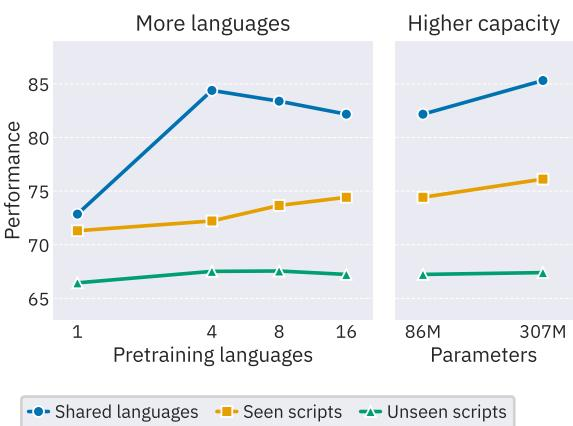  
Figure 1: MPIXEL performance when scaling the number of pretraining languages and model capacity. Adding new languages steadily improves performance on seen scripts, albeit with a slight decrease on shared languages. Higher capacity improves performance on shared and seen scripts. On unseen scripts, neither additional languages nor capacity yields consistent gains.

These pretraining variations allow us to study the following research questions. RQ1: Along which axis does scaling multilingual pretraining yield greater cross-lingual transfer: increasing language diversity within an already seen script or increasing script diversity? RQ2: Does scaling multilinguality along both axes continue to improve cross-lingual transfer, or do gains saturate with more pretraining languages? RQ3: To what extent does increased model capacity improve crosslingual transfer? RQ4: Do pixel language models suffer from the curse of multilinguality (Conneau et al., 2020) as more languages are added, and if so, does increased model capacity mitigate it?

We answer these questions with empirical experiments on five downstream tasks: sentence classification, dependency parsing, named entity recognition, natural language inference, and English-only sentence classification using the GLUE benchmark (Wang et al., 2018). We evaluate on 83 languages in total, grouped into pretraining languages, unseen languages in pretraining scripts, and languages in unseen scripts. Among these, we prioritize lowresource languages, including some that are typologically distant from the pretraining languages of all baselines. We also analyze the models' representations by testing cross-lingual alignment with ABX discrimination tasks, and locate where scaling acts by probing linguistic information across layers at the sentence and word level.

Our contributions are summarized as follows:

• We introduce MPIXEL, a family of pixel language models¹ pretrained on up-to sixteen languages at 86M and 307M parameters. This includes the first pixel language models pretrained on right-to-left scripts.

• We show that increasing the number of pretraining languages and scripts mainly benefits the newly covered languages and scripts. Transfer to unseen scripts is established by multilingual training, but does not improve with further scaling.

• We show that pixel language models suffer from the curse of multilinguality, and that increased capacity mitigates it.

• We show that MPIXEL outperforms subword and character-level baselines on low-resource languages typologically distant from XLM-R pretraining languages.

• We find that 307M parameter MPIXEL model reserves more layers for visual processing, and that cross-lingual alignment weakens as languages are added but generalizes to unseen languages through shared script.

<table><tr><td></td><td>θ</td><td>L</td><td>Patches</td><td>Words</td></tr><tr><td>MPIXEL</td><td>86M</td><td>16</td><td>120B</td><td>38B</td></tr><tr><td> $\mathrm { M P I X E L } _ { \mathrm { L A R G E } }$ </td><td>307M</td><td>16</td><td>120B</td><td>38B</td></tr><tr><td>MPIXEL4S</td><td>86M</td><td>4</td><td>30B</td><td>10B</td></tr><tr><td>MPIXEL8L</td><td>86M</td><td>8</td><td>60B</td><td>19B</td></tr><tr><td>MPIXEL8s</td><td>86M</td><td>8</td><td>60B</td><td>19B</td></tr></table>

Table 1: Overview of the trained models. The MPIXEL and $\mathbf { M P I X E L } _ { \mathrm { L A R G E } }$ models as the main outcomes of this paper, while the 4s, 8L and 8s models are used in our control experiments. θ: number of parameters. L: number of pretraining languages. Patches: number of unique image patches seen during pretraining. Words: approximate number of white-space delimited words.

## 2 Pretraining Setup

Models. We pretrain five models to support our study on scaling pixel language models. These models vary in the number of pretraining languages, the diversity of those languages, and the number of trainable parameters, as outlined in Table 1.

Axes. The models are scaled along three axes: language diversity within a seen script (MPIXEL4s $ \mathrm { \bf \nabla \ M P I X E L { 8 } L } )$ , script diversity $( \mathrm { M P I X E L } _ { 4 \mathrm { S } }  $ $\mathbf { M P I X E L 8 s } ) .$ and model capacity $( \mathrm { M P I X E L }  $ $\mathbf { M P I X E L } _ { \mathrm { L A R G E } } )$ . Since new scripts necessarily arrive with new languages, the two data expansions are matched in language count and differ only in whether the additions introduce new scripts; contrasting them asks whether script diversity adds anything beyond language diversity (RQ1). MPIXEL expands along both data axes at once (RQ2), $\mathrm { M P I X E L } _ { \mathrm { L A R G E } }$ varies capacity on this data (RQ3), and evaluating every variant on the four shared pretraining languages quantifies the curse of multilinguality and whether capacity mitigates it (RQ4).

Languages. We use FineWeb and multilingual FineWeb2 corpora (Penedo et al., 2024, 2025) for pretraining data. When selecting pretraining languages, we only consider higher-resource languages, and deliberately exclude some highresource languages for downstream task evaluations. As mentioned earlier, we maximize the diversity in pretraining languages along two axes: language family and writing system. For this purpose, $\mathrm { M P I X E L } _ { 8 \mathrm { L } }$ extends $\mathrm { M P I X E L } _ { 4 S }$ with four Latinscript languages from diverse language families (Spanish: Romance, Danish: Germanic, Finnish: Uralic, Turkish: Turkic), varying language family while holding the writing system fixed. MPIXEL8s instead extends MPIXEL4s with four languages in previously unseen scripts (Korean: Hangul, Thai: Thai, Greek: Greek, Standard Arabic: Arabic), varying both writing system and language family. MPIXELBAsE combines these extensions and adds four further languages: Vietnamese (Latin), Persian (Perso-Arabic), Bengali (Bengali), and Hebrew (Hebrew), further extending coverage along both axes. For each language, we an equal amount of patches, which is roughly equal to 7.5 billion image patches. We fix the maximum number of patches per example to 512.

Rendering. As demonstrated by Lotz et al. (2023), rendering strategy is a crucial design choice for pixel language models, where packing character bigrams per patch decreases input redundancy and improves performance. We design a new ADAP-TIVE rendering strategy for multilingual processing. By default, we prefer grapheme-aware bigrams grouping as the original BIGRAMS rendering may separate diacritics from their base characters. For CJK languages, where wide characters make most bigrams span multiple patches, we render one character per patch, which lowers input redundancy at the same sequence length. For Arabic and Hebrew, the BIGRAMS strategy can sever ligatures, and rendering in visual order distorts word structure. We therefore use word-level rendering for these scripts, where each word is rendered as a contiguous unit in logical order.

Pretraining. Our pretraining procedure builds on prior work. Our model variants implement the Vision Transformer Masked Autoencoder architecture (ViT-MAE) (He et al., 2022) by following the previous PIXEL models. The only hyperparameter we vary independently is the effective batch size, which we double for the 8-language variants and quadruple for the 16-language variants. With 7.5B patches per language, 1M steps, and 512 patches per sample, this holds per-language exposure at ≈4.3 epochs, which a fixed batch size would otherwise halve with each doubling of the language count. We therefore double and quadruple the batch size for the eight- and sixteen-language model variants. As we increase the batch size, we also adjust the learning rate by following the square root scaling procedure (Li et al., 2024; Krizhevsky, 2014). Unlike previous PIXEL models, we select checkpoints on a held-out task: zero-shot bitext mining on FLORES-200 (Team et al., 2022) over each variant's pretraining languages. We exclude examples overlapping with SIB-200 (Adelani et al., 2024) to prevent leakage. The rest of the pretraining recipe is identical with previous PIXEL models.

## 3 Experimental Setup

Baselines. We compare against several bidirectional encoder-based language models, including sub-word tokenizer-based XLM-R (Conneau et al., 2020) and MBERT (Devlin et al., 2019), characterlevel hash embedding-based CANINE (Clark et al. 2022). In order to eliminate confounding factors of data quality, data size, and text rendering, we pretrained our own PIXEL and PIXEL-M4 models,

Tasks & Benchmarks. We evaluate models on sentence classification on 77 languages from SIB-200 (Adelani et al., 2024). We focus on (i) languages seen during pretraining; (ii) languages in seen scripts during pretraining; and (iii) languages in unseen scripts (e.g., N’ko).3 We also test models on dependency parsing using Universal Dependencies (Nivre et al., 2020) under the same transfer scenarios; on named entity recognition across 12 languages4; on natural language inference with XNLI (Conneau et al., 2018b) (translate-train-all); and on GLUE (Wang et al., 2018), which we use to investigate the curse of multilinguality in English.

## 4 Results

We first compare the MPIXEL models against the baselines in Table 2. We find that XLM-R obtains the best overall averages on all tasks, with MPIXELLARGE the second-best performing model. We note that XLM-R and CANINE-S are pretrained on ～100 languages, which means they have been trained on most of the languages in our seen-script and unseen-script groups. We also note that XLM-R has seen much more data per language than MBERT, CANINE-S, or the MPIXEL models.5 We find that

<table><tr><td>Model</td><td>|0|</td><td>#L</td><td>|X|</td><td>SIB-200 (77)</td><td>NER (12)</td><td>UDP (30)</td><td>XNLI (15)</td><td>GLUE (1)</td><td>Avg</td></tr><tr><td>CANINE-S</td><td>127M</td><td>104</td><td>1.0T</td><td>55.8</td><td>70.8</td><td>69.7</td><td>70.5</td><td>73.0</td><td>68.0</td></tr><tr><td>MBERT</td><td>179M</td><td>104</td><td>-</td><td>63.0</td><td>81.6</td><td>80.0</td><td>74.7</td><td>79.6</td><td>75.8</td></tr><tr><td>XLM-R</td><td>270M</td><td>100</td><td>6.3T</td><td>65.4</td><td>83.1</td><td>82.7</td><td>79.1</td><td>80.8</td><td>78.2</td></tr><tr><td>PIXEL†</td><td>86M</td><td>1</td><td>0.1T</td><td>52.9</td><td>73.6</td><td>75.7</td><td>67.1</td><td>78.7</td><td>69.6</td></tr><tr><td>MPIXEL</td><td>86M</td><td>16</td><td>0.5T</td><td>61.9</td><td>77.3</td><td>80.3</td><td>69.5</td><td>73.3</td><td>72.5</td></tr><tr><td>MPIXEL</td><td>307M</td><td>16</td><td>0.5T</td><td>64.4</td><td>80.9</td><td>80.7</td><td>75.0</td><td>79.6</td><td>76.1</td></tr></table>

Table 2: Performance of MPIXEL compared to subword vocabulary and character-level models. Each cell is the average over all evaluation languages of the best three runs per language, selected by validation performance. We report F1 for SIB-200 and NER, LAS for UDP, accuracy for XNLI and the average score for GLUE, over (·) languages. |θ|: model size. #L: number of pretraining languages. |X|: pretraining size in characters for CANINE-S, subwords for XLM-R, and image patches for the MPIXEL models. Best results are in bold, second best underlined.

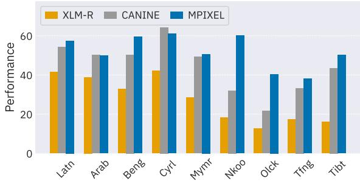  
Figure 2: Performance of models on typologically distant low-resource languages in the SIB-200 benchmark.

MPIXEL outperforms the character-level CANINE-S on all tasks except XNLI. On UDP, MPIXEL achieves an overall better score than XLM-R on unseen scripts (Table 14). However, this is largely driven by Coptic, which uses a writing system not included during XLM-R pretraining.

Low-resource cross-lingual transfer. For a controlled evaluation of low-resource cross-lingual transfer, we compare performance on languages unseen by all models. Within our evaluation set, we use the DistaLs toolkit (Goot et al., 2025) to determine which languages are typologically distant from every model's pretraining data. Figure 2 shows the SIB-200 results on these languages. MPIXEL outperforms XLM-R on all writing systems. MPIXEL also outperforms CANINE-S on Latin and Bengali. The vocabulary bottleneck explains this gap at two levels. On seen scripts, the XLM-R subwords are well-trained for its pretraining languages, so they segment and represent distant languages poorly. On the four scripts unseen by all models (N'ko, Ol Chiki, Tifinagh, Tibetan), the characters fall outside the vocabulary and are largely mapped to unknown tokens. XLM-R performs close to random on these scripts, whereas CANINE-S and MPIXEL demonstrate their strengths.

Figure 3 provides an overview of how downstream performance changes across the language and capacity scaling settings considered in our research questions (RQ1–RQ3).

RQ1: Expanding language and script coverage mainly benefits the languages and scripts it adds. We compare MPIXEL8L and MPIXEL8S against MPIXEL4s, where the former adds four Latin-script languages, and the latter four languages in previously unseen scripts. Figure 3 shows clear improvements when pretraining on four additional languages, albeit with smaller improvements on the seen-script group for SIB-200 and UDP, and overall mixed benefits for unseen scripts. For both of the 8- language variants, gains concentrate on the added languages and on other languages sharing their scripts: Latin for MPIXEL8L and the newly covered scripts for MPIXEL8s (e.g., the Arabic script; Tables 10, 11, and 14) NER and XNLI cover too few seen-script languages for a reliable comparison. On unseen scripts, the changes are small and mixed for both variants: neither addition therefore yields a consistent advantage on unseen scripts.

In order to isolate the effect of multilinguality from training volume and other pretraining confounds, we train our own monolingual PIXEL† with the same patch budget as MPIXEL4s. In this matched setup, MPIXEL4S outperforms PIXEL† on unseen scripts in SIB-200 (see Table 10 in the Appendix). The gains also extend to scripts visually unrelated to Devanagari, such as N'ko and Ethiopic, so script similarity alone cannot explain transfer.

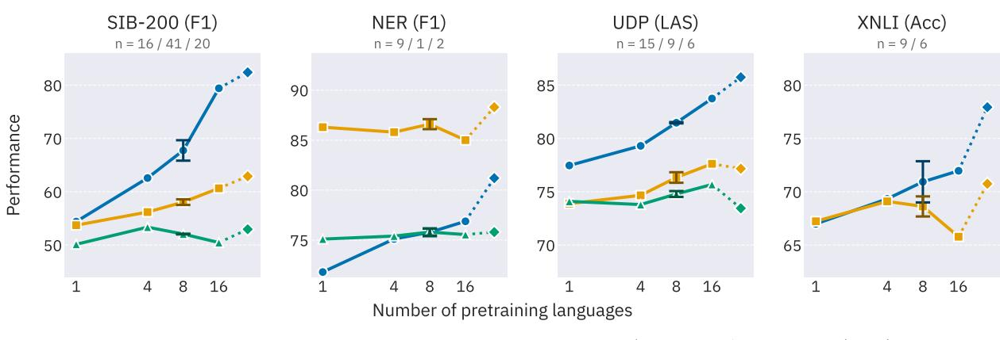  
--Seen languages--Seen scripts Unseen scripts $\mathsf { M P I X E L } _ { 8 \mathsf { L } } / \mathsf { M P I X E L } _ { 8 \mathsf { S } }$ MPIXELLARGE(307M)  
Figure 3: Downstream performance vs. number of pretraining languages (86M models; x=1 is English-only). Lines are evaluation tiers fixed w.r.t. MPIXEL's languages and scripts; each point is a mean over that tier's items (n per panel, in legend order). At x=8 the point is the mean of $\mathrm { M P I X E L } _ { 8 \mathrm { I } }$ and $\mathrm { M P I X E L } _ { 8 \mathrm { s } }$ and the bar spans them.

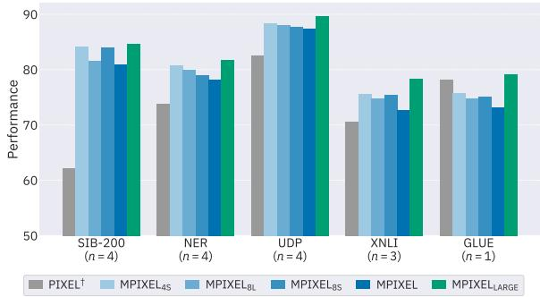  
Figure 4: Performances of the MPIXEL variants on the downstream benchmarks considering only four pretraining languages shared across models.

RQ2: Scaling further along the language and script axes brings further improvements for seen languages and their scripts. If we compare the 16-language MPIXEL against MPIXEL8L and MPIXEL8s, the overall averages improve on SIB-200, NER and UDP, as shown in Figure 3 (see Tables 10, 11, and 14 for detailed per-language breakdown).

The improvements concentrate on seen languages, where the added languages improve their own performance. They partly extend to seen scripts, which improve on SIB-200 and UDP but decrease on NER and XNLI (Figure 3); nevertheless, NER and XNLI cover only a few seen-script languages. On unseen scripts, the effect depends on the task. On SIB-200 (Table 10), MPIXEL obtains the lowest score among the multilingual variants; on NER (Table 11), all MPIXEL variants stay within one point. On UDP (Table 14), unseen scripts instead improve with each extension, and MPIXEL outperforms all other models, including XLM-R.

RQ3: Increased capacity only improves performance on seen languages and scripts. We compare $\mathrm { M P I X E L } _ { \mathrm { L A R G E } }$ (307M) against MPIXEL (86M) pretrained on the same data. As shown in Figure 3, seen languages improve on every task, with the largest gains on NER and XNLI. Seen scripts improve on SIB-200, NER, and XNLI, and decrease slightly on UDP. On unseen scripts, the changes are mixed: SIB-200 improves, NER stays roughly equal, and UDP decreases. With this decrease, $\mathrm { M P I X E L } _ { \mathrm { L A R G E } }$ loses the UDP advantage on unseen scripts, falling below all smaller multilingual variants. Even where unseen scripts improve, $\mathrm { M P I X E L } _ { \mathrm { L A R G E } }$ does not exceed $\mathrm { M P I X E L } _ { 4 \mathrm { S } }$ on SIB-200. Increased capacity therefore improves performance within the pretraining scripts, while its effect on unseen scripts is inconsistent across tasks.

RQ4: Pixel models exhibit the curse of multilinguality, but increased capacity mitigates it To measure the curse of multilinguality in pixel models, we evaluate all variants on the four shared pretraining languages (Figure 4). Across the multilingual variants, per-language pretraining data and compute are fixed, so performance differences cannot be explained by reduced exposure to these languages. From MPIXEL4s to MPIXEL, performance declines on all five benchmarks. On GLUE, English performance drops from the monolingual PIXEL† to MPIXEL. Comparing the two directions, MPIXEL8L and MPIXEL8s hurt the initial languages to a similar extent: these two variants perform on par on four of the five benchmarks. Adding languages in a shared script therefore does not cost less than adding new scripts. MPIXELLARGE not only recovers these losses but achieves the best result on every benchmark, surpassing MPIXEL4s and PIXEL† on all five benchmarks. Increased capacity therefore mitigates the curse in pixel models, similar to subword tokenizer-based models.

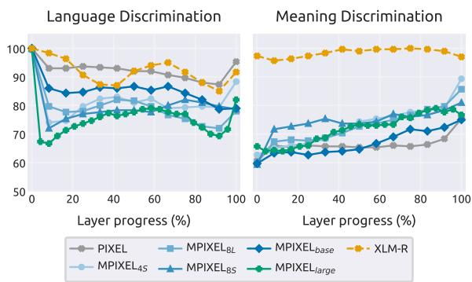  
Figure 5: ABX probing performances of MPIXEL variants on the four shared pretraining languages.

## 5 Further Analysis

The experimental results show that improvements are concentrated on the newly added languages and scripts (RQ1–RQ2), and that adding more languages reduces performance on the four languages shared by every model variant (RQ4). However, the results do not explain where these effects arise in the model. In this section, we report the results of probing the hidden representations for their cross-lingual alignment and linguistic information.

## 5.1 ABX-style Discrimination

We use the ABX discrimination tasks proposed by de Seyssel et al. (2025) to measure the language and meaning representations of the models. Given a triplet of representations (A, B, X), we measure whether X is closer to A or B according to their cosine similarity.6 In the Meaning Discrimination (MD) task, we measure semantic similarity across languages while controlling for language identity, making it a proxy for cross-lingual semantic alignment. In the Language Discrimination (LD) task, we measure alignment between languages while controlling for meaning, measuring whether language-specific information is encoded in the representations. To cover all languages supported by our models, we use the multi-way parallel BOUQuET dataset (Andrews et al., 2025). Figure 5 presents the results for ABX probes on the four shared languages in each MPIXEL model.

Semantic alignment emerges with depth. Across all base models, MD increases with depth and peaks in the final layer (Figure 5, right): representations become more semantically aligned across languages in higher layers, suggesting that the models gradually abstract away from visual, surface-level features toward more languageindependent semantic representations. LD shows the complementary trend (Figure 5, left): all models start near-perfect in the embedding layer, which is expected given the different scripts and the resulting strong visual cues, but then drop sharply as the models move away from script-level features, before partially recovering in the middle layers.

Adding languages and scripts weakens alignment. Final-layer MD is ordered by the number of languages and scripts, $\mathrm { M P I X E L _ { 4 S } > M P I X E L _ { 8 L } > M P I X E L _ { 8 S } > M P I X E L }$ Adding more languages and scripts therefore weakens cross-lingual semantic alignment, mirroring in the representations the curse of multilinguality we observe downstream (Conneau et al., 2020).

Effect of model capacity. Comparing MPIXEL and $\mathrm { M P I X E L } _ { \mathrm { L A R G E } }$ (Figure 5), the larger model's MD scores are higher in the intermediate layers, showing that increased capacity improves crosslingual alignment there. Over the final layers, however, its MD declines, so that MPIXEL matches and even overtakes it in the last layer. This decline is driven specifically by same-script language pairs: their MD in MPIXELLARGE behaves nonmonotonically, rather than climbing steadily as it does in the smaller models. This pattern resembles what has been reported for subword models such as XLM-R (see de Seyssel et al. (2025) and the XLM-R result in Figure 5)7, suggesting that the non-monotonicity stems from model capacity rather than from the pixel-based input.

Surface similarity drives generalization. Crosslingual alignment also extends to languages held out of pretraining. Evaluating MPIXEL and $\mathrm { M P I X E L } _ { \mathrm { L A R G E } }$ on four unseen languages, each sharing its script (and usually its family) with a seen language, the related seen-unseen pairs show the highest MD and the lowest LD at every depth, indicating that the model represents an unseen language similarly to its seen, same-script relative, indicating that alignment is a result of surface similarity rather than exposure (see Appendix A.6 for details)8.

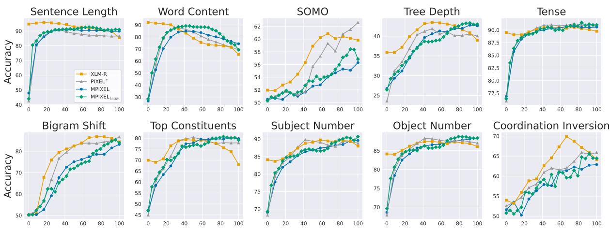  
Layer Proportional (%)  
Figure 6: Layer-wise probing accuracy on sentence-level linguistic tasks. The accuracy is plotted against the proportional encoder layer depth for both base and large model variants.

## 5.2 Sentence-level Probing

Tatariya et al. (2024) established that pixel-based models perform visual processing in early layers before linguistic features emerge. We ask whether scaling model capacity alters this transition. Figure 6 shows the layer-wise accuracy of a trained mean-pooled probe for our MPIXEL on the SentEval probing tasks (Conneau et al., 2018a; Conneau and Kiela, 2018).

More layers are used for visual processing. We find that both the 12 and 24-layer models dedicate a proportionately similar number of layers to visual abstractions. On the surface tasks (SentLen and WC), 12-layer models plateau between layers 3 and 4, at 25% of the network depth, whereas $\mathrm { M P I X E L } _ { \mathrm { L A R G E } }$ continues to improve until layer 9.

Syntax and surface semantics improve. This extended visual processing phase improves representations across several tasks. In the deeper layers of Tree Depth, $\mathbf { M P I X E L } _ { \mathrm { L A R G E } }$ outperforms both base models and narrows the gap with XLM-R. Furthermore, $\mathrm { M P I X E L } _ { \mathrm { L A R G E } }$ achieves the highest peak accuracy on all surface semantic tasks. However, on complex semantics (SOMO), both MPIXEL models fall behind the monolingual PIXEL†, as SentEval is English-only. Thus, scaling depth improves syntactic and surface semantic representations, but closing the semantic gap remains an open challenge.

## 5.3 Word-level Probing

We probe the hidden representations of the models with LINSPECTOR, a multilingual word-level probing benchmark (Şahin et al., 2020). We train a linear classifier on the mean-pooled representations of each encoder layer and report accuracy on the test set. We use two tasks: Person requires predicting grammatical person, and TagCount requires predicting the number of morphological tags associated with a word. TagCount is more difficult, as it requires capturing the amount of morphological information encoded in a word. We evaluate on Arabic, Greek, Turkish, and Spanish, which are pretraining languages of MPIXEL, and on Russian, which is typologically related to Ukrainian.

The pixel models start low and improve with depth, while XLM-R reaches high accuracy already in the early layers (Figure 7). This matches our ABX results and the findings of previous work (Tatariya et al., 2024; Kesen et al., 2025): early pixel layers perform visual processing, and linguistic information emerges in deeper layers. The difference with XLM-R varies by language: the MPIXEL variants perform similar to XLM-R on

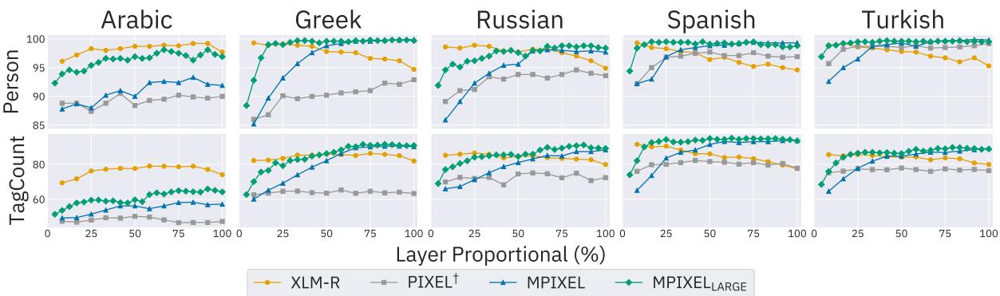  
Figure 7: Layer-wise probing accuracy on LINSPECTOR word-level tasks. Rows show tasks, columns show languages; each subplot plots accuracy against encoder layer

Spanish and Turkish in deeper layers, but perform worse on Arabic on both tasks. This may be due to the word-level rendering of Arabic, which we do not test. MPIXELLARGE closes the gap with XLM-R in the deeper layers, consistent with the extended visual phase seen in the sentence-level probes.

## 6 Related Work

Visually rendered text processing was first applied to machine translation (Salesky et al., 2021, 2023) replacing sub-word tokenization with images of the source language text. Rust et al. (2023) introduced PIXEL, a language model built upon masked autoencoder architecture (ViT-MAE) and pretrained on visually rendered English text, which outperformed its tokenizer-based equivalent BERT (Devlin et al. 2019) on languages with novel writing systems, together with increased robustness against orthographic perturbations. Lotz et al. (2023) demonstrated that structured rendering reduces patch input diversity, allowing a 25M parameter model to perform on par with the initial 86M parameter model; this approach was later applied to scanned historical documents (Borenstein et al., 2023). Finally, there are hybrid approaches that combine subword tokens and visually rendered text (Chai et al., 2024; Gao et al., 2024; Lotz et al., 2025), which finally enable language generation.

Kesen et al. (2025) and Hu et al. (2026) are most relevant to our work on the multilingual scaling of pixel language models. Kesen et al. (2025) introduced PIXEL-M4 pretrained on four languages where each uses a distinct writing system, which demonstrated strong cross-lingual transfer learning performance to unseen scripts. Subsequently, Hu et al. (2026) extended patch-level autoregressive visual text generation model PIXAR (Tai et al., 2024)

to eight languages. In contrast to these works, we perform a controlled study of scaling pixel language models across languages, scripts, and model size under matched per-language compute.

Besides pixel language models, character- and byte-level models also offer vocabulary-free processing (Clark et al., 2022; Pagnoni et al., 2025). Nonetheless, they have no access to the visual form of text, so orthographic similarities between characters and scripts remain unavailable to them.

## 7 Conclusion

We presented MPIXEL, a family of pixel language models pretrained on up to sixteen languages and 307M parameters, scaled along three axes under fixed per-language compute: more languages in a seen script, more scripts, and more capacity. We found that scaling acts locally: each axis mainly improves the languages and scripts it adds, while transfer to unseen scripts is established by the first multilingual step and does not improve with further scaling. Pixel models exhibit the curse of multilinguality, and increased capacity mitigates it. On low-resource languages typologically distant from the pretraining languages of all baselines, MPIXEL outperforms subword and character-level baselines on many writing systems. Our analyses showed that larger models reserve more layers for visual processing, and that cross-lingual alignment weakens with more languages but generalizes through shared scripts. Future work will investigate explicit control over the capacity spent on visual processing, alternative rendering strategies for right-to-left scripts, and broader coverage of low-resource languages as scaling acts locally.

## Limitations

Like most of the previous work, the pretrained MPIXEL models lack language generation capability as they are encoder-only models. Our scaling study covers few points per axis: four language counts (1, 4, 8, 16) and two model sizes (86M and 307M parameters), so our claims hold only within this range. Due to compute constraints, our models are pretrained on far less data than XLM-R. Moreover, each variant corresponds to a single pretraining run, so small differences between variants may fall within run-to-run pretraining variance, which we cannot quantify. Our controlled setup fixes perlanguage compute rather than total compute, so variants with more languages see more total data, and results under a fixed total-compute budget may differ. Each scaling axis is instantiated with a single set of languages, rooted in the four-language set of previous work for comparability, and our findings may be sensitive to these particular choices. In particular, the first multilingual step adds new languages and new scripts at the same time, so we cannot separate their individual effects. Finally, we design the ADAPTIVE rendering strategy based on input processing efficiency and correct visual rendering of right-to-left scripts, and we do not compare it empirically against existing rendering strategies such as BIGRAMS. Therefore, we do not know whether ADAPTIVE is the optimal rendering choice.

## Ethical Considerations

Like most pretrained language models, our models are pretrained on web-crawled corpora, which are already filtered and partly anonymized. Nonetheless, these datasets might still contain some social biases, offensive content, and personal information, which our models may inherit as we do not apply any further filtering. Our pretrained models lack generation capabilities, which limits their harmful use cases. Finally, our models perform best on downstream tasks in their pretraining languages. For other languages, we therefore recommend a careful evaluation before use.

## Acknowledgements

Ilker Kesen and Jenny Kunz were supported by the European Union's Horizon 2020 research and innovation program under grant agreement No. 101135671 (TrustLLM). Desmond Elliott was supported by research grant (VIL53122) from VIL-

LUM FONDEN and by the Carlsberg Foundation, grant CF25-1494. The authors acknowledge the EuroHPC Joint Undertaking for awarding access to MareNostrum5, hosted at Barcelona Supercomputing Center (BSC), Spain, under proposals No. EHPC-DEV-2025D11-163 and EHPC-DEV-2025D11-030.

## References

David Ifeoluwa Adelani, Hannah Liu, Xiaoyu Shen, Nikita Vassilyev, Jesujoba O. Alabi, Yanke Mao, Haonan Gao, and En-Shiun Annie Lee. 2024. SIB-200: A simple, inclusive, and big evaluation dataset for topic classification in 200+ languages and dialects. In Proceedings of the 18th Conference of the European Chapter of the Association for Computational Linguistics (Volume 1: Long Papers), pages 226–245, St. Julian's, Malta. Association for Computational Linguistics.

Pierre Andrews, Mikel Artetxe, Mariano Coria Meglioli, Marta R. Costa-jussà, Joe Chuang, David Dale, Mark Duppenthaler, Nathanial Paul Ekberg, Cynthia Gao, Daniel Edward Licht, Jean Maillard, Alexandre Mourachko, Christophe Ropers, Safiyyah Saleem, Eduardo Sánchez, Ioannis Tsiamas, Arina Turkatenko, Albert Ventayol-Boada, and Shireen Yates. 2025. BOUQuET : dataset, benchmark and open initiative for universal quality evaluation in translation. In Proceedings of the 2025 Conference on Empirical Methods in Natural Language Processing, pages 27515–27535, Suzhou, China. Association for Computational Linguistics.

Jimmy Lei Ba, Jamie Ryan Kiros, and Geoffrey E. Hinton. 2016. Layer normalization. Preprint, arXiv:1607.06450.

Terra Blevins, Stephen Mayhew, Marek Suppa, Hila Gonen, Shachar Mirkin, Vasile Pais, Kaja Dobrovoljc Zor, Voula Giouli, Jun Kevin, Eugene Jang, Eungseo Kim, Jeongyeon Seo, Xenophon Gialis, and Yuval Pinter. 2026. Universal NER v2: Towards a massively multilingual named entity recognition benchmark. In Proceedings of the Fifteenth Language Resources and Evaluation Conference, pages 6609–6618, Palma de Mallorca, Spain. ELRA Language Resource Association.

Nadav Borenstein, Phillip Rust, Desmond Elliott, and Isabelle Augenstein. 2023. PHD: Pixel-based language modeling of historical documents. In Proceedings of the 2023 Conference on Empirical Methods in Natural Language Processing, pages 87–107, Singapore. Association for Computational Linguistics.

Daniel Cer, Mona Diab, Eneko Agirre, Iñigo Lopez-Gazpio, and Lucia Specia. 2017. SemEval-2017 task 1: Semantic textual similarity multilingual and crosslingual focused evaluation. In Proceedings of the 11th International Workshop on Semantic

Evaluation (SemEval-2017), pages 1–14, Vancouver, Canada. Association for Computational Linguistics

Yekun Chai, Qingyi Liu, Jingwu Xiao, Shuohuan Wang, Yu Sun, and Hua Wu. 2024. Autoregressive pretraining on pixels and texts. In Proceedings of the 2024 Conference on Empirical Methods in Natural Language Processing, pages 3106–3125, Miami, Florida, USA. Association for Computational Linguistics.

Dmytro Chaplynskyi and Mariana Romanyshyn. 2024. Introducing NER-UK 2.0: A rich corpus of named entities for Ukrainian. In Proceedings of the Third Ukrainian Natural Language Processing Workshop (UNLP) @ LREC-COLING 2024, pages 23–29, Torino, Italia. ELRA and ICCL.

Jonathan H. Clark, Dan Garrette, Iulia Turc, and John Wieting. 2022. Canine: Pre-training an efficient tokenization-free encoder for language representation. Transactions of the Association for Computational Linguistics, 10:73–91.

Alexis Conneau, Kartikay Khandelwal, Naman Goyal, Vishrav Chaudhary, Guillaume Wenzek, Francisco Guzmán, Edouard Grave, Myle Ott, Luke Zettlemoyer, and Veselin Stoyanov. 2020. Unsupervised cross-lingual representation learning at scale. In Proceedings of the 58th Annual Meeting of the Association for Computational Linguistics, pages 8440— 8451, Online. Association for Computational Linguistics.

Alexis Conneau and Douwe Kiela. 2018. SentEval: An evaluation toolkit for universal sentence representations. In Proceedings of the Eleventh International Conference on Language Resources and Evaluation (LREC 2018), Miyazaki, Japan. European Language Resources Association (ELRA).

Alexis Conneau, German Kruszewski, Guillaume Lample, Loïc Barrault, and Marco Baroni. 2018a. What you can cram into a single \$&!#\* vector: Probing sentence embeddings for linguistic properties. In Proceedings of the 56th Annual Meeting of the Association for Computational Linguistics (Volume 1: Long Papers), pages 2126–2136, Melbourne, Australia. Association for Computational Linguistics.

Alexis Conneau, Ruty Rinott, Guillaume Lample, Adina Williams, Samuel Bowman, Holger Schwenk, and Veselin Stoyanov. 2018b. XNLI: Evaluating cross-lingual sentence representations. In Proceedings of the 2018 Conference on Empirical Methods in Natural Language Processing, pages 2475–2485, Brussels, Belgium. Association for Computational Linguistics.

Tri Dao. 2024. Flashattention-2: Faster attention with better parallelism and work partitioning. In The Twelfth International Conference on Learning Representations.

Maureen de Seyssel, Jie Chi, Skyler Seto, Maartje Ter Hoeve, Masha Fedzechkina, and Natalie Schluter

2025. Discriminating form and meaning in multilingual models with minimal-pair ABX tasks. In Proceedings of the 2025 Conference on Empirical Methods in Natural Language Processing, pages 23704–23725, Suzhou, China. Association for Computational Linguistics.

Jacob Devlin, Ming-Wei Chang, Kenton Lee, and Kristina Toutanova. 2019. BERT: Pre-training of deep bidirectional transformers for language understanding. In Proceedings of the 2019 Conference of the North American Chapter of the Association for Computational Linguistics: Human Language Technologies, Volume 1 (Long and Short Papers), pages 4171–4186, Minneapolis, Minnesota. Association for Computational Linguistics.

William B. Dolan and Chris Brockett. 2005. Automatically constructing a corpus of sentential paraphrases. In Proceedings of the Third International Workshop on Paraphrasing (IWP2005).

Tianyu Gao, Zirui Wang, Adithya Bhaskar, and Danqi Chen. 2024. Improving language understanding from screenshots. Preprint, arXiv:2402.14073.

Rob Van Der Goot, Esther Ploeger, Verena Blaschke, and Tanja Samardzic. 2025. DistaLs: a comprehensive collection of language distance measures. In Proceedings of the 2025 Conference on Empirical Methods in Natural Language Processing: System Demonstrations, pages 307–318, Suzhou, China. Association for Computational Linguistics.

Kaiming He, Xinlei Chen, Saining Xie, Yanghao Li, Piotr Dollár, and Ross Girshick. 2022. Masked autoencoders are scalable vision learners. In Proceedings of the IEEE/CVF Conference on Computer Vision and Pattern Recognition (CVPR), pages 16000–16009.

Dan Hendrycks and Kevin Gimpel. 2016. Bridging nonlinearities and stochastic regularizers with gaussian error linear units. CoRR, abs/1606.08415.

Chen Hu, Yintao Tai, Antonio Vergari, Frank Keller, and Alessandro Suglia. 2026. Mixar: Scaling autoregressive pixel-based language models to multiple languages and scripts. Preprint, arXiv:2604.11575.

Pratik Joshi, Sebastin Santy, Amar Budhiraja, Kalika Bali, and Monojit Choudhury. 2020. The state and fate of linguistic diversity and inclusion in the NLP world. In Proceedings of the 58th Annual Meeting of the Association for Computational Linguistics, pages 6282–6293, Online. Association for Computational Linguistics.

Ilker Kesen, Jonas F. Lotz, Ingo Ziegler, Phillip Rust, and Desmond Elliott. 2025. Multilingual pretraining for pixel language models. In Proceedings of the 2025 Conference on Empirical Methods in Natural Language Processing, pages 29594–29611, Suzhou, China. Association for Computational Linguistics.

Diederik P. Kingma and Jimmy Ba. 2017. Adam: A method for stochastic optimization. Preprint, arXiv:1412.6980.

Alex Krizhevsky. 2014. One weird trick for parallelizing convolutional neural networks. Preprint, arXiv:1404.5997.

Hector J. Levesque, Ernest Davis, and Leora Morgenstern. 2012. The winograd schema challenge. In Proceedings of the Thirteenth International Conference on Principles of Knowledge Representation and Reasoning, KR'12, page 552–561. AAAI Press.

Shuaipeng Li, Penghao Zhao, Hailin Zhang, Samm Sun, Hao Wu, Dian Jiao, Weiyan Wang, Chengjun Liu, Zheng Fang, Jinbao Xue, Yangyu Tao, Bin CUI, and Di Wang. 2024. Surge phenomenon in optimal learning rate and batch size scaling. In The Thirty-eighth Annual Conference on Neural Information Processing Systems.

Jindřich Libovický, Rudolf Rosa, and Alexander Fraser. 2020. On the language neutrality of pre-trained multilingual representations. In Findings of the Association for Computational Linguistics: EMNLP 2020, pages 1663–1674, Online. Association for Computational Linguistics.

Ilya Loshchilov and Frank Hutter. 2017. SGDR: stochastic gradient descent with warm restarts. In 5th International Conference on Learning Representations, ICLR 2017, Toulon, France, April 24-26, 2017, Conference Track Proceedings. OpenReview.net.

Ilya Loshchilov and Frank Hutter. 2019. Decoupled weight decay regularization. In International Conference on Learning Representations.

Jonas Lotz, Elizabeth Salesky, Phillip Rust, and Desmond Elliott. 2023. Text rendering strategies for pixel language models. In Proceedings of the 2023 Conference on Empirical Methods in Natural Language Processing, pages 10155–10172, Singapore. Association for Computational Linguistics.

Jonas F. Lotz, Hendra Setiawan, Stephan Peitz, and Yova Kementchedjhieva. 2025. Overcoming vocabulary constraints with pixel-level fallback. In Second Conference on Language Modeling.

Stephen Mayhew, Terra Blevins, Shuheng Liu, Marek Šuppa, Hila Gonen, Joseph Marvin Imperial, Börje F. Karlsson, Peiqin Lin, Nikola Ljubešić, LJ Miranda, Barbara Plank, Arij Riabi, and Yuval Pinter. 2024. Universal NER: A gold-standard multilingual named entity recognition benchmark. In Proceedings of the 2024 Conference of the North American Chapter of the Association for Computational Linguistics: Human Language Technologies (Volume 1: Long Papers), pages 4322–4337, Mexico City, Mexico. Association for Computational Linguistics.

Arnav Mhaske, Harshit Kedia, Sumanth Doddapaneni, Mitesh M. Khapra, Pratyush Kumar, Rudra Murthy, and Anoop Kunchukuttan. 2023. Naamapadam: A large-scale named entity annotated data for Indic languages. In Proceedings of the 61st Annual Meeting

of the Association for Computational Linguistics (Volume 1: Long Papers), pages 10441–10456, Toronto, Canada. Association for Computational Linguistics.

Joakim Nivre, Marie-Catherine de Marneffe, Filip Ginter, Jan Hajič, Christopher D. Manning, Sampo Pyysalo, Sebastian Schuster, Francis Tyers, and Daniel Zeman. 2020. Universal Dependencies v2: An evergrowing multilingual treebank collection. In Proceedings of the Twelfth Language Resources and Evaluation Conference, pages 4034–4043, Marseille, France. European Language Resources Association.

Artidoro Pagnoni, Ramakanth Pasunuru, Pedro Rodriguez, John Nguyen, Benjamin Muller, Margaret Li, Chunting Zhou, Lili Yu, Jason E Weston, Luke Zettlemoyer, Gargi Ghosh, Mike Lewis, Ari Holtzman, and Srini Iyer. 2025. Byte latent transformer: Patches scale better than tokens. In Proceedings of the 63rd Annual Meeting of the Association for Computational Linguistics (Volume 1: Long Papers), pages 9238–9258, Vienna, Austria. Association for Computational Linguistics.

Sungjoon Park, Jihyung Moon, Sungdong Kim, Won Ik Cho, Ji Yoon Han, Jangwon Park, Chisung Song, Junseong Kim, Youngsook Song, Taehwan Oh, Joohong Lee, Juhyun Oh, Sungwon Lyu, Younghoon Jeong, Inkwon Lee, Sangwoo Seo, Dongjun Lee, Hyunwoo Kim, Myeonghwa Lee, and 12 others. 2021. KLUE: Korean language understanding evaluation. In Thirtyfifth Conference on Neural Information Processing Systems Datasets and Benchmarks Track (Round 2).

Guilherme Penedo, Hynek Kydlíček, Loubna Ben allal, Anton Lozhkov, Margaret Mitchell, Colin Raffel, Leandro Von Werra, and Thomas Wolf. 2024. The fineweb datasets: Decanting the web for the finest text data at scale. In The Thirty-eight Conference on Neural Information Processing Systems Datasets and Benchmarks Track.

Guilherme Penedo, Hynek Kydlíček, Vinko Sabolčec, Bettina Messmer, Negar Foroutan, Amir Hossein Kargaran, Colin Raffel, Martin Jaggi, Leandro Von Werra, and Thomas Wolf. 2025. Fineweb2: One pipeline to scale them all — adapting pre-training data processing to every language. In Second Conference on Language Modeling.

Phillip Rust, Jonas F. Lotz, Emanuele Bugliarello, Elizabeth Salesky, Miryam de Lhoneux, and Desmond Elliott. 2023. Language modelling with pixels. In The Eleventh International Conference on Learning Representations.

Gözde Gül Şahin, Clara Vania, Ilia Kuznetsov, and Iryna Gurevych. 2020. LINSPECTOR: Multilingual probing tasks for word representations. Computational Linguistics, 46(2):335–385.

Elizabeth Salesky, David Etter, and Matt Post. 2021. Robust open-vocabulary translation from visual text representations. In Proceedings of the 2021 Conference on Empirical Methods in Natural Language Processing, pages 7235–7252, Online and Punta Cana,

Dominican Republic. Association for Computational Linguistics.

Elizabeth Salesky, Neha Verma, Philipp Koehn, and Matt Post. 2023. Multilingual pixel representations for translation and effective cross-lingual transfer. In Proceedings of the 2023 Conference on Empirical Methods in Natural Language Processing, pages 13845–13861, Singapore. Association for Computational Linguistics.

Richard Socher, Alex Perelygin, Jean Wu, Jason Chuang, Christopher D. Manning, Andrew Ng, and Christopher Potts. 2013. Recursive deep models for semantic compositionality over a sentiment treebank In Proceedings of the 2013 Conference on Empirical Methods in Natural Language Processing, pages 1631–1642, Seattle, Washington, USA. Association for Computational Linguistics.

Jimin Sun, Patrick Fernandes, Xinyi Wang, and Graham Neubig. 2023. A multi-dimensional evaluation of tokenizer-free multilingual pretrained models. In Findings of the Association for Computational Linguistics: EACL 2023, pages 1725–1735, Dubrovnik, Croatia. Association for Computational Linguistics.

Yintao Tai, Xiyang Liao, Alessandro Suglia, and Antonio Vergari. 2024. PIXAR: Auto-regressive language modeling in pixel space. In Findings of the Association for Computational Linguistics: ACL 2024, pages 14673–14695, Bangkok, Thailand. Association for Computational Linguistics.

Kushal Tatariya, Vladimir Araujo, Thomas Bauwens, and Miryam de Lhoneux. 2024. Pixology: Probing the linguistic and visual capabilities of pixel-based 1anguage models. In Proceedings of the 2024 Conference on Empirical Methods in Natural Language Processing, pages 3307–3320, Miami, Florida, USA. Association for Computational Linguistics.

NLLB Team, Marta R. Costa-jussà, James Cross, Onur Çelebi, Maha Elbayad, Kenneth Heafield, Kevin Heffernan, Elahe Kalbassi, Janice Lam, Daniel Licht, Jean Maillard, Anna Sun, Skyler Wang, Guillaume Wenzek, Al Youngblood, Bapi Akula, Loic Barrault, Gabriel Mejia Gonzalez, Prangthip Hansanti, and 20 others. 2022. No language left behind: Scaling human-centered machine translation. Preprint, arXiv:2207.04672.

Alex Wang, Amanpreet Singh, Julian Michael, Felix Hill, Omer Levy, and Samuel Bowman. 2018. GLUE: A multi-task benchmark and analysis platform for natural language understanding. In Proceedings of the 2018 EMNLP Workshop BlackboxNLP: Analyzing and Interpreting Neural Networks for NLP, pages 353–355, Brussels, Belgium. Association for Computational Linguistics.

Alex Warstadt, Amanpreet Singh, and Samuel R. Bowman. 2019. Neural network acceptability judgments. Transactions of the Association for Computational Linguistics, 7:625–641.

Chris Wendler, Veniamin Veselovsky, Giovanni Monea, and Robert West. 2024. Do llamas work in English? on the latent language of multilingual transformers. In Proceedings of the 62nd Annual Meeting of the Association for Computational Linguistics (Volume 1: Long Papers), pages 15366–15394, Bangkok, Thailand. Association for Computational Linguistics.

Adina Williams, Nikita Nangia, and Samuel Bowman. 2018. A broad-coverage challenge corpus for sentence understanding through inference. In Proceedings of the 2018 Conference of the North American Chapter of the Association for Computational Linguistics: Human Language Technologies, Volume 1 (Long Papers), pages 1112–1122, New Orleans, Louisiana. Association for Computational Linguistics.

Zhaofeng Wu, Xinyan Velocity Yu, Dani Yogatama, Jiasen Lu, and Yoon Kim. 2025. The semantic hub hypothesis: Language models share semantic representations across languages and modalities. In The Thirteenth International Conference on Learning Representations.

Daniel Zeman, Joakim Nivre, Rimsha Abid, Mitchell Abrams, Elia Ackermann, Jephtey Adolphe, Noëmi Aepli, Muhammad Afzal, Željko Agić, Lars Ahrenberg, Chika Kennedy Ajede, Arofat Akhundjanova, Furkan Akkurt, Orly Albek, Gabrielė Aleksandravičiūtė, Dominick Maia Alexandre, Ika Alfina, Avner Algom, Khalid Alnajjar, and 771 others. 2026. Universal dependencies 2.18. LINDAT/CLARIAH-CZ digital library at the Institute of Formal and Applied Linguistics (ÚFAL).

## A Appendix

## A.1 Use of Frontier LLMs

Large Language Models (LLMs) were used in the preparation of this work. They were used to write and debug parts of the code, to produce the tables of experimental results and the plots, and to revise the text. The code was reviewed and tested by the authors. All written material was read and checked by all authors, who take full responsibility for the content of the work.

## A.2 Data Statistics

Pretraining Data. Table 4 reports the number of documents, words, and characters in the pretraining data sampled from FineWeb (Penedo et al., 2024) and FineWeb2 (Penedo et al., 2025) for each language. The table also lists each language's script, family, and branch. Word counts are based on whitespace and are therefore omitted for Chinese and Thai. Both FineWeb and FineWeb2 datasets are released under Open Data Commons Attribution License (ODC-By) v1.0.

Evaluation Benchmarks. SIB-200 (Adelani et al., 2024) is a parallel text classification benchmark across 200 languages, where each language split includes 701, 99 and 204 examples for training, validation, and testing purposes, respectively. SIB-200 is released under the CC BY-SA 4.0 license. Table 3 lists the languages selected as typologically distant. We used DistaLs (Goot et al., 2025) to calculate the average distance between each evaluation language and all baseline pretraining languages that use the same script. We selected languages whose available distances all exceeded $T = 0 . 5 0$ , as well as languages written in scripts unseen during baseline pretraining. Table 5 and Table 6 report the data statistics for the dependency parsing and NER tasks, respectively LINSPECTOR is licensed under Apache 2.0, and each language split contains 7000, 2000, and 1000 examples for training, validation, and testing purposes, respectively. GLUE benchmark statistics are reported in Table 13. For XNLI, we adopt the translate-train-all setting, in which the models are trained on 392,702 examples per language across all 15 languages (≈ 5.9M examples in total) and evaluated on 2,490 development and 5,010 test examples per language.

<table><tr><td>Language</td><td>Script</td><td>Pivot</td><td>Distance</td></tr><tr><td>ARB</td><td>Latin</td><td>HAU</td><td>0.714</td></tr><tr><td>AYR</td><td>Latin</td><td>SWH</td><td>0.725</td></tr><tr><td>BAM</td><td>Latin</td><td>JAV</td><td>0.609</td></tr><tr><td>CJK</td><td>Latin</td><td>SWH</td><td>0.555</td></tr><tr><td>DYU</td><td>Latin</td><td>ZSM</td><td>0.623</td></tr><tr><td>FIJ</td><td>Latin</td><td>SUN</td><td>0.603</td></tr><tr><td>IBO</td><td>Latin</td><td>SWH</td><td>0.531</td></tr><tr><td>NUS</td><td>Latin</td><td>TAM</td><td>0.732</td></tr><tr><td>QUY</td><td>Latin</td><td>SUN</td><td>0.691</td></tr><tr><td>TAQ</td><td>Latin</td><td>HAU</td><td>0.610</td></tr><tr><td>UMB</td><td>Latin</td><td>SWH</td><td>0.516</td></tr><tr><td>WOL</td><td>Latin</td><td>SWH</td><td>0.638</td></tr><tr><td>YOR</td><td>Latin</td><td>SWH</td><td>0.661</td></tr><tr><td>ACE</td><td>Arabic</td><td>PES</td><td>0.770</td></tr><tr><td>BJN</td><td>Arabic</td><td>ARB</td><td>1.000</td></tr><tr><td>CKB</td><td>Arabic</td><td>PBT</td><td>0.626</td></tr><tr><td>KAS</td><td>Arabic</td><td>URD</td><td>0.525</td></tr><tr><td>MNI</td><td>Bengali</td><td>BEN</td><td>0.759</td></tr><tr><td>TGK</td><td>Cyrllic</td><td>MKD</td><td>0.687</td></tr><tr><td>SHN</td><td>Myanmar</td><td>MYA</td><td>0.781</td></tr><tr><td>NQO</td><td>N&#x27;Ko</td><td>一</td><td>一</td></tr><tr><td>SAT</td><td>Ol Chiki</td><td>一</td><td>一</td></tr><tr><td>TAQ</td><td>Tifinagh</td><td>一</td><td>一</td></tr><tr><td>TZM</td><td>Tifinagh</td><td>一</td><td>一</td></tr><tr><td>BOD</td><td>Tibetan</td><td>一</td><td>一</td></tr><tr><td>DZO</td><td>Tibetan</td><td>一</td><td>一</td></tr></table>

## A.3 Implementation Details

Tables 7 and 8 contain the hyperparameters used to pretrain the MPIXEL models. Table 9 contains the hyperparameters used to finetune and evaluate the models on the downstream tasks. The learning rates depend on the task and the model size. For SIB-200, UDP and NER, we use {1e-5, $3 \mathrm { e } { - } 5 , 5 \mathrm { e } { - } 5 \}$ for both base and large models. For MPIXELLARGE on UDP, we also use 5e-6. For XNLI, we use $\left\{ 8 \mathrm { e } { - } 6 , 1 \mathrm { e } { - } 5 , 2 \mathrm { e } { - } 5 , 3 \mathrm { e } { - } 5 , 5 \mathrm { e } { - } 5 \right\}$ for base models, and {5e-6, 8e-6, 1e-5, 2e-5, 3e-5} for $\mathrm { M P I X E L } _ { \mathrm { L A R G E } }$ . For GLUE, we use 1e—5 for WNLI (Levesque et al., 2012), 2e—5 for STS-B (Cer et al., 2017), and 3e–5 for MRPC (Dolan and Brockett, 2005), QNLI (Wang et al., 2018), QQP, RTE and SST-2 (Socher et al., 2013). For CoLA (Warstadt et al., 2019), we use {1e-5, $2 \mathrm { e } { - } 5 \}$ , and for MNLI (Williams et al., 2018), we use $\{ 1 \mathbf { e } - 5 , 2 \mathbf { e } - 5 , 3 \mathbf { e } - 5 \}$ . For large models, we also use 5e-6 for WNLI, and 1e-5 for STS-B, MRPC, QNLI, QQP, RTE and SST-2. Following Rust et al. (2023); Kesen et al. (2025), for each learning rate, we run several experiments with different random seeds. From all these runs, we take the 3 best ones and report their average score.

Table 3: Language-script pairs selected as typologically distant (DistaLs average of typology-related distances, $T = 0 . 5 0 )$ . The nearest same-script pretraining pivot and distance are shown.

We adopt Flash Attention 2 (Dao, 2024) to reduce memory usage and accelerate attention computation, and use torch. compile to further speed up forward and backward passes. With these optimizations, pretraining takes approximately 1350 GPU hours for MPIXEL and 2500 GPU hours for $\mathrm { M P I X E L } _ { \mathrm { L A R G E } }$ on NVIDIA H100s.

## A.4 Full Results

Table 10 shows the complete per-language results of the SIB-200 experiments. Table 11 shows the complete per-language results of the NER experiments. Table 12 shows the complete per-language results of the XNLI experiments. Table 13 shows the complete results of the GLUE experiments. Table 14 shows the complete per-language results of the Universal Dependencies Parsing experiments.

<table><tr><td>ISO</td><td>Language</td><td>Script</td><td>Language Family</td><td>Branch</td><td># Docs (M)</td><td># Words (B)</td><td># Chars (B)</td></tr><tr><td>BEN</td><td>Bengali</td><td>Bengali</td><td>Indo-European</td><td>Indo-Aryan</td><td>6.9</td><td>2.5</td><td>13.9</td></tr><tr><td>DAN</td><td>Danish</td><td>Latin</td><td>Indo-European</td><td>Germanic</td><td>16.7</td><td>2.3</td><td>12.2</td></tr><tr><td>ENG</td><td>English</td><td>Latin</td><td>Indo-European</td><td>Germanic</td><td>17.0</td><td>2.5</td><td>12.2</td></tr><tr><td>FIN</td><td>Finnish</td><td>Latin</td><td>Uralic</td><td>Finnic</td><td>16.4</td><td>1.8</td><td>13.0</td></tr><tr><td>HEB</td><td>Hebrew</td><td>Hebrew</td><td>Afro-Asiatic</td><td>Semitic</td><td>17.0</td><td>2.5</td><td>11.7</td></tr><tr><td>HIN</td><td>Hindi</td><td>Devanagari</td><td>Indo-European</td><td>Indo-Aryan</td><td>18.6</td><td>3.7</td><td>15.0</td></tr><tr><td>KOR</td><td>Korean</td><td>Hangul</td><td>Koreanic</td><td></td><td>17.6</td><td>2.2</td><td>7.7</td></tr><tr><td>CMN</td><td>Mandarin Chinese</td><td>Han</td><td>Sino-Tibetan</td><td>Sinitic</td><td>17.2</td><td>一</td><td>7.5</td></tr><tr><td>ELL</td><td>Modern Greek</td><td>Greek</td><td>Indo-European</td><td>Hellenic</td><td>17.1</td><td>2.2</td><td>12.2</td></tr><tr><td>FAS</td><td>Persian</td><td>Arabic</td><td>Indo-European</td><td>Iranian</td><td>17.6</td><td>3.7</td><td>15.0</td></tr><tr><td>SPA</td><td>Spanish</td><td>Latin</td><td>Indo-European</td><td>Romance</td><td>16.9</td><td>2.5</td><td>12.5</td></tr><tr><td>ARB</td><td>Standard Arabic</td><td>Arabic</td><td>Afro-Asiatic</td><td>Semitic</td><td>17.9</td><td>3.2</td><td>15.8</td></tr><tr><td>THA</td><td>Thai</td><td>Thai</td><td>Kra-Dai</td><td>Tai</td><td>17.2</td><td>一</td><td>14.4</td></tr><tr><td>TUR</td><td>Turkish</td><td>Latin</td><td>Turkic</td><td>Oghuz</td><td>17.0</td><td>1.9</td><td>12.6</td></tr><tr><td>UKR</td><td>Ukrainian</td><td>Cyrillic</td><td>Indo-European</td><td>Slavic</td><td>16.9</td><td>1.9</td><td>11.7</td></tr><tr><td>VIE</td><td>Vietnamese</td><td>Latin</td><td>Austroasiatic</td><td>Vietic</td><td>16.2</td><td>3.1</td><td>11.1</td></tr><tr><td>Total</td><td></td><td></td><td></td><td></td><td>264M</td><td>&gt;36B</td><td>211B</td></tr></table>

Table 4: Per-language statistics of the pretraining corpus: script, language family and branch, and corpus size in documents (M, millions), whitespace-delimited words (B, billions) and characters (B). Word counts are omitted for languages without whitespace word boundaries (Chinese, Thai)

## A.5 Full LINSPECTOR Results

This appendix subsection contains the complete set of results for the word-level probing analyses on LINSPECTOR (Şahin et al., 2020). For these analyses, we use the entire set of languages and tasks included within LINSPECTOR. The LINSPECTOR includes the following languages: Arabic, Armenian, Basque, Bulgarian, Catalan, Czech, Danish, Dutch, English, Estonian, Finnish, French, German, Hungarian, Italian, Macedonian, Greek, Polish, Portuguese, Quechua, Romanian, Russian, Serbian, Serbo-Crotian, Spanish, Swedish, Turkish, Vietnamese. The LINSPEC-TOR task list consists of Case (Fig. 11), Gender (Fig. 12), Mood (Fig. 13), Number (Fig. 14), Odd-Feat (Fig. 15), POS (Fig. 16), Person (Fig. 17), Possession (Fig. 18), Pseudo (Fig. 19), SameFeat (Fig. 20), TagCount (Fig. 21), Tense (Fig. 22), Voice (Fig. 23), Comparison (Fig. 24) and Polarity (Fig. 25).

<table><tr><td>Language</td><td>Treebank</td><td>#Sentences</td><td>License</td></tr><tr><td>ENG</td><td>English-EWT</td><td>16621</td><td>CC BY-SA 4.0</td></tr><tr><td>ARA</td><td>Arabic-PADT</td><td>7664</td><td>CC BY-NC-SA 3.0</td></tr><tr><td>HYE</td><td>Armenian-BSUT</td><td>2523</td><td>CC BY-SA 4.0</td></tr><tr><td>BUL</td><td>Bulgarian-BTB</td><td>11138</td><td>CC BY-NC-SA 3.0</td></tr><tr><td>COP</td><td>Coptic-Scriptorium</td><td>2011</td><td>CC BY 4.0</td></tr><tr><td>DAN</td><td>Danish-DDT</td><td>5512</td><td>CC BY-SA 4.0</td></tr><tr><td>EST</td><td>Estonian-EWT</td><td>7190</td><td>CC BY-NC-SA 4.0</td></tr><tr><td>FAO</td><td>Faroese-FarPaHC</td><td>1621</td><td>CC BY-SA 4.0</td></tr><tr><td>FIN</td><td>Finnish-FTB</td><td>18723</td><td>CC BY 4.0</td></tr><tr><td>KAT</td><td>Georgian-GLC</td><td>3164</td><td>CC BY-SA 4.0</td></tr><tr><td>ELL</td><td>Greek-GDT</td><td>2521</td><td>CC BY-NC-SA 3.0</td></tr><tr><td>HEB</td><td>Hebrew-HTB</td><td>6143</td><td>CC BY-NC-SA 4.0</td></tr><tr><td>HIN</td><td>Hindi-HDTB</td><td>16647</td><td>CC BY-NC-SA 4.0</td></tr><tr><td>IND</td><td>Indonesian-GSD</td><td>5598</td><td>CC BY-SA 4.0</td></tr><tr><td>JPN</td><td>Japanese-GSD</td><td>8100</td><td>CC BY-SA 4.0</td></tr><tr><td>KOR</td><td>Korean-GSD</td><td>6339</td><td>CC BY-SA 4.0</td></tr><tr><td>MLT</td><td>Maltese-MUDT</td><td>2074</td><td>CC BY-SA 4.0</td></tr><tr><td>FAS</td><td>Persian-Seraji</td><td>5997</td><td>CC BY-SA 4.0</td></tr><tr><td>RUS</td><td>Russian-GSD</td><td>5030</td><td>CC BY-SA 4.0</td></tr><tr><td>SPA</td><td>Spanish-GSD</td><td>16013</td><td>CC BY-SA 4.0</td></tr><tr><td>TAM</td><td>Tamil-TTB</td><td>600</td><td>CC BY-NC-SA 3.0</td></tr><tr><td>TEL</td><td>Telugu-MTG</td><td>5130</td><td>CC BY-SA 4.0</td></tr><tr><td>THA</td><td>Thai-TUD</td><td>3627</td><td>CC BY-SA 4.0</td></tr><tr><td>TUR</td><td>Turkish-BOUN</td><td>9761</td><td>CC BY-SA 4.0</td></tr><tr><td>UKR</td><td>Ukrainian-IU</td><td>5030</td><td>CC BY-NC-SA 4.0</td></tr><tr><td>URD</td><td>Urdu-UDTB</td><td>5130</td><td>CC BY-NC-SA 4.0</td></tr><tr><td>UIG</td><td>Uyghur-UDT</td><td>3456</td><td>CC BY-SA 4.0</td></tr><tr><td>VIE</td><td>Vietnamese-VTB</td><td>3000</td><td>CC BY-SA 4.0</td></tr><tr><td>WOL</td><td>Wolof-WTB</td><td>2107</td><td>CC BY-SA 4.0</td></tr><tr><td>ZHO</td><td>Chinese-GSD</td><td>4997</td><td>CC BY-SA 4.0</td></tr></table>

Table 5: Total number of sentences of Universal Dependencies v2.18 (Zeman et al., 2026; Nivre et al., 2020) treebanks used for dependency parsing task evaluations, including dataset licenses. Adapted from Rust et al. (2023); Kesen et al. (2025).
<table><tr><td>Language</td><td>Train</td><td>Validation</td><td>Test</td><td>Source</td><td>License</td></tr><tr><td>BEN</td><td>961679</td><td>4859</td><td>607</td><td>Naamapadam</td><td>CC0 1.0</td></tr><tr><td>DAN</td><td>4383</td><td>564</td><td>565</td><td>Universal NER (UNER_Danish-DDT)</td><td>CC BY-SA 4.0</td></tr><tr><td>ELL</td><td>1662</td><td>403</td><td>456</td><td>Universal NER (UNER_Greek_GDT)</td><td>CC-BY-SA-4.0</td></tr><tr><td>ENG</td><td>12543</td><td>2001</td><td>2077</td><td>Universal NER (UNER_English-EWT)</td><td>CC BY-SA 4.0</td></tr><tr><td>HEB</td><td>5241</td><td>484</td><td>491</td><td>Universal NER (UNER_Hebrew-HTB)</td><td>CC BY-SA 4.0</td></tr><tr><td>HIN</td><td>985787</td><td>13460</td><td>867</td><td>Naamapadam</td><td>CCO 1.0</td></tr><tr><td>KOR</td><td>21008</td><td>5000</td><td>一</td><td>KLUE</td><td>CC BY-SA 4.0</td></tr><tr><td>SRP</td><td>3328</td><td>536</td><td>520</td><td>Universal NER (UNER_Serbian-SET)</td><td>CC BY-SA 4.0</td></tr><tr><td>TAM</td><td>497882</td><td>2795</td><td>758</td><td>Naamapadam</td><td>CC0 1.0</td></tr><tr><td>TEL</td><td>507741</td><td>2700</td><td>847</td><td>Naamapadam</td><td>CC0 1.0</td></tr><tr><td>UKR</td><td>10980</td><td>1206</td><td>5593</td><td>NER-UK 2.0</td><td>CC BY-NC-SA 4.0</td></tr><tr><td>ZHO</td><td>3997</td><td>500</td><td>500</td><td>Universal NER</td><td>CC BY-SA 4.0</td></tr></table>

Table 6: Data distribution and license information for the NER datasets used within this work. See Universal NER (Mayhew et al., 2024; Blevins et al., 2026), Naamapadam (Mhaske et al., 2023), NER-UK (Chaplynskyi and Romanyshyn, 2024) and KLUE (Park et al., 2021) for more detailed statistics.

<table><tr><td>Parameter</td><td>Value</td></tr><tr><td>Image size</td><td>(16, 8192, 3)</td></tr><tr><td>Patch size P</td><td>16</td></tr><tr><td>Layer norm ε (Ba et al., 2016)</td><td> $1 \times 1 0 ^ { - 1 2 }$ </td></tr><tr><td>Span masking ratio R</td><td>0.25</td></tr><tr><td>Span masking max length S</td><td>6</td></tr><tr><td>Span masking cumulative weights W</td><td>{0.2, 0.4, 0.6, 0.8, 0.9, 1}</td></tr><tr><td>Span masking spacing</td><td>Dynamic</td></tr><tr><td>Dropout probability</td><td>0.1</td></tr><tr><td>Hidden activation</td><td>GeLU (Hendrycks and Gimpel, 2016)</td></tr><tr><td>Optimizer</td><td>AdamW (Loshchilov and Hutter, 2019; Kingma and Ba, 2017)</td></tr><tr><td>Adam  $\beta _ { 1 }$ </td><td>(0.9)</td></tr><tr><td>Adam  $\beta _ { 2 }$ </td><td>{0.999, 0.95}</td></tr><tr><td>Adam ε</td><td> $\mathrm { i } \times \mathrm { 1 0 ^ { - 8 } }$ </td></tr><tr><td>Weight decay</td><td>0.05</td></tr><tr><td>Learning rate schedule</td><td>Cosine Decay (Loshchilov and Hutter, 2017)</td></tr><tr><td>Minimum learning rate</td><td> $1 \times 1 0 ^ { - 5 }$ </td></tr><tr><td>Learning rate warmup ratio</td><td>0.05</td></tr><tr><td>Training steps</td><td>1M</td></tr></table>

Table 7: Pretraining hyperparameters shared by all MPIXEL models and PIXEL†.

<table><tr><td>Parameter</td><td>Base Models</td><td> $\mathrm { M P I X E L } _ { \mathrm { L A R G E } }$ </td></tr><tr><td>Encoder hidden size  $D _ { \mathrm { e n c } }$ </td><td>768</td><td>1024</td></tr><tr><td>Encoder intermediate size</td><td>3072</td><td>4096</td></tr><tr><td>Encoder num attention heads</td><td>12</td><td>16</td></tr><tr><td>Encoder num layers  $L$ </td><td>12</td><td>24</td></tr><tr><td>Decoder hidden size  $D _ { \mathrm { d e c } }$ </td><td>512</td><td>512</td></tr><tr><td>Decoder intermediate size</td><td>2048</td><td>2048</td></tr><tr><td>Decoder num attention heads</td><td>16</td><td>16</td></tr><tr><td>Decoder num layers K</td><td>8</td><td>8</td></tr><tr><td>Learning rate</td><td>{1.5e−4, 2.12e−4, 3e−4}</td><td>3e-4</td></tr><tr><td>Batch size</td><td>{256, 512, 1024}</td><td>1024</td></tr></table>

Table 8: Pretraining hyperparameters that differ between base-scale models with 86M parameters and the large MPIXEL model with 307M parameters.

<table><tr><td>Parameter</td><td>SIB-200</td><td>UDP</td><td>NER</td><td>XNLI</td><td>GLUE</td></tr><tr><td>Classification head pooling</td><td>Mean</td><td></td><td></td><td>CLS</td><td>Mean</td></tr><tr><td>Optimizer</td><td></td><td></td><td>AdamW</td><td></td><td></td></tr><tr><td>Adam  $\beta$ </td><td></td><td></td><td>0.9, 0.999</td><td></td><td></td></tr><tr><td>Adam €</td><td></td><td></td><td>1e-8</td><td></td><td></td></tr><tr><td>Weight decay</td><td></td><td></td><td>0</td><td></td><td></td></tr><tr><td>Learning rate schedule</td><td></td><td></td><td>Linear decay</td><td></td><td></td></tr><tr><td>Warmup steps</td><td>100</td><td>100</td><td>100</td><td>1000</td><td>100</td></tr><tr><td>Max sequence length</td><td>256</td><td>256</td><td>256</td><td>256</td><td>256</td></tr><tr><td>Batch size</td><td>64</td><td>64</td><td>64</td><td>256</td><td>{64, 256}</td></tr><tr><td>Max steps</td><td>15000</td><td>15000</td><td>15000</td><td>50000</td><td>400, 15 000</td></tr><tr><td>Eval strategy</td><td>epochs</td><td>steps</td><td>steps</td><td>steps</td><td>epochs, steps</td></tr><tr><td>Eval steps</td><td></td><td>100,500</td><td>500</td><td>1000</td><td>10, 100, 250, 500</td></tr><tr><td>Early stopping</td><td></td><td></td><td>√</td><td></td><td></td></tr><tr><td>Early stopping patience</td><td>20</td><td>5,20</td><td>5</td><td>5</td><td>5,50</td></tr><tr><td>Dropout probability</td><td></td><td></td><td>0.1</td><td></td><td></td></tr></table>

Table 9: Hyperparameters used for fine-tuning and evaluating models on SIB-200, UDP, NER, XNLI and GLUE.

<table><tr><td></td><td>Language Script</td><td>CANINE-S 127M</td><td>MBERT 179M</td><td>XLM-R 270M</td><td>PIXEL† 86M</td><td>MPIXEL4s 86M</td><td>MPIXEL8L 86M</td><td>MPIXEL8s 86M</td><td>MPIXEL 86M</td><td>MPIXEL 307M</td></tr></table>

<table><tr><td colspan="11">Pretraining Languages</td></tr><tr><td>ARB</td><td>Arab</td><td>69.2±4.0</td><td>84.1±2.3</td><td>88.2±0.7</td><td>42.7±3.2</td><td>48.2±1.6</td><td>47.6±4.5</td><td>73.8±3.1</td><td>75.3±2.6</td><td>77.5±1.9</td></tr><tr><td>BEN</td><td>Beng</td><td>54.5</td><td>78.5±1.6</td><td>83.1±1.2</td><td>48.6±0.4</td><td>58.4±1.9</td><td>55.7±1.2</td><td>58.0±3.1</td><td>78.2±2.3</td><td>79.2±1.2</td></tr><tr><td>DAN</td><td>Latn</td><td>72.7±1.8</td><td>83.4±0.6</td><td>88.0±0.7</td><td>67.3±0.6</td><td>60.8±1.4</td><td>81.4±2.0</td><td>61.9±1.4</td><td>82.7±0.8</td><td>84.1±0.6</td></tr><tr><td>ELL</td><td>Grek</td><td>65.3</td><td>74.0±1.8</td><td>85.4±1.3</td><td>42.0±1.3</td><td>49.6±0.3</td><td>50.0±1.5</td><td>84.3±1.7</td><td>82.3±1.8</td><td>81.5±1.2</td></tr><tr><td>ENG</td><td>Latn</td><td>78.4</td><td>87.7±1.9</td><td>89.9±0.6</td><td>88.6±1.4</td><td>86.2±1.9</td><td>82.5±2.9</td><td>86.1±1.2</td><td>81.6±2.6</td><td>86.8±1.6</td></tr><tr><td>FIN</td><td>Latn</td><td>61.6</td><td>78.2±3.6</td><td>89.0±1.1</td><td>66.4±1.5</td><td>61.3±2.3</td><td>82.2±1.5</td><td>64.6±1.3</td><td>82.9±2.6</td><td>84.7±0.8</td></tr><tr><td>HEB</td><td>Hebr</td><td>54.4</td><td>77.8±1.4</td><td>86.2±1.4</td><td>36.5±1.6</td><td>38.7±2.3</td><td>37.9±1.8</td><td>36.3±2.0</td><td>67.1±0.3</td><td>77.1±1.9</td></tr><tr><td>HIN</td><td>Deva</td><td>53.4</td><td>73.7±1.1</td><td>83.7±1.4</td><td>50.6±1.9</td><td>84.0±0.2</td><td>79.3±1.3</td><td>80.2±1.6</td><td>79.5±0.9</td><td>83.1±2.1</td></tr><tr><td>KOR</td><td>Hang</td><td>64.5</td><td>80.8±1.0</td><td>86.3±0.7</td><td>41.8±0.8</td><td>51.7±1.2</td><td>50.8±1.0</td><td>74.1±1.5</td><td>76.7±1.6</td><td>81.3±1.4</td></tr><tr><td>PES</td><td>Arab</td><td>68.9±1.7</td><td>83.6±0.5</td><td>88.6±0.8</td><td>41.0±2.0</td><td>47.5±2.7</td><td>43.8±1.6</td><td>50.5±4.1</td><td>77.7±0.8</td><td>82.3±1.1</td></tr><tr><td>SPA</td><td>Latn</td><td>77.6±0.9</td><td>85.1±1.1</td><td>87.3±0.9</td><td>71.0±2.4</td><td>68.2±2.0</td><td>84.2±2.1</td><td>67.7±3.6</td><td>82.4±1.2</td><td>84.0±1.0</td></tr><tr><td>THA</td><td>Thai</td><td>55.8±5.1</td><td>73.0±2.6</td><td>87.5±0.8</td><td>44.1±1.6</td><td>53.6±3.1</td><td>50.2±2.1</td><td>82.2±1.4</td><td>81.9±2.2</td><td>82.5±2.7</td></tr><tr><td>TUR</td><td>Latn</td><td>68.2</td><td>81.9±1.0</td><td>87.2±0.5</td><td>61.6±0.7</td><td>64.6±0.8</td><td>80.0±0.9</td><td>64.5±2.3</td><td>79.0±1.1</td><td>83.0±0.9</td></tr><tr><td>UKR</td><td>Cyrl</td><td>74.7</td><td>84.7±1.4</td><td>89.4±0.3</td><td>41.7±2.0</td><td>83.8±0.7</td><td>81.8±1.2</td><td>84.2±2.7</td><td>80.8±1.0</td><td>86.8±1.1</td></tr><tr><td>VIE</td><td>Latn</td><td>66.7±0.9</td><td>85.2±3.0</td><td>88.3±0.9</td><td>58.7±2.7</td><td>61.8±0.1</td><td>63.1±2.0</td><td>60.9±2.9</td><td>80.8±1.8</td><td>82.6±2.8</td></tr><tr><td>ZHO</td><td>Hans</td><td>77.9</td><td>86.5±2.3</td><td>90.2±0.7</td><td>67.8±7.2</td><td>82.9±0.9</td><td>82.9±0.6</td><td>85.5±1.8</td><td>81.8±1.9</td><td>82.1±0.9</td></tr><tr><td>Avg.</td><td></td><td>66.5</td><td>81.1</td><td>87.4</td><td>54.4</td><td>62.6</td><td>65.8</td><td>69.7</td><td>79.4</td><td>82.4</td></tr></table>

<table><tr><td>ARB</td><td>Latn</td><td>51.2±3.0</td><td>56.3±2.7</td><td>30.2±5.2</td><td>54.5±1.3</td><td>49.0±0.9</td><td>53.1±1.6</td><td>42.4±1.7</td><td>51.1±1.4</td><td>52.4±2.3</td></tr><tr><td>AYR</td><td>Latn</td><td>53.7±3.2</td><td>56.9±1.6</td><td>36.8±5.1</td><td>55.3±3.1</td><td>54.6±1.3</td><td>56.5±0.3</td><td>51.8±3.7</td><td>57.2±1.3</td><td>57.9±0.8</td></tr><tr><td>AZJ</td><td>Latn</td><td>67.4±2.3</td><td>76.5±3.1</td><td>84.9±1.0</td><td>63.4±2.8</td><td>59.8±1.4</td><td>75.5±2.9</td><td>62.7±0.7</td><td>73.9±0.9</td><td>76.2±2.9</td></tr><tr><td>BAM</td><td>Latn</td><td>57.2±1.9</td><td>57.4±2.0</td><td>35.7±2.1</td><td>60.9±3.0</td><td>59.8±2.6</td><td>62.7±4.0</td><td>57.4±2.8</td><td>55.6±5.0</td><td>61.8±3.1</td></tr><tr><td>BJN</td><td>Latn</td><td>63.0±1.7</td><td>73.1±0.4</td><td>79.7±0.7</td><td>66.2±2.0</td><td>64.0±1.1</td><td>67.9±1.7</td><td>62.5±1.9</td><td>63.1±1.6</td><td>62.0±2.8</td></tr><tr><td>CJK</td><td>Latn</td><td>47.5±2.6</td><td>45.1±1.7</td><td>39.8±1.3</td><td>46.7±4.0</td><td>44.8±4.4</td><td>46.1±0.6</td><td>47.5±2.9</td><td>47.4±1.5</td><td>47.5±2.7</td></tr><tr><td>DEU</td><td>Latn</td><td>77.7</td><td>88.2±1.4</td><td>88.3±0.6</td><td>72.5±0.6</td><td>70.5±1.7</td><td>73.2±1.3</td><td>65.2±1.3</td><td>69.5±1.2</td><td>69.1±1.6</td></tr><tr><td>DYU</td><td>Latn</td><td>46.6±5.0</td><td>56.9±2.5</td><td>39.5±4.9</td><td>53.2±1.5</td><td>49.8±1.4</td><td>51.5±1.6</td><td>51.6±0.7</td><td>51.9±2.1</td><td>52.9±1.4</td></tr><tr><td>EST</td><td>Latn</td><td>67.3±1.7</td><td>77.8±2.6</td><td>84.2±0.8</td><td>59.4±1.5</td><td>57.8±1.2</td><td>69.4±4.1</td><td>58.4±4.3</td><td>68.4±2.2</td><td>70.2±1.7</td></tr><tr><td>FAO</td><td>Latn</td><td>69.2±1.9</td><td>71.9±1.9</td><td>80.3±1.2</td><td>66.9±2.8</td><td>59.1±1.3</td><td>69.7±1.4</td><td>58.2±0.9</td><td>65.0±0.7</td><td>70.4±0.9</td></tr><tr><td>FIJ</td><td>Latn</td><td>64.7±3.6</td><td>66.9±1.7</td><td>48.9±5.3</td><td>67.5±1.5</td><td>64.5±4.8</td><td>69.0±1.1</td><td>67.2±1.1</td><td>66.2±1.4</td><td>69.7±1.3</td></tr><tr><td>FRA</td><td>Latn</td><td>77.4</td><td>85.5±2.4</td><td>89.2±1.3</td><td>76.7±2.8</td><td>74.7±1.2</td><td>72.8±2.4</td><td>71.7±0.8</td><td>72.5±1.8</td><td>76.1±2.2</td></tr><tr><td>HAT</td><td>Latn</td><td>58.4±1.6</td><td>66.1±0.9</td><td>53.8±5.3</td><td>60.8±1.5</td><td>58.9±1.7</td><td>63.7±0.7</td><td>62.0±1.0</td><td>61.1±1.4</td><td>67.3±1.7</td></tr><tr><td>IBO</td><td>Latn</td><td>57.1±2.1</td><td>51.6±2.4</td><td>39.4±1.7</td><td>63.4±1.0</td><td>61.2±3.8</td><td>61.1±1.4</td><td>65.6±2.2</td><td>63.9±3.5</td><td>62.5±0.5</td></tr><tr><td>ISL</td><td>Latn</td><td>56.2±2.5</td><td>71.2±1.5</td><td>85.0±0.7</td><td>62.1±1.5</td><td>62.6±3.5</td><td>64.2±3.5</td><td>59.1±1.0</td><td>63.2±0.8</td><td>62.3±2.8</td></tr><tr><td>KAM</td><td>Latn</td><td>53.0±0.8</td><td>54.2±2.6</td><td>44.4±3.3</td><td>57.1±0.6</td><td>56.7±2.5</td><td>54.2±2.7</td><td>49.7±2.9</td><td>55.8±0.6</td><td>57.0±1.1</td></tr><tr><td>NUS</td><td>Latn</td><td>55.5±3.0</td><td>44.3±2.3</td><td>34.0±2.2</td><td>57.8±2.8</td><td>61.9±0.5</td><td>57.1±3.3</td><td>58.0±2.5</td><td>59.8±1.3</td><td>59.3±1.1</td></tr><tr><td>QUY</td><td>Latn</td><td>59.2±1.5</td><td>64.4±6.8</td><td>54.3±2.5</td><td>62.7±2.1</td><td>62.2±2.2</td><td>64.4±1.8</td><td>58.9±2.1</td><td>62.8±1.9</td><td>64.2±2.2</td></tr><tr><td>TAQ</td><td>Latn</td><td>54.9±2.2</td><td>54.1±1.2</td><td>47.6±1.7</td><td>56.0±5.1</td><td>58.9±1.0</td><td>61.9±1.1</td><td>58.5±2.7</td><td>58.8±1.6</td><td>61.4±0.5</td></tr><tr><td>TSN</td><td>Latn</td><td>51.8±2.1</td><td>60.6±2.6</td><td>43.0±3.0</td><td>60.8±2.8</td><td>63.3±1.3</td><td>61.1±1.2</td><td>58.0±1.8</td><td>61.2±3.4</td><td>64.7±1.7</td></tr><tr><td>UMB</td><td>Latn</td><td>49.2±2.4</td><td>54.9±1.2</td><td>44.6±3.7</td><td>54.5±3.3</td><td>52.5±2.8</td><td>58.1±1.3</td><td>51.0±2.4</td><td>57.9±1.8</td><td>59.5±2.8</td></tr><tr><td>UZN</td><td>Latn</td><td>63.6</td><td>76.1±3.7</td><td>81.9±1.4</td><td>63.5±4.1</td><td>63.5±1.7</td><td>61.6±1.8</td><td>59.4±2.6</td><td>64.9±2.7</td><td>67.9±0.7</td></tr><tr><td>WOL</td><td>Latn</td><td>53.7±1.8</td><td>63.0±1.9</td><td>53.1±0.9</td><td>60.2±2.2</td><td>52.9±2.4</td><td>57.7±1.6</td><td>54.0±3.0</td><td>55.5±3.2</td><td>59.8±2.2</td></tr><tr><td>YOR</td><td>Latn</td><td>53.7±0.7</td><td>55.1±1.7</td><td>36.0±2.6</td><td>56.5±3.6</td><td>56.4±1.3</td><td>61.7±0.7</td><td>55.0±3.8</td><td>59.7±2.8</td><td>60.7±0.8</td></tr><tr><td>ACE</td><td>Arab</td><td>47.5±3.8</td><td>53.4±3.8</td><td>27.3±2.2</td><td>45.6±3.2</td><td>47.0±1.6</td><td>48.5±2.1</td><td>52.5±5.8</td><td>54.9±1.2</td><td>53.9±3.4</td></tr><tr><td>ARZ</td><td>Arab</td><td>65.1</td><td>82.4±1.3</td><td>84.8±1.2</td><td>41.0±2.0</td><td>44.2±0.3</td><td>45.6±1.6</td><td>75.8±1.9</td><td>72.9±0.9</td><td>81.3±1.2</td></tr><tr><td>AZB</td><td>Arab</td><td>57.6±4.8</td><td>73.8±1.1</td><td>78.8±1.0</td><td>36.0±2.6</td><td>34.6±1.2</td><td>36.5±1.6</td><td>39.0±2.4</td><td>57.0±1.7</td><td>60.1±3.6</td></tr><tr><td>BJN</td><td>Arab</td><td>49.1±3.0</td><td>53.2±1.9</td><td>30.6±2.2</td><td>38.9±1.3</td><td>38.4±2.5</td><td>44.6±3.1</td><td>53.7±1.5</td><td>50.5±1.0</td><td>53.7±3.7</td></tr><tr><td>CKB</td><td>Arab</td><td>60.4±4.4</td><td>35.7±1.8</td><td>29.7±4.3</td><td>32.4±1.1</td><td>33.4±1.5</td><td>34.0±6.6</td><td>43.0±2.0</td><td>46.0±2.4</td><td>52.6±2.2</td></tr><tr><td>KAS</td><td>Arab</td><td>43.9±0.4</td><td>65.0±2.9</td><td>67.6±1.0</td><td>35.5±3.4</td><td>39.4±2.2</td><td>35.9±3.0</td><td>45.9±1.3</td><td>48.2±2.5</td><td>49.6±2.5</td></tr><tr><td>UIG</td><td>Arab</td><td>53.5</td><td>52.9±2.2</td><td>81.3±2.0</td><td>47.5±1.5</td><td>49.7±1.3</td><td>46.6±3.2</td><td>53.6±1.3</td><td>55.2±1.8</td><td>54.4±4.5</td></tr><tr><td>URD</td><td>Arab</td><td>55.5</td><td>74.8±1.7</td><td>84.1±1.2</td><td>46.0±2.2</td><td>44.8±3.0</td><td>49.2±1.4</td><td>53.0±2.2</td><td>57.4±4.2</td><td>61.1±0.4</td></tr><tr><td>ASM</td><td>Beng</td><td>47.7±6.7</td><td>65.2±0.2</td><td>75.2±1.7</td><td>49.5±1.9</td><td>43.4±26.7</td><td>58.8±0.8</td><td>58.1±1.3</td><td>69.2±0.2</td><td>76.2±1.1</td></tr><tr><td>MNI</td><td>Beng</td><td>50.3±1.8</td><td>50.4±1.4</td><td>32.8±1.6</td><td>49.1±1.9</td><td>58.0±2.7</td><td>53.9±1.6</td><td>55.6±1.0</td><td>59.5±1.0</td><td>59.8±4.7</td></tr><tr><td></td><td>Cyrl</td><td>67.0±2.2</td><td>73.9±1.9</td><td>82.8±0.6</td><td>54.2±3.3</td><td>65.4±2.0</td><td>62.9±0.3</td><td>58.9±2.0</td><td>62.4±0.3</td><td></td></tr><tr><td>KHK</td><td>Cyrl</td><td>65.5</td><td>77.4±2.0</td><td>84.3±1.0</td><td>47.3±2.1</td><td>67.9±2.4</td><td>66.9±0.6</td><td>61.2±1.7</td><td>66.4±1.7</td><td>59.5±2.7 64.5±3.3</td></tr><tr><td>KIR RUS</td><td>Cyrl</td><td>75.9</td><td>83.8±2.4</td><td>88.7±1.3</td><td>36.7±2.2</td><td>78.9±1.2</td><td>78.2±2.9</td><td>77.1±1.7</td><td>75.7±1.4</td><td>79.8±3.1</td></tr><tr><td>TGK</td><td>Cyrl</td><td>64.3±2.4</td><td>68.4±1.5</td><td>42.1±4.1</td><td>48.5±1.8</td><td>61.4±2.1</td><td>62.1±2.9</td><td>62.4±3.6</td><td>61.0±0.9</td><td>62.3±3.9</td></tr><tr><td>KAS</td><td>Deva</td><td>43.2±3.3</td><td>56.5±1.0</td><td>62.0±3.1 41.9±0.9</td></table>

Continued on next page

<table><tr><td>Language</td><td>Script</td><td>CANINE-S 127M</td><td>MBERT 179M</td><td> $\mathrm { X L M - R }$  270M</td><td> $\mathrm { P I X E L } ^ { \dagger }$  86M</td><td> $\mathrm { M P I X E L } _ { 4 s }$  86M</td><td> $\mathrm { M P I X E L } _ { 8 \mathrm { L } }$  86M</td><td> $\mathrm { M P I X E L } _ { 8 \mathrm { s } }$  86M</td><td>MPIXEL 86M</td><td>MPIXEL 307M</td></tr><tr><td>MAI</td><td>Deva</td><td> $5 1 . 4 { \pm } 1 . 0 $ </td><td> $7 8 . 3 { \pm } 1 . 2 $ </td><td> $8 2 . 3 { \pm } 1 . 5 $ </td><td> $5 7 . 2 { \pm } 3 . 9 $ </td><td> $8 4 . 1 { \pm } 1 . 7$ </td><td> $7 8 . 3 { \pm } 0 . 2 $ </td><td> $8 1 . 3 { \pm } 0 . 7 \ $ </td><td> $8 0 . 6 \pm 2 . 3$ </td><td> ${ \bf 8 5 . 2 \pm 1 . 9 }$ </td></tr><tr><td>YDD</td><td>Hebr</td><td> $4 4 . 1 \pm 2 . 4$ </td><td> $4 9 . 8 { \pm } 1 . 8 $ </td><td> ${ \pm 3 . 8 \pm 3 . 8 }$ </td><td> $3 7 . 0 { \pm } 3 . 0 $ </td><td> $3 2 . 4 \pm 4 . 1$ </td><td> $3 8 . 2 { \pm } 1 . 2 $ </td><td> $3 5 . 8 { \pm } 2 . 7 $ </td><td> $3 9 . 5 { \pm } 1 . 6 $ </td><td> $4 4 . 3 { \pm } 1 . 8 $ </td></tr><tr><td>Avg.</td><td></td><td>57.3</td><td>64.0</td><td>59.6</td><td>53.7</td><td>56.2</td><td>58.6</td><td>57.5</td><td>60.6</td><td>62.9</td></tr><tr><td colspan="9">Unseen Scripts</td></tr><tr><td>HYE</td><td>Armn</td><td>60.8</td><td> $7 5 . 1 { \pm } 0 . 7 $ </td><td> ${ \bf 8 6 . 1 \pm 1 . 4 }$ </td><td> $5 3 . 6 { \pm } 1 . 9$ </td><td> $5 0 . 4 \pm 1 . 7$ </td><td> $4 9 . 9 2 . 1 $ </td><td> $4 8 . 5 { \pm } 4 . 9 $ </td><td> $4 6 . 9 2 1 . 7$ </td><td> $4 8 . 7 \pm 3 . 1$ </td></tr><tr><td>AMH</td><td>Ethi</td><td> $3 0 . 1 \pm 3 . 5$ </td><td> $1 9 . 0 { \pm } 2 . 6 $ </td><td> ${ \bf 8 0 . 0 \pm } 1 . 0$ </td><td> $4 8 . 4 \pm 1 . 2$ </td><td> $5 0 . 2 { \pm } 3 . 5 $ </td><td> $4 7 . 7 { \pm } 4 . 9$ </td><td> $4 3 . 9 2 1 . 7$ </td><td> $4 6 . 5 { \pm } 5 . 2 $ </td><td> $4 6 . 3 { \pm } 1 . 5 $ </td></tr><tr><td>TIR</td><td>Ethi</td><td> $3 3 . 1 \pm 0 . 6$ </td><td> $2 0 . 3 { \pm } 0 . 3 $ </td><td> $5 5 . 7 \pm 4 . 4$ </td><td> $4 3 . 8 { \pm } 1 . 8 $ </td><td> $\underline { { 5 0 . 9 2 4 . 3 } }$ </td><td> $4 8 . 8 { \pm } 0 . 6 $ </td><td> $4 9 . 6 { \pm } 1 . 2 $ </td><td> $4 7 . 2 { \pm } 1 . 5 $ </td><td> $4 9 . 0 { \pm } 1 . 3 $ </td></tr><tr><td>KAT</td><td>Geor</td><td> $6 6 . 3 { \pm } 4 . 2 $ </td><td> $7 1 . 4 { \pm } 1 . 1 $ </td><td> ${ \pm } 3 . 2 { \pm } 1 . 0 $ </td><td> $5 0 . 3 { \pm } 2 . 2 $ </td><td> $4 9 . 2 { \pm } 2 . 9 $ </td><td> $4 7 . 2 { \pm } 3 . 0 $ </td><td> $4 7 . 3 { \pm } 2 . 8 $ </td><td> $4 5 . 1 { \pm } 2 . 6 $ </td><td> $4 7 . 2 { \pm } 1 . 1 $ </td></tr><tr><td>GUJ</td><td>Gujr</td><td> $4 8 . 6 \pm 3 . 6 $ </td><td> $\underline { { 7 3 . 8 \pm 1 . 1 } }$ </td><td> ${ \bf 8 3 . 6 { \pm } } 1 . 0$ </td><td> $4 7 . 8 { \pm } 2 . 2 $ </td><td> $5 3 . 2 { \pm } 0 . 9 $ </td><td> $5 5 . 5 { \pm } 1 . 8 $ </td><td> $5 3 . 6 { \pm } 2 . 6 $ </td><td> $5 2 . 4 \pm 1 . 4$ </td><td> $5 6 . 3 { \pm } 3 . 1 $ </td></tr><tr><td>JPN</td><td>Jpan</td><td>75.3</td><td> $\underline { { 8 6 . 3 \pm 0 . 4 } }$ </td><td> $\mathbf { 8 7 . 9 } \pm 1 . 0$ </td><td> $5 5 . 5 { \pm } 5 . 8 $ </td><td> $7 4 . 2 { \pm } 2 . 3 $ </td><td> $7 4 . 5 { \pm } 2 . 3 $ </td><td> $7 1 . 8 { \pm } 1 . 7$ </td><td> $7 1 . 1 { \pm } 0 . 7 $ </td><td> $7 5 . 1 \pm 1 . 2$ </td></tr><tr><td>KHM</td><td>Khmr</td><td> $3 9 . 7 \pm 2 . 3$ </td><td> $3 6 . 4 \pm 1 . 8$ </td><td> ${ \pm } 5 . 8 { \pm } 1 . 1$ </td><td> $4 9 . 7 { \pm } 2 . 7 $ </td><td> $5 6 . 6 { \pm } 1 . 6 $ </td><td> $5 5 . 5 { \pm } 1 . 6 $ </td><td> $\underline { { 5 6 . 7 } } \pm 1 . 3$ </td><td> $5 3 . 5 { \pm 2 . 5 }$ </td><td> $5 4 . 0 { \pm } 0 . 7 $ </td></tr><tr><td>KAN</td><td>Knda</td><td> $5 1 . 9 { \pm } 1 . 3 $ </td><td> $2 8 . 1 { \pm } 0 . 8 $ </td><td> ${ \bf 8 6 . 4 } \pm 0 . 7$ </td><td> $5 2 . 6 { \pm } 3 . 3 $ </td><td> $5 8 . 4 \pm 1 . 5$ </td><td> $5 5 . 7 \pm 3 . 1 $ </td><td> $5 4 . 3 { \pm } 0 . 8 $ </td><td> $5 3 . 7 { \pm } 4 . 7 $ </td><td> $5 7 . 1 \pm 1 . 2 $ </td></tr><tr><td>LAO</td><td>Laoo</td><td> $4 0 . 8 { \pm } 3 . 3 $ </td><td> $3 8 . 5 { \pm 2 . 0 }$ </td><td> ${ \bf 8 8 . 1 \pm 0 . 8 }$ </td><td> $4 5 . 4 \pm 4 . 5$ </td><td> $4 9 . 2 { \pm } 1 . 4 $ </td><td> $4 6 . 9 2 1 . 4 $ </td><td> $4 8 . 4 \pm 1 . 7$ </td><td> $4 5 . 7 { \pm } 2 . 8 $ </td><td> $\underline { { 4 9 . 7 } } \pm 1 . 8$ </td></tr><tr><td>MYA</td><td>Mymr</td><td> $4 9 . 4 \pm 3 . 0$ </td><td> $\underline { { 7 1 . 7 } } \pm 1 . 5$ </td><td> ${ \bf 8 0 . 9 2 0 . 8 }$ </td><td> $4 6 . 6 { \pm } 2 . 3 $ </td><td> $5 1 . 3 { \pm } 0 . 8 $ </td><td> $5 0 . 7 \pm 1 . 5$ </td><td> $5 2 . 6 { \pm } 1 . 0 $ </td><td> $5 2 . 2 { \pm } 4 . 7 $ </td><td> $5 5 . 1 \pm 1 . 3$ </td></tr><tr><td>SHN</td><td>Mymr</td><td> $4 9 . 3 { \pm } 4 . 6 $ </td><td> $4 7 . 2 { \pm } 2 . 2 $ </td><td> $2 8 . 5 { \pm } 4 . 9$ </td><td> ${ \bf 5 5 . 1 \pm 6 . 0 }$ </td><td> $4 9 . 5 { \pm } 6 . 3 $ </td><td> $5 2 . 5 { \pm } 1 . 1 $ </td><td> $5 2 . 7 \pm 6 . 5$ </td><td> $5 0 . 7 { \pm } 4 . 3 $ </td><td> $5 3 . 1 { \pm } 1 . 4 $ </td></tr><tr><td>NQO</td><td>Nkoo</td><td> $3 2 . 1 \pm 1 . 2$ </td><td> $1 8 . 4 \pm 1 . 9$ </td><td>18.2</td><td> $5 8 . 0 { \pm } 3 . 7 $ </td><td> ${ \bf 6 4 . 2 2 } \pm 0 . 7$ </td><td> $6 2 . 2 { \pm } 3 . 7 $ </td><td> $\underline { { 6 4 . 2 } } \pm 2 . 9$ </td><td> $6 0 . 1 \pm 2 . 1$ </td><td> $6 2 . 8 { \pm } 1 . 0 $ </td></tr><tr><td>SAT</td><td>Olck</td><td> $2 1 . 7 { \pm } 5 . 7$ </td><td> $1 3 . 2 { \pm } 0 . 6 $ </td><td> $1 2 . 7 { \pm } 1 . 6 $ </td><td> $4 2 . 5 { \pm } 0 . 8 $ </td><td> $4 3 . 2 2 4 . 0$ </td><td> $3 8 . 0 { \pm } 2 . 3 $ </td><td> ${ \bf 4 6 . 6 { \pm } } 2 . 7$ </td><td> $4 0 . 4 \pm 2 . 1$ </td><td> $3 9 . 1 \pm 2 . 2$ </td></tr><tr><td>ORY</td><td>Orya</td><td> $2 7 . 2 { \pm } 1 . 8 $ </td><td> $2 1 . 4 { \pm } 1 . 5$ </td><td> ${ \bf 8 2 . 0 \pm 1 . 5 }$ </td><td> $5 5 . 5 { \pm 2 . 4 }$ </td><td> $5 9 . 6 { \pm } 2 . 9$ </td><td> $5 8 . 1 { \pm } 2 . 0 $ </td><td> $5 9 . 6 { \pm } 2 . 3 $ </td><td> $5 3 . 6 { \pm } 2 . 9$ </td><td> $6 1 . 8 { \pm } 3 . 0 $ </td></tr><tr><td>TAM</td><td>Taml</td><td>57.5</td><td> $7 5 . 9 2 . 1$ </td><td> ${ \bf 8 6 . 8 \pm 0 . 6 }$ </td><td> $5 3 . 9 2 1 . 0$ </td><td> $5 7 . 9 { \pm 2 . 3 }$ </td><td> $5 8 . 5 { \pm } 1 . 6 $ </td><td> $5 5 . 5 { \pm 2 . 3 }$ </td><td> $5 6 . 0 { \pm } 4 . 0 $ </td><td> $5 6 . 5 { \pm } 5 . 7 $ </td></tr><tr><td>TEL</td><td>Telu</td><td>44.5</td><td> $7 3 . 5 { \pm } 5 . 5 $ </td><td> ${ \bf 8 0 . 8 \pm 0 . 7 }$ </td><td> $5 2 . 8 { \pm } 3 . 6 $ </td><td> $5 6 . 0 { \pm } 1 . 6 $ </td><td> $5 5 . 9 2 1 . 1$ </td><td> $5 3 . 8 { \pm } 1 . 3 $ </td><td> $5 7 . 9 { \pm } 3 . 5 $ </td><td> $5 6 . 6 { \pm } 1 . 2 $ </td></tr><tr><td>TAQ</td><td>Tfng</td><td> $3 3 . 4 \pm 2 . 0$ </td><td> $2 0 . 4 \pm 2 . 7$ </td><td> $2 0 . 6 { \pm } 1 . 3$ </td><td> ${ \bf 4 7 . 0 { \pm } } 2 . 1$ </td><td> $4 3 . 0 { \pm } 1 . 9$ </td><td> $3 4 . 4 { \pm } 5 . 5$ </td><td> $4 3 . 9 2 5 . 4$ </td><td> $4 0 . 2 \pm 5 . 4$ </td><td> $4 2 . 3 { \pm } 3 . 0 $ </td></tr><tr><td>TZM</td><td>Tfng</td><td> $3 3 . 2 \pm 2 . 3$ </td><td> $1 7 . 1 { \pm } 0 . 7 $ </td><td> $1 4 . 1 { \pm } 4 . 2 $ </td><td> $4 3 . 4 { \pm } 0 . 5 $ </td><td> ${ \bf 4 5 . 0 \pm 5 . 1 }$ </td><td> $4 1 . 1 { \pm } 1 . 7 $ </td><td> $4 1 . 8 { \pm } 1 . 2 $ </td><td> $3 5 . 9 2 4 . 1$ </td><td> $4 2 . 1 { \pm } 1 . 6 $ </td></tr><tr><td>BOD</td><td>Tibt</td><td>39.3</td><td> $3 4 . 9 { \pm } 4 . 3 $ </td><td> $1 5 . 2 { \pm } 0 . 9 $ </td><td> $4 6 . 9 2 1 . 0 $ </td><td> $4 8 . 6 { \pm } 0 . 1 $ </td><td> ${ \bf 5 1 . 1 } { \pm } 0 . 9 $ </td><td> $4 5 . 4 \pm 2 . 0$ </td><td> $4 5 . 9 2 1 . 1$ </td><td> $4 6 . 6 { \pm } 0 . 6 $ </td></tr><tr><td>DZO</td><td>Tibt</td><td> $4 7 . 6 { \pm } 1 . 1 $ </td><td> $3 9 . 8 { \pm } 0 . 2 $ </td><td> $1 7 . 0 { \pm } 1 . 9$ </td><td> $5 4 . 1 \pm 3 . 2 $ </td><td> $5 6 . 6 { \pm } 3 . 3 $ </td><td> $5 5 . 9 2 . 1 $ </td><td> $5 2 . 4 { \pm } 1 . 0 $ </td><td> $5 4 . 4 { \pm } 2 . 2 $ </td><td> ${ \bf 5 9 . 9 2 } 4 . 2$ </td></tr><tr><td>Avg.</td><td></td><td>44.1</td><td>46.6</td><td>59.7</td><td>50.1</td><td>53.4</td><td>52.0</td><td>52.1</td><td>50.5</td><td>53.0</td></tr><tr><td colspan="2">Overall avg</td><td>55.8</td><td>63.0</td><td>65.4</td><td>52.9</td><td>56.8</td><td>58.4</td><td>58.6</td><td>61.9</td><td>64.4</td></tr></table>

Table 10: SIB-200 per-language test F1. Scores are averaged over the 3 runs with the best validation F1. CANINE-S scores given without a standard deviation are imported from Kesen et al. (2025). XLM-R results are taken from Adelani et al. (2024).

<table><tr><td></td><td>CANINE-S 127M</td><td>MBERT 179M</td><td>XLM-R 270M</td><td> $\mathrm { P I X E L } ^ { \dagger }$  86M</td><td> $\mathrm { M P I X E L } _ { 4 \mathrm { S } }$  86M</td><td> $\mathrm { M P I X E L } _ { 8 \mathrm { L } }$  86M</td><td> $\mathrm { M P I X E L } _ { \& s }$  86M</td><td>MPIXEL 86M</td><td>MPIXEL 307M</td></tr><tr><td colspan="10">Pretraining Languages</td></tr><tr><td>ENG</td><td>67.1</td><td> $\underline { { 8 1 . 5 \pm 1 . 1 } }$ </td><td> $\mathbf { 8 3 . 2 } \pm \mathbf { 0 . 7 }$ </td><td> $8 1 . 1 { \pm } 0 . 8 $ </td><td> $7 8 . 9 { \pm } 0 . 2 $ </td><td> $7 7 . 0 { \scriptstyle \pm 0 . 5 }$ </td><td> $7 5 . 5 { \pm } 0 . 8 $ </td><td> $7 4 . 9 { \pm } 1 . 8$ </td><td> $8 0 . 9 2 0 . 7 $ </td></tr><tr><td>DAN</td><td> $7 0 . 5 { \scriptstyle \pm 0 . 4 }$ </td><td> $8 6 . 5 { \scriptstyle \pm 0 . 2 } $ </td><td> $\mathbf { 8 6 . 6 } \pm 0 . 6$ </td><td> $7 6 . 3 { \pm } 1 . 1$ </td><td> $7 4 . 1 \pm 0 . 3$ </td><td> $8 0 . 7 \pm 1 . 6$ </td><td> $7 4 . 3 { \pm } 0 . 1$ </td><td> $7 8 . 4 \pm 2 . 1$ </td><td> $8 5 . 8 { \pm } 0 . 2 $ </td></tr><tr><td>ELL</td><td> $5 6 . 1 \pm 1 . 5$ </td><td> $7 8 . 8 { \scriptstyle \pm 0 . 4 }$ </td><td> ${ \bf 8 1 . 1 { \pm } } 0 . 6 $ </td><td> $6 0 . 9 { \scriptstyle \pm 0 . 8 }$ </td><td> $6 2 . 5 { \pm } 0 . 8 $ </td><td> $6 2 . 9 2 1 . 4 $ </td><td> $7 5 . 5 { \pm } 1 . 0$ </td><td> $7 0 . 0 { \scriptstyle \pm 0 . 5 }$ </td><td> $\underline { { 7 9 . 8 \pm 0 . 2 } }$ </td></tr><tr><td>HEB</td><td> $4 2 . 0 { \pm } 1 . 5 $ </td><td> $\underline { { 7 3 . 4 \pm 0 . 7 } }$ </td><td> ${ 7 8 . 4 \pm 0 . 7 }$ </td><td> $5 7 . 1 { \pm } 1 . 0 $ </td><td> $5 9 . 5 { \pm } 1 . 7 $ </td><td> $5 8 . 0 { \pm } 1 . 0 $ </td><td> $5 8 . 3 { \pm } 1 . 4 $ </td><td> $6 8 . 2 { \pm } 1 . 0 $ </td><td> $7 2 . 9 2 \substack { \pm 0 . 6 }$ </td></tr><tr><td>ZHO</td><td>75.8</td><td> ${ \bf 8 7 . 5 \pm } 1 . 1$ </td><td> $8 6 . 4 \pm 0 . 3$ </td><td> $6 4 . 4 { \pm } 0 . 5 $ </td><td> $8 1 . 0 { \scriptstyle \pm 0 . 3 }$ </td><td> $8 0 . 5 { \scriptstyle \pm 0 . 4 }$ </td><td> $7 9 . 8 \pm 0 . 7$ </td><td> $7 7 . 7 { \pm } 0 . 6 $ </td><td> $8 1 . 7 \pm 0 . 1 $ </td></tr><tr><td>HIN</td><td>79.5</td><td> $8 2 . 3 { \scriptstyle \pm 0 . 3 }$ </td><td> $\mathbf { 8 3 . 2 } \pm 0 . 2$ </td><td> $8 0 . 3 { \scriptstyle \pm 0 . 3 }$ </td><td> $8 2 . 8 { \pm } 0 . 2 $ </td><td> $\underline { { 8 2 . 9 \pm 0 . 3 } }$ </td><td> $8 2 . 5 { \pm } 0 . 5 $ </td><td> $8 2 . 8 { \pm } 0 . 2 $ </td><td> $8 2 . 3 { \scriptstyle \pm 0 . 3 }$ </td></tr><tr><td>BEN</td><td>78.5</td><td> $8 0 . 3 { \scriptstyle \pm 0 . 2 }$ </td><td> $8 0 . 2 { \scriptstyle \pm 0 . 6 }$ </td><td> $7 7 . 7 { \pm } 0 . 3 $ </td><td> $7 7 . 8 \pm 0 . 5$ </td><td> $7 8 . 1 \pm 0 . 4$ </td><td> $7 8 . 0 { \scriptstyle \pm 0 . 7 }$ </td><td> $7 9 . 4 \pm 0 . 5$ </td><td> ${ \bf 8 0 . 4 } \pm \bf { 0 . 3 }$ </td></tr><tr><td>KOR</td><td>80.6</td><td> $8 2 . 7 \pm 0 . 1 $ </td><td> $8 2 . 0 { \pm } 0 . 1 $ </td><td> $7 8 . 8 { \scriptstyle \pm 0 . 3 }$ </td><td> $7 9 . 4 \pm 0 . 2 $ </td><td> $7 9 . 2 { \pm } 0 . 1 $ </td><td> $\underline { { 8 3 . 4 \pm 0 . 1 } }$ </td><td> $8 3 . 0 { \scriptstyle \pm 0 . 0 }$ </td><td> $\mathbf { 8 5 . 2 } \pm 0 . 1 $ </td></tr><tr><td>UKR</td><td> $6 8 . 9 { \pm } 1 . 3 $ </td><td> $7 9 . 5 { \scriptstyle \pm 0 . 4 }$ </td><td> ${ \bf 8 3 . 5 } \pm 0 . 7$ </td><td> $6 9 . 6 { \pm } 1 . 1 $ </td><td> $8 0 . 0 { \scriptstyle \pm 0 . 5 }$ </td><td> $7 9 . 2 { \pm } 0 . 8 $ </td><td> $7 8 . 2 { \pm } 0 . 2 $ </td><td> $7 7 . 5 { \scriptstyle \pm 0 . 2 }$ </td><td> $8 1 . 8 { \pm } 0 . 8$ </td></tr><tr><td>Avg.</td><td>68.8</td><td>81.4</td><td>82.7</td><td>71.8</td><td>75.1</td><td>75.4</td><td>76.2</td><td>76.9</td><td>81.2</td></tr><tr><td colspan="10">Pretraining Scripts</td></tr><tr><td>SRP</td><td>80.3</td><td> $9 2 . 4 { \pm } 0 . 8 $ </td><td> ${ \bf 9 3 . 5 } \pm 0 . 3$ </td><td> $8 6 . 3 { \pm } 1 . 2 $ </td><td> $8 5 . 8 { \pm } 0 . 9$ </td><td> $8 7 . 1 { \pm } 0 . 4 $ </td><td>86.1±0.9</td><td>85.0±0.3</td><td> $8 8 . 3 { \scriptstyle \pm 0 . 9 }$ </td></tr><tr><td colspan="10">Unseen Scripts</td></tr><tr><td>TAM</td><td>69.7</td><td> $7 2 . 6 { \pm } 0 . 5$ </td><td> ${ \bf 7 4 . 0 { \scriptstyle \pm 0 . 6 } }$ </td><td> $6 9 . 3 { \scriptstyle \pm 0 . 5 }$ </td><td> $6 9 . 5 { \scriptstyle \pm 0 . 7 }$ </td><td> $7 0 . 5 { \scriptstyle \pm 0 . 4 }$ </td><td>69.8±0.3</td><td>69.8±0.2</td><td> $7 0 . 2 { \pm } 0 . 5 $ </td></tr><tr><td>TEL</td><td>80.5</td><td> $\underline { { 8 1 . 9 2 } } \pm 0 . 6$ </td><td> $\mathbf { 8 4 . 6 { \scriptstyle \pm 0 . 2 } }$ </td><td> $8 0 . 9 2 0 . 1 $ </td><td> $8 1 . 3 { \scriptstyle \pm 0 . 5 }$ </td><td> $8 1 . 8 { \pm } 0 . 2 $ </td><td>81.1±0.2</td><td>81.3±0.6</td><td>81.4±0.4</td></tr><tr><td>Avg.</td><td>75.1</td><td>77.3</td><td>79.3</td><td>75.1</td><td>75.4</td><td>76.2</td><td>75.4</td><td>75.6</td><td>75.8</td></tr><tr><td>Avg</td><td>70.8</td><td>81.6</td><td>83.1</td><td>73.6</td><td>76.1</td><td>76.5</td><td>76.9</td><td>77.3</td><td>80.9</td></tr></table>

Table 11: NER per-language test F1. Validation split F1 is reported for KOR, as it does not include a test set. Scores are averaged over the 3 runs with the best validation F1. CANINE-S scores given without a standard deviation are imported from Kesen et al. (2025).

<table><tr><td>Model</td><td>θ</td><td>#L</td><td>ARB</td><td>BUL</td><td>DEU</td><td>ELL</td><td>ENG</td><td>SPA</td><td>FRA</td><td>HIN</td><td>RUS</td><td>SWA</td><td>THA</td><td>TUR</td><td>URD</td><td>VIE</td><td>ZHO</td><td>Avg</td></tr><tr><td>CANINE-S</td><td>127M</td><td>104</td><td>69.7</td><td>75.0</td><td>74.9</td><td>72.5</td><td>79.1</td><td>76.3</td><td>75.3</td><td>65.2</td><td>73.0</td><td>65.0</td><td>62.3</td><td>68.9</td><td>64.1</td><td>71.3</td><td>65.6</td><td>70.5</td></tr><tr><td>MBERT</td><td>179M</td><td>104</td><td>73.2</td><td>77.7</td><td>77.5</td><td>75.7</td><td>83.5</td><td>79.8</td><td>78.6</td><td>70.1</td><td>76.4</td><td>68.1</td><td>67.2</td><td>73.8</td><td>64.4</td><td>76.5</td><td>77.9</td><td>74.7</td></tr><tr><td>XLM-R</td><td>270M</td><td>100</td><td>77.3</td><td>81.3</td><td>80.3</td><td>80.4</td><td>85.4</td><td>82.2</td><td>81.4</td><td>76.1</td><td>79.7</td><td>73.1</td><td>77.9</td><td>78.6</td><td>73.0</td><td>79.7</td><td>80.2</td><td>79.1</td></tr><tr><td>PIXEL†</td><td>86M</td><td>1</td><td>60.3±0.4</td><td>69.4±0.3</td><td>72.4±0.1</td><td>69.2±0.4</td><td>83.0±0.4</td><td>74.6±0.6</td><td>75.0±0.4</td><td>61.6±0.2</td><td>66.5±0.4</td><td>63.0±0.3</td><td>51.5±0.3</td><td>66.2±0.4</td><td>57.1±0.2</td><td>69.4±0.3</td><td>67.1±0.5</td><td>67.1</td></tr><tr><td> $\mathrm { M P I X E L } _ { 4 \mathrm { s } }$ </td><td>86M</td><td>4</td><td>61.3±0.4</td><td>74.8±0.3</td><td>71.8±0.5</td><td>71.4±0.1</td><td>79.8±0.2</td><td>74.2±0.2</td><td>73.7±0.2</td><td>70.6±0.4</td><td>73.0±0.1</td><td>63.0±0.7</td><td>54.4±0.6</td><td>66.5±0.1</td><td>58.3±0.4</td><td>69.9±0.1</td><td>75.9±0.0</td><td>69.2</td></tr><tr><td>MPIXEL8L</td><td>86M</td><td>8</td><td>58.4±0.3</td><td>72.9±0.2</td><td> $7 1 . 5 { \scriptstyle \pm 0 . 1 }$ </td><td>67.9±0.2</td><td>79.7±0.3</td><td>77.5±0.2</td><td>73.2±0.2</td><td>69.8±0.1</td><td>71.7±0.4</td><td>60.9±0.3</td><td>51.3±0.5</td><td>74.3±0.1</td><td>55.9±0.0</td><td>67.5±0.2</td><td>74.6±0.1</td><td>68.5</td></tr><tr><td> $\mathbf { M P I X E L 8 s }$ </td><td>86M</td><td>8</td><td>70.2±0.4</td><td>75.3±0.3</td><td> $7 2 . 4 \pm 0 . 1 $ </td><td>77.2±0.1</td><td>80.7±0.2</td><td>74.5±0.1</td><td>74.6±0.3</td><td>69.5±0.2</td><td>73.0±0.2</td><td>63.4±0.2</td><td>70.7±0.3</td><td>67.0±0.4</td><td>58.7±0.6</td><td>70.0±0.2</td><td>76.0±0.1</td><td>71.6</td></tr><tr><td>MPIXEL</td><td>86M</td><td>16</td><td>67.1±0.1</td><td>69.6±0.2</td><td> $6 8 . 8 \pm 0 . 2 $ </td><td> $7 4 . 5 { \pm } 0 . 2 $ </td><td>78.0±0.2</td><td>75.7±0.5</td><td>70.8±0.4</td><td>67.7±0.4</td><td>69.3±0.2</td><td>58.1±0.1</td><td>67.7±0.5</td><td>71.7±0.1</td><td>58.1±0.3</td><td>73.1±0.3</td><td>72.2±0.3</td><td>69.5</td></tr><tr><td>MPIXEL</td><td>307M</td><td>16</td><td>75.0±0.5</td><td>76.1±0.8</td><td> $7 4 . 2 \pm 0 . 0$ </td><td> $\underline { { 7 9 . 4 \pm 0 . 1 } }$ </td><td>83.5±0.3</td><td>80.5±0.5</td><td>76.5±0.3</td><td>73.4±0.3</td><td>75.0±0.2</td><td>62.5±0.5</td><td>75.0±0.1</td><td>77.7±0.7</td><td>60.2±0.3</td><td>78.8±0.2</td><td>78.1±0.1</td><td>75.0</td></tr></table>

Table 12: XNLI per-language test accuracy. Scores are averaged over the 3 runs with the best validation accuracy. XLM-R scores are imported from Conneau et al. (2020), and CANINE-S and MBERT scores from Sun et al. (2023).

<table><tr><td>Model</td><td>θ</td><td>L</td><td>MNLI-M/MM 393k</td><td>QQP 364k</td><td>QNLI 105k</td><td>SST-2 67k</td><td>CoLA 8.6k</td><td>STS-B 5.8k</td><td>MRPC 3.7k</td><td>RTE 2.5k</td><td>WNLI 635</td><td>Avg</td></tr><tr><td>CANINE-S</td><td>127M</td><td>104</td><td> $7 7 . 3 { \scriptstyle \pm 0 . 1 } / 7 8 . 0 { \scriptstyle \pm 0 . 1 }$ </td><td> $8 5 . 3 { \scriptstyle \pm 0 . 2 }$ </td><td> $8 8 . 8 { \scriptstyle \pm 0 . 2 }$ </td><td>88.0±0.0</td><td>17.4±0.6</td><td> $8 5 . 1 { \pm } 0 . 0 $ </td><td>88.3±0.3</td><td>65.0±0.6</td><td>56.8±0.7</td><td>73.0</td></tr><tr><td>MBERT</td><td>179M</td><td>104</td><td> $8 2 . 3 { \scriptstyle \pm 0 . 1 } / 8 2 . 8 { \scriptstyle \pm 0 . 1 }$ </td><td>87.3±0.0</td><td> ${ \bf 9 1 . 1 { \pm } } 0 . 2 $ </td><td>91.1±0.2</td><td>46.1±1.1</td><td> $\mathbf { 8 9 . 2 } \pm 0 . 0$ </td><td>90.8±0.1</td><td>76.7±0.9</td><td>58.7±1.8</td><td>79.6</td></tr><tr><td>XLM-R</td><td>270M</td><td>100</td><td> $8 4 . 7 { \scriptstyle \pm 0 . 1 } / 8 4 . 7 { \scriptstyle \pm 0 . 1 }$ </td><td>88.0±0.1</td><td> $9 0 . 6 { \pm } 0 . 0$ </td><td>93.1±0.1</td><td>60.3±0.2</td><td>88.8±0.1</td><td>92.0±0.1</td><td>69.0±0.3</td><td>56.3±0.0</td><td>80.8</td></tr><tr><td>PIXEL†</td><td>86M</td><td>1</td><td> $8 3 . 2 { \pm } 0 . 1 / \underline { { 8 3 . 6 { \pm } 0 . 3 } }$ </td><td> $8 7 . 5 { \scriptstyle \pm 0 . 2 }$ </td><td> $8 9 . 6 { \scriptstyle \pm 0 . 1 }$ </td><td> $9 1 . 9 2 0 . 1 $ </td><td> $4 9 . 4 \pm 0 . 4$ </td><td>88.5±0.0</td><td>91.4±0.2</td><td>65.6±0.5</td><td>56.8±1.3</td><td>78.7</td></tr><tr><td> $\mathrm { M P I X E L } _ { 4 S }$ </td><td>86M</td><td>4</td><td> $8 0 . 5 { \scriptstyle \pm 0 . 2 } / 8 0 . 7 { \scriptstyle \pm 0 . 1 }$ </td><td> $8 7 . 4 \pm 0 . 1 $ </td><td> $8 8 . 2 \pm 0 . 1 $ </td><td> $9 0 . 0 { \scriptstyle \pm 0 . 2 }$ </td><td>37.5±0.3</td><td> $8 6 . 2 \pm 0 . 3 $ </td><td>90.1±0.4</td><td>63.4±0.9</td><td>57.8±1.1</td><td>76.2</td></tr><tr><td> $\mathbf { M P I X E L 8 L }$ </td><td>86M</td><td>8</td><td> $7 8 . 7 { \scriptstyle \pm 0 . 6 } / 7 9 . 6 { \scriptstyle \pm 0 . 6 }$ </td><td>85.9±0.8</td><td> $8 5 . 7 \pm 0 . 7 $ </td><td> $8 9 . 7 \pm 0 . 2 $ </td><td>39.1±1.4</td><td>86.5±0.1</td><td>88.5±0.5</td><td>62.3±0.8</td><td>56.8±1.8</td><td>75.3</td></tr><tr><td> $\mathrm { M P I X E L } _ { 8 s }$ </td><td>86M</td><td>8</td><td> $7 9 . 6 { \scriptstyle \pm 0 . 1 } / 7 9 . 9 { \scriptstyle \pm 0 . 3 }$ </td><td>87.2±0.0</td><td> $8 6 . 0 { \pm } 1 . 5 $ </td><td>89.7±0.2</td><td>36.6±0.1</td><td>86.6±0.1</td><td>89.0±0.3</td><td>61.9±0.9</td><td>59.6±0.7</td><td>75.6</td></tr><tr><td>MPIXEL</td><td>86M</td><td>16</td><td> $7 3 . 9 { \scriptstyle \pm 2 . 7 } / 7 5 . 0 { \scriptstyle \pm 2 . 3 }$ </td><td>85.6±1.4</td><td> $8 3 . 2 { \pm } 0 . 4 $ </td><td>90.0±0.4</td><td>33.3±0.2</td><td>86.2±0.1</td><td>89.0±0.4</td><td>60.2±5.3</td><td>56.8±0.7</td><td>73.3</td></tr><tr><td>MPIXEL</td><td>307M</td><td>16</td><td> $8 3 . 2 { \scriptstyle \pm 0 . 0 } / 8 3 . 3 { \scriptstyle \pm 0 . 1 }$ </td><td>88.2±0.1</td><td>89.9±0.0</td><td>92.1±0.1</td><td>52.1±0.9</td><td>88.1±0.1</td><td>91.1±0.1</td><td>68.2±0.8</td><td>60.1±4.7</td><td>79.6</td></tr></table>

Table 13: GLUE test results. Scores are averaged over the 3 runs with the best validation score.

<table><tr><td>Language |θ|</td><td></td><td>Script CANINE-S 127M</td><td>MBERT 179M</td><td>XLM-R 270M</td><td> $\mathrm { P I X E L } ^ { \dagger }$  86M</td><td>MPIXEL4s 86M</td><td>MPIXEL8L 86M</td><td>MPIXEL8s 86M</td><td>MPIXEL 86M</td><td>MPIXEL 307M</td></tr><tr><td colspan="9">Pretraining Languages</td><td></td></tr><tr><td>ARB</td><td>Arab</td><td>77.5</td><td> $8 5 . 5 { \pm } 0 . 1 $ </td><td> ${ \bf 8 6 . 6 { \pm } 0 . 1 }$ </td><td> $8 0 . 0 { \pm } 0 . 0 $ </td><td> $7 9 . 4 \pm 0 . 1 $ </td><td> $7 9 . 8 { \pm } 0 . 0$ </td><td> $8 2 . 8 { \pm } 0 . 2 $ </td><td> $8 2 . 2 { \pm } 0 . 1 $ </td><td> $8 3 . 2 { \pm } 0 . 3 $ </td></tr><tr><td>ZHO</td><td>Hant</td><td>75.1</td><td> $8 5 . 4 \pm 0 . 1 $ </td><td> ${ \bf 8 6 . 5 \pm 0 . 3 }$ </td><td> $7 1 . 2 { \pm } 0 . 2 $ </td><td> $8 3 . 0 { \pm } 0 . 4 $ </td><td> $8 2 . 6 { \pm } 0 . 5$ </td><td> $8 2 . 4 { \pm } 0 . 2 $ </td><td> $8 1 . 6 { \pm } 0 . 3 $ </td><td> $8 5 . 0 { \pm } 0 . 2 $ </td></tr><tr><td>DAN</td><td>Latn</td><td> $6 8 . 0 { \scriptstyle \pm 0 . 7 }$ </td><td> $8 7 . 5 { \pm } 0 . 1 $ </td><td> ${ \bf 8 9 . 8 \pm 0 . 4 }$ </td><td> $8 0 . 3 { \pm } 0 . 1 $ </td><td> $8 0 . 2 { \pm } 0 . 3 $ </td><td> $8 6 . 6 { \pm } 0 . 1 $ </td><td> $8 0 . 3 { \pm } 0 . 2 $ </td><td>85.7±0.3</td><td> $8 8 . 2 { \pm } 0 . 1 $ </td></tr><tr><td>ENG</td><td>Latn</td><td>82.4</td><td> $9 1 . 8 { \pm } 0 . 2 $ </td><td> $9 3 . 2 { \pm } 0 . 1 $ </td><td> $9 2 . 5 { \pm } 0 . 1 $ </td><td> $8 9 . 3 { \pm } 0 . 2 $ </td><td> $8 9 . 2 { \pm } 0 . 1 $ </td><td> $8 8 . 7 \pm 0 . 1 $ </td><td> $8 8 . 7 \pm 0 . 2 $ </td><td> $9 0 . 5 { \pm } 0 . 1 $ </td></tr><tr><td>FIN</td><td>Latn</td><td> $7 2 . 0 { \scriptstyle \pm 0 . 7 }$ </td><td> $8 7 . 6 { \pm } 0 . 2 $ </td><td> $9 1 . 4 { \pm } 0 . 1 $ </td><td> $8 0 . 4 \pm 0 . 1$ </td><td> $8 2 . 0 { \pm } 0 . 2 $ </td><td> $9 1 . 7 { \pm } 0 . 1$ </td><td> $8 2 . 7 \pm 0 . 2 $ </td><td> $9 0 . 6 { \pm } 0 . 1 $ </td><td>92.3±0.4</td></tr><tr><td>ELL</td><td>Grek</td><td> $8 2 . 1 { \pm } 0 . 7 $ </td><td> $9 2 . 0 { \pm } 0 . 1 $ </td><td> ${ \bf 9 3 . 6 { \pm 0 . 1 } }$ </td><td> $8 4 . 0 { \pm } 0 . 1 $ </td><td> $8 4 . 6 { \pm } 0 . 6 $ </td><td> $8 5 . 4 \pm 0 . 5$ </td><td> $9 2 . 1 { \pm } 0 . 1 $ </td><td>91.6±0.0</td><td> $9 2 . 9 { \pm } 0 . 2 $ </td></tr><tr><td>HEB</td><td>Hebr</td><td> $7 2 . 8 { \pm } 0 . 7$ </td><td> $\underline { { 8 9 . 3 \pm 0 . 1 } }$ </td><td> ${ \bf 9 0 . 9 2 0 . 1 }$ </td><td> $8 1 . 3 { \pm } 0 . 4 $ </td><td> $8 2 . 0 { \pm } 0 . 2 $ </td><td> $8 2 . 3 { \pm } 0 . 2 $ </td><td> $8 3 . 2 { \pm } 0 . 2 $ </td><td> $8 7 . 0 { \pm } 0 . 2 $ </td><td> $8 8 . 2 { \pm } 0 . 2 $ </td></tr><tr><td>HIN</td><td>Deva</td><td>86.2</td><td> $9 1 . 9 2 0 . 1 $ </td><td> $\mathbf { 9 2 . 6 { \pm } 0 . 1 }$ </td><td> $8 9 . 2 { \pm } 0 . 0 $ </td><td> $9 2 . 3 { \pm } 0 . 0 $ </td><td> $9 2 . 1 { \pm } 0 . 1 $ </td><td> $9 1 . 9 { \pm } 0 . 0 $ </td><td> $9 1 . 8 { \pm } 0 . 1 $ </td><td> $9 2 . 5 { \pm } 0 . 1 $ </td></tr><tr><td>KOR</td><td>Hang</td><td>77.7</td><td> $8 5 . 3 { \pm } 0 . 1 $ </td><td> $\mathbf { 8 7 . 1 \pm 0 . 3 }$ </td><td> $7 6 . 1 \pm 0 . 2 $ </td><td> $7 8 . 0 { \pm } 0 . 1 $ </td><td> $7 8 . 8 \pm 0 . 1$ </td><td> $8 5 . 2 { \pm } 0 . 1 $ </td><td> $8 4 . 4 { \pm } 0 . 2 $ </td><td> $8 6 . 7 \pm 0 . 2 $ </td></tr><tr><td>FAS</td><td>Arab</td><td> $7 0 . 6 { \pm } 0 . 2 $ </td><td> $8 8 . 5 { \scriptstyle \pm 0 . 0 }$ </td><td> ${ \bf 8 9 . 8 \pm 0 . 3 }$ </td><td> $8 1 . 4 { \pm } 0 . 2 $ </td><td> $8 1 . 5 { \pm } 0 . 1 $ </td><td> $8 2 . 4 { \pm } 0 . 3 $ </td><td> $8 3 . 2 { \pm } 0 . 2 $ </td><td> $8 6 . 1 \pm 0 . 3$ </td><td> $8 6 . 6 { \pm } 0 . 1 $ </td></tr><tr><td>SPA</td><td>Latn</td><td> $8 6 . 4 \pm 0 . 2 $ </td><td> $9 0 . 8 { \pm } 0 . 1 $ </td><td> $\mathbf { 9 } 2 . 1 { \pm } 0 . 3 $ </td><td> $8 8 . 0 { \pm } 0 . 2 $ </td><td> $8 6 . 5 { \pm } 0 . 3 $ </td><td> $8 9 . 7 \pm 0 . 3 $ </td><td> $8 7 . 4 { \pm } 0 . 0 $ </td><td> $8 9 . 1 { \pm } 0 . 2 $ </td><td>90.6±0.1</td></tr><tr><td>THA</td><td>Thai</td><td> $6 1 . 3 { \pm } 0 . 5 $ </td><td> $7 2 . 0 { \scriptstyle \pm 0 . 2 }$ </td><td> $7 6 . 4 \pm 0 . 2 $ </td><td> $6 4 . 7 { \scriptstyle \pm 0 . 2 }$ </td><td> $6 6 . 4 \pm 0 . 4$ </td><td> $6 6 . 1 \pm 0 . 1$ </td><td> $7 4 . 0 { \scriptstyle \pm 0 . 3 }$ </td><td> $7 3 . 5 { \pm } 0 . 1 $ </td><td>76.1±0.1</td></tr><tr><td>TUR</td><td>Latn</td><td> $5 9 . 7 \pm 0 . 3 $ </td><td> $7 1 . 1 { \pm } 0 . 1 $ </td><td> $\underline { { 7 4 . 2 } } \pm 0 . 3$ </td><td> $6 5 . 9 { \pm } 0 . 4 $ </td><td> $6 7 . 1 { \pm } 0 . 1 $ </td><td> $7 3 . 9 2 0 . 1 $ </td><td> $6 8 . 8 { \pm } 0 . 2 $ </td><td> $7 3 . 1 \pm 0 . 1 $ </td><td>75.7±0.1</td></tr><tr><td>UKR</td><td>Cyrl</td><td>74.9</td><td> $8 9 . 5 { \pm } 0 . 1 $ </td><td> ${ \bf 9 1 . 6 { \pm } } 0 . 0$ </td><td> $7 7 . 3 { \pm } 0 . 2 $ </td><td> $8 8 . 5 { \pm } 0 . 1 $ </td><td> $8 8 . 3 { \pm } 0 . 1 \ $ </td><td> $8 8 . 0 { \pm } 0 . 2 $ </td><td> $8 7 . 4 { \pm } 0 . 0 $ </td><td>90.3±0.1</td></tr><tr><td>VIE</td><td>Latn</td><td>41.8</td><td> $6 7 . 3 { \pm } 0 . 1 $ </td><td> ${ \bf 6 9 . 9 2 0 . 4 }$ </td><td> $4 9 . 7 { \pm } 0 . 5 $ </td><td> $4 8 . 8 { \pm } 0 . 2 $ </td><td> $5 2 . 3 { \pm } 0 . 4 $ </td><td> $5 2 . 4 { \pm } 0 . 0 $ </td><td>63.4±0.4</td><td>67.4±0.2</td></tr><tr><td> $A \nu g .$ </td><td></td><td>72.6</td><td>85.0</td><td> $8 7 . 1$ </td><td>77.5</td><td>79.3</td><td>81.4</td><td>81.5</td><td>83.7</td><td>85.8</td></tr><tr><td colspan="9">Pretraining Scripts</td><td></td></tr><tr><td>BUL</td><td>Cyrl</td><td>82.1</td><td> $\underline { { 9 2 . 7 \pm 0 . 2 } }$ </td><td> ${ \bf 9 4 . 1 { \pm } 0 . 1 }$ </td><td> $8 5 . 8 { \pm } 0 . 1 $ </td><td> $8 9 . 5 { \pm } 0 . 2 $ </td><td> $9 0 . 0 { \pm } 0 . 1 $ </td><td> $8 9 . 9 2 0 . 1 $ </td><td>90.1±0.2</td><td>90.8±0.1</td></tr><tr><td>EST</td><td>Latn</td><td> $5 1 . 2 { \pm } 0 . 2 $ </td><td> $7 8 . 4 \pm 0 . 2 $ </td><td> $\mathbf { 8 3 . 8 \bot } 0 . 2$ </td><td> $6 6 . 8 { \pm } 0 . 1 $ </td><td> $6 3 . 6 { \pm } 0 . 2 $ </td><td> $7 3 . 4 { \pm } 0 . 2 $ </td><td> $6 5 . 3 { \pm } 0 . 4 $ </td><td>72.8±0.1</td><td>74.5±0.3</td></tr><tr><td>FAO</td><td>Latn</td><td> $6 2 . 5 { \pm } 0 . 9$ </td><td> $8 2 . 2 { \pm } 0 . 3 $ </td><td> ${ \bf 8 4 . 6 { \pm } } 0 . 3$ </td><td> $7 4 . 8 { \pm } 0 . 3 $ </td><td> $7 4 . 5 { \pm } 0 . 2 $ </td><td> $7 8 . 8 { \pm } 0 . 5 $ </td><td> $7 5 . 2 { \pm } 0 . 1 $ </td><td>78.8±0.5</td><td>78.9±0.4</td></tr><tr><td>IND</td><td>Latn</td><td> $7 5 . 0 { \pm } 0 . 4 $ </td><td> $8 1 . 2 { \pm } 0 . 1 $ </td><td> $\mathbf { 8 } 2 . \mathbf { 0 } { \pm } 0 . 2 $ </td><td> $7 8 . 1 \pm 0 . 1$ </td><td> $7 8 . 3 { \pm } 0 . 1 $ </td><td> $7 9 . 2 { \pm } 0 . 2 $ </td><td> $7 8 . 6 { \pm } 0 . 3 $ </td><td>78.9±0.3</td><td>79.1±0.1</td></tr><tr><td>MLT</td><td>Latn</td><td> $5 3 . 6 { \pm } 0 . 3 $ </td><td> $7 6 . 3 { \pm } 0 . 1 $ </td><td> $7 7 . 7 { \pm } 0 . 1 $ </td><td> $7 2 . 3 { \pm } 0 . 3 $ </td><td> $7 0 . 7 \pm 0 . 2 $ </td><td> $7 3 . 2 { \pm } 0 . 1 $ </td><td> $7 2 . 8 { \pm } 0 . 5$ </td><td>75.2±0.1</td><td>73.6±0.2</td></tr><tr><td>RUS</td><td>Cyrl</td><td>80.3</td><td> $8 8 . 7 \pm 0 . 1 $ </td><td> ${ \bf 8 9 . 5 \pm 0 . 1 }$ </td><td> $7 9 . 1 \pm 0 . 4$ </td><td> $8 5 . 1 \pm 0 . 2 $ </td><td> $8 5 . 1 \pm 0 . 2 $ </td><td> $8 4 . 9 { \pm } 0 . 3 $ </td><td>84.8±0.1</td><td>86.3±0.1</td></tr><tr><td>URD</td><td>Arab</td><td>73.0</td><td> $\underline { { 8 2 . 9 \pm 0 . 2 } }$ </td><td> ${ \bf 8 3 . 3 2 0 . 1 }$ </td><td> $7 7 . 9 { \pm } 0 . 1 $ </td><td> $7 7 . 9 { \pm } 0 . 1 $ </td><td> $7 8 . 4 \pm 0 . 2 $ </td><td> $7 9 . 2 { \pm } 0 . 2 $ </td><td>79.9±0.1</td><td>79.7±0.3</td></tr><tr><td>UIG</td><td>Arab</td><td> $5 4 . 7 { \pm } 0 . 3 $ </td><td> $4 6 . 7 \pm 0 . 2 $ </td><td> $7 1 . 2 { \pm } 0 . 3 $ </td><td> $5 9 . 7 \pm 0 . 1 $ </td><td>61.0±0.1</td><td> $6 0 . 9 { \scriptstyle \pm 0 . 2 }$ </td><td> $6 3 . 5 { \pm } 0 . 4 $ </td><td>63.5±0.3</td><td>61.5±0.2</td></tr><tr><td>WOL</td><td>Latn</td><td> $5 6 . 2 { \pm } 0 . 2 $ </td><td> $7 4 . 5 { \pm } 0 . 2 $ </td><td> ${ \bf 7 6 . 0 \pm 0 . 3 }$ </td><td> $7 0 . 5 { \pm } 0 . 1 $ </td><td> $7 1 . 4 { \pm } 0 . 3 $ </td><td> $7 2 . 5 { \pm } 0 . 3 $ </td><td> $7 3 . 2 { \pm } 0 . 2 $ </td><td>74.6±0.3</td><td>70.1±0.2</td></tr><tr><td>Avg.</td><td></td><td>65.4</td><td>78.2</td><td>82.5</td><td>73.9</td><td> $7 4 . 7$ </td><td>76.8</td><td>75.8</td><td>77.6</td><td>77.2</td></tr><tr><td colspan="9">Unseen Scripts</td><td></td></tr><tr><td>HYE</td><td>Armn</td><td> $5 9 . 6 { \pm } 0 . 6 $ </td><td> $8 2 . 4 { \pm } 0 . 3 $ </td><td> $\mathbf { 8 6 . 7 \pm 0 . 2 }$ </td><td> $6 8 . 0 { \pm } 0 . 4 $ </td><td> $6 6 . 0 { \scriptstyle \pm 0 . 3 }$ </td><td> $6 7 . 8 { \pm } 0 . 2 $ </td><td> $6 8 . 1 \pm 0 . 2 $ </td><td> $6 9 . 2 { \pm } 0 . 6 $ </td><td>64.9±0.1</td></tr><tr><td>COP</td><td>Copt</td><td>68.8</td><td> $1 3 . 2 { \pm } 0 . 1 $ </td><td> $1 3 . 0 { \pm } 0 . 4 $ </td><td> $8 3 . 6 { \pm } 0 . 2 $ </td><td> $8 2 . 0 { \pm } 0 . 1 $ </td><td> $8 3 . 2 { \pm } 0 . 2 $ </td><td> $8 3 . 2 { \pm } 0 . 2 $ </td><td> ${ \bf 8 4 . 0 \mathrm { _ { \pm 0 . 1 } } }$ </td><td>82.0±0.1</td></tr><tr><td>KAT</td><td>Geor</td><td>67.8±0.3</td><td>79.4±0.2</td><td> ${ \bf 8 1 . 4 } \pm \bf { 0 . 2 }$ </td><td> $7 1 . 9 { \pm } 0 . 1 $ </td><td>71.8±0.3</td><td> $7 2 . 2 { \pm } 0 . 1 $ </td><td> $7 2 . 6 { \pm } 0 . 3 $ </td><td>73.4±0.1</td><td>72.7±0.2</td></tr><tr><td>JPN</td><td>Jpan</td><td>91.2</td><td> $\underline { { 9 3 . 1 \pm 0 . 2 } }$ </td><td> $\mathbf { 9 3 . 7 \pm 0 . 2 }$ </td><td> $9 0 . 7 \pm 0 . 2 $ </td><td>91.4±0.2</td><td> $9 1 . 5 { \pm } 0 . 1 $ </td><td> $9 1 . 7 { \pm } 0 . 1 $ </td><td>91.9±0.0</td><td>91.8±0.1</td></tr><tr><td>TAM</td><td>Taml</td><td>48.2</td><td> $6 8 . 3 { \pm } 0 . 4 $ </td><td> ${ \bf 6 9 . 0 { \pm } 0 . 6 }$ </td><td> $5 2 . 3 { \pm } 0 . 5 $ </td><td> $5 1 . 9 { \pm } 0 . 9$ </td><td> $5 2 . 4 { \pm } 0 . 9$ </td><td> $5 4 . 2 { \pm } 0 . 3 $ </td><td>54.8±0.1</td><td>50.6±0.1</td></tr><tr><td>TEL</td><td>Telu</td><td>77.7</td><td>84.6±0.5 88.3±0.7</td><td></td><td> $7 8 . 1 \pm 0 . 4$ </td><td>79.7±0.3</td><td>80.0±0.7</td><td> $8 0 . 6 { \pm } 0 . 6 $ </td><td>80.8±0.2</td><td>78.7±0.1</td></tr><tr><td>Avg.</td><td></td><td>68.9</td><td>70.2</td><td>72.0</td><td>74.1</td><td>73.8</td><td>74.5</td><td>75.1</td><td>75.7</td><td>73.4</td></tr><tr><td colspan="2">Overall avg</td><td>69.7</td><td>80.0</td><td>82.7</td><td>75.7</td><td>76.8</td><td>78.7</td><td>78.5</td><td>80.3</td><td>80.7</td></tr><tr><td colspan="2"></td><td></td><td></td><td></td><td></td><td></td><td></td><td></td><td></td><td></td></tr></table>

Table 14: UDP per-language test LAS. Scores are averaged over the 3 runs with the best validation LAS. CANINE-s scores given without a standard deviation are imported from Kesen et al. (2025).

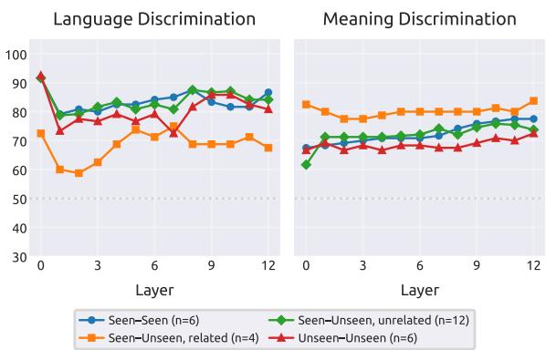

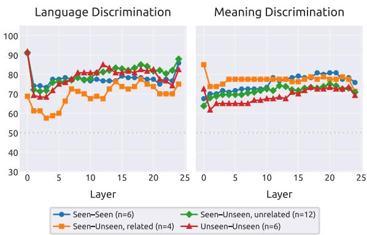  
Figure 8: ABX probes, $\mathbf { M P I X E L _ { B A S E } }$ (above) and $\mathrm { M P I X E L } _ { \mathrm { L A R G E } }$ (below). Languages seen and unseen during pre-training, in different combinations.

## A.6 ABX More Ablations

## A.6.1 Generalization to unseen languages.

To test whether scaling multilinguality affects seen and unseen languages differently, we compare (seen, seen), (seen, unseen), and (unseen, unseen) language pairs across our PIXEL models with increasing language coverage.

We test whether alignment extends to languages held out of pretraining by evaluating MPIXELBAsE on four unseen languages (Assamese, Icelandic, Yiddish, North Azerbaijani), each chosen to share its script (and, in three of four cases, its language family) with one of four seen languages (Bengali, Danish, Hebrew, Turkish). Splitting the language pairs into seen-seen, seen-unseen (related vs. unrelated), and unseen-unseen groups (Figure 8), the related seen-unseen pairs stand out: they have the highest, flattest MD and the lowest LD at every depth. Unseen-unseen pairs have the lowest MD scores and an unstable LD trajectory. The difference between seen-seen pairs and unrelated seen– unseen pairs is small, indicating that joint inclusion in pre-training does not increase alignment.

## A.6.2 Same- versus cross-script pairs.

Extending the language set from the PIXEL-M4 languages to all 16 languages lowers LD and raises MD scores. For MPIXEL $\mathbf { \nabla } ^ { J } \mathbf { B } \mathbf { A } \mathbf { S } \mathbf { E }$ , embedding-layer LD falls from 1.00 on the four PIXEL-M4 languages to 0.95 on all 16. The reason is the changed pair composition: the 16-language set contains many samescript pairs, which lack the visual cues that make cross-script pairs trivially language-discriminable and are easier to align in meaning.

Splitting pairs by whether the two languages share a script (same-script vs. cross-script) confirms this; results are in Figure 9. The clearest effect is at the embedding layer of LD: cross-script pairs are near-trivially discriminable, whereas same-script pairs start far lower. Cross-script LD decreases substantially already in the first layer. The two model sizes differ in how the script signal is then handled. In $\mathbf { M P I X E L _ { B A S E } }$ , same-script LD recovers and even exceeds cross-script LD in the middle layers. MD is slightly higher within the same script at every depth and climbs monotonically for both groups. In MPIXEI $\scriptstyle \mathbf { \mathcal { L } A R G E }$ however, same-script LD stays well below cross-script LD throughout and is less stable.

The same-script MD trajectory is where the two models diverge most. For MPIXEI $\mathbf { \Lambda } ^ { J } \mathbf { B } \mathbf { A } \mathbf { S } \mathbf { E } \mathbf { \Lambda } ,$ MD is only mildly affected by script sharing: the curves differ mostly in the first layer, where the same-script MD is notably higher. In $\mathrm { M P I X E L } _ { \mathrm { L A R G E } }$ , the MD scores for same-script pairs are much more dynamic (and peak higher) than the ones of cross-script pairs.

## A.7 Script ID Probes

To test how explicitly script identity is encoded across layers, we train linear probes on each layer's representations to classify text into the 10 scripts seen during $\mathrm { M P I X E L _ { B A S E } }$ pretraining.

Setup We train linear probing classifiers on the mean-pooled encoder representations at each of the 13 layers. Each probe is a multinomial logistic regression (L2 regularization, $C { = } 1 . 0 )$ trained to predict script identity from the BOUQuET dataset (Andrews et al., 2025). We evaluate in two settings: iid, on unseen sentences from the 16 training languages, and ood, on 32 unseen languages whose scripts (Arabic, Bengali, Cyrillic, Devanagari, Han, Hebrew, Latin) the probe has seen.

PIXEL models In the iid setting, script identity is recovered almost perfectly at every layer in all base models. The models diverge in the ood setting: $\mathrm { M P I X E L _ { B A S E } }$ and $\mathrm { M P I X E L } _ { \& s }$ retain nearperfect accuracy across all layers, whereas PIXEL-M4 and $\mathrm { M P I X E L } _ { 8 \mathrm { L } }$ decline in the final layers; a clear, though not catastrophic, drop from the perfect accuracy of the early layers and of the higher-coverage models. The high results of the $\mathrm { P I X E L } ^ { \dagger }$ model however show that the model trained on only one script also behaves robustly.

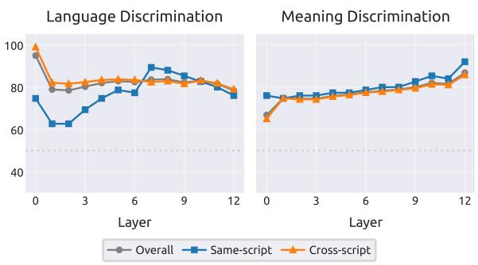

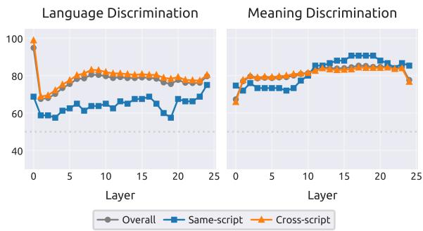  
Figure 9: ABX probes, $\mathbf { M P I X E L _ { B A S E } }$ (above) and $\mathbf { M P I X E L } _ { \mathrm { L A R G E } }$ (below), $\mathbf { M P I X E L _ { B A S E } }$ pre-training languages. Pairs of languages that share script (blue) versus pairs of languages that have different scripts (orange).

Notably, the late-layer errors of $\mathrm { M P I X E L } _ { 4 \mathrm { s } }$ and MPIXEL8L are largely Cyrillic misclassified as Latin, even though every MPIXEL variant has exactly one Cyrillic-script pretraining language (Ukrainian).

Visual versus token-based inputs Compared to XLM-R, we see that PIXEL models generalize more reliably to out-of-distribution languages, indicating a difference of the visual versus subword tokenbased processing for unseen languages..

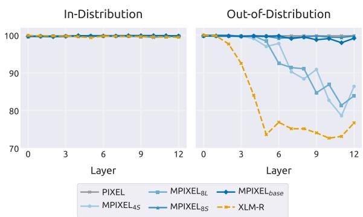  
Figure 10: Layer-wise accuracy of linear scriptidentification probes trained on the representations of each base model. Left (iid): unseen sentences from the 16 training languages. Right (ood): 32 unseen languages whose scripts were seen during training.

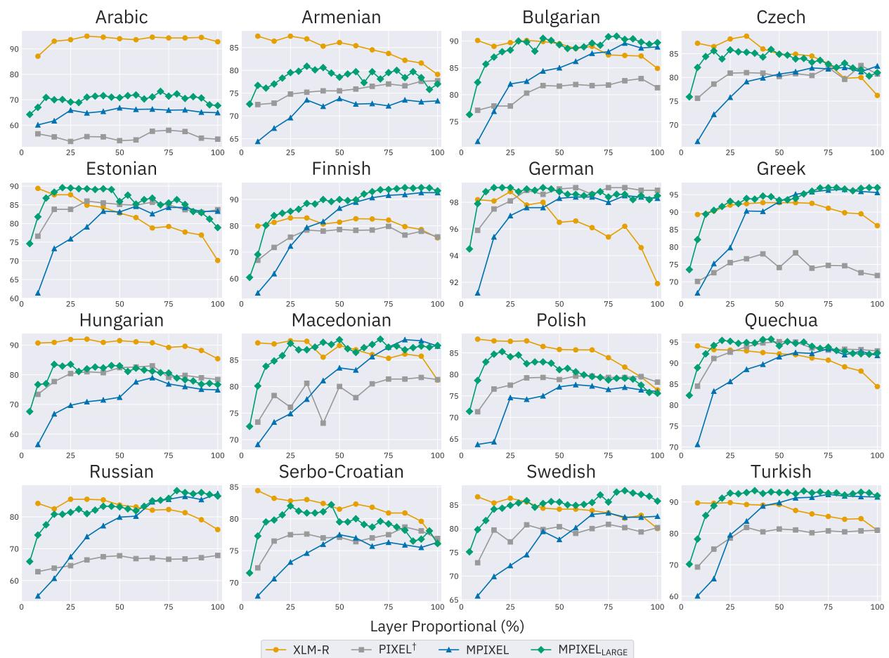  
Figure 11: LINSPECTOR probing results for the Case task. Each panel shows linear probe accuracy per layer, with the x-axis giving the layer position relative to the model depth.

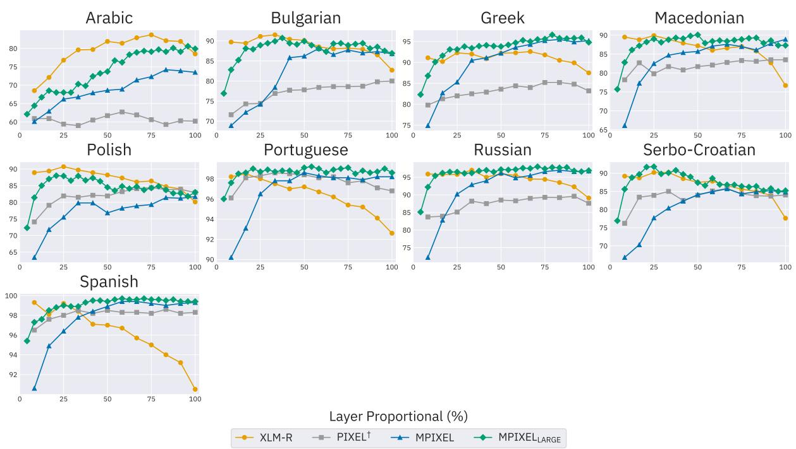  
Figure 12: LINSPECTOR probing results for the Gender task. Each panel shows linear probe accuracy per layer, with the x-axis giving the layer position relative to the model depth.

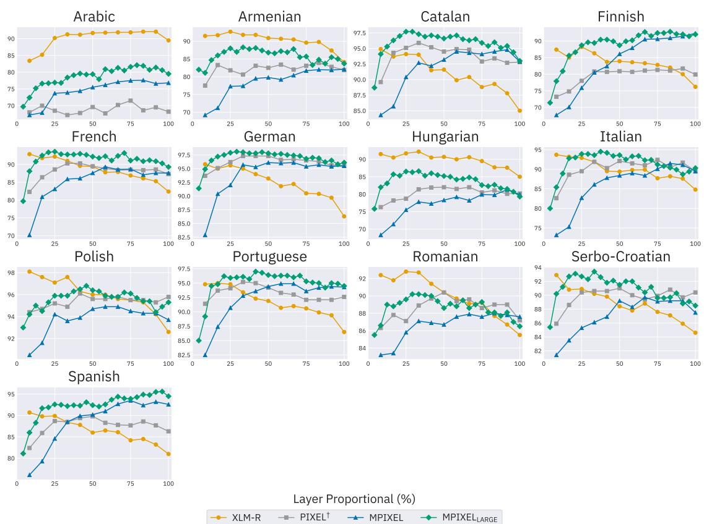  
Figure 13: LINSPECTOR probing results for the Mood task. Each panel shows linear probe accuracy per layer, with the x-axis giving the layer position relative to the model depth.

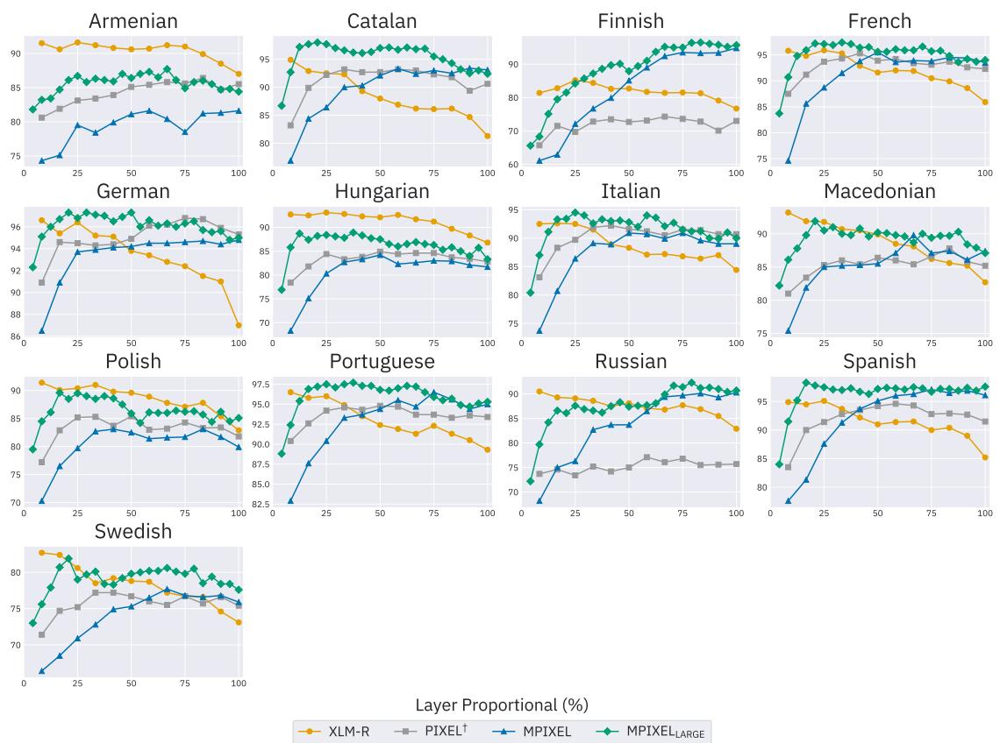  
Figure 14: LINSPECTOR probing results for the Number task. Each panel shows linear probe accuracy per layer, with the x-axis giving the layer position relative to the model depth.

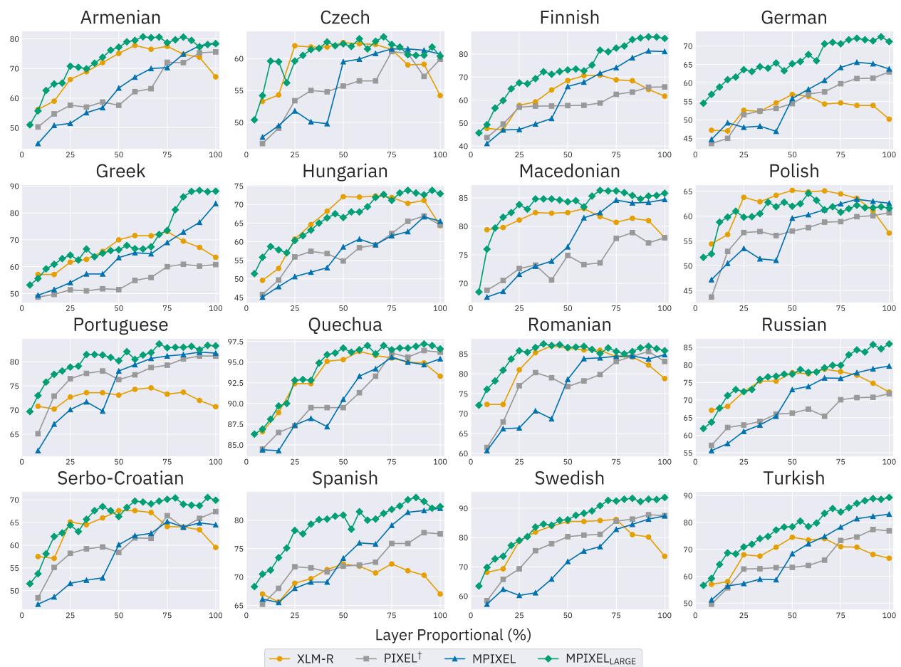  
Figure 15: LINSPECTOR probing results for the OddFeat task. Each panel shows linear probe accuracy per layer, with the x-axis giving the layer position relative to the model depth

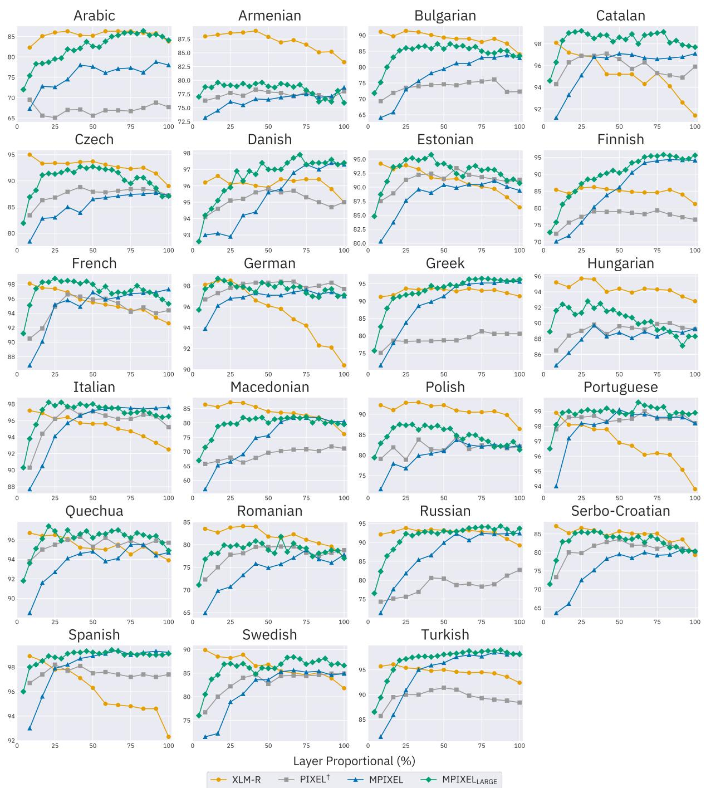  
Figure 16: LINSPECTOR probing results for the POS task. Each panel shows linear probe accuracy per layer, with the x-axis giving the layer position relative to the model depth.

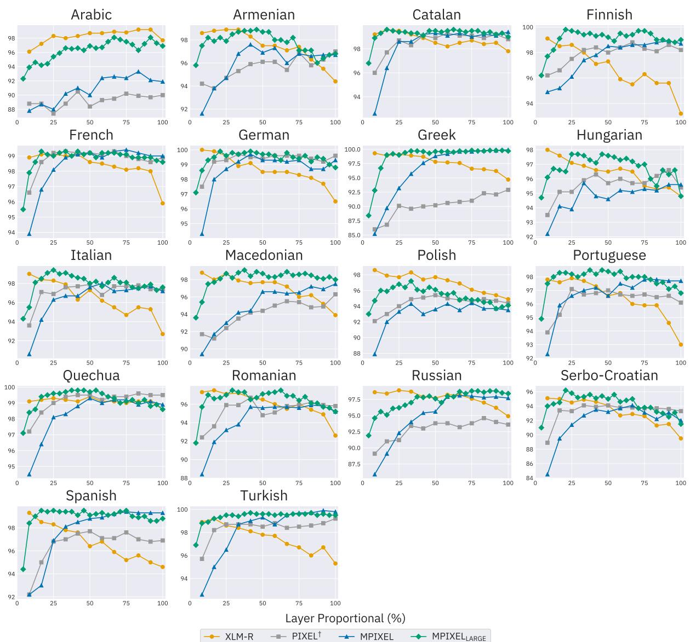  
Figure 17: LINSPECTOR probing results for the Person task. Each panel shows linear probe accuracy per layer, with the x-axis giving the layer position relative to the model depth.

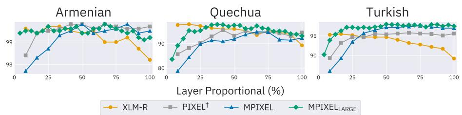  
Figure 18: LINSPECTOR probing results for the Possession task. Each panel shows linear probe accuracy per layer, with the x-axis giving the layer position relative to the model depth.

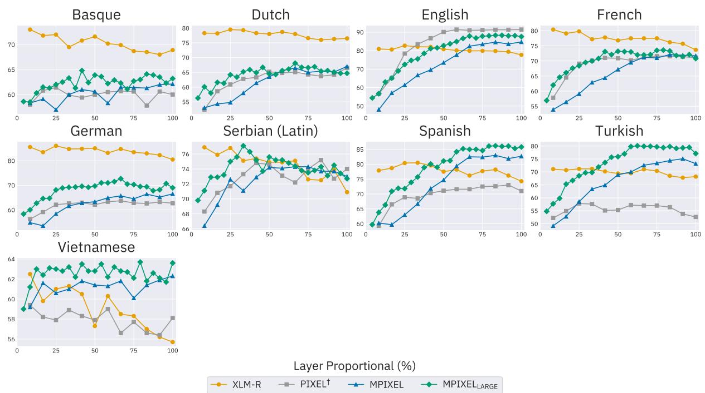  
Figure 19: LINSPECTOR probing results for the Pseudo task. Each panel shows linear probe accuracy per layer, with the x-axis giving the layer position relative to the model depth.

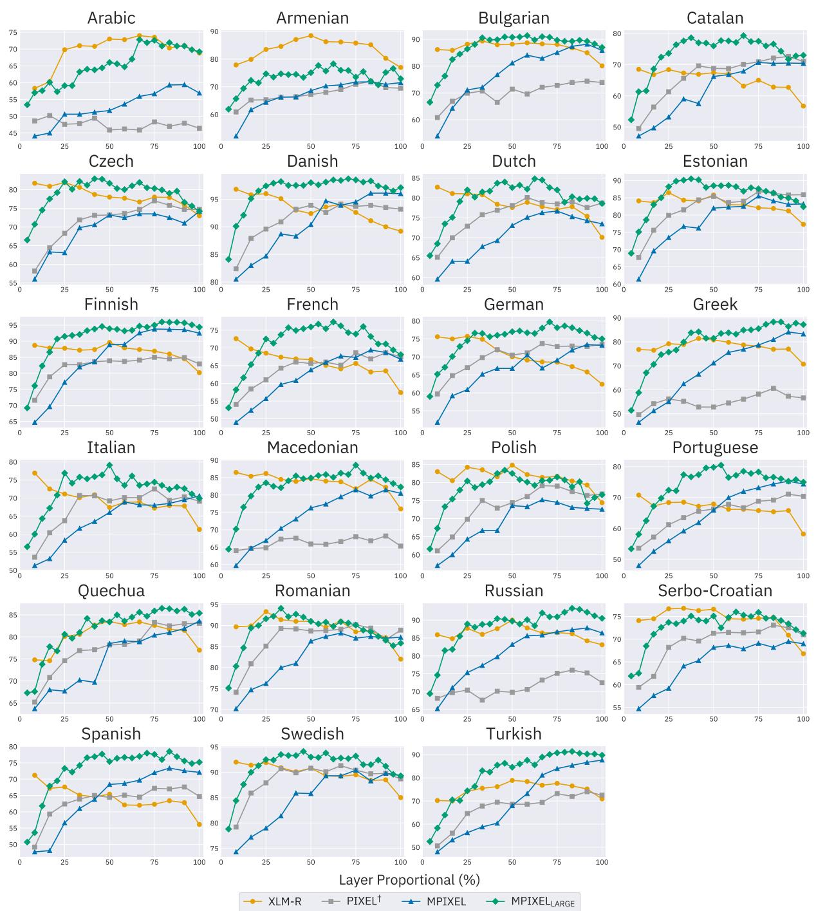  
Figure 20: LINSPECTOR probing results for the SameFeat task. Each panel shows linear probe accuracy per layer, with the x-axis giving the layer position relative to the model depth.

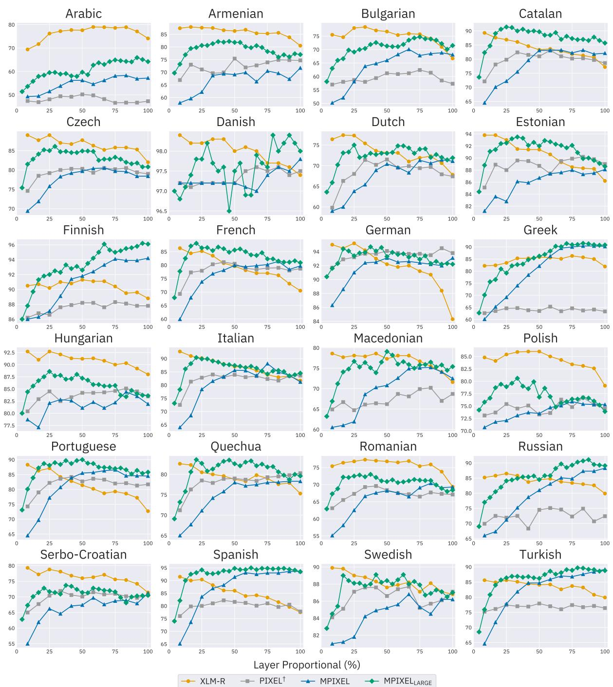  
Figure 21: LINSPECTOR probing results for the TagCount task. Each panel shows linear probe accuracy per layer, with the x-axis giving the layer position relative to the model depth.

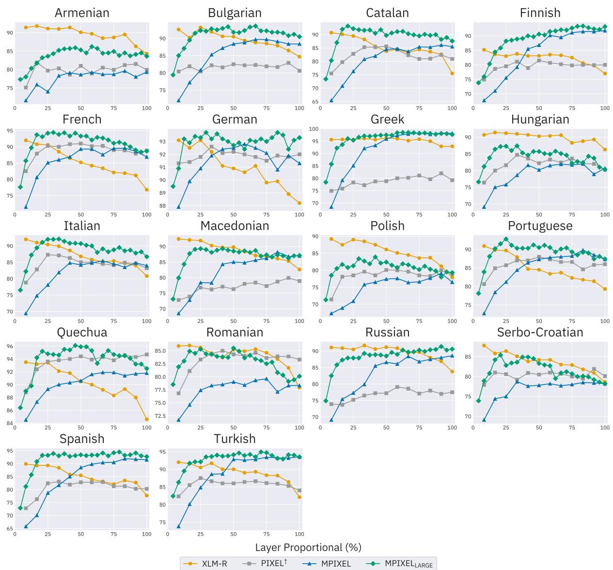  
Figure 22: LINSPECTOR probing results for the Tense task. Each panel shows linear probe accuracy per layer, with the x-axis giving the layer position relative to the model depth.

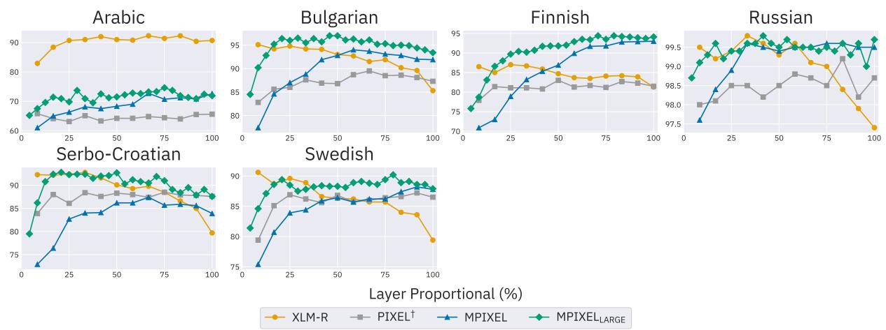  
Figure 23: LINsPECTOR probing results for the Voice task. Each panel shows linear probe accuracy per layer, with the x-axis giving the layer position relative to the model depth.

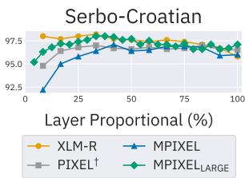  
Figure 24: LINSPECTOR probing results for the Comparison task. Each panel shows linear probe accuracy per layer, with the x-axis giving the layer position relative to the model depth.

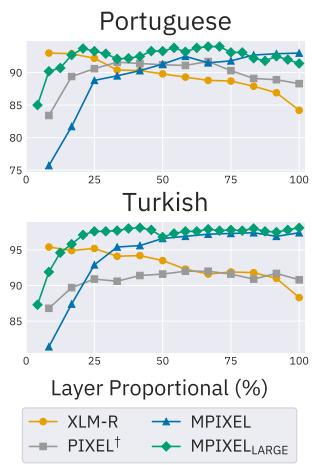  
Figure 25: LINSPECTOR probing results for the Polarity task. Each panel shows linear probe accuracy per layer, with the x-axis giving the layer position relative to the model depth.