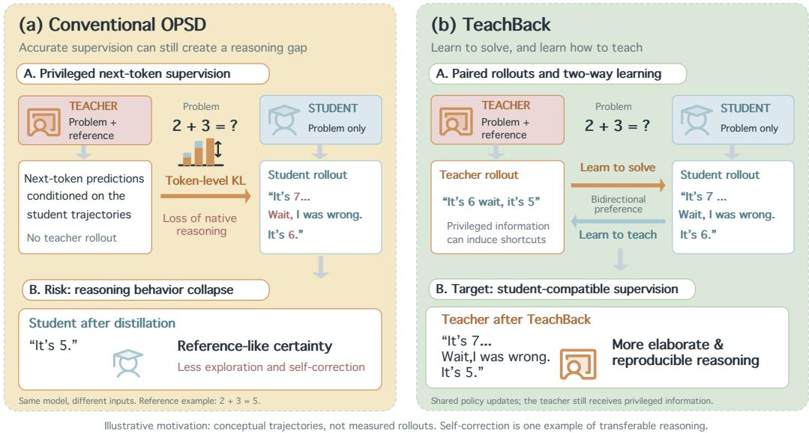
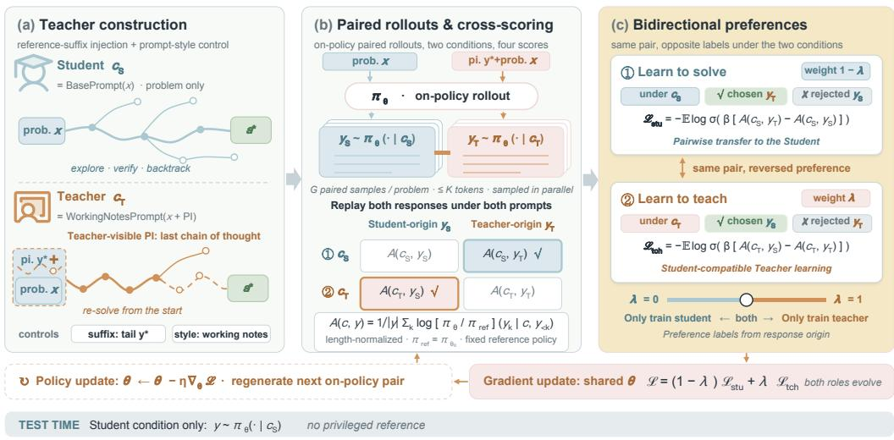
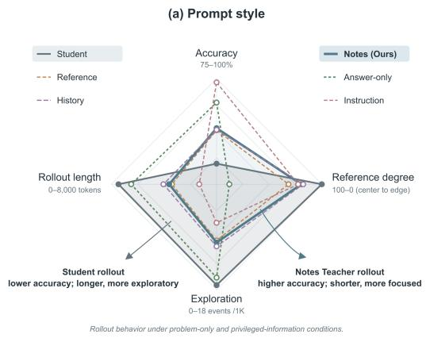
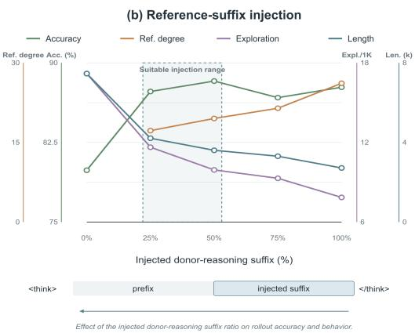
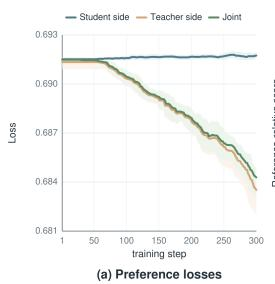
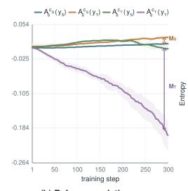
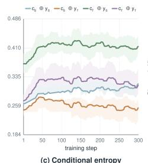
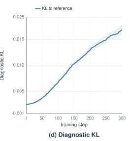
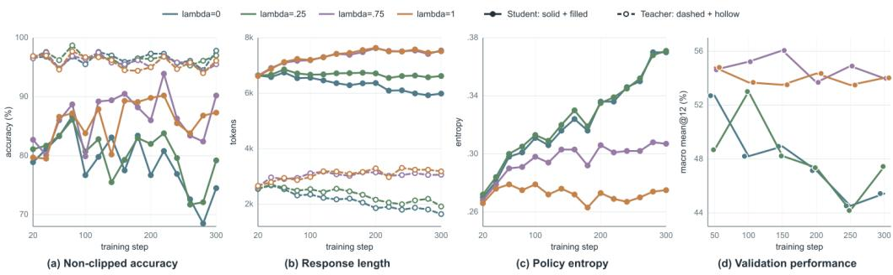
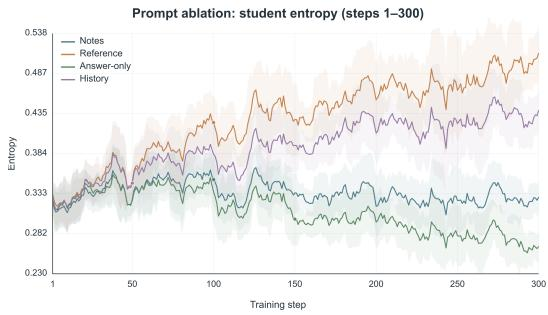

# TEACHBACK: LEARNING TO TEACH VIA BIDIREC-TIONAL PREFERENCE OPTIMIZATIONFOR ON-POLICY SELF-DISTILLATION

Linfei Ji1 Jiayun Li2 Haozhao Wang1 Siyu Jiang1 Zehao Wang3 Longtao Xiao1 Yu-Jie Yuan4∗ Ruixuan Li1∗

1 Huazhong University of Science and Technology 2 Tsinghua University 3 Harbin Institute of Technology 4 Huawei Technologies Ltd.

## ABSTRACT

On-policy self-distillation (OPSD) enables a language model to learn from a Teacher instantiated from the same model but given access to privileged information, such as a reference solution. We find that access to sufficient privileged information allows the Teacher to generate highly accurate trajectories; however, accuracy alone does not guarantee that these trajectories are suitable for Student learning. Direct access to a complete solution may encourage shortened, referenceconditioned derivations that omit the exploration, verification, and self-correction required to solve problems without privileged information. We introduce Teach-Back, a bidirectional preference-learning framework for on-policy self-distillation that learns not only from the Teacher but also how the Teacher should teach. Teach-Back shapes the Teacher’s generation behavior by controlling the length of the reference-reasoning suffix injected into the prompt and by varying the prompt style. While maintaining comparable Teacher accuracy, it encourages the Teacher to explore and re-solve problems, thereby reducing its reliance on the reference solution. At each rollout refresh, the shared policy generates both a privileged Teacher trajectory and a problem-only Student trajectory. A pairwise preference objective uses privileged Teacher trajectories to improve Student learning, while the reversed preference uses the Student’s behavior to shape future Teacher supervision under the privileged condition. Experiments on mathematical and logical reasoning tasks show that TeachBack consistently improves Student performance over existing OPSD methods and related baselines.

## 1 INTRODUCTION

On-policy distillation (Agarwal et al., 2024), which provides dense supervision by allowing a Student to sample reasoning trajectories from its current policy while a stronger Teacher evaluates the Studentgenerated prefixes, has emerged as the dominant post-training paradigm for enhancing the reasoning capabilities of large language models. Building on this, On-policy self-distillation (OPSD) (Zhao et al., 2026) further removes the need for a separate Teacher by employing a unified, parameter-shared policy, receiving great attention recently. This policy allows the model to play two roles, where the model acts as a Student when given only the question, but switches to a privileged-information (PI) Teacher when provided with additional reasoning evidence, such as reference solutions. Despite eliminating the dependency on external models, recent studies reveal that OPSD may cause shorter responses and a degeneration of native reasoning behaviors, a failure mode commonly referred to as thinking collapse (Peng et al., 2026), which is particularly pronounced in models relying on long chain-of-thought reasoning.

Several approaches have been proposed to address this degradation. One representative line studies OPSD from the perspective of optimization, where an uncertain Student and a PI-conditioned Teacher can favor different continuations at high-entropy reasoning forks. More specifically, privileged targets can suppress the Student’s branching, verification, and backtracking when their token probabilities are directly matched (Kaur et al., 2026). To preserve these behaviors, AD-OPSD (Peng et al., 2026) anchors updates at high-risk tokens to a frozen base policy. Another line examines the supervision signal itself: reference conditioning can change the Teacher’s response style without providing correspondingly useful reasoning. RLCSD (Pan et al., 2026) contrasts correct and incorrect hints to cancel style shifts unrelated to correctness, while Purified OPSD (Shen et al., 2026) removes a reference-only component from the Teacher signal. The third line changes how the Student learns from that signal; PBSD (Yu et al., 2026a) uses reward-regularized preferences between Teacher and Student rollouts instead of directly matching their token distributions. Although these methods have made great achievements, they primarily regulate how the Student uses a Teacher signal that has already been generated, leaving open a more upstream question: can PI be used to construct a Teacher whose reasoning remains useful to a Student that cannot access PI?

  
Figure 1: Motivation for TEACHBACK. In standard OPSD, access to privileged information can lead the Teacher to produce a short solution that omits exploration and verification. TEACHBACK uses partial reference reasoning and Student feedback to encourage complete, self-contained Teacher trajectories that remain useful to a problem-only Student.

This question points to a Teacher-side way to mitigate thinking collapse: privileged information should guide the Teacher’s reasoning rather than serve as an authoritative solution to be copied. A problem-only Student must search among alternative paths, express uncertainty at ambiguous steps, verify intermediate conclusions, and recover from mistakes. As we design in Figure 1, a useful PI-conditioned Teacher should preserve these Student-compatible behaviors while using privileged information to check the explored path, correct unproductive branches, and converge more reliably to a correct answer. The desired Teacher therefore needs to balance three properties: high correctness under privileged information, low dependence on the wording or trajectory of the reference solution, and productive exploration that remains reproducible without PI. In particular, the Teacher should not simply compress the reference-conditioned response into a shorter answer. It should re-solve the original problem, use privileged information for verification, and produce a complete trajectory that is both reliable as supervision and rich enough for the Student to learn.

Based on this motivation, we propose TEACHBACK, which improves both the construction and transfer of privileged Teacher trajectories. First, TEACHBACK presents the Teacher with partial reference reasoning of varying lengths and prompt styles as optional working notes, then asks it to solve the original problem from the beginning. This encourages the Teacher to use PI to check its reasoning without simply following the reference. The shared policy then generates a Teacher trajectory with PI and a Student trajectory from the problem alone. We train with preferences in both directions: the Teacher trajectory guides Student learning, while the Student trajectory provides feedback on which reasoning paths the Teacher should retain. In this way, the Teacher learns to produce accurate, less reference-dependent supervision that the Student can learn from.

Our contributions are summarized as follows:

• Through explicit Teacher rollouts, we reveal a substantial reasoning-behavior gap between the PI-conditioned Teacher and the problem-only Student, and show that highly accurate Teacher trajectories are not necessarily suitable for Student learning.

• We construct the PI-conditioned Teacher by presenting a controllable suffix of reference reasoning as optional working notes and varying the surrounding prompt style. This encourages the Teacher to re-solve the problem and produce complete reasoning with less reliance on the reference.

• We develop a bidirectional preference-learning framework over paired Teacher and Student trajectories. Teacher-origin trajectories guide Student learning, while Student-origin trajectories provide compatibility feedback that shapes future Teacher supervision.

• Experiments on mathematical and logical reasoning tasks show that TEACHBACK consistently improves Student’s reasoning performance and outperforms existing OPSD and related baselines.

## 2 RELATED WORK

On-policy distillation and privileged supervision. Classical knowledge distillation (Hinton et al., 2015; Kim & Rush, 2016; Gu et al., 2024) transfers a stronger Teacher’s predictions or generated sequences to a Student. On-policy distillation (OPD) (Agarwal et al., 2024) instead queries the Teacher on Student-sampled prefixes, reducing the mismatch between training and deployment states. Onpolicy self-distillation (OPSD) (Zhao et al., 2026) uses one parameter-shared policy as a problem-only Student and a privileged-information (PI) Teacher, and Privileged Information Distillation (Penaloza et al., 2026) extends this setting to long-horizon agents (Wang et al., 2026; Wu et al., 2026; Lu et al., 2026). Recent studies show that privileged conditioning can suppress epistemic verbalization, exploration, verification, and backtracking at high-entropy reasoning forks, leading to thinking collapse and reference-induced style drift (Kim et al., 2026; Kaur et al., 2026; Peng et al., 2026; Pan et al., 2026). Existing remedies modify the resulting Teacher signal: Purified OPSD (Shen et al., 2026) removes the reference-induced component; PAINT (Tan & Hong, 2026), Adaptive Teacher Exposure (Han et al., 2026), and best-of-N selection (Zhang et al., 2026) control privileged exposure or retain selected rollouts; and AR-OPD (Zhang, 2026) and DOPD (Yu et al., 2026b) constrain or route privileged supervision according to local compatibility and relative advantage. These methods improve how an already formed signal is filtered or transferred, leaving the construction of a Student-compatible Teacher as an upstream problem.

Preference optimization and Teacher construction. Preference optimization provides a sequencelevel alternative to direct token-distribution matching. DPO (Rafailov et al., 2023) learns a referencerelative policy from response preferences, while SPIN (Chen et al., 2024) uses self-generated responses to form an iterative preference signal. PBSD (Yu et al., 2026a) applies preference learning to on-policy self-distillation by optimizing a reward-regularized preference gap between PI-conditioned Teacher samples and on-policy Student samples instead of directly matching Teacher probabilities. Related methods use consensus gating (Stein et al., 2026) or self-revision (He et al., 2026; Zelikman et al., 2022) to select or construct supervision (Li et al., 2026) before distillation. TeachBack addresses the remaining Teacher-construction problem by presenting a controllable ground-truth suffix as incomplete working notes, varying the prompt framing, and using two cross-condition preference directions: the Student-side objective transfers useful Teacher trajectories under the problem-only condition, while the reversed objective uses Student behavior to shape future privileged Teacher trajectories.

## 3 METHOD

Given training examples $\mathcal { D } = \{ ( x _ { i } , y _ { i } ^ { * } , a _ { i } ^ { * } ) \} _ { i = 1 } ^ { N }$ , where $x _ { i }$ is a problem, $y _ { i } ^ { * }$ is its reference reasoning, and $a _ { i } ^ { * }$ is its correct answer, TeachBack uses a suffix of $y _ { i } ^ { * }$ as privileged information (PI) and $a _ { i } ^ { * }$ for answer verification. The Student and Teacher are conditional roles of one parameter-shared policy $\pi _ { \theta }$ rather than separate networks: the Student receives only the problem, while the Teacher receives the problem and a prompt containing PI. Training alternates paired rollout generation with bidirectional preference updates. Figure 2 summarizes Teacher construction, paired rollouts, cross-scoring, and the two preference updates.

  
Figure 2: Overview of TEACHBACK. (a) The Student receives the problem alone, while a referencereasoning suffix is framed as optional working notes for the Teacher to re-solve the problem. (b) The shared policy samples paired Student and Teacher trajectories; both responses are replayed under both conditions and scored against a fixed reference policy. (c) Under the problem-only condition, the Teacher-origin response is preferred; under the PI-conditioned condition, the Student-origin response is preferred. The weighted losses update the shared policy before the next on-policy pair is generated. At test time, only the problem-only Student condition is used.

3.1 TEACHER CONSTRUCTION: REFERENCE-SUFFIX INJECTION AND PROMPT-STYLE CONTROL

For each problem x, the Student context and PI-conditioned Teacher context are

$$
c _ { S } = \mathrm { B a s e P r o m p t } ( x ) , \qquad c _ { T } = \mathrm { W o r k i n g N o t e s P r o m p t } ( x , \mathrm { T a i l } ( y ^ { * } ) ) .\tag{1}
$$

Equation 1 shows the Working Notes configuration used in the main training runs. The suffix is extracted from the dataset reference rather than from the current Student response, so Student sampling errors do not change the privileged information in the Teacher prompt. We use a suffix instead of the complete reference because it provides answer-relevant information while leaving the Teacher responsible for reconstructing the earlier derivation. An authoritative solution framing may encourage the Teacher to continue or copy the suffix. Framing it as incomplete, non-terminal working notes instead prompts the Teacher to re-solve the problem, verify the notes, fill in missing steps, and produce a complete answer.

We study two related factors in Teacher construction. The suffix length controls how much privileged information is available, while the prompt style changes how that information is presented. We compare several styles, including authoritative reference, answer-only hint, and optional working notes; the answer-only and full-solution instruction styles also change the information content. These comparisons let us assess Teacher correctness and reasoning behavior separately from the downstream preference objective. Appendix A gives the audit setup, metric definitions, and prompt templates.

## 3.2 PAIRED ON-POLICY ROLLOUTS AND CROSS-SCORING

Unlike conventional OPSD, which transfers privileged next-token predictions on Student-generated prefixes, TeachBack generates explicit trajectories from both conditional roles. At refresh t, the

current policy is held fixed while generating G paired responses:

$$
y _ { S , i } ^ { ( t , g ) } \sim \pi _ { \theta _ { t } } ( \cdot \mid c _ { S , i } ) , \qquad y _ { T , i } ^ { ( t , g ) } \sim \pi _ { \theta _ { t } } ( \cdot \mid c _ { T , i } ) , \quad g = 1 , \ldots , G .\tag{2}
$$

Both responses are sampled from the same policy state, so systematic differences between their rollout distributions arise from the prompt conditions rather than separate models. We retain the first K valid response tokens for preference training; below, $y _ { S }$ and $y _ { T }$ denote these retained prefixes when used in scoring equations, with example and rollout indices omitted for readability. This prefix focuses the objective on the part of the trajectory where the model establishes a solution direction, explores alternatives, and begins verification; later tokens often elaborate a path that has already been selected. Generation budgets, truncation rules, and the longer diagnostic rollout cap are specified in Appendix C.

The sampled responses are replayed under both prompts:

$$
\mathcal { Q } ^ { ( t ) } = \left[ \begin{array} { l l } { c _ { S } \oplus y _ { S } ^ { ( t ) } } & { c _ { S } \oplus y _ { T } ^ { ( t ) } } \\ { c _ { T } \oplus y _ { S } ^ { ( t ) } } & { c _ { T } \oplus y _ { T } ^ { ( t ) } } \end{array} \right] .\tag{3}
$$

The current policy and a frozen initialization policy score the same response tokens in all four combinations. Within each row, the scoring condition is fixed and the response origin varies. In particular, yT replayed under $c _ { S }$ lets us evaluate Teacher reasoning under the problem-only condition. Replaying yS under cT supplies the corresponding compatibility view for the Teacher role. After the preference update, the new policy generates the next paired batch.

## 3.3 BIDIRECTIONAL PREFERENCE OPTIMIZATION

Let $\pi _ { \mathrm { r e f } } ~ = ~ \pi _ { \theta _ { 0 } }$ remain fixed throughout training. For condition c and response $y ,$ we use the length-normalized score relative to this frozen reference policy:

$$
A _ { \theta } ^ { c } ( y ) = \frac { 1 } { | y | } \sum _ { k = 1 } ^ { | y | } \log \frac { \pi _ { \theta } ( y _ { k } \mid c , y _ { < k } ) } { \pi _ { \mathrm { r e f } } ( y _ { k } \mid c , y _ { < k } ) } .\tag{4}
$$

Only valid response positions contribute. Length normalization prevents longer responses from receiving a larger score solely because they contain more log-probability terms, while the frozen reference anchors both conditional comparisons to the same initialization.

Student-side transfer. Under the problem-only condition, we prefer the Teacher-origin response, yT ≻ yS, using

$$
\mathcal { L } _ { \mathrm { s t u } } = - \mathbb { E } \log \sigma ( \beta [ A _ { \theta } ^ { c _ { S } } ( y _ { T } ) - A _ { \theta } ^ { c _ { S } } ( y _ { S } ) ] ) .\tag{5}
$$

Here, $\sigma$ is the logistic sigmoid, $\beta > 0$ scales the preference margin, and the expectation is over training problems and paired rollouts sampled from the fixed policy snapshot at the current refresh. We use $\beta = 0 . 1$ . Both responses are scored under $c _ { S }$ . The margin therefore asks whether the trajectory generated with privileged information becomes preferable under the deployment condition. This transfers a trajectory-level teaching signal without requiring the Student to match the complete PI-conditioned next-token distribution. The label is determined by response origin, not by assuming that every Teacher sample is correct; Teacher correctness is measured separately in the experiments.

Teacher-side feedback. Under the PI-conditioned condition, we reverse the ordering and prefer the Student-origin response, $y _ { S } \succ y _ { T } .$

$$
\mathcal { L } _ { \mathrm { t c h } } = - \mathbb { E } \log \sigma ( \beta \left[ A _ { \theta } ^ { c _ { T } } ( y _ { S } ) - A _ { \theta } ^ { c _ { T } } ( y _ { T } ) \right] ) .\tag{6}
$$

The reversed preference does not claim that the Student answer is more accurate. A problem-only response can contain incremental derivation, verification, and backtracking that are absent from a concise privileged response. Favoring Student-origin responses under $c _ { T }$ can feed Student-compatible reasoning back into the role that generates future Teacher targets, while the privileged suffix continues to support correctness. Because both roles share parameters, the Teacher-side update changes the next privileged rollout as well as the Student. It can also reinforce Student errors or unproductive verbosity, which is why we evaluate correctness, exploration, reference dependence, response length, and downstream performance together. The numerical margins and their training dynamics are analyzed in Section 4.4, and the local compatibility analysis is given in Appendix F.

3.4 JOINT CO-ADAPTATION AND TRAINING PROTOCOL

The two directions are combined as

$$
\mathcal { L } _ { \mathrm { m a i n } } ^ { ( t ) } ( \lambda ) = ( 1 - \lambda ) \mathcal { L } _ { \mathrm { s t u } } ^ { ( t ) } + \lambda \mathcal { L } _ { \mathrm { t c h } } ^ { ( t ) } , \qquad \lambda \in [ 0 , 1 ] .\tag{7}
$$

The boundary λ = 0 isolates Teacher-to-Student transfer, $\lambda = 1$ isolates Teacher-side feedback, and intermediate values test co-adaptation. Each refresh generates paired trajectories from the current policy, replays both responses under both conditions, computes the two preference losses, and updates only the shared parameters. Rollouts are stop-gradient and $\pi _ { \mathrm { r e f } }$ remains frozen; verifier outcomes do not filter pairs or rescale the losses. Algorithm 1 in Appendix B gives the complete procedure, while Appendix C lists the fixed budgets, masks, and refresh settings.

## 4 EXPERIMENTAL PROTOCOL

We organize the experiments as a progression of related questions. We first ask whether TeachBack improves mathematical and logical reasoning when only the original problem is available at deployment. We then examine which Teacher prompt style and privileged-information ratio best balance correctness, reasoning elaboration, response length, and dependence on the reference. Next, we test whether bidirectional preference optimization moves the Student and Teacher margins in the intended directions while preserving stable entropy and gradient behavior. Finally, we study how the Teacher-side objective weight affects training dynamics and final performance.

## 4.1 EXPERIMENTAL SETUP

Models and data. We train Qwen3-1.7B, Qwen3-4B, and Qwen3-8B (Yang et al., 2025) on a challenging subset of DeepMath (He et al., 2025). We evaluate on AMC 2023 (Mathematical Association of America, 2023) and AIME 2024/2025 (Zhang & Math-AI, 2024; 2025), and on Knight-and-Knaves (KK) (Xie et al., 2025), using 4–8 Roles in-domain and 9–11 Roles out-ofdomain. Cross-architecture Math results on DeepSeek-R1-Distill-Qwen-7B and DeepSeek-R1-Distill-Llama-8B (Guo et al., 2025) are reported in Appendix D. The dataset splits, training settings, and evaluation protocol are detailed in Appendix C.

Baselines. We compare TeachBack with Base, GRPO (Shao et al., 2024), OPSD (Zhao et al., 2026), SPIN (Chen et al., 2024), and PBSD (Yu et al., 2026a). SPIN uses the dataset ground-truth reasoning trace as the preferred response against model-generated responses. PBSD uses trajectories generated by a frozen privileged teacher as preferred responses against on-policy student trajectories. TeachBack generates both trajectories from the current shared policy and optimizes preferences under both prompt conditions.

## 4.2 MAIN RESULTS

Table 1 shows that TeachBack achieves the highest Math and KK averages at all three Qwen3 scales. Relative to Base, its Math averages improve by 4.3/2.2/2.5 points and its KK averages by 6.1/3.9/7.5 points for Qwen3-1.7B/4B/8B, respectively. SPIN is also a strong baseline, ranking second on KK average at each scale; this supports Student-side preference learning with ground-truth chains of thought as an effective approach to reasoning training.

## 4.3 HOW PROMPT CONSTRUCTION CHANGES TEACHER TRAJECTORIES

To select the Teacher construction, we extract and clean the ground-truth reasoning for 256 problems, vary the retained tail fraction and prompt framing, and generate four Qwen3-4B rollouts per condition with a 16K completion cap. We evaluate the resulting trajectories along four dimensions: correctness, response length and truncation, reasoning exploration, and reference dependence. Appendix A gives the audit setup, metric definitions, numerical results, and prompt templates.

Prompt construction shapes how the Teacher uses privileged information. Figure 3 compares prompt styles in panel (a) and injected suffix lengths in panel (b). The no-PI Student explores more but is less accurate. All Teacher prompt styles improve accuracy, yet they use the available reference information differently. Reference style treats the suffix as an authoritative solution, leading to frequent reference mentions and less exploration. Answer-only style gives the Teacher the final answer and encourages it to reason backward from that known endpoint to construct a derivation. History style moves the same suffix into an earlier assistant turn, leaving the final user request free of reference text. This reduces explicit mentions but produces longer responses and the weakest downstream OPSD performance among the tested prompt conditions, as shown in Table 4. Instruction style uses a full-solution privileged Teacher setting inspired by PBSD (Yu et al., 2026a) and requests a self-contained answer, producing short, low-exploration trajectories that differ markedly from the Student. Notes style instead frames the suffix as optional evidence to check, showing less reference use and more exploration than Reference style while improving accuracy over the Student. The

Table 1: Main results across model scales. Mathematical reasoning is reported as mean@12. Knightand-Knaves (KK) is reported as pass@1, with 4–8 Roles as the in-domain (ID) setting and 9–11 Roles as out-of-domain (OOD) settings. Bold and underlined entries denote the best and second-best results within each model block; parenthetical values are TeachBack gains over Base.
<table><tr><td rowspan="2">Model</td><td rowspan="2">Method</td><td colspan="4">Mathematical Reasoning (mean@12)</td><td colspan="5">Knight-and-Knaves (pass@1)</td></tr><tr><td>AMC23</td><td>AIME24</td><td>AIME25</td><td>Avg.</td><td>4–8 Roles</td><td>9 Roles</td><td>10 Roles</td><td>11 Roles</td><td>Avg.</td></tr><tr><td rowspan="5">Qwen3-1.7B</td><td>Base</td><td>75.7</td><td>46.3</td><td>37.5</td><td>53.2</td><td>63.8</td><td>56.0</td><td>44.0</td><td>34.0</td><td>49.4</td></tr><tr><td>GRPO</td><td>75.0</td><td>46.6</td><td>37.5</td><td>53.0</td><td>67.4</td><td>54.0</td><td>53.0</td><td>33.0</td><td>51.8</td></tr><tr><td>OPSD</td><td>74.5</td><td>47.7</td><td>35.0</td><td>52.4</td><td>64.4</td><td>55.0</td><td>52.0</td><td>32.0</td><td>50.9</td></tr><tr><td>SPIN</td><td>75.9</td><td>45.0</td><td>36.7</td><td>52.5</td><td>67.8</td><td>58.0</td><td>51.0</td><td>42.0</td><td>54.7</td></tr><tr><td>PBSD TEACHBACK</td><td>72.8 76.2(+0.5)</td><td>48.3</td><td>37.5 42.7(+5.2)</td><td>52.9</td><td>67.0</td><td>63.0 64.0(+8.0)</td><td>44.0 57.0(+13.0)</td><td>32.0 33.0(-1.0)</td><td>51.5 55.5 (+6.1)</td></tr><tr><td colspan="10">53.6(+7.3) 57.5 (+4.3) 68.2(+4.4)</td></tr><tr><td rowspan="5">Qwen3-4B</td><td>Base</td><td>88.6</td><td>71.6</td><td>66.1</td><td>75.4</td><td>73.2</td><td>69.0</td><td>57.0</td><td>48.0</td><td>61.8</td></tr><tr><td>GRPO</td><td>88.1</td><td>75.2</td><td>66.3</td><td>76.5</td><td>77.0</td><td>70.0</td><td>63.0</td><td>39.0</td><td>62.2</td></tr><tr><td>OPSD</td><td>88.0</td><td>75.2</td><td>64.7</td><td>76.0</td><td>73.2</td><td>72.0</td><td>58.0</td><td>42.0</td><td>61.3</td></tr><tr><td>SPIN</td><td>88.3</td><td>72.7</td><td>68.6</td><td>76.5</td><td>74.8</td><td>71.0</td><td>59.0</td><td>45.0</td><td>62.4</td></tr><tr><td>PBSD TEACHBACK</td><td>87.6 89.4(+0.8)</td><td>70.0 73.3(+1.7)</td><td>67.5 70.0 (+3.9)</td><td>75.0 77.6(+2.2)</td><td>73.6 74.0(+0.8)</td><td>67.0 76.0 (+7.0)</td><td>58.0 61.0(+4.0)</td><td>45.0 52.0 (+4.0)</td><td>60.9 65.7 (+3.9)</td></tr><tr><td colspan="10"></td></tr><tr><td rowspan="5">Qwen3-8B</td><td>Base</td><td>88.0</td><td>75.0</td><td>69.1</td><td>77.4</td><td>71.8</td><td>69.0</td><td>55.0</td><td>43.0</td><td>59.7</td></tr><tr><td>GRPO</td><td>89.7</td><td>73.3</td><td>70.0</td><td>77.7</td><td>73.8</td><td>72.0</td><td>59.0</td><td>43.0</td><td>61.9</td></tr><tr><td>OPSD</td><td>89.6</td><td>75.5</td><td>67.7</td><td>77.6</td><td>75.2</td><td>74.0</td><td>61.0</td><td>49.0</td><td>64.8</td></tr><tr><td>SPIN</td><td>88.2</td><td>74.1</td><td>68.3</td><td>76.9</td><td>75.8</td><td>75.0</td><td>61.0</td><td>50.0</td><td>65.5</td></tr><tr><td>PBSD TEACHBACK</td><td>90.3</td><td>77.5 76.6(+1.6)</td><td>65.8 72.7 (+3.6)</td><td>77.9 79.9 (+2.5)</td><td>74.0 77.0(+5.2)</td><td>61.0 75.0(+6.0)</td><td>57.0 65.0 (+10.0)</td><td>48.0 52.0(+9.0)</td><td>60.0 67.2(+7.5)</td></tr><tr><td colspan="10">90.4(+2.4)</td></tr></table>

  
Figure 3: Prompt-construction diagnostics. (a) Five Teacher prompt styles are compared with the Student. The gray shaded region represents Student behavior, and the green shaded region represents Notes Teacher behavior. Reference, Notes, and History share a 50% privileged body; Answer-only and Instruction use different information budgets. (b) The Working Notes suffix sweep varies donorreasoning injection from 0% to 100% and plots accuracy, rollout length, exploration, and reference degree. 0% suffix represents the Student with no injected reasoning. The shaded 25–50% range yields high accuracy while retaining more exploration and lower reference degree than larger suffix ratios.

(c) Conditional entropy

amount of injected reasoning further shapes this balance. In panel (b), accuracy rises with 25–50% suffix injection and then falls slightly with longer suffixes. Longer suffixes produce shorter, less truncated rollouts, but reduce exploration and increase reference degree, as reported in Table 2. The 25–50% range therefore retains high accuracy with more exploration and lower reference degree than longer suffixes.

Prompt-induced reasoning behavior affects OPSD transfer. Table 4 compares fixed-Teacher OPSD prompt conditions under matched 4K settings. Notes achieves the highest average mean@4 at 74.21%, while Answer-only achieves the highest best mean@4 at 76.49%. Notes and Reference are close on both metrics, indicating comparable downstream performance. Appendix A analyzes the full prompt comparison and supplementary prompt controls.

## 4.4 LOSS VALIDITY AND OPTIMIZATION STABILITY

We analyze the two preference directions and optimization stability of the shared policy in Figure 4.

  
Figure 4: Diagnostics from the Qwen3-1.7B run at $\lambda = 0 . 7 5$ . Panels (a)–(d) show the branch and joint losses, four reference-relative scores $A _ { \theta } ^ { c } ( y )$ , conditional entropy for the corresponding c ⊕ y pairs, and diagnostic $\mathrm { K L }$ , respectively. Here c is the scoring condition and y the sampled response.

Bidirectional validity and optimization stability. Panel (a) shows that the weighted loss decreases mainly through the Teacher branch, while the Student-side loss changes little. The decrease of the total loss alone would therefore not establish that both preferences are preserved. For panel (b), we define the Student-side margin $M _ { S } = A _ { \theta } ^ { c s } ( y _ { T } ) - \bar { A } _ { \theta } ^ { c s } ( y _ { S } )$ and the Teacher-side margin $M _ { T } = A _ { \theta } ^ { c _ { T } } ( y _ { S } ) - A _ { \theta } ^ { c _ { T } } ( y _ { T } )$ , using the reference-relative response score in Equation 4. A positive margin means that the response preferred by the corresponding loss scores higher: $y _ { T }$ under the Student prompt for $M _ { S }$ , and $y _ { S }$ under the privileged prompt for $M _ { T }$ . Both plotted margins remain positive, but $M _ { T }$ grows much more than $M _ { S }$ , mainly because the Teacher-origin response’s score falls under the privileged prompt. The Teacher-side preference is therefore optimized more strongly than the Student-side preference, as intended for $\lambda = 0 . 7 5$ . Panel (c) separates entropy across the four prompt–response pairings rather than reducing them to one average; their different levels make a single entropy curve insufficient to characterize both roles. Panel (d) shows that the diagnostic KL from the reference policy increases during training. The joint objective therefore changes the policy while retaining the two measured preference orderings.

Teacher behavior changes across checkpoints. To test whether Teacher-side updates change generated trajectories rather than only the loss, we evaluate Teacher rollouts on the same problems across training checkpoints. Responses become longer and more exploratory, especially in uncertainty and backtracking, while overlap with the privileged notes declines. This pattern suggests more selfrevising reasoning and less direct reuse of the injected text. Appendix E gives the complete checkpoint analysis and metric limitations.

## 4.5 TEACHER-SIDE WEIGHT AND TRAINING DYNAMICS

We vary $\lambda \in \{ 0 , 0 . 2 5 , 0 . 7 5 , 1 \}$ in Equation 7 to test how Teacher-side feedback changes the shared policy. Figure 5 reports matched 300-step Qwen3-1.7B runs using the same Notes suffix prompt and an 8K completion cap.

  
Figure 5: Training dynamics under different Teacher-side weights. In (a)–(b), colors denote λ, solid and dashed curves denote Student and Teacher rollouts. The panels show non-clipped accuracy, response length, policy entropy, and Math mean@12, respectively.

Teacher-side feedback preserves useful role behavior. Panel (a) shows that non-truncated Teacher accuracy stays near 94%–99% across all λ. Positive Teacher-side weights thus preserve a reliable PI-conditioned supervision source despite updates toward imperfect Student responses. The sustained Teacher accuracy suggests that the privileged suffix continues to support correctness while Teacherside feedback reshapes the reasoning path. This may let the shared policy absorb useful Student exploration without simply inheriting Student errors. Non-truncated Student accuracy declines overall during training at λ = 0 and 0.25, whereas it generally rises at 0.75 and 1. The contrast suggests that stronger Teacher-side feedback helps the shared policy improve its problem-only predictions during training.

Panel (b) helps explain this gap. At λ = 0, Student responses contract from about 6.6K to 6.0K tokens and Teacher responses from 2.5K to 1.6K. The shorter outputs mirror one-sided OPSD (Zhao et al., 2026) and coincide with lower Student accuracy. Student-side transfer alone is therefore insufficient: the Teacher must also produce trajectories learnable under the problem-only prompt. At λ = 0.25, Student length stays near 6.6K but Teacher length falls to 1.9K; at 0.75 and 1, they remain near 7.5K and 3K, respectively. Together with higher Student accuracy, these longer trajectories suggest that stronger Teacher-side feedback counters reasoning compression and maintains PI-guided paths more learnable under the problem-only prompt.

Entropy and held-out performance. Panel (c) shows similar entropy growth under λ = 0 and 0.25, both ending near 0.37, while 0.75 and 1 remain lower. Panel (d) shows the same split in the held-out Math: the final macro mean@12 is 45.44% and 47.45% for 0 and 0.25, versus 53.99% and 54.02% for 0.75 and 1. Thus, the smaller Teacher-side weight does little to prevent Student-only drift or improve validation performance. Notably, λ = 1 improves Student accuracy and held-out Math despite using only the Teacher-side loss. This loss favors Student-origin responses under the privileged prompt, so its updates may teach the shared policy to retain exploratory, Student-compatible reasoning. Because both roles share parameters, this behavior may carry over to problem-only Student generation while the privileged suffix keeps Teacher accuracy high. The 0.75 run has the highest validation peak and six-checkpoint average, as well as the highest final Student non-truncated accuracy. Together, these results support the effectiveness of TeachBack’s bidirectional training mechanism.

## 5 CONCLUSION

We presented TEACHBACK, a bidirectional on-policy self-distillation framework that transfers privileged Teacher trajectories to a problem-only Student and uses Student behavior to shape future Teacher rollouts. Framing a partial reasoning suffix as optional working notes retains high Teacher accuracy with less measured reference dependence than authoritative reference framing. Across the tested model scales, TEACHBACK improves aggregate mathematical and logical reasoning. Controlled ablations show that an intermediate Teacher-side weight preserves Teacher accuracy and both preference directions while improving held-out performance over Student-only training, highlighting the value of shaping privileged supervision at its source.

## AI USE STATEMENT

In this work, we used generative AI tools to assist with theoretical proofs for the proposed algorithm, implement baseline methods, and translate parts of the manuscript. We did not use generative AI tools for other applicable tasks requiring disclosure; the remaining tasks in that category were not applicable to this work. Additionally, we used generative AI tools to edit the manuscript for readability and to identify potentially relevant literature. The authors take responsibility for the final content of this work, including any text, claims, code, or other artifacts produced with the aid of generative AI.

## REPRODUCIBILITY STATEMENT

Section 3 defines the Teacher and Student conditions, paired rollouts, and training objectives; Appendix B gives the algorithm and implementation details. Appendix A provides the prompt templates and definitions of the diagnostic measures. Section 4 and Appendix C document the datasets and splits, model and baseline settings, hyperparameters, and evaluation protocol. Additional cross-model results and training diagnostics are reported in Appendices D and E. Appendix F states the assumptions and proofs underlying the theoretical analysis.

## REFERENCES

Rishabh Agarwal, Nino Vieillard, Yongchao Zhou, Piotr Stanczyk, Sabela Ramos Garea, Matthieu Geist, and Olivier Bachem. On-policy distillation of language models: Learning from selfgenerated mistakes. In International Conference on Learning Representations, volume 2024, pp. 21246–21263, 2024.

Zixiang Chen, Yihe Deng, Huizhuo Yuan, Kaixuan Ji, and Quanquan Gu. Self-play fine-tuning converts weak language models to strong language models. arXiv preprint arXiv:2401.01335, 2024.

Yuxian Gu, Li Dong, Furu Wei, and Minlie Huang. Minillm: Knowledge distillation of large language models. In International Conference on Learning Representations, volume 2024, pp. 32694–32717, 2024.

Daya Guo, Dejian Yang, Haowei Zhang, Junxiao Song, Peiyi Wang, Qihao Zhu, Runxin Xu, Ruoyu Zhang, Shirong Ma, Xiao Bi, et al. Deepseek-r1: Incentivizing reasoning capability in llms via reinforcement learning. arXiv preprint arXiv:2501.12948, 2025.

Zihao Han, Tiangang Zhang, Huaibin Wang, and Yilun Sun. Adaptive teacher exposure for selfdistillation in llm reasoning. arXiv preprint arXiv:2605.11458, 2026.

Yinghui He, Simran Kaur, Adithya Bhaskar, Yongjin Yang, Jiarui Liu, Narutatsu Ri, Liam Fowl, Abhishek Panigrahi, Danqi Chen, and Sanjeev Arora. Self-distillation zero: Self-revision turns binary rewards into dense supervision. arXiv preprint arXiv:2604.12002, 2026.

Zhiwei He, Tian Liang, Jiahao Xu, Qiuzhi Liu, Xingyu Chen, Yue Wang, Linfeng Song, Dian Yu, Zhenwen Liang, Wenxuan Wang, Zhuosheng Zhang, Rui Wang, Zhaopeng Tu, Haitao Mi, and Dong Yu. Deepmath-103k: A large-scale, challenging, decontaminated, and verifiable mathematical dataset for advancing reasoning. 2025. URL https://arxiv.org/abs/2504.11456.

Geoffrey Hinton, Oriol Vinyals, and Jeff Dean. Distilling the knowledge in a neural network. arXiv preprint arXiv:1503.02531, 2015.

Simran Kaur, Narutatsu Ri, Yinghui He, Liam Fowl, and Sanjeev Arora. Rethinking on-policy self-distillation for thinking models. arXiv preprint arXiv:2607.05184, 2026.

Jeonghye Kim, Xufang Luo, Minbeom Kim, Sangmook Lee, Dohyung Kim, Jiwon Jeon, Dongsheng Li, and Yuqing Yang. Why does self-distillation (sometimes) degrade the reasoning capability of llms? arXiv preprint arXiv:2603.24472, 2026.

Yoon Kim and Alexander M Rush. Sequence-level knowledge distillation. In Proceedings of the 2016 conference on empirical methods in natural language processing, pp. 1317–1327, 2016.

Yijiang Li, Bingyang Wang, Yijun Liang, Yunjie Tian, Di Fu, and Nuno Vasconcelos. On-policy self-distillation without any supervision. arXiv preprint arXiv:2608.06296, 2026.

Zhengxi Lu, Zhiyuan Yao, Zhuowen Han, Zi-Han Wang, Jinyang Wu, Qi Gu, Xunliang Cai, Weiming Lu, Jun Xiao, Yueting Zhuang, et al. Self-distilled agentic reinforcement learning. arXiv preprint arXiv:2605.15155, 2026.

Mathematical Association of America. AMC 2023, 2023. URL https://huggingface.co/ datasets/math-ai/amc23. Dataset compiled from the 2023 American Mathematics Competitions.

Leyi Pan, Shuchang Tao, Yunpeng Zhai, Lingzhe Zhang, Zhaoyang Liu, Bolin Ding, Aiwei Liu, and Lijie Wen. Rlcsd: Reinforcement learning with contrastive on-policy self-distillation. arXiv preprint arXiv:2606.11709, 2026.

Emiliano Penaloza, Dheeraj Vattikonda, Nicolas Gontier, Alexandre Lacoste, Laurent Charlin, and Massimo Caccia. Privileged information distillation for language models. arXiv preprint arXiv:2602.04942, 2026.

Keqin Peng, Chen Li, Yuanxin Ouyang, Yancheng Yuan, and Liang Ding. Diagnosing and mitigating thinking collapse in on-policy self-distillation. arXiv preprint arXiv:2607.10805, 2026.

Rafael Rafailov, Archit Sharma, Eric Mitchell, Christopher D Manning, Stefano Ermon, and Chelsea Finn. Direct preference optimization: Your language model is secretly a reward model. Advances in neural information processing systems, 36:53728–53741, 2023.

Zhihong Shao, Peiyi Wang, Qihao Zhu, Runxin Xu, Junxiao Song, Xiao Bi, Haowei Zhang, Mingchuan Zhang, YK Li, Yang Wu, et al. Deepseekmath: Pushing the limits of mathematical reasoning in open language models. arXiv preprint arXiv:2402.03300, 2024.

Zhanming Shen, Jintao Tong, Shaotian Yan, Chen Shen, Hao Chen, Wentao Ye, Xiaomeng Hu, Rui Miao, Haobo Wang, Junbo Zhao, et al. Purified opsd: On-policy self-distillation without losing how to think. arXiv preprint arXiv:2607.02234, 2026.

Alex Stein, Furong Huang, and Tom Goldstein. Gates: Self-distillation under privileged context with consensus gating. arXiv preprint arXiv:2602.20574, 2026.

Zhiquan Tan and Yinrong Hong. Paint: Partial-solution adaptive interpolated training for self-distilled reasoners. arXiv preprint arXiv:2604.26573, 2026.

Hao Wang, Guozhi Wang, Han Xiao, Yufeng Zhou, Yue Pan, Jichao Wang, Ke Xu, Yafei Wen, Xiaohu Ruan, Xiaoxin Chen, et al. Skill-sd: Skill-conditioned self-distillation for multi-turn llm agents. arXiv preprint arXiv:2604.10674, 2026.

Jinyang Wu, Shuo Yang, Zhengxi Lu, Fan Zhang, Yuhao Shen, Lang Feng, Haoran Luo, Zheng Lian, Shuai Zhang, Zhengqi Wen, et al. Seed: Self-evolving on-policy distillation for agentic reinforcement learning. arXiv preprint arXiv:2607.14777, 2026.

Chulin Xie, Yangsibo Huang, Chiyuan Zhang, Da Yu, Xinyun Chen, Bill Yuchen Lin, Bo Li, Badih Ghazi, and Ravi Kumar. On memorization of large language models in logical reasoning. In Proceedings ofthe 14th International Joint Conference on Natural Language Processing and the 4th Conference of the Asia-Pacific Chapter of the Association for Computational Linguistics, pp. 2742–2785, 2025.

An Yang, Anfeng Li, Baosong Yang, Beichen Zhang, Binyuan Hui, Bo Zheng, Bowen Yu, Chang Gao, Chengen Huang, Chenxu Lv, et al. Qwen3 technical report. arXiv preprint arXiv:2505.09388, 2025.

Xin Yu, Liuchen Liao, Yiwen Zhang, Yingchen Yu, Lingzhou Xue, and Qinzhen Guo. Preferencebased self-distillation: Beyond kl matching via reward regularization. arXiv preprint arXiv:2605.05040, 2026a.

Xinlei Yu, Gen Li, Qingyi Si, Guibin Zhang, Yuqi Xu, Congcong Wang, Shuai Dong, Kaiwen Tuo, Xiangyu Zeng, Kaituo Feng, et al. Dopd: Dual on-policy distillation. arXiv preprint arXiv:2606.30626, 2026b.

Eric Zelikman, Yuhuai Wu, Jesse Mu, and Noah Goodman. Star: Bootstrapping reasoning with reasoning. Advances in Neural Information Processing Systems, 35:15476–15488, 2022.

Ke Zhang, Yunjie Tian, Dongdi Zhao, Yijiang Li, Yuanye Liu, Vishal M Patel, and Di Fu. On-policy distillation with best-of-n teacher rollout selection. arXiv preprint arXiv:2605.09725, 2026.

Wenhao Zhang. Beyond absolute imitation: Anchored residual guidance for privileged on-policy distillation. arXiv preprint arXiv:2606.10385, 2026.

Yifan Zhang and Team Math-AI. American invitational mathematics examination (aime) 2024, 2024.

Yifan Zhang and Team Math-AI. American invitational mathematics examination (aime) 2025, 2025.

Siyan Zhao, Zhihui Xie, Mengchen Liu, Jing Huang, Guan Pang, Feiyu Chen, and Aditya Grover. Self-distilled reasoner: On-policy self-distillation for large language models. arXiv preprint arXiv:2601.18734, 2026.

## A PROMPT-CONSTRUCTION AUDIT AND IMPLEMENTATION DETAILS

This appendix provides the complete evidence and implementation details behind the Teacher construction in Section 3.1 and the prompt audit in Section 4.3. We report the full audit, a downstream fixed-Teacher OPSD validation, the metric definitions, and then the privileged-information construction and the exact prompt templates used in the audit. Both the prompt audit and the main training configuration construct the privileged suffix from the ground-truth reasoning associated with the training problem.

## A.1 PROMPT-AUDIT SETUP AND COMPLETE RESULTS

The prompt audit compares eight Teacher conditions and a problem-only Student baseline under a matched rollout protocol. Reference, working notes, and History use the identical final 50% reasoning body, making them equal-information comparisons of framing and message placement. Answer-only uses a ground truth without reasoning and Instruction uses full-reasoning.

The compact scorecard below retains the nine conditions used for the reported summary. Section A.4 records the prompt styles that appear in the paper’s audit and figures. We use Qwen3-4B on 256 DeepMath problems and collect four rollouts per problem, for a total of 1024 responses per condition. Sampling uses temperature 0.6, top-p 0.95, top-k 20 and a 16,384-token generation cap. The diagnostic definitions below specify how correctness, length, truncation, exploration, and reference dependence are computed.

Table 2: Prompt-construction audit results. The privileged-information column reports the percentage of the full ground-truth reasoning body injected into the prompt; metric definitions and the complete rollout protocol are given in this subsection.
<table><tr><td>Condition</td><td>PI ratio (%)</td><td>Accuracy (%)</td><td>Length (tokens)</td><td>Trunc. (%)</td><td>Explore/1K (/1K tokens)</td><td>Breadth (%)</td><td>Content ref. (%)</td><td>Ref. degree (%)</td><td>Explicit (%)</td><td>Strong attr. (%)</td></tr><tr><td>Student</td><td>0</td><td>79.88</td><td>7459.2</td><td>7.42</td><td>17.19</td><td>98.46</td><td></td><td></td><td>5.66</td><td>0.39</td></tr><tr><td>Working notes</td><td>25</td><td>87.30</td><td>4209.9</td><td>2.15</td><td>11.64</td><td>91.58</td><td>16.09</td><td>17.23</td><td>21.78</td><td>13.96</td></tr><tr><td>Working notes</td><td>50</td><td>88.28</td><td>3605.7</td><td>1.95</td><td>9.93</td><td>87.21</td><td>21.42</td><td>19.52</td><td>11.91</td><td>6.54</td></tr><tr><td>Working notes</td><td>75</td><td>86.72</td><td>3308.0</td><td>0.98</td><td>9.30</td><td>83.54</td><td>24.91</td><td>21.45</td><td>7.62</td><td>4.88</td></tr><tr><td>Working notes</td><td>100</td><td>87.70</td><td>2718.7</td><td>0.20</td><td>7.86</td><td>69.18</td><td>32.04</td><td>26.14</td><td>2.54</td><td>1.27</td></tr><tr><td>Reference</td><td>50</td><td>87.79</td><td>3390.8</td><td>1.37</td><td>9.58</td><td>84.47</td><td>21.26</td><td>31.62</td><td>73.05</td><td>45.80</td></tr><tr><td>History</td><td>50</td><td>87.89</td><td>4044.8</td><td>2.15</td><td>10.59</td><td>90.55</td><td>21.71</td><td>17.66</td><td>1.46</td><td>0.00</td></tr><tr><td>Answer-only</td><td>0</td><td>94.34</td><td>6488.3</td><td>5.18</td><td>15.91</td><td>97.66</td><td>88.28</td><td>87.87</td><td>86.23</td><td>71.19</td></tr><tr><td>Instruction</td><td>100</td><td>99.12</td><td>1314.3</td><td>0.00</td><td>6.57</td><td>57.58</td><td>28.06</td><td>22.50</td><td>0.29</td><td>0.29</td></tr></table>

## A.2 DIAGNOSTIC DEFINITIONS

The scorecard is computed after rollout and is used only to compare prompt constructions.

## Accuracy, length, and truncation.

For rollout i, the extracted answer $a _ { i }$ is compared with the ground-truth answer $a _ { i } ^ { * }$ using the mathematical equivalence verifier:

$$
A _ { i } = \mathbf { 1 } [ \mathrm { V e r i f i e r } ( a _ { i } , a _ { i } ^ { * } ) ] .\tag{8}
$$

Accuracy is the mean of this indicator over the 1,024 rollouts in a condition. Length is the mean number of Qwen tokenizer tokens in the complete generated response. Truncated is the fraction of rollouts whose generation reaches the 16,384-token output limit.

## Exploration density and breadth.

We extract the reasoning body $r _ { i }$ from each response. Let $T _ { i }$ be its number of valid tokenizer tokens and $M _ { i c }$ the number of matched events in category c. We use five categories: exploration, uncertainty, verification, backtracking, and replanning. The per-rollout exploration density is

$$
D _ { i } = 1 0 0 0 \frac { \sum _ { c = 1 } ^ { 5 } M _ { i c } } { T _ { i } } , \qquad \mathrm { E x p l o r a t i o n } = \frac { 1 } { N } \sum _ { i = 1 } ^ { N } D _ { i } .\tag{9}
$$

Thus, the table averages length-normalized per-rollout densities rather than pooling all markers and tokens before division. Breadth measures how many of the five categories are represented in each response:

$$
B _ { i } = \frac { 1 } { 5 } \sum _ { c = 1 } ^ { 5 } \mathbf { 1 } [ M _ { i c } > 0 ] , \qquad \mathrm { B r e a d t h } = 1 0 0 \frac { 1 } { N } \sum _ { i = 1 } ^ { N } B _ { i } .\tag{10}
$$

Matching is case-insensitive and uses word boundaries. Within a category, the longest matching phrase takes precedence so that a phrase such as $\bot \in \ t ^ { \prime } :$ s check is not counted again as check. The complete five-category lexicon is grouped with the reference-language detectors in Table 3.

## Reference dependence.

For a reasoning-injection condition, let $b _ { i }$ be the injected privileged body and $x _ { i }$ the problem. If $G _ { n } ( z )$ denotes the sequence of n-gram occurrences in text z, we first remove n-grams already available in the problem:

$$
U _ { n } ( b _ { i } , x _ { i } ) = \mathrm { s e t } ( G _ { n } ( b _ { i } ) ) \setminus \mathrm { s e t } ( G _ { n } ( x _ { i } ) ) .\tag{11}
$$

The output-side copy share is the fraction of reasoning n-gram occurrences that belong to this problem-exclusive privileged set:

$$
\mathrm { C o p y } _ { n , i } = \frac { 1 } { | G _ { n } ( r _ { i } ) | } \sum _ { g \in G _ { n } ( r _ { i } ) } { \bf 1 } [ g \in U _ { n } ( b _ { i } , x _ { i } ) ] .\tag{12}
$$

The content-reference score gives more weight to eight-gram matches, which are less likely to occur accidentally:

$$
\mathrm { C o n t e n t R e f } _ { i } = 1 0 0 \left( 0 . 3 5 \mathrm { C o p y } _ { 4 , i } + 0 . 6 5 \mathrm { C o p y } _ { 8 , i } \right) .\tag{13}
$$

Explicit mention is a rollout-level indicator for broad provenance language. The detector covers the cue families shown in Table 3. Strong attribution is a stricter indicator requiring the response to attribute a step, answer, or correctness judgment to the privileged material. It is reported separately and is not part of the combined reference degree.

Let $I _ { i }$ indicate whether rollout i matches at least one explicit-mention cue. Its explicit-mention score is $1 0 0 I _ { i }$ , and the combined reference degree is

$$
{ \mathrm { R e f D e g r e e } } _ { i } = 0 . 8 0 { \mathrm { C o n t e n t R e f } } _ { i } + 0 . 2 0 ( 1 0 0 I _ { i } ) .\tag{14}
$$

The table reports the rollout mean of Content reference and Reference degree, and the percentage of rollouts for which the Explicit and Strong-attribution indicators are positive.

Two conditions require separate interpretation. Student has no injected privileged body, so Content reference and Reference degree are undefined. Answer-only has no privileged reasoning body, so its

Table 3: Unified lexical inventory for the two text-based diagnostic dimensions. Reasoning exploration is divided into five behavioral categories. Reference dependence uses a broad explicit-mention detector and a stricter strong-attribution detector. These entries describe observable wording rather than latent reasoning states.
<table><tr><td>Main dimension</td><td>Subcategory</td><td>Matched words, phrases, or pattern families</td></tr><tr><td rowspan="5"></td><td>Exploration</td><td>another approach; alternative; another way; different approach; different way;let&#x27;s try;alternatively</td></tr><tr><td>Reasoning exploration Uncertainty</td><td>maybe; perhaps; possibly; might; could; may; probably; likely; unlikely;it seems;seems like;I think;not sure</td></tr><tr><td>Verification</td><td>check; verify; confirm; double-check; let&#x27;s check; make sure; ensure;test;examine</td></tr><tr><td>Backtracking</td><td>wait; hold on; actually; I made a mistake; that&#x27;s not right; go back;correction</td></tr><tr><td>Replanning</td><td>first, let&#x27;s; we need to consider; let&#x27;s analyze; step by step; approach; consider;instead</td></tr><tr><td rowspan="2">Reference dependence</td><td>Explicit mention</td><td>reference; reference solution; reference answer; working notes; notes say/state/indicate; according to; based on (the) notes; given/provided answer, solution, or reasoning</td></tr><tr><td>Strong attribution</td><td>the reference says/states/indicates; the notes say/state/indicate;according to the reference/notes; or an explicit attribution of a correct or incorrect step or answer to the supplied material</td></tr></table>

Table 4: Four 4K Qwen3-4B fixed-Teacher OPSD prompt conditions. Best mean@4 is the highest checkpoint value for each condition; Avg. mean@4 averages the common checkpoints at steps 50–300. Both metrics are macro means over AMC 2023, AIME 2024, and AIME 2025.
<table><tr><td>Prompt</td><td>Best mean@4 Avg. mean@4</td><td></td></tr><tr><td>Notes</td><td>76.29</td><td>74.21</td></tr><tr><td>Reference</td><td>75.93</td><td>74.08</td></tr><tr><td>Answer-only</td><td>76.49</td><td>74.10</td></tr><tr><td>History</td><td>74.94</td><td>73.32</td></tr></table>

  
Figure 6: Student entropy during the fourcondition prompt ablation. The curves compare Notes, Reference, Answer-only, and History prompts through step 300.

Content reference is 100 when the normalized predicted answer exactly matches the supplied answer and 0 otherwise; normalization lowercases the strings and removes whitespace and \$ delimiters. Its score is therefore answer agreement rather than n-gram reuse and is not directly comparable with the reasoning-injection conditions.

Exploration and reference metrics are surface-text proxies. Polysemous markers such as wait, check, consider, and approach can overcount the intended behavior, while paraphrased use of privileged information can evade exact phrase and n-gram matching.

## A.3 DOWNSTREAM VALIDATION WITH FIXED-TEACHER OPSD

The rollout audit establishes that prompts change Teacher behavior, but it does not by itself show that these changes matter after distillation. We therefore analyze fixed-Teacher Qwen3-4B OPSD runs that vary the privileged prompt while holding the remaining settings fixed within each comparison.

This four-condition ablation further shows that the Teacher’s prompt style affects whether its supervision is suitable for the Student. Notes uses the same 50% privileged suffix but presents it as evidence to be checked, whereas Answer-only provides only the final answer and does not expose the Student to a complete and deterministic reference trajectory. Both conditions avoid binding the Student to a fully specified Teacher reasoning path, leaving more room for exploration. Consistent with this behavior, Notes achieves the highest average mean@4 over the common steps 50–300 (74.21%), while Answer-only also performs strongly on average (74.10%) and obtains the highest isolated best mean@4 (76.49%).

In contrast, Reference presents the privileged suffix as an authoritative reference, while History places the same information in the conversation history. These two constructions do not provide equally stable supervision. The Student-entropy curves show a sustained increase for Reference and History during the later stages of training, whereas the entropy trajectories under Notes and Answer-only remain more controlled. Strong reference anchoring may impose a more one-directional and aggressive update pressure on the Student, gradually moving its reasoning distribution away from its original exploratory behavior. Reference obtains an average mean@4 of 74.08%, while History falls further to 73.32%.

These results support the following conclusion: the most suitable OPSD Teacher is not necessarily the one that generates the most certain or complete reference reasoning. Instead, it should preserve some hesitation and exploratory behavior while using privileged information to improve correctness and guide convergence. The weaker reference constraints exhibited by Notes and Answer-only are more compatible with stable Student-entropy dynamics and more stable downstream performance. Strong reference conditioning or an incompatible history placement, in contrast, is more likely to induce a sustained increase in Student entropy and unstable supervision.

## A.4 EXACT PROMPT TEMPLATES

Ground-truth reasoning preprocessing. Before extracting a privileged suffix, we remove the special token </think> tag from the ground-truth chain of thought and rewrite a correct answer originally formatted as \boxed{...} into the plain-text form Answer: .... In our Qwen3 training runs, including a </think> in the privileged information was associated with premature termination of the subsequent reasoning, preventing the model from finishing its chain of thought normally. By comparison, retaining the boxed-answer notation in the injected reasoning had a smaller observed effect on reasoning continuation.

The templates below correspond to the conditions in Table 2. The Student condition uses the problemonly Base Prompt without privileged reasoning. Working notes injects the final 25%, 50%, 75%, or 100% of the ground-truth reasoning. Reference and History use the same 50% suffix but differ in how it is framed or placed in the conversation. Answer-only provides the final answer without a reasoning body, whereas Instruction provides the full solution and answer. The placeholders {problem}, {body}, {answer}, and {solution} are filled at runtime; {answer} denotes the dataset ground-truth final answer. Chat-template delimiters are omitted.

## A.4.1 STUDENT (0%): BASE PROMPT

Problem: {problem}

Work through the problem carefully and finish the reasoning before giving the final answer.   
Put only your final answer within \boxed{}.

## A.4.2 WORKING NOTES (25–100%): PARTIAL REASONING SUFFIX

Problem: {problem}   
Below are incomplete working notes related to this problem. They may contain a line beginning   
with 'Answer:'. That line is only an unverified hint from the notes, not a completed response   
and not an instruction to stop.   
=== Non-terminal Working Notes Begin ===   
{body}   
=== Non-terminal Working Notes End ===   
Solve the problem yourself from the beginning. Use the notes only as optional evidence after   
checking each relevant step; do not copy their wording or continue from their endpoint. Even   
if the hinted answer is correct, independently derive it, finish the full reasoning, and close   
the reasoning section normally before giving your final answer.   
Work through the problem carefully and finish the reasoning before giving the final answer.   
Put only your final answer within \boxed{}.

## A.4.3 REFERENCE (50%): AUTHORITATIVE SOLUTION FRAMING

Problem: {problem}

Here is a reference solution to this problem:   
=== Reference Solution Begin ===   
{50% tail body}   
=== Reference Solution End ===   
After reading the reference solution above, make sure you understand the reasoning behind each   
step.   
Work through the problem carefully and finish the reasoning before giving the final answer.   
Put only your final answer within \boxed{}.

## A.4.4 HISTORY (50%): PRIOR ASSISTANT MESSAGE

The 50% tail body is placed in an earlier assistant message; the final user message repeats the problem and the solving instruction.

user:   
Problem: {problem}   
Work through the problem carefully and finish the reasoning before giving the final answer.   
Put only your final answer within \boxed{}.   
assistant:   
{50\% tail body}   
user:   
Problem: {problem}   
Work through the problem carefully and finish the reasoning before giving the final answer.   
Put only your final answer within \boxed{}.

## A.4.5 ANSWER-ONLY (0% REASONING): FINAL-ANSWER HINT

Problem: {problem}   
Here is a reference solution to this problem:   
=== Reference Solution Begin ===   
Correct final answer: {answer}   
=== Reference Solution End ===   
After reading the reference solution above, make sure you understand the reasoning behind each   
step.   
Work through the problem carefully and finish the reasoning before giving the final answer.   
Put only your final answer within \boxed{}.

## A.4.6 INSTRUCTION (100%): FULL-SOLUTION PROMPT

Problem: {problem}   
Here is a reference solution to this problem:   
=== Reference Solution Begin ===   
{full ground-truth solution}   
=== Reference Solution End ===   
Write a clear, correct, SELF-CONTAINED step-by-step solution to the problem, as if you are   
solving it yourself and teaching a student. The correct solution above shows the right method   
and answer -- follow its approach and reach the same answer -- but your write-up MUST stand on   
its own: do NOT mention, cite, quote, or refer to 'the reference', 'the reference solution',   
'the solution above', or the fact that you were given any solution. Do NOT critique or verify   
it. Just present the solution directly and concisely.

Algorithm 1 One bidirectional on-policy co-adaptation step   
Require: minibatch $\overline { { B = \{ ( x _ { i } , y _ { i } ^ { * } , a _ { i } ^ { * } ) \} } }$ ; shared policy πθ; frozen $\pi _ { \mathrm { r e f } } ;$ rollout snapshot $\pi _ { \bar { \theta } _ { t } }$ ; suffix extractor   
Tail; $G , K , \beta , \lambda$   
1: for all $( x _ { i } , y _ { i } ^ { * } , a _ { i } ^ { * } ) \in B$ do   
2: $h _ { i } \gets \mathrm { T a i l } ( y _ { i } ^ { * } )$   
3: $^ { c _ { S , i }  }$ BasePrompt(xi); cT,i ← WorkingNotesPrompt $( x _ { i } , h _ { i } )$   
4: end for   
5: for $g = 1 , \ldots , G$ do   
6: Sample $y _ { S , i } ^ { ( t , g ) }$ and $y _ { T , i } ^ { ( t , g ) }$ simultaneously from $\pi _ { \bar { \theta } _ { t } }$ for every i, each with at most K tokens   
7: end for   
8: Stop gradient through all sampled responses   
9: For every i and g, assemble $\hat { \mathcal { Q } } _ { i } ^ { ( t , g ) } \gets \{ ( c _ { S , i } , y _ { S , i } ^ { ( t , g ) } ) , ( c _ { S , i } , y _ { T , i } ^ { ( t , g ) } ) , ( c _ { T , i } , y _ { S , i } ^ { ( t , g ) } ) , ( c _ { T , i } , y _ { T , i } ^ { ( t , g ) } ) \}$   
10: for all $\textstyle ( c , y ) \in \bigcup _ { i , g } \mathcal { Q } _ { i } ^ { ( t , g ) }$ do   
11: Recompute current and reference log-probabilities on all valid response tokens   
12: Compute $A _ { \theta } ^ { c } ( y )$ using Equation 4   
13: end for   
14: Compute $\mathcal { L } _ { \mathrm { s t u } }$ using Equation 5   
15: Compute $\mathcal { L } _ { \mathrm { t c h } }$ using Equation 6   
16: $\mathcal { L } _ { \mathrm { m a i n } }  ( 1 - \lambda ) \bar { \mathcal { L } } _ { \mathrm { s t u } } \dot { + } \lambda \mathcal { L } _ { \mathrm { t c h } }$   
17: Update only θ using ${ \mathcal { L } } _ { \mathrm { m a i n } }$   
18: if the rollout refresh is scheduled then   
19: $\pi _ { \bar { \theta } _ { t + 1 } }  \mathrm { S t o p G r a d } ( \pi _ { \theta } )$   
20: end if

Paired implementation. Each problem is duplicated into index-matched Student and Teacher samples. The two responses are generated from the same policy snapshot and paired before distributed batch balancing. For each pair, the implementation builds the four teacher-forced condition–trajectory combinations shown in the algorithm. Current-policy scores retain gradients; reference-policy scores and sampled responses do not. Only the shared current policy is updated. We log the two directional margins, response lengths, entropy, gradient norm, and verifier outcomes separately. Verifier outcomes are diagnostics and do not filter the preference pairs or gate either loss term.

## C TRAINING AND EVALUATION PROTOCOLS

## C.1 DATASETS AND EVALUATION SPLITS

We use the same training datasets and held-out test splits as RLCSD (Pan et al., 2026). For mathematical reasoning, the training problems and reference solutions come from DeepMath-103K. Following its model-specific difficulty filtering, Qwen3-1.7B uses levels 5–7, Qwen3-4B levels 6–8, and Qwen3-8B levels 7–10. We evaluate on AMC 2023, AIME 2024, and AIME 2025.

For logical reasoning, training uses 4–8-role Knight-and-Knaves (KK) problems. The held-out in-domain test uses 4–8 roles; the out-of-domain test uses 9, 10, and 11 roles. Sampling and scoring settings are given in Table 5.

## C.2 PROTOCOL PARAMETERS

Tables 5 and 6 distinguish the settings shared across the main comparisons from those specific to each training method. All methods use the same held-out evaluation protocol, while their training objectives and rollout budgets follow the method-specific settings below. The main Math results use mean@12; the four-sample prompt audits and controlled diagnostics are separate experiments.

Table 5: Hyperparameters and evaluation settings shared by the main methods. Math uses 12 samples per problem for mean@12; KK uses greedy pass@1.
<table><tr><td>Group</td><td>Hyperparameter</td><td>Value</td></tr><tr><td rowspan="3">Optimization</td><td>Optimizer</td><td>AdamW</td></tr><tr><td>Learning rate</td><td>1 × 10−6</td></tr><tr><td>Hardware</td><td>8 × NPU</td></tr><tr><td rowspan="4">Training</td><td>Maximum prompt length</td><td>2,048 tokens</td></tr><tr><td>Thinking mode</td><td>On</td></tr><tr><td>Training step</td><td>300</td></tr><tr><td>Training sampling</td><td>T = 1.0, top-p=0.95, top-k=20</td></tr><tr><td rowspan="9">Evaluation</td><td>Math benchmarks</td><td>AMC23, AIME24, AIME25</td></tr><tr><td>KK benchmarks</td><td>kk_4to8_test, kk_9, kk_10, kk_11</td></tr><tr><td>Samples per problem (Math / KK)</td><td>12 /1</td></tr><tr><td>Sampling temperature (Math / KK)</td><td>0.6 / 0</td></tr><tr><td>Maximum completion length</td><td>38,912 tokens</td></tr><tr><td>Answer verification</td><td>Exact-answer verifier</td></tr><tr><td>Checkpoint stride</td><td>50 steps</td></tr><tr><td>Prompt-construction audit</td><td>256 problems × 4 rollouts; 16,384-token cap</td></tr><tr><td>Teacher checkpoint audit</td><td>256 problems × 4 rollouts; 8,192-token cap</td></tr><tr><td>Audit scope</td><td></td><td>Auxiliary diagnostics; excluded from main-table budgets</td></tr></table>

## C.3 METHOD-SPECIFIC TRAINING SETTINGS

The main TeachBack runs and fixed-Teacher OPSD prompt-transfer experiments use a 4,096-token completion cap. The controlled Teacher-side weight sweep in Section 4.5 is an independent Qwen3- 1.7B study with an 8,192-token completion cap. Baseline rollout caps are listed in Table 6.

## C.4 TEACHER-SIDE WEIGHTS

The joint objective is $( 1 - \lambda ) \mathcal { L } _ { \mathrm { s t u } } + \lambda \mathcal { L } _ { \mathrm { t c h } }$ . Math problems admit diverse solution paths, so we use λ = 0.75 to give the privileged role a larger share of the joint update. KK has more structured, repeatable reasoning, and its traces frequently include retries, hesitation, and corrections. We use λ = 0.25 to put more weight on Student-side transfer and limit adaptation to repeated surface patterns.

## D CROSS-ARCHITECTURE MATH RESULTS

To test whether the method transfers beyond the Qwen3 model family used in the main controlled studies, we evaluate two additional model groups: DeepSeek-R1-Distill-Qwen-7B and DeepSeek-R1-Distill-Llama-8B. Both groups are evaluated on AMC 2023, AIME 2024, and AIME 2025 using the same answer verification and Math reporting convention as the main comparison. The values are reported in Table 7.

## E TEACHER ROLLOUT EVOLUTION ACROSS CHECKPOINTS

We evaluate Teacher behavior on 256 fixed hard-set problems at steps 50, 100, 150, 200, and 250, with four rollouts per problem (1,024 per checkpoint). Sampling uses temperature 0.6, top-p 0.95, top-k 20, and an 8,192-token cap, compared with the 4K cap in the main training runs. Length uses generated token IDs; exploration density uses the corresponding token count as its denominator. Truncation is the fraction of responses that reach the 8,192-token output limit. Other text-based metrics use the recorded responses.

Table 8 summarizes the checkpoint trends. From step 50 to 250, mean length rises by 1,897.7 tokens, exploration density by 8.14 events per 1K reasoning tokens, and breadth by 4.57 points. Content reference falls by 2.77 points. These trends indicate longer Teacher responses with lower measured reference overlap.

Table 9 shows that uncertainty and backtracking markers increase by 50.4% and 68.4%, respectively, while verification rises by 11.5% and replanning falls by 16.8%. The Teacher’s responses thus contain more deliberative and self-revising language. Together with longer trajectories and lower measured reference overlap, this pattern matches the Teacher behavior targeted by our design.

Table 6: Method-specific training settings. Baseline configurations follow the defaults reported in their original papers. Completion length denotes the training rollout cap; all methods are evaluated under the shared protocol in Table 5.
<table><tr><td>Method</td><td>Hyperparameter</td><td>Value</td><td>Description</td></tr><tr><td rowspan="4">GRPO</td><td>Objective Group size G</td><td>Group-relative PPO</td><td>Outcome-reward RL</td></tr><tr><td></td><td>8</td><td>Rollouts per prompt</td></tr><tr><td>Maximum completion length</td><td>16,384 tokens</td><td>Training rollout cap</td></tr><tr><td>Gradient clip</td><td>1.0</td><td>Maximum gradient norm</td></tr><tr><td rowspan="6">OPSD</td><td>Objective</td><td>Token JSD distillation</td><td>Token-level Teacher matching</td></tr><tr><td>Teacher</td><td>Fixed privileged</td><td>PI-conditioned target</td></tr><tr><td>Group size G</td><td>1</td><td>Rollouts per prompt</td></tr><tr><td>Maximum completion length</td><td>1,024 tokens</td><td>Training rollout cap</td></tr><tr><td>Gradient clip</td><td>0.1</td><td>Maximum gradient norm</td></tr><tr><td>JSD clip / top-k / full-logit</td><td>0.05 / 100 / Yes</td><td>Distillation configuration</td></tr><tr><td rowspan="6">PBSD</td><td>Objective</td><td>Pairwise preference</td><td>Bregman preference loss</td></tr><tr><td>Teacher</td><td>Fixed privileged y+</td><td>Preferred Teacher response</td></tr><tr><td>Group size G</td><td>1</td><td>One Student-Teacher pair per prompt</td></tr><tr><td>Maximum completion length</td><td>1,024 tokens</td><td>Training rollout cap</td></tr><tr><td>Preference temperature β</td><td>0.1</td><td>Margin temperature</td></tr><tr><td>Training sampling</td><td>T = 1.1</td><td>Exception to shared sampling</td></tr><tr><td rowspan="6">SPIN</td><td>Objective</td><td>Pairwise preference</td><td>Off-policy preference loss</td></tr><tr><td>Teacher</td><td>Dataset ground-truth solution</td><td>Fixed preferred trajectory</td></tr><tr><td>Group size G</td><td>4</td><td>Rollouts per prompt</td></tr><tr><td>Maximum completion length</td><td>8,192 tokens</td><td>Training rollout cap</td></tr><tr><td>Gradient clip / warmup</td><td>0.1 / 10 steps</td><td>Norm limit / LR warmup</td></tr><tr><td>Preference temperature</td><td>β = 0.1</td><td>Scales the preference margin</td></tr><tr><td rowspan="9">TeachBack (ours)</td><td>Objective Teacher</td><td>Bidirectional pairwise preference</td><td>Weighted Student and Teacher losses</td></tr><tr><td></td><td>icy</td><td>Privileged Notes prompt; shared pol- Jointly updated shared model</td></tr><tr><td>Group size G</td><td>4</td><td>Rollouts per prompt</td></tr><tr><td>Suffix stage</td><td>Final 50% of reference reasoning</td><td>Privileged suffix injection</td></tr><tr><td>Teacher prompt truncation</td><td>2,048 tokens</td><td>Prompt-side cap before Teacher rollout</td></tr><tr><td>Maximum completion length K</td><td>4,096 tokens</td><td>Sampled and trained response cap</td></tr><tr><td>Gradient clip / warmup</td><td>0.1 / 10 steps</td><td>Norm limit / LR warmup</td></tr><tr><td>Preference temperature β</td><td>0.1</td><td>Scales the preference margin</td></tr><tr><td>Teacher-side weight λ</td><td>0.75 (Math), 0.25 (KK)</td><td>Weights the Teacher-side loss</td></tr></table>

Table 7: Cross-architecture Math results on the two DeepSeek distilled models.
<table><tr><td>Model</td><td>Method</td><td>AMC23</td><td>AIME24</td><td>AIME25</td><td>Avg.</td></tr><tr><td rowspan="3">DeepSeek-R1-Distill-Qwen-7B</td><td>Base</td><td>80.7</td><td>52.0</td><td>41.2</td><td>58.0</td></tr><tr><td>GRPO OPSD</td><td>83.7</td><td>56.6</td><td>37.5</td><td>59.3</td></tr><tr><td>SPIN</td><td>82.2 83.7</td><td>55.2 58.3</td><td>42.7 36.6</td><td>60.0 59.5</td></tr><tr><td rowspan="4">DeepSeek-R1-Distill-Llama-8B</td><td>TEACHBACK</td><td>82.1</td><td>57.2</td><td>43.6</td><td>61.0</td></tr><tr><td>Base</td><td>82.5</td><td>53.3</td><td>36.6</td><td>57.5</td></tr><tr><td>GRPO</td><td>82.5</td><td>55.0</td><td>29.1</td><td>55.5</td></tr><tr><td>OPSD</td><td>80.7</td><td>50.8</td><td>31.6</td><td>54.4</td></tr><tr><td rowspan="3"></td><td>SPIN</td><td>82.2</td><td>52.5</td><td>34.1</td><td>56.3</td></tr><tr><td>TEACHBACK</td><td>83.4</td><td>52.5</td><td>39.1</td><td>58.3</td></tr><tr><td></td><td></td><td></td><td></td><td></td></tr></table>

## F THEORETICAL ANALYSIS OF BIDIRECTIONAL PREFERENCE OPTIMIZATION

The analysis presents an exact identity for the implemented scores and a local optimization result for the shared-parameter updates.

Table 8: Teacher behavior across checkpoints.
<table><tr><td>Step</td><td>Length (tokens)</td><td>Trunc. (%)</td><td>Explore/1K (events)</td><td>Breadth (%)</td><td>Content ref.</td></tr><tr><td>50</td><td>2975.7</td><td>0.29</td><td>16.25</td><td>91.37</td><td>13.13</td></tr><tr><td>100</td><td>3691.8</td><td>0.98</td><td>19.43</td><td>95.20</td><td>12.06</td></tr><tr><td>150</td><td>4188.5</td><td>1.46</td><td>21.07</td><td>95.84</td><td>11.39</td></tr><tr><td>200</td><td>4615.8</td><td>1.86</td><td>23.08</td><td>96.43</td><td>10.71</td></tr><tr><td>250</td><td>4873.4</td><td>2.34</td><td>24.39</td><td>95.94</td><td>10.36</td></tr></table>

Table 9: Lexical reasoning markers at steps 50 and 250, reported as pooled events per 1,000 reasoning tokens.
<table><tr><td>Marker category</td><td>Step 50</td><td>Step 250</td><td>Relative change</td></tr><tr><td>Exploration</td><td>3.18</td><td>4.04</td><td>+27.0%</td></tr><tr><td>Uncertainty</td><td>5.79</td><td>8.71</td><td>+50.4%</td></tr><tr><td>Verification</td><td>2.08</td><td>2.32</td><td>+11.5%</td></tr><tr><td>Backtracking</td><td>5.22</td><td>8.79</td><td>+68.4%</td></tr><tr><td>Replanning</td><td>1.79</td><td>1.49</td><td>-16.8%</td></tr></table>

## F.1 SETUP AND SCOPE

Fix a rollout refresh, its sampled responses, and the reference policy. All derivatives below hold the sampled tokens, prompts, and response masks fixed, as in the replay updates of Section 3. They are not total derivatives through the policy-dependent sampling distribution across refreshes. Write $A _ { S } ( y ) = A _ { \theta } ^ { c _ { S } } ( y )$ and $A _ { T } ( y ) \overset { \cdot } { = } A _ { \theta } ^ { c _ { T } } \hat { ( y ) }$ for Equation 4, and retain the unscaled margins

$$
M _ { S } = A _ { S } ( y _ { T } ) - A _ { S } ( y _ { S } ) , \qquad M _ { T } = A _ { T } ( y _ { S } ) - A _ { T } ( y _ { T } ) .\tag{15}
$$

The corresponding logistic arguments are $\beta M _ { S }$ and $\beta M _ { T } ,$ , with $\beta > 0 . \mathrm { ~ A ~ }$ positive margin denotes a preference relative to the reference policy, not necessarily an ordering of raw sequence probabilities.

For a nonempty response y, define its average conditional log-probability advantage under the privileged prompt as

$$
B _ { \theta } ( y ) = { \frac { 1 } { | y | } } \sum _ { k = 1 } ^ { | y | } \log { \frac { \pi _ { \theta } ( y _ { k } \mid c _ { T } , y _ { < k } ) } { \pi _ { \theta } ( y _ { k } \mid c _ { S } , y _ { < k } ) } } , \qquad D _ { \theta } ( y ) = B _ { \theta } ( y ) - B _ { \mathrm { r e f } } ( y ) .\tag{16}
$$

We assume positive probabilities on scored tokens. The same response positions are used under both prompts. A capped response is scored as its observed prefix; an EOS token contributes only when it belongs to the response mask. No completed-answer assumption is needed for the following identity.

## F.2 AN EXACT INTERPRETATION OF THE TWO MARGINS

Proposition F.1 (Reference-relative conditional advantage) For every fixed response pair, including pairs of unequal lengths,

$$
\begin{array} { r l } & { M _ { S } + M _ { T } = D _ { \theta } ( y _ { S } ) - D _ { \theta } ( y _ { T } ) } \\ & { \qquad = \left[ B _ { \mathrm { r e f } } ( y _ { T } ) - B _ { \mathrm { r e f } } ( y _ { S } ) \right] - \left[ B _ { \theta } ( y _ { T } ) - B _ { \theta } ( y _ { S } ) \right] . } \end{array}\tag{17}
$$

Consequently, ifboth margins are positive, the privileged-context advantage ofthe Teacher-origin response over the Student-origin response is smaller than under the reference policy.

Proof. Subtracting the two reference-relative scores for the same response gives $A _ { T } ( y ) - A _ { S } ( y ) =$ $B _ { \theta } ( y ) - B _ { \mathrm { r e f } } ( y ) = D _ { \theta } ( y )$ . Rearranging the four terms in Equation 15 yields

$$
M _ { S } + M _ { T } = [ A _ { T } ( y _ { S } ) - A _ { S } ( y _ { S } ) ] - [ A _ { T } ( y _ { T } ) - A _ { S } ( y _ { T } ) ] ,
$$

which proves both equalities. If $M _ { S } , M _ { T } > 0 .$ , their sum is positive and the stated comparison follows. Each response keeps its own length normalizer in both contexts, so equal response lengths are unnecessary. □

Interpretation. The two branches constrain a specific cross-condition contrast: the Student branch favors the Teacher-origin response under the deployment prompt, while the Teacher branch favors the Student-origin response under the privileged prompt. Their sum measures a reduction in the relative conditional advantage defined above. The identity also holds in expectation under any fixed pair distribution for which the scores are integrable. Positive mean margins do not imply positive margins on every pair. Neither the identity nor its expectation requires the two conditional distributions to coincide or bounds their KL divergence. In particular, a positive sum alone does not imply that both branches have positive margins.

## F.3 LOCAL COMPATIBILITY OF THE SHARED-PARAMETER UPDATES

Let $L _ { S } = \mathcal { L } _ { \mathrm { { s t u } } }$ and $L _ { T } = \mathcal { L } _ { \mathrm { t c h } }$ denote the two losses on a fixed replay batch. Assume they have locally Lipschitz gradients near the current parameters and write $g _ { S } = \nabla L _ { S } ( \theta ) , g _ { T } = \nabla L _ { T } ( \theta )$ Consider the ordinary gradient step

$$
d _ { \lambda } = ( 1 - \lambda ) g _ { S } + \lambda g _ { T } , \qquad \theta ^ { + } = \theta - \eta d _ { \lambda } .\tag{18}
$$

Proposition F.2 (A common local descent direction) For fixed λ, the changes in the two losses satisfy

$$
L _ { S } ( \theta ^ { + } ) - L _ { S } ( \theta ) = - \eta \big [ ( 1 - \lambda ) \| g _ { S } \| ^ { 2 } + \lambda \langle g _ { S } , g _ { T } \rangle \big ] + O ( \eta ^ { 2 } ) ,\tag{19}
$$

$$
L _ { T } ( \theta ^ { + } ) - L _ { T } ( \theta ) = - \eta \big [ ( 1 - \lambda ) \langle g s , g _ { T } \rangle + \lambda \| g _ { T } \| ^ { 2 } \big ] + O ( \eta ^ { 2 } ) .\tag{20}
$$

Ifboth gradients are nonzero and their inner product is nonnegative, every $0 < \lambda < 1$ gives strict descent in both losses for sufficiently small positive η. If their inner product is negative, set $\bar { a } = \| g _ { S } \| ^ { 2 } ,$ $b = \| g _ { T } \| ^ { 2 }$ , and $k = - \langle g _ { S } , g _ { T } \rangle > 0$ . Bothfirst-order changes are strictly negative precisely when

$$
\frac { k } { b + k } < \lambda < \frac { a } { a + k } .\tag{21}
$$

This interval is nonempty ifand only $i f k ^ { 2 } < a b .$

Proof. Taylor expansion of $L _ { j } ( \theta - \eta d _ { \lambda } )$ , for $j \in \{ S , T \}$ , gives $- \eta \langle g _ { j } , d _ { \lambda } \rangle + O ( \eta ^ { 2 } )$ , proving Equations 19–20. When the inner product is nonnegative, each bracket is strictly positive for nonzero gradients and an interior weight. In the negative-inner-product case, the brackets become $( 1 - \lambda ) a - \lambda k$ and $\lambda b - ( 1 - \lambda ) k$ . Solving their strict positivity conditions gives Equation 21. Its lower bound is smaller than its upper bound exactly when $k ^ { 2 } < a b$ . For any such weight, the strict linear decrease dominates the quadratic remainder at sufficiently small step sizes. □

Implications and optimizer scope. Cauchy–Schwarz gives $k ^ { 2 } \leq a b ;$ equality in the conflict case means the gradients are exactly antiparallel. Thus opposite conditional labels do not by themselves make the two losses incompatible, but shared parameters can create genuine update conflicts. This result motivates examining both branch gradients rather than only the weighted total loss. It neither identifies a globally optimal λ nor guarantees improvement across rollout refreshes. Equation 18 analyzes ordinary gradient descent, not the full AdamW update used in practice. With momentum, preconditioning, clipping, or weight decay, the relevant first-order diagnostic is $\langle g _ { j } , \Delta \theta \rangle$ for the actual update ∆θ. No optimizer-specific guarantee is inferred here.