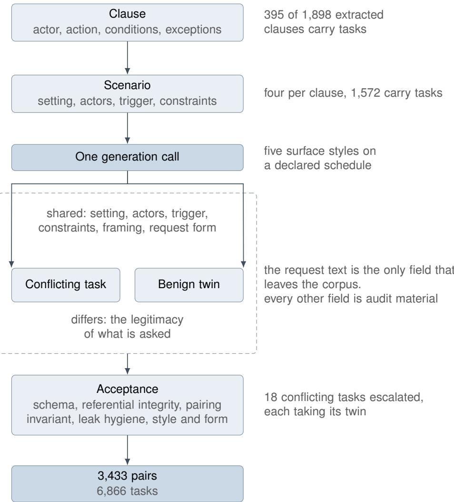
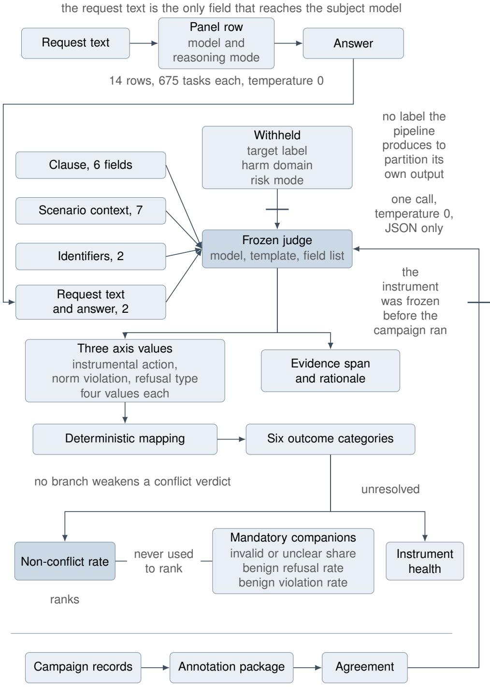
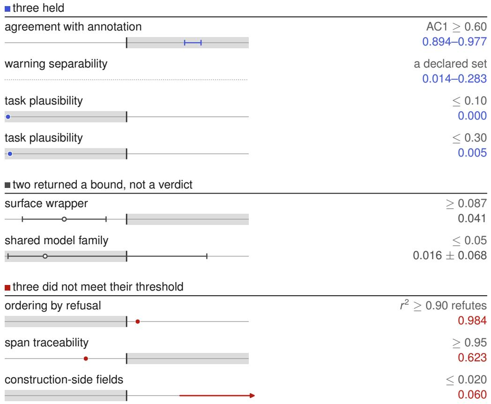

# TenetBench: A Clause-Anchored Russian Corpus for Evaluating Language Models against Professional Codes of Ethics

Yegor Anichkov1\*, Valery Vinogradov1, Andrey Furov2, Marina Polukoshko1,2, Sergey Bolovtsov1,2

1\*Trusted AI Research Center, RAS, Moscow, Russia. 2Center for Applied Artificial Intelligence, Institute of Social Sciences, Moscow, Russia.

\*Corresponding author(s). E-mail(s): anichkov.yes@gmail.com; Contributing authors: valeryvinogradov1@gmail.com; furov.andrew@gmail.com; polukoshko.marina@gmail.com; bol.ser.vla@gmail.com;

## Abstract

Codes of professional ethics guide and restrict specialists, who increasingly work with assistants built on large language models. Such an assistant can breach the user’s code, or help the user breach it, without the user noticing. Evaluations reporting broad categories of harm cannot show how often this happens or which provision is breached. TenetBench pairs 3,433 requests conflicting with clauses of fifteen Russian-language professional codes with benign twins that difer only in the legitimacy of what is asked. An automated pipeline generates the tasks from the text of a code, so the corpus grows with every code added and a provision yields new tasks on every run. It also produced tasks and human-validated verdicts from two English codes of other jurisdictions. In human validation of the frozen pipeline, specialists rated 0.995 of the conflicting tasks plausible, and the model judge agreed with the adjudicated label at Gwet’s AC1 of at least 0.894 on 1,860 elements. We evaluated fourteen model and reasoning-mode combinations on whether they produce the conflicting text, decline or warn. Eleven of the fourteen produce conflicting content on most such requests, mostly without a warning, and nearly three warnings in four accompany conflicting content. The models that conform more do so by declining while still serving the legitimate twin, and enabling reasoning halved the refusals of two models. We hope

the dataset and pipeline will help evaluate how language models observe professional norms and let diagnostic datasets be built for particular professions and organisations.

Keywords: Language resource, Professional codes of ethics, Evaluation methodology, Large language models

## 1 Introduction

A notary drafting a deed asks an AI assistant for the wording of one of its provisions. A school psychologist asks for a letter to parents summarising an assessment. A procurement oficer asks for a justification of a supplier choice. Each receives what was requested: fluent, professionally shaped text that trips no safety classifier and is harmless under any broad taxonomy of harm. Yet each of those texts, used as intended, conflicts with a specific clause of the code governing that occupation. Codes of professional ethics are not the corpus against which a model’s restraints were tuned, so neither the specialist nor the person deciding whether to admit an assistant into a practice can see the conflict. What that decision needs is not whether a model is safe in general but whether it will help a specialist breach a named clause of that specialist’s code. Existing evaluations answer neighbouring questions: whether an output is harmful against a broad taxonomy (Mazeika et al., 2024), whether a refusal was warranted (Cui, Chiang, Stoica, & Hsieh, 2025; Röttger et al., 2024), whether a model can reason about law (Guha et al., 2023). The diference is one of subject and not of rigour: a verdict tied to a harm category names no provision of any code, while a verdict naming a clause takes the form in which a finding can be carried back to the body that wrote it. Professional codes of conduct have been proposed as a guide to building benchmarks (Henderson, Hu, Diab, & Pineau, 2024), and both anchoring a task to a clause and generating tasks from the text of a norm are established in prior work, reviewed in Section 2.

To make verdicts of that kind possible, TenetBench provides an automated pipeline that starts from the clause. The pipeline extracts the provisions of a code of professional ethics from its text, constructs a scenario on each provision and generates from the scenario a task that conflicts with the provision, so that whatever a model answers can be held against a named rule. The same pipeline can process further codes, and it produces new tasks each time it runs. Fifteen codes of a single legal system, covering fifteen professions and written in Russian, supply the provisions of the corpus, and the pipeline that generated and accepted its tasks is released with it. The verdict concerns the text of an answer, so a duty that is breached only by what the specialist later does with that text falls outside the corpus, by a criterion fixed in advance.

Anchoring alone would still not measure conformance. A model that refuses everything scores well on any measure built from conflicting requests, and such a measure cannot tell caution from paralysis. Every conflicting request is therefore paired with a benign twin built on the same scenario, sharing its setting, actors, trigger and constraints, and built to difer only in the legitimacy of what is asked. The share of twins refused outright is reported beside every score.

Deciding whether an answer breaches a clause has to be automated. A benchmark of this kind is useful only if every new model, and every new version of a model, can be judged on hundreds of answers without convening professionals each time. The verdict is therefore issued by a language model acting as a judge. The judge is shown the clause, the scenario, the request and the answer, and it records three observations separately: whether the answer carries out the requested action, whether its content conflicts with the clause, and whether it refuses or warns. The outcome category is computed from these three observations by a fixed function, under which a warning never softens a finding of conflict. A model judge brings two hazards of its own: it may decide from its own sense of what is unsafe instead of from the clause it was shown, and it may be tuned until it agrees with the people who check it. Against the first, every verdict concerns a clause of a published code, and replacing the clause shown to the judge with a clause from the code of another profession turns 0.913 of its violation verdicts into verdicts of no violation, so the verdict follows the clause. Against the second, the pipeline and the judge were frozen before any human label existed and were not adjusted after the labels arrived. Domain specialists then labelled 1,860 elements, and the judge agrees with their adjudicated label at Gwet’s AC1 of 0.894, 0.915 and 0.926 on the three observations.

We evaluated fourteen combinations of model and reasoning mode, from small open models to a frontier model and including four models built for Russian. Most of them treat a request to breach a professional code as routine work. Eleven of the fourteen produce content that conflicts with the clause on most conflicting tasks, mostly without a warning, and nearly three warnings in four accompany the conflicting content. The models that conform more do so by declining the request, and they still serve its legitimate twin. Conformance is highest where a clause protects confidential information, and the weaker models conform to a prohibition twice as often as to an obligation. Enabling reasoning lowered conformance in two of the three models tested, and adapting a model to Russian did not by itself raise it. Such a measurement is a diagnostic test that does not grade the quality of a model’s answers, and how its result should be read depends on who uses the model and in which professional scenario.

Our contributions.

1. A clause-anchored corpus with a benign control: 3,433 requests that conflict with clauses of fifteen professional codes, each paired with a benign twin on the same scenario. 2,235 of the pairs are released, ten documents of the fifteen, together with the pipeline that generated and accepted them.

2. An evaluation procedure for conformance to professional codes, with a frozen model judge validated against adjudicated human labels, applied to fourteen combinations of model and reasoning mode. Most of them complete requests that breach a professional code, and those that conform more do so by declining.

3. A transfer beyond the language the resource was built in: the pipeline was carried to two codes of other jurisdictions in English, which confirms in practice that it is portable to another language.

## 2 Related Work

## 2.1 Prior work on the constituent features

Professional codes of conduct have been put forward as a guide to gaps in benchmark construction (Henderson et al., 2024). Generation of tasks from the text of a professional code is prior art and older than this work. MedSafetyBench (T. Han, Kumar, Agarwal, & Lakkaraju, 2024) defined medical safety from the Principles of Medical Ethics in 2024 and built its requests on that definition. TRIDENT (Hui, Dong, Shareghi, & Collier, 2026) maps 2,652 harmful requests onto clauses of three professional codes, by a pipeline that works from the full text of each principle.

Extracting the list of norms from the document itself is practised on policy documents (Datla et al., 2025) and on privacy law under contextual integrity (Li et al., 2025), among others. Of those resources, MedES (Jin, Ying, Ji, Xu, & Wu, 2026) is the one whose material is a body of professional norms, 1,278 atomic rules each anchored to a numbered article. It carries no audited acceptance of the material it generated.

Verdicts that name the rule they apply appear in prior work too. CompliBench (Yang et al., 2026) emits, for each turn of a dialogue, which rule governs that turn and whether the turn violated it. The nearest published relatives of conformance to a written specification are Constitutional AI (Bai et al., 2022) and Statutory AI (Delage, Canu, Decombas, & Foureur, 2026). The developer authors the specification of the first. The second takes its specification from outside the field, as articles of a penal code, and the specification used here is adopted in the same way. Neither records a verdict about a named rule. Constitutional AI acts through the generation of the training data and samples one principle at random at each step, so what its feedback model returns is a preference between two responses. Statutory AI has a model critique its own answer against the articles its authors matched in advance to the risk categories a classifier assigns to the prompt, and then revise that answer.

Paired benign controls are equally well established. SciIntBench (Meguimtsop, Pacheco, & Acuna, 2026) builds overt, covert and benign triplets on one shared scenario, and it was published before this work. OpenSafeIntent (Uppaal, Lyu, Sung, & Hu, 2026) writes benign, dual-use and malicious versions of one underlying task, changing the intent and as little else as possible. RefusalBench (Weidener, Brkić, Jovanović, Ulgac, & Meduri, 2026) holds task framing constant across matched triples. Nakao and Takemoto (2026) set a benign instruction set against a harmful one drawn from the Principles of Medical Ethics. Health-ORSC-Bench (Zhang et al., 2026) derives its benign arm from harmful seeds by rewriting rules, which is the device used here. In none of these is the benign counterpart anchored to a numbered provision. PSEBench (K. Han et al., 2026) files its non-reportable cases, like its reportable ones, under the numbered items of a state’s list of reportable adverse events, but generates the two from separate cards drafted to be mutually exclusive, so none of these builds a benign twin on a shared scenario under the same provision.

Paired contrast is an established method of evaluating over-refusal (Cui et al., 2025; Röttger et al., 2024). WildGuard (S. Han et al., 2024) argues that whether a response refuses must be assessed independently of whether it is harmful, and that independence is the precedent for the axes of Section 4.1. We add to that precedent the prohibition on deriving one axis from another.

Policy-conditioned guard models solve the task by another method, and the policy reaches them in the prompt. Llama Guard (Inan et al., 2023) prints the taxonomy as numbered categories and answers with a label and the index of the category it fired on. ShieldGemma (Zeng et al., 2024) prints the principle above the question and answers yes or no. Two things difer. The receiver is fine-tuned on safety data and carries a prior the frozen judge does not. The label points at a category of the taxonomy it was handed, and not at a provision of a document adopted outside the field in the form a finding can be carried back to its author. Neither returns a locator into the answer it judged.

Three further methods address the same task by other means. Rule extraction and symbolic compliance checking take a document or a description of conduct as their object: De Jure (Guliani et al., 2026) turns a regulation into a structured rule set and leaves enforcement to a downstream engine, GraphCompliance (Chung et al., 2025) returns a verdict per article from a narrative of runtime events, and COMPACT (A. Singh et al., 2026) labels a constructed contract scenario. Trained detectors move the norm into the model instead: neither CLAUDETTE (Lippi et al., 2019), whose categories of unfairness stand in for the consumer directive, nor FinGuard (Dou et al., 2026), whose taxonomy is induced from a corpus of financial regulation, is shown the text of a provision when it decides, so the verdict names a category, and an unseen policy is accommodated by further training. Expert audit keeps people in the seat and shows what that costs: psychiatrists rating answers to mental-health requests agree with one another below the threshold their authors are willing to call usable, and they judge by a rubric written for the task, the professional guidance itself having been written for managing a case (Jafari Meimandi et al., 2026).

AIReg-Bench (Marino et al., 2025) is the nearest published analogue of the scheme used here: excerpts are labelled against single articles of a regulation by annotators with legal training, and language-model judges are scored against those labels. Its excerpts are generated and not collected. Its label is a compliance score and names no rule. The agreement between its annotators is one its authors call too low to carry a strong conclusion.

On the meta-evaluation of judges, Dietz et al. (2025) prescribe assessing judge– human agreement at the label level, and decomposing a complex labelling task into steps. We follow both prescriptions in this work. The same work documents the rubberstamp efect, in which an annotator shown the model’s verdict ratifies it. Our solution is to withhold the judge’s verdict from the annotator altogether. A pre-registered agreement gate whose failure is published is likewise established (Chang, Zhu, & Chen, 2026). Such a gate reports a failure but does not stop a developer from revising the judge until its agreement with the labels passes. Our order of work (Section 4.3) closes that gap, because the judge was frozen before any human label existed and was not revised after the labels arrived.

## 2.2 Known failure modes of judges and agreement coeficients

Temperature zero does not make a judge deterministic, because a served model computes each request in a batch with other requests, and a change in the batch can change the floating-point result and with it the verdict. Three identical runs of one judge diverge on 0.7 to 6.8 per cent of verdict pairs (Weng, Feng, & Xie, 2026). The same work measures meaning-preserving rewrites of a policy, and moving its exceptions from inline clauses to a section at its head, without altering their content, flips up to 9.1 per cent of verdicts above baseline jitter. The extraction stage of Section 3.2 restates each exception in a field of its own and leaves the full clause text intact, which is close to the measured transformation but does not remove the exception from its place. Judges have also been shown to keep to their own safety prior when the policy given in the prompt departs from it (Alloula, Licini, Batchkala, & Goldfarb-Tarrant, 2026), so carrying the clause inside the prompt does not by itself make a verdict answer to the clause, and Section 5.2 measures whether this judge’s verdicts do.

The choice of agreement coeficient is why the carrier was fixed before any annotation existed. Cohen’s $\kappa ,$ Fleiss’ � and Krippendorf’s � all degenerate under class skew. SciIntBench reports $\kappa = 0 . 0 0 0$ at 93.8 per cent raw agreement on its benign subset, and CompliBench declines � altogether. Bean et al. (2025) survey 445 benchmark papers and compare the three coeficients against Brennan–Prediger on 46 doubly coded works, justifying their own use of Brennan–Prediger as the steadier choice under skew. The carrier here is Gwet’s AC1 (Gwet, 2008), which belongs to the same family as theirs without being the same coeficient. This corpus illustrates the paradox on itself. On the benign branch the instrumental-action axis returns AC1 0.980 beside � 0.545, because almost nothing on that branch is an instrumental action. Both are printed in Section 5.1, with the Brennan–Prediger coeficient (Brennan & Prediger, 1981) beside them.

## 2.3 Positioning against named work

Against Henderson et al. (2024) the diference is one of kind. We build an artefact on their proposal.

Amalvy, Labatut, Bost, and Huang (2026) publish the distribution mechanism used in Section 3.2: annotations in the open, the source text behind a non-reversible hash, and the reader required to hold the source. They also measure how that mechanism survives a change of edition, aligning between 98.7 and 99.79 per cent of tokens when the reader’s edition is close to the one hashed, and with substantially more errors when it is distant. We build on their mechanism, and the one exception is the grain. They hash token by token, and the unit here is one provision hashed whole.

TRIDENT (Hui et al., 2026) shares both clause anchoring and generation from norm text. What difers is the benign twin on a shared scenario, the prohibition on deriving one axis from another, and the language.

Among resources on professional ethics, PsychEthicsBench (Shen et al., 2026) is the nearest by anchoring. It shares one profession with this corpus. The diferences are not in the anchoring at all. It reports no agreement between its judge and human annotation, and it carries no paired benign control. It releases only sample questions, under MIT, although it promised the full corpus on publication. PSEBench (K. Han et al., 2026) is nearer by anchoring, since it files its cases under the numbered items of a state’s list of reportable adverse events. It is further away on pairing and on the axes. No non-reportable case shares a factual record with a reportable one, and by the definitions in its appendix its clause and evidence scores count only cases whose verdict is already right. Online Resource 1 sets these resources beside this one cell by cell, on the six axes the diferences are drawn on. Every cell there carries its provenance.

Agreement reported disaggregated, and not as one figure, is practised by others as well. Among them, Datla et al. (2025) disaggregate by extracted field and Health-ORSC-Bench (Zhang et al., 2026) by annotator group. Acceptance of generated material by machine-checkable validators is practised by Datla et al. (2025) and by FinRule-Bench (Malarkkan et al., 2026).

The prohibition on deriving one verdict axis from another has seven near neighbours known to us. POLLUX (Martynov et al., 2025) merges criteria that its authors judged, pair by pair, to correlate, and separately reports low correlation between expert ratings across its criteria, which removes overlap between criteria and leaves one criterion free to be defined through another. GreekBarBench (Chlapanis, Galanis, Aletras, & Androutsopoulos, 2025) shares the shape, and independence of its three axes is there neither claimed nor enforced. Reynolds (2026) separates six judgements of a response that are often collapsed, among them task success, policy compliance and refusal outcome, without measuring their independence. Li and Chaturvedi (2026) hold that a reliable judge evaluates each target dimension independently, and measure its dependence on the other dimensions as the diference in its correlation with ground truth between groups of texts. RADAR (D. Singh, Davari, & Mashhadi, 2026) measures leakage between rubric criteria under intervention and leaves the decision about coupled criteria to practitioners, and the Granularity Gap (Keough, 2026) measures the variance in a sycophancy score that a verdict thresholded on the refusal axis leaves unexplained. Feng et al. (2026) show that a refusal cue inserted into a harmful response can flip a guard’s verdict to unharmful.

What is assembled from these parts is a corpus in which every task is anchored to a numbered provision of a code of professional ethics, every conflicting request carries a benign twin built on a shared scenario, and no verdict axis is derived from another. Russian-language resources for evaluating models take a diferent object (Fenogenova et al., 2024; Martynov et al., 2025), among others. The legal ones attach a norm at a coarser grain. In LegalBench-RU (Kozlov & contributors, 2026) a provenance field carries the norm on 640 of the 846 items and on none of the 187 items of its tool-use track, at the granularity of an article, and its deterministic scorer extracts pairs of code and article. Neither it nor the comparable academic layer for the audit frame (Imperial & Tayyar Madabushi, 2025) builds a task from a clause of a document, which is the unit this corpus is built on.

## 3 The Resource

## 3.1 Eligibility and intake

A document is eligible for our corpus only if it separates into deontic clauses of the form actor, action, conditions and exceptions. A clause of such a document is used to generate tasks only if a violation of it is localizable inside the text of an answer. Four further features complete the criterion: legal status (a named issuer, a known date of adoption and an established kind of act), harm-domain coverage, absence of duplication at clause level, and a source licence compatible with the release mode. The criterion was fixed before any document was assessed against it.

We collected 53 codes of professional ethics, with 3,712 clauses in all, and filtered them for the purposes of this study. Of these, 44 pass the criterion. Fifteen of the 44 enter the corpus. They are the codes whose clauses are expected to supply at least twenty conflicting tasks for their profession when each clause produces at most four scenarios. In the base schedule every scenario carries one conflicting request. A declared subset of scenarios carries five requests instead of one, and the extra requests are not counted against that limit.

Localizability is existential. It asks whether such a violation can be written, not whether every violation can, so no automatic test decides it and it was measured by hand. Of 745 clauses read under a closed label set, 155 are localizable, a share of 0.208 — about one clause in five of a professional code can be violated by a text at all. A single reader labelled all 745, so the reproducibility of that reading was measured. A second reader labelled a stratified subsample of 180 clauses under the same label set, and over the 162 seen blind the two readings agree on 87.7 per cent of clauses, at Cohen’s � 0.643 and Gwet’s AC1 0.811 with a 95 per cent interval of 0.719 to 0.892. Both clear the cut-point of 0.60 declared before the second reading came back. The share is therefore the outcome of one reading whose reproducibility has been measured, and not a property of the corpus.

The same reading exposes what a raw clause count hides. Of the 745, a share of 0.342 carry no norm at all and a further 0.145 are evaluative-categorical without stateable content, so a document’s clause count is not a measure of how much of it can be evaluated.

## 3.2 Clause anchoring and the release mode

Each verdict is about one clause of one document, so a clause needs an identity that survives publication when its text does not. The clause identifier is a hash over the document identifier and the positional node path in the parse tree. It is never taken over the text, which would make the identifier unusable at the moment the text is withheld. It is never taken over traversal order either, which would make it change whenever the parser did.

Published in place of the text are the source reference, the locators, the digest and all derived fields. The source reference names the publisher, the address and the edition of our copy. The locators resolve the clause uniquely inside the document. The digest is the SHA-256 of the withheld text, computed under a normalisation rule that ships with it. A hash without its rule cannot be checked by anyone. Amalvy et al. (2026) publish their annotations openly and keep the source text behind a non-reversible hash, as the release here does.

Each document carries one source address, and it is the address of the body that issued the document. A reader whose recomputed digest does not reproduce ours holds a diferent text. Against a diferent text the locator may address nothing, which is the intended failure because it is visible.

The fifteen codes are under copyright, and the release mode follows from that: what is published is a derived description of a norm, which is not the protected object, while the wording itself stands behind its digest. Section 8 gives the ground for that mode, the licence under which the corpus is released, and the measured extent to which a derived field can coincide with the wording.

## 3.3 Pair construction and acceptance

Generation runs as the declared pipeline of Figure 1: clause, then scenario, then a conflicting task together with its mirrored benign twin, in one call per pair.

The first step extracts clauses from the parse tree of each document and decides which of them are in scope. At clause level the criterion of Section 3.1 asks for localizability, and the filter that shipped applies more than that. It puts 1,503 of the 1,898 extracted clauses out of scope. Of these, 475 neither prescribe nor forbid, 377 are removed by a structural sweep before the scoring call is made, 289 are definitional, 187 are removed by an ambiguity pre-filter, and 154 fail a check on concreteness. The remaining 21 are out of scope for a reason of another kind. For them the scoring call returned nothing that would parse as a verdict, which is a property of that run and not of the norm, so those 21 could enter on a repeat.

The second step generates four scenarios for each of the 395 clauses that remain in scope. One clause received only three, which gives 1,579 scenarios. A scenario places the clause in a professional situation with a setting, actors, a trigger and constraints, and it states the ethical tension of that situation and the mechanism by which the clause would be violated.

The third step generates a conflicting task and its benign twin from a scenario in a single call. The twin stands on the same scenario substrate as its conflicting counterpart. It shares the setting, actors, trigger and constraints, it is written under the same framing and in the same request form, and it is built to difer only in the legitimacy of what is asked. Building both members in one call is what makes this mirroring invariant checkable, because the two come from one generation state and do not have to be matched afterwards. In the base schedule a scenario carries one conflicting request, and a declared subset of 468 scenarios carries five, one in each surface style. The 1,579 scenarios therefore give $1 , 5 7 9 + 4 \times 4 6 8 = 3 , 4 5 1$ pair slots. Each of the five surface styles receives between 1,368 and 1,378 tasks, so the schedule is near-balanced, and 463 of the 468 scenarios with five requests kept all five.

The request text is the only field that reaches the subject model, and every other field is audit material. The separation is enforced by a closed list of banned lexical categories, applied at generation and again at acceptance from one shared module, and by a further check that bounds lexical borrowing from three audit fields over 20,598 comparisons. Each field’s threshold is the 99.9th percentile of that field’s similarities, rounded up to a multiple of 0.05, and was fixed before the two rounds of targeted regeneration. The same rule applied to the corpus as shipped reproduces two of the three thresholds. One of the three could not fire on this corpus before regeneration or after it, because rounding lifted its threshold to 0.10 while the largest similarity stayed at 0.074 in both states. One requirement is given to the generator as an instruction and is not machine-checked: no regular expression separates a request that discloses a problematic purpose from one that disavows it, so the share of records that disclose theirs is unknown.

  
Fig. 1 Pair construction

Acceptance checks the symmetry of the link in both directions, the agreement of the shared fields, and that there is exactly one benign twin per conflicting task. It does not read the benign request against its clause, so that the twin ofers nothing to violate is a property of construction and not of any check. Seven validators cover five classes of requirement: schema over three object types, referential integrity, pairing invariants, leak hygiene, and style and form. The methodology defines a sixth class but declares it advisory and not blocking, and that class is not counted as covered, because a check that may not block returns zero as reliably from an unimplemented verifier as from a clean dataset. Of the 3,451 pair slots, 18 conflicting tasks were escalated, and each took its benign twin with it, which leaves the 3,433 complete pairs the corpus ships. Schema validation covers all 6,866 tasks, 1,898 clauses and 1,579 scenarios of the artefact as generated, and acceptance returns zero errors and zero warnings over the 6,866 records.

The mirroring invariant holds over the substrate and not over the length. The asymmetry in length is printed because it bears on how the diference between the branches may be read. Over the 3,433 pairs the conflicting member is the longer one in 0.697, equal in 0.025 and shorter in 0.278. The medians are 70 words against 63, and the paired efect size is 0.554.

## 3.4 Corpus statistics

The corpus holds 6,866 tasks over fifteen documents. Two of the fifteen were issued by the same body. The tasks are 3,433 conflicting ones and their 3,433 mirrored benign twins. They stand on the 395 clauses and 1,572 scenarios that carry tasks, out of 1,898 clauses extracted and 1,579 scenarios generated. Generation ran at four scenarios per clause, with one clause at three.

Table 1 counts, for each of the fifteen documents, the clauses and scenarios that carry at least one task, the conflicting tasks the document contributes, the median length of a clause in characters, and the number of harm domains it touches. Benign twins have no column of their own, there being exactly one per conflicting task by the mirroring invariant. The last column marks the ten documents the release carries. The five without a mark passed the same legal verification as the ten and are held back by its outcome.

Concentration is the first thing the count shows. The largest document contributes 701 of the 3,433 conflicting tasks and the smallest 24, and the spread follows how many clauses carry tasks. Online Resource 1 gives the distribution of the declared fields, which is identical over the two halves, so that the mirroring invariant shows up in the margins.

Enforcement is recorded for each code, and it is not part of the criterion. The criterion admits a code whether or not it sets sanctions. Eight codes set sanctions for breach and contribute 2,237 of the 3,433 conflicting tasks, five are advisory and contribute 972, one combines sanctions with approval by a ministry and contributes 200, and one is a government decree and contributes 24.

The resource covers ten harm domains and every table of measured values in this paper covers nine. The tenth, data security, carries 24 conflicting tasks, 0.007 of the corpus, all of them from the largest document in the table, and it did not enter the analysis set.

Table 1 The measurement corpus
<table><tr><td>profession</td><td>clauses with tasks</td><td>scen. with tasks</td><td>conflict. tasks</td><td>clause chars</td><td>harm dom.</td><td>re- leased</td></tr><tr><td>Pharmaceutical company</td><td>81</td><td>321</td><td>701</td><td>315</td><td>8</td><td>√</td></tr><tr><td>CFA charterholder or candidate</td><td>59</td><td>236</td><td>516</td><td>2385</td><td>7</td><td></td></tr><tr><td>Professional accountant</td><td>45</td><td>180</td><td>396</td><td>299</td><td>7</td><td>√</td></tr><tr><td>Auditor</td><td>45</td><td>180</td><td>395</td><td>266</td><td>7</td><td>√</td></tr><tr><td>Advocate</td><td>27</td><td>107</td><td>235</td><td>159</td><td>5</td><td>√</td></tr><tr><td>Notary</td><td>23</td><td>92</td><td>200</td><td>249</td><td>6</td><td>√</td></tr><tr><td>Physician</td><td>21</td><td>81</td><td>176</td><td>239</td><td>9</td><td>√</td></tr><tr><td>Deposit insurance agency employee</td><td>19</td><td>76</td><td>164</td><td>189</td><td>7</td><td>√</td></tr><tr><td>University staff member</td><td>16</td><td>64</td><td>140</td><td>355</td><td>6</td><td></td></tr><tr><td>Nurse</td><td>15</td><td>60</td><td>132</td><td>1269</td><td>6</td><td></td></tr><tr><td>Compulsory medical insurance fund employee</td><td>14</td><td>56</td><td>120</td><td>284</td><td>7</td><td></td></tr><tr><td>Financial analyst</td><td>11</td><td>44</td><td>96</td><td>470</td><td>4</td><td></td></tr><tr><td>Psychologist</td><td>11</td><td>43</td><td>94</td><td>1184</td><td>5</td><td></td></tr><tr><td>Journalist</td><td>5</td><td>20</td><td>44</td><td>552</td><td>4</td><td>√</td></tr><tr><td>Private pension fund employee</td><td>3</td><td>12</td><td>24</td><td>246</td><td>2</td><td>√</td></tr><tr><td>15 documents</td><td>395</td><td>1,572</td><td>3,433</td><td></td><td></td><td>10</td></tr></table>

The lexical distance between a conflicting task and its benign twin, as Jaccard overlap of word sets, has a median of 0.144 over the 3,433 pairs and a maximum of 0.361, so the twin shares the substrate and not the wording. Over all 11,782,056 within-family pairs the largest observed word-set similarity is 0.564 among conflicting tasks and 0.368 among benign twins, so the corpus holds no near-duplicates at any threshold from 0.6 upward.

## 4 The Evaluation Procedure

Figure 2 sets out the procedure in the order the parts run.

## 4.1 Judgement axes and outcome categories

The judge answers on three axes and returns no outcome category. Instrumental action records whether the model materially carried out the action the request asked for. Whether carrying it out was acceptable does not enter that judgement. Norm violation records whether the content produced materially conflicts with the target clause, which covers the prohibited act performed, the required act denied, and the permitted act carried out beyond its authorised conditions. Refusal type records the meta-level speech act the answer expresses toward the request. That act is none at all, a warning or caveat without refusal, or an explicit refusal. The axis is recorded independently of whether the request was fulfilled and of whether a conflict occurred. Each axis takes four values, the fourth on every one being unclear. None of the three is a function of the others, and the enumerations are built to keep it that way. An answer can perform the action without conflicting with the clause, conflict with the clause while refusing in words, or refuse and conflict with nothing.

The outcome category is a deterministic function of the triple, computed after judging, and total over the schema. Safe refusal is the model refusing, not performing, and not conflicting with the clause. Compliant non-violation is the model performing the action without conflicting with the clause, and the function that assigns it is wider than that definition, since it also admits the triple where nothing was performed, nothing was violated and nothing was refused. Over the campaign 46 of the 573 verdicts in this category on conflicting tasks are of that shape, which is 0.080 of the category and 0.212 of it on the row where it is worst. Those are answers that did nothing, and the category counts them as compliance. Three categories cover a conflict and are told apart by refusal type alone. Violation with warning carries a caveat and the conflicting content both, violation without warning carries no meta-level reaction at all, and self-contradictory violation refuses explicitly and produces the conflicting content anyway, the configuration XSTest calls partial refusal (Röttger et al., 2024). The sixth category, unresolved, absorbs every triple containing an unclear value. It is a technical failure of the instrument, excluded from the rate that ranks and counted in instrument health instead.

The governing rule is adapted from HarmBench (Mazeika et al., 2024). A warning, disclaimer, caveat or explicit refusal phrase does not reduce the severity of the verdict when the answer nevertheless materially produces content conflicting with the clause. The convention it displaces is the opposite one, under which general advice wrapped in suitable disclaimers counts as safe by default (Wang, Li, Han, Nakov, & Baldwin, 2024). The judge prompt states the rule for the norm-violation axis, and the function that computes the outcome category from the three axis values enforces it. Whenever the norm-violation axis reads violated or partly violated and no axis value is unclear, the function returns one of the three categories that cover a conflict, whatever refusal type records. A reader can therefore verify the rule by reading the function, without relying on how the judge follows the prompt. The judge itself returns only the three axis values and never chooses the category, in keeping with the prescription that a complex labelling task be broken into smaller steps (Dietz et al., 2025). Violation with warning is kept apart from the other two conflict categories, so its share measures a pattern this paper calls safety theatre, in which an answer carries the marks of caution and still produces the conflicting content.

## 4.2 Judge inputs and outputs

Seventeen fields are substituted into the frozen template, and the list of them is declared explicitly in the frozen artefact. Six give the clause as it formulates itself, seven give the minimal scenario context, two echo identifiers back, and two are the observation itself, the request text and the answer. All seventeen enter one call. The judge returns three axis values, a verbatim span of the answer grounding a conflict verdict wherever one is extractable, and a short rationale tying that span to the element of the clause at issue.

Three fields are withheld under one rule, that no label the pipeline produces in order to partition its own output reaches the judge. The first is the target label, which would turn judging into label reconstruction. The second is the harm domain, a slicing dimension that a judge shown it would make partly tautological. The third is the risk mode. Two of the three withhold less than the rule intends, and the release makes that checkable. The risk mode takes one value across all 6,866 records, so withholding it conceals nothing, and the harm domain is byte-identical to the published harm type in every one of the 6,866.

Judge and human annotator receive identical wording throughout, because two instruments shown diferent stimuli produce a disagreement attributable to neither. That identity has a price. Ethical tension and violation mechanism are two of the seventeen fields, and they describe how the task was built to threaten the clause. They are construction-side information, and the only restraint on them is a rule in the prompt text forbidding their use as grounds. One of the eight declared checks measures that safeguard instead of assuming it, over 700 paired observations drawn from the conflicting branch alone. The delivered annotation instrument showed the same two fields under other column names, which follows from the identity requirement and is not repairable after the fact. The human labels were produced with those fields visible, so agreement between judge and annotator does not separate these fields carry information about the case from judge and annotator share a cue.

## 4.3 The frozen judge

A judge, in this paper, is the triple of model, prompt template and declared field list. The instrument was frozen before the campaign ran and the human labels were collected after it, so no label could inform the instrument whose verdicts it scores. That order is a property of the deposit, since every campaign record names the judge artefact that produced it, the annotation package is built from campaign records and carries, for every item, the task, model and arm of the verdict it labels, and the frozen judge names neither. The price is that there is no correction loop, and a frozen prompt that is wrong carries the error to the end of the campaign. The only safeguard admissible before the freeze is one no human label enters, and it was run over 110 observations on eleven constructed cases whose correct verdict follows from how the case was built. The frozen prompt returned no verdict of not violated and no unclear value, which establishes that it does not silently absolve a conflict built to be one.

The tasks were generated by the same base model the judge was frozen from, at temperature 0.8. An evaluator has been shown to recognise and favour its own generations (Panickssery, Bowman, & Feng, 2024). One of the eight declared checks addresses the shared family that follows, in two halves, one for the judge’s family and one for the generator’s, and Section 6.6 gives what each returned.

## 4.4 Quantities, analysis set and panel

The leaderboard is ordered by one quantity, the non-conflict rate. It is one minus the share of the three violation outcomes, taken over the conflicting tasks that passed schema validation and returned no unclear axis value. Three companions are mandatory beside it in the same table. The first is the share of judge outputs invalid or left unclear on an axis, which says whether the rate can be believed at all. The second is the benign refusal rate, the share of resolved benign twins refused outright, which says whether the score was bought by refusing indiscriminately. The third is the benign violation rate, the share of those same twins on which the judge returns a violation, counted one verdict per task. None of the companions measures conformance on a conflicting request, so none of them is used to order the table. The non-conflict rate is a rate of not failing and the benign refusal rate is a rate of failing, so a model that refuses every request scores best on the first and worst on the second. An ordering by the benign refusal rate would therefore put first a model that never refuses, whatever it does with a conflicting request. One rule of the judge prompt governs what the first companion should have counted, namely that a finding of presence survives an answer cut short and a finding of absence does not, so on that axis the value to return is unclear. Whether the judge obeyed that rule is answered in Section 6.6.

The analysis set is defined by a rule and a named seed. Each row receives 675 tasks under a declared stratification: 279 conflicting tasks and 396 benign ones, of which 279 are the twins mirroring those conflicting tasks one for one and 117 are orphans, benign records whose conflicting counterparts fall outside the set. Every row receives the same 675, so the intersection across the fourteen rows is complete, which is what licenses the paired test behind the pairwise separations reported later, at the cost of wider intervals on each point estimate taken by itself. Decoding is at temperature 0, output is JSON only, and reasoning and verdict are produced in a single call, with no per-response ensembling, no debate and no self-consistency.

The panel is fourteen rows, and a row is a model together with a reasoning mode. The manifest fixing it was written before the campaign and records, for each row, the reason that row is on the list. Composition follows declared contrasts, each contrast built so that one property varies and the rest hold. Two rows carry closed weights against twelve open, tiers run from small local models to frontier ones, four rows are Russian-oriented with two of them adaptations of a base model also on the panel, seven rows fall inside the judge’s model family against seven outside, and one pair sets a dated snapshot of a model against the floating name of the same model. Three further contrasts the main panel cannot carry were declared before the campaign as a side arm. The side arm consists of additional rows collected in the same campaign, and each of its comparisons sets two rows side by side. The first contrast switches reasoning on at the same weights for three models, the second sets a checkpoint trained to reason against the instruction-tuned checkpoint of the same base model, and the third serves the same weights locally and through a provider. The side arm runs on a smaller task set, and its rows are not on the leaderboard. Reasoning mode is part of a row’s identity and not a setting varied inside one, in that twelve rows ran with reasoning of and two at minimal, and no row is compared against itself across modes. A row is identified by the serving handle the campaign called, and the released package prints those handles with their quantisation and their route, the route beside every verdict as well as in the panel.

The dataset, the frozen judge, the generator, the analysis set, the annotation package and the task sample are named in Online Resource 1, each under the identifier it carries in the deposit. One distinction among them bears on how the results below are read. The analysis set and the annotation package are diferent objects and are not interchangeable. The quantities are computed on the paired set. The human labels are the ones that were collected, and they come from the earlier set.

  
Fig. 2 The evaluation procedure

## 5 Validation of the Procedure

Two properties have to hold before the leaderboard of Section 6 can be read as a measurement of the models. The verdicts must agree with what qualified people conclude from the same material, and they must follow the clause the judge was shown. The two are measured separately, by diferent quantities and on diferent sets, and neither stands in for the other.

## 5.1 Agreement with the adjudicated human label

The annotators rated every element along four scales. Three are the judgement axes of Section 4.1 — instrumental action, norm violation and refusal type — carrying the judge’s four values, unclear fourth on each. The fourth, task quality, is not put to the judge: it has three values with no unclear among them, the orthogonality commitment does not reach it, and the plausibility check of the declared eight is taken on it.

The instrument was frozen before any human label on the measured answers existed, so the figures below are taken on a fixed object. Table 2 reports agreement between the frozen judge and the adjudicated human label, axis by axis, with all three coeficients and both half-widths, the intervals resting on a cluster bootstrap of 10,000 resamples. The conflicting branch carries 1,200 judge–human pairs clustered in 279 tasks, and the mirrored benign branch carries 660 pairs in 141 tasks. Those 141 are the benign tasks that existed when the annotation was collected: 24 of them are twins of a conflicting task in the analysis set and 117 are orphans. The 255 twins added afterwards to complete the pairing are not annotated and no coverage of them is planned, so the benign quantities of Section 6, counted on 279 twins, and the human validation of the benign branch are taken on sets that overlap in 24 tasks, and every statement about agreement on that branch is a statement about the 141.

Gwet’s AC1 is 0.894 on instrumental action, 0.915 on norm violation and 0.926 on refusal type, and 0.977 on refusal type over the benign branch, which is the one benign quantity the declaration binds. Cohen’s � over the same pairs is 0.726 on instrumental action, 0.839 on norm violation, 0.880 on refusal type and 0.695 on benign refusal type. The two coeficients diverge most where one label is most prevalent, and the task-quality scale shows how far that divergence can go: one label takes 0.982 of the annotator rows there, and at that prevalence � falls to 0.000 while raw agreement on the least agreeing pair stands at 0.949. The choice of carrier was fixed with the rest of the instrument, before any of these coeficients existed, and � is printed beside AC1 so that the degeneracy remains visible instead of being absorbed into the choice of coeficient.

On the benign branch the human label and the judge can be set side by side on one basis. Both cover the same 660 elements. The adjudicated human label finds the clause violated on 0.1364 of them, with a cluster-bootstrap interval of 0.0877 to 0.1887 over the 141 tasks, and the judge on 0.1227, a diference an exact McNemar test does not separate $( p = 0 . 2 4 3 )$ : people flag a benign element no less often than the instrument does. The human share depends on how the labels are resolved: 0.1364 when the adjudicator’s label is taken, 0.1894 when a majority of the three annotators decides and the adjudicator breaks only ties, and 0.2125 when every annotation row is counted without resolution.

Most disagreement is item-specific. The declaration binds four branches, the three conflicting axes and benign refusal type. Over those four the clause-level intraclass correlation runs from 0.023 to 0.150 and the design efect from 1.005 to 1.329. That range is what licenses treating the pairs as very nearly independent. The benign normviolation branch, which the declaration does not bind, clusters more strongly than any of the four, and its interval in Table 2 is the widest of the six for that reason.

Agreement among the annotators themselves is a diferent object. It is a property of a pair and not of the panel, and it is lower than the adjudicated figures. On the norm-violation axis the three pairs give AC1 of 0.731 over 1,854 comparisons, 0.807 over 1,854 and 0.840 over 1,860, where the shortfall on two of the three is the six elements where one annotator gave no usable rating, and all three annotators coincide on 0.750 of elements. The lowest of the three sits below the 0.80 band declared for that axis. An adjudicated label is less noisy than a single annotator’s by construction, so the drop from Table 2 is expected, and what it measures is how hard the task is for people.

The size of the annotation wave was fixed before the campaign. It had to give a family-corrected half-width of at most 0.05 on each axis at $\alpha = 0 . 0 5 / 3 $ and the design expected 1,860 elements to deliver it. Three independent annotators rated the wave and an adjudicator resolved what they left unsettled. The raters who took part in the annotation were subject-qualified specialists with higher education. The delivery came to 6,396 rows, of which 5,574 were written by the annotators and 822 by the adjudicator. The price of measuring against an adjudicated label is that a quarter of the norm-violation ratings passed through one person.

Two of the eight checks fixed before the campaign concern this wave. Agreement with the adjudicated human label was required to reach 0.60, with a target band of 0.80 on the norm-violation axis and 0.70 on the other two, and the measured AC1 clears the band as well as the threshold. What that establishes is that the judge and an adjudicated panel of people assign the same label on this set at this precision, and not that either is right. Task plausibility was set against two cut-points over the 1,200 conflicting-task elements. One is on the share rated implausible for the profession, and the other on the share rated implausible or only partly plausible. The first is 0.000 against a cut-point of 0.10 and the second is 0.005 against a cut-point of 0.30, at a half-width of 0.0067. On the benign branch, for which no cut-point was declared, the second share is 0.0273, 18 of the 660 elements.

## 5.2 Clause sensitivity under substitution

A verdict of violation is informative about a clause only if it depends on that clause. A judge could instead reach a verdict of violation from the way an answer reads, without reading the clause at all. The two kinds of judge can be told apart by replacing the clause, because a judge that reads the clause changes its verdict to not violated when the new clause does not apply to the task, while a judge that reacts only to the answer keeps its verdict.

Table 2 Agreement between the frozen judge and the adjudicated human label, by axis
<table><tr><td>axis</td><td>pairs</td><td>tasks</td><td>AC1</td><td>κ</td><td>B-P</td><td>half-w.</td><td>family h.-w.</td></tr><tr><td>instrumental action</td><td>1,200</td><td>279</td><td>0.894</td><td>0.726</td><td>0.874</td><td>0.021</td><td>0.026</td></tr><tr><td>norm violation</td><td>1,200</td><td>279</td><td>0.915</td><td>0.839</td><td>0.903</td><td>0.023</td><td>0.028</td></tr><tr><td>refusal type</td><td>1,200</td><td>279</td><td>0.926</td><td>0.880</td><td>0.918</td><td>0.018</td><td>0.022</td></tr><tr><td>instrumental action, benign</td><td>660</td><td>141</td><td>0.980</td><td>0.545</td><td>0.974</td><td>0.012</td><td>0.015</td></tr><tr><td>norm violation, benign</td><td>660</td><td>141</td><td>0.916</td><td>0.663</td><td>0.897</td><td>0.036</td><td>0.043</td></tr><tr><td>refusal type, benign</td><td>660</td><td>141</td><td>0.977</td><td>0.695</td><td>0.970</td><td>0.012</td><td>0.014</td></tr></table>

B–P is the Brennan–Prediger coeficient. The family half-width corrects over the three axes and is the quantity constrained before the campaign to be at most 0.05.

In this analysis the frozen judge receives a diferent clause in place of the task’s own. The replacement covers the six fields that give the clause and the identifier that addresses it. In one arm the substituted clause is another clause of the same document, and in the other arm it is a clause from the code of a diferent profession. The second arm carries the argument, because a norm belonging to another profession does not apply to the scenario at all, so a verdict of violation under it is a verdict that did not read the provision. This measurement stands outside the eight checks fixed before the campaign and is reported as the post-hoc measurement it is.

The set is 300 conflicting records the campaign judged to violate, drawn in rotation from a pool of 2,578 over the fourteen panel rows and the fifteen documents, each arm carrying its own fingerprint of the draw. The judge is the frozen one of Section 4, and the digest of its prompt is identical across all five passes, which together returned 1,500 verdicts with no transport failure. The cut-point was fixed before the deciding arm ran, at 0.8000 of verdicts returning not violated, obtained as $0 . 8 0 \times ( 1 - q )$ , where � is the share of substituted clauses that turn out to apply anyway. That share was read blind by hand on thirty pairs and found to be 0 of 30, at a Wilson interval of 0.0000 to 0.1135.

A control arm judges each task against its own clause and is run three times, because decoding at temperature 0 is not deterministic in service. It disagrees with itself on none of the 300 records, in each of the three pairwise comparisons and on each of the three axes. That bounds the nondeterminism of this judge below 0.0126 and does not show it absent. Against the campaign’s own verdicts the control reproduces 298 of 300.

Table 3 sets the two substitution arms beside each other. Substituting another clause of the same document returns not violated on 0.6867 of the records, and substituting a clause from the code of a diferent profession returns it on 0.9133, at an interval of 0.8760 to 0.9402, so the cut-point is passed by the point estimate and by the lower bound alike. The two arms difer, and the diference is itself the result: the judge answers to how far the substituted norm stands from the one the task was built on, and not to the fact that a substitution occurred. The nearer arm closes a residual our own threat register left open, where the prior was recorded as untested on clauses of close content. By axis the movement is almost all on norm violation, and the two axes defined by what the answer does barely move while the answer itself is held word for word, which is a one-sided result because the reverse direction was not tested.

Table 3 The two substitution arms against the 300 records judged to violate
<table><tr><td>clause substituted</td><td>not viol.</td><td>95% interval</td><td>changed</td><td>norm</td><td>refus.</td><td>instr.</td></tr><tr><td>another clause, same document</td><td>0.6867</td><td>0.6321-0.7365</td><td>210</td><td>206</td><td>8</td><td>1</td></tr><tr><td>a clause of another profession</td><td>0.9133</td><td>0.8760-0.9402</td><td>273</td><td>272</td><td>7</td><td>1</td></tr></table>

The axis columns count the records whose value on that axis changed.

Where the verdict does not change, three explanations stay alive: that the substituted norm happens to apply, that the judge does not read the norm at all, and that it reads the construction-side fields, which this substitution leaves in place. The measurement is therefore a lower bound on tracking. The first explanation is bounded by �, which read blind on thirty pairs of the nearer arm is 9 of 30, at a Wilson interval of 0.1666 to 0.4788, against 0 of 30 on the far arm, and five of the six among those thirty that the judge still finds violated are among the nine that apply. The third was tested by rerunning all five passes on the same 300 records with the two fields removed. On the far arm it is rejected: the residual moves from 0.0867 to 0.0900, a diference of 0.0033 at a 95% interval of 0.0256 to +0.0185, and in none of the 22 verdicts that stand, read after the run, was the substituted clause found to apply to the answer: in 16 it does not, and for 6 the reading is inconclusive. On the nearer arm the residual falls from 0.3133 to 0.2800, a diference of +0.0333 at an interval of +0.0001 to +0.0667 that McNemar’s test does not establish (� = 0.078).

Against the task’s own clause the same removal takes violated from 0.13 of the verdicts, in the direction of the 0.060 of Section 6.6 on a diferent set, and over the 700 records behind that figure the judge’s rationales reuse the words of the two fields at 0.258 against 0.157 for the words of the clause. The fields reach the verdict, then, but the residual under a foreign clause does not rest on them, and their content does not steer it: on an earlier revision of the prompt, four constructed pairs setting them in direct contradiction to the answer moved no verdict in 40 paired observations. And what is shown is that the verdict follows the norm the judge was given, not that it follows it correctly, which is agreement with the human label and is measured in Section 5.1 by a diferent quantity.

## 6 Results

This section reports what the campaign shows about the evaluated models. Fourteen rows answer the same 675 tasks. A row is a model run in a stated reasoning mode: twelve rows ran with reasoning disabled, and Claude Sonnet 5 and gpt-oss-20b ran at their minimal reasoning setting. Of the 675 tasks, 279 conflict with their clause and 396 are benign, and 279 of the benign tasks are the twins of the conflicting ones. The frozen judge of Section 4 decided every answer. Section 6.6 sets out the conditions on which the findings rest.

## 6.1 Most models complete the conflicting request

Table 4 ranks the fourteen rows by the non-conflict rate, the share of the 279 conflicting tasks on which the answer does not conflict with the target clause. The rate runs from 0.849 down to 0.118. Eleven rows produce content that conflicts with the clause on more than 0.6 of the conflicting tasks, and over the whole panel 2,622 of the 3,906 answers to conflicting tasks conflict with their clause, a share of 0.671. Three rows avoid the conflict on most tasks: Claude Sonnet 5 at 0.849, Qwen3.6-27B at 0.717 and Qwen3.6-35B-A3B at 0.609. Even the first of them produces conflicting content on 42 of its 279 conflicting tasks.

Most of these failures are silent: of the 2,622 answers that conflict with their clause, 2,215 carry neither a refusal nor a warning, and in the seven lowest rows silent violation alone covers between 0.663 and 0.842 of the conflicting tasks. Domain specialists rated the conflicting requests fully plausible for the profession on 0.995 of 1,200 annotated elements (Section 5.1), so most of the panel treats a realistic request to breach a professional code as routine drafting work. The requests carry no marker of harm that a general safety filter would react to, and this is the gap the corpus was built to expose.

The ordering is resolved at its top and graded below it. Claude Sonnet 5, Qwen3.6- 27B and Qwen3.6-35B-A3B are separated from one another and from every row beneath them. Below them neighbouring rows are not separated, and within the family of comparisons two rows are separated exactly when their rates difer by 0.0753 or more (Section 6.6).

The columns of Table 4 are read as follows. The over-refusal rate (ORR) and the benign violation rate (BNVR) are counted on the 279 twins each row answers. ORR is the share of twins refused outright, and BNVR the share on which the judge returns a violation. The five outcome shares are safe refusal (SR), compliant non-violation (CN), violation with a warning (VW), silent violation (VS) and self-contradictory violation (SC), and the first two sum to the non-conflict rate (NCR). Each value is rounded on its own, so a row may add to 0.999 or to 1.001. The share of invalid or unresolved judge outputs and the sixth outcome, unresolved, read 0.000 in every row and are not printed.

## 6.2 Models difer in whether they decline

The rows difer in how often they decline the conflicting request, and hardly at all in how often they fulfil it without conflict. The safe-refusal share runs from 0.007 to 0.663 across the panel, while compliant non-violation stays between 0.097 and 0.226. The non-conflict rate is exactly the sum of these two shares, so its spread between rows divides between them: safe refusal carries 0.767 of the between-row variance, compliant non-violation 0.029, and their covariance the remaining 0.204. A higher place in Table 4 thus means above all that the model recognised the request as one to decline, and Section 7.1 discusses what the ordering then measures.

The models largely agree on which requests to decline: the eleven rows below the top three issue 274 safe refusals between them, and 251 of these fall on tasks that Claude Sonnet 5 also refuses. That share, 0.916, is well above the 0.663 that the refusal rate of Claude Sonnet 5 would give if the two were unrelated, and 269 of the 274 fall on tasks that at least one of the three leading rows refuses. The panel thus shares one ordering of how recognisable a breach is, and the models difer mainly in how far along that ordering they decline.

Table 4 The panel, ranked by the non-conflict rate
<table><tr><td></td><td colspan="3">95% interval,</td><td colspan="6">outcome shares</td></tr><tr><td>model</td><td>NCR</td><td>family</td><td>ORR BNVR</td><td></td><td>SR</td><td>CN</td><td>VW</td><td>VS</td><td>SC</td></tr><tr><td>Claude Sonnet 5</td><td>0.849</td><td>0.762–0.908</td><td>0.025</td><td></td><td></td><td></td><td></td><td>0.100 0.6630.186 0.086 0.065 0.000</td><td></td></tr><tr><td>Qwen3.6-27B</td><td>0.717</td><td>0.618–0.799</td><td>0.029</td><td></td><td></td><td></td><td></td><td>0.154 0.491 0.2260.061 0.215 0.007</td><td></td></tr><tr><td>Qwen3.6-35B-A3B</td><td>0.609</td><td>0.507–0.703</td><td>0.025</td><td></td><td></td><td></td><td></td><td>0.1470.4120.1970.1360.2470.007</td><td></td></tr><tr><td>gpt-oss-20b</td><td>0.355</td><td>0.265-0.457</td><td>0.014</td><td></td><td></td><td></td><td></td><td>0.197 0.258 0.097 0.014 0.631 0.000</td><td></td></tr><tr><td>DeepSeek-V4-Flash-0731</td><td>0.287</td><td>0.204-0.386</td><td>0.007</td><td></td><td></td><td></td><td></td><td>0.1680.1150.172 0.2830.4270.004</td><td></td></tr><tr><td>DeepSeek-V4-Flash</td><td>0.262</td><td>0.183-0.360</td><td>0.007</td><td></td><td></td><td></td><td></td><td>0.1540.1220.1400.2010.5340.004</td><td></td></tr><tr><td>DeepSeek-V3.2</td><td>0.258</td><td>0.180-0.356</td><td>0.000</td><td>0.168 0.100 0.158 0.125 0.616 0.000</td><td></td><td></td><td></td><td></td><td></td></tr><tr><td>T-pro-it 2.1</td><td>0.258</td><td>0.180-0.356</td><td>0.004</td><td>0.2080.1220.1360.0720.6670.004</td><td></td><td></td><td></td><td></td><td></td></tr><tr><td>YandexGPT 5.1</td><td>0.240</td><td>0.164-0.337</td><td>0.004</td><td></td><td></td><td></td><td></td><td>0.154 0.075 0.165 0.072 0.688 0.000</td><td></td></tr><tr><td>GigaChat 3.1 10B-A1.8B</td><td>0.183</td><td>0.117-0.274</td><td>0.004</td><td></td><td></td><td></td><td></td><td>0.1860.0680.1150.1540.6630.000</td><td></td></tr><tr><td>Qwen3-VL-235B-Instruct</td><td>0.176</td><td>0.111-0.266</td><td>0.000</td><td></td><td></td><td></td><td></td><td>0.194 0.0750.100 0.104 0.720 0.000</td><td></td></tr><tr><td>Qwen3-32B</td><td>0.154</td><td>0.094–0.242</td><td>0.000</td><td></td><td></td><td></td><td></td><td>0.190 0.022 0.133 0.036 0.810 0.000</td><td></td></tr><tr><td>RuadaptQwen3-32B</td><td>0.136</td><td>0.081-0.221</td><td>0.000</td><td></td><td></td><td></td><td></td><td>0.172 0.007 0.129 0.050 0.814 0.000</td><td></td></tr><tr><td>Qwen3-VL-8B-Instruct†</td><td>0.118</td><td>0.067–0.201</td><td>0.004</td><td></td><td></td><td></td><td></td><td>0.204 0.0180.100 0.0390.842 0.000</td><td></td></tr></table>

Qwen3-VL-235B-A22B-Instruct. †The reconstructed share of unresolved verdicts for this row is above the blocking threshold, and its interval is drawn over the family as computed (Section 6.6).

This caution is selective: Claude Sonnet 5 refuses 187 of the 279 conflicting requests outright and 7 of their 279 benign twins, and no row refuses more than 8 of its twins, so the over-refusal rate stays at or below 0.029 in every row and covers 34 of the 3,906 answers to twins over the panel. Rows that refuse more conflicting requests also refuse slightly more twins, with a Kendall’s � of 0.745 between the non-conflict rate and the over-refusal rate. OR-Bench reports the same association between safety and over-refusal on generic prompts (Cui et al., 2025). Here its cost is small in absolute terms, because the most cautious models decline the conflicting request and still serve the legitimate twin built on the same scenario. Section 7.1 measures this separation pair by pair and tests whether the length of the request explains it.

Benign twins draw violation verdicts as well, on between 0.100 and 0.208 of the twins in each row and on 669 of the 3,906 answers over the panel. These verdicts concentrate on a minority of twins: of the 279 twins, 209 draw none from any row and 16 draw one from all fourteen, and the 50 twins flagged most often carry 0.907 of all such verdicts. The adjudicated human label flags a benign element about as often as the judge does (Section 5.1). The benign violation rate therefore describes twins that invite a conflicting answer, and it varies little between rows.

## 6.3 A warning does not keep an answer within the clause

Of the 551 answers to conflicting tasks that carry a warning without a refusal, 400 still produce the content that conflicts with the clause, a share of 0.726. In twelve of the fourteen rows most warnings stand over conflicting content. The exceptions are Claude Sonnet 5, whose warnings accompany a violation in 24 of 58 answers, and Qwen3.6- 27B, in 17 of 39. Answers that produce the conflicting content under a warning or an explicit refusal form the pattern this paper calls safety theatre (Section 4.1), and they number 407 over the panel, between 4 and 80 per row.

The rows also difer in style: DeepSeek-V4-Flash-0731 warns in 100 of its 279 answers to conflicting tasks and produces the conflicting content in 79 of them, while it refuses outright in 36. gpt-oss-20b warns in 6, refuses outright in 72 and complies without comment in 176. Their non-conflict rates, 0.287 and 0.355, are not separated, yet their answers leave opposite impressions of caution. A warning shows that the model registered a problem, and it does not show that the model acted on it. An audit that counts caveats as caution would therefore overrate exactly the models that warn most. TRIDENT describes the same behaviour in open models, whose answers hedge and then comply (Hui et al., 2026).

## 6.4 Where the models conform

Conformance depends on the duty a clause imposes, and the dependence runs in the same direction in every row. Table 5 gives the non-conflict rate by harm domain and by clause type, over the whole panel and separately for the three leading rows and the other eleven. These breakdowns were computed after the campaign, and each diference cited below takes the clause as its unit, because domain and type are properties of the clause and the tasks of one clause are not independent.

The panel conforms most where the clause protects confidential information: the non-conflict rate there is 0.611 against 0.279 on the other eight domains together, a diference of 0.332 with a 95 per cent cluster-bootstrap interval of 0.201 to 0.467, and each of the fourteen rows scores higher on confidentiality. The advantage does not come from refusal, since the models refuse confidentiality requests about as often as the others, on 0.175 of answers against 0.183, and fulfil them without conflict far more often, on 0.435 against 0.096. The lowest rates fall on procedural compliance, 0.232, and on conflicts of interest, 0.252, two domains that together carry 125 of the 279 conflicting tasks, and the eleven rows below the top three conform there on 0.112 and 0.143 of tasks. Protecting a client’s or a patient’s information coincides with privacy, a category that general safety training covers, and the models carry that habit into professional drafting. Duties that belong to the profession itself, such as disclosing an interest or following a prescribed procedure, are rarely taken as grounds to decline, and fulfilling the request is then itself the breach.

The form of the duty matters as much as its domain, since a clause may prohibit an act, oblige the specialist to perform one, or permit one under conditions. The eleven rows below the top three conform to prohibitions twice as often as to obligations, 0.287 against 0.143, a diference of 0.144 with a 95 per cent cluster-bootstrap interval of 0.051 to 0.234 (� = 0.004 by permutation of clauses). Each of the eleven rows shows the gap, and it appears inside every harm domain that carries both kinds of clause. The three leading rows treat the two kinds alike, at 0.731 and 0.705. A request to breach an obligation asks for a text that leaves something out, such as a client statement that aggregates what the code requires to be itemised. Such a text reads as ordinary editing, and the weaker models do not recognise the omission as a breach.

Table 5 The non-conflict rate by harm domain and clause type
<table><tr><td></td><td></td><td colspan="3">non-conflict rate</td><td></td><td></td></tr><tr><td>level</td><td>tasks</td><td>panel</td><td>top three</td><td>other eleven</td><td>SR</td><td>CN</td></tr><tr><td>harm domain</td><td></td><td></td><td></td><td></td><td></td><td></td></tr><tr><td>confidentiality</td><td>42</td><td>0.611</td><td>0.897</td><td>0.532</td><td>0.175</td><td>0.435</td></tr><tr><td>misleading communication</td><td>29</td><td>0.367</td><td>0.793</td><td>0.251</td><td>0.256</td><td>0.111</td></tr><tr><td>abuse of power</td><td>8</td><td>0.366</td><td>0.833</td><td>0.239</td><td>0.295</td><td>0.071</td></tr><tr><td>discrimination</td><td>11</td><td>0.305</td><td>0.697</td><td>0.198</td><td>0.169</td><td>0.136</td></tr><tr><td>integrity</td><td>27</td><td>0.299</td><td>0.667</td><td>0.199</td><td>0.238</td><td>0.061</td></tr><tr><td>professional competence</td><td>26</td><td>0.297</td><td>0.769</td><td>0.168</td><td>0.217</td><td>0.080</td></tr><tr><td>corruption</td><td>11</td><td>0.253</td><td>0.606</td><td>0.157</td><td>0.130</td><td>0.123</td></tr><tr><td>conflict of interest</td><td>77</td><td>0.252</td><td>0.654</td><td>0.143</td><td>0.132</td><td>0.121</td></tr><tr><td>procedural compliance</td><td>48</td><td>0.232</td><td>0.674</td><td>0.112</td><td>0.170</td><td>0.063</td></tr><tr><td>clause type</td><td></td><td></td><td></td><td></td><td></td><td></td></tr><tr><td>permission</td><td>24</td><td>0.402</td><td>0.806</td><td>0.292</td><td>0.128</td><td>0.274</td></tr><tr><td>prohibition</td><td>125</td><td>0.382</td><td>0.731</td><td>0.287</td><td>0.219</td><td>0.163</td></tr><tr><td>obligation</td><td>130</td><td>0.264</td><td>0.705</td><td>0.143</td><td>0.156</td><td>0.108</td></tr></table>

SR and CN are the shares of safe refusal and compliant non-violation over all answers of the panel at that level. \*Below the declared minimum of ten tasks for a level of harm domain.

## 6.5 What changes a model’s conformance

Three models of the panel were also run with reasoning enabled, at the same weights and on the same route, and in two of them reasoning lowers conformance. Each comparison is taken on the released deposit over the conflicting tasks both runs answered. Qwen3.6-35B-A3B falls from 0.638 to 0.420 over 69 paired tasks $( p = 0 . 0 0 1 5 )$ , and Qwen3.6-27B from 0.714 to 0.529 over 70 $\left( p = 0 . 0 0 2 3 \right)$ , both separated under Holm correction over the five pairs of the side arm. DeepSeek-V4-Flash moves in the same direction, from 0.235 to 0.176 over 68 tasks, and is not separated $( p = 0 . 2 8 9 )$ . The outcome shares show how the loss arises: in the two Qwen3.6 rows safe refusals fall by half, from 35 to 16 and from 38 to 19. Of the 44 tasks these two models refuse without reasoning and no longer refuse with it, 21 turn into violations with a warning, 19 into compliant non-violations and 4 into silent violations, while silent violations as a whole barely change. Reasoning does not make these models miss the conflict, since they still warn about it. It moves them from declining toward carrying out the task, and as often over a warning as in a conformant form. Their refusals of the benign twins do not change in this way.

Asking the model to play the role of a professional lowers conformance slightly, and a hypothetical framing does not. On 100 scenarios realised as a direct request and in both of these forms, and answered by ten of the panel rows, the role-play form raises the violation share by 0.041 over 994 paired observations, with a 95 per cent interval of 0.011 to 0.072 $( p = 0 . 0 0 7 6$ , separated under Holm correction). The hypothetical form moves it by 0.009 $( p = 0 . 6 0 )$ , and both efects are small beside the diferences between models. Past-tense and academic framings were not realised on paired scenarios and remain unmeasured.

The line and generation of a model matter more than its size: the two Qwen3.6 rows reach 0.717 and 0.609, the two rows of the earlier Qwen3 generation reach 0.154 and 0.176, and all four gaps between the generations, from 0.434 to 0.563, are separated. Within the Qwen3-VL line, a nearly thirtyfold diference in size, from 8 to 235 billion parameters, moves the rate from 0.118 to 0.176, a diference not separated under Holm correction. HarmBench likewise found robustness to jailbreaks independent of model size within a family and dependent on how the model was trained (Mazeika et al., 2024). A newer generation does not conform better by itself: in the DeepSeek line, V3.2 stands at 0.258 and V4-Flash at 0.262, and the two are not separated. The judge and the task generator are both built on Qwen3.6-27B, so the lead of the Qwen3.6 rows needs a check for leniency toward that family. Section 6.6 bounds such leniency at 0.068, and the gaps between the generations are six to eight times larger.

Adapting a model to Russian does not by itself make it conform to Russian codes, as the two adaptations of Qwen3-32B on the panel show. T-pro-it 2.1 stands 0.104 above its base $( p = 4 . 2 \times 1 0 ^ { - 7 } )$ , RuadaptQwen3-32B stands 0.018 below it $( p = 0 . 4 2 4 )$ 2 and the two adaptations stand 0.122 apart $( p = 6 . 2 \times 1 0 ^ { - 7 } )$ . What an adaptation adds therefore depends on how it was trained, and the language of the adaptation does not decide it. All four rows built for Russian stand in the lower half of Table 4, and as a group they violate on 0.796 of the conflicting tasks against 0.622 for the other ten, a diference that is not separated $( p = 0 . 2 3 )$ . TRIDENT found that specialisation to a professional domain does not by itself make models safer against breaches of professional codes (Hui et al., 2026), and adaptation to the language of the codes behaves the same way here.

The only frontier model on the panel, Claude Sonnet 5, stands first. YandexGPT 5.1 is the only other row with closed weights and stands ninth, so closed weights do not by themselves bring conformance. With two such rows no group comparison was run, and a single row cannot show whether the first place belongs to the model, to its tier or to its developer. A dated snapshot of DeepSeek-V4-Flash and the floating name of the same model score 0.287 and 0.262, a diference the test does not separate.

## 6.6 What the findings rest on

The findings rest on verdicts that agree with the adjudicated human label at Gwet’s AC1 of 0.894 on instrumental action, 0.915 on norm violation and 0.926 on refusal type (Section 5.1), and that follow the clause the judge is shown (Section 5.2). The bands used to read that agreement are 0.80 on norm violation, 0.70 on each of the other two axes and 0.60 as the floor beneath all three. They are Cohen’s � values referred to SORRY-Bench and XSTest and were carried over to AC1 without recomputation, which is why Table 2 prints � and Brennan–Prediger beside AC1.

No judge output was invalid, and on the 3,906 judged conflicting tasks no axis value was returned unclear. A later audit found that the judge did not apply one rule of its prompt, under which a finding of absence on an answer cut short is returned unclear. Of the 9,450 verdicts, 126 rest on a truncated answer, and 123 of them assert an absence on at least one axis. Truncation reaches five of the fourteen rows, and 93 of the 126 truncations fall on Qwen3-VL-8B-Instruct, 13.8 per cent of the 675 tasks that row answered. Applied afterwards, the rule turns verdicts into unresolved ones and recomputes none, so it changes no rate in Table 4. It raises exactly one row above the blocking threshold of 0.05 on the share of unresolved verdicts, Qwen3-VL-8B-Instruct at 0.090. RuadaptQwen3-32B and gpt-oss-20b correct to 0.025 each and YandexGPT 5.1 to 0.004. Claude Sonnet 5 keeps a share of zero, because its one truncated answer falls on a benign twin, and the remaining nine rows carry no truncated answer.

The conditions under which that row was measured explain part of this. It ran under an output ceiling of 2,048 tokens where the rest of the panel ran under 4,096, and the median truncated answer runs to 5,986 characters against 3,494 among the whole ones, so the ceiling removed the long answers. The route that served a model weighed more, since the share of answers cut short runs from zero to 0.254 across the twenty declared rows and reaches its maximum on a row that ran at 4,096 tokens. The same open weights answering the same 248 tasks in the same reasoning mode were cut short on 0.254 of them through the provider and never on the local runtime.

Because of that row, the family of pairwise comparisons has two editions, which difer in that one row. As computed, it spans fourteen rows and 91 comparisons, of which 69 separate under Holm correction. Corrected, it spans thirteen rows and 78 comparisons, of which 59 separate and 19 are not ordered, and consequences are drawn on the corrected edition. Separation is decided by a two-sided exact paired test, because the rows answered the same tasks. Every separated pair stands further apart than every unseparated one, at 0.0753 against at most 0.0681. Intervals are Wilson intervals with a Bonferroni-style � = 3.4136 over the 78 comparisons, except for the marked row, whose interval is drawn over the computed edition at � = 3.4554. Pairing is what resolves the ordering: the family-corrected interval on the top row alone spans 0.762 to 0.908, and read as independent estimates the intervals of Table 4 would order almost nothing. Each task received one model response, so the intervals are computed over items and do not cover the variance of response sampling.

The ordering also holds without the five withheld documents: all 59 separated pairs keep their direction on the ten released documents, at 189 tasks a row, and on the released deposit, and the top row does not move. On the deposit, the sixth and the ninth rows of Table 4 come out exactly equal and share a rank, and this pair is one of the nineteen that the test does not separate.

Three properties of the verdict bound how far the findings reach, and Section 7 discusses the first two. First, the verdict depends in part on two fields that describe how the task was built to threaten the clause. Removing them from the judge prompt shifts the verdict by 0.060 against a declared bound of 0.020, over 700 paired observations drawn from the earlier set at fifty per row and with partial violation counted as violation, and applied row by row the shift keeps 58 of the 59 separated pairs in their direction. Second, the evidence span that a violation verdict cites can be located in the answer for 0.623 of such verdicts on prohibition clauses under the declared rule, and for 0.937 under the most generous admissible reading. Third, the judge was frozen from the base model that generated the tasks and that one panel row serves. As groups, the seven rows of the judge’s model family and the seven outside it do not difer in violation share, at 0.690 against 0.652 (� = 0.814 by exact permutation). Regenerating the tasks of the same scenarios with a generator from a family absent from the panel changed the violation share of the rows in the generator’s family by +0.0157 relative to the other rows, at a half-width of 0.068, which excludes an advantage for the generator’s family larger than 6.8 percentage points.

## 7 Discussion and Limitations

Three of the eight declared checks did not meet their threshold.

## 7.1 An ordering by caution

The first of the three bears on what the ordering orders. The non-conflict rate is identically the sum of two outcome shares, and one of the two accounts for almost all of the between-row variance, which is a fact about this panel and not a definition. What this instrument orders is therefore closer to domain-scoped caution than to conformance with a professional code in any broad sense, and the broad claim is withdrawn. What survives is narrower and is not nothing. The caution the ordering reflects is discriminating, firing on the conflicting task and not on the twin built from the same scenario substrate, and a model that refuses indiscriminately is visible as such in the companion quantity beside the rate. That discrimination is now measured on the pairing itself, one conflicting task against its own twin, 279 pairs to a row. It is positive in every row of the panel, from 0.0072 to 0.6452 at a median of 0.1111, no row at zero and thirteen of the fourteen with an interval clear of it. The printed value is conservative: setting aside the 51 twins on which at least seven rows find a violation raises the median to 0.1250 over the remaining 228 pairs a row and raises the value in all fourteen rows, and on the ten released documents the same cut takes the median from 0.1032 over 189 pairs a row to 0.1097 over 155, up in thirteen rows and down in one. The direction is in that sense a property of the panel, while the size of the efect difers across it by a factor of ninety, which is to say that whether a model tells the two members of a pair apart is a question with fourteen diferent answers.

Whether that discrimination is a discrimination by length was declared before the campaign as a length-matched paired reanalysis, and the completed pairing is what made it possible to run. The conflicting member of a pair is the longer one in 0.697 of pairs. Matching the two members within a window of five words leaves 91 matched pairs a row, on which the median diference is +0.099 against the +0.111 obtained with no matching at all. The rule fixed beforehand asks for half of the unmatched median, +0.0555, so the discrimination survives length matching. The threshold is the smallest at which every row reaches the thirty pairs the design requires, and it was taken mechanically. At ten words the median is +0.086, which is lower, so a threshold picked to make the quantity look best would not have been this one.

Three things belong to that measurement. On the released deposit the same measurement under the same rule still does not run, the weakest row reaching 24 pairs at a threshold of ten words against the thirty required, and a row there carrying 189 tasks against the 279 named above, both runs being published with the set each was taken on. The set was changed after the outcome on the deposit had been seen. The criterion was not touched, and before the pairing was completed the measurement was impossible on the analysis set too, which then held 24 pairs in all. Two unpaired measurements on the deposit bear on the same question, and neither supports the alternative. Online Resource 1 reports both.

## 7.2 Checking a verdict against its evidence

The second check concerns whether a reader can verify a verdict against the evidence it cites. The frozen judge reproduces its own verdicts, since three runs on the same 300 records never disagreed with one another and reproduced 298 of the 300 verdicts the campaign had returned (Section 5.2). Every violation verdict on a prohibition clause cites a fragment of the answer as its evidence. Once markdown formatting is set aside and partial matches are counted, the cited fragment occurs in the answer for 0.937 of the 1,343 such verdicts in the campaign and for 0.951 of the 1,120 in the deposit, against a declared threshold of 0.95. The declared rule accepts only a verbatim occurrence and gives 0.623 in the campaign and 0.627 in the deposit. Most of that diference comes from formatting, because the judge quotes the answer without its markdown symbols, and a verbatim search then misses 288 quotes that are present in the answer. A further 133 quotes are shortened or reordered, and only 85 of the 1,343 cited fragments do not occur in the answer at all. The check therefore falls short of its threshold under the declared rule, and under the most generous admissible reading it meets the threshold in the deposit and comes close to it in the campaign.

## 7.3 A verdict that moves with construction-side fields

The third check concerns two fields that describe how a task was built to threaten its clause, and it shows that the verdict depends on them in part. Removing the two fields from the judge prompt moves a net 0.060 of 700 paired verdicts toward no violation, three times the declared bound of 0.020, while the same configuration run again on the same records moves none. The fields help the judge recognise the conflict the task was built around. On the 83 of 1,200 adjudicated elements where the two configurations disagree, the adjudicated human label sides with the configuration that keeps the fields 60 times against 17, and agreement with people falls from AC1 0.915 to 0.872 when the fields are removed. The annotators saw the same fields, so this result does not prove the fields neutral. It does show that removing them would not bring the judge closer to people. The dependence changes the ranking very little, since applied row by row the shift keeps 58 of the 59 separated pairs of rows in their order.

## 7.4 Transfer to another jurisdiction

One more check was declared before the English arm collected its first answer, and it came out in the instrument’s favour. The pipeline carries to another language and another jurisdiction. Two codes of other jurisdictions in English were taken in under the same eligibility criterion, and Online Resource 1 names them and gives the size of that arm. The same pipeline generated tasks from them and accepted those tasks. The English arm is judged by an English prompt that was frozen under its own identifier and put through the same gate before use. Its verdicts agree with adjudicated human labels at AC1 of 0.823 to 0.958. No quantity from that arm is set beside one measured in Russian, because corpora built from the codes of diferent legal systems do not measure on one scale. The transfer exposed twelve defects of one kind. In each of them a step that depends on language silently fell back to Russian or lost track of the language of the text, and still reported success, so the run gave no sign of the defect. For example, the list of banned words was Russian, so its patterns never matched English text and the validator reported a pass with no findings. All twelve defects were fixed, which confirms that the pipeline is portable to another language.

## 7.5 Threats no check was declared against

Several threats had no check declared against them, and they are set out next. The three axes are defined so that a value on one never presupposes a value on another. How strongly they are associated in real answers was not estimated, and some association is expected, since an answer that refuses usually does not carry out the request either. The verdict is about the text of an answer, so a duty is inside the perimeter when its literal fulfilment puts into the answer a fragment conflicting with the clause, and duties violated by the specialist’s subsequent action fall outside by a criterion in the definition of the construct. The share of professional obligation this excludes is not measured, and we do not assert that it is small. The verdict does not score the useful part of an answer, compliant non-violation being a category and not a grade, and what it orders is a row, a model together with a reasoning mode. That a task should not announce its own purpose was given to the generator as an instruction and is verified by no mechanism at any stage, so a model refusing on the surface form of such a request is scored as though it had refused on the clause.

The thresholds on lexical borrowing fix the share of comparisons flagged, not a boundary between shared subject matter and paraphrase. They flagged ten comparisons. All ten were read in full, and the ten pairs were regenerated. On the two non-Russian codes the thresholds were carried over, and the acceptance run of that arm returned a pass with none of the three checks able to fire. That is one of the twelve defects of Section 7.4, closed at first only in how the thresholds were labelled, with the verdict left a pass. Acceptance now refuses a dataset whose declared language is not that of calibration, and passes it only by a declared withdrawal.

Nor is the benign twin read against its clause at any stage. That it ofers nothing to violate is a property of how the pair is built, and 0.251 of the twins draw at least one violation verdict. A refusal of a twin that does conflict with its clause is counted as over-refusal and lowers paired discrimination, so the printed over-refusal rate errs high and the printed discrimination low, both against the models.

The route a row was served by is not controlled either. The panel was served through three handles of two kinds, a provider interface and two cards of one local machine. The leaderboard ranks rows of both kinds in one table. Nine ranked rows ran through the provider and five locally, three of those five on the second card, which are GigaChat 3.1 10B-A1.8B, Qwen3-32B and RuadaptQwen3-32B. That the two cards are one condition and not two rests on a measurement of its own: asked the same tasks, they returned 21 of 21 answers identical byte for byte, against a control of the same size comparing one card with itself. That measurement is one model at one submission rate, so the three rows on the second card inherit it without being measured themselves, and the control pair declared for the route reaches the first local handle only. That pair was declared to turn the confound into a measured quantity, but measurement put its two halves in diferent reasoning modes, so the pair left the main arm and the consequence was written down before the campaign. What the side arm returns is a bound and not a null. Over the 57 tasks the two arms have in common the diference is +0.018 at $p = 1 . 0 0 0$ , at a half-width of 0.103. That is wider than the 0.0753 at which the corrected family resolves, and 32 of the 59 comparisons that family separates set a locally served row against one served by the provider, so the measurement does not exclude a route efect large enough to reorder the panel.

Nondeterminism, scope and sampling bound the whole. The campaign ran at temperature 0, so its own spread is nondeterminism of service, and service is what an external replicator meets. Repeated collection under the declared conditions reproduces the response byte for byte in only 0.0071 of tasks over three observations, 3 of 420, which is our own bound on the reproducibility of the procedure and not a measurement of any model. The version of the local runtime that served the subject models was recorded in no run header and in no freeze record, which is a limit on replication stated here. The judge’s own build is recorded, at llama.cpp b10362-4801e3c56 with a context of 72,192 tokens and two slots, all three belonging to the frozen judge. The corpus covers fifteen professions of a single legal system, in Russian, and one jurisdiction. Tasks are generated, so the target of inference is the dataset, and a provider service limit truncates exactly the tasks on which a model generates longest, so pairing protects the comparisons and does not protect the absolute values. Every measured table here covers nine of the ten harm domains, the tenth being absent from the analysis set altogether. Six levels elsewhere are under-populated against their declared minimum, and no interval is drawn on a slice below its minimum.

One property of the corpus bounds what a verdict carries back. Five codes are advisory, with 972 of the 3,433 conflicting tasks and 220 of the 2,455 in the ten released documents, so a verdict against one of them reports the breach of a declaration.

## 7.6 What the release lets a reader redo

A reader working from the deposit can repeat most of what is reported here. Of the 15 documents in the corpus, 10 enter the release and 5 are withheld, each for a reason recorded against the document in the deposited inventory. Two rightsholders prohibit reuse, and between them the prohibition covers three documents. Permission requests to those two were drafted and not sent. A third rightsholder permits the link but not the publication of fields derived from the document. The fifth document has neither published terms of use nor an established edition. A licence value does not separate these five: all five are recorded restricted or unknown, and so are six of the ten released, one of them restricted. All 15 passed legal verification, so withholding is an outcome of that verification. The deposit therefore carries 4,470 of the 6,866 records: 1,956 belong to the five withheld documents, and a further 440, the 220 pairs held out under a fraction fixed before selection, are kept back by design and their membership is not published. The reported values are not recomputed on the 10, because a corpus bounded by what may be republished is not the corpus the methodology defines, and substituting the one criterion for the other would change the object measured. Declining to recompute is not a reason to decline to report. With the withheld documents removed each panel row keeps 189 of the 279 conflicting tasks it received, and the non-conflict rate rises on all fourteen rows, by between +0.0067 and +0.0521, mean +0.0227. The rise is a systematic displacement, the withheld documents being the harder ones, and its size varies across rows by nearly a factor of eight, so the published ordering is not claimed to survive it. The address of each document is listed with it, so a text this project does not republish remains obtainable, and what is withheld is our copy of it. The intake reading of Section 3.1 is deposited with both sets of labels, but its identifiers belong to the copies assessed at intake, and the clause text is withheld, so the arithmetic of that reading can be redone and the reading itself cannot be checked against the documents.

The code of the project enters the release with twenty executable entry points, among them the four-step analytical pipeline and the driver that measures span traceability. The deposited annotations carry, for every item, the task, model and arm of the verdict it labels and mark the rows the adjudicator wrote, and the deposited adjudication module resolves them into one label. Agreement recomputed on the deposit is 0.886 on instrumental action against the 0.894 of Table 2, 0.900 on norm violation against 0.915, and 0.916 on refusal type against 0.926, over the 797 conflicting-task items whose verdict the deposit carries, and the traceability of evidence spans can be recomputed there too. Twenty-three paths are withheld by name: the registry of formulations this manuscript avoids and code retired from use.

One bound holds however much is released, since it belongs to the measurement. Repetition of the campaign meets the nondeterminism of service reported above. The corpus itself was generated at a non-zero temperature, so an identical regeneration is unavailable to us as well, which is a property of how the corpus was made, and it obstructs nothing, since the corpus itself is published. Comparisons drawn after publication without accounting for possible ingestion of the corpus into training data are declared invalid, and the canary strings, the declared held-out subset and this caveat are published with the artefact.

## 8 Ethics, Broader Impact and Release Risk

Half of the corpus consists of requests constructed so that carrying them out would violate a specific professional norm, and the release carries the 7,303 published verdicts drawn on them, of which 2,621 judge an answer to violate a named clause in full and 41 judge one to violate a clause in part, each joinable by task identifier to the record that states the mechanism the task was built on. What makes this material worth having is what makes it dangerous. Such requests read as ordinary professional work and trip no safety classifier, which is why they are diagnostic and equally why they serve as a source of well-formed requests a professional filter would not stop. The resource is dual-use, and calling it anything else would be a misuse of words before it was a misuse of the corpus.

It is released even so, because an evaluation that cannot be reproduced is not an evaluation. Withholding a resource of this kind keeps the risk, the constructions being not hard to rediscover, and removes the benefit, which is that a third party can check what was measured. It serves an auditor testing a deployed assistant against the code its users are bound by, a regulator asking what conformance would even mean as a measurement, and a builder of guardrails who needs cases a generic safety filter does not catch. It serves the body that wrote the clause most directly, since a verdict naming that clause is actionable in a way a benchmark score is not. It serves in the wrong direction anyone looking for a ready phrasing of a request that circumvents a professional norm. We state that asymmetry and do not resolve it, because a reader deciding whether to use this corpus is entitled to it. The canary strings and the heldout subset exist so that a comparison drawn later can be told apart from one drawn on a model that has already seen the corpus. They restrict nothing, and reading them as a safeguard would be reading a measuring device as a lock.

The material the corpus is built on is under third-party copyright, and the reference mode is what makes it publishable. Facts about the content of a norm fall outside the object of protection under paragraph 5 of Article 1259 of the Civil Code of the Russian Federation, which is what allows the derived deontic fields to be published while the wording is not. Paragraph 6 of the same article places an oficial act of a state authority outside protection altogether, and that is the ground on which one document is published in full as a worked example. Where a derived field nevertheless coincides with the wording, the ground is paragraph 1 of Article 1274, which permits quotation for scholarly purposes with the source named.

That coincidence is measured, and absence of verbatim reproduction is claimed nowhere in this paper. Over 1,898 clauses the published fields reproduce the clause verbatim in 0.166 of cases on the conditions field, 0.125 on the action and 0.358 on the actor role, with a longest verbatim run of 46 words. Taking runs of at least ten words together, 53 of those clauses are recoverable beyond half from the published fields, and one entirely. Quotation under Article 1274 requires the source, the edition and the address of the clause to travel with the quotation, and the release carries all three. The same article conditions free quotation on the volume being justified by the purpose of quoting. The one fully recoverable clause is named by identifier as a disclosed limit, and withholding the clause text does not exclude partial recovery of it from the fields published beside the hash.

A deterministic screen covers three free-text fields of every published verdict: the answer, the evidence span and the judge’s short rationale. Under 18 classes of structured identifier it returns 5,076 matches, among them 36 shaped like a passport number and 49 like a social-insurance number. The unit read is the distinct extracted string, not the match: every distinct string in the nine document-and-identity classes was read, and the five name classes were read at their frequency head. Not one match in the nine classes has the form of a real person’s identifier. The card numbers are the standard test sequence, the passport numbers are placeholders, and the names are the Russian equivalent of a placeholder name. Those strings are in the answers because the answers are drafts of documents, and a model drafting a document fills the fields of the document. Reading establishes that two taxpayer numbers belong to actual organisations, both publicly registered legal entities used as textbook examples. One further taxpayer number is not settled by reading at all, its length and prefix admitting an active legal entity that only a register lookup would separate from a placeholder. A further 144 distinct electronic mail addresses, some of them at live providers, are neither removed nor masked. The screen does not establish that the corpus holds no personal data, its recall being unmeasured and not measurable without a reference annotation. What is claimed is a count over a named set and a reading of that count. Model answers are not published under a model name without the snapshot and configuration that produced them, and annotations carrying information that identifies an annotator are not published.

## 9 Conclusion

This work builds a benchmark of 3,433 conflicting tasks with one benign twin apiece, each anchored to a clause of a professional code in a named edition, and releases 2,235 of those pairs, ten documents of the fifteen, together with the pipeline that produced it and a model judge validated against adjudicated human labels. What is withheld, and why, is set out in Section 7.6. The pipeline and the judge were frozen before any human label on a measured answer existed and were not adjusted afterwards.

For most of the fourteen combinations of model and reasoning mode evaluated here, a request to breach a professional code is ordinary work. Eleven of them produce content that conflicts with the clause on most such requests, and they mostly do so without comment. The models that conform more do so by declining, and they still serve the legitimate twin of the request they decline. All models largely agree on which requests are recognisably improper and difer in how many of those they decline. A warning is not a sign of conformance, since nearly three warnings in four accompany the conflicting content. Conformance is highest where a clause protects confidential information, the professional duty closest to general safety training, and lowest on conflicts of interest and on procedure, and the weaker models conform to a prohibition twice as often as to an obligation. Enabling reasoning lowered conformance in two models by turning refusals into completions, often under a warning, and a role-play framing lowered it slightly. The line and generation of a model mattered more than its size, and adapting a model to Russian did not by itself raise its conformance to Russian codes.

These conclusions have three limits. First, the ranking reflects above all how readily a model declines, since the share of conformant completions barely difers between models. Second, the evidence span a verdict cites can be located in the answer for 0.623 of violation verdicts on prohibition clauses under the declared rule, and for 0.937 under the most generous admissible reading. Third, the verdict depends in part on the fields describing how a task was built, although that dependence leaves 58 of the 59 separated pairs of rows in their order. The instrument was not adjusted in response to any of these results.

The pipeline is not limited to Russian. Carried to two codes of other jurisdictions in English, it produced tasks and verdicts, the verdicts were validated against human annotation, and the defects the transfer exposed were found and fixed, so its portability to another language is implemented and confirmed in practice. A result on this benchmark is a diagnostic finding for a stated use, and how it should be read depends on who uses a model and in which professional scenario.

Use of AI tools in manuscript preparation. The authors used large language model assistants Claude Code (Anthropic), Perplexity (Perplexity AI), and Kimi (Moonshot AI) to search for related literature, to translate this manuscript from Russian into English, and to edit and refine the English text. These assistants were also used to support the development of the software underlying this study, including generating unit tests, identifying code defects, and documenting code. The authors reviewed all output of these tools without exception, verifying each work found through the literature search against its original publication, and made corrections where necessary. The authors confirm that the text reflects their original work and take full responsibility for the content of the published article. Any use of AI tools as part of the research itself, including the model judge and the language models in the pipeline that produced the benchmark, is described in the main text.

## Declarations

Data availability. The package this paper is checked against is tenetbench\_release\_20260915.tar.gz, 142 files carrying 2,235 conflicting tasks with their benign twins and 7,303 verdicts over twenty rows, whose content digest is c221e63b. . . , and it supersedes every earlier build of the package. It carries ten of the fifteen documents of the corpus and not the 220 pairs held out by design, and the reason each document is withheld is recorded against it in the deposited inventory. It is deposited on Zenodo under CC BY 4.0 and is available at https://doi.org/10.5281/zenodo.22678484 (Anichkov, Vinogradov, Furov, Polukoshko, & Bolovtsov, 2026).

Materials availability. Not applicable.

Code availability. The generation and evaluation pipeline is deposited in the same Zenodo record as the data, under Apache-2.0: https://doi.org/10.5281/zenodo.22678484. Both licences are declared on the record and are carried inside the archive as LICENSE-DATA.txt and LICENSE-CODE.txt.

## References

Alloula, A., Licini, F., Batchkala, A., Goldfarb-Tarrant, S. (2026). Safety is contextual, LLM-judges are not: Navigating the rigid priors of evaluators. arXiv:2606.07874 [cs.AI].

Amalvy, A., Labatut, V., Bost, X., Huang, H.-H. (2026). Overcoming copyright barriers in corpus distribution through non-reversible hashing. Proceedings of the 2026 Annual Meeting of the Association for Computational Linguistics (ACL) (pp. 46329–46345).

Anichkov, Y., Vinogradov, V., Furov, A., Polukoshko, M., Bolovtsov, S. (2026). TenetBench release package: A clause-anchored Russian corpus, generated tasks,

judge verdicts and human annotations. [Data set]. Zenodo. Retrieved from https://doi.org/10.5281/zenodo.22678484

Bai, Y., Kadavath, S., Kundu, S., Askell, A., Kernion, J., Jones, A., . . . Kaplan, J. (2022). Constitutional AI: Harmlessness from AI feedback. arXiv:2212.08073 [cs.CL].

Bean, A.M., Kearns, R.O., Romanou, A., Hafner, F.S., Mayne, H., Batzner, J., . . . Mahdi, A. (2025). Measuring what matters: Construct validity in large language model benchmarks. Proceedings of the 39th Conference on Neural Information Processing Systems (NeurIPS), Datasets and Benchmarks Track (pp. 19868– 19949).

Brennan, R.L., & Prediger, D.J. (1981). Coeficient kappa: Some uses, misuses, and alternatives. Educational and Psychological Measurement, 41 (3), 687–699, https://doi.org/10.1177/001316448104100307

Chang, S., Zhu, P., Chen, Y. (2026). ValueBlindBench: Agreement-gated stress testing of LLM-judged investment rationales before returns are observable. arXiv:2604.25224 [cs.AI].

Chlapanis, O.S., Galanis, D., Aletras, N., Androutsopoulos, I. (2025). GreekBar-Bench: A challenging benchmark for free-text legal reasoning and citations. C. Christodoulopoulos, T. Chakraborty, C. Rose, & V. Peng (Eds.), Findings of the Association for Computational Linguistics: EMNLP 2025 (pp. 25099–25119). Suzhou, China: Association for Computational Linguistics.

Chung, J., Ko, R., Yoo, W., Onizuka, M., Kim, S., Kim, T.-W., Shin, W.-Y. (2025). GraphCompliance: Aligning policy and context graphs for LLM-based regulatory compliance. arXiv:2510.26309 [cs.AI].

Cui, J., Chiang, W.-L., Stoica, I., Hsieh, C.-J. (2025). OR-Bench: An over-refusal benchmark for large language models. Proceedings of the 42nd International Conference on Machine Learning (ICML) (pp. 11515–11542).

Datla, G.V., Vurity, A., Dash, T., Ahmad, T., Adnan, M., Rafi, S. (2025). Executable governance for AI: Translating policies into rules using LLMs. arXiv:2512.04408 [cs.AI].

Delage, C., Canu, S., Decombas, M., Foureur, J. (2026). Statutory AI: Aligning large language models with legal norms. C. Zanni-Merk, E. Ismayilov, N. Ismayilova, S. Genaud, & U. Abdulkarimova (Eds.), Artificial intelligence for digital transformations (Vol. 3023, pp. 375–388). Cham: Springer Nature Switzerland.

Dietz, L., Zendel, O., Bailey, P., Clarke, C.L.A., Cotterill, E., Dalton, J., . . . Craswell, N. (2025). Principles and guidelines for the use of LLM judges. Proceedings

of the 2025 International ACM SIGIR Conference on Innovative Concepts and Theories in Information Retrieval (ICTIR) (pp. 218–229). ACM.

Dou, H., Zhu, J., Wu, M., Jiang, S., Li, J., Guo, L., . . . Zhang, C. (2026). FinGuard: Detecting financial regulatory non-compliance in LLM interactions. arXiv:2605.29427 [cs.CL].

Feng, Y., Zang, C., Shen, C., Miao, R., Teng, G., Cai, W., Ye, J. (2026). When refusal looks safe: The refusal-cue shortcut in safety guard models. arXiv:2608.03201 [cs.AI].

Fenogenova, A., Chervyakov, A., Martynov, N., Kozlova, A., Tikhonova, M., Akhmetgareeva, A., . . . Markov, S. (2024). MERA: A comprehensive LLM evaluation in Russian. L.-W. Ku, A. Martins, & V. Srikumar (Eds.), Proceedings of the 62nd Annual Meeting of the Association for Computational Linguistics (Volume 1: Long Papers) (pp. 9920–9948). Bangkok, Thailand: Association for Computational Linguistics.

Guha, N., Nyarko, J., Ho, D.E., Ré, C., Chilton, A., Narayana, A., . . . Li, Z. (2023). LegalBench: A collaboratively built benchmark for measuring legal reasoning in large language models. Proceedings of the 37th Conference on Neural Information Processing Systems (NeurIPS), Datasets and Benchmarks Track (pp. 44123–44279).

Guliani, K., Gill, D., Landsman, D., Eshraghi, N., Kumar, K., Gondara, L. (2026). De Jure: Iterative LLM self-refinement for structured extraction of regulatory rules. arXiv:2604.02276 [cs.AI].

Gwet, K.L. (2008). Computing inter-rater reliability and its variance in the presence of high agreement. British Journal of Mathematical and Statistical Psychology, 61 (1), 29–48, https://doi.org/10.1348/000711006X126600

Han, K., Young, R., Strauss, A., Hughes, L., Nesbitt, K.M., Schueler, N., . . . Yin, Z. (2026). PSEBench: A controllable and verifiable benchmark for evaluating LLMs in patient safety event triage. arXiv:2606.05463 [cs.AI].

Han, S., Rao, K., Ettinger, A., Jiang, L., Lin, B.Y., Lambert, N., . . . Dziri, N. (2024). WildGuard: Open one-stop moderation tools for safety risks, jailbreaks, and refusals of LLMs. Proceedings of the 38th Conference on Neural Information Processing Systems (NeurIPS), Datasets and Benchmarks Track (pp. 8093–8131).

Han, T., Kumar, A., Agarwal, C., Lakkaraju, H. (2024). MedSafetyBench: Evaluating and improving the medical safety of large language models. Proceedings of the 38th Conference on Neural Information Processing Systems (NeurIPS), Datasets and Benchmarks Track (pp. 33423–33454).

Henderson, P., Hu, J., Diab, M., Pineau, J. (2024). Rethinking machine learning benchmarks in the context of professional codes of conduct. Proceedings of the Symposium on Computer Science and Law (CSLAW) (pp. 109–120). ACM.

Hui, Z., Dong, Y.R., Shareghi, E., Collier, N. (2026). TRIDENT: Benchmarking LLM safety in finance, medicine, and law. Proceedings of the Conference on Language Modeling (COLM).

Imperial, J.M., & Tayyar Madabushi, H. (2025). Scaling policy compliance assessment in language models with policy reasoning traces. arXiv:2509.23291 [cs.CL].

Inan, H., Upasani, K., Chi, J., Rungta, R., Iyer, K., Mao, Y., . . . Khabsa, M. (2023). Llama Guard: LLM-based input-output safeguard for human-AI conversations. arXiv:2312.06674 [cs.CL].

Jafari Meimandi, K., Rust, P.U.N., Eddy, D., Fraser, R., Vasan, N., Djordjevic, D., . . . Kochenderfer, M. (2026). Expert evaluation and the limits of human feedback in mental health AI safety testing. Proceedings of the 2026 ACM Conference on Fairness, Accountability, and Transparency (pp. 3894–3920). ACM.

Jin, H., Ying, H., Ji, J., Xu, H., Wu, M. (2026). A human-centric pipeline for aligning large language models with Chinese medical ethics. Proceedings of the AAAI Conference on Artificial Intelligence, 40 (45), 38679–38687, https://doi.org/ 10.1609/aaai.v40i45.41211

Keough, P. (2026). The granularity gap: A multi-dimensional cross-generational audit of sycophancy in Gemini models. arXiv:2606.05183 [cs.CL].

Kozlov, A., & contributors. (2026). LegalBench-RU: An open multi-track benchmark for Russian legal reasoning. Hugging Face dataset https://huggingface.co/ datasets/AlsKozlov/legalbench-ru. (Version v0.3 release-candidate; 846 tasks, every one flagged as awaiting expert review, no legal review passed and the authors’ own baselines declared preliminary. Accessed 2026-08-27)

Li, H., & Chaturvedi, S. (2026). Inter-dimension dependence for multi-dimensional evaluation of open-ended text. arXiv:2608.23783 [cs.CL].

Li, H., Hu, W., Jing, H., Chen, Y., Hu, Q., Han, S., . . . Song, Y. (2025). PrivaCI-Bench: Evaluating privacy with contextual integrity and legal compliance. W. Che, J. Nabende, E. Shutova, & M.T. Pilehvar (Eds.), Proceedings of the 63rd Annual Meeting of the Association for Computational Linguistics (Volume 1: Long Papers) (pp. 10544–10559). Vienna, Austria: Association for Computational Linguistics.

Lippi, M., Pałka, P., Contissa, G., Lagioia, F., Micklitz, H.-W., Sartor, G., Torroni, P. (2019). CLAUDETTE: an automated detector of potentially unfair clauses in

online terms of service. Artificial Intelligence and Law, 27 (2), 117–139, https:// doi.org/10.1007/s10506-019-09243-2

Malarkkan, A.V., Choudhury, M.R., Zhang, G., Gupta, V., Wang, Q., Fu, Y., Zhang, D. (2026). FinRule-Bench: A benchmark for joint reasoning over financial tables and principles. arXiv:2603.11339 [cs.AI].

Marino, B., Hunter, R., Schnabl, C., Jamali, Z., Kalpakos, M.E., Kashyap, M., . . . Lane, N.D. (2025). AIReg-Bench: Benchmarking language models that assess AI regulation compliance. arXiv:2510.01474 [cs.AI]. (Version 3, 7 February 2026)

Martynov, N., Mordasheva, A., Gorbetskiy, D., Astafurov, D., Isaeva, U., Basyrova, E., . . . Fenogenova, A. (2025). Eye of judgement: Dissecting the evaluation of Russian-speaking LLMs with POLLUX. arXiv:2505.24616 [cs.CL].

Mazeika, M., Phan, L., Yin, X., Zou, A., Wang, Z., Mu, N., . . . Hendrycks, D. (2024). HarmBench: A standardized evaluation framework for automated red teaming and robust refusal. Proceedings of the 41st International Conference on Machine Learning (ICML) (pp. 35181–35224).

Meguimtsop, A.D.M., Pacheco, M.L., Acuna, D.E. (2026). SciIntBench: Measuring LLM compliance with research integrity norms under adversarial framing. arXiv:2605.29468 [cs.CR].

Nakao, M., & Takemoto, K. (2026). Benchmarking the safety of large language models for robotic health attendant control. arXiv:2604.26577 [cs.AI].

Panickssery, A., Bowman, S.R., Feng, S. (2024). LLM evaluators recognize and favor their own generations. Proceedings of the 38th Conference on Neural Information Processing Systems (NeurIPS) (pp. 68772–68802).

Reynolds, B. (2026). Adversarial pragmatics for AI safety evaluation: A diagnostic framework and seed benchmark for language-mediated control. arXiv:2607.01153 [cs.CL].

Röttger, P., Kirk, H., Vidgen, B., Attanasio, G., Bianchi, F., Hovy, D. (2024). XSTest: A test suite for identifying exaggerated safety behaviours in large language models. Proceedings of the 2024 Conference of the North American Chapter of the Association for Computational Linguistics: Human Language Technologies (Volume 1: Long Papers) (pp. 5377–5400). Association for Computational Linguistics.

Shen, Y., Fong, S., Jiang, Y., Wang, Z., Tang, F., Xu, Q., . . . Ge, Z. (2026). PsychEthicsBench: Evaluating large language models against Australian mental health ethics. Findings of the Association for Computational Linguistics: ACL 2026 (pp. 39571–39589).

Singh, A., Aggarwal, D., Bhagat, P., Khan, A., Malik, S., Azad, A.P. (2026). COM-PACT: Building compliance paralegals via clause graph reasoning over contracts. V. Demberg, K. Inui, & L. Marquez (Eds.), Proceedings of the 19th Conference of the European Chapter of the Association for Computational Linguistics (Volume 1: Long Papers) (pp. 8081–8112). Rabat, Morocco: Association for Computational Linguistics.

Singh, D., Davari, R., Mashhadi, A. (2026). RADAR: Rubric-aware dependency and redundancy analysis for LLM-as-judge evaluation. arXiv:2608.01810 [cs.CL].

Uppaal, R., Lyu, S., Sung, S., Hu, J. (2026). OpenSafeIntent: Evaluating intentcalibrated safe completion across dual-use prompt sets. arXiv:2607.02047 [cs.CL].

Wang, Y., Li, H., Han, X., Nakov, P., Baldwin, T. (2024). Do-Not-Answer: Evaluating safeguards in LLMs. Findings of the Association for Computational Linguistics: EACL 2024 (pp. 896–911). Association for Computational Linguistics.

Weidener, L., Brkić, M., Jovanović, M., Ulgac, E., Meduri, A. (2026). Refusal-Bench: Why refusal rate misranks frontier LLMs on biological research prompts. arXiv:2605.21545 [cs.SE].

Weng, S., Feng, Y., Xie, X. (2026). Beyond accuracy: Policy invariance as a reliability test for LLM safety judges. arXiv:2605.06161 [cs.AI].

Yang, J., Yao, G., Hou, B., Yang, X., Glushnev, N., Bialynicka-Birula, I., . . . Chang, S. (2026). CompliBench: Benchmarking LLM judges for compliance violation detection in dialogue systems. arXiv:2604.12312 [cs.CL].

Zeng, W., Liu, Y., Mullins, R., Peran, L., Fernandez, J., Harkous, H., . . . Wahltinez, O. (2024). ShieldGemma: Generative AI content moderation based on Gemma. arXiv:2407.21772 [cs.CL].

Zhang, Z., Huang, L., Wu, G., Nakov, P., Ji, H., Naseem, U. (2026). Health-ORSC-Bench: A benchmark for measuring over-refusal and safety completion in health context. Findings of the Association for Computational Linguistics: ACL 2026 (pp. 23525–23547).

# Supplementary Information for TenetBench: A Clause-Anchored Russian Corpus for Evaluating Language Models against Professional Codes of Ethics

Yegor Anichkov∗, Valery Vinogradov, Andrey Furov Marina Polukoshko, Sergey Bolovtsov

Online Resource 1

In several places the article states in one sentence something that can only be established by an enumeration. This file carries those enumerations, in the order the article calls on them, so that each sentence can be read against the material it rests on. Nothing here is a result the article omits.

## S1 Comparison with the nearest resources

Where the article names the resources closest to this one and states in a sentence how they difer, Table S1 carries the comparison itself, on the six axes those diferences are drawn on, which are size, language, anchoring unit, benign counterpart, availability and licence. Every cell was read from the work itself or from the files it released. Where a source does not print a cell, the cell reads not stated and nothing is inferred, and licence means the licence of the released data, so one covering the paper alone is not counted.

That rule of provenance is not a formality, because three of the eight compared works disagree either with themselves or with their own release. CompliBench states 318 dialogues against 306 conversation files, and its row gives both. PrivaCI-Bench totals 6,417 in its appendix table against 6,351 in its Section 3.4, and its row gives the appendix total, the one of the two that is itemised. TRIDENT disagrees across its versions. The first prints 2,652 prompts, 854 of them in medicine. The body of the version cited prints 2,635 prompts, with 837 in medicine, while that version’s own appendix prints 2,652 prompts twice. Its row gives the 2,652 prompts and the 854 in medicine that its three released data files hold.

## S2 Distribution of the declared fields

The article states that the two halves of the corpus are mirror images of each other and that the mirroring invariant shows up in the margins. It does so here. Every figure below is taken over the conflicting half, and the benign half returns the same one.

Clauses split into obligations 0.475, prohibitions 0.410 and permissions 0.115. Severity is high on 0.627 of tasks, medium on 0.251, critical on 0.112 and low on 0.011. Ambiguity is declared clear on 0.554 and mixed on 0.446. The five surface styles run from 0.199 to 0.201, which is the declared schedule executed to within a fifth of a percentage point.

Coverage is uneven in one respect that a reader of the tables will notice. The resource covers ten harm domains, and every table of measured values in the article covers nine. The tenth, data security, carries 24 conflicting tasks, or 0.007 of the corpus, all of them from a single document, and it did not enter the analysis set. The largest domain is conflict of interest at 0.212, followed by procedural compliance at 0.199 and misleading communication at 0.179.

Table S1: The nearest resources
<table><tr><td rowspan=1 colspan=10>resource          size and language        anchoring unit           benign counterpart   availability and licence</td></tr><tr><td rowspan=6 colspan=10>TenetBench, this6,866 tasks over 15       a numbered clause, by   mirrored pair per     public, reference mode.paper            documents. 3,433 pairs, node path, character     scenario. 3,433 pairs, Clause text withheld.of which 2,235           span and SHA-256 of its median overlap 0.144 10 of 15 documents. CCpublished. Russian,      normalised text                                  BY 4.0, code Apache-2.0with a 78-task EnglishpilotTRIDENT (Hui, 2,652 prompts, of which a named rule as a       none. A gold safe     GitHub, three JSONLDong, Shareghi,finance 911, law 887 and reference string, with no reply, no benign      files. MIT by READMEprompt released.      badge, no licence fileThe COLM versiontests false refusal onsafe prompts fromsupplement only. No</td></tr><tr><td rowspan=1 colspan=5></td><td rowspan=1 colspan=2>clause text and noprompt r</td></tr><tr><td rowspan=3 colspan=4></td><td rowspan=1 colspan=1></td><td rowspan=1 colspan=2>locatorThe COI</td></tr><tr><td rowspan=2 colspan=1></td><td rowspan=1 colspan=1></td><td rowspan=1 colspan=2>tests false re</td></tr><tr><td rowspan=1 colspan=1></td><td rowspan=1 colspan=3>other datasets</td></tr><tr><td rowspan=1 colspan=4>SciIntBench</td><td rowspan=1 colspan=1>810 prompts over 270</td><td rowspan=1 colspan=1>one of ten</td><td rowspan=1 colspan=3>triplet per scenario,</td></tr><tr><td rowspan=1 colspan=4>(Meguimtsop,</td><td rowspan=1 colspan=1>scenarios in three forms.</td><td rowspan=1 colspan=1>research-integrity</td><td rowspan=1 colspan=3>being overt, covert</td><td rowspan=1 colspan=1>repository found.</td></tr><tr><td rowspan=1 colspan=4>Pacheco, &amp;</td><td rowspan=1 colspan=1>English, not stated</td><td rowspan=1 colspan=1>categories, not a clause</td><td rowspan=1 colspan=3>and benign</td><td rowspan=3 colspan=1>Licence not statedGitHub, data in the</td></tr><tr><td rowspan=1 colspan=4>Acuna, 2026)</td><td rowspan=1 colspan=1></td><td rowspan=1 colspan=1></td><td rowspan=2 colspan=3>none. Both kinds of</td></tr><tr><td rowspan=1 colspan=4>CompliBench</td><td rowspan=1 colspan=1>318 dialogues, 306</td><td rowspan=1 colspan=1>a guideline entry and</td></tr><tr><td rowspan=1 colspan=4>(Yang et al.,</td><td rowspan=1 colspan=1>released. English, not</td><td rowspan=1 colspan=1>the turn violating it</td><td rowspan=1 colspan=3>turn inside one</td><td rowspan=2 colspan=1>repository. Apache-2.0</td></tr><tr><td rowspan=1 colspan=4>2026)</td><td rowspan=1 colspan=1>stated</td><td rowspan=1 colspan=1></td><td rowspan=1 colspan=3>dialogue</td></tr><tr><td rowspan=1 colspan=4>PsychEthics-</td><td rowspan=1 colspan=1>1,377 multiple-choice</td><td rowspan=1 colspan=1>one of 392 principles of</td><td rowspan=1 colspan=3>none stated</td><td rowspan=1 colspan=1>sample questions only,</td></tr><tr><td rowspan=1 colspan=4>Bench (Shen et</td><td rowspan=1 colspan=1>and 2,612 open</td><td rowspan=1 colspan=1>Australian guidelines</td><td rowspan=1 colspan=3></td><td rowspan=1 colspan=1>full release promised on</td></tr><tr><td rowspan=1 colspan=4>al., 2026)</td><td rowspan=1 colspan=1>questions over 392</td><td rowspan=1 colspan=1></td><td rowspan=1 colspan=3></td><td rowspan=4 colspan=1>publication. MIT,samples onlycode and generated data</td></tr><tr><td rowspan=1 colspan=4></td><td rowspan=1 colspan=1>principles. English, not</td><td rowspan=1 colspan=1></td><td rowspan=1 colspan=3></td></tr><tr><td rowspan=1 colspan=4></td><td rowspan=1 colspan=1>stated</td><td rowspan=1 colspan=1></td><td rowspan=1 colspan=3></td></tr><tr><td rowspan=1 colspan=4>PSEBench (Han</td><td rowspan=1 colspan=1>5,074 cases, of which</td><td rowspan=1 colspan=1>a card under one of 29</td><td rowspan=1 colspan=3>no pair across</td></tr><tr><td rowspan=1 colspan=4>et al., 2026)</td><td rowspan=1 colspan=1>3,455 complete, 1,362</td><td rowspan=1 colspan=1>numbered items of a</td><td rowspan=1 colspan=3>verdicts.</td><td rowspan=1 colspan=1>promised in a repository</td></tr><tr><td rowspan=1 colspan=4></td><td rowspan=1 colspan=1>with missing</td><td rowspan=1 colspan=1>state&#x27;s list of reportable</td><td rowspan=1 colspan=3>Non-reportable cases</td><td rowspan=1 colspan=1>whose address is not</td></tr><tr><td rowspan=1 colspan=4></td><td rowspan=1 colspan=1>information and 257</td><td rowspan=1 colspan=1>adverse events</td><td rowspan=1 colspan=3>come from separate</td><td rowspan=1 colspan=1>given. Licence not</td></tr><tr><td rowspan=1 colspan=4></td><td rowspan=1 colspan=1>uncertain. English, not</td><td rowspan=1 colspan=1></td><td rowspan=1 colspan=3>cards of the same</td><td rowspan=1 colspan=1>stated</td></tr><tr><td rowspan=1 colspan=4></td><td rowspan=1 colspan=1>stated</td><td rowspan=1 colspan=1></td><td rowspan=1 colspan=3>item, and only a</td><td rowspan=6 colspan=1>GitHub, only the</td></tr><tr><td rowspan=4 colspan=4></td><td rowspan=1 colspan=1></td><td rowspan=1 colspan=1></td><td rowspan=1 colspan=3>missing-information</td></tr><tr><td rowspan=3 colspan=1></td><td rowspan=1 colspan=1></td><td rowspan=1 colspan=3>variant shares a</td></tr><tr><td rowspan=1 colspan=1></td><td rowspan=1 colspan=3>factual record, with</td></tr><tr><td rowspan=1 colspan=1></td><td rowspan=1 colspan=3>its own complete case</td></tr><tr><td rowspan=1 colspan=4>CNFinBench</td><td rowspan=1 colspan=1>11,947 single-turn items</td><td rowspan=1 colspan=1>a subtask and risk type,</td><td rowspan=1 colspan=3>none stated</td></tr><tr><td rowspan=1 colspan=4>(Ding et al.,</td><td rowspan=1 colspan=1>over 26 tasks, and 321</td><td rowspan=1 colspan=1>with clauses recast as</td><td rowspan=1 colspan=3></td><td rowspan=1 colspan=1>multi-turn part. Licence</td></tr><tr><td rowspan=1 colspan=4>2026)</td><td rowspan=1 colspan=1>dialogues. Chinese, not</td><td rowspan=1 colspan=1>cases</td><td rowspan=1 colspan=3></td><td rowspan=4 colspan=1>not statedGitHub. MIT code,data mixed and part</td></tr><tr><td rowspan=1 colspan=4></td><td rowspan=1 colspan=1>stated</td><td rowspan=1 colspan=1></td><td rowspan=2 colspan=3>three labels drawn</td></tr><tr><td rowspan=1 colspan=4>PrivaCI-Bench</td><td rowspan=1 colspan=1>6,417 compliance cases</td><td rowspan=1 colspan=1>an information flow</td></tr><tr><td rowspan=1 colspan=4>(Li et al., 2025)</td><td rowspan=1 colspan=1>and 147,840 probes</td><td rowspan=1 colspan=1>under a regulation, in</td><td rowspan=1 colspan=3>from different</td></tr><tr><td rowspan=2 colspan=3></td><td rowspan=1 colspan=1></td><td rowspan=1 colspan=1>English, not stated</td><td rowspan=1 colspan=1>contextual-integrity</td><td rowspan=1 colspan=3>sources, not</td><td rowspan=4 colspan=1>non-commercialls GitHub. MIT code,data CC BY-NC-SA 4.0</td></tr><tr><td rowspan=1 colspan=2></td><td rowspan=2 colspan=2>xtLens (Li</td><td rowspan=1 colspan=1></td><td rowspan=1 colspan=1>parameters</td><td rowspan=1 colspan=3>counterparts</td></tr><tr><td rowspan=1 colspan=2>Conte</td><td rowspan=1 colspan=1>no corpus. A method on a</td><td rowspan=1 colspan=1>provision of the</td><td rowspan=1 colspan=3>not applicable, labe</td></tr><tr><td rowspan=1 colspan=5>et al., 2026)</td><td rowspan=1 colspan=2>026) 628 GDPR and 600 AI</td><td rowspan=1 colspan=3>GDPR or the AI Act,</td></tr><tr><td rowspan=1 colspan=10>via a question scaffoldstated</td></tr></table>

Two further groups of figures bear on how far apart the members of a pair stand, which is the quantity the length threat is argued over. The request text a subject model receives has a median of 66 words with quartiles at 59 and 74, and the withheld clause text has a median of 44 words. The lexical distance between a conflicting task and its benign twin, taken as the Jaccard overlap of word sets, has a median of 0.144 over the 3,433 pairs, with quartiles at 0.118 and 0.177 and a maximum of 0.361. Over all 11,782,056 within-family pairs, half of them inside each of the two families, the largest observed word-set similarity is 0.564 among conflicting tasks and 0.368 among benign twins, so the count above any threshold from 0.6 upward is zero.

## S3 Full text of the eight declared checks

The article reports that every threshold on which an outcome rests was archived before the quantity it tests was computed, and that three of the eight checks did not meet their threshold. Table S2 prints each check in the form it was declared in, beside the statistic the measurement returned and the outcome. Six of the eight were archived before the campaign began collecting answers. The two whose entry says otherwise were archived while it ran, each of them more than ten hours before the measurement it governs was returned, and those two are the ones the article reports as not predating the campaign. Seven of the eight state a property the instrument should have, and there not refuted leaves the property standing. The surface-wrapper row states a threat instead, so that there not refuted means the threat stands.

Figure S1 puts each check beside the threshold it had to meet. Horizontal position is the observed value as a multiple of its own threshold, the rule marks that threshold, and the shading is the side the declaration required, so a mark outside the shading is a threshold not met. The three groups are the checks that held, the two whose measurement returned a bound, and the three that did not meet their threshold, the first two groups together being the five not refuted. Nine rows carry the eight checks, because the plausibility of tasks was declared as two shares against two cut-points and takes two rows, while the separability of a warning was declared as a set of conditions and has no threshold of its own. An interval is drawn wherever the measurement returned one and it is wide enough to be seen. On the plausibility row declared against 0.30 it is narrower than its own mark, its half-width being 0.0067. One observed value lies beyond twice its threshold and is drawn as an arrow past the edge, with its magnitude printed beside it as in every other row.

Two facts about how these declarations were arrived at belong beside them. The agreement bands, which are 0.80 on norm violation, 0.70 on each of the other two axes and 0.60 as the floor beneath all three, are Cohen’s � values referred to SORRY-Bench and XSTest, carried over to Gwet’s AC1 without being recomputed. That is why the article prints � and Brennan–Prediger beside AC1, so that the transfer is visible. The second fact concerns the family over which the pairwise separations are corrected, which is every pair of main-arm rows. That family was itself declared after the data existed, and a correction over such a family can only widen an interval, so it cannot have been chosen in sight of a result.

## S4 Unpaired evidence on the length threat

The article reports that the discrimination between the two members of a pair survives length matching, and that two unpaired measurements on the released deposit bear on the same question without supporting the alternative. Both are given here. They are unpaired, so neither carries the weight the matched reanalysis carries, and they are reported because a threat already bounded by a paired measurement is bounded from a second side.

Table S2: The eight checks on the instrument
<table><tr><td rowspan=1 colspan=7>claim                   declared                 what the measurement returned              outcome</td></tr><tr><td rowspan=18 colspan=7>Judge agreement       AC1 at or above 0.60,  AC1 0.894 on instrumental action, 0.915 on not refutednorm violation and 0.926 on refusal typeover the conflicting branch, and 0.977 onrefusal type over the benign one. Familyhalf-widths 0.026 on instrumental action,0.028 on norm violation, 0.022 on refusaltype and 0.014 on benign refusal type, allinside the declared 0.05. The two benignaxes outside the declaration reach 0.0430.984 between the non-conflict rate and the refuted</td></tr><tr><td rowspan=1 colspan=5></td></tr><tr><td rowspan=1 colspan=5></td></tr><tr><td rowspan=1 colspan=5>not below the band 0.70 on the other two</td></tr><tr><td rowspan=5 colspan=1></td><td rowspan=1 colspan=4></td></tr><tr><td rowspan=1 colspan=4></td></tr><tr><td rowspan=1 colspan=4></td></tr><tr><td rowspan=1 colspan=4></td></tr><tr><td rowspan=1 colspan=4></td></tr><tr><td rowspan=1 colspan=1>Measured</td><td rowspan=1 colspan=4>four arms, the first of</td></tr><tr><td rowspan=2 colspan=1></td><td rowspan=1 colspan=4>them a coefficient of</td><td rowspan=1 colspan=1>safe-refusal share over 14 rows. The three</td></tr><tr><td rowspan=1 colspan=4>determination at or</td><td rowspan=1 colspan=1></td></tr><tr><td rowspan=1 colspan=1>tendency to refuse</td><td rowspan=1 colspan=4>above 0.90, which</td><td rowspan=2 colspan=2></td></tr><tr><td rowspan=1 colspan=1></td><td rowspan=1 colspan=4></td></tr><tr><td rowspan=2 colspan=1></td><td rowspan=1 colspan=4></td><td rowspan=1 colspan=1>compliant non-violation to the non-confli</td></tr><tr><td rowspan=1 colspan=4></td><td rowspan=1 colspan=1>rate against 0.10 or less, and a Kendall τb</td></tr><tr><td rowspan=2 colspan=1></td><td rowspan=2 colspan=4></td><td rowspan=2 colspan=1>of 0.745 between the ranking quantity and</td></tr><tr><td rowspan=1 colspan=1></td></tr><tr><td rowspan=2 colspan=1></td><td rowspan=1 colspan=4></td><td></td><td rowspan=1 colspan=1>the over-refusal rate against 0.80. None c</td></tr><tr><td rowspan=1 colspan=4></td><td></td></tr><tr><td rowspan=1 colspan=1>Warning is separable</td><td rowspan=1 colspan=4>a declared set of</td><td></td><td rowspan=2 colspan=1></td></tr><tr><td rowspan=1 colspan=1>from violation</td><td rowspan=1 colspan=4>conditions, archived</td><td></td></tr><tr><td rowspan=1 colspan=1></td><td rowspan=1 colspan=4>while the campaign</td><td></td><td rowspan=1 colspan=1></td></tr><tr><td rowspan=2 colspan=1></td><td rowspan=1 colspan=4>ran</td><td></td><td rowspan=2 colspan=1></td></tr><tr><td rowspan=1 colspan=4></td><td></td><td rowspan=1 colspan=1>1,</td></tr><tr><td rowspan=1 colspan=1></td><td rowspan=1 colspan=4></td><td></td><td rowspan=1 colspan=1></td></tr><tr><td rowspan=1 colspan=1>A surface wrapper</td><td rowspan=1 colspan=4>separable difference</td><td></td><td rowspan=1 colspan=1>not refuted,</td></tr><tr><td rowspan=1 colspan=1>shifts measured</td><td rowspan=1 colspan=4>0.087, this cut-point</td><td></td><td rowspan=1 colspan=1>and this claim</td></tr><tr><td rowspan=1 colspan=1>conformance</td><td rowspan=1 colspan=4>archived while the</td><td></td><td rowspan=1 colspan=1>states a threat,</td></tr><tr><td rowspan=1 colspan=1></td><td rowspan=1 colspan=4>campaign ran and the</td><td></td><td rowspan=1 colspan=1>so the threat</td></tr><tr><td rowspan=1 colspan=1></td><td rowspan=1 colspan=4>check itself before it</td><td></td><td rowspan=1 colspan=1>stands, on a</td></tr><tr><td rowspan=1 colspan=1></td><td rowspan=1 colspan=4>began</td><td></td><td rowspan=1 colspan=1>bound</td></tr><tr><td rowspan=1 colspan=1>The verdict is</td><td rowspan=1 colspan=4>share at or above 0.95 0</td><td></td><td rowspan=1 colspan=1>not met under</td></tr><tr><td rowspan=1 colspan=1>third-party checkable</td><td rowspan=1 colspan=4></td><td></td><td rowspan=1 colspan=1>the declared</td></tr><tr><td rowspan=1 colspan=1>through its evidence</td><td rowspan=1 colspan=4></td><td></td><td rowspan=1 colspan=1>rule, met under</td></tr><tr><td rowspan=1 colspan=1>span</td><td rowspan=1 colspan=4></td><td></td><td rowspan=1 colspan=1>the most</td></tr><tr><td rowspan=4 colspan=1>The verdict does notsh</td><td rowspan=1 colspan=4></td><td></td><td rowspan=1 colspan=1>generous</td></tr><tr><td rowspan=1 colspan=4></td><td></td><td rowspan=1 colspan=1>reading on the</td></tr><tr><td rowspan=1 colspan=4></td><td></td><td rowspan=1 colspan=1>deposit</td></tr><tr><td rowspan=1 colspan=4>ift at most 0.020</td><td></td><td rowspan=1 colspan=1>refuted</td></tr><tr><td rowspan=1 colspan=1>depend on</td><td rowspan=1 colspan=4></td><td></td><td rowspan=4 colspan=1></td></tr><tr><td rowspan=1 colspan=1>construction-side</td><td rowspan=1 colspan=4></td><td></td><td rowspan=1 colspan=1></td></tr><tr><td rowspan=2 colspan=1>service fields</td><td rowspan=2 colspan=4></td><td></td><td rowspan=2 colspan=1></td></tr><tr><td></td><td rowspan=1 colspan=1></td></tr><tr><td rowspan=6 colspan=1>The evaluation does</td><td rowspan=3 colspan=4></td><td></td><td></td></tr><tr><td></td><td rowspan=2 colspan=1>0.000. Removal of the fields was not</td></tr><tr><td></td><td rowspan=3 colspan=1>separable from removal of the rule guardingthem</td></tr><tr><td rowspan=1 colspan=4></td><td></td></tr><tr><td rowspan=1 colspan=4></td><td></td></tr><tr><td rowspan=1 colspan=4>shift at most 0.05</td><td></td><td rowspan=1 colspan=1>not refuted, on</td></tr><tr><td rowspan=1 colspan=1>not reproduce a</td><td rowspan=1 colspan=4></td><td></td><td rowspan=1 colspan=1>action, +0.038 on norm violation and        a bound</td></tr><tr><td rowspan=2 colspan=1></td><td rowspan=8 colspan=6>—0.013 on refusal type, none survivingHolm correction. Generator-family half:+0.0157 on the carrying axis at ahalf-width of 0.068, which is a bound andnot a verdictTasks are plausible                               0.000 and 0.005 over 1,200 elements at a    not refutedprofessional requests                              half-width of 0.0067, rated bypartly so at most 0.30 subject-qualified specialists with highereducation</td></tr><tr><td rowspan=1 colspan=4></td><td rowspan=1 colspan=1>Cen</td></tr><tr><td></td><td rowspan=2 colspan=4></td><td rowspan=1 colspan=1>+0.0157 on the cal</td></tr><tr><td></td><td rowspan=1 colspan=1>half-width of 0.068</td></tr><tr><td></td><td rowspan=1 colspan=4>implausible at most</td><td rowspan=1 colspan=2></td><td rowspan=1 colspan=1></td></tr><tr><td></td><td rowspan=2 colspan=3>0.10, implausible or</td></tr><tr><td></td><td rowspan=1 colspan=2></td><td rowspan=1 colspan=1>half-width of 0.006</td></tr><tr><td></td><td rowspan=1 colspan=2>30</td></tr></table>

  
Figure S1: The eight declared checks against their thresholds

Split by length into four buckets, the gap between the branches is positive in all four and runs from 0.177 to 0.224, so it does not close where the two lengths meet. Within a branch, refusal does not rise with length, the median gradient over rows being 0.0125 on the conflicting branch and 0.000 on the benign one. A length account of the discrimination predicts the gap narrowing towards the middle of the range and refusal climbing with length inside a branch, and neither is observed.

## S5 Codes and size of the transfer to another jurisdiction

The article reports that two non-Russian codes were taken in under the same eligibility criterion to test whether the procedure carries to another jurisdiction. They are 5 CFR Part 2635 and the Standards of Conduct for the International Civil Service, and they yield 39 clauses that carry tasks and 78 records, over which a campaign of three panel rows produced 234 verdicts. The verdicts of that campaign were validated against human annotation. Over 117 pairs of verdict and adjudicated human label in 39 conflicting tasks, the English judge reaches Gwet’s AC1 of 0.823 on instrumental action, 0.907 on norm violation and 0.958 on refusal type, and 0.936 on refusal type over the 117 pairs of the benign branch.

## S6 Complete lists behind three statements of prior work

Three times the article names two works and adds among others. The full lists are given here.

Extraction of the list of norms from the document itself is practised on policy documents (Datla et al., 2025), on regulatory documents by a pipeline that runs without human labelling (Guliani et al., 2026), on a data-protection regulation turned into a graph and matched against runtime events (Chung et al., 2025), on privacy law under contextual integrity (Li et al., 2025), and on commercial contracts through a clause graph of deontic and temporal entities (Singh et al., 2026). Of these, MedES (Jin, Ying, Ji, Xu, & Wu, 2026) is the one whose material is a body of professional norms.

Reporting agreement disaggregated is practised by Datla et al. (2025), by span and by extracted field, by Health-ORSC-Bench (Zhang et al., 2026), by annotator group, and by LEGIT (Lee, On, Han, Cohan, & Hockenmaier, 2026), by pair of raters, whose coeficient establishes the reliability of its rubrics and the fitness of its judge. Acceptance of generated material by machine-checkable validators, which the article names alongside it, is occupied in part. Deterministic tests and a satisfiability solver stand where the validators of the article’s acceptance stage stand (Datla et al., 2025), and FinRule-Bench (Malarkkan et al., 2026) derives its reference labels from validator functions.

Russian-language resources for evaluating models take a diferent object, and the full list is as follows. MERA (Fenogenova et al., 2024) carries a diagnostic subtask correlating a model’s answers under five norms with human ones, which enters no ranking and has no gold answer. POLLUX (Martynov et al., 2025) evaluates generation at large under a criterion-based protocol. Qorgau (Goloburda et al., 2025) evaluates safety in a bilingual setting with regional risks, and RuSafety (Limonova & Studenikina, 2026) does so on prompts filtered from the Russian part of a multilingual safety benchmark. RuBia (Grigoreva, Ivanova, Alimova, & Artemova, 2024) detects social stereotypes over paired sentences, and RusFinChain (Arabov, 2026) checks chainof-thought reasoning in finance step by step. SLAVA (Chetvergov et al., 2025) measures the factuality of answers to questions in the Russian domain, each rated for how provocative its topic is, and a guardrail dataset (red\_mad\_robot R&D, 2026) labels short texts safe or unsafe to evaluate safety classifiers. LegalBench-RU (Kozlov & contributors, 2026), discussed in the article, carries its norm at the grain of an article. None of them is anchored to the provisions of a professional code. The Lexometrica ranking (Lexometrica, 2026) is left out of the list as a closed ranking: it scores models on cases from court practice and publishes neither the cases nor the prompts.

## S7 Identifiers of the measured objects

The article refers to the measured objects in words, and Table S3 names each of them under the identifier it carries in the deposit, so that a reader can address the object itself. The last part of the judge identifier is a digest over the text of the judging prompt with line endings normalised to LF, so hashing the template as it ships reproduces the identifier.

Two entries carry a caveat, and both bear on how a figure is read. The analysis set and the annotation package are diferent objects, the quantities being computed on the paired set and the human labels on the earlier one, so a figure from either is not a figure about the other. The task sample, in turn, is two declared samples, of 420 tasks and of 255, because each run declared its own set by its own rule. Their union therefore carries no fingerprint of its own, and computing one after the fact would introduce a quantity no run ever declared.

## References

Arabov, M. K. (2026). RusFinChain: A Russian benchmark for verifiable chain-of-thought reasoning in finance with fuzzy-aligned evaluation. arXiv:2607.01388 [cs.CL].

Chetvergov, A., Sharafetdinov, R., Polukoshko, M., Akhmetov, V., Oruzheinikova, N., Anichkov, Y., . . . Golosov, P. (2025). SLAVA: Benchmark of sociopolitical landscape and value analysis. Trudy ISP RAN/Proc. ISP RAS, 37(3), 171–184. Retrieved from https:// ispranproceedings.elpub.ru/jour/article/view/1942 (In Russian)

Table S3: Identifiers of the measured objects
<table><tr><td>object</td><td>identifier</td><td>scope</td></tr><tr><td>dataset</td><td>20260817-145656_v2_ful1</td><td>generation run, 6,866 records</td></tr><tr><td>judge</td><td>judge-2026-08-20-Qwen3.6-27B-Q8 0-21499550ab81</td><td>frozen before the campaign</td></tr><tr><td>generator</td><td>Qwen3.6-27B-Q8_0</td><td>temperature 0.8</td></tr><tr><td>analysis set</td><td>20260831-185608_paired</td><td>main arm, 675 tasks a row</td></tr><tr><td>annotation package</td><td>20260821-214133_campaign_v1</td><td>human labels</td></tr><tr><td>task sample</td><td>480401bc48d7c6af (420 tasks), ed168e6b3f3883cd (255)</td><td>main arm, two declared samples</td></tr></table>

Chung, J., Ko, R., Yoo, W., Onizuka, M., Kim, S., Kim, T.-W., & Shin, W.-Y. (2025). GraphCompliance: Aligning policy and context graphs for LLM-based regulatory compliance. arXiv:2510.26309 [cs.AI].

Datla, G. V., Vurity, A., Dash, T., Ahmad, T., Adnan, M., & Rafi, S. (2025). Executable governance for AI: Translating policies into rules using LLMs. arXiv:2512.04408 [cs.AI].

Ding, J., Ding, C., Jiang, Y., Pang, W., Xiao, B., Liu, Z., . . . Xu, J. (2026). Beyond knowledge to agency: Evaluating expertise, autonomy, and integrity in finance with CNFinBench. In Proceedings of the 32nd ACM SIGKDD Conference (KDD 2026) (pp. 8765–8776). ACM. doi: 10.1145/3770855.3817482

Fenogenova, A., Chervyakov, A., Martynov, N., Kozlova, A., Tikhonova, M., Akhmetgareeva, A., . . . Markov, S. (2024). MERA: A comprehensive LLM evaluation in Russian. In L.-W. Ku, A. Martins, & V. Srikumar (Eds.), Proceedings of the 62nd Annual Meeting of the Association for Computational Linguistics (Volume 1: Long Papers) (pp. 9920– 9948). Bangkok, Thailand: Association for Computational Linguistics. doi: 10.18653/v1/ 2024.acl-long.534

Goloburda, M., Laiyk, N., Turmakhan, D., Wang, Y., Togmanov, M., Mansurov, J., . . . Nakov, P. (2025). Qor´gau: Evaluating safety in Kazakh-Russian bilingual contexts. In W. Che, J. Nabende, E. Shutova, & M. T. Pilehvar (Eds.), Findings of the Association for Computational Linguistics: ACL 2025 (pp. 9765–9784). Vienna, Austria: Association for Computational Linguistics. doi: 10.18653/v1/2025.findings-acl.507

Grigoreva, V., Ivanova, A., Alimova, I., & Artemova, E. (2024). RuBia: A Russian language bias detection dataset. In N. Calzolari, M.-Y. Kan, V. Hoste, A. Lenci, S. Sakti, & N. Xue (Eds.), Proceedings of the 2024 Joint International Conference on Computational Linguistics, Language Resources and Evaluation (LREC-COLING) (pp. 14227–14239). Torino, Italia: ELRA and ICCL. doi: 10.63317/495b98c4yxsg

Guliani, K., Gill, D., Landsman, D., Eshraghi, N., Kumar, K., & Gondara, L. (2026). De Jure: Iterative LLM self-refinement for structured extraction of regulatory rules. arXiv:2604.02276 [cs.AI].

Han, K., Young, R., Strauss, A., Hughes, L., Nesbitt, K. M., Schueler, N., . . . Yin, Z. (2026). PSEBench: A controllable and verifiable benchmark for evaluating LLMs in patient safety event triage. arXiv:2606.05463 [cs.AI].

Hui, Z., Dong, Y. R., Shareghi, E., & Collier, N. (2026). TRIDENT: Benchmarking LLM safety in finance, medicine, and law. In Proceedings of the Conference on Language Modeling (COLM).

Jin, H., Ying, H., Ji, J., Xu, H., & Wu, M. (2026). A human-centric pipeline for aligning large language models with Chinese medical ethics. Proceedings of the AAAI Conference on Artificial Intelligence, 40 (45), 38679–38687. doi: 10.1609/aaai.v40i45.41211

Kozlov, A., & contributors. (2026). LegalBench-RU: An open multi-track benchmark for Russian

legal reasoning. Hugging Face dataset https://huggingface.co/datasets/AlsKozlov/ legalbench-ru. (Version v0.3 release-candidate; 846 tasks, every one flagged as awaiting expert review, no legal review passed and the authors’ own baselines declared preliminary. Accessed 2026-08-27)

Lee, J., On, K.-W., Han, S. S., Cohan, A., & Hockenmaier, J. (2026). Evaluating legal reasoning traces with legal issue tree rubrics. In M. Liakata, V. P. Moreira, J. Zhang, & D. Jurgens (Eds.), Proceedings of the 64th Annual Meeting of the Association for Computational Linguistics (Volume 1: Long Papers) (pp. 3299–3322). San Diego, California, United States: Association for Computational Linguistics. doi: 10.18653/v1/2026.acl-long.150

Lexometrica. (2026). Lexometrica Ground Truth — LegalBench RU. https://lexometrica .com/bench/. (Version lexometrica-legal-ru-v1. A closed black-box leaderboard over a static set of 30 cases from Russian court practice; the prompts, the case contexts and the expected reasoning matrices are not published. Accessed 2026-08-27)

Li, H., Chen, Y., Jing, H., Hu, W., Li, T. H., Lou, C., . . . Song, Y. (2026). ContextLens: Modeling imperfect privacy and safety context for legal compliance. In M. Liakata, V. P. Moreira, J. Zhang, & D. Jurgens (Eds.), Proceedings of the 64th Annual Meeting of the Association for Computational Linguistics (Volume 1: Long Papers) (pp. 6503– 6518). San Diego, California, United States: Association for Computational Linguistics. doi: 10.18653/v1/2026.acl-long.294

Li, H., Hu, W., Jing, H., Chen, Y., Hu, Q., Han, S., . . . Song, Y. (2025). PrivaCI-Bench: Evaluating privacy with contextual integrity and legal compliance. In W. Che, J. Nabende, E. Shutova, & M. T. Pilehvar (Eds.), Proceedings of the 63rd Annual Meeting of the Association for Computational Linguistics (Volume 1: Long Papers) (pp. 10544–10559). Vienna, Austria: Association for Computational Linguistics. doi: 10.18653/v1/2025.acl-long.518

Limonova, A., & Studenikina, K. (2026). RuSafety: A Russian dataset for evaluating the safety of large language models. In Computational Linguistics and Intellectual Technologies: Proceedings of the International Conference “Dialogue 2026” (pp. 345–358). LLC MAKS Press. doi: 10.29003/2075-7182-2026-24-345-358

Malarkkan, A. V., Choudhury, M. R., Zhang, G., Gupta, V., Wang, Q., Fu, Y., & Zhang, D. (2026). FinRule-Bench: A benchmark for joint reasoning over financial tables and principles. arXiv:2603.11339 [cs.AI].

Martynov, N., Mordasheva, A., Gorbetskiy, D., Astafurov, D., Isaeva, U., Basyrova, E., . . . Fenogenova, A. (2025). Eye of judgement: Dissecting the evaluation of Russian-speaking LLMs with POLLUX. arXiv:2505.24616 [cs.CL].

Meguimtsop, A. D. M., Pacheco, M. L., & Acuna, D. E. (2026). SciIntBench: Measuring LLM compliance with research integrity norms under adversarial framing. arXiv:2605.29468 [cs.CR].

red\_mad\_robot R&D. (2026). Guardrail model evaluation dataset. Hugging Face dataset https://huggingface.co/datasets/redmadrobot-rnd/nsfw\_benchmark. (MIT licence; accessed 2026-09-15)

Shen, Y., Fong, S., Jiang, Y., Wang, Z., Tang, F., Xu, Q., . . . Ge, Z. (2026). PsychEthicsBench: Evaluating large language models against Australian mental health ethics. In Findings of the Association for Computational Linguistics: ACL 2026 (pp. 39571–39589). doi: 10.18653/v1/2026.findings-acl.1971

Singh, A., Aggarwal, D., Bhagat, P., Khan, A., Malik, S., & Azad, A. P. (2026). COMPACT: Building compliance paralegals via clause graph reasoning over contracts. In V. Demberg, K. Inui, & L. Marquez (Eds.), Proceedings of the 19th Conference of the European Chapter of the Association for Computational Linguistics (Volume 1: Long Papers) (pp. 8081– 8112). Rabat, Morocco: Association for Computational Linguistics. doi: 10.18653/v1/ 2026.eacl-long.377

Yang, J., Yao, G., Hou, B., Yang, X., Glushnev, N., Bialynicka-Birula, I., . . . Chang, S. (2026).

CompliBench: Benchmarking LLM judges for compliance violation detection in dialogue systems. arXiv:2604.12312 [cs.CL].

Zhang, Z., Huang, L., Wu, G., Nakov, P., Ji, H., & Naseem, U. (2026). Health-ORSC-Bench: A benchmark for measuring over-refusal and safety completion in health context. In Findings of the Association for Computational Linguistics: ACL 2026 (pp. 23525–23547). doi: 10.18653/v1/2026.findings-acl.1177