# Think Harder Where It Maters: Item-Level Adaptive Recursion for Sequential Recommendation

Zhanshuo Cao∗   
Gaoling School of Artificial   
Intelligence, Renmin University of   
China   
Beijing, China   
caozhanshuo@ruc.edu.cn   
Jiakai Tang∗   
Gaoling School of Artificial   
Intelligence, Renmin University of   
China   
Beijing, China   
tangjiakai5704@ruc.edu.cn   
Sunhao Dai   
Gaoling School of Artificial   
Intelligence, Renmin University of   
China   
Beijing, China   
sunhaodai@ruc.edu.cn   
Yuqi Zhou   
Gaoling School of Artificial   
Intelligence, Renmin University of   
China   
Beijing, China   
yuqizhou@ruc.edu.cn   
Jun Xu†   
Gaoling School of Artificial   
Intelligence, Renmin University of   
China   
Beijing, China   
junxu@ruc.edu.cn

## Abstract

Existing sequential recommenders usually allocate a fixed computa- tional budget to every item in a user’s interaction history, regardless of the item’s contribution to the final prediction. We challenge this de facto design with two diagnostic findings. (1) Non-uniform computational need: items within the same sequence vary drasti cally in how much computation they require. Most converge after shallow processing while a critical minority only stabilizes at full depth. (2) Suboptimality of fixed allocation: given oracle access to the target item, a non-uniform depth assignment consistently outranks the fixed one, indicating that existing uniform computation both wastes capacity on already-converged items and sacrifices overall recommendation quality.

These observations motivate a shift from fixed-depth compu- tation to item-level adaptive reasoning. To this end, we propose LoopRec. LoopRec recursively applies a single weight-shared block and introduces a lightweight gate at each recursion boundary that makes a binary exit-or-continue decision for every item independently. Items whose representations have suficiently matured exit early, while those requiring deeper reasoning continue to subse-quent recursions. This design converts the fixed global depth into a learned, per-item property without auxiliary depth labels, and is readily adaptable to diverse backbone architectures. Extensive experiments on public benchmarks with four backbone families demonstrate that LoopRec consistently outperforms matched fixed- depth counterparts. Further analysis reveals that LoopRec’s learned allocation exhibits interpretable patterns aligned with our post-hoc oracle analysis: lower-frequency items and more recent interactions naturally receive deeper computation. Our code is available at https://github.com/Elpmis117/LoopRec.

## Keywords

Sequential Recommendation, Adaptive Depth, Looped Transformer

## 1 Introduction

Sequential recommendation models temporal patterns in user interaction histories to predict the next item of interest, supporting personalized ranking on e-commerce and online content platforms [12, 26, 27]. The dominant paradigm processes a user’s inter-action history through a fixed number of stacked layers, producing item representations that are then scored against candidates for next-item prediction. This paradigm has driven steady progress over the years, from attention-based models [10, 12, 27] to architectures incorporating frequency-domain inductive biases [3, 26, 36] and linear recurrences [16, 32, 35]. Despite their architectural di-versity, these methods share a common and largely unquestioned design choice: every item in the history receives exactly the same computational depth.

We argue that this uniform allocation mismatches the nature of user behavior. A real-world interaction history is inherently het- erogeneous [20, 37]: it mixes routine repeat purchases that carry minimal predictive signal with rare, exploratory, or pivotal interactions that critically shape the user’s evolving intent. Intuitively, these items should not demand the same amount of reasoning, yet current models are structurally incapable of diferentiating between them, leading to suboptimal performance.

To move beyond intuition, we design two diagnostic experiments on a trained three-layer SASRec model (Section 2). First, we find that 76.14% ofitems already stabilize their contribution to the recommen- dation after a single layer, while 6.72% remain sensitive through all three layers, and these two extremes frequently coexist within the same sequence. Second, a restricted oracle equipped with groundtruth target information finds the original fixed-depth allocation optimal in only 4.6% of sequences, achieving up to 8.8% relative Hit Rate improvement through flexible reassignment. These findings show that: uniform depth both wastes capacity on items that have already converged and under-serves the critical minority that benefits from deeper computation. This motivates us to reframe sequential recommendation as a per-item computation allocation problem.

Realizing per-item adaptive computation in sequential recommendation, however, introduces two intertwined challenges. (1) Representation alignment across depths: since diferent items may exit at diferent depths, their output representations still need to reside in a shared feature space for downstream computation and scoring. Allowing depth to vary without careful architectural design can lead to misaligned representations that are incomparable at prediction time. (2) Progressive depth determination: how much computation each item needs cannot rely on a single up- front decision, because an item’s readiness only becomes apparent as it progressively absorbs context from surrounding items. Premature commitment risks either wasting computation on already- converged items or prematurely halting those that have not yet formed a reliable representation.

We propose LoopRec, a framework for sequential recommendation with item-level adaptive recursion. For representation alignment, LoopRec uses a recursive architecture [1, 2, 29, 41], reusing a single weight-shared block across all depths. Since every recursion maps through the same parameters, items exiting at any depth naturally produce representations in the same feature space. For progressive depth determination, LoopRec places a lightweight bi-nary gate at each recursion boundary that evaluates each item’s current state after absorbing the latest round of context, and decides whether it is ready to exit or should proceed to the next recursion. Items exit progressively as they converge, while those that benefit from deeper reasoning remain active. This design requires no auxiliary depth labels, introduces minimal additional parameters, and is readily adaptable to diverse backbone architectures.

We conduct extensive experiments on three public benchmarks with four diferent backbone families. LoopRec consistently out- performs the matched fixed-depth counterpart. Beyond accuracy gains, in-depth analysis of the learned routing reveals interpretable allocation patterns aligned with our post-hoc oracle analysis: the model naturally devotes deeper computation to lower-frequency items and more recent interactions, precisely the groups that an oracle would also allocate more computation to.

Our contributions are summarized as follows:

• We use two complementary diagnostics to reveal variation in item-level computational demand and the limitations of fixed- depth processing in sequential recommendation.

• We propose LoopRec, which combines a shared recursive backbone with learned item-level stopping decisions to adapt computation depth within each interaction history.

• Experiments on three datasets and four backbones show consistent ranking improvements, with routing analyses revealing deeper computation for less frequent and more recent items.

## 2 Diagnostic Analysis

Before presenting LoopRec, we empirically probe the uniformdepth assumption with two diagnostic experiments on Amazon Ofice Products [9] using a three-layer SASRec [12]. We investigate:

• RQ1: How is computational demand distributed across items within the same sequence under fixed-depth processing?

• RQ2: To what extent does the fixed-depth allocation afect recommendation quality relative to flexible per-item alternatives?

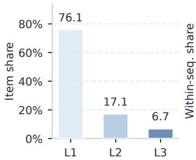  
(a) Item-level distribution

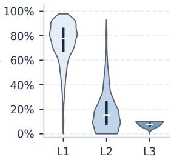  
(b) Sequence composition  
Figure 1: Item saturation depth $\ell _ { i } ^ { \star }$ on Ofice. (a) Item-level distribution across the test set. (b) Per-sequence depth composition. Each violin shows the distribution of within-sequence shares, with dots and bars marking medians and IQRs.

## 2.1 Probe 1: Item-Level Saturation Depth

To quantify the computational demand of individual items, we introduce the following diagnostic quantity:

Definition (Saturation Depth). For a trained �-layer model, the saturation depth of item � is the earliest layer ℓ at which its hidden representation can be frozen $( \mathrm { i . e . , }$ excluded from all subsequent layer computations) without altering the model’s final Top-� recommendation set:

$$
\ell _ { i } ^ { \star } = \operatorname* { m i n } \left\{ \ell \in \{ 1 , \dots , L \} : \mathcal { R } _ { \mathrm { t r u n c } } ^ { ( i , \ell ) } = \mathcal { R } _ { \mathrm { f u l l } } \right\} ,\tag{1}
$$

where $\mathcal { R } _ { \mathrm { f u l l } }$ is the full-depth Top-� set, and $\mathcal { R } _ { \mathrm { t r u n c } } ^ { ( i , \ell ) }$ is the Top-� set produced when item �’s representation is frozen after layer ℓ while all other positions continue through the remaining layers normally.

Intuitively, a smaller $\ell _ { i } ^ { \star }$ indicates that item � contributes a “settled” signal early, while a larger $\ell _ { i } ^ { \star }$ means it remains sensitive to deeper processing. We set $K { = } 3 0$ and evaluate on all test sequences. We use this as a diagnostic statistic for the trained model. Additional details are in Appendix A.3.

Results. Figure 1(a) reveals substantial variation in saturation depth: 76.14% of items reach $\ell _ { i } ^ { \star } = 1$ , and 93.28% satisfy $\ell _ { i } ^ { \star } \leq 2 .$ Yet 6.72% only saturate at full depth $( \ell _ { i } ^ { \star } = 3 )$ . The sequence-level view in Figure 1(b) further shows that shallow- and deep-saturating items frequently coexist within the same history, with many sequences spanning all three saturation depths.

Finding 1: Non-uniform computational demand. Items within the same sequence exhibit highly heterogeneous computational de- mands. Most items converge after minimal processing, while a nontrivial minority requires full depth. Since both groups frequently coexist within the same sequence, no single fixed depth can simultaneously serve all items well.

## 2.2 Probe 2: Item-Level Depth Allocation

Probe 1 establishes that items difer in how much computation they need, but does not tell us whether this mismatch actually hurts recommendation quality. To bridge this gap, we design a controlled experiment: keeping model parameters frozen, we ask whether a per-item flexible depth assignment can produce better rankings than the original fixed allocation.

Table 1: Rank improvements and relative tail computation for the sequences in Figure 2(b), normalized by the fixeddepth allocation.
<table><tr><td>Sequence</td><td>Seq.1</td><td> $\operatorname { S e q . 2 }$ </td><td>Seq.3</td><td> $\operatorname { S e q . 4 }$ </td><td> $\operatorname { S e q . 5 }$ </td></tr><tr><td>Rank</td><td>24→13</td><td>7→4</td><td>7→5</td><td> $1 2 \longrightarrow 1 0$ </td><td> $1 9 { \longrightarrow } 1 8$ </td></tr><tr><td>Gain</td><td>+11</td><td>+3</td><td>+2</td><td>+2</td><td>+1</td></tr><tr><td>Rel. tail comp.</td><td>40.0%</td><td>66.7%</td><td>53.3%</td><td>60.0%</td><td>60.0%</td></tr></table>

Specifically, we construct a counterfactual search over the five most recent items in each test sequence. Each of these items is allowed to exit after depth 1, 2, or 3, while earlier positions retain the original full-depth pass. The original fixed-depth assignment is included as a candidate. An ofline oracle with access to the ground- truth target then selects the assignment that achieves the best target rank. Construction details are in Appendix A.3.

Results. Figure 2 and Table 1 present the oracle’s findings. (a) Ag-gregated over the test set, the flexible oracle improves over the fixed- depth baseline by 7.1% on NDCG@20, 6.5% on MRR@20, and 8.8% on HR@20. (b) Concrete examples show that the oracle-selected assignments achieve rank improvements while often consuming less total tail-side computation than the fixed baseline. In addition, the fixed-depth assignment is the oracle’s preferred choice in only 4.6% of test sequences. In the remaining 95.4%, a non-uniform allocation ranks the target higher.

Finding 2: Suboptimality of fixed allocation. The fixed-depth allocation is locally suboptimal in the overwhelming majority (95.4%) of sequences. A flexible per-item assignment improves ranking quality while often reducing total computation, demonstrating that uniform depth actively leaves performance on the table.

These two findings establish a strong empirical case for treating depth as a per-item computation allocation variable in sequential recommendation, motivating the design of LoopRec.

## 3 The Proposed LoopRec

To address the ineficiency of fixed-depth computation in sequential recommendation, we propose LoopRec, an adaptive routing frame work built on a single shared backbone. LoopRec recursively reuses the same backbone block and lets a depth router assign diferent history positions to diferent recursion depths, so that computation is dynamically allocated item by item while the standard next-item prediction objective remains unchanged. Sec. 3.1 formulates the task, Sec. 3.2 presents depth-routed recursion, and Sec. 3.3 describes the training objective.

## 3.1 Task Formulation

We consider the standard next-item prediction task in sequential recommendation over an item set V. Each training instance is an interaction sequence $\mathbf { s } = \left[ v _ { 1 } , \ldots , v _ { n } \right]$ , where $\boldsymbol { v } _ { t } \in \mathcal { V }$ and the items are ordered by interaction time. Given the prefix $\mathbf { s } _ { 1 : t } = \left[ v _ { 1 } , \ldots , v _ { t } \right]$ the goal is to predict the next item $v _ { t + 1 } ,$ where $1 \leq t < n$

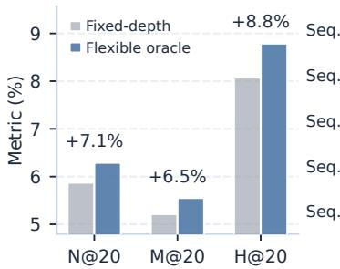

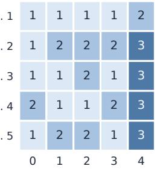  
(a) Metric gains  
(b) Tail-depth patterns  
Figure 2: Restricted tail-5 oracle on Ofice. (a) Relative gains of the flexible oracle over the fixed-depth baseline. (b) Oracleselected tail depths for sample sequences. Numbers denote depths, and columns 0–4 are the five most recent positions.

Each item $v _ { t }$ is mapped to an input token $\mathbf { x } _ { t } = \phi ( \mathbf { e } _ { { v } _ { t } } + \mathbf { p } _ { t } )$ , where ${ \bf e } _ { { \upsilon } _ { t } } ~ \in \mathbb { R } ^ { d }$ and $\mathbf { p } _ { t } ~ \in \mathbb { R } ^ { d }$ are the item and positional embeddings. Stacking the positions yields $\mathbf { X } \in \mathbb { R } ^ { T \times d }$ for the padded sequence length � . For each prefix $\mathbf { s } _ { 1 : t } ,$ the model outputs a probability dis- tribution over candidate items, denoted by $\scriptstyle p ( \boldsymbol { \upsilon } \mid \mathbf { s } _ { 1 : t } )$ . Given the training set D of prefix–target pairs, the recommendation objective is the standard cross-entropy loss:

$$
\mathcal { L } _ { \mathrm { r e c } } = - \frac { 1 } { | \mathcal { D } | } \sum _ { ( \mathbf { s } _ { 1 : t } , v _ { t + 1 } ) \in \mathcal { D } } \log { p ( v _ { t + 1 } \mid \mathbf { s } _ { 1 : t } ) } .\tag{2}
$$

## 3.2 LoopRec Architecture

Section 2 shows that diferent historical items within the same sequence can require diferent amounts of computation, making uniform fixed-depth processing restrictive for sequential recommendation. Motivated by this observation, LoopRec allocates computation depth at the item level while keeping the standard next-item prediction objective unchanged. For each position �, let ${ \bf e } _ { { \upsilon } _ { t } } \in \mathbb { R } ^ { d }$ and $\mathbf { p } _ { t } \in \mathbb { R } ^ { d }$ denote the item and positional embeddings, and let $\mathbf { x } _ { t } = \phi ( \mathbf { e } _ { { v } _ { t } } + \mathbf { p } _ { t } )$ be the corresponding input token. Stacking these tokens gives the padded input sequence $\mathbf { X } = [ \mathbf { x } _ { 1 } , \dots , \mathbf { x } _ { T } ] \in \mathbb { R } ^ { T \times d }$

To realize this adaptive-depth mechanism within a single model, LoopRec treats the backbone block as a reusable computation unit and shares it across recursions. Let B(·) denote a shared backbone block with � layers, and let � be the maximum number ofrecursions. We denote this layer–recursion configuration as LxRy. For exam-ple, L2R3 uses a two-layer shared block for up to three recursions. Given X, LoopRec proceeds through three components. Initial Context Encoding first applies B (·) to the full sequence to obtain contextualized states for all positions. Depth-Routed Recursion then applies adaptive depth routing at each recursion boundary: the depth router makes a stop-or-continue decision for each active position and re-applies the shared block only to positions that con- tinue, until all positions stop or the recursion budget is reached. Finally, Depth-Specific Readout forms the representation used for next-item prediction from the state at the selected depth. A po- sition that stops after recursion � has efectively received �� layers of sequential encoding. Figure 3 provides an overview.

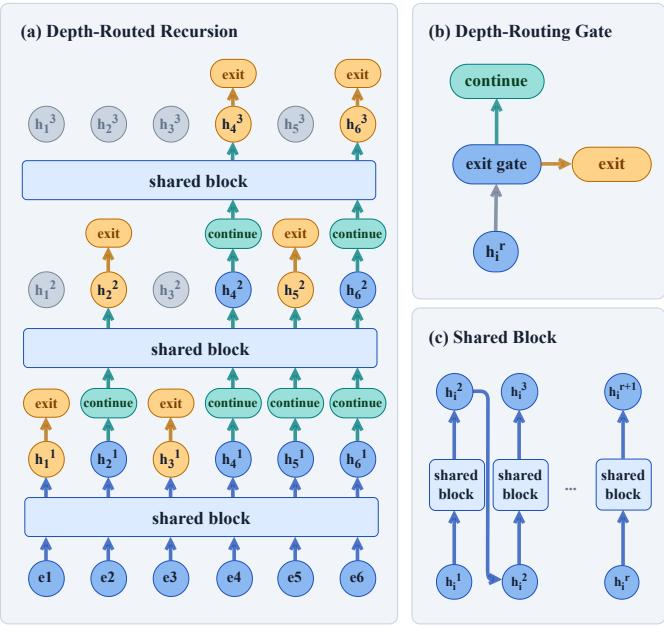  
Figure 3: Overview of LoopRec. At each recursion boundary, depth-routing gates decide which positions stop and which continue through the shared block.

Initial Context Encoding. LoopRec begins with a shared shallow pass over the full sequence:

$$
\mathbf { H } ^ { ( 1 ) } = \mathcal { B } ( \mathbf { X } ) ,
$$

where $\mathbf { H } ^ { ( 1 ) } = [ \mathbf { h } _ { 1 } ^ { ( 1 ) } , \ldots , \mathbf { h } _ { T } ^ { ( 1 ) } ]$ . This initial pass provides the common contextualized states on which subsequent routing decisions for individual history items are based.

Depth-Routed Recursion. Starting from the contextualized states $\mathbf { \bar { H } } ^ { ( 1 ) }$ , LoopRec performs depth-routed recursion for up to $R - 1$ additional steps. At recursion boundary $r \in \{ 1 , \ldots , R - 1 \}$ the depth router examines the current state of each active position and decides whether that position should stop at the current depth or continue to a deeper recursion. For position $i ,$ let $\mathbf { h } _ { i } ^ { ( r ) }$ denote its state after recursion $r .$ The depth router computes a routing score

$$
s _ { i } ^ { ( r ) } = g ( \mathbf { h } _ { i } ^ { ( r ) } + \pmb { \rho } _ { r } ) ,
$$

where $g ( \cdot )$ is the router head and $\rho _ { r }$ is a learnable embedding of the recursion index. This score is converted into an exit probability

$$
q _ { i , \mathrm { e x i t } } ^ { ( r ) } = 1 - \sigma ( s _ { i } ^ { ( r ) } ) ,
$$

where $\sigma ( \cdot )$ is the logistic sigmoid. A position stops at boundary � if $q _ { i , \mathrm { e x i t } } ^ { ( r ) } \geq 0 . 5$ . Otherwise, it is sent to the next recursion.

Let $\mathcal { A } ^ { ( r + 1 ) }$ denote the positions that continue after boundary �. Then

$$
\mathcal { A } ^ { ( r + 1 ) } = \{ i \in \mathcal { A } ^ { ( r ) } : q _ { i , \mathrm { e x i t } } ^ { ( r ) } < 0 . 5 \} .
$$

Only these continuing positions are updated by re-applying the shared block to their states from the previous recursion:

$$
\mathbf { H } _ { \mathcal { A } ^ { ( r + 1 ) } } ^ { ( r + 1 ) } = \mathcal { B } \left( \mathbf { H } _ { \mathcal { A } ^ { ( r + 1 ) } } ^ { ( r ) } \right) .
$$

Thus, each recursion takes as input the states from the previous recursion, but only for the positions that continue. The selected subsequence preserves its original order under the causal mask, while stopped positions keep their current states and are not up- dated further. Consequently, ${ \mathcal { A } } ^ { ( 1 ) } \supseteq { \mathcal { A } } ^ { ( 2 ) } \supseteq \cdots \supseteq { \mathcal { A } } ^ { ( R ) }$ : the set of continuing positions shrinks as recursion proceeds. At the final recursion, all remaining positions are forced to stop.

Depth-Specific Readout. After recursion terminates, each po-sition is associated with a selected depth $d _ { i } \in \{ 1 , . . . , R \}$ . LoopRec then forms the final representation for position � by combining its input token with the state at the selected depth:

$$
\bar { \mathbf { z } } _ { i } = \mathbf { x } _ { i } + \omega _ { i } \mathbf { h } _ { i } ^ { ( d _ { i } ) } ,
$$

where $\omega _ { i }$ is a depth-dependent readout weight. This readout uses the state selected by depth-routed recursion while retaining a resid- ual connection to the input token. Although the forward pass selects a hard depth $d _ { i }$ for each position, the readout weight $\omega _ { i }$ maintains diferentiability with respect to the router probabilities to enable gradient-based training. Its detailed definition is given in Appendix A.1. The recursive encoding and readout procedure is summarized in Algorithm 1.

## 3.3 Training Objective

The key additional component in LoopRec, compared with a fixeddepth sequential recommender, is the depth router. Training therefore needs to ensure that this router is both useful and learnable. First, it should allocate diferent positions to diferent depths. Oth- erwise LoopRec collapses toward nearly fixed-depth behavior and loses the item-level adaptivity motivated in Sec. 2. Second, it should remain trainable throughout optimization. Because routing deci-sions are made recursively, gates that become too hard too early can lock the model into unstable depth assignments before the hidden states are well formed. The objective design below is organized around these two requirements.

Avoiding Depth Collapse. To avoid depth collapse, we regularize depth usage along the realized route. The idea is to assign each position a soft depth mass over the depths it actually visits, and then match the aggregate soft usage to the empirical hard assignment frequencies across positions. We first define the continuation mass that reaches each boundary.

Let $d _ { i } \in \{ 1 , \ldots , R \}$ denote the selected depth of position �. We first define the remaining continuation mass before each evaluated boundary. Let

$$
c _ { i } ^ { ( 1 ) } = 1 , \qquad c _ { i } ^ { ( r + 1 ) } = c _ { i } ^ { ( r ) } ( 1 - q _ { i , \mathrm { e x i t } } ^ { ( r ) } ) \mathrm { f o r } r < d _ { i } .
$$

Thus $c _ { i } ^ { ( r ) }$ is the amount of route mass that reaches boundary � without exiting earlier.

Table 2: Statistics of experimental datasets.
<table><tr><td>Dataset</td><td>Users</td><td>Items</td><td>Interactions</td><td>Avg. Len.</td><td>Sparsity</td></tr><tr><td>Software</td><td>13,444</td><td>9,706</td><td>227,637</td><td>16.93</td><td>99.83%</td></tr><tr><td>Office</td><td>11,468</td><td>28,279</td><td>190,465</td><td>16.61</td><td>99.94%</td></tr><tr><td>Patio</td><td>14,454</td><td>37,179</td><td>229,086</td><td>15.85</td><td>99.96%</td></tr></table>

Using this continuation mass, we define the soft depth mass assigned to position � at depth � as

$$
\alpha _ { i , r } = \left\{ \begin{array} { l l } { c _ { i } ^ { ( r ) } q _ { i , \mathrm { e x i t } } ^ { ( r ) } , } & { r < d _ { i } , } \\ { c _ { i } ^ { ( d _ { i } ) } , } & { r = d _ { i } , } \\ { 0 , } & { r > d _ { i } . } \end{array} \right.
$$

Thus $\alpha _ { i , r }$ records the route mass assigned to depth � using only the depths that are actually evaluated.

Let I be the set of valid positions and let $N = | { \boldsymbol { \cal { I } } } |$ . We then define the average soft depth usage at depth � as

$$
P _ { r } = \frac { 1 } { N } \sum _ { i \in J } \alpha _ { i , r } ,
$$

where $P _ { r }$ is the batch-averaged soft usage of depth �: it aggregates the realized-route mass $\alpha _ { i , r }$ over valid positions and captures the average soft route mass assigned to that depth.

The corresponding hard assignment frequency is

$$
f _ { r } = \frac { 1 } { N } \sum _ { i \in J } \mathbb { I } [ d _ { i } = r ] .
$$

Here $f _ { r }$ is the fraction of valid positions whose selected depth is $r ,$ i.e., the empirical frequency of hard routing assignments to depth � across the current batch.

The load-balancing regularizer [5, 25] is

$$
\mathcal { L } _ { \mathrm { b a l } } = R \sum _ { r = 1 } ^ { R } P _ { r } f _ { r } .
$$

Here $P _ { r }$ measures the average soft mass assigned to depth �, while $f _ { r }$ measures how often depth � is selected by the hard route. Mini- mizing $\mathcal { L } _ { \mathrm { b a l } }$ discourages the router from concentrating depth usage on a narrow range of depths.

Avoiding Premature Gate Saturation. A learnable router should not become overly confident before the hidden states are stable. To discourage this behavior, we penalize large binary-gate log partitions, following the router z-loss used to stabilize sparse routed models [42] and later adopted in MoR [1]. Using the routing score $s _ { i } ^ { ( r ) } = g ( \mathbf { h } _ { i } ^ { ( r ) } + \pmb { \rho } _ { r } )$ introduced in the depth-routing step, the resulting anchored binary gate has log partition softplus $\overset { \cdot } { s _ { i } ^ { ( r ) } } ) =$ log $( 1 + \exp ( s _ { i } ^ { ( r ) } ) )$ . Let $\mathcal { R } _ { + } = \{ r : 1 \leq r < R , | \mathcal { A } ^ { ( r ) } | > 0 \}$ . Then

$$
\mathcal { L } _ { z } = \frac { 1 } { \vert \mathcal { R } _ { + } \vert } \sum _ { r \in \mathcal { R } _ { + } } \frac { 1 } { \vert \mathcal { A } ^ { ( r ) } \vert } \sum _ { i \in \mathcal { A } ^ { ( r ) } } \mathrm { s o f t p l u s } ( s _ { i } ^ { ( r ) } ) ^ { 2 } .\tag{3}
$$

This term keeps routing decisions from becoming too hard too early in training.

Overall Objective. Combining the recommendation target with the two router-side regularizers, LoopRec optimizes

$$
\begin{array} { r } { \mathcal { L } = \mathcal { L } _ { \mathrm { r e c } } + \lambda _ { \mathrm { b a l } } \mathcal { L } _ { \mathrm { b a l } } + \lambda _ { z } \mathcal { L } _ { z } , } \end{array}\tag{4}
$$

where $\lambda _ { \mathrm { b a l } }$ and $\lambda _ { z }$ control the strengths of the depth-diversity and gate-stabilization regularizers, respectively. Here $\mathcal { L } _ { \mathrm { r e c } }$ remains the only item-prediction supervision, while the additional terms regularize only the routing process.

Routing Warm-Up. In addition to the objective above, we use a simple warm-up strategy to avoid unstable routing at the beginning of training. Let $W _ { \mathrm { r o u t e r } }$ denote the warm-up length. For the first $W _ { \mathrm { r o u t e r } }$ epochs, all valid positions are forced to the maximum recursion depth, routing decisions are bypassed, and the router-side regularizers are disabled. Training in this phase therefore reduces to next-item prediction under a fixed maximum-depth recursive pass. After warm-up, routing is enabled and the full objective above is optimized. We treat $W _ { \mathrm { r o u t e r } }$ as a training hyperparameter and select it with validation NDCG@20.

## 4 Experiments

## 4.1 Experimental Setup

Datasets. We evaluate LoopRec on three Amazon Reviews 2023 categories [9]: Software, Ofice Products (Ofice), and Patio, Lawn & Garden (Patio). These categories provide varied sequence and sparsity regimes under a shared data source and preprocessing protocol. For each category, we sort interactions by time and retain users with at least 10 interactions. We use a leave-one-out split for validation and test sets. During evaluation, we trim each history to warm-start items so that all conditioning items have appeared in the training split. The maximum sequence length is set to 50. Dataset statistics are summarized in Table 2.

Evaluation Metrics. We evaluate all models with full-ranking top-� metrics [13]. MRR measures the rank of the first relevant item, while NDCG accounts for the position-discounted ranking quality of the held-out next item [11]. We report MRR@10, MRR@20, NDCG@10, and NDCG@20 in the main results. Model selection and early stopping use validation NDCG@20.

Backbones. LoopRec is instantiated on four widely used backbone families to test its compatibility with diferent sequence modeling architectures:

• SASRec [12] is a self-attention sequential recommender and serves as the main attention anchor. It gives the most direct comparison with a Transformer recommender of fixed depth. • BSARec [26] is a frequency-aware self-attention variant. It adds a frequency-domain bias to the SASRec family and tests transfer within attention models.

• NextItNet [34] is a causal convolutional recommender. It uses causal convolutions and represents the convolutional family.

• LRURec [35] is a linear recurrent recommender. Together with NextItNet, it tests whether LoopRec remains applicable beyond attention backbones.

Implementation Details. Training is capped at 100 epochs with early stopping patience 10. Test metrics are reported from the check-point selected by the validation criterion above. Backbone-specific wrapping choices and detailed hyperparameter settings are pro-vided in Appendix A.2.

Table 3: Main results across three Amazon benchmarks, comparing each fixed-depth backbone with its LoopRec counterpart. M@K and N@K denote MRR@K and NDCG@K, and values are test means over five runs. The “\*” denotes the statistical significance $( p < 0 . 0 5 )$ of the results of LoopRec compared to the corresponding fixed-depth backbone under a paired t-test. Within each backbone block, the better value is shown in bold.
<table><tr><td rowspan="2">Backbone Model</td><td rowspan="2"></td><td colspan="4">Software</td><td colspan="4">Office</td><td colspan="4">Patio</td></tr><tr><td>M@10</td><td>M@20</td><td>N@10</td><td>N@20</td><td>M@10</td><td>M@20</td><td>N@10</td><td>N@20</td><td>M@10</td><td>M@20</td><td>N@10</td><td>N@20</td></tr><tr><td></td><td>VANILLA</td><td>0.0589</td><td>0.0629</td><td>0.0796</td><td>0.0944</td><td>0.0508</td><td>0.0513</td><td>0.0562</td><td>0.0582</td><td>0.0394</td><td>0.0399</td><td>0.0429</td><td>0.0448</td></tr><tr><td>SASRec</td><td>+LoopRec</td><td>0.0613</td><td>0.0659</td><td>0.0830</td><td>0.0998</td><td>0.0523</td><td>0.0530</td><td>0.0571</td><td>0.0595</td><td>0.0411</td><td>0.0416</td><td>0.0441</td><td>0.0458</td></tr><tr><td></td><td>Improv.</td><td>+4.14%*</td><td>+4.77%*</td><td>+4.27%*</td><td>+5.68%*</td><td>+3.03%*</td><td>+3.24%*</td><td>+1.49%*</td><td>+2.20%*</td><td>+4.42%*</td><td>+4.26%*</td><td>+2.75%*</td><td>+2.19%*</td></tr><tr><td></td><td>VANILLA</td><td>0.0607</td><td>0.0657</td><td>0.0803</td><td>0.0987</td><td>0.0508</td><td>0.0516</td><td>0.0565</td><td>0.0596</td><td>0.0391</td><td>0.0398</td><td>0.0426</td><td>0.0453</td></tr><tr><td>BSARec</td><td>+LoopRec</td><td>0.0619</td><td>0.0665</td><td>0.0828</td><td>0.0998</td><td>0.0519</td><td>0.0527</td><td>0.0571</td><td>0.0602</td><td>0.0415</td><td>0.0422</td><td>0.0445</td><td>0.0469</td></tr><tr><td></td><td>Improv.</td><td>+1.94%*</td><td>+1.22%*</td><td>+3.11%*</td><td>+1.13%*</td><td>+2.13%*</td><td>+2.21%*</td><td>+0.92%</td><td>+0.97%</td><td>+6.30%*</td><td>+6.03%*</td><td>+4.46%*</td><td>+3.48%*</td></tr><tr><td></td><td>VANILLA</td><td>0.0431</td><td>0.0479</td><td>0.0608</td><td>0.0782</td><td>0.0225</td><td>0.0235</td><td>0.0274</td><td>0.0313</td><td>0.0129</td><td>0.0136</td><td>0.0166</td><td>0.0192</td></tr><tr><td>NextItNet</td><td>+LoopRec</td><td>0.0460</td><td>0.0506</td><td>0.0648</td><td>0.0817</td><td>0.0256</td><td>0.0267</td><td>0.0312</td><td>0.0354</td><td>0.0193</td><td>0.0201</td><td>0.0231</td><td>0.0263</td></tr><tr><td></td><td>Improv.</td><td>+6.77%*</td><td>+5.59%*</td><td>+6.51%*</td><td>+4.37%*</td><td>+13.88%*</td><td>+13.59%*</td><td>+14.04%*</td><td>+13.18%*</td><td>+49.07%*</td><td>+47.94%*</td><td>+39.06%*</td><td>+37.02%*</td></tr><tr><td>LRURec</td><td>VANILLA</td><td>0.0575</td><td>0.0625</td><td>0.0777</td><td>0.0958</td><td>0.0502</td><td>0.0508</td><td>0.0550</td><td>0.0573</td><td>0.0407</td><td>0.0412</td><td>0.0442</td><td>0.0461</td></tr><tr><td></td><td>+LoopRec</td><td>0.0620</td><td>0.0670</td><td>0.0814</td><td>0.1001</td><td>0.0509</td><td>0.0517</td><td>0.0558</td><td>0.0584</td><td>0.0409</td><td>0.0415</td><td>0.0449</td><td>0.0470</td></tr><tr><td></td><td>Improv.</td><td>+7.68%*</td><td>+7.20%*</td><td>+4.81%*</td><td>+4.51%*</td><td>+1.43%*</td><td>+1.73%*</td><td>+1.42%*</td><td>+1.85%*</td><td>+0.69%</td><td>+0.83%</td><td>+1.58%*</td><td>+1.87%*</td></tr></table>

## 4.2 Main Results

Table 3 compares four fixed-depth backbones with their LoopRec counterparts across three Amazon datasets. We highlight three main observations below.

(1) LoopRec consistently improves fixed-depth baselines. In all 48 backbone–dataset–metric comparisons, LoopRec yields positive improvements, and 44 of them are statistically significant. The relative gains range from 0.69% to 49.07%, showing that the benefit is not limited to a particular backbone family or dataset. The gains are also aligned across MRR and NDCG within each backbone block, indicating that the improvement is not an artifact of a single met-ric. Overall, these results show that replacing uniform fixed-depth computation with item-level adaptive depth leads to consistently stronger next-item ranking performance.

(2) Gains transfer across backbone architectures. For attentionbased models, LoopRec improves NDCG@20 by 2.19–5.68% on SASRec and 0.97–3.48% on BSARec. The gains on BSARec show that adaptive computation remains useful alongside its frequency domain inductive bias. Beyond attention, LRURec gains 1.85–4.51% on NDCG@20, demonstrating compatibility with linear recurrent sequence modeling. NextItNet shows particularly large relative gains on Ofice and Patio, reaching 13.18% and 37.02%, respectively. On Patio, its NDCG@20 increases from 0.0192 to 0.0263. Together, these results support the applicability of item-level adaptive re-cursion across backbone families, whether they use self-attention, linear recurrence, or causal convolution to integrate sequence context when predicting the next item.

(3) The largest gains appear on the sparsest dataset. The im-provement magnitude varies across datasets. The gains are moder-ate on Software and Ofice for most strong baselines, but become more pronounced on Patio, which has the highest sparsity, the largest item vocabulary, and the shortest average history length in Table 2. Averaged over backbones, the NDCG@20 improvement increases from 3.92% on Software and 4.55% on Ofice to 11.14% on Patio. This suggests that adaptive-depth computation is more useful when user histories provide fewer interaction signals. In such data, diferent history items may carry uneven amounts of useful context, so applying the same computation depth to every position can be less suitable. LoopRec can instead stop processing simple positions at an earlier recursion boundary and spend deeper computation on positions that need more contextual modeling.

## 4.3 What Shapes LoopRec’s Learned Depth?

Having established that LoopRec improves ranking accuracy, we next ask what its learned depth allocation captures. Our analysis focuses on position- and item-level factors, and finally connects LoopRec’s learned routing back to the saturation-depth probe of Section 2. Unless otherwise specified, the analyses in this section use SASRec as the backbone and Ofice as the dataset.

The router uses multiple efective depths rather than a single near-fixed path (Appendix A.4). We examine this variation from three views: the relative position of the item in the history, its training-time frequency, and the depth-sensitivity pattern that the same item shows under a fixed-depth reference recommender.

4.3.1 Depth by Sequence Position. A natural starting point is the relative position of an item in the history. For each test sequence, we divide the valid history into ten deciles, from the earliest inter- actions to the most recent ones, and compute the average selected recursion round within each decile. To give a broader view than a single setting, we report four SASRec-backbone cases covering Office and Patio under two LxRy configurations, where each recursion round applies � shared blocks and at most � rounds are available. Recent history items are routed deeper on average. Figure 4 shows an average tendency for later history deciles to receive larger selected rounds in the four cases. This suggests that relative position is associated with depth allocation: recent interactions tend to carry stronger signals about the user’s current preference, so LoopRec assigns more of its depth budget to the later part of the history. The relation is not a per-item rule, but it shows that LoopRec does not allocate depth uniformly across the whole history.

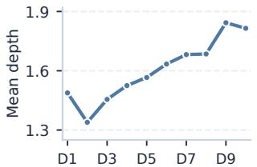  
(a) Office, L1R4

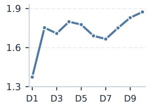  
(b) Patio, L1R4

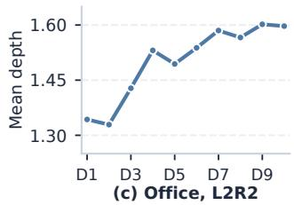

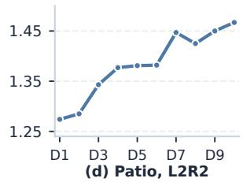  
Figure 4: Average selected recursion round across relativeposition deciles (D1: earliest, D10: most recent), on Ofice and Patio under two LxRy configurations.

4.3.2 Depth by Item-Level Factors. Position alone does not fully describe a history item. Two items at the same relative position can difer in how often they appear during training and in how much context is needed to interpret them. We therefore ask whether routed depth also correlates with item-level signals. As a focused diagnostic, we bucket test-set history tokens by the corresponding item’s training-time interaction frequency and report the resulting depth statistics in Table 4.

Frequent items are assigned shallower depths, while rarer items receive more computation. As training frequency in-creases, the mean selected depth generally decreases from 2.160 in the single-occurrence bucket to 1.330 in the 100+ bucket. The share of depth-1 assignments rises from 50.3% to 88.6%, while the share of depth-4 assignments drops from 29.1% to 10.7%. Routed depth therefore correlates not only with position but also with the sparsity of item-level interaction signals. This suggests that frequent items form stable representations with little additional computation, while rarer items more often benefit from later recur- sive updates. Appendix A.5 complements these aggregate statistics with a category-level view and a full sequence example illustrating the routing patterns.

The observed relationships between depth, recency, and fre- quency motivate testing whether simple routing rules based on these signals can achieve comparable recommendation quality. On Ofice with SASRec, LoopRec achieves higher mean NDCG@20 than either the position-based or frequency-based heuristic over five seeds. The experimental setup and full results are provided in Appendix A.6.

4.3.3 Alignment with Saturation Depth. The previous analyses show that LoopRec assigns deeper routes to recent and to rarer items. We now return to the saturation-depth probe in Section 2 and ask whether the same two factors emerge in the fixed-depth reference’s own depth-sensitivity pattern. Such agreement would indicate that LoopRec’s learned routing is aligned with the depth demand that the fixed-depth recommender reveals only after train- ing. Recall that $\ell _ { i } ^ { \star }$ is the earliest layer after which freezing item �’s updates preserves the full-depth recommendation set. A larger $\ell _ { i } ^ { \star }$ marks an item that stabilizes later inside the fixed-depth reference. The position efect also appears in saturation depth. Grouping history tokens into four relative-position quartiles (Figure 5(a)), the first three quartiles have low mean saturation depths of 1.16, 1.17, and 1.20, while the most recent quartile rises to 1.76. The $\ell ^ { \star } = 3$ share is also concentrated in the recent quartile (30.3%), with essentially no full-depth saturation in the earlier three. Positions near the target are therefore more likely to require deeper processing under the fixed-depth reference, in the same direction as LoopRec’s routed-depth trend in Section 4.3.1.

Table 4: Selected depth by item training-time frequency on Ofice. Depth columns report the share of tokens assigned to each depth.
<table><tr><td>Train freq.</td><td>Tokens</td><td>Mean depth</td><td>Depth 1</td><td>Depth 4</td></tr><tr><td>1</td><td>505</td><td>2.160</td><td>50.3%</td><td>29.1%</td></tr><tr><td>2-4</td><td>1,202</td><td>2.084</td><td>53.7%</td><td>27.0%</td></tr><tr><td>5-9</td><td>1,603</td><td>2.135</td><td>53.3%</td><td>29.3%</td></tr><tr><td>10-19</td><td>2,247</td><td>2.008</td><td>60.8%</td><td>28.1%</td></tr><tr><td>20-49</td><td>4,123</td><td>1.818</td><td>69.2%</td><td>24.1%</td></tr><tr><td>50-99</td><td>3,668</td><td>1.577</td><td>79.1%</td><td>17.7%</td></tr><tr><td>100+</td><td>11,659</td><td>1.330</td><td>88.6%</td><td>10.7%</td></tr></table>

The popularity efect is also visible under the same diagnostic. Using the same training-frequency buckets as Table 4, Figure 5(b) shows that rarer items have larger saturation depths and larger full- depth shares. In the single-occurrence bucket, the mean saturation depth is 1.873 with an $\ell ^ { \star } = 3$ share of 18.0%. In the 100+bucket, the mean drops to 1.197, the $\ell ^ { \star } = 3$ share to 5.7%, and the $\ell ^ { \star } = 1$ share reaches 86.1%. This mirrors the popularity trend in Section 4.3.2: rare items receive deeper routes from LoopRec and also stabilize later in the saturation-depth probe.

LoopRec’s learned routing aligns with the saturation-depth probe. Taken together, the router allocates more computation to recent and rare items, and the same groups also show larger sat- uration depths under the fixed-depth reference. This agreement supports a demand-aligned reading of LoopRec’s depth allocation: extra computation is directed to the items that the saturation-depth probe also marks as sensitive to additional processing.

## 4.4 Further Analysis

Having characterized LoopRec’s learned depth allocation, we now turn to ablation studies and computational cost. We examine the contributions of shared recursion, item-level depth allocation, rout- ing warm-up, and router-side regularizers, and then report the computational savings and measured encoder latency.

4.4.1 Ablation Studies. We first compare sequence-level looping with LoopRec’s item-level depth allocation. We then ablate the routing warm-up that bridges full-depth training to learned depth decisions and the two router-side regularizers (load balancing and z-loss). All studies in this subsection use the SASRec-based recipe.

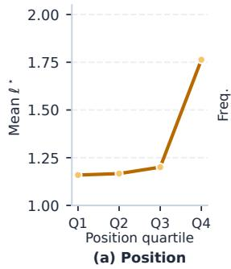

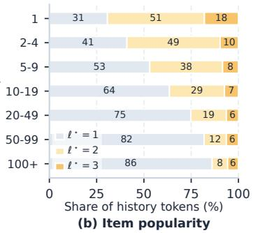  
Figure 5: Saturation depth on Ofice under a three-layer SASRec. (a) Mean depth across relative-position quartiles. (b) Depth shares across training-frequency buckets.

Table 5: Comparison of sequence-level looping and itemlevel depth allocation. Vanilla denotes the original SASRec. Results are five-seed test means. M and N denote MRR and NDCG, respectively.
<table><tr><td rowspan="2">Model</td><td colspan="2">Software</td><td colspan="2">Office</td><td colspan="2">Patio</td></tr><tr><td>M@20</td><td>N@20</td><td>M@20</td><td>N@20</td><td>M@20</td><td>N@20</td></tr><tr><td>LoopRec</td><td>0.0659</td><td>0.0998</td><td>0.0530</td><td>0.0595</td><td>0.0416</td><td>0.0458</td></tr><tr><td>Seq-level Loop</td><td>0.0634</td><td>0.0950</td><td>0.0525</td><td>0.0594</td><td>0.0390</td><td>0.0447</td></tr><tr><td>VANILLA</td><td>0.0629</td><td>0.0944</td><td>0.0513</td><td>0.0582</td><td>0.0399</td><td>0.0448</td></tr></table>

Sequence-level and item-level allocation. LoopRec combines weight-sharing through block reuse with item-level depth alloca- tion. We compare it with a sequence-level looped Transformer baseline (Seq-level Loop), which reuses an �-layer SASRec block for � full-sequence passes, with no router or item-level early exit. Training and evaluation follow the main SASRec protocol. We search over the same LxRy configuration set as LoopRec (Appendix A.2), selecting by validation NDCG@20. Table 5 shows that Seq-level Loop improves both MRR@20 and NDCG@20 over Vanilla on Software and Ofice, but yields no improvement on Patio. Full LoopRec achieves the highest mean for both metrics on all three datasets. Compared with Seq-level Loop, LoopRec gains 0.0025 in MRR@20 and 0.0048 in NDCG@20 on Software. The gains on Ofice are small, while on Patio MRR@20 increases from 0.0390 to 0.0416. These results suggest that weight sharing through recursion ac-counts for part of the improvement, and item-level depth allocation adds further improvements that vary in magnitude across the three datasets.

Routing warm-up and router-side regularizers. Table 6 examines routing warm-up, load balancing $\mathcal { L } _ { \mathrm { b a l } } ,$ and router z-loss $\mathcal { L } _ { z }$ . Removing warm-up lowers both metrics on all three datasets, dropping MRR@20 by 4.03% and NDCG@20 by 3.11% on average. Software shows the largest decrease in both metrics. Removing either regularizer lowers both metrics on all three datasets, with larger relative drops on Ofice and Patio than on Software. Remov- ing both regularizers reduces MRR@20 by 5.36% and NDCG@20 by 4.25% on average across datasets.

Table 6: Ablation of routing warm-up and router-side regularizers. Results are five-seed test means. M and N denote MRR and NDCG, respectively.
<table><tr><td rowspan="2">Ablation</td><td colspan="2">Software</td><td colspan="2">Office</td><td colspan="2">Patio</td></tr><tr><td>M@20</td><td>N@20</td><td>M@20</td><td>N@20</td><td>M@20</td><td>N@20</td></tr><tr><td>LoopRec</td><td>0.0659</td><td>0.0998</td><td>0.0530</td><td>0.0595</td><td>0.0416</td><td>0.0458</td></tr><tr><td>w/o warm-up</td><td>0.0615</td><td>0.0942</td><td>0.0520</td><td>0.0583</td><td>0.0401</td><td>0.0450</td></tr><tr><td>w/o Lbal</td><td>0.0655</td><td>0.0995</td><td>0.0507</td><td>0.0576</td><td>0.0385</td><td>0.0431</td></tr><tr><td>w/o  $\mathcal { L } _ { z }$ </td><td>0.0639</td><td>0.0973</td><td>0.0507</td><td>0.0574</td><td>0.0387</td><td>0.0432</td></tr><tr><td>w/o  $\mathcal { L } _ { \mathrm { b a l } } \& \ \mathcal { L } _ { z }$ </td><td>0.0632</td><td>0.0963</td><td>0.0505</td><td>0.0574</td><td>0.0386</td><td>0.0431</td></tr></table>

4.4.2 Computation and Latency. Across the three measured settings, LoopRec reduces selected compute to 0.407–0.755× the fixeddepth reference, while encoder latency spans 0.869–0.995×. Com-pute savings therefore translate only partly into wall-clock gains. Complete measurements are reported in Appendix A.7.

## 5 Related Work

Sequential Recommendation. Sequential recommendation mod-els an ordered interaction history to rank the next item. Early factorized and neural approaches capture local transition struc- ture via Markov chains, recurrent networks, or convolutional en- coders [8, 14, 17, 22, 28, 34]. Transformer-based recommenders such as SASRec and BERT4Rec then strengthen long-range dependency modeling with self attention [12, 15, 19, 27, 30, 38]. More recent fixed-depth backbones refine the encoder design with ex- plicit inductive biases, for instance through frequency-domain or filtering mechanisms [3, 26, 39]. These methods focus on how to build stronger sequence encoders under a fixed computation pattern : once the architecture is chosen, each history position is processed by the same depth budget before scoring the next item. LoopRec addresses an orthogonal question. Keeping the recommendation objective and backbone family intact, it asks whether a sequential encoder can allocate recursive computation at the item level, so that diferent positions in the same history need not receive the same depth.

Looped and Adaptive-Depth Transformers. Looped Transformers study the repeated application of shared or partially shared Transformer blocks. The Universal Transformer combines shared recurrent transformations with self-attention and supports adap- tive per-position halting [2], building on adaptive computation time [7]. Later work shows that looped Transformers can implement non-trivial algorithmic computation [6, 33]. Recent looped Transformer and looped language-model studies connect repeated depth with latent computation and reasoning [23, 41]. In parallel, adaptive-depth Transformers explore early exiting or routed com-putation allocation [4, 18, 21, 24, 31, 40]. Mixture-of-Recursions (MoR) combines shared recursion with token-level adaptive com-putation for language modeling [1]. Its token-choice router assigns a total recursion depth upfront, while its expert-choice router se- lects continuing tokens at each step under prescribed capacities. LoopRec uses a shared binary stopping gate conditioned on each item’s current contextualized state and recursion index, allowing decisions to be updated across recursions without per-step top-� selection. We investigate this design for computation allocation over recommendation histories, supported by item-level diagnostics and evaluation across multiple backbone families.

## 6 Conclusion

We revisited fixed-depth computation in sequential recommendation through diagnostic experiments that reveal heterogeneous depth sensitivity across history items. Motivated by these findings, we proposed LoopRec, which uses weight-shared recursion with learned item-wise routing to allocate computation adaptively. Across three Amazon benchmarks and four backbone families, LoopRec consistently improves ranking performance over fixeddepth counterparts. Its learned routes allocate greater depth to re- cent and less frequent items, consistent with the patterns observed in these diagnostics. LoopRec also reduces the encoder computation budget in the measured configurations, although latency gains vary. Future work includes developing sparsity-aware kernels and learning the maximum recursion budget, which is currently fixed per configuration before model training begins.

## References

[1] Sangmin Bae, Yujin Kim, Reza Bayat, Sungnyun Kim, Jiyoun Ha, Tal Schuster, Adam Fisch, Hrayr Harutyunyan, Ziwei Ji, Aaron Courville, et al. 2026. Mixture-of-recursions: Learning dynamic recursive depths for adaptive tokenlevel computation. Advances in Neural Information Processing Systems 38 (2026), 96572–96617.

[2] Mostafa Dehghani, Stephan Gouws, Oriol Vinyals, Jakob Uszkoreit, and Lukasz Kaiser. 2019. Universal Transformers. In 7th International Conference on Learning Representations, ICLR 2019, New Orleans, LA, USA, May 6-9, 2019. OpenReview.net.

[3] Xinyu Du, Huanhuan Yuan, Pengpeng Zhao, Jianfeng Qu, Fuzhen Zhuang, Guan feng Liu, Yanchi Liu, and Victor S Sheng. 2023. Frequency enhanced hybrid attention network for sequential recommendation. In Proceedings ofthe 46th international ACM SIGIR conference on research and development in information retrieval. 78–88.

[4] Maha Elbayad, Jiatao Gu, Edouard Grave, and Michael Auli. 2020. Depth-adaptive Transformer. In ICLR 2020-Eighth International Conference on Learning Representations. 1–14.

[5] William Fedus, Barret Zoph, and Noam Shazeer. 2022. Switch transformers: Scaling to trillion parameter models with simple and eficient sparsity. Journal ofMachine Learning Research 23, 120 (2022), 1–39.

[6] Angeliki Giannou, Shashank Rajput, Jy-yong Sohn, Kangwook Lee, Jason D Lee, and Dimitris Papailiopoulos. 2023. Looped transformers as programmable computers. In International Conference on Machine Learning. PMLR, 11398–11442.

[7] Alex Graves. 2016. Adaptive computation time for recurrent neural networks. arXiv preprint arXiv:1603.08983 (2016).

[8] Balázs Hidasi, Alexandros Karatzoglou, Linas Baltrunas, and Domonkos Tikk. 2015. Session-based recommendations with recurrent neural networks. arXiv preprint arXiv:1511.06939 (2015).

[9] Yupeng Hou, Jiacheng Li, Zhankui He, An Yan, Xiusi Chen, and Julian McAuley. 2024. Bridging Language and Items for Retrieval and Recommendation. arXiv preprint arXiv:2403.03952 (2024).

[10] Yupeng Hou, Shanlei Mu, Wayne Xin Zhao, Yaliang Li, Bolin Ding, and Ji-Rong Wen. 2022. Towards universal se uence re resentation learnin for recommender systems. In Proceedings of the 28th ACM SIGKDD conference on knowledge discovery and data mining. 585–593.

[11] Kalervo Järvelin and Jaana Kekäläinen. 2002. Cumulated gain-based evaluation of IR techniques. ACM Transactions on Information Systems (TOIS) 20, 4 (2002), 422–446.

[12] Wang-Cheng Kang and Julian McAuley. 2018. Self-attentive sequential recommendation. In 2018 IEEE international conference on data mining (ICDM). IEEE, 197–206.

[13] Walid Krichene and Stefen Rendle. 2020. On sampled metrics for item recommendation. In Proceedings ofthe 26th ACM SIGKDD international conference on

knowledge discovery & data mining. 1748–1757.

[14] Jing Li, Pengjie Ren, Zhumin Chen, Zhaochun Ren, Tao Lian, and Jun Ma. 2017. Neural attentive session-based recommendation. In Proceedings ofthe 2017 ACM on Conference on Information and Knowledge Management. 1419–1428.

[15] Jiacheng Li, Yujie Wang, and Julian McAuley. 2020. Time interval aware selfattention for sequential recommendation. In Proceedings ofthe 13th international conference on web search and data mining. 322–330.

[16] Chengkai Liu, Jianghao Lin, Hanzhou Liu, Jianling Wang, and James Caverlee. 2024. Behavior-dependent linear recurrent units for eficient sequential recom- mendation. In Proceedings of the 33rd ACM international conference on information and knowledge management. 1430–1440.

[17] Qiao Liu, Yifu Zeng, Refuoe Mokhosi, and Haibin Zhang. 2018. STAMP: shortterm attention/memory priority model for session-based recommendation. In Proceedings ofthe 24th ACM SIGKDD international conference on knowledge discovery & data mining. 1831–1839

[18] Weijie Liu, Peng Zhou, Zhiruo Wang, Zhe Zhao, Haotang Deng, and Qi Ju. 2020. Fastbert: a self-distilling bert with adaptive inference time. In Proceedings ofthe 58th annual meeting ofthe association for computational linguistics. 6035–6044.

[19] Ruihong Qiu, Zi Huang, Hongzhi Yin, and Zijian Wang. 2022. Contrastive learning for representation degeneration problem in sequential recommendation. In Proceedings ofthe fifteenth ACM international conference on web search and data mining. 813–823.

[20] Ran Rang, Linlin Xing, Longbo Zhang, Hongzhen Cai, and Zhaojie Sun. 2023. Hetero eneous multi-behavior recommendation based on ra h convolutional networks. IEEE Access 11 (2023), 22574–22584.

[21] David Raposo, Sam Ritter, Blake Richards, Timothy Lillicrap, Peter Conway Humphreys, and Adam Santoro. 2024. Mixture-of-depths: Dynamically allocating compute in transformer-based language models. arXiv preprint arXiv:2404.02258 (2024).

[22] Stefen Rendle, Christoph Freudenthaler, and Lars Schmidt-Thieme. 2010. Factorizing personalized markov chains for next-basket recommendation. In Proceedings ofthe 19th international conference on World wide web. 811–820.

[23] Nikunj Saunshi, Nishanth Dikkala, Zhiyuan Li, Sanjiv Kumar, and Sashank J Reddi. 2025. Reasoning with latent thoughts: On the power of looped transformers. In International Conference on Learning Representations, Vol. 2025. 14855–14881.

[24] Tal Schuster, Adam Fisch, Jai Gupta, Mostafa Dehghani, Dara Bahri, Vinh Tran, Yi Tay, and Donald Metzler. 2022. Confident adaptive language modeling. Advances in Neural Information Processing Systems 35 (2022), 17456–17472.

[25] Noam Shazeer, Azalia Mirhoseini, Krzysztof Maziarz, Andy Davis, Quoc Le, Geofrey Hinton, and Jef Dean. 2017. Outrageously Large Neural Networks: The Sparsely-Gated Mixture-of-Experts Layer. In International Conference on Learning Representations.

[26] Yehjin Shin, Jeongwhan Choi, Hyowon Wi, and Noseong Park. 2024. An attentive inductive bias for sequential recommendation beyond the self-attention. In Proceedings ofthe AAAI conference on artificial intelligence, Vol. 38. 8984–8992.

[27] Fei Sun, Jun Liu, Jian Wu, Changhua Pei, Xiao Lin, Wenwu Ou, and Peng Jiang. 2019. BERT4Rec: Sequential recommendation with bidirectional encoder rep- resentations from transformer. In Proceedings of the 28th ACM international conference on information and knowledge management. 1441–1450.

[28] Jiaxi Tang and Ke Wang. 2018. Personalized top-n sequential recommendation via convolutional sequence embedding. In Proceedings ofthe eleventh ACM international conference on web search and data mining. 565–573.

[29] Jiakai Tang, Runfeng Zhang, Weiqiu Wang, Yifei Liu, Chuan Wang, Xu Chen, Yeqiu Yang, Jian Wu, Yuning Jiang, and Bo Zheng. 2026. LoopCTR: Unlocking the Loop Scaling Power for Click-Through Rate Prediction. arXiv preprint arXiv:2604.19550 (2026).

[30] Xu Xie, Fei Sun, Zhaoyang Liu, Shiwen Wu, Jinyang Gao, Jiandong Zhang, Bolin Ding, and Bin Cui. 2022. Contrastive learning for sequential recommendation. In 2022 IEEE 38th international conference on data engineering (ICDE). IEEE, 1259– 1273.

[31] Ji Xin, Ra hael Tan , Jaejun Lee, Yaolian Yu, and Jimm Lin. 2020. DeeBERT: Dynamic early exiting for accelerating BERT inference. In Proceedings ofthe 58th annual meeting of the association for computational linguistics. 2246–2251.

[32] Jian Yang, Tengfei Bi, Jiajin Huang, and Mi Li. 2026. Self-Attention Gated Linear Recurrent Units for Sequential Recommendation. IEEE Transactions on Computational Social Systems (2026)

[33] Liu Yang, Kangwook Lee, Robert Nowak, and Dimitris Papailiopoulos. 2024. Looped transformers are better at learning learning algorithms. In International conference on learning representations, Vol. 2024. 42195–42214.

[34] Fajie Yuan, Alexandros Karatzoglou, Ioannis Arapakis, Joemon M Jose, and Xiangnan He. 2019. A simple convolutional generative network for next item recommendation. In Proceedings ofthe twelfth ACM international conference on web search and data mining. 582–590.

[35] Zhenrui Yue, Yueqi Wang, Zhankui He, Huimin Zeng, Julian McAuley, and Dong Wang. 2024. Linear recurrent units for sequential recommendation. In Proceedings of the 17th ACM international conference on web search and data mining. 930–938.

[36] Yichi Zhang, Guisheng Yin, Hongbin Dong, and Liguo Zhang. 2022. Attentionbased frequency-aware multi-scale network for sequential recommendation.

Applied Soft Computing 127 (2022), 109349.

[37] Zhongping Zhang, Yin Jia, Yuehan Hou, and Xinlu Yu. 2024. Explicit behavior interaction with heterogeneous graph for multi-behavior recommendation. Data Science and Engineering 9, 2 (2024), 133–151.

[38] Kun Zhou, Hui Wang, Wayne Xin Zhao, Yutao Zhu, Sirui Wang, Fuzheng Zhang, Zhongyuan Wang, and Ji-Rong Wen. 2020. S3-rec: Self-supervised learning for sequential recommendation with mutual information maximization. In Proceedings of the 29th ACM international conference on information & knowledge management. 1893–1902.

[39] Kun Zhou, Hui Yu, Wayne Xin Zhao, and Ji-Rong Wen. 2022. Filter-enhanced MLP is all you need for sequential recommendation. In Proceedings of the ACM web conference 2022. 2388–2399.

[40] Wangchunshu Zhou, Canwen Xu, Tao Ge, Julian McAuley, Ke Xu, and Furu Wei. 2020. Bert loses patience: Fast and robust inference with early exit. Advances in Neural Information Processing Systems 33 (2020), 18330–18341.

[41] Rui-Jie Zhu, Zixuan Wang, Kai Hua, Tianyu Zhang, Ziniu Li, Haoran Que, Boyi Wei, Zixin Wen, Fan Yin, He Xing, et al. 2025. Scaling latent reasoning via looped language models. arXiv preprint arXiv:2510.25741 (2025).

[42] Barret Zoph, Irwan Bello, Sameer Kumar, Nan Du, Yanping Huang, Jef Dean, Noam Shazeer, and William Fedus. 2022. St-moe: Designing stable and transfer able sparse expert models. arXiv preprint arXiv:2202.08906 (2022).

## A Appendix: Additional Experimental Details

## A.1 Routing and Readout Formulation

This subsection provides the formal definitions of the routing mech- anism and readout weight computation referenced in Section 3. The depth router makes a hard stop-or-continue decision in the forward pass, while the readout retains a soft route mass through which the recommendation loss can update the router. Let $d _ { i } \in \{ 1 , . . . , R \}$ denote the hard selected depth of position �. Let $c _ { i } ^ { ( 1 ) } = 1$ denote the route mass reaching the first boundary. For $r < d _ { i } ,$ the continuation mass reaching the next boundary is

$$
c _ { i } ^ { ( r + 1 ) } = c _ { i } ^ { ( r ) } \big ( 1 - q _ { i , \mathrm { e x i t } } ^ { ( r ) } \big ) .
$$

The readout weight at the selected depth is

$$
\omega _ { i } = \left\{ \begin{array} { l l } { c _ { i } ^ { ( d _ { i } ) } q _ { i , \mathrm { e x i t } } ^ { ( d _ { i } ) } } & { d _ { i } < R , } \\ { c _ { i } ^ { ( R ) } } & { d _ { i } = R . } \end{array} \right.
$$

For a fixed hard route, $\omega _ { i }$ is diferentiable with respect to the evalu- ated router probabilities and provides a path for the recommenda tion loss to update the router.

Balancing mass versus readout weight. The balancing mass $\alpha _ { i , r }$ in the load-balancing term (Section 3.3) difers from the readout weight $\omega _ { i }$ . While $\alpha _ { i , r }$ distributes soft route mass over all depths evaluated along the realized path to encourage balanced depth usage, $\omega _ { i }$ assigns soft mass only to the selected depth and contributes to the final representation for the recommendation loss.

Routing warm-up. During routing warm-up, all valid positions are processed through the full maximum recursion depth �. Routing decisions are bypassed and router-side regularizers are disabled. The readout weight is set to $\omega _ { i } = 1$ for every valid position.

Forward procedure. Algorithm 1 summarizes adaptive recursion and readout with routing enabled. The active set A contains positions that have not exited, and I excludes padding. For compactness, recursion superscripts are omitted from the current states H, exit probabilities $q _ { i , \mathrm { e x i t } }$ , and continuation masses ��.

The active subsequence $\mathrm { H } _ { \mathcal { A } }$ preserves the original chronological order under the causal mask. Exited positions retain their states, so the final $\mathbf { h } _ { i }$ is the state at the selected depth $d _ { i }$

Algorithm 1: Adaptive Recursion and Readout in LoopRec   
Input: Input representations X, valid positions I, shared   
backbone ${ \mathcal { B } } ,$ router �, recursion embeddings   
$\{ \pmb { \rho } _ { r } \} _ { r = 1 } ^ { R - 1 }$ , and maximum depth �   
Output: Representations $\{ \bar { \mathbf { z } } _ { i } \} _ { i \in \mathcal { I } }$ and selected depths   
$\{ d _ { i } \} _ { i \in \mathcal { I } }$   
// Initial context encoding (recursion 1)   
1 $\mathbf { H } \gets { \mathcal { B } } ( \mathbf { X } ) ;$   
2 $\mathcal { A }  \bar { \mathcal { } } ; c _ { i }  1$ for all $i \in \mathcal { I } ;$   
// Depth-routed recursion   
3 for $r = 1 , \ldots , R - 1$ do   
// Exit decisions at depth �   
4 ��,exit $ 1 - \sigma ( g ( \mathbf { h } _ { i } + \pmb { \rho } _ { r } ) )$ for all $i \in \mathcal { A } ;$   
5 $\mathcal { E }  \{ i \in \mathcal { A } : q _ { i , \mathrm { e x i t } } \geq 0 . 5 \} ;$   
6 $\omega _ { i }  c _ { i } q _ { i , \mathrm { e x i t } } , d _ { i }  r$ for all $i \in { \mathcal { E } } ;$   
7 ${ \mathcal { A } } \gets { \mathcal { A } } \setminus { \mathcal { E } } ;$   
8 i $: { \mathcal { A } } = \emptyset$ then   
9 break;   
10 $c _ { i } \gets c _ { i } ( 1 - q _ { i , \mathrm { e x i t } } )$ for all $i \in \mathcal { A } ;$   
// Apply recursion $r + 1$ to continuing   
positions   
11 $\mathbf { H } _ { \mathcal { A } }  \mathcal { B } ( \mathbf { H } _ { \mathcal { A } } ) ;$   
// Forced exit at depth � and readout   
12 $\omega _ { i } \gets c _ { i } , d _ { i } \gets R$ for all $i \in \mathcal { A } ;$   
13 $\bar { \mathbf { z } } _ { i } \longleftarrow \mathbf { x } _ { i } + \omega _ { i } \mathbf { h } _ { i }$ for all $i \in \mathcal { I } ;$   
14 return $\{ \bar { \bf z } _ { i } , d _ { i } \} _ { i \in \mathcal { I } } ;$

## A.2 Backbone-Specific Implementation

We provide implementation details for applying LoopRec to diferent backbones, including the recursive unit, the wrapping choice around each original backbone, the main hyperparameter search spaces, batch size, and backbone-specific hyperparameters.

We train all models using the Adam optimizer for up to 100 epochs, with early stopping patience of 10 based on validation NDCG@20. Test performance is evaluated using the checkpoint with the best validation score, and main results are averaged over five runs with diferent random seeds. The “\*” in the main table denotes statistical significance $( p < 0 . 0 5 )$ for LoopRec versus the corresponding fixed-depth backbone under paired t-tests. For the full LoopRec models, we fix the z-loss coeficient $\lambda _ { z } \mathrm { ~ t o ~ } 1 0 ^ { - 3 }$ across all datasets and backbones.

SASRec. The LoopRec recursive unit is a SASRec-style Transformer block. A configuration LxRy applies � blocks per recursion round for up to � rounds with adaptive depth routing. We search learning rate in $\{ 3 { \times } 1 0 ^ { - 4 } , 6 { \times } 1 0 ^ { - 4 } , 1 0 ^ { - 3 } \}$ , encoder layers in $\{ 1 , 2 , 3 , 4 , 5 , 6 \}$ , L2 in $\lbrace 1 0 ^ { - 6 } , 1 0 ^ { - 4 } \rbrace$ , dropout in {0.2, 0.5}, LoopRec configurations in {L1R4, L2R2, L1R6, L2R3, L1R8, L2R4}, router warm-up $W _ { \mathrm { r o u t e r } } \in \ \{ 5 , 8 , 1 0 , 1 2 , 1 6 \}$ , and balancing coeficient in {0.001, 0.003, 0.005, 0.01}. The batch size is fixed to 1024.

BSARec. BSARec preserves the SASRec-family interface while adding a frequency-domain inductive bias. We apply depth-routed recursion around the native BSARec block, share the SASRec-family search ranges for layers, learning rate, L2 regularization, dropout, LoopRec configuration, $W _ { \mathrm { r o u t e r } } ,$ , and balancing coeficient, and ad- ditionally search frequency hyperparameters � ∈ {0.7, 0.9} and $c \in \{ 3 , \ 5 \}$ . The batch size is fixed to 512.

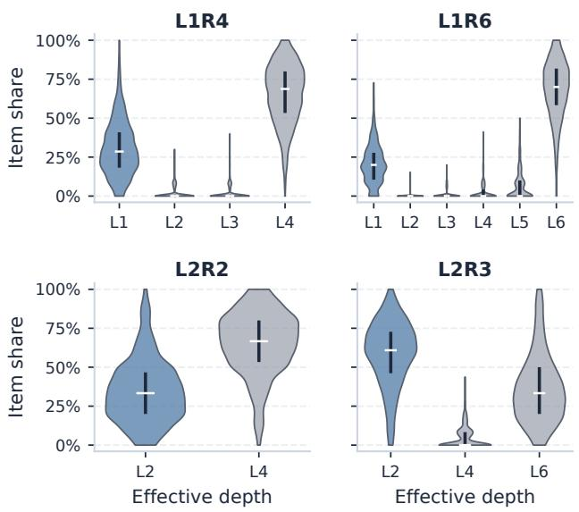  
Figure 6: Selected-depth distributions on Ofice for four LxRy configurations. The y-axis is the per-sequence share of positions at each efective depth.

NextItNet. Recursion is applied at the native residual convolution block. We fix the native encoder to six residual blocks with a (1, 2, 4) dilation cycle, calibrate learning rate within this boundary, search batch size over {256, 512, 1024}, and search LoopRec configurations in {L3R2, L3R3, L6R2}.

LRURec. Recursion is applied at the native LRURec block. We search 1–3 LRURec blocks, learning rate in $\{ 0 . 3 , 0 . 6 , 1 , 3 \} \times 1 0 ^ { - 3 }$ and dropout in {0.4, 0.6}, with batch size fixed to 512. We otherwise share the L2 regularization, LoopRec configuration, $W _ { \mathrm { r o u t e r } } ,$ , and balancing ranges.

## A.3 Fixed-Depth Diagnostic Details

This subsection provides the experimental details for the fixed- depth recommender diagnostics in Section 2, including the counterfactual truncation protocol for Top-30 exact-set saturation and the candidate construction and tail-side computation constraint for the restricted Tail-5 oracle.

Top-30 Exact-Set Saturation. For the truncation diagnostic in Section 2, we use a trained three-layer SASRec on Amazon Ofice Products. The main text defines the saturation statistic $\ell _ { i } ^ { \star } .$ . In the counterfactual pass, only the selected history position � stops being updated after layer ℓ. All other positions continue through the normal forward pass. We use $\ell _ { i } ^ { \star }$ purely as a stability statistic for the trained model’s full-depth recommendation set.

Table 7: Item-level routing of one Ofice sequence. Freq. is training-time interaction frequency. Depth is the selected depth.
<table><tr><td>Pos.</td><td>Item</td><td>Category</td><td>Freq.</td><td>Depth</td></tr><tr><td>1</td><td>ValueMailers poly mailers</td><td>Envelope mailer</td><td>56</td><td>1</td></tr><tr><td>2</td><td>Uboxes poly mailers</td><td>Envelope mailer</td><td>261</td><td>1</td></tr><tr><td>3</td><td>ValueMailers poly mailers</td><td>Envelope mailer</td><td>517</td><td>1</td></tr><tr><td>4</td><td>EasyPAG desk organizer</td><td>Desk organizer</td><td>5</td><td>1</td></tr><tr><td>5</td><td>Quartet whiteboard</td><td>Dry erase board</td><td>259</td><td>1</td></tr><tr><td>6</td><td>Aviditi box mailers</td><td>Box mailer</td><td>1</td><td>2</td></tr><tr><td>7</td><td>PACKZON shipping labels</td><td>Printer label</td><td>34</td><td>4</td></tr><tr><td>8</td><td>Hygloss library pockets</td><td>Teaching material</td><td>4</td><td>3</td></tr><tr><td>9</td><td>MFLABEL address labels</td><td>Address label</td><td>30</td><td>1</td></tr><tr><td>10</td><td>Avery address labels</td><td>Address label</td><td>1,413</td><td>1</td></tr><tr><td>11</td><td>Pro Supply poly mailers</td><td>Envelope mailer</td><td>1</td><td>3</td></tr><tr><td>12</td><td>Springhill cardstock</td><td>Colored paper</td><td>17</td><td>1</td></tr><tr><td>13</td><td>TECKNET mouse pad</td><td>Mouse pad</td><td>86</td><td>4</td></tr><tr><td>target</td><td>Flash Furniture office chair</td><td>Office chair</td><td>一</td><td>一</td></tr></table>

Restricted Tail-5 Oracle. For the oracle diagnostic, we keep the parameters of the trained three-layer SASRec fixed on Amazon Ofice Products and vary only the update depths of the five most recent history items. Earlier positions follow the original full-depth forward pass. Each tail candidate assigns one of the available depths in {1, 2, 3} per tail position. After that depth, the position’s representation stops being updated for the remaining layers. This yields a small candidate family over the five most recent items. The origi- nal fixed-depth assignment is included as one candidate, and we exclude assignments that use more tail-side layer evaluations than this baseline. For each test sequence, the oracle selects the candidate that gives the target item the best rank. Relative tail computation is the number of layer evaluations on the five tail items, normalized by the fixed-depth tail allocation.

## A.4 Depth Distribution Analysis

This subsection examines whether LoopRec’s learned router ex- ploits multiple depths or collapses to a near-uniform strategy. We analyze the distribution of selected depths across test sequences to assess variation in computational allocation.

To quantify this, we compute the fraction of valid positions assigned to each efective depth for every test sequence and sum- marize these fractions across the test set. Figure 6 reports the resulting distribution for several LoopRec configurations, denoted LxRy, where each recursion round applies � shared blocks and at most � rounds are available to the router.

LoopRec uses multiple efective depths. Figure 6 shows that all four configurations use multiple efective depths, with substantial shares at shallow and deep depths. The non-uniform allocations indicate variation across positions and are consistent with the co- existence of shallow- and deep-saturating items in Section 2.

## A.5 Item-Level Routing Examples

To complement the aggregate statistics in Section 4.3.2, this subsection presents a concrete sequence example showing how LoopRec’s router assigns depths to individual items in context. We also provide a category-level aggregation to illustrate the frequency-depth relationship at a coarser granularity.

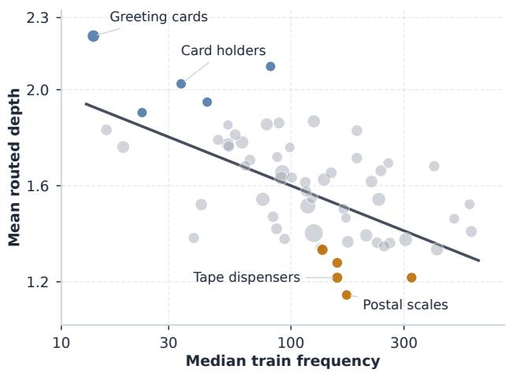  
Figure 7: Category-level routed depth versus item popularity on Ofice. Each point is a category leaf (size ∝ token count). Blue and orange mark the five highest- and lowest-depth categories, and the solid line shows the overall trend.

Table 7 gives a full sequence from the Ofice L1R4 analysis in Section 4.3.2. The example reflects the two aggregate tendencies discussed in the main analysis: later positions are more likely to receive deeper updates, and high-frequency items tend to stay shal low. For instance, frequent mailer and label items such as Uboxes poly mailers, ValueMailers poly mailers, and Avery address labels exit at depth 1, while rarer items such as Aviditi box mailers, Hygloss library pockets, and Pro Supply poly mailers receive depths 2 or 3. The exact selected depth is not determined by either signal alone: PACKZON shipping labels and TECKNET mouse pad reach depth 4, whereas the later Springhill cardstock item remains shallow, indicat-ing that recency, popularity, category semantics, and surrounding context jointly shape item-level routing.

Category-level aggregation. We join routed history tokens with Amazon Reviews 2023 metadata and group them by category leaf. Figure 7 plots each category by its median training frequency and mean routed depth. Categories with larger median frequency tend to have lower mean depth, consistent with the item-frequency trend in Table 4. Individual routing decisions still vary by position and context within each category.

## A.6 Comparison with Heuristic Routing

We compare LoopRec with two heuristic routing strategies to examine whether simple item signals can provide efective depth allocation. We conduct this comparison on Ofice using the SASRec backbone.

Heuristic routing. Both variants retain LoopRec’s shared recur-sive backbone and replace the learned router with a position- or frequency-based rule. Each strategy assigns a score $s _ { i } \in [ 0 , 1 ]$ to each valid position � and maps it to recursion rounds via

Table 8: Comparison with heuristic routing on Ofice using SASRec. Values are test means over five seeds. Bold values denote the highest mean for each metric.
<table><tr><td>Method</td><td>MRR@10</td><td>MRR@20</td><td>NDCG@10</td><td>NDCG@20</td></tr><tr><td>VANILLA</td><td>0.0508</td><td>0.0513</td><td>0.0562</td><td>0.0582</td></tr><tr><td>Position</td><td>0.0508</td><td>0.0515</td><td>0.0558</td><td>0.0585</td></tr><tr><td>Frequency</td><td>0.0510</td><td>0.0516</td><td>0.0561</td><td>0.0584</td></tr><tr><td>LoopRec</td><td>0.0523</td><td>0.0530</td><td>0.0571</td><td>0.0595</td></tr></table>

$$
\begin{array} { r } { r _ { i } = 1 + \left\lfloor { ( R - 1 ) s _ { i } + \frac { 1 } { 2 } } \right\rfloor , } \end{array}
$$

where � is the maximum number of rounds. Larger scores assign more recursion rounds.

Position assigns greater depth to more recent positions. We index the � valid items in the current input window from earliest to most recent. For $n > 1 ,$ , the score is $s _ { i } = \left( i - 1 \right) / \left( n - 1 \right)$ . For � = 1, we set $s _ { i } = 1 ,$ , treating the sole item as the most recent position and assigning it maximum depth.

Frequency assigns greater depth to less frequent items. We compute each item’s interaction count $f ( v )$ from the training split, apply $g ( v ) = \log ( 1 + f ( v ) )$ , and define

$$
s _ { i } = 1 - \frac { g ( v _ { i } ) - g _ { \operatorname* { m i n } } } { g _ { \operatorname* { m a x } } - g _ { \operatorname* { m i n } } } ,
$$

where the minimum and maximum are computed over items ob- served in training. Training interactions are counted once, without duplicating occurrences across overlapping training examples.

Padding positions are excluded from routing. Both variants retain the full-depth training warm-up and use their heuristic rules throughout evaluation. The heuristic routes use unit readout weights and omit router-specific regularization.

Experimental setup. We follow the same implementation details as the SASRec-based ex eriments in Table 3. All models are trained for up to 100 epochs with early stopping, and results are averaged over five runs with diferent random seeds.

Results. Table 8 compares ranking quality without matching average computation. Both heuristic strategies yield modest gains in NDCG@20 over vanilla SASRec. These gains are consistent with the trends observed in Sections 4.3.1 and 4.3.2, where more recent positions and less frequent items tend to receive deeper computation. Although the gains do not extend to every metric, they provide complementary evidence that position and frequency can serve as useful signals for depth allocation. LoopRec achieves the highest mean on all four metrics, with NDCG@20 exceeding Position and Frequency by 1.64% and 1.88%, respectively.

## A.7 Runtime and Latency Measurements

LoopRec’s adaptive routing reduces the computational budget by skipping layers for shallow-exiting positions. This subsection pro-vides encoder latency measurements for several LoopRec configu- rations alongside their computational savings.

We report encoder-only latency rather than full-scoring latency, because adaptive depth directly modifies the sequential encoder.

Table 9: Compute budget and encoder latency on Ofice (single A6000 GPU). Compute and Latency are normalized by the matched fixed-depth reference. Ref. ms and LoopRec ms are median encoder times.
<table><tr><td>Setting Ref.</td><td></td><td>Compute Ref. ms LoopRec ms</td><td></td><td></td><td></td><td>∆ms Latency</td></tr><tr><td>L2R4</td><td>SASRec-8L</td><td>0.407×</td><td>91.230</td><td>79.273</td><td>-11.957</td><td>0.869×</td></tr><tr><td>L2R3</td><td>SASRec-6L</td><td>0.680×</td><td>69.684</td><td>63.196</td><td>-6.488</td><td>0.907×</td></tr><tr><td>L2R2</td><td>SASRec-4L</td><td>0.755×</td><td>47.624</td><td>47.379</td><td>-0.245</td><td>0.995×</td></tr></table>

Table 9 compares three configurations against fixed-depth SASRec references at the same maximum efective depth. All numbers are measured on a single NVIDIA A6000 GPU.

Adaptive routing reduces compute, with setting-dependent latency gains. LoopRec reduces selected computation in all three settings. Encoder latency decreases for L2R4 and L2R3, but remains nearly unchanged for L2R2. Compute savings thus only partly translate into wall-clock gains, depending on how dynamic execution maps onto the GPU runtime.