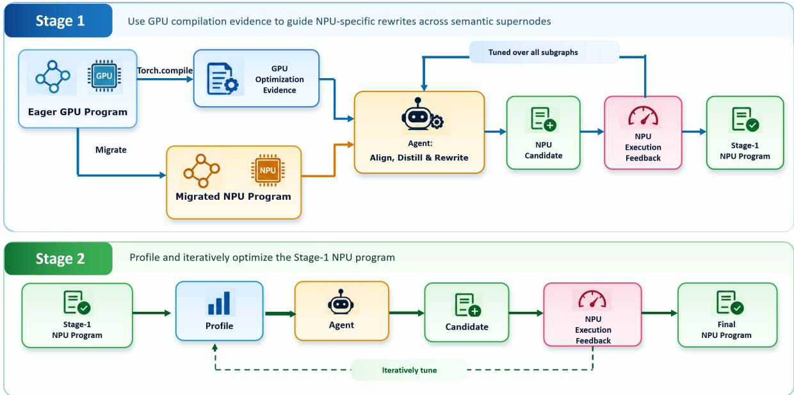
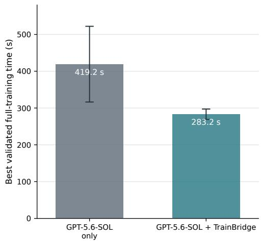
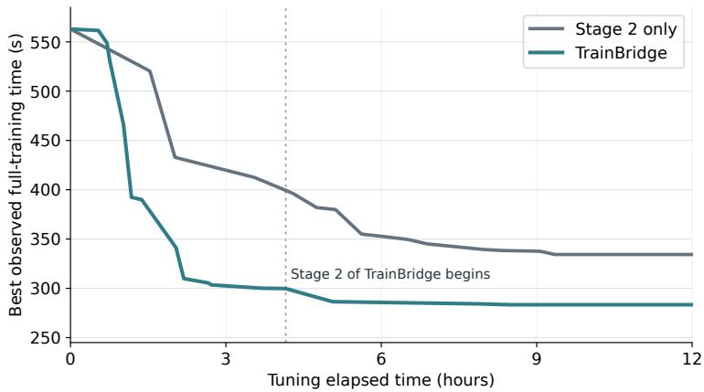
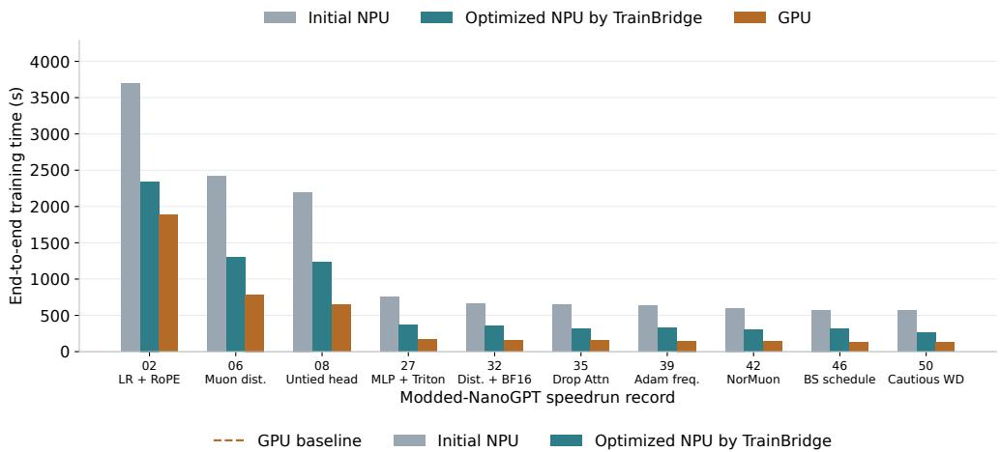
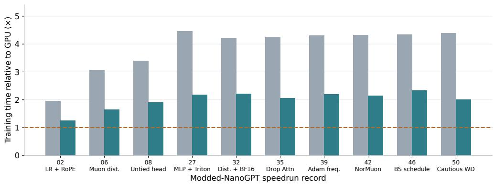
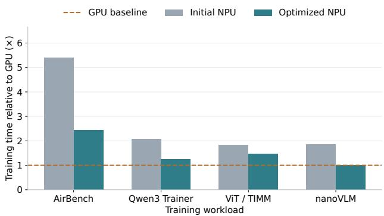
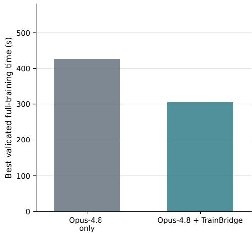

# TrainBridge: Agentic NPU Training Optimization Guided by GPU Compilation Evidence

Yupeng Chen∗1,2, Kunxiang Zhao\*2, Xingjian Wang2, Yue Zhao2, Yijing Wu2, Ye Liu2, Kai Li3, Congliang Chen1, and Ruoyu Sun†1,2

1Shenzhen Loop Area Institute 2The Chinese University of Hong Kong, Shenzhen, China 3Autokernel

## Abstract

We study how to improve training efficiency on Ascend NPUs. In the NPU training programs we study, framework-level compilation optimizations such as operator fusion are only partially applied, leaving fragmented computation and avoidable execution overheads. Profiling-guided tuning can address these inefficiencies, but it often requires costly trial and error. To make training on NPUs more efficient, we propose TrainBridge, an agentic approach for transferring GPU optimization guidance to NPU training. TrainBridge uses the highly optimized execution produced by mature GPU compilation stacks as a taskspecific reference for NPU tuning. It extracts optimization intents from the GPU training execution to guide NPU program rewrites and further refines the rewritten program through iterative profiling. Our GPU-to-NPU migration experiments show that TrainBridge achieves an average 1.7× speedup across four workloads covering LLM pretraining, image classification, and vision-language training, and an average speedup of nearly 2.0× across 27 Modded-NanoGPT speedrun records with highly optimized GPU implementations.

## 1 Introduction

Efficient training on modern accelerators can benefit from framework-level compilation that optimizes computation across operators. Such compilation is mature on NVIDIA GPU backends. However, in the Ascend NPU training programs we study, these optimizations are partially applied by the available compilation stack [Yu, 2026]. As a result, the execution of the training algorithm involves fragmented computation, redundant operations, and materialized intermediates, leaving space for NPU-specific program tuning.

Such NPU-specific tuning is often manual and expert-driven. Providing a tuning agent with task-specific knowledge, such as NPU profiling results [Zhang et al., 2025c, Li et al., 2026a, Zhou et al., 2025], enables it to diagnose bottlenecks and improve the NPU program. However, even with profiling guidance, the agent still needs to iteratively analyze, modify, execute, and validate the program, making the optimization process time-consuming under a limited tuning budget. This motivates us to seek additional guidance that can make the tuning process more efficient.

To provide this additional guidance, we introduce TrainBridge, a two-stage agentic framework for NPU-specific optimization. We observe that the corresponding GPU training programs already benefit from substantial optimization by mature compilation stacks. The differences between the eager and compiled GPU execution reveal optimization decisions already made for the same workload. Therefore, we think the differences are useful guidance on NPU execution. In Stage 1, TrainBridge extracts the underlying optimization intents from the differences and constructs NPU-specific rewrites when corresponding inefficient computation patterns are present in the NPU program. In Stage 2, it iteratively profiles the updated program to identify remaining bottlenecks, addresses them, and updates the profile.

We evaluate TrainBridge in a GPU-to-NPU migration setting on training workloads spanning LLM pretraining, image classification, and vision-language training.

In addition, we introduce an NPU version of the Modded-NanoGPT speedrun [Jordan et al., 2024], a highly optimized community benchmark for end-to-end language-model pretraining efficiency under a fixed validation target. We adapt its historical GPU implementations to Ascend NPUs and release an open leaderboard2 and evaluation environment to support further NPU training optimization.

Our contributions are summarized as follows:

• We identify compilation-related optimization gaps in NPU training programs. To narrow these gaps, we present TrainBridge, a two-stage agentic approach. TrainBridge first extracts optimization intents from the differences between eager and compiled GPU implementations and uses them to guide NPU program rewrites, then iteratively profiles the rewritten program to address residual bottlenecks.

• We evaluate TrainBridge across multiple NPU training workloads. It achieves average speedups of 1.7× across four training workloads and nearly 2.0× across 27 historical speedrun records with highly optimized GPU implementations, relative to the initial NPU implementations. On the four additional workloads, it reduces the average NPU-to-GPU training-time ratio from 2.8× to 1.5×.

## 2 NPU Training: Compilation Gaps and Optimization Challenges

## 2.1 Training Workloads and Migration Setting

We study GPU-to-NPU training migration across five workloads: Modded-NanoGPT, CIFAR-10 AirBench3, Qwen3-0.6B training with Hugging Face Trainer, ViT training with TIMM4, and nanoVLM5. These workloads cover language-model pretraining, image classification, and vision-language training. We evaluate them using one to eight devices.

Modded-NanoGPT builds on NanoGPT6, a language-model pretraining codebase widely used for studying the architectural properties of LLMs [Zhang et al., 2024] and training algorithms [Yuan et al., 2025, Zhang et al., 2025b,a]. The original GPU speedrun requires participants to train a language model on eight NVIDIA H100 GPUs and achieve a validation loss below 3.28 [Jordan et al., 2024]. The speedrun contains the GPT-2 small, GPT-2 Medium, and optimization tracks. We study the GPT-2 small track, which contains a sequence of high-performance implementations developed over time. These implementations use different training and kernel optimizations and therefore provide diverse migration tasks. We use record to denote a valid historical leaderboard implementation that reaches the required loss target; a larger record number indicates a later and faster implementation with a shorter end-to-end training time.

For all workloads, we first use Kerminal7 to perform the initial functional migration from GPU to Ascend 910C NPUs. For Modded-NanoGPT, we preserve the original training schedule, hyperparameters, and model dynamics, and require the migrated program to reach validation loss below 3.28 at the same training step. The corresponding correctness criteria for the other workloads are described in Appendix A.1.

## 2.2 Compilation Gaps in NPU Training

Across the four additional workloads besides Modded-NanoGPT, the initial NPU-to-GPU end-to-end training-time ratio averages 2.8×. For Record 50, the compiled GPU implementation takes 128 seconds and the initial NPU implementation takes 563 seconds, giving a ratio of 4.40×. These measurements reflect differences in both hardware capability and software optimization. Reported compute-throughput figures8 [Zuo et al., 2025] suggest that the Ascend 910C provides roughly 76% of the H100 SXM’s peak dense BF16/FP16 compute throughput. These end-to-end gaps cannot be fully explained by hardware capability alone and motivate us to investigate software-level optimization opportunities in the migrated NPU programs.

## 2.3 Challenges in Agentic Performance Tuning

We first tried using a generic coding agent with GPT-5.6-SOL in the Codex agent harness to tune the initial NPU program. It produced valid changes, but many candidates failed to improve end-to-end training time. Without task-specific knowledge, the agent often struggles to identify which regions have substantial optimization potential and what changes are likely to improve training efficiency.

NPU profiling provides useful task-specific guidance by identifying expensive operators and timeline intervals. However, high runtime alone does not indicate how much a region can be accelerated or which optimization should be applied. The agent therefore needs repeated cycles of analysis, modification, execution, and validation to discover effective changes. While this process can improve performance, it can be time-consuming and inefficient under a limited tuning budget. This motivates complementary guidance that can narrow the optimization search space.

Table 1: Training times for GPU and NPU implementations of Modded-NanoGPT Record 50. Ratios use the compiled GPU program as the reference.
<table><tr><td>Implementation</td><td>Training time (s)</td><td>Relative time</td></tr><tr><td>GPU, compiled</td><td>128</td><td>1.00×</td></tr><tr><td>GPU, eager</td><td>338</td><td>2.64×</td></tr><tr><td>NPU, initial port</td><td>563</td><td>4.40×</td></tr></table>

## 2.4 GPU Compilation as Optimization Evidence

GPU training ecosystems combine expert-designed implementations with mature framework-level compilation. For the same workload, differences between eager and compiled GPU execution reveal concrete changes that eliminate, fuse, or reorganize computation. Modded-NanoGPT Record 50 provides a representative example. Table 1 shows that, on eight NVIDIA H100 SXM GPUs, framework-level compilation through torch.compile reduces the end-to-end training time of Record 50 from around 338 seconds to 128 seconds, demonstrating its contribution to training efficiency.

We next examine whether the computation patterns addressed by the GPU-side compilation stack remain in the migrated NPU implementation. In our evaluated NPU training programs, some corresponding patterns remain despite the available compilation support, leaving fragmented computation and materialized intermediates that provide concrete opportunities for NPU-specific optimization.

Modded-NanoGPT Record 50 provides one example. Its KeyShift operation shifts half of each attention head’s key features by one token along the sequence dimension. The original overlapping-slice assignment remains and produces a sequence of ViewCopy operations. Consistent with prior reports of compilation limitations on Ascend [Yu, 2026], the Ascend NPU compilation stack did not successfully produce a runnable end-to-end compiled program in our migrated training setting, leaving this inefficiency in the executed

NPU implementation. The same inefficiency is present in eager GPU execution, whereas the compiled GPU execution eliminates it through functionalization and kernel fusion. Then, the agent extracts the intent of avoiding overlapping view updates and proposes an NPU-specific expression that realizes this intent. Table 2 reports the performance improvement from the NPU-specific rewrite.

Table 2: Local NPU latency of KeyShift operation in Record 50 of Modded-NanoGPT speedrun before and after GPU-compilation-evidence-guided agent rewriting. The input shape is [1, 24576, 6, 128], and we use BF16 precision.
<table><tr><td>Implementation</td><td>Latency (ms) Speedup</td><td></td></tr><tr><td>Original NPU implementation</td><td>2.604</td><td>1.00×</td></tr><tr><td>GPU-compilation-evidence-guided agent rewrite</td><td>0.508</td><td>5.13×</td></tr></table>

This case illustrates that, when a computation pattern eliminated by mature GPU compilation remains in the NPU program, the underlying optimization intent can guide an effective NPU-specific rewrite and improve the efficiency of the corresponding NPU computation.

## 3 TrainBridge

## 3.1 Problem Formulation

We first formalize how source-side framework-level compilation provides optimization evidence for NPU tuning. In our source GPU setting, this compilation is implemented through PyTorch torch.compile. Such compilation may transform computation graphs and execution schedules, introduce fused regions, modify compiler IR, and generate specialized kernels. For clarity, we use computation-graph changes as a representative view to formulate the optimization problem; TrainBridge itself is not restricted to graph-level transformations. Our goal is to improve the end-to-end training time of the migrated NPU program while preserving its correctness requirements under a limited tuning budget.

At the graph level, let $G _ { e }$ and $G _ { c }$ denote representative computation graphs before and after source-side GPU compilation, respectively. From the computation-graph perspective, we summarize the changes as

$$
G _ { c } = \tau _ { G } ( G _ { e } ) ,
$$

where $\tau _ { G }$ denotes only the graph-level changes observed during compilation. The difference between $G _ { e }$ and $G _ { c }$ therefore provides evidence of computation that the source stack found beneficial to eliminate, fuse, or reorganize.

Within $G _ { e } ,$ let $r _ { e } \subseteq G _ { e }$ denote a computation region before GPU compilation, and let $r _ { c }$ denote its compiled counterpart. Suppose an inefficient computation pattern p is present in $r _ { e }$ but is eliminated or reorganized in $r _ { c } .$ The difference between $r _ { e }$ and $r _ { c }$ therefore provides evidence about the optimization intent applied to this region.

Migration preserves the high-level computation of the source program but does not automatically reproduce the optimizations introduced by GPU compilation. When the available NPU compilation stack does not eliminate the corresponding inefficiency, the inefficient pattern p may remain in a semantically corresponding NPU region $r _ { n }$

In such cases, the agent can use the eager-to-compiled GPU difference to infer the underlying optimization intent and derive an NPU-specific rewrite that removes or reduces the corresponding inefficiency while preserving the original computation semantics. Applying such rewrites across applicable regions can improve the training efficiency of the migrated NPU program.

However, GPU evidence cannot address all inefficiencies in the migrated NPU program. Some GPU transformations may not be beneficial on the NPU because of backend-specific execution characteristics, and

  
Figure 1: Overview of TrainBridge. Stage 1 aligns eager-to-compiled GPU changes with the migrated NPU program, and uses the resulting optimization evidence to guide NPU implementation optimization. Stage 2 iteratively profiles the updated NPU program and addresses residual bottlenecks.

GPU evidence does not expose NPU-specific overheads in host scheduling, communication, or memory management. These limitations motivate the two stages below.

## 3.2 Stage 1: NPU Optimization Guided by GPU Compilation Evidence

For the same training program, we collect GPU compilation artifacts, including pre-compilation graphs, post-fusion IR, generated kernels, and profiling summaries, together with the corresponding GPU and migrated NPU sources. Based on this evidence, TrainBridge groups related GPU operations into semantic supernodes. A semantic supernode represents a common high-level computation and provides a unit for relating source-side compilation changes to the migrated NPU program.

For each supernode, the agent first examines the eager-to-compiled GPU changes to identify what computation was eliminated, fused, or reorganized. These changes provide evidence of an inefficient computation pattern in the eager execution and the optimization intent used to address it. The agent then locates the NPU region implementing the same high-level computation and checks whether the corresponding inefficiency remains, using differences in operators, dtypes, layouts, materialized intermediates, and kernel boundaries as evidence.

When the inefficiency remains on the NPU, the agent uses the inferred optimization intent to propose an NPU-specific rewrite that removes or reduces it while preserving the original computation semantics. Candidate rewrites include API parameter changes, redundant-operation removal, fused NPU operators, and selective compilation of supported local subgraphs. Stage 1 ends after all semantic supernodes have been examined and applicable GPU-evidence-guided rewrites have been validated.

## 3.3 Stage 2: Profiling-Guided Residual Optimization

Stage 2 profiles the NPU program produced by Stage 1 to identify residual bottlenecks that are not captured by source-side GPU compilation evidence. The agent combines operator statistics, host and device timelines, communication events, memory activity, and source inspection to identify the remaining bottlenecks.

The agent considers several common optimization classes: eliminating redundant work, reusing computed values or buffers, hiding latency through overlap, and replacing an implementation with an equivalent NPU-native alternative. After each candidate modification, TrainBridge revalidates correctness and performance and updates the profile when the bottleneck shifts. The agent repeats this process until no further performance improvement is observed or the tuning budget is exhausted.

## 4 Experimental Setup

## 4.1 Tasks and Migration Protocol

As described in Section 2.1, our evaluation covers five training workloads: CIFAR-10 AirBench9, Qwen3-0.6B pretraining with Hugging Face Trainer, ViT training with TIMM10, nanoVLM11, and Modded-NanoGPT. We migrate each workload to Ascend 910C NPUs and tune the migrated NPU implementation. For Modded-NanoGPT, we randomly sample and evaluate 27 historical records from the first 50 leaderboard records, treating each record as a separate tuning task. A valid optimization must preserve the original training schedule and reach a validation loss below 3.28 at the same training step. The correctness criteria for the other workloads are described in Appendix A.1.

## 4.2 Hardware and Software

For GPU experiments, we use up to eight NVIDIA H100 SXM GPUs with PyTorch 2.7.0 and CUDA 12.8. For NPU experiments, we use up to eight Ascend 910C NPUs with PyTorch 2.7.1, CANN 8.5.0, and torch-npu 2.7.1.post2. We report end-to-end training time, excluding tuning time. For Modded-NanoGPT, we use eight GPUs and eight NPUs in the respective experiments. Device counts for the other workloads are detailed in Appendix A.1.

Agent harness. Unless otherwise specified, we use the Codex agent harness with GPT-5.6-SOL at medium reasoning effort in our main experiments. We launch most tuning tasks through the Codex desktop application.

## 4.3 Research Questions

All methods start from the same initial NPU implementation. We evaluate TrainBridge through two research questions:

• RQ1: Agentic tuning effectiveness. Does TrainBridge find faster validated NPU programs under a fixed tuning budget?

• RQ2: Stage contribution. Does GPU-compilation-evidence-guided Stage 1 provide additional benefit beyond profiling-guided Stage 2, and does Stage 2 further improve the program produced by Stage 1?

For the controlled Record 50 experiments, we use GPT-5.6-SOL with medium reasoning effort and a 12-hour wall-clock tuning budget. For the RQ1 comparison in Section 4.4, we independently run each method three times. For the RQ2 stage-contribution analysis in Section 4.5, we perform a single run per method. We evaluate the best candidate that completes full training and passes the validation-loss criterion.

## 4.4 Overall Agentic Tuning Effectiveness

Figure 2 compares the generic coding agent with TrainBridge on Modded-NanoGPT Record 50. Both methods start from the same initial NPU implementation and use the same 12-hour tuning budget. Across three independent runs, the generic agent achieves an average best validated training time of 419.2 seconds, whereas TrainBridge achieves 283.2 seconds, corresponding to a 32.4% reduction. TrainBridge also exhibits lower variance across the three runs, indicating more consistent tuning outcomes in this experiment. Additional evaluation with Claude Opus 4.8 can be seen in Appendix B.

  
Figure 2: Record 50 of the Modded-NanoGPT speedrun tuning results under a 12-hour budget. Results are averaged over three independent runs using the same Codex harness; error bars show standard deviation TrainBridge achieves substantially lower end-to-end training time with lower variance across repeated runs.

  
Figure 3: Contribution of the two optimization stages on Record 50 under a 12-hour tuning budget. Stage 2 alone uses NPU profiling as task-specific guidance, while TrainBridge additionally applies GPU-evidenceguided Stage 1 before profiling-guided Stage 2. GPU evidence provides a substantial early gain, and subsequent NPU profiling further improves the program.

## 4.5 Contribution of the Two Stages

To answer RQ2, we compare TrainBridge with an agent that already has task-specific knowledge from NPU profiling but does not use GPU compilation evidence. Specifically, we use profiling-guided Stage 2 alone as the baseline and run both methods under the same experimental setting as in Section 4.4. As shown in Figure 3, Stage 1 of TrainBridge reduces training time from 563.0 to 299.7 seconds after around 4 hours and Stage 2 further reduces it to 285 seconds. In contrast, Stage 2 alone reaches around 334 seconds and does not fall below 300 seconds within the budget. These results show that GPU compilation evidence provides substantial additional guidance beyond profiling alone, while the further improvement after Stage 1 shows that target-side profiling remains complementary.

## 4.6 Results across Modded-NanoGPT Records

For each record, we run TrainBridge once with a tuning budget of up to 18 hours and report the best validated training time found within this budget. Therefore, these results may be distinct from the controlled 12-hour experiments in Sections 4.4 and 4.5. Across the 27 evaluated records, TrainBridge achieves an average 1.95× speedup over the initial NPU implementations, reducing the average NPU/GPU training-time ratio from 4.0× to 2.0×. For readability, Figure 4 shows ten records sampled approximately uniformly across the 27 tuned records when ordered by leaderboard record number. The complete results for all 27 records are reported in Appendix C. All optimized programs satisfy the validation-loss requirement, and results show that the improvement extends beyond the Record 50 case study.

  
Figure 4: End-to-end training time (top) and training time relative to the GPU baseline (bottom) for ten Modded-NanoGPT records sampled approximately uniformly across the 27 evaluated records when ordered by leaderboard record number. TrainBridge consistently reduces NPU training time across the shown records; complete results for all 27 evaluated records are reported in Appendix C.

## 4.7 Results on Additional Training Workloads

For each workload, we run TrainBridge once with an 8-hour tuning budget and report the best validated implementation found within the budget. Figure 5 compares four additional workloads: CIFAR-10 AirBench,

  
Figure 5: Training time relative to the compiled GPU baseline across four additional workloads. Lower is better; the dashed line indicates equal training time on GPU and NPU.

Qwen3 training with Hugging Face Trainer, ViT training with TIMM, and nanoVLM. They cover image classification, language-model training, and vision-language training. TrainBridge achieves speedups of 2.22×, 1.68×, 1.25×, and 1.84× over the corresponding initial NPU implementations, respectively. These results show that the benefits of TrainBridge extend beyond Modded-NanoGPT to different training workloads.

## 5 Related Works

Agentic performance optimization. LLM agents have been used to generate and optimize GPU kernels through execution feedback, hardware profiling, iterative search, and reusable optimization experience [Dai et al., 2026, Zhang et al., 2025c, Dong et al., 2026, Sun et al., 2026]. KernelBench provides a common benchmark for kernel correctness and speed [Ouyang et al., 2025]. Recent work extends agentic optimization to NPU kernel synthesis and broader ML systems, including end-to-end LLM deployment on AMD NPUs [Li et al., 2026b], Ascend C kernel optimization in large-scale training [Li et al., 2026a], and GPU training-engine construction [He et al., 2026].

Guiding the optimization search. At each iteration, an optimization agent must decide where to intervene and which change to try. Existing methods improve these decisions in two ways. Training-based methods improve the underlying LLM through task-specific training; CUDA Agent uses large-scale agentic reinforcement learning with execution-based rewards to learn CUDA optimization behavior [Dai et al., 2026]. Training-free methods instead augment inference-time guidance: CUDAForge uses hardware profiles to diagnose bottlenecks [Zhang et al., 2025c], STARK organizes prior candidates in a search tree to guide planning [Dong et al., 2026], and KernelSkill retrieves reusable expert knowledge while tracking the current optimization trajectory [Sun et al., 2026]. EvoKernel similarly retrieves value-weighted experience for NPU kernel synthesis [Zheng et al., 2026].

TrainBridge additionally uses eager-to-compiled differences from the same GPU workload as task-specific guidance for where to tune and what to try on the NPU. Target-side profiling then exposes bottlenecks beyond the GPU compilation evidence.

## 6 Limitations and Future Work

Our current tuning setting focuses on single-node training. Multi-node training introduces additional performance factors from network topology, cross-node communication, and parallelization strategy. Future work will evaluate TrainBridge in multi-node settings using large-scale training frameworks such as MindSpeed-LLM and Megatron-LM.

TrainBridge requires a source GPU implementation from which useful framework-level compilation evidence can be obtained. This requirement provides task-specific optimization guidance but limits the method to workloads supported by a mature source stack. A natural extension is to store source-side optimization evidence produced by the GPU compilation stack, together with validated NPU implementations, in a retrieval database. Such a database could provide reusable knowledge about source-side optimization intents and their successful NPU implementations, helping agents prioritize promising rewrites for new workloads.

## 7 Conclusion

We study compilation-related optimization inefficiencies in NPU training and investigate how evidence from mature GPU compilation stacks can guide NPU-specific program optimization. TrainBridge extracts optimization intents from differences between eager and compiled GPU implementations, constructs NPU specific rewrites, and profiles the updated program to address residual bottlenecks. It achieves a 2.0× NPU speedup across Modded-NanoGPT speedrun records and a 1.7× speedup across four additional workloads. These results show that GPU compilation evidence can guide NPU-specific program optimization and help address compilation-related inefficiencies in NPU training.

## References

W. Dai, H. Wu, Q. Yu, H.-a. Gao, J. Li, C. Jiang, W. Lou, Y. Song, H. Yu, J. Chen, et al. Cuda agent: Large-scale agentic rl for high-performance cuda kernel generation. arXiv preprint arXiv:2602.24286, 2026.

J. Dong, Y. Yang, T. Liu, Y. Wang, F. Qi, V. Tarokh, K. Rangadurai, and S. Yang. Stark: Strategic team of agents for refining kernels. In International Conference on Learning Representations, volume 2026, pages 20416–20438, 2026.

Q. He, Z. Zhu, S. Li, Y. Chen, H. Sun, X. Chen, L. Li, Y. Shen, C. Zhao, M. Fan, et al. ForgeTrain: Forging production-grade training frameworks via harness-driven ai development. arXiv preprint arXiv:2609.13645, 2026.

K. Jordan, J. Bernstein, B. Rappazzo, @fernbear.bsky.social, B. Vlado, Y. Jiacheng, F. Cesista, B. Koszarsky, and @Grad62304977. modded-nanogpt: Speedrunning the nanogpt baseline, 2024. URL https://github. com/KellerJordan/modded-nanogpt.

D. Li, X. Luo, R. Sun, X. Chen, L. Qiu, J. Meng, Z. Lu, Y. Wang, Y. Xie, T. Guo, et al. SLAI T-Rex: Full-parameter post-training of the DeepSeek-V4 family on Ascend SuperPOD. arXiv preprint arXiv:2607.20145, 2026a.

J. Li, E. Wang, Z. Zhang, and S. Bayliss. From human guidance to autonomy: Agent skill system for end-to-end llm deployment on spatial NPUs. arXiv preprint arXiv:2606.07586, 2026b.

A. Ouyang, S. Guo, S. Arora, A. L. Zhang, W. Hu, C. Re, and A. Mirhoseini. KernelBench: Can LLMs write efficient GPU kernels? In A. Singh, M. Fazel, D. Hsu, S. Lacoste-Julien, F. Berkenkamp, T. Maharaj, K. Wagstaff, and J. Zhu, editors, Proceedings of the 42nd International Conference on Machine Learning, volume 267 of Proceedings of Machine Learning Research, pages 47356–47415, 13–19 Jul 2025.

Q. Sun, J. Han, T. Li, Z. Tang, S. Chen, F. Yang, A. Liu, X. Liu, and Y. Liu. Kernelskill: A multi-agent framework for gpu kernel optimization. arXiv preprint arXiv:2603.10085, 2026.

Z. Yu. On the limitations of Non-GPU AI accelerators for large-model inference: A field study of MoE and multimodal serving on Huawei Ascend. arXiv preprint arXiv:2607.08215, 2026.

H. Yuan, Y. Liu, S. Wu, Z. Xun, and Q. Gu. MARS: Unleashing the power of variance reduction for training large models. In A. Singh, M. Fazel, D. Hsu, S. Lacoste-Julien, F. Berkenkamp, T. Maharaj, K. Wagstaff, and J. Zhu, editors, Proceedings of the 42nd International Conference on Machine Learning, volume 267 of Proceedings of Machine Learning Research, pages 73553–73587. PMLR, 13–19 Jul 2025.

H. Zhang, B. Wang, and L. Chen. Adams: Momentum itself can be a normalizer for llm pretraining and posttraining. In Proceedings of the 2025 Conference on Empirical Methods in Natural Language Processing, pages 10730–10749, 2025a.

Y. Zhang, C. Chen, T. Ding, Z. Li, R. Sun, and Z.-Q. Luo. Why transformers need adam: A hessian perspective. Advances in neural information processing systems, 37:131786–131823, 2024.

Y. Zhang, C. Chen, Z. Li, T. Ding, C. Wu, D. D. Kingma, Y. Ye, Z.-Q. Luo, and R. Sun. Adam-mini: Use fewer learning rates to gain more. In International Conference on Learning Representations, volume 2025, pages 28033–28063, 2025b.

Z. Zhang, R. Wang, S. Li, Y. Luo, M. Hong, and C. Ding. Cudaforge: An agent framework with hardware feedback for cuda kernel optimization. arXiv preprint arXiv:2511.01884, 2025c.

Y. Zheng, Z. Li, S. Zhang, H. Wang, J. Sheng, J. Wang, J. Yan, W. Zhang, Y. Wen, B. Tang, et al. Towards cold-start drafting and continual refining: A value-driven memory approach with application to npu kernel synthesis. arXiv preprint arXiv:2603.10846, 2026.

Y. Zhou, Z. Wang, Z. Wang, R. Zhang, C. Tian, X. Wang, W. Dou, G. Chen, B. Wang, Y. Tian, et al. Accelerating model training on ascend chips: An industrial system for profiling, analysis and optimization. In 2025 USENIX Annual Technical Conference (USENIX ATC 25), pages 1387–1408, 2025.

P. Zuo, H. Lin, J. Deng, N. Zou, X. Yang, Y. Diao, W. Gao, K. Xu, Z. Chen, S. Lu, et al. Serving large language models on huawei cloudmatrix384. arXiv preprint arXiv:2506.12708v1, 2025.

## A Workloads for other settings

## A.1 Additional Training Workloads

We evaluate four additional GPU-to-NPU training workloads. For Qwen3 and nanoVLM, we require the optimized NPU program’s final validation loss to differ from that of the initial NPU port by at most 0.01. For ViT, we apply the same threshold to the final training loss.

AirBench. CIFAR-10 AirBench provides training speedruns targeting 94% and 96% accuracy.12 We use airbench96\_fast, which the repository reports reaches 96% accuracy in under 30 seconds on an A100. We remeasure its GPU training time on one H100 and evaluate the NPU port on one Ascend 910C. The optimized NPU program must achieve mean accuracy of at least 96%.

Qwen3 with Hugging Face Trainer. 13 We train a randomly initialized Qwen3-0.6B on SlimPajama-6B for 2,000 steps, using a sequence length of 4,096 and a global batch size of 64. We use eight H100 GPUs and eight Ascend 910C NPUs for the GPU and NPU runs, respectively. We compare validation loss after the final step.

ViT with TIMM. Using TIMM,14 we train a randomly initialized ViT-Base on CIFAR-10 for 200 epochs. We use four H100 GPUs and four Ascend 910C NPUs for the GPU and NPU runs, respectively. We compare end-to-end training time.

nanoVLM. We migrate the default nanoVLM15 training configuration. We use eight H100 GPUs and eight Ascend 910C NPUs for the GPU and NPU runs, respectively. We perform 10 warmup steps before measuring training time over 200 optimizer steps.

## B Additional Evaluation with Claude Opus 4.8

We additionally evaluate whether the benefit of TrainBridge extends to a different agent model and harness. Following the Record 50 setting in Section 4.4, we compare Claude Opus 4.8 running in Claude Code CLI at medium reasoning effort with the same agent augmented by TrainBridge. Both methods start from the same initial NPU implementation and use the same execution and validation interfaces.

Due to time and computational-resource constraints, we limit this experiment to an 8-hour tuning budget and perform a single run for each method. The result can be seen in Figure 6. Within the 8-hour budget, Claude Opus 4.8 with TrainBridge finds a faster validated NPU implementation than Claude Opus 4.8 alone. This result is consistent with the main experiment in Section 4.4 and suggests that GPU-compilation evidence can provide useful optimization guidance beyond the agent model used in our primary evaluation.

  
Figure 6: Record 50 of the Modded-NanoGPT speedrun tuning results under an 8-hour budget using Claude Opus 4.8 with the Claude Code harness. TrainBridge achieves substantially lower end-to-end training time than Claude Opus 4.8 alone.

## C Per-Record Modded-NanoGPT Results

Table 3 reports the per-record training times obtained during tuning. The averages include all 27 records with complete measurements and are computed over the unrounded per-record ratios, while the average NPU speedup is reported to two decimal places.

Table 3: Modded-NanoGPT per-record results. Times are end-to-end training times in seconds. NPU speedup is initial NPU time divided by optimized NPU time. Ratios and averages are computed before rounding to one decimal place. All 27 records with complete times satisfy the validation-loss requirement.
<table><tr><td></td><td></td><td>Initial NPU</td><td>Tuned NPU</td><td>NPU</td><td>NPU/GPU</td></tr><tr><td>Record</td><td>GPU (s)</td><td>(s)</td><td>(s)</td><td>speedup</td><td>before → after</td></tr><tr><td>50</td><td>128</td><td>563</td><td>257 278</td><td>2.2× 2.0×</td><td>4.4× → 2.0× 4.4× → 2.2×</td></tr><tr><td>49</td><td>129 130</td><td>569</td><td>277</td><td>2.1×</td><td>4.4× → 2.1×</td></tr><tr><td>48 47</td><td>132</td><td>574 542</td><td>278</td><td>2.0×</td><td>4.1× → 2.1×</td></tr><tr><td>46</td><td>132</td><td>574</td><td>309</td><td>1.9×</td><td>4.4× → 2.3×</td></tr><tr><td>45</td><td>134</td><td>579</td><td>293</td><td>2.0×</td><td></td></tr><tr><td></td><td></td><td></td><td></td><td></td><td>4.3× → 2.2×</td></tr><tr><td>42</td><td>139</td><td>599</td><td>298</td><td>2.0×</td><td>4.3× → 2.1×</td></tr><tr><td>41</td><td>141</td><td>581</td><td>313</td><td>1.9×</td><td>4.1× → 2.2×</td></tr><tr><td>40</td><td>142</td><td>610</td><td>296</td><td>2.1×</td><td>4.3× → 2.1×</td></tr><tr><td>39</td><td>147</td><td>632</td><td>325</td><td>1.9×</td><td>4.3× → 2.2×</td></tr><tr><td>38</td><td>149</td><td>646</td><td>312</td><td>2.1×</td><td>4.3× → 2.1×</td></tr><tr><td>37</td><td>149</td><td>560</td><td>313</td><td>1.8×</td><td>3.8× → 2.1×</td></tr><tr><td>35</td><td>152</td><td>646</td><td>312</td><td>2.1×</td><td>4.3× → 2.1×</td></tr><tr><td>34</td><td>153</td><td>663</td><td>318</td><td>2.1×</td><td>4.3× → 2.1×</td></tr><tr><td>33</td><td>154</td><td>655</td><td>325</td><td>2.0×</td><td>4.3× → 2.1×</td></tr><tr><td>32</td><td>158</td><td>664</td><td>341</td><td>1.9×</td><td>4.2× → 2.2×</td></tr><tr><td>30</td><td>162</td><td>699</td><td>384</td><td>1.8×</td><td>4.3× → 2.4×</td></tr><tr><td>27</td><td>169</td><td>755</td><td>367</td><td>2.1×</td><td>4.5× → 2.2×</td></tr><tr><td>17</td><td>214</td><td>1183</td><td>458</td><td>2.6×</td><td>5.5× → 2.1×</td></tr><tr><td>10</td><td>468</td><td>2038</td><td>962</td><td>2.1×</td><td>4.4× → 2.1×</td></tr><tr><td>09</td><td>492</td><td>1910</td><td>1051</td><td>1.8×</td><td>3.9× → 2.1×</td></tr><tr><td>08</td><td>648</td><td>2196</td><td>1230</td><td>1.8×</td><td>3.4× → 1.9×</td></tr><tr><td>07</td><td>720</td><td>2407</td><td>1312</td><td>1.8×</td><td>3.3× → 1.8×</td></tr><tr><td>06</td><td>786</td><td>2420</td><td>1295</td><td>1.9×</td><td>3.1× → 1.6×</td></tr><tr><td>05</td><td>912</td><td>2531</td><td>1357</td><td>1.9×</td><td>2.8× → 1.5×</td></tr><tr><td>04</td><td>1338</td><td>2426</td><td>1900</td><td>1.3×</td><td>1.8× → 1.4×</td></tr><tr><td>02</td><td>1884</td><td>3696</td><td>2337</td><td>1.6×</td><td>2.0× → 1.2×</td></tr><tr><td>Average (27 records)</td><td>一</td><td>一</td><td>一</td><td>1.95×</td><td>4.0× → 2.0×</td></tr></table>