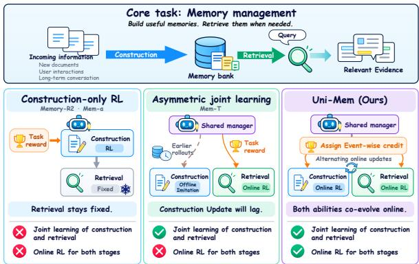
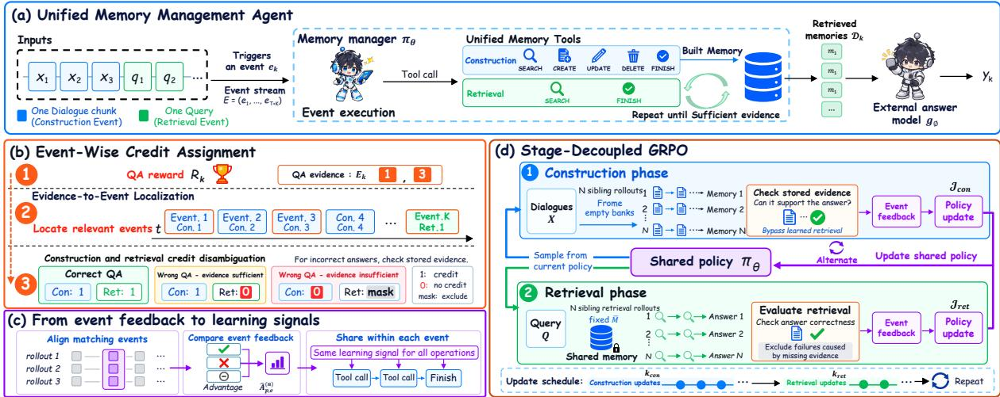
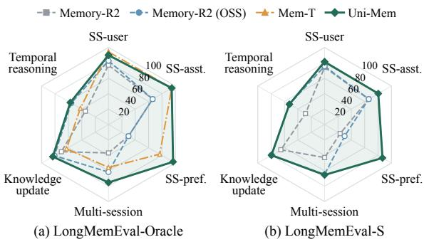
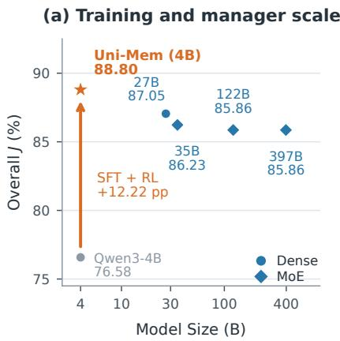
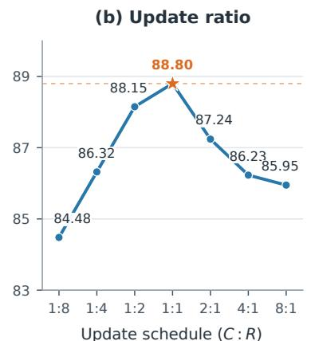
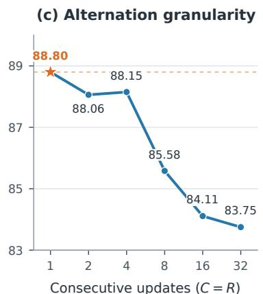
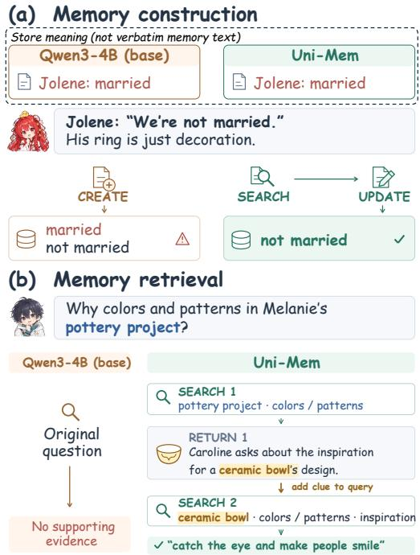
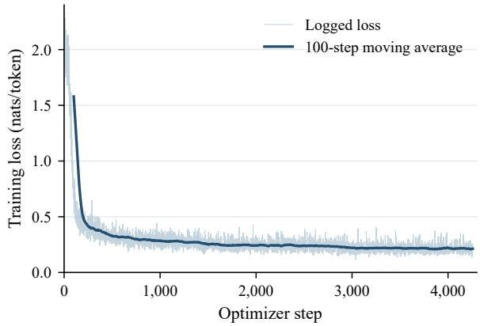
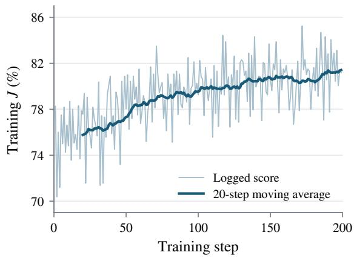
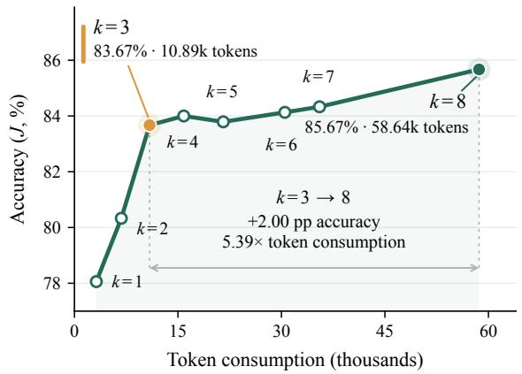

# UNI-MEM: Learning a Long-Horizon Agentic Memory Manager with Unified Online Policy Optimization

Zhiqian Xia<sup>1,3</sup>\* Jielong Tang<sup>2,3</sup>\* Ling-An Zeng<sup>3</sup> Shixiong Kai<sup>3</sup> Rong Yao<sup>3</sup> Hao Kong<sup>3</sup> Xiao Dong<sup>4</sup> Wei Wang<sup>2</sup> Mingxuan Yuan<sup>3</sup> Siyu Xia<sup>1</sup> Haifeng Xia<sup>2†</sup>

<sup>1</sup>Southeast University <sup>2</sup>Sun Yat-sen University <sup>3</sup>Huawei Technologies, Noah’s Ark Lab <sup>4</sup>Shandong Normal University

## Abstract

Long-term agent memory is shifting from predefined workflows toward learnable policies for memory construction and retrieval. Existing learning-based methods either optimize construction alone or combine retrievalside online reinforcement learning (RL) with offline construction supervision, limiting coadaptation between the two stages. In this paper, we explore end-to-end online RL for a unified memory manager (UNI-MEM) that learns both capabilities under a shared policy. However, joint optimization with existing RL algorithms such as GRPO faces confounded group comparisons and sparse feedback over long memory-management trajectories. To this end, we propose Stage-Decoupled GRPO, which alternates construction and retrieval optimization while controlling variation from the other stage within each rollout group, yielding stage-specific learning signals. We further introduce Event-Wise Credit Assignment (ECA), which localizes feedback to responsible events and propagates event-level advantages to their constituent operations. Experiments on LoCoMo and LongMemEval show that UNI-MEM outperforms the strongest RLbased memory, demonstrating the effectiveness of jointly learning memory construction and retrieval via Stage-Decoupled GRPO and ECA.

## 1 Introduction

Long-term memory enables Large Language Model (LLM) agents to reuse information across interactions that exceed their context windows (Wang et al., 2023; Yu et al., 2026b). Early memory systems, such as MemGPT (Packer et al., 2023), Mem0 (Chhikara et al., 2025), and A-Mem (Xu et al., 2025), rely on manually specified prompts and predefined workflows to organize and access past information. Despite their effectiveness, these systems remain constrained by frozen LLMs and rigid human priors, limiting the generalization of memory construction and retrieval to dynamic agent environments (Xiong et al., 2026).

  
Figure 1: Comparison of training paradigms in different methods. Construction-only RL keeps retrieval fixed, while asymmetric joint learning combines offline construction imitation with online retrieval RL. UNI-MEM jointly optimizes both stages under a shared policy through alternating online RL and event-wise credit.

To bridge this gap, recent works formulate memory management<sup>1</sup> as a learnable policy optimized via reinforcement learning (RL). Methods such as Memory-R2 (Yan et al., 2026a) and Mem-α (Wang et al., 2025) keep retrieval fixed and train construction with RL. Such construction-only RL learns how to build memory without jointly learning how to retrieve it adaptively, limiting memory utility in downstream tasks. To jointly learn both capabilities within a shared-parameter memory manager, approaches such as Mem-T (Yue et al., 2026) combine online agentic RL of retrieval with offline imitation of hindsight-selected construction actions. Yet this asymmetric joint learning can introduce a training lag: online retrieval RL continually updates the shared policy, whereas offline construction supervision remains anchored to earlier policy and memory states, hindering coordinated adaptation across the two stages. This motivates a central research question: How can a shared-parameter agentic memory manager, which operates through multi-turn tool interaction, jointly learn long-horizon construction and retrieval via end-to-end online RL?

Achieving this goal poses two main challenges. (1) Confounded group comparisons. Existing group-relative RL (e.g. GRPO (Shao et al., 2024)) derives advantages from reward differences among sampled rollouts. For a unified memory manager, each rollout couples construction trajectories with a retrieval continuation, so its final reward reflects decisions from both stages. When both stages vary across rollouts, trajectory-level group-relative advantages can conflate their contributions, obscuring the learning signal for each stage. (2) Longhorizon credit attribution. The manager policy performs hundreds of memory operations (tool calls) per rollout, yet receives the outcome reward only at answer time. Such sparse feedback neither localizes the query-relevant portions of a rollout nor reveals whether the required information was stored or successfully retrieved. Moreover, memory updates further complicate attribution by overwriting memory items produced by earlier decisions. Thus, feedback must be attributed to the relevant stage and operations within them.

In this work, we propose UNI-MEM, a unified memory manager that jointly learns agentic construction and retrieval through end-to-end online RL. Fig. 1 compares the training paradigms of existing methods with ours. To address confounded group comparisons, we introduce Stage-Decoupled GRPO, which decouples the two stages contributions in group-relative advantages. Specifically, we alternate construction and retrieval optimization while controlling variation from the other stage within each rollout group. For construction, we bypass learned retrieval: since each memory record retains the identifier of its source chunk, we directly gather the records linked to a query’s annotated supporting evidence (used only during training) and score them with a frozen answer model. This evidence-indexed score reflects what was stored rather than how it was retrieved. For retrieval, all rollouts in a group share an identical memory state resampled from the current policy, so reward differences reflect retrieval alone. Alternating the two phases yields stage-specific signals, enabling both capabilities to co-evolve.

To address long-horizon credit attribution, we introduce Event-Wise Credit Assignment (ECA), which organizes multiple memory operations into events<sup>2</sup>, triggered by an incoming dialogue chunk (construction event) or a query (retrieval event). ECA uses a query’s supporting evidence to localize the responsible construction events, and reuses evidence-indexed scoring to penalize an unsuccessful retrieval event only when sufficient evidence has been stored. For update-robust evidence attribution, ECA tracks events along the same memory update chain and assigns them the corresponding credit. Since the event stream is fixed by the input data, rollouts share aligned event positions. ECA thus normalizes each event’s feedback against sameposition events across the rollout group, rather than at the trajectory level, and broadcasts the resulting advantage to all memory tool calls within that event. Our contributions are summarized as follows:

• We propose UNI-MEM, a unified memory manager that jointly optimizes agentic construction and retrieval via end-to-end online RL, with Stage-Decoupled GRPO separating the two stages’ contributions to group-relative signals.

• We introduce Event-Wise Credit Assignment, which localizes outcome feedback to responsible events and computes advantages over positionaligned events across rollouts.

• Extensive experiments on LoCoMo and Long-MemEval demonstrate that UNI-MEM outperforms the strongest RL-based memory manager, supporting the effectiveness of jointly learning memory construction and retrieval.

## 2 Related Work

Long-term Memory Agents. Long-term memory enables LLM agents to retain and reuse information beyond their active context. Retrievalaugmented generation (RAG) provides a basic mechanism for accessing external information (Lewis et al., 2020), while early agent-memory systems consolidate interactions into persistent records and reflections (Park et al., 2023; Zhong et al., 2024). Subsequent work emphasizes hierarchical storage and consolidation (Packer et al., 2023; Kang et al., 2025; Fang et al., 2026), or structured and associative organization (Chhikara et al., 2025; Xu et al., 2025; Rasmussen et al., 2025; Gutiérrez et al., 2025; Yuan et al., 2026). Agentic retrieval further enables iterative evidence gathering from retained histories (Yan et al., 2025). Complementing these architectural advances, UNI-MEM learns a shared policy for multi-turn memory construction and retrieval via adaptively tool calling, allowing both capabilities to adapt jointly to downstream tasks.

Reinforcement Learning for Memory Agents. RL-based memory methods optimize compressed working states, as in MEM1 (Zhou et al., 2026) and MemAgent (Yu et al., 2026a), external-memory construction (Wang et al., 2025), or retrieval decisions (Tan et al., 2025; Hsu et al., 2026). Age-Mem (Yu et al., 2026b) coordinates long-term memory and short-term context. Memory-R1 (Yan et al., 2026b) trains memory construction and a separate answer agent, whereas Memory-R2 (Yan et al., 2026a) extends this training to long horizons with local and global group-relative credit. Denser construction supervision is also explored through intermediate rewards and evidence-based attribution (Ma et al., 2026; Shen et al., 2026). Beyond individual components, Mem-T (Yue et al., 2026) combines online retrieval RL with offline imitation of construction actions selected using hindsight feedback. Different from existing approaches, UNI-MEM explores an end-to-end online RL of a sharedparameter manager policy while addressing the resulting challenges of confounded group comparisons and credit assignment with Decoupled GRPO and event-wise attribution. Appendix A further positions our work with representative methods’ interaction patterns and training paradigm, including a detailed technical comparison with Mem-T.

## 3 Preliminaries

## 3.1 Problem Formulation

Our goal is to train a memory manager agent to maintain a persistent external memory bank M and retrieve relevant memories for downstream question answering. We formulate this task as the continual processing of an ordered stream of events.

Let $X = ( x _ { 1 } , \dots , x _ { T } )$ and $Q = ( q _ { 1 } , \dotsc , q _ { K } )$ denote the sequences of dialogue chunks and queries, respectively. A construction event $e _ { t } ^ { \mathrm { c o n } }$ is triggered by a dialogue chunk $x _ { t }$ and requires the agent to decide whether and how to revise the memory bank. A retrieval event $e _ { k } ^ { \mathrm { r e t } }$ is triggered by a query $q _ { k }$ and requires the agent to gather supporting evidence $\mathcal { D } _ { k } \subseteq \mathcal { M }$ . The arrival order of these inputs defines the event stream:

$$
\mathcal { E } = ( e _ { 1 } , \dots , e _ { T + K } ) .\tag{1}
$$

In our datasets, all queries arrive after the dialogue, so retrieval operates on the bank built from X.

For each query, a frozen external answer model $g _ { \phi }$ responds using the retrieved evidence:

$$
\begin{array} { r } { y _ { k } = g _ { \phi } ( q _ { k } , \mathcal { D } _ { k } ) . } \end{array}\tag{2}
$$

We aim to jointly optimize the agent’s construction and retrieval behavior under a shared policy to improve downstream answer accuracy.

## 3.2 Unified Memory Management Agent

We instantiate the memory manager as a tool-using agent governed by a shared policy $\pi _ { \theta } .$ , as illustrated in $\mathrm { F i g . } 2 \ \mathrm { ( a ) }$ . The memory bank stores records of the form $m _ { i } = ( i , c _ { i } , \mathrm { c o n t e n t } _ { i } )$ , where i is a unique record ID, $c _ { i } \in \{ 1 , \ldots , T \}$ is the index of the dialogue chunk from which the record was created, and content is the stored textual content.

Both event types support multiple rounds oftool interaction. At each step, the agent selects a tool call based on the event type, the triggering input, and the preceding tool calls and observations within the event. It then executes the call and uses the returned result to guide its next decision.

During construction, the agent can use SEARCH, CREATE, UPDATE, and DELETE to inspect and revise the bank. During retrieval, it uses SEARCH to gather evidence, potentially conducting successive searches based on earlier results. For both event types, the agent terminates by calling FINISH, which also submits the selected evidence $\mathcal { D } _ { k }$ for retrieval events. Details of the memory representation and tool specifications are provided in Appendices B.1 and B.2, respectively.

## 4 Method

In this section, we present the training framework of UNI-MEM, as shown in Fig. 2. Online RL alternates between a construction phase and a retrieval phase (Section 4.2). We first describe Event-Wise Credit Assignment (Section 4.1), which assigns rewards to events in each phase, and then the optimization procedure, which combines an SFT cold start with Stage-Decoupled GRPO.

  
Figure 2: Overview of UNI-MEM. (a) UNI-MEM unifies memory construction and retrieval through a shared tool-using agent, continually processing an ordered stream of events. (b) Event-Wise Credit Assignment attributes sparse outcome rewards to relevant events. (c) Event-level feedback is propagated to the corresponding memory operations (tool calls). (d) Stage-Decoupled GRPO alternates between construction and retrieval optimization.

## 4.1 Event-Wise Credit Assignment

In long-horizon memory management, the outcome reward arrives only after long sequences of tool calls, making it hard to identify which tool calls contributed. We therefore introduce Event-Wise Credit Assignment (ECA), which localizes each query’s reward to the events responsible for it.

Let $y _ { k } ^ { \star }$ denote the reference answer to query $q _ { k }$ A fixed LLM judge $\mathcal { I } _ { \psi }$ evaluates the generated response $y _ { k }$ and assigns the task reward

$$
R _ { k } = \mathcal { I } _ { \psi } ( q _ { k } , y _ { k } , y _ { k } ^ { \star } ) \in \{ 0 , 1 \} .\tag{3}
$$

Evidence-to-event localization. Let $E _ { k } \subseteq \mathbb { C }$ $\{ 1 , \ldots , T \}$ denote the indices of the dialogue chunks that contain the annotated evidence for $q _ { k }$ which are used only during training. The construction events related to $q _ { k }$ are

$$
\mathcal { E } _ { k } ^ { \mathrm { c o n } } = \{ e _ { t } ^ { \mathrm { c o n } } \ | \ t \in E _ { k } \} .\tag{4}
$$

Evidence-indexed memory scoring. An incorrect answer may result from insufficient stored information or from unsuccessful retrieval. To distinguish the two, for a memory bank B, Index $( E _ { k } , B )$ selects the current versions of the records written in $\mathcal { E } _ { k } ^ { \mathrm { c o n } }$ , and the frozen answer model answers $q _ { k }$ from these records:

$$
\begin{array} { r l } & { \widetilde { y } _ { k } ( \boldsymbol { \mathcal { B } } ) = g _ { \phi } ( q _ { k } , \operatorname { I n d e x } ( E _ { k } , \boldsymbol { \mathcal { B } } ) ) , } \\ & { S _ { k } ( \boldsymbol { \mathcal { B } } ) = \mathcal { T } _ { \psi } ( q _ { k } , \widetilde { y } _ { k } ( \boldsymbol { \mathcal { B } } ) , y _ { k } ^ { \star } ) \in \{ 0 , 1 \} . } \end{array}\tag{5}
$$

Thus, $S _ { k } ( B )$ serves as a proxy for whether the stored information suffices to answer $q _ { k }$ , without involving the learned retrieval policy.

Event-level credit. In the construction phase, rollout n produces a final bank $B ^ { ( n ) }$ , and each such event accumulates the scores of its related queries:

$$
\bar { R } _ { \mathrm { c o n } , e } ^ { ( n ) } = \sum _ { k : e \in \mathcal { E } _ { k } ^ { \mathrm { c o n } } } S _ { k } ( \mathcal { B } ^ { ( n ) } ) .\tag{6}
$$

Note that events that are not related to any query in a rollout receive no return and are excluded from the group at their position. In the retrieval phase, all rollouts share a bank $\overline { { \mathcal { M } } }$ , and the retrieval event triggered by $q _ { k }$ receives

$$
\bar { R } _ { \mathrm { r e t } , e _ { k } } ^ { ( n ) } = \left\{ \begin{array} { l l } { R _ { k } ^ { ( n ) } , } & { R _ { k } ^ { ( n ) } = 1 \vee S _ { k } ( \overline { { \mathcal { M } } } ) = 1 , } \\ { \bot , } & { \mathrm { o t h e r w i s e } , } \end{array} \right.\tag{7}
$$

where ⊥ marks an excluded event. A failed retrieval is thus penalized only when the shared bank supports a correct answer; otherwise, the failure is attributed to construction, and the event contributes neither to group statistics nor to policy gradients. The resulting returns are converted into event-level advantages in Section 4.2.

Update-robust evidence attribution. Records written in $\mathcal { E } _ { k } ^ { \mathrm { c o n } }$ may later be updated or deleted by events outside $\mathcal { E } _ { k } ^ { \mathrm { c o n } }$ , which then receive no credit. We therefore track the update lineage of these records during training and form a rolloutspecific credit set $\widetilde { \mathcal { E } } _ { k } ^ { \mathrm { c o n } , ( n ) } \supseteq \mathcal { E } _ { k } ^ { \mathrm { c o n } }$ that additionally contains such events, which share the same score $S _ { k } ( B ^ { ( n ) } )$ . With this attribution, $\widetilde { \mathcal { E } } _ { k } ^ { \mathrm { c o n } , ( n ) }$ replaces $\mathcal { E } _ { k } ^ { \mathrm { c o n } }$ in Eq. (6), while memory selection in Eq. (5) still uses the original $E _ { k }$ . See Appendix C.2.

## 4.2 Unified Manager Policy Optimization

In this section, we describe the optimization procedure for our UNI-MEM. We first cold-start the shared policy through supervised fine-tuning (SFT) on demonstration data, then further optimize it with Stage-Decoupled GRPO, as shown in Fig. 2(d).

Supervised cold start. To establish basic construction and retrieval capabilities, we initialize the shared policy through supervised fine-tuning on memory management demonstrations. Details of the demonstration data and training objective are provided in Appendix C.1.

Stage-Decoupled GRPO. Directly applying GRPO to end-to-end rollouts can conflate construction and retrieval contributions when both stages vary, obscuring the learning signal for each stage. To address this, we introduce Stage-Decoupled GRPO, which alternates construction and retrieval optimization while controlling variation from the other stage within each rollout group. Construction rollouts are evaluated without learned retrieval, while retrieval rollouts share a fixed memory bank. Both phases update the same shared manager π<sub>θ</sub>.

At each iteration, a snapshot $\pi _ { \boldsymbol { \theta } _ { \mathrm { o l d } } }$ of the current manager samples N sibling rollouts per group for the scheduled phase. Construction rollouts process the same dialogues from empty banks; retrieval rollouts for each query share a bank M that this snapshot constructs once by processing the dialogue before retrieval. Algorithm 1 assigns event-level returns $\bar { R } _ { p , e } ^ { ( n ) }$ , which are used to update $\pi _ { \theta }$

Using the assigned returns, we group corresponding events across rollouts by their triggering dialogue-chunk or query ID. Since all rollouts of a training sample process the same stream of dialogue chunks and queries, events triggered by the same input are aligned across rollouts, even though the tool calls performed within them may differ. Differences in the preceding memory states are treated as part of the sampled trajectory, as in standard GRPO. Construction events without a return and retrieval events marked ⊥ in Eq. (7) are excluded from both group statistics and policy optimization. Groups with fewer than two valid returns or zero variance are discarded. For each retained group in phase $p \in \{ \mathrm { c o n } , \mathrm { r e t } \}$ , we compute

$$
\widehat { A } _ { p , e } ^ { ( n ) } = \frac { \bar { R } _ { p , e } ^ { ( n ) } - \mu _ { p , e } } { \sigma _ { p , e } + \delta } ,\tag{8}
$$

where $\mu _ { p , e }$ and $\sigma _ { p , e }$ are the mean and standard deviation of the valid returns, and $\delta > 0$ is a numerical stabilizer. Under event-level credit assignment, all tool calls within an event share its advantage, as illustrated in Fig. 2(c).

Algorithm 1 Phase-Specific Event Reward Assign  
ment   
Input: Phase p; N sampled rollouts with their memory banks;   
query annotations $\{ q _ { k } , E _ { k } , y _ { k } ^ { \star } \} _ { k = 1 } ^ { K }$   
Output: Event returns $\{ \bar { R } _ { p , e } ^ { ( n ) } \}$ , with ⊥ marking excluded   
events   
1: if $p =$ con then   
2: for $n = 1 , \ldots , N$ do   
3: Form $\widetilde { \mathcal { E } } _ { k } ^ { \mathrm { c o n } , ( n ) }$ from Eq. (4) and the update lineage,   
for all k   
4: $\ ` { s } _ { k } ^ { ( n ) } \gets S _ { k } ( B ^ { ( n ) } )$ , for all k   
5: $\begin{array} { r } { \ddot { R } _ { \mathrm { c o n } , e } ^ { ( n ) }  \sum _ { k : e \in \widetilde { \mathcal { E } } _ { k } ^ { \mathrm { c o n } , ( n ) } } s _ { k } ^ { ( n ) } } \end{array}$ , for related events   
e   
6: end for   
7: else   
8: for $k = 1 , \ldots , K$ do   
9: Evaluate task rewards $\{ R _ { k } ^ { ( n ) } \} _ { n = 1 } ^ { N }$   
10: if ∃n : $R _ { k } ^ { ( n ) } = 0$ then   
11: Evaluate $\boldsymbol { S _ { k } } ( \overline { { \mathcal { M } } } )$ on the shared bank   
12: end if   
13: Assign $\bar { R } _ { \mathrm { r e t } , e _ { k } } ^ { ( n ) }$ by Eq. (7), for all n   
14: end for   
15: end if   
16: return $\{ \bar { R } _ { p , e } ^ { ( n ) } \}$

Following GRPO, every token of a retained tool call is optimized with the clipped surrogate, using the advantage of its event:

$$
\begin{array} { r l r } & { } & { \mathcal { I } _ { p } ( \theta ) = \mathbb { E } _ { n } \bigg [ \frac { 1 } { \vert \tau _ { p } ^ { ( n ) } \vert } \sum _ { o \in \tau _ { p } ^ { ( n ) } } \operatorname* { m i n } \left( \rho _ { o } \widehat { A } _ { p , e ( o ) } ^ { ( n ) } , \right. } \\ & { } & { \left. \mathrm { c l i p } ( \rho _ { o } , 1 - \epsilon , 1 + \epsilon ) \widehat { A } _ { p , e ( o ) } ^ { ( n ) } \right) \bigg ] , } \end{array}\tag{9}
$$

where $\tau _ { p } ^ { ( n ) }$ contains the tokens of the tool calls in rollout n retained in phase $p , \rho _ { o }$ is the token-level likelihood ratio between π<sub>θ</sub> and $\pi _ { \boldsymbol { \theta } _ { \mathrm { o l d } } }$ , and $e ( o )$ is the event containing token $o .$ Rollouts without retained tokens are skipped; no KL penalty is used.

The two phases alternate according to $\kappa =$ $( \kappa _ { \mathrm { c o n } } , \kappa _ { \mathrm { r e t } } ) \colon \kappa _ { \mathrm { c o n } }$ consecutive construction updates are followed by $\kappa _ { \mathrm { r e t } }$ retrieval updates (denoted C and R in Figure 4). The RL objective is

$$
\mathcal { I } _ { \mathrm { R L } } ( \theta ) = \lambda _ { \mathrm { c o n } } \mathcal { I } _ { \mathrm { c o n } } ( \theta ) + \lambda _ { \mathrm { r e t } } \mathcal { I } _ { \mathrm { r e t } } ( \theta ) ,\tag{10}
$$

where $\lambda _ { \mathrm { c o n } } = 1$ and $\lambda _ { \mathrm { { r e t } } } = 0$ during construction updates, and vice versa during retrieval updates.

## 5 Experiments

## 5.1 Experiment Setup

Datasets and Evaluation Metrics. We evaluate our framework on LoCoMo (Maharana et al., 2024)

<table><tr><td rowspan=1 colspan=2>Model              MultiOpenSingleTemp. OverallTraining-free Methods</td></tr><tr><td rowspan=1 colspan=2>RAG                15.0619.2812.79 5.43  12.17</td></tr><tr><td rowspan=1 colspan=1>A-MEM</td><td rowspan=1 colspan=1>40.7831.3246.90 28.68 40.78</td></tr><tr><td rowspan=1 colspan=2>Mem0              61.9248.1965.20 38.76 53.30MemoryOS         48.1238.55 63.14 24.81  51.26</td></tr><tr><td rowspan=1 colspan=2>Training-based methods</td></tr><tr><td rowspan=1 colspan=2>MEM1              41.2943.1057.22 44.73 50.78</td></tr><tr><td rowspan=1 colspan=2>MemAgent         70.6562.0778.61 56.96 71.52</td></tr><tr><td rowspan=1 colspan=2>Memory-R1         62.3440.9667.81 49.61  61.51</td></tr><tr><td rowspan=1 colspan=2>Memory-R2†       69.1561.2978.61 57.38 71.26</td></tr><tr><td rowspan=1 colspan=1>Memory-R2 (OSS)†74.1370.97</td><td rowspan=1 colspan=1>81.15 74.68  77.87</td></tr><tr><td rowspan=1 colspan=2>Mem-T†            68.1658.0681.15 76.79 76.49</td></tr><tr><td rowspan=1 colspan=2>UNI-MEM(w/o sft) 81.0975.8188.79 62.87 80.99</td></tr><tr><td rowspan=1 colspan=2>UNI-MEM          87.0679.0391.51 86.08  88.80</td></tr></table>

Table 1: Performance comparison on LoCoMo (LLMas-a-Judge, %). Bold and underlined results indicate the best and second-best, respectively. <sup>†</sup> marks our reevaluation of the officially released checkpoints under the same protocol as UNI-MEM. Other baseline results are taken from Yan et al. (2026a) under their original protocol, as reference only (Appendix E.1).

and LongMemEval (Wu et al., 2025). For a fair comparison, we follow the training data configuration of Memory-R2 (Yan et al., 2026a), partitioning LoCoMo into RL training, validation, and test sets with a 2:1:7 split. We use LongMemEval for out-ofdistribution evaluation. We report LLM-as-a-Judge scores (J) using the official Mem0 (Chhikara et al., 2025) judge prompt.

Baselines. We compare UNI-MEM against two groups of baselines. (I) Training-free methods include RAG for conversation retrieval, as well as A-Mem (Xu et al., 2025), Mem0 (Chhikara et al., 2025), and MemoryOS (Kang et al., 2025). (II) Training-based methods include MEM1 (Zhou et al., 2026), MemAgent (Yu et al., 2026a), Memory-R1 (Yan et al., 2026b), and Memory-R2 (Yan et al., 2026a), and Mem-T (Yue et al., 2026). These methods typically use RL to optimize memory phase. For a fair comparison, we re-evaluate the Memory-R2 (OSS) variant, which uses GPT-OSS-120B (OpenAI, 2025) as its answer model. Details of baselines are in Appendix D

Implementation Details. We use Qwen3-4B-Instruct (Yang et al., 2025) as the backbone of our memory manager. GPT-OSS-120B serves as the external answer model, and GPT-4o-mini (OpenAI, 2024) serves as the judge model. Additional training details are provided in Appendix C.

  
Figure 3: OOD accuracy (J, %) on LongMemEval-Oracle and LongMemEval-S. SS: single-session; asst.: assistant; pref.: preference. Both panels use a 0–100% scale. Mem-T results are shown only for Oracle.

## 5.2 Main Results

Superiority over existing baselines. As shown in Table 1, UNI-MEM achieves the best performance across all four question types, with an overall J score of 88.80%. It surpasses the strongest baseline, Memory-R2 (OSS), by 10.93 percentage points and Mem-T by 12.31 points, with gains of 12.93 and 9.29 points over the strongest competing results on multi-hop and temporal questions, respectively. Additionally, UNI-MEM still achieves 80.99% without SFT, outperforming the strongest baseline by 3.12%. These results support the effectiveness of jointly optimizing memory construction and retrieval through Stage-Decoupled GRPO and Event-Wise Credit Assignment, which provide stage-specific learning signals and localized supervision for memory operations.

Out-of-Distribution Generalization. To assess whether the memory-management capabilities learned on LoCoMo transfer to a different benchmark, we evaluate UNI-MEM on LongMemEval-Oracle and LongMemEval-S (Wu et al., 2025). Figure 3 presents the categorylevel results. On LongMemEval-Oracle, UNI-MEM substantially outperforms all baselines on single-session-preference and multi-session questions. It also achieves notable gains in knowledge update and temporal reasoning over Mem-T, a prior unified memory manager. On the larger-scale LongMemEval-S, UNI-MEM consistently outperforms Memory-R2 and its variants across all six task categories. These results demonstrate the transferability of its learned memory-management capabilities beyond the LoCoMo training distribution.

<table><tr><td rowspan=1 colspan=1>Model MultiOpenSingleTemp.Overall</td></tr><tr><td rowspan=1 colspan=1>Qwen3-4B-Instruct</td></tr><tr><td rowspan=1 colspan=1> $M _ { 0 }$     78.6170.9784.04 57.81   $7 6 . 5 8 $ </td></tr><tr><td rowspan=1 colspan=1> $M _ { 1 }$     81.0969.3585.57 54.01  76.95</td></tr><tr><td rowspan=1 colspan=1> $M _ { 2 }$     82.5972.5886.59 55.27  78.24</td></tr><tr><td rowspan=1 colspan=1> $M _ { 3 }$     84.0866.1387.10 65.82  80.72</td></tr><tr><td rowspan=1 colspan=1> $M _ { 4 }$    81.0975.81 88.79 62.87  80.99</td></tr><tr><td rowspan=1 colspan=1>Qwen3-4B-Instruct after SFT</td></tr><tr><td rowspan=1 colspan=1> $M _ { 0 }$     82.0969.3588.12 77.22  83.56</td></tr><tr><td rowspan=1 colspan=1> $M _ { 1 }$     84.0870.9788.62 75.95  84.02</td></tr><tr><td rowspan=1 colspan=1> $M _ { 2 }$     84.0874.1990.66 83.97  87.05</td></tr><tr><td rowspan=1 colspan=1> $M _ { 3 }$     88.5677.4290.32 84.81  88.06</td></tr><tr><td rowspan=1 colspan=1> $M _ { 4 }$     87.0679.0391.51 86.08  88.80</td></tr></table>

Table 2: Ablation study on LoCoMo (J, %) with raw or SFT-initialized Qwen3-4B-Instruct as start point (M ).

## 5.3 Ablation Study

Ablation setting. To validate the effectiveness of UNI-MEM’s module designs, we conduct an incremental ablation study. Specifically, $M _ { 0 }$ serves as the starting point, using either the original or SFT-initialized base manager. $M _ { 1 }$ jointly optimizes memory construction and retrieval using standard GRPO. $M _ { 2 }$ adds Event-Wise Credit Assignment to $M _ { 1 }$ $M _ { 3 }$ replaces standard GRPO in $M _ { 2 }$ with Stage-Decoupled GRPO. Finally, $M _ { 4 }$ incorporates update-robust evidence attribution into $M _ { 3 } ,$ , yielding the full UNI-MEM framework. Table 2 presents the ablation results using either the original or SFTinitialized Qwen3-4B-Instruct model. The singlestage rollout and reward-assignment procedures for $M _ { 1 }$ and $M _ { 2 }$ are detailed in Appendix E.2.

Event-wise Credit Assignment. Sparse outcome rewards offer limited guidance for credit assignment across hundreds of memory operations. Adding ECA $( M _ { 1 }  M _ { 2 } )$ improves overall J by 1.29 and 3.03 percentage points without and with SFT, respectively. These gains support the effectiveness of ECA, which localizes feedback to relevant events and their operations. Update-robust attribution $( M _ { 3 }  M _ { 4 } )$ continually improves the performance, supporting the additional benefit of credit tracing along memory update lineages.

Stage-Decoupled GRPO. $M _ { 0 }  M _ { 1 }$ brings very limited gain (only 0.37%), which indicates that group-relative advantages can conflate construction and retrieval effects. Stage-Decoupled GRPO $( M _ { 2 }  M _ { 3 } )$ improves overall J by 2.48 percentage points without SFT. In particular, temporal accuracy rises by 10.55 points in this setting, and multi-hop accuracy increases by 4.48 points after SFT. These gains support the effectiveness of alternating optimization and controlling cross-stage variation in Stage-Decoupled GRPO.

<table><tr><td>Memory</td><td>Search</td><td>|Multi Open</td><td>Single</td><td>Temp.</td><td>Overall</td></tr><tr><td> $P _ { 0 }$ </td><td> $Q _ { 0 }$ </td><td>78.61</td><td>70.97 84.04</td><td>57.81</td><td>76.58</td></tr><tr><td> $P _ { 0 }$ </td><td> $Q _ { + }$ </td><td>86.07</td><td>67.74 88.29</td><td>62.45</td><td>81.08</td></tr><tr><td> $P _ { + }$ </td><td> $Q _ { 0 }$ </td><td>77.61</td><td>69.35 89.98</td><td>81.86</td><td>84.76</td></tr><tr><td> $P _ { + }$ </td><td> $Q _ { + }$ </td><td>87.06</td><td>79.03 91.51</td><td>86.08</td><td>88.80</td></tr></table>

Table 3: Evaluation of memory construction and retrieval capabilities on LoCoMo (J, %) by crosscombining memory banks and retrieval policies. $P _ { 0 }$ and $P _ { + }$ denote memory banks constructed by the base Qwen3-4B manager and the trained UNI-MEM manager, respectively; $Q _ { 0 }$ and $Q _ { + }$ denote their corresponding retrieval policies.

## 5.4 Further Analysis

Evaluating Construction and Retrieval Capabilities. We analyze the memory construction and retrieval capabilities of UNI-MEM. To assess the improvements in each capability, we cross-combine memory banks and retrieval policies from the base and trained managers, as shown in Table 3. With the base retrieval policy fixed, replacing $P _ { 0 }$ with $P _ { + }$ improves the overall J score by 8.18 percentage points, demonstrating the increased downstream utility of the constructed memories. Conversely, replacing $Q _ { 0 }$ with $Q _ { + }$ improves the overall score by 4.50 and 4.04 points on $P _ { 0 }$ and $P _ { + }$ , respectively, indicating more effective evidence retrieval from the same memory bank. Combining both trained capabilities achieves the highest overall score of 88.80%. These results show that UNI-MEM improves both memory construction and retrieval, with each capability contributing gains even when paired with its untrained counterpart.

Effect of Alternation Frequency and Update Balance. To determine how construction and retrieval should be combined for joint learning within a shared policy, we compare training schedules under Stage-Decoupled GRPO (Figure 4(b,c)). Each schedule C : R consists of C consecutive construction updates followed by R retrieval updates. As shown in Figure 4(c), extending the update blocks from 1 : 1 to 32 : 32 reduces the overall J score from 88.80% to 83.75%, indicating that less frequent alternation hinders shared-policy learning. As shown in Figure 4(b), the 1 : 8 and 8 : 1 schedules reduce performance by 4.32 and 2.85 percentage points, respectively, indicating that allocating too many updates to either stage also harms unified learning. These results indicate that both balanced allocation and frequent alternation are important for coordinated construction and retrieval learning under a shared policy.





  
Figure 4: Effects of manager training, scale, and alternating schedules on LoCoMo. (a) Training and manager scale. The arrow shows the gain from SFT followed by RL. (b) Construction–retrieval update ratio. (c) Alternation granularity at a fixed 1 : 1 ratio. C and R denote consecutive construction and retrieval updates per cycle.

Effect of Training and Manager Scale. We compare UNI-MEM with the base Qwen3-4B-Instruct and four larger off-the-shelf Qwen3.5 models, all serving as memory managers within the same agent harness. As shown in Figure 4(a), SFT followed by RL improves the 4B manager’s J score from 76.58% to 88.80%. UNI-MEM also outperforms all off-the-shelf managers, including the strongest one, Qwen3.5-27B (87.05%), and the largest one, Qwen3.5-397B-A17B (85.86%). These results demonstrate that a small manager trained jointly for construction and retrieval can outperform substantially larger off-the-shelf alternatives.

## 5.5 Case Study

As shown in Figure 5, we compare UNI-MEM with the base Qwen3-4B memory manager to illustrate the capabilities acquired through our training. In Figure 5(a), both memory banks initially encode the mistaken belief that Jolene is married, with their underlying entries differing in wording and content. Following Jolene’s clarification, UNI-MEM locates the conflicting entry through SEARCH and corrects it through UPDATE, while the base manager uses CREATE and leaves contradictory claims unresolved. This illustrates UNI-MEM’s ability to identify and resolve memory conflicts, maintaining an internally consistent memory bank. In Figure 5(b), UNI-MEM uses the ceramic bowl reference discovered during its initial search to refine the next query and retrieve the answer-bearing memory. This highlights UNI-

  
Figure 5: Case studies comparing UNI-MEM and the base Qwen3-4B manager in (a) memory construction and (b) memory retrieval.

MEM’s ability to iteratively refine its search based on intermediate results to retrieve answer-relevant evidence.

## Conclusion

We presented UNI-MEM, a unified memory manager that jointly learns agentic memory construction and retrieval through end-to-end online reinforcement learning under a shared policy. By combining Stage-Decoupled GRPO with Event-Wise Credit Assignment, UNI-MEM obtains stagespecific learning signals and assigns credit to relevant memory operations, enabling coordinated online learning of construction and retrieval over long horizons. Experiments demonstrate that UNI-MEM outperforms strong RL-based memory baselines on LoCoMo and generalizes to LongMemEval.

## Limitations

UNI-MEM unifies memory construction and retrieval through online RL, enabling coordinated policy learning with stage-specific optimization and event-wise credit assignment. However, training remains resource-intensive because rewards require completing downstream QA and obtaining judgemodel evaluations. These evaluations typically rely on external APIs or stronger deployed models, introducing more costs and latency. Running judge evaluations concurrently or adopting asynchronous RL could alleviate the latency bottleneck. Future work will explore more robust process-level supervision to reduce reliance on outcome-based evaluations.

## References

Prateek Chhikara, Dev Khant, Saket Aryan, Taranjeet Singh, and Deshraj Yadav. 2025. Mem0: Building production-ready AI agents with scalable long-term memory. Preprint, arXiv:2504.19413.

Jizhan Fang, Xinle Deng, Haoming Xu, Ziyan Jiang, Yuqi Tang, Ziwen Xu, Shumin Deng, Yunzhi Yao, Mengru Wang, Shuofei Qiao, Huajun Chen, and Ningyu Zhang. 2026. LightMem: Lightweight and efficient memory-augmented generation. In International Conference on Learning Representations, volume 2026, pages 98706–98729.

Bernal Jiménez Gutiérrez, Yiheng Shu, Weijian Qi, Sizhe Zhou, and Yu Su. 2025. From RAG to memory: Non-parametric continual learning for large language models. In Proceedings of the 42nd International Conference on Machine Learning, volume 267 of Proceedings of Machine Learning Research, pages 21497–21515. PMLR.

Hao-Lun Hsu, Nikki Lijing Kuang, Boyi Liu, Zhewei Yao, and Yuxiong He. 2026. Organize then retrieve: Hierarchical memory navigation for efficient agents. Preprint, arXiv:2606.11680.

Bowen Jin, Hansi Zeng, Zhenrui Yue, Jinsung Yoon, Sercan O. Arik, Dong Wang, Hamed Zamani, and Jiawei Han. 2025. Search-R1: Training LLMs to reason and leverage search engines with reinforcement learning. In Second Conference on Language Modeling.

Jiazheng Kang, Mingming Ji, Zhe Zhao, and Ting Bai. 2025. Memory OS of AI agent. In Proceedings of the 2025 Conference on Empirical Methods in Natural

Language Processing, pages 25961–25970, Suzhou, China. Association for Computational Linguistics.

Patrick Lewis, Ethan Perez, Aleksandra Piktus, Fabio Petroni, Vladimir Karpukhin, Naman Goyal, Heinrich Küttler, Mike Lewis, Wen-tau Yih, Tim Rocktäschel, Sebastian Riedel, and Douwe Kiela. 2020. Retrieval-augmented generation for knowledgeintensive NLP tasks. In Advances in Neural Information Processing Systems, volume 33, pages 9459– 9474. Curran Associates, Inc.

Weitao Ma, Xiaocheng Feng, Lei Huang, Xiachong Feng, Zhanyu Ma, Jun Xu, Jiuchong Gao, Jinghua Hao, Renqing He, and Bing Qin. 2026. Fine-Mem: Fine-grained feedback alignment for long-horizon memory management. In Proceedings of the 64th Annual Meeting of the Association for Computational Linguistics (Volume 1: Long Papers), pages 19666– 19684, San Diego, California, United States. Association for Computational Linguistics.

Adyasha Maharana, Dong-Ho Lee, Sergey Tulyakov, Mohit Bansal, Francesco Barbieri, and Yuwei Fang. 2024. Evaluating very long-term conversational memory of LLM agents. In Proceedings ofthe 62nd Annual Meeting ofthe Associationfor Computational Linguistics (Volume 1: Long Papers), pages 13851– 13870, Bangkok, Thailand. Association for Computational Linguistics.

OpenAI. 2024. GPT-4o system card. Preprint, arXiv:2410.21276.

OpenAI. 2025. gpt-oss-120b & gpt-oss-20b model card. Preprint, arXiv:2508.10925.

Charles Packer, Sarah Wooders, Kevin Lin, Vivian Fang, Shishir G. Patil, Ion Stoica, and Joseph E. Gonzalez. 2023. MemGPT: Towards LLMs as operating systems. Preprint, arXiv:2310.08560.

Joon Sung Park, Joseph C. O’Brien, Carrie J. Cai, Meredith Ringel Morris, Percy Liang, and Michael S. Bernstein. 2023. Generative agents: Interactive simulacra of human behavior. In Proceedings of the 36th Annual ACM Symposium on User Interface Software and Technology, UIST ’23, pages 1–22, New York, NY, USA. Association for Computing Machinery.

Preston Rasmussen, Pavlo Paliychuk, Travis Beauvais, Jack Ryan, and Daniel Chalef. 2025. Zep: A temporal knowledge graph architecture for agent memory. Preprint, arXiv:2501.13956.

Zhihong Shao, Peiyi Wang, Qihao Zhu, Runxin Xu, Junxiao Song, Xiao Bi, Haowei Zhang, Mingchuan Zhang, Y. K. Li, Y. Wu, and Daya Guo. 2024. DeepSeekMath: Pushing the limits of mathematical reasoning in open language models. Preprint, arXiv:2402.03300.

Zhiyu Shen, Ziming Wu, Fuming Lai, Shaobing Lian, and Yanghui Rao. 2026. MemBuilder: Reinforcing LLMs for long-term memory construction via attributed dense rewards. In Proceedings ofthe 64th

Annual Meeting ofthe Associationfor Computational Linguistics (Volume 1: Long Papers), pages 27868– 27887, San Diego, California, United States. Association for Computational Linguistics.

Zhen Tan, Jun Yan, I-Hung Hsu, Rujun Han, Zifeng Wang, Long Le, Yiwen Song, Yanfei Chen, Hamid Palangi, George Lee, Anand Rajan Iyer, Tianlong Chen, Huan Liu, Chen-Yu Lee, and Tomas Pfister. 2025. In prospect and retrospect: Reflective memory management for long-term personalized dialogue agents. In Proceedings of the 63rd Annual Meeting of the Association for Computational Linguistics (Volume 1: Long Papers), pages 8416–8439, Vienna, Austria. Association for Computational Linguistics.

Harsh Trivedi, Niranjan Balasubramanian, Tushar Khot, and Ashish Sabharwal. 2023. Interleaving retrieval with chain-of-thought reasoning for knowledgeintensive multi-step questions. In Proceedings of the 61st Annual Meeting ofthe Associationfor Computational Linguistics (Volume 1: Long Papers), pages 10014–10037, Toronto, Canada. Association for Computational Linguistics.

Weizhi Wang, Li Dong, Hao Cheng, Xiaodong Liu, Xifeng Yan, Jianfeng Gao, and Furu Wei. 2023. Augmenting language models with long-term memory. In Advances in Neural Information Processing Systems, volume 36, pages 74530–74543. Curran Associates, Inc.

Yu Wang, Ryuichi Takanobu, Zhiqi Liang, Yuzhen Mao, Yuanzhe Hu, Julian McAuley, and Xiaojian Wu. 2025. Mem-α: Learning memory construction via reinforcement learning. Preprint, arXiv:2509.25911.

Di Wu, Hongwei Wang, Wenhao Yu, Yuwei Zhang, Kai-Wei Chang, and Dong Yu. 2025. LongMemEval: Benchmarking chat assistants on long-term interactive memory. In International Conference on Learning Representations, volume 2025, pages 86809– 86836.

Zidi Xiong, Yuping Lin, Wenya Xie, Pengfei He, Zirui Liu, Jiliang Tang, Himabindu Lakkaraju, and Zhen Xiang. 2026. How memory management impacts LLM agents: An empirical study of experiencefollowing behavior. In Proceedings ofthe 64th Annual Meeting ofthe Associationfor Computational Linguistics (Volume 1: Long Papers), pages 623–645, San Diego, California, United States. Association for Computational Linguistics.

Wujiang Xu, Zujie Liang, Kai Mei, Hang Gao, Juntao Tan, and Yongfeng Zhang. 2025. A-Mem: Agentic memory for LLM agents. In Advances in Neural Information Processing Systems, volume 38, pages 17577–17604. Curran Associates, Inc.

B. Y. Yan, Chaofan Li, Hongjin Qian, Shuqi Lu, and Zheng Liu. 2025. General agentic memory via deep research. Preprint, arXiv:2511.18423.

Sikuan Yan, Ahmed Bahloul, Ercong Nie, Susanna Schwarzmann, Riccardo Trivisonno, Volker Tresp,

and Yunpu Ma. 2026a. Memory-R2: Fair credit assignment for long-horizon memory-augmented LLM agents. Preprint, arXiv:2605.21768.

Sikuan Yan, Xiufeng Yang, Zuchao Huang, Ercong Nie, Zifeng Ding, Zonggen Li, Xiaowen Ma, Jinhe Bi, Kristian Kersting, Jeff Z. Pan, Hinrich Schuetze, Volker Tresp, and Yunpu Ma. 2026b. Memory-R1: Enhancing large language model agents to manage and utilize memories via reinforcement learning. In Proceedings of the 64th Annual Meeting of the Associationfor Computational Linguistics (Volume 1: Long Papers), pages 12805–12825, San Diego, California, United States. Association for Computational Linguistics.

An Yang, Anfeng Li, Baosong Yang, Beichen Zhang, Binyuan Hui, Bo Zheng, Bowen Yu, Chang Gao, Chengen Huang, Chenxu Lv, Chujie Zheng, Dayiheng Liu, Fan Zhou, Fei Huang, Feng Hu, Hao Ge, Haoran Wei, Huan Lin, Jialong Tang, and 41 others. 2025. Qwen3 technical report. Preprint, arXiv:2505.09388.

Shunyu Yao, Jeffrey Zhao, Dian Yu, Nan Du, Izhak Shafran, Karthik Narasimhan, and Yuan Cao. 2023. ReAct: Synergizing reasoning and acting in language models. In International Conference on Learning Representations.

Hongli Yu, Tinghong Chen, Jiangtao Feng, Jiangjie Chen, Weinan Dai, Qiying Yu, Ya-Qin Zhang, Wei-Ying Ma, Jingjing Liu, Mingxuan Wang, and Hao Zhou. 2026a. MemAgent: Reshaping long-context LLM with multi-conv RL-based memory agent. In International Conference on Learning Representations, volume 2026, pages 39458–39486.

Yi Yu, Liuyi Yao, Yuexiang Xie, Qingquan Tan, Jiaqi Feng, Yaliang Li, and Libing Wu. 2026b. Agentic memory: Learning unified long-term and shortterm memory management for large language model agents. In Proceedings of the 64th Annual Meeting of the Association for Computational Linguistics (Volume 1: Long Papers), pages 21457–21483, San Diego, California, United States. Association for Computational Linguistics.

Xujie Yuan, Shimin Di, Jielong Tang, Libin Zheng, and Jian Yin. 2026. Towards self-cognitive exploration: Metacognitive knowledge graph retrieval augmented generation. In Proceedings of the 32nd ACM SIGKDD Conference on Knowledge Discovery and Data Mining V.1, KDD ’26, pages 1844–1855, New York, NY, USA. Association for Computing Machinery.

Yanwei Yue, Boci Peng, Xuanbo Fan, Jiaxin Guo, Qiankun Li, and Yan Zhang. 2026. Mem-T: Densifying rewards for long-horizon memory agents. Preprint, arXiv:2601.23014.

Wanjun Zhong, Lianghong Guo, Qiqi Gao, He Ye, and Yanlin Wang. 2024. MemoryBank: Enhancing large

language models with long-term memory. Proceedings of the AAAI Conference on Artificial Intelligence, 38(17):19724–19731.

Zijian Zhou, Ao Qu, Zhaoxuan Wu, Sunghwan Kim, Alok Prakash, Daniela Rus, Bryan Kian Hsiang Low, and Paul Pu Liang. 2026. MEM1: Learning to synergize memory and reasoning for efficient long-horizon agents. In International Conference on Learning Representations, volume 2026, pages 58413–58438.

## Appendix Overview

This appendix provides supplementary methodological details and experimental analyses to complement the main text and facilitate reproducibility, organized as follows: Appendix A positions UNI-MEM relative to existing memory agents in terms of interaction patterns and training paradigms, highlighting its differences from Mem-T. Appendix B details the memory representation, provenance tracking, tool interfaces, and execution protocol. Appendix C describes supervised cold-start training, event-wise credit computation, RL hyperparameters, and computational resources. Appendix D summarizes the baseline methods. Appendix E documents the Memory-R2 re-evaluation, judge-prompt sensitivity, and ablation configurations. Appendix F presents training curves and detailed experimental results. Finally, Appendix G provides the prompt templates for memory management, answer generation, and LLM-as-a-Judge evaluation.

## A Positioning UNI-MEM with Related Methods

We position UNI-MEM with RL-trained memory agents from two perspectives: how the agent interacts with tools within a single construction or retrieval event, and how the two stages are trained. Table 4 gives an overview.

Memory manager as an agent. Although several prior works describe their memory modules as agents, the memory manager in most of them acts as a one-step policy: given an input and a context prepared by a fixed procedure, it produces its operations in a single generation, and their results are never fed back to it. We refer to such events as single-turn. In UNI-MEM, the manager is instead an agent that interacts with the memory bank over multiple turns, as in ReAct (Yao et al., 2023). At each step, it chooses a tool call, observes the returned result, and decides what to do next, including when to stop. Among prior methods, MEM1 (Zhou et al., 2026) interacts with an external environment over multiple turns, but its memory is an internal state rewritten in one generation at every turn, with no tool access to the memory itself. MemAgent (Yu et al., 2026a) overwrites a fixed-length memory once per chunk and answers from the final memory. Memory-R1 (Yan et al., 2026b), Memory-R2 (Yan et al., 2026a), and Mem-α (Wang et al., 2025) generate the memory operations for each input in one pass, and answer questions with fixed similarity retrieval (embedding or BM25). Mem-T (Yue et al., 2026) performs multi-turn search at query time, but its construction is a fixed two-step pipeline: a formation step proposes memory candidates, and an evolution step decides one operation for each candidate. Neither step issues its own searches or sees the execution results of earlier operations.

<table><tr><td colspan="3">Interaction</td><td colspan="2">Training</td></tr><tr><td>Method</td><td>Con.</td><td>Ret.</td><td>Con.</td><td>Ret.</td></tr><tr><td>MEM1</td><td>S</td><td></td><td>RL</td><td></td></tr><tr><td>MemAgent</td><td>S</td><td></td><td>RL</td><td></td></tr><tr><td>Memory-R1</td><td>S</td><td>Fixed</td><td>RL</td><td>Fixed</td></tr><tr><td>Mem-α</td><td>S</td><td>Fixed</td><td>RL</td><td>Fixed</td></tr><tr><td>Memory-R2</td><td>S</td><td>Fixed</td><td>RL</td><td>Fixed</td></tr><tr><td>Mem-T</td><td>P</td><td>M</td><td>Offline</td><td>RL</td></tr><tr><td>UNI-MEM</td><td>M</td><td>M</td><td>RL</td><td>RL</td></tr></table>

Table 4: Interaction pattern and training of construction (Con.) and retrieval (Ret.). S: single-turn; P: fixed multi-step pipeline; M: multi-turn with tool observations; Fixed: similarity retrieval without learning; –: no explicit stage. Offline: imitation of hindsight-filtered actions.

Why an agentic manager helps. The key difference is who decides what the manager sees. In single-turn methods, the context for each decision is prepared by a fixed similarity search against the incoming fact or the raw query; if it misses a relevant record, the policy cannot recover, and RL cannot improve this step. An agentic manager gathers its own context, making this step part of the learned policy. During construction, it can search for records that a new chunk duplicates or contradicts before writing. During retrieval, it can reformulate the query and follow intermediate results for multi-hop questions, as found useful in multistep QA (Trivedi et al., 2023; Jin et al., 2025). In line with this, the trained retrieval policy improves the overall J score by 4.50 and 4.04 points on the same memory banks (Table 3).

## A.1 Differences from Mem-T

Mem-T is the closest work to ours. Beyond the construction pipeline discussed above, the main difference lies in how construction is trained. Mem-T trains retrieval online with MoT-GRPO but learns construction offline, imitating actions that are scored in hindsight from retrieval rollouts. These scores come from an earlier policy and memory state and can become outdated as the shared parameters change. Moreover, they depend on whether the sampled retrieval surfaces the stored memory, so a correctly stored fact can receive little credit when retrieval fails. UNI-MEM trains both stages with on-policy RL and scores construction with evidence-indexed memory scoring (Eq. (5)), which does not depend on the learned retriever. Consistent with this, longer alternation blocks, which let one stage lag behind the other, lower the overall J score from 88.80% to 83.75% (Figure 4(c)).

## B Implementation Details

## B.1 Memory Representation and Provenance Tracking

We use the storage and retrieval layer of Mem0 (Chhikara et al., 2025) (with Qdrant as the vector store) as the memory bank, rather than a naive record list, since a capable manager should be able to operate such a well-engineered store. Crucially, we bypass Mem0’s native interface, in which a fixed LLM pipeline extracts facts and chooses among ADD, UPDATE, DELETE, and NOOP, and the question is issued as a single search. Instead, the learned policy decides what to store, when and how to revise records, and when and how to search; Mem0 only executes these decisions. CREATE inserts agent-written content verbatim without Mem0’s fact extraction, UPDATE replaces a record’s text and embedding under the same ID, DELETE removes it, and SEARCH returns the most similar records with their IDs and text. The single source-chunk index $c _ { i }$ in the main text is a simplified notation for record provenance. In implementation, each record maintains a cumulative list of chunk IDs: CREATE initializes this list with the current chunk ID, and UPDATE appends the current chunk ID while retaining previous associations. Index $\mathbf { \varXi } _ { E _ { k } , B } )$ selects the current versions of all surviving records whose provenance lists intersect $E _ { k } ,$ , including records updated rather than originally created in an evidence chunk. This metadata is hidden from the manager and used only for evidence-indexed scoring (Eq. (5)) and credit assignment during training.

## B.2 Tool Specifications and Execution Protocol

Tools B.1–B.5 specify the manager’s interface when using an external answer model. Each card lists the inputs, outputs, and execution semantics. Arguments are required unless marked optional.

Tool B.1: SEARCH   
memory\_search(query, limit)   
[Input]   
query: string; semantic search query.   
limit: integer, optional; requested result   
limit.   
[Output]   
Matching memory records with IDs and text.   
The result set may be empty.   
[Execution]   
Search the current memory bank without   
modifying   
it. The environment determines the   
effective   
result limit from the event configuration.

Tool B.2: CREATE   
create\_memory(content)   
[Input]   
content: string; one self-contained memory.   
[Output]   
Created record: id, memory, and event="ADD".   
[Execution]   
Insert the supplied text as a new record.   
Preserve names, dates, and quantities;   
store   
each new fact in a separate record.

## Tool B.3: UPDATE

```ini
update_memory(memory_id, content)
[Input]
memory_id: string; target record ID.
content: string; replacement memory text.
[Output]
Update confirmation, or an error on failure.
[Execution]
```

Replace the record's text and embedding   
while   
preserving its ID. Use for an explicit   
correction   
or supersession of the same stored fact.   
Store new facts through CREATE.

## Tool B.4: DELETE

delete\_memory(memory\_id)   
[Input]   
memory\_id: string; target record ID.   
[Output]   
Deletion confirmation, or an error on   
failure.   
[Execution]   
Remove the specified record from the memory   
bank.   
Use when the record is wrong and no   
replacement   
is needed.

## Tool B.5: FINISH

finish\_event(summary)   
[Input]   
summary: string, optional; brief completion   
note.   
[Output]   
The next event's observation, or   
termination   
after the final event. A rejected call   
returns   
an error observation.   
[Execution]   
Close the current event. For retrieval   
events,   
hand the accumulated evidence to the   
external   
answer model before advancing.   
[Call example]   
<tool\_call>   
{"name": "finish\_event", "arguments": {}}   
</tool\_call>

Construction events. Each event starts with a chunk of up to two new dialogue messages and up to ten preceding turns from the same session as read-only context. The manager may interleave searches with memory writes. A write requires a successful search response observed in an earlier assistant turn of the same event; an empty result is valid. A write bundled with the first search is therefore rejected. FINISH closes the event and advances to the next input, including when no memory changes are needed.

Retrieval events. Each event starts with a question and a reference date, when available. Only SEARCH and FINISH are permitted. The manager may refine its queries over multiple rounds; retrieved records are accumulated and deduplicated by ID. A voluntary FINISH requires a successful search response and hands the accumulated evidence to the frozen answer model. The environment then clears the retrieval cache and advances to the next question, or terminates after the final question.

Execution rules. Each call is a JSON object containing name and arguments, enclosed in <tool\_call> tags. Calls within a response execute sequentially, and their results or errors become observations for the next decision. For updates and deletions, displayed memory aliases are resolved to backend record IDs. FINISH must be issued alone: when bundled with other calls, it is ignored while the remaining calls undergo their usual checks. In our RL configuration, each event permits at most eight searches and 24 manager responses; exhausting the response budget forces event closure. The search result limit defaults to 10 for construction and 20 for retrieval. Smaller requested limits are raised to these values, and all limits are capped at 200.

## C Training Details

## C.1 Supervised Cold-Start Training

Source data construction. Following the datageneration methodology of LoCoMo (Maharana et al., 2024), we construct four additional multisession conversation tasks as source data for SFT. These tasks span short, medium, long, and extralong histories, ranging from 162 to 1,054 turns. As summarized in Table 5, the corpus contains 117 sessions, 2,290 turns, and 773 question–answer pairs covering single-hop, multi-hop, temporal, and open-domain questions.

SFT demonstration generation. To initialize the agent’s tool-use and memory-management capabilities, we use GPT-5.4 as a teacher to generate interactive demonstrations on these four source tasks. The teacher processes dialogue chunks to construct memory and performs tool-based retrieval for the associated questions, conditioning each decision on preceding tool observations. We record the tool calls and returned observations as supervised dialogue sequences, with teacher responses serving as

<table><tr><td></td><td></td><td></td><td></td><td></td><td colspan="4">QA category</td></tr><tr><td>Length</td><td>Task</td><td>Sessions</td><td>Turns</td><td>QA pairs</td><td>Single-hop</td><td>Multi-hop</td><td>Temporal</td><td>Open-domain</td></tr><tr><td>Short</td><td>conv_05</td><td>10</td><td>162</td><td>114</td><td>66</td><td>21</td><td>16</td><td>11</td></tr><tr><td>Medium</td><td>conv_07</td><td>20</td><td>371</td><td>128</td><td>68</td><td>23</td><td>25</td><td>12</td></tr><tr><td>Long</td><td>conv_12</td><td>35</td><td>703</td><td>116</td><td>57</td><td>13</td><td>34</td><td>12</td></tr><tr><td>Extra-long</td><td>conv_19</td><td>52</td><td>1,054</td><td>415</td><td>198</td><td>74</td><td>113</td><td>30</td></tr><tr><td>Total</td><td>4 tasks</td><td>117</td><td>2,290</td><td>773</td><td>389</td><td>131</td><td>188</td><td>65</td></tr></table>

Table 5: Statistics of the four source tasks for SFT demonstration generation. A turn is one nonempty message; session dates and speaker metadata are excluded. QA counts include all source questions, with no adversarial questions.

  
Figure 6: SFT training loss, measured as the mean negative log-likelihood over supervised assistant tokens (nats/token). The horizontal axis counts optimizer updates. The light curve shows the logged loss; the dark curve shows a trailing 100-step moving average.

## training targets.

Optimization and checkpoint selection. We fine-tune Qwen3-4B-Instruct with a learning rate of $1 0 ^ { - 5 }$ , a warmup ratio of 0.1, and a global batch size of 8 (one example per GPU on eight GPUs). Training uses bfloat16 precision and a maximum sequence length of 16,384 tokens, with loss applied only to assistant tokens. The SFT budget is set to three epochs, with checkpoint saving and validation-loss evaluation every 431 optimizer updates. Figure 6 shows the recorded training loss over 4,257 optimizer updates. The mean loss decreases from 1.579 over the first 100 updates to 0.213 over the last 100 updates.

For checkpoint selection, we evaluate downstream QA on the LoCoMo validation partition from the 2:1:7 train/validation/test split used in the main experiments. We first apply a 95% toolformat gate, measuring the fraction of assistant turns with at least one parseable, recognized tool call; this measures format compliance rather than execution success. Across three stochastic runs, pass@1 is the mean judge accuracy, while pass@3 is the fraction of questions answered correctly in at least one run. Their difference, gap, measures the additional coverage available through sampling. F1 provides a complementary token-overlap diagnostic. To assess policy diversity, we also measure mean next-token entropy on held-out SFT prompts, using the partial entropy sum over returned toptoken probabilities. Finally, finish-bundled counts turns that combine finish\_event with another action, which the environment rejects.

Table 6 reports the checkpoints evaluated for downstream QA, from step 431 to step 3448 at intervals of 431 optimizer updates. We select step 862 for subsequent RL, balancing task performance, tool-use behavior, and policy diversity. Compared with step 431, pass@1 improves from 81.93% to 83.35%, and finish-bundled turns decrease from 182 to 54, while the entropy estimate remains at 0.4058 nats/token and the gap at 11.06 percentage points. Although step 1724 achieves the highest pass@1 and F1, step 862 retains higher entropy and a larger sampling gap.

## C.2 Event-Wise Credit Computation

We detail the update-robust evidence attribution in Section 4.1. During construction rollouts, we log each record’s UPDATE and DELETE operations together with their triggering events. For query $q _ { k } ,$ , we identify records created or updated in the original evidence chunks $E _ { k }$ and follow their subsequent modifications. Their surviving current versions form Index $( E _ { k } , B ^ { ( n ) } )$ . The rollout-specific expanded credit set, $\widetilde { \mathcal { E } } _ { k } ^ { \mathrm { c o n } , ( n ) }$ , contains the original evidence events and subsequent update or deletion events on these records, and is used in Eq. (6).

<table><tr><td>Checkpoint</td><td>Tool format (%)</td><td>Pass@1 (%)</td><td>Pass@3 (%)</td><td>Gap (pp)</td><td>F1 (%)</td><td>Entropy</td><td>Finish-bundled</td></tr><tr><td>Base (pre-SFT)</td><td>99.32</td><td>79.57</td><td>90.45</td><td>10.89</td><td>24.80</td><td>0.1706</td><td>1,610</td></tr><tr><td>Step 431</td><td>99.60</td><td>81.93</td><td>94.94</td><td>13.01</td><td>26.52</td><td>0.4482</td><td>182</td></tr><tr><td>Step 862 (selected)</td><td>99.34</td><td>83.35</td><td>94.42</td><td>11.06</td><td>26.96</td><td>0.4058</td><td>54</td></tr><tr><td>Step 1293</td><td>99.70</td><td>83.59</td><td>94.09</td><td>10.50</td><td>26.98</td><td>0.3717</td><td>67</td></tr><tr><td>Step 1724</td><td>99.74</td><td>85.19</td><td>94.94</td><td>9.74</td><td>27.66</td><td>0.3776</td><td>21</td></tr><tr><td>Step 2155</td><td>99.81</td><td>85.06</td><td>94.55</td><td>9.48</td><td>27.24</td><td>0.3632</td><td>21</td></tr><tr><td>Step 2586</td><td>99.77</td><td>84.72</td><td>94.94</td><td>10.22</td><td>27.32</td><td>0.3159</td><td>53</td></tr><tr><td>Step 3017</td><td>99.84</td><td>84.37</td><td>94.55</td><td>10.17</td><td>27.46</td><td>0.3239</td><td>46</td></tr><tr><td>Step 3448</td><td>99.69</td><td>83.57</td><td>95.32</td><td>11.75</td><td>27.14</td><td>0.3424</td><td>29</td></tr></table>

Table 6: SFT checkpoint selection for RL initialization. Bold marks the selected checkpoint, not per-column maxima. All checkpoints pass the 95% tool-format gate. Pass@1, pass@3, and F1 use judged, non-adversarial QA records; gap is pass@3 minus pass@1 in percentage points (pp), computed before rounding. Entropy is a partial-sum estimate in nats/token on held-out SFT prompts. Tool format and finish-bundled are measured from the first evaluation run; finish-bundled is a raw count.

This expansion affects only credit recipients: memory selection always uses the original $E _ { k }$ , without including unrelated records written by the added events. For example, if event 5 creates an evidence record, event 12 updates it, and event 20 deletes it, all three events share the score computed from the remaining indexed memories. Deletion alone does not imply $S _ { k } ( B ^ { ( n ) } ) = 0 .$ . The modification logs remain available after deletion, and lineage-based credit assignment requires no additional answermodel calls.

## C.3 RL Training Hyperparameters and Computational Resources

We optimize the SFT-initialized Qwen3-4B-Instruct manager with Stage-Decoupled GRPO, alternating construction and retrieval iterations at a 1:1 ratio. During RL training, Qwen3.8-27B serves as both the answer model and the judge, using the Mem0 judge prompt, while Qwen3-Embedding-4B provides memory embeddings. These service models remain frozen. Table 7 summarizes the main settings. We use two Ascend 910B nodes: one runs RL on eight NPUs with verl 0.8, and the other hosts the answer, judge, embedding, and memory-storage services.

Answer and judge models during training. RL training requires a large number of answer-model and judge calls: every construction rollout is scored on all training queries through evidence-indexed scoring, and every retrieval rollout is answered and judged. Due to computational and API cost constraints, we use a locally deployed Qwen3.8-27B as both the frozen answer model $g _ { \phi }$ and the judge $\mathcal { I } _ { \psi }$ during training. For evaluation, we use GPT-

<table><tr><td>Hyperparameter</td><td>Value</td></tr><tr><td>Actor learning rate</td><td> $2 \times 1 0 ^ { - 6 }$ </td></tr><tr><td>Task batch size Rollouts per task (N)</td><td>2 8</td></tr><tr><td>PPO mini-batch size Sampling temperature / top-p</td><td>1 0.7 / 1.0</td></tr><tr><td>Training epochs</td><td>200</td></tr><tr><td>Advantage normalization</td><td>Group mean/std</td></tr><tr><td>KL / entropy coefficients</td><td>0/0</td></tr><tr><td>Model precision Validation / checkpoint interval</td><td>bfloat16</td></tr></table>

Table 7: Main RL training hyperparameters. Task batch size is specified before sampling the eight rollouts per task.

OSS-120B as the answer model and GPT-4o-mini as the judge. Since the manager is trained with one answer model and evaluated with another, the reported gains also suggest that the learned memory behaviors transfer across answer models.

## D Details of Baselines.

We describe the baseline methods below. Trainingfree methods manage memory without task-specific parameter updates, whereas training-based methods learn memory-related policies from task feedback.

RAG. RAG indexes conversation history and retrieves relevant text segments through embedding similarity. The retrieved segments are provided to an answer model as supporting context. It provides a basic conversation-retrieval baseline without explicit fact extraction or memory editing.

A-Mem. A-Mem (Xu et al., 2025) organizes interactions into structured notes containing the original content, timestamps, keywords, tags, and contextual descriptions. It links semantically related notes and revises existing notes when new information arrives. At query time, relevant notes are retrieved through embedding similarity to support answer generation.

Mem0. Mem0 (Chhikara et al., 2025) maintains an external memory bank through an extractionand-update pipeline. An LLM extracts salient facts from incoming interactions, retrieves related memories, and selects among ADD, UPDATE, DELETE, and NOOP to maintain the bank. Relevant memories are subsequently retrieved to answer questions.

MemoryOS. MemoryOS (Kang et al., 2025) organizes information into short-term, mid-term, and long-term personal memory. Dialogue records are grouped into topic-based segments, with dialoguechain FIFO updates and heat-based consolidation transferring information across levels. Retrieval combines relevant dialogue segments and pages with recent context and persistent user and agent information for response generation.

MEM1. MEM1 (Zhou et al., 2026) integrates memory consolidation into an agent’s reasoning process. At each interaction step, it combines the previous internal state with new observations to generate an updated state and the next action. Earlier interaction content is removed from the active context, and RL trains the agent to preserve taskrelevant information within this bounded context.

MemAgent. MemAgent (Yu et al., 2026a) processes long inputs sequentially while maintaining a bounded textual memory. Each new chunk triggers a rewrite of the memory, and the final answer is generated from the question and the resulting memory. Its multi-conversation RL algorithm uses final-answer rewards to optimize the sequence of memory updates and answer generation.

Memory-R1. Memory-R1 (Yan et al., 2026b) contains a memory manager and a separate answer agent. The manager learns to select ADD, UPDATE, DELETE, or NOOP for extracted information. Fixed similarity-based retrieval supplies candidate memories to the answer agent, which learns to filter and reason over them through memory distillation. Both components are optimized using downstream answer correctness.

Memory-R2. Memory-R2 (Yan et al., 2026a) trains a shared-parameter fact extractor and memory manager over chunked, multi-session conversations. Its LoGo-GRPO algorithm combines global trajectory supervision with local session rerollouts from shared intermediate memory states to improve credit assignment. A curriculum progressively increases the session horizon, while similarity-based retrieval remains fixed. The standard variant uses a separately trained Qwen2.5-7B-Instruct answer agent. We additionally evaluate a variant that pairs the Memory-R2 memory policy with GPT-OSS-120B (OpenAI, 2025) as the answer model. This variant matches the answer model used by UNI-MEM, enabling a comparison of the memory systems with the same downstream answer model.

Mem-T. Mem-T (Yue et al., 2026) maintains working, factual, experiential, and raw memories. Memory construction follows a formationand-evolution pipeline, while retrieval uses multiple search steps to gather evidence. Its MoT-GRPO algorithm trains retrieval through branching rollout trees and propagates answer feedback to intermediate operations. Construction is trained through offline imitation of actions selected by hindsight scores derived from retrieval outcomes and evidence alignment.

## E Experimental Setup and Evaluation Protocol

## E.1 Memory-R2 Re-evaluation and Judge-Prompt Sensitivity

As shown in Table 8, our re-evaluated Memory-R2 results are lower than those reported in the original work (Yan et al., 2026a). These results are obtained by directly evaluating the officially released checkpoints, without additional training. The discrepancy stems from a difference in the LLM-as-a-Judge prompt. Our evaluation adopts a prompt aligned with Mem0 (Chhikara et al., 2025), which differs from the prompt used in the original Memory-R2 evaluation and consequently changes how generated answers are judged. To maintain consistent judging conditions, we apply this prompt to both UNI-MEM and the re-evaluated baselines. The complete template is provided in Appendix G.2.

Comparability of reported baseline results. Except for Memory-R2, Memory-R2 (OSS), and Mem-T, which we re-evaluate from officially released checkpoints, the baseline results in Table 1 are taken from Yan et al. (2026a). They were obtained under the original evaluation protocol of that work, which differs from ours in the judge prompt and, for some methods, the answer model. As Table 8 shows, the original judge prompt yields higher scores than our Mem0-aligned prompt, by 9.73 and 9.23 overall points for Memory-R2 and Memory-R2 (OSS), respectively. These reported results should therefore be regarded as reference points rather than controlled comparisons. Our conclusions rely only on the re-evaluated baselines, which share the same test split, judge prompt, and judge model with UNI-MEM.

<table><tr><td>Setting</td><td>Multi Open Single Temp. Overall</td><td></td><td></td></tr><tr><td>Memory-R2 Reported 80.93 Re-evaluated 69.15 61.29</td><td>67.53 86.80 78.61</td><td>69.90 57.38</td><td>80.99 71.26</td></tr><tr><td>Memory-R2 (OSS)</td><td></td><td></td><td></td></tr><tr><td>Reported 85.07</td><td>74.14</td><td>90.58</td><td>83.33 87.10</td></tr><tr><td>Re-evaluated 74.13</td><td>70.97</td><td>81.15 74.68</td><td>77.87</td></tr></table>

Table 8: Reported and re-evaluated Memory-R2 results on LoCoMo (J, %). Reported results are from Yan et al. (2026a). Re-evaluated results are obtained from the officially released checkpoints using our Mem0-aligned judge prompt.

## E.2 Single-Stage GRPO and Ablation Configurations

$M _ { 1 }$ and $M _ { 2 }$ sample continuous trajectories in which memory construction is followed by retrieval. Each rollout constructs its own memory bank $B ^ { ( n ) }$ and retrieves evidence from that bank. Both event types contribute to the same policy update.

M : Standard GRPO. QA outcome rewards are aggregated into a trajectory-level return. Standard GRPO normalizes these returns across sibling rollouts and broadcasts the resulting advantage to every manager decision step, covering both construction and retrieval.

M : Single-stage GRPO with ECA. Evidenceto-event localization (Eq. (4)) first identifies the construction events $\mathcal { E } _ { k } ^ { \mathrm { c o n } }$ associated with each query. For an incorrect answer, we re-answer the query from evidence-indexed memories and obtain $s _ { k } ^ { ( n ) } = S _ { k } ( B ^ { ( n ) } )$ using Eq. (5). Let $c _ { k } ^ { ( n ) }$ denote the credit assigned to each localized construction event and $r _ { k } ^ { ( n ) }$ the retrieval-event credit:

<table><tr><td>Setting</td><td>Overall J ∆ vs. M0</td></tr><tr><td>Re-evaluated baselines Memory-R2 (OSS)</td><td></td></tr><tr><td>Mem-T</td><td>77.87 76.49</td></tr><tr><td>Our harness, off-the-shelf manager</td><td>一</td></tr><tr><td>Qwen3.5-27B (strongest)</td><td>87.05</td></tr><tr><td>Qwen3.5-397B-A17B (largest)</td><td>85.86</td></tr><tr><td>Our harness, Qwen3-4B-Instruct w/o SFT</td><td></td></tr><tr><td>Start point (M0) 76.58</td><td></td></tr><tr><td>+ standard GRPO (M1) 76.95</td><td>+0.37</td></tr><tr><td>+ our RL (M4)</td><td>80.99 +4.41</td></tr><tr><td></td><td></td></tr><tr><td>Our harness, Qwen3-4B-Instruct w/ SFT</td><td></td></tr><tr><td>Start point (M0) 83.56</td><td></td></tr><tr><td>+ standard GRPO (M1)</td><td>84.02 +0.46</td></tr><tr><td>+ our RL (M4)</td><td>88.80 +5.24</td></tr></table>

Table 9: Overall J (%) on LoCoMo under the same harness. ∆ is measured against the start point $M _ { 0 }$ of each block. Our RL combines ECA, Stage-Decoupled GRPO, and update-robust attribution; see Table 2 for per-component results and Table 10 for all off-the-shelf managers.

$$
( c _ { k } ^ { ( n ) } , r _ { k } ^ { ( n ) } ) = \left\{ { \begin{array} { l l } { ( 1 , 1 ) , } & { R _ { k } ^ { ( n ) } = 1 , } \\ { ( 0 , \perp ) , } & { R _ { k } ^ { ( n ) } = 0 , s _ { k } ^ { ( n ) } = 0 , } \\ { ( 1 , 0 ) , } & { R _ { k } ^ { ( n ) } = 0 , s _ { k } ^ { ( n ) } = 1 . } \end{array} } \right.\tag{11}
$$

Thus, a failed evidence-indexed re-answer attributes the failure to construction and excludes the retrieval event. A successful re-answer credits construction and assigns zero reward to the failed retrieval. Here, ⊥ excludes an event from both group statistics and policy optimization; it is distinct from a zero reward.

Each construction event sums the credits of its related queries; events without related queries are excluded. The retained returns are normalized across corresponding events in the rollout group using Eq. (8). Each event’s advantage is then broadcast to all manager decision steps within that event.

## F Supplementary Experiments

## F.1 Gains from the Harness versus the RL Algorithm

Table 9 separates the contributions of the agentic harness, the initialization, and the RL algorithm. First, the harness alone does not explain the advantage over prior methods: the untrained manager performs on par with the re-evaluated baselines. Second, the improvement stems from our RL algorithm rather than from RL per se: under both initializations, standard GRPO in the same harness yields only marginal gains, whereas our RL adds 4.41 and 5.24 points, respectively. Without any SFT, our RL alone already surpasses all re-evaluated baselines. Third, SFT and our RL are complementary: SFT provides a stronger starting point, and our RL still adds 5.24 points on top of it despite the smaller remaining headroom. Finally, no off-the-shelf manager in the same harness, including the strongest (Qwen3.5-27B) and the largest (Qwen3.5-397B-A17B, a MoE model with 17B active parameters), reaches the trained 4B manager.

  
Figure 7: Training-time LLM-as-a-Judge scores (J, %) of UNI-MEM, with Qwen3.8-27B used for both answer generation and judging. The light curve shows the logged scores; the dark curve shows a trailing 20-step moving average.

## F.2 Training Curves

Figure 7 reports the training-time LLM-as-a-Judge scores (J) of UNI-MEM over 200 logged training steps. In this run, Qwen3.8-27B serves as both the frozen answer model and the fixed judge model, while the Qwen3-4B-Instruct memory manager is optimized with Stage-Decoupled GRPO. The mean J increases from 75.76% over the first 20 steps to 81.41% over the final 20 steps, an improvement of 5.65 percentage points. Despite fluctuations in individual scores, the moving average exhibits an overall upward trend, with smaller changes in the later part of training.

## F.3 Detailed Results on Training and Manager Scale

Table 10 provides the category-level results corresponding to Figure 4(a). We evaluate Qwen3- 4B and four larger Qwen3.5 models as off-theshelf memory managers within the same agentic framework. UNI-MEM uses Qwen3-4B initialized through supervised fine-tuning and subsequently optimized with Stage-Decoupled GRPO. All settings follow the evaluation protocol described in the main text.

<table><tr><td>Manager</td><td colspan="5">Multi Open Single Temp. Overall</td></tr><tr><td>Off-the-shelf managers</td><td></td><td></td><td></td><td></td><td></td></tr><tr><td>Qwen3-4B</td><td>78.61 70.97</td><td></td><td>84.04</td><td>57.81</td><td>76.58</td></tr><tr><td>Qwen3.5-27B</td><td>85.07</td><td>74.19</td><td>89.13</td><td>86.92</td><td>87.05</td></tr><tr><td>Qwen3.5-35B-A3B</td><td>82.09</td><td>74.19</td><td>89.30</td><td>85.23</td><td>86.23</td></tr><tr><td>Qwen3.5-122B-A10B</td><td>84.08</td><td>67.74</td><td>88.46</td><td>85.65</td><td>85.86</td></tr><tr><td>Qwen3.5-397B-A17B</td><td>84.08</td><td>75.81</td><td>86.93</td><td>87.34</td><td>85.86</td></tr><tr><td colspan="6">Trained manager</td></tr><tr><td colspan="5">UNI-MEM (Qwen3-4B) 87.06 79.03 91.51 86.08 88.80</td></tr></table>

Table 10: Detailed results on training and manager scale on LoCoMo (J, %). Multi, Open, Single, and Temp. denote multi-hop, open-domain, single-hop, and temporal questions, respectively. Best scores in each column are bold.

<table><tr><td rowspan=1 colspan=1>ScheduleMultiOpen SingleTemp.Overall</td></tr><tr><td rowspan=1 colspan=1>Construction-retrieval update ratio1:8      81.0966.1389.47 79.75  84.48</td></tr><tr><td rowspan=1 colspan=1>1:4      86.0764.5290.83 81.01  86.32</td></tr><tr><td rowspan=1 colspan=1>1:2      87.5670.9791.85 83.97 88.15</td></tr><tr><td rowspan=1 colspan=1>1:1      87.0679.0391.51 86.08 88.80</td></tr><tr><td rowspan=1 colspan=1>2:1      89.5574.1989.81 82.28 87.24</td></tr><tr><td rowspan=1 colspan=1>4:1      83.5869.3591.17 80.59 86.23</td></tr><tr><td rowspan=1 colspan=1>8:1      84.5872.5890.15 80.17 85.95</td></tr><tr><td rowspan=1 colspan=1>Update block length with equal allocation1:1       87.0679.0391.51 86.08  88.80</td></tr><tr><td rowspan=1 colspan=1>2:2      88.0675.81 90.66 84.81  88.06</td></tr><tr><td rowspan=1 colspan=1>4:4      88.5682.2690.15 84.39 88.15</td></tr><tr><td rowspan=1 colspan=1>8:8      83.0866.1389.13 83.97 85.58</td></tr><tr><td rowspan=1 colspan=1>16:16    81.5961.2988.12 82.28  84.11</td></tr><tr><td rowspan=1 colspan=1>32:32    80.1062.9088.62 80.17 83.75</td></tr></table>

Table 11: Detailed results for alternating training schedules on LoCoMo (J, %). C:R specifies consecutive construction and retrieval updates per cycle. Best scores in each column within each block are bold.

## F.4 Detailed Analysis of Alternating Training Schedules

Table 11 provides the category-level results corresponding to Figure $^ { 4 ( \mathrm { b } , \mathrm { c } ) }$ . Each schedule C:R performs C consecutive construction updates followed by R consecutive retrieval updates under Stage-Decoupled GRPO. The first block varies the allocation of updates between the two stages. The second block varies the number of consecutive updates per stage while keeping construction and retrieval updates equally allocated.

  
Figure 8: Accuracy (J) versus token consumption under different maximum retrieval steps k. Highlighted points and annotations compare k = 3 and k = 8; lines connect the measured settings.

## F.5 Retrieval Budget and Token Efficiency

To examine the accuracy-cost trade-off of iterative retrieval, we vary the maximum retrieval steps k and report J and token consumption. UNI-MEM serves as the memory manager, with Qwen3.8-27B used for both answer generation and judging. As shown in Figure 8, increasing k from 1 to 3 raises J from 78.06% to 83.67%, highlighting the benefit of multi-step retrieval guided by intermediate evidence. Increasing k from 3 to 8 yields a further 2.00-point gain, reaching 85.67%, but raises token consumption from 10,889 to 58,642 (5.39×), indicating diminishing returns from larger retrieval budgets.

## G Prompt Templates

## G.1 Memory Manager Prompt

The same system prompt governs memory construction and query-time retrieval (Prompt G.1). The manager maintains long-term memory and retrieves evidence for an external answer model through a shared tool interface.

Prompt G.1: Memory Manager Prompt   
# Role   
You are an autonomous memory manager   
controlling a long-term memory store   
for   
an external assistant. You see one external   
event at a time. The event is either   
new conversation content to ingest or a   
user query to answer. You cannot know   
how many future events remain, and you must   
never try to end the whole episode.

## # Operating Principles

Maintain an accurate, useful memory store.

\- Store durable user-specific facts, preferences, relationships, plans, commitments, recurring projects, explicit instructions, and dated events.

\- Update a memory only when the current messages explicitly correct or supersede the same stored event, preference, or relationship, making its

claim wrong or stale -- never just to add more detail. A different event, a

different date, a compatible preference or relationship, or an unrelated topic is a new memory; create it.

\- Delete memories only when they are wrong and no replacement is needed.

\- Use the shortest useful action sequence that satisfies the current event.

## # Memory Writing Standard

The memories you store are later semantically searched and handed to a separate

answerer that uses them to answer future questions. Write each memory so that the right one is easy to retrieve by a

natural-language question and complete enough to answer from on its own.

\- One focused unit per memory: a single event, preference, decision, or relationship. Capture that one unit with its own essential specifics (names, date).

One occasion or topic per memory. Different events, different dates, or   
unrelated topics each get their own memory; never merge them into one. A memory

that spans several dates or several unrelated events is too broad: it is hard to

retrieve, and its single timestamp is wrong for most of what it contains.

\- Concise but complete: a focused memory is usually 1-2 sentences (about 15-80

words; up to 3 sentences / 100 words only when it is dense with proper nouns,

dates, or quantities). The range is a guide, not a hard cap, and completeness

always wins over word count -- never drop a proper noun, date, or number to stay

short. When a topic carries many details, split it into several focused

memories rather than packing one wide memory; when unsure, prefer two memories

over one merged.

\- Self-contained: understandable without other memories. Start with the

speaker's actual name and replace   
pronouns with names.   
Preserve specifics verbatim: proper nouns   
and titles (people, places, books,   
films, brands, dishes), exact quantities,   
and qualifiers. Never generalize a   
concrete detail ("Ferrari 488 GTB", not "   
a sports car") -- the exact wording is   
what a future question is scored against.   
- Anchor time to the Observation Date as   
absolute dates; never store   
"last week"/"recently", and never blur an   
explicit number or duration.   
- Resolve a relative day-of-week reference   
to its absolute date before storing.   
If on 11 May, 2022 the conversation   
mentions something that happened "on   
Monday", infer the actual date (9 May,   
2022) and write the memory as "On 9   
May, 2022, <what happened>" -- never   
store the bare weekday.   
# Memory Write Gate   
create\_memory, update\_memory, and   
delete\_memory require previously   
observed   
retrieval evidence for the related person,   
entity, date, or topic.   
- Before any write tool call, you must have   
already observed relevant results   
from memory\_search in an earlier   
assistant response during the   
current event.   
- A retrieval result from the same   
assistant response is not yet observed.   
Do   
not call memory\_search and then write in   
that same response.   
- If you have not observed relevant   
retrieval evidence, do not write.   
Either   
retrieve first or finish the event if   
there is no durable memory work to do.   
Search queries should use the relevant   
names, entities, dates, and topic   
keywords needed to check for duplicates,   
stale memories, or contradictions.   
- Create a new memory for each new fact,   
event, preference, feeling,   
reflection, question asked, or decision.   
Call update\_memory only when the current   
messages explicitly correct or   
supersede the same retrieved event,   
preference, or relationship, making   
its   
stored claim wrong or stale and requiring   
in-place correction.   
Capture every fact the conversation   
states; do not skip one because it   
seems   
minor.   
# Query Handling   
For query events, answer from long-term   
memory evidence when the question

```erb
depends on remembered user-specific
information.
- Retrieve and observe enough relevant
memories before answering a memory
based
query.
- If the available memories do not support
an answer, do not invent one.
- You do not answer the question yourself.
Retrieve useful evidence, then
finish the event so a separate external
answerer can respond from it.
# Tool Contract
You may use memory_search, create_memory,
update_memory,
delete_memory, and finish_event when they
are
available in the tool schema.
finish_event must be the only tool call in
its assistant response. Do not bundle
finish_event with memory_search,
create_memory, update_memory, or
delete_memory.
# Output Format
Wrap every tool call in:
<tool_call>
{"name": "<tool>", "arguments": {<json>}}
</tool_call>
```

## G.2 LLM-as-a-Judge (J) Prompt

Prompt G.2 gives the mem0\_base evaluation template, supplied as a user message. Given a question, a reference answer, and a generated answer, the judge returns CORRECT or WRONG. We report J as the percentage of evaluated answers labeled CORRECT. Braced fields denote runtime inputs.

Prompt G.2: LLM-as-a-Judge (J)   
Your task is to label an answer to a   
question as "CORRECT" or "WRONG". You   
will be given the following data: (1)   
a question (posed by one user to   
another user), (2) a 'gold' (ground   
truth) answer, (3) a generated answer   
which you will score as CORRECT/WRONG.   
The point of the question is to ask about   
something one user should know about   
the other user based on their prior   
conversations. The gold answer will   
usually be a concise and short answer   
that includes the referenced topic, for   
example:   
Question: Do you remember what I got the   
last time I went to Hawaii?   
Gold answer: A shell necklace

The generated answer might be much longer,   
but you should be generous with your   
grading - as long as it touches on the   
same topic as the gold answer, it   
should be counted as CORRECT.   
For time related questions, the gold answer   
will be a specific date, month, year,   
etc. The generated answer might be   
much longer or use relative time   
references (like 'last Tuesday' or   
next month'), but you should be   
generous with your grading - as long   
as it refers to the same date or time   
period as the gold answer, it should   
be counted as CORRECT. Even if the   
format differs (e.g., 'May 7th' vs '7   
May'), consider it CORRECT if it's the   
same date.   
Now it's time for the real question:   
Question: {question}   
Gold answer: {answer}   
Generated answer: {response}   
First, provide a short (one sentence)   
explanation of your reasoning, then   
finish with CORRECT or WRONG. Do NOT   
include both CORRECT and WRONG in your   
response, or it will break the   
evaluation script.   
Just return the label CORRECT or WRONG in a   
json format with the key as "label".

Output only:   
ANSWER: <final answer>   
[User message]   
Question:   
{question}   
Retrieved memories:   
{memory\_block}   
ANSWER:

## G.3 Answer Prompt

Prompt G.3 shows the default prompt used by the frozen external answer model in run\_eval. The system message specifies how to use memory evidence, and the user message supplies the question and retrieved memories. Braced fields denote runtime inputs; the memory block lists records chronologically with date prefixes. Message-role headings are shown for clarity and are not part of the prompt text.

Prompt G.3: Answer generation   
[System message]   
You are answering a question using   
retrieved memories written by an agent   
that observed past conversations.   
Follow these rules internally:   
Read every memory, verify the entity,   
combine related facts, prefer specific   
evidence, handle dates relative to {   
reference\_date}, and answer directly.   
Never invent specific names, titles, places   
, or dates that do not appear in the   
memories. If no memory is remotely   
related, use the configured fallback.