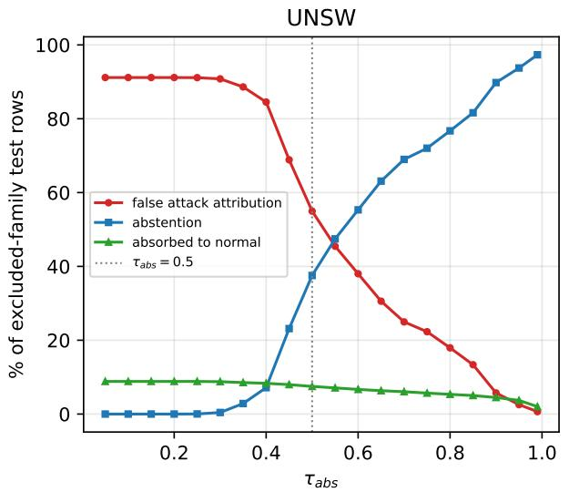
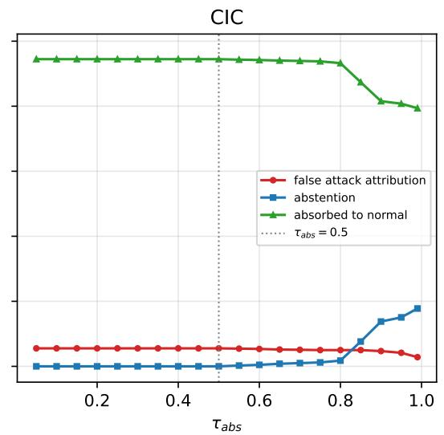

# VX-One: Typed, Calibrated Decision Heads for Real-Time Perimeter Triage

An empirical study of unknown-atack honesty, cascade gray zones, and calibration under drift

Juan S. Santillana juan@jsantillana.com Independent research

## Abstract

Perimeter triage faces a latency/semantics trade-of: signature engines are fast and format-safe but blind to unseen attacks, while generative models are semantic but slow and produce unparseable output. In late 2026 a class of commercial System One decision mod els (TypeSafe Jev; Microsoft-Decision-1) began selling typed decision primitives—binary gates, closed-set choices, ordinal scores—as product APIs, with no academic treatment or independent evaluation. We present VX-One: a small multi-head network (100K–10M parameters) whose outputs are these primitives—a calibrated gate, a choice over a closed candidate set that always includes an explicit unknown option, and an ordinal score (conditional ordinal regression), trained multi-task, temperature-calibrated per head (∼0.7–1.7 ms single-event latency p50 on CPU). We evaluate it on three public benchmarks (UNSW-NB15, CIC-IDS2017, EMBER2024) against calibrated XGBoost, Random-Forest, MLP, and Kitsune baselines, and measure a two-phase cascade (Suricata with 52,674 Emerging-Threats rules → VX-One) over five days of CIC-IDS2017. Our findings are deliberately double-sided: (i) VX-One wins detection (AUROC/FPR@95%TPR) against every calibrated baseline on UNSW-NB15 and under temporal drift on CIC-IDS2017 (0.711 vs. 0.637), but calibrated XGBoost wins multi-class attribution on all three benchmarks; (ii) under leave-one-family-out the gate detects never-seen families on 9/9 UNSW folds yet drops below chance on CIC’s recon family, and an abstention threshold calibrated on one benchmark transfers poorly to another; (iii) on payload-less reconstructions of the CIC-IDS2017 days, signature engines resolve only ∼0.1% of daily flows—the gray zone under payload opacity is ∼99.9% of the trafic, which Phase 2 recovers (combined recall ≥0.978); (iv) probability calibration collapses under temporal drift (ECE 0.04→0.40) for every method while ranking partially survives. We contribute not novel estimators but a measured account of where typed calibrated decisions help perimeter triage, and where they fail.

## Keywords

intrusion detection, calibrated decisions, out-of-distribution detection, malware classification, two-phase triage

## 1 Introduction

Operating a mitigation policy on the network boundary requires, simultaneously: nanosecond-scale decisions on the line of fire, calibrated confidences that a controller can threshold, and honest behavior on events that training has never seen. Three incumbent technology classes each miss at least one requirement.

(1) Deterministic engines (Snort [32], Suricata [28], Zeek/Bro [30], YARA [40]) are fast and format-safe but structurally blind to zero-day and low-and-slow ofensives; the recurring failure mode is a rule explosion that no operations team can maintain.

(2) Text LLMs for security (e.g., SecureBERT [1])— bidirectional encoders, not autoregressive models, a conflation we correct—bring domain semantics, but as fine-grained decision engines on the line of fire they are heavy, and decoderstyle LLM agents add generation latency and output-format fragility that a mitigation controller cannot tolerate.

(3) Classical ML for intrusion detection performs well on tabular attribution—XGBoost [5] wins our attribution benchmarks—but treats every event as a membership test, producing confident misattributions on families the model never saw (Section 5.2).

During October 2026, a commercial class of models positioned exactly at this gap began to ship: System One decision models, sold as APIs that take a structured state plus typed questions and return calibrated option probabilities (TypeSafe’s Jev [36, 37]; Microsoft-Decision-1 [23, 24]). No peer-reviewed academic literature covers the class, its evaluation is vendor-reported, and no security-domain assessment exists.

This paper occupies the gap by building the primitives ourselves rather than remoting into a vendor API. VX-One maps a fixed-size event state to three typed decisions in a single forward pass, then evaluates the whole pipeline—including a real signature engine in front of it—on public data with anti-strawman baselines. The contributions are:

• A typed decision engine (Section 3): shared encoder + three primitive heads—gate (calibrated sigmoid), choice (softmax over a declared closed set that always contains unknown), score (CORN conditional ordinal regression [34])—with perhead temperature calibration on validation data, trained multi-task with a homoscedastic weighting scheme [17].

• Unknown-attack honesty, measured (Section 5.2): leave-one-attack-family-out across 9 UNSW-NB15 and 7 CIC-IDS2017 families, plus 4 months of EMBER2024 family drift, reporting both unseen-family detection (gate AUROC) and attribution honesty (how often the unknown option absorbs what the model should not claim to know).

• A measured gray zone (Section 5.4): Suricata 7 with 52,674 live Emerging-Threats rules over flow-reconstructed CIC-IDS2017 trafic resolves only ∼0.1% of daily flows under payload opacity; the combined cascade recovers it with recall $\ge 0 . 9 7 8 ,$ at the cost of a measured precision drop on webattack days where Phase 1 is entirely blind.

• Negative results, measured (Sections 5.1–5.5): calibration collapses under drift for every method (ECE 0.04→0.40); class-weight tilts that help weak-label attribution can hurt it on saturated benchmarks; a fixed abstention threshold is not portable across calibrations; dropping the unknown option raises macro-F1 by up to +11.2 points—the honesty/utility trade-of is real and quantifiable.

Our heads are standard estimators; we say so. The claim is about their packaging and evaluation: event-level honesty instead of confident misattribution, measured end-to-end on data with audited labels [10, 20].

## 2 Related Work

System One decision models. Microsoft’s announcement [23] and documentation [24] define the primitive triad (binary gate / closed set choice / ordinal score) with calibrated option probabilities and single-pass scoring; TypeSafe’s Jev [36, 37] commercialized the framing earlier in 2026. Both are vendor announcements without peer-reviewed evaluation; benchmarks cited (193.6× faster, 444.6× cheaper) are industry claims. Our work is the first academic instantiation and security-domain evaluation of the triad; we use their names only for attribution, define our own formal objects (Section 3), and deliberately avoid inheriting vendor terminology as if it were neutral vocabulary.

Single-pass inference. “Non-autoregressive” originates in neural machine translation [13]: full output in one forward pass, no decoding loop. We use the term strictly for architecture (shared trunk, parallel typed heads). We do not claim novelty from singlepass-ness—BERT-family classifiers are also single-pass—and our baselines include appropriate encoders; the diferentiator is typed calibrated outputs, not one-pass-ness alone. Fast early-exit decision layers for per-event actions predate this design in spirit—the Viola–Jones cascade [39] is their ancestor.

Calibration and abstention. Platt scaling [31], multiclass probability transforms [42], empirical per-family calibration gaps [27], and temperature scaling [14] define our post-hoc protocol; conformal prediction [3, 41] is an optional wrapper we defer as a guarantee, but audit empirically on the temporal split (Appendix $\mathrm { A } ) ,$ noting that distribution-free coverage claims need exchangeability that temporal splits violate [4]. Chow’s reject option [6] and selective classification [11] ground our abstention semantics: with symmetric rejection cost the Bayes-optimal threshold is $1 - \lambda _ { r } = 0 . 5 ,$ which is the threshold we initially set, and we measure how poorly it transfers where the model is overconfident (Section 5.2).

Signature engines and their limits. Snort [32], Zeek [30], YARA [40], and Suricata [28] anchor the deterministic tier. The DARPA-critique tradition [21, 22] set the standard for dataset skepticism; audits of CICIDS2017 [10, 20] document systematic labeling errors. We use both stratified and temporal splits and audit against the corrected labels.

ML on network trafic and malware. Kitsune [25] is the canonical packet-level unsupervised ensemble; we adapt it to flows (documented) and report its Platt-calibrated but weakly discriminative AUROC (≈0.61) as a concrete instance of “calibration creates no signal”. Boosted trees [5] are the attribution baseline our engine loses to on all three benchmarks—we calibrate them with the same protocol to make the comparison non-strawman. EMBER2018 [2] and EMBER2024 [16], UNSW-NB15 [26], and CIC-IDS2017 [33] supply the data tiers. Viola–Jones [39] is the ancestor of our secondphase-only-when-needed cascade.

## 3 VX-One Design

## 3.1 State object

Each telemetry event is compiled to a flat state

$$
S \ = \ \big ( x _ { \mathrm { n u m } } \in \mathbb { R } ^ { d } , \ x _ { \mathrm { t x t } } \big ) ,
$$

where $\textit { d } \in$ {39 (UNSW), 77 (CIC-IDS2017), 2568 (EMBER2024)} and $x _ { \mathrm { t x t } }$ are protocol-level categorical fields (proto, service, state) when the benchmark provides them (UNSW only). The feature stage $\phi$ (median imputation of non-finite values with a row flag; signed log 1�; robust scaling by train median/IQR; clip to ±8) normalizes arbitrarily heavy-tailed benchmark features into a fixed-size vector. Everything is byte-level reproducible from frozen JSON configs with a single SEED=42.

## 3.2 Trunk and typed heads

A small pre-norm MLP trunk $( L \ \in \ \{ 2 . . 8  \}$ blocks of [Linear → LayerNorm → GELU → Dropout 0.1], residual from block 2) maps � (�) plus text-lookup embeddings to a shared representation $h =$ �� (�), feeding four heads—one per typed primitive:

$$
g a t e : \quad \mathrm { g a t e } ( S ) = \sigma ( w _ { 1 } ^ { \top } h + b ) \in [ 0 , 1 ] ;
$$

$$
c h o i c e : \mathrm { { \bf ~ p } } = \mathrm { s o f t m a x } ( W _ { C } h ) , \mathrm { ~ } C \ni \mathrm { u n k n o w n } ;\tag{Gate}
$$

(Choice)

$$
s c o r e : \quad \pi _ { k } = \prod _ { i \leq k } \sigma _ { q } ( h ) ,\tag{Score}
$$

where the Score head is conditional ordinal regression (CORN [34]) over four severity levels—benign, low, high, critical—and the choice head is a closed candidate set declared per dataset. We deliberately use neutral head names rather than vendor naming conventions. Trunk depth/width by scale (�, �): 2/224 (Nano), 3/576 (Small), 4/1280 (Base), with reduced input projections on EMBER2024 (whose 2568-dim feature projection dominates the parameter budget); verified parameter counts on UNSW-NB15 are 97K / 914K / 5.9M, inside a hard 100K/1M/5–10M budget that is enforced by unit test. The choice head’s open-set semantics are hybrid: where the training data ofers a real unknown population (EMBER2024’s 2.19M-file unknown ground truth), the option is a trained class; where it does not (UNSW, CIC), unknown is realized as abstention at decision time via (max� $p _ { k } < \tau _ { \mathrm { a b s } } )$ , with $\tau _ { \mathrm { a b s } }$ and any composed policy belonging to the mitigation controller, not the network.

## 3.3 Training formulation

Multi-task loss

$$
\mathcal { L } \ = \ \sum _ { q } \mathcal { L } q ,
$$

with a modified homoscedastic balancing [17]: per-task reference uncertainty with a modified per-task reference uncertainty so that task-scale diferences (ln � vs. ln 2 for Choice vs. Gate) do not dominate the initialization. Per-class loss weights on Choice use sqrt-normalized, mean-1 tilts $\omega _ { k }$ with an analytic de-tilt in inference $( z \mapsto z - \log \omega )$ applied before calibration, so the recovered posterior remains population-correct. The gate loss is unweighted BCE: weighting shifts the optimal logit by $\log ( \omega _ { + } / \omega _ { - } )$ , an ofset temperature calibration cannot undo. Training uses AdamW (weight decay $1 0 ^ { - 2 }$ on 2D weight matrices only), linear warmup (5%) + cosine decay, gradient clipping at 1.0, mixed precision, and early stopping (patience 4) on validation loss. All backbone hyperparameters are frozen across datasets and scales (D11-like discipline).

## 3.4 Decision controller semantics

The controller composes three binary gates from calibrated head outputs: the trained gate $( p ^ { \mathrm { c a l } } \geq \tau _ { \mathrm { d e t } }$ , default 0.5); a drop gate on the exact CORN marginal $C _ { 2 } = \mathbb { P } ( \mathbf { s e v } \geq 2 \mid x )$ ; and a low-urgency gate on the recon coordinate of the choice head. The severity rubric makes both implications exact—sev ≥ 2 ⇒ attack and recon ⇒ sev=1—and they are verified with zero rule violations on 3.09M labeled flows, so each gate’s target event coincides with exactly the event its own head estimates.

Gates are single-headfunctionals, by design. For single-head func tionals, post-processing (de-tilt, temperature, thresholding) keeps the calibration error within a bound determined by the head’s own deficiency (Appendix A, Lemma 1). Across heads, no useful composition bound exists: two perfectly-calibrated heads can combine into a joint policy whose calibration error is 1/4 in the worst case, whatever the marginal ECEs say (Appendix A, Prop. 4)—and the �=� case that attains it (two heads estimating the same underlying question) is the realistic one in security. The controller therefore composes boolean decisions between gates and never probabilities between heads; any future composed gate must be rubric-reducible to a single head, or measure its own joint calibration.

Thresholds are cost statements, not constants. With uniform misclassification cost and escalation cost $\lambda _ { r } ,$ , the Bayes rule with rejection abstains if max� $p _ { k } < 1 - \lambda _ { r } [ 6 , 7 ] \colon \tau _ { \mathrm { a b s } } = 0 . 5$ is the statement $\lambda _ { r } ~ = ~ 0 . 5$ (unknown costs as much as a wrong attribution), and $\tau _ { \mathrm { d e t } } = 0 . 5$ is the statement that missing an attack costs the same as a false alarm. For operators who hold diferent cost ratios, the mapping is the standard cost-sensitive one, $\tau ^ { * } = c _ { \mathrm { F P } } / \left( c _ { \mathrm { F P } } + c _ { \mathrm { F N } } \right) [ 9 ] -$ e.g., a 10:1 miss:alarm ratio implies $\tau ^ { * } \approx 0 . 0 9 1$ ; we keep 0.5 as the declared default and expose the mapping rather than tune silently. General policies with a full cost matrix live in the controller—maxprob abstraction can deviate from true Bayes when costs are asymmetric (an event with max� $\scriptstyle { \mathcal { P } } k$ above threshold may have lower expected cost elsewhere)—and we measure the deviation of the abstraction on validation data rather than assume it away.

## 4 Experimental Setup

Data. UNSW-NB15 [26]: 149,039 / 26,302 / 82,332 flows (oficial split); 9 attack families. CIC-IDS2017 [33] (MLCVE-corrected variant): 2.83M flows; two splits, stratified (sanity) and by-day (temporal drift). EMBER2024 [16]: 3.85M binaries; temporal split by week, with the public challenge set held out; 2.19M ground-truth-unknown training rows. Label errors in the original CICIDS2017 are documented [10, 20]; on top of the audited variant, we repair raw-label encoding artifacts (U+FFFD mojibake in the web-attack labels) and a singular/plural naming drift (Backdoor), which a naive ingestion would silently route to the unknown class; micro-classes (11 Heartbleed, 36 Infiltration flows) are retained rather than dropped and stratified exactly. Every count is checked against the frozen schema in code before any experiment runs.

Baselines. XGBoost (500 boosted trees, hist mode), Random Forest (300 trees, min-leaf 1), an MLP (2×256), and Kitsune (9-autoencoder ensemble with feature bagging, Platt-calibrated on validation)—all trained with the same feature stage, the same per-class loss weights where analogues exist, and the same per-head temperature-scaling calibration as VX-One. This is anti-strawman discipline: boosted trees benefit from the calibration fix [27], and we report them raw and calibrated. A zero-shot API baseline from the commercial System One class (Section 5.6) was planned; it was not executed this cycle.

Metrics. Detection: AUROC and FPR@95%TPR (the FPR at the threshold capturing 95% of true attacks—an operational line-of-fire number that accuracy-style metrics hide). Attribution: label-aware macro-F1 (GT-unknown rows excluded by label, as they have no known counterpart). Calibration: 15-bin ECE, MCE, Brier, NLL, and reliability diagrams, reported on raw and calibrated heads. Latency: single-thread, batch=1, 3,000 timed events, model-exact hardware recorded with each result.

Infrastructure. Training on serverless GPUs (L4) with atomic checkpointing and tested resumption; evaluation computed locally from dumped raw logits so that all metric code is inspectable. 60 unit tests including end-to-end smoke training (pytest, 60/60 green).

## 5 Results

## 5.1 E1/E3 — Detection, attribution, calibration

Table 1 summarizes the two-tier comparison on test (calibrated temperatures). Three findings:

(i) VX-One wins detection, not attribution. On UNSW-NB15 and temporal CIC, VX-One tops AUROC and FPR@95%TPR. On CIC by-day every method’s achievable FPR@95 is degraded, but the trees’ degradation is total (FPR@95 = 1.0 — no threshold reaches 95% TPR at nontrivial FPR), while VX-One retains a partially usable operating point. Attribution (macro-F1) inverts this: calibrated XGBoost wins on UNSW, stratified CIC, and EMBER2024—by 4–8 points. We report the inversion rather than hide it: our contribution does not rest on attribution wins, and we are explicit about the loss.

(ii) Saturation makes stratified CIC a sanity benchmark, not a selling point. All methods land at ∼1.0 with ECE ≤0.001. Headline numbers on saturated benchmark splits are best treated as pipeline-correctness checks.

Seed variance on the four main-table runs. To size the noise floor, UNSW-Small, CIC strat-Small, CIC by-day, and EMBERtemporal were re-run from scratch with seeds {42, 43, 44} and evaluated with the same ofline evaluator. The seed-42 rerun reproduces Table 1’s oficial UNSW row to the fourth decimal (determinism of the pipeline, not luck). Across seeds, AUROC moves ≤0.002 everywhere except by-day CIC $( 0 . 7 3 4 \pm 0 . 0 1 8 )$ , and macro-F1 carries a real spread exactly where the benchmark is least stable: stratified CIC $0 . 8 3 1 \pm 0 . 0 7 4$ (one seed dips to 0.73 while its AUROC and calibration stay saturated) and by-day CIC $0 . 3 4 4 \pm 0 . 0 8 5$ (spread 0.24–0.45), versus UNSW $0 . 4 5 6 \pm 0 . 0 0 1$ and EMBER $0 . 7 4 6 \pm 0 . 0 1 2 \mathrm { : }$ detection conclusions are seed-robust; attribution conclusions on CIC are not, at any scale—the attribution claims lean on UNSW and EMBER.

Table 1: Test-set comparison (calibrated). VX: VX-One at three sizes. FPR@95 is FPR@95%TPR. † = under temporal drift. � = attribution benefiting from drift; � = detection plateau of saturation (all models ≈ 1.0). Full per-dataset table in the released results.
<table><tr><td>Dataset</td><td>Model</td><td>AUROC</td><td>FPR@95</td><td>macro-F1</td></tr><tr><td>UNSW-NB15</td><td>VX Small</td><td>0.9834</td><td>0.1211</td><td>0.4571</td></tr><tr><td></td><td>XGBoost</td><td>0.9818</td><td>0.1369</td><td>0.4968</td></tr><tr><td></td><td>RF</td><td>0.9792</td><td>0.1399</td><td>0.4378</td></tr><tr><td></td><td>MLP</td><td>0.9821</td><td>0.1279</td><td>0.4445</td></tr><tr><td></td><td>Kitsune</td><td>0.6086</td><td>0.5617</td><td>一</td></tr><tr><td>CIC stratifiedb</td><td>VX Small</td><td>0.9999</td><td>0.0003</td><td>0.8826</td></tr><tr><td></td><td>XGBoost</td><td>1.0000</td><td>0.0002</td><td>0.9416</td></tr><tr><td></td><td>Kitsune</td><td>0.6227</td><td>0.6910</td><td>一</td></tr><tr><td>CIC by-day†</td><td>VX Small</td><td>0.7112</td><td>0.5731ª</td><td>0.4518</td></tr><tr><td></td><td>XGBoost</td><td>0.6372</td><td>1.0000a</td><td>0.8336</td></tr><tr><td></td><td>RF</td><td>0.6308</td><td>1.0000</td><td>0.4207</td></tr><tr><td></td><td>MLP</td><td>0.5959</td><td>1.0000</td><td>0.4579</td></tr><tr><td>EMBER2024</td><td>VX Small</td><td>0.9969</td><td>0.0119</td><td>0.7549</td></tr><tr><td></td><td>XGBoost</td><td>0.9981</td><td>0.0053</td><td>0.8094</td></tr><tr><td></td><td>MLP</td><td>0.9970</td><td>0.0098</td><td>0.7733</td></tr></table>

(iii) Kitsune: calibration does not equal signal. With Platt calibration on validation, Kitsune is well-calibrated (ECE 0.037) yet near-chance on discrimination (AUROC 0.608). Its ensemble-ofautoencoders signal does not survive hostile-stage re-fit to benignonly data—we re-fit its feature stage to its own training distribution (benign only), as a real unsupervised deployment would. Platt on a useless score calibrates a useless probability.

Calibration (E3): all methods’ in-distribution ECE stays ≤ 0.065 on UNSW-NB15 but drift to 0.39–0.45 on temporal CIC (Table 1). The policy-level implication is precise: ‘Noul/gate feedbacks are calibrated’ (Noul is the vendor’s name for the gate-head calibration loss; we call it the gate, Section 3) is a claim about the training distribution; it silently degrades exactly when novel-attack pressure appears, which is the moment the claim was bought for. Section 5.5 shows the efect is additive on top of, not independent of, classtilt choices. Classwise calibration of Choice (val) stays ≤0.007 on all four main runs, and the recon coordinate that feeds $g _ { \mathrm { r e c o n } }$ is calibrated at 0.003 (UNSW, �=1,574) and 0.0001 (CIC strat)—maxprob calibration does not imply per-class calibration, so this is a property measured here, not assumed.

## 5.2 E2 — Unknown-attack honesty

Leave-one-family-out (LOAO): train without family � , test against � ’s held-out rows. Table 2 reports unseen-family detection (gate

Table 2: LOAO—unseen-family detection (gate) and attribution honesty (choice abstention). The control—macro-F1 on known families—stays at 0.38–0.56 across folds, i.e., the family that is excluded does not degrade attribution of the others. UNSW Small.
<table><tr><td>Excluded family</td><td>gate AUROC</td><td>FPR@95</td><td>abst. (%)</td><td>n test</td></tr><tr><td>analysis</td><td>0.9992</td><td>0.0002</td><td>92.0</td><td>677</td></tr><tr><td>backdoor</td><td>0.9989</td><td>0.0028</td><td>63.0</td><td>583</td></tr><tr><td>dos</td><td>0.9941</td><td>0.0202</td><td>3.0</td><td>4,089</td></tr><tr><td>exploitation</td><td>0.9550</td><td>0.4177</td><td>8.0</td><td>11,132</td></tr><tr><td>fuzzing</td><td>0.8519</td><td>0.3899</td><td>28.0</td><td>6,062</td></tr><tr><td>generic</td><td>0.9957</td><td>0.0128</td><td>50.0</td><td>18,871</td></tr><tr><td>recon</td><td>0.9523</td><td>0.1777</td><td>28.0</td><td>3,496</td></tr><tr><td>shellcode</td><td>0.9688</td><td>0.1305</td><td>42.0</td><td>378</td></tr><tr><td>worms</td><td>0.9871</td><td>0.0642</td><td>23.0</td><td>44</td></tr></table>

AUROC / FPR@95 without any retraining), attribution honesty (how much the choice head attributes to unknown), and a control (macro-F1 on known families, which must not collapse).

UNSW: the gate generalizes. Nine of nine never-seen families are detected with gate $\mathrm { A U R O C } \geq 0 . 8 5 ,$ most above 0.95, while macro-F1 on known families is preserved (0.38–0.56). The abstention rate on the excluded family ramps 3–92%—feature-dependent, not tunedependent, which is exactly the honesty modulation we want (an unseen-but-gatelike family still realizes unknown 28–92% of the time instead of being absorbed into normal).

CIC: the failures are structural, not accidental. On stratified CIC-Small LOAO (Table 3), the gate remains strong where families are textually distinctive (bruteforce 0.967, webattack 0.979, exploitation 0.970, dos\_ddos 0.852), but drops below chance on recon (0.426) and near chance on infiltration $( 0 . 5 3 3 , n = 5 ) \colon$ in 77 flow-statistics features, port scans from a datacenter look exactly like a benign port-touching client.

Scope: what a single-flow triage cannot see. This blindness is structural, and stating its boundary is part of the contribution: VX-One classifies isolated events (one flow’s statistics, one binary’s features). Reconnaissance is by definition a temporal-aggregation phenomenon—low-and-slow scans are invisible to per-event statistics and become detectable only in detection-by-behavior over time windows (event provenance, targets-per-time histograms, scanning divisibility). The perimeter architecture therefore does not rely on the per-event head for recon: Phase 1 (Suricata portscan signatures, which partially cover it) and any windowed detector sit in front of, or beside, the per-event gate (Section 5.4); when Phase 1 is payloadblind, the residual recon coverage is declared honestly rather than inflated.

The abstention threshold measured at the default is nonportable: on UNSW, $\tau _ { \mathrm { a b s } } = 0 . 5$ abstains 3–92% on excluded families; on CIC, where calibration is saturated (Table 1, ECE ≤0.001), the same fixed threshold abstains on zero rows—every excludedfamily event gets assigned to normal with high confidence. Undersaturated models are correctly selective, over-saturated ones are confidently wrong.

Sweep: a portable threshold does not exist (Figure 1). We swept $\tau _ { \mathrm { a b s } } \in \{ 0 . 0 5 . . 0 . 9 9 \}$ over the LOAO logits already computed (no retraining). On UNSW the sweep admits operating points: �=0.5 abstains on 37.5% of excluded-family rows with 55.0% false attribution to a known attack class, and rising to �=0.99 yields 97.3% abstention at 0.66% false attribution—a monotone honesty/utility frontier an operator can pick from. On CIC there is no operating point: even at �=0.99 abstention reaches only 17.8% of excludedfamily rows; the dominant failure mode is benign absorption (94.5% of unseen-family events attributed to normal at saturated confidence), not scattering across attack classes (5.5%, the UNSW failure mode). Median max-probability on excluded rows is ≥0.999 on five of seven CIC folds (recon: 1.000), and the margin alternative $( p _ { ( 1 ) } - p _ { ( 2 ) }$ , median 1.000 on recon) inherits the saturation: marginbased selective classification [11] fails for the same reason fixed thresholds do—post-hoc policies operate on the confidence distribution, and saturation has destroyed the information the policy needs. Rescuing a confidently-wrong model requires recalibration on in-scope data (per-window, online), not a sharper threshold; this is why abstention is a mitigation with preconditions, not a guarantee.

Table 3: LOAO on stratified CIC (Small). Softmax confidence saturates: the fixed threshold abstains on nothing, and unseen families get attributed to normal with high confidence.
<table><tr><td>Excluded family</td><td>gate AUROC</td><td>FPR@95</td><td>abst. (%)</td><td>n test</td></tr><tr><td>botnet</td><td>0.7499</td><td>0.4038</td><td>0.00</td><td>295</td></tr><tr><td>bruteforce</td><td>0.9674</td><td>0.0778</td><td>0.05</td><td>2,076</td></tr><tr><td>dos_ddos</td><td>0.8524</td><td>0.3394</td><td>0.00</td><td>57,103</td></tr><tr><td>exploitation</td><td>0.9703</td><td>0.0297</td><td>0.00</td><td>1</td></tr><tr><td>infiltration</td><td>0.5329</td><td>0.8262</td><td>0.00</td><td>5</td></tr><tr><td>recon</td><td>0.4259</td><td>0.8685</td><td>0.00</td><td>23,840</td></tr><tr><td>webattack</td><td>0.9792</td><td>0.1550</td><td>0.00</td><td>327</td></tr></table>

EMBER2024 drift: trained-unknown as an honesty mechanism. The EMBER run trains on weeks 0–45 and validates/tests on later weeks; family composition drifts measurably at test time. Gate-robustness is high (AUROC 0.997, FPR@95 0.012). The family-conditional table is the interesting one: berbew, which grew 34.5K→92K rows in test, retains recall 0.998; wacatac, which mutated, falls to recall 0.129 with 85%→unknown; grandoreiro $\begin{array} { r } { \mathrm { ~ \ ( } n \ = \ 2 2 6 \ } \end{array}$ , almost absent from train) falls to 0.221 with 78%→unknown. The model does not reduce drift into false attribution; the unknown option absorbs what the model should not claim to know, and the gate keeps the operator’s safety threshold honest on the detection side simultaneously. This is the strongest single argument for the trained-unknown semantics (and contrasts directly with Table 3 on two ways of switching unknown on/of in Section 5.5).

What unknown means under LOAO.. The two unknown mechanisms carry the same typed meaning but are not the same estimator. On EMBER2024, unknown is a trained class with real ground truth (benign and tail malware), so its probability is an in-distribution rejection statement. Under LOAO on UNSW/CIC, the excluded family is not a candidate: abstention runs on max-softmax confi dence over the seen families, which is out-of-distribution similarity detection [15]—the classic max-softmax baseline, with its known overconfidence failure modes—not a calibrated probability about the excluded family. We therefore report unseen-family detection (gate) and abstention separately and never describe the latter as a probability of the unseen event. Both mechanisms lose informative honesty modes measurably (Tables 2–3); the design lesson is that distribution shift has no single calibrated fix—the honest object is the pair (gate, abstention), not one number.

Table 4: E4 latency (single-event, batch=1, 1 thread, CPU). Well within a <10 ms design budget with margin ≥ 5×.
<table><tr><td>Scale</td><td> $\mathrm { p } 5 0 \left( \mu \mathrm { s } \right)$ </td><td> $\mathrm { p } 9 5 \left( \mu \mathrm { s } \right)$ </td><td> $\mathsf { p } ^ { 9 9 } \left( \mu \mathsf { s } \right)$ </td><td>max (µs)</td></tr><tr><td>Nano</td><td>675</td><td>715</td><td>773</td><td>853</td></tr><tr><td>Small</td><td>955</td><td>999</td><td>1,022</td><td>1,059</td></tr><tr><td>Base</td><td>1,652</td><td>1,795</td><td>2,082</td><td>2,335</td></tr></table>

## 5.3 E4 — Latency

Measurements use single-events, batch=1, single-thread CPU, 3,000 timed events per model, on each model’s exact released weights (Table 4).

Interpretation: VX-One’s typed decisions carry a p50 inference cost of ∼1 ms on Small, making VX-One a per-event inline decision component rather than a sampled-batch tool. The commercial System One class’s headline latency claims are API-level; level-by-level comparison is not apples-to-apples, and we treat them as context, not as competition.

## 5.4 E5 — Two-phase cascade: how much of the line of fire is actually a gray zone

We reconstruct five days of CIC-IDS2017 into PCAPs (documented reconstruction, no payload— attacks’ HTTP bodies are not recovered, so content-only signature rules are expected to underperform and this is the lower bound they encounter on this trafic in the deployed position), run Suricata 7.0.10 with fresh Emerging-Threats Open rules (52,674 of them, concatenated) plus 8 of our own structural rules to level the playing field for header-only signals, then measure per family which attacks Phase 1 catches and what lands in the gray zone for Phase 2 to handle. Table 5 collates per day.

The headline number is the gray zone under payload opacity, not a universal estimate. Suricata with ET rules over flowreconstructed trafic detects only ∼0.1% of daily attacks by volume; the gray zone is 99.9% of each day in this reconstruction, and Phase 2 is what actually classifies it: the combined cascade retains recall ≥0.978 while precision stays ≥0.95 on every day except Thursday. We are explicit about what this experiment does and does not measure. It measures the Phase-2 recoverable share when Phase 1 is payload-blind—the operational regime operators of encrypted traffic (TLS everywhere, no payload inspection in managed switches) know well—and not the real-world gray zone of a deployment with full payload visibility, where Phase 1 resolves strictly more. Second, the cascaded numbers combine Phase 1 and Phase 2 events under a documented independence assumption at the shared-flow level; signature-triggered attacks also perturb flow statistics, so true overlap is nonzero and our combined recall is an estimate anchored at the payload-blind lower bound (Section 6). The Thursday failure is the real lesson: on a web-attack day of 456K benign and only

  
Figure 1: Abstention sweep over $\tau _ { \mathrm { a b s } } \in \{ 0 . 0 5 , 0 . 9 9 \}$ , mean over LOAO folds, on excluded-family test rows. UNSW: an operating frontier exists—abstention and false attack attribution cross near �=0.5, and large � recovers honesty (97% abstain, <1% false attribution). CIC: no operating point—unseen-family events are absorbed into normal (∼94%) at saturated confidence (median max-prob 1.000; median margin 1.000), so no post-hoc threshold or margin policy can recover them.

Table 5: E5 cascade over five days of CIC-IDS2017. “F1 acc” is Phase 1 (Suricata) alone; “comb” is the estimated combined cascade; P/R = precision/recall of the combined cascade on that day’s test rows. Stats are estimates with a documented independence assumption (Section 6).
<table><tr><td>Day</td><td>flows</td><td>attack</td><td>F1 acc</td><td>F2 acc</td><td>comb acc</td><td>comb P</td><td>comb R</td></tr><tr><td>Mon 03</td><td>529,450</td><td>0</td><td>0.9989</td><td>0.9996</td><td>0.9985</td><td></td><td></td></tr><tr><td>Tue 04</td><td>445,641</td><td>13,832</td><td>0.9681</td><td>0.9994</td><td>0.9985</td><td>0.958</td><td>0.996</td></tr><tr><td>Wed 05</td><td>691,390</td><td>251,722</td><td>0.6359</td><td>0.9986</td><td>0.9979</td><td>0.997</td><td>0.997</td></tr><tr><td>Thu 06</td><td>458,483</td><td>2,216</td><td>0.9942</td><td>0.9971</td><td>0.9961</td><td>0.552</td><td>0.978</td></tr><tr><td>Fri 07</td><td>702,713</td><td>288,785</td><td>0.5887</td><td>0.9979</td><td>0.9974</td><td>0.998</td><td>0.996</td></tr></table>

2.2K attacks, Phase 1 is structurally blind without payload (precision 0.059), Phase 2 absorbs all of it, and the FP rate of Phase 2 across 456K benign rows dominates the combined precision (0.552). A cascade is not free: every false flag from the blind-detection phase is multiplied by the innocent trafic around it; the correct operating posture there is Phase 2 as advisory (block with abstention, not auto-drop). This measurement—a live-tier engine’s gray-zone share on a public benchmark under payload-only reconstruction—is, we believe, the crudest and most defensible novel number in this paper.

Risk–coverage of the cascade’s own gating (measured). We additionally measured the adjudication quality of the composed policy as a per-day risk–coverage curve (adjudicate “attack” if Phase 1 flagged the flow or the Phase-2 gate exceeded �; abstain otherwise; risk = 1−precision of the adjudicated set; Phase-1 leg exact per flow, Phase-2 leg exact per test row, composed leg under the documented independence assumption of Table 5). Findings: (i) the benign-only Monday is a null point — every adjudication is an error, so no operating point exists at risk ≤30%; (ii) on the Friday wave (DDoS+PortScan, 41% of flows) the composed policy admits 0.416 of flows at risk ≤5%, the whole plateau supplied by

Phase 2 (Phase 1 adjudicates 0.0004 of flows at precision 0.067: under payload opacity it contributes latency and provenance, not adjudication coverage, Δ ≤1 point); (iii) the small-attack Thursday (0.5%) is where the cascade costs its own gate: Phase 1’s 0.11% flag rate at precision 0.059 corrupts every composed operating point, so nothing is admissible at risk ≤10%, and Phase 2’s clean core covers only 0.44% (min risk 0.3%). This closes the next step of Section 7.

## 5.5 E6 — Ablations

Table 6 summarizes the ablation suite (full 14-run table and perdataset efects in the released results). Four findings survive sanity checks and are worth their ink:

Text branch (a1). On UNSW the protocol/service/state lookups are worth ∼5 macro-F1 points and nontrivial AUROC. UNSW’s original feature set is partly categorical field values (proto, service, state), so the text branch supplies exactly the vocabulary a numeric encoder cannot infer. On EMBER2024 the ablation is an identity by construction: the 2,568 input features are already structural PE statistics (histograms, byte-entropy, imports), and no text field exists to ablate—which is also why the EMBER runs drop the lookup tables from the input projection entirely.

Table 6: Ablations (ref = corresponding Small reference run).
<table><tr><td>Run</td><td>Effect tested</td><td>AUROC</td><td>m-F1</td><td>ECE-ch</td></tr><tr><td>UNSW ref</td><td></td><td>0.9834</td><td>0.4571</td><td>0.0496</td></tr><tr><td>UNSW a1</td><td>no text branch</td><td>0.9716</td><td>0.4079</td><td>0.0509</td></tr><tr><td>UNSW a3</td><td>no calibration</td><td>0.9834</td><td>0.4571</td><td>0.0980</td></tr><tr><td>UNSW a4</td><td>no class tilt</td><td>0.9838</td><td>0.4545</td><td>0.0488</td></tr><tr><td>UNSW a6</td><td>no dropout</td><td>0.9839</td><td>0.4507</td><td>0.0451</td></tr><tr><td>CIC ref</td><td></td><td>0.9999</td><td>0.8826</td><td>0.0003</td></tr><tr><td>CIC a3</td><td>no calibration</td><td>0.9999</td><td>0.8826</td><td>0.0007</td></tr><tr><td>CIC a4</td><td>no class tilt</td><td>0.9999</td><td>0.9313</td><td>0.0002</td></tr><tr><td>CIC a6</td><td>no dropout</td><td>0.9999</td><td>0.7360</td><td>0.0007</td></tr><tr><td>EMBER ref</td><td>一</td><td>0.9969</td><td>0.7549</td><td>0.0076</td></tr><tr><td>EMBER a3</td><td>no calibration</td><td>0.9969</td><td>0.7549</td><td>0.0112</td></tr><tr><td>EMBER a4</td><td>no class tilt</td><td>0.9969</td><td>0.7506</td><td>0.0061</td></tr><tr><td>EMBER a5</td><td>unknown off</td><td>0.9961</td><td>0.8674</td><td>0.0022</td></tr><tr><td>EMBER a6</td><td>no dropout</td><td>0.9966</td><td>0.7821</td><td>0.0081</td></tr></table>

Calibration changes probability, never ranking (a3). Temperature scaling leaves argmax and AUROC untouched and improves ECE (e.g., 0.0496→0.0980 when removed, on the same logits). This is the expected signature of a well-behaved calibration layer, and worth saying plainly because calibration is our semantic diferentiator.

Class tilts are not free (a4). On saturated CIC, removing the tilt � improves attribution by +4.9 macro-F1—the de-tilt pushes minority classes down in a regime where the weighted cross-entropy had already pushed them up. On weakly-distributed EMBER the tilt matters less. There is no free class-tilt knob; its efect is deploymentregime-dependent, and our own loss design contains a knob whose default is wrong for saturated datasets. We say so and flag the design revision.

Dropout is dataset-dependent (a6). on CIC, zero dropout costs −14.7 macro-F1; on EMBER it gains +2.7 (the majority class dominates and early stopping regulates). No universal recipe; report per dataset.

Unknown is a measurable trade-of (a5-wide). Removing the trained-unknown option from EMBER’s 11-way choice improves macro-F1 by +11.2 points (10-way is more balanced). “Honesty” is not free accuracy; making the unknown option available is a deliberate spend.

## 5.6 E7 — The commercial System One baseline, measured

We ran the zero-shot API comparison this cycle against a commercial System One deployment that exposes the same primitive names publicly (single decision model, documented gate/choice/score questions; one API request per flow containing the three primitives over the identical frozen feature state we feed our heads). The sample is the protocol-fixed stratified draw (seed 42) of the UNSW test set: 1,000 benign and 1,021 attack flows, attack quota proportional to family with a floor of 15. The vendor numbers are in Table 7; the gate is at chance on this distribution (AUROC 0.568, FPR@TPR95

Table 7: E7: commercial System One baseline, zero-shot, same frozen state and rows as our heads (2,021 stratified UNSW test rows).
<table><tr><td>Primitive / metric</td><td>Vendor</td><td>Ours</td></tr><tr><td>Gate AUROC</td><td>0.568</td><td>0.981</td></tr><tr><td>Gate FPR@TPR95</td><td>0.932</td><td>0.157</td></tr><tr><td>Gate ECE15</td><td>0.265</td><td>0.097</td></tr><tr><td>Choice macro-F1</td><td>0.069</td><td>0.534</td></tr><tr><td>Severity MAE</td><td>0.809</td><td>0.333</td></tr></table>

0.932), choice attribution is equally degenerate (macro-F1 0.069 over our frozen candidate set vs our 0.534), and severity MAE is almost 3× ours. Vendor latency: 208 ms p50 / 591 ms p95; total run cost ≈2.2M input tokens (US\$0.09 at the vendor’s published rate). An ablation adding an explicit unknown option to the vendor’s choice question—re-run over the full 2,021-row sample so the comparison is paired (identical rows; the only diference is the extra option)— leaves the picture unchanged and slightly degrades it: gate AUROC 0.476 (from 0.568 without the option), macro-F1 0.066 (from 0.069), and the vendor assigns unknown to only 0.35% of rows (0.2% of attacks, 0.5% of benign). The escape hatch is available and unused: the gap is caused neither by the absence of an abstention option nor by prompt sensitivity, but domain adaptation—the generic triad zeroshot does not transfer to network-flow distributions. The paper’s positioning therefore still does not lean on beating a commercial model; E7 closes the follow-up by measuring it, and is reported as an external stress test rather than a contribution.

## 5.7 Discussion

Three threads bind the results together.

(1) The honest triage division of labor. Where the benchmark is saturable (stratified CIC), trees win attribution and a typed cascade adds nothing but a latency reduction; where the deployment regime is adversarial (temporal drift, attack families that did not exist in training), the gate/unknown semantics earn their keep in detection robustness and attribution honesty even while losing the calibration war (E3). The contribution is the measured boundary of where typed decisions help, not a uniform “we win everywhere”.

(2) Honesty is a distinct axis from accuracy. Section 5.2 and the EMBER drift table are the clearest pair of the paper: a benchmark-optimal system (no unknown option, accurate operating threshold) maximizes macro-F1 while falsely attributing 85% of a mutated family; the honesty-first system gives up 11 macro-F1 points on the choice metric and absorbs the mutation into an honest abstention. These are diferent products under drift, and the macro-F1 column alone cannot distinguish them.

(3) Saturation is a deployment regime, not a benchmark property. The same dataset (CIDS2017) produces a saturated benchmark under stratified splitting and a hard unsaturated one under by-day splitting, in both ranking and calibration. Any paper reporting “F1 0.94” on IDS2017-stratified is measuring the model’s ability to fit a monotone flow of re-used capture artifacts; papers should report the by-day numbers alongside (we do both).

## 6 Limitations

• Severity scores are rubric-derived, not human-labeled; the Score head’s ground truth is a documented family→level mapping, so cross-level claims are approximations above benign/low/high/critical.

• Benchmark data, audited (Section 4): LOAO measures generalization across benchmark families, not robustness against real-world novel attacks; an honest reading of E2 is “the gate generalizes more than the choice head, on these families”— not “we detect zero-days”.

• Single-seed runs outside the four main tables. The four main-table runs (UNSW Small, CIC strat-Small, CIC by-day, EMBER temporal) were re-run with seeds {42, 43, 44}: the seed-42 reruns reproduce the oficial numbers to the fourth decimal (reproducibility confirmed), ranking metrics move ≤0.02 points, and multi-class macro-F1 on CIC carries a real spread (0.83 ± 0.07 stratified; 0.34 ± 0.09 by-day—drift instability, not implementation nondeterminism). The rest of the tables (per-family LOAO, ablations, E4 latency, E5 cascade) remain single-seed runs; conclusions that rest on diferences >5 points are robust to this, but the small head-to-head difs on CIC strat (cf. a2/a4 in Section 5.5) should be read as noiseborderline.

• Phase 1 is a reference implementation (Suricata + ET Open + 8 structural rules), not our C++ engine; the claims of Section 5.4 are about the architecture, and the reconstruction means payload-content rules are at a lower bound by construction. The “combined cascade” result is a documented two-sample estimate under an independence assumption that is exact for full-family-invisibility cases and optimistic where Phase 1 fails on exactly the stealthiest subset; we state it as an estimate, and the per-day F1/gray-zone table it rests on is a real measurement.

• Calibration under drift (ECE 0.40 on temporal CIC) is measured and now also audited by a walk-forward perwindow recalibration experiment (E8, Appendix A): with one-day-delayed labels, gate recalibration (temperature or 2- parameter Platt) recovers part of the loss (Brier 0.539→0.504 on the hard day), but the oracle bound shows the ceiling is discrimination, not calibration—even fitting the calibration on the day’s own labels leaves gate ECE at 0.445 with day-AUROC 0.56. Per-window recalibration is therefore a cheap partial fix. Its prescribed alternative is also measured (E9, Appendix A): one to two passes of per-window continuetraining with delayed day-1 labels recover day-2 gate AU-ROC to 0.80–0.84 (four passes regress to 0.76) and, with the recovered ranking, the recalibration ceiling collapses from ECE 0.445 to 0.10–0.12—but as-run day-2 ECE stays at 0.554 and no delayed-label fit recovers the new day’s composition prior, which lands on the abstention/coverage semantics of Section 5.2 rather than on any post-hoc map.

• Conformal wrappers are scoped, not promised, and now audited. Exact distribution-free coverage applies only under exchangeability: on the oficial UNSW split and stratified CIC, split-conformal coverage is exact [29, 35]; on every temporal split, family-composition drift is real and measured, and coverage degrades at a rate bounded by the calibration–test total-variation gap [4]. A domain classifier certifies that gap only from below (�TV ≥ 1 − 2 BER; Appendix A)—we therefore report empirical weekly coverage with exact binomial intervals and weighted variants [35], and make no distribution-free coverage promise; the measured EMBER audit is in Appendix A (binary set-coverage within [0.895, 0.935] across all twelve test weeks; certified drift � ≥ 0.15–0.24).

• Cost-per-million is not yet measured from real billing data; latency, not cost, is the number we claim.

• Text-field attack surface (indirect prompt injection through user\_agent, URIs) is real [12]; V0.1 has no sanitization layer and our text-branch vocabulary lookup (bounded 135-slot vocabularies, not free max-k) is only partial mitigation.

• Vendor-API baseline is a single-point stress test (Section 5.6); we measured one commercial System One deployment zero-shot on one distribution (dense UNSW flows), not an exhaustive comparison across commercial decision models, prompt variants, or distributions. The honest reading is “the generic triad zero-shot does not transfer to this domain without fine-tuning”, not “the vendor cannot be fine-tuned to this domain”.

## 7 Conclusion

We built, trained, calibrated, and stress-tested a typed decision engine for perimeter triage—the first published instantiation and public-data evaluation of the System One primitive triad—and report the boundary of its advantage rather than a uniform win: detection robustness and attribution honesty under unknown families and drift, a measurable gray zone of a live signature engine, and four cleanly-measured negative results (calibration collapse under drift, non-portable abstention thresholds, regime-dependent class tilts, unknown-option accuracy cost). Six former next steps are already measured: the vendor-API comparison (Section 5.6 — the commercial primitive triad zero-shot sits at gate-chance on network flows, and an explicit abstention option is not enough to close the domain gap), the abstention-threshold sweep (Section 5.2, Figure 1—on saturated deployments no abstention threshold recovers honesty, so selective behavior must be bought with data and recalibration, not with post-processing), the 3-seed re-runs of the four main tables (seed-variance ≤0.02 points on ranking metrics; Section 6) and the walk-forward per-window recalibration under drift (E8, Appendix A—a cheap partial fix whose oracle bound shows the hard-day ceiling is discrimination, not calibration), its prescribed alternative, per-window re-training (E9, Appendix A—one to two passes with delayed day-1 labels recover day-2 gate AUROC 0.56→0.84 and re-enable oracle recalibration, while four passes regress and as-run ECE is unmoved: weight freshness buys discrimination, not calibration), and the risk–coverage curves of the cascade’s own gating (Section 5.4—on payload-blind trafic the coverage at fixed risk is supplied entirely by Phase 2, the benign-only day is a null point where no operating point exists, and the small-attack day is where Phase-1 false flags cost the gate itself). The remaining next step is a payload-inclusive Phase-1 measurement to replace the lower-bound cascade estimate. All code, configs, tests, and measured results accompany the paper.

## A Formal statements

Throughout, $\operatorname { c a l } _ { A } ( f ) ~ = ~ \mathbb { E } { \big [ } \mid \mathbb { P } ( A ~ \mid ~ f ( X ) ) - f ( X ) \mid { \big ] }$ is the $\ell _ { 1 }$ calibration error of an estimator $f ~ \in ~ [ 0 , 1 ]$ for event $A ;$ the binned ECE (15 bins) is its empirical estimator [19], with its known estimator caveats, which is why we co-report MCE and reliability diagrams and frame multiclass notions through the vector/classwise/confidence hierarchy [38].

Lemma 1 (closure under single-head post-processing). If head � is calibrated for an event � of its own output and ℎ : $[ 0 , 1 ]  [ 0 , 1 ]$ is measurable, then ca $\mathsf { l } _ { A } ( h \circ f ) \leq \mathrm { c a l } _ { A } ( f ) + \mathbb { E } \left| h ( f ( X ) ) - f ( X ) \right|$ Proof. Let $m ( v ) = \mathbb { P } ( A \mid f ( X ) { = } v )$ . Tower property: $\mathbb { E } [ \mathbf { 1 } _ { A } \mid h \circ f ] =$ $\mathbb { E } [ m ( f ) \mid h \circ f ]$ . Jensen: $\left| \mathbb { E } [ m ( f ) \mid h \circ f ] - h ( f ) \right| \leq \mathbb { E } [$ |�(� ) − $h ( f ) | \left| h \circ f \right|$ . Triangle: $| m ( f ) - h ( f ) | \leq | m ( f ) - f | + | f - h ( f ) | ;$ ; take expectations. □

So de-tilt, temperature scaling, and thresholding do not destabilize a gate’s calibration beyond the size of the transformation; the practical consequence is that each derived gate’s calibration error is bounded by its own head’s measured deficiency, and E3 measures each gate’s ECE directly anyway.

Lemma 2 (CORNchain rule: exactness and degradation). With true conditionals $\pi _ { 1 } ( x ) = \mathbb { P } ( { \mathrm { s e v } } \geq 1 \mid x )$ and $\pi _ { 2 } ( x ) = \mathbb { P } ( { \mathrm { s e v } } \geq 2 \mid { \mathrm { s e v } } \geq$ $1 , x ) \colon ( \mathrm { i } ) \mathbb { P } ( \sec \geq 2 \mid x ) = \pi _ { 1 } ( x ) \pi _ { 2 } ( x )$ exactly—CORN conditions the second step on sev $\geq 1 .$ , so there is no hidden independence assumption; (ii) for estimates $( q _ { 1 } , q _ { 2 } ) , \mathrm { c a l } _ { \mathrm { s e v } \geq 2 } ( q _ { 1 } q _ { 2 } ) \leq \mathbb { E } | \pi _ { 1 } - $ $q _ { 1 } | + \mathbb { E } \left| \pi _ { 2 } - q _ { 2 } \right|$ . Proof of $( i i ) . \pi _ { 1 } \pi _ { 2 } - q _ { 1 } q _ { 2 } = \pi _ { 2 } ( \pi _ { 1 } - q _ { 1 } ) + q _ { 1 } ( \pi _ { 2 } - q _ { 2 } ) ;$ triangle inequality with $0 \leq \pi _ { 2 } , q _ { 1 } \leq 1$ . The bound is on conditional deviations, not marginal ECEs (conditioning on extra information changes the base rate [18]); hence the drop gate’s ECE is measured directly rather than inferred from its conditional heads. □

Measured (drop gate, this deployment). The links’ conditional ECEs do not determine the product’s: UNSW-Small val gives $\operatorname { E C E } ( q _ { 1 } ) = 0 . 0 1 4 , \operatorname { E C E } ( q _ { 2 } \mid \operatorname { s e v } \geq 1 ) = 0 . 0 3 8$ , direct $\mathrm { E C E } ( C _ { 2 } ) { = } 0 . 0 2 6$ , and temporal CIC at test gives $\mathrm { E C E } ( q _ { 1 } ) { = } 0 . 4 2$ and $\mathrm { E C E } ( q _ { 2 } ) { = } 0 . 1 4$ with direct $\mathrm { E C E } ( C _ { 2 } ) { = } 0 . 1 1$ . Inferring the composed gate from its links mis-estimates it in either direction; the controller measures $C _ { 2 }$ directly.

Proposition 3 (no-go: marginal ECEs do not compose). Let � be trivial and $f _ { 1 } \equiv a , f _ { 2 } \equiv b$ be perfectly calibrated for events $A , B$ with $\scriptstyle { \mathbb { P } } ( A ) = a , { \mathbb { P } } ( B ) = b ( \mathrm { c a l } = 0$ for both). The naive AND policy $g =$ $f _ { 1 } f _ { 2 } = a b$ estimates � ∧ � with sup $\left| \mathbb { P } ( A \wedge B ) - a b \right| = 1 / 4 ;$ attained at $\begin{array} { r } { a = b = \frac { 1 } { 2 } } \end{array}$ with �=� or � ∩ �=∅ (the joint law is free within the Fréchet bounds), and identically for the OR variant. Therefore no non-trivial function of the marginal ECEs bounds composed-policy calibration error; the attainable case �=�—two heads estimating the same question, $\mathrm { e . g . , \tilde { 1 } s }$ this an attack?”—is realistic in security, not pathological. This is why Section 3.4 restricts the controller to composing boolean decisions and forbids cross-head probability composition: every gate of v0.1 is a functional of exactly one head, verified rubric-reducible. □

Lemma 4 (BER–TV; drift certification is one-sided). For any two distributions $\begin{array} { l l l } { P , Q , \ d _ { \mathrm { T V } } ( P , Q ) } & { = } & { 1 \ - \ 2 \mathrm { B E R } ^ { * } } \end{array}$ , where $\begin{array} { r } { \mathrm { B E R } ^ { * } = \operatorname* { i n f } _ { h } \frac { 1 } { 2 } \left( \mathbb { P } _ { P } ( h { = } 1 ) + \mathbb { P } _ { Q } ( h { = } 0 ) \right) } \end{array}$ is the optimal balanced error (the likelihood-ratio test attains error $\left( 1 - d _ { \mathrm { T V } } \right) / 2 )$ . Consequently a domain classifier with balanced error BER certifies $d _ { \mathrm { T V } } \geq 1 - 2 \mathrm { B E R } { \mathrm { : } }$ detecting drift quantifies it and plugs into the coverage-gap bound of [4]; failure to separate certifies nothing—absence of evidence of drift is not evidence of exchangeability. □

Conformal audit on the temporal split (measured, binary head). Split-conformal on the EMBER gate’s Noul-calibrated logit (�=0.1; calibration on validation weeks 46–51, �=120k) reproduces the target coverage exactly at calibration (0.9000). Across the twelve test weeks: unweighted coverage 0.895–0.935 (exact binomial intervals), benign-side ≥0.905 everywhere, malicious-side down to 0.884 (week 60) — the loss concentrates on the positive class. Per-week feature drift is certified from below: $d _ { \mathrm { T V } } \geq 0 . 1 5 \ – 0 . 2 4$ (held-out BER; domain-classifier AUC 0.61–0.64, so the feature-space drift is real but modest). The weighted variant (clipped odds [0.1, 10], Tibshirani-style quantile) moves coverage by $\leq 0 . 0 2 2$ with no consistent direction — with estimated weights it is mitigation, not guarantee, and here it is unnecessary: what drifts over the four months is the family mixture (label shift, absorbed by unknown; Section 5.2), not the benign/malicious feature distribution. The challenge set is excluded from these statements and reported separately as measured stress: its coverage on positives is 0.27 (by construction 98.7% unknown-family, minimally evasive), with a median gate likelihood of 0.65 — the detector keeps voting attack on most rows (≥0.5 for 58%) but without claiming the set-coverage it does not have.

Bayes rule with rejection (abstention thresholds). With uniform misclassification cost and escalation cost $\lambda _ { r } ,$ the expected cost of an action is $C ( a \mid x ) = 1 - p _ { a } ( x )$ under typed outputs, so Bayes abstains if $\mathrm { m i n } _ { a } C ( a \mid x ) > \lambda _ { r } , { \mathrm { i . e . } }$ , if max� $\begin{array} { r } { p _ { k } ( x ) < 1 - \lambda _ { r } \mathrm { - C h o w } ^ { \prime } s } \end{array}$ 1970 rule as the 0–1-cost case [6, 7], with risk–coverage curves as the primary object [8, 11]. Asymmetric matríces of cost live in the controller: max-prob abstraction can deviate from full Bayes there (a one-line counterexample: $p = ( 0 . 5 5 , 0 . 4 0 , 0 . 0 5 )$ with $\mathrm { a ~ } 3 { - } \mathrm { f o l d }$ penalty on confusing the second class yields abstention under full Bayes but attribution under max-prob), which is why the deviation is measured on validation data in the controller’s calibration report rather than assumed away. Measured: with uniform costs the abstraction is the Bayes rule (zero deviating rows in all three runs with a normal class); under an �-fold penalty on missed attacks, deviations appear in one direction only—full Bayes escalates where max-prob attributes—at 13% of validation rows $( \mathrm { U N S W } , m { = } 3 )$ and up to 29% among attacks (by-day run, $m { = } 1 0 , \lambda _ { r } { = } 0 . 1 )$ ; symmetric or moderate costs justify the default $\tau { = } 0 . 5$ , but ratio must re-derive the policy rather than inherit it.

Walk-forward per-window recalibration under drift (E8, measured). On the CIC by-day run (test in capture order: Friday-DDoS �=138k, then Friday-PortScan �=286k), we re-fit the gate’s calibration on the previous window only (day 1 falls back to the static val; day 2 uses day-1 labels, the honest delayed-labels regime), either as a temperature (1 parameter) or as a $2 \cdot$ -parameter Platt map $p { = } \sigma ( a \log \mathrm { i t } { + } b )$ and re-derive the FPR@TPR95 threshold from the same window’s positives. On the DDoS day (AUROC 0.99) the oracle bound recovers almost all calibration error (ECE 0.127→0.029, gate fitted on the day’s own labels); on PortScan (AUROC 0.56) the same post-hoc moves are marginal: ECE 0.553 (static) → 0.526 (Platt with one day of fresh labels), and even the oracle bound — calibrating on the test labels of the day itself — leaves gate ECE at 0.445 (Brier 0.539→0.246: the oracle predicts a constant near the day’s prior). Measured verdict: per-window recalibration is a cheap partial fix whose ceiling under strong concept shift is the head’s discrimination, which no post-hoc map can repair; the choice head’s confidence, in contrast, is fully recalibratable (choice ECE 0.543→0.056 at oracle, macro-F1 unchanged by construction).

Per-window re-training (E9, measured). The follow-up E8 leaves open—re-training instead of recalibration—is measured identically: continuing to train the deployed CIC artifact on its training split plus the full day-1 window with delayed labels (�=+138k; frozen feature stage, candidate set, and class weights; one pass at a reduced learning rate, streaming-honest). On the PortScan day the gate recovers ranking: AUROC 0.560→0.800 with one pass, 0.839 at the two-pass sweet spot, and a measured regression to 0.760 at four passes (over-fitting to the fresh window). Confidence, however, does not follow: as-run day-2 ECE is unchanged (0.553 static vs. 0.554 retrained), and a Platt map fitted on the delayed day-1 labels cannot express the new day’s composition—it fits a near-null shift (� ≈ −0.3 to −0.7) on the now-saturated day-1 scores where the day-2 oracle shift is � ≈ +8–13. What the recovered ranking buys is an expressive calibration ceiling: the same oracle bound that capped static calibration at ECE 0.445 collapses to 0.117 (one pass) and 0.100 (two passes) on the retrained scores, i.e., the static ceiling was limited by ranking, not by the mechanism. Choice macro-F1 on day 2 is unchanged (0.102). Measured verdict: weightfreshness buys discrimination, not calibration—scheduled re-training with a fresh-window validate step is a real (if schedule-sensitive) countermeasure to drift, while the composition prior of a genuinely new day remains inferable from no post-hoc statistics and de-facto demands the abstention/coverage semantics of Section 5.2.

## References

[1] Ehsan Aghaei, Xi Niu, Waseem Shadid, and Ehab Al-Shaer. 2022. SecureBERT: A Domain-Specific Language Model for Cybersecurity. In 18th EAI International Conference on Security and Privacy in Communication Networks (SecureComm). Springer. doi:10.1007/978-3-031-25538-0\_3

[2] Hyrum S. Anderson and Phil Roth. 2018. EMBER: An Open Dataset for Training Static PE Malware Machine Learning Models. arXiv preprint arXiv:1804.04737 (2018).

[3] Anastasios N. Angelopoulos and Stephen Bates. 2021. A Gentle Introduction to Conformal Prediction and Distribution-Free Uncertainty Quantification. arXiv preprint arXiv:2107.07511 (2021).

[4] Rina Foygel Barber, Emmanuel Candès, Aaditya Ramdas, and Ryan J. Tibshirani. 2023. Conformal Prediction Beyond Exchangeability. The Annals ofStatistics 51, 2 (2023).

[5] Tianqi Chen and Carlos Guestrin. 2016. XGBoost: A Scalable Tree Boosting System. In ACM SIGKDD International Conference on Knowledge Discovery and Data Mining (KDD).

[6] C. K. Chow. 1970. On Optimum Recognition Error and Reject Tradeof. IEEE Transactions on Information Theory 16, 1 (1970).

[7] Corinna Cortes, Giulia DeSalvo, and Mehryar Mohri. 2016. Learning with Rejec tion. In Algorithmic Learning Theory (ALT).

[8] Ran El-Yaniv and Yair Wiener. 2010. On the Foundations of Noise-Free Selective Classification. Journal ofMachine Learning Research 11 (2010).

[9] Charles Elkan. 2001. The Foundations of Cost-Sensitive Learning. In International Joint Conference on Artificial Intelligence (IJCAI).

[10] Gints Engelen, Vera Rimmer, and Wouter Joosen. 2021. Troubleshooting an Intrusion Detection Dataset: the CICIDS2017 Case Study. In 2021 IEEE Security and Privacy Workshops (SPW). 7–12. doi:10.1109/SPW53761.2021.00009

[11] Yonatan Geifman and Ran El-Yaniv. 2017. Selective Classification for Deep Neural Networks. In Advances in Neural Information Processing Systems (NeurIPS).

[12] Kai Greshake, Sahar Abdelnabi, Shailesh Mishra, Christine Endres, Thorsten Holz, and Mario Fritz. 2023. Not What You’ve Signed Up For: Compromising Real-World LLM-Integrated Applications with Indirect Prompt Injection. In AISec @ ACM CCS.

[13] Jiatao Gu, James Bradbury, Caiming Xiong, Victor O. K. Li, and Richard Socher. 2018. Non-Autoregressive Neural Machine Translation. In International Conference on Learning Representations (ICLR).

[14] Chuan Guo, Geof Pleiss, Yu Sun, and Kilian Q. Weinberger. 2017. On Calibration of Modern Neural Networks. In International Conference on Machine Learning (ICML).

[15] Dan Hendrycks and Kevin Gimpel. 2017. A Baseline for Detecting Misclassified and Out-of-Distribution Examples in Neural Networks. In International Conference on Learning Representations (ICLR).

[16] Robert J. Joyce, Gideon Miller, Phil Roth, Richard Zak, Elliott Zaresky-Williams, Hyrum Anderson, Edward Raf, and James Holt. 2025. EMBER2024 — A Bench mark Dataset for Holistic Evaluation of Malware Classifiers. In Proceedings ofthe 31st ACM SIGKDD Conference on Knowledge Discovery and Data Mining (KDD), Vol. 2. 5516–5526. doi:10.1145/3711896.3737431

[17] Alex Kendall, Yarin Gal, and Roberto Cipolla. 2018. Multi-Task Learning Using Uncertainty to Weigh Losses for Scene Geometry and Semantics. In IEEE Conference on Computer Vision and Pattern Recognition (CVPR).

[18] Jon Kleinberg, Sendhil Mullainathan, and Manish Raghavan. 2017. Inherent Trade-Ofs in the Fair Determination of Risk Scores. In Innovations in Theoretical Computer Science (ITCS).

[19] Ananya Kumar, Percy Liang, and Tengyu Ma. 2019. Verified Uncertainty Calibra tion. In Advances in Neural Information Processing Systems (NeurIPS).

[20] Maxime Lanvin, Pierre-François Gimenez, Yufei Han, Frédéric Majorczyk, Ludovic Mé, and Eric Totel. 2022. Errors in the CICIDS2017 Dataset and the Significant Diferences in Detection Performances It Makes. In 17th International Conference on Risks and Security ofInternet and Systems (CRiSIS). doi:10.1007/978- 3-031-31108-6\_2

[21] Matthew V. Mahoney and Philip K. Chan. 2003. An Analysis of the 1999 DARPA/Lincoln Laboratory Evaluation Data for Network Anomaly Detection. In Recent Advances in Intrusion Detection (RAID).

[22] John McHugh. 2000. Testing Intrusion Detection Systems: A Critique of the 1998 and 1999 DARPA Of-line Intrusion Detection System Evaluations as Performed by Lincoln Laboratory. ACM Transactions on Information and System Security 3, 4 (2000).

[23] Microsoft. 2026. Microsoft-Decision-1: Our Model for Fast Decision-Making. https://commandline.microsoft.com/microsoft-decision-1-model-foundry/. An nouncement, 2026-10-09; accessed 2026-10-16.

[24] Microsoft Learn. 2026. Deploy and Use Microsoft-Decision-1 in Microsoft Foundry. https://learn.microsoft.com/en-us/azure/foundry/foundry-models/ how-to/use-foundry-models-microsoft-decision. Accessed 2026-10-16.

[25] Yisroel Mirsky, Tomer Doitshman, Yuval Elovici, and Vitaly Shmatikov. 2018. Kitsune: An Ensemble of Autoencoders for Online Network Intrusion Detection. In Network and Distributed System Security Symposium (NDSS).

[26] Nour Moustafa and Jill Slay. 2015. UNSW-NB15: A Comprehensive Data Set for Network Intrusion Detection Systems. In Military Communications and Information Systems Conference (MilCIS).

[27] Alexandru Niculescu-Mizil and Rich Caruana. 2005. Predicting Good Probabili ties with Supervised Learning. In International Conference on Machine Learning (ICML).

[28] Open Information Security Foundation. 2026. Suricata: Open Source Intrusion Detection Engine. https://suricata.io.

[29] Harris Papadopoulos, Kostas Proedrou, Vladimir Vovk, and Alexander Gammerman. 2002. Inductive Confidence Machines for Regression. European Conference on Machine Learning (ECML) (2002).

[30] Vern Paxson. 1999. Bro: A System for Detecting Network Intruders in Real-Time. Computer Networks 31, 23–24 (1999).

[31] John C. Platt. 1999. Probabilistic Outputs for Support Vector Machines and Comparisons to Regularized Likelihood Methods. In Advances in Large Margin Classifiers. MIT Press.

[32] Martin Roesch. 1999. Snort — Lightweight Intrusion Detection for Networks. In 13th USENIX Conference on System Administration (LISA).

[33] Iman Sharafaldin, Arash Habibi Lashkari, and Ali A. Ghorbani. 2018. Toward Generating a New Intrusion Detection Dataset and Intrusion Trafic Characterization. In International Conference on Information Systems Security and Privacy (ICISSP).

[34] Xintong Shi, Wenzhi Cao, and Sebastian Raschka. 2023. Deep Neural Networks for Rank-Consistent Ordinal Regression Based on Conditional Probabilities. Pattern Analysis and Applications 26, 3 (2023), 941–955. doi:10.1007/s10044-023-01181-9

[35] Ryan J. Tibshirani, Rina Foygel Barber, Emmanuel Candès, and Aaditya Ramdas. 2019. Conformal Prediction Under Covariate Shift. In Advances in Neural Information Processing Systems (NeurIPS).

[36] TypeSafe AI. 2026. Jev: A System One Model for Decisions Inside Software. https://typesafe.ai. Accessed 2026-10-16.

[37] TypeSafe AI. 2026. Jev Documentation. https://docs.typesafe.ai/introduction. Accessed 2026-10-16.

[38] Jukka Vaicenavicius, Daniel Widmann, Carl Andersson, Fredrik Lindsten, Jacob Roll, and Thomas B. Schön. 2019. Evaluating Model Calibration in Classification. arXiv preprint arXiv:1902.06977 (2019). Venue not confirmed; cited as preprint.

[39] Paul Viola and Michael Jones. 2001. Rapid Object Detection Using a Boosted Cascade of Simple Features. In IEEE Conference on Computer Vision and Pattern Recognition (CVPR)

[40] VirusTotal. 2026. YARA: The Pattern Matching Swiss Knife for Malware Researchers. https://virustotal.github.io/yara/.

[41] Vladimir Vovk, Alexander Gammerman, and Glenn Shafer. 2005. Algorithmic Learning in a Random World. Springer.

[42] Bianca Zadrozny and Charles Elkan. 2002. Transforming Classifier Scores into Accurate Multiclass Probability Estimates. In ACM SIGKDD International Conference on Knowledge Discovery and Data Mining (KDD).