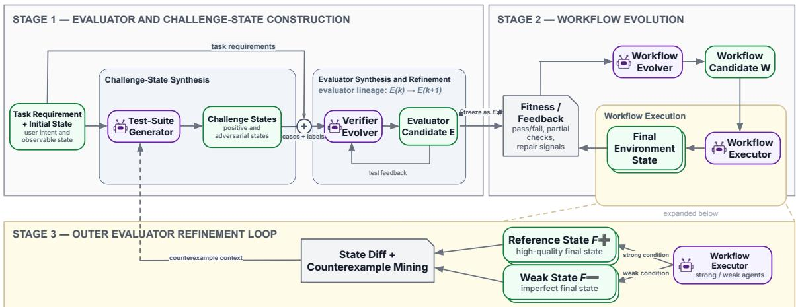
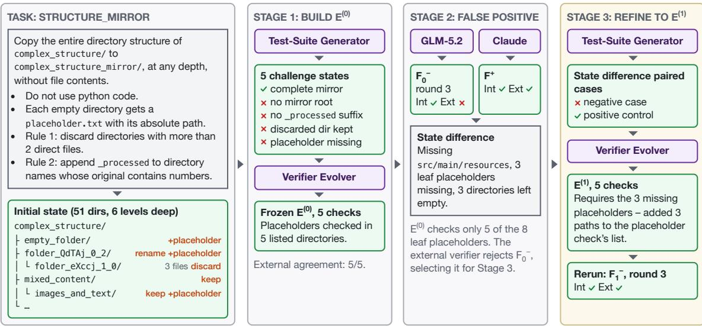
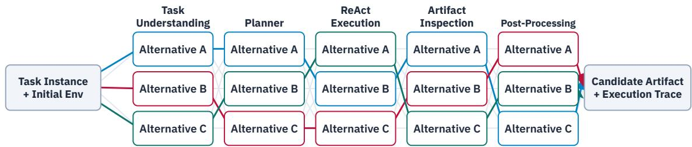

# VeriEvolve: Evaluator-First Evolution for Tool-Using Agents

Yueshen Li<sup>1</sup> Kamer Ali Yuksel<sup>2</sup> Gokhan Tur<sup>1</sup> Dilek Hakkani-Tür<sup>1</sup> João Pedro Maia<sup>2</sup> <sup>1</sup>University of Illinois Urbana-Champaign <sup>2</sup>aiXplain

## Abstract

A central obstacle to self-improving agents is the absence of a reliable fitness signal for realistic stateful tasks. We introduce VERIEVOLVE, an evaluator-first evolution framework that constructs this missing evaluation layer before optimizing the agent. From each task instruction, VeriEvolve synthesizes instruction-grounded challenge states and an executable evaluator that checks them. During each round of workflow evolution, the evaluator is frozen and serves as the fitness signal. Between rounds, VeriEvolve revises the evaluator by converting the end states of strong and weak runs into a pair of counterfactual test cases.

Across all 30 MCPMark Filesystem tasks, VeriEvolve constructs 30 evaluators with 141 challenge states, achieving 141/141 agreement on the generated suites and 113/122 agreement on held-out states produced by executor agents. Evaluator-guided evolution increases externally verified success from 6/30 to 18/30 for GLM-5.2 and from 27/30 to 30/30 for Claude; refinement removes all three false positives that the weak executor exposes. Cross-environment studies on PostgreSQL, Playwright, Notion, and GitHub further expose complementary limits from observability, state representation, and search/execution capacity. These results show that executable evaluators can be synthesized and used to guide search when task success is observable and an external verifier is available for calibration.

## 1 Introduction

A self-improving agent can optimize only what its evaluator can reliably measure. In program synthesis, formal reasoning, and scientific optimization, candidate quality is often supplied through unit tests, proof checkers, or explicit numerical objectives (Romera-Paredes et al., 2024; Novikov et al., 2025; Zhang et al., 2026a; Wang et al., 2026b). Realistic tool-use workflows rarely come with an equivalent fitness function. Instead, agents must translate natural-language instructions into structured changes across filesystems, databases, repositories, productivity platforms, and browsers. Extending self-improvement to these settings therefore requires not only better search but also the scalable construction of deterministic, machinecheckable evaluators.

This evaluation bottleneck is especially pronounced in stateful, create–read–update–delete (CRUD) workflows. Correctness is determined by the resulting environment state rather than the final natural-language response, and may depend jointly on artifact existence, content, hierarchy, consistency, preservation, and the absence of unintended side effects. These constraints are implied by the instruction but are generally not supplied as a complete executable specification. Human-authored verification scripts can represent them reliably, but they are costly to design and validate; MCPMark reports several hours of expert effort for constructing each task and its verifier (Wu et al., 2026). LLMbased judges are easier to scale, but semantic assessment alone cannot reliably establish that all required properties of the final state hold.

We study whether this missing evaluation layer can itself be constructed by agents. Our central question is: Can an agent synthesize a taskgrounded executable evaluator that is informative enough to guide workflow improvement without access to an externally authored verifier during search? Our goal is not to reproduce an expert verifier perfectly in one step. Instead, we ask whether an initially constructed evaluator can bootstrap useful optimization, and whether the resulting execution states can subsequently reveal missing constraints and support sharper evaluation artifacts. We treat this as a feasibility question in a deliberately favorable setting: task success is observable through the environment state, and an independent benchmark verifier exists, which we use only outside the search loop: to admit evaluators, identify false positives, and measure outcomes.

We introduce VERIEVOLVE, an evaluator-first framework with four model-backed roles: a Test-Suite Generator, Verifier Evolver, Workflow Evolver, and Workflow Executor. In Stage 1, the framework derives positive, negative, and adversarial challenge states from the task instruction and observable initial environment. Deterministic category adapters materialize these specifications, and the Verifier Evolver constructs a taskspecific executable evaluator that is frozen after passing internal gates. In Stage 2, this evaluator supplies a stationary fitness signal for evolving a tool-use workflow whose nodes retain persistent behavioral alternatives. Stage 3 then compares highconfidence strong-executor states with internally accepted weak-executor states, mines instructiongrounded differences into paired counterfactual cases, and promotes a revised evaluator only after cumulative regression. The revised evaluator is frozen before workflow search resumes. The external MCPMark verifier is never shown to a model-backed role and never ranks workflows or edits an evaluator. It is used outside the loop for three purposes: admitting evaluators to Stage 2, identifying which accepted states are false positives and therefore enter Stage 3, and measuring results.

Our primary controlled study covers all 30 MCP-Mark Filesystem tasks. Stage 1 constructs 30/30 evaluators with 141 challenge states, including 62 adversarial near-misses, with 141/141 agreement against the external verifier on the generated suites. On 122 distinct states later produced by the executor agents, which no evaluator saw during construction, agreement is 113/122. Under the weaker GLM-5.2 executor, workflow evolution increases externally verified success from 6/30 at round 0 to 18/30; under Claude, it increases success from 27/30 to 30/30. Three internally accepted GLM-5.2 states nevertheless fail external verification, showing that an evaluator can guide effective search while remaining incomplete. In all three cases, strong–weak state differences yield regressionverified evaluator revisions that eliminate the original false positives; for structure\_mirror, the weak executor reaches an externally valid state after a single revision. An expanded PostgreSQL study covers all 21 standard tasks: 15 synthesized evaluators meet the Stage 2 admission threshold, and workflow evolution closes three weak-executor gaps that the strong executor solves at round 0, while neither executor reaches internal convergence on the remaining 12 eligible tasks within the configured limits. Playwright, Notion, and GitHub stress tests further expose complementary limits imposed by observability and state representation.

Our contributions are:

• We identify the scalable construction of deterministic, machine-checkable evaluators as a missing prerequisite for self-improving agents in realistic stateful tool-use workflows.

• We introduce VERIEVOLVE, which constructs task-grounded challenge states and executable evaluators before evolving persistent multialternative workflows under a frozen fitness signal, and revises an evaluator from differences between strong- and weak-executor final states.

• On MCPMark, we show that the synthesized evaluators agree with the external verifier on their own challenge states and on held-out agent-produced states, that they guide externally measured workflow improvement for a strong and a weak executor, and that statedifference refinement removes all three false positives the external verifier exposed.

• We will release the framework code and the resulting artifacts upon publication: challenge states and frozen evaluators for 30 Filesystem and 18 PostgreSQL tasks, the 258 agentproduced states with internal and external labels used for held-out evaluation, and the evolved workflows.

## 2 Related Work

Self-improving agents and their evaluators. Language models are increasingly used as search operators over programs and agents. FunSearch and AlphaEvolve evolve programs against automatically computed objectives (Romera-Paredes et al., 2024; Novikov et al., 2025); the Darwin and Huxley Gödel Machines evolve self-modifying coding agents scored on coding benchmarks (Zhang et al., 2026a; Wang et al., 2026b); and HyperAgents jointly represent task-solving and self-modification roles (Zhang et al., 2026b). These systems start from a supplied benchmark or utility. Recent work allows the evaluation criterion to change: the Red Queen Gödel Machine co-evolves agents with learned evaluators, freezing each evaluator within an epoch and promoting challengers against held-out ground-truth anchors (Iacob et al., 2026); self-modifying Lean agents co-evolve their benchmark while keeping Lean as a fixed trusted verifier (Li et al., 2026); and the Verification Horizon argues that verification must develop alongside increasingly capable generators (Wang et al., 2026a). In each case, an improved evaluator is still validated against an external benchmark, formal verifier, ground-truth anchor, or human judgment. VeriEvolve shares this dependence: it builds evaluators for stateful tool-use tasks without the benchmark’s verifier but uses that verifier afterward to admit evaluators, select false positives for refinement, and measure their performance.

Evaluation of stateful tool use. LLM judges scale feedback for open-ended text and dialogue (Liu et al., 2023; Zheng et al., 2023), but a semantic judgment cannot establish that every required state invariant holds. Agent benchmarks therefore check the resulting artifacts or the environment state programmatically (Jimenez et al., 2024; Yao et al., 2025; Xie et al., 2024; El Hattami et al., 2025; Wu et al., 2026), and agent harnesses build on such executable feedback (Ning et al., 2026). These checks are written by hand: MCPMark reports several hours of expert effort per task and verifier (Wu et al., 2026). LLMs can generate tests and checks from source code, formal specifications, or agent traces (Wang et al., 2025; Cunha and Macedo, 2026; Kohl et al., 2026); VeriEvolve instead synthesizes evaluators of final environment states from a task instruction and its initial state, and revises them using states that agents produce.

## 3 Problem Setting

A stateful tool-use task is a tuple ${ \boldsymbol \tau } = ( x , s _ { 0 } , \mathcal { O } )$ : a natural-language instruction x, an initial environment state $s _ { 0 } .$ , and a read-only observation interface O that exposes the state available for evaluation. Executing a workflow W with the task’s tools yields a final state $s w$ . The correctness of s<sub>W</sub> depends on constraints implied by the instruction (existence, content, structure, consistency, and preservation of artifacts), which are not given as an executable specification. We consider only tasks whose success is observable through O.

Evaluator. An evaluator E is a deterministic program that maps $\mathcal { O } ( s )$ to a verdict $\hat { y } ( s ) \in \{ 0 , 1 \}$ , a partial score $r ( s ) \in [ 0 , 1 ]$ , and check-level evidence. VeriEvolve builds E from $x , \mathcal { O } ( s _ { 0 } )$ , a set of synthesized challenge states with instructionderived labels, $\mathcal { C } = \{ ( s _ { i } , y _ { i } ) \}$ , and deterministic execution feedback; it does not use the benchmark’s verifier. Workflow search maximizes $r ( s _ { W } )$ while E is held fixed, and a workflow is internally converged when $\hat { y } ( s _ { W } ) = 1$

Refinement. Evaluators are versioned ${ \cal E } ^ { ( 0 ) } , { \cal E } ^ { ( 1 ) } , . .$ together with their challenge sets $\mathcal { C } ^ { ( k ) }$ Refinement round k compares a reference state $F ^ { + }$ produced by a strong executor with a weak-executor state $F _ { k } ^ { - }$ that $E ^ { ( k ) }$ accepts. Their observable difference $\Delta ^ { ( k ) } = \mathrm { D i f f } \left( \mathcal { O } ( F ^ { + } ) , \mathcal { O } ( F _ { k } ^ { - } ) \right)$ is turned into new labeled challenge states, giving $\mathcal { C } ^ { ( k + 1 ) }$ , and into a revised evaluator $E ^ { ( k + 1 ) }$ ; weak-executor search is then rerun. $F ^ { + }$ is treated as one high-confidence valid execution, not as a ground-truth oracle, so a revision may add only instruction-grounded distinctions and must preserve all earlier verdicts.

## 4 VeriEvolve Framework

Figure 1 operationalizes the objects defined in Section 3. Model-backed roles propose challenge states, evaluator revisions, and workflow alternatives, while deterministic components materialize states, execute and gate evaluators, compute state differences, and version the resulting artifacts. The evaluator is frozen within each workflow-search run and may be revised only between runs. Figure 2 shows a task example following all three stages.

## 4.1 Evaluator Construction

The Test-Suite Generator maps the task instruction and observable initial state to declarative positive, clean-negative, and adversarial challenge cases. A category-specific deterministic adapter materializes each specification in an isolated copy of the task environment, producing executable states with instruction-derived labels.

The Verifier Evolver constructs a sandboxed executable evaluator over the read-only observation interface O. A deterministic harness runs each evaluator candidate on the materialized challenge states and returns case-level failures as refinement feedback. Once the candidate satisfies the construction gate, it is frozen as $E ^ { ( 0 ) }$ . The initial output of

  
Figure 1: Overview of VeriEvolve. Stage 1 constructs challenge states and an executable evaluator; Stage 2 freezes that evaluator while evolving workflows; and Stage 3 mines strong–weak execution-state differences to extend the challenge set and revise the evaluator. One Stage 3 update followed by a Stage 2 rerun is a refinement round. Purple nodes are model-backed roles, green nodes are persisted artifacts or states, and gray nodes are deterministic operations.

Stage 1 is therefore the challenge set and evaluator

$$
\left( \mathcal { C } ^ { ( 0 ) } , E ^ { ( 0 ) } \right)
$$

## 4.2 Workflow Evolution under Frozen Evaluation

A workflow contains five functional nodes for task understanding, planning, ReAct execution, artifact inspection, and post-processing. Each node maintains a pool of prompt or behavior alternatives, following the persistent multi-alternative representation of EvoLattice (Yuksel, 2025), and a candidate path selects one alternative from every active node. The Workflow Executor runs the selected path in an isolated task environment and returns the final state and execution trace.

The frozen evaluator $E ^ { ( k ) }$ scores the observable final state and provides partial fitness and checklevel evidence. Artifact inspection separately summarizes execution behavior that may explain the failed checks. The Workflow Evolver uses these signals to append new node alternatives for subsequent rounds. Because earlier alternatives remain available, promising partial behaviors can be retained and recombined rather than overwritten by each mutation. Throughout a Stage 2 run, however, $E ^ { ( k ) }$ is immutable; the search changes how the task is understood, planned, executed, inspected, or post-processed, but not the criterion used to compare candidates. The multi-alternative workflow representation is shown in Appendix B.2 (Figure 3).

## 4.3 Execution-State Refinement

State-difference mining. At refinement round k, a deterministic adapter first removes known environment-specific artifacts symmetrically from $F ^ { + }$ and $F _ { k } ^ { - }$ . The State-Diff module then organizes the remaining observable differences into factual clusters, such as missing or extra artifacts, content mismatches, and structural deviations. Only clusters that can be grounded in the task instruction are eligible for refinement.

Counterfactual challenge states. For each selected cluster, the Test-Suite Generator constructs paired counterfactual states using $F ^ { + }$ and the current $F _ { k } ^ { - }$ as immutable anchors. The negative state reproduces the selected difference, while the positive control removes it and holds the unrelated state fixed. A deterministic label-consistency gate verifies the expected verdicts, and a coverage gate checks that the pair actually introduces and removes the targeted difference. Cases that fail either gate are rejected before evaluator refinement.

Evaluator promotion and workflow rerun. The Verifier Evolver receives the current evaluator, the cumulative challenge set, and factual observationlevel contrasts between the paired states. It proposes a localized revision targeted at the uncovered constraint. A candidate is promoted to $E ^ { ( k + 1 ) }$ only if cumulative regression verifies that it accepts $F ^ { + }$ rejects all prior weak false-positive states, preserves all previous challenge-state verdicts, and correctly classifies the new cases. The promoted evaluator is then frozen, and weak-executor workflow evolution is rerun under the sharper criterion.

A further refinement round is useful only when the new weak state exposes a novel, instructiongrounded difference that the current evaluator does not already cover. VeriEvolve terminates when the weak state matches the reference or no actionable difference remains; when the evaluator stabilizes on a repeated, already-covered difference; or when workflow search, evaluator refinement, or the refinement-round budget is exhausted. Repeated production of an error already detected by the evaluator is therefore attributed to workflow-search or executor insufficiency rather than treated as another evaluator gap.

Each accepted refinement round appends paired challenge states, a strong–weak state contrast, and a new evaluator version, yielding an ordered and reusable evaluator lineage. The external benchmark verifier is not part of this loop: its source, verdicts, and diagnostics are never provided to any model-backed role or used for workflow ranking, evaluator repair, or termination. In our experiments, however, external verdicts decide which evaluators enter Stage 2 and which internally accepted states are false positives that trigger refinement, and the reference state F<sup>+</sup> is one that the external verifier also accepts. A deployment without an external verifier would need another trigger and reference. We evaluate one candidate trigger, executor disagreement, only retrospectively (Appendix E.6); a verifier-free reference is not evaluated.

## 5 Experimental Setup

## 5.1 Evaluation Questions and Scope

We evaluate on a subset of the MCPMark standard task suite spanning five task environments; the complete task and exclusion breakdown is reported in Appendix A. We treat Filesystem as our primary controlled study and the remaining environments as cross-environment stress tests.

We ask three questions, one per stage. RQ1 (evaluator construction): can VeriEvolve synthesize challenge states and executable evaluators that distinguish correct task states from minimally incorrect or adversarial ones? RQ2 (workflow evolution): do the synthesized evaluators give feedback informative enough to guide workflow search? RQ3 (execution-state refinement): can differences between strong- and weak-executor states reveal evaluator constraints not yet covered?

## 5.2 Models and Experimental Budgets

All model-backed roles use Claude Sonnet, except that initial Stage 1 construction ran in interactive Claude Code sessions and the weak Workflow Executor is GLM-5.2; Table 7 in Appendix B gives identifiers and invocation modes.

Stage 1 evaluator construction uses only internal gates: positive acceptance of at least 0.90 and adversarial rejection of at least 0.80. After an evaluator is frozen, we measure its agreement with the external MCPMark verifier. For the Stage 2 study, we include frozen evaluators with at least 0.85 post-hoc external agreement. This external measurement determines study inclusion and is used for evaluation; Stage 3 is applied to the internally accepted states that the external verifier rejects. External labels, diagnostics, and verifier logic are never routed back into test generation, evaluator repair, workflow ranking, or workflow evolution.

Unless otherwise noted, Stage 2 runs use five paths per round (three for the Filesystem Claude campaign), at most 15 workflow rounds (three paths and at most five rounds for the Playwright and Notion pairs), up to three evaluator-repair attempts, and at most three refinement rounds. In the Filesystem GLM-5.2 and the PostgreSQL campaigns, each Stage 2 round ran as a subprocess with a one-hour timeout; a round that exceeded it ended the run, which is counted as unsolved. Full per-category gates, budgets, and timeout settings are listed in Appendix B.

We denote acceptance by the internal evaluator and external MCPMark verifier as Int✓ and Ext✓, respectively. Thus, Int✓/Ext× denotes an evaluator false positive and Int × /Ext✓ an evaluator false negative. External verdicts are never used as optimization feedback. Formal exclusions and infrastructure-invalid runs are reported separately and are not counted as semantic task failures.

## 6 Results

## 6.1 RQ1: Constructing Evaluators

Table 1 shows that VeriEvolve constructs evaluators across two different state interfaces. For the full Filesystem study, Stage 1 constructs 30/30 evaluators with 141 materialized challenge states, including 62 adversarial near-misses. After the evaluators are frozen, post-hoc calibration finds agreement with the external verifier on all 141 states.

<table><tr><td>Environment</td><td>Constructed</td><td>Cases (P/N)</td><td>Ext. agreement</td><td>Stage-2 study</td></tr><tr><td>Filesystem</td><td>30/30</td><td>141 (34/107)</td><td>141/141</td><td>30/30</td></tr><tr><td>PostgreSQL</td><td>18/21</td><td>120 (22/98)</td><td>115/120</td><td>15/21</td></tr></table>

Table 1: Primary RQ1 evidence. Cases are generated challenge states; P/N reports their post-hoc externalverifier labels. External agreement compares the frozen internal evaluator with those labels. The external verifier is consulted only after evaluator construction and is not exposed to any model-backed role or used as evaluatorrepair feedback. For the Stage 2 study, we include tasks whose frozen evaluator reaches at least 0.85 post-hoc external agreement.
<table><tr><td></td><td></td><td colspan="4">Int/Ext</td><td></td><td></td><td></td></tr><tr><td>Executor</td><td>States</td><td>√1√</td><td>√1×</td><td>×1√</td><td>x/×</td><td>Agr.</td><td>Prec. Rec. Spec.</td><td></td></tr><tr><td>GLM-5.2</td><td>85</td><td>18</td><td>3</td><td>1</td><td></td><td>63 95.3</td><td>85.7 94.7</td><td>95.5</td></tr><tr><td>Claude</td><td>44</td><td>30</td><td>0</td><td>5</td><td></td><td>988.6</td><td>100.0 85.7</td><td>100.0</td></tr><tr><td>All (distinct)</td><td>122</td><td>41</td><td>3</td><td>6</td><td>72</td><td>92.6</td><td>93.2 87.2</td><td>96.0</td></tr></table>

Table 2: Held-out evaluation on Filesystem: frozen Stage 1 evaluators versus the external verifier on distinct agent-produced states from both Stage 2 campaigns (Int/Ext columns count states; Agr., Prec., Rec., and Spec. are agreement, precision, recall, and specificity in %, with “pass” as the positive class). Seven states produced by both executors are counted once in the last row. Details in Appendix D.3.

For PostgreSQL, VeriEvolve successfully constructs evaluators for 18/21 standard tasks, covering 120 calibration states (22 positive and 98 negative). Post-hoc calibration of the frozen evaluators yields 115/120 agreement with the external verifier. Fifteen evaluators reach at least 0.85 per-task agreement and are included in the Stage 2 study; three frozen evaluators remain below this studyinclusion threshold, while the remaining three tasks are blocked by the observation interface because their success conditions are not adequately represented by the available observation interface. Importantly, external verdicts are obtained only after evaluator construction: they determine the scope of the downstream study but are never routed back into test generation, evaluator repair, workflow ranking, or workflow evolution.

Held-out agent-produced states. Agreement on a finite generated suite does not imply complete coverage. To test the frozen evaluators beyond their own challenge suites, we re-execute each Stage 1 evaluator on the final states that the two Stage 2 executors produced on Filesystem and label every state post hoc with the external verifier. These states were produced after the evaluators were frozen, by other models working on the real task. The campaigns retained the best state of each round, giving 258 states, 122 of them distinct (Table 2). The evaluators agree with the external verifier on 113/122 distinct states (92.6%; 95% CI 86.6–96.1). Errors occur in both directions: the three false positives are the states that later trigger Stage 3, and six valid states, on four tasks, are rejected internally. Restricted to the 60 final states, agreement is 57/60, the outcomes in Table 3. Because each retained state is the one the evaluator ranked highest in its round, this pool over-represents internally high-scoring states and is not an independent sample. The smaller live-state studies show the same scope boundary (Appendix D.5).

<table><tr><td>Executor</td><td>Workflow Int. pass Ext. pass</td><td></td><td></td><td>FP FN</td><td></td></tr><tr><td>Claude</td><td>Seed</td><td>24/30</td><td>27/30</td><td>0</td><td>3</td></tr><tr><td>Claude</td><td>Evolved</td><td>30/30</td><td>30/30</td><td>0</td><td>0</td></tr><tr><td>GLM-5.2</td><td>Seed</td><td>8/30</td><td>6/30</td><td>2</td><td>0</td></tr><tr><td>GLM-5.2</td><td>Evolved</td><td>21/30</td><td>18/30</td><td>3</td><td>0</td></tr></table>

Table 3: Filesystem seed and evolved workflow performance. Seed denotes the internally selected best candidate at round 0, before workflow evolution, under each campaign’s recorded path budget. FP and FN denote Int✓/Ext× and Int × /Ext✓, respectively.

Answer to RQ1. Where correctness is observable, VeriEvolve built evaluators that agree with the external verifier on their own suites (141/141 and 115/120) and on 113/122 held-out Filesystem states. This is external calibration, not evidence of reliability on its own.

## 6.2 RQ2: Guiding Workflow Evolution

On Filesystem, workflow evolution triples the weak executor’s externally verified success from 6/30 to 18/30 and raises internal convergence from 8/30 to 21/30. Thus, 13 tasks reach internal convergence only after workflow evolution. Of the 21 final internally accepted states, 18 pass external verification, giving 85.7% internal precision. The three remaining false positives become the executionstate refinement tasks in RQ3; no GLM-5.2 state is externally accepted while internally rejected.

The strong Filesystem executor improves from 27/30 to 30/30 external success, while internal convergence rises from 24/30 to 30/30. Its three round-0 disagreements are evaluator false negatives, and no strong-executor state is a false positive. The strong condition also records approximately 58× fewer executor tokens than GLM-5.2 over the full campaign,<sup>1</sup> highlighting the remaining effect of executor capability under the same taskspecific evaluators. Because both comparisons are paired over the same 30 tasks, we apply an exact McNemar test (Table 14): GLM-5.2’s external gain (12 tasks gained, none lost) is significant $( p < 0 . 0 0 1 )$ ), whereas Claude’s three gained tasks are not $( p = 0 . 2 5 )$ .

On the 15 admitted PostgreSQL tasks, both executors solve the same three tasks, and every internally accepted final state is also externally accepted. The strong executor solves them at round 0; the weak executor needs 11, 2, and 7 rounds of evolution and 5–32× the strong executor’s tokens. Neither executor converges on the other 12 tasks within the configured limits (Appendix D.5), which also reports the smaller Playwright and Notion studies.

Answer to RQ2. The evaluators give usable search feedback: evolution triples weak-executor success on Filesystem and closes three PostgreSQL gaps, but 12/15 PostgreSQL tasks stay unsolved, so a usable evaluator does not remove executor and search limits.

## 6.3 RQ3: Refining Evaluators from Execution States

The final weak-executor Filesystem campaign produces exactly three Int✓/Ext× states: uppercase, debugging, and structure\_mirror. We apply one task-generic refinement strategy to all three, starting from their original evaluator, weak state, and workflow. These three cases are selected by the external verifier, and each reference state $F ^ { + }$ is a Claude state that it also accepts; the refinement itself receives only the instruction, the two states, and the current evaluator and challenge set. The repaired constraints are exact text and terminal-newline fidelity (uppercase), presence of the required fixed code pattern (debugging), and the missing nested directories and placeholders (structure\_mirror); Table 17 in Appendix D lists the revisions.

Every strong–weak difference yields instructiongrounded paired challenge states and a regressionfree evaluator revision. The promoted evaluators preserve the strong reference and all prior challenge-state verdicts while rejecting every previously accepted weak state. Consequently, all three original evaluator gaps are repaired and no Int✓/Ext× state survives the primary refinement runs. On uppercase and debugging, the trajectory stops once the weak executor repeats an alreadycovered failure rather than exposing another evaluator constraint.

<table><tr><td>Run</td><td>Exec. tok. Evolver</td><td></td><td></td><td>Wall Normalized cost</td></tr><tr><td>Filesystem</td><td></td><td></td><td></td><td></td></tr><tr><td>Stage 2, GLM-5.2</td><td>33.18M</td><td></td><td></td><td>$31.24 43.5 h 2.76M, $2.60 per gained task (12)</td></tr><tr><td>Stage 2, Claude</td><td>0.58Ma</td><td>$1.74</td><td></td><td>5.3 h 0.19M, $0.58 per gained task (3)</td></tr><tr><td>Stage 3</td><td>8.10M</td><td>$3.494.6 hb</td><td></td><td>2.70M + 21.4K TSG/VE, $1.16 per repaired</td></tr><tr><td>PostgreSQL (15 tasks)</td><td></td><td></td><td></td><td>evaluator (3)</td></tr><tr><td>Stage 2, GLM-5.2</td><td>27.82M</td><td></td><td></td><td>$22.74 37.4 h 9.27M per solved task (3)</td></tr><tr><td>Stage 2, Claude</td><td>19.08M</td><td></td><td></td><td>$19.14 33.9h 6.36M per solved task (3)</td></tr></table>

Table 4: Recorded cost of the main campaigns. Evolver is the Workflow Evolver’s dollar cost; wall time is summed over tasks or runs. Normalized cost divides the whole campaign by the tasks that pass externally only after evolution (Filesystem), by repaired evaluators (Stage 3), or by externally verified successes (PostgreSQL). <sup>a</sup>Excludes prompt-cache reads. <sup>b</sup>2.5 h elapsed with runs in parallel. Stage 1 cost was not recorded.

Figure 2 follows structure\_mirror end to end. $E ^ { ( 0 ) }$ lists only 5 of the 8 empty leaf directories that need a placeholder, so it accepts a weak state that omits the other 3. The difference from $F ^ { + }$ forms three clusters (missing directories, missing placeholders, and directories left empty); the six paired cases lead to a three-line revision that adds the missing paths, and $E ^ { ( 1 ) }$ passes cumulative regression. Rerunning weak-executor search under $\bar { E } ^ { ( 1 ) }$ GLM-5.2 converges at round 3 on a state that the external verifier also accepts. The run then entered a second refinement round, but its only observed difference was a duplicate directory created by file synchronization after the state had been archived; we exclude that round (Appendix C).

Answer to RQ3. Once the external verifier flags a false positive, strong–weak state differences repair the missing constraint without further external feedback (3/3 on Filesystem). One revision let the weak executor solve structure\_mirror, but not uppercase or debugging. Refinement needs an agent-produced false positive, which the PostgreSQL campaign never yields.

## 6.4 Cost and Repair Effort

Table 4 summarizes recorded cost (full accounting in Appendix F). Executor tokens dominate. The weak executor needs 2.76M executor tokens and \$2.60 of evolver cost for each Filesystem task it gains through evolution, about 15 times the strong executor’s executor tokens and 4.5 times its evolver cost per gained task. The evaluator repair itself is cheap: across the three Stage 3 tasks, the Test-<sup>fi</sup>Suite Generator was called four times and passed the label and coverage gates on the first attempt each time, and the Verifier Evolver made six attempts, of which two (both on debugging) were rejected by cumulative regression. These calls use 64K tokens, under 1% of Stage 3 tokens; the rest re-runs weak-executor search under each revised evaluator (49 rounds in total, including 15 rounds and 3.36M executor tokens spent in the excluded structure\_mirror round).

  
Figure 2: Worked example on the MCPMark Filesystem task structure\_mirror. Orange labels give what the mirror must do with each directory. Stage 1 builds $E ^ { ( 0 ) }$ from five challenge states; $E ^ { ( 0 ) }$ checks placeholders in only 5 of the 8 empty leaf directories. In Stage 2, GLM-5.2 reaches a state $F _ { 0 } ^ { - }$ that $E ^ { ( 0 ) }$ accepts but the external verifier <sub>ff</sub>rejects, which selects the task for Stage 3. Stage 3 turns the difference from the Claude state $F ^ { + }$ into paired cases and a revised evaluator $E ^ { ( 1 ) }$ , under which the weak executor’s next state $F _ { 1 } ^ { - }$ passes both checks. Int and Ext denote the internal evaluator and the external verifier.

## 7 Discussion

Once a calibrated task-specific evaluator is available, the bottleneck can shift from evaluation to search and execution: neither executor converges on 12 of the 15 admitted PostgreSQL tasks, and on the three solved tasks only the weak executor needs evolution. A usable fitness signal is therefore necessary but not sufficient. Refinement is also trajectory-dependent: it starts only when search reaches an evaluator-accepted state that exposes a gap, and in our experiments that trigger came from the external verifier. A simple verifier-free alternative, flagging any accepted weak-executor state that differs from the strong executor’s accepted state, would in retrospect have caught all three false positives but also flagged 10 of 18 correct states (Appendix E.6); making such a trigger precise remains open. Because compute is dominated by candidate execution, future work should devote more capacity to search and execution, while the accumulated challenge states and evaluator revisions may support smaller models specialized for test generation and evaluator repair.

## 8 Conclusion

We introduced VERIEVOLVE, an evaluator-first framework that constructs challenge states and executable evaluators before optimizing tool-use workflows. On MCPMark tasks whose success is observable through the environment state, the synthesized evaluators agree with the external verifier on their own challenge states and on most held-out agent-produced states, guide externally measured workflow improvement, and can be repaired from strong–weak state differences once a false positive is identified. Throughout, the external verifier remains the reference that admits evaluators and exposes their errors; removing that dependence is the main step toward agents that construct the fitness signals they require.

## Limitations

Dependence on an external verifier. VeriEvolve never exposes the benchmark verifier to a model or uses it inside search, but our experiments are not verifier-free. External agreement decides which evaluators enter Stage 2, external verdicts identify the false positives that Stage 3 refines, and each reference state $F ^ { + }$ is externally accepted. Our results therefore show feasibility under external calibration, not that synthesized evaluators are reliable, or that refinement can run autonomously, without an independent verifier.

Calibration on a finite challenge suite does not guarantee complete evaluator coverage. Test-suite generation and evaluator construction both used Claude, so the 141 Stage 1 challenge states share their author with the evaluators they test. The held-out agent-produced states come from other executors, but only the best state of each round was retained, so they are selected by the evaluator’s own ranking and are not independent samples. Initial interactive Stage 1 construction additionally relied on a procedural verifier-information boundary, whereas the stronger packet-level technical isolation applies to Stage 3.

Our empirical coverage remains uneven across environments. Filesystem is the only category with complete Stage 1 and Stage 2 coverage together with execution-state refinement. PostgreSQL provides broader evidence: all 21 standard tasks receive a Stage 1 disposition, 15 evaluators qualify for Stage 2, and all 15 matched strong/weak conditions are run to their configured limits. However, only three of these tasks are solved by either executor, and no PostgreSQL trajectory produces an Int✓/Ext× state that would trigger Stage 3. Playwright, Notion, and GitHub remain smaller or incomplete cross-environment studies. VeriEvolve can evaluate only properties represented through the observation interface, and several crossenvironment tasks are excluded or caveated because their success conditions are missing, weakly specified, or distorted by the available state representation.

Each Filesystem condition was run once, and we compare evolved workflows with their own round-0 seed rather than with a budget-matched search baseline, so part of the measured gain may reflect repeated sampling rather than evaluator guidance. A usable fitness signal does not guarantee task completion: on most PostgreSQL Stage 2 tasks neither executor converges, and several weakexecutor runs end at the one-hour round timeout rather than after all 15 rounds. Successful evaluator repair likewise does not guarantee that a weaker executor can satisfy the refined criterion. Refinement requires a high-confidence positive state $F ^ { + }$ from a sufficiently capable executor, and $F ^ { + }$ is one valid execution, not a complete characterization of all acceptable solutions. The strong executor provides such a state on 35 of 49 tasks across environments but on only 3 of 15 PostgreSQL tasks (Appendix E.5); one of its internally accepted states is rejected externally, and the effect of an erroneous $F ^ { + }$ on the revised evaluator is untested. Repeated workflow execution and refinement remain computationally expensive, limiting both the present experimental scale and the number of opportunities for execution-state refinement.

## References

Alcino Cunha and Nuno Macedo. 2026. Validating formal specifications with LLM-generated test cases. In Formal Methods: 27th International Symposium, FM 2026, Proceedings, Part I, Lecture Notes in Computer Science, pages 279–297. Springer.

Amine El Hattami, Megh Thakkar, Nicolas Chapados, and Christopher Pal. 2025. WebArena Verified: Reliable evaluation for web agents. In NeurIPS 2025 Workshop on Scaling Environments for Agents.

Alex Iacob, Andrej Jovanovic, William F. Shen, Daniel´ Burkhardt, Meghdad Kurmanji, Nurbek Tastan, Lorenzo Sani, Niccolò Alberto Elia Venanzi, Ambroise Odonnat, Zeyu Cao, Bill Marino, Xinchi Qiu, and Nicholas D. Lane. 2026. The Red Queen Gödel Machine: Co-evolving agents and their evaluators. Preprint, arXiv:2606.26294.

Carlos E. Jimenez, John Yang, Alexander Wettig, Shunyu Yao, Kexin Pei, Ofir Press, and Karthik R. Narasimhan. 2024. SWE-bench: Can language models resolve real-world GitHub issues? In The Twelfth International Conference on Learning Representations.

Jens Kohl, Otto Kruse, Youssef Mostafa, Andre Luckow, Karsten Schroer, Thomas Riedl, Ryan French, David Katz, Manuel P. Luitz, Tanrajbir Takher, Ken E. Friedl, and Céline Laurent-Winter. 2026. Automated structural testing of LLM-based agents: Methods, framework, and case studies. Preprint, arXiv:2601.18827.

Yuqing Li, Zeguan Wu, Yu Gan, and Junyu Liu. 2026. Self-modifying Lean proof agents with

verifier-grounded benchmark coevolution. Preprint, arXiv:2607.17352.

Yang Liu, Dan Iter, Yichong Xu, Shuohang Wang, Ruochen Xu, and Chenguang Zhu. 2023. G-Eval: NLG evaluation using GPT-4 with better human alignment. In Proceedings ofthe 2023 Conference on Empirical Methods in Natural Language Processing, pages 2511–2522, Singapore. Association for Computational Linguistics.

Xuying Ning, Katherine Tieu, Dongqi Fu, Tianxin Wei, Zihao Li, Yuanchen Bei, Jiaru Zou, Mengting Ai, Zhining Liu, Ting-Wei Li, Lingjie Chen, Yanjun Zhao, Ke Yang, Bingxuan Li, Cheng Qian, Gaotang Li, Xiao Lin, Zhichen Zeng, Ruizhong Qiu, and 23 others. 2026. Code as agent harness. Preprint, arXiv:2605.18747.

Alexander Novikov, Ngân Vu, Marvin Eisenberger, Em-˜ ilien Dupont, Po-Sen Huang, Adam Zsolt Wagner, Sergey Shirobokov, Borislav Kozlovskii, Francisco J. R. Ruiz, Abbas Mehrabian, M. Pawan Kumar, Abigail See, Swarat Chaudhuri, George Holland, Alex Davies, Sebastian Nowozin, Pushmeet Kohli, and Matej Balog. 2025. AlphaEvolve: A coding agent for scientific and algorithmic discovery. Preprint, arXiv:2506.13131.

Bernardino Romera-Paredes, Mohammadamin Barekatain, Alexander Novikov, Matej Balog, M. Pawan Kumar, Emilien Dupont, Francisco J. R. Ruiz, Jordan S. Ellenberg, Pengming Wang, Omar Fawzi, Pushmeet Kohli, and Alhussein Fawzi. 2024. Mathematical discoveries from program search with large language models. Nature, 625:468–475.

Binghai Wang, Chenlong Zhang, Dayiheng Liu, Jiajun Zhang, Jiawei Chen, Mingze Li, Mouxiang Chen, Rongyao Fang, Siyuan Zhang, Xuwu Wang, Yuheng Jing, Zeyao Ma, and Zeyu Cui. 2026a. The verification horizon: No silver bullet for coding agent rewards. Preprint, arXiv:2606.26300.

Wenhan Wang, Chenyuan Yang, Zhijie Wang, Yuheng Huang, Zhaoyang Chu, Da Song, Lingming Zhang, An Ran Chen, and Lei Ma. 2025. TestEval: Benchmarking large language models for test case generation. In Findings of the Association for Computational Linguistics: NAACL 2025, pages 3547–3562, Albuquerque, New Mexico. Association for Computational Linguistics.

Wenyi Wang, Piotr Pi˛ekos, Nanbo Li, Firas Laakom, Yimeng Chen, Mateusz Ostaszewski, Mingchen Zhuge, and Jürgen Schmidhuber. 2026b. Huxley-Gödel Machine: Human-level coding agent development by an approximation of the optimal self-improving machine. In The Fourteenth International Conference on Learning Representations.

Zijian Wu, Xiangyan Liu, Xinyuan Zhang, Lingjun Chen, Fanqing Meng, Lingxiao Du, Yiran Zhao, Fanshi Zhang, Yaoqi Ye, Jiawei Wang, Zirui Wang, Jinjie Ni, Yufan Yang, Arvin Xu, and Michael Qizhe Shieh.

2026. MCPMark: A benchmark for stress-testing realistic and comprehensive MCP use. In The Fourteenth International Conference on Learning Representations.

Tianbao Xie, Danyang Zhang, Jixuan Chen, Xiaochuan Li, Siheng Zhao, Ruisheng Cao, Toh Jing Hua, Zhoujun Cheng, Dongchan Shin, Fangyu Lei, Yitao Liu, Yiheng Xu, Shuyan Zhou, Silvio Savarese, Caiming Xiong, Victor Zhong, and Tao Yu. 2024. OSWorld: Benchmarking multimodal agents for open-ended tasks in real computer environments. In Advances in Neural Information Processing Systems 37 (Datasets and Benchmarks Track).

Shunyu Yao, Noah Shinn, Pedram Razavi, and Karthik R. Narasimhan. 2025. τ-bench: A benchmark for tool-agent-user interaction in real-world domains. In The Thirteenth International Conference on Learning Representations.

Kamer Ali Yuksel. 2025. EvoLattice: Persistent internal-population evolution through multialternative quality-diversity graph representations for LLM-guided program discovery. Preprint, arXiv:2512.13857.

Jenny Zhang, Shengran Hu, Cong Lu, Robert Tjarko Lange, and Jeff Clune. 2026a. Darwin Gödel Machine: Open-ended evolution of self-improving agents. In The Fourteenth International Conference on Learning Representations.

Jenny Zhang, Bingchen Zhao, Wannan Yang, Jakob Foerster, Jeff Clune, Minqi Jiang, Sam Devlin, and Tatiana Shavrina. 2026b. Hyperagents. Preprint, arXiv:2603.19461.

Lianmin Zheng, Wei-Lin Chiang, Ying Sheng, Siyuan Zhuang, Zhanghao Wu, Yonghao Zhuang, Zi Lin, Zhuohan Li, Dacheng Li, Eric P. Xing, Hao Zhang, Joseph E. Gonzalez, and Ion Stoica. 2023. Judging LLM-as-a-judge with MT-bench and Chatbot Arena. In Advances in Neural Information Processing Systems 36 (Datasets and Benchmarks Track), pages 46595–46623.

## A Task Scope and Evaluation Regimes

## A.1 Audited Experimental Scope

Table 5 reports the complete experimental scope. Formal exclusions are not counted as task failures, infrastructure-invalid runs are excluded from semantic results, and historical or pilot runs are not pooled with standardized campaigns.

<table><tr><td>Environment</td><td>Universe</td><td>RQ1 attempted</td><td>S2 eligible</td><td>Valid pairs</td><td>RQ3 cases</td><td>Disposition</td></tr><tr><td>Filesystem</td><td>30</td><td>30</td><td>30</td><td>30-task campaigns</td><td>3</td><td>Primary standardized study; no exclusions.</td></tr><tr><td>PostgreSQL</td><td>21</td><td>21</td><td>15</td><td>15</td><td>0</td><td>Full Stage 1 disposition and Stage 2 sweep over all eligible tasks; three additional evaluators fall below the admission threshold and</td></tr><tr><td>Playwright</td><td>4</td><td>4</td><td>2</td><td>2</td><td>0</td><td>three tasks are blocked by the observation interface. Two formal exclusions: missing independent ground truth and unobservable success state.</td></tr><tr><td>Notion</td><td>28</td><td>23</td><td>2</td><td>1 historical</td><td>0</td><td>One historical matched pair; broader standardized execution re- mains limited by the live-state representation.</td></tr><tr><td>GitHub</td><td>23</td><td>23</td><td>1</td><td>0 standardized</td><td>0</td><td>Incomplete feasibility campaign; one externally calibrated eval- uator and one corrected strong-executor  $F ^ { + }$  , with the corrected weak-executor pair incomplete.</td></tr></table>

Table 5: Audited task scope. “S2 eligible” counts evaluators or tasks admitted to the corresponding Stage 2 study. Historical, diagnostic, and incomplete pilot results are reported separately from standardized matched pairs.

## A.2 Explicitly Checkable and Implicit Stateful Requirements

VeriEvolve targets tasks in which correctness is determined by a structured environment state but a complete executable evaluation specification is not provided to the agent. The difficulty of constructing that specification varies substantially across tasks, as illustrated in Table 6.

## B Implementation and Experimental Configuration

## B.1 Model Roles and Invocation Modes

Table 7 lists the model roles summarized in Section 5. Initial Stage 1 construction used one interactive Claude Code session in which the Test-Suite Generator and Verifier Evolver acted sequentially. Stage 3 instead used a retained, headless session per refinement round: the Verifier Evolver resumed the accepted Test-Suite Generator session under a packet-restricted interface. The Workflow Evolver was stateless across rounds; the orchestration code explicitly supplied its alternative pool, score history, failed checks, and execution diagnosis on every call.

All Claude roles except initial Stage 1 were invoked through the Claude CLI model alias sonnet; the recorded Stage 3 sessions resolve this alias to claude-sonnet-5. The underlying model of the interactive Stage 1 sessions was not logged, so we report it only as Claude. The weak executor is GLM-5.2 (glm-5.2) served through the Z.ai fullprecision API endpoint.

## B.2 Persistent Multi-Alternative Workflow

Figure 3 shows the Stage 2 workflow representation. The five active nodes are task understanding, planning, ReAct execution, artifact inspection, and post-processing. A fresh workflow contains one seed alternative at each node except ReAct execution, which contains two. The alternative caps are 2, 3, 5, 2, 2, respectively. The baseline taskunderstanding alternative and the disabled postprocessing alternative are protected from eviction.

Alternatives are weighted by their historical mean internal score, with an uninformed prior of 0.5. Each newly proposed alternative receives one forced exploration path in the next round; remaining paths use weighted selection. When a node reaches its cap, the lowest-scoring non-protected alternative is evicted. The evaluator remains frozen throughout this process.

## B.3 Gates, Budgets, and Termination

Table 8 lists the gates and resource caps used in all standardized runs.

The Stage 3 coordinator distinguishes semantic termination from infrastructure failure. Its terminal states include exact reference match, semantic reference convergence, evaluator stabilization on a repeated difference, refinementround-cap exhaustion, evaluator-refinement failure, test-suite generation failure, case-budget exhaustion, unrecovered evaluator-environment failure, Stage 2 infrastructure failure, and informationboundary violation. All three primary Filesystem refinement runs terminate through evaluator stabilization on a repeated, already-covered difference; for structure\_mirror this happens after the excluded, artifact-triggered second round (Appendix C).

## B.4 Environment Adapters and Observability

Table 9 summarizes how each environment materializes candidate states and what the evaluator can

<table><tr><td>Task</td><td>Evaluation regime</td><td>Representative requirements</td></tr><tr><td>uppercase</td><td>Nearly direct specification</td><td>Create explicitly named uppercase file copies and a fixed-format word- count artifact. Major instruction clauses map nearly one-to-one to deter- ministic evaluator checks.</td></tr><tr><td></td><td>structure_mirror Implicit state specification</td><td>Reproduce a transformed hierarchy while satisfying interacting exis- tence, naming, placeholder-content, discard, preservation, and absence constraints. The prohibition on invalid extra structure is exposed only through strong-weak execution-state comparison in the development and controlled runs (Appendix C).</td></tr></table>

Table 6: Examples of differing evaluation regimes within stateful tool-use tasks. Some instructions admit a nearly direct translation into executable checks, whereas others distribute correctness across interacting properties of the final environment state.
<table><tr><td>Role</td><td>Base model</td><td>Invocation</td><td>Context and visible inputs</td><td>Output</td></tr><tr><td>Test-Suite Generator, Stage 1 Claude</td><td></td><td>Interactive Claude Code CLI</td><td>tion, observable initial state, and self- specification</td><td>Persistent task session; task instruc- Declarative labeled challenge-state</td></tr><tr><td>Verifier Evolver, Stage 1</td><td>Claude</td><td>Same interactive session</td><td>generated artifacts Generator; receives challenge states and deterministic internal scoring</td><td>Shares context with the Test-Suite Sandboxed verify(context) eval- uator</td></tr><tr><td></td><td></td><td>Test-Suite Generator, Stage 3 Claude Sonnet Headless retained CLI session</td><td>feedback current evaluator, sanitized cases, state-difference facts, and output</td><td>Packet-restricted task instruction, Anchor-based paired challenge cases</td></tr><tr><td>Verifier Evolver, Stage 3</td><td></td><td>Claude Sonnet Resumes Stage 3 TSG session</td><td>contract factual paired contrasts, and deter- ment code ministic repair feedback</td><td>Current evaluator, cumulative cases, Localized evaluator edits or replace-</td></tr><tr><td>Workflow Evolver</td><td></td><td>Claude Sonnet claude -p; one call per round</td><td>score trajectory, failed checks, and lected node artifact-inspection diagnosis</td><td>Fresh call with alternative statistics, At most one new alternative per se-</td></tr><tr><td>Strong Workflow Executor</td><td></td><td>Claude Sonnet Headless CLI subprocess per path</td><td>lated task environment</td><td>Candidate workflow prompts and iso- Final environment state and execu- tion trace</td></tr><tr><td>Weak Workflow Executor</td><td>GLM-5.2</td><td>API call per workflow node</td><td>Same workflow prompts and category-specific MCP tool surface</td><td>Final environment state and execu- tion trace</td></tr></table>

Table 7: Model roles and invocation modes. Stage 1 TSG and VE share one interactive session; Stage 3 TSG and VE share one retained packet-restricted session per refinement round. The Workflow Evolver and both executors are invoked separately for each round or candidate.

observe.

## C End-to-End Case Study: structure\_mirror

## C.1 Task and Initial Evaluator

The task asks the agent to reproduce the directory structure of complex\_structure/ under complex\_structure\_mirror/ without copying file contents. Each mirrored empty directory must contain a placeholder.txt file storing its absolute path. Directories containing more than two direct files are discarded, directory names containing digits receive a \_processed suffix, and non-digit names are preserved.

Stage 1 synthesized five challenge states (Table 10): one complete positive case, one clean negative, and three adversarial near-misses. All five expected labels agree with the external verifier.

The initial evaluator $E ^ { ( 0 ) }$ contains five deterministic check families.

The corresponding checks verify that the mirror root exists, required digit-bearing names are transformed, discarded directories are absent, non-digit names are preserved, and placeholders exist. This evaluator achieves perfect agreement on the generated Stage 1 suite, but it does not yet verify that the final mirror contains no invalid extra structure.

## C.2 False-Positive Exposure

Under $E ^ { ( 0 ) }$ , the weak executor reaches internal convergence at round three. The retained state $F _ { 0 } ^ { - }$ nevertheless fails external verification, producing one of the three Filesystem Int✓/Ext× states. The strong campaign provides an internally and externally accepted reference state $F ^ { + }$

$E ^ { ( 0 ) }$ checks placeholders only in five listed leaf directories. $F _ { 0 } ^ { - }$ omits project/src/main/resources and leaves three leaf directories without a placeholder, none of which $E ^ { ( 0 ) }$ checks. The five Stage 1 challenge states do not expose this gap: their missing-placeholder case omits every placeholder at once, which the five listed paths already detect.



Figure 3: Persistent multi-alternative workflow used in Stage 2. A candidate path selects one prompt or behavior alternative from each active node, producing an artifact and execution trace. Alternatives persist across rounds, enabling non-destructive reuse and recombination.
<table><tr><td>Stage</td><td>Component</td><td>Gate or budget</td></tr><tr><td>1</td><td>Internal construction</td><td>Positive acceptance ≥ 0.90; adversarial rejection ≥ 0.80.</td></tr><tr><td>1</td><td>Post-hoc admission</td><td>External agreement ≥ 0.85 for admission to the standardized Stage 2 study.</td></tr><tr><td>22</td><td>Workflow search</td><td>Five paths per round; candidate concurrency 1; at most 15 rounds.</td></tr><tr><td></td><td>Candidate resources</td><td>Candidate wall-time limit 300 seconds; token budget 250K; ReAct limit at most 20 by default and 24 at the framework cap.</td></tr><tr><td>22</td><td>Strong executor</td><td>At most 40 turns and 600 seconds per candidate.</td></tr><tr><td></td><td>Round timeout</td><td>One hour per round subprocess (Filesystem GLM-5.2 and PostgreSQL campaigns); a round</td></tr><tr><td>3</td><td>Test-Suite Generator</td><td>that exceeds it ends the run, which is counted as unsolved. Case budget 24; at most three label/coverage gate retries.</td></tr><tr><td>3</td><td>Verifier Evolver</td><td>Initial proposal plus at most three repairs; at most two environment-repair restarts; 900-second</td></tr><tr><td>3</td><td>Outer loop</td><td>call timeout. At most three refinement rounds; Stage 2 subprocess timeout 21,600 seconds.</td></tr></table>

Table 8: Standardized experimental gates and resource caps.

## C.3 One Refinement Round

Table 11 summarizes the primary refinement run. In the first refinement round, the strong–weak difference is organized into empty-directory, missingdirectory, and missing-file clusters. The Test-Suite Generator converts these clusters into six paired challenge states, and the Verifier Evolver repairs $E ^ { ( 0 ) }$ in one attempt, with a three-line patch that adds the three missing placeholder paths to the placeholder check. Cumulative regression verifies that $E ^ { ( 1 ) }$ accepts $F ^ { + }$ , rejects $F _ { 0 } ^ { - }$ , and preserves all earlier case verdicts (11 cases in total).

Workflow evolution under $E ^ { ( 1 ) }$ converges at round three on a state $F _ { 1 } ^ { - }$ that the external verifier also accepts. Its canonical tree hash, 80aeae4e..., is the same as that of the externally accepted state of the separate controlled run described below.

## C.4 An Artifact-Triggered Second Round

The run did not stop at $F _ { 1 } ^ { - }$ . Its second refinement round was triggered by a single extra root-level directory, complex\_structure 2, in the working copy of $F _ { 1 } ^ { - }$ . That directory is absent from the archived $F _ { 1 } ^ { - }$ and from its canonicalization record: it was created by file synchronization of the working directory after the state was archived. Reverifying the archived $F _ { 1 } ^ { - }$ after the fact, the external verifier and $E ^ { ( 0 ) } , \dot { E } ^ { ( 1 ) }$ , and $E ^ { ( 2 ) }$ all accept it. We therefore exclude the second round from our results. The $E ^ { ( 2 ) }$ it produced adds an absence check learned from the artifact, and the weak state reached under $E ^ { ( 2 ) }$ (score 0.8333, rejected internally and externally) is reported only for completeness.

## C.5 Separate Controlled Run

A separate controlled run from the same source version also reaches an $E ^ { ( 1 ) }$ and then performs a second round. Its round-2 difference is mostly genuine: eleven extra placeholder.txt files, mostly in non-empty directories, and one directory from the discarded subtree, together with a synchronization-artifact directory complex\_structure 3. Its $E ^ { ( 2 ) }$ adds checks against this extra structure, and the weak executor then produces an internally and externally accepted state with tree hash 80aeae4e..., the state the primary run reached after one round. A development run that stopped after one round (Table 18) confirms that extra structure is a real failure mode: its weak state, accepted by its $E ^ { ( 1 ) }$ , contains eleven extra placeholder files and fails external verification.

<table><tr><td>Environment</td><td>Materialized candidate</td><td>Evaluator-visible state</td><td>Principal limitation</td></tr><tr><td>Filesystem</td><td>Isolated directory tree</td><td>Paths, file contents, directory structure, and supported metadata</td><td>Volatile backup paths and duplicate artifacts require conservative canonicalization.</td></tr><tr><td>PostgreSQL</td><td>Fresh isolated database clone</td><td>Canonical schema, relation, and row snapshots</td><td>Some object classes and large relations are not fully represented in the internal snapshot.</td></tr><tr><td>Playwright</td><td>Isolated browser execution</td><td>Tool transcript and selected browser-state sig- nals</td><td>Some tasks lack independent factual ground truth or an observable post-condition.</td></tr><tr><td>Notion</td><td>Duplicated workspace</td><td>Canonical page, block, database, and row snap- shots</td><td>Linked views and serialization changes can ob- scure or alter the graded state.</td></tr><tr><td>GitHub</td><td>Isolated repository</td><td>Repository contents and supported issue, pull- request, and history state</td><td>Tool-surface and verifier-environment limita- tions block broad standardized coverage.</td></tr></table>

Table 9: Category-specific materialization and observation interfaces. Evaluator construction is meaningful only when task-relevant success conditions are represented in the permitted observation interface.

<table><tr><td>Case</td><td>Label Type</td><td></td><td>Targeted requirement</td></tr><tr><td>correct_full_mirror</td><td>V</td><td>Positive</td><td>Complete transformed mirror.</td></tr><tr><td>mirror_dir_missing</td><td>×</td><td>Clean negative</td><td>Required mirror root is absent.</td></tr><tr><td>no_processed_suffix</td><td>×</td><td>Adversarial</td><td>Digit-containing names are not transformed.</td></tr><tr><td>discarded_dir_present</td><td>X</td><td>Adversarial</td><td>A directory with more than two direct files is</td></tr><tr><td>missing_placeholder</td><td>×</td><td>Adversarial</td><td>retained. A mirrored empty di- rectory lacks its place- holder.</td></tr></table>

Table 10: Initial structure\_mirror challenge states.

## D Complete Experimental Results

## D.1 Filesystem Stage 1 Results

The primary Filesystem study constructs 30/30 evaluators with 141 total cases: 34 positive and 107 negative states, including 62 adversarial nearmisses. All 141 generated labels agree with the external verifier. Per-task Verifier-Evolver iteration counts were not recorded consistently and are therefore omitted.

Table 12 lists, for each task, the case counts, external agreement, the hash prefix of the frozen evaluator, and whether the evaluator was later refined in Stage 3.

## D.2 Filesystem Stage 2 Results

Table 13 reports seed and evolved verdicts for both executors, together with the final or convergence round, best internal score, and executor tokens of the weak-executor loop. Two weak-executor runs, file\_splitting and structure\_analysis, ended after three and two rounds when a round subprocess exceeded a onehour timeout; both are counted as unsolved. The audited weak round-0 baseline is 8/30 internally and 6/30 externally, with two false positives and no false negatives. The evolved weak campaign reaches 21/30 internally and 18/30 externally. The strong campaign improves from 24/30 internal and 27/30 external seed successes to 30/30 on both measures.

## D.3 Held-Out Evaluation on Agent-Produced States

Protocol. For every best-of-round state retained by the two Filesystem Stage 2 campaigns, we copy the snapshot, remove copy-collision duplicates (files named <name> 2 that are byte-identical to <name>, created by file synchronization after the runs), re-execute the task’s Stage 1 frozen evaluator in the same sandbox used during the campaigns, and run the external verifier once on the same copy (verdict: exit code 0). No model is called, and nothing is fed back into any evaluator or workflow. Identical states (same task and content hash) are counted once in the “distinct” rows.

Data. Of 320 retained snapshots, 258 are valid campaign states. We exclude 60 Claude snapshots that lie beyond their task’s final round and have no round record (left over from an earlier run under the same campaign name) and two Claude file\_arrangement states whose recorded internal verdict does not reproduce, since they may not be the states that were scored. On the remaining states, every re-executed internal verdict matches the recorded one, and all 87 previously recorded external verdicts reproduce. For 71 states the external verifier exits with code 1 after reporting missing output files; these are counted as failures, as in the round-0 baselines.

<table><tr><td>Step</td><td></td><td>Evaluator Newly exposed difference</td><td>New evaluation evidence</td><td>Promoted check</td><td>Weak-state outcome</td></tr><tr><td>Initial</td><td> $E ^ { ( 0 ) }$ </td><td></td><td>Five initial Stage 1 cases</td><td>Presence, renaming, discard, and placeholder checks (5 listed directories)</td><td> $F _ { 0 } ^ { - } \colon \mathrm { I n t } \sqrt { / \mathrm { E x t } \times }$ </td></tr><tr><td>Round 1</td><td> $E ^ { ( 1 ) }$ </td><td>directory, and missing-file cases clusters</td><td>Empty-directory, missing- Six paired counterfactual</td><td>Three placeholder paths added; regression rejects  $F _ { 0 } ^ { - }$ </td><td> $F _ { 1 } ^ { - } \colon \mathrm { I n t } \sqrt { / \mathrm { E x t } } \sqrt { }$ </td></tr><tr><td>Round 2 (excluded)</td><td> $E ^ { ( 2 ) }$ </td><td>file synchronization</td><td>Duplicate directory created by Reproduce/remove pair</td><td></td><td>Extra-structure absence check Int × /Ext × (not counted)</td></tr></table>

Table 11: Primary structure\_mirror evaluator lineage. One revision suffices: the weak state reached under $E ^ { ( 1 ) }$ passes the external verifier. The second round was triggered by a file-synchronization artifact and is excluded from our results.

Results. Table 15 reports both pools; Table 16 gives the per-task breakdown. The three false positives are the final GLM-5.2 states of uppercase, debugging, and structure\_mirror. The six distinct false negatives are Claude states of gradebased\_score (three), file\_arrangement, and requirements\_completion, and one GLM-5.2 state of requirements\_writing. Scoring the Stage 3 evaluators on the same pool is uninformative: after removing the states used as Stage 3 anchors, only two states of the three refined tasks remain.

## D.4 Filesystem Stage 3 Lineage

The complete Stage 3 ledger records 42 primary, development, diagnostic, and case-study trajectories. Primary claims use only the three primary refinement runs and the explicitly separated structure\_mirror exposure and controlled runs.

## D.5 Cross-Environment Results

Table 19 summarizes the cross-environment evidence by stage.

PostgreSQL. Across all 21 standard PostgreSQL tasks, VeriEvolve successfully constructs evaluators for 18 tasks. Their 120 post-hoc calibration states contain 22 external-positive and 98 external-negative cases; the frozen internal evaluators agree with the external verifier on 115/120 states. Fifteen evaluators satisfy the per-task 0.85 external-agreement threshold and enter Stage 2, three successfully constructed evaluators remain below threshold, and three tasks are blocked by limitations of the observation interface. External calibration is performed only after evaluator construction and is not routed back into evaluator generation or repair.

All 15 eligible tasks receive matched strong- and weak-executor Stage 2 runs. Both conditions ultimately solve employee\_hierarchy\_management, customer\_data\_migration, and sales\_and\_music\_charts. The strong executor succeeds at round 0 on all three, whereas the weak executor reaches externally verified success after 11, 2, and 7 workflow-evolution rounds, respectively. The weak/strong executor token ratios on these tasks are 32.2×, 5.2×, and 12.8×. On the remaining 12 eligible tasks, neither condition reaches internal convergence. All 12 strong-executor runs use the full 15 rounds; of the 12 weak-executor runs, 4 use all 15 rounds and 8 end earlier, after 4 to 12 rounds, when a round exceeds the one-hour round timeout.

Across the resulting 30 Stage 2 conditions, every internally accepted final state is also externally accepted: six conditions are Int✓/Ext✓, while the remaining 24 conditions do not reach internal acceptance. No agent-produced Int✓/Ext× state therefore occurs, so PostgreSQL does not trigger execution-state refinement. This separates the existence of evaluator imperfections from their exposure by ordinary agent trajectories.

Playwright. The extraction\_table pair reaches internal and benchmark-external acceptance under an oracle that primarily validates output format and row count; this should not be interpreted as a complete semantic-correctness guarantee. The r1\_arxiv pair remains at internal and external failure under a correctness-calibrated evaluator. The remaining two tasks are excluded because either independent ground truth or an observable success state is unavailable.

<table><tr><td>Task</td><td>Cases (P/N/A)</td><td>External agreement</td><td>Evaluator SHA</td><td>Refinement</td></tr><tr><td>author_folders</td><td>4 (1/3/3)</td><td>4/4</td><td>cadf0721</td><td></td></tr><tr><td>budget_computation</td><td>6 (1/5/4)</td><td>6/6</td><td>3ffc73ef</td><td></td></tr><tr><td>code_locating</td><td>4 (2/2/2)</td><td>4/4</td><td>af458c70</td><td></td></tr><tr><td>contact_information</td><td>6 (1/5/2)</td><td>6/6</td><td>31564641</td><td></td></tr><tr><td>dataset_comparison</td><td>4 (1/3/3)</td><td>4/4</td><td>71bb6f84</td><td></td></tr><tr><td>debugging</td><td>4 (1/3/3)</td><td>4/4</td><td>06c927a2</td><td>E1</td></tr><tr><td>dispute_review</td><td>4 (1/3/3)</td><td>4/4</td><td>49314ccb</td><td></td></tr><tr><td>duplicate_name</td><td>4 (1/3/0)</td><td>4/4</td><td>4a81584a</td><td></td></tr><tr><td>duplicates_searching</td><td>6 (1/5/4)</td><td>6/6</td><td>74fc6149</td><td></td></tr><tr><td>english_talent</td><td>4 (1/3/0)</td><td>4/4</td><td>0abee865</td><td></td></tr><tr><td>file_arrangement</td><td>6 (1/5/4)</td><td>6/6</td><td>98a38fd4</td><td></td></tr><tr><td>file_merging</td><td>5 (1/4/0)</td><td>5/5</td><td>d269b616</td><td></td></tr><tr><td>file_splitting</td><td>5 (1/4/0)</td><td>5/5</td><td>d5127367</td><td></td></tr><tr><td>find_math_paper</td><td>3 (1/2/2)</td><td>3/3</td><td>2c95cf0b</td><td></td></tr><tr><td>gradebased_score</td><td>4 (1/3/0)</td><td>4/4</td><td>2c94bcfc</td><td></td></tr><tr><td>individual_comments</td><td>4 (1/3/3)</td><td>4/4</td><td>73c2e2ce</td><td></td></tr><tr><td>music_report</td><td>6 (2/4/3)</td><td>6/6</td><td>8bedfe47</td><td></td></tr><tr><td>organize_legacy_papers</td><td>4 (1/3/3)</td><td>4/4</td><td>205a13b0</td><td></td></tr><tr><td>output_analysis</td><td>4 (2/2/2)</td><td>4/4</td><td>607113fc</td><td></td></tr><tr><td>pattern_matching</td><td>5 (1/4/0)</td><td>5/5</td><td>3cf52711</td><td></td></tr><tr><td>project_management</td><td>5 (1/4/3)</td><td>5/5</td><td>4d721109</td><td></td></tr><tr><td>requirements_completion</td><td>4 (2/2/2)</td><td>4/4</td><td>a1d5746a</td><td></td></tr><tr><td>requirements_writing</td><td>4 (1/3/3)</td><td>4/4</td><td>21c6fb05</td><td></td></tr><tr><td>size_classification</td><td>5 (1/4/0)</td><td>5/5</td><td>693581a4</td><td></td></tr><tr><td>solution_tracing</td><td>4 (1/3/3)</td><td>4/4</td><td>65a1e2b6</td><td></td></tr><tr><td>structure_analysis</td><td>5 (1/4/0)</td><td>5/5</td><td>f374f700</td><td></td></tr><tr><td>structure_mirror</td><td>5 (1/4/3)</td><td>5/5</td><td>1b24f899</td><td>E1</td></tr><tr><td>time_classification</td><td>5 (1/4/3)</td><td>5/5</td><td>b8412da2</td><td></td></tr><tr><td>timeline_extraction</td><td>6 (1/5/4)</td><td>6/6</td><td>7ed448b2</td><td></td></tr><tr><td>uppercase</td><td>6 (1/5/0)</td><td>6/6</td><td>5935a8c6</td><td>E1</td></tr><tr><td>Total (30 evaluators)</td><td>141 (34/107/62)</td><td>141/141</td><td></td><td>3 refined</td></tr></table>

Table 12: Complete per-task Filesystem Stage 1 results. P, N, and A denote positive, negative, and adversarial challenge states. External agreement is measured only on the generated challenge suite.

<table><tr><td></td><td colspan="2">GLM-5.2 (weak)</td><td colspan="2">Claude CLI (strong)</td><td colspan="3">GLM-5.2 loop</td></tr><tr><td>Task</td><td>Seed (Int/Ext)</td><td>Evolved (Int/Ext)</td><td>Seed (Int/Ext)</td><td>Evolved (Int/Ext)</td><td>Final round</td><td>Best score</td><td>Tokens (M)</td></tr><tr><td>author_folders</td><td>x/×</td><td>×/×</td><td>√1√</td><td>√1√</td><td>14</td><td>0.00</td><td>2.70</td></tr><tr><td>budget_computation</td><td>×/×</td><td>×/×</td><td>×/×</td><td>√1√</td><td>14</td><td>0.40</td><td>2.80</td></tr><tr><td>code_locating</td><td>√1√</td><td>√1√</td><td>√1√</td><td>√1√</td><td>0</td><td>1.00</td><td>0.09</td></tr><tr><td>contact_information</td><td>×/×</td><td>×/×</td><td>√1√</td><td>√1√</td><td>14</td><td>0.40</td><td>2.47</td></tr><tr><td>dataset_comparison</td><td>×/×</td><td>√1√</td><td>√1√</td><td>√1√</td><td>12</td><td>1.00</td><td>2.61</td></tr><tr><td>debugging</td><td>√1x</td><td>√1×</td><td>√1√</td><td>√1√</td><td>0</td><td>1.00</td><td>0.13</td></tr><tr><td>dispute_review</td><td>x/x</td><td>√1√</td><td>×/×</td><td>√1√</td><td>2</td><td>1.00</td><td>1.08</td></tr><tr><td>duplicate_name</td><td>×/×</td><td>√1√</td><td>√1√</td><td>√1√</td><td>1</td><td>1.00</td><td>0.19</td></tr><tr><td>duplicates_searching</td><td>x/x</td><td>√1√</td><td>viv</td><td>√1√</td><td>13</td><td>1.00</td><td>1.84</td></tr><tr><td>english_talent</td><td>√1√</td><td>√1√</td><td>√1√</td><td>√1√</td><td>0</td><td>1.00</td><td>0.11</td></tr><tr><td>file_arrangement</td><td>×1×</td><td>√1√</td><td>×1√</td><td>√1√</td><td>10</td><td>1.00</td><td>1.32</td></tr><tr><td>file_merging</td><td>×/×</td><td>√1√</td><td>√1√</td><td>√1√</td><td>9 1‡</td><td>1.00</td><td>1.36</td></tr><tr><td>file_splitting</td><td>×/×</td><td>×/×</td><td>√1√</td><td>√1√</td><td></td><td>0.09</td><td>0.13</td></tr><tr><td>find_math_paper</td><td>√1√</td><td>√1√</td><td>√1√</td><td>√1√</td><td>0</td><td>1.00</td><td>0.08</td></tr><tr><td>gradebased_score</td><td>×/×</td><td>×/×</td><td>x1√</td><td>√1√</td><td>14</td><td>0.00</td><td>2.91</td></tr><tr><td>individual_comments</td><td>√1√</td><td>√1√</td><td>√1√</td><td>√1√</td><td>0 0</td><td>1.00</td><td>0.20</td></tr><tr><td>music_report</td><td>√1√</td><td>√1√</td><td>√1√ √1√</td><td>√1√ √1√</td><td>14</td><td>1.00 0.40</td><td>0.12</td></tr><tr><td>organize_legacy_papers</td><td>×/×</td><td>×/×</td><td>√1√</td><td>√1√</td><td>4</td><td>1.00</td><td>2.86</td></tr><tr><td>output_analysis</td><td>×/×</td><td>√1√</td><td>√1√</td><td>√1√</td><td>14</td><td>0.33</td><td>0.78</td></tr><tr><td>pattern_matching</td><td>×/×</td><td>×/×</td><td>√1√</td><td>√1√</td><td>14</td><td>0.50</td><td>1.86 2.46</td></tr><tr><td>project_management</td><td>×/× ×/×</td><td>×/× √1√</td><td>×1√</td><td>√1√</td><td>2</td><td>1.00</td><td>0.21</td></tr><tr><td>requirements_completion requirements_writing</td><td>×/×</td><td>√1√</td><td>×/×</td><td>vi√</td><td>8</td><td>1.00</td><td>1.69</td></tr><tr><td>size_classification</td><td>×/×</td><td>√1√</td><td>√1√</td><td>√1√</td><td>3</td><td>1.00</td><td>0.30</td></tr><tr><td>solution_tracing</td><td>×/×</td><td>√1√</td><td>√1√</td><td>√1√</td><td>1</td><td>1.00</td><td>1.00</td></tr><tr><td>structure_analysis</td><td>x/×</td><td>×/×</td><td>√1√</td><td>√1√</td><td>0‡</td><td>0.00</td><td>0.10</td></tr><tr><td>structure_mirror</td><td>×/×</td><td>√1×</td><td>√1√</td><td>√1√</td><td>3</td><td>1.00</td><td>0.63</td></tr><tr><td>time_classification</td><td>×/×</td><td>√1√</td><td>√1√</td><td>√1√</td><td>6</td><td>1.00</td><td>0.98</td></tr><tr><td>timeline_extraction</td><td>√1√</td><td>v1√</td><td>v1√</td><td>√1√</td><td>0</td><td>1.00</td><td>0.10</td></tr><tr><td>uppercase</td><td>√1×</td><td>√1x</td><td>v1√</td><td>√1√</td><td>0</td><td>1.00</td><td>0.06</td></tr><tr><td></td><td></td><td></td><td></td><td></td><td></td><td></td><td></td></tr><tr><td>Total (of 30)</td><td>8/6</td><td>21/18</td><td>24/27</td><td>30/30</td><td></td><td>一</td><td>33.18</td></tr></table>

Table 13: Complete per-task Filesystem Stage 2 outcomes. Each cell under Seed and Evolved reports internal/external acceptance. Seed is the internally selected best round-0 candidate before workflow evolution under the corresponding campaign’s recorded path budget (five paths for GLM-5.2, three for Claude). Int✓/Ext× and Int × /Ext✓ counts: GLM seed 2 and 0; GLM evolved 3 and 0; Claude seed 0 and 3; Claude evolved 0 and 0. Final round, best score, and tokens refer to the GLM-5.2 loop; best score is 1.00 for converged tasks and otherwise the maximum per-round internal score. <sup>‡</sup>Run ended early when a round subprocess exceeded a one-hour timeout; counted as unsolved.

<table><tr><td>Executor</td><td>Verdict</td><td>Seed</td><td>95% CI</td><td>Evolved</td><td>95% CI</td><td>Gained</td><td>Lost</td><td>p</td></tr><tr><td>GLM-5.2</td><td>external</td><td>6/30</td><td>[0.10, 0.37]</td><td>18/30</td><td>[0.42, 0.75]</td><td>12</td><td>0</td><td>&lt;0.001</td></tr><tr><td>GLM-5.2</td><td>internal</td><td>8/30</td><td>[0.14, 0.44]</td><td>21/30</td><td>[0.52, 0.83]</td><td>13</td><td>0</td><td>&lt;0.001</td></tr><tr><td>Claude</td><td>external</td><td>27/30</td><td>[0.74, 0.97]</td><td>30/30</td><td>[0.89, 1.00]</td><td>3</td><td>0</td><td>0.25</td></tr><tr><td>Claude</td><td>internal</td><td>24/30</td><td>[0.63, 0.90]</td><td>30/30</td><td>[0.89, 1.00]</td><td>6</td><td>0</td><td>0.031</td></tr></table>

Table 14: Paired uncertainty of the Filesystem seed-to-evolved gains on the same 30 tasks: Wilson 95% intervals and the exact two-sided McNemar test on tasks whose outcome changed.
<table><tr><td></td><td></td><td colspan="4">Int/Ext</td><td></td><td></td><td></td><td></td></tr><tr><td>Executor</td><td>States</td><td>√1√</td><td>√1x</td><td>×1√</td><td>×/×</td><td>Agr.</td><td>Prec.</td><td>Rec.</td><td>Spec.</td></tr><tr><td colspan="10">All retained round states</td></tr><tr><td>GLM-5.2 (all)</td><td>203</td><td>18</td><td>3</td><td>1</td><td>181</td><td>98.0</td><td>85.7</td><td>94.7</td><td>98.4</td></tr><tr><td>GLM-5.2 (distinct)</td><td>85</td><td>18</td><td>3</td><td>1</td><td>63</td><td>95.3</td><td>85.7</td><td>94.7</td><td>95.5</td></tr><tr><td>Claude (all)</td><td>55</td><td>30</td><td>0</td><td>16</td><td>9</td><td>70.9</td><td>100.0</td><td>65.2</td><td>100.0</td></tr><tr><td>Claude (distinct)</td><td>44</td><td>30</td><td>0</td><td>5</td><td>9</td><td>88.6</td><td>100.0</td><td>85.7</td><td>100.0</td></tr><tr><td>Both (all)</td><td>258</td><td>48</td><td>3</td><td>17</td><td>190</td><td>92.2</td><td>94.1</td><td>73.8</td><td>98.4</td></tr><tr><td>Both (distinct)</td><td>122</td><td>41</td><td>3</td><td>6</td><td>72</td><td>92.6</td><td>93.2</td><td>87.2</td><td>96.0</td></tr><tr><td colspan="10">Final states only</td></tr><tr><td>GLM-5.2 (all)</td><td>30</td><td>18</td><td>3</td><td>0</td><td>9</td><td>90.0</td><td>85.7</td><td>100.0</td><td>75.0</td></tr><tr><td>Claude (all)</td><td>30</td><td>30</td><td>0</td><td>0</td><td>0</td><td>100.0</td><td>100.0</td><td>100.0</td><td></td></tr><tr><td>Both (all)</td><td>60</td><td>48</td><td>3</td><td>0</td><td>9</td><td>95.0</td><td>94.1</td><td>100.0</td><td>75.0</td></tr><tr><td>Both (distinct)</td><td>53</td><td>41</td><td>3</td><td>0</td><td>9</td><td>94.3</td><td>93.2</td><td>100.0</td><td>75.0</td></tr></table>

Table 15: Held-out evaluation of the Stage 1 frozen evaluators on agent-produced Filesystem states, by executor and pool. “All” counts every retained state; “distinct” counts identical states once. Metrics in %.

Notion. The two calibrated Stage 1 evaluators use small suites and are therefore indicative rather than category-wide evidence. The remove\_osaka historical matched pair exposes an evaluator divergence, but its evaluator is below the 0.85 admission threshold. Controlled serialization analysis measures agreement 0.75 under the historical schema and 0.50 after a live-state serialization change. The latter decrease is an engineering regression layered on top of the underlying semantic divergence.

GitHub. The GitHub study remains an incomplete feasibility campaign. A subsequent audit found that the historical Stage 2 zero scores were produced by evaluating the live backend inside a short sandbox timeout; those runs are therefore not used as agent-performance evidence. After replacing live-backend evaluation with canonical-snapshot scoring, a strong-executor run on find\_salient\_file converges at round 0 and passes post-hoc external verification. The corresponding corrected weak-executor matched run was not completed, so we make no GitHub matched-pair or Stage 3 claim.

## E Additional Analyses and Ablations

## E.1 Workflow Representation and Evolution

Table 20 compares the primary campaigns with an earlier React-only Claude campaign. The historical run evolved only the execution prompt and improved external success from 17/30 to 30/30. The final five-node workflow begins much higher for Claude, at 27/30 external seed success, and evolution closes the final three tasks. For GLM-5.2, the same final workflow improves from 6/30 to 18/30.

The comparison is consistent with complementary contributions from the workflow scaffold and evaluator-guided evolution. A richer scaffold places more strong-model capability in the seed, while evolution provides a larger marginal gain for the weaker executor. Because several experimental components changed between the two Claude campaigns, the 17/30 versus 27/30 difference should not be attributed solely to the five-node representation.

## E.2 Weak-Executor Context and Model Tier

Removing context truncation substantially changes the weak-executor result. The truncated GLM-5.2 campaign converges internally on 7/18 completed tasks, whereas the untruncated campaign converges on 21/30. Twelve tasks previously classified as stalled become internally converged under full history. The comparison is not denominator-matched, but the task-level audit supports context truncation as a major source of the earlier failure mode.

Under identical task-specific evaluators, GLM-4.5 reaches 9/30 internal and 7/30 external successes, compared with 21/30 and 18/30 for GLM-5.2. A separate history-accumulating replication reaches 14/30 internally and 12/30 externally, with the same 85.7% internal precision as the primary

<table><tr><td>Task</td><td>States</td><td> $\checkmark / \checkmark$ </td><td> $\checkmark / \times$ </td><td> $\times / \checkmark$ </td><td> $\times / \times$ </td></tr><tr><td>author_folders</td><td>2</td><td>1</td><td>0</td><td>0</td><td>1</td></tr><tr><td>budget_computation</td><td>4</td><td>1</td><td>0</td><td>0</td><td>3</td></tr><tr><td>code_locating</td><td>2</td><td>2</td><td>0</td><td>0</td><td>0</td></tr><tr><td>contact_information</td><td>4</td><td>1</td><td>0</td><td>0</td><td>3</td></tr><tr><td>dataset_comparison</td><td>10</td><td>2</td><td>0</td><td>0</td><td>8</td></tr><tr><td>debugging</td><td>2</td><td>1</td><td>1</td><td>0</td><td>0</td></tr><tr><td>dispute_review</td><td>4</td><td>2</td><td>0</td><td>0</td><td>2</td></tr><tr><td>duplicate_name</td><td>3</td><td>2</td><td>0</td><td>0</td><td>1</td></tr><tr><td>duplicates_searching</td><td>6</td><td>1</td><td>0</td><td>0</td><td>5</td></tr><tr><td>english_talent</td><td>1</td><td>1</td><td>0</td><td>0</td><td>0</td></tr><tr><td>file_arrangement</td><td>8</td><td>2</td><td>0</td><td>1</td><td>5</td></tr><tr><td>file_merging</td><td>7</td><td>2</td><td>0</td><td>0</td><td>5</td></tr><tr><td>file_splitting</td><td>3</td><td>1</td><td>0</td><td>0</td><td>2</td></tr><tr><td>find_math_paper</td><td>1</td><td>1</td><td>0</td><td>0</td><td>0</td></tr><tr><td>gradebased_score</td><td>5</td><td>1</td><td>0</td><td>3</td><td>1</td></tr></table>

<table><tr><td>Task</td><td>States</td><td> $\checkmark / \checkmark$ </td><td> $\checkmark / \times$ </td><td> $\times / \checkmark$ </td><td> $\times / \times$ </td></tr><tr><td>individual_comments</td><td>1</td><td>1</td><td>0</td><td>0</td><td>0</td></tr><tr><td>music_report</td><td>1</td><td>1</td><td>0</td><td>0</td><td>0</td></tr><tr><td>organize_legacy_papers</td><td>7</td><td>1</td><td>0</td><td>0</td><td>6</td></tr><tr><td>output_analysis</td><td>4</td><td>2</td><td>0</td><td>0</td><td>2</td></tr><tr><td>pattern_matching</td><td>4</td><td>1</td><td>0</td><td>0</td><td>3</td></tr><tr><td>project_management</td><td>3</td><td>1</td><td>0</td><td>0</td><td>2</td></tr><tr><td>requirements_completion</td><td>6</td><td>2</td><td>0</td><td>1</td><td>3</td></tr><tr><td>requirements_writing</td><td>14</td><td>2</td><td>0</td><td>1</td><td>11</td></tr><tr><td>size_classification</td><td>4</td><td>1</td><td>0</td><td>0</td><td>3</td></tr><tr><td>solution_tracing</td><td>3</td><td>2</td><td>0</td><td>0</td><td>1</td></tr><tr><td>structure_analysis</td><td>2</td><td>1</td><td>0</td><td>0</td><td>1</td></tr><tr><td>structure_mirror</td><td>4</td><td>1</td><td>1</td><td>0</td><td>2</td></tr><tr><td>time_classification</td><td>4</td><td>2</td><td>0</td><td>0</td><td>2</td></tr><tr><td>timeline_extraction</td><td>1</td><td>1</td><td>0</td><td>0</td><td>0</td></tr><tr><td>uppercase</td><td>2</td><td>1</td><td>1</td><td>0</td><td>0</td></tr></table>

Table 16: Held-out evaluation per task: distinct retained states from both executors, by internal/external verdict.

<table><tr><td>Task</td><td>Diff-exposed constraint Revision</td><td>Outcome</td></tr><tr><td>uppercase</td><td>Exact text and terminal-  $E ^ { ( 0 ) }$  newline fidelity  $E ^ { ( 1 ) } \left( 1 \right)$ </td><td>→ FP removed; final Int × /Ext ×</td></tr><tr><td>debugging</td><td>Presence of the required  $E ^ { ( 0 ) }$  fixed code pattern  $E ^ { ( 1 ) } \left( 3 \right)$ </td><td>→ FP removed; final Int × /Ext ×</td></tr><tr><td>structure_ mirror</td><td>Missing nested directo-  $E ^ { ( 0 ) }$  ries and leaf placehold-  $E ^ { ( 1 ) } \left( 1 \right)$ </td><td>→ FP removed; next state</td></tr></table>

Table 17: Execution-state refinement on the three Filesystem false positives. Parentheses give Verifier-Evolver calls for each accepted revision. On uppercase and debugging, the final weak states are Int $\times / \mathrm { E x t } \times \mathrm { ; }$ on structure\_mirror, the weak state reached under $E ^ { ( 1 ) }$ passes both. A second structure\_mirror round, triggered by a file-synchronization artifact, is excluded (Appendix C).

weak campaign.

## E.3 Paired Contrasts and Localized Evaluator Repair

On debugging, unaided evaluator regeneration fails in four attempts. Providing an API-visible positive–negative contrast and constraining the Verifier Evolver to a localized patch yields the required “fixed-code-present” check in two to three attempts. The corrected evaluator then assigns full internal fitness to a valid executor state. This analysis supports the final Stage 3 design choice to expose factual paired contrasts while requiring minimal, cumulative-regression-checked evaluator changes.

## E.4 Stagnation and Redundant Refinement

A cap-three replay on uppercase produces identical later weak states and content-identical evaluator revisions. Two of the three additional refinement rounds therefore add no new evaluator capability. The final stagnation gate detects that the remaining state difference is already covered and terminates all three primary refinement runs without generat-

ing redundant cases.

## E.5 Strong-Executor Reliability

Stage 3 needs a reference state $F ^ { + }$ that the strong executor reaches and that is accepted internally and externally. Table 21 counts, for each environment, how often the strong executor (Claude) provides one in the paper’s runs. It does on all 30 Filesystem tasks but on only 3 of the 15 admitted PostgreSQL tasks, so refinement could not run on the remaining 12 even if a weak-executor false positive had appeared there. Of the 36 strong-executor states accepted by their internal evaluator, one (Notion remove\_osaka) is rejected externally: trusted without the external check, it would have been a wrong reference. In our experiments every $F ^ { + }$ used for refinement was externally accepted, so no such error entered Stage 3; how a wrong reference would affect the revised evaluator is untested.

## E.6 A Verifier-Free Refinement Trigger

In our experiments, Stage 3 is applied to the internally accepted states that the external verifier rejects. We test retrospectively whether executor disagreement could replace that signal. For each of the 21 GLM-5.2 final states that its frozen evaluator accepts, we compare it with the strong executor’s accepted final state on the same task, after the same canonicalization as in Stage 3, and flag the task under several rules on the resulting difference. External verdicts are used only to score the rules (Table 22).

Flagging any difference catches all three false positives: eight accepted weak states are identical to the strong state and are correctly left alone. However, ten of the 18 correct states also differ, mostly in file content, so only 3 of the 13 flagged tasks are real false positives. Narrower rules miss some false positives, because the three differ in different ways: uppercase only in trailing newlines, debugging in file content, and structure\_mirror in missing structure. Such a trigger is therefore usable only if Stage 3 can dismiss harmless differences. Its instruction-grounding filter and regression gate are designed to do this, but they were not exercised on these false alarms, so whether they would decline them or over-tighten the evaluator is untested. The analysis also requires a strong-executor state and uses only three positive cases.

<table><tr><td>Task</td><td>Provenance class</td><td>Evaluators</td><td>Final Int./Ext.</td><td>Terminal</td><td>Key result</td></tr><tr><td>uppercase</td><td>Primary refinement run</td><td>E0→E1</td><td>x/×</td><td>stabilized (r1)</td><td>Original false positive removed (exact-match check replaces</td></tr><tr><td>debugging</td><td>Primary refinement run</td><td>E0→E1</td><td>×/×</td><td>stabilized (r1)</td><td>.strip() tolerance). Original false positive removed (require-fix-present check via paired contrast).</td></tr><tr><td>structure_mirror</td><td>Primary refinement run</td><td>E0→E1 (E2 excluded)</td><td>√/√after r1</td><td>stabilized (r2)</td><td>Original false positive removed; the weak state under E1 is ex- ternally valid (hash 80aeae4e). Round 2 was triggered by a file- synchronization artifact and is ex-</td></tr><tr><td></td><td>structure_mirror FP exposure (development case study)</td><td>E0→E1</td><td>√1x</td><td>semantic convergence</td><td>cluded. Extra-structure blind spot: E1 ac- cepts a state with eleven extra placeholder files, which fails ex-</td></tr><tr><td></td><td>structure_mirror Separate controlled run (external pass)</td><td>E0→E1→E2</td><td>√1√</td><td>stabilized (r2)</td><td>ternal verification. Round 2 targets genuine extra structure (plus a synchroniza- tion artifact); final state hash 80aeae4e, identical to the pri- mary run&#x27;s round-1 state.</td></tr></table>

Table 18: Primary and case-study Filesystem Stage 3 trajectories. Primary refinement runs, the false-positiveexposure run, and the separate controlled run are separated by provenance class. The final weak states of the uppercase and debugging primary runs are rejected internally and externally (calibrated true negatives); the structure\_mirror primary run’s state after round 1 passes both. The controlled run is not pooled with the primary runs.
<table><tr><td>Environment</td><td>Stage 1 evidence</td><td>Stage 2 evidence</td><td>Stage 3 disposition</td></tr><tr><td>PostgreSQL</td><td>18/21 evaluators successfully constructed over 120 calibration states (22 positive / 98 neg- ative), with 115/120 internal-external agree- ment; 15/21 meet the Stage 2 admission thresh- old</td><td>15 matched pairs run to the configured limits; both executors solve three tasks. The strong executor succeeds at round 0 on all three, while the weak executor succeeds after rounds 11. 2, and 7; neither converges on the remaining 12 tasks (8 weak-executor runs end at the one- hour round timeout)</td><td>No agent-produced Int√/Ext × state across the 30 Stage 2 conditions; refinement not trig- gered</td></tr><tr><td>Playwright</td><td>Four evaluators over 88 generated cases; two correctness evaluators and two format-contract- only evaluators</td><td>Two valid pairs: both executors pass extraction_table; both fail r1_arxiv</td><td>No eligible false positive; two tasks formally excluded</td></tr><tr><td>Notion</td><td>Two loop-native evaluators calibrate at agree- ment 1.0; one additional evaluator is blocked by the observation interface</td><td>strong condition Int√/Ext ×, weak condi- refinement not run tion Int × /Ext ×</td><td>One historical matched pair on remove_osaka: No completed eligible refinement pair; outer</td></tr><tr><td>GitHub</td><td>One full calibration at 0.857; additional Stage 1 evaluators remain incomplete, diver- gent, or blocked by the observation interface</td><td>Corrected canonical-snapshot scoring yields one provenance-valid strong-executor F+ on find_salient_file; a corrected weak- executor matched run was not completed</td><td>No corrected Int√/Ext × pair; refinement not triggered</td></tr></table>

Table 19: Cross-environment evidence. PostgreSQL provides the broadest cross-environment Stage 1/Stage 2 study; Playwright, Notion, and GitHub remain smaller or incomplete studies. These results are not pooled into the Filesystem task-level aggregate.

## E.7 Environment-Specific Diagnostics

Table 23 lists diagnostic findings from the crossenvironment studies that bear on how their results

should be read.

## F Compute, Cost, and Runtime

Table 24 reports primary experimental accounting. Stage 1 was performed through interactive sessions across multiple context windows, so its task-level token and runtime costs were not recorded and are not estimated. Diagnostic and development campaigns are excluded from the primary totals.

The weak Filesystem campaign records approximately 58× the executor tokens of the strong campaign; Claude executor counts exclude promptcache reads, so this ratio is indicative rather than exact. Stage 3 is also expensive because each accepted evaluator revision triggers another fivepath, up-to-15-round weak-executor search. The expanded PostgreSQL campaign further illustrates that evaluator availability does not make search inexpensive: running both conditions over the 15 eligible tasks requires approximately 46.9M executor tokens, while most tasks still end without internal convergence. These costs motivate selective execution-state refinement rather than universal Stage 3 sweeps over all benchmark tasks.

<table><tr><td>Campaign</td><td>Executor</td><td>Workflow and evolver</td><td>Seed Ext.</td><td>Final Ext.</td></tr><tr><td>Historical</td><td>Claude</td><td>Task understanding plus ReAct execution; only the ReAct prompt evolved by an interactive Claude Code outer loop</td><td>17/30</td><td>30/30</td></tr><tr><td>Primary</td><td>Claude</td><td>Five-node persistent multi-alternative workflow; headless Workflow Evolver</td><td>27/30</td><td>30/30</td></tr><tr><td>Primary</td><td>GLM-5.2</td><td>Same five-node representation and task-specific evaluators</td><td>6/30</td><td>18/30</td></tr></table>

Table 20: Workflow representation and evolution results. The historical and primary Claude campaigns differ in representation, seed, source version, and evolver invocation, so the comparison is supporting rather than a controlled single-variable ablation.

<table><tr><td>Environment Tasks</td><td></td><td>Usable  $F ^ { + }$ </td><td>Int√/Ext×</td><td>Int ×</td></tr><tr><td>Filesystem</td><td>30</td><td>30</td><td>0</td><td>0</td></tr><tr><td>PostgreSQL</td><td>15</td><td>3</td><td>0</td><td>12</td></tr><tr><td>Playwright</td><td>2</td><td>1</td><td>0</td><td>1</td></tr><tr><td>Notion</td><td>1</td><td>0</td><td>1</td><td>0</td></tr><tr><td>GitHub</td><td>1</td><td>1</td><td>0</td><td>0</td></tr><tr><td>Total</td><td>49</td><td>35</td><td>1</td><td>13</td></tr></table>

Table 21: Strong-executor (Claude) outcomes in the paper’s runs, one final run per task. A usable reference $F ^ { + }$ is a state accepted both internally and externally (Int ${ \sqrt { / \operatorname { E x t } } } { \sqrt { } } ;$ Int × counts states not accepted internally.

<table><tr><td>Trigger rule (weak vs. strong accepted state)</td><td>Flagged FPs caught Correct states flagged</td><td></td><td></td></tr><tr><td>Any difference</td><td>13/21</td><td>3/3</td><td>10/18</td></tr><tr><td>Structural difference (missing/extra/empty)</td><td>4/21</td><td>1/3</td><td>3/18</td></tr><tr><td>Missing structure only (strong has it, weak lacks it)</td><td>2/21</td><td>1/3</td><td>1/18</td></tr><tr><td>Content difference (excluding newline-only)</td><td>10/21</td><td>1/3</td><td>9/18</td></tr><tr><td>Any difference, newline-only differences ignored</td><td>12/21</td><td>2/3</td><td>10/18</td></tr></table>

Table 22: Retrospective verifier-free triggers on the 21 internally accepted GLM-5.2 final states (3 false positives, 18 correct), each compared with the strong executor’s accepted state on the same task.

The PostgreSQL campaign was checkpointed across transient provider failures; completed rounds were resumed without recomputation or changes to scientific settings. Similarly, the three Filesystem Stage 3 runs were initially launched in parallel, but concurrent Workflow-Evolver calls caused correlated transient provider failures. They were resumed sequentially from completed checkpoints without changing scientific settings. Parallelism therefore reduced actual wall time while introducing provider-contention overhead.

## G Oracle Isolation, Provenance, and Reproducibility

## G.1 External-Verifier Information Boundary

The external MCPMark verifier is invoked only after an internal evaluator or workflow trajectory has been frozen. Its verdict is never used for workflow ranking, alternative credit, evaluator repair, convergence, or termination. Outside the loop, its verdicts are used for three decisions: admitting an evaluator to Stage 2 (agreement ≥ 0.85 on the evaluator’s challenge suite), selecting the internally accepted but externally rejected states that Stage 3 refines, and confirming that each reference state $F ^ { + }$ passes. The strength of this guarantee differs across experimental phases and is reported explicitly in Table 25.

The effective information flow is:

$$
\begin{array} { r l } { x , \mathcal { O } ( s _ { 0 } )  \mathrm { T S G }  \mathcal { C } ^ { ( 0 ) }  \mathrm { V E }  E ^ { ( 0 ) } , } & { } \\ { E ^ { ( k ) }  \mathrm { W o r k f l o w S e a r c h }  F _ { k } ^ { - } } & { } \\ {  \Delta ^ { ( k ) }  \mathcal { C } ^ { ( k + 1 ) } , E ^ { ( k + 1 ) } , } & { } \\ { \mathrm { F r o z e n ~ t r a j e c t o r y }  \mathrm { e x t e r n a l ~ v e r i f i c a t i o n } . } \end{array}
$$

There is no return edge from the final line to any generation, scoring, repair, ranking, or stopping component; the only uses of external verdicts are the three selection decisions above, which happen between runs.

## G.2 Stage 3 Packet Isolation

Each Stage 3 model call receives a small allowlisted packet containing the task instruction, current evaluator, sanitized challenge cases, factual state-diff information, and an output contract. State paths, external verdict fields, and other nonallowlisted values are removed before packet creation. Every packet is scanned for prohibited tokens, including references to the external verifier and external verdict fields.

The model runs from a temporary directory outside the workbench. Most filesystem and process tools are disabled; read operations are logged. An attempt to access material outside the approved packet is classified as an information\_boundary\_violation and aborts the run. No such violation occurs in the primary Stage 3 campaign.

<table><tr><td>Analysis</td><td>Finding</td><td>Interpretation</td></tr><tr><td>PostgreSQL numeric type</td><td>An evaluator rejects valid Decimal values because it tests only int and float; the external verifier accepts the state</td><td>Evaluator type mismatch rather than executor failure; cor- rected by a type-equivalence update before the final cam- paign.</td></tr><tr><td>PostgreSQL Stage 2 non-convergence</td><td>Neither executor converges on 12/15 Stage 2-eligible tasks despite evaluators that cleared the admission threshold</td><td>A usable fitness signal does not guarantee task completion; workflow search, executor capability, and interaction bud- get remain limiting.</td></tr><tr><td>Playwright observability</td><td>Turnstile exposes no stable transcript-visible success signal; another task lacks independently grounded factual truth</td><td>Formal exclusions rather than task failures</td></tr><tr><td>Notion serialization</td><td>Agreement falls from 0.75 to 0.50 when people and date fields change serialization</td><td>A real evaluator disagreement compounded by backward- incompatible state representation.</td></tr><tr><td>GitHub scoring interface</td><td>Historical in-loop evaluator calls queried the live backend inside a short sandbox timeout, producing vacuous zero scores; canonical snapshot scoring restores valid internal evaluation</td><td>Historical non-convergence is excluded from performance claims; corrected strong-executor execution demonstrates feasibility, while the standardized matched pair remains incomplete.</td></tr></table>

Table 23: Environment-specific diagnostic findings.

## G.3 Provenance and Immutable Artifacts

Each reported run retains its source commit, strategy identifier, evaluator versions and hashes, workflow-state hashes, per-round telemetry, and terminal classification. Stage 3 state archives preserve canonical tree hashes and archive hashes for all retained weak and reference states. Cumulative regression records whether the candidate evaluator accepts $F ^ { + }$ , rejects all prior false-positive weak states, preserves previous case verdicts, and handles newly added cases.

Independent reproduction provides additional evidence:

• The uppercase $E ^ { ( 1 ) }$ evaluator is byteidentical across three independent Verifier-Evolver searches.

• Canonical weak-state tree hashes recur across independent runs for uppercase, debugging, and structure\_mirror.

• The externally accepted structure\_mirror state hash 80aeae4e... is reached both by the primary run after one refinement round and by the separate controlled run.

## G.4 Run Classification and Intervention Policy

Infrastructure failures are separated from semantic task outcomes. Provisioning errors, provider aborts, source mismatches, and unobservable success states are not assigned a semantic score of zero.

The primary campaigns permit deterministic materialization and harness repair, checkpoint-resume after transient provider failures, and bounded model repair within the predeclared budget. They do not permit task-specific manual evaluator logic, external-verifier feedback inside a loop, or unreported changes to scientific settings.

Development and diagnostic runs are retained for mechanism analysis but are not pooled with primary outcomes. This distinction is especially important for the Stage 3 development lineage, the pre-fix GitHub scoring runs, the Notion serialization diagnostics, and the pre-provenance Playwright runs.

## H Prompts and Artifact Schemas

## H.1 Prompt Availability

Exact rendered prompts from the original interactive Stage 1 sessions were not recorded. We therefore report the role contract, visible inputs, tools, and output schema rather than reconstructing those prompts after the fact. Stage 2 and Stage 3 prompt templates are retained in source, although campaign-era Stage 2 prompt hashes were not recorded on every early run. A prompt inventory recording available paths, hashes, invocation modes, and campaign associations will be released with the code.

## H.2 Role Contracts

Initial Test-Suite Generator. Given the full task instruction and observable initial state, identify explicit and implicit requirements and generate at least one complete positive state, one clean negative, and adversarial near-misses. Labels must be justified from the task instruction alone. The output is a declarative mutation specification that a deterministic category adapter materializes.

<table><tr><td>Experiment</td><td></td><td>Tasks/runs Executor tokens Evolver cost</td><td></td><td>Recorded wall Qualification</td><td></td><td></td></tr><tr><td>Filesystem Stage 1</td><td>30</td><td></td><td></td><td></td><td>Interactive counting recorded.</td><td>ac- not</td></tr><tr><td>Filesystem Stage 2, Claude</td><td>30</td><td>575,739</td><td>$1.74</td><td></td><td>5.3 task-hours Primary strong campaign; ex- ecutor tokens</td><td>exclude prompt-</td></tr><tr><td>Filesystem Stage 2, GLM-5.2</td><td>30</td><td>33,176,550</td><td>$31.24</td><td>43.5 task-hours Primary weak</td><td>cache reads. campaign; tasks executed across</td><td></td></tr><tr><td>Filesystem Stage 3</td><td>3</td><td>8,100,868</td><td>$3.49</td><td></td><td>parallel lanes. ≈ 2.5 h actual Primary refine-</td><td>ment runs; TSG and VE addition- ally use 37,031 and 27,235 Son-</td></tr><tr><td>PostgreSQL matched pairs</td><td>30 conditions</td><td>≈ 46.9M</td><td></td><td>$41.88 ≈ 71 h loop wall Full</td><td>net tokens.</td><td>15-pair Stage 2 cam- paign over all</td></tr><tr><td>Playwright matched pairs</td><td>4 conditions</td><td>1,062,274</td><td>$1.71</td><td></td><td>eligible tasks. 94 min Two matched pairs. 一</td><td>valid Historical di-</td></tr><tr><td>Notion historical pair</td><td>2 conditions</td><td>≈ 110K</td><td>$0.50</td><td></td><td>agnostic pair; not pooled with</td><td></td></tr><tr><td>GitHub corrected strong-executor pilot 1 condition</td><td></td><td>193,784</td><td></td><td></td><td>standardized campaigns. 一 Provenance- valid strong F+; corrected weak matched</td><td>run incomplete.</td></tr></table>

Table 24: Primary and qualified experimental compute accounting. Executor tokens and evolver cost are reported separately. Missing measurements are left unestimated; historical or incomplete pilot rows are explicitly labeled.

Initial Verifier Evolver. Given the materialized challenge states and their instruction-derived labels, write a sandbox-compatible verify(context) function. When the internal gate fails, revise the evaluator from deterministic case-level feedback while preserving already-correct checks.

Workflow Evolver. Given the current alternative pool, per-alternative score statistics, round history, failed checks, and artifact-inspection diagnosis, propose a small set of new node alternatives. The output is a JSON object containing a hypothesis and at most one new alternative per selected node.

Refinement Test-Suite Generator. Given the task instruction, current evaluator, strong–weak difference clusters, and immutable state anchors, generate paired cases that reproduce and remove one selected difference while holding unrelated state fixed.

Refinement Verifier Evolver. Given the current evaluator, cumulative cases, paired factual contrasts, and deterministic feedback, produce a localized patch targeting the uncovered constraint. A full rewrite is permitted only when the required localized edit cannot be expressed safely.

Workflow Executors. Given one selected workflow path and access to the category-specific tool interface, execute the task in an isolated environment. The executor does not receive evaluator source, external-verifier information, or outputs from other candidate paths.

## H.3 Challenge-State Schema

A challenge state contains:

{   
"case\_id": "...",   
"cluster": ".   
"expected\_pass": true | false,   
"adversarial\_description": "...", // optional   
"anchor": "f\_plus" | "weak", // refinement only   
"ops": [

<table><tr><td>Phase</td><td>Technically enforced controls</td><td>Procedural restrictions</td><td>Audit evidence</td></tr><tr><td>Interactive Stage 1</td><td>No hard filesystem-level isolation is proven by retained artifacts</td><td>Workspace policy prohibits reading verifier External fields appear only in post- source; external calibration occurs after eval- construction calibration artifacts. Claims for uator construction</td><td>this phase are procedural, not technical.</td></tr><tr><td>Automated Stage 2</td><td>Workflow-Evolver inputs are constructed only from internal scores, failed checks, fier logic traces, and alternative statistics; executors are restricted to isolated task environments</td><td></td><td>Prompts prohibit reference to external veri- Source/input hashes, routing policies, and run manifests are retained.</td></tr><tr><td>Stage 3 TSG and VE</td><td>outside the repository; shell, search, write, packet contract web, and task tools disabled; packet al- lowlists and forbidden-token scans; tool- access logging and run-aborting outside-</td><td></td><td>Packet-only temporary working directory Read access is additionally restricted by the Per-round packet hashes and access- decision records; primary runs contain no information-boundary violation.</td></tr><tr><td>Post-hoc verification</td><td>access checks tials stripped; bounded output capture; in- model role voked only after internal termination</td><td>Separate subprocess with provider creden- External result cannot be routed back into a External records contain invocation status</td><td>and return code and are stored outside model packets.</td></tr></table>

Table 25: External-verifier isolation by phase. Initial interactive Stage 1 relies on a documented procedural boundary; Stage 2 and especially Stage 3 add technically enforced input and tool restrictions.

```json
{
"type": ".
"path":
"content": 11 // optional
"from": ". // optional
}
]
}
```

Initial Stage 1 operations are applied to an isolated copy of the initial environment. Refinement cases may instead be anchored on F<sup>+</sup> or the current weak state.

## H.4 Evaluator Schema

Evaluators expose one sandboxed function:

```json
verify(context) -> {
"passed": bool,
"checks": [
{
"check_id": str,
"description": str,
"requirement_ids": [str, ...],
"passed": bool,
"evidence": {...},
"severity": "required" | "optional"
}
],
"summary": str
}
```

The Filesystem evaluator context provides nine read-only operations for file existence, directory existence, globbing, directory listing, text, JSON, and CSV reading, text hashing, and file-size inspection. Imports, direct file opening, code evaluation, subprocesses, network access, and filesystem writes are prohibited.

## H.5 Workflow-Alternative Schema

Each active workflow node stores alternatives of the form:

```python
{
"alt_id": "...",
"prompt_template": "...",
```

"system\_prompt": "...", // optional   
"max\_react\_iterations": 20 // ReAct node only   
}

A workflow stores the ordered node list, alternatives, protected alternatives, caps, accumulated per-alternative statistics, and path history. A candidate path selects one alternative from each active node.

## H.6 State-Difference and Counterfactual Schemas

A canonical difference cluster records:

```json
{
"kind": "content" | "missing_file" | "extra_file"
| "missing_dir" | "extra_dir" | "empty_dir"
| "symlink" | "mode",
"characteristic": "...",
"paths": ["...", ...],
"signature": "..."
}
```

A paired counterfactual uses the same cluster identifier for:

• a negative case that reproduces the selected difference; and

• a positive control that removes only that difference.

The label-consistency gate validates their expected verdicts, while the coverage gate confirms that the pair actually toggles the targeted cluster.

## H.7 Cumulative Regression and Loop State

The cumulative regression artifact records:

{   
"cumulative\_freeze\_decision":   
"FREEZE" | "REJECT",   
"all\_prior\_weak\_states\_rejected": true | false,   
"cumulative\_weak\_states": [...],   
"added\_check\_ids": [...],

```json
"removed_check_ids": [...],
"case_results": [...]
}
```

The Stage 3 loop state stores evaluator hashes, weak-state tree hashes, per-round differences and telemetry, the set of seen and covered clusters, stagnation decisions, and the final terminal reason. The run manifest binds this lineage to a run identifier, source commit, and frozen strategy.