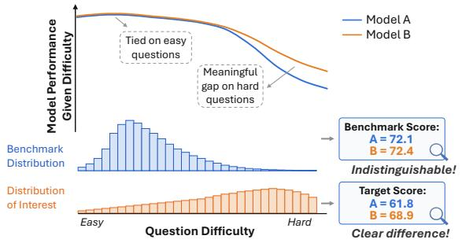
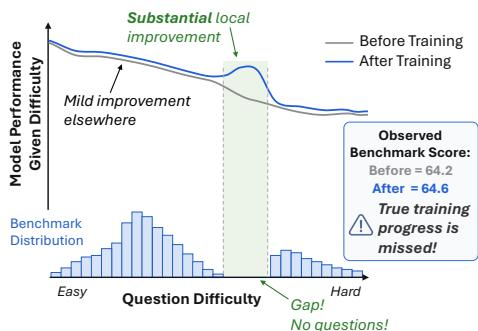
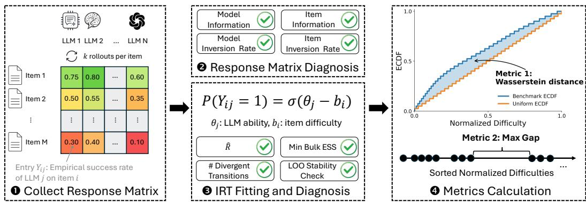
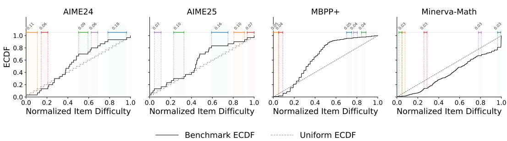
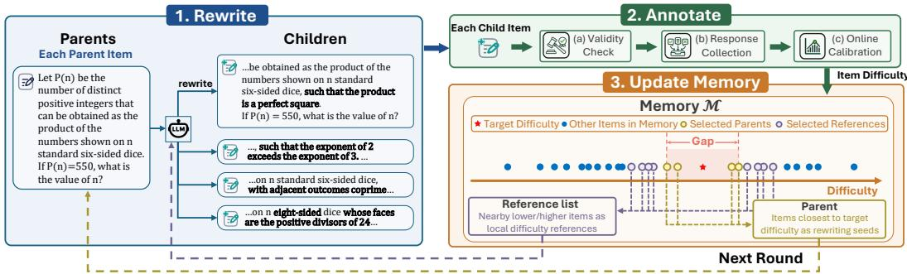
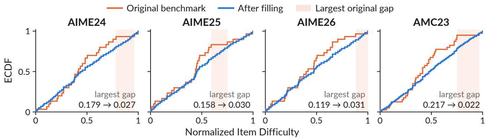
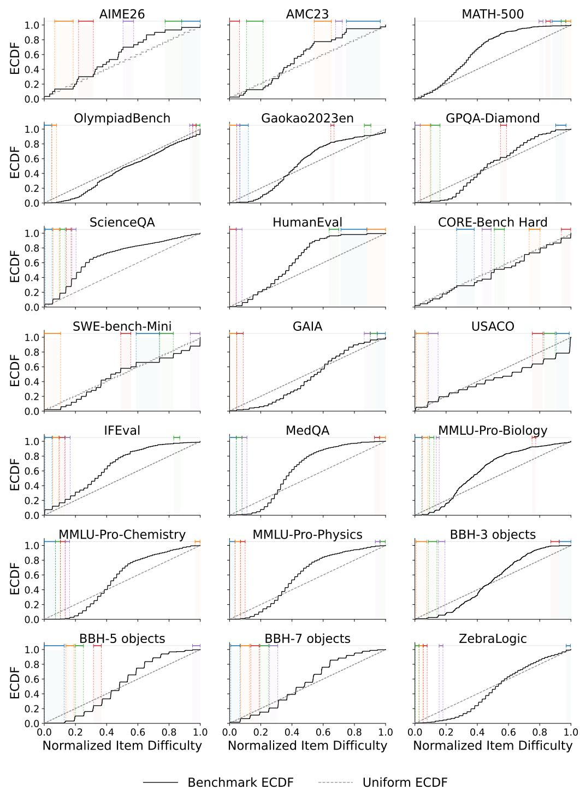
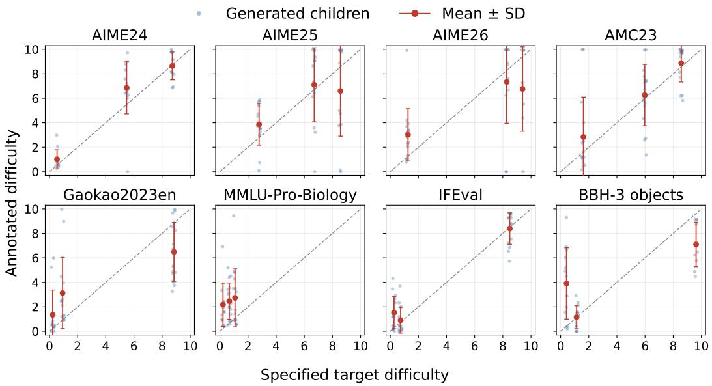
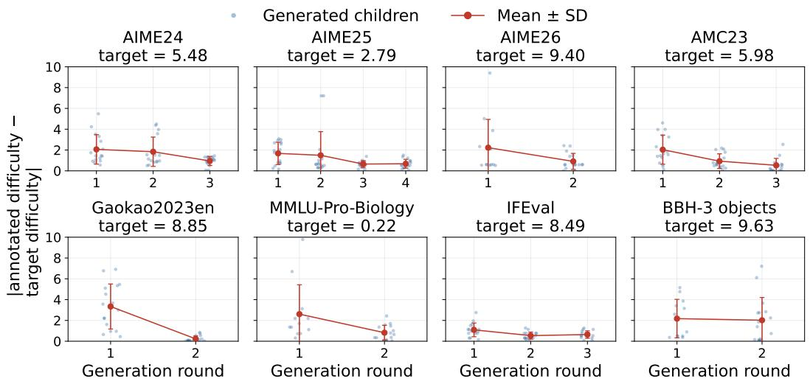

# Your Benchmark Is an Empirical Measure Over Difficulty

Yifan Sun<sup>†\*</sup> Naicheng Yu<sup>‡\*</sup> Jiawen Gong<sup>†\*</sup> Jingyan Shen<sup>§</sup> Huan Zhang<sup>†</sup> <sup>†</sup>University of Illinois Urbana-Champaign <sup>‡</sup>University of California San Diego <sup>§</sup>New York University

<sup>€</sup> Project Website: benchmark-difficulty-measure.github.io

§ GitHub Code: https://github.com/ASTRAL-Group/benchmark-difficulty-measure

BenchFill Datasets: https://huggingface.co/datasets/Yifan99/BenchFill

## Abstract

A benchmark is not merely a collection of test questions; it naturally induces an empirical measure over difficulty. In this work, we develop this measure-based view of benchmark evaluation. This perspective allows us to identify and formalize two central failure modes: measure mismatch, where the benchmark difficulty distribution differs from the intended difficulty distribution, and coverage gaps, where uncovered regions along the difficulty axis prevent benchmarks from detecting meaningful localized training progress. We propose two diagnostic metrics that capture these two failure modes and provide rigorous theoretical guarantees. Empirically, we analyze 25 popular benchmarks spanning 7 domains using carefully estimated item difficulties. Our results show that many benchmarks implicitly overweight certain difficulty regions, so their leaderboard conclusions should be interpreted with caution; others leave substantial portions of the difficulty axis uncovered, limiting their ability to monitor the model improvement process. Finally, we turn diagnosis into action by introducing BENCHFILL, a simple difficultytargeted item rewriting algorithm that effectively reduces local coverage gaps.

## 1 Introduction

Benchmark evaluation looks simple: we run models on a set of questions and average the results. The resulting score is then used in two main ways: to compare models on leaderboards [2, 64, 29, 45], and to monitor progress during training [33, 21, 16, 6, 38]. But this simplicity hides a basic issue: the conclusion depends not only on how well models perform, but also on how benchmark questions are distributed [59, 73].

Consider first the leaderboard setting in Fig. 1(a), where we want to compare two models. Suppose they perform similarly on easy questions but differ substantially on hard ones. If the benchmark places most of its weight on easy questions, while the difficulty distribution of interest places more weight on harder questions, the two evaluations can lead to different conclusions for the same pair of models: the benchmark may suggest that the two models are nearly tied, even though under the desired difficulty distribution they are clearly separated. Now consider the training setting in Fig. 1(b), where we want to track whether a model is improving. Suppose the model improves substantially over a local difficulty range. If the benchmark has few or no questions in that region, the benchmark score may barely change, even though the model has made real progress.

  
(a) Measure Mismatch

  
(b) Coverage Gaps  
Figure 1: Two benchmark failure cases. In both panels, the curves show true model conditional performance as a function of question difficulty. (a) Measure Mismatch. The benchmark emphasizes easy questions, where the models perform similarly, while the difficulty distribution we care about places more weight on harder questions, where they differ substantially. Because the benchmark and the target distribution weight the difficulty axis differently, they lead to different conclusions for the same two models. (b) Coverage Gaps. A model actually improves substantially over a localized difficulty region. Because the benchmark has no questions in that region, this improvement is not reflected in the observed benchmark score, causing meaningful training progress to be missed.

These two failure cases suggest that benchmark conclusions depend critically on how questions are distributed. To study this structure systematically, we organize benchmark questions along a difficulty axis, which provides a natural progression from easier to harder problems. The key conceptual step is to use difficulty as a way to define the distributional structure of the benchmark itself. This view recasts a benchmark from a collection of test questions into an empirical measure over difficulty, with each question contributing equal evaluation mass at its difficulty level.

This measure-theoretic formalization is useful because it turns the two failure cases above into precise and analyzable problems about the benchmark-induced difficulty measure. The first is a measure mismatch problem: the benchmark may distribute its mass differently from the target difficulty distribution that represents the intended evaluation objective, so benchmark conclusions can differ from the conclusions under the target difficulty distribution. The second is a coverage gap problem. Because the benchmark is an empirical measure supported only on finitely many difficulty points, there may be intervals of difficulty with little or no benchmark mass. A substantial performance gain concentrated in such an interval may therefore produce little or no change in the benchmark score. To our knowledge, this is the first work to identify and formalize measure mismatch and coverage gaps as two fundamental failure modes of benchmark evaluation.

These two problems naturally lead to two simple diagnostic metrics: the Wasserstein distance [63] between the benchmark measure and a target difficulty distribution, and the maximum gap between adjacent benchmark difficulty points. We provide theoretical results showing that these quantities directly characterize distributional mismatch and the detectability of localized improvements. Empirically, we analyze 25 popular benchmarks spanning 7 domains. We estimate question difficulty using Item Response Theory and compute the proposed metrics. Our results show that both issues are prevalent across benchmarks.

## Our key contributions are summarized as follows:

• We introduce a new measure-based perspective on benchmark evaluation, representing a benchmark as an empirical measure over difficulty. This perspective formalizes measure mismatch and coverage gaps, motivates two diagnostic metrics, and yields rigorous theoretical guarantees.

• We conduct an empirical study across 25 benchmarks spanning 7 domains, showing that both difficulty-distribution mismatch and large coverage gaps are widespread in current benchmarks.

• We propose BENCHFILL, a difficulty-targeted gap-filling algorithm. With only three inserted items per benchmark, BENCHFILL reduces the sum of the top three difficulty gaps by 21.09%–38.88%.

## 2 Formalization and Theory

Difficulty space and model performance function. We represent the difficulty of a benchmark item, e.g., a question, by a continuous variable $z \in [ 0 , 1 ]$ , where larger values correspond to harder

items. For a model θ, let $s _ { \theta } ( z ) \in [ 0 , 1 ]$ denote its conditional expected performance on items with difficulty z, e.g., pass@1.

Benchmark distribution and score. Let a benchmark $B = \{ x _ { i } \} _ { i = 1 } ^ { n }$ consist of n items, and let $z _ { i } \in [ 0 , 1 ]$ ] denote the difficulty of item $x _ { i }$ . The benchmark score is $\begin{array} { r } { { \bf \bar { \Lambda } } _ { B } \mathbf { \bar { ( } } \theta ) : = \frac { 1 } { n } \sum _ { i = 1 } ^ { n } s _ { \theta } ( z _ { i } ) } \end{array}$ . This average implicitly induces an empirical measure over the difficulty axis,

$$
\nu _ { B } = \frac { 1 } { n } \sum _ { i = 1 } ^ { n } \delta _ { z _ { i } } ,
$$

where $\delta _ { z }$ denotes a point mass at difficulty z. Under this representation, the benchmark score is exactly an integral with respect to the benchmark-induced difficulty measure, $\begin{array} { r } { S _ { B } ( \theta ) = \int s _ { \theta } ( z ) d \nu _ { B } ( z ) } \end{array}$

Performance difference between two models. For two models $\theta$ and $\theta ^ { \prime }$ , define the difficultyconditioned performance difference as $\Delta ( z ) : = s _ { \theta ^ { \prime } } ( z ) - s _ { \theta } ( z )$ , where the dependence of $\Delta$ on $( \theta ^ { \prime } , \dot { \theta } )$ is omitted for notational simplicity. The performance difference observed on benchmark $B$ is

$$
D _ { B } ( \theta ^ { \prime } , \theta ) : = S _ { B } ( \theta ^ { \prime } ) - S _ { B } ( \theta ) = \frac { 1 } { n } \sum _ { i = 1 } ^ { n } \Delta ( z _ { i } ) = \int \Delta ( z ) d \nu _ { B } ( z ) .
$$

## 2.1 Measure Mismatch

Benchmark-induced coupling. The quantity $D _ { B } ( \theta ^ { \prime } , \theta )$ implicitly couples two distinct objects: the model-dependentfunction $\Delta ( z )$ and the benchmark-dependent measure $\nu _ { B }$ . Thus, a leaderboard comparison is not merely determined by the difficulty-conditioned performance difference between the models; it also depends on how the benchmark allocates mass over the difficulty axis. If this allocation differs from the difficulty distribution of interest, the benchmark aggregates the same model difference under a mismatched measure. This mismatch can distort the observed model gap and, in severe cases, change the induced ordering.

Target distribution. Formally, we introduce a target distribution $\mu \in \mathcal P ( [ 0 , 1 ] )$ , which represents the intended evaluation distribution over the difficulty space. This target distribution may encode the desired application mix. Under $\mu ,$ the target score of model θ and the target performance difference between $\mathbf { \dot { \theta } } ^ { \prime }$ and $\theta$ are defined as

$$
S _ { \mu } ( \theta ) : = \int s _ { \theta } ( z ) d \mu ( z ) , \qquad D _ { \mu } ( \theta ^ { \prime } , \theta ) : = S _ { \mu } ( \theta ^ { \prime } ) - S _ { \mu } ( \theta ) = \int \Delta ( z ) d \mu ( z ) .
$$

The discrepancy between $D _ { B } ( \theta ^ { \prime } , \theta )$ and $D _ { \mu } ( \theta ^ { \prime } , \theta )$ arises from the mismatch between the benchmark measure $\nu _ { B }$ and the target distribution $\mu .$ This viewpoint allows us to study distortions in leaderboard comparisons as a distribution mismatch problem.

A metric for distribution mismatch. We measure how well the difficulty distribution of a benchmark matches a target difficulty distribution using the 1-Wasserstein distance. Specifically, for a benchmark $B$ with empirical difficulty measure $\nu _ { B }$ and a target distribution $\mu$ on [0, 1], we define its Difficulty Distribution Mismatch $( D D M )$ as

$$
\operatorname { D D M } ( B ; \mu ) : = W _ { 1 } ( \nu _ { B } , \mu ) = \operatorname* { i n f } _ { \pi \in \Pi ( \nu _ { B } , \mu ) } \int _ { [ 0 , 1 ] ^ { 2 } } | u - v | d \pi ( u , v ) ,
$$

where $\Pi ( \nu _ { B } , \mu )$ denotes the set of all couplings of $\nu _ { B }$ and $\mu .$ Intuitively, $W _ { 1 } ( \nu _ { B } , \mu )$ measures how much probability mass must be transported, and how far, to transform the benchmark difficulty distribution into the target one. The following theorem shows that this mismatch directly controls the distortion between benchmark-based and target-based performance differences.

Theorem 2.1 (Distribution mismatch controls score distortion and rank stability). Suppose the performance differencefunction $\Delta$ is L-Lipschitz. Then

$$
\left| D _ { B } ( \theta ^ { \prime } , \theta ) - D _ { \mu } ( \theta ^ { \prime } , \theta ) \right| \le L W _ { 1 } ( \nu _ { B } , \mu ) .
$$

Consequently, $i f \left| D _ { \mu } ( \theta ^ { \prime } , \theta ) \right| > L W _ { 1 } ( \nu _ { B } , \mu )$ , then

$$
\mathrm { s i g n } \big ( D _ { B } ( \theta ^ { \prime } , \theta ) \big ) = \mathrm { s i g n } \big ( D _ { \mu } ( \theta ^ { \prime } , \theta ) \big ) ,
$$

so the benchmark-induced ordering agrees with the target ordering, i.e., no rank flip can occur.

Theorem 2.1 shows that $W _ { 1 } ( \nu _ { B } , \mu )$ bounds how much the benchmark-induced score difference can differ from the target score difference. A small $W _ { 1 } ( \nu _ { B } , \mu )$ means that the benchmark provides a faithful approximation to the target evaluation, while a large $W _ { 1 } ( \nu _ { B } , \mu )$ indicates that the benchmark may overemphasize some difficulty regions and underrepresent others, potentially distorting model comparisons and even changing their induced ranking. App. B.1 provides the full proof and extends this result to the finite-sample setting.

A principled target distribution without prior information. When prior information is available, it is natural to choose $\mu$ to reflect the intended evaluation objective over the difficulty space. In many settings, however, such prior knowledge is unavailable. In that case, choosing a non-uniform target would implicitly privilege some difficulty regions over others without evidence. To characterize a principled default choice, we consider an agnostic setting in which the location of the performance difference along the difficulty axis is completely unknown. We consider the class

$$
\mathcal { F } _ { \rho } : = \{ \Delta : [ 0 , 1 ]  [ - 1 , 1 ] \mathrm { ~ m e a s u r a b l e : } \int _ { 0 } ^ { 1 } \Delta ( z ) d z = \rho \} , \qquad \rho \in ( - 1 , 1 ) .
$$

This class encodes an uncertainty set: the signed performance difference has a fixed average level $\rho$ over the difficulty axis, but its location is otherwise unrestricted.

For any candidate target distribution $\mu \in \mathcal P ( [ 0 , 1 ] )$ , define its worst-case retained difference by

$$
V _ { \rho } ( \mu ) : = \operatorname* { i n f } _ { \Delta \in \mathcal { F } _ { \rho } } \int \Delta ( z ) d \mu ( z ) .
$$

The following theorem shows that, under complete uncertainty about where along the difficulty axis the performance difference occurs, the uniform distribution is the unique maximin target, and is the only choice whose worst-case retained difference remains equal to the average difference $\rho .$

Theorem 2.2 (Uniform target as the unique maximin choice). For $\rho \in ( - 1 , 1 )$ , we have

$$
\operatorname* { s u p } _ { \mu \in \mathcal { P } ( [ 0 , 1 ] ) } V _ { \rho } ( \mu ) = \rho ,
$$

and the unique maximizer is the uniform distribution $\lambda = \mathrm { U n i f } [ 0 , 1 ]$

Theorem 2.2 does not claim that the uniform distribution is universally optimal. Rather, it justifies the uniform target as a principled default when no prior information over the difficulty space is available. In that case, adopting the uniform target avoids introducing an additional preference over difficulty regions and provides a neutrality criterion for benchmark evaluation: the evaluation does not privilege any difficulty region a priori. Full proof is provided in App. B.1.

## 2.2 Coverage Gaps

Discrete benchmark measures may fail to monitor local training improvements. Benchmarks are often used not only for final model comparison, but also to monitor training progress [16, 69, 38]. However, training improvements are often local rather than uniform: a model may improve substantially over a particular difficulty range while improving only modestly elsewhere.

Recall that a benchmark score is an integral with respect to the benchmark empirical measure $\nu _ { B }$ Since $\nu _ { B }$ is a discrete measure supported only on the finitely many benchmark difficulty points, it assigns zero mass to every interval that contains no benchmark item. Consequently, even if the model improves substantially on a nontrivial contiguous difficulty region, the benchmark score may not reflect this improvement when the region contains no benchmark item. In this sense, a benchmark can fail as a progress monitor when its local resolution is insufficient.

Maximum gap. We first characterize the local resolution of a benchmark through its maximum gap. Let $0 \leq z _ { ( 1 ) } \leq \cdot \cdot \cdot \leq z _ { ( n ) } \leq 1$ be the ordered benchmark difficulty points, and define $z _ { ( 0 ) } : = 0$ and $z _ { ( n + 1 ) } : = \mathrm { 1 } { \bmod { 1 } }$ . The maximum gap of benchmark B is

$$
G ( B ) : = \operatorname* { m a x } _ { 0 \leq j \leq n } \left( z _ { ( j + 1 ) } - z _ { ( j ) } \right)\tag{1}
$$

i.e., the length of the largest interval on the difficulty axis that contains no benchmark point.

  
Figure 2: Overview of our benchmark difficulty estimation and metric calculation pipeline. We collect empirical success rates from multiple LLMs on benchmark items, diagnose the response matrix, fit a 1PL IRT model to estimate item difficulties, perform post-fit IRT diagnostics, and compute two metrics over the normalized difficulty distribution.

A hypothesis testing formulation. To formalize whether a benchmark can reliably detect localized training improvements, we cast the problem as a hypothesis test. Under the null hypothesis, there is no improvement. Under the alternative, the post-improvement performance exceeds the pre-improvement performance by at least a over some contiguous difficulty interval of width w. The following theorem shows that the benchmark maximum gap $\mathsf { \bar { G } } ( B )$ is the exact asymptotic minimax detection boundary.

Theorem 2.3 (Maximum gap as an exact asymptotic minimax detection boundary). Fix a test level $\alpha \in ( 0 , 1 )$ and $a \in \mathsf { \Gamma } ( 0 , 1 ]$ . Let $s ^ { - } , s ^ { + } : \bar { [ 0 , 1 ] } \to [ 0 , 1 ]$ denote the pre- and post-improvement performance curves, respectively. For a benchmark B, let $\Pi _ { \alpha } ^ { * } ( B ; w , a , k )$ denote the minimax worst-case power oflevel-α tests based on k repeated samples per benchmark itemfor testing

$$
H _ { 0 } : s ^ { - } = s ^ { + } \qquad \nu e r s u s \qquad H _ { 1 } : \exists i n t e r { \nu } a l I \subset [ 0 , 1 ] , | I | = w , s ^ { + } ( z ) - s ^ { - } ( z ) \geq a \ \forall z \in I .
$$

$$
\begin{array} { r } { I . \ I f w \leq G ( B ) , t h e n \Pi _ { \alpha } ^ { * } ( B ; w , a , k ) = \alpha f o r e \nu e r y \ k \in \mathbb { N } . } \end{array}
$$

2. If w > G(B), then lim $\begin{array} { r } { \ i _ { k \to \infty } \Pi _ { \alpha } ^ { * } ( B ; w , a , k ) = 1 . } \end{array}$

Therefore, G(B) exactly characterizes the asymptotic minimax detection boundary for benchmark B.

Theorem 2.3 shows that the discrete geometry of the benchmark induces a sharp detectability phase transition. If the width of a local improvement does not exceed the maximum adjacent difficulty gap, then no level-α test can achieve nontrivial worst-case power, regardless of how many repeated evaluations are performed. In other words, such an improvement can be completely invisible to the benchmark in the worst case. Once the improvement width exceeds the maximum gap, repeated evaluation can eventually make the signal detectable. In this sense, $G ( B )$ characterizes the intrinsic local resolution limit of benchmark B. The full proof is given in App. B.2.

## 3 Empirical Diagnosis of Current Benchmarks

We analyze a collection of widely used benchmarks from diverse domains using the two metrics proposed earlier. Fig. 2 provides an overview of our difficulty estimation and metric calculation pipeline. Specifically, we consider 25 popular benchmarks spanning math, coding, agentic tasks, logic, science, instruction-following, and medicine. Detailed information about these benchmarks is provided in App. C.1.

## 3.1 Difficulty Estimation and Metrics Calculation

Method: Item Response Theory. To estimate benchmark item difficulty, one may be tempted to use each item’s average failure rate across models [69, 60, 66]. However, item difficulty is inherently relative to model ability: it should depend not only on how many models fail an item, but also on how capable the models that fail or solve it are. We therefore use Item Response Theory (IRT), an established psychometric framework [35, 50] that has been widely adopted for difficulty estimation in LLM benchmark analysis [12, 53, 20, 25, 48, 74]. IRT models the probability that a model solves an item as a function of both model ability and item difficulty. In the commonly used one-parameter logistic model (1PL), each model $j$ is assigned an ability parameter $\theta _ { j }$ , and each item i is assigned a difficulty parameter $b _ { i }$ . The probability that model j correctly solves item i is modeled as

$$
\operatorname* { P r } ( Y _ { i j } = 1 ) = \sigma ( \theta _ { j } - b _ { i } ) ,
$$

where $\sigma ( \cdot )$ is the logistic function. Intuitively, items with larger $b _ { i }$ require higher model ability to be solved correctly, and the estimated $b _ { i }$ therefore provides a natural measure of item difficulty. For multiple-choice benchmarks, the model above can be naturally extended with a guessing parameter.

In practice, difficulty estimation begins by collecting the performance of multiple models on benchmark items, forming a response matrix $\dot { Y } \in \mathbb { R } ^ { n \times m }$ , where $Y _ { i j }$ denotes the empirical success rate of model j on item i. The latent abilities $\{ \theta _ { j } \} _ { j = 1 } ^ { m }$ and item difficulties $\{ b _ { i } \} _ { i = 1 } ^ { n }$ are then estimated by fitting the likelihood induced by the IRT model. To ensure reliable difficulty estimation, we take several practical measures, including careful model selection and rigorous IRT fitting diagnostics.

Model selection. Accurate difficulty estimation requires models with diverse capability levels. To ensure sufficient ability coverage, we deliberately select models spanning a wide range of capabilities. For non-agentic benchmarks, we select 12 LLMs, ranging from 1.7B to 397B parameters, using the public leaderboard from Text Arena<sup>1</sup>. Models are first ordered by their overall capability aggregated across multiple domains, then divided into several approximately equal intervals along this ranking. We perform stratified sampling by selecting one model from each interval and additionally include a few models from both the top and bottom of the ranking to better capture the extremes of the capability spectrum. Each selected model is evaluated on each benchmark item with up to 32 rollouts using the model-recommended temperature and top-p. For agentic benchmarks, tasks typically require strong proprietary models. We therefore rely on the evaluation results from HAL [24], which reports the performance of 15–66 state-of-the-art closed-source LLMs on agentic task benchmarks. Detailed information about the models is provided in App. C.2.

IRT fitting and diagnostics. We estimate the IRT parameters using Bayesian inference via MCMC. To ensure reliable difficulty estimation, we perform a series of diagnostics both before and after IRT fitting. Before fitting, we examine the informativeness and structural consistency of the response matrix using 4 metrics. After fitting, we assess convergence and sampling quality using 3 standard Bayesian diagnostics, including the Gelman–Rubin statistic $( { \hat { R } } ) .$ effective sample size (ESS), and the number of divergent transitions. All benchmarks pass all 7 diagnostic checks. For non-agentic benchmarks, we further conduct a leave-one-out (LOO) robustness analysis. Results suggest that our choice of 12 models is sufficient for stable difficulty estimation. To support future work, we also publicly release the carefully curated difficulty estimates for the 25 benchmarks<sup>2</sup>. Detailed definitions and diagnostic results are provided in App. C.3. We also provide additional model-comparison analyses against 2PL and multidimensional IRT models in App. C.5.

Proposed metric calculation. For each benchmark, after estimating item difficulties, we first normalize them to [0, 1] and compute their empirical cumulative distribution function (ECDF). Since in general no additional prior information over the difficulty space is available, we quantify distribution mismatch by computing the 1-Wasserstein distance between the benchmark empirical measure and a same-size empirical uniform reference on [0, 1]. In one dimension, this is equivalently the $L _ { 1 }$ distance between their ECDFs. We compute the maximum gap according to Eq. (1) and also report the sum of the five largest adjacent gaps as a reference metric. We provide posterior uncertainty analyses for both metrics in App. C.6.

## 3.2 Results and Analysis

Several benchmarks exhibit large deviations from the neutral uniform target. Tab. 1 shows that 10 out of 25 benchmarks have $\mathrm { D } \mathrm { D } \mathrm { M } \geq 0 . 1 0$ , indicating that their empirical difficulty distributions must be transported by an average distance of at least 10% of the full difficulty range to match the same-size uniform reference. These benchmarks therefore encode a strong implicit difficulty weighting: their aggregate scores are more sensitive to overrepresented difficulty regions and less sensitive to underrepresented ones. Non-uniformity is not inherently problematic when it matches the intended evaluation objective. However, when no such objective is specified, high-DDM leaderboard results should not be interpreted as difficulty-neutral comparisons. Instead, they reflect comparisons under the benchmark’s empirical difficulty weighting, so users should check whether this weighting matches the difficulty distribution relevant to their use case. App. D presents a simple benchmark calibration algorithm for moving a benchmark distribution closer to a chosen target.

  
Figure 3: Benchmark difficulty distributions. Each panel shows the ECDF of normalized item difficulties for one benchmark, together with the neutral uniform reference. Colored shaded intervals mark the five largest adjacent difficulty gaps, with labels denoting the corresponding gap sizes. Additional benchmark examples are provided in Fig. 6.

Table 1: Summary of proposed metrics across benchmarks. DDM denotes the 1-Wasserstein distance between the benchmark empirical difficulty distribution and a same-size empirical uniform distribution on [0, 1]. Max Gap is the largest gap between consecutive normalized difficulties, and Top-5 Sum is the sum of the five largest such gaps. # denotes the number of benchmark items. Lower is better for all three metrics. Highlighted entries mark comparatively large values for each metric: $\mathrm { D D M } \geq 0 . 1 0 .$ , Max Gap ≥ 0.10, or Top-5 Sum ≥ 0.30.
<table><tr><td>Benchmark</td><td>DDM</td><td>Max Gap</td><td>Top-5 Sum</td><td>#</td></tr><tr><td>MATH-500</td><td>0.164</td><td>0.058</td><td>0.175</td><td>500</td></tr><tr><td>Minerva-Math</td><td>0.122</td><td>0.031</td><td>0.149</td><td>272</td></tr><tr><td>OlympiadBench</td><td>0.064</td><td>0.048</td><td>0.142</td><td>675</td></tr><tr><td>Gaokao2023en</td><td>0.088</td><td>0.055</td><td>0.183</td><td>385</td></tr><tr><td>AMC23</td><td>0.089</td><td>0.217</td><td>0.539</td><td>40</td></tr><tr><td>AIME24</td><td>0.077</td><td>0.179</td><td>0.502</td><td>30</td></tr><tr><td>AIME25</td><td>0.079</td><td>0.158</td><td>0.492</td><td>30</td></tr><tr><td>AIME26</td><td>0.085</td><td>0.119</td><td>0.507</td><td>30</td></tr><tr><td>MMLU-Pro-Biology</td><td>0.125</td><td>0.045</td><td>0.151</td><td>717</td></tr><tr><td>MMLU-Pro-Chemistry</td><td>0.114</td><td>0.072</td><td>0.192</td><td>1132</td></tr><tr><td>MMLU-Pro-Physics</td><td>0.121</td><td>0.035</td><td>0.157</td><td>1299</td></tr><tr><td>GPQA-Diamond</td><td>0.080</td><td>0.066</td><td>0.263</td><td>198</td></tr><tr><td>ScienceQA</td><td>0.178</td><td>0.045</td><td>0.175</td><td>4241</td></tr></table>

<table><tr><td>Benchmark</td><td>DDM</td><td>Max Gap</td><td>Top-5 Sum</td><td>#</td></tr><tr><td>HumanEval</td><td>0.148</td><td>0.165</td><td>0.423</td><td>164</td></tr><tr><td>MBPP+</td><td>0.163</td><td>0.049</td><td>0.214</td><td>378</td></tr><tr><td>GAIA</td><td>0.084</td><td>0.051</td><td>0.218</td><td>165</td></tr><tr><td>CORE-Bench Hard</td><td>0.036</td><td>0.113</td><td>0.363</td><td>45</td></tr><tr><td>SWE-bench-Mini</td><td>0.053</td><td>0.149</td><td>0.469</td><td>50</td></tr><tr><td>USACO</td><td>0.080</td><td>0.082</td><td>0.354</td><td>307</td></tr><tr><td>IFEval</td><td>0.159</td><td>0.046</td><td>0.189</td><td>541</td></tr><tr><td>BBH-3 objects</td><td>0.090</td><td>0.075</td><td>0.294</td><td>250</td></tr><tr><td>BBH-5 objects</td><td>0.099</td><td>0.128</td><td>0.332</td><td>250</td></tr><tr><td>BBH-7 objects</td><td>0.077</td><td>0.059</td><td>0.279</td><td>250</td></tr><tr><td>ZebraLogic</td><td>0.080</td><td>0.027</td><td>0.127</td><td>1000</td></tr><tr><td>MedQA</td><td>0.157</td><td>0.042</td><td>0.178</td><td>1273</td></tr></table>

Many benchmarks exhibit large local coverage gaps. Tab. 1 shows that 8 out of 25 benchmarks have Max $\mathrm { G a p } \geq 0 . 1 0$ . As a result, a training run may make meaningful local progress in an uncovered difficulty region, while the aggregate benchmark score remains nearly unchanged. This can cause useful training progress to be underestimated, promising runs to be prematurely discarded, and compute to be misallocated. Moreover, the problem is not limited to the single largest gap. We find that 9 out of 25 benchmarks have Top-5 Sum ≥ 0.30. For example, Fig. 3 shows that AIME24 and AIME25 have top-5 gap sums close to 0.5, leaving large portions of the difficulty axis locally unresolved despite their widespread use for monitoring RLVR training [38, 33, 14, 70].

We note that although Max Gap intrinsically depends on benchmark size, this reflects a real coverage limitation rather than merely a nuisance effect: even if a large gap is expected for a small benchmark, it is still an uncovered difficulty interval, and by Theorem 2.3, localized improvements inside such an interval may be undetectable in the worst case. Importantly, we find that coverage gaps are not merely a small-benchmark artifact: benchmarks with hundreds of items, such as HumanEval and BBH-5 objects, also exhibit substantial gap metrics. This motivates gap filling as a practical and necessary way to improve local benchmark resolution.

  
Figure 4: Overview of BENCHFILL. BENCHFILL iteratively rewrites parent items into child variants, annotates their difficulties, and updates the memory to guide the next round of gap filling.

## 4 BENCHFILL: Difficulty-Targeted Gap Filling

## 4.1 Problem Setting and Method

Problem setting. Let $B = \{ x _ { i } \} _ { i = 1 } ^ { n }$ be the current benchmark, where each item $x _ { i }$ has an estimated difficulty $z _ { i }$ . We sort the difficulties and consider an adjacent gap $[ z _ { L } , z _ { R } ]$ between two benchmark items. Reducing such gaps improves a benchmark’s local resolution and its ability to capture localized model improvements. Thus, our goal is to obtain a valid new item $x _ { \mathrm { n e w } }$ whose difficulty is as close as possible to the target difficulty $z ^ { \star } = ( z _ { L } + z _ { R } ) / 2$ , the midpoint that most reduces the gap under a single insertion. The new item is added to the benchmark rather than replacing any existing item. By default, we apply this procedure to the largest gap of the benchmark.

One direct approach is to ask human experts to design new items at the target difficulty, but this process can be costly [51, 47]. Motivated by recent work on LLM-assisted benchmark augmentation [10, 28, 68, 67], we instead use LLMs to rewrite existing benchmark items into new variants at targeted difficulty levels. This rewriting-based approach is scalable, uses existing items as local references for controlled difficulty adjustment, and helps preserve the format and style of the original benchmark. To ensure item quality, the final selected items are further validated by human experts. We next introduce BENCHFILL, a rewrite-and-annotate evolutionary search algorithm [54, 34] for automated difficulty-targeted item rewriting. Alg. 2 gives the pseudocode, and Fig. 4 illustrates the procedure.

BENCHFILL. Given a target difficulty $z ^ { \star }$ , our algorithm maintains a memory M of annotated item–difficulty pairs. The memory is initialized with existing benchmark items whose difficulties are closest to the selected gap, and is later updated during the search. Each round follows a parent–child rewriting step. A parent item is an existing or previously rewritten item selected from $\mathcal { M }$ as the main reference for rewriting, while a child item is a newly proposed variant derived from a parent.

At round t, we retrieve a small set of parent items from M whose annotated difficulties are closest to the target difficulty $z ^ { \star }$ . For each parent item, the rewriter LLM is conditioned on the parent, the target difficulty, and a reference list of nearby item–difficulty pairs. The reference list provides local examples around $z ^ { \star } .$ , typically including items slightly below and above the target difficulty, $\mathrm { e . g . }$ items with difficulties 0.48, 0.50, 0.60, and 0.62 when $z ^ { \star } = 0 . 5 5$ . The rewriter then rewrites each parent into a batch of child items while preserving the format and style of the benchmark.

After rewriting, each child item is passed to the difficulty annotator module, detailed below, which returns an estimated difficulty zˆ. We keep only valid<sup>3</sup> child items and add their annotated item– difficulty pairs (x, zˆ) back to M. This update makes the search adaptive: whenever a rewritten child is closer to $z ^ { \star }$ than previous items, it becomes more likely to be retrieved as a parent or included in the reference list in later rounds. The rewriter is therefore conditioned on increasingly target-relevant examples as the search progresses, rather than rewriting each batch independently. After $T$ rounds, we select the valid child item minimizing $| \hat { z } - z ^ { \star } |$ as the proposed gap-filling item. Before insertion into the benchmark, the final item is subject to careful manual review by human experts.

Table 2: Gap-filling results. Top-3 Gap Sum Reduction reports the relative reduction (%) from the original benchmark, where larger is better. Target Dev. is the mean absolute deviation between the selected item difficulty and the target difficulty over three filled gaps, where lower is better. Baseline uses a budget-matched best-of-N uniform-parent rewriting strategy. Oracle is an idealized upper bound that sequentially inserts three items, each at the midpoint of the current largest gap, rather than an actual gap-filling method.
<table><tr><td rowspan="2">Benchmark</td><td colspan="3">Top-3 Gap Sum Reduction (%) ↑</td><td colspan="2">Target Dev. ↓</td></tr><tr><td>Baseline</td><td>BENCHFILL</td><td>Oracle</td><td>Baseline</td><td>BENCHFILL</td></tr><tr><td>AIME24</td><td>6.90</td><td>35.57</td><td>35.57</td><td>0.057</td><td>0.005</td></tr><tr><td>AIME25</td><td>27.44</td><td>37.56</td><td>37.56</td><td>0.016</td><td>0.005</td></tr><tr><td>AIME26</td><td>17.94</td><td>33.04</td><td>33.04</td><td>0.045</td><td>0.002</td></tr><tr><td>AMC23</td><td>24.47</td><td>35.19</td><td>35.78</td><td>0.009</td><td>0.003</td></tr><tr><td>Gaokao2023en</td><td>11.45</td><td>38.88</td><td>45.47</td><td>0.152</td><td>0.004</td></tr><tr><td>BBH-3 objects</td><td>14.83</td><td>29.88</td><td>32.80</td><td>0.026</td><td>0.006</td></tr><tr><td>MMLU-Pro-Biology</td><td>22.23</td><td>30.13</td><td>36.84</td><td>0.046</td><td>0.006</td></tr><tr><td>IFEval</td><td>14.94</td><td>21.09</td><td>23.44</td><td>0.036</td><td>0.007</td></tr><tr><td>Average</td><td>17.52</td><td>32.67</td><td>35.06</td><td>0.048</td><td>0.005</td></tr></table>

Difficulty annotation module details. For each rewritten item x, we annotate its difficulty by online calibration under the IRT model fitted on the original benchmark. Let $\widehat { \theta } _ { j }$ be the pre-estimated ability of model $j .$ We evaluate each model on x for $K _ { j }$ trials and observe $c _ { j }$ correct responses. The item difficulty is estimated by fitting only the new item parameter:

$$
\hat { b } ( x ) = \arg \operatorname* { m a x } _ { b } \sum _ { j = 1 } ^ { m } \Big [ c _ { j } \log \sigma ( \hat { \theta } _ { j } - b ) + \big ( K _ { j } - c _ { j } \big ) \log \big ( 1 - \sigma ( \hat { \theta } _ { j } - b ) \big ) \Big ] ,
$$

where $\sigma ( \cdot )$ is the logistic function<sup>4</sup>. This online calibration places each rewritten item on the same IRT scale as the original benchmark without refitting the full model.

## 4.2 Experimental Setup and Results

Experimental setup. We perform gap filling on 8 representative benchmarks from diverse domains. For each benchmark, we target the three most pronounced coverage gaps. We use MiniMax-M2.7 [7] as the rewriter LLM, with temperature set to 1.0. The search runs for at most 8 rounds; in each round, we retrieve 4 parent items, rewrite each parent into 4 child items, and provide a reference list of at most 16 nearby item–difficulty pairs. As a baseline, we use a budget-matched best-of-N uniform-parent rewriting variant. Additional implementation details are provided in App. E.1.

Results. As shown in Tab. 2, with only three inserted items per benchmark, BENCHFILL reduces Top-3 Sum by 21.09%–38.88%. We also include the oracle result, but only as a reference upper bound, not as an implementable gap-filling method. The achieved reductions are close to this oracle reference: on average, BENCHFILL achieves a 32.67% reduction, compared with 35.06% for the oracle and 17.52% for the budget-matched uniform-parent baseline. On AIME24, AIME25, and AIME26, BENCHFILL reaches the oracle reduction. These reductions show that BENCHFILL improves coverage of the largest under-covered difficulty regions, which can strengthen a benchmark’s ability to monitor localized training progress. We further report Target Dev. and BENCHFILL consistently achieves a Target Dev. below 0.01, indicating that our proposed algorithm can produce items close to the intended difficulty levels. Representative generated items are shown in Tab. 13.

## 4.3 Curated Gap-Filled Benchmarks

To provide a community resource for more reliable evaluation of future models and training methods, we further apply BENCHFILL to construct gap-filled variants of four widely used math benchmarks with substantial coverage gaps: AMC23, AIME24, AIME25, and AIME26. We expand these benchmarks from 40, 30, 30, and 30 items to 80, 50, 52, and 53 items, respectively. All generated items are manually reviewed, and low-quality or incorrect items are discarded. We release the resulting variants as AMC23-BenchFill, AIME24-BenchFill, AIME25-BenchFill, and AIME26- BenchFill<sup>5</sup>. As shown in Fig. 5, these variants substantially reduce the largest original coverage gaps and bring the empirical difficulty distributions closer to a uniform distribution, providing more comprehensive coverage across the difficulty spectrum.

  
Figure 5: Difficulty distributions of four benchmarks before and after gap filling. Orange and blue curves show the empirical difficulty distributions before and after applying BENCHFILL, respectively. Shaded regions indicate the largest original coverage gaps. The annotated values show the maximum gaps before and after filling.

## 5 Related Work

Science of benchmarking. A recent line of work has shifted attention from improving leaderboard scores to examining whether benchmark scores themselves provide reliable scientific evidence. Beyond data contamination, where benchmark test items appear in model training data and potentially inflate evaluation scores [46, 61, 76], prior studies show that benchmark results can be sensitive to decoding, prompting, and implementation details [19], and brittle to surface wording or dataset flaws [44]. Other work studies evaluation reliability through the lens of signal and noise [17], or proposes broader benchmark-quality criteria and shows that widely used benchmarks vary substantially in quality [49]. Our work complements these efforts by formulating a benchmark as an empirical measure over difficulty, enabling us to rigorously formalize measure mismatch and coverage gaps.

IRT and its applications. IRT originated in psychometrics as a framework for educational and psychological measurement [13, 36]. In NLP, [26] introduced IRT to system evaluation, and [53] extended this perspective to leaderboard analysis. IRT has since become a widely used foundation for difficulty-aware evaluation in LLM benchmarking. Easy2Hard-Bench [12] uses IRT to assign standardized continuous difficulty labels to benchmark items; it also validates these labels against human pairwise judgments and reports stronger alignment than GPT-4-based difficulty annotators. [74] uses an IRT-based framework to analyze the measurement quality of existing LLM benchmarks.

## 6 Conclusion

In this work, we view each benchmark as an empirical measure over difficulty. This perspective enables us to formalize measure mismatch and coverage gaps, leading to theoretical results and practical diagnostics. We believe this empirical-measure view has the potential to open new ways to rigorously study and rethink benchmark evaluation.

## Acknowledgments

We thank Modal for supporting this research through the Modal for Academics compute grant. We are also grateful to Sirui Chen and Junsheng Huang for their insightful discussions and valuable feedback, which helped improve this work.

## References

[1] Oriol Abril-Pla, Virgile Andreani, Colin Carroll, Larry Dong, Christopher J. Fonnesbeck, Maxim Kochurov, Ravin Kumar, Junpeng Lao, Christian C. Luhmann, Osvaldo A. Martin, Michael Osthege, Ricardo Vieira, Thomas Wiecki, and Robert Zinkov. PyMC: A modern and comprehensive probabilistic programming framework in Python. PeerJ Computer Science, 9(e1516), 2023.

[2] Norah Alzahrani, Hisham Alyahya, Yazeed Alnumay, Sultan Alrashed, Shaykhah Alsubaie, Yousef Almushayqih, Faisal Mirza, Nouf Alotaibi, Nora Al-Twairesh, Areeb Alowisheq, et al. When benchmarks are targets: Revealing the sensitivity of large language model leaderboards. In Proceedings ofthe 62nd Annual Meeting ofthe Associationfor Computational Linguistics (Volume 1: Long Papers), pages 13787– 13805, 2024.

[3] Frank B Baker. The basics ofitem response theory. ERIC, 2001.

[4] Marthe Ballon, Andres Algaba, Brecht Verbeken, and Vincent Ginis. Estimating problem difficulty without ground truth using large language model comparisons. arXiv preprint arXiv:2512.14220, 2025.

[5] Andrew Bean, Simi Hellsten, Harry Mayne, Jabez Magomere, Ryan Chi, Scott A Hale, Hannah R Kirk, et al. Lingoly: A benchmark of olympiad-level linguistic reasoning puzzles in low resource and extinct languages. Advances in Neural Information Processing Systems, 37:26224–26237, 2024.

[6] Akhiad Bercovich, Itay Levy, Izik Golan, Mohammad Dabbah, Ran El-Yaniv, Omri Puny, Ido Galil, Zach Moshe, Tomer Ronen, Najeeb Nabwani, et al. Llama-nemotron: Efficient reasoning models. arXiv preprint arXiv:2505.00949, 2025.

[7] Aili Chen, Aonian Li, Baichuan Zhou, Bangwei Gong, Binyang Jiang, Boji Dan, Changqing Yu, Chao Wang, Cheng Ma, Cheng Zhong, et al. The minimax-m2 series: Mini activations unleashing max real-world intelligence. arXiv preprint arXiv:2605.26494, 2026.

[8] Mark Chen, Jerry Tworek, Heewoo Jun, Qiming Yuan, Henrique Ponde de Oliveira Pinto, Jared Kaplan, Harri Edwards, Yuri Burda, Nicholas Joseph, Greg Brockman, Alex Ray, Raul Puri, Gretchen Krueger, Michael Petrov, Heidy Khlaaf, Girish Sastry, Pamela Mishkin, Brooke Chan, Scott Gray, Nick Ryder, Mikhail Pavlov, Alethea Power, Lukasz Kaiser, Mohammad Bavarian, Clemens Winter, Philippe Tillet, Felipe Petroski Such, Dave Cummings, Matthias Plappert, Fotios Chantzis, Elizabeth Barnes, Ariel Herbert Voss, William Hebgen Guss, Alex Nichol, Alex Paino, Nikolas Tezak, Jie Tang, Igor Babuschkin, Suchir Balaji, Shantanu Jain, William Saunders, Christopher Hesse, Andrew N. Carr, Jan Leike, Josh Achiam, Vedant Misra, Evan Morikawa, Alec Radford, Matthew Knight, Miles Brundage, Mira Murati, Katie Mayer, Peter Welinder, Bob McGrew, Dario Amodei, Sam McCandlish, Ilya Sutskever, and Wojciech Zaremba. Evaluating large language models trained on code. 2021.

[9] Yunxiao Chen, Xiaoou Li, Jingchen Liu, and Zhiliang Ying. Item response theory—a statistical framework for educational and psychological measurement. Statistical Science, 40(2):167–194, 2025.

[10] Zerui Cheng, Jiashuo Liu, Chunjie Wu, Jianzhu Yao, Pramod Viswanath, Ge Zhang, and Wenhao Huang. Vera: Verified reasoning data augmentation at scale. arXiv preprint arXiv:2602.13217, 2026.

[11] Herbert A David and Haikady N Nagaraja. Order statistics. John Wiley & Sons, 2004.

[12] Mucong Ding, Chenghao Deng, Jocelyn Choo, Zichu Wu, Aakriti Agrawal, Avi Schwarzschild, Tianyi Zhou, Tom Goldstein, John Langford, Anima Anandkumar, et al. Easy2hard-bench: Standardized difficulty labels for profiling llm performance and generalization. Advances in Neural Information Processing Systems, 37:44323–44365, 2024.

[13] Susan E Embretson and Steven P Reise. Item response theory for psychologists. Psychology Press, 2013.

[14] Daya Guo, Dejian Yang, Haowei Zhang, Junxiao Song, Peiyi Wang, Qihao Zhu, Runxin Xu, Ruoyu Zhang, Shirong Ma, Xiao Bi, et al. Deepseek-r1: Incentivizing reasoning capability in llms via reinforcement learning. arXiv preprint arXiv:2501.12948, 2025.

[15] Chaoqun He, Renjie Luo, Yuzhuo Bai, Shengding Hu, Zhen Thai, Junhao Shen, Jinyi Hu, Xu Han, Yujie Huang, Yuxiang Zhang, et al. Olympiadbench: A challenging benchmark for promoting agi with olympiad-level bilingual multimodal scientific problems. In Proceedings ofthe 62nd Annual Meeting of the Associationfor Computational Linguistics (Volume 1: Long Papers), pages 3828–3850, 2024.

[16] Jujie He, Jiacai Liu, Chris Yuhao Liu, Rui Yan, Chaojie Wang, Peng Cheng, Xiaoyu Zhang, Fuxiang Zhang, Jiacheng Xu, Wei Shen, et al. Skywork open reasoner 1 technical report. arXiv preprint arXiv:2505.22312, 2025.

[17] David Heineman, Valentin Hofmann, Ian Magnusson, Yuling Gu, Noah A Smith, Hannaneh Hajishirzi, Kyle Lo, and Jesse Dodge. Signal and noise: A framework for reducing uncertainty in language model evaluation. arXiv preprint arXiv:2508.13144, 2025.

[18] Dan Hendrycks, Collin Burns, Saurav Kadavath, Akul Arora, Steven Basart, Eric Tang, Dawn Song, and Jacob Steinhardt. Measuring mathematical problem solving with the math dataset. arXiv preprint arXiv:2103.03874, 2021.

[19] Andreas Hochlehnert, Hardik Bhatnagar, Vishaal Udandarao, Samuel Albanie, Ameya Prabhu, and Matthias Bethge. A sober look at progress in language model reasoning: Pitfalls and paths to reproducibility. arXiv preprint arXiv:2504.07086, 2025.

[20] Valentin Hofmann, David Heineman, Ian Magnusson, Kyle Lo, Jesse Dodge, Maarten Sap, Pang Wei Koh, Chun Wang, Hannaneh Hajishirzi, and Noah A Smith. Fluid language model benchmarking. arXiv preprint arXiv:2509.11106, 2025.

[21] Jingcheng Hu, Yinmin Zhang, Qi Han, Daxin Jiang, Xiangyu Zhang, and Heung-Yeung Shum. Openreasoner-zero: An open source approach to scaling up reinforcement learning on the base model. arXiv preprint arXiv:2503.24290, 2025.

[22] Carlos E Jimenez, John Yang, Alexander Wettig, Shunyu Yao, Kexin Pei, Ofir Press, and Karthik Narasimhan. Swe-bench: Can language models resolve real-world github issues? arXiv preprint arXiv:2310.06770, 2023.

[23] Di Jin, Eileen Pan, Nassim Oufattole, Wei-Hung Weng, Hanyi Fang, and Peter Szolovits. What disease does this patient have? a large-scale open domain question answering dataset from medical exams. Applied Sciences, 11(14):6421, 2021.

[24] Sayash Kapoor, Benedikt Stroebl, Peter Kirgis, Nitya Nadgir, Zachary S Siegel, Boyi Wei, Tianci Xue, Ziru Chen, Felix Chen, Saiteja Utpala, Franck Ndzomga, Dheeraj Oruganty, Sophie Luskin, Kangheng Liu, Botao Yu, Amit Arora, Dongyoon Hahm, Harsh Trivedi, Huan Sun, Juyong Lee, Tengjun Jin, Yifan Mai, Yifei Zhou, Yuxuan Zhu, Rishi Bommasani, Daniel Kang, Dawn Song, Peter Henderson, Yu Su, Percy Liang, and Arvind Narayanan. Holistic agent leaderboard: The missing infrastructure for ai agent evaluation. In The Fourteenth International Conference on Learning Representations (ICLR), 2026.

[25] Alex Kipnis, Konstantinos Voudouris, Luca M Schulze Buschoff, and Eric Schulz. metabench–a sparse benchmark of reasoning and knowledge in large language models. arXiv preprint arXiv:2407.12844, 2024.

[26] John P Lalor, Hao Wu, and Hong Yu. Building an evaluation scale using item response theory. In Proceedings of the 2016 Conference on Empirical Methods in Natural Language Processing, pages 648–657, 2016.

[27] Aitor Lewkowycz, Anders Andreassen, David Dohan, Ethan Dyer, Henryk Michalewski, Vinay Ramasesh, Ambrose Slone, Cem Anil, Imanol Schlag, Theo Gutman-Solo, et al. Solving quantitative reasoning problems with language models. Advances in neural information processing systems, 35:3843–3857, 2022.

[28] Xinyuan Li, Murong Xu, Wenbiao Tao, Hanlun Zhu, Yike Zhao, Jipeng Zhang, and Yunshi Lan. Ride: Difficulty evolving perturbation with item response theory for mathematical reasoning. arXiv preprint arXiv:2511.04120, 2025.

[29] Percy Liang, Rishi Bommasani, Tony Lee, Dimitris Tsipras, Dilara Soylu, Michihiro Yasunaga, Yian Zhang, Deepak Narayanan, Yuhuai Wu, Ananya Kumar, et al. Holistic evaluation of language models. arXiv preprint arXiv:2211.09110, 2022.

[30] Hunter Lightman, Vineet Kosaraju, Yuri Burda, Harrison Edwards, Bowen Baker, Teddy Lee, Jan Leike, John Schulman, Ilya Sutskever, and Karl Cobbe. Let’s verify step by step. In International Conference on Learning Representations, volume 2024, pages 39578–39601, 2024.

[31] Bill Yuchen Lin, Ronan Le Bras, Kyle Richardson, Ashish Sabharwal, Radha Poovendran, Peter Clark, and Yejin Choi. Zebralogic: On the scaling limits of llms for logical reasoning. 2025.

[32] Jiawei Liu, Chunqiu Steven Xia, Yuyao Wang, and Lingming Zhang. Is your code generated by chatgpt really correct? rigorous evaluation of large language models for code generation. Advances in neural information processing systems, 36:21558–21572, 2023.

[33] Mingjie Liu, Shizhe Diao, Ximing Lu, Jian Hu, Xin Dong, Yejin Choi, Jan Kautz, and Yi Dong. Prorl: Prolonged reinforcement learning expands reasoning boundaries in large language models. arXiv preprint arXiv:2505.24864, 2025.

[34] Shu Liu, Shubham Agarwal, Monishwaran Maheswaran, Mert Cemri, Zhifei Li, Qiuyang Mang, Ashwin Naren, Ethan Boneh, Audrey Cheng, Melissa Z Pan, et al. Evox: Meta-evolution for automated discovery. arXiv preprint arXiv:2602.23413, 2026.

[35] Frederic Lord. A theory of test scores. Psychometric monographs, 1952.

[36] Frederic M Lord. Applications ofitem response theory to practical testing problems. Routledge, 2012.

[37] Pan Lu, Swaroop Mishra, Tony Xia, Liang Qiu, Kai-Wei Chang, Song-Chun Zhu, Oyvind Tafjord, Peter Clark, and Ashwin Kalyan. Learn to explain: Multimodal reasoning via thought chains for science question answering. In The 36th Conference on Neural Information Processing Systems (NeurIPS), 2022.

[38] Michael Luo, Sijun Tan, Justin Wong, Xiaoxiang Shi, William Y. Tang, Manan Roongta, Colin Cai, Jeffrey Luo, Li Erran Li, Raluca Ada Popa, and Ion Stoica. Deepscaler: Surpassing o1-preview with a 1.5b model by scaling rl. https://pretty-radio-b75.notion.site/ DeepScaleR-Surpassing-O1-Preview-with-a-1-5B-Model-by-Scaling-RL-19681902c1468005bed8ca303013a4e2, 2025. Notion Blog.

[39] Mathematical Association of America. 2023 American Mathematics Competitions 12 (AMC 12). https: //maa.org/student-programs/amc/, 2023. Accessed 2026-04-25.

[40] Mathematical Association of America. 2024 American Invitational Mathematics Examination (AIME). https://maa.org/maa-invitational-competitions/, 2024. Accessed 2026-04-25.

[41] Mathematical Association of America. 2025 American Invitational Mathematics Examination (AIME). https://maa.org/maa-invitational-competitions/, 2025. Accessed 2026-04-25.

[42] Mathematical Association of America. 2026 American Invitational Mathematics Examination (AIME). https://maa.org/maa-invitational-competitions/, 2026. Accessed 2026-04-25.

[43] Grégoire Mialon, Clémentine Fourrier, Thomas Wolf, Yann LeCun, and Thomas Scialom. Gaia: a benchmark for general ai assistants. In International Conference on Learning Representations, volume 2024, pages 9025–9049, 2024.

[44] Seyed Mahed Mousavi, Edoardo Cecchinato, Lucia Hornikova, and Giuseppe Riccardi. Garbage in, reasoning out? why benchmark scores are unreliable and what to do about it. In Findings ofthe Association for Computational Linguistics: EACL 2026, pages 1747–1759, 2026.

[45] Aidar Myrzakhan, Sondos Mahmoud Bsharat, and Zhiqiang Shen. Open-llm-leaderboard: From multichoice to open-style questions for llms evaluation, benchmark, and arena. arXiv preprint arXiv:2406.07545, 2024.

[46] Yonatan Oren, Nicole Meister, Niladri Chatterji, Faisal Ladhak, and Tatsunori Hashimoto. Proving test set contamination in black-box language models. In International Conference on Learning Representations, volume 2024, pages 16354–16372, 2024.

[47] Long Phan, Alice Gatti, Ziwen Han, Nathaniel Li, Josephina Hu, Hugh Zhang, Chen Bo Calvin Zhang, Mohamed Shaaban, John Ling, Sean Shi, et al. Humanity’s last exam. arXiv preprint arXiv:2501.14249, 2025.

[48] Felipe Maia Polo, Lucas Weber, Leshem Choshen, Yuekai Sun, Gongjun Xu, and Mikhail Yurochkin. tinybenchmarks: evaluating llms with fewer examples. arXiv preprint arXiv:2402.14992, 2024.

[49] Qi Qian, Chengsong Huang, Jingwen Xu, Changze Lv, Muling Wu, Wenhao Liu, Xiaohua Wang, Zhenghua Wang, Zisu Huang, Muzhao Tian, et al. Benchmarkˆ 2: Systematic evaluation of llm benchmarks. arXiv preprint arXiv:2601.03986, 2026.

[50] Georg Rasch. Probabilistic models for some intelligence and attainment tests. ERIC, 1993.

[51] David Rein. Can good benchmarks contain mistakes?, 2024.

[52] David Rein, Betty Li Hou, Asa Cooper Stickland, Jackson Petty, Richard Yuanzhe Pang, Julien Dirani, Julian Michael, and Samuel R Bowman. Gpqa: A graduate-level google-proof q&a benchmark. In First conference on language modeling, 2024.

[53] Pedro Rodriguez, Joe Barrow, Alexander Miserlis Hoyle, John P Lalor, Robin Jia, and Jordan Boyd-Graber. Evaluation examples are not equally informative: How should that change nlp leaderboards? In Proceedings of the 59th Annual Meeting of the Association for Computational Linguistics and the 11th International Joint Conference on Natural Language Processing (Volume 1: Long Papers), pages 4486–4503, 2021.

[54] Asankhaya Sharma. Openevolve: an open-source evolutionary coding agent, 2025. URL https://github. com/codelion/openevolve.

[55] Quan Shi, Michael Tang, Karthik Narasimhan, and Shunyu Yao. Can language models solve olympiad programming? arXiv preprint arXiv:2404.10952, 2024.

[56] Zachary S Siegel, Sayash Kapoor, Nitya Nadgir, Benedikt Stroebl, and Arvind Narayanan. Core-bench: Fostering the credibility of published research through a computational reproducibility agent benchmark. arXiv preprint arXiv:2409.11363, 2024.

[57] Klaas Sijtsma and Bas T Hemker. Nonparametric polytomous irt models for invariant item ordering, with results for parametric models. Psychometrika, 63(2):183–200, 1998.

[58] Klaas Sijtsma and Brian W Junker. A survey of theory and methods of invariant item ordering. British Journal ofMathematical and Statistical Psychology, 49(1):79–105, 1996.

[59] Charlotte Siska, Katerina Marazopoulou, Melissa Ailem, and James Bono. Examining the robustness of llm evaluation to the distributional assumptions of benchmarks. In Proceedings of the 62nd Annual Meeting ofthe Associationfor Computational Linguistics (Volume 1: Long Papers), pages 10406–10421, 2024.

[60] Yifan Sun, Jingyan Shen, Yibin Wang, Tianyu Chen, Zhendong Wang, Mingyuan Zhou, and Huan Zhang. Improving data efficiency for llm reinforcement fine-tuning through difficulty-targeted online data selection and rollout replay. Advances in Neural Information Processing Systems, 38:173449–173476, 2026.

[61] Yifan Sun, Han Wang, Dongbai Li, Gang Wang, and Huan Zhang. The emperor’s new clothes in benchmarking? a rigorous examination of mitigation strategies for llm benchmark data contamination. In International Conference on Machine Learning, 2025.

[62] Mirac Suzgun, Nathan Scales, Nathanael Schärli, Sebastian Gehrmann, Yi Tay, Hyung Won Chung, Aakanksha Chowdhery, Quoc V Le, Ed H Chi, Denny Zhou, and Jason Wei. Challenging big-bench tasks and whether chain-of-thought can solve them. arXiv preprint arXiv:2210.09261, 2022.

[63] Cédric Villani et al. Optimal transport: old and new, volume 338. Springer, 2009.

[64] Alex Wang, Amanpreet Singh, Julian Michael, Felix Hill, Omer Levy, and Samuel Bowman. Glue: A multi-task benchmark and analysis platform for natural language understanding. In Proceedings ofthe 2018 EMNLP workshop BlackboxNLP: Analyzing and interpreting neural networksfor NLP, pages 353–355, 2018.

[65] Yubo Wang, Xueguang Ma, Ge Zhang, Yuansheng Ni, Abhranil Chandra, Shiguang Guo, Weiming Ren, Aaran Arulraj, Xuan He, Ziyan Jiang, et al. Mmlu-pro: A more robust and challenging multi-task language understanding benchmark. Advances in Neural Information Processing Systems, 37:95266–95290, 2024.

[66] Liang Wen, Yunke Cai, Fenrui Xiao, Xin He, Qi An, Zhenyu Duan, Yimin Du, Junchen Liu, Lifu Tang, Xiaowei Lv, et al. Light-r1: Curriculum sft, dpo and rl for long cot from scratch and beyond. In Proceedings ofthe 63rd Annual Meeting ofthe Associationfor Computational Linguistics (Volume 6: Industry Track), pages 318–327, 2025.

[67] Chunqiu Steven Xia, Yinlin Deng, and Lingming Zhang. Top leaderboard ranking= top coding proficiency, always? evoeval: Evolving coding benchmarks via llm. arXiv preprint arXiv:2403.19114, 2024.

[68] Jiahao Ying, Yixin Cao, Yushi Bai, Qianru Sun, Bo Wang, Wei Tang, Zhaojun Ding, Yizhe Yang, Xuanjing Huang, and Shuicheng Yan. Automating dataset updates towards reliable and timely evaluation of large language models. Advances in Neural Information Processing Systems, 37:17106–17132, 2024.

[69] Qiying Yu, Zheng Zhang, Ruofei Zhu, Yufeng Yuan, Xiaochen Zuo, Yu Yue, Weinan Dai, Tiantian Fan, Gaohong Liu, Lingjun Liu, et al. Dapo: An open-source llm reinforcement learning system at scale. arXiv preprint arXiv:2503.14476, 2025.

[70] Yu Yue, Yufeng Yuan, Qiying Yu, Xiaochen Zuo, Ruofei Zhu, Wenyuan Xu, Jiaze Chen, Chengyi Wang, TianTian Fan, Zhengyin Du, et al. Vapo: Efficient and reliable reinforcement learning for advanced reasoning tasks. arXiv preprint arXiv:2504.05118, 2025.

[71] Junyu Zhang, Yifan Sun, Tianang Leng, Jingyan Shen, Liu Ziyin, Paul Pu Liang, and Huan Zhang. When reasoning meets its laws. arXiv preprint arXiv:2512.17901, 2025.

[72] Xiaotian Zhang, Chunyang Li, Yi Zong, Zhengyu Ying, Liang He, and Xipeng Qiu. Evaluating the performance of large language models on gaokao benchmark. arXiv preprint arXiv:2305.12474, 2023.

[73] Ziqian Zhang, Xingjian Hu, Yue Huang, Kai Zhang, Ruoxi Chen, Yixin Liu, Qingsong Wen, Kaidi Xu, Xiangliang Zhang, Neil Zhenqiang Gong, et al. Rankllm: Weighted ranking of llms by quantifying question difficulty. arXiv preprint arXiv:2602.12424, 2026.

[74] Hongli Zhou, Hui Huang, Ziqing Zhao, Lvyuan Han, Huicheng Wang, Kehai Chen, Muyun Yang, Wei Bao, Jian Dong, Bing Xu, et al. Lost in benchmarks? rethinking large language model benchmarking with item response theory. In Proceedings of the AAAI Conference on Artificial Intelligence, volume 40, pages 35085–35093, 2026.

[75] Jeffrey Zhou, Tianjian Lu, Swaroop Mishra, Siddhartha Brahma, Sujoy Basu, Yi Luan, Denny Zhou, and Le Hou. Instruction-following evaluation for large language models. arXiv preprint arXiv:2311.07911, 2023.

[76] Kaijie Zhu, Jindong Wang, Qinlin Zhao, Ruochen Xu, and Xing Xie. Dynamic evaluation of large language models by meta probing agents. arXiv preprint arXiv:2402.14865, 2024.

[77] Yubo Zhu, Dongrui Liu, Zecheng Lin, Wei Tong, Sheng Zhong, and Jing Shao. The llm already knows: Estimating llm-perceived question difficulty via hidden representations. In Proceedings of the 2025 Conference on Empirical Methods in Natural Language Processing, pages 1160–1176, 2025.

## A Discussion

## A.1 Broader Impacts

This work aims to improve the reliability and transparency of benchmark evaluation. By diagnosing distribution mismatch and coverage gaps, our methods can help researchers better understand when benchmark scores provide faithful evidence for model comparison and monitoring training progress. More reliable evaluation may support more transparent model comparison and more informed benchmark design. Since this work focuses on benchmark analysis rather than model deployment or data collection, we do not foresee direct negative societal impacts.

## A.2 Limitations and Future Work

This work develops a measure-theoretic view of benchmark evaluation and uses it to characterize two central issues: measure mismatch and coverage gaps. Our goal is not to exhaust all consequences of this viewpoint, but to show that benchmark evaluation can be studied through the geometry of the empirical difficulty measure induced by the benchmark. We believe this perspective opens a broader direction for studying benchmark evaluation, where additional benchmark failures and design objectives can be formulated as properties of the induced difficulty measure.

Moreover, our current framework is primarily post-hoc: given an existing benchmark, we estimate its difficulty distribution, diagnose measure mismatch and coverage gaps, and reduce pronounced gaps through targeted item insertion. A natural next step is to move this perspective into the benchmark construction stage itself. Rather than auditing mismatch and coverage only after a benchmark has been built, benchmark developers can actively design the induced difficulty structure from the beginning, aiming to align the benchmark measure with the intended evaluation objective while maintaining high local resolution along the difficulty axis. We view this as a promising direction for difficulty-aware benchmark design.

## A.3 Extended Related Work

Difficulty estimation. Prior work often derives difficulty labels from human judgment or benchmark metadata. For example, MATH [18] annotates problems with five difficulty levels, GPQA [52] collects post-hoc expert difficulty ratings, and LingOly [5] includes five levels of human difficulty. Such labels are costly to obtain at scale, and they primarily reflect human-perceived difficulty rather than the difficulty exhibited by current LLMs on the questions. Recent work has explored alternative estimation strategies. [77] estimate LLM-perceived question difficulty from hidden representations. [4] ask an LLM to make pairwise difficult judgments and aggregate them with Bradley–Terry scores. EIP [73] instead jointly infers question difficulty and model competency from observed successes and failures on a model–question bipartite graph. Complementarily, LoRe [71] studies intrinsic problem complexity, defined by the minimum number of computational steps required to solve a problem. Among these approaches, IRT remains a common foundation for difficulty-aware evaluation because it provides a principled probabilistic framework for jointly modeling item difficulty and model ability directly from response data [9].

## B Theoretical Results and Proofs

## B.1 Measure Mismatch

We first restate Theorem 2.1 and provide the corresponding proof.

Theorem B.1 (Distribution mismatch controls score distortion and rank stability). Suppose the performance difference function ∆ is L-Lipschitz, i.e.,

$$
| \Delta ( z ) - \Delta ( y ) | \leq L | z - y | , \qquad \forall z , y \in [ 0 , 1 ] .
$$

Then

$$
\left| D _ { B } ( \theta ^ { \prime } , \theta ) - D _ { \mu } ( \theta ^ { \prime } , \theta ) \right| \le L W _ { 1 } ( \nu _ { B } , \mu ) .
$$

Consequently, if

$$
| D _ { \mu } ( \theta ^ { \prime } , \theta ) | > L W _ { 1 } ( \nu _ { B } , \mu ) ,
$$

then

$$
\mathrm { s i g n } \big ( D _ { B } ( \theta ^ { \prime } , \theta ) \big ) = \mathrm { s i g n } \big ( D _ { \mu } ( \theta ^ { \prime } , \theta ) \big ) ,
$$

so the benchmark-induced ordering agrees with the target ordering, i.e., no rank flip can occur.

Proof. Fix any coupling $\pi \in \Pi ( \nu _ { B } , \mu )$ . Since π has marginals ν<sub>B</sub> and $\mu ,$ we can write

$$
D _ { B } ( \theta ^ { \prime } , \theta ) - D _ { \mu } ( \theta ^ { \prime } , \theta ) = \int \Delta ( z ) d \nu _ { B } ( z ) - \int \Delta ( y ) d \mu ( y ) = \int _ { [ 0 , 1 ] ^ { 2 } } \bigl ( \Delta ( z ) - \Delta ( y ) \bigr ) d \pi ( z , y ) .
$$

Taking absolute values and using the Lipschitz property of $\Delta$ gives

$$
\big | D _ { B } ( \theta ^ { \prime } , \theta ) - D _ { \mu } ( \theta ^ { \prime } , \theta ) \big | \leq \int _ { [ 0 , 1 ] ^ { 2 } } | \Delta ( z ) - \Delta ( y ) | d \pi ( z , y ) \leq L \int _ { [ 0 , 1 ] ^ { 2 } } | z - y | d \pi ( z , y ) .
$$

Since this holds for every coupling $\pi \in \Pi ( \nu _ { B } , \mu )$ , taking the infimum over π yields

$$
\left| D _ { B } ( \theta ^ { \prime } , \theta ) - D _ { \mu } ( \theta ^ { \prime } , \theta ) \right| \le L W _ { 1 } ( \nu _ { B } , \mu ) .
$$

If $D _ { \mu } ( \theta ^ { \prime } , \theta ) > 0$ , then

$$
D _ { B } ( \theta ^ { \prime } , \theta ) \geq D _ { \mu } ( \theta ^ { \prime } , \theta ) - \left| D _ { B } ( \theta ^ { \prime } , \theta ) - D _ { \mu } ( \theta ^ { \prime } , \theta ) \right| \geq D _ { \mu } ( \theta ^ { \prime } , \theta ) - L W _ { 1 } ( \nu _ { B } , \mu ) > 0 .
$$

Hence $D _ { B } ( \theta ^ { \prime } , \theta ) > 0$ . The case $D _ { \mu } ( \theta ^ { \prime } , \theta ) < 0$ is symmetric. Therefore $D _ { B } ( { \theta } ^ { \prime } , { \theta } )$ and $D _ { \mu } ( \theta ^ { \prime } , \theta )$ must have the same sign, so no rank flip can occur. □

Finite-sample evaluation under repeated sampling. In practice, the conditional mean $s _ { \theta } ( z )$ is not directly observed. Instead, benchmark scores are estimated from finitely many repeated samples of model outputs. For the i-th benchmark example with difficulty level $z _ { i } ,$ , and for each independent trial $r \in \{ 1 , \ldots , k \}$ let

$$
Y _ { i , r } ^ { \theta } \in [ 0 , 1 ]
$$

denote the observed score of model θ on the r-th sample, with

$$
\mathbb { E } \Big [ Y _ { i , r } ^ { \theta } \mid z _ { i } \Big ] = s _ { \theta } ( z _ { i } ) .
$$

Define the k-sample benchmark score as

$$
\widehat { S } _ { B , k } ( \theta ) : = \frac { 1 } { n k } \sum _ { i = 1 } ^ { n } \sum _ { r = 1 } ^ { k } Y _ { i , r } ^ { \theta } ,
$$

and the corresponding observed performance difference as

$$
\widehat { D } _ { B , k } ( \theta ^ { \prime } , \theta ) : = \widehat { S } _ { B , k } ( \theta ^ { \prime } ) - \widehat { S } _ { B , k } ( \theta ) .
$$

Theorem B.2 (Finite-sample score distortion and ordering stability under repeated sampling). Suppose the performance difference function $\Delta \ i s \ L { - } L i p s c h i t z .$ Assume that, conditional on the difficulty levels $z _ { 1 } , \ldots , z _ { n }$ the collection of random variables

$$
\left\{ Y _ { i , r } ^ { \theta } , Y _ { i , r } ^ { \theta ^ { \prime } } \right\} _ { i = 1 , \dots , n ; { r = 1 , \dots , k } }
$$

is independent, and that each variable takes values in $[ 0 , 1 ] .$ . Then for any $\delta \in ( 0 , 1 )$ , with probability at least $1 - \delta _ { i }$

$$
\left| \widehat { D } _ { B , k } ( \theta ^ { \prime } , \theta ) - D _ { \mu } ( \theta ^ { \prime } , \theta ) \right| \leq L W _ { 1 } ( \nu _ { B } , \mu ) + \sqrt { \frac { 2 \log ( 2 / \delta ) } { n k } } .
$$

Consequently, if

$$
| D _ { \mu } ( \theta ^ { \prime } , \theta ) | > L W _ { 1 } ( \nu _ { B } , \mu ) + \sqrt { \frac { 2 \log ( 2 / \delta ) } { n k } } ,
$$

then with probability at least $1 - \delta ,$

$$
\mathrm { s i g n } \big ( \widehat { D } _ { B , k } ( \theta ^ { \prime } , \theta ) \big ) = \mathrm { s i g n } \big ( D _ { \mu } ( \theta ^ { \prime } , \theta ) \big ) ,
$$

and hence no observed rank flip occurs.

Proof. We first decompose the error as

$$
\widehat { D } _ { B , k } ( \theta ^ { \prime } , \theta ) - D _ { \mu } ( \theta ^ { \prime } , \theta ) = \Big ( \widehat { D } _ { B , k } ( \theta ^ { \prime } , \theta ) - D _ { B } ( \theta ^ { \prime } , \theta ) \Big ) + \Big ( D _ { B } ( \theta ^ { \prime } , \theta ) - D _ { \mu } ( \theta ^ { \prime } , \theta ) \Big ) .
$$

Therefore,

$$
\left| \widehat { D } _ { B , k } ( \theta ^ { \prime } , \theta ) - D _ { \mu } ( \theta ^ { \prime } , \theta ) \right| \leq \left| \widehat { D } _ { B , k } ( \theta ^ { \prime } , \theta ) - D _ { B } ( \theta ^ { \prime } , \theta ) \right| + \left| D _ { B } ( \theta ^ { \prime } , \theta ) - D _ { \mu } ( \theta ^ { \prime } , \theta ) \right| .
$$

The second term is deterministic and, by Theorem 2.1, satisfies

$$
\left| D _ { B } ( \theta ^ { \prime } , \theta ) - D _ { \mu } ( \theta ^ { \prime } , \theta ) \right| \le L W _ { 1 } ( \nu _ { B } , \mu ) .
$$

It remains to bound the first term. Define

$$
Z _ { i , r } : = Y _ { i , r } ^ { \theta ^ { \prime } } - Y _ { i , r } ^ { \theta } .
$$

Since $Y _ { i , r } ^ { \theta ^ { \prime } } , Y _ { i , r } ^ { \theta } \in [ 0 , 1 ]$ , we have

$$
Z _ { i , r } \in [ - 1 , 1 ] .
$$

Moreover, conditional on $z _ { i }$

$$
\mathbb { E } [ Z _ { i , r } \mid z _ { i } ] = \mathbb { E } [ Y _ { i , r } ^ { \theta ^ { \prime } } \mid z _ { i } ] - \mathbb { E } [ Y _ { i , r } ^ { \theta } \mid z _ { i } ] = s _ { \theta ^ { \prime } } ( z _ { i } ) - s _ { \theta } ( z _ { i } ) = \Delta ( z _ { i } ) .
$$

Hence

$$
\widehat { D } _ { B , k } ( \theta ^ { \prime } , \theta ) - D _ { B } ( \theta ^ { \prime } , \theta ) = \frac { 1 } { n k } \sum _ { i = 1 } ^ { n } \sum _ { r = 1 } ^ { k } \Bigl ( Z _ { i , r } - \Delta ( z _ { i } ) \Bigr ) .
$$

Conditional on $z _ { 1 } , \ldots , z _ { n }$ , the variables $\{ Z _ { i , r } \}$ are independent and each lies in $[ - 1 , 1 ]$ . Applying Hoeffding’s inequality conditionally yields, for any $t > 0 .$

$$
\mathbb { P } \bigg ( \left| \widehat { D } _ { B , k } ( \theta ^ { \prime } , \theta ) - D _ { B } ( \theta ^ { \prime } , \theta ) \right| \geq t \bigg | \ z _ { 1 } , \ldots , z _ { n } \bigg ) \leq 2 \exp \bigg ( - \frac { n k t ^ { 2 } } { 2 } \bigg ) .
$$

Setting

$$
t = { \sqrt { \frac { 2 \log ( 2 / \delta ) } { n k } } }
$$

gives, with probability at least $1 - \delta .$

$$
\big | \widehat { D } _ { B , k } ( \theta ^ { \prime } , \theta ) - D _ { B } ( \theta ^ { \prime } , \theta ) \big | \leq \sqrt { \frac { 2 \log ( 2 / \delta ) } { n k } } .
$$

Combining this bound with the deterministic bound above proves

$$
\left| \widehat { D } _ { B , k } ( \theta ^ { \prime } , \theta ) - D _ { \mu } ( \theta ^ { \prime } , \theta ) \right| \leq L W _ { 1 } ( \nu _ { B } , \mu ) + \sqrt { \frac { 2 \log ( 2 / \delta ) } { n k } }
$$

with probability at least $1 - \delta$

For the second claim, if

$$
| D _ { \mu } ( \theta ^ { \prime } , \theta ) | > L W _ { 1 } ( \nu _ { B } , \mu ) + \sqrt { \frac { 2 \log ( 2 / \delta ) } { n k } } ,
$$

then the above inequality implies that $\widehat { D } _ { B , k } ( \theta ^ { \prime } , \theta )$ cannot cross zero, so it must have the same sign as $D _ { \mu } ( \theta ^ { \prime } , \theta )$ Therefore no observed rank flip occurs.

Uniform distribution as a principled target distribution without prior information. The following result formalizes the uniform distribution as a principled default target when no prior knowledge is available about where performance differences arise along the difficulty axis. We consider an agnostic setting in which the signed performance difference $\Delta$ has a fixed average level $\rho$ over [0, 1], but its location is otherwise unrestricted. For a candidate target distribution $\mu ,$ the quantity $\dot { V _ { \rho } } ( \mu )$ measures the worst-case amount of difference retained under $\mu .$ . The theorem below shows that the uniform distribution is the unique choice that preserves the full average difference $\rho$ in the worst case.

Theorem B.3 (Uniform target as the unique maximin choice under complete uncertainty). Let

$$
\mathcal { F } _ { \rho } : = \{ \Delta : [ 0 , 1 ]  [ - 1 , 1 ] m e a s u r a b l e : \int _ { 0 } ^ { 1 } \Delta ( z ) d z = \rho \} , \qquad V _ { \rho } ( \mu ) : = \operatorname* { i n f } _ { \Delta \in \mathcal { F } _ { \rho } } \int \Delta ( z ) d \mu ( z ) ,
$$

where $\rho \in ( - 1 , 1 )$ and $\mu \in \mathcal P ( [ 0 , 1 ] )$ ). Then

$$
\operatorname* { s u p } _ { \mu \in \mathcal { P } ( [ 0 , 1 ] ) } V _ { \rho } ( \mu ) = \rho
$$

and the unique maximizer is the uniform distribution $\lambda = \mathrm { U n i f } [ 0 , 1 ]$

Proof. Set

$$
\beta : = \frac { 1 + \rho } { 2 } \in ( 0 , 1 ) .
$$

For any measurable function $\Delta : [ 0 , 1 ]  [ - 1 , 1 ] .$ , define

$$
G ( z ) : = \frac { \Delta ( z ) + 1 } { 2 } .
$$

Then $G : [ 0 , 1 ]  [ 0 , 1 ]$ is measurable, and

$$
\int _ { 0 } ^ { 1 } G ( z ) d z = \frac { 1 } { 2 } \int _ { 0 } ^ { 1 } \Delta ( z ) d z + \frac { 1 } { 2 } .
$$

Therefore, $\Delta \in \mathcal { F } _ { \rho }$ if and only if

$$
G : [ 0 , 1 ] \to [ 0 , 1 ] \qquad { \mathrm { a n d } } \qquad \int _ { 0 } ^ { 1 } G ( z ) d z = \beta .
$$

Thus, for any $\mu \in \mathcal P ( [ 0 , 1 ] )$ ,

$$
V _ { \rho } ( \mu ) = \operatorname* { i n f } _ { \Delta \in \mathcal { F } _ { \rho } } \int \Delta ( z ) d \mu ( z ) = \operatorname* { i n f } _ { \substack { G : [ 0 , 1 ] \to [ 0 , 1 ] , \int _ { 0 } ^ { 1 } G ( z ) d z = \beta } } \int ( 2 G ( z ) - 1 ) d \mu ( z ) .
$$

Since $\mu$ is a probability measure,

$$
V _ { \rho } ( \mu ) = 2 \operatorname* { i n f } _ { \substack { G : [ 0 , 1 ]  [ 0 , 1 ] , \int _ { 0 } ^ { 1 } G ( z ) d z = \beta } } \int G ( z ) d \mu ( z ) - 1 .
$$

Define

$$
U _ { \beta } ( \mu ) : = \operatorname* { i n f } _ { \substack { G : [ 0 , 1 ]  [ 0 , 1 ] , \int _ { 0 } ^ { 1 } G ( z ) d z = \beta } } \int G ( z ) d \mu ( z ) .
$$

Then

$$
V _ { \rho } ( \mu ) = 2 U _ { \beta } ( \mu ) - 1 .
$$

We now characterize $\begin{array} { r } { \operatorname* { s u p } _ { \mu \in \mathcal { P } ( [ 0 , 1 ] ) } U _ { \beta } ( \mu ) } \end{array}$

First, if $\mu = \lambda = \mathrm { U n i f } [ 0 , 1 ]$ , then for every admissible $G ,$

$$
\int G ( z ) d \mu ( z ) = \int _ { 0 } ^ { 1 } G ( z ) d z = \beta ,
$$

so

$$
U _ { \beta } ( \lambda ) = \beta .
$$

Hence

$$
\operatorname* { s u p } _ { \mu \in \mathcal { P } ( [ 0 , 1 ] ) } U _ { \beta } ( \mu ) \geq \beta .
$$

Next fix any $\mu \in \mathcal P ( [ 0 , 1 ] )$ ). By the Lebesgue decomposition theorem, we may write

$$
\mu = f ( z ) d z + \mu _ { s } ,
$$

where $f \geq 0$ is integrable and $\mu _ { s } \perp d z .$ . Let

$$
m : = \int _ { 0 } ^ { 1 } f ( z ) d z = \mu _ { \mathrm { a c } } ( [ 0 , 1 ] ) \leq 1 .
$$

Since $\mu _ { s }$ is singular with respect to Lebesgue measure, there exists a measurable set $N \subseteq [ 0 , 1 ]$ such that

$$
| N | = 0 \qquad \mathrm { a n d } \qquad \mu _ { s } ( [ 0 , 1 ] \setminus N ) = 0 .
$$

Thus, for any admissible G that vanishes on $N ,$ we have

$$
\int G ( z ) d \mu _ { s } ( z ) = 0 .
$$

Therefore,

$$
U _ { \beta } ( \mu ) \leq \operatorname* { i n f } _ { \substack { 0 \leq G \leq 1 , \int _ { 0 } ^ { 1 } G ( z ) d z = \beta , } } \int _ { 0 } ^ { 1 } G ( z ) f ( z ) d z .
$$

Since N has Lebesgue measure zero, the additional constraint $G = 0$ on N does not affect the infimum, so

$$
U _ { \beta } ( \mu ) \leq \operatorname* { i n f } _ { \substack { 0 \leq G \leq 1 , \int _ { 0 } ^ { 1 } G ( z ) d z = \beta } } \int _ { 0 } ^ { 1 } G ( z ) f ( z ) d z .
$$

By the bathtub principle, the right-hand side equals

$$
\int _ { 0 } ^ { \beta } f ^ { \uparrow } ( u ) d u ,
$$

where $f ^ { \uparrow }$ is the nondecreasing rearrangement of $f .$ Since $f ^ { \uparrow }$ is nondecreasing and $\beta \in ( 0 , 1 )$ ,

$$
{ \frac { 1 } { \beta } } \int _ { 0 } ^ { \beta } f ^ { \uparrow } ( u ) d u \leq \int _ { 0 } ^ { 1 } f ^ { \uparrow } ( u ) d u = \int _ { 0 } ^ { 1 } f ( z ) d z \leq 1 .
$$

Hence

$$
U _ { \beta } ( \mu ) \leq \beta .
$$

Since this holds for every $\mu \in \mathcal P ( [ 0 , 1 ] )$ , we conclude that

$$
\operatorname* { s u p } _ { \mu \in \mathcal { P } ( [ 0 , 1 ] ) } U _ { \beta } ( \mu ) = \beta .
$$

Consequently,

$$
\operatorname* { s u p } _ { \mu \in \mathcal { P } ( [ 0 , 1 ] ) } V _ { \rho } ( \mu ) = 2 \operatorname* { s u p } _ { \mu \in \mathcal { P } ( [ 0 , 1 ] ) } U _ { \beta } ( \mu ) - 1 = 2 \beta - 1 = \rho .
$$

It remains to prove uniqueness. Suppose $V _ { \rho } ( \mu ) = \rho .$ Then necessarily

$$
U _ { \beta } ( \mu ) = \beta .
$$

From the argument above, this implies

$$
\int _ { 0 } ^ { \beta } f ^ { \uparrow } ( u ) d u = \beta \qquad \mathrm { { a n d } } \qquad \int _ { 0 } ^ { 1 } f ( z ) d z = 1 .
$$

The second condition implies $\mu _ { s } = 0$ , so $\mu$ is absolutely continuous with density $f .$ Moreover,

$$
\frac { 1 } { \beta } \int _ { 0 } ^ { \beta } f ^ { \uparrow } ( u ) d u = 1
$$

equals the average of $f ^ { \uparrow }$ over the whole interval $[ 0 , 1 ]$ , which is also 1. Since $f ^ { \uparrow }$ is nondecreasing, this is possible only if

$$
f ^ { \uparrow } ( u ) = 1 \qquad \mathrm { f o r ~ a . e . ~ } u \in [ 0 , 1 ] .
$$

Hence $f ( z ) = 1$ for a.e. $z \in [ 0 , 1 ]$ , and therefore $\mu = \lambda$ . This proves uniqueness.

## B.2 Coverage Gaps

To analyze whether local improvements can be detected from benchmark evaluations, we formulate the problem as a hypothesis test comparing two performance curves before and after improvement. We consider a generic pair of pre- and post-improvement performance curves

$$
s ^ { - } , s ^ { + } : [ 0 , 1 ] \to [ 0 , 1 ] .
$$

Here, $s ^ { - } ( z )$ and $s ^ { + } ( z )$ represent the expected model performance (e.g., pass@1) at difficulty level z before and after improvement, respectively. Their difference is

$$
\Delta ( z ) : = s ^ { + } ( z ) - s ^ { - } ( z ) .
$$

For the i-th benchmark example and each trial $r \in \{ 1 , \ldots , k \}$ , let

$$
Y _ { i , r } ^ { - } \sim \mathrm { B e r n o u l l i } ( s ^ { - } ( z _ { i } ) ) , \qquad Y _ { i , r } ^ { + } \sim \mathrm { B e r n o u l l i } ( s ^ { + } ( z _ { i } ) ) .
$$

We assume that, conditional on the difficulty levels and the performance curves, all variables

$$
\{ Y _ { i , r } ^ { - } , Y _ { i , r } ^ { + } \} _ { i = 1 , \dots , n ; \ r = 1 , \dots , k }
$$

are mutually independent. Define

$$
\widehat { S } _ { B , k } \displaystyle ( s ^ { - } ) : = \displaystyle \frac { 1 } { n k } \sum _ { i = 1 } ^ { n } \sum _ { r = 1 } ^ { k } Y _ { i , r } ^ { - } , \qquad \widehat { S } _ { B , k } \displaystyle ( s ^ { + } ) : = \displaystyle \frac { 1 } { n k } \sum _ { i = 1 } ^ { n } \sum _ { r = 1 } ^ { k } Y _ { i , r } ^ { + } ,
$$

and

$$
\widehat { D } _ { B , k } ( s ^ { + } , s ^ { - } ) : = \widehat { S } _ { B , k } ( s ^ { + } ) - \widehat { S } _ { B , k } ( s ^ { - } ) .
$$

Fix w $\iota \in ( 0 , 1 ]$ and $a \in ( 0 , 1 ]$ . We define the localized alternative class

$$
\mathcal { H } _ { 1 } ( w , a ) : = \Bigl \{ ( s ^ { - } , s ^ { + } ) : \exists \mathrm { i n t e r v a l } I \subset [ 0 , 1 ] , | I | = w , \mathrm { s u c h t h a t } s ^ { + } ( z ) - s ^ { - } ( z ) \geq a \ \forall z \in I \Bigr \} .
$$

Here, the parameters $( w , a )$ characterize the improvement pattern: w represents the width of the difficulty region where the improvement occurs, and a represents the minimum magnitude of improvement within that region.

The null class is

$$
{ \mathcal { H } } _ { 0 } : = \{ ( s ^ { - } , s ^ { + } ) : s ^ { - } = s ^ { + } \} .
$$

Thus we consider the testing problem

$$
H _ { 0 } : ( s ^ { - } , s ^ { + } ) \in \mathcal { H } _ { 0 } \qquad \mathrm { v e r s u s } \qquad H _ { 1 } : ( s ^ { - } , s ^ { + } ) \in \mathcal { H } _ { 1 } ( w , a ) .
$$

This formulation captures the question of whether a benchmark can reliably detect localized meaningful improvements of width w and magnitude at least a.

A (possibly randomized) test $\phi$ has level at most $\alpha \in ( 0 , 1 ) \mathrm { i }$ f

$$
\operatorname* { s u p } _ { ( s ^ { - } , s ^ { + } ) \in \mathcal { H } _ { 0 } } \mathbb { E } _ { s ^ { - } , s ^ { + } } [ \phi ] \leq \alpha .
$$

Its worst-case power over $\mathcal { H } _ { 1 } ( w , a )$ is

$$
\operatorname* { i n f } _ { ( s ^ { - } , s ^ { + } ) \in \mathcal { H } _ { 1 } ( w , a ) } \mathbb { E } _ { s ^ { - } , s ^ { + } } [ \phi ] .
$$

We define the minimax worst-case power by

$$
\Pi _ { \alpha } ^ { * } ( B ; w , a , k ) : = \operatorname* { s u p } _ { \substack { \phi \colon \operatorname* { s u p } _ { ( s ^ { - } , s ^ { + } ) \in \mathcal { H } _ { 0 } } \mathbb { E } _ { s ^ { - } , s ^ { + } } [ \phi ] \leq \alpha \mathrm { ~ } ( s ^ { - } , s ^ { + } ) \in \mathcal { H } _ { 1 } ( w , a ) } } \mathbb { E } _ { s ^ { - } , s ^ { + } } [ \phi ] .
$$

Theorem B.4 (Maximum gap as an exact asymptotic minimax detection boundary). Fix $\alpha \in ( 0 , 1 )$ and $a \in ( 0 , 1 ]$

1. For every $k \in \mathbb { N } , i f w \leq G ( B )$ , then

$$
\Pi _ { \alpha } ^ { * } ( B ; w , a , k ) = \alpha .
$$

2. $I f w > G ( B ) $ , then

$$
\operatorname* { l i m } _ { k \to \infty } \Pi _ { \alpha } ^ { * } ( B ; w , a , k ) = 1 .
$$

Therefore, $G ( B )$ is the exact asymptotic minimax detection boundaryfor interval-localized differences under benchmark B.

Proof. We prove the two parts separately.

Part 1: if $w \leq G ( B )$ , then $\Pi _ { \alpha } ^ { * } ( B ; w , a , k ) = \alpha .$

By definition of the maximum gap, there exists an index $j \in \{ 0 , \ldots , n \}$ such that

$$
z _ { ( j + 1 ) } - z _ { ( j ) } \geq w .
$$

Let

Since

$$
J : = ( z _ { ( j ) } , z _ { ( j + 1 ) } ) .
$$

we may choose an interval

$$
| J | = z _ { ( j + 1 ) } - z _ { ( j ) } \geq w ,
$$

$$
I \subseteq J \qquad { \mathrm { s u c h t h a t } } \qquad | I | = w .
$$

Choose any $c \in [ 0 , 1 - a ]$ , and define

$$
s ^ { - , \star } ( z ) \equiv c , \qquad s ^ { + , \star } ( z ) : = c + a { \bf 1 } \{ z \in I \} .
$$

Since $c \in [ 0 , 1 - a ]$ and $a \in ( 0 , 1 ]$ , both $s ^ { - , \star }$ and $s ^ { + , \star }$ take values in [0, 1]. Moreover,

$$
s ^ { + , \star } ( z ) - s ^ { - , \star } ( z ) = a \qquad \forall z \in I ,
$$

so

$$
( s ^ { - , \star } , s ^ { + , \star } ) \in \mathcal { H } _ { 1 } ( w , a ) .
$$

Because the interval I contains no benchmark point, for every $i = 1 , \ldots , n$ we have

$$
s ^ { - , \star } ( z _ { i } ) = c , \qquad s ^ { + , \star } ( z _ { i } ) = c .
$$

Therefore, under $( s ^ { - , \star } , s ^ { + , \star } )$ , the benchmark observations have exactly the same joint distribution as under the null pair

$$
\begin{array} { r } { ( \bar { s } , \bar { s } ) \in \mathcal { H } _ { 0 } \qquad \mathrm { w i t h } \qquad \bar { s } ( z ) \equiv c . } \end{array}
$$

Indeed, at every observed benchmark point $z _ { i } ,$ both the pre- and post-improvement Bernoulli success probabilities are equal to c.

Now let ϕ be any test of level at most α. Then

$$
\begin{array} { r } { \mathbb { E } _ { s ^ { - , \star } , s ^ { + , \star } } [ \phi ] = \mathbb { E } _ { \bar { s } , \bar { s } } [ \phi ] \leq \operatorname* { s u p } _ { ( s ^ { - } , s ^ { + } ) \in \mathcal { H } _ { 0 } } \mathbb { E } _ { s ^ { - } , s ^ { + } } [ \phi ] \leq \alpha . } \end{array}
$$

Hence

$$
\operatorname* { i n f } _ { ( s ^ { - } , s ^ { + } ) \in \mathcal { H } _ { 1 } ( w , a ) } \mathbb { E } _ { s ^ { - } , s ^ { + } } [ \phi ] \leq \mathbb { E } _ { s ^ { - } , \star , s ^ { + } , \star } [ \phi ] \leq \alpha .
$$

Taking the supremum over all level-α tests yields

$$
\begin{array} { r } { \Pi _ { \alpha } ^ { * } ( B ; w , a , k ) \le \alpha . } \end{array}
$$

For the reverse inequality, consider the trivial randomized test that rejects with probability α independently of the data. It has level exactly $\alpha ,$ and for every alternative its power is also exactly α. Therefore

$$
\Pi _ { \alpha } ^ { * } ( B ; w , a , k ) \geq \alpha .
$$

Combining the two inequalities, we conclude

$$
\Pi _ { \alpha } ^ { * } ( B ; w , a , k ) = \alpha .
$$

Part 2: if $w > G ( B )$ , then li $\begin{array} { r } { \Omega _ { k \to \infty } \Pi _ { \alpha } ^ { * } ( B ; w , a , k ) = 1 } \end{array}$

We construct an explicit level-α test whose worst-case power tends to 1 as $k  \infty$

For each benchmark point $z _ { i } ,$ , define the empirical difference

$$
\widehat { \Delta } _ { i , k } : = \frac { 1 } { k } \sum _ { r = 1 } ^ { k } \bigl ( Y _ { i , r } ^ { + } - Y _ { i , r } ^ { - } \bigr ) .
$$

Consider the max test

$$
\phi _ { \operatorname* { m a x } } : = \mathbf { 1 } \left\{ \operatorname* { m a x } _ { 1 \leq i \leq n } { \widehat { \Delta } } _ { i , k } > t _ { k , \alpha } \right\} , \qquad t _ { k , \alpha } : = \sqrt { \frac { 2 \log ( n / \alpha ) } { k } } .
$$

We first verify that $\phi _ { \mathrm { m a x } }$ has level at most α. Under any null pair $( s , s ) \in \mathcal { H } _ { 0 }$ , for each fixed i and $^ { r , }$

$$
Y _ { i , r } ^ { + } - Y _ { i , r } ^ { - } \in [ - 1 , 1 ] , \qquad \mathbb { E } _ { s , s } [ Y _ { i , r } ^ { + } - Y _ { i , r } ^ { - } ] = 0 ,
$$

and these random variables are independent across $^ { r } \cdot$ Hence, by Hoeffding’s inequality,

$$
\mathbb { P } _ { s , s } \Big ( \widehat { \Delta } _ { i , k } > t \Big ) \leq \exp \Big ( - \frac { k t ^ { 2 } } { 2 } \Big ) .
$$

Applying the union bound over $i = 1 , \ldots , n$ gives

$$
\mathbb { P } _ { s , s } \left( \phi _ { \operatorname* { m a x } } = 1 \right) = \mathbb { P } _ { s , s } \left( \operatorname* { m a x } _ { 1 \leq i \leq n } \widehat { \Delta } _ { i , k } > t _ { k , \alpha } \right) \leq \sum _ { i = 1 } ^ { n } \mathbb { P } _ { s , s } \left( \widehat { \Delta } _ { i , k } > t _ { k , \alpha } \right) \leq n \exp \left( - \frac { k t _ { k , \alpha } ^ { 2 } } { 2 } \right) = \alpha .
$$

Since this bound is uniform over $( s , s ) \in \mathcal { H } _ { 0 }$ , the test $\phi _ { \mathrm { m a x } }$ has level at most α.

Next fix any alternative pair $( s ^ { - } , s ^ { + } ) \in \mathcal { H } _ { 1 } ( w , a )$ . By definition, there exists an interva $I \subset [ 0 , 1 ]$ with $| I | = w$ such that

$$
s ^ { + } ( z ) - s ^ { - } ( z ) \geq a , \qquad \forall z \in I .
$$

Because $w > G ( B )$ , no interval of length w can be disjoint from all benchmark points. Therefore, there exists at least one benchmark index $i ^ { \star }$ such that

$$
z _ { i ^ { \star } } \in I .
$$

For this index we have

$$
\begin{array} { r } { \mathbb { E } _ { s ^ { - } , s ^ { + } } [ \widehat { \Delta } _ { i ^ { \star } , k } ] = s ^ { + } ( z _ { i ^ { \star } } ) - s ^ { - } ( z _ { i ^ { \star } } ) \geq a . } \end{array}
$$

Again by Hoeffding’s inequality, for any $t \in \mathbb { R } .$

$$
\mathbb { P } _ { s ^ { - } , s ^ { + } } \left( \widehat { \Delta } _ { i ^ { \star } , k } \leq t \right) \leq \exp \left( - \frac { k } { 2 } \left( a - t \right) _ { + } ^ { 2 } \right) ,
$$

where $( u ) _ { + } : = \operatorname* { m a x } \{ u , 0 \}$ . Setting $t = t _ { k , \alpha }$ yields

$$
\mathbb { P } _ { s ^ { - } , s ^ { + } } \mathopen { } \mathclose \bgroup \left( \widehat { \Delta } _ { i ^ { \star } , k } \leq t _ { k , \alpha } \aftergroup \egroup \right) \leq \exp \mathopen { } \mathclose \bgroup \left( - \frac { k } { 2 } \big ( a - t _ { k , \alpha } \big ) _ { + } ^ { 2 } \aftergroup \egroup \right) .
$$

Since the event

$$
\left\{ \widehat { \Delta } _ { i ^ { \star } , k } > t _ { k , \alpha } \right\}
$$

implies

$$
\left\{ \operatorname* { m a x } _ { 1 \leq i \leq n } \widehat { \Delta } _ { i , k } > t _ { k , \alpha } \right\} ,
$$

we obtain

$$
\mathbb { P } _ { s ^ { - } , s ^ { + } } \left( \phi _ { \operatorname* { m a x } } = 1 \right) \geq \mathbb { P } _ { s ^ { - } , s ^ { + } } \left( \widehat { \Delta } _ { i ^ { \star } , k } > t _ { k , \alpha } \right) \geq 1 - \exp \left( - \frac { k } { 2 } \left( a - t _ { k , \alpha } \right) _ { + } ^ { 2 } \right) .
$$

This lower bound is uniform over all $( s ^ { - } , s ^ { + } ) \in \mathcal { H } _ { 1 } ( w , a )$ , so

$$
\operatorname* { i n f } _ { ( s ^ { - } , s ^ { + } ) \in \mathcal { H } _ { 1 } ( w , a ) } \mathbb { E } _ { s ^ { - } , s ^ { + } } \big [ \phi _ { \operatorname* { m a x } } \big ] \geq 1 - \exp \left( - \frac { k } { 2 } \big ( a - t _ { k , \alpha } \big ) _ { + } ^ { 2 } \right) .
$$

Since the minimax power is at least the worst-case power of any specific level-α test,

$$
\Pi _ { \alpha } ^ { * } ( B ; w , a , k ) \geq 1 - \exp \left( - \frac { k } { 2 } \big ( a - t _ { k , \alpha } \big ) _ { + } ^ { 2 } \right) .
$$

Finally, because

$$
t _ { k , \alpha } = { \sqrt { \frac { 2 \log ( n / \alpha ) } { k } } } \longrightarrow 0 \qquad { \mathrm { a s ~ } } k \to \infty ,
$$

the right-hand side converges to 1. Since $\Pi _ { \alpha } ^ { * } ( B ; w , a , k ) \le 1$ by definition of power, the squeeze theorem implies

$$
\operatorname* { l i m } _ { k \to \infty } \Pi _ { \alpha } ^ { * } ( B ; w , a , k ) = 1 .
$$

This completes the proof.

## C Difficulty Estimation Details and Additional Results

## C.1 Benchmark Details

Tab. 3 summarizes the benchmarks used in our analysis, including their domains, the number of examples, and the number of rollouts per item during evaluation.

Table 3: Summary of the benchmarks used in our analysis. For compactness, we abbreviate SWE-bench Verified (Mini) as SWE-bench-Mini, and BIG-Bench Hard-Logical Deduction-{3,5,7} objects as BBH-{3,5,7} objects throughout the paper.
<table><tr><td>Benchmark</td><td>Domain</td><td># Examples</td><td># Rollouts / Item</td></tr><tr><td>MATH-500 [30]</td><td>Math</td><td>500</td><td>8</td></tr><tr><td>Minerva-Math [27]</td><td>Math</td><td>272</td><td>8</td></tr><tr><td>OlympiadBench [15]</td><td>Math</td><td>675</td><td>8</td></tr><tr><td>Gaokão2023en [72]</td><td>Math</td><td>385</td><td>8</td></tr><tr><td>AMC23 [39]</td><td>Math</td><td>40</td><td>32</td></tr><tr><td>AIME24 [40]</td><td>Math</td><td>30</td><td>32</td></tr><tr><td>AIME25 [41]</td><td>Math</td><td>30</td><td>32</td></tr><tr><td>AIME26 [42]</td><td>Math</td><td>30</td><td>32</td></tr><tr><td>HumanEval [8]</td><td>Coding</td><td>164</td><td>4</td></tr><tr><td>MBPP+ [32]</td><td>Coding</td><td>378</td><td>4</td></tr><tr><td>GAIA [43]</td><td>Agentic Tasks</td><td>165</td><td>1</td></tr><tr><td>CORE-Bench Hard [56]</td><td>Agentic Tasks</td><td>45</td><td>1</td></tr><tr><td>SWE-bench Verified (Mini) [22]</td><td>Agentic Tasks</td><td>50</td><td>1</td></tr><tr><td>USACO [55]</td><td>Agentic Tasks</td><td>307</td><td>1</td></tr><tr><td>MMLU-Pro-Biology [65]</td><td>Science</td><td>717</td><td>4</td></tr><tr><td>MMLU-Pro-Chemistry [65]</td><td>Science</td><td>1132</td><td>4</td></tr><tr><td>MMLU-Pro-Physics [65]</td><td>Science</td><td>1299</td><td>4</td></tr><tr><td>GPQA-Diamond [52]</td><td>Science</td><td>198</td><td>4</td></tr><tr><td>ScienceQA [37]</td><td>Science</td><td>4241</td><td>4</td></tr><tr><td>IFEval [75]</td><td>Instruction Following</td><td>541</td><td>4</td></tr><tr><td>BIG-Bench Hard-Logical Deduction-3 objects [62]</td><td>Logic</td><td></td><td></td></tr><tr><td>BIG-Bench Hard-Logical Deduction-5 objects [62]</td><td>Logic</td><td>250 250</td><td>4 4</td></tr><tr><td>BIG-Bench Hard-Logical Deduction-7 objects [62]</td><td>Logic</td><td>250</td><td>4</td></tr><tr><td>ZebraLogic [31]</td><td>Logic</td><td>1000</td><td>4</td></tr><tr><td>MedQA [23]</td><td>Medicine</td><td>1273</td><td>4</td></tr></table>

## C.2 Model Selection Details

For non-agentic tasks, we select models based on the overall leaderboard of Text Arena, whose evaluation suite covers a diverse set of domains including Expert, Hard Prompts, Coding, Math, Creative Writing, Instruction Following, and Longer Query. The overall score therefore provides a reasonable proxy for model capability across a broad range of tasks. To obtain models with diverse capability levels, we partition the leaderboard into 10 equal-width tiers according to the overall score. We then randomly select one model from each tier and additionally include one model from both the top and bottom of the leaderboard. This results in a total of 12 models spanning a wide spectrum of capabilities. The detailed model information is summarized in Tab. 4.

Table 4: Summary of selected models for non-agentic tasks.
<table><tr><td>Model</td><td>Size</td><td>Provider</td><td>Temperature</td><td>Top-p</td></tr><tr><td>Qwen3.5-397B-A17B</td><td>397B</td><td>Alibaba Qwen</td><td>0.6</td><td>0.95</td></tr><tr><td>GLM-4.6</td><td>357B</td><td>Zhipu AI</td><td>1.0</td><td>0.95</td></tr><tr><td>GLM-4.5-Air</td><td>110B</td><td>Zhipu AI</td><td>0.6</td><td>0.95</td></tr><tr><td>Qwen3-Next-80B-A3B-Instruct</td><td>80B</td><td>Alibaba Qwen</td><td>0.7</td><td>0.8</td></tr><tr><td>QwQ-32B</td><td>32B</td><td>Alibaba Qwen</td><td>0.6</td><td>0.95</td></tr><tr><td>Olmo-3.1-32B-Think</td><td>32B</td><td>Allen AI</td><td>0.6</td><td>0.95</td></tr><tr><td>gpt-oss-20b</td><td>20B</td><td>OpenAI</td><td>1.0</td><td>1.0</td></tr><tr><td>phi-4</td><td>14B</td><td>Microsoft</td><td>0.8</td><td>0.95</td></tr><tr><td>Llama-3.1-8B-Instruct</td><td>8B</td><td>Meta-Llama</td><td>0.6</td><td>0.9</td></tr><tr><td>vicuna-7b-v1.5</td><td>7B</td><td>LMSYS</td><td>0.9</td><td>0.6</td></tr><tr><td>Llama-3.2-3B-Instruct</td><td>3B</td><td>Meta-Llama</td><td>0.6</td><td>0.9</td></tr><tr><td>SmolLM2-1.7B-Instruct</td><td>1.7B</td><td>HuggingFaceTB</td><td>0.7</td><td>0.8</td></tr></table>

For agentic tasks, we use models included in the HAL evaluation platform. These include several frontier proprietary models from major providers, such as Claude Sonnet 4.5, Claude Opus 4.1, GPT-5, and Gemini 2.0 Flash.

## C.3 IRT Fitting and Diagnostics

To obtain reliable difficulty estimates, we conduct several diagnostic checks on both the response matrices and the IRT fitting procedure.

Response matrix diagnostics. We examine each response matrix using four diagnostics. The first two, model information and item information, measure whether the matrix contains enough discriminative signal along the model and item dimensions [3]. The latter two, model inversion rate and item inversion rate, measure how well the empirical response matrix agrees with the monotone structure implied by 1PL-IRT [57, 58].

Formally, for each item–model pair $( i , j )$ , we aggregate the observed responses into the empirical success rate of model $j$ on item $i ,$ defined as $p _ { i j } = n _ { i j } ^ { \mathrm { c o r r e c t } } / { n _ { i j } ^ { \mathrm { t r i a l s } } }$ <sup>s</sup>. We then aggregate these success rates along the model and item dimensions:

$$
p _ { j } = \frac { 1 } { | \mathcal { T } | } \sum _ { i \in \mathcal { I } } p _ { i j } , \qquad p _ { i } = \frac { 1 } { | \mathcal { I } | } \sum _ { j \in \mathcal { I } } p _ { i j } ,
$$

where I and $\mathcal { I }$ denote the sets of items and models, respectively. We define model information as the average of $4 p _ { j } ( 1 - p _ { j } )$ over models, and item information as the average of $4 p _ { i } ( 1 - p _ { i } )$ over items. The intuition is that if many models solve nearly all items or almost none of them, then their aggregate success rates are saturated and contribute limited information for distinguishing model abilities. The same holds when many items are solved by nearly all models or by almost none. In contrast, aggregate success rates near 0.5 are more informative because they correspond to models or items that are neither saturated nor degenerate. The factor 4 rescales this quantity to [0, 1].

To evaluate whether the response matrix is consistent with the ordering implied by 1PL-IRT, we first rank models by overall success rate and items by overall solve rate. We then compute two inversion rates. The model inversion rate is the fraction of ordered model pairs, evaluated item by item, for which a stronger model performs worse than a weaker one. The item inversion rate is the fraction of ordered item pairs, evaluated model by model, for which an easier item is solved less often than a harder one. Lower inversion rates indicate better agreement with the latent ordering assumed by IRT.

In our experiments, we use model information $\geq 0 . 3 .$ , item information $\geq 0 . 3 .$ , model inversion rate $\leq 0 . 3 .$ , and item inversion rate $\leq 0 . 3$ as basic thresholds. Passing these checks provides evidence that the matrix contains sufficient signal and is reasonably consistent with the ordering assumptions of IRT.

IRT fitting. We fit the 1PL-IRT model using Bayesian inference. For multiple-choice benchmarks, we additionally include a guessing parameter:

$$
\operatorname* { P r } ( Y _ { i j } = 1 ) = g _ { i } + ( 1 - g _ { i } ) \sigma ( \theta _ { j } - b _ { i } ) ,
$$

where $g _ { i }$ denotes the chance-level probability of answering item i correctly by guessing.

Model abilities $\theta _ { j }$ and item difficulties $b _ { i }$ are assigned independent Gaussian priors,

$$
\theta _ { j } \sim { \mathcal { N } } ( 0 , 1 ) , \qquad b _ { i } \sim { \mathcal { N } } ( 0 , 1 ) .
$$

Because each model–item pair is evaluated multiple times, we use a binomial likelihood to model the number of correct responses. Posterior inference is performed using MCMC with the No-U-Turn Sampler (NUTS) implemented in PyMC [1]. We run four chains with 1,000 warmup iterations and 1,000 posterior samples per chain. We set the target acceptance rate to 0.95.

We also explored alternative prior structures to assess robustness. In particular, we considered a hierarchical prior for model abilities,

$$
\theta _ { j } \sim \mathcal { N } ( \mu _ { \theta } , \sigma _ { \theta } ^ { 2 } ) , \qquad \mu _ { \theta } \sim \mathcal { N } ( 0 , 1 ) , \quad \sigma _ { \theta } \sim \mathrm { H a l f N o r m a l } ( 1 ) ,
$$

while keeping item difficulties under the same Gaussian prior as above. We additionally tested a hierarchical prior for item difficulties,

$$
b _ { i } \sim \mathcal { N } ( \mu _ { b } , \sigma _ { b } ^ { 2 } ) , \qquad \mu _ { b } \sim \mathcal { N } ( 0 , 1 ) , \quad \sigma _ { b } \sim \mathrm { H a l f N o r m a l } ( 1 ) ,
$$

with model abilities using the standard Gaussian prior. Across these variants, the estimated item difficulties and model abilities were highly consistent. Therefore, we report results using the simplest specification with independent $\mathcal { N } ( 0 , 1 )$ priors.

IRT diagnostics. To assess convergence and sampling quality, we monitor 3 standard MCMC diagnostics: the maximum Gelman–Rubin statistic $\hat { R }$ across parameters, the minimum bulk effective sample size (ESS), and the number of divergent transitions. The $\hat { R }$ statistic measures agreement across chains, with values close to 1 indicating good convergence. Bulk ESS quantifies the effective number of independent posterior samples in the main mass of the distribution, with larger values indicating more reliable estimation. Divergent transitions indicate potential numerical or geometric pathologies during NUTS sampling, and zero divergent transitions are preferred.

Diagnostic results. Tabs. 5 and 6 summarize the diagnostic results for all benchmarks. All benchmarks pass the diagnostic thresholds.

Table 5: Response matrix diagnostic results. ↑ indicates that larger values are preferred and ↓ indicates that smaller values are preferred. We use model information $\geq 0 . 3 .$ , item information $\geq 0 . 3$ model inversion rate $\leq 0 . 3 ,$ , and item inversion rate $\leq 0 . 3$ as basic thresholds for response matrix diagnostics. All benchmarks pass these checks.
<table><tr><td>Benchmark</td><td>Model Information ↑</td><td>Item Information ↑</td><td>Model Inversion Rate ↓</td><td>Item Inversion Rate ↓</td></tr><tr><td>AMC23</td><td>0.458</td><td>0.867</td><td>0.062</td><td>0.177</td></tr><tr><td>AIME24</td><td>0.514</td><td>0.824</td><td>0.040</td><td>0.101</td></tr><tr><td>AIME25</td><td>0.515</td><td>0.806</td><td>0.057</td><td>0.118</td></tr><tr><td>AIME26</td><td>0.465</td><td>0.831</td><td>0.046</td><td>0.089</td></tr><tr><td>Gaokao2023en</td><td>0.661</td><td>0.681</td><td>0.101</td><td>0.112</td></tr><tr><td>HumanEval</td><td>0.546</td><td>0.675</td><td>0.165</td><td>0.205</td></tr><tr><td>MATH-500</td><td>0.463</td><td>0.730</td><td>0.063</td><td>0.125</td></tr><tr><td>MBPP+</td><td>0.665</td><td>0.636</td><td>0.226</td><td>0.235</td></tr><tr><td>Minerva-Math</td><td>0.724</td><td>0.554</td><td>0.174</td><td>0.107</td></tr><tr><td>OlympiadBench</td><td>0.715</td><td>0.663</td><td>0.106</td><td>0.093</td></tr><tr><td>BBH-3 objects</td><td>0.344</td><td>0.541</td><td>0.069</td><td>0.231</td></tr><tr><td>BBH-5 objects</td><td>0.421</td><td>0.735</td><td>0.076</td><td>0.292</td></tr><tr><td>BBH-7 objects</td><td>0.451</td><td>0.790</td><td>0.080</td><td>0.285</td></tr><tr><td>GPQA-Diamond</td><td>0.843</td><td>0.852</td><td>0.249</td><td>0.251</td></tr><tr><td>IFEval</td><td>0.663</td><td>0.573</td><td>0.217</td><td>0.162</td></tr><tr><td>MedQA</td><td>0.795</td><td>0.777</td><td>0.264</td><td>0.262</td></tr><tr><td>MMLU-Pro-Biology</td><td>0.617</td><td>0.632</td><td>0.172</td><td>0.160</td></tr><tr><td>MMLU-Pro-Chemistry</td><td>0.676</td><td>0.787</td><td>0.162</td><td>0.186</td></tr><tr><td>MMLU-Pro-Physics</td><td>0.687</td><td>0.787</td><td>0.176</td><td>0.195</td></tr><tr><td>ScienceQA</td><td>0.659</td><td>0.434</td><td>0.184</td><td>0.102</td></tr><tr><td>ZebraLogic</td><td>0.581</td><td>0.796</td><td>0.048</td><td>0.060</td></tr><tr><td>GAIA</td><td>0.879</td><td>0.739</td><td>0.251</td><td>0.178</td></tr><tr><td>CORE-Bench Hard</td><td>0.651</td><td>0.578</td><td>0.192</td><td>0.135</td></tr><tr><td>SWE-bench-Mini</td><td>0.709</td><td>0.674</td><td>0.112</td><td>0.103</td></tr><tr><td>USACO</td><td>0.908</td><td>0.472</td><td>0.205</td><td>0.059</td></tr></table>

Leave-one-out robustness analysis. For each non-agentic benchmark, we assess the robustness of IRTbased difficulty estimation by performing a leave-one-out analysis over the selected model set. Specifically, given the 12 selected models, we refit IRT 12 times, each time removing one model and re-estimating item difficulties from the remaining 11 models. We then compare the resulting difficulty estimates with the original estimates obtained from all 12 models using Pearson and Spearman correlations. For each benchmark, we report both the average and the minimum correlation across the 12 leave-one-out refits. As shown in Tab. 7, the average Pearson and Spearman correlations are at least 0.9723 and 0.9704, respectively, across all benchmarks. Even the worst-case leave-one-out correlation remains high, with the minimum Pearson and Spearman correlations being 0.9137 and 0.9089, respectively. These results indicate that the estimated item difficulties are stable to the exclusion of any single model, supporting the adequacy of our 12-model selection for stable difficulty estimation.

Table 6: MCMC diagnostic results for IRT fitting. ↑ indicates that larger values are preferred and ↓ indicates that smaller values are preferred.
<table><tr><td>Benchmark</td><td>Max R↓</td><td>Min Bulk ESS ↑</td><td># Divergent Transitions ↓</td></tr><tr><td>AMC23</td><td>1.01</td><td>334</td><td>0</td></tr><tr><td>AIME24</td><td>1.02</td><td>272</td><td>0</td></tr><tr><td>AIME25</td><td>1.01</td><td>246</td><td>0</td></tr><tr><td>AIME26</td><td>1.00</td><td>385</td><td>0</td></tr><tr><td>Gaokao2023en</td><td>1.01</td><td>569</td><td>0</td></tr><tr><td>HumanEval</td><td>1.01</td><td>826</td><td>0</td></tr><tr><td>MATH-500</td><td>1.01</td><td>1296</td><td>0</td></tr><tr><td>MBPP+</td><td>1.01</td><td>1167</td><td>0</td></tr><tr><td>Minerva-Math</td><td>1.01</td><td>487</td><td>0</td></tr><tr><td>OlympiadBench</td><td>1.01</td><td>1246</td><td>0</td></tr><tr><td>BBH-3 objects</td><td>1.00</td><td>1996</td><td>0</td></tr><tr><td>BBH-5 objects</td><td>1.01</td><td>1450</td><td>0</td></tr><tr><td>BBH-7 objects</td><td>1.00</td><td>1218</td><td>0</td></tr><tr><td>GPQA-Diamond</td><td>1.00</td><td>1437</td><td>0</td></tr><tr><td>IFEval</td><td>1.01</td><td>2120</td><td>0</td></tr><tr><td>MedQA</td><td>1.01</td><td>1733</td><td>0</td></tr><tr><td>MMLU-Pro-Biology</td><td>1.01</td><td>2511</td><td>0</td></tr><tr><td>MMLU-Pro-Chemistry</td><td>1.01</td><td>2014</td><td>0</td></tr><tr><td>MMLU-Pro-Physics</td><td>1.01</td><td>2002</td><td>0</td></tr><tr><td>ScienceQA</td><td>1.01</td><td>1757</td><td>0</td></tr><tr><td>ZebraLogic</td><td>1.01</td><td>1960</td><td>0</td></tr><tr><td>GAIA</td><td>1.00</td><td>1861</td><td>0</td></tr><tr><td>CORE-Bench Hard</td><td>1.01</td><td>3272</td><td>0</td></tr><tr><td>SWE-bench-Mini</td><td>1.00</td><td>4419</td><td>0</td></tr><tr><td>USACO</td><td>1.01</td><td>2102</td><td>0</td></tr></table>

## C.4 Metric Calculation Details

For a benchmark with n items, we compare its normalized difficulty points (min-max normalization) to a same-size empirical uniform reference on [0, 1]. Let $z _ { ( 1 ) } \leq \dots \leq z _ { ( n ) }$ denote the sorted normalized difficulties. We define the uniform reference points as the midpoints of n equal-width bins:

$$
u _ { i } = { \frac { i - { \frac { 1 } { 2 } } } { n } } , \qquad i = 1 , \ldots , n .
$$

The DDM is then computed as

$$
\mathrm { D D M } ( B ) = \frac { 1 } { n } \sum _ { i = 1 } ^ { n } | z _ { ( i ) } - u _ { i } | .
$$

This is the one-dimensional 1-Wasserstein distance between the benchmark empirical measure and the same-size empirical uniform reference

$$
\lambda _ { n } = \frac { 1 } { n } \sum _ { i = 1 } ^ { n } \delta _ { u _ { i } } .
$$

For the gap-based metric, let $z _ { ( 0 ) } = 0$ and $z _ { ( n + 1 ) } = 1$ . The maximum gap is

$$
G ( B ) = \operatorname* { m a x } _ { 0 \leq i \leq n } \left( z _ { ( i + 1 ) } - z _ { ( i ) } \right) .
$$

## C.5 Model Comparison for Different Difficulty Estimation Models

Our empirical analysis relies on a scalar 1PL IRT difficulty estimate. To assess whether this modeling choice is supported by the response data, we compare 1PL against more flexible IRT specifications, including 2PL and multidimensional IRT models.

We first compare 1PL and 2PL using Bayesian Information Criterion (BIC), where lower BIC is preferred. As shown in Tab. 8, BIC selects 1PL for 21 out of the 25 benchmarks, often by large margins. This indicates that for most benchmarks, adding item-specific discrimination parameters is not supported after accounting for model complexity.

Table 7: Leave-one-out robustness of IRT difficulty estimation. For each benchmark, we fit IRT using the full set of 12 models, then refit IRT after removing one model at a time and compare the resulting item difficulties with those from the full fit. We report the mean and minimum Pearson and Spearman correlations across the 12 leave-one-out refits. The consistently high correlations indicate that our selected 12 models are sufficient for stable item difficulty estimation.
<table><tr><td>Benchmark</td><td>Pearson Mean</td><td>Pearson Min</td><td>Spearman Mean</td><td>Spearman Min</td></tr><tr><td>AMC23</td><td>0.9962</td><td>0.9820</td><td>0.9921</td><td>0.9484</td></tr><tr><td>AIME24</td><td>0.9985</td><td>0.9940</td><td>0.9977</td><td>0.9920</td></tr><tr><td>AIME25</td><td>0.9978</td><td>0.9904</td><td>0.9941</td><td>0.9809</td></tr><tr><td>AIME26</td><td>0.9979</td><td>0.9937</td><td>0.9972</td><td>0.9888</td></tr><tr><td>Gaokao2023en</td><td>0.9974</td><td>0.9953</td><td>0.9957</td><td>0.9905</td></tr><tr><td>HumanEval</td><td>0.9902</td><td>0.9771</td><td>0.9871</td><td>0.9735</td></tr><tr><td>MATH-500</td><td>0.9952</td><td>0.9896</td><td>0.9935</td><td>0.9844</td></tr><tr><td>MBPP+</td><td>0.9902</td><td>0.9751</td><td>0.9840</td><td>0.9599</td></tr><tr><td>Minerva-Math</td><td>0.9974</td><td>0.9951</td><td>0.9896</td><td>0.9871</td></tr><tr><td>OlympiadBench</td><td>0.9980</td><td>0.9953</td><td>0.9973</td><td>0.9946</td></tr><tr><td>BBH-3 objects</td><td>0.9766</td><td>0.9137</td><td>0.9764</td><td>0.9089</td></tr><tr><td>BBH-5 objects</td><td>0.9723</td><td>0.9207</td><td>0.9704</td><td>0.9162</td></tr><tr><td>BBH-7 objects</td><td>0.9764</td><td>0.9360</td><td>0.9745</td><td>0.9248</td></tr><tr><td>GPQA-Diamond</td><td>0.9941</td><td>0.9893</td><td>0.9937</td><td>0.9852</td></tr><tr><td>IFEval</td><td>0.9945</td><td>0.9853</td><td>0.9910</td><td>0.9806</td></tr><tr><td>MedQA</td><td>0.9916</td><td>0.9875</td><td>0.9861</td><td>0.9722</td></tr><tr><td>MMLU-Pro-Biology</td><td>0.9951</td><td>0.9894</td><td>0.9923</td><td>0.9792</td></tr><tr><td>MMLU-Pro-Chemistry</td><td>0.9955</td><td>0.9914</td><td>0.9936</td><td>0.9860</td></tr><tr><td>MMLU-Pro-Physics</td><td>0.9952</td><td>0.9907</td><td>0.9934</td><td>0.9839</td></tr><tr><td>ScienceQA</td><td>0.9965</td><td>0.9893</td><td>0.9869</td><td>0.9330</td></tr><tr><td>ZebraLogic</td><td>0.9974</td><td>0.9948</td><td>0.9966</td><td>0.9909</td></tr><tr><td>Average</td><td>0.9926</td><td>0.9798</td><td>0.9897</td><td>0.9696</td></tr></table>

For the remaining four benchmarks where BIC favors 2PL, the 2PL fits exhibit problematic sampling diagnostics, while the corresponding 1PL fits remain well-behaved. Tab. 9 reports the convergence diagnostics for these cases. For example, on Gaokao2023en, the 2PL fit produces max $\hat { R } = 1 . 0 6$ , min bulk ESS = 63, and 983 divergent transitions, whereas the 1PL fit has max $\hat { R } = 1 . 0 1$ , min bulk ESS = 569, and zero divergent transitions. Similar issues appear for AIME24, AIME25, and AMC23. Therefore, although 2PL is occasionally favored by BIC, these 2PL fits do not provide reliable alternative difficulty estimates.

We also evaluate multidimensional IRT models with two and three latent dimensions, denoted MIRT-2 and MIRT-3. Tab. 10 reports convergence diagnostics on the 15 smaller benchmarks. Overall, these multidimensional fits do not provide stable posterior estimates: most runs have maximum R<sup>ˆ</sup> well above the standard convergence threshold of 1.05 and extremely small minimum bulk ESS, indicating poor mixing. On larger benchmarks, the multidimensional models are substantially more expensive and did not complete reliably within our fitting budget under the same Bayesian fitting procedure. Thus, the current response matrices do not support stable multidimensional difficulty estimates for our empirical analysis.

Overall, these model-comparison results support the use of 1PL as a reliable difficulty estimation model for our study. While more complex IRT specifications may be useful in other settings, our diagnostics indicate that 1PL provides the most stable and well-supported difficulty estimates for the response matrices analyzed here.

## C.6 Posterior Uncertainty Analysis

We further quantify how posterior uncertainty in the fitted IRT difficulty estimates affects our calculated metrics. For each posterior draw of the fitted 1PL item difficulties, we recompute DDM and Max Gap, and summarize the posterior variability of these metrics across draws.

DDM is stable under IRT posterior uncertainty. Across the 25 benchmarks, the posterior standard deviation of DDM is typically about 0.011, with range 0.006–0.020. This is small relative to the DDM point estimates, corresponding to approximately 8%–12% in typical cases. Thus, the DDM values reported in the main paper are not artifacts of difficulty-estimation noise.

Table 8: BIC comparison between 1PL and 2PL across all benchmarks. Lower BIC is preferred. We define $\Delta \mathrm { B I C } \dot { = } \mathrm { B I C } _ { \mathrm { 2 P L } } - \mathrm { B I C } _ { \mathrm { 1 P L } }$ , so positive values favor 1PL. BIC selects 1PL for 21 out of 25 benchmarks.
<table><tr><td>Benchmark</td><td> $\mathrm { B I C _ { 1 P L } }$ </td><td> $\mathrm { B I C _ { 2 P L } }$ </td><td>∆BIC</td><td>Selected</td></tr><tr><td>ScienceQA</td><td>126817</td><td>151726</td><td>+24909</td><td>1PL</td></tr><tr><td>MMLU-Pro-Physics</td><td>44290</td><td>52569</td><td>+8279</td><td>1PL</td></tr><tr><td>MedQA</td><td>52414</td><td>60340</td><td>+7926</td><td>1PL</td></tr><tr><td>ZebraLogic</td><td>22000</td><td>29319</td><td>+7319</td><td>1PL</td></tr><tr><td>MMLU-Pro-Chemistry</td><td>37446</td><td>44645</td><td>+7199</td><td>1PL</td></tr><tr><td>MMLU-Pro-Biology</td><td>21712</td><td>25399</td><td>+3687</td><td>1PL</td></tr><tr><td>IFEval</td><td>17614</td><td>20286</td><td>+2672</td><td>1PL</td></tr><tr><td>USACO</td><td>5349</td><td>7500</td><td>+2151</td><td>1PL</td></tr><tr><td>BBH-3 objects</td><td>5362</td><td>6958</td><td>+1596</td><td>1PL</td></tr><tr><td>MBPP+</td><td>14222</td><td>15778</td><td>+1556</td><td>1PL</td></tr><tr><td>BBH-7 objects</td><td>6838</td><td>8260</td><td>+1422</td><td>1PL</td></tr><tr><td>BBH-5 objects</td><td>6515</td><td>7910</td><td>+1395</td><td>1PL</td></tr><tr><td>GAIA</td><td>7130</td><td>8166</td><td>+1036</td><td>1PL</td></tr><tr><td>Minerva-Math</td><td>11865</td><td>12798</td><td>+933</td><td>1PL</td></tr><tr><td>GPQA-Diamond</td><td>8080</td><td>8739</td><td>+659</td><td>1PL</td></tr><tr><td>MATH-500</td><td>17194</td><td>17739</td><td>+545</td><td>1PL</td></tr><tr><td>OlympiadBench</td><td>25166</td><td>25466</td><td>+300</td><td>1PL</td></tr><tr><td>SWE-bench-Mini</td><td>1624</td><td>1876</td><td>+252</td><td>1PL</td></tr><tr><td>CORE-Bench Hard</td><td>2881</td><td>3106</td><td>+225</td><td>1PL</td></tr><tr><td>HumanEval</td><td>5188</td><td>5376</td><td>+188</td><td>1PL</td></tr><tr><td>AIME26</td><td>1358</td><td>1362</td><td>+4</td><td>1PL</td></tr><tr><td>Gaokao2023en</td><td>15054</td><td>14977</td><td>-77</td><td>2PL</td></tr><tr><td>AIME25</td><td>1593</td><td>1512</td><td>-81</td><td>2PL</td></tr><tr><td>AIME24</td><td>1496</td><td>1409</td><td>-87</td><td>2PL</td></tr><tr><td>AMC23</td><td>2607</td><td>2052</td><td>-555</td><td>2PL</td></tr></table>

Table 9: Posterior diagnostics for benchmarks where BIC favors 2PL. We report the maximum R<sup>ˆ</sup>, minimum bulk ESS, and number of divergent transitions across fitted parameters. Although BIC favors 2PL on these four benchmarks, the 2PL fits exhibit substantially worse sampling diagnostics, while the corresponding 1PL fits remain well-behaved.
<table><tr><td rowspan="2">Benchmark</td><td colspan="3">1PL</td><td colspan="3">2PL</td></tr><tr><td>Max  $\hat { R } \downarrow$ </td><td>Min Bulk ESS ↑</td><td># Div. ↓</td><td>Max  $\hat { R } \downarrow$ </td><td>Min Bulk ESS ↑</td><td># Div. ↓</td></tr><tr><td>Gaokao2023en</td><td>1.01</td><td>569</td><td>0</td><td>1.06</td><td>63</td><td>983</td></tr><tr><td>AIME25</td><td>1.01</td><td>246</td><td>0</td><td>1.02</td><td>188</td><td>18</td></tr><tr><td>AIME24</td><td>1.02</td><td>272</td><td>0</td><td>1.04</td><td>118</td><td>2</td></tr><tr><td>AMC23</td><td>1.01</td><td>334</td><td>0</td><td>1.03</td><td>146</td><td>8</td></tr></table>

Max Gap uncertainty is larger but the coverage-gap conclusion remains robust. Max Gap has larger posterior uncertainty, as expected, because it is an extreme-order statistic [11]: it is defined by the largest adjacent spacing between item difficulties and is therefore more sensitive to local posterior perturbations. Its posterior standard deviation ranges from 0.017 to 0.041. However, the qualitative coverage-gap conclusion remains robust. To verify this, we compare the observed Max Gap against a same-size uniform-sampling baseline under posterior difficulty draws. Across benchmarks, the posterior probability that the observed Max Gap exceeds the same-size uniform baseline has median 0.999. The observed-to-baseline ratio has median 3.85×, and is much larger for several large benchmarks, e.g., 18.8× on ScienceQA, 11.3× on MedQA, and 5.9× on ZebraLogic. Therefore, although the exact Max Gap magnitude carries posterior uncertainty, the conclusion that many benchmarks contain coverage gaps far beyond random uniform sampling is robust.

## C.7 Additional Experimental Details and Results

Our code repository is available at:

Table 10: Convergence diagnostics for multidimensional IRT fits on smaller benchmarks. We report the maximum ${ \hat { R } } ,$ minimum bulk ESS, and number of divergent transitions across fitted parameters. The multidimensional fits generally exhibit poor mixing, with high maximum $\hat { R }$ and very small minimum bulk ESS, indicating that they do not provide stable alternative difficulty estimates.
<table><tr><td rowspan="2">Benchmark</td><td colspan="3">MIRT-2</td><td colspan="3">MIRT-3</td></tr><tr><td>Max  $\hat { R } \downarrow$ </td><td>Min Bulk ESS ↑</td><td># Div. ↓</td><td>Max  $\hat { R } \downarrow$ </td><td>Min Bulk ESS ↑</td><td># Div. ↓</td></tr><tr><td>AIME24</td><td>1.02</td><td>202</td><td>0</td><td>1.68</td><td>6</td><td>0</td></tr><tr><td>AIME25</td><td>1.75</td><td>6</td><td>0</td><td>1.02</td><td>172</td><td>0</td></tr><tr><td>AIME26</td><td>1.54</td><td>7</td><td>0</td><td>1.44</td><td>8</td><td>0</td></tr><tr><td>AMC23</td><td>1.75</td><td>6</td><td>0</td><td>1.35</td><td>10</td><td>0</td></tr><tr><td>Minerva-Math</td><td>1.73</td><td>6</td><td>0</td><td>1.37</td><td>10</td><td>0</td></tr><tr><td>GPQA-Diamond</td><td>1.81</td><td>6</td><td>0</td><td>1.67</td><td>6</td><td>0</td></tr><tr><td>HumanEval</td><td>1.58</td><td>7</td><td>0</td><td>1.90</td><td>6</td><td>0</td></tr><tr><td>MBPP+</td><td>2.24</td><td>5</td><td>0</td><td>1.88</td><td>6</td><td>0</td></tr><tr><td>BBH-3 objects</td><td>1.78</td><td>6</td><td>0</td><td>1.26</td><td>12</td><td>0</td></tr><tr><td>BBH-5 objects</td><td>1.92</td><td>6</td><td>0</td><td>1.23</td><td>13</td><td>0</td></tr><tr><td>BBH-7 objects</td><td>1.84</td><td>6</td><td>0</td><td>1.16</td><td>20</td><td>0</td></tr><tr><td>CORE-Bench Hard</td><td>1.77</td><td>6</td><td>0</td><td>1.09</td><td>31</td><td>0</td></tr><tr><td>GAIA</td><td>1.62</td><td>7</td><td>0</td><td>1.27</td><td>12</td><td>0</td></tr><tr><td>SWE-bench-Mini</td><td>1.48</td><td>8</td><td>0</td><td>1.13</td><td>20</td><td>0</td></tr><tr><td>USACO</td><td>1.52</td><td>7</td><td>0</td><td>1.35</td><td>10</td><td>0</td></tr></table>

## https://github.com/ASTRAL-Group/benchmark-difficulty-measure.

We conducted all experiments on NVIDIA L40S GPUs with 48GB memory and NVIDIA RTX PRO 6000 Blackwell Server Edition GPUs with 96GB memory. Fig. 6 provides the difficulty-distribution plots for the remaining benchmarks not shown in Fig. 3, following the same visualization format.

## D Benchmark Calibration

Problem setting. The measure-mismatch perspective suggests a natural way to redesign a benchmark: adjust the benchmark empirical measure so that it better matches a target evaluation distribution. Consider a benchmark

$$
B = \{ x _ { 1 } , \ldots , x _ { n } \} ,
$$

where each item $x _ { i }$ has an estimated difficulty $z _ { i } \in [ 0 , 1 ]$ . The benchmark induces the empirical measure

$$
\nu _ { B } = \frac { 1 } { n } \sum _ { i = 1 } ^ { n } \delta _ { z _ { i } }
$$

over the difficulty axis. Given a target distribution $\mu \in \mathcal P ( [ 0 , 1 ] )$ , benchmark calibration aims to construct a new benchmark $B ^ { \prime }$ whose empirical measure $\nu _ { B ^ { \prime } }$ is closer to $\mu$ than ν is.

In this work, we instantiate benchmark calibration through pruning. Specifically, we retain k items from the original benchmark by selecting a subset $A \subseteq [ n ]$ with ${ | \ r { A } | } ^ { - } = { \hat { k } }$ . The selected items form a calibrated benchmark

$$
B _ { A } = \{ x _ { i } : i \in A \} ,
$$

with empirical difficulty measure

$$
\nu _ { A } = \frac { 1 } { k } \sum _ { i \in A } \delta _ { z _ { i } } .
$$

The goal is to choose A so that $\nu _ { A }$ better approximates the target distribution $\mu ,$ for example as measured by DDM $( B _ { A } ; \mu ) = W _ { 1 } ( \nu _ { A } , \mu )$

A simple calibration algorithm. We use a simple greedy quantile-matching pruning procedure, summarized in Alg. 1. Let $Q _ { \mu }$ denote the quantile function of the target distribution $\mu .$ Given a subset size $k ,$ we first construct k target difficulty locations by taking the midpoints of k equal-probability intervals under $\mu { : }$

$$
\tau _ { t } = \frac { t - \frac { 1 } { 2 } } { k } , \qquad q _ { t } = Q _ { \mu } ( \tau _ { t } ) , \qquad t = 1 , \dots , k .
$$

We then match these target locations to existing benchmark items. Specifically, after normalizing item difficulties to $[ 0 , 1 ]$ , we iterate over $q _ { 1 } , \ldots , q _ { k }$ and select the unused item whose difficulty is closest to the current target location:

$$
i _ { t } \in \arg \operatorname* { m i n } _ { i \in [ n ] \backslash \{ i _ { 1 } , \ldots , i _ { t - 1 } \} } | z _ { i } - q _ { t } | .
$$

```powershell
Algorithm 1 Quantile-Matching Benchmark Calibration
Require: Normalized item difficulties $z _ { 1 } , \ldots , z _ { n } \in [ 0 , 1 ] .$ subset size k, target quantile function $Q _ { \mu }$
1: Initialize selected set $A  \emptyset$ and available set $U  [ n ]$
2: for $t = 1 , \ldots , k$ do
3: Set target quantile level
$\tau _ { t }  \frac { t - \frac { 1 } { 2 } } { k }$
4: Set target difficulty location
$q _ { t } \gets Q _ { \mu } ( \tau _ { t } )$
5: Select the closest unused item:
$i _ { t } \in \arg \operatorname* { m i n } _ { i \in U } | z _ { i } - q _ { t } |$
6: Update $A  A \cup \{ i _ { t } \}$
7: Update $U \gets U \setminus \{ i _ { t } \}$
8: end for
9: return A
```

The calibrated subset is $A = \{ i _ { 1 } , \dots , i _ { k } \}$

## D.1 Experimental Setup

In practice, given any target distribution over the difficulty axis, our benchmark calibration idea and $\mathrm { A l g }$ . 1 can be applied directly. In this experiment, we study whether such calibration can make a single benchmark produce model rankings that are more consistent with a broader in-domain benchmark family.

We consider $N = 8$ math benchmarks, as shown in Tab. 3. For each benchmark $B _ { i }$ , we treat it as the source benchmark to be calibrated, and use the remaining benchmarks $\{ B _ { j } : j \neq i \}$ only to construct an external reference ranking over models. This leave-one-out design evaluates whether the ranking induced by a calibrated version of $B _ { i }$ better agrees with the ranking obtained from other benchmarks in the same domain.

Concretely, let

$$
B _ { i } = \{ x _ { i 1 } , \dots , x _ { i n _ { i } } \}
$$

be the i-th benchmark, where item $x _ { i \ell }$ has normalized difficulty $z _ { i \ell } \in [ 0 , 1 ]$ . Since the leave-one-out reference ranking is aggregated from multiple benchmarks in the same domain, it is less tied to the idiosyncratic difficulty concentration of any single source benchmark. We therefore use calibration to prune items from difficulty regions where the source benchmark is overly concentrated. In the absence of an application-specific target distribution, we instantiate the calibration target as the uniform distribution

$$
\lambda = { \mathrm { U n i f } } [ 0 , 1 ] .
$$

This choice should not be interpreted as assuming that the leave-one-out reference distribution is exactly uniform. Rather, uniform calibration provides a neutral debiasing strategy: it does not privilege any difficulty region a priori, and it counteracts benchmarks whose empirical mass is concentrated in a narrow portion of the difficulty axis.

We apply Alg. 1 to $B _ { i }$ with target distribution $\lambda ,$ producing a calibrated subset $A _ { i } ~ \subseteq [ n _ { i } ]$ of size $k _ { i } .$ . The calibrated benchmark is

$$
B _ { i , A _ { i } } = \{ x _ { i \ell } : \ell \in A _ { i } \} .
$$

Suppose all benchmarks evaluate the same M models. Let $S _ { i } ( m )$ denote the average score of model m on the full source benchmark $B _ { i }$ , and let $S _ { i } ( A _ { i } , m )$ denote its average score on the calibrated subset. The uncalibrated ranking is induced by

$$
S _ { i } ( m ) , \qquad m = 1 , \ldots , M ,
$$

while the calibrated ranking is induced by

$$
S _ { i } ( A _ { i } , m ) , \qquad m = 1 , \ldots , M .
$$

For the leave-one-out reference ranking, we aggregate model scores over the remaining benchmarks:

$$
S _ { - i } ^ { \mathrm { r e f } } ( m ) = \frac { 1 } { N - 1 } \sum _ { j \neq i } S _ { j } ( m ) .
$$

The ranking induced by $S _ { - i } ^ { \mathrm { r e f } } ( m )$ serves as the external reference ranking for source benchmark $B _ { i }$

Table 11: Benchmark calibration results on eight math benchmarks. For each source benchmark, Full denotes the original benchmark, Random denotes the average over 30 random pruned subsets of the same size, and Cal. denotes the calibrated subset produced by our quantile-matching benchmark calibration algorithm. Spearman and Kendall measure agreement with the leave-one-out reference ranking. We report W<sub>1</sub>(ν, Unif) as a mechanism metric to verify that calibration moves the selected benchmark measure closer to the neutral uniform distribution. Bold values indicate the best result among Full, Random, and Cal. for each benchmark and metric.
<table><tr><td rowspan="2"></td><td colspan="3">Spearman ↑</td><td colspan="3">Kendall ↑</td><td colspan="3"> $W _ { 1 } ( \nu , \mathbf { U n i f } ) \downarrow$ </td></tr><tr><td>Benchmark Full</td><td>Random</td><td>Cal.</td><td>Full</td><td>Random</td><td>Cal.</td><td>Full</td><td>Random</td><td>Cal.</td></tr><tr><td>Minerva-Math</td><td>0.601</td><td>0.649</td><td>0.790</td><td>0.455</td><td>0.514</td><td>0.667</td><td>0.122</td><td>0.115</td><td>0.005</td></tr><tr><td>MATH-500</td><td>0.930</td><td>0.942</td><td>0.958</td><td>0.879</td><td>0.878</td><td>0.909</td><td>0.164</td><td>0.165</td><td>0.099</td></tr><tr><td>Gaokao2023en</td><td>0.888</td><td>0.895</td><td>0.951</td><td>0.788</td><td>0.790</td><td>0.879</td><td>0.088</td><td>0.086</td><td>0.029</td></tr><tr><td>AIME24</td><td>0.944</td><td>0.942</td><td>0.944</td><td>0.848</td><td>0.847</td><td>0.848</td><td>0.077</td><td>0.108</td><td>0.019</td></tr><tr><td>AIME25</td><td>0.958</td><td>0.936</td><td>0.972</td><td>0.909</td><td>0.854</td><td>0.915</td><td>0.079</td><td>0.126</td><td>0.020</td></tr><tr><td>AIME26</td><td>0.949</td><td>0.950</td><td>0.970</td><td>0.870</td><td>0.867</td><td>0.901</td><td>0.085</td><td>0.108</td><td>0.017</td></tr><tr><td>AMC23</td><td>0.937</td><td>0.934</td><td>0.937</td><td>0.848</td><td>0.848</td><td>0.848</td><td>0.089</td><td>0.093</td><td>0.025</td></tr><tr><td>OlympiadBench</td><td>0.916</td><td>0.910</td><td>0.916</td><td>0.818</td><td>0.806</td><td>0.818</td><td>0.064</td><td>0.067</td><td>0.008</td></tr><tr><td>Average</td><td>0.890</td><td>0.895</td><td>0.930</td><td>0.802</td><td>0.801</td><td>0.848</td><td>0.096</td><td>0.109</td><td>0.028</td></tr></table>

For each source benchmark, we compute the Spearman and Kendall correlations between the source-induced ranking and the leave-one-out reference ranking, both before and after calibration. Improved correlation after calibration suggests that pruning the source benchmark toward a more balanced difficulty distribution makes its model comparison more consistent with the broader in-domain benchmark family.

## D.2 Results

Experimental results are reported in Tab. 11. The results show that our calibration algorithm improves the agreement between the source benchmark ranking and the leave-one-out reference ranking. On average, calibration improves Spearman correlation from 0.890 to 0.930, and Kendall correlation from 0.802 to 0.848. The improvement is especially pronounced on benchmarks with weaker initial agreement. Notably, on Minerva-Math, the full benchmark achieves only 0.601 Spearman and 0.455 Kendall correlation with the reference ranking, while calibration improves them to 0.790 and 0.667, respectively. Similarly, on Gaokao2023en, calibration improves Spearman from 0.888 to 0.951 and Kendall from 0.788 to 0.879. For the remaining benchmarks, the initial agreement is already high, leaving less room for improvement; nevertheless, calibration consistently preserves this high level of agreement while using the pruned benchmark.

We include a random pruning baseline that uses the same pruning size as our calibrated subset and average its results over 30 random trials. Random pruning is less effective than calibration: it achieves 0.895 average Spearman and 0.801 average Kendall correlation, both below the calibrated subset. We also report W<sub>1</sub>(ν, Unif) as a mechanism metric. Calibration consistently reduces this distance across all benchmarks, decreasing the average value from 0.096 to 0.028. In contrast, random pruning does not reduce this distance on average, yielding an average value of 0.109. This suggests that the improvement is not simply due to using a smaller benchmark, but comes from selecting items whose empirical difficulty measure better matches the neutral calibration target.

## E Additional Details and Experimental Results of BENCHFILL

Algorithm 2 BENCHFILL   
Require: Benchmark items with normalized difficulties $\{ ( x _ { i } , z _ { i } ) \} _ { i = 1 } ^ { n } ;$ target gap $[ z _ { L } , z _ { R } ] ;$ rewriter   
LLM G; validity judge $\mathcal { T } ;$ IRT evaluation LLMs $\{ M _ { j } \} _ { j = 1 } ^ { m }$ with pre-estimated IRT abilities   
$\{ \hat { \theta } _ { j } \} _ { j = 1 } ^ { m } ;$ trials per LLM $\{ K _ { j } \} _ { j = 1 } ^ { m } ;$ number of parents $R ;$ children per parent $C ;$ reference list   
budget $L ;$ maximum rounds $T ;$ tolerance τ on the normalized [0, 1] scale.   
Ensure: A proposed gap-filling item $x _ { \mathrm { i t } } ^ { \star }$ <sub>em</sub>.   
1: Set target difficulty $\bar { z } ^ { \star }  \bar { ( z _ { L } + z _ { R } ) / 2 } .$   
2: Initialize memory M with existing annotated item–difficulty pairs near the selected gap.   
3: Initialize valid candidate set $\mathcal { C } _ { \mathrm { v a l i d } }  \emptyset .$   
4: for $t = 1 , \dots , T$ do   
5: Retrieve a parent set $S _ { t } \subseteq { \mathcal { M } }$ with at most R items whose annotated difficulties are closest   
to $z ^ { \star }$   
6: Construct a reference list $\mathcal { R } _ { t } \subseteq \mathcal { M }$ with $| \mathcal { R } _ { t } | \leq L$ using nearby item–difficulty pairs around   
$z ^ { \star } .$ , with up to half selected from below $z ^ { \star }$ and the rest from above $z ^ { \star }$ when available.   
7: for each parent item $( x _ { p } , z _ { p } ) \in S _ { t }$ do   
8: Rescale the displayed difficulties in $z ^ { \star }$ and $\mathcal { R } _ { t }$ from $[ 0 , 1 ]$ to [0, 10] for prompting.   
9: Rewrite the parent into C child items conditioned on the parent item, target difficulty, and   
reference list:   
$\{ x _ { p , 1 } , \ldots , x _ { p , C } \}  \mathcal { G } ( x _ { p } , z ^ { \star } , \mathcal { R } _ { t } ) .$   
10: for each child item $x _ { p , c }$ do   
11: if J verifies that the reference answer of $x _ { p , c }$ is correct then   
12: for $j = 1 , \ldots , m$ do   
13: Evaluate LLM $M _ { j }$ on $x _ { p , c }$ for $K _ { j }$ trials and record $c _ { j }$ correct responses.   
14: end for   
15: Estimate the item difficulty by online calibration:   
m   
$\hat { b } _ { p , c } \gets \arg \operatorname* { m a x } _ { b } \sum _ { i } ^ { m } \Big [ c _ { j } \log \sigma ( \hat { \theta } _ { j } - b ) + ( K _ { j } - c _ { j } ) \log \big ( 1 - \sigma ( \hat { \theta } _ { j } - b ) \big ) \Big ]$   
j=1   
16: Normalize $\hat { b } _ { p , c }$ using the same transformation as the original benchmark and   
obtain $\hat { z } _ { p , c } .$   
17: Add $( x _ { p , c } , \hat { z } _ { p , c } )$ to $\mathcal { M } .$   
18: Add $( x _ { p , c } , \hat { z } _ { p , c } )$ to $\mathcal { C } _ { \mathrm { v a l i d } }$   
19: end if   
20: end for   
21: end for   
22: $\mathbf { i f } \mathcal { C } _ { \mathrm { v a l i d } } \neq \emptyset$ and min ${ } ^ { \mathrm { i } } ( x , \hat { z } ) \in \mathcal { C } _ { \mathrm { v a l i d } } \ \left| \hat { z } - z ^ { \star } \right| \leq \tau$ then   
23: break   
24: end if   
25: end for   
26: if ${ \cdot } { \mathcal { C } } _ { \mathrm { v a l i d } } = \emptyset$ then   
27: return failure   
28: end if   
29: Select the closest valid child item:   
$( x _ { \mathrm { i t e m } } ^ { \star } , \hat { z } ^ { \star } ) \gets \arg \operatorname* { m i n } _ { ( x , \hat { z } ) \in \mathcal { C } _ { \mathrm { v a l i d } } } | \hat { z } - z ^ { \star } | .$   
30: return $x _ { \mathrm { i t e m } } ^ { \star }$ as the proposed gap-filling item, subject to human expert review.

## E.1 Implementation Details

For each benchmark, we focus on the three most pronounced gaps in its estimated difficulty distribution and rewrite one item for each gap. Since an LLM may not reliably distinguish small numerical differences on the normalized [0, 1] difficulty scale when the target difficulty is provided in the prompt, we rescale difficulty values to [0, 10] for prompting while keeping all reported metrics on the original normalized scale.

For the reference list, we include nearby item–difficulty pairs on both sides of the target difficulty. Specifically, half of the reference items are selected from those with difficulty below the target and closest to it, and the other half are selected from those with difficulty above the target and closest to it. This provides the rewriter with local bidirectional context around the desired difficulty level. The full rewriter prompt template is provided below.

For difficulty annotation, we use the same set of LLMs and the same generation configuration as in the original difficulty estimation stage. The search stops early if the best valid item found so far is within tolerance $\tau = 0 . 0 1$ of the target difficulty on the normalized [0, 1] scale, or otherwise stops after the maximum number of rounds. We then select the valid item whose annotated difficulty is closest to the target. Before being inserted into the benchmark, each selected item undergoes a manual validity check by at least three human experts, who verify its correctness.

We additionally implement a budget-matched best-of-N uniform-parent rewriting baseline. For each target gap $^ { g , }$ let $T _ { g }$ denote the number of rounds actually run by BENCHFILL before stopping. Since BENCHFILL rewrites 4 parents per round and produces 4 child items per parent, its proposal budget for this gap is $T _ { g } \times 4 \times 4 = 1 6 T _ { g }$ child items. To match this budget, the baseline uniformly samples 4 existing benchmark items as parents and asks the same rewriter LLM to rewrite $4 T _ { g }$ child items from each parent, conditioned on the parent item and the target difficulty. After difficulty annotation, it selects the valid child item whose difficulty is closest to the target among all generated candidates. Thus, the baseline uses the same total rewrite budget and the same final selection rule as BENCHFILL, but does not use difficulty-aware parent retrieval, nearby reference lists, or iterative memory updates.

Rewriter Prompt Template   
Rewrite the parent item below into exactly 1 new benchmark item variant. Target   
difficulty (0–10 scale, higher = harder): {target\_difficulty}.   
Parent item (rewrite this item into a new variant – do not copy its specific   
wording, numbers, or answer):   
{parent.question}   
Answer: {parent.reference\_answer}   
Difficulty (0–10): {parent.difficulty} | delta {target - parent.difficulty} |   
generate {harder|easier}   
Memory items (use as style/difficulty reference only, do not copy):   
–- Memory 1 –-   
{memory[0].question}   
Answer: {memory[0].reference\_answer}   
Difficulty (0–10): {memory[0].difficulty} | delta {target -   
memory[0].difficulty} | generate {harder|easier}   
–- Memory 2 –-   
{memory[1].question}   
Answer: {memory[1].reference\_answer}   
Difficulty (0–10): {memory[1].difficulty} | delta {target -   
memory[1].difficulty} | generate {harder|easier}   
... (one block per memory item) ...   
Return only one markdown code block: start the first line with \`\`\`json, then a   
newline, then a single JSON array with exactly 1 element, then close with \`\`\` on   
its own line. Do not put anything after the closing fence.   
Do not stop until the JSON is syntactically complete: every string value is   
closed with ", every object is closed with }, the array ends with ], and then   
the closing \`\`\` line.   
The array must have exactly 1 element – an object with exactly these keys: "id"   
(string), "question" (string), "answer" (string).

## E.2 Additional Experimental Results

Human validation. We ensure the reliability of the generated gap-filling items using a two-stage validation process. GPT-5.4 first serves as an automatic validity judge, checking whether each candidate is well-formed and whether its reference answer is correct; candidates that fail this check are discarded and regenerated. Human experts then independently audit the final selected items. Across the 24 target gaps, one initially proposed candidate failed the GPT-5.4 check because of an incorrect reference answer and was regenerated. All 24 final selected items passed the GPT-5.4 validity check and subsequently passed human review without modification or replacement.

Table 12: Localized-improvement detection results. Each augmentation method adds one item to the original 30-item benchmark. Gain denotes the change in average accuracy. The one-sided stratified randomization test randomly reassigns rollout outcomes between the pre- and post-SFT conditions within each item using 100,000 permutations. Boldface indicates variants for which a positive gain is detected at $p < 0 . 0 5$
<table><tr><td>Case</td><td>Benchmark variant</td><td>Gain</td><td>One-sided p</td><td>Detected</td></tr><tr><td rowspan="3">AIME24 Olmo-3.1-32B-Think</td><td>Original</td><td>+0.104</td><td>0.500100</td><td>X</td></tr><tr><td>Original + BenchFill</td><td>+2.419</td><td>0.005940</td><td>√</td></tr><tr><td>Original + Baseline</td><td>+0.202</td><td>0.458000</td><td>X</td></tr><tr><td rowspan="3">AIME25 Phi-4</td><td>Original</td><td>+1.042</td><td>0.184100</td><td>X</td></tr><tr><td>Original + BenchFill</td><td>+3.730</td><td>0.000450</td><td>√</td></tr><tr><td>Original + Baseline</td><td>+0.907</td><td>0.214200</td><td>X</td></tr><tr><td rowspan="3">AIME26 Llama-3.1-8B-Instruct</td><td>Original</td><td>+0.208</td><td>0.418400</td><td>X</td></tr><tr><td>Original + BenchFill</td><td>+3.427</td><td>0.000010</td><td>√</td></tr><tr><td>Original + Baseline</td><td>+0.101</td><td>0.498000</td><td>X</td></tr></table>

Does the rewriter perceive difficulty? A natural question is whether our rewriter indeed perceives difficulty, instead of hitting the target difficulty blindly. We examine this question from two complementary angles: whether the rewriter already shows difficulty sensitivity before iterative feedback, and whether the subsequent search-and-annotate loop further improves alignment with the target difficulty.

First, to isolate the rewriter’s own difficulty perception from later IRT feedback and iterative search, we analyz only the first generation round of each gap-filling case. At this stage, the rewriter is conditioned on the specified target difficulty, but has not yet received feedback on the annotated difficulties of its generated children. Fig. 7 shows the specified target difficulty and the annotated difficulty of valid first-round children across all 8 benchmarks and 3 target gaps per benchmark. Within most benchmarks, higher specified targets produce higher mean annotated difficulties, and well-separated targets usually induce distinct child-difficulty distributions. This indicates that the rewriter already has non-trivial sensitivity to the specified difficulty scale before iterative feedback is introduced.

Second, we examine whether the search-and-annotate loop further improves target alignment. Fig. 8 shows one representative gap-filling case from each benchmark. Across these cases, the mean absolute target deviation generally decreases from the first round to the final round, and in most cases the generated children also become more concentrated around the target. This suggests that the iterative loop further refines the rewriter’s initial difficulty signal using IRT annotation and updated memory.

Detecting localized model improvements. We further examine whether BENCHFILL improves a benchmark’s ability to detect localized model improvements beyond reducing difficulty gaps. We consider one target gap in each of AIME24, AIME25, and AIME26, and compare three benchmark variants: Original, Original + BenchFill, and Original + Baseline. Both augmentation methods insert exactly one item into the original benchmark. We perform mild SFT so that the model improves around the target gap region. Each item is evaluated with 32 rollouts before and after SFT, and we test whether the gain is statistically detectable using a one-sided stratified randomization test (p < 0.05).

As shown in Tab. 12, Original + BenchFill detects a positive post-SFT gain in all three cases (3/3), while Original and Original + Baseline detect none (0/3 each). This shows that BENCHFILL is not merely improving the metric it optimizes; by filling under-covered difficulty regions, it makes the benchmark more sensitive to localized model improvements that would otherwise be missed.

Representative examples. To provide a qualitative view of the generated gap-filling items, we show representative rewriting examples in Tab. 13. Each example presents a final selected item together with its original ancestor from the benchmark, as well as the ancestor difficulty, target difficulty, and annotated difficulty of the selected item. The examples illustrate how BENCHFILL modifies existing benchmark items to reach previously under-covered difficulty levels.

Table 13: Representative pairs of original benchmark ancestors and final selected items produced by BENCHFILL. All difficulty values are normalized to [0, 1]. The main change from the ancestor item to the selected item is highlighted. For selected items, values in parentheses denote the target difficulty.
<table><tr><td rowspan="2">Benchmark</td><td colspan="2">Original benchmark ancestor</td><td colspan="2">Selected gap-filling item</td></tr><tr><td>Item</td><td>Diff.</td><td>Item</td><td>Diff.</td></tr><tr><td>AMC23</td><td>For how many integers n does the  $\displaystyle { \sqrt { \frac { \log ( n ^ { 2 } ) - ( \log n ) ^ { 2 } } { \log n - 3 } } }$  expression represent a real number, where log denotes the base-10 logarithm?</td><td>0.535</td><td>Find the number of integer values of n such that  $\sqrt { \frac { \log ( n ^ { 2 } ) - ( \log n ) ^ { 2 } } { \log n - 1 } }$  represents a real number, where log denotes the base-10 logarithm.</td><td>0.597 (0.598)</td></tr><tr><td>Gaokao2023en</td><td>On an 8×8 chessboard, 6 black rooks and k white rooks are placed on different cells so that each rook only attacks rooks of the opposite color. Compute the maximum possible value of k. (Two rooks attack each other if they are in the same row or column and no rooks are between them.)</td><td>0.864</td><td>On a 9 × 9 chessboard, 7 black rooks and k white rooks are placed on distinct squares so that each rook attacks only rooks of the opposite color. What is the maximum possible value of k? (Two rooks attack each other if they are in the same row or column and there is no rook between them.)</td><td>0.886 (0.885)</td></tr><tr><td>AIME25</td><td>Alex divides a disk into four quadrants with two perpendicular diameters intersecting at the center of the disk. He draws 25 more line segments through the disk, each connecting two points at random on the perimeter in different quadrants . Find the expected number of regions into which these 27 line segments divide the disk.</td><td>0.750</td><td>A circle has a diameter drawn, splitting it into two semicircular regions . Then8 chords are drawn, each connecting a random point on the boundary in one semicircle to a random point on the boundary in the other semicircle Assuming all points are chosen uniformly and independently, what is the expected number of regions into which the interior of the circle is divided?</td><td>0.674 (0.671)</td></tr></table>

  
Figure 6: Additional benchmark difficulty distributions. Each panel shows the ECDF of normalized item difficulties for one benchmark. The black curve denotes the benchmark ECDF, and the gray dashed line denotes the uniform ECDF, which we use as the target difficulty distribution. Deviations from the uniform ECDF indicate mismatch relative to this neutral target distribution. Colored shaded intervals mark the five largest adjacent gaps between sorted item difficulties.



Figure 7: First-round alignment of specified target difficulty and annotated difficulty. Each panel corresponds to one benchmark. The horizontal axis shows the specified target difficulty, and the vertical axis shows the annotated difficulty of valid first-round children. Blue points denote individual generated children, and red markers denote the mean and standard deviation for each target difficulty. The dashed diagonal indicates perfect alignment. For readability, both axes are shown on a 0–10 scale, corresponding to normalized difficulties in [0, 1] multiplied by 10. Within most benchmarks, higher specified targets produce higher annotated difficulties already in the first round, before any iterative feedback is incorporated.  
  
Figure 8: Multi-round target alignment during BENCHFILL search. Each panel shows one representative gap-filling case from a different benchmark. The horizontal axis denotes the generation round, and the vertical axis denotes the absolute target deviation, $| \hat { z } - z ^ { \star } |$ , for generated children. For readability, target difficulties and absolute deviations are multiplied by 10. Blue points denote individual generated children, and red markers denote the round-level mean and standard deviation. Across most cases, the mean target deviation decreases over rounds, and the generated children become more concentrated around the target, showing that the search-and-annotate loop further improves target alignment beyond the rewriter’s initial difficulty sensitivity.