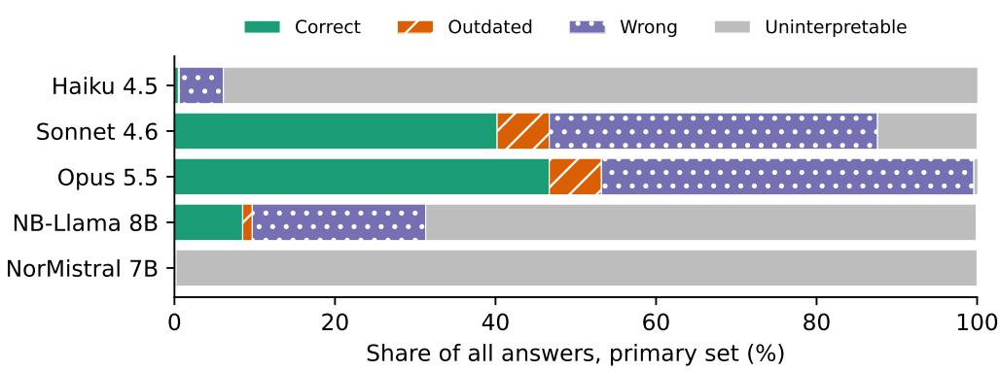

# norregel: a preregistered benchmark of dated numeric values in Norwegian law

Eirik Botten Nicolaysen EcoDeco AS ORCID 0009-0001-9188-6788 eirik@ecodeco.no

## Abstract

norregel asks language models for numeric values in Norwegian statutes, regulations and parliamentary decisions: NOK amounts, percentages, multiples of the National Insurance basic amount (G) and age limits, each at a stated date. The 916 items and their keys were extracted mechanically from Lovdata’s open data. Each item carries the dated history of its provision, so an answer can be classed as correct, outdated, wrong or uninterpretable. This paper reports a first and a second preregistered run on the same items. In the first run, the list of five models was published only after the runs had been analysed locally. H1, that outdated answers are more frequent for values that took efect after a model’s cutof, could not be tested in substance, and the tests of H2 and H3 were inconclusive. Opus 5.5 and Sonnet 4.6 answered 46.7% and 40.2% of the 880 primary items correctly, and most wrong answers were values not in the item’s dated history. The second run was preregistered and published before any of its calls. Its models were chosen by a criterion stated in advance, and eight models were analysed. Its pooled primary test of H1 rejected the null hypothesis (d = 17.8 percentage points, 95% interval [7.7, 28.9], p = 0.0001), so H1 is supported under the preregistered decision rule. The preregistered sensitivity analysis S8 counts as outdated only the most recent value that difers from the key, which gives both groups one target value. In S8, d was 3.9 [−3.6, 12.7] (p = 0.1754), an interval that contains 0. H1 was supported in every other preregistered sensitivity analysis, but S8 is the only one that gives both groups one target value, and under it the efect falls from 17.8 to 3.9 percentage points and is not established. We therefore do not regard the support for H1 as robust. H2 was reported as an estimate: the share of outdated answers equal to the most recent value that difers from the key was s = 56.1% [46.6, 65.0], an interval that contains 0.5. The pooled H3 test, which asked whether the share correct is lower in Nynorsk than in Bokmål, was inconclusive (D = −0.4 percentage points [−1.1, 0.3]). In both runs some models gave mostly uninterpretable answers. Haiku 4.5 is among them: uninterpretable answers made up 94.0% of its 880 answers on the primary set of the main task in the first run, 93.1% of its 880 answers on the primary set of the main task in the second run, and 93.4% of its 1 760 answers in the H3 task of the second run.

## 1 Introduction

Many Norwegian rules are numbers that change over time. The basic amount G and the studentsupport rates form yearly series, and tax rates are set in the annual tax decision. Asked for such a value at a given date, a language model can give the value in force at that date, a value that applied earlier, or a value that never applied. Which of these it gives is the first research question of the preregistration. Language models are trained on data collected up to a certain point. Facts with an expiry date are a known problem for them [10], and language models have been shown to perform worse on text from beyond their training period [21]. Hallucinated legal facts have been documented for US federal case law [9].

norregel measures this for Norwegian law. Each item asks for a single value at a stated date, and the scorer compares the answer with the dated history of the item’s provision. This is what separates an outdated answer from a wrong one. The paper describes the benchmark (Section 3), the preregistration and run protocol of the first run (Section 4), the scorer (Section 5), the first run (Section 6) and its results for five models (Section 7). It then describes the second run, preregistered after the first so that H1 could be tested (Section 8). Section 9 lists all deviations from both preregistrations, and Section 11 states what the results show and what they do not show.

## 2 Related work

Norwegian and Nordic benchmarks. NorBench [30] and ScandEval [32] benchmark Norwegian and Scandinavian language models. NorEval [26] covers both written standards of Norwegian, Bokmål and Nynorsk, and NLEBench [22] evaluates Norwegian text generation. norregel is narrower: every item asks for a value that a legal source fixes at a stated date, and the key comes from that source.

Time-dependent questions. TimeQA [7] builds time-sensitive questions from facts in Wiki-Data that change over time. SituatedQA [37] studies questions whose answers depend on when and where they are asked. StreamingQA [23] asks questions on a given date and answers them from time-stamped news. RealTime QA [19] announces questions about current events and evaluates systems at regular intervals; it reports that GPT-3 tends to return outdated answers when the retrieved documents are insuficient. FreshQA [35] is a dynamic benchmark that includes questions that require fast-changing world knowledge. TemporalWiki [17] uses the diference between consecutive snapshots of Wikipedia and Wikidata to track whether a model retains old knowledge and acquires new knowledge. Dhingra et al. [10] probe language models for facts that change over time, and Lazaridou et al. [21] show that Transformer-XL language models perform worse on utterances from beyond their training period.

Legal evaluation. LegalBench [14] is a collaboratively built benchmark for legal reasoning in large language models. Magesh et al. [24] report a preregistered evaluation of AI legal research tools and find that the providers’ claims about hallucinations are overstated.

Knowledge cutofs and refusals. H1 relies on the training-data cutof stated by the provider. Cheng et al. [8] report that “efective cutofs often difer from reported cutofs”. Kadavath et al. [18] study whether language models can predict which questions they will answer correctly, and Yin et al. [36] test whether they can identify unanswerable questions. norregel scores a refusal as uninterpretable.

Preregistration. Preregistration fixes the research questions and the analysis plan before the outcomes are observed [29]. It has been proposed for NLP research [34] and adapted to predictive modelling [15]. The runs used Inspect [33].

Auditing frameworks. SimpleAudit describes itself as “a simple, extensible, local-first frame work for multilingual auditing and red-teaming of AI systems via adversarial probing” [31], and its methodology paper is Gautam et al. [12]. norregel complements it with a closed set of dated facts.

A related tool by the author. The author’s pull request #105 to SimpleAudit [28], opened on 9 October 2026 and merged on 10 October 2026, added a deterministic check of answers against dated facts. The preregistration requires it to be named as earlier work. Candidate items that overlap its dated facts are kept in norregel and marked (93 items in 6 series).

Table 1: Items per set type (the field sett), all items and primary set, and series in the primary set. Not preregistered as a table; computed after review (supplement A2).
<table><tr><td>Set type</td><td>Items (all)</td><td>Items (primary)</td><td>Series (primary)</td></tr><tr><td>permanent provisions</td><td>265</td><td>235</td><td>48</td></tr><tr><td>yearly regulations</td><td>92</td><td>92</td><td>21</td></tr><tr><td>basic amount G</td><td>26</td><td>26</td><td>1</td></tr><tr><td>named rates</td><td>533</td><td>527</td><td>26</td></tr><tr><td>all</td><td>916</td><td>880</td><td>96</td></tr></table>

## 3 Benchmark construction

Source and extraction. Candidates are extracted mechanically from Lovdata’s open data (NLOD 2.0, https://api.lovdata.no/v1/publicData). The core documents were fixed before counting. The long tail is counted but not built as items in v1.

Year items. The unit is the year item: one question per provision and year of validity. A series groups the year items of a provision. Measures are computed on year items, and intervals use the series as cluster: a nonparametric bootstrap that resamples whole series [11].

Cleanliness rule. Only clean candidates are included (rule v3 with its amendments up to v3.6). In a flagged series, a year is accepted only when the value and the rate’s name or anchor phrase stand in the same clause of that year’s verbatim text; otherwise the series is split there. The last value must equal the current consolidated text. Qualifiers in the same clause as the value, such as «statens andel» or «i tiltakssonen», belong to the identity of the series. Valid-from and valid-to dates follow a fixed hierarchy: an explicit period or date in the text, then «med virkning fra», then the date of entry into force. A year without a sourced date is discarded and splits the series.

Value types and set types. v1 contains NOK amounts, percentages, G multiples and ages. Deadlines were not included in either run (docs/PREREG\_V2.md:32), so 21 clean deadline items in the core are not included. The annual tax decision and the decision on social-security contributions are chained as named rates from a list fixed before extraction, and 4 duplicate chains with 33 year items were removed. Table 1 gives the items per set type, which the preregistration promised to report. In the primary set, the years of validity run from 2001 to 2026, and a series has between 1 and 26 items (median 6.0).

Questions. Each item was written from a fixed template per type and written standard, without a model and without manual curation. The Bokmål template for an amount is «Hvor mange kroner var {navn} etter {kilde} per {dato}?», followed by the instruction «Svar med verdien alene på siste linje, slik: SVAR: <verdi>».

Checks and locks. In each round of a blind check, 40 accepted year items were extracted again by a language-model sub-agent directed by the author, without access to the reference values. Round 1 gave 39/40, and the error, in the author’s extraction, was corrected. Rounds 2 to 5 gave 40/40. These rounds were run on the data before a correction of the age items, which changed the type of age limits and thereby which series are clean. The set was then locked locally. The first, second and third locks were reopened, before any model had been run, because their final checks found date errors: at the first, 24 items asked about a date before the value applied; at the second, 3 items had a wrong key because a rate period had not been used; at the third, valid-from and valid-to dates agreed in 39/40. The fourth lock is final under point

3 of cleanliness rule v3.6, which was adopted when the third lock was reopened: errors found after it are recorded as errata, and it is not reopened. Its final check agreed on 40/40 values, 38/40 valid-from dates and 31/40 valid-to dates. The 2 valid-from diferences belong to erratum E1: partial dates of the form «. . . trer i kraft straks med virkning fra og med inntektsåret ÅÅÅÅ» were not used, and a mechanical search found 10 items, all in two series of the Tax Act, with a wrong valid-from date. The errata list 4 of them with a wrong key for the question date; the audit of the fourth lock, made by language-model sub-agents directed by the author, found a fifth, norregel-00909. These 5 items are excluded as X1 (below). The other E1 items, norregel-00907, -00908, -00910, -00911 and -00916, have a wrong valid-from date but the right key; they are flagged, kept in the primary set and left out in S3. Erratum E2 records a diference in the definition of a period provision in 9 of the 40 checked items; the dates in these items are the same as the sub-agent’s, and no key is afected. The fourth lock has 916 items in 97 series, and 454 of the 916 items (49.6%) are in Nynorsk.

Exclusions and analysis sets. The addendum to the preregistration defines exclusion groups: X1, 5 items with a wrong key for the question date; X2, 23 items whose question date, 14 February 2027, lies after the corpus retrieval on 9 October 2026; X3, 6 ambiguous items; and X4, 2 items afected by amendments of the annual tax decision. The primary set is the 916 items minus these 36, that is 880 items in 96 series. Seven flagged items stay in the primary set and are left out in sensitivity analysis S3: the other E1 items named above, and norregel-00133 and -00149 from the annual tax decision, whose dates are wrong but whose key is correct on the date in the question. In 219 items of the primary set the preceding value equals the key, and in 234 some earlier value does; in these items an outdated answer cannot be told from a correct answer. The H1 set has 567 items (primary items that have a preceding value that difers from the key), and the H2 set has 570 items (primary items with at least two distinct earlier values that difer from the key; an item can be in the H2 set even when its preceding value equals the key). The classes of the excluded items are in Table 17 (Appendix B).

H3 pairs. For H3, 200 of the 916 items were drawn with a fixed seed, stratified on series; each of the 97 series has at least one item. Each was asked in both Bokmål and Nynorsk, with the same template and key, as 400 questions in 200 pairs. The H3 run is separate from the main run. Pairs whose source item is excluded are left out, which leaves 189 pairs.

## 4 Preregistration and protocol of the first run

The preregistration, in Norwegian, and an English addendum were locked and published on Zenodo as v1 on 16 October 2026 at 16:18:04 UTC (DOI 10.5281/zenodo.23422303), with four files: the preregistration, the addendum, the lock manifest and the exclusion list. The run protocol and the model list were committed locally at 16:30:44 UTC and published only in v1.1. The first log with benchmark items starts at 16:30:54 UTC (a pilot attempt that failed locally, A1), the first answered pilot request at 16:31:39 UTC, and the main runs at 16:45:40 UTC. The addendum resolved what an audit of the fourth lock, by language-model sub-agents directed by the author, had found: an item with a wrong key, an exclusion rule that existed only as a recommendation, hypotheses that could not be run without asking the author, and answer formats the locked scorer could not read. It defines scorer v2, the analysis sets, the tests and the run configuration, and it names a reference implementation of the analysis, which was used unchanged.

The run protocol was written and committed before any model was run. It settles points that the addendum left open, including the cutof rule, vague cutofs, complete runs and restarts, the «år og måneder» (years and months) rule and token and temperature limits, and it fixes a pilot of 20 items and a cost cap of 60 USD. Changes during and after the runs are amendments

Table 2: Models. Cutof is the provider’s stated training-data cutof; a local model whose card states no date has an unknown cutof and is not tested in H1.
<table><tr><td>Model</td><td>Inspect model id</td><td>Cutoff</td><td>Reasoning</td><td>Run</td></tr><tr><td>Haiku 4.5</td><td>anthropic/claude-haiku-4-5-20251001</td><td>2025-07-31</td><td>no</td><td>API</td></tr><tr><td>Sonnet 4.6</td><td>anthropic/claude-sonnet-4-6</td><td>2026-01-31</td><td>no</td><td>API</td></tr><tr><td>Opus 5.5</td><td>anthropic/claude-opus-5-5</td><td>2026-06-30</td><td>yes</td><td>API</td></tr><tr><td>NB-Llama 8B</td><td>ollama/nb-llama-3.1-8b-instruct-cardtmpl:latest</td><td>unknown</td><td>no</td><td>local (Ollama)</td></tr><tr><td>NorMistral 7B</td><td>ollama/normistral-7b-warm-instruct-cardtmpl:latest</td><td>unknown</td><td>no</td><td>local (Ollama)</td></tr></table>

A1–A8, each dated and committed. The deviations from the addendum and the run protocol are D1–D13 (Section 9). Version v1.1 of the preregistration (DOI 10.5281/zenodo.23432124), published on 17 October 2026, contains the protocol, the model list and the Ollama Modelfiles. The concept DOI for all versions is 10.5281/zenodo.23422302.

Deviation D12. The addendum requires the model list to be published as a new version of the preregistration before any result. The list was published in v1.1 after the runs and the analysis had been completed locally, but before any result was made public. The list was committed locally before the first run (3c554cff). Rows 5 and 4 were changed afterwards (A2, A3), and A3 came after an NB-Llama 8B run with 109 samples had been discarded. The list that was run and published therefore difers from the committed list in these two rows. The commit history is published with the results (Zenodo v1.2, 10.5281/zenodo.23434782).

## 5 Scoring

Scorer v2 is the primary scorer; the locked scorer v1 is used in sensitivity analysis S2. The scorer reads the answer line, which is the last line where the label «svar» is followed by a colon, with at most markdown characters before it. On that line it removes bracketed text and markdown, and it requires exactly one number. Digits are read with Norwegian and English separators; Norwegian number words from 0 to 99 count when the line has no digits; words such as «kr», «prosent» or «G» are ignored. For an age item, an answer in months is wrong.

Classes. Two numbers are equal when they difer by less than 1e-6. An answer is correct when it equals the key, and outdated when it equals the value of an earlier version in the item’s history; the scorer reports the age in years. An answer is wrong when a number was read but it is neither. Wrong is split into a later value and a value not in the history. The latter also covers values from before the start of the clean series, so it is an upper bound for a value that never applied. An answer is uninterpretable when there is no answer line, no number, or more than one number. Refusals, empty outputs and samples still in error after the retries are uninterpretable. All shares use all answers as the denominator.

v1 uses a tolerance of 0.005 and counts later values as outdated, so H2 and FS2 are not defined under v1. For an age limit, «X år og Y måneder» is read as X + Y/12 years before scoring (deviation D3); no answer had this form.

Validation. Before any model run, scorer v2 was tested on all 49 answer-format edge cases from the audit and on 800 synthetic answers, all classified as expected, and dry runs that returned the key as the answer scored 916 of 916 main items and 400 of 400 H3 questions correct (addendum).

## 6 First run: models and runs

Table 2 lists the models. They were chosen by the author before the runs, not in the preregistration; the addendum leaves the choice of models to run time. Haiku 4.5 and Sonnet 4.6 were chosen although newer Haiku and Sonnet versions (5.5) existed [2], and Opus 5.5 was the newest Opus model in the provider’s model list as read by the author on 16 October 2026; the list was not stored (docs/RUN\_PROTOCOL.md:61). No criterion for the choice of models was stated in advance. The cutofs and the reasoning classification follow the providers’ model pages [4–6]; MODELLER.md in v1.1 gives the URL, a verbatim quote and the SHA-256 of each fetched page. The local models are NB-Llama 8B [27] and the instruct variant of NorMistral 7B [20]. Neither card states a cutof, so neither model is tested in H1.

Parameters. No system prompt; one run per model and task; temperature 0 and at most 1 024 output tokens for non-reasoning models. Opus 5.5 is a reasoning model and was run without a temperature setting, with at most 16 384 tokens and with efort and thinking at the provider’s defaults. Inspect’s own retries apply, and a sample still in error is re-run up to 3 times. The local models ran with one connection (D2), and NorMistral 7B also with a limit of 2 provider-level retries from the eval-retry onwards (A6, D10): the first 91 samples of its main run ran without that limit, and its H3 run used it throughout. Software: Python 3.12.13, inspect\_ai 0.3.245, numpy 2.5.4 and, for the local models, Ollama 0.35.1.

Chat templates. NorMistral 7B was run with the chat template of its model card, as a new Ollama model on the same weights (A2); a check before the first sample confirmed that the main Ollama service rendered the prompt in the card’s format (A2, A4). NB-Llama 8B was run with the card’s template with a fixed date and the begin-of-text token (A3). The main Ollama service selected the template stored in the GGUF file and ignored the Modelfile; that template used the current date and no begin-of-text token. This was the reason for running NB-Llama 8B on a separate Ollama instance, which uses the Modelfile’s template.

Completion and other runs. All five models were run complete on the main task and on H3 under the protocol’s rule for complete runs. The only final errors (samples still in error after the retries, scored uninterpretable) were 3 samples of NorMistral 7B on the main task. Answers that reached the token limit were scored as they stood: 297 on the main task and 138 on H3 for NB-Llama 8B, of which 292 and 133 repeated a line at least three times (a definition set after the language-model review), and 10 and 11 for NorMistral 7B. A pilot on 20 items, which does not count, checked the parameters, and the rule for a rejected temperature was not triggered. The API runs cost 26.80 USD including the pilot, under the cap of 60 USD. The addendum requires every run to be reported: Table 18 (Appendix B) lists the pilots, the discarded and the stopped runs with their classes, none of which count in the results.

## 7 First run: results

Primary measures. On the primary set (880 items, 96 series; Table 3, Figure 1), Opus 5.5 answered 46.7% of the items correctly and Sonnet 4.6 40.2%; NB-Llama 8B 8.5%, Haiku 4.5 0.5% and NorMistral 7B 0.0%. Outdated answers were 6.5% for Sonnet 4.6 and 6.5% for Opus 5.5, and at most 1.2% for the other models. Of the 880 answers of each model on the primary set, 94.0% were uninterpretable for Haiku 4.5, 68.6% for NB-Llama 8B and 99.8% for NorMistral 7B. These shares are reported as they are and are not adjusted; Appendix A looks at them in an exploratory analysis. Because the denominator is all answers, the shares of correct answers of the models with mostly uninterpretable answers are not comparable with those of Opus 5.5 and Sonnet 4.6. Among interpretable answers (exploratory, after the language-model review;

Table 3: Primary set, scorer v2: share of all answers (%) with cluster-bootstrap CI in brackets. Percentages are rounded to one decimal, half to even (Python string formatting), so a row need not add up exactly. Figure 1 shows the shares.
<table><tr><td>Model</td><td>Correct</td><td>Outdated</td><td></td><td>Wrong</td><td>Uninterpretable</td></tr><tr><td>Haiku 4.5</td><td>0.5 [0.0, 1.1]</td><td></td><td>0.1 [0.0, 0.4]</td><td>5.5 [3.2, 7.7]</td><td>94.0 [91.5, 96.4]</td></tr><tr><td>Sonnet 4.6</td><td>40.2 [29.3, 49.7]</td><td></td><td>6.5 [3.7, 9.6]</td><td>40.9 [32.4, 51.0]</td><td>12.4 [9.0, 16.7]</td></tr><tr><td>Opus 5.5</td><td>46.7 [35.4, 56.2]</td><td></td><td>6.5 [4.0, 9.3]</td><td>46.4 [37.1, 57.4]</td><td>0.5 [0.1, 1.0]</td></tr><tr><td>NB-Llama 8B</td><td>8.5 [3.4, 14.1]</td><td></td><td>1.2 [0.3, 2.5]</td><td>21.6 [14.9, 28.3]</td><td>68.6 [60.0, 78.0]</td></tr><tr><td>NorMistral 7B</td><td>0.0 [0.0, 0.0]</td><td></td><td>0.0 [0.0, 0.0]</td><td>0.2 [0.0, 0.6]</td><td>99.8 [99.4, 100.0]</td></tr></table>

  
Figure 1: Class shares per model on the primary set (scorer v2), from Table 3.

Table 19), Opus 5.5 was correct in 46.9%, Sonnet 4.6 in 45.9%, NB-Llama 8B in 27.2% and Haiku 4.5 in 7.5% of its 53 interpretable answers. Most wrong answers were values not in the item’s history, for example 359 of 408 for Opus 5.5 (Table 24). By value type (FS3; counts and shares only), Opus 5.5 answered 70.8% of the percentage items correctly against 32.9% of the NOK amounts, and Sonnet 4.6 63.3% against 27.5% (Table 23).

Tests. Within each of H1, H2 and H3, the tests are corrected with the Holm–Bonferroni procedure [16]; the sensitivity analyses report nominal p-values without correction. No power analysis was made in advance, and none is made afterwards; instead, the text states what the intervals rule out. H4 of the preregistration, that the share correct is lower for amounts and rates than for deadlines, was not tested in either run, because deadlines were not included (docs/PREREG\_V2.md:32).

H1. H1 was tested only for Haiku 4.5: 56 items in the H1 set took efect after its cutof and 511 before, $d = 0 . 0$ percentage points and $p = 1 . 0 0 0 0$ (Table 4). Haiku 4.5 gave no outdated answer in either group, so d was 0 in every resample, and the test carries no information about H1. For Sonnet 4.6 and Opus 5.5, only 9 and 1 items took efect after the cutof, below the minimum of 30 items from at least 5 series, so d is reported without a test. Neither model gave an outdated answer after its cutof, so each interval is that of minus the share outdated before, in the resamples that drew a series with an item after the cutof. For Opus 5.5, 3 696 of the 10 000 resamples were dropped; its interval rests on the 6 304 resamples in which d is defined. These intervals are not evidence against H1. The denominator of d includes refusals: after the cutof, 8 of the 9 answers of Sonnet 4.6 and all 56 answers of Haiku 4.5 were uninterpretable, against 74 of 558 and 475 of 511 before (Table 20). Under the providers’ reliable-knowledge cutofs (exploratory, after the language-model review), the groups after the cutof would have 64, 36 and 1 items for Haiku 4.5, Sonnet 4.6 and Opus 5.5; no test was run on them. NB-Llama 8B and NorMistral 7B have no cutof and were not tested. No model had a vague cutof, so the rule in section 3.2 of the run protocol (a conventional date and a sensitivity analysis without vague models) was not used; the addendum gives a vague cutof the value null and no H1 test.

Table 4: Preregistered tests, primary analysis (Holm within each hypothesis [16]). n.t. = not tested: a below the H1 minimum: d and its interval are reported without a test, and with no outdated answer after the cutof the interval is that of minus the share outdated before, conditional on drawing a series with an item after the cutof (Section $^ { 7 ) ; }$ it is not evidence against H1. b below the H2 minimum; $\mathrm { c } _ { b + c = 0 }$ not computed. Percentages and percentage points are rounded to one decimal, half to even.
<table><tr><td colspan="7">H1: d = share outdated after minus before the cutoff (pp)</td></tr><tr><td>Model</td><td>n after / before</td><td>d</td><td>CI</td><td>p (one-sided)</td><td> $H _ { 0 }$ </td><td>rejected (Holm)</td></tr><tr><td>Haiku 4.5</td><td>56 / 511</td><td>0.0</td><td>[0.0, 0.0]</td><td>1.0000</td><td></td><td>no</td></tr><tr><td>Sonnet 4.6</td><td>9/558</td><td>-9.1</td><td> $[ - 1 3 . 6 , \top . 5 . 1 ]$ </td><td> $\mathrm { n . t . ^ { a } }$ </td><td></td><td></td></tr><tr><td>Opus 5.5 NB-Llama 8B</td><td>1 / 566</td><td>-9.2</td><td> $[ - 1 3 . 5 , \ : - 5 . 6 ]$ </td><td> $\mathrm { n . t . ^ { a } }$ </td><td></td><td></td></tr><tr><td>NorMistral 7B</td><td>not tested (no cutoff) not tested (no cutoff)</td><td></td><td></td><td></td><td></td><td></td></tr><tr><td colspan="7">H2: s = share of outdated answers equal to the most recent differing value</td></tr><tr><td>Model</td><td>Outdated answers</td><td>S</td><td>CI</td><td></td><td> $( \% )$  p (one-sided)  $H _ { 0 }$ </td><td>rejected (Holm)</td></tr><tr><td>Haiku 4.5</td><td>0</td><td></td><td></td><td> $\mathrm { n . t . ^ { \ b } }$ </td><td></td><td></td></tr><tr><td>Sonnet 4.6</td><td>50</td><td></td><td>62.0</td><td>[45.8, 81.4]</td><td>0.0876</td><td>no</td></tr><tr><td>Opus 5.5</td><td>46</td><td></td><td>50.0</td><td>[31.4, 73.0]</td><td> $0 . 5 0 2 7$ </td><td>no</td></tr><tr><td>NB-Llama 8B</td><td>8</td><td></td><td></td><td>[0.0, 42.9]  $\mathrm { n . t . ^ { \ b } }$ </td><td></td><td></td></tr><tr><td>NorMistral 7B</td><td>0</td><td></td><td>25.0</td><td></td><td> $\mathrm { n . t . ^ { \ b } }$ </td><td></td></tr><tr><td colspan="7"></td></tr><tr><td>Model</td><td>b C</td><td></td><td>p (exact McNemar)</td><td>) Nynorsk − Bokmål (pp)</td><td>CI</td><td> $H _ { 0 }$  rejected (Holm)</td></tr><tr><td>Haiku 4.5 Sonnet 4.6</td><td>1 0 9</td><td>0.5000</td><td>-0.5</td><td></td><td>[−1.6, 0.0] [−8.6, 1.1]</td><td>no</td></tr><tr><td>Opus 5.5</td><td>3 3</td><td>0.0730</td><td>-3.2</td><td></td><td>[−1.0, 6.6]</td><td>no</td></tr><tr><td>NB-Llama 8B</td><td>8</td><td>0.9673</td><td>2.6 -2.6</td><td></td><td>[−6.7, 0.5]</td><td>no</td></tr><tr><td>NorMistral 7B</td><td>6 1</td><td>0.0625</td><td>0.0</td><td></td><td>[0.0, 0.0]</td><td>no</td></tr><tr><td></td><td>0 0</td><td> $\mathrm { n . t . ^ { c } }$ </td><td></td><td></td><td></td><td></td></tr></table>

Table 5: FS2 (descriptive, no test): age in years of outdated answers, primary set.
<table><tr><td>Model</td><td>Outdated</td><td>Q1</td><td>Median</td><td>Q3</td><td>CI for median</td></tr><tr><td>Haiku 4.5</td><td>1</td><td>12.00</td><td>12.00</td><td>12.00</td><td>[12.00, 12.00]</td></tr><tr><td>Sonnet 4.6</td><td>57</td><td>1.00</td><td>1.00</td><td>3.00</td><td>[1.00, 2.00]</td></tr><tr><td>Opus 5.5</td><td>57</td><td>1.00</td><td>1.00</td><td>4.00</td><td>[1.00, 3.00]</td></tr><tr><td>NB-Llama 8B</td><td>11</td><td>1.50</td><td>3.00</td><td>4.50</td><td>[1.50, 5.00]</td></tr><tr><td>NorMistral 7B</td><td>0</td><td></td><td></td><td></td><td></td></tr></table>

H2. Sonnet 4.6 gave 50 outdated answers in the H2 set, and $s = 6 2 . 0 \%$ of them were the most recent difering value $( p = 0 . 0 8 7 6 )$ . Opus 5.5 gave 46, with $s = 5 0 . 0 \% ( p = 0 . 5 0 2 7 )$ . Neither null hypothesis was rejected after Holm. The intervals rule out s below 45.8% for Sonnet 4.6 and below 31.4% for Opus 5.5, and both include 50%, so the test is inconclusive. Haiku 4.5, NB-Llama 8B and NorMistral 7B had fewer than 30 outdated answers and were not tested.

H3. H3 uses an exact one-sided McNemar test [25]. On the 189 pairs, no null hypothesis was rejected after Holm. The lowest p-value was 0.0625 (NB-Llama 8B, $b = 6 , c = 1 )$ . NorMistral 7B had $b + c = 0$ and was not tested. An exact interval computed from b and c alone (exploratory, after the language-model review; Table 21) rules out a Nynorsk disadvantage larger than 5.7 percentage points for Sonnet 4.6 and 3.7 for NB-Llama 8B; it ignores the clustering, and the preregistered bootstrap intervals in Table 4 are wider. The test is inconclusive.

Table 6: Sensitivity analyses: nominal one-sided p-values, no Holm correction. S1 = all items and pairs; S2 = scorer v1 (H2 is not defined under v1); S3 = primary set without the flagged items. – = no cutof; n.t. = not tested (below a minimum or $b + c = 0 )$
<table><tr><td>Model</td><td>S1 H1</td><td>S1 H2</td><td>S1 H3</td><td>S2 H1</td><td>S2 H3</td><td>S3 H1</td><td>S3 H2</td><td>S3 H3</td></tr><tr><td>Haiku 4.5</td><td>1.0000</td><td>n.t.</td><td>0.5000</td><td>1.0000</td><td>0.5000</td><td>1.0000</td><td>n.t.</td><td>0.5000</td></tr><tr><td>Sonnet 4.6</td><td>1.0000</td><td>0.0738</td><td>0.0730</td><td>n.t.</td><td>0.0730</td><td>n.t.</td><td>0.1018</td><td>0.0730</td></tr><tr><td>Opus 5.5</td><td>n.t.</td><td>0.4157</td><td>0.9673</td><td>n.t.</td><td>0.9673</td><td>n.t.</td><td>0.5027</td><td>0.9673</td></tr><tr><td>NB-Llama 8B</td><td></td><td>n.t.</td><td>0.0625</td><td></td><td>0.3438</td><td></td><td>n.t.</td><td>0.0625</td></tr><tr><td>NorMistral 7B</td><td>一</td><td>n.t.</td><td>n.t.</td><td></td><td>n.t.</td><td>一</td><td>n.t.</td><td>n.t.</td></tr></table>

FS2. FS2 is descriptive, without a test (Table 5). The median age of outdated answers was 1 year for Sonnet 4.6 and Opus 5.5, with 57 outdated answers each, and 3 years for NB-Llama 8B, with 11. Haiku 4.5 gave one outdated answer, 12 years old.

Sensitivity analyses. S1 uses all 916 items and 200 pairs, S2 scores the same answers with v1, and S3 is the primary set without the 7 flagged items (873 items). They report nominal p-values without correction (Table 6; class shares in Table 22). No nominal p-value is below 0.05. Scorer v1 counts later values as outdated and treats numbers that difer by less than 0.005 as equal; under v1 the outdated share is higher, for Sonnet 4.6 11.1% against 6.5%.

## 8 Second run

Preregistration. The second run was preregistered after the results of the first run and the language-model review of the first version of this paper (Section 13) were known. Its hypotheses and its item set, the fourth lock, are those of the first run; the design was changed to make the hypotheses testable, and the models were chosen by a criterion committed before the choice. The preregistration, the lock and the locked code were published as Zenodo version 2.0 (DOI 10.5281/zenodo.23437444) at 13:53:28 UTC on 17 October 2026, before any call of the second run; its pilot started at 13:54:47 UTC. The analysis is the locked analysis\_v2.py, and the results file RESULTS\_V2.md is rendered from it by a locked report script.

Models and runs. Table 7 lists the models of the locked list. In the pilot, every sample of Gemini 2.5 Pro and Gemini 2.5 Flash-Lite ended in an error stating that the model is no longer available to new users, and both were dropped (A-V2-3); Gemini 2.5 Flash was dropped because the free quota could not cover its calls (A-V2-5). The pilot’s thinking rule gave the Gemma 4 models three runs each (A-V2-9); run 1 is primary. The eight remaining models were run on the main task (916 items) and on H3 (880 pairs, 1 760 questions), with no system prompt, temperature 0 and at most 16 384 output tokens for the API models and 1 024 for the local models. Each model with a single run also had a control run on the main task for 100 fixed primary items, used only to compare runs (docs/PREREG\_V2.md:186). All logs have status success, every run was completed at the first attempt, and no run was discarded or stopped. Final errors (samples still in error after the retries, scored uninterpretable; docs/PREREG\_V2.md:47, scripts/analysis\_v2.py:93) occurred only for NorMistral 7B: 3 in run 1 of the main task, 1 in its control run of 100 items and 4 on H3. In run 1 of the main task, 349 answers of Gemma 4 26B, 297 of NB-Llama 8B, 10 of NorMistral 7B and 8 of Gemma 4 31B reached the token limit and were scored as they stood. The API runs cost 30.35 USD including the pilot.

Primary measures. On the primary set (880 items, 96 series; Table 8), Opus 4.5, Opus 4.6 and Sonnet 4.6 answered 45.1%, 43.9% and 39.5% of the items correctly, Gemma 4 31B 11.7%, NB-Llama 8B 8.5%, Gemma 4 26B 7.6%, Haiku 4.5 0.5% and NorMistral 7B 0.0%. Of the 880 answers of each model on the primary set, 93.1% were uninterpretable for Haiku 4.5, 99.8% for NorMistral 7B, 68.6% for NB-Llama 8B and 38.4% for Gemma 4 26B; Gemma 4 31B gave 81.6% wrong answers.

Table 7: Second run: the model list as locked (PREREG\_V2.md, section 5) and the status of each model in the run. Deviations are listed in Table 14.
<table><tr><td>Inspect model id</td><td>Role</td><td>Cutoff</td><td>Status</td></tr><tr><td>anthropic/claude-haiku-4-5-20251001</td><td>v1, H1</td><td>2025-07-31</td><td>analysed</td></tr><tr><td>anthropic/claude-opus-4-5-20251101</td><td>H1</td><td>2025-08-31</td><td>analysed</td></tr><tr><td>anthropic/claude-opus-4-6</td><td>H1</td><td>2025-08-31</td><td>analysed</td></tr><tr><td>anthropic/claude-sonnet-4-6</td><td>v1</td><td>2026-01-31</td><td>analysed</td></tr><tr><td> $\mathbf { g } _ { 0 0 } \mathbf { g } \mathbf { 1 e } / \mathbf { g } \mathbf { e m i n i - } 2 . 5 \mathbf { - } \mathbf { f } \mathbf { 1 a s h }$ </td><td>H1</td><td>2025-01-31</td><td>dropped (A-V2-5)</td></tr><tr><td> $\mathbf { g } \infty \mathbf { g } 1 \mathbf { e } / \mathbf { g } \mathbf { e m } \mathbf { i } \mathbf { n } \mathbf { i } - 2 . 5 \mathbf { - } \mathbf { f } \mathbf { 1 } \mathbf { a } \mathbf { s } \mathbf { h } \mathbf { - } 1 \mathbf { i } \mathbf { t } \mathbf { e }$ </td><td>H1</td><td>2025-01-31</td><td>dropped (A-V2-3)</td></tr><tr><td> $\mathtt { g o o g l e / g e m i n i - 2 . 5 - p r o }$ </td><td>H1</td><td>2025-01-31</td><td>dropped (A-V2-3)</td></tr><tr><td> $\mathtt { g o o g l e / g e m m a - 4 - 2 6 b - a 4 b - i t }$ </td><td>H1</td><td>2025-01-31</td><td>analysed (A-V2-9)</td></tr><tr><td>google/gemma-4-31b-it</td><td>H1</td><td>2025-01-31</td><td>analysed (A-V2-9)</td></tr><tr><td>ollama/nb-llama-3.1-8b-instruct-cardtmpl:latest</td><td>v1 (local)</td><td>unknown</td><td>analysed</td></tr><tr><td>ollama/normistral-7b-warm-instruct-cardtmpl:latest</td><td>v1 (local)</td><td>unknown</td><td>analysed</td></tr></table>

Table 8: Second run, primary set, run 1, scorer v2: share of all answers (%) with cluster-bootstrap CI in brackets (RESULTS\_V2.md, T3).
<table><tr><td>Model</td><td>n</td><td>Correct</td><td>Outdated</td><td></td><td>Wrong</td><td>Uninterpretable</td></tr><tr><td>Haiku 4.5</td><td>880</td><td>0.5 [0.0, 1.3]</td><td></td><td>0.1 [0.0, 0.4]</td><td>6.4 [3.6, 9.3]</td><td>93.1 [89.7, 96.1]</td></tr><tr><td>Opus 4.5</td><td>880</td><td>45.1 [35.2, 53.6]</td><td></td><td>8.8 [5.8, 11.8]</td><td>37.3 [29.7, 46.5]</td><td>8.9 [6.8, 11.5]</td></tr><tr><td>Opus 4.6</td><td>880</td><td>43.9 [34.1, 52.3]</td><td></td><td>11.2 [8.0, 14.5]</td><td>44.4 [36.0, 54.7]</td><td>0.5 [0.1, 1.0]</td></tr><tr><td>Sonnet 4.6</td><td>880</td><td>39.5 [28.9, 48.9]</td><td></td><td>6.7 [3.5, 10.1]</td><td>40.9 [32.7, 50.6]</td><td>12.8 [9.3, 17.5]</td></tr><tr><td>Gemma 4 26B</td><td>880</td><td>7.6 [3.8, 11.8]</td><td></td><td>4.0 [1.7, 6.7]</td><td>50.0 [44.5, 55.3]</td><td>38.4 [32.9, 44.3]</td></tr><tr><td>Gemma 4 31B</td><td>880</td><td>11.7 [6.0, 18.4]</td><td></td><td>5.5 [2.9, 8.6]</td><td>81.6 [74.1, 88.7]</td><td>1.2 [0.5, 2.1]</td></tr><tr><td>NB-Llama 8B</td><td>880</td><td>8.5 [3.4, 14.3]</td><td></td><td>1.2 [0.3, 2.4]</td><td>21.6 [15.0, 28.3]</td><td>68.6 [59.8, 78.1]</td></tr><tr><td>NorMistral 7B</td><td>880</td><td>0.0 [0.0, 0.0]</td><td></td><td>0.0 [0.0, 0.0]</td><td>0.2 [0.0, 0.6]</td><td>99.8 [99.4, 100.0]</td></tr></table>

H1: decision rule. The preregistration fixes the primary test of H1 as a test pooled over the H1 models (docs/PREREG\_V2.md:234 to docs/PREREG\_V2.md:237; translated): d is the share outdated after the cutof minus the share outdated before, each among interpretable answers and with the counts summed over the models; the null hypothesis is $d \leq 0$ , tested one-sided at $\alpha = 0 . 0 5 ;$ the test requires 30 interpretable answers after the cutof from at least 20 series, and otherwise d is reported with an interval and without a test. Per model, the test requires 30 interpretable answers in each group and 5 series after the cutof, with Holm over the tested models (docs/PREREG\_V2.md:239). A test is supported when the null hypothesis is rejected; inconclusive when it is not rejected and the 95% interval reaches the smallest efect of interest, 10 percentage points for H1; and no efect of interest when the interval excludes it (docs/PREREG\_V2.md:283 to docs/PREREG\_V2.md:291). Sensitivity analysis S8 is defined in docs/PREREG\_V2.md:73: «S8 (H1′) teller bare svar som er lik den nyeste avvikende verdien. Da er målmengden én verdi i begge gruppene.» (S8 counts only answers equal to the most recent value that difers from the key; the target set is then one value in both groups.) It was preregistered because items after the cutof have more earlier difering values than items before, so that a guessed number is slightly more likely to be classed as outdated after the cutof, and it uses nominal p-values (docs/PREREG\_V2.md:266).

H1: results. Pooled over the five H1 models, 115 interpretable answers from 55 series fell after the cutof and 1 877 before. The primary test rejected the null hypothesis, d = 17.8 percentage points, 95% interval [7.7, 28.9], $p = 0 . 0 0 0 1$ (Table 9), so H1 is supported under the decision rule.

Table 9: Second run, H1 (RESULTS\_V2.md, T8). d is the share outdated after minus before the cutof among interpretable answers, in percentage points, with a stratified cluster-bootstrap 95% interval; p is one-sided. The pooled primary test decides H1; per-model decisions use Holm. S8 is a preregistered sensitivity analysis with nominal p. A model is tested only with at least 30 interpretable answers in each group.
<table><tr><td>Model</td><td>n after</td><td>Series after</td><td>n before</td><td>d</td><td>95% interval</td><td>p</td><td>State</td></tr><tr><td colspan="8">Primary analysis (H1), interpretable answers</td></tr><tr><td>Pooled</td><td>115</td><td>55</td><td>1877</td><td>17.8</td><td>[7.7, 28.9]</td><td>0.0001</td><td>supported</td></tr><tr><td>Haiku 4.5</td><td>0</td><td>0</td><td>40</td><td></td><td></td><td></td><td>not tested (Holm: -)</td></tr><tr><td>Opus 4.5</td><td>6</td><td>6</td><td>492</td><td>36.4</td><td>[−12.4, 85.3]</td><td></td><td>not tested (Holm: -)</td></tr><tr><td>Opus 4.6</td><td>35</td><td>35</td><td>528</td><td>34.2</td><td>[17.5, 50.9]</td><td>0.0001</td><td>supported (Holm: yes)</td></tr><tr><td>Gemma 4 26B</td><td>15</td><td>13</td><td>318</td><td>1.0</td><td>[−8.4, 17.9]</td><td></td><td>not tested (Holm: -)</td></tr><tr><td>Gemma 4 31B</td><td>59</td><td>53</td><td>499</td><td>13.2</td><td>[4.4, 23.2]</td><td>0.0007</td><td>supported (Holm: yes)</td></tr><tr><td colspan="8">S8 (H1′): only the most recent value that differs from the key counts as outdated</td></tr><tr><td>Pooled</td><td>115</td><td>55</td><td>1877</td><td>3.9</td><td>[-3.6, 12.7]</td><td>0.1754</td><td>inconclusive</td></tr><tr><td>Haiku 4.5</td><td>0</td><td>0</td><td>40</td><td></td><td></td><td></td><td>not tested (nominal p: −)</td></tr><tr><td>Opus 4.5</td><td>6</td><td>6</td><td>492</td><td>7.1</td><td>[−11.9, 41.9]</td><td></td><td>not tested (nominal p: −)</td></tr><tr><td>Opus 4.6</td><td>35</td><td>35</td><td>528</td><td>7.5</td><td>[−4.9, 21.8]</td><td>0.1347</td><td>inconclusive (nominal p: no)</td></tr><tr><td>Gemma 4 26B</td><td>15</td><td>13</td><td>318</td><td>3.8</td><td>[−4.2, 20.4]</td><td></td><td>not tested (nominal p: −)</td></tr><tr><td>Gemma 4 31B</td><td>59</td><td>53</td><td>499</td><td>4.0</td><td>[−2.2, 11.6]</td><td>0.1236</td><td>inconclusive (nominal p: no)</td></tr></table>

In S8, which uses the same answers but one target value in both groups, $d = 3 . 9 \ [ - 3 . 6 , 1 2 . 7 ]$ $p = 0 . 1 7 5 4$ , inconclusive: the null hypothesis is not rejected and the interval reaches the smallest efect of interest of 10 percentage points (docs/PREREG\_V2.md:289); it also contains 0. H1 was supported in all other preregistered sensitivity analyses (Table 10), but none of them gives both groups one target value; under S8, which does, the efect falls from 17.8 to 3.9 percentage points and is not established. We therefore do not regard the support for H1 as robust. Per model, Opus 4.6 (d = 34.2 [17.5, 50.9], p = 0.0001) and Gemma 4 31B (d = 13.2 [4.4, 23.2], p = 0.0007) were supported after Holm; in S8 they gave d = 7.5 [−4.9, 21.8], p = 0.1347, and $d = 4 . 0 [ - 2 . 2 .$ 11.6], p = 0.1236, both inconclusive. Haiku 4.5, Opus 4.5 and Gemma 4 26B had 0, 6 and 15 interpretable answers after their cutofs and were not tested. On average, items after the cutof had 7.72 to 9.61 earlier difering values and items before 6.20 to 6.27, depending on the model (RESULTS\_V2.md, T8).

Interpretable answers around the cutof. Table 11 gives the answers after and before each H1 model’s cutof. Uninterpretable is the scorer-v2 class utolket, which the scorer defines as “no answer line, no number, or more than one number” (src/norregel/score\_v2.py:22). Haiku 4.5 gave an uninterpretable answer to all 56 items after its cutof and to 471 of the 511 before. Opus 4.5 gave 30 of 36 after and 39 of 531 before. Opus 4.6 gave 1 of 36 after and 3 of 531 before. Gemma 4 26B gave 49 of 64 after and 185 of 503 before. Gemma 4 31B gave 5 of 64 after and 4 of 503 before.

H2. H2 is reported as an estimate of s, the share of outdated answers that equal the most recent value that difers from the key, with no test (docs/PREREG\_V2.md:251). Pooled over all models, 287 outdated answers from 33 series gave s = 56.1% [46.6, 65.0], an interval that contains 0.5 (Table 12). Of the models with at least 30 outdated answers, the interval lies above 0.5 for Opus 4.5 (s = 65.7% [50.5, 81.0]) and contains 0.5 for Opus 4.6, Sonnet 4.6, Gemma 4 26B and Gemma 4 31B.

H3. The pooled test of a lower share correct in Nynorsk than in Bokmål gave b = 173 and c = 146 over 7 040 pairs, D = −0.4 percentage points [−1.1, 0.3], p = 0.1495: inconclusive, because the interval reaches the smallest efect of interest of 1 percentage point (Table 13). Per model, with the exact McNemar test and Holm, H3 was supported for Haiku 4.5 (b = 11, c = 0, $p = 0 . 0 0 0 5 )$ and for NB-Llama 8B $( b = 5 9 , c = 1 8 , p < 0 . 0 0 0 1 )$ under the decision rule. Sonnet

Table 10: Second run: all preregistered sensitivity analyses of H1, pooled over the H1 models, with nominal one-sided p-values (RESULTS\_V2.md, T16; S8 from T8). The definitions are quoted verbatim from the preregistration (PREREG\_V2.md, section 7.5). d in percentage points with a 95% interval. p is one-sided and the interval two-sided, so a test can reject at 0.05 while its interval contains 0 (S9).
<table><tr><td>Analysis</td><td>Definition</td><td>d</td><td>95% interval</td><td>p</td><td>State</td></tr><tr><td>S1</td><td>«Alle 916 items; H3 har de samme 880 parene»(docs/ PREREG_V2.md:271)</td><td>10.6</td><td>[2.9, 19.7]</td><td>0.0032</td><td>supported</td></tr><tr><td>S2</td><td>«Scorer v1 (H1 og H3; H2 er ikke definert under v1)» 11.9 [2.2, 22.6] (docs/PREREG_V2.md:272)</td><td></td><td></td><td></td><td>0.0071 supported</td></tr><tr><td>S3</td><td>«Uten de 7 flaggede itemene»(docs/PREREG_V2.md:273) 18.4 [8.2, 29.3]</td><td></td><td></td><td></td><td>0.0005 supported</td></tr><tr><td>S4</td><td>«H1 med alle svar som nevner» (docs/PREREG_V2.md: 5.2 [0.7, 10.0] 274)</td><td></td><td></td><td></td><td>0.0115 supported</td></tr><tr><td>S5</td><td>«H1 med «reliable knowledge cutoff» der leverandøren 14.0 [5.0, 24.0] oppgir den, ellers samme cutoff» (docs/PREREG_V2.md: 275)</td><td></td><td></td><td></td><td>0.0007 supported</td></tr><tr><td>S6, run 2</td><td>«Samme analyse på kjøring 2 og 3 for modellene med R 10.7 [3.5, 19.5] = 3 som er komplette i den kjøringen»(docs/PREREG_</td><td></td><td></td><td></td><td>0.0009 supported</td></tr><tr><td>S6, run 3 as above</td><td>V2.md:276)</td><td>10.7</td><td>[3.5, 19.5]</td><td></td><td>0.0009 supported</td></tr><tr><td>S7</td><td>«Uten itemene i data/errata_v2.txt (lik primæranaly- 17.8 [7.7, 28.9] sen hvis fila er tom)»(docs/PREREG_V2.md:277)</td><td></td><td></td><td></td><td>0.0001 supported</td></tr><tr><td>S8 (T8)</td><td>«H1&#x27;: bare svar lik den nyeste avvikende verdien teller 3.9[-3.6, 12.7] som utdatert»(docs/PREREG_V2.md:278)</td><td></td><td></td><td></td><td>0.1754 inconclusive</td></tr><tr><td>S9</td><td>«H1 med gruppen «før» begrenset til items som tok 8.5 [-0.7, 18.4] 0.0359 supported virkning de siste 24 månedene før cutoff. Den skiller cutoff fra bestemmelsens alder: items etter cutoff er de nyeste.»(docs/PREREG_V2.md:279)</td><td></td><td></td><td></td><td></td></tr></table>

Table 11: Second run, H1 set: answers after and before each H1 model’s cutof. Items and uninterpretable answers are from RESULTS\_V2.md, T19; interpretable answers are the n of the primary H1 analysis (T8). Uninterpretable is the scorer-v2 class utolket: no answer line, no number, or more than one number.
<table><tr><td rowspan="2">Model</td><td colspan="3">After the cutoff</td><td colspan="3">Before the cutoff</td></tr><tr><td>Items</td><td>Interpretable</td><td>Uninterpretable</td><td>Items</td><td>Interpretable</td><td>Uninterpretable</td></tr><tr><td>Haiku 4.5</td><td>56</td><td>0</td><td>56</td><td>511</td><td>40</td><td>471</td></tr><tr><td>Opus 4.5</td><td>36</td><td>6</td><td>30</td><td>531</td><td>492</td><td>39</td></tr><tr><td>Opus 4.6</td><td>36</td><td>35</td><td>1</td><td>531</td><td>528</td><td>3</td></tr><tr><td>Gemma 4 26B</td><td>64</td><td>15</td><td>49</td><td>503</td><td>318</td><td>185</td></tr><tr><td>Gemma 4 31B</td><td>64</td><td>59</td><td>5</td><td>503</td><td>499</td><td>4</td></tr></table>

4.6 (b = 39, c = 26, p = 0.0680) and Gemma 4 26B (b = 16, c = 21) were inconclusive, and Opus 4.5 (b = 24, c = 35), Opus 4.6 (b = 14, c = 26), Gemma 4 31B (b = 8, c = 20) and NorMistral 7B (b = 2, c = 0) showed no efect of interest. Of the 1 760 answers of each model in the H3 task, 93.4% were uninterpretable for Haiku 4.5, 68.3% for NB-Llama 8B, 99.7% for NorMistral 7B, 37.3% for Gemma 4 26B, 12.6% for Sonnet 4.6, 8.4% for Opus 4.5, 1.4% for Gemma 4 31B and 0.3% for Opus 4.6 (Table 13, last column; a descriptive count made after the analysis, anc/H3\_UTOLKET\_V2.md).

A caution rule set after the analysis. After the analysis, and not as part of the preregistration, the author introduced a caution rule: a model for which more than half of the answers in the H3 task could not be interpreted is reported with its numbers and is not interpreted, whatever the outcome. By Table 13 the rule applies to Haiku 4.5, NB-Llama 8B and NorMistral 7B, so the results for which H3 was supported for Haiku 4.5 and NB-Llama 8B, and the result of NorMistral 7B, are not interpreted. The result of Haiku 4.5 also rests on 11 discordant pairs.

Table 12: Second run, H2 as estimation (RESULTS\_V2.md, T9): s is the share (%) of outdated answers that equal the most recent value that difers from the key, with a cluster-bootstrap 95% interval; no test.
<table><tr><td>Model</td><td>Outdated</td><td>Series</td><td>S</td><td>95% interval</td><td>Interval vs 0.5</td></tr><tr><td>Pooled</td><td>287</td><td>33</td><td>56.1</td><td>[46.6, 65.0]</td><td>contains 0.5</td></tr><tr><td>Haiku 4.5</td><td>0</td><td>0</td><td>fewer than 30</td><td></td><td></td></tr><tr><td>Opus 4.5</td><td>70</td><td>23</td><td>65.7</td><td>[50.5, 81.0]</td><td>above 0.5</td></tr><tr><td>Opus 4.6</td><td>88</td><td>30</td><td>58.0</td><td>[46.6, 68.9]</td><td>contains 0.5</td></tr><tr><td>Sonnet 4.6</td><td>52</td><td>19</td><td>53.8</td><td>[38.2, 75.8]</td><td>contains 0.5</td></tr><tr><td>Gemma 4 26B</td><td>30</td><td>12</td><td>50.0</td><td>[20.7, 78.6]</td><td>contains 0.5</td></tr><tr><td>Gemma 4 31B</td><td>39</td><td>15</td><td>48.7</td><td>[24.0, 65.0]</td><td>contains 0.5</td></tr><tr><td>NB-Llama 8B</td><td>8</td><td>4</td><td>fewer than 30</td><td></td><td></td></tr><tr><td>NorMistral 7B</td><td>0</td><td>0</td><td>fewer than 30</td><td></td><td></td></tr></table>

Table 13: Second run, H3 (RESULTS\_V2.md, T10): b pairs with only Bokmål correct, c pairs with only Nynorsk correct; D = (c − b)/pairs in percentage points with a cluster-bootstrap 95% interval; p is one-sided for a lower share correct in Nynorsk. Per-model decisions use the exact McNemar test with Holm. The last column is the share of uninterpretable answers among all answers of the H3 task, run 1 (descriptive count written after the analysis, anc/H3\_UTOLKET\_V2.md).
<table><tr><td>Model</td><td>b</td><td>C</td><td>Pairs</td><td>D</td><td>95% interval</td><td>p</td><td>State</td><td>Uninterpretable (%)</td></tr><tr><td>Pooled</td><td>173</td><td>146</td><td>7040</td><td>-0.4</td><td>[−1.1, 0.3]</td><td>0.1495</td><td>inconclusive</td><td></td></tr><tr><td>Haiku 4.5</td><td>11</td><td>0</td><td>880</td><td>-1.2</td><td>[−3.6, 0.0]</td><td>0.0005</td><td>supported (Holm: yes)</td><td>93.4</td></tr><tr><td>Opus 4.5</td><td>24</td><td>35</td><td>880</td><td>1.2</td><td>[−0.9, 3.4]</td><td>0.9413</td><td>no effect of interest (Holm: no)</td><td>8.4</td></tr><tr><td>Opus 4.6</td><td>14</td><td>26</td><td>880</td><td>1.4</td><td>[−0.2, 3.2]</td><td>0.9808</td><td>no effect of interest (Holm: no)</td><td>0.3</td></tr><tr><td>Sonnet 4.6</td><td>39</td><td>26</td><td>880</td><td>-1.5</td><td>[−4.0, 0.7]</td><td>0.0680</td><td>inconclusive (Holm: no)</td><td>12.6</td></tr><tr><td>Gemma 4 26B</td><td>16</td><td>21</td><td>880</td><td>0.6</td><td>[−1.1, 2.4]</td><td>0.8380</td><td>inconclusive (Holm: no)</td><td>37.3</td></tr><tr><td>Gemma 4 31B</td><td>8</td><td>20</td><td>880</td><td>1.4</td><td>[0.1, 2.9]</td><td>0.9937</td><td>no effect of interest (Holm: no)</td><td>1.4</td></tr><tr><td>NB-Llama 8B</td><td>59</td><td>18</td><td>880</td><td>-4.7</td><td>[−10.9, 0.3]</td><td>&lt;0.0001</td><td>supported (Holm: yes)</td><td>68.3</td></tr><tr><td>NorMistral 7B</td><td>2</td><td>0</td><td>880</td><td>-0.2</td><td>[−0.6, 0.0]</td><td>0.2500</td><td>no effect of interest (Holm: no)</td><td>99.7</td></tr></table>

## 9 Deviations and amendments

Table 14 lists every deviation and amendment of both runs with its source. The first run’s deviations D1–D12 and amendments A1–A8 are in the run protocol, with date and reason, and deviation D13 is recorded in the results. The second run’s A-V2-1 and A-V2-2 were made before locking and are recorded in the preregistration; A-V2-3 to A-V2-9 were made after locking and are recorded in AVVIK\_V2.md. A-V2-9 is a triggered rule: the locked pilot rule gives a Gemma 4 model three runs when its pilot log counts thinking tokens (docs/PREREG\_V2.md:177), and the pilot counted 170 567 and 26 924 for Gemma 4 26B and Gemma 4 31B; the preregistration requires triggered rules to be recorded as deviations (docs/PREREG\_V2.md:181). The H3 runs of the second run used a run script whose path to the H3 items was corrected after locking (A-V2-6), and they ran under the corrected lock before it was published (A-V2-7). Errors in the published text of version 2.0 are listed in ERRATA\_V2.md.

The first run’s deviations in more detail:

• D1: the log directory difers from the addendum’s command.

• D2: the local models ran with one connection, not 10.

• D3: the «år og måneder» (years and months) rule is applied in the analysis, not in the locked scorer.

• D4 and A1: the provider client libraries were installed in the existing environment (anthropic 0.125.0, openai 2.54.0); A1 replaced versions that Inspect could not use, before any request was sent.

• D5: during the runs the model list was bound by a local commit, not by a published version (see D12).

Table 14: All deviations and amendments of the first (D, A) and second run (A-V2). The source is the repository file and line; D13 is recorded in the results file.
<table><tr><td>Code</td><td>Content</td><td>Source</td></tr><tr><td>D1</td><td>the log directory differs from the addendum&#x27;s command</td><td>docs/RUN_PROTOCOL.md:211</td></tr><tr><td>D2</td><td>the local models ran with a single connection</td><td>docs/RUN PROTOCOL.md:212</td></tr><tr><td>D3</td><td>the years-and-months rule is applied in the analysis, not in the locked scorer</td><td>docs/RUN_PROTOCOL.md:214</td></tr><tr><td>D4</td><td>the provider client libraries were installed in the existing environment</td><td>docs/RUN_PROTOCOL.md:215</td></tr><tr><td>A1</td><td>replaced client library versions, before any request</td><td>docs/RUN PROTOCOL.md:216</td></tr><tr><td>D5</td><td>the model list was bound by a local commit during the runs</td><td>docs/RUN_PROTOCOL.md:217</td></tr><tr><td>D6</td><td>NorMistral ran with the chat template of its model card</td><td>docs/RUN_PROTOCOL.md:218</td></tr><tr><td>A2</td><td>amendment behind D6</td><td>docs/RUN_PROTOCOL.md:219</td></tr><tr><td>D7</td><td>NB-Llama ran with the card&#x27;s template with a fixed date, on its own Ollama instance</td><td>docs/RUN_PROTOCOL.md:226</td></tr><tr><td>A3</td><td>amendment behind D7</td><td>docs/RUN_PROTOCOL.md:227</td></tr><tr><td>D8</td><td>NorMistral was to be kept out of the comparisons</td><td>docs/RUN_PROTOCOL.md:240</td></tr><tr><td>A4</td><td>amendment behind D8, repealed by A5</td><td>docs/RUN_PROTOCOL.md:241</td></tr><tr><td>D9</td><td>NorMistral was run complete and is reported like the other models</td><td>docs/RUN_PROTOCOL.md:247</td></tr><tr><td>A5</td><td>amendment behind D9</td><td>docs/RUN_PROTOCOL.md:248</td></tr><tr><td>D10</td><td>NorMistral ran with a finite number of provider-level retries</td><td>docs/RUN_PROTOCOL.md:254</td></tr><tr><td>A6</td><td>amendment behind D10</td><td>docs/RUN_PROTOCOL.md:255</td></tr><tr><td>A7</td><td>editorial corrections before the publication of v1.1</td><td>docs/RUN_PROTOCOL.md:262</td></tr><tr><td>D11</td><td>local and API runs overlapped</td><td>docs/RUN_PROTOCOL.md:295</td></tr><tr><td>D12</td><td>the model list was published after the runs and the analysis</td><td>docs/RUN_PROTOCOL.md:296</td></tr><tr><td>A8</td><td>corrections after proofreading before v1.1</td><td>docs/RUN_PROTOCOL.md:297</td></tr><tr><td>D13</td><td>API runs overlapped</td><td>docs/RESULTS.md:9</td></tr><tr><td>A-V2-1</td><td>Opus 5.5 was removed before locking</td><td>docs/PREREG_V2.md:445</td></tr><tr><td>A-V2-2</td><td>the rule on the Google data terms was made stricter, before locking</td><td>docs/PREREG V2.md:455</td></tr><tr><td>A-V2-3</td><td>Gemini 2.5 Pro and Gemini 2.5 Flash-Lite dropped: not available</td><td>docs/AVVIK_V2.md:13</td></tr><tr><td></td><td>to new users in the pilot a run in which every sample is an error counts as dropped</td><td></td></tr><tr><td>A-V2-4 A-V2-5</td><td>Gemini 2.5 Flash dropped: the free quota could not cover the calls</td><td>docs/AVVIK_V2.md:26</td></tr><tr><td>A-V2-6</td><td>the path of the H3 task in the run script corrected; switch ONLY_H3</td><td>docs/AVVIK_V2.md:33 docs/AVVIK_V2.md:45</td></tr><tr><td></td><td>added</td><td></td></tr><tr><td>A-V2-7</td><td>the H3 runs were made under the corrected lock before it was published</td><td>docs/AVVIK_V2.md:65</td></tr><tr><td>A-V2-8</td><td>the pilot logs are not listed in table T2</td><td>docs/AVVIK_V2.md:72</td></tr><tr><td>A-V2-9</td><td>the thinking rule of the pilot was triggered: Gemma 4 got more runs (triggered rule)</td><td>docs/AVVIK_V2.md:78</td></tr></table>

• D6 and A2: NorMistral 7B ran with the chat template of its model card.

• D7 and A3: NB-Llama 8B ran with the card’s template with a fixed date, on its own Ollama instance. A3 followed a reading of the answers of the earlier NB-Llama 8B run, in which 48 of the 99 samples stored when the answers were read had reached the limit of 1 024 tokens (109 had been stored when the run was stopped); that run was discarded before analysis.

• D8 and A4: NorMistral 7B was to be kept out of all comparisons after all 20 pilot answers were uninterpretable. A5 repealed A4.

• D9 and A5: NorMistral 7B was run complete and is reported like the other models.

• D10 and A6: NorMistral 7B ran with 2 provider-level retries after Ollama answered a request with HTTP 500 on every attempt and Inspect retried without end.

• D11: the addendum says «one model at a time». The first NB-Llama 8B run (16:45:40– 17:42:24 UTC, discarded before analysis) ran in parallel with the API models. The analysed local runs started after the last API run had finished (17:19:17 UTC), so no analysed local run overlapped with an API run. This makes the description of D11 in the run protocol

(v1.1) more precise.

• D12: the model list was published after the runs and the analysis had been completed locally, and before any result was made public; the addendum requires publication before any result (Section 4).

• D13: the run protocol (v1.1) says that the API models were run one at a time, but the Sonnet 4.6 H3 run (16:55:33–16:58:02 UTC) and the Opus 5.5 main run (start 16:56:09 UTC) overlapped on 16 October 2026 (times from the log headers).

• A7 and A8: editorial corrections, made after the results were known locally but before they were made public, and before the publication of v1.1, with no change in method, models, parameters or analysis.

## 10 Limitations

Recorded before the runs. In 73 items in 15 series, the anchor phrase in the question is not verbatim. In 27 groups of items (69 items), the same value, source and date appear in diferent paragraphs, and the bootstrap treats them as diferent series. In H3, document titles and anchor phrases keep the written standard of the source, so a Nynorsk question can contain Bokmål words and the other way round; the contrast concerns only the question frame. Language-model sub-agents directed by the author took part in the cross-checks and in the audit of the fourth lock. The addendum also left open the cutof rule, vague cutofs, the binding of the model list, restarts, a conflict between scorer rules, text against code, the two meanings of «primary set», details of sensitivity analysis S2, token and temperature limits, library versions and part of the audit. The run protocol settled several of these before the runs.

Revealed by the first run. (i) Haiku 4.5, NB-Llama 8B and NorMistral 7B have large uninterpretable shares. For NorMistral 7B, a possible contributing factor is that its chat markers are stored as ordinary tokens in the model file; this has not been shown (A5). (ii) H1 could not be tested in substance: the only test had no outdated answer in either group, Sonnet 4.6 and Opus 5.5 had too few items after their cutofs, and the local models have no cutof. (iii) The cutofs are those the providers state; efective cutofs can difer [8]. In its answers, Haiku 4.5 gave April 2024 as the end of its knowledge in 69 answers, and Sonnet 4.6 gave early 2025 in 2 answers and July 2025 in 1. (iv) Only the discarded first NB-Llama 8B run ran in parallel with the API models, and no analysed local run overlapped with an API run (D11); runs of diferent API models overlapped (D13), and the model list was published after the analysis had been completed locally (D12). (v) In 234 items of the primary set some earlier value equals the key (in 219 of them the preceding value), so in these items an outdated answer cannot be told from a correct answer (docs/PREREG\_TILLEGG.md:70). (vi) All three API models come from the same provider, Anthropic, whose tool Claude Code was also used in this work (Section 13). (vii) The only H1 test was run on a model that answered 0.5% of the primary items correctly and gave 94.0% uninterpretable answers among its 880 answers on the primary set.

Constructs and measurement. (viii) An answer is outdated only when it equals an earlier value in the clean series. A value from before a series split counts as not in the history, so that class is an upper bound for values that never applied. In the first run, no estimate was made of how often a guessed value equals an earlier value by chance, which matters most for percentages; the second run estimated it (table T7 in RESULTS\_V2.md, docs/RESULTS\_V2.md:111). In both runs an outdated answer cannot be told from a known value given for the wrong date. (ix) In the first run, all shares and d use all answers as the denominator (for d, all answers in the group; docs/PREREG\_TILLEGG.md:258), so refusals and unreadable answers count as neither correct nor outdated; Table 19 gives the shares among interpretable answers. In the second run, the class shares also use all answers, but d is computed among interpretable answers (docs/PREREG\_V2.md:235). (x) In the first run, Opus 5.5 ran with thinking, with up to 16 384 tokens and without a temperature setting, the other models with at most 1 024 tokens and temperature 0, and each model ran once, so the configurations difer and variation between runs is not measured. The second run measured it for all eight models (table T17 in RESULTS\_V2.md, docs/RESULTS\_V2.md:355): the Gemma 4 models gave the same class as in run 1 to all 880 primary items in runs 2 and 3, and in the control runs on 100 primary items the other models gave the same class as in run 1 to between 94.0% (Sonnet 4.6) and 100.0% (NB-Llama 8B and NorMistral 7B) of the items. (xi) In the final check of the fourth lock, 37 of the 40 checked items are in the primary set, with no wrong key and no wrong value; the 95% Clopper–Pearson upper bound for a wrong key is 9.5%, which corresponds to about 80 of the 843 primary items that were not checked. S3 removes only the 7 known flagged items and does not cover unknown errors.

Second run. (xii) The H1 efect of the primary test is not established in S8 (Section 8), the only sensitivity analysis that gives both groups one target value; all other preregistered sensitivity analyses support it (Table 10). Items after the cutof have more earlier difering values than items before, and the primary measure does not separate this from an efect of the cutof. (xiii) Of the H1 models, only Opus 4.6 and Gemma 4 31B met the per-model minimum, and Haiku 4.5 gave no interpretable answer after its cutof. (xiv) The Gemini 2.5 models were dropped (A-V2-3, A-V2-5), so the H1 models are Haiku 4.5, Opus 4.5, Opus 4.6 and the Gemma 4 models. (xv) The cutofs are those the providers state; for the Gemma 4 models it is the date of the pretraining data in the model card. (xvi) The second run used the same items as the first, whose results were known when it was preregistered. (xvii) The uninterpretable shares of the H3 task were counted after the analysis.

## 11 Discussion and conclusion

What the results show. In the first run, Opus 5.5 and Sonnet 4.6 gave an interpretable answer to 876 and 771 of the 880 primary items. About half of their interpretable answers were correct. Outdated answers made up 6.5% of all answers for both models, and most wrong answers were values not in the item’s history. Percentages were answered correctly more often than NOK amounts. In the second run, Opus 4.5, Opus 4.6 and Sonnet 4.6 answered 45.1%, 43.9% and 39.5% of the primary items correctly. In both runs, several models gave mostly uninterpretable answers in this setup. The pooled primary test of H1 in the second run rejected its null hypothesis, so H1 is supported under the preregistered decision rule. In S8, the preregistered control in which both groups have one target value, the interval [−3.6, 12.7] contains 0. H1 was supported in every other preregistered sensitivity analysis, but S8 is the only one that gives both groups one target value. We therefore do not regard the support for H1 as robust.

What they do not show. The results do not establish that models give outdated values more often for rules that changed after their cutof. The first run could not test H1 in substance, and in the second run the efect of the primary test, which every other preregistered sensitivity analysis supported, was not established once the target sets were made equal. The S8 interval reaches both 0 and the smallest efect of interest of 10 percentage points, so it neither rules the efect out nor supports it. The pooled estimate of H2 contains 0.5, so a preference for the most recent value that difers from the key is neither shown nor ruled out. The pooled H3 test was inconclusive. H3 was supported per model for Haiku 4.5 and NB-Llama 8B, but these results fall under the caution rule set after the analysis (more than half of the answers in the H3 task uninterpretable) and are not interpreted. The first run did not estimate chance matches, and values from before a series split count as not in the history, so the share of values that never applied is an upper bound, not a measurement.

## 12 Data and code availability

The items (questions and reference values) are withheld to limit contamination of future training data; the item files carry a canary string. The preregistration does not regulate access to the items. They are not distributed; evaluation of further models against the held-out items can be arranged with EcoDeco AS. Item IDs, the exclusion list and per-item score classes without reference values are published with the results. The run logs contain the keys in their metadata and are not published. The Zenodo record has the versions v1 (10.5281/zenodo.23422303), v1.1 (10. 5281/zenodo.23432124), v1.2 (10.5281/zenodo.23434782), 2.0 (10.5281/zenodo.23437444) and 2.1 (10.5281/zenodo.23502580), with the concept DOI 10.5281/zenodo.23422302. The commit history of the first run is published in v1.2. Version v1.2 also contains the scorers (score.py and score\_v2.py), the analysis scripts (analysis\_v1.py and run\_analysis.py) and the results file RESULTS.md, which gives the preregistered results not repeated in this paper: the one-sided lower bounds of d and s, the intervals of the class shares in S1 and S3, the number of dropped resamples per model, the FS2 counts per age and examples of uninterpretable answers, with the numbers in the quoted answers redacted. Version 2.0 contains the preregistration of the second run, its lock and the locked code. The results of the second run (RESULTS\_V2.md, AVVIK\_V2.md, ERRATA\_V2.md, the run log V2\_KJORELOGG.md and the per-answer classes ITEM\_KLASSER\_V2.csv) are in version 2.1 (10.5281/zenodo.23502580). All Zenodo versions are published under the licence CC BY 4.0. The supplementary analyses written after the language-model review (supplement A0–A7, not preregistered) are in version 2.1 and in the ancillary file anc/TILLEGG\_ETTER\_VURDERING.md of this arXiv submission. Errata to the files of version 2.1 are in the ancillary file anc/ERRATA\_V2\_1.md. The uninterpretable counts of the H3 task are in the ancillary file anc/H3\_UTOLKET\_V2.md, written from ITEM\_KLASSER\_V2.csv by scripts/h3\_utolket\_v2.py. Rows of anc/TALLKILDER.md for DOIs, version numbers, publication times, the licence and the dates of pull request 105 point at anc/OFFENTLIGE\_OPPSLAG.md, which records the public Zenodo and GitHub API responses. The 13 rows that point at a file neither in a Zenodo version nor among the ancillary files (all of them at ERRATA.md, the errata of the first run, which is in none of the file lists of the Zenodo versions in anc/OFFENTLIGE\_OPPSLAG.md) can be checked under the access terms above.

## 13 AI-use statement

Claude Code (Anthropic) wrote drafts of both preregistrations, the addendum, the run protocol, scorer v2, the reference analyses analysis\_v1.py and analysis\_v2.py, the analysis scripts and this paper; the author read and approved each of them. Claude Code also generated the tables and the figure, traced the numbers, orchestrated the model runs and categorised the sampled answers in Appendix A. The blind cross-checks of the benchmark and the audit of the fourth lock were done by language-model sub-agents directed by the author. The review of the first version of this paper (the ancillary file anc/FAGFELLEVURDERING.md), after which the supplementary analyses and the second preregistration were written, was done by a language model (Claude Fable, run as a Claude Code sub-agent on 17 October 2026), not by a human reviewer. Every number in the paper was checked mechanically against the source files (the ancillary file anc/TALLKILDER.md, 1 549 entries, 0 mismatches); the author reviewed the text before submission.

The setting “Help improve our AI models” on the author’s claude.ai account, which was used with Claude Code in this work, was on when it was read on 17 October 2026 at 10:48 UTC. The settings page shows no history, so the setting during the sessions of 16–17 October 2026 cannot be established. The setting was switched of at the author’s instruction at 13:26 UTC on 17 October 2026; it was read as still on at 13:26:19 UTC and as of at 13:26:30 UTC, and the record has no later reading. Anthropic’s privacy article on the setting reads: “If you decide to turn of the model training setting, we will not use any new chats and coding sessions you have with Claude for future model training. Your data will still be included in model training that has already started and in models that have already been trained, but we will stop using your previously stored chats and coding sessions in future model training runs” [3]. The item files were first committed on 16 October 2026 at 12:04:29 UTC (main items) and 12:11:04 UTC (H3 pairs of the first run), and on 17 October 2026 at 12:17:14 UTC (H3 pairs of the second run). The commits of the main items and of the H3 pairs of the first run precede the first reading of the setting (10:48:43 UTC on 17 October 2026), and the state of the setting before that reading is not known. The commit of the H3 pairs of the second run falls between the readings at 10:48:43 and 13:26:19 UTC, at both of which the setting was on. For the claim that the set is closed, this means: the items are not published, but the record cannot establish whether sessions that contained them were used in model training that started before the setting was turned of. The record of the setting and of the commit times is in the ancillary file anc/TRENINGSINNSTILLING.md. The model runs of the Anthropic models used the Anthropic API, whose commercial terms state that “Anthropic may not train models on Customer Content from Services” [1]. The Gemma 4 models of the second run were run through the unpaid quota of the Gemini API with a billing profile in Norway, an EEA country. Google’s terms for the Gemini API, as fetched before the runs, state that “If you’re in the European Economic Area, Switzerland, or the United Kingdom, the terms under “How Google uses Your Data” in “Paid Services” apply to all Services, including Google AI Studio and unpaid quota in the Gemini API, even though they are ofered free of charge”, and that “When you use Paid Services, including, for example, the paid quota of the Gemini API, Google doesn’t use your prompts (including associated system instructions, cached content, and files such as images, videos, or documents) or responses to improve our products” [13]. For the claim that the set is closed, this means: if the runs count as made from the EEA, Google does not use the prompts and responses of the Gemma 4 runs to improve its products under these terms. The stated cutofs of the API models of the first run (July 2025, January 2026 and June 2026) and of the second run (from January 2025 for the Gemma 4 models to January 2026 for Sonnet 4.6) precede the building of the items; the local models state no cutof and were run from local weight files.

## Competing interests

The author is the founder of EcoDeco AS, which ofers evaluation of language-model systems, including evaluation against the held-out items.

## References

[1] Anthropic. Commercial terms of service, 2026. URL https://www.anthropic.com/legal/ commercial-terms. Accessed 17 October 2026.

[2] Anthropic. Models overview. Claude Platform Docs, 2026. URL https://platform.claude. com/docs/en/about-claude/models/overview.

[3] Anthropic. How do I change my model improvement privacy settings? Anthropic Privacy Center, 2026. URL https://privacy.claude.com/en/articles/ 12109829-how-do-i-change-my-model-improvement-privacy-settings. Dated August 3, 2026. Accessed 17 October 2026.

[4] Anthropic. Claude Haiku 4.5. Claude Platform Docs, model page, 2026. URL https: //platform.claude.com/docs/en/models/haiku-4-5/overview.

[5] Anthropic. Claude Opus 5.5. Claude Platform Docs, model page, 2026. URL https: //platform.claude.com/docs/en/models/opus-5-5/overview.

[6] Anthropic. Claude Sonnet 4.6. Claude Platform Docs, model page, 2026. URL https: //platform.claude.com/docs/en/models/sonnet-4-6/overview.

[7] Wenhu Chen, Xinyi Wang, and William Yang Wang. A Dataset for Answering Time-Sensitive Questions. arXiv:2108.06314, 2021. URL https://arxiv.org/abs/2108.06314.

[8] Jefrey Cheng, Marc Marone, Orion Weller, Dawn Lawrie, Daniel Khashabi, and Benjamin Van Durme. Dated Data: Tracing Knowledge Cutofs in Large Language Models. arXiv:2403.12958, 2024. URL https://arxiv.org/abs/2403.12958.

[9] Matthew Dahl, Varun Magesh, Mirac Suzgun, and Daniel E. Ho. Large Legal Fictions: Profiling Legal Hallucinations in Large Language Models. arXiv:2401.01301, 2024. URL https://arxiv.org/abs/2401.01301.

[10] Bhuwan Dhingra, Jeremy R. Cole, Julian Martin Eisenschlos, Daniel Gillick, Jacob Eisenstein, and William W. Cohen. Time-Aware Language Models as Temporal Knowledge Bases. arXiv:2106.15110, 2021. URL https://arxiv.org/abs/2106.15110.

[11] C. A. Field and A. H. Welsh. Bootstrapping clustered data. Journal of the Royal Statistical Society Series B: Statistical Methodology, 69(3):369–390, 2007. doi: 10.1111/j.1467-9868. 2007.00593.x. URL https://doi.org/10.1111/j.1467-9868.2007.00593.x.

[12] Sushant Gautam, Finn Schwall, Annika Willoch Olstad, Fernando Vallecillos Ruiz, Birk Torpmann-Hagen, Sunniva Maria Stordal Bjørklund, Leon Moonen, Klas Pettersen, and Michael A. Riegler. When No Benchmark Exists: Validating Comparative LLM Safety Scoring Without Ground-Truth Labels. arXiv:2605.06652, 2026. URL https://arxiv.org/ abs/2605.06652.

[13] Google. Gemini API Additional Terms of Service. Google AI for Developers, fetched 17 October, 2026. URL https://ai.google.dev/gemini-api/terms.

[14] Neel Guha, Julian Nyarko, Daniel E. Ho, Christopher Ré, Adam Chilton, Aditya Narayana, Alex Chohlas-Wood, Austin Peters, Brandon Waldon, Daniel N. Rockmore, Diego Zambrano, Dmitry Talisman, Enam Hoque, Faiz Surani, Frank Fagan, Galit Sarfaty, Gregory M. Dickinson, Haggai Porat, Jason Hegland, Jessica Wu, Joe Nudell, Joel Niklaus, John Nay, Jonathan H. Choi, Kevin Tobia, Margaret Hagan, Megan Ma, Michael Livermore, Nikon Rasumov-Rahe, Nils Holzenberger, Noam Kolt, Peter Henderson, Sean Rehaag, Sharad Goel, Shang Gao, Spencer Williams, Sunny Gandhi, Tom Zur, Varun Iyer, and Zehua Li. LegalBench: A Collaboratively Built Benchmark for Measuring Legal Reasoning in Large Language Models. arXiv:2308.11462, 2023. URL https://arxiv.org/abs/2308.11462.

[15] Jake M. Hofman, Angelos Chatzimparmpas, Amit Sharma, Duncan J. Watts, and Jessica Hullman. Pre-registration for Predictive Modeling. arXiv:2311.18807, 2023. URL https: //arxiv.org/abs/2311.18807.

[16] Sture Holm. A simple sequentially rejective multiple test procedure. Scandinavian Journal of Statistics, 6(2):65–70, 1979. URL https://www.jstor.org/stable/4615733.

[17] Joel Jang, Seonghyeon Ye, Changho Lee, Sohee Yang, Joongbo Shin, Janghoon Han, Gyeonghun Kim, and Minjoon Seo. TemporalWiki: A Lifelong Benchmark for Training and Evaluating Ever-Evolving Language Models. arXiv:2204.14211, 2022. URL https: //arxiv.org/abs/2204.14211.

[18] Saurav Kadavath, Tom Conerly, Amanda Askell, Tom Henighan, Dawn Drain, Ethan Perez, Nicholas Schiefer, Zac Hatfield-Dodds, Nova DasSarma, Eli Tran-Johnson, Scott Johnston, Sheer El-Showk, Andy Jones, Nelson Elhage, Tristan Hume, Anna Chen, Yuntao Bai, Sam Bowman, Stanislav Fort, Deep Ganguli, Danny Hernandez, Josh Jacobson, Jackson Kernion, Shauna Kravec, Liane Lovitt, Kamal Ndousse, Catherine Olsson, Sam Ringer, Dario Amodei, Tom Brown, Jack Clark, Nicholas Joseph, Ben Mann, Sam McCandlish, Chris Olah, and Jared Kaplan. Language Models (Mostly) Know What They Know. arXiv:2207.05221, 2022. URL https://arxiv.org/abs/2207.05221.

[19] Jungo Kasai, Keisuke Sakaguchi, Yoichi Takahashi, Ronan Le Bras, Akari Asai, Xinyan Yu, Dragomir Radev, Noah A. Smith, Yejin Choi, and Kentaro Inui. RealTime QA: What’s the Answer Right Now? arXiv:2207.13332, 2022. URL https://arxiv.org/abs/2207.13332.

[20] Language Technology Group (ltg). ltg/normistral-7b-warm-instruct. Hugging Face model card, Apache-2.0, 2024. URL https://huggingface.co/ltg/ normistral-7b-warm-instruct.

[21] Angeliki Lazaridou, Adhiguna Kuncoro, Elena Gribovskaya, Devang Agrawal, Adam Liska, Tayfun Terzi, Mai Gimenez, Cyprien de Masson d’Autume, Tomas Kocisky, Sebastian Ruder, Dani Yogatama, Kris Cao, Susannah Young, and Phil Blunsom. Mind the Gap: Assessing Temporal Generalization in Neural Language Models. arXiv:2102.01951, 2021. URL https://arxiv.org/abs/2102.01951.

[22] Peng Liu, Lemei Zhang, Terje Farup, Even W. Lauvrak, Jon Espen Ingvaldsen, Simen Eide, Jon Atle Gulla, and Zhirong Yang. NLEBench+NorGLM: A Comprehensive Empirical Analysis and Benchmark Dataset for Generative Language Models in Norwegian. arXiv:2312.01314, 2023. URL https://arxiv.org/abs/2312.01314.

[23] Adam Liška, Tomáš Kočiský, Elena Gribovskaya, Tayfun Terzi, Eren Sezener, Devang Agrawal, Cyprien de Masson d’Autume, Tim Scholtes, Manzil Zaheer, Susannah Young, Ellen Gilsenan-McMahon, Sophia Austin, Phil Blunsom, and Angeliki Lazaridou. StreamingQA: A Benchmark for Adaptation to New Knowledge over Time in Question Answering Models. arXiv:2205.11388, 2022. URL https://arxiv.org/abs/2205.11388.

[24] Varun Magesh, Faiz Surani, Matthew Dahl, Mirac Suzgun, Christopher D. Manning, and Daniel E. Ho. Hallucination-Free? Assessing the Reliability of Leading AI Legal Research Tools. arXiv:2405.20362, 2024. URL https://arxiv.org/abs/2405.20362.

[25] Quinn McNemar. Note on the sampling error of the diference between correlated proportions or percentages. Psychometrika, 12(2):153–157, 1947. doi: 10.1007/BF02295996. URL https://doi.org/10.1007/BF02295996.

[26] Vladislav Mikhailov, Tita Enstad, David Samuel, Hans Christian Farsethås, Andrey Kutuzov, Erik Velldal, and Lilja Øvrelid. NorEval: A Norwegian Language Understanding and Generation Evaluation Benchmark. arXiv:2504.07749, 2025. URL https://arxiv.org/ abs/2504.07749.

[27] NbAiLab. NbAiLab/nb-llama-3.1-8B-Instruct-Q4\_K\_M-GGUF. Hugging Face model card, base model NB-Llama-3.1-8B-Instruct, Llama 3.1 license, 2024. URL https://huggingface. co/NbAiLab/nb-llama-3.1-8B-Instruct-Q4\_K\_M-GGUF.

[28] Eirik Botten Nicolaysen. Add a deterministic fact\_check judge over metadata.facts. SimulaMet/SimpleAudit, GitHub pull request 105 (GitHub user avalyset), opened 9 October, merged into the dev branch 10 October, 2026. URL https://github.com/SimulaMet/ SimpleAudit/pull/105.

[29] Brian A. Nosek, Charles R. Ebersole, Alexander C. DeHaven, and David T. Mellor. The preregistration revolution. Proceedings of the National Academy of Sciences, 115(11): 2600–2606, 2018. doi: 10.1073/pnas.1708274114. URL https://doi.org/10.1073/pnas. 1708274114.

[30] David Samuel, Andrey Kutuzov, Samia Touileb, Erik Velldal, Lilja Øvrelid, Egil Rønningstad, Elina Sigdel, and Anna Palatkina. NorBench – a benchmark for Norwegian language models. In Proceedings of the 24th Nordic Conference on Computational Linguistics (NoDaLiDa), pages 618–633, Tórshavn, Faroe Islands, May 2023. University of Tartu Library. URL https://aclanthology.org/2023.nodalida-1.61/.

[31] SimulaMet. SimpleAudit. GitHub repository SimulaMet/SimpleAudit, README read 20 October, 2026. URL https://github.com/SimulaMet/SimpleAudit.

[32] Dan Saattrup Smart. ScandEval: A benchmark for Scandinavian natural language processing. In Proceedings of the 24th Nordic Conference on Computational Linguistics (NoDaLiDa), pages 185–201, Tórshavn, Faroe Islands, May 2023. University of Tartu Library. URL https://aclanthology.org/2023.nodalida-1.20/.

[33] UKGovernmentBEIS. Inspect: A framework for large language model evaluations. GitHub repository UKGovernmentBEIS/inspect\_ai, MIT license, 2026. URL https://github.com/ UKGovernmentBEIS/inspect\_ai. Version 0.3.245 used.

[34] Emiel van Miltenburg, Chris van der Lee, and Emiel Krahmer. Preregistering NLP research. In Proceedings of the 2021 Conference of the North American Chapter of the Association for Computational Linguistics: Human Language Technologies, pages 613–623, Online, June 2021. Association for Computational Linguistics. doi: 10.18653/v1/2021.naacl-main.51. URL https://aclanthology.org/2021.naacl-main.51/.

[35] Tu Vu, Mohit Iyyer, Xuezhi Wang, Noah Constant, Jerry Wei, Jason Wei, Chris Tar, Yun-Hsuan Sung, Denny Zhou, Quoc Le, and Thang Luong. FreshLLMs: Refreshing Large Language Models with Search Engine Augmentation. arXiv:2310.03214, 2023. URL https://arxiv.org/abs/2310.03214.

[36] Zhangyue Yin, Qiushi Sun, Qipeng Guo, Jiawen Wu, Xipeng Qiu, and Xuanjing Huang. Do Large Language Models Know What They Don’t Know? arXiv:2305.18153, 2023. URL https://arxiv.org/abs/2305.18153.

[37] Michael J. Q. Zhang and Eunsol Choi. SituatedQA: Incorporating Extra-Linguistic Contexts into QA. arXiv:2109.06157, 2021. URL https://arxiv.org/abs/2109.06157.

## A Exploratory revision of the uninterpretable class (not preregistered)

This analysis was chosen after the results were known. It is not preregistered, and it changes neither the primary scoring nor any locked file. For Haiku 4.5, Sonnet 4.6 and NB-Llama 8B, 30 uninterpretable answers in the primary set were drawn at random per model and read in full by one reader (Claude Code), without the keys, and placed in categories (a)–(e) (Table 15). For NB-Llama 8B, 9 of 30 answers (30%, Clopper–Pearson 95% CI 14.7–49.4%) gave one value in a format the scorer does not read. This met the trigger of 20% set for the revision, and the primary set was re-scored for all five models with a tolerant parser that accepts only the three formats found (Table 16). The parser rewrote 113 of the 604 uninterpretable answers of NB-Llama 8B and 11 answers of NorMistral 7B, and none for the API models. The formats were taken from the same answers, so this is not an independent test, and none of these numbers replaces Table 3.

Table 15: Exploratory, not preregistered: categories of a random sample of uninterpretable answers. (a) refusal; (b) no value; (c) one value in a format the scorer does not read; (d) several values or ambiguous; (e) other.
<table><tr><td>Model</td><td>Uninterpretable</td><td>(a)</td><td>(b)</td><td>(c)</td><td>(d)</td><td>(e)</td><td>Sample</td></tr><tr><td>Haiku 4.5</td><td>827</td><td>30</td><td>0</td><td>0</td><td>0</td><td>0</td><td>30</td></tr><tr><td>Sonnet 4.6</td><td>109</td><td>30</td><td>0</td><td>0</td><td>0</td><td>0</td><td>30</td></tr><tr><td>NB-Llama 8B</td><td>604</td><td>13</td><td>0</td><td>9</td><td>4</td><td>4</td><td>30</td></tr></table>

Table 16: Exploratory, not preregistered: primary set re-scored after a tolerant parser rewrote answers in three formats found in category (c). Shares (%) and number of rewritten answers.
<table><tr><td>Model</td><td>Correct</td><td>Outdated</td><td>Wrong</td><td>Uninterpretable</td><td>Rewritten</td></tr><tr><td>Haiku 4.5</td><td>0.5</td><td>0.1</td><td>5.5</td><td>94.0</td><td>0</td></tr><tr><td>Sonnet 4.6</td><td>40.2</td><td>6.5</td><td>40.9</td><td>12.4</td><td>0</td></tr><tr><td>Opus 5.5</td><td>46.7</td><td>6.5</td><td>46.4</td><td>0.5</td><td>0</td></tr><tr><td>NB-Llama 8B</td><td>11.5</td><td>1.7</td><td>31.0</td><td>55.8</td><td>113</td></tr><tr><td>NorMistral 7B</td><td>0.5</td><td>0.2</td><td>0.8</td><td>98.5</td><td>11</td></tr></table>

## B Preregistered reporting: exclusion groups and other runs

The addendum requires each exclusion group to be reported with all four classes per model (Table 17), and every run to be reported (Table 18).

## C Analyses after the language-model review (not preregistered)

These tables were computed after the language-model review (Section 13) from the existing answers and metadata (supplement A3 and A4). They are exploratory and replace no preregistered result. The appendix has Tables 19, 20 and 21.

## D Further tables

This appendix has the class shares of the sensitivity analyses of the first run (Table 22), the share correct by value type (Table 23) and the split of wrong answers into a later value and a value not in the history (Table 24).

Table 17: Excluded items per exclusion group (counts, scorer v2), as preregistered in the addendum. X1 wrong key for the question date; X2 question date after the corpus retrieval; X3 ambiguous value in the provision; X4 amendments of the annual tax decision.
<table><tr><td>Model</td><td>Group</td><td>n</td><td>Correct</td><td>Outdated</td><td>Wrong</td><td>Uninterpretable</td></tr><tr><td>Haiku 4.5</td><td>X1</td><td>5</td><td>0</td><td>0</td><td>0</td><td>5</td></tr><tr><td>Haiku 4.5</td><td>x2</td><td>23</td><td>0</td><td>0</td><td>0</td><td>23</td></tr><tr><td>Haiku 4.5</td><td>X3</td><td>6</td><td>0</td><td>0</td><td>0</td><td>6</td></tr><tr><td>Haiku 4.5</td><td>x4</td><td>2</td><td>0</td><td>0</td><td>0</td><td>2</td></tr><tr><td>Sonnet 4.6</td><td>X1</td><td>5</td><td>1</td><td>1</td><td>3</td><td>0</td></tr><tr><td>Sonnet 4.6</td><td>X2</td><td>23</td><td>0</td><td>0</td><td>0</td><td>23</td></tr><tr><td>Sonnet 4.6</td><td>X3</td><td>6</td><td>3</td><td>0</td><td>3</td><td>0</td></tr><tr><td>Sonnet 4.6</td><td>x4</td><td>2</td><td>0</td><td>0</td><td>2</td><td>0</td></tr><tr><td>Opus 5.5</td><td>X1</td><td>5</td><td>0</td><td>2</td><td>3</td><td>0</td></tr><tr><td>Opus 5.5</td><td>x2</td><td>23</td><td>0</td><td>0</td><td>8</td><td>15</td></tr><tr><td>Opus 5.5</td><td>X3</td><td>6</td><td>1</td><td>0</td><td>3</td><td>2</td></tr><tr><td>Opus 5.5</td><td>x4</td><td>2</td><td>1</td><td>0</td><td>1</td><td>0</td></tr><tr><td>NB-Llama 8B</td><td>x1</td><td>5</td><td>0</td><td>0</td><td>2</td><td>3</td></tr><tr><td>NB-Llama 8B</td><td>X2</td><td>23</td><td>0</td><td>0</td><td>0</td><td>23</td></tr><tr><td>NB-Llama 8B</td><td>X3</td><td>6</td><td>0</td><td>0</td><td>2</td><td>4</td></tr><tr><td>NB-Llama 8B</td><td>x4</td><td>2</td><td>0</td><td>0</td><td>0</td><td>2</td></tr><tr><td>NorMistral 7B</td><td>x1</td><td>5</td><td>0</td><td>0</td><td>0</td><td>5</td></tr><tr><td>NorMistral 7B</td><td>X2</td><td>23</td><td>0</td><td>0</td><td>0</td><td>23</td></tr><tr><td>NorMistral 7B</td><td>X3</td><td>6</td><td>0</td><td>0</td><td>0</td><td>6</td></tr><tr><td>NorMistral 7B</td><td>x4</td><td>2</td><td>0</td><td>0</td><td>0</td><td>2</td></tr></table>

Table 18: Every run that is not a primary log, all on the main task: start (UTC) from the log header, status, samples in the log, samples in error, and classes under scorer $\mathrm { v 2 }$ (correct / outdated / wrong / uninterpretable) of the samples present. None of them counts in the results (supplement A1).
<table><tr><td>Start (UTC)</td><td>Model</td><td>Status</td><td>Samples</td><td>Errors</td><td>Classes</td><td>Reason</td></tr><tr><td>2026-10-16 16:30:54</td><td>anthropic/claude-haiku-4-5-20251001</td><td>success</td><td>20</td><td>20</td><td> $0 ~ / ~ 0 ~ / ~ 0 ~ / ~ 2 0$ </td><td>pilot, A1</td></tr><tr><td>2026-10-16 16:31:39</td><td>anthropic/claude-haiku-4-5-20251001</td><td>success</td><td>20</td><td>0</td><td> $\textbf { 0 } { \overset { \cdot } { / } } 0 { \overset { \cdot } { / } } 1 { \overset { \cdot } { / } } 1 9$ </td><td>pilot</td></tr><tr><td>2026-10-16 16:32:18</td><td>anthropic/claude-opus-5-5</td><td>success</td><td>20</td><td>0</td><td> $\dot { 1 0 } ~ / \dot { 1 } ~ / \dot { 9 } ~ / \mathrm { ~ 0 ~ }$ </td><td>pilot</td></tr><tr><td>2026-10-1616:32:01</td><td>anthropic/claude-sonnet-4-6</td><td>success</td><td>20</td><td>0</td><td> $9 / \dot { 1 } / \dot { 8 } / \dot { 2 }$ </td><td>pilot</td></tr><tr><td>2026-10-1616:41:54</td><td>ollama/hf.co/ltg/normistral-7b-warm-instruct:Q4_K_M</td><td>success</td><td>20</td><td>0</td><td> $0 ~ / ~ 0 ~ / ~ 0 ~ / ~ 2 0$ </td><td>pilot</td></tr><tr><td>2026-10-16 17:52:39</td><td>ollama/nb-llama-3.1-8b-instruct-cardtmpl:latest</td><td>success</td><td>20</td><td>0</td><td> $1 { \dot { / } } 1 { \dot { / } } 4 { \dot { / } } 1 4$ </td><td>pilot</td></tr><tr><td>2026-10-16 16:33:05</td><td>ollama/nb-1lama-3.1-8b:latest</td><td>success</td><td>20</td><td>0</td><td> $1 { \ ' } / \mathrm { ~ 0 ~ } { \ ' } / \mathrm { ~ 4 ~ } { \ ' } / \mathrm { ~ 1 5 ~ }$ </td><td>pilot</td></tr><tr><td>2026-10-1617:49:17</td><td>ollama/normistral-7b-warm-instruct-cardtmpl:latest</td><td>success</td><td>20 5</td><td>0</td><td> $0 ~ { \dot { / } } \ 0 \ { \dot { / } } \ 0 \ { \dot { / } } \ 2 0$ </td><td>pilot</td></tr><tr><td>2026-10-16 17:51:32 2026-10-16 16:45:40</td><td>ollama/normistral-7b-warm-instruct-cardtmpl:latest ollama/nb-1lama-3.1-8b:latest</td><td>cancelled cancelled</td><td>109</td><td>1 1</td><td> $\dot { ~ } 0 ~ \dot { ~ } / \mathrm { ~ 0 ~ } \dot { ~ } / \mathrm { ~ 5 ~ }$ </td><td>stopped, A4/A5</td></tr><tr><td>2026-10-1701:12:43</td><td></td><td></td><td></td><td></td><td> $6 \ \dot { / } \ 3 \ \dot { / } \ 1 \dot { 9 } \ / \ 8 1$ </td><td>discarded, A3</td></tr><tr><td></td><td>ollama/normistral-7b-warm-instruct-cardtmpl:latest</td><td>cancelled</td><td>92</td><td>1</td><td> $\mathrm { ~ 0 ~ \dot { ~ } / ~ 0 ~ \dot { ~ } ~ / ~ 0 ~ / ~ \ 9 2 ~ }$ </td><td>first attempt, A6</td></tr></table>

Table 19: Exploratory, after review: classes among interpretable answers (correct, outdated or wrong), primary set (supplement A3). Shares in %.
<table><tr><td>Model</td><td>Interpretable / all</td><td>Correct</td><td>Outdated</td><td>Wrong</td></tr><tr><td>Haiku 4.5</td><td>53 / 880</td><td>7.5</td><td>1.9</td><td>90.6</td></tr><tr><td>Sonnet 4.6</td><td>771 / 880</td><td>45.9</td><td>7.4</td><td>46.7</td></tr><tr><td>Opus 5.5</td><td>876 / 880</td><td>46.9</td><td>6.5</td><td>46.6</td></tr><tr><td>NB-Llama 8B</td><td>276 / 880</td><td>27.2</td><td>4.0</td><td>68.8</td></tr><tr><td>NorMistral 7B</td><td>2 / 880</td><td>0.0</td><td>0.0</td><td>100.0</td></tr></table>

Table 20: Exploratory, after review: uninterpretable answers in the H1 set after and before the cutof (count and % of all answers in the group), and the classes after the cutof (correct / outdated / wrong / uninterpretable); supplement A3.
<table><tr><td>Model</td><td>Cutoff</td><td></td><td></td><td>n after / before Uninterpretable after Uninterpretable before Classes after</td><td></td></tr><tr><td>Haiku 4.5</td><td>2025-07-31</td><td>56 / 511</td><td>56 (100.0)</td><td>475 (93.0)</td><td> $0 ~ / ~ 0 ~ / ~ 0 ~ / ~ 5 6$ </td></tr><tr><td>Sonnet 4.6</td><td>2026-01-31</td><td>9 /558</td><td>8 (88.9)</td><td>74 (13.3)</td><td> $\mathrm { ~ 0 ~ / ~ 0 ~ / ~ 1 ~ / ~ 8 ~ }$ </td></tr><tr><td>Opus 5.5</td><td>2026-06-30</td><td>1 / 566</td><td>0 (0.0)</td><td>4 (0.7)</td><td> $\mathrm { ~ 1 ~ / ~ 0 ~ / ~ 0 ~ / ~ 0 ~ }$ </td></tr></table>

Table 21: Exploratory, after review: H3 diference (Nynorsk − Bokmål, pp) with an exact interval from b and c alone (Clopper–Pearson for $c / ( b + c )$ , converted to $( c - b ) / n$ given $b + c ;$ it ignores clustering and is narrower), next to the preregistered bootstrap interval; supplement A4.
<table><tr><td>Model</td><td>b</td><td>C</td><td>Difference</td><td>Interval from  $b , c$ </td><td>Bootstrap interval</td></tr><tr><td>Haiku 4.5</td><td>1</td><td>0</td><td>-0.5</td><td>[−0.5, 0.5]</td><td>[−1.6, 0.0]</td></tr><tr><td>Sonnet 4.6</td><td>9</td><td>3</td><td>-3.2</td><td>[−5.7, 0.9]</td><td>[−8.6, 1.1]</td></tr><tr><td>Opus 5.5</td><td>3</td><td>8</td><td>2.6</td><td>[−1.3, 5.1]</td><td>[−1.0, 6.6]</td></tr><tr><td>NB-Llama 8B</td><td>6</td><td>1</td><td>-2.6</td><td>[-3.7, 0.6]</td><td>[−6.7, 0.5]</td></tr><tr><td>NorMistral 7B</td><td>0</td><td>0</td><td>0.0</td><td>not defined</td><td>[0.0, 0.0]</td></tr></table>

Table 22: Sensitivity analyses: share of all answers (%) per class. Percentages are rounded to one decimal, half to even.
<table><tr><td>Model</td><td>Correct</td><td>Outdated</td><td>Wrong</td><td>Uninterpretable</td></tr><tr><td>S1 (all items)</td><td></td><td></td><td></td><td></td></tr><tr><td>Haiku 4.5</td><td>0.4</td><td>0.1</td><td>5.2</td><td>94.2</td></tr><tr><td>Sonnet 4.6</td><td>39.1</td><td>6.3</td><td>40.2</td><td>14.4</td></tr><tr><td>Opus 5.5</td><td>45.1</td><td>6.4</td><td>46.2</td><td>2.3</td></tr><tr><td>NB-Llama 8B</td><td>8.2</td><td>1.2</td><td>21.2</td><td>69.4</td></tr><tr><td>NorMistral 7B</td><td>0.0</td><td>0.0</td><td>0.2</td><td>99.8</td></tr><tr><td>S2 (scorer v1)</td><td></td><td></td><td></td><td></td></tr><tr><td>Haiku 4.5</td><td>0.5</td><td>0.7</td><td>0.1</td><td>98.8</td></tr><tr><td>Sonnet 4.6</td><td>40.2</td><td>11.1</td><td>36.2</td><td>12.4</td></tr><tr><td>Opus 5.5</td><td>46.7</td><td>11.9</td><td>40.1</td><td>1.2</td></tr><tr><td>NB-Llama 8B</td><td>7.6</td><td>2.2</td><td>14.1</td><td>76.1</td></tr><tr><td>NorMistral 7B</td><td>0.0</td><td>0.0</td><td>0.1</td><td>99.9</td></tr><tr><td>S3 (without flagged)</td><td></td><td></td><td></td><td></td></tr><tr><td>Haiku 4.5</td><td>0.5</td><td>0.1</td><td>5.5</td><td>93.9</td></tr><tr><td>Sonnet 4.6</td><td>40.4</td><td>6.3</td><td>41.0</td><td>12.3</td></tr><tr><td>Opus 5.5</td><td>46.5</td><td>6.5</td><td>46.5</td><td>0.5</td></tr><tr><td>NB-Llama 8B</td><td>8.6</td><td>1.3</td><td>21.5</td><td>68.6</td></tr><tr><td>NorMistral 7B</td><td>0.0</td><td>0.0</td><td>0.2</td><td>99.8</td></tr></table>

Table 23: Share correct (%) by value type, primary set (counts and shares only, no intervals or tests). Percentages are rounded to one decimal, half to even.
<table><tr><td>Model</td><td>NOK amount  $( n = 5 5 3 )$ </td><td>Percentage  $( n = 3 1 9 )$ </td><td> $\mathrm { A g e } \left( n = 8 \right)$ </td></tr><tr><td>Haiku 4.5</td><td>0.2</td><td>0.6</td><td>12.5</td></tr><tr><td>Sonnet 4.6</td><td>27.5</td><td>63.3</td><td>0.0</td></tr><tr><td>Opus 5.5</td><td>32.9</td><td>70.8</td><td>37.5</td></tr><tr><td>NB-Llama 8B</td><td>3.1</td><td>17.9</td><td>12.5</td></tr><tr><td>NorMistral 7B</td><td>0.0</td><td>0.0</td><td>0.0</td></tr></table>

Table 24: Wrong answers split into a later value and a value not in the item’s history (counts, primary set).
<table><tr><td>Model</td><td>Wrong</td><td>Later value</td><td>Not in history</td></tr><tr><td>Haiku 4.5</td><td>48</td><td>5</td><td>43</td></tr><tr><td>Sonnet 4.6</td><td>360</td><td>41</td><td>319</td></tr><tr><td>Opus 5.5</td><td>408</td><td>49</td><td>359</td></tr><tr><td>NB-Llama 8B</td><td>190</td><td>10</td><td>180</td></tr><tr><td>NorMistral 7B</td><td>2</td><td>0</td><td>2</td></tr></table>