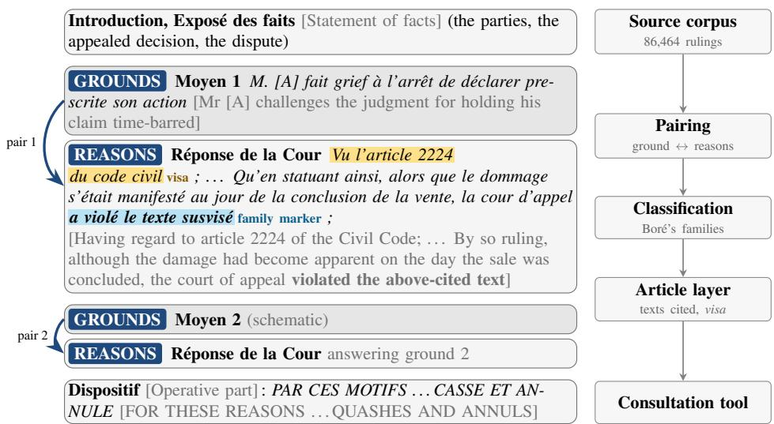
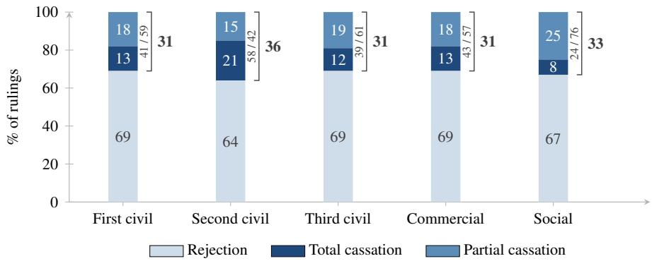
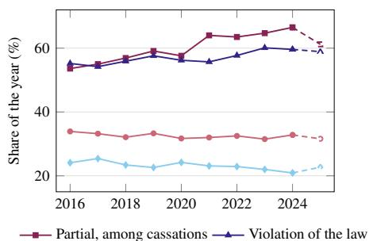
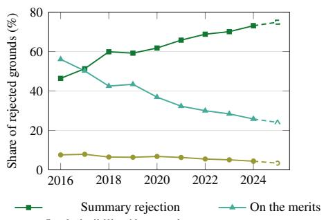

# A Grammar of French Civil Cassation: A Ground-Level Dataset and Tool

Avrile FLORO a,1, Tamara DHORASOO b, Nils HOLZENBERGER a, Thomas LE GOFF a, Tiphaine VIARD a and Maria BORITCHEV a a Télécom Paris, Institut Polytechnique de Paris, France b Université Polytechnique Hauts-de-France, France

Abstract. This paper presents a dataset of 121,536 ground–reasons pairs across 86,464 rulings of the five civil chambers of the French Court of Cassation (2016– 2025). An appeal on points of law cannot itself be appealed and often decides a case for good. Understanding how the Court rules is thus crucial and can help lawyers who draft those appeals. Inside a ruling, every ground of appeal (a distinct legal complaint against the appealed decision) has its own answer from the Court. This answer is called the reasons and it belongs to one of a few doctrinalfamilies. Using a deterministic pipeline, we pair each ground with its reasons and attach the pair to its family, according to the established French taxonomy. We obtain a descriptive grammar of civil cassation that shows which grounds succeed, which legal texts they refer to, and how both evolve over the decade. We release the dataset, the code and an interactive consultation tool2.

Keywords. Legal Dataset, Ground-Level Outcomes, Doctrinal Taxonomy

## 1. Introduction

The French Court of Cassation (Cour de cassation) sits at the top of the judiciary, for civil and criminal matters alike. When ruling on an appeal on points of law, it can either reject it or quash the appealed decision. Its ruling is the last recourse possible and, as such, it cannot be appealed. The most common outcome is rejection (67.5% of its civil rulings over 2016–2025). Since late 2021, under the open-data mandate of France’s 2016 Digital Republic Act, Judilibre3 (the Court’s publication database) gives access to its full decisions. Publication alone, however, does not deliver knowledge of case-law trends: without structure, the relevant information is buried in the mass [1]. This blind spot matters since legal scholarship documents increasingly complex laws and civil litigation [2,3]. For the specialized bar that drafts the appeals on points of law, choosing the grounds to raise is the strategy (§3). Our objective is to turn the civil cassation corpus into a structured object that is doctrinally faithful and that can be queried. Such an instrument can inform the choice of grounds and, in the process, show how the Court rules.

A ruling contains several grounds of appeal, i.e. the legal complaints the losing party brings against the appealed decision (§3). The Court answers each one separately, in its reasons (motifs, the justification it states). Each answer has its own outcome and an implicit doctrinal family: a legal category long established in French doctrine, which must be inferred from the wording of the ruling.

Contributions In this paper, we contribute a dataset, extracted from Judilibre, as well as a reproducible pipeline to analyze this dataset quantitatively, in the categories of French legal doctrine. (1) We provide 121,536 ground–reasons pairs covering the five civil chambers of the Court of Cassation from 2016 to 2025. The 117,073 pairs whose ground is accepted or rejected are attached to their doctrinal family. An article-level layer records the legal texts the Court relies on. (2) We release the deterministic rule-based method that derives these labels, audited at every stage by legally trained annotators. (3) From these counts, we draw a first descriptive grammar of civil cassation accessible through an interactive tool, as an example of the analyses the dataset makes possible.

## 2. Related Work

Predicting the outcome ofa case The most common way to study court decisions computationally is through legal judgment prediction: giving a model the text of a case and letting it predict the outcome [4,5,6], pioneered on the European Court of Human Rights (ECtHR) [7]. The work closest to ours is Sulea et al. [8], who classify decisions of the Court of Cassation and report strong performance at predicting the case-level ruling. A ruling of the Court often rejects some grounds and quashes others inside the same decision (§7), which a single label per case cannot show. We therefore lower the unit of analysis from the ruling to the single ground. For French domestic case law, the existing resources stay at the level of the whole decision: linked first-instance and appellate judgments [9] and outcome-labeled court of appeal rulings on a single issue [10]. To our knowledge, no ground-level resource exists for the Court of Cassation.

Recovering the internal structure ofa decision A different line of work tries to recover what happens inside a judgment instead of only its final outcome. Rhetorical-role labeling tags each sentence with what it does in the text, for instance in Indian Supreme Court judgments [11,12,13]. In our work, rather than segmenting the decision from scratch, we build on the zoning that Judilibre already provides: the division of each ruling into functional zones (§4). We then link each argument to the passage that responds to it (§5.1). This pairing of a ground with the Court’s reasons is, in practice, a relational form of argument mining, which detects, types and links the arguments of a decision [14], recently revisited with LLMs and few-shot methods [15]. Related annotation efforts structure civil-law and EU decisions semantically or by interpretative function [16,17], or annotate ECtHR citations in context and release an exploration tool [18].

Rule-based methods and interpretability Explicit rules are the oldest way of treating legal text by computer [19] and did not disappear when machine learning arrived [20]. They remain a preferred first pass on clearly patterned legal text [21], including for segmenting court decisions from open legal data [22]. Rudin [23] argues that high-stakes settings call for interpretable models rather than explained black boxes. Expert-curated factor lists still outperform LLM-discovered ones for case outcome prediction [24]. In our system, each outcome points back to a doctrinal family drawn from Boré’s taxonomy [25] (§3): a jurist can retrace every decision and disagree on legal terms.

  
Figure 1. The zones of a ruling (left, adapted from Civ. 3, 2019, no. 18-12.682) and the pipeline that reads them (right). Only the badged zones are extracted. Highlighted: the matched visa and family marker.

French legal NLP and language models The reference language model is JuriB-ERT [26], a BERT model pre-trained on legal French including pseudonymized Court of Cassation decisions [27], which is the data we work on. On the same court, Charmet et al. [28] train models to generate the keyword sequences that index the rulings. A final group of studies measures how far one can trust a large language model on legal tasks [29,30]. We build the resource itself with deterministic rules. We use fine-tuned models, JuriBERT among them, as baselines against those rules (§6.2).

## 3. Background: How the Court of Cassation Writes

A court of law, not of facts The Court of Cassation is not a third instance since it does not re-try cases nor re-examine the evidence: it reviews whether the law was properly applied by the lower court. A party who has lost before a court of appeal files an appeal on points of law. If the court of appeal erred in law, the decision is quashed by the Court of Cassation and remitted to a different one. A cassation can be total (the whole appealed decision falls) or partial (only part of it is quashed).

Anatomy of a ruling Rulings follow a near-fixed sequence of functional zones (Figure 1). In October 2019, the Court adopted a direct-style drafting [31]. Now, the reasons start with « Réponse de la Cour » [The Court’s reasons], while before they opened with « Attendu que » [Whereas]. When a ground succeeds, the reasoning usually starts with a visa (« Vu l’article . . . » [Having regard to article . . . ]). This is the legal footing which lists the texts the Court relies on. Grounds and reasons alternate down the ruling.

How an appeal on points of law is built Appeals on points of law are drafted by a specialized bar, the avocats aux Conseils, who hold a monopoly on representation before the Court of Cassation (Code of Civil Procedure, hereafter CPC, art. 973). They were 132 in 2025 [32]. They file a statement of grounds of appeal in which their legal criticisms are presented as a numbered list of grounds (CPC, art. 978). A ground attacks one or several heads of the appealed decision (the precise points the court of appeal decided). Grounds can split further into branches: numbered sub-arguments, a point of law each.

Table 1. The doctrinal families of cassation.
<table><tr><td>Doctrinal family</td><td>Description</td><td>Typical wording</td></tr><tr><td>Violation of the law Lack of legal basis</td><td>preted incorrectly.</td><td>A legal text was applied or inter- « la cour d&#x27;appel a violé le texte susvisé » [the court of appeal violated the above-cited text] The factual findings are incomplete, « sans rechercher si ..., la cour d’appel a privé</td></tr><tr><td></td><td>law was correctly applied.</td><td>so the Court cannot check that the sa décision de base légale » [without investigat- ing whether .. . , the court deprived its decision of legal basis]</td></tr><tr><td>Distortion</td><td>meaning.</td><td>The court misread a clear and pre- « en dénaturant les termes clairs et précis cise document: it betrayed its plain de .. . » [by distorting the clear and precise terms of ...]</td></tr><tr><td>Defect of reasons</td><td>The reasoning is absent, contradic- « sans répondre aux conclusions party&#x27;s submissions.</td><td> $\dots ,$  la cour tory, doubtful or fails to answer a d&#x27;appel n&#x27;a pas satisfait aux exigences du texte susvisé » [without answering the submissions . . . , the court did not meet the requirements of the above-cited text]</td></tr><tr><td>Excess of power</td><td>tion or its office.</td><td>The court overstepped its jurisdic- « la cour d’appel a excédé ses pouvoirs » [the court of appeal exceeded its powers]</td></tr><tr><td>Breach of procedure</td><td>most often the adversarial principle. olation of the adversarial principle]</td><td>A procedural rule was violated, « violation du principe de la contradiction » [vi-</td></tr><tr><td>Omission / ultra petita</td><td>or ruled beyond what was claimed. ruling on matters not claimed]</td><td>The court failed to rule on a claim, « en statuant sur des choses non demandées » [by</td></tr><tr><td>Contrariety of judgments</td><td>rendered between the same parties. able decisions]</td><td>Two irreconcilable decisions were « deux décisions inconciliables » [two irreconcil-</td></tr></table>

The families of cassation When the Court quashes, doctrine sorts the why into a small set of families. The taxonomy was settled long ago and its canonical modern statement is Boré’s treatise, continuously re-edited since 1980 [25] and written by two presidents of the Ordre des avocats aux Conseils. The list is deliberately not statutory. Consulted on the draft Code of Civil Procedure, the Conseil d’État (France’s supreme administrative court) advised against an exhaustive enumeration, so that the Court stays, as Boré puts it, master of its own openings [25]. The criminal openings, by contrast, are fixed by the Code of Criminal Procedure [33]. Table 1 lists the families as they stand today.

The families of rejection Rejection has its families too: doctrine [25] distinguishes the three situations of Table 2. Boré treats an inoperative ground as a form of inadmissibility, and we report the two together as one family.

## 4. Corpus Construction

Source Our corpus is made of the rulings of the Court of Cassation. We retrieved it from Judilibre (§1), accessed through PISTE, the public French API portal. We collected the data once, in May 2026. We retrieved 548,126 decisions over 1947–2026. They contain more than the text of the ruling: procedural metadata (chamber, formation, decision date)

Table 2. The rejection families.
<table><tr><td>Rejection family</td><td>Description</td><td>Typical wording</td></tr><tr><td></td><td>Summary rejection The Court just declares that the ground cannot « pas lieu de statuer par une dé- lead to cassation, and does not say why.</td><td>cision spécialement motivée » [no specially reasoned decision needed]</td></tr><tr><td>On the merits</td><td>The reasons discuss the ground&#x27;s legal substance « le moyen n’est pas fondé » [the and find it wanting.</td><td>ground is ill-founded]</td></tr><tr><td>inoperativeness (one family,</td><td>Inadmissibility and Inadmissible: the ground cannot even be exam- « le moyen est irrecevable » [the ined, for instance because it is raised for the first ground is inadmissible] time before the Court.</td><td></td></tr><tr><td>following Boré)</td><td>change the outcome. It attacks a block of reasons ground is inoperative] the decision did not rely on.</td><td>Inoperative: the ground may be right, yet cannot « le moyen est inopérant » [the</td></tr></table>

and an outcome label (the decision field) indicating whether the ruling is a cassation, a rejection, or something else. Whether a cassation is total or partial is not in the metadata. We derive it from the operative part (which either quashes the whole decision or lists the quashed heads). Crucially, the section offsets are also available, showing where each functional zone of the decision starts and ends (including the Court’s reasons).

Scope The Court of Cassation has five civil chambers and a criminal one (Code of Judicial Organization, hereafter COJ, art. R. 421-3). We focus on the civil chambers (first, second and third civil, commercial, and social). The criminal chamber is excluded: its openings for cassation follow a different logic (§3) and its procedure differs substantially [33]. We only keep the rulings that decide an appeal on points of law. Hence, nonjudgment decisions, petitions and withdrawals are discarded (the petitionfilter). The time period runs from 2016 to 2025. Indeed, coverage of section offsets for cassations jumps from almost none (0–1% in 2008–2015) to 91–100% from 2016 on. We obtain 86,464 cassation and rejection rulings. The source decisions are pseudonymized by the Court and we remove residual names before release. Statistics are aggregated by chamber, not by individual judge, as French law prohibits judicial profiling (COJ, art. L. 111-13).

## 5. Method

One pair is one ground and the block of the Court’s reasons that answers it. Branches are not counted separately. While the ground is the unit we count, the Court’s reasons are the only text our rules read (Figure 1).

## 5.1. Pairing Each Ground with the Court’s Reasons

The alternating construction of the ruling (§3) makes the pairing natural. We first align grounds to reasons by position: the i-th ground pairs with the i-th block of reasons. Equal counts on both sides indicate that nothing was split or lost. They differ in 14,826 rulings. We use deterministic rules to re-merge split grounds or blocks of reasons and to give lone blocks of reasons a pair of their own. The rules use the drafting conventions, such as ground numbering or opening and closing formulas. After this stage, we reach 121,536 pairs over 86,464 rulings. Roughly 32% of pairs carry no ground text anywhere in their ruling. Those are almost all rejections, since in a summary rejection the ground is often sent to an annex instead of being reproduced in the main ruling. In those cases, the pipeline builds a degenerate pair (an empty ground facing a block of reasons), which does not impact classification since only the reasons are read. A few cassations (≈ 1.3% of the accepted grounds) also come without their ground text, due to joined appeals, grounds the Court raised on its own, or zoning gaps.

Table 3. The six outcome statuses and their distribution over the final corpus.
<table><tr><td>Status</td><td>Meaning</td><td>Pairs</td><td>Share</td></tr><tr><td>Rejected</td><td>the ground fails</td><td>84,460</td><td>69.5%</td></tr><tr><td>Accepted</td><td>the ground succeeds, cassation</td><td>32,613</td><td>26.8%</td></tr><tr><td>No-match</td><td>no signal found</td><td>2,735</td><td>2.3%</td></tr><tr><td>Consequential</td><td>cassation by consequence</td><td>907</td><td>0.7%</td></tr><tr><td>Out-of-scope</td><td>not a ground on the merits</td><td>666</td><td>0.5%</td></tr><tr><td>Conflict</td><td>contradictory signals</td><td>155</td><td>0.1%</td></tr></table>

## 5.2. Classifying the Outcome ofEach Ground

Every pair receives one of the six outcomes of Table 3. Three statuses are linked to the legal substance: accepted (the ground succeeds), rejected (the ground fails), and consequential cassation (a head falls with the head it depended on). The other three are structural only: no-match, out-of-scope and conflict. The status is derived from a fixed list of regular-expression detectors. They first scan the reasons for cassation signals, then run the same text through the separate rejection pipeline. If the reasons match both pipelines and belong to a rejection ruling, the pair is classified as rejected, since no ground succeeds in such a ruling. When the ruling is a cassation (partial or total), we do not force a classification. As a result, 155 pairs keep the conflict status. When the reasons match neither pipeline, two filters apply: one for the wording of a consequential cassation, one for the closing “Scope and consequences of the cassation” section, which answers no ground and is treated as out-of-scope. What remains is classified as no-match.

## 5.3. Doctrinal Families: How the Court Quashes, Why It Rejects

The outcome says who wins, which Judilibre already gives at the ruling level (§4). The doctrinal family says why the Court quashed or refused to quash, which is novel. For the accepted grounds, we follow the doctrinal families of §3: we read the Court’s reasons with a grid of 149 regular-expression detectors, applied as a cascade. We start from the most specific verbal marker down to the most residual one (violation of the law). On the rejection side, a second grid of 110 patterns sorts each ground into the three families of §3. This assignment is multi-label: a ground can, for instance, be inadmissible in one branch and ill-founded in another. Both grids were written from the canonical formulas of each family, as found in doctrine and in Boré’s treatise [25], then refined on the blocks they left unmatched, before the gold annotation. These labels form a silver set (automatically generated). Section 6 validates them against a hand-annotated gold set.

## 5.4. From Grounds to Texts: Article-Level Granularity

A final stage scans each block of reasons for references to articles and codes. Each reference gives the article’s code and number, whether it is cited in the visa (§3) or only in

the body of the reasons. Each reference inherits its pair’s outcome: an article is accepted when its ground is. The 2016 reform of the law of obligations renumbered the Civil Code. Where possible, we map the old numbering onto the new (e.g. article 1382 ↔ 1240).

## 6. Validation

Annotation protocol All annotation is blind to the machine labels and performed by annotators with at least five years of legal education each. The structural stages (decision field, petition filter, ground pairing, unusual statuses) are audited by a single annotator. The doctrinal families are doubly annotated: two annotators independently read the same 400 grounds (200 accepted, 200 rejected). Their disagreements are adjudicated between them. The adjudicated gold is compared with the machine labels.

## 6.1. Sampling Design

Sample sizes are in Table 4. Two stages are drawn uniformly, for unbiased estimates: (1) the decision field, drawn before the scope filter and relabeled outcome by outcome, and (2) the pairing, where each ground is checked against the reasons answering it. Targeted draws focus on the error-prone cases: (1) the petition filter (§4) is audited on decisions worded like petitions, and (2) six pools of 100 cover the four unusual statuses of Table 3 (no-match, conflict, out-of-scope, consequential) and the blocks with no reproduced ground (accepted and summary-rejection, §5.1), plus 20 uniform controls. The family campaign mixes the two regimes: on each side, 50 grounds are drawn uniformly and 150 are stratified, so that rare families are covered. Aggregate figures are then reweighted to the corpus distribution.

## 6.2. Results by Stage

Table 4 gathers the figures. Structural stages are reported as percent agreement with the machine label. The pairing audit finds a single pair merging two grounds. Among the unusual statuses, precision goes from 95% (out-of-scope) to 100% where a machine label can be confirmed. The no-match pool is roughly half non-merits material, half real misses of the rules. Table 6 reports the double annotation of the doctrinal families, measured with Cohen’s κ [34]. On the sample, per-family κ ranges from 0.90 to 0.99 (two classes are too rare to measure). After reweighting, all families stay at $\kappa \geq 0 . 9 6$ except inadmissibility/inoperativeness, which drops to 0.83: it represents only 6.2% of rejections (§7). κ corrects for chance more severely on a rare class, and 9 of the 10 rejection disagreements involve this label. All 17 (10 rejected, 7 accepted) were adjudicated jointly into a gold set, which confirms the machine label on 90.5% of accepted grounds (181/200) and 91.5% of rejected ones (183/200). Table 5 scores all baselines against it.

Baselines We want to check whether the released labels are learnable and whether a model beats the rules. We fine-tune the base versions of JuriBERT (§2) and Camem-BERTv2 [35] to predict the doctrinal families from the silver labels, reading the blocks of reasons. Predictions mirror the dataset’s label structure (§5.3): single-label over the six main cassation families (Table 1, without omission and contrariety) for accepted grounds, and multi-label over the three rejection families of Table 2 for rejected ones (balanced training, learning rate $2 \times 1 0 ^ { - 5 } .$ , effective batch 32, at most four epochs, checkpoint selection on a held-out split). Evaluation uses a held-out gold set of 200 rejected and 197 accepted grounds: the three accepted grounds whose family lies outside the six the models predict are dropped. Both fine-tuned models beat the rules on rejected grounds and stay below them on accepted ones, the generalist model falling far behind on accepted grounds. A zero-shot LLM (Qwen3-32B [36]) is given the annotators’ guideline and their answer options and stays below the rules. JuriBERT errors concentrate on the cases where the gold and the rules already disagree (82% of them, against 1–4% of the agreement cases). The zero-shot LLM shows a much weaker concentration (18–35% against 9–12% of the agreement cases). Trained on silver labels, the fine-tuned models inherit their blind spots.

Table 4. Validation by stage.
<table><tr><td>Stage</td><td>Sampling (n)</td><td>Agreement</td></tr><tr><td>Decision field</td><td>uniform (200)</td><td>99.5%</td></tr><tr><td>Petition filter</td><td>targeted (200)</td><td>99.0%</td></tr><tr><td>Ground pairing</td><td>uniform (200)</td><td>99.5%</td></tr><tr><td>Unusual statuses</td><td>targeted (620)</td><td>95-100%</td></tr><tr><td>Doctrinal families double annot.</td><td> $( 2 \times 2 0 0 )$ </td><td>Table 6</td></tr></table>

Table 5. Agreement of the baselines with the held-out gold (197 accepted, 200 rejected).
<table><tr><td></td><td></td><td>Accepted Rejected</td></tr><tr><td>Rules (this paper)</td><td>91.4%</td><td>91.5%</td></tr><tr><td>JuriBERT</td><td>89.3%</td><td>92.0%</td></tr><tr><td>CamemBERTv2</td><td>78.7%</td><td>93.5%</td></tr><tr><td>Qwen3-32B (0 shot)</td><td>87.3%</td><td>88.5%</td></tr></table>

Table 6. Double annotation of the doctrinal families.
<table><tr><td colspan="2"></td><td colspan="2">Sample</td><td colspan="2">Corpus (reweighted)</td></tr><tr><td>Outcome (n)</td><td>Reading</td><td>κ [95% CI]</td><td>Agreement</td><td>κ [95% CI]</td><td>Agreement</td></tr><tr><td>Accepted (200)</td><td>single-label</td><td>0.957 [0.922–0.987]</td><td>96.5%</td><td>0.961 [0.917–0.993]</td><td>97.5%</td></tr><tr><td>Rejected (200)</td><td>exact sets</td><td>0.932 [0.889–0.972]</td><td>95.0%</td><td>0.929 [0.876–0.973]</td><td>95.9%</td></tr></table>

## 7. Results: A Grammar of Civil Cassation

How appeals on points oflaw resolve The 86,464 civil rulings of 2016–2025 split into 28,144 cassations (32.5%) and 58,320 rejections. The cassations are more often partial than total (59.8% partial). The cassation rate is almost the same across the five chambers, from 31% to 36%, but its form is not: total cassations dominate only in the second civil chamber (58%), against 24% in the social chamber (Figure 2). The Court also decides each ground on its own, so one ruling can simultaneously accept a ground and reject another. These mixed rulings account for more than one cassation ruling in three (38.8%). The total/partial divide is about the decision (how much of it falls), not the grounds.

The grammar of cassation A doctrinal family is attached to 97.9% of cassation rulings. The distribution across families is highly concentrated (Table 7). Violation of the law (56.9%) and lack of legal basis (23.2%) amount to 80.1% of all accepted grounds. The rest is a long tail. Two families of Table 1 are absent in practice: omission (one detected pair, an ultra petita) and contrariety of judgments (no detected pair). Omissions are repaired by the court that made them (CPC, art. 463) and a successful contrariety ends in an annulment, outside our scope (§4). The distribution of families varies by chamber (Table 8).

  
Figure 2. How appeals on points of law resolve, by chamber (2016–2025).

Table 7. Accepted grounds of cassation.
<table><tr><td>Doctrinal family</td><td>Grounds</td><td>Share</td></tr><tr><td>Violation of the law</td><td>18,542</td><td>56.9%</td></tr><tr><td>Lack of legal basis</td><td>7,572</td><td>23.2%</td></tr><tr><td>Defect of reasons</td><td>2,073</td><td>6.4%</td></tr><tr><td>Excess of power</td><td>1,920</td><td>5.9%</td></tr><tr><td>Breach of procedure</td><td>1,255</td><td>3.8%</td></tr><tr><td>Distortion</td><td>1,250</td><td>3.8%</td></tr><tr><td>Omission / ultra petita</td><td>1</td><td>0.0%</td></tr></table>

Table 8. Family shares within each chamber’s accepted grounds (%).
<table><tr><td></td><td>Civ.1 Civ. 2</td><td></td><td>Civ. 3</td><td>Com. Soc.</td></tr><tr><td>Violation of the law</td><td>54.8</td><td>61.7</td><td>52.7 50.4</td><td>60.1</td></tr><tr><td>Lack of legal basis</td><td>23.3</td><td>19.5</td><td>23.2</td><td>29.1 22.8</td></tr><tr><td>Defect of reasons</td><td>5.9</td><td>4.6</td><td>9.9</td><td>7.3 5.6</td></tr><tr><td>Excess of power</td><td>6.4</td><td>5.1</td><td>6.1</td><td>4.9 6.7</td></tr><tr><td>Breach of procedure</td><td>5.2</td><td>5.4</td><td>3.8</td><td>3.4 2.2</td></tr><tr><td>Distortion</td><td>4.4</td><td>3.7</td><td>4.3</td><td>4.9 2.7</td></tr></table>

The grammar of rejection The rejection families are multi-label (§5.3) and 99.6% of the rejection rulings are associated with at least one rejection mechanism. Over the 84,460 rejected grounds, the shares overlap and do not add up to one. Overall, summary rejection covers 61.9% of these grounds, while 38.4% of them are dismissed on the merits. Rejections for inadmissibility or inoperativeness are fairly rare, at 6.2%.

Movement over the decade Figure 3 shows that the cassation rate is stable over time, staying around a third over the decade, while partial cassations gain thirteen points (from 53.6% in 2016 to 66.5% in 2024). Among the grounds, violation of the law rises and lack of legal basis falls (Figure 3, left). Scholarship has measured the share of partial cassations for 2017–2021 [37], but the upward trend itself has, to our knowledge, not been reported before. The composition of the rejections moves even more (Figure 3, right). Summary rejection carried 46.4% of the rejected grounds of 2016 and 73.1% of those of 2024, a rise of almost twenty-seven points, while rejection on the merits and inadmissibility both decline. The caseload does not explain this rise. The number of rulings falls over the same period, from 9,685 in 2016 to 8,074 in 2024. The Court made explicit in 2020 that it reserves reasoned rejections for cases with normative value [38]: for the other grounds, the case law only records that they failed. A ground-level count like ours makes visible the extent of that silence, how many grounds it covers and how fast it spreads.

Which texts the Court mobilizes Of all pairs, 74.2% cite at least one article in their reasons that we can resolve to a code. The summary-rejection blocks almost always cite article 1014 CPC (§7). The article layer (§5.4) records, for each text, how often it is cited, accepted, and put in the visa. Table 9 shows three contrasted examples: a substantive text mainly accepted and put in the visa, a contested one, and a procedural lever that is massively cited but almost absent from the visa. The labeled corpus can be browsed through our interactive web application. It shows, for each article, how many blocks of reasons cite it, how their outcomes split, and into which doctrinal families.

  
Cassation rate Lack of legal basis

  
Inadmissibility / inoperativeness  
Figure 3. Yearly shares, 2016–2025: the cassation side (left) and the rejection side (right). 2025 is incomplete.

Table 9. Three article profiles from the article layer.
<table><tr><td>Text</td><td>Citations Accepted</td><td></td><td> In visa</td></tr><tr><td>Art. 1134 Civil Code, former numbering (binding force of contracts)</td><td>1,576</td><td>90.1%</td><td>90.2%</td></tr><tr><td>Art. L. 1154-1 Labour Code (proof of workplace harassment)</td><td>324</td><td>46.0%</td><td>46.9%</td></tr><tr><td>Art. L.411-3 COJ (cassation without referral)</td><td>2,281</td><td>95.2%</td><td>3.1%</td></tr></table>

## 8. Limitations and Conclusion

Limitations and perspectives The main limitation comes from the rules: the doctrinal families are read from canonical wording, so that unusual phrasing escapes the grids. The specific family counts are therefore lower bounds. Violation of the law, last in the cascade (§5.3), may absorb unusually worded cases of the others. The taxonomies themselves, like any doctrinal systematization, can be discussed [39]. We follow Boré’s (§3). Further constraints come from the source. Summary rejections, by nature, do not say why a ground failed. Judilibre zoning, extensive only from 2016 (§4), sometimes merges several grounds into one (§6.2). LLM-based segmentation could lift this dependence.

Conclusion The dataset turns the case law of the five civil chambers into a queryable, ground-level resource: 121,536 pairs labeled with their outcomes and 117,073 of them attached to their doctrinal families. Two families make up 80% of the accepted grounds, summary rejection keeps rising, and cassations become steadily more partial. The grids are specific to French civil law: future work includes rewriting them for the criminal chamber. The Court’s own open-data report calls for systematic and exhaustive studies of case law [40]. We release ours: the dataset, the code and the tool.

## References

[1] Cadiet L. L’open data des décisions de justice: mission d’étude et de préfiguration sur l’ouverture au public des décisions de justice. Paris: Ministère de la Justice; 2018. Available from: https://www.vie-p ublique.fr/rapport/37090-open-data-des-decisions-de-justice-mission-prefiguration.

[2] Conseil d’État. Sécurité juridique et complexité du droit. La Documentation française; 2006. Available from: https://www.conseil-etat.fr/publications-colloques/etudes/etudes-annuelles/securite-juridique-e t-complexite-du-droit.

[3] Inspection générale de la justice. Le traitement des dossiers civils longs et complexes. Ministère de la Justice; 2021. 127-21. Available from: https://www.justice.gouv.fr/sites/default/files/migrations/portail/ art\_pix/Rapport\_traitement\_dossiers\_civils\_long.pdf.

[4] Chalkidis I, Androutsopoulos I, Aletras N. Neural Legal Judgment Prediction in English. In: Korhonen A, Traum D, Màrquez L, editors. Proceedings of the 57th Annual Meeting of the Association for Computational Linguistics. Florence, Italy: Association for Computational Linguistics; 2019. p. 4317-23. Available from: https://aclanthology.org/P19-1424/. doi:10.18653/v1/P19-1424.

[5] Katz DM, Bommarito MJ II, Blackman J. A general approach for predicting the behavior of the Supreme Court of the United States. PLOS ONE. 2017 Apr;12(4):e0174698. Available from: https://doi.org/10 .1371/journal.pone.0174698. doi:10.1371/journal.pone.0174698.

[6] Xiao C, Zhong H, Guo Z, Tu C, Liu Z, Sun M, et al. CAIL2018: A Large-Scale Legal Dataset for Judgment Prediction. arXiv preprint. 2018. Available from: https://arxiv.org/abs/1807.02478. doi:10.48550/arXiv.1807.02478.

[7] Aletras N, Tsarapatsanis D, Preo¸tiuc-Pietro D, Lampos V. Predicting judicial decisions of the European Court of Human Rights: a Natural Language Processing perspective. PeerJ Computer Science. 2016 Oct;2:93. Available from: http://dx.doi.org/10.7717/peerj-cs.93. doi:10.7717/peerj-cs.93.

[8] ¸Sulea OM, Zampieri M, Vela M, van Genabith J. Predicting the Law Area and Decisions of French Supreme Court Cases. In: Mitkov R, Angelova G, editors. Proceedings of the International Conference Recent Advances in Natural Language Processing, RANLP 2017. Varna, Bulgaria: INCOMA Ltd.; 2017. p. 716-22. Available from: https://aclanthology.org/R17-1092/. doi:10.26615/978-954-452-049-6\_092.

[9] Condevaux C, Mathis B, Mahmoudi SA, Mussard S, Zambrano G. Linking Appellate Judgments to Tribunal Judgments – Benchmarking Different ML Techniques. In: Francesconi E, Borges G, Sorge C, editors. Legal Knowledge and Information Systems: JURIX 2022. vol. 362 of Frontiers in Artificial Intelligence and Applications. Amsterdam: IOS Press; 2022. p. 33-42. Available from: https://ebooks.i ospress.nl/doi/10.3233/FAIA220446. doi:10.3233/FAIA220446.

[10] Vaudaux O, Bazzoli C, Coavoux M, Vial G, Vergès É. Pretrained Language Models v. Court Ruling Predictions: A Case Study on a Small Dataset of French Court of Appeal Rulings. In: Preotiuc-Pietro D, Goanta C, Chalkidis I, Barrett L, Spanakis G, Aletras N, editors. Proceedings of the Natural Legal Language Processing Workshop 2023. Singapore: Association for Computational Linguistics; 2023. p. 38-43. Available from: https://aclanthology.org/2023.nllp-1.5/. doi:10.18653/v1/2023.nllp-1.5.

[11] Saravanan M, Ravindran B. Identification of rhetorical roles for segmentation and summarization of a legal judgment. Artificial Intelligence and Law. 2010 Mar;18(1):45-76. Available from: https://doi.org/ 10.1007/s10506-010-9087-7. doi:10.1007/s10506-010-9087-7.

[12] Bhattacharya P, Paul S, Ghosh K, Ghosh S, Wyner A. Identification of Rhetorical Roles of Sentences in Indian Legal Judgments. In: Araszkiewicz M, Rodríguez-Doncel V, editors. Legal Knowledge and Information Systems: JURIX 2019. vol. 322 of Frontiers in Artificial Intelligence and Applications. Amsterdam: IOS Press; 2019. p. 3-12. Available from: https://ebooks.iospress.nl/volumearticle/53648. doi:10.3233/FAIA190301.

[13] Malik V, Sanjay R, Guha SK, Hazarika A, Nigam SK, Bhattacharya A, et al. Semantic Segmentation of Legal Documents via Rhetorical Roles. In: Aletras N, Chalkidis I, Barrett L, Goanta C, Preot˘ iuc-Pietro D, editors. Proceedings of the Natural Legal Language Processing Workshop 2022. Abu Dhabi, United Arab Emirates (Hybrid): Association for Computational Linguistics; 2022. p. 153-71. Available from: https://aclanthology.org/2022.nllp-1.13/. doi:10.18653/v1/2022.nllp-1.13.

[14] Mochales R, Moens MF. Argumentation Mining. Artificial Intelligence and Law. 2011;19(1):1-22. Available from: https://link.springer.com/article/10.1007/s10506-010-9104-x. doi:10.1007/s10506- 010-9104-x.

[15] Xu H, Ashley K. Label-Aware Contextual Retrieval for Few-Shot Legal Argument Mining. In: Markovich R, Di Caro L, Rapp A, Schifanella C, editors. Legal Knowledge and Information Systems: JURIX 2025. vol. 416 of Frontiers in Artificial Intelligence and Applications. Amsterdam:

IOS Press; 2025. p. 216-27. Available from: https://ebooks.iospress.nl/volumearticle/76897. doi:10.3233/FAIA251590.

[16] Zorzanelli Costa M, Faria Robson D, Vieira TBP, Bourguet JR, Guizzardi G, Almeida JPA. Automated Semantic Annotation Pipeline for Brazilian Judicial Decisions. In: Savelka J, Harasta J, Novotna T, Misek J, editors. Legal Knowledge and Information Systems: JURIX 2024. vol. 395 of Frontiers in Artificial Intelligence and Applications. Amsterdam: IOS Press; 2024. p. 226-38. Available from: https: //ebooks.iospress.nl/doi/10.3233/FAIA241248. doi:10.3233/FAIA241248.

[17] Grundler G, Santin P, Fidelangeli A, Mignone R, Galli F, Galassi A, et al. Automated Extraction of Judicial Interpretative Formulas in EU Case Law on VAT. In: Markovich R, Di Caro L, Rapp A, Schifanella C, editors. Legal Knowledge and Information Systems: JURIX 2025. vol. 416 of Frontiers in Artificial Intelligence and Applications. Amsterdam: IOS Press; 2025. p. 294-9. Available from: https://ebooks.iospress.nl/doi/10.3233/FAIA251600. doi:10.3233/FAIA251600.

[18] Mumford J, Florimonte F, Atkinson K, Dzehtsiarou K. Context-Aware Citation Networks: A Human– AI Dataset, Analysis, and Tool. In: Markovich R, Di Caro L, Rapp A, Schifanella C, editors. Legal Knowledge and Information Systems: JURIX 2025. vol. 416 of Frontiers in Artificial Intelligence and Applications. Amsterdam: IOS Press; 2025. p. 145-55. Available from: https://ebooks.iospress.nl/doi/1 0.3233/FAIA251584. doi:10.3233/FAIA251584.

[19] Sergot MJ, Sadri F, Kowalski RA, Kriwaczek F, Hammond P, Cory HT. The British Nationality Act as a logic program. Commun ACM. 1986 May;29(5):370-86. Available from: https://doi.org/10.1145/56 89.5920. doi:10.1145/5689.5920.

[20] Chiticariu L, Li Y, Reiss FR. Rule-Based Information Extraction is Dead! Long Live Rule-Based Information Extraction Systems! In: Yarowsky D, Baldwin T, Korhonen A, Livescu K, Bethard S, editors. Proceedings of the 2013 Conference on Empirical Methods in Natural Language Processing. Seattle, Washington, USA: Association for Computational Linguistics; 2013. p. 827-32. Available from: https://aclanthology.org/D13-1079/.

[21] Nan H, Marx M, Wolswinkel J. Combining Rule-Based and Machine Learning Methods for Efficient Information Extraction from Enforcement Decisions. In: Savelka J, Harasta J, Novotna T, Misek J, editors. Legal Knowledge and Information Systems: JURIX 2024. vol. 395 of Frontiers in Artificial Intelligence and Applications. Amsterdam: IOS Press; 2024. p. 321-6. Available from: https://ebooks.i ospress.nl/doi/10.3233/FAIA241262. doi:10.3233/FAIA241262.

[22] Darji H, Heckelmann M, Kratsch C, de Melo G. Segmentation and Processing of German Court Decisions from Open Legal Data. In: Markovich R, Di Caro L, Rapp A, Schifanella C, editors. Legal Knowledge and Information Systems: JURIX 2025. vol. 416 of Frontiers in Artificial Intelligence and Applications. Amsterdam: IOS Press; 2025. p. 276-81. Available from: https://ebooks.iospress.nl/doi/1 0.3233/FAIA251597. doi:10.3233/FAIA251597.

[23] Rudin C. Stop explaining black box machine learning models for high stakes decisions and use interpretable models instead. Nature Machine Intelligence. 2019;1(5):206-15. Available from: https: //www.nature.com/articles/s42256-019-0048-x. doi:10.1038/s42256-019-0048-x.

[24] Gray M, Savelka J, Oliver W, Ashley K. Using LLMs to Discover Legal Factors. In: Savelka J, Harasta J, Novotna T, Misek J, editors. Legal Knowledge and Information Systems: JURIX 2024. vol. 395 of Frontiers in Artificial Intelligence and Applications. Amsterdam: IOS Press; 2024. p. 60-71. Available from: https://ebooks.iospress.nl/doi/10.3233/FAIA241234. doi:10.3233/FAIA241234.

[25] Boré J, Boré L. La cassation en matière civile. 6th ed. Dalloz action. Editions Dalloz; 2023.

[26] Douka S, Abdine H, Vazirgiannis M, El Hamdani R, Restrepo Amariles D. JuriBERT: A Masked-Language Model Adaptation for French Legal Text. In: Aletras N, Androutsopoulos I, Barrett L, Goanta C, Preotiuc-Pietro D, editors. Proceedings of the Natural Legal Language Processing Workshop 2021. Punta Cana, Dominican Republic: Association for Computational Linguistics; 2021. p. 95-101. Available from: https://aclanthology.org/2021.nllp-1.9/. doi:10.18653/v1/2021.nllp-1.9.

[27] Girard-Chanudet C. La justice algorithmique en chantier. Sociologie du travail et des infrastructures de l’Intelligence Artificielle [PhD thesis]. EHESS (École des Hautes Études en Sciences Sociales); 2023. Available from: https://hal.science/tel-04398889.

[28] Charmet T, Cherichi I, Allain M, Czerwinska U, Fouret A, Sagot B, et al. Complex Labelling and Similarity Prediction in Legal Texts: Automatic Analysis of France’s Court of Cassation Rulings. In: Calzolari N, Béchet F, Blache P, Choukri K, Cieri C, Declerck T, et al., editors. Proceedings of the Thirteenth Language Resources and Evaluation Conference. Marseille, France: European Language Resources Association; 2022. p. 4754-66. Available from: https://aclanthology.org/2022.lrec-1.509/.

[29] Dahl M, Magesh V, Suzgun M, Ho DE. Large Legal Fictions: Profiling Legal Hallucinations in Large Language Models. Journal of Legal Analysis. 2024 Jan;16(1):64-93. Available from: http://dx.doi.org /10.1093/jla/laae003. doi:10.1093/jla/laae003.

[30] Guha N, Nyarko J, Ho D, Ré C, Chilton A, K A, et al. LegalBench: A Collaboratively Built Benchmark for Measuring Legal Reasoning in Large Language Models. In: Oh A, Naumann T, Globerson A, Saenko K, Hardt M, Levine S, editors. Advances in Neural Information Processing Systems. vol. 36. Curran Associates, Inc.; 2023. p. 44123-279. Available from: https://proceedings.neurips.cc/paper\_f iles/paper/2023/file/89e44582fd28ddfea1ea4dcb0ebbf4b0-Paper-Datasets\_and\_Benchmarks.pdf. doi:10.52202/075280-1915.

[31] Cour de cassation. Guide des nouvelles règles relatives à la structure et à la rédaction des arrêts; 2019. Accessed 29 July 2026. Available from: courdecassation.fr.

[32] Autorité de la concurrence. Avis n° 25-A-06 du 16 avril 2025 relatif à la liberté d’installation et à des recommandations de créations d’offices d’avocat au Conseil d’État et à la Cour de cassation; 2025. Accessed 29 July 2026. JORF n° 0095 du 20 avril 2025. Available from: https://www.legifrance.gouv. fr/jorf/id/JORFTEXT000051493256.

[33] Boré J, Boré L. La cassation en matière pénale. 5th ed. Dalloz action. Editions Dalloz; 2024.

[34] Cohen J. A Coefficient of Agreement for Nominal Scales. Educational and Psychological Measurement. 1960;20(1):37-46. doi:10.1177/001316446002000104.

[35] Antoun W, Kulumba F, Touchent R, de la Clergerie É, Sagot B, Seddah D. CamemBERT 2.0: A Smarter French Language Model Aged to Perfection. arXiv preprint. 2024. Available from: https://arxiv.org/ab s/2411.08868. doi:10.48550/arXiv.2411.08868.

[36] Yang A, Li A, Yang B, Zhang B, Hui B, Zheng B, et al. Qwen3 Technical Report. arXiv preprint. 2025. Available from: https://arxiv.org/abs/2505.09388. doi:10.48550/arXiv.2505.09388.

[37] Cottin M, Munoz Perez B. Les cassations sans renvoi devant les chambres civiles de la Cour de cassation, 2012-2021, Enquête sur les arrêts prononcés en 2020 et 2021. Cour de cassation; 2023. Available from: https://shs.hal.science/halshs-04299829.

[38] Ferrand F. La révision de ses processus internes par la Cour de cassation. À propos du rapport du groupe de travail “Méthodes de travail de la Cour de cassation” (juin 2020). La Semaine juridique Édition générale. 2020 Sep;(act. 1027):1618-22. Available from: https://univ-lyon3.hal.science/hal-02943511.

[39] Boucard F. Pourvoi en cassation. Contrôle de la conformité du jugement. Cas d’ouverture et moyens de cassation. In: JurisClasseur Procédure civile. Paris: LexisNexis; 2017. Fasc. 1000-85.

[40] Cadiet L, Chainais C, Sommer JM. La diffusion des données décisionnelles et la jurisprudence: quelle jurisprudence à l’ère des données judiciaires ouvertes? Paris: Cour de cassation; 2022. Available from: https://doc-bibliotheque.enm.justice.fr/Default/doc/SYRACUSE/191319.