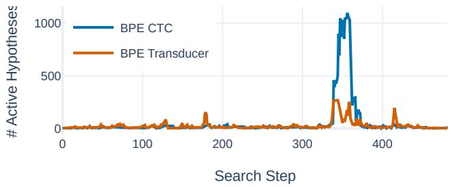
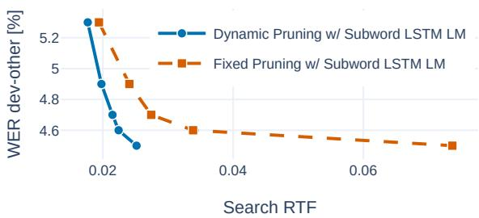
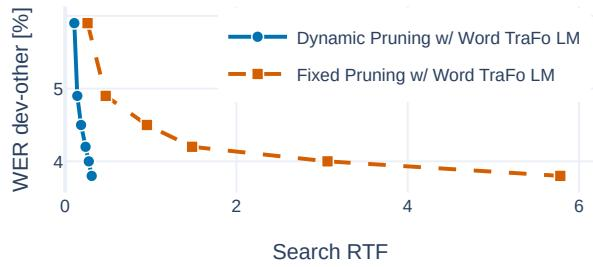
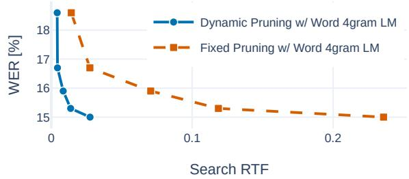

# A Systematic Comparison of Search Space Complexity and Efficiency for Time-Synchronous End-to-End ASR Models

Simon Berger

Human Language Technology and Pattern Recognition,

Computer Science Department, RWTH Aachen University, Germany

Larissa Kleppel

AppTek GmbH, Germany

berger@hltpr.rwth-aachen.de

Human Language Technology and Pattern Recognition,

Computer Science Department, RWTH Aachen University, Germany

lkleppel@hltpr.rwth-aachen.de

Ralf Schluter¨

Human Language Technology and Pattern Recognition,

Computer Science Department, RWTH Aachen University, Germany

AppTek GmbH, Germany

schlueter@hltpr.rwth-aachen.de

Abstract—Search is a central component of Automatic Speech Recognition (ASR) systems and has been deeply investigated for classical ASR modeling based on Hidden Markov Models (HMMs). However, in work on current sequence-to-sequence ASR architectures it is often simplified to a small fixed-size beam search without external Language Model (LM). In this work, we present a comparative analysis of search space complexity and efficiency for Connectionist Temporal Classification (CTC) and neural transducer models under different pruning strategies and LM configurations. We show that these end-to-end (E2E) models work with a small search space most of the time but exhibit large temporary peaks in hypothesis count during periods of uncertainty. Score-based pruning dynamically adapts the search to model uncertainty, leading to a significantly lower Real-Time Factor (RTF). Our results highlight the limitations of search with low fixed-size beam pruning and provide practical guidelines for efficient search in E2E ASR.

Index Terms—ASR, search space, pruning strategies, CTC, neural transducer

## I. INTRODUCTION & RELATED WORK

Search (or decoding) is the central process that brings together the components of an ASR system in order to turn acoustic evidence into a transcription by navigating a space of intermediate hypotheses over time. In the large vocabulary continuous speech recognition (LVCSR) era of the 1990s-2000s, search spaces often contained thousands or tens of thousands of hypotheses per time step, which drove the need for efficient search strategies and methods for search space reduction [1]–[4]. Modern neural ASR models such as CTC [5], neural transducers [6] and Attention Encoder-Decoder (AED) [7] models have changed this setting. They often exhibit sharp posterior distributions where most of the time the probability mass is concentrated on only one output class [8]. Additionally, these models are commonly defined on an orthographic (e.g. character or Byte-Pair Encoding (BPE) [9]) rather than a phonetic subword vocabulary, making search possible without a pronunciation lexicon or external LM. Due to this development, more sophisticated search methods have been largely disregarded in recent literature, and many works just report fixed beam-sizes of 1-8 without external LM integration. Dynamic score-threshold pruning and lexical prefix-tree based search organization are known techniques from classical ASR, but their practical role for modern time-synchronous E2E architectures has been underrepresented.

Most publicly available toolkits reflect this shift of focus away from search and only offer limited search capabilities for modern model architectures. Flashlight [10] offers lexicon-constrained and lexiconfree search as well as word- and subword-level LM integration, but separate pruning of within-word and word-end hypotheses is not possible and it does not provide support for transducer models. ESPnet [11] provides transducer search with neural LMs at the subword-level but does not provide lexicon- or word-level capabilities and only fixed-size beam pruning instead of dynamic score-based pruning. k2/icefall [12] also offers many options for CTC search, including a lexicon and n-gram LM but only implements neural LMs via rescoring and again lacks dynamic pruning based on a score threshold for transducer search. NeMo [13] and recent publications with it [14]–[16] aim to optimize the transducer search process fully on GPU in order to take advantage of parallelization and avoid interdevice communication. However, this approach again prohibits wordlevel processing and dynamic pruning.

In this paper, we challenge the assumption that small fixed-size beam search is sufficient for optimal performance with modern model architectures, in terms of both accuracy and speed. In our opensource toolkit RASR [17]–[19] 1 we implemented a generic search module which supports various search strategies for various E2E ASR models, allowing a comprehensive study of their behavior and search space under comparable conditions. We restrict the analysis in this work to time-synchronous CTC and monotonic transducer models because AED, Speech-Large Language Model (LLM) and related sequence-to-sequence models search label-synchronously which means that hypotheses at one search step may correspond to different input positions and finished hypotheses may have different lengths. This makes active-hypothesis-count and pruning statistics not directly comparable and introduces the length-normalization problem which is out of scope for this discussion.

The main contributions of our work are as follows:

• We systematically compare the performance of BPE and phoneme-based CTC and neural transducer models under various search conditions such as with and without lexiconconstraint as well as with and without subword- or word-level LMs.

• We analyze search space behavior across different models and task difficulty levels by computing search errors and hypothesis counts.

• We quantify the impact of dynamic vs. fixed-size beam pruning on the search accuracy (Word Error Rate (WER)) and efficiency (RTF) across datasets and search conditions.

Algorithm 1 One step of lexicon-free time-synchronous beam search.   
Scores are negative log probabilities. The subword-level LM scorer   
and the corresponding intermediate pruning step are optional.   
Require: beam H, output labels A, ASR score function scoreASR,   
optional subword-LM score function scoreSubLM   
Require: score thresholds ∆ASR, ∆SubLM, intermediate max beam   
size $B _ { \mathrm { A S R } } .$ , final max beam size BSubLM   
1: $\varepsilon \gets \emptyset$   
2: for all $q \in \mathcal H$ and $a \in { \mathcal { A } }$ do   
3: score ← score(q) + scoreASR(q, a)   
4: E ← E ∪ {(q, a, score)}   
5: end for   
6: E ← SCOREPRUNE $( \mathcal { E } , \Delta _ { \mathrm { A S R } } )$   
7: if LM is present then   
8: E ← BEAMPRUNE(E, BASR)   
9: for all $e = ( q , a ,$ score) ∈ E do   
10: if a ̸= ⟨blank⟩ then   
11: score(e) ← score(e) + λ · scoreSubLM(q, a)   
12: end if   
13: end for   
14: E ← SCOREPRUNE(E, ∆SubLM)   
15: end if   
16: H′ ← {EXTEND(q, a, score) : (q, a, score) ∈ E}   
17: H′ ← RECOMBINE(H′)   
18: H′ ← BEAMPRUNE(H′, B )   
19: return $\mathcal { H } ^ { \prime }$

• We give compact algorithmic descriptions and tuned decoding parameters for reproducibility.

Our setups are published on GitHub2.

## II. BACKGROUND

In modern ASR, the search maps a sequence of encoder states $h _ { 1 } ^ { T }$ which are computed from acoustic features $x _ { 1 } ^ { T ^ { \prime } }$ to the output sequence with maximum probability. This can be conducted in a lexicon-free (open-vocabulary) or a lexicon-constrained (closedvocabulary) manner. In the lexicon-free case, the maximization is carried out directly over subword sequences $a _ { 1 } ^ { S }$ :

$$
h _ { 1 } ^ { T } \to \operatorname * { a r g m a x } _ { a _ { 1 } ^ { S } } \biggl \{ p _ { \mathrm { S u b L M } } ( a _ { 1 } ^ { S } ) ^ { \lambda } \cdot \operatorname * { m a x } _ { y _ { 1 } ^ { T } : a _ { 1 } ^ { S } } p _ { \mathrm { A S R } } ( y _ { 1 } ^ { T } \mid h _ { 1 } ^ { T } ) \biggr \} .\tag{1}
$$

Here, $y _ { 1 } ^ { T } : a _ { 1 } ^ { S }$ denotes the set of alignments allowed by the label topology that map or collapse to the subword sequence $a _ { 1 } ^ { \dot { S } }$ . For each subword sequence there is a score contribution from a subword LM $p _ { \mathrm { S u b L M } }$ scaled by a factor λ (which may be 0) and an ASR model pASR which is broken down to frame-wise alignments.

Lexicon-constrained search works in a similar way but has an additional outer maximization over word sequences $w _ { 1 } ^ { \bar { N } }$ :

$$
\begin{array} { r l } & { h _ { 1 } ^ { T } \to \underset { w _ { 1 } ^ { N } } { \operatorname { a r g m a x } } \Biggl \{ p _ { \mathrm { W o r d L M } } ( w _ { 1 } ^ { N } ) ^ { \lambda _ { 1 } } \cdot \underset { a _ { 1 } ^ { S } : w _ { 1 } ^ { N } } { \operatorname* { m a x } } \Bigl \{ p _ { \mathrm { S u b L M } } ( a _ { 1 } ^ { S } ) ^ { \lambda _ { 2 } } } \\ & { \qquad \cdot \underset { y _ { 1 } ^ { T } : a _ { 1 } ^ { S } } { \operatorname* { m a x } } p _ { \mathrm { A S R } } ( y _ { 1 } ^ { T } \mid h _ { 1 } ^ { T } ) \Bigr \} \Biggl \} . } \end{array}\tag{2}
$$

In the inner maximization, only those label sequences $a _ { 1 } ^ { S }$ that correspond to a valid word sequence according to the lexicon are considered. This type of search also allows the integration of a wordlevel LM pWordLM in addition to pSubLM. In practice, however, usually only a word-level LM is used during lexicon-constrained search.

Algorithm 2 One step of lexicon-constrained time-synchronous tree   
search. Scores are negative log probabilities. Subword- and word-  
LM scoring are optional; word ends update the word-LM history and   
return to a tree root.   
Require: beam H, lexical prefix tree T , subword-level ASR score   
scoreASR, optional subword-LM score score , optional   
word-LM score scoreWordLM   
Require: score thresholds ∆ASR, $\Delta _ { \mathrm { S u b L M } } , \Delta _ { \mathrm { W o r d L M } }$ , intermediate   
max beam size $B _ { \mathrm { A S R } } ,$ subword-level max beam size $B _ { \mathrm { S u b L M } } ,$   
word-level max beam size BWordLM   
1: $\mathcal { E } _ { \mathrm { S u b w o r d } }  \emptyset$   
2: for all $q \in \mathcal H$ and $( a , s _ { \mathrm { n e x t } } ) \in$ SUCCESSORS(T, state(q)) do   
3: score ← score(q) + scoreASR(q, a)   
4: ESubword ← ESubword ∪ {(q, a, snext, score)}   
5: end for   
6: ESubword ← SCOREPRUNE(ESubword, ∆ASR)   
7: if SubLM is present then   
8: ESubword ← BEAMPRUNE(ESubword, $B _ { \mathrm { A S R } } )$   
9: for all $\boldsymbol { e } = ( q , a , s _ { \mathrm { n e x t } } ,$ score) ∈ ESubword do   
10: if $a \neq$ ⟨blank⟩ then   
11: score(e) ← score(e) + λ2 · scoreSubLM(q, a)   
12: end if   
13: end for   
14: ESubword ← SCOREPRUNE(ESubword, ∆SubLM)   
15: end if   
16: HSubword ← {EXTENDSUBWORD(e) : e ∈ ESubword}   
17: HSubword ← RECOMBINESUBWORD(HSubword)   
18: HSubword ← BEAMPRUNE(HSubword, BSubLM)   
19: $\mathcal { E } _ { \mathrm { w o r d } }  \emptyset$   
20: for all q ∈ HSubword and (w, sroot) ∈   
WORDENDS(T , state(q)) do   
21: score ← score(q)   
22: if WordLM is present then   
23: score $+ { = } \lambda _ { 1 }$ · scoreWordLM(q, w)   
24: end if   
25: Eword ← Eword ∪ {(q, w, sroot, score)}   
26: end for   
27: Eword ← SCOREPRUNE(Eword, ∆WordLM)   
28: $\mathcal { H } _ { \mathrm { w o r d } }  \{ \mathrm { E X T E N D W O R D E N D } ( e ) : e \in \mathcal { E } _ { \mathrm { w o r d } } \}$   
29: $\mathcal { H } _ { \mathrm { w o r d } }  \mathrm { R E C O M B I N E W O R D E N D } ( \mathcal { H } _ { \mathrm { w o r d } } )$   
30: $\mathcal { H } _ { \mathrm { w o r d } }  \mathrm { B E A M P R U N E } ( \mathcal { H } _ { \mathrm { w o r d } } , B _ { \mathrm { W o r d L M } } )$   
31: return $\mathcal { H } _ { \mathrm { S u b w o r d } } \cup \mathcal { H } _ { \mathrm { w o r d } }$

In this work, we focus on CTC and monotonic neural transducer [20] ASR models, since both of them work on a frame-by-frame basis and allow for a meaningful comparison. In the case of CTC, the alignment probability in search can be stated as follows, including a frame-wise prior probability $p _ { \mathrm { P r i o r } } ( y _ { t } )$ with scale β:

$$
p _ { \mathrm { A S R } } ( y _ { 1 } ^ { T } \mid h _ { 1 } ^ { T } ) = \prod _ { t = 1 } ^ { T } \frac { p _ { \mathrm { C T C } } ( y _ { t } \mid h _ { t } ) } { p _ { \mathrm { P r i o r } } ( y _ { t } ) ^ { \beta } } .\tag{3}
$$

For the transducer model, we use a limited context of one history label, which has previously shown to yield performance equivalent to full context [21]. We also correct by the Internal Language Model (ILM) probability pILM $( a _ { s } \ | \ a _ { s - 1 } )$ which we estimate by the zeroencoder method [22]. For convenience of notation, we define $a ( y _ { 1 } ^ { t - 1 } )$ as the last non-blank label in $y _ { 1 } ^ { t - 1 }$ and set $p _ { \mathrm { I L M } } ( y \mid a ) = 1$ when y is the blank label since the ILM only contributes for non-blank labels:

$$
p _ { \mathrm { A S R } } ( y _ { 1 } ^ { T } \mid h _ { 1 } ^ { T } ) = \prod _ { t = 1 } ^ { T } \frac { p _ { \mathrm { T r a n s d u c e r } } ( y _ { t } \mid a ( y _ { 1 } ^ { t - 1 } ) , h _ { t } ) } { p _ { \mathrm { I L M } } ( y _ { t } \mid a ( y _ { 1 } ^ { t - 1 } ) ) ^ { \beta } } .\tag{4}
$$

Algorithms 1 and 2 implement the global objectives defined in equations (1) and (2) approximately in negative-log space by accumulating local ASR and LM scores. Here, score $\mathbf { \rho } _ { \mathrm { A S R } } = - \log p _ { \mathrm { A S R } }$ is instantiated by Equation (3) for CTC and Equation (4) for the transducer. Recombination keeps the best hypothesis among equivalent contexts. For lexicon-free search, this recombination context consists of prediction network state (for transducer) and the subword-LM history. For lexicon-constrained search, the recombination context additionally contains tree state and the word-LM history.

During the search process, we apply score-based and max-beamsize-based pruning strategies. In score-based pruning with a threshold $\Delta ,$ the current best hypothesis is selected from the beam and all hypotheses whose score (i.e., negative log probability) is worse than the current best plus the threshold are pruned. Let H be the current set of hypotheses, then this is formalized as:

$$
\operatorname { S c O R E P R U N E } ( { \mathcal { H } } , \Delta ) = \left\{ q \in { \mathcal { H } } \mid \operatorname { s c o r e } ( q ) \leq \operatorname* { m i n } _ { q ^ { \prime } \in { \mathcal { H } } } \{ \operatorname { s c o r e } ( q ^ { \prime } ) \} + \Delta \right\}\tag{5}
$$

On the other hand, with max-beam-size pruning, we simply keep a fixed maximum amount B of hypotheses while pruning away the rest, i.e.:

$$
\mathbf { B E A M P R U N E } ( \mathcal { H } , B ) = \mathrm { T o p } _ { B } ( \mathcal { H } )\tag{6}
$$

Pure fixed-beam search disables SCOREPRUNE and only applies BEAMPRUNE. In our search implementation, we apply score- and max-beam-size-pruning with the option to use different thresholds after each individual score contribution, i.e., first after scoreASR, then after $\mathtt { s c o r e } _ { \mathrm { S u b L M } }$ and finally after $\mathtt { s c o r e } _ { \mathrm { W o r d L M } }$ . We also prune within-word hypotheses separately from word-end hypotheses. We denote the ASR-stage, subword-LM and word-LM maximum beam sizes by $B _ { \mathrm { A S R } } , \ B _ { \mathrm { S u b L M } }$ and $B _ { \mathrm { W o r d L M } }$ , and their score thresholds by $\Delta _ { \mathrm { A S R } } , \Delta _ { \mathrm { S u b L M } }$ and $\Delta _ { \mathrm { W o r d L M } }$ , respectively.

All decoding experiments use RASR as the implementation framework. It supports, among others, CTC and transducer scorers, subword- and word-level LMs, lexicon-free and lexicon-constrained decoding, and the staged pruning described above. Algorithms 1 and 2 summarize the corresponding search steps implementations, but omit some optimizations such as on-the-fly extension pruning. Notably, all results characterize the model and search procedure, not RASRspecific behavior.

## III. EXPERIMENTAL SETUP

Experiments are conducted on three corpora: LibriSpeech, Loquacious, and an in-house Spanish telephony corpus. LibriSpeech [23] uses the full 960h training set and is evaluated on dev-other and test-other. For Loquacious, we use the public medium portion with 2500h of 16kHz training data [24]. Loquacious evaluation is performed on dev.all and test.all, which aggregate VoxPopuli, LibriSpeech, YODAS, and Common Voice. The Spanish corpus contains around 12000h of 8kHz telephony training data and is evaluated on an in-house 4.5h test set, providing a harder-domain cross-lingual condition.

We train models on BPE and phoneme alphabets. The LibriSpeech BPE vocabulary contains 185 labels including blank while the endof-word (EOW) augmented phoneme vocabulary contains 80 labels including blank. The Loquacious setup uses BPE/EOW-phoneme vocabularies of 184/80 labels including blank. On the Spanish task, we use a vocabulary of 63 EOW-phoneme labels.

TABLE I  
WER AND RTF RESULTS ON LIBRISPEECH FOR DIFFERENT MODELS GIVEN VARIOUS SEARCH CONDITIONS AND LM COMBINATIONS.
<table><tr><td rowspan=2 colspan=1>Model</td><td rowspan=2 colspan=1> $\operatorname { L e x } .$ </td><td rowspan=1 colspan=2>LM</td><td rowspan=1 colspan=2>WER [%]</td><td rowspan=2 colspan=1> $\mathrm { R T F \cdot 1 0 ^ { 3 } }$ </td></tr><tr><td rowspan=1 colspan=1>Subword</td><td rowspan=1 colspan=1>Word</td><td rowspan=1 colspan=1>dev-o</td><td rowspan=1 colspan=1>test-o</td></tr><tr><td rowspan=8 colspan=1>BPECTC</td><td rowspan=3 colspan=1>No</td><td rowspan=1 colspan=1></td><td rowspan=1 colspan=1>-</td><td rowspan=1 colspan=1>7.0</td><td rowspan=1 colspan=1>7.1</td><td rowspan=1 colspan=1>0.62</td></tr><tr><td rowspan=1 colspan=1>LSTM</td><td rowspan=1 colspan=1>-</td><td rowspan=1 colspan=1>5.1</td><td rowspan=1 colspan=1>5.1</td><td rowspan=1 colspan=1>22</td></tr><tr><td rowspan=1 colspan=1>TraFo</td><td rowspan=1 colspan=1></td><td rowspan=1 colspan=1>4.6</td><td rowspan=1 colspan=1>4.7</td><td rowspan=1 colspan=1>3357</td></tr><tr><td rowspan=5 colspan=1>Yes</td><td rowspan=1 colspan=1>1</td><td rowspan=1 colspan=1>=</td><td rowspan=1 colspan=1>6.5</td><td rowspan=1 colspan=1>6.6</td><td rowspan=1 colspan=1>0.93</td></tr><tr><td rowspan=1 colspan=1>-</td><td rowspan=1 colspan=1>4-gram</td><td rowspan=1 colspan=1>5.2</td><td rowspan=1 colspan=1>5.6</td><td rowspan=1 colspan=1>1.6</td></tr><tr><td rowspan=1 colspan=1>LSTM</td><td rowspan=1 colspan=1>=</td><td rowspan=1 colspan=1>5.2</td><td rowspan=1 colspan=1>5.3</td><td rowspan=1 colspan=1>9.0</td></tr><tr><td rowspan=1 colspan=1>LSTM</td><td rowspan=1 colspan=1>4-gram</td><td rowspan=1 colspan=1>5.1</td><td rowspan=1 colspan=1>5.3</td><td rowspan=1 colspan=1>7.5</td></tr><tr><td rowspan=1 colspan=1>1</td><td rowspan=1 colspan=1>TraFo</td><td rowspan=1 colspan=1>4.6</td><td rowspan=1 colspan=1>4.7</td><td rowspan=1 colspan=1>154</td></tr><tr><td rowspan=2 colspan=1>Phon.CTC</td><td rowspan=2 colspan=1>Yes</td><td rowspan=1 colspan=1>1</td><td rowspan=1 colspan=1>4-gram</td><td rowspan=1 colspan=1>5.5</td><td rowspan=1 colspan=1>5.7</td><td rowspan=1 colspan=1>1.5</td></tr><tr><td rowspan=1 colspan=1>1</td><td rowspan=1 colspan=1>TraFo</td><td rowspan=1 colspan=1>4.5</td><td rowspan=1 colspan=1>4.8</td><td rowspan=1 colspan=1>290</td></tr><tr><td rowspan=8 colspan=1>BPETransd.</td><td rowspan=3 colspan=1>No</td><td rowspan=1 colspan=1>=</td><td rowspan=1 colspan=1>-</td><td rowspan=1 colspan=1>6.0</td><td rowspan=1 colspan=1>5.9</td><td rowspan=1 colspan=1>7.6</td></tr><tr><td rowspan=1 colspan=1>LSTM</td><td rowspan=1 colspan=1>-</td><td rowspan=1 colspan=1>4.5</td><td rowspan=1 colspan=1>4.8</td><td rowspan=1 colspan=1>27</td></tr><tr><td rowspan=1 colspan=1>TraFo</td><td rowspan=1 colspan=1>-</td><td rowspan=1 colspan=1>4.1</td><td rowspan=1 colspan=1>4.3</td><td rowspan=1 colspan=1>3488</td></tr><tr><td rowspan=5 colspan=1>Yes</td><td rowspan=1 colspan=1>1</td><td rowspan=1 colspan=1>-</td><td rowspan=1 colspan=1>5.9</td><td rowspan=1 colspan=1>5.9</td><td rowspan=1 colspan=1>8.1</td></tr><tr><td rowspan=1 colspan=1>=</td><td rowspan=1 colspan=1>4-gram</td><td rowspan=1 colspan=1>4.8</td><td rowspan=1 colspan=1>5.1</td><td rowspan=1 colspan=1>13</td></tr><tr><td rowspan=1 colspan=1>LSTM</td><td rowspan=1 colspan=1>-</td><td rowspan=1 colspan=1>4.7</td><td rowspan=1 colspan=1>5.1</td><td rowspan=1 colspan=1>21</td></tr><tr><td rowspan=1 colspan=1>LSTM</td><td rowspan=1 colspan=1>4-gram</td><td rowspan=1 colspan=1>4.8</td><td rowspan=1 colspan=1>5.1</td><td rowspan=1 colspan=1>20</td></tr><tr><td rowspan=1 colspan=1>=</td><td rowspan=1 colspan=1>TraFo</td><td rowspan=1 colspan=1>3.8</td><td rowspan=1 colspan=1>4.2</td><td rowspan=1 colspan=1>310</td></tr></table>

For acoustic features, we extract 80-dimensional log-mel features from the 16kHz LibriSpeech and Loquacious data, and 60- dimensional log-mel features from the 8kHz Spanish data. The features are passed through a convolutional front-end and subsampled to a step-size of 40 ms. Afterwards, they are processed by a Conformer [25] encoder with 12 layers for LibriSpeech and Loquacious, and 16 layers for Spanish. The transducer models additionally use a 2-layer feed-forward prediction network for the limited history and a 1-layer feed-forward joiner network.

Each LibriSpeech model is trained for 100 epochs, each Loquacious model for 40 epochs, and the Spanish model for 60 epochs. All models use a One-Cycle Learning Rate (OCLR) [26] schedule and apply SpecAugment [27], speed perturbation [28], dropout, and weight decay for regularization.

For word-level LM experiments, we apply a 4-gram LM; for LibriSpeech, this is the official 4-gram LM, for Loquacious, this is the 4-gram LM setup described in [29], and for Spanish, it is trained on in-house data. On LibriSpeech, we additionally present results with a small 2-layer Long Short-Term Memory (LSTM) [30] LM with 55M parameters at the BPE level and larger 96-layer Transformer LMs at BPE and word level with around 300M and 430M parameters respectively [31].

## IV. SEARCH STRATEGIES

Table I shows WER and search RTF results for the LibriSpeech models under different search conditions and LM integrations. The search RTF only measures the computational speed of the search process, which includes hypothesis extension, predictor and joiner forwarding for transducer, LM forwarding, pruning and bookkeeping but excludes the encoder forwarding. It is measured with all neural components (i.e., neural LMs and transducer predictor and joiner) running on an A10 GPU while the search logic and 4-gram LM run on CPU (note: the encoder RTF on an A10 is about $3 . 0 \times 1 0 ^ { - 3 } )$ The presented results cover decoding with no external LM, subwordlevel neural LSTM or Transformer LM integration, and word-level Transformer-LM or 4-gram integration. Lexicon constraints improve CTC without an external LM (from 7.0/7.1% to 6.5/6.6% WER) and have little effect for the transducer. All external-LM combinations outperform the standalone ASR models by a good margin, with the best setup reaching 3.8/4.2% WER. Overall, the word-level Transformer LM gives the best WER, while the 4-gram and subwordlevel LSTM LMs provide decent accuracy at much higher speed. The subword-level Transformer LM is expensive in terms of execution time because it needs to score every (non-blank) subword extension, while not improving WER over the word-level Transformer LM which only needs to be forwarded at word ends. The subwordlevel LSTM LM slightly improves over the 4-gram LM, but is also slower; combining the LSTM and 4-gram LMs gives results similar to the LSTM alone. A natural direction for future work is to extend this comparison to larger ASR models trained on more data, where integration of external LMs may have lower impact.

TABLE II  
WER AND RTF RESULTS ON LOQUACIOUS FOR DIFFERENT MODELS GIVEN VARIOUS SEARCH CONDITIONS AND LM COMBINATIONS.
<table><tr><td rowspan=2 colspan=1>Model</td><td rowspan=2 colspan=1>Lex.</td><td rowspan=2 colspan=1>Word LM</td><td rowspan=1 colspan=2>WER [%]</td><td rowspan=2 colspan=1>RTF ·103</td></tr><tr><td rowspan=1 colspan=1>dev.all</td><td rowspan=1 colspan=1>test.all</td></tr><tr><td rowspan=3 colspan=1>BPECTC</td><td rowspan=1 colspan=1>No</td><td rowspan=1 colspan=1>=</td><td rowspan=1 colspan=1>11.7</td><td rowspan=1 colspan=1>12.8</td><td rowspan=1 colspan=1>0.62</td></tr><tr><td rowspan=2 colspan=1>Yes</td><td rowspan=1 colspan=1>=</td><td rowspan=1 colspan=1>11.0</td><td rowspan=1 colspan=1>12.0</td><td rowspan=1 colspan=1>0.73</td></tr><tr><td rowspan=1 colspan=1>4-gram</td><td rowspan=1 colspan=1>9.5</td><td rowspan=1 colspan=1>10.4</td><td rowspan=1 colspan=1>0.89</td></tr><tr><td rowspan=3 colspan=1>BPETransd.</td><td rowspan=1 colspan=1>No</td><td rowspan=1 colspan=1>-</td><td rowspan=1 colspan=1>9.0</td><td rowspan=1 colspan=1>10.2</td><td rowspan=1 colspan=1>7.7</td></tr><tr><td rowspan=2 colspan=1>Yes</td><td rowspan=1 colspan=1>=</td><td rowspan=1 colspan=1>9.0</td><td rowspan=1 colspan=1>10.1</td><td rowspan=1 colspan=1>8.6</td></tr><tr><td rowspan=1 colspan=1>4-gram</td><td rowspan=1 colspan=1>8.0</td><td rowspan=1 colspan=1>8.9</td><td rowspan=1 colspan=1>13</td></tr><tr><td rowspan=1 colspan=1>Phon.Transd.</td><td rowspan=1 colspan=1>Yes</td><td rowspan=1 colspan=1>4-gram</td><td rowspan=1 colspan=1>8.4</td><td rowspan=1 colspan=1>9.2</td><td rowspan=1 colspan=1>13</td></tr></table>

TABLE III

WER AND HYPOTHESIS COUNT STATISTICS FOR DIFFERENT PRUNING PARAMETERS WITH BPE CTC LEXICON-CONSTRAINED SEARCH + WORD-LEVEL TRANSFORMER LM ON LIBRISPEECH DEV-OTHER.
<table><tr><td rowspan=2 colspan=1>ScoreThresh.</td><td rowspan=2 colspan=1>BeamSize</td><td rowspan=2 colspan=1>WER[%]</td><td rowspan=2 colspan=1>SearchErr. [%]</td><td rowspan=1 colspan=3>#Hypotheses</td></tr><tr><td rowspan=1 colspan=1>p50</td><td rowspan=1 colspan=1>p90</td><td rowspan=1 colspan=1>p99</td></tr><tr><td rowspan=1 colspan=1>0.0</td><td rowspan=1 colspan=1>1</td><td rowspan=1 colspan=1>10.4</td><td rowspan=1 colspan=1>30.4</td><td rowspan=1 colspan=1>1</td><td rowspan=1 colspan=1>1</td><td rowspan=1 colspan=1>1</td></tr><tr><td rowspan=1 colspan=1>4.0</td><td rowspan=1 colspan=1>16</td><td rowspan=1 colspan=1>9.4</td><td rowspan=1 colspan=1>14.7</td><td rowspan=1 colspan=1>1</td><td rowspan=1 colspan=1>2</td><td rowspan=1 colspan=1>7</td></tr><tr><td rowspan=1 colspan=1>8.0</td><td rowspan=1 colspan=1>128</td><td rowspan=1 colspan=1>6.7</td><td rowspan=1 colspan=1>4.9</td><td rowspan=1 colspan=1>2</td><td rowspan=1 colspan=1>6</td><td rowspan=1 colspan=1>41</td></tr><tr><td rowspan=1 colspan=1>12.0</td><td rowspan=1 colspan=1>256</td><td rowspan=1 colspan=1>4.8</td><td rowspan=1 colspan=1>1.3</td><td rowspan=1 colspan=1>5</td><td rowspan=1 colspan=1>28</td><td rowspan=1 colspan=1>242</td></tr><tr><td rowspan=1 colspan=1>16.0</td><td rowspan=1 colspan=1>256</td><td rowspan=1 colspan=1>4.6</td><td rowspan=1 colspan=1>0.6</td><td rowspan=1 colspan=1>35</td><td rowspan=1 colspan=1>167</td><td rowspan=1 colspan=1>254</td></tr></table>

The phoneme CTC model is slightly worse than BPE CTC with a 4-gram LM (5.5/5.7% vs. 5.2/5.6%) and on par with the Transformer LM. Search without a lexicon and word-LM is not applicable to phoneme models since phonetically equivalent words cannot be distinguished. The transducer outperforms the CTC models, especially when no lexicon or LM is present (6.0/5.9% vs. 7.0/7.1% WER) and remains better by between 0.3% to 0.7% absolute WER in all other conditions. Compared to CTC, transducer search is much slower without LM or with only a 4-gram LM, but the gap shrinks with a neural LM because LM forwarding makes up a large part of the search cost.

Table II reports the same core search conditions without neural LMs on Loquacious, providing evidence on a public heterogeneous dataset beyond LibriSpeech.

## V. SEARCH SPACE COMPLEXITY

We first investigate the relation between pruning parameters, search space size, and recognition performance. To optimize the pruning parameters, we first set a very large maximum beam-size B while tuning the score thresholds and then decrease B until performance starts to degrade. Tables III and IV show LibriSpeech lexiconconstrained BPE CTC and BPE transducer search with a word-level

TABLE IV  
WER AND HYPOTHESIS COUNT STATISTICS FOR DIFFERENT PRUNING PARAMETERS WITH BPE TRANSDUCER LEXICON-CONSTRAINED SEARCH + WORD-LEVEL TRANSFORMER LM ON LIBRISPEECH DEV-OTHER.
<table><tr><td rowspan=2 colspan=1>ScoreThresh.</td><td rowspan=2 colspan=1>BeamSize</td><td rowspan=2 colspan=1>WER[%]</td><td rowspan=2 colspan=1>SearchErr. [%]</td><td rowspan=1 colspan=3>#Hypotheses</td></tr><tr><td rowspan=1 colspan=1>p50</td><td rowspan=1 colspan=1>p90</td><td rowspan=1 colspan=1>p99</td></tr><tr><td rowspan=1 colspan=1>0.0</td><td rowspan=1 colspan=1>1</td><td rowspan=1 colspan=1>10.0</td><td rowspan=1 colspan=1>24.1</td><td rowspan=1 colspan=1>1</td><td rowspan=1 colspan=1>1</td><td rowspan=1 colspan=1>1</td></tr><tr><td rowspan=1 colspan=1>4.0</td><td rowspan=1 colspan=1>16</td><td rowspan=1 colspan=1>11.0</td><td rowspan=1 colspan=1>20.3</td><td rowspan=1 colspan=1>1</td><td rowspan=1 colspan=1>2</td><td rowspan=1 colspan=1>6</td></tr><tr><td rowspan=1 colspan=1>8.0</td><td rowspan=1 colspan=1>128</td><td rowspan=1 colspan=1>6.9</td><td rowspan=1 colspan=1>7.2</td><td rowspan=1 colspan=1>2</td><td rowspan=1 colspan=1>7</td><td rowspan=1 colspan=1>51</td></tr><tr><td rowspan=1 colspan=1>12.0</td><td rowspan=1 colspan=1>256</td><td rowspan=1 colspan=1>4.2</td><td rowspan=1 colspan=1>1.7</td><td rowspan=1 colspan=1>7</td><td rowspan=1 colspan=1>46</td><td rowspan=1 colspan=1>250</td></tr><tr><td rowspan=1 colspan=1>16.0</td><td rowspan=1 colspan=1>1024</td><td rowspan=1 colspan=1>3.8</td><td rowspan=1 colspan=1>0.4</td><td rowspan=1 colspan=1>55</td><td rowspan=1 colspan=1>433</td><td rowspan=1 colspan=1>1012</td></tr></table>

TABLE V

WER AND HYPOTHESIS COUNT STATISTICS FOR DIFFERENT PRUNING PARAMETERS WITH BPE TRANSDUCER LEXICON-CONSTRAINED SEARCH + WORD-LEVEL 4-GRAM LM ON LOQUACIOUS DEV.ALL.
<table><tr><td rowspan=2 colspan=1>ScoreThresh.</td><td rowspan=2 colspan=1>BeamSize</td><td rowspan=2 colspan=1>WER[%]</td><td rowspan=2 colspan=1>SearchErr. [%]</td><td rowspan=1 colspan=3>#Hypotheses</td></tr><tr><td rowspan=1 colspan=1>p50</td><td rowspan=1 colspan=1>p90</td><td rowspan=1 colspan=1>p99</td></tr><tr><td rowspan=1 colspan=1>0.0</td><td rowspan=1 colspan=1>1</td><td rowspan=1 colspan=1>11.9</td><td rowspan=1 colspan=1>16.8</td><td rowspan=1 colspan=1>1</td><td rowspan=1 colspan=1>1</td><td rowspan=1 colspan=1>1</td></tr><tr><td rowspan=1 colspan=1>2.0</td><td rowspan=1 colspan=1>16</td><td rowspan=1 colspan=1>10.9</td><td rowspan=1 colspan=1>10.9</td><td rowspan=1 colspan=1>1</td><td rowspan=1 colspan=1>2</td><td rowspan=1 colspan=1>4</td></tr><tr><td rowspan=1 colspan=1>4.0</td><td rowspan=1 colspan=1>32</td><td rowspan=1 colspan=1>8.6</td><td rowspan=1 colspan=1>2.6</td><td rowspan=1 colspan=1>1</td><td rowspan=1 colspan=1>3</td><td rowspan=1 colspan=1>11</td></tr><tr><td rowspan=1 colspan=1>6.0</td><td rowspan=1 colspan=1>32</td><td rowspan=1 colspan=1>8.0</td><td rowspan=1 colspan=1>0.7</td><td rowspan=1 colspan=1>1</td><td rowspan=1 colspan=1>5</td><td rowspan=1 colspan=1>30</td></tr><tr><td rowspan=1 colspan=1>8.0</td><td rowspan=1 colspan=1>32</td><td rowspan=1 colspan=1>7.9</td><td rowspan=1 colspan=1>0.5</td><td rowspan=1 colspan=1>2</td><td rowspan=1 colspan=1>11</td><td rowspan=1 colspan=1>31</td></tr></table>

Transformer LM. Search errors count segments that were transcribed incorrectly although the ground-truth transcription has a better score than the recognized one, i.e., the ground-truth was erroneously pruned away during search. The tables also include percentile statistics of the within-word hypothesis counts at each search step. The p50 value shows that the median active hypothesis set is small while the p90 and p99 statistics show that in some rare difficult regions the signal causes locally increased hypothesis counts. This effect is visualized in Figure 1 which shows the hypothesis count by timestep for a selected utterance with a CTC and transducer model. The search space stays small for most search steps and exhibits one large temporary peak between steps 300 and 400.

Table V reports the corresponding analysis for Loquacious with BPE transducer decoding and a word 4-gram LM. Overall, the hypothesis counts are lower on Loquacious. This effect can be explained by the fact that the experiments on Loquacious only use a 4-gram LM and a much lower LM scale (see Table X). Since the 4-gram only relies on a three-word history, the recombination step can recombine many more hypotheses and with the low LM scale, score jumps from the LM score contributions are much smaller and need a lower score threshold to cover for them. Still, the same nonuniform behavior can be observed on this dataset: the median active set remains small, while p99 reflects rare high-complexity regions and is comparatively much higher.

To test more difficult acoustic conditions, we collected similar statistics for a phoneme CTC model on the in-house Spanish 8kHz telephony test set, as shown in Table VI. This task has a much higher WER and a low hypothesis count in the tens is not nearly enough to reach full performance in this case. Even at the median, several hundred hypotheses are required and the p90 and p99 values go into the thousands in order to reach optimal performance.

TABLE VI  
WER AND HYPOTHESIS COUNT STATISTICS FOR DIFFERENT PRUNING PARAMETERS WITH PHONEME CTC LEXICON-CONSTRAINED SEARCH + WORD-LEVEL 4-GRAM LM ON SPANISH TELEPHONY.
<table><tr><td rowspan=2 colspan=1>ScoreThresh.</td><td rowspan=2 colspan=1>BeamSize</td><td rowspan=2 colspan=1>WER[%]</td><td rowspan=1 colspan=4>#Hypotheses</td></tr><tr><td rowspan=1 colspan=1>Avg.</td><td rowspan=1 colspan=1>p50</td><td rowspan=1 colspan=1>p90</td><td rowspan=1 colspan=1>p99</td></tr><tr><td rowspan=1 colspan=1>0.0</td><td rowspan=1 colspan=1>1</td><td rowspan=1 colspan=1>46.6</td><td rowspan=1 colspan=1>1.0</td><td rowspan=1 colspan=1>1</td><td rowspan=1 colspan=1>1</td><td rowspan=1 colspan=1>1</td></tr><tr><td rowspan=1 colspan=1>4.0</td><td rowspan=1 colspan=1>128</td><td rowspan=1 colspan=1>17.9</td><td rowspan=1 colspan=1>6.1</td><td rowspan=1 colspan=1>3</td><td rowspan=1 colspan=1>11</td><td rowspan=1 colspan=1>79</td></tr><tr><td rowspan=1 colspan=1>6.0</td><td rowspan=1 colspan=1>512</td><td rowspan=1 colspan=1>15.5</td><td rowspan=1 colspan=1>88.3</td><td rowspan=1 colspan=1>55</td><td rowspan=1 colspan=1>180</td><td rowspan=1 colspan=1>512</td></tr><tr><td rowspan=1 colspan=1>8.0</td><td rowspan=1 colspan=1>1024</td><td rowspan=1 colspan=1>15.0</td><td rowspan=1 colspan=1>251.0</td><td rowspan=1 colspan=1>148</td><td rowspan=1 colspan=1>675</td><td rowspan=1 colspan=1>1024</td></tr><tr><td rowspan=1 colspan=1>10.0</td><td rowspan=1 colspan=1>4096</td><td rowspan=1 colspan=1>14.9</td><td rowspan=1 colspan=1>932.2</td><td rowspan=1 colspan=1>451</td><td rowspan=1 colspan=1>2926</td><td rowspan=1 colspan=1>4096</td></tr></table>

  
Fig. 1. Illustrative number of active within-word hypotheses at each search step for a selected LibriSpeech dev-other utterance with BPE CTC/transducer using lexicon-constrained search including a word-level 4-gram LM.

  
Fig. 2. Search RTF vs. WER for fixed and dynamic pruning on LibriSpeech dev-other with BPE transducer + subword-level LSTM LM.

These results confirm that small fixed beams are insufficient when model uncertainty is higher and when external LM contribution makes up a large part of the score. Dynamic pruning adapts to the model uncertainty and LM score contributions and keeps the hypothesis counts comparatively low in the median.

## VI. SEARCH EFFICIENCY

Search efficiency is tied to the size of the active search space. We compare fixed max-beam pruning with dynamic score-threshold pruning while preserving the WER. For each max-beam size $B _ { \mathrm { A S R } }$ the fixed baseline uses only max-beam pruning while the dynamic variant additionally performs score-threshold pruning with the tightest possible thresholds that do not degrade the WER. We report the relative search RTF reduction when switching from fixed to dynamic pruning in percent:

$$
\mathrm { R T F ~ r e d u c t i o n } \left[ \% \right] = 1 0 0 \cdot \left( 1 - \frac { \mathrm { R T F _ { d y n a m i c } } } { \mathrm { R T F _ { f x e d } } } \right) .\tag{7}
$$

Figures 2 and 3 contrast score-based pruning with pure maxbeam pruning for LibriSpeech BPE transducer search with subword and word LMs. In both cases, dynamic pruning achieves the same WERs at much faster inference times, especially at higher beam sizes. With dynamic pruning, the RTF only increases marginally while fixed beam pruning quickly becomes very expensive. For the smaller LSTM LM the search times are faster than with the larger Transformer LM but the relative difference between fixed and dynamic pruning is still clear. Figure 4 shows the same effect on Spanish telephony with a 4-gram LM.

Fig. 3. Search RTF vs. WER for fixed and dynamic pruning on LibriSpeech dev-other with BPE transducer + word-level Transformer LM.  
  
Fig. 4. Search RTF vs. WER for fixed and dynamic pruning on Spanish telephony with phoneme CTC + word-level 4-gram LM.

Tables VII and VIII provide detailed comparisons over the max beam size $B _ { \mathrm { A S R } }$ for the subword-level LSTM LM and word-level Transformer LM setups on LibriSpeech, including the relative RTF reduction. In Table IX we summarize the reduction in average hypothesis count and search RTF for different ASR models and external LMs on all three datasets. When no external LM is used, greedy search already gives optimal results and dynamic pruning provides no advantage in this case. For all experiments with external LM, however, dynamic pruning provides significant efficiency im-

TABLE VII  
WER AND SEARCH RTF BREAKDOWN FOR FIXED AND DYNAMIC PRUNING WITH DIFFERENT MAX BEAM SIZES $B _ { \mathrm { A S R } }$ ON LIBRISPEECH DEV-OTHER WITH BPE TRANSDUCER + SUBWORD-LEVEL LSTM LM.
<table><tr><td rowspan=2 colspan=1> $B _ { \mathrm { A S R } }$ </td><td rowspan=2 colspan=1>WER [%]</td><td rowspan=1 colspan=2>Search RTF $\overline { { \cdot 1 0 ^ { 3 } } }$ </td><td rowspan=2 colspan=1>RTF reduction [%]</td></tr><tr><td rowspan=1 colspan=1>Fixed</td><td rowspan=1 colspan=1>Dynamic</td></tr><tr><td rowspan=1 colspan=1>4</td><td rowspan=1 colspan=1>5.3</td><td rowspan=1 colspan=1>19</td><td rowspan=1 colspan=1>18</td><td rowspan=1 colspan=1>5.3</td></tr><tr><td rowspan=1 colspan=1>16</td><td rowspan=1 colspan=1>4.7</td><td rowspan=1 colspan=1>27</td><td rowspan=1 colspan=1>21</td><td rowspan=1 colspan=1>22.2</td></tr><tr><td rowspan=1 colspan=1>64</td><td rowspan=1 colspan=1>4.6</td><td rowspan=1 colspan=1>49</td><td rowspan=1 colspan=1>24</td><td rowspan=1 colspan=1>51.0</td></tr><tr><td rowspan=1 colspan=1>128</td><td rowspan=1 colspan=1>4.5</td><td rowspan=1 colspan=1>74</td><td rowspan=1 colspan=1>25</td><td rowspan=1 colspan=1>66.2</td></tr></table>

TABLE VIII

WER AND SEARCH RTF BREAKDOWN FOR FIXED AND DYNAMIC PRUNING WITH MAX BEAM SIZES $B _ { \mathrm { A S R } }$ ON LIBRISPEECH DEV-OTHER WITH BPE TRANSDUCER + WORD-LEVEL TRANSFORMER LM.
<table><tr><td rowspan=2 colspan=1> $B _ { \mathrm { A S R } }$ </td><td rowspan=2 colspan=1>WER [%]</td><td rowspan=1 colspan=2>Search RTF $\overline { { \cdot 1 0 ^ { 3 } } }$ </td><td rowspan=2 colspan=1>RTF reduction [%]</td></tr><tr><td rowspan=1 colspan=1>Fixed</td><td rowspan=1 colspan=1>Dynamic</td></tr><tr><td rowspan=1 colspan=1>4</td><td rowspan=1 colspan=1>10.4</td><td rowspan=1 colspan=1>72</td><td rowspan=1 colspan=1>60</td><td rowspan=1 colspan=1>16.7</td></tr><tr><td rowspan=1 colspan=1>16</td><td rowspan=1 colspan=1>5.9</td><td rowspan=1 colspan=1>261</td><td rowspan=1 colspan=1>107</td><td rowspan=1 colspan=1>59.0</td></tr><tr><td rowspan=1 colspan=1>64</td><td rowspan=1 colspan=1>4.5</td><td rowspan=1 colspan=1>955</td><td rowspan=1 colspan=1>186</td><td rowspan=1 colspan=1>80.5</td></tr><tr><td rowspan=1 colspan=1>256</td><td rowspan=1 colspan=1>4.0</td><td rowspan=1 colspan=1>3063</td><td rowspan=1 colspan=1>276</td><td rowspan=1 colspan=1>91.0</td></tr><tr><td rowspan=1 colspan=1>1024</td><td rowspan=1 colspan=1>3.8</td><td rowspan=1 colspan=1>5781</td><td rowspan=1 colspan=1>310</td><td rowspan=1 colspan=1>94.6</td></tr></table>

TABLE IX  
RTF REDUCTION THROUGH DYNAMIC PRUNING FOR DIFFERENT SETUPS. MEASURED ON DEV-OTHER FOR LIBRISPEECH, DEV.ALL FOR LOQUACIOUS AND AN IN-HOUSE TEST-SET FOR SPANISH. AVG. HYPS COUNTS ACTIVE SUBWORD-LEVEL HYPOTHESES AFTER PRUNING.
<table><tr><td rowspan=2 colspan=1>Corpus</td><td rowspan=2 colspan=1>Model</td><td rowspan=2 colspan=1>LM</td><td rowspan=2 colspan=1>WER [%]</td><td rowspan=1 colspan=2>Fixed Pruning</td><td rowspan=1 colspan=2>Dynamic Pruning</td><td rowspan=1 colspan=1>RTF</td></tr><tr><td rowspan=1 colspan=1>Avg. Hyps</td><td rowspan=1 colspan=1>RTF $\overline { { \cdot 1 0 ^ { 3 } } }$ </td><td rowspan=1 colspan=1>Avg. Hyps</td><td rowspan=1 colspan=1>RTF·103</td><td rowspan=1 colspan=1>red. [%]</td></tr><tr><td rowspan=10 colspan=1>LibriSpeech</td><td rowspan=4 colspan=1>BPE CTC</td><td rowspan=1 colspan=1></td><td rowspan=1 colspan=1>7.0</td><td rowspan=1 colspan=1>1</td><td rowspan=1 colspan=1>0.62</td><td rowspan=1 colspan=1>1.0</td><td rowspan=1 colspan=1>0.62</td><td rowspan=1 colspan=1>0.0</td></tr><tr><td rowspan=1 colspan=1>Word 4-gram</td><td rowspan=1 colspan=1>5.2</td><td rowspan=1 colspan=1>256</td><td rowspan=1 colspan=1>326</td><td rowspan=1 colspan=1>13.5</td><td rowspan=1 colspan=1>1.6</td><td rowspan=1 colspan=1>99.5</td></tr><tr><td rowspan=1 colspan=1>Subword LSTM</td><td rowspan=1 colspan=1>5.1</td><td rowspan=1 colspan=1>128</td><td rowspan=1 colspan=1>140</td><td rowspan=1 colspan=1>27.7</td><td rowspan=1 colspan=1>22</td><td rowspan=1 colspan=1>84.3</td></tr><tr><td rowspan=1 colspan=1>Word Trafo</td><td rowspan=1 colspan=1>4.6</td><td rowspan=1 colspan=1>256</td><td rowspan=1 colspan=1>1203</td><td rowspan=1 colspan=1>61.2</td><td rowspan=1 colspan=1>154</td><td rowspan=1 colspan=1>87.2</td></tr><tr><td rowspan=2 colspan=1>Phoneme CTC</td><td rowspan=1 colspan=1>Word 4-gram</td><td rowspan=1 colspan=1>5.5</td><td rowspan=1 colspan=1>256</td><td rowspan=1 colspan=1>128</td><td rowspan=1 colspan=1>13.2</td><td rowspan=1 colspan=1>1.5</td><td rowspan=1 colspan=1>98.8</td></tr><tr><td rowspan=1 colspan=1>Word Trafo</td><td rowspan=1 colspan=1>4.5</td><td rowspan=1 colspan=1>256</td><td rowspan=1 colspan=1>1320</td><td rowspan=1 colspan=1>60.0</td><td rowspan=1 colspan=1>292</td><td rowspan=1 colspan=1>77.9</td></tr><tr><td rowspan=4 colspan=1>BPE Transducer</td><td rowspan=1 colspan=1></td><td rowspan=1 colspan=1>6.0</td><td rowspan=1 colspan=1>1</td><td rowspan=1 colspan=1>7.6</td><td rowspan=1 colspan=1>1.0</td><td rowspan=1 colspan=1>7.6</td><td rowspan=1 colspan=1>0.0</td></tr><tr><td rowspan=1 colspan=1>Word 4-gram</td><td rowspan=1 colspan=1>4.8</td><td rowspan=1 colspan=1>128</td><td rowspan=1 colspan=1>97</td><td rowspan=1 colspan=1>12.7</td><td rowspan=1 colspan=1>13</td><td rowspan=1 colspan=1>86.6</td></tr><tr><td rowspan=1 colspan=1>Subword LSTM</td><td rowspan=1 colspan=1>4.5</td><td rowspan=1 colspan=1>128</td><td rowspan=1 colspan=1>74</td><td rowspan=1 colspan=1>13.8</td><td rowspan=1 colspan=1>25</td><td rowspan=1 colspan=1>66.2</td></tr><tr><td rowspan=1 colspan=1>Word Trafo</td><td rowspan=1 colspan=1>3.8</td><td rowspan=1 colspan=1>1024</td><td rowspan=1 colspan=1>5781</td><td rowspan=1 colspan=1>150.6</td><td rowspan=1 colspan=1>310</td><td rowspan=1 colspan=1>94.6</td></tr><tr><td rowspan=5 colspan=1>Loquacious</td><td rowspan=2 colspan=1>BPE CTC</td><td rowspan=1 colspan=1></td><td rowspan=1 colspan=1>11.7</td><td rowspan=1 colspan=1>1</td><td rowspan=1 colspan=1>0.62</td><td rowspan=1 colspan=1>1.0</td><td rowspan=1 colspan=1>0.62</td><td rowspan=1 colspan=1>0.0</td></tr><tr><td rowspan=1 colspan=1>Word 4-gram</td><td rowspan=1 colspan=1>9.5</td><td rowspan=1 colspan=1>64</td><td rowspan=1 colspan=1>91</td><td rowspan=1 colspan=1>4.2</td><td rowspan=1 colspan=1>0.89</td><td rowspan=1 colspan=1>99.0</td></tr><tr><td rowspan=2 colspan=1>BPE Transducer</td><td rowspan=1 colspan=1></td><td rowspan=1 colspan=1>9.0</td><td rowspan=1 colspan=1>1</td><td rowspan=1 colspan=1>7.7</td><td rowspan=1 colspan=1>1.0</td><td rowspan=1 colspan=1>7.7</td><td rowspan=1 colspan=1>0.0</td></tr><tr><td rowspan=1 colspan=1>Word 4-gram</td><td rowspan=1 colspan=1>8.0</td><td rowspan=1 colspan=1>64</td><td rowspan=1 colspan=1>121</td><td rowspan=1 colspan=1>2.9</td><td rowspan=1 colspan=1>13</td><td rowspan=1 colspan=1>89.3</td></tr><tr><td rowspan=1 colspan=1>Phoneme Transducer</td><td rowspan=1 colspan=1>Word 4-gram</td><td rowspan=1 colspan=1>8.4</td><td rowspan=1 colspan=1>64</td><td rowspan=1 colspan=1>70</td><td rowspan=1 colspan=1>4.6</td><td rowspan=1 colspan=1>13</td><td rowspan=1 colspan=1>81.4</td></tr><tr><td rowspan=1 colspan=1>Spanish In-House</td><td rowspan=1 colspan=1>Phoneme CTC</td><td rowspan=1 colspan=1>Word 4-gram</td><td rowspan=1 colspan=1>14.9</td><td rowspan=1 colspan=1>4096</td><td rowspan=1 colspan=1>1860</td><td rowspan=1 colspan=1>932.2</td><td rowspan=1 colspan=1>90</td><td rowspan=1 colspan=1>95.2</td></tr></table>

TABLE X  
TUNED DECODING PARAMETERS FOR DYNAMIC PRUNING SETUPS.
<table><tr><td rowspan=1 colspan=2>Corpus</td><td rowspan=1 colspan=1>Model</td><td rowspan=1 colspan=1>LM</td><td rowspan=1 colspan=1>LM Scale</td><td rowspan=1 colspan=1>ILM / Prior Scale</td><td rowspan=1 colspan=1> $\overline { { B _ { \mathrm { A S R } } } }$ </td><td rowspan=1 colspan=1> $\overline { { B _ { \mathrm { L M } } } }$ </td><td rowspan=1 colspan=1> $\overline { { \Delta _ { \mathrm { A S R } } } }$ </td><td rowspan=1 colspan=1> $\overline { { \Delta _ { \mathrm { L M } } } }$ </td></tr><tr><td rowspan=10 colspan=2>LibriSpeech</td><td rowspan=4 colspan=1>BPE CTC</td><td rowspan=1 colspan=1>-</td><td rowspan=1 colspan=1>-</td><td rowspan=1 colspan=1>-</td><td rowspan=1 colspan=1>1</td><td rowspan=1 colspan=1>-</td><td rowspan=1 colspan=1>0.0</td><td rowspan=1 colspan=1>、</td></tr><tr><td rowspan=1 colspan=1>Word 4-gram</td><td rowspan=1 colspan=1>0.6</td><td rowspan=1 colspan=1>0.2</td><td rowspan=1 colspan=1>256</td><td rowspan=1 colspan=1>16</td><td rowspan=1 colspan=1>12.0</td><td rowspan=1 colspan=1>6.0</td></tr><tr><td rowspan=1 colspan=1>Subword LSTM</td><td rowspan=1 colspan=1>0.8</td><td rowspan=1 colspan=1>0.2</td><td rowspan=1 colspan=1>1024</td><td rowspan=1 colspan=1>128</td><td rowspan=1 colspan=1>14.0</td><td rowspan=1 colspan=1>12.0</td></tr><tr><td rowspan=1 colspan=1>Word Trafo</td><td rowspan=1 colspan=1>0.8</td><td rowspan=1 colspan=1>0.2</td><td rowspan=1 colspan=1>256</td><td rowspan=1 colspan=1>16</td><td rowspan=1 colspan=1>16.0</td><td rowspan=1 colspan=1>8.0</td></tr><tr><td rowspan=2 colspan=1></td><td rowspan=2 colspan=1>Phoneme CTC</td><td rowspan=1 colspan=1>Word 4-gram</td><td rowspan=1 colspan=1>0.6</td><td rowspan=1 colspan=1>0.2</td><td rowspan=1 colspan=1>256</td><td rowspan=1 colspan=1>8</td><td rowspan=1 colspan=1>12.0</td><td rowspan=1 colspan=1>6.0</td></tr><tr><td rowspan=1 colspan=1>Word Trafo</td><td rowspan=1 colspan=1>0.8</td><td rowspan=1 colspan=1>0.2</td><td rowspan=1 colspan=1>256</td><td rowspan=1 colspan=1>16</td><td rowspan=1 colspan=1>16.0</td><td rowspan=1 colspan=1>8.0</td></tr><tr><td rowspan=4 colspan=1>BPE Transducer</td><td rowspan=1 colspan=1></td><td rowspan=1 colspan=1>=</td><td rowspan=1 colspan=1>=</td><td rowspan=1 colspan=1>1</td><td rowspan=1 colspan=1>-</td><td rowspan=1 colspan=1>0.0</td><td rowspan=1 colspan=1>1</td></tr><tr><td rowspan=1 colspan=1>Word 4-gram</td><td rowspan=1 colspan=1>0.6</td><td rowspan=1 colspan=1>0.2</td><td rowspan=1 colspan=1>128</td><td rowspan=1 colspan=1>4</td><td rowspan=1 colspan=1>12.0</td><td rowspan=1 colspan=1>4.8</td></tr><tr><td rowspan=1 colspan=1>Subword LSTM</td><td rowspan=1 colspan=1>0.8</td><td rowspan=1 colspan=1>0.2</td><td rowspan=1 colspan=1>64</td><td rowspan=1 colspan=1>32</td><td rowspan=1 colspan=1>10.0</td><td rowspan=1 colspan=1>8.0</td></tr><tr><td rowspan=1 colspan=1>Word Trafo</td><td rowspan=1 colspan=1>0.8</td><td rowspan=1 colspan=1>0.2</td><td rowspan=1 colspan=1>1024</td><td rowspan=1 colspan=1>64</td><td rowspan=1 colspan=1>16.0</td><td rowspan=1 colspan=1>12.8</td></tr><tr><td rowspan=5 colspan=2>Loquacious</td><td rowspan=2 colspan=1>BPE CTC</td><td rowspan=1 colspan=1></td><td rowspan=1 colspan=1>=</td><td rowspan=1 colspan=1>1</td><td rowspan=1 colspan=1>1</td><td rowspan=1 colspan=1>-</td><td rowspan=1 colspan=1>0.0</td><td rowspan=1 colspan=1>-</td></tr><tr><td rowspan=1 colspan=1>Word 4-gram</td><td rowspan=1 colspan=1>0.3</td><td rowspan=1 colspan=1>0.2</td><td rowspan=1 colspan=1>64</td><td rowspan=1 colspan=1>16</td><td rowspan=1 colspan=1>6.0</td><td rowspan=1 colspan=1>3.0</td></tr><tr><td rowspan=2 colspan=1>BPE Transducer</td><td rowspan=1 colspan=1></td><td rowspan=1 colspan=1>=</td><td rowspan=1 colspan=1>=</td><td rowspan=1 colspan=1>1</td><td rowspan=1 colspan=1>-</td><td rowspan=1 colspan=1>0.0</td><td rowspan=1 colspan=1>=</td></tr><tr><td rowspan=1 colspan=1>Word 4-gram</td><td rowspan=1 colspan=1>0.3</td><td rowspan=1 colspan=1>0.2</td><td rowspan=1 colspan=1>64</td><td rowspan=1 colspan=1>16</td><td rowspan=1 colspan=1>6.0</td><td rowspan=1 colspan=1>3.0</td></tr><tr><td rowspan=1 colspan=1>Phoneme Transducer</td><td rowspan=1 colspan=1>Word 4-gram</td><td rowspan=1 colspan=1>0.3</td><td rowspan=1 colspan=1>0.2</td><td rowspan=1 colspan=1>64</td><td rowspan=1 colspan=1>16</td><td rowspan=1 colspan=1>6.0</td><td rowspan=1 colspan=1>3.0</td></tr><tr><td rowspan=1 colspan=2>Spanish In-House</td><td rowspan=1 colspan=1>Phoneme CTC</td><td rowspan=1 colspan=1>Word 4-gram</td><td rowspan=1 colspan=1>0.5</td><td rowspan=1 colspan=1>0.3</td><td rowspan=1 colspan=1>4096</td><td rowspan=1 colspan=1>16</td><td rowspan=1 colspan=1>10.0</td><td rowspan=1 colspan=1>5.0</td></tr></table>

provements to reach the same WER. The average hypothesis count and search RTF are often reduced by around an order of magnitude. The relative RTF reduction is largest for CTC and 4-gram LM setups because their search cost is dominated by hypothesis expansion and CPU-side bookkeeping, while transducer prediction/joiner networks and neural LMs use batched GPU computations which do not scale linearly with the active set.

Table X lists tuned dynamic-pruning parameters. The LM scale weights external-LM scores; the ILM/prior scale controls transducer ILM or CTC prior correction. $B _ { \mathrm { A S R } } / B _ { \mathrm { L M } }$ are maximum beam sizes and $\Delta _ { \mathrm { A S R } } / \Delta _ { \mathrm { L M } }$ are score thresholds pruning at the ASR and LM stages respectively. These parameters define the pruning settings used in Table IX.

## VII. CONCLUSIONS

We presented a systematic comparison of search strategies for timesynchronous BPE- and phoneme-based CTC and monotonic neural transducer models in E2E ASR. Comparisons of WER and RTF show that dynamic score-based pruning and external LM combination remain relevant for decoding with modern E2E ASR models. We have seen that typically, these models operate with a low active hypothesis count for the majority of search steps but spike to hundreds or thousands of hypotheses in rare difficult regions. This behavior is verified on the public LibriSpeech task as well as the more heterogeneous public Loquacious task and a more difficult in-house telephony dataset.

The fixed-vs-dynamic pruning experiments show that dynamic pruning can preserve WER while reducing search RTF by adapting the active hypothesis set to local uncertainty, especially with external LMs where low fixed-size beams are insufficient for optimal performance. We provide tuned decoding parameters and open source implementations for reproducibility.

This study is limited to time-synchronous CTC and transducer search; label-synchronous and streaming decoding require some fundamentally different analysis and remain future work.

Overall, our results suggest that external LM integration and dynamic pruning are underutilized in modern E2E ASR applications.

## Acknowledgements

This work was partially supported by the project RESCALE within the program AI Lighthouse Projects for the Environment, Climate, Nature and Resources funded by the Federal Ministry for the Environment, Nature Conservation, Nuclear Safety and Consumer Protection (BMUV), funding ID: 67KI32006A.

[1] Volker Steinbiss, Bach-Hiep Tran, and Hermann Ney, “Improvements in beam search,” in International Conference on Spoken Language Processing, Yokohama, Japan, September 1994, pp. 2143–2146.

[2] Xavier L Aubert, “An overview of decoding techniques for large vocabulary continuous speech recognition,” Computer Speech & Language, vol. 16, no. 1, pp. 89–114, 2002.

[3] Sascha Wendt, Gernot A Fink, and Franz Kummert, “Dynamic searchspace pruning for time-constrained speech recognition,” in Proc. Interspeech, Denver, CO, USA, September 2002, pp. 377–380.

[4] Janne Pylkkonen, “New pruning criteria for efficient decoding.,” in¨ Proc. Interspeech, Lisbon, Portugal, September 2005, pp. 581–584.

[5] Alex Graves, Santiago Fernandez, Faustino Gomez, and J ´ urgen Schmid-¨ huber, “Connectionist temporal classification: Labelling unsegmented sequence data with recurrent neural networks,” in Proc. ICML, Pittsburgh, PA, USA, June 2006, pp. 369–376.

[6] Alex Graves, “Sequence transduction with recurrent neural networks,” arXiv preprint arXiv:1211.3711, 2012.

[7] Jan Chorowski, Dzmitry Bahdanau, Dmitriy Serdyuk, Kyunghyun Cho, and Yoshua Bengio, “Attention-based models for speech recognition,” in Proc. NIPS, Montreal, Canada, December 2015, pp. 577–585.´

[8] Albert Zeyer, Ralf Schluter, and Hermann Ney, “Why does CTC result¨ in peaky behavior?,” arXiv preprint arXiv:2105.14849, 2021.

[9] Philip Gage, “A new algorithm for data compression,” The C Users Journal, vol. 12, no. 2, pp. 23–38, February 1994.

[10] Jacob D Kahn, Vineel Pratap, Tatiana Likhomanenko, Qiantong Xu, et al., “Flashlight: Enabling innovation in tools for machine learning,” in Proc. ICML, Baltimore, MD, USA, July 2022, pp. 10557–10574.

[11] Shinji Watanabe, Takaaki Hori, Shigeki Karita, Tomoki Hayashi, et al., “ESPnet: End-to-end speech processing toolkit,” in Proc. Interspeech, Hyderabad, India, September 2018, pp. 2207–2211.

[12] Daniel Povey, Arnab Ghoshal, Gilles Boulianne, Luka´s Burget, et al.,ˇ “The Kaldi speech recognition toolkit,” in Proc. ASRU, Waikoloa, HI, USA, December 2011.

[13] Oleksii Kuchaiev, Jason Li, Huyen Nguyen, Oleksii Hrinchuk, et al., “NeMo: a toolkit for building AI applications using neural modules,” arXiv preprint arXiv:1909.09577, 2019.

[14] Hainan Xu, Vladimir Bataev, Lilit Grigoryan, and Boris Ginsburg, “WIND: Accelerated RNN-T decoding with windowed inference for non-blank detection,” in Proc. Interspeech, Rotterdam, The Netherlands, August 2025, pp. 639–643.

[15] Vladimir Bataev, Andrei Andrusenko, Lilit Grigoryan, Aleksandr Laptev, et al., “NGPU-LM: GPU-accelerated n-gram language model for context-biasing in greedy ASR decoding,” in Proc. Interspeech, Rotterdam, The Netherlands, August 2025, pp. 644–648.

[16] Lilit Grigoryan, Vladimir Bataev, Andrei Andrusenko, Hainan Xu, et al., “Pushing the limits of beam search decoding for transducer-based ASR models,” in Proc. Interspeech, Rotterdam, The Netherlands, August 2025, pp. 649–653.

[17] Simon Wiesler, Alexander Richard, Pavel Golik, Ralf Schluter, and¨ Hermann Ney, “RASR/NN: The RWTH neural network toolkit for speech recognition,” in Proc. ICASSP, Florence, Italy, May 2014, pp. 3281–3285.

[18] David Rybach, Stefan Hahn, Patrick Lehnen, David Nolden, et al., “RASR - the RWTH Aachen University open source speech recognition toolkit,” in Proc. ASRU, Waikoloa, HI, USA, December 2011, pp. 3281– 3285.

[19] Wei Zhou, Eugen Beck, Simon Berger, Ralf Schluter, and Hermann Ney,¨ “RASR2: The RWTH ASR toolkit for generic sequence -to-sequence speech recognition,” in Proc. Interspeech 2023, Dublin, Ireland, August 2023, pp. 4094–4098.

[20] Anshuman Tripathi, Han Lu, Hasim Sak, and Hagen Soltau, “Monotonic recurrent neural network transducer and decoding strategies,” in Proc. ASRU, Singapore, Singapore, December 2019, pp. 944–948.

[21] Wei Zhou, Simon Berger, Ralf Schluter, and Hermann Ney, “Phoneme¨ based neural transducer for large vocabulary speech recognition,” in Proc. ICASSP, Toronto, ON, Canada, June 2021, pp. 5644–5648.

[22] Ehsan Variani, David Rybach, Cyril Allauzen, and Michael Riley, “Hybrid autoregressive transducer (HAT),” in Proc. ICASSP, Barcelona, Spain, May 2020, pp. 6139–6143.

[23] Vassil Panayotov, Guoguo Chen, Daniel Povey, and Sanjeev Khudanpur, “LibriSpeech: An ASR corpus based on public domain audio books,” in Proc. ICASSP, South Brisbane, QLD, Australia, April 2015, pp. 5206– 5210.

[24] Titouan Parcollet, Yuan Tseng, Shucong Zhang, and Rogier C. van Dalen, “Loquacious Set: 25,000 Hours of Transcribed and Diverse English Speech Recognition Data for Research and Commercial Use,” in Interspeech 2025, 2025, pp. 4053–4057.

[25] Anmol Gulati, James Qin, Chung-Cheng Chiu, Niki Parmar, et al., “Conformer: Convolution-augmented transformer for speech recognition,” in Proc. Interspeech 2020, Shanghai, China, October 2020, pp. 5036–5040.

[26] Leslie N Smith and Nicholay Topin, “Super-convergence: Very fast training of neural networks using large learning rates,” in Artificial intelligence and machine learning for multi-domain operations applications, Baltimore, MD, USA, April 2019, pp. 369–386.

[27] Daniel S Park, William Chan, Yu Zhang, Chung-Cheng Chiu, et al., “SpecAugment: A simple data augmentation method for automatic speech recognition,” in Proc. Interspeech 2019, Graz, Austria, September 2019, pp. 2613–2617.

[28] Tom Ko, Vijayaditya Peddinti, Daniel Povey, and Sanjeev Khudanpur, “Audio augmentation for speech recognition,” in Proc. Interspeech, Dresden, Germany, September 2015, pp. 3586–3589.

[29] Nick Rossenbach, Robin Schmitt, Tina Raissi, Simon Berger, Larissa Kleppel, and Ralf Schluter, “Supplementary resources and analysis¨ for automatic speech recognition systems trained on the loquacious dataset,” in Proceedings of the Fifteenth Language Resources and Evaluation Conference (LREC 2026), Stelios Piperidis, Nuria Bel, Henk´ van den Heuvel, Nancy Ide, Simon Krek, and Antonio Toral, Eds., Palma, Mallorca, Spain, May 2026, pp. 5839–5848, European Language Resources Association (ELRA).

[30] Sepp Hochreiter and Jurgen Schmidhuber, “Long short-term memory,”¨ Neural Computation, vol. 9, no. 8, pp. 1735–1780, November 1997.

[31] Kazuki Irie, Albert Zeyer, Ralf Schluter, and Hermann Ney, “Language¨ modeling with deep transformers,” in Proc. Interspeech, Graz, Austria, September 2019, pp. 3905–3909.