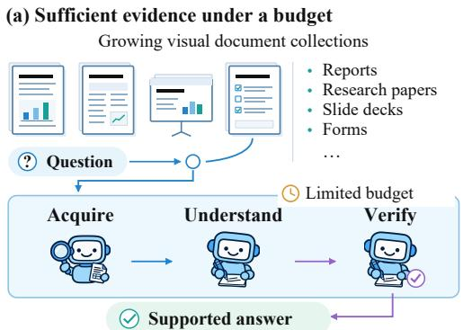
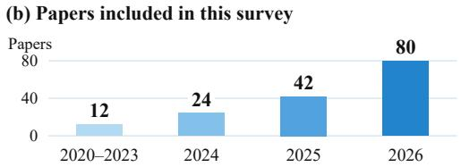
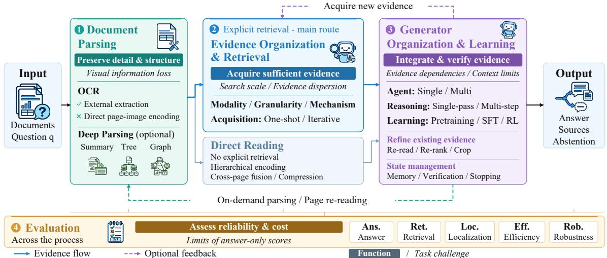
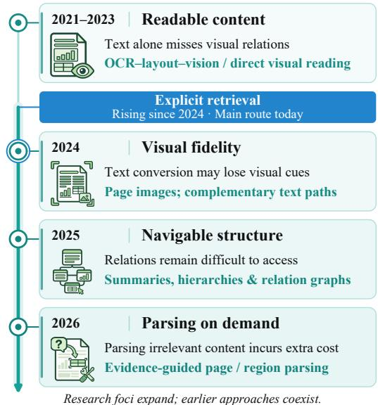
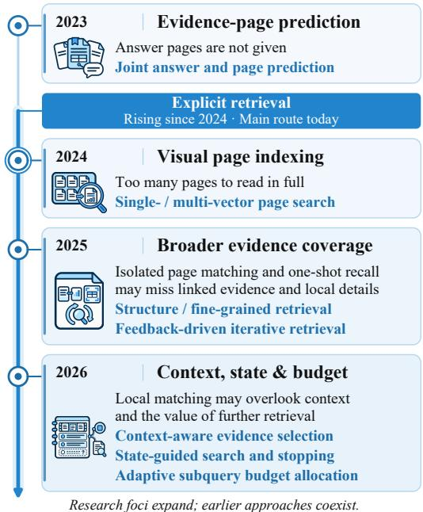
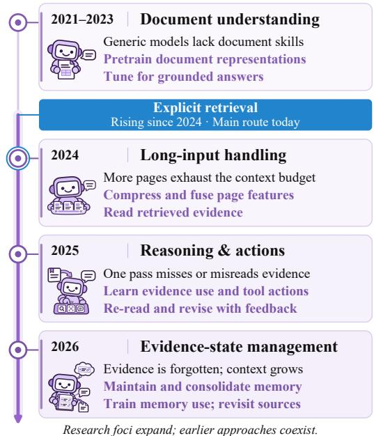
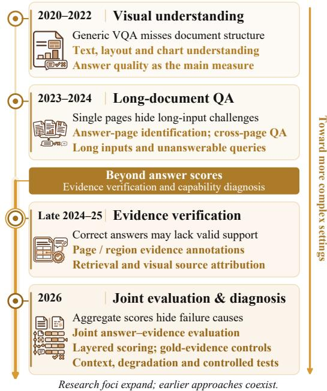
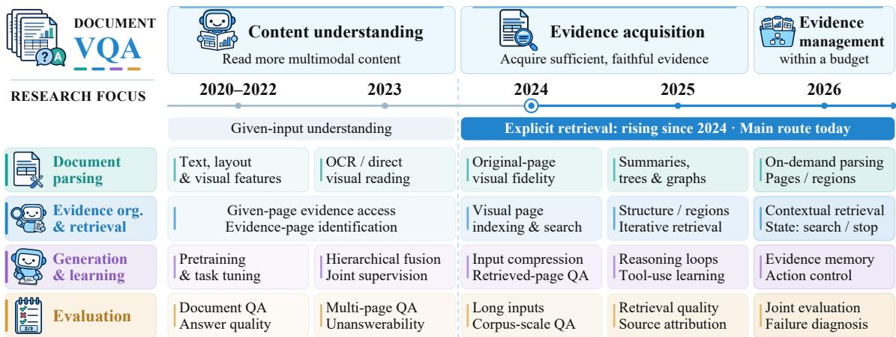
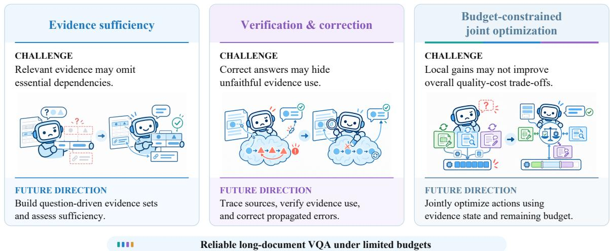
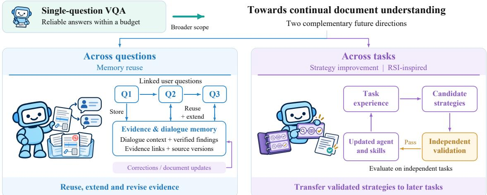

# A Task-Centric Survey of Long-Document Visual Question Answering: Taxonomy, Evolution, and Future Directions

Yufei Tong1 Guanjie Cheng2\* Tianle Wu3 Leilei Zhang1\* Hang Zheng1,4 Peihan Wu1 Jianwei Yin1,2 Shuiguang Deng1

1College of Computer Science and Technology 2School of Software Technology 3Polytechnic Institute Zhejiang University, China 4BWTON Technology Co., Ltd., China

## Abstract

Visual document understanding is essential for acquiring knowledge from visually rich documents and is attracting growing research interest. Existing surveys emphasize architectures or technical approaches, with limited attention to how task bottlenecks shape technical choices and research priorities. We present a taskcentric survey that decomposes long-document visual question answering (VQA) into four components: document parsing, evidence organization and retrieval, generator organization and learning, and evaluation. For each, we develop a fine-grained taxonomy and trace motivations, technical responses, and crosscomponent connections. We focus on explicit retrieval while covering direct reading. Our temporal analysis traces expanding priorities from multimodal content understanding to sufficient, high-fidelity evidence acquisition and sustained evidence management. We outline future directions in evidence sufficiency, verifiable and correctable understanding, and budgetaware coordination, with an outlook on continual document understanding.1

Keywords: Document Understanding, Document VQA, Multimodal Retrieval-Augmented Generation, Information Retrieval, Agentic Reasoning.

## 1 Introduction

Visually rich documents, such as research papers and financial reports, play a vital role in preserving and communicating knowledge through text, tables, charts, images, and their spatial and cross-modal relationships. Visual document understanding (VDU) interprets this content and structure, encompassing foundational tasks such as information extraction, as well as higher-level visual question answering (VQA) (Chen et al., 2024). While information extraction identifies target fields, entities, and relations, document VQA selects and integrates evidence to answer questions (Mathew et al., 2021).

  
Figure 1: Core challenges of long-document VQA and publication trends of this field.

Document VQA has expanded from single-page understanding (Mathew et al., 2021) to evidence localization in MP-DocVQA (Tito et al., 2023), cross-page integration in SlideVQA (Tanaka et al., 2023), and long-context multimodal understanding in MMLongBench-Doc (Ma et al., 2024b). Longer documents and larger collections increase the computational costs and context demands of exhaustive reading, while textualization or visual compression may discard essential chart, layout, and finegrained textual information (Faysse et al., 2025; Yu et al., 2025). Evidence dispersed across pages, sections, or documents requires recovering relationships and integrating complementary information (Tanaka et al., 2023; Cho et al., 2025). We focus on long-document VQA: how systems can acquire, understand, and verify sufficient evidence to answer questions within a limited budget (Fig. 1).

  
Figure 2: Task decomposition and two technical routes for long-document VQA. Colored bands indicate component functions, and italic labels identify the challenges they address. Both routes share parsing and generation, with evaluation throughout. Evidence sources and abstention are task-dependent outputs.

Advances in multimodal large language models (MLLMs) and demand for complex document understanding are accelerating document VQA research. Methods have expanded from multipage representations to visual retrieval-augmented generation (RAG) and feedback-driven evidence acquisition and reasoning (Tito et al., 2023; Yu et al., 2025; Wang et al., 2026d). Rapid literature growth since 2024 (Fig. 1) motivates a systematic review of methods, benchmarks, and technical evolution. Existing surveys cover document representations and multipage processing (Barboule et al., 2025), MLLM representations and training (Ding et al., 2026), multimodal retrieval (Gao et al., 2026), and visual retrievers and deployment (Yan et al., 2026c). These surveys primarily organize the literature by model architecture and technical approach. However, connections among long-document bottlenecks, fine-grained technical analysis, and evolving research motivations remain underexplored.

We analyze over 150 papers and organize this survey around task decomposition, fine-grained analysis, and temporal evolution. Our contributions are threefold: (1) A unified, task-driven framework. We map requirements for content fidelity, sufficient evidence acquisition, evidence use, and reliable evaluation onto four interconnected components: document parsing, evidence organization and retrieval, generator organization and learning, and evaluation. (2) A fine-grained technical taxonomy by task function. We categorize representation and structure, retrieval modalities and granularities, evidence acquisition strategies, reasoning organization and learning objectives, and evaluation capabilities. (3) Technical evolution and future research directions. We trace how task bottlenecks shape technical choices as research priorities expand from multimodal understanding to evidence acquisition and sustained management. We identify challenges and future directions in evidence sufficiency, verifiable and correctable understanding, and budget-aware coordination, with an outlook on continual document understanding.

## 2 Task Formulation and Decomposition

Task definition. Given a question q and a candidate set of visual documents D, long-document VQA produces an answer under a resource budget B:

$$
( \hat { a } , \hat { S } ) = F _ { \theta } ( q , { \cal D } ; { \cal B } ) ,\tag{1}
$$

where $F _ { \theta }$ is the QA system, aˆ its predicted answer, $\hat { S }$ an optional set of evidence sources, and B the resource limits on context, computation, and tool calls. D contains one or more documents, each with ordered pages combining text, tables, charts, images, and layout information. In the closeddomain setting, the input document is specified for each question; in the open-domain setting, systems identify relevant sources from a shared document collection (Yu et al., 2025; Cho et al., 2025; Gao et al., 2026). Pages preserve context and provenance, elements provide finer-grained evidence, and cross-page or cross-document relations link evidence needed jointly.

Table 1: Representative explicit-retrieval methods. (YY.MM): first release. Within task groups, methods follow final conference submission deadlines, then first release within each conference; preprints/journal papers are inserted by first release. Venue omits tracks. Full details: Appendix C, Table 6.
<table><tr><td rowspan=1 colspan=15>Method                      Parsing           Evidence Organization and Retrieval       Generation &amp; Learning</td></tr><tr><td rowspan=1 colspan=15>Name                        Venue   OCR    Deep     Modality Gran. Mechanism       AcquisitionAgent Reasoning Learning</td></tr><tr><td rowspan=1 colspan=15>Retrieval-only methodsDSE (2024a) (24.06)           EMNLP&#x27;24   X        x        Uni(V)    P  Visualt            One-shotColPali (2025) (24.06)           ICLR&#x27;25    x        x        Uni(V)    P  Visualt            One-shot</td></tr><tr><td rowspan=1 colspan=15>LMS-Retrieval (2026) (26.08)    ICDAR&#x27;26            Tree       Uni(T)    E  Text             One-shot</td></tr><tr><td rowspan=1 colspan=15>CMDR-Embed (2026) (26.07)    ECCV’26    X        x        Uni(V)    P  Visualt            One-shot</td></tr><tr><td rowspan=1 colspan=15>MMRetHeads (2026a) (26.05)   EMNLP&#x27;26   x       x        Uni(V)  P, E Visual            One-shot</td></tr><tr><td rowspan=1 colspan=15>Document VQA methodsMHST (2022) (22.07)           MM&#x27;22              x        Uni(T)   P, E Text              One-shotSingle Single-pass  SFT</td></tr><tr><td rowspan=1 colspan=15>CREAM (2024) (24.10)          MM&#x27;24              x        Uni(T)   P, E Text + LLM        One-shotSingle Single-pass  SFT</td></tr><tr><td rowspan=1 colspan=7>VisRAG (2025) (24.10)          ICLR&#x27;25              x        Uni(V)</td><td rowspan=1 colspan=8>P  Visualt            One-shot Single Single-pass   x</td></tr><tr><td rowspan=1 colspan=7>SV-RAG (2024) (24.11)         ICLR&#x27;25              x        Uni(V)</td><td rowspan=1 colspan=8>P  Visualt            One-shot Single Single-pass  SFT</td></tr><tr><td rowspan=4 colspan=7>VisDoMRAG (2025) (24.12)     NAACL&#x27;25             x      Mixed(T/VDocRAG (2025) (25.04)        CVPR&#x27;25    X        x        Uni(V)Doc-React (2025a) (24.12)        ACL&#x27;25              x        Uni(V)NeuSym-RAG (2025) (25.05)     ACL&#x27;25</td><td rowspan=1 colspan=6>V) P, E Text + Visual       One-shot Multi S</td><td rowspan=1 colspan=2>ingle-pass   x</td></tr><tr><td rowspan=1 colspan=1>XUni(V</td><td rowspan=1 colspan=6>P  Visualt            One-shot</td><td rowspan=1 colspan=2>SFT</td></tr><tr><td rowspan=1 colspan=1>XUni(V</td><td rowspan=1 colspan=6>P  Visual + VLM      Iterative Single</td><td rowspan=1 colspan=2>Multi-step   x</td></tr><tr><td rowspan=1 colspan=1>Graph, Summary Mixed(T</td><td rowspan=1 colspan=5>Text + MM + VLM   Iterative</td><td rowspan=1 colspan=1>Single</td><td rowspan=1 colspan=2>x</td></tr><tr><td rowspan=2 colspan=6>MDocAgent (2025) (25.03)       arXiv&#x27;25VRAG-RL (2026d) (25.05)       NIPS&#x27;25</td><td rowspan=1 colspan=1>x      Mixed(T/</td><td rowspan=1 colspan=2>V)  P</td><td rowspan=1 colspan=3>Text + Visual       One-shot</td><td rowspan=1 colspan=1>Multi S</td><td rowspan=1 colspan=1>ingle-pass</td><td rowspan=1 colspan=1>×</td></tr><tr><td rowspan=1 colspan=1>x        Uni(V)</td><td rowspan=1 colspan=2>P, E</td><td rowspan=1 colspan=3>Visual + VLMt      Iterative</td><td rowspan=1 colspan=1>Single M</td><td rowspan=1 colspan=1>ulti-step</td><td rowspan=1 colspan=1>SFT+RL</td></tr><tr><td rowspan=1 colspan=6>RA-Tuning (2025) (24.11)      EMNLP&#x27;25</td><td rowspan=1 colspan=1>x        Uni(V)</td><td rowspan=1 colspan=2>P,E</td><td rowspan=1 colspan=3>Visual            One-shot</td><td rowspan=1 colspan=1>Single S</td><td rowspan=1 colspan=1>ingle-pass</td><td rowspan=1 colspan=1> $\mathrm { s F T }$ </td></tr><tr><td rowspan=1 colspan=6>ViDoRAG (2025) (25.02)       EMNLP&#x27;25</td><td rowspan=1 colspan=1>x      Mixed(T/</td><td rowspan=1 colspan=2>V)  P</td><td rowspan=1 colspan=3>Text + Visual + VLM One-shot</td><td rowspan=1 colspan=1>Multi</td><td rowspan=1 colspan=1>Multi-step</td><td rowspan=1 colspan=1></td></tr><tr><td rowspan=1 colspan=6>SimpleDoc (2025) (25.06)       EMNLP&#x27;25</td><td rowspan=1 colspan=1></td><td rowspan=1 colspan=4> $\operatorname { S u m m a r y }$    Mixed(T/</td><td rowspan=1 colspan=1>V)  P</td><td rowspan=1 colspan=1>Visua</td><td rowspan=1 colspan=2>l +LLM       Iterative</td></tr><tr><td rowspan=3 colspan=2>DocAgent (20</td><td rowspan=1 colspan=4>EMNLP&#x27;25</td><td rowspan=1 colspan=1> $\mathrm { G r a p h }$       Uni(V)</td><td rowspan=1 colspan=2>P</td><td rowspan=1 colspan=1>Visua</td><td rowspan=1 colspan=2>l + VLM      One-shot</td><td rowspan=1 colspan=1>Single S</td><td rowspan=1 colspan=1>ingle-pass</td><td rowspan=1 colspan=1></td></tr><tr><td></td><td rowspan=1 colspan=3>EMNLP&#x27;25</td><td rowspan=1 colspan=1> $\mathrm { G r a p h }$     Mixed(T/V)</td><td rowspan=1 colspan=2>E</td><td rowspan=1 colspan=1>MM</td><td rowspan=1 colspan=2>One-shot</td><td rowspan=1 colspan=1>Single S</td><td rowspan=1 colspan=1>ingle-pass</td><td rowspan=1 colspan=1></td></tr><tr><td rowspan=1 colspan=4>25a) (25.11)      EMNLP&#x27;25</td><td rowspan=1 colspan=1> $\mathrm { T r e e }$       Uni(T)</td><td rowspan=1 colspan=2>P, E</td><td rowspan=1 colspan=1>Text +</td><td rowspan=1 colspan=2>VLM        Iterative</td><td rowspan=1 colspan=1>Multi M</td><td rowspan=1 colspan=1>ulti-step</td><td rowspan=1 colspan=1></td></tr><tr><td rowspan=1 colspan=2>M3DocRAG</td><td rowspan=1 colspan=4>(2025) (24.11)      ICCV’25    X</td><td rowspan=1 colspan=1>×        Uni(V)</td><td rowspan=1 colspan=2>P</td><td rowspan=1 colspan=1>Visual</td><td rowspan=1 colspan=2>One-shot</td><td rowspan=1 colspan=1>Single S</td><td rowspan=1 colspan=1>ingle-pass</td><td rowspan=1 colspan=1></td></tr><tr><td rowspan=1 colspan=6>RegionRAG (2026e) (25.10)      AAAI&#x27;26    X</td><td rowspan=1 colspan=1>x        Uni(V)</td><td rowspan=1 colspan=2>E</td><td rowspan=1 colspan=1>Visualt</td><td rowspan=1 colspan=2>One-shot</td><td rowspan=1 colspan=1>Single S</td><td rowspan=1 colspan=1>ingle-pass</td><td rowspan=1 colspan=1>x</td></tr><tr><td rowspan=1 colspan=6>URaG (2026) (25.11)           AAAI&#x27;26</td><td rowspan=1 colspan=1>x        Uni(V)</td><td rowspan=1 colspan=2>P</td><td rowspan=1 colspan=1>Visualt</td><td rowspan=1 colspan=1></td><td rowspan=1 colspan=1>One-shot</td><td rowspan=1 colspan=1>Single S</td><td rowspan=1 colspan=1>ingle-pass</td><td rowspan=1 colspan=1>SFT</td></tr><tr><td rowspan=1 colspan=6>EXTRÀCTÓR (2026) (25.09)    ICLR&#x27;26</td><td rowspan=1 colspan=1>Graph      Uni(T)</td><td rowspan=1 colspan=2>D, P, E T</td><td rowspan=1 colspan=1>ext +</td><td rowspan=1 colspan=1>LLMt</td><td rowspan=1 colspan=1>Iterative</td><td rowspan=1 colspan=1>Single M</td><td rowspan=1 colspan=1>ulti-step</td><td rowspan=1 colspan=1>SFT</td></tr><tr><td rowspan=1 colspan=6>SCoPE VLM (2026) (25.10)     EACL&#x27;26</td><td rowspan=1 colspan=1> $x$         Uni(V)</td><td rowspan=1 colspan=2>P</td><td rowspan=1 colspan=1>VLMt</td><td rowspan=1 colspan=1></td><td rowspan=1 colspan=1>Iterative</td><td rowspan=1 colspan=1>Single M</td><td rowspan=1 colspan=1>ulti-step</td><td rowspan=1 colspan=1>SFT+RL</td></tr><tr><td rowspan=1 colspan=6>Doc-Researcher (2026b) (25.10)  WWW&#x27;26</td><td rowspan=1 colspan=1>Summary   Mixed(T/</td><td rowspan=1 colspan=2>V)D, P, E</td><td rowspan=1 colspan=1>MM + L</td><td rowspan=1 colspan=1>LM</td><td rowspan=1 colspan=1>Iterative</td><td rowspan=1 colspan=1>MultiM</td><td rowspan=1 colspan=1>ulti-step</td><td rowspan=1 colspan=1>x</td></tr><tr><td rowspan=1 colspan=6>DMAP (2026) (26.01)          WWW&#x27;26</td><td rowspan=1 colspan=1> ${ \mathrm { T r e e , S u m m a r y } }$ Mixed(T/</td><td rowspan=1 colspan=2>V) P, E</td><td rowspan=1 colspan=1>Text +</td><td rowspan=1 colspan=1>Visual + LLM</td><td rowspan=1 colspan=1>Iterative</td><td rowspan=1 colspan=1>Multi M</td><td rowspan=1 colspan=1>ulti-step</td><td rowspan=1 colspan=1></td></tr><tr><td rowspan=1 colspan=6>RAG-Anything (2025) (25.10)    arXiv&#x27;25</td><td rowspan=1 colspan=1>Graph      Uni(T)</td><td rowspan=1 colspan=1></td><td rowspan=1 colspan=1>E</td><td rowspan=1 colspan=1>Text</td><td rowspan=1 colspan=1></td><td rowspan=1 colspan=1>One-shot</td><td rowspan=1 colspan=1>Single</td><td rowspan=1 colspan=1>Single-pass</td><td rowspan=1 colspan=1>x</td></tr><tr><td rowspan=1 colspan=6>DocPrune (2026) (26.04)        CVPR&#x27;26</td><td rowspan=1 colspan=1> $x$         Uni(V)</td><td rowspan=1 colspan=1></td><td rowspan=1 colspan=1>P</td><td rowspan=1 colspan=1>Visual</td><td rowspan=1 colspan=1></td><td rowspan=1 colspan=1>One-shot</td><td rowspan=1 colspan=1>Single S</td><td rowspan=1 colspan=1>ingle-pass</td><td rowspan=1 colspan=1>x</td></tr><tr><td rowspan=1 colspan=6>CogDoc (2025) (25.12)          arXiv&#x27;25</td><td rowspan=1 colspan=1>x        Uni(V)</td><td rowspan=1 colspan=1></td><td rowspan=1 colspan=1>P</td><td rowspan=1 colspan=1>VLMt</td><td rowspan=1 colspan=1></td><td rowspan=1 colspan=1>One-shot</td><td rowspan=1 colspan=1>Single S</td><td rowspan=1 colspan=1>ingle-pass</td><td rowspan=1 colspan=1>RL</td></tr><tr><td rowspan=1 colspan=6>DocLens (2026a) (25.11)         ACL&#x27;26</td><td rowspan=1 colspan=1>x      Mixed(T/</td><td rowspan=1 colspan=1>V) P,</td><td rowspan=1 colspan=1>E</td><td rowspan=1 colspan=1>VLM</td><td rowspan=1 colspan=1></td><td rowspan=1 colspan=1>One-shot</td><td rowspan=1 colspan=1>Multi</td><td rowspan=1 colspan=1>Single-pass</td><td rowspan=1 colspan=1>x</td></tr><tr><td rowspan=1 colspan=6>Doc-V* (2026) (26.04)           ACL&#x27;26</td><td rowspan=1 colspan=1>x        Uni(V)</td><td rowspan=1 colspan=1></td><td rowspan=1 colspan=1>P</td><td rowspan=1 colspan=1>Visua</td><td rowspan=1 colspan=1>+ VLMt</td><td rowspan=1 colspan=1>Iterative</td><td rowspan=1 colspan=1>Single</td><td rowspan=1 colspan=1>Multi-step</td><td rowspan=1 colspan=1>SFT+RL</td></tr><tr><td rowspan=1 colspan=6>MM-Doc-R1 (2026) (26.04)       ACL&#x27;26</td><td rowspan=1 colspan=1> $\mathrm { T r e e }$        Uni(T)</td><td rowspan=1 colspan=1></td><td rowspan=1 colspan=1>P</td><td rowspan=1 colspan=1>Text</td><td rowspan=1 colspan=1></td><td rowspan=1 colspan=1>Iterative</td><td rowspan=1 colspan=1>Multi</td><td rowspan=1 colspan=1>Multi-step</td><td rowspan=1 colspan=1>RL</td></tr><tr><td rowspan=1 colspan=6>VimRAG (2026e) (26.02)        ICML&#x27;26</td><td rowspan=1 colspan=1>x        Uni(V)</td><td rowspan=1 colspan=1></td><td rowspan=1 colspan=1>P</td><td rowspan=1 colspan=1>MM + V</td><td rowspan=1 colspan=1>LMt</td><td rowspan=1 colspan=1>Iterative</td><td rowspan=1 colspan=1>Single M</td><td rowspan=1 colspan=1>ulti-step</td><td rowspan=1 colspan=1>SFT+RL</td></tr><tr><td rowspan=1 colspan=6>MoDora (2026a) (26.02)      PACMMOD&#x27;26</td><td rowspan=1 colspan=1>Tree, SummaryMixed(T/</td><td rowspan=1 colspan=1>V)</td><td rowspan=1 colspan=1>E</td><td rowspan=1 colspan=1>Text</td><td rowspan=1 colspan=1>+ LLM + VLM</td><td rowspan=1 colspan=1>One-shot</td><td rowspan=1 colspan=1>Single</td><td rowspan=1 colspan=1>Single-pass</td><td rowspan=1 colspan=1>x</td></tr><tr><td rowspan=1 colspan=6>VisRAG 2.0 (2025b) (25.10)      MM&#x27;26</td><td rowspan=1 colspan=1>x        Uni(V)</td><td rowspan=1 colspan=1></td><td rowspan=1 colspan=1>p</td><td rowspan=1 colspan=1>Visual</td><td rowspan=1 colspan=1></td><td rowspan=1 colspan=1>One-shot</td><td rowspan=1 colspan=1>Single S</td><td rowspan=1 colspan=1>ingle-pass</td><td rowspan=1 colspan=1>SFT+RL</td></tr><tr><td rowspan=1 colspan=6>AgenticOCR (2026f) (26.02)     NIPS&#x27;26</td><td rowspan=1 colspan=1>x      Mixed(T/</td><td rowspan=1 colspan=2>V) P, E</td><td rowspan=1 colspan=1>VLMt</td><td rowspan=1 colspan=1></td><td rowspan=1 colspan=1>One-shot</td><td rowspan=1 colspan=1>Single</td><td rowspan=1 colspan=1>Multi-step</td><td rowspan=1 colspan=1>SFT+RL</td></tr><tr><td rowspan=1 colspan=6>DocAtlas (2026b) (26.07)        NIPS&#x27;26</td><td rowspan=1 colspan=1>Tree, SummaryMixed(T/</td><td rowspan=1 colspan=2>V) P,E</td><td rowspan=1 colspan=1>LLM +</td><td rowspan=1 colspan=1>VLMt</td><td rowspan=1 colspan=1>Iterative</td><td rowspan=1 colspan=1>Single</td><td rowspan=1 colspan=1>Multi-step</td><td rowspan=1 colspan=1>RL</td></tr><tr><td rowspan=1 colspan=6>DocDancer (2026d) (26.01)     EMNLP&#x27;26</td><td rowspan=1 colspan=1>Tree       Uni(T)</td><td rowspan=1 colspan=2>P,E</td><td rowspan=1 colspan=1>Text</td><td rowspan=1 colspan=1></td><td rowspan=1 colspan=1>Iterative</td><td rowspan=1 colspan=1>Single</td><td rowspan=1 colspan=1>Multi-step</td><td rowspan=1 colspan=1>SFT</td></tr><tr><td rowspan=1 colspan=6>AWM (2026a) (26.08)          EMNLP&#x27;26   X</td><td rowspan=1 colspan=1> $x$        Uni(V)</td><td rowspan=1 colspan=2>P</td><td rowspan=1 colspan=1>MM</td><td rowspan=1 colspan=1></td><td rowspan=1 colspan=1>Iterative</td><td rowspan=1 colspan=1>Single</td><td rowspan=1 colspan=1>Multi-step</td><td rowspan=1 colspan=1>SFT+RL</td></tr><tr><td rowspan=2 colspan=6>Doc-RÈFRAG (2026a) (26.08)   EMNLP&#x27;26   XEviProp (2026c) (26.06)         arXiv&#x27;26</td><td rowspan=1 colspan=1> $x$         Uni(V)</td><td rowspan=1 colspan=2>P</td><td rowspan=1 colspan=1>MM</td><td rowspan=1 colspan=1></td><td rowspan=1 colspan=1>One-shot</td><td rowspan=1 colspan=1>Single S</td><td rowspan=1 colspan=1>ingle-pass</td><td rowspan=1 colspan=1>SFT+RL</td></tr><tr><td rowspan=1 colspan=1> $\mathrm { G r a p h }$     Mixed(T/</td><td rowspan=1 colspan=2>V)  P</td><td rowspan=1 colspan=1>Visual</td><td rowspan=1 colspan=1>+ Text</td><td rowspan=1 colspan=1>One-shot</td><td rowspan=1 colspan=1>Single S</td><td rowspan=1 colspan=1>ingle-pass</td><td rowspan=1 colspan=1>x</td></tr><tr><td rowspan=1 colspan=6>MAGE-RAG (2026) (26.06)      arXiv&#x27;26</td><td rowspan=1 colspan=1>Graph, Summary Mixed(T/</td><td rowspan=1 colspan=2>V) P, E</td><td rowspan=1 colspan=1>Visua</td><td rowspan=1 colspan=1>l + VLM</td><td rowspan=1 colspan=1>Iterative</td><td rowspan=1 colspan=1>Single M</td><td rowspan=1 colspan=1>ulti-step</td><td rowspan=1 colspan=1>x</td></tr><tr><td rowspan=1 colspan=4>HierDoc (2026) (26.07)</td><td rowspan=1 colspan=1>arXiv&#x2</td><td rowspan=1 colspan=1>7;26</td><td rowspan=1 colspan=1> $x$       Mixed(T/</td><td rowspan=1 colspan=2>V) P,E</td><td rowspan=1 colspan=1>VLMt</td><td rowspan=1 colspan=1></td><td rowspan=1 colspan=2>One-shot Single S</td><td rowspan=1 colspan=1>ingle-pass</td><td rowspan=1 colspan=1>x</td></tr><tr><td rowspan=1 colspan=4>DocTrace (2026a) (26.08)</td><td rowspan=1 colspan=1>arXiv&#x2</td><td rowspan=1 colspan=1>7;26</td><td rowspan=1 colspan=1>x        Uni(V)</td><td rowspan=1 colspan=2>P,E</td><td rowspan=1 colspan=1>VLMt</td><td rowspan=1 colspan=1></td><td rowspan=1 colspan=2>One-shot Single S</td><td rowspan=1 colspan=1>ingle-pass</td><td rowspan=1 colspan=1>SFT+RL</td></tr><tr><td rowspan=4 colspan=7>DocMemo (2026b) (26.08)       arXiv&#x27;26        Tree, SummaryD2-ScaleAgent (2026a) (26.08)    arXiv&#x27;26DocClaw (2026b) (26.08)        arXiv&#x27;26            TreeSCORE (2026c) (26.09)         arXiv&#x27;26    x       x        Uni(V)</td><td rowspan=1 colspan=1>arXiv</td><td rowspan=1 colspan=2>26</td><td rowspan=1 colspan=2>Tree Summary Mixed(T</td><td rowspan=1 colspan=1>P</td><td rowspan=1 colspan=1> $\mathrm { V i</td><td rowspan=1 colspan=1>s u a l + L L M }$ </td></tr><tr><td rowspan=1 colspan=1>arXiv</td><td rowspan=1 colspan=1>26</td><td rowspan=1 colspan=1>XUni(V</td><td rowspan=1 colspan=2>P,E</td><td rowspan=1 colspan=1>Visua</td><td rowspan=1 colspan=1>l + VLM</td><td rowspan=1 colspan=2>Iterative Multi</td><td rowspan=1 colspan=1>Multi-step</td><td rowspan=1 colspan=1>x</td></tr><tr><td rowspan=1 colspan=1>TreeMixed(T</td><td rowspan=1 colspan=2>P, E</td><td rowspan=1 colspan=1>Text +</td><td rowspan=1 colspan=1>Visual + VLM</td><td rowspan=1 colspan=2>Iterative</td><td rowspan=1 colspan=1>Multi-step</td><td rowspan=1 colspan=1>X</td></tr><tr><td rowspan=1 colspan=3>P,E  $\mathbf { V i s</td><td rowspan=1 colspan=1>u a l + V L M ^ { t } }$ </td><td rowspan=1 colspan=2>Iterative Single M</td><td rowspan=1 colspan=2>ulti-stepSFT+RL</td></tr></table>

Notation: ✗ = absent; D/P/E = Document/Page/Element. Mechanism groups retriever families; + combines families; t marks added retrieval, scoring, or page-selection training for at least one component in the marked family. Retriever families: Visual = visual page/region retrieval; Text = text retrieval/reranking; MM = multimodal retrieval; LLM/VLM = language/vision-language models for selection, reranking, navigation, or region refinement.

Long documents pose three challenges. (i) Input and search scale: more candidate pages expand search spaces and increase context and computational demands for exhaustive reading. (ii) Visual content complexity: information in small text, charts, and spatial layouts may be lost through resizing, conversion to text, or compression. (iii) Evidence distribution and dependencies: answers may require complementary evidence across pages or documents; local relevance does not ensure sufficiency (Ma et al., 2024b; Yu et al., 2025).

Four analytical components. Four interconnected components address these challenges. (1) Document parsing addresses visual information loss by preserving details and structure. Content extraction, visual preservation, and semantic structure construction provide readable representations and navigable structures, balancing fidelity against processing cost. (2) Evidence organization and retrieval addresses search scale and dispersion by acquiring sufficient evidence amid noise. It locates and selects evidence using document representations and structures, passing it and its sources to the generator. (3) Generator organization and learning addresses evidence dependencies and context limits through evidence integration and verification. It covers evidence presentation, organizational forms, reasoning processes, and learning objectives under computational constraints; intermediate judgments can guide acquisition, rereading, or verification. (4) Evaluation goes beyond answer scores to assess correctness, grounding, efficiency, and reliability throughout the process. Checks of evidence acquisition and use or controlled experiments diagnose parsing, retrieval, and reasoning errors and compare techniques’ benefits and costs.

Table 2: Taxonomy of representative direct-reading methods. Full comparison: Appendix B, Table 5.
<table><tr><td>Method</td><td>Venue</td><td>OCR</td><td>Model</td><td>Learning</td></tr><tr><td colspan="5">Single-page VQA</td></tr><tr><td>Donut (2022) (21.11)</td><td>ECCV&#x27;22</td><td>X</td><td>BART</td><td>PT+SFT</td></tr><tr><td>LayoutLMv3 (2022) (22.04)</td><td>MM&#x27;22</td><td></td><td>RoBERTa</td><td>PT+SFT</td></tr><tr><td>Pix2Struct (2023) (22.10)</td><td>ICML&#x27;23</td><td>X</td><td>Pix2Struct</td><td>PT+SFT</td></tr><tr><td>DocVLM* (2025) (24.12)</td><td>CVPR&#x27;25</td><td></td><td>Qwen-VL</td><td>SFT</td></tr><tr><td colspan="5">Multi-page VQA</td></tr><tr><td>M3D (2023) (23.01)</td><td>AAAI&#x27;23</td><td></td><td>T5</td><td>SFT</td></tr><tr><td>Hi-VT5 (2023) (22.12)</td><td>PR&#x27;23</td><td></td><td>T5</td><td>PT+SFT</td></tr><tr><td>GRAM (2024) (24.01)</td><td>CVPR&#x27;24</td><td></td><td>T5</td><td>SFT</td></tr><tr><td>mPLUG-DocOwl2 (2025) (24.09)</td><td>ACL&#x27;25</td><td>X</td><td>Llama</td><td>PT+SFT</td></tr><tr><td>DocR1 (2026b) (25.08)</td><td>AAAI&#x27;26</td><td>X</td><td>Qwen-VL</td><td>RL</td></tr><tr><td>DocSeeker (2026b) (26.04)</td><td>CVPR&#x27;26</td><td>X</td><td>Qwen-VL SFT+RL</td><td></td></tr></table>

All methods use a Single agent and no Deep Parsing. PT = Pretraining. Model lists backbone families only. DocVLM\* primarily evaluated on single pages but also supports multiple pages.

Two technical routes. Fig. 2 connects these components through direct reading and explicit retrieval. Direct reading answers from given document representations and may use hierarchical encoding, cross-page fusion, or compression to manage long-input costs (Tito et al., 2023). Explicit retrieval selects question-relevant documents, pages, or elements (e.g., text blocks, tables, and region crops) for the generator to read (Yu et al., 2025; Cho et al., 2025; Dong et al., 2026b). Reasoning feedback can guide further evidence acquisition (Wang et al., 2026d), local rereading, or on-demand parsing of existing evidence. These components describe task functions; their implementation and execution order may vary. Explicit retrieval accounts for approximately 80% of surveyed methods, motivating our focus on this route while also covering direct reading. Sec. 3 develops a fine-grained taxonomy by task function and traces each component’s research motivations and technical evolution.

## 3 Taxonomy and Technical Evolution

For each component, we develop a fine-grained taxonomy, compare technical benefits and costs, and trace evolving research motivations and technical responses. Stages reflect expanding research priorities: earlier approaches coexist, and methods may adopt techniques from different stages across components. Tables 1 and 2 compare representative explicit-retrieval and direct-reading methods; full comparisons appear in Appendices B and C.

## 3.1 Document Parsing

Technical taxonomy. Document parsing converts raw pages into accessible content and structure.

  
Figure 3: Four stages of document parsing: bottlenecks in black, technical responses in teal.

Tables 1 and 2 distinguish two independent dimensions: OCR and Deep Parsing. OCR (✓) denotes dependence on external extraction or textualization, including OCR, PDF text extraction, and VLM transcription or description of charts and tables. Extracted text supports indexing and language processing, but linearization may lose layout, text– image correspondences, and table structure, while recognition errors can propagate downstream (Ma et al., 2024a; Faysse et al., 2025; Yu et al., 2025; Chen et al., 2024). OCR (✗) methods primarily encode pages visually to reduce textualization loss but remain limited by resolution and visual reading ability (Yu et al., 2025; Chen et al., 2024). Methods combining extracted or transcribed text with page images are marked OCR (✓) (Suri et al., 2025; Han et al., 2025). Deep Parsing (✓) builds semantic overviews or explicit relations: Summary captures page or document semantics, Tree represents section hierarchies and containment, and Graph organizes text–image, entity, or cross-page relations (Jain et al., 2025; Wu et al., 2025b; Yun et al., 2025; Sun et al., 2025a); these structures can be combined. Element transcription or description alone does not count as Deep Parsing. Parsing may cover full documents in advance or proceed on demand, guided by the question or ongoing process.

Evolution of research focus (Fig. 3). Early work prioritized readable content while preserving layout and visual relations. LayoutLMv3 and UDOP jointly model OCR text, layout, and images (Huang et al., 2022; Tang et al., 2023), while Donut, Pix2Struct, and UReader learn directly from pages or screenshots (Kim et al., 2022; Lee et al., 2023; Ye et al., 2023). From 2024, explicit retrieval emphasized original-page visual fidelity: DSE, Col-Pali, VisRAG, and SV-RAG use page images directly (Ma et al., 2024a; Faysse et al., 2025; Yu et al., 2025; Chen et al., 2024), while VisDoM-RAG and MDocAgent combine visual and textual paths to mitigate omissions and reading biases (Suri et al., 2025; Han et al., 2025). In 2025, navigable structure made content relations accessible: SimpleDoc and Doc-Researcher summarize pages and documents, respectively (Jain et al., 2025; Dong et al., 2026b); DocAgent builds section hierarchies (Sun et al., 2025a); and MoLoRAG and LILaC construct page-similarity and layered component graphs, respectively (Wu et al., 2025b; Yun et al., 2025). To avoid parsing irrelevant content at scale, work in 2026 explores parsing on demand: AgenticOCR performs question-guided regional OCR (Wang et al., 2026f); DocLens, HierDoc, and Doc-Trace extract elements or parse selected pages (Zhu et al., 2026a; Gu et al., 2026; Xiang et al., 2026a); and DocClaw adapts parsing tool use to tasks and intermediate results (Xiang et al., 2026b).

Parsing supports evidence acquisition (Sec. 3.2); its value should be assessed by evidence completeness, answer quality, and cost, rather than transcription accuracy or structural richness alone.

## 3.2 Evidence Organization and Retrieval

Technical taxonomy. Evidence organization and retrieval select and assemble evidence from parsed content and structures, but local relevance does not ensure sufficient support for cross-page reasoning (Cho et al., 2025). Table 1 compares four dimensions. Modality specifies evidence-side matching representations: Uni(T) for text, Uni(V) for vision, and Mixed(T/V) for both. Granularity denotes evidence units supplied to generators or returned by retrieval-only methods: Document covers document-level evidence; Page covers full-page images or complete parsed page content; Element covers independently accessible text blocks, sections, charts, tables, or region crops. Pages preserve context but may add noise, whereas elements emphasize details but risk losing context. Modality or granularity may change before generation, as when ViDoRAG maps text chunks to source page images (Wang et al., 2025); Table 6 details these mappings. Mechanism includes lexical or unimodal/multimodal vector matching and LLM/VLM-based page selection, reranking, or region selection, optionally combined with tree navigation or graph expansion. The table lists retriever families. Acquisition distinguishes feedback-driven expansion: Iterative uses generation or control feedback to acquire new evidence beyond the current set; One-shot permits fixed multistage retrieval, reranking, or refinement without such expansion.

  
Figure 4: Four stages of evidence organization and retrieval: bottlenecks in black, technical responses in blue.

Evolution of research focus (Fig. 4). Hi-VT5 and M3D jointly learn QA and evidence-page prediction over given multipage inputs (Tanaka et al., 2023; Tito et al., 2023), providing a precursor to explicit retrieval. In 2024, input capacity limits motivated visual page indexing and the rise of explicit retrieval. DSE uses single-vector screenshot embeddings (Ma et al., 2024a); ColPali uses multivector late interaction (Faysse et al., 2025); and VisRAG, SV-RAG, and M3DocRAG connect page retrieval to visual QA (Yu et al., 2025; Chen et al., 2024; Cho et al., 2025). In 2025, incomplete coverage of linked evidence and local details motivated structural relations, fine-grained acquisition, and feedback-driven iterative retrieval. MoLoRAG and LILaC link complementary evidence through page or component relations (Wu et al., 2025b; Yun et al., 2025); RegionRAG and Doc-Researcher support regional and multigranular acquisition, respectively (Li et al., 2026e; Dong et al., 2026b); and VRAG-RL updates queries, retrieves additional pages, and refines acquired image regions during reasoning (Wang et al., 2026d). In 2026, attention expands to context, explicit evidence states, and budget constraints. Doc-V\* uses document-wide thumbnails for page navigation (Zheng et al., 2026), while CMDR-Embed incorporates multipage context into page representations (Tanaka et al., 2026). MAGE-RAG tracks page and element states (Zuo et al., 2026); DocAtlas updates retrieval structures with reading-derived evidence (Wei et al., 2026b); and DocMemo updates page beliefs and question memory to guide search, reading, and stopping (Yao et al., 2026b). MAB-DQA allocates retrieval budgets by estimating each subquestion’s acquisition value from VLM feedback (Xiang et al., 2026c).

More evidence may add noise and redundancy without ensuring sufficient support. Sec. 3.3 examines how generators integrate and verify evidence and guide further acquisition through feedback.

## 3.3 Generation and Learning

Technical taxonomy. Generation and learning produce grounded answers under context and computational budgets. Reading all pages preserves context at increasing input cost, whereas reading retrieved evidence narrows inputs but must address evidence gaps and noise. Tables 1 and 2 compare explicitretrieval and direct-reading methods. Agent distinguishes Single and Multi by runtime reasoning roles and collaboration. Reasoning distinguishes fixed workflows from feedback loops: Single-pass covers a single chain of thought, structured decoding, or a fixed multi-agent pipeline; Multi-step revises judgments and actions through repeated feedback from intermediate results, tool observations, or verification. Multi-step may acquire new evidence through feedback (Iterative acquisition) or only reread and verify existing evidence, as in Vi-DoRAG’s One-shot acquisition (Wang et al., 2025). Learning records added generator-side training: Pretraining develops document representations and cross-modal alignment; SFT uses answer, evidence, or action demonstrations; RL optimizes policies through answer, evidence, or process rewards.

Evolution of research focus (Fig. 5). In 2021– 2023, pretraining and task fine-tuning established document understanding and grounded answering (Tanaka et al., 2023; Tito et al., 2023; Kim et al., 2022; Lee et al., 2023). In 2024, growing page and token counts motivated long-input handling: GRAM uses document tokens for cross-page communication (Blau et al., 2024), while mPLUG-DocOwl2 compresses high-resolution visual features (Hu et al., 2025). VisRAG and SV-RAG read retrieved pages (Yu et al., 2025; Chen et al., 2024), while Retrieval-aware Tuning fine-tunes generators with evidence and distractor pages (Chia et al., 2025). In 2025, single-pass omissions and misreadings motivated evidence-guided learning,feedback reasoning, and tool actions. ViDoRAG uses cross-role feedback to reread existing candidates (Wang et al., 2025); DocR1 improves localization and answering with evidence-page rewards (Xiong et al., 2026b); and VRAG-RL uses SFT and RL to train VLMs to alternate among search, regional inspection, and answering (Wang et al., 2026d). In 2026, feedback reasoning incorporates evidencestate management to reduce forgetting and context accumulation. DocMemo provides evidence and question memory (Yao et al., 2026b); AWM rewards memory maintenance for answering (Zhou et al., 2026a); and SCORE retains provenance, reloads source pages, and reorganizes context before answering (Shen et al., 2026c).

  
Figure 5: Four stages of generation and learning: bottlenecks in black, technical responses in purple.

Within feedback loops, Sec. 3.2 examines how evidence states guide acquisition; this section covers evidence integration, answer verification, and feedback on remaining gaps. Organization and learning should be evaluated jointly by answer quality, evidence support, and end-to-end cost.

## 3.4 Benchmarks and Evaluation

Evaluation dimensions. Table 3 compares benchmarks by scale, evidence requirements, and evaluation capabilities. Granularity denotes the verification level supported by public evidence annotations; Evaluation identifies assessable capabilities. Ans. measures answer correctness; Ret. evaluates evidence recall and ranking; Loc. measures spatial alignment between predicted and annotated regions. Eff. covers parsing, indexing, and online inference costs; Rob. assesses performance under visual degradation or interference. Joint reporting under comparable inputs and budgets helps relate capability gains to end-to-end costs.

Table 3: Representative benchmarks grouped by evaluation goal and input scale. Full details: Appendix A, Table 4.
<table><tr><td colspan="3">Benchmark</td><td colspan="3">Data Size</td><td colspan="3">Question Type</td><td colspan="3">Evidence and Evaluation</td></tr><tr><td>Name</td><td>Venue</td><td></td><td>Domain #Pages</td><td>#QA</td><td>MD</td><td>MP</td><td>SP</td><td>Unans.</td><td>Source</td><td>Gran.</td><td>Evaluation</td></tr><tr><td colspan="10">Retrieval-focused benchmarks</td></tr><tr><td>ViDoRe (2025) (24.06)</td><td>ICLR&#x27;25</td><td>Open</td><td>1.0k</td><td>3.81k</td><td>X</td><td>x</td><td></td><td>x</td><td>TXT/L/C/TAB/I</td><td>P</td><td>Ans. Ret.</td></tr><tr><td>REAL-MM-RAG (2025) (25.02)</td><td>ACL&#x27;25</td><td>Open</td><td>2.1k</td><td>4.6k</td><td>×</td><td>x</td><td></td><td>x</td><td>TXT/C/TAB/I</td><td>P</td><td>Ans. Ret.</td></tr><tr><td>ViDoRe V2 (2025) (25.03)</td><td>arXiv&#x27;25</td><td>Open</td><td>1.1k</td><td>327</td><td>√</td><td></td><td></td><td>x</td><td>TXT/L/C/TAB/I</td><td>P</td><td>Ret.</td></tr><tr><td>MMDocIR (2025) (25.01)</td><td>EMNLP&#x27;25</td><td>Closed</td><td>65.1</td><td>1.66k</td><td>x</td><td>√(18.9%)√(81.1%)</td><td></td><td>X</td><td>TXT/L/C/TAB/I</td><td>P, E</td><td>Ret. Loc.</td></tr><tr><td>CMDR-Bench (2026) (26.07)</td><td>ECCV&#x27;26</td><td>Closed</td><td>183.5</td><td>800</td><td>X</td><td></td><td></td><td>X</td><td>TXT/L/C/TAB/I</td><td>P</td><td>Ret.</td></tr><tr><td colspan="10">Answer-quality benchmarks: single-page inputs</td></tr><tr><td>DocVQA (2021) (20.07)</td><td>WAĆV&#x27;21</td><td>Closed</td><td>1.0</td><td>50k</td><td>×××</td><td></td><td></td><td>××</td><td>TXT/L/C/TAB/I</td><td></td><td>Ans.</td></tr><tr><td>InfographicVQA (2022) (21.04)</td><td>WACV&#x27;22</td><td>Closed</td><td>1.0</td><td>30k</td><td></td><td>××</td><td></td><td></td><td>TXT/L/C/TAB/I</td><td></td><td>Ans.</td></tr><tr><td>ChartQA (2022) (22.03)</td><td>ACL&#x27;22</td><td>Closed</td><td>1.0</td><td>32.7k</td><td></td><td>x</td><td></td><td>×</td><td>C</td><td></td><td>Ans.</td></tr><tr><td>DOGR-Bench (2025) (24.11)</td><td>ICCV&#x27;25</td><td>Closed</td><td>1.0</td><td>3.6k</td><td>x</td><td>x</td><td></td><td>X</td><td>TXT/L/C/I</td><td>E</td><td>Ans. Loc.</td></tr><tr><td colspan="10">Answer-quality benchmarks: multipage inputs or input size unreported</td></tr><tr><td>TAT-DQA (2022) (22.07)</td><td>MM&#x27;22</td><td>Closed</td><td>1.1</td><td>16.6k</td><td></td><td>V</td><td>1</td><td>x</td><td>TXT/L/TAB</td><td></td><td>Ans.</td></tr><tr><td>SlideVQA (2023) (23.01)</td><td>AAAI&#x27;23</td><td>Closed</td><td>20.0</td><td>14.5k</td><td>××</td><td>√(13.9%)√(86.1%)</td><td></td><td>X</td><td>TXT/L/C/TAB/I</td><td>P</td><td>Ans. Ret.</td></tr><tr><td>MP-DocVQA (2023) (22.12)</td><td>PR&#x27;23</td><td>Closed</td><td>8.3</td><td>46.2k</td><td>x</td><td>X</td><td></td><td>x</td><td>TXT/L/C/TAB/I</td><td>P</td><td>Ans. Ret.</td></tr><tr><td>DUDE (2023) (23.05)</td><td>ICCV&#x27;23</td><td>Closed</td><td>5.72</td><td>41.5k</td><td>x</td><td></td><td></td><td></td><td>√(2.1%)√(85.2%) √(12.7%) TXT/L/C/TAB/I</td><td></td><td>Ans.</td></tr><tr><td>MMLongBench-Doc (2024b) (24.07)</td><td>NIPS&#x27;24</td><td>Closed</td><td>47.5</td><td>1.1k</td><td>x</td><td></td><td></td><td></td><td>√(33.7%) √(45.7%) √(20.6%) TXT/L/C/TAB/I</td><td>P</td><td>Ans. Ret.</td></tr><tr><td>Wiki-/Paper-VISA (2025a) (24.12)</td><td>ACL&#x27;25</td><td>Open</td><td></td><td>90k; 102.2k</td><td>x</td><td>x</td><td></td><td>V</td><td>TXT/TAB/I</td><td>P, E</td><td>Ans. Ret. Loc.</td></tr><tr><td>M-LongDoc (2025) (24.11)</td><td>EMNLP&#x27;25</td><td>Closed</td><td>210.8</td><td>0.9k</td><td>X</td><td>X</td><td></td><td>X</td><td>TXT/C/TAB/I</td><td>P</td><td>Ans. Ret.</td></tr><tr><td>DVisRAG (2026a) (26.02)</td><td>CVPR&#x27;26</td><td>Open</td><td></td><td>367.6k</td><td>X</td><td></td><td></td><td>X</td><td>TXT/L/C/TAB/I</td><td>P</td><td>Ans. Ret. Rob.</td></tr><tr><td>ViDoRe V3 (2026) (26.01)</td><td>ACL&#x27;26</td><td>Open</td><td></td><td>3.1k</td><td></td><td></td><td></td><td></td><td>TXT/L/C/TAB/I</td><td>P, E</td><td>Ans. Ret. Loc.</td></tr><tr><td>SynthDocBench (2026) (26.07)</td><td>COLM&#x27;26</td><td>Closed</td><td>51.1</td><td>1.8k</td><td>x</td><td></td><td></td><td>X</td><td>TXT/C/TAB</td><td>E</td><td>Ans. Ret.</td></tr><tr><td>DocScope (2026) (26.05)</td><td>NIPS&#x27;26</td><td>Closed</td><td>51.3</td><td>1.12k</td><td>x</td><td colspan="3">√(57.7%)√(35.3%)√(6.9%)</td><td>TXT/C/TAB/I/L</td><td>P, E</td><td>Ans. Ret. Loc.</td></tr></table>

Open/Closed: cross-document corpus/given document. #Pages: mean input pages (document mean if per-question statistics are unavailable); Open uses the full corpus. #QA: questions/queries; –: unreported/inapplicable. MD/MP/SP: multi-document/multi-page/single-page evidence; Unans.: unanswerable. TXT/L/C/TAB/I: text/layout/charts/tables/images; P/E: Page/Element.

  
Figure 6: Four stages of benchmarks and evaluation: bottlenecks in black, technical responses in amber.

Evolution of research focus (Fig. 6). In 2020– 2022, DocVQA, InfographicVQA, and ChartQA benchmarked text, layout, and chart understanding (Mathew et al., 2021, 2022; Masry et al., 2022). In 2023–2024, longer inputs shifted evaluation toward page identification and cross-page integration (Tanaka et al., 2023; Tito et al., 2023). DUDE adds complex and unanswerable questions (Van Landeghem et al., 2023), while MMLongBench-Doc and M-LongDoc assess long-document multimodal understanding (Ma et al., 2024b; Chia et al., 2025). From late 2024 through 2025, RAG prompted evidence and provenance checks beyond answer scores: VISA grounds answers in source-page regions (Ma et al., 2025a), while MMDocIR evaluates page- and element-level retrieval (Dong et al., 2025). Work in 2026 targets joint evaluation and capability diagnosis in complex settings. ViDoRe V3 links retrieval and QA on a shared corpus, with annotated relevant pages as a control (Loison et al., 2026); DocScope diagnoses bottlenecks through page, region, fact, and answer scores under varying evidence conditions (Feng et al., 2026). CMDR-Bench requires cross-page context for retrieval (Tanaka et al., 2026); DVisRAG evaluates retrieval, generation, and end-to-end robustness under visual degradation (Chen et al., 2026a); and Synth-DocBench uses controlled synthesis and structured evidence metadata to diagnose capabilities across document conditions and question types (Verma et al., 2026). Across stages, tasks expand to longer documents, cross-page and multi-element evidence, multihop reasoning, and diverse applications.

## 4 Research Trends and Future Directions

Building on component analyses, we examine how their interactions shape priorities and outline challenges and future directions at two levels: improving individual-question answering and extending the task toward continual document understanding.

  
Research foci expand; methods combine new and established techniques.  
Figure 7: Research foci and technical evolution across four components of document VQA. Five periods span three overarching foci: content understanding, evidence acquisition, and sustained evidence management.

rather than wholesale replacement.

## 4.1 Cross Component Evolution

Document VQA research has broadened from content understanding to evidence acquisition and sustained evidence management (Fig. 7). In 2020–2023, multipage representations and crosspage fusion extended single-page understanding (Tanaka et al., 2023; Tito et al., 2023). In 2024– 2025, costly exhaustive reading motivated sufficient, high-fidelity evidence acquisition. Visual page indexing and reading after retrieval in 2024 helped establish explicit retrieval as the main route (Faysse et al., 2025; Yu et al., 2025). Structural relations, fine-grained selection, and feedback-driven acquisition improved coverage and use of local details in 2025 (Wang et al., 2026d; Yun et al., 2025). In 2026, attention extends to maintaining evidence states, identifying gaps, and coordinating evidence use and verification across rounds under budget constraints (Zhou et al., 2026a; Yao et al., 2026b; Shen et al., 2026c).

Bottlenecks also propagate across components. Retrieval narrows inputs but risks omissions, motivating structure-aware acquisition and on-demand parsing to preserve evidence relations and details (Yun et al., 2025; Wang et al., 2026f). Feedback makes parsing and retrieval schedulable actions, with generation maintaining evidence states and guiding rereading, acquisition, and stopping (Wang et al., 2026d; Yao et al., 2026b). Evaluation must diagnose failures through answers and evidence (Feng et al., 2026) and assess gains against endto-end cost. Methods may update selected components while retaining established techniques elsewhere; evolution thus reflects broadening priorities

## 4.2 Challenges and Future Directions

For individual questions, we identify three research directions. Evidence sufficiency. Cross-page context and region extraction improve acquisition (Tanaka et al., 2026; Wang et al., 2026f), but local relevance and precise localization do not ensure sufficient support. Future work should construct question-driven evidence sets and assess their sufficiency. Verifiable and correctable document understanding. Cross-round memory and multilevel evaluation support process verification (Feng et al., 2026; Yao et al., 2026b), but correct answers may mask unreliable intermediate judgments, and early errors can propagate. Future work should link source tracing, process verification, and error correction. Budget-aware coordination. Action learning and dynamic retrieval improve adaptive acquisition (Wang et al., 2026d), but component gains may not improve the full pipeline. Future work should coordinate decisions across components using evidence states and budget constraints to balance answer quality and end-to-end cost.

Document use often involves follow-up questions and reading across tasks, motivating memory reuse across questions and continual, experiencedriven strategy improvement. The former reuses evidence and interaction states for subsequent questions; the latter turns cross-task experience into transferable retrieval, reading, and verification strategies. Appendix D details challenges, research opportunities, and task extensions.

## 5 Conclusion

This survey decomposes long-document VQA into four components and links a fine-grained taxonomy with task bottlenecks, research motivations, and technical evolution. Emphasizing explicit retrieval while covering direct reading, we trace expanding priorities from multimodal understanding to sufficient, high-fidelity evidence acquisition and sustained management under limited budgets. Future directions include evidence sufficiency assessment, verifiable and correctable understanding, and budget-aware coordination for individual questions, alongside memory reuse across questions and strategy improvement across tasks toward continual document understanding.

## Limitations

This survey focuses on document VQA as a higherlevel understanding task, particularly evidence acquisition and use in long documents. Foundational tasks such as text and layout recognition and field and entity extraction are covered only where they affect question answering, without being reviewed in detail.

## Use of AI-Assisted Tools

We used ChatGPT for language editing and LaTeX formatting. We reviewed and edited the AI-assisted content and take full responsibility for the final manuscript.

## Conflicts of Interest

We declare no conflicts of interest.

## References

Kenan E. Ak, Jay Mohta, Gwang Gook Lee, Yan Xu, and Dimitrios Dimitriadis. 2026. An empirical study of vlm pipelines for long-document qa. arXiv preprint arXiv:2609.29933.

Camille Barboule, Benjamin Piwowarski, and Yoan Chabot. 2025. Survey on question answering over visually rich documents: Methods, challenges, and trends. arXiv preprint arXiv:2501.02235.

Hanoz Bhathena, Parin Rajesh Jhaveri, Rohan Mit tal, Prateek Singh, Aymen Kallala, Rachneet Kaur, Yiqiao Jin, Zhen Zeng, Adwait Ratnaparkhi, and Denis Kochedykov. 2026. Mm-bizrag: Rethinking multimodal retrieval-augmented generation for general purpose enterprise q&a. In Proceedings of the 64th Annual Meeting of the Association for Computational Linguistics (ACL 2026), pages 1967–2000.

Tsachi Blau, Sharon Fogel, Roi Ronen, Alona Golts, Roy Ganz, Elad Ben Avraham, Aviad Aberdam, Shahar Tsiper, and Ron Litman. 2024. Gram: Global reasoning for multi-page vqa. In Proceedings of the IEEE/CVF conference on computer vision and pattern recognition, pages 15598–15607.

Ruisheng Cao, Hanchong Zhang, Tiancheng Huang, Zhangyi Kang, Yuxin Zhang, Liangtai Sun, Hanqi Li, Yuxun Miao, Shuai Fan, Lu Chen, and Kai Yu. 2025. Neusym-rag: Hybrid neural symbolic retrieval with multiview structuring for pdf question answering. In Proceedings of the 63rd Annual Meeting of the Association for Computational Linguistics (Volume 1: Long Papers), pages 6211–6239.

Zongsheng Cao, Anran Liu, Jun Xie, Lang Chen, Feng Chen, and Zigan Wang. 2026. Unidocvlm: Enhancing visual reasoning and document understanding for vlm via reinforcement learning. In Proceedings of the 32nd ACM SIGKDD Conference on Knowledge Discovery and Data Mining V. 2, pages 275–284.

I. Chen, Yu-Wei Liu, Tse-Yu Wu, Yu-Chien Chiang, Jen-Chieh Yang, and Wei-Ting Chen. 2026a. Robustvisrag: Causality-aware vision-based retrievalaugmented generation under visual degradations. In Proceedings ofthe IEEE/CVF Conference on Computer Vision and Pattern Recognition, pages 40802– 40811.

Jian Chen, Ruiyi Zhang, Yufan Zhou, Tong Yu, Franck Dernoncourt, Jiuxiang Gu, Ryan A. Rossi, Changyou Chen, and Tong Sun. 2024. Svrag: Lora-contextualizing adaptation of mllms for long document understanding. arXiv preprint arXiv:2411.01106.

Kaifeng Chen, Hongtao Liu, Qiyao Peng, Jian Yang, Yongqiang Liu, Xiaochen Zhang, and Qing Yang. 2026b. Mardoc: A memory-aware refinement agent framework for multimodal long document qa. arXiv preprint arXiv:2606.05749.

Yew Ken Chia, Liying Cheng, Hou Pong Chan, Maojia Song, Chaoqun Liu, Mahani Aljunied, Soujanya Poria, and Lidong Bing. 2025. M-longdoc: A benchmark for multimodal super-long document understanding and a retrieval-aware tuning framework. In Proceedings of the 2025 Conference on Empirical Methods in Natural Language Processing, pages 9244–9261.

Jaemin Cho, Debanjan Mahata, Ozan Irsoy, Yujie He, and Mohit Bansal. 2025. M3docvqa: Multi-modal multi-page multi-document understanding. In 2025 IEEE/CVF International Conference on Computer Vision Workshops (ICCVW), pages 6237–6247. IEEE.

Joonmyung Choi, Sanghyeok Lee, Jongha Kim, Sehyung Kim, Dohwan Ko, Jihyung Kil, and Hyunwoo J. Kim. 2026. Docprune: Efficient document question answering via background, question, and comprehension-aware token pruning. arXiv preprint arXiv:2604.22281.

Chao Deng, Jiale Yuan, Pi Bu, Peijie Wang, Zhong-Zhi Li, Jian Xu, Xiao-Hui Li, Yuan Gao, Jun Song, Bo Zheng, and Cheng-Lin Liu. 2025. Longdocurl: a comprehensive multimodal long document benchmark integrating understanding, reasoning, and locating. In Proceedings ofthe 63rd Annual Meeting of the Associationfor Computational Linguistics (Volume 1: Long Papers), pages 1135–1159.

Yihao Ding, Siwen Luo, Yue Dai, Yanbei Jiang, Zechuan Li, Qiang Sun, Geoffrey Martin, Wei Liu, and Yifan Peng. 2026. A survey on mllm-based visually rich document understanding: Methods, challenges, and emerging trends. Findings ofthe Association for Computational Linguistics: ACL 2026, pages 13319–13340.

Kuicai Dong, Yujing Chang, Derrick Goh Xin Deik, Dexun Li, Ruiming Tang, and Yong Liu. 2025. Mmdocir: Benchmarking multimodal retrieval for long documents. In Proceedings of the 2025 Conference on Empirical Methods in Natural Language Processing, pages 30959–30993.

Kuicai Dong, Yujing Chang, Shijie Huang, Yasheng Wang, Ruiming Tang, and Yong Liu. 2026a. Benchmarking retrieval-augmented multimomal generation for document question answering. Advances in Neural Information Processing Systems, 38.

Kuicai Dong, Shurui Huang, Fangda Ye, Wei Han, Zhi Zhang, Dexun Li, Wenjun Li, Qu Yang, Gang Wang, Yichao Wang, Chen Zhang, and Yong Liu. 2026b. Doc-researcher: A unified system for multimodal document parsing and deep research. In Proceedings of the ACM Web Conference 2026, pages 2349–2360.

Haizhou Du and Wenhao Li. 2026. M3rag: Orchestrating multi-agent reasoning for multi-hop, multimodal understanding. In International Conference on Multimedia Modeling, pages 364–378, Singapore. Springer Nature Singapore.

Yaxin Du, Junru Song, Yifan Zhou, Cheng Wang, Jiahao Gu, Zimeng Chen, Menglan Chen, Wen Yao, Yang Yang, Ying Wen, and Siheng Chen. 2026. g2-reader: Dual evolving graphs for multimodal document qa. arXiv preprint arXiv:2601.22055.

Yuchen Duan, Zhe Chen, Yusong Hu, Weiyun Wang, Shenglong Ye, Botian Shi, Lewei Lu, Qibin Hou, Tong Lu, Hongsheng Li, Jifeng Dai, and Wenhai Wang. 2025. Docopilot: Improving multimodal models for document-level understanding. In 2025 IEEE/CVF Conference on Computer Vision and Pattern Recognition (CVPR), pages 4026–4037. IEEE.

Qin Fang, Ruixue Gou, Shiqi Liu, Minqi Song, Pan Yuan, and Xian Peng. 2025. Dual-stream adaptive retrieval and hierarchical agent collaboration for document visual qa. In Asia-Pacific Web (APWeb) and Web-Age Information Management (WAIM) Joint International Conference on Web and Big Data, pages 402–416, Singapore. Springer Nature Singapore.

Manuel Faysse, Hugues Sibille, Tony Wu, Bilel Omrani, Gautier Viaud, Céline Hudelot, and Pierre Colombo. 2025. Colpali: Efficient document retrieval with vision language models. In International Conference on Learning Representations, volume 2025, pages 61424–61449.

Xiang Feng, Jiawei Zhou, Zhangfeng Huang, Kewei Wang, Shanshan Ye, Jinxin Hu, Zulong Chen, Yong Luo, and Jing Zhang. 2026. Docscope: Benchmarking verifiable reasoning for trustworthy long-document understanding. arXiv preprint arXiv:2605.08888.

Shunliang Fu, Yanxin Zhang, Yixin Xiang, Xiaoyu Du, and Jinhui Tang. 2026. Dmap: Human-aligned structural document map for multimodal document understanding. In Proceedings of the ACM Web Conference 2026, pages 2037–2048.

Masato Fujitake. 2024. Layoutllm: Large language model instruction tuning for visually rich document understanding. In Proceedings of the 2024 Joint International Conference on Computational Linguistics, Language Resources and Evaluation (LREC-COLING 2024), pages 10219–10224.

Sensen Gao, Shanshan Zhao, Xu Jiang, Lunhao Duan, Yong Xien Chng, Qing-Guo Chen, Weihua Luo, Kaifu Zhang, Jia-Wang Bian, and Mingming Gong. 2026. Scaling beyond context: A survey of multimodal retrieval-augmented generation for document understanding. In Proceedings of the 64th Annual Meeting of the Association for Computational Linguistics (Volume 1: Long Papers), pages 4458–4489.

Rongjian Gu, Wengang Zhou, Junyu Xiong, Yonghui Wang, Bing Yin, Bei Wang, and Houqiang Li. 2026. Hierdoc: Hierarchical page-to-region evidence routing for long-document visual question answering. arXiv preprint arXiv:2607.29638.

Tongkun Guan, Haocheng Wang, Wei Shen, and Xiaokang Yang. 2026. Lightstar: Efficient visual document retrieval via lightweight selection with visionadaptive refinement. In European Conference on Computer Vision, pages 669–687, Cham. Springer Nature Switzerland.

Sai Madhusudan Gunda, Jyothi Swaroopa Jinka, Hrithik Sagar Rachakonda, Aryan Jain, Venkata Kesav Venna, Anirudh Srinivasan, and Ravi Kiran Sarvadevabhatla. 2026. Docog: Mask-based multi-type grounded chain-of-thought for document qa. In European Conference on Computer Vision, pages 308– 327, Cham. Springer Nature Switzerland.

Zirui Guo, Xubin Ren, Lingrui Xu, Jiahao Zhang, and Chao Huang. 2025. Rag-anything: All-in-one rag framework. arXiv preprint arXiv:2510.12323.

Siwei Han, Peng Xia, Ruiyi Zhang, Tong Sun, Yun Li, Hongtu Zhu, and Huaxiu Yao. 2025. Mdocagent: A multi-modal multi-agent framework for document understanding. arXiv preprint arXiv:2503.13964.

Tanveer Hannan, Dimitrios Mallios, Parth Pathak, Faegheh Sardari, Thomas Seidl, Gedas Bertasius, Mohsen Fayyaz, and Sunando Sengupta. 2026. Docslm: A small vision-language model for long multimodal document understanding. In Proceedings of the IEEE/CVF Conference on Computer Vision and Pattern Recognition, pages 9337–9346.

Liqi He, Zuchao Li, Hao Huang, and Ping Wang. 2026. Trace: Traversal retrieval-augmented chain of evidence for document understanding. In Proceedings of the 64th Annual Meeting of the Association for Computational Linguistics (Volume 1: Long Papers), pages 9806–9825.

Anwen Hu, Haiyang Xu, Jiabo Ye, Ming Yan, Liang Zhang, Bo Zhang, Ji Zhang, Qin Jin, Fei Huang, and Jingren Zhou. 2024. mplug-docowl 1.5: Unified structure learning for ocr-free document understanding. In Findings of the Association for Computational Linguistics: EMNLP 2024, pages 3096–3120.

Anwen Hu, Haiyang Xu, Liang Zhang, Jiabo Ye, Ming Yan, Ji Zhang, Qin Jin, Fei Huang, and Jingren Zhou. 2025. mplug-docowl2: High-resolution compressing for ocr-free multi-page document understanding. In Proceedings of the 63rd Annual Meeting of the Associationfor Computational Linguistics (Volume 1: Long Papers), pages 5817–5834.

Ruofan Hu, Shengyang Xu, Minjie Hong, Xiaoda Yang, Sashuai Zhou, Ke Lei, Tao Jin, and Zhou Zhao. 2026a. Doc-refrag: Rethinking multimodal document retrieval-augmented generation. arXiv preprint arXiv:2608.30163.

Ruofan Hu, Menghui Zhu, Jieming Zhu, Bo Chen, Shengyang Xu, Minjie Hong, Xiaoda Yang, Sashuai Zhou, Li Tang, Tao Jin, and Zhou Zhao. 2026b. Docretriever: A plug-and-play framework for multimodal document retrieval with comprehensive benchmark. In Proceedings of the 32nd ACM SIGKDD Conference on Knowledge Discovery and Data Mining V. 2, pages 1780–1791.

De-An Huang, Subhashree Radhakrishnan, Zhiding Yu, and Jan Kautz. 2025. Frag: Frame selection augmented generation for long video and long document understanding. arXiv preprint arXiv:2504.17447.

Tiancheng Huang, Ruisheng Cao, Yuxin Zhang, Zhangyi Kang, Zijian Wang, Chenrun Wang, Yijie Luo, Hang Zheng, Lirong Qian, Lu Chen, and Kai Yu. 2026. Airqa: A comprehensive qa dataset for ai research with instance-level evaluation. In International Conference on Learning Representations, volume 2026, pages 9927–9955.

Yupan Huang, Tengchao Lv, Lei Cui, Yutong Lu, and Furu Wei. 2022. Layoutlmv3: Pre-training for document ai with unified text and image masking. In Proceedings of the 30th ACM international conference on multimedia, pages 4083–4091.

Yulong Hui, Yao Lu, and Huanchen Zhang. 2024. Uda: A benchmark suite for retrieval augmented generation

in real-world document analysis. Advances in Neural Information Processing Systems, 37:67200–67217.

Chelsi Jain, Yiran Wu, Yifan Zeng, Jiale Liu, Shengyu Dai, Zhenwen Shao, Qingyun Wu, and Huazheng Wang. 2025. Simpledoc: Multi-modal document understanding with dual-cue page retrieval and iterative refinement. In Proceedings of the 2025 Conference on Empirical Methods in Natural Language Processing, pages 28398–28415.

Young Rok Jang, Hyesoo Kong, Kyunghwan An, Jae Sub Huh, Gyeonghun Kim, and Stanley Jungkyu Choi. 2026. Vinqa: Visual elements interleaved longform answer generation for real-world multimodal document qa. arXiv preprint arXiv:2606.16092.

Zhong Ji, Keqi Jin, Yan Zhang, and Jiasheng Li. 2026. Tap-rag: Task-aware policy control for longdocument multimodal question answering. arXiv preprint arXiv:2607.18917.

Yiqiao Jin, Rachneet Kaur, Zhen Zeng, Sumitra Ganesh, and Srijan Kumar. 2026. Slideagent: Hierarchical agentic framework for multi-page visual document understanding. In Proceedings of the 64th Annual Meeting of the Association for Computational Linguistics (Volume 1: Long Papers), pages 14858– 14881.

Geewook Kim, Teakgyu Hong, Moonbin Yim, JeongYeon Nam, Jinyoung Park, Jinyeong Yim, Wonseok Hwang, Sangdoo Yun, Dongyoon Han, and Seunghyun Park. 2022. Ocr-free document understanding transformer. In European Conference on Computer Vision, pages 498–517, Cham. Springer Nature Switzerland.

Juyeon Kim, Geon Lee, Dongwon Choi, Taeuk Kim, and Kijung Shin. 2026. Hybrid-vector retrieval for visually rich documents: Combining single-vector efficiency and multi-vector accuracy. In Findings of the Associationfor Computational Linguistics: ACL 2026, pages 1073–1089.

Kenton Lee, Mandar Joshi, Iulia Raluca Turc, Hexiang Hu, Fangyu Liu, Julian Martin Eisenschlos, Urvashi Khandelwal, Peter Shaw, Ming-Wei Chang, and Kristina Toutanova. 2023. Pix2struct: Screenshot parsing as pretraining for visual language understanding. In International Conference on Machine Learning, pages 18893–18912. PMLR.

Aaron Branson Cigres Li, Zhaowei Wang, Yu Zhao, Yiming Du, Haobo Li, Xiyu Ren, Ginny Wong, Simon See, Lishu Luo, Haodong Duan, Pasquale Minervini, and Yangqiu Song. 2026a. Can retrieval heads see images? multimodal retrieval heads in long-context vision-language models. arXiv preprint arXiv:2605.27243.

Kaican Li, Weiyan Xie, Lewei Yao, Jiannan Wu, Lanqing Hong, Yongxiang Huang, and Nevin L. Zhang. 2026b. Insight-doc: Agentic visual perception for long-document understanding. arXiv preprint arXiv:2608.10628.

Lei Li, Yuqi Wang, Runxin Xu, Peiyi Wang, Xiachong Feng, Lingpeng Kong, and Qi Liu. 2024. Multimodal arxiv: A dataset for improving scientific comprehension of large vision-language models. In Proceedings of the 62nd Annual Meeting of the Association for Computational Linguistics (Volume 1: Long Papers), pages 14369–14387.

Weiqing Li, Jinyue Guo, Yaqi Wang, Haiyang Xiao, Yuewei Zhang, Guohua Liu, and Hao Henry Wang. 2026c. Evo-retriever: Llm-guided curriculum evolution with viewpoint-pathway collaboration for multimodal document retrieval. arXiv preprint arXiv:2603.16455.

Xuan Li, Yining Wang, Haocai Luo, Shengping Liu, Jerry Liang, Ying Fu, Jun Yu, and Junnan Zhu. 2026d. Bayesrag: Probabilistic mutual evidence corroboration for multimodal retrieval-augmented generation. arXiv preprint arXiv:2601.07329.

Yinglu Li, Zhiying Lu, Zhihang Liu, Yiwei Sun, Chuanbin Liu, and Hongtao Xie. 2026e. Regionrag: Region-level retrieval-augmented generation for visual document understanding. Proceedings of the AAAI Conference on Artificial Intelligence, 40(8):6662–6670.

Zirui Li, Siwei Wu, Yizhi Li, Xingyu Wang, Yi Zhou, and Chenghua Lin. 2025. Docmmir: A framework for document multi-modal information retrieval. In EMNLP (Findings), pages 13117–13130.

Wenhui Liao, Jiapeng Wang, Hongliang Li, Chengyu Wang, Jun Huang, and Lianwen Jin. 2025. Doclayllm: An efficient multi-modal extension of large language models for text-rich document understanding. In 2025 IEEE/CVF Conference on Computer Vision and Pattern Recognition (CVPR), pages 4038– 4049. IEEE.

Gyubeum Lim, Yemo Koo, and Vijay Krishna Madisetti. 2026. Scope vlm: Selective context processing for efficient document navigation in vision-language models. In Proceedings of the 19th Conference of the European Chapter ofthe Associationfor Computational Linguistics (Volume 1: Long Papers), pages 95–140.

Jiahang Lin, Kai Hu, Binghai Wang, Yuhao Zhou, Zhiheng Xi, Honglin Guo, Shichun Liu, Junzhe Wang, Shihan Dou, Enyu Zhou, Hang Yan, Zhenhua Han, Tao Gui, Qi Zhang, and Xuanjing Huang. 2026. Mmdoc-r1: Training agents for long document visual question answering through multi-turn reinforcement learning. In Findings of the Association for Computational Linguistics: ACL 2026, pages 29770–29783.

Keliang Liu, Zizhi Chen, Mingcheng Li, Jingqun Tang, Dingkang Yang, and Lihua Zhang. 2026a. Resolving evidence sparsity: Agentic context engineering for long-document understanding. In Proceedings of the IEEE/CVF Conference on Computer Vision and Pattern Recognition, pages 19452–19462.

Peiyang Liu, Ziqiang Cui, Xi Wang, Di Liang, and Wei Ye. 2026b. Chain of evidence: Pixel-level visual attribution for iterative retrieval-augmented generation. arXiv preprint arXiv:2605.01284.

Shuochen Liu, Pengfei Luo, Chao Zhang, Yuhao Chen, Haotian Zhang, Qi Liu, Xin Kou, Tong Xu, and Enhong Chen. 2026c. Look as you think: Unifying reasoning and visual evidence attribution for verifiable document rag via reinforcement learning. Proceedings ofthe AAAI Conference on Artificial Intelligence, 40(38):32159–32167.

Zhuchenyang Liu, Ziyi Wang, Yao Zhang, and Yu Xiao. 2026d. Distilvdr: A compact end-to-end visual document retriever via dual-student distillation. arXiv preprint arXiv:2608.10636.

Zhuchenyang Liu, Yao Zhang, and Yu Xiao. 2026e. Evidence attribution in visual document understanding without coordinates or region labels. arXiv preprint arXiv:2607.24651.

Artemis Llabrés, Marc Serra Ortega, Tomàs Ockier, Samuel Ortega Cuadra, Amritpal Singh, Christos Georgakilas, Andrey Barsky, Ernest Valveny, and Dimosthenis Karatzas. 2026. Icdar2026 competition on multimodal reasoning over documents in multiple domains. In International Conference on Document Analysis and Recognition, pages 336–352, Cham. Springer Nature Switzerland.

António Loison, Quentin Macé, Antoine Edy, Victor Xing, Tom Balough, Gabriel de Souza P. Moreira, Bo Liu, Manuel Faysse, Céline Hudelot, and Gautier Viaud. 2026. Vidore v3: A comprehensive evaluation of retrieval augmented generation in complex real-world scenarios. In Proceedings ofthe 64th Annual Meeting ofthe Associationfor Computational Linguistics (Volume 1: Long Papers), pages 16570– 16600.

Xueguang Ma, Sheng-Chieh Lin, Minghan Li, Wenhu Chen, and Jimmy Lin. 2024a. Unifying multimodal retrieval via document screenshot embedding. In Proceedings ofthe 2024 Conference on Empirical Methods in Natural Language Processing, pages 6492– 6505.

Xueguang Ma, Shengyao Zhuang, Bevan Koopman, Guido Zuccon, Wenhu Chen, and Jimmy Lin. 2025a. Visa: Retrieval augmented generation with visual source attribution. In Proceedings of the 63rd Annual Meeting ofthe Associationfor Computational Linguistics (Volume 1: Long Papers), pages 30154– 30169.

Yubo Ma, Jinsong Li, Yuhang Zang, Xiaobao Wu, Xiaoyi Dong, Pan Zhang, Yuhang Cao, Haodong Duan, Jiaqi Wang, Yixin Cao, and Aixin Sun. 2025b. Towards storage-efficient visual document retrieval: An empirical study on reducing patch-level embeddings. In Findings of the Association for Computational Linguistics: ACL 2025, pages 19568–19580.

Yubo Ma, Yuhang Zang, Liangyu Chen, Meiqi Chen, Yizhu Jiao, Xinze Li, Xinyuan Lu, Ziyu Liu, Yan Ma, Xiaoyi Dong, Pan Zhang, Liangming Pan, Yu-Gang Jiang, Jiaqi Wang, Yixin Cao, and Aixin Sun. 2024b. Mmlongbench-doc: Benchmarking long-context document understanding with visualizations. Advances in Neural Information Processing Systems, 37:95963– 96010.

Quentin Macé, António Loison, and Manuel Faysse. 2025. Vidore benchmark v2: Raising the bar for visual retrieval. arXiv preprint arXiv:2505.17166.

Debanjan Mahata, Atharva Tendle, Daniel Preotiuc-Pietro, Yong Zhuang, and Ozan Irsoy. 2026. Midr: Enrichment-augmented indexing for multimodal document retrieval. arXiv preprint arXiv:2609.01316.

Ailar Mahdizadeh, Aria Salari, Sohail Rajabi, Shahriar Mirabbasi, Panos Nasiopoulos, and Alireza Morsali. 2026. Coverage matters: Marginmerge for compressing multi-vector visual document retrievers. arXiv preprint arXiv:2608.02969.

Ahmed Masry, Jia Qing Tan, Shafiq Joty, and Enamul Hoque. 2022. Chartqa: A benchmark for question answering about charts with visual and logical reasoning. In Findings of the association for computational linguistics: ACL 2022, pages 2263–2279.

Minesh Mathew, Viraj Bagal, Rubèn Tito, Dimosthenis Karatzas, Ernest Valveny, and C. V. Jawahar. 2022. Infographicvqa. In 2022 IEEE/CVF Winter Conference on Applications of Computer Vision (WACV), pages 2582–2591. IEEE.

Minesh Mathew, Dimosthenis Karatzas, and C. V. Jawahar. 2021. Docvqa: A dataset for vqa on document images. In 2021 IEEE Winter Conference on Applications of Computer Vision (WACV), pages 2199–2208. IEEE.

Ambuj Mehrish and Sebastiano Vascon. 2026a. Constrained dominant sets for multimodal document question answering. arXiv preprint arXiv:2606.07252.

Ambuj Mehrish and Sebastiano Vascon. 2026b. Flowreader: Min-cost flow optimization for multimodal long document q&a. arXiv preprint arXiv:2606.07235.

Adrien Mialland, Marc Plantevit, Julien Gallois, and Céline Robardet. 2026. Visar: Training-free adaptivek retrieval for visual document question answering. arXiv preprint arXiv:2609.02486.

Mor Shpigel Nacson, Aviad Aberdam, Roy Ganz, Elad Ben Avraham, Alona Golts, Yair Kittenplon, Shai Mazor, and Ron Litman. 2025. Docvlm: Make your vlm an efficient reader. In Proceedings of the IEEE/CVF Conference on Computer Vision and Pattern Recognition, pages 29005–29015.

Pinaki Prasad Guha Neogi, Ahmad Mohammadshirazi, Ser-Nam Lim, and Rajiv Ramnath. 2025. Docval: Validated chain-of-thought distillation for grounded document vqa. arXiv preprint arXiv:2511.22521.

Chunyi Peng, Zhipeng Xu, Yukun Yan, Zhenghao Liu, Shi Yu, Sen Mei, Yubo Sun, Yongheng Zhang, Jie Zhou, Yu Gu, Ge Yu, and Maosong Sun. 2026. Conceptformer: Learning adaptive latent concepts for query-document alignment in visual document retrieval. arXiv preprint arXiv:2608.15698.

Shraman Pramanick, Rama Chellappa, and Subhashini Venugopalan. 2024. Spiqa: A dataset for multimodal question answering on scientific papers. Advances in Neural Information Processing Systems, 37:118807– 118833.

Man Qin, Tim French, and Wei Liu. 2026. Lmsretrieval: Layout-aware, modality-aware, structureaware document retrieval. In International Conference on Document Analysis and Recognition, pages 123–139, Cham. Springer Nature Switzerland.

Amirul Rahman, Aisha Karim, Kenji Nakamura, and Yi-Fan Ng. 2026. Capability-routed visual retrieval and evidence threading for long-context document question answering. arXiv preprint arXiv:2609.13268.

Wenxuan Shen, Mingjia Wang, Yaochen Wang, Dongping Chen, Junjie Yang, Yao Wan, and Weiwei Lin. 2026a. Are we on the right way to assess document retrieval-augmented generation? Proceedings of the AAAI Conference on Artificial Intelligence, 40(39):32929–32937.

Yucheng Shen, Jiulong Wu, Jizhou Huang, Dawei Yin, Lingyong Yan, and Min Cao. 2026b. Visor: Agentic visual retrieval-augmented generation via iterative search and over-horizon reasoning. arXiv preprint arXiv:2604.09508.

Yucheng Shen, Lingyong Yan, Jiulong Wu, Shuaiqiang Wang, Jianmin WU, Dawei Yin, and Min Cao. 2026c. Navigating sparse evidence: Agentic visual rag via explicit context selection and consolidation. arXiv preprint arXiv:2609.15800.

Yongxin Shi, Jiapeng Wang, Zeyu Shan, Dezhi Peng, Zening Lin, and Lianwen Jin. 2026. Urag: Unified retrieval and generation in multimodal llms for efficient long document understanding. Proceedings of the AAAI Conference on Artificial Intelligence, 40(30):25357–25365.

Joongmin Shin, Gyuho Shim, Jeongbae Park, Jaehyung Seo, and Heui-Seok Lim. 2026. Hikey: Hierarchical multimodal retrieval for open-domain document question answering. In Proceedings of the 64th Annual Meeting ofthe Associationfor Computational Linguistics (Volume 1: Long Papers), pages 17967– 17987.

Zhivar Sourati, Zheng Wang, Marianne Menglin Liu, Yazhe Hu, Mengqing Guo, Sujeeth Bharadwaj, Kyu J. Han, Tao Sheng, Sujith Ravi, Morteza Dehghani, and

Dan Roth. 2026. Lad-rag: Layout-aware dynamic rag for visually-rich document understanding. In Proceedings of the 64th Annual Meeting of the Associationfor Computational Linguistics (Volume 1: Long Papers), pages 15945–15968.

Dhruv Srikanth, Bingchen Zhao, Dixing Xu, Yuxiang Wu, and Zhengyao Jiang. 2026. Recursive selfimprovement of ai research agents. arXiv preprint arXiv:2609.26457.

Li Sun, Liu He, Shuyue Jia, Yangfan He, and Chenyu You. 2025a. Docagent: An agentic framework for multi-modal long-context document understanding. In Proceedings of the 2025 Conference on Empirical Methods in Natural Language Processing, pages 17712–17727.

Yiqun Sun, Pengfei Wei, and Lawrence B. Hsieh. 2026. Very efficient listwise multimodal reranking for long documents. arXiv preprint arXiv:2605.11864.

Yubo Sun, Chunyi Peng, Yukun Yan, Shi Yu, Zhenghao Liu, Chi Chen, Zhiyuan Liu, and Maosong Sun. 2025b. Visrag 2.0: Evidence-guided multi-image reasoning in visual retrieval-augmented generation. arXiv preprint arXiv:2510.09733.

Manan Suri, Puneet Mathur, Franck Dernoncourt, Kanika Goswami, Ryan A. Rossi, and Dinesh Manocha. 2025. Visdom: Multi-document qa with visually rich elements using multimodal retrievalaugmented generation. In Proceedings ofthe 2025 Conference of the Nations of the Americas Chapter ofthe Associationfor Computational Linguistics: Human Language Technologies (Volume 1: Long Papers), pages 6088–6109.

Ryota Tanaka, Taku Hasegawa, and Kyosuke Nishida. 2026. Cmdr: Contextual multimodal document retrieval. In European Conference on Computer Vision, pages 77–95, Cham. Springer Nature Switzerland.

Ryota Tanaka, Taichi Iki, Taku Hasegawa, Kyosuke Nishida, Kuniko Saito, and Jun Suzuki. 2025. Vdocrag: Retrieval-augmented generation over visually-rich documents. In 2025 IEEE/CVF Conference on Computer Vision and Pattern Recognition (CVPR), pages 24827–24837. IEEE.

Ryota Tanaka, Kyosuke Nishida, Kosuke Nishida, Taku Hasegawa, Itsumi Saito, and Kuniko Saito. 2023. Slidevqa: A dataset for document visual question answering on multiple images. Proceedings of the AAAI Conference on Artificial Intelligence, 37(11):13636–13645.

Zineng Tang, Ziyi Yang, Guoxin Wang, Yuwei Fang, Yang Liu, Chenguang Zhu, Michael Zeng, Cha Zhang, and Mohit Bansal. 2023. Unifying vision, text, and layout for universal document processing. In 2023 IEEE/CVF Conference on Computer Vision and Pattern Recognition (CVPR), pages 19254– 19264. IEEE.

Rubèn Tito, Dimosthenis Karatzas, and Ernest Valveny. 2023. Hierarchical multimodal transformers for multipage docvqa. Pattern Recognition, 144:109834.

Anyang Tong, Xiang Niu, ZhiPing Liu, Chang Tian, Yanyan Wei, Zenglin Shi, and Meng Wang. 2025. Hkrag: Holistic knowledge retrieval-augmented generation over visually-rich documents. arXiv preprint arXiv:2511.20227.

Nobuhiro Ueda, Yuyang Dong, Krisztián Boros, Daiki Ito, Takuya Sera, and Masafumi Oyamada. 2026. Scan: Semantic document layout analysis for textual and visual retrieval-augmented generation. In Findings ofthe Associationfor Computational Linguistics: EACL 2026, pages 1618–1637.

Jordy Van Landeghem, Rubèn Tito, Łukasz Borchmann, Michał Pietruszka, Pawel Joziak, Rafal Powalski, Dawid Jurkiewicz, Mickael Coustaty, Bertrand Anckaert, Ernest Valveny, Matthew Blaschko, Sien Moens, and Tomasz Stanislawek. 2023. Document understanding dataset and evaluation (dude). In Proceedings of the IEEE/CVF international conference on computer vision, pages 19528–19540.

Venkata Kesav Venna, Sai Madhusudan Gunda, Jyothi Swaroopa Jinka, Hrithik Sagar Rachakonda, Anirudh Srinivasan, and Ravi Kiran Sarvadevabhatla. 2026. M3grounder: Mask-based multi-span and multi-granular grounding for document qa. In Proceedings ofthe IEEE/CVF Conference on Computer Vision and Pattern Recognition, pages 23685–23695.

Abhigya Verma, Khyati Mahajan, Amit Kumar Saha, Shruthan Radhakrishna, Sagar Davasam, Vikas Yadav, and Sai Rajeswar Mudumba. 2026. Synthdocbench: Controlled benchmark for long-context visual document understanding. arXiv preprint arXiv:2607.10400.

Austin Veselka. 2026. How to train your longcontext visual document model. arXiv preprint arXiv:2602.15257.

Xueyao Wan and Hang Yu. 2025. Mmgraphrag: Bridging vision and language with interpretable multimodal knowledge graphs. arXiv preprint arXiv:2507.20804.

Chao Wang, Hehe Fan, Huichen Yang, Zhengdong Hu, Sarvnaz Karimi, Lina Yao, and Yi Yang. 2026a. Regiondoc-r1: Reinforcing semantic layout-aware learning for document understanding.

Haosen Wang, Jing Xiao, Chaochao Du, Xiaowang Zhang, and Zhiyong Feng. 2026b. Flow-based page unique semantic mapping architecture for document visual question answering. In Proceedings of the 64th Annual Meeting ofthe Associationfor Computational Linguistics (Volume 1: Long Papers), pages 36260–36280.

Jiamian Wang, Ruiyi Zhang, Tong Yu, Jing Shi, Samyadeep Basu, Rajiv Jain, Zhiqiang Tao, and Tong Sun. 2026c. Docarena: Turning raw documents

into controllable training environments for document search agents. arXiv preprint arXiv:2606.26122.

Qiuchen Wang, Ruixue Ding, Zehui Chen, Weiqi Wu, Shihang Wang, Pengjun Xie, and Feng Zhao. 2025. Vidorag: Visual document retrieval-augmented generation via dynamic iterative reasoning agents. In Proceedings of the 2025 Conference on Empirical Methods in Natural Language Processing, pages 9124– 9145.

Qiuchen Wang, Ruixue Ding, Yu Zeng, Zehui Chen, Lin Chen, Shihang Wang, Pengjun Xie, Fei Huang, and Feng Zhao. 2026d. Vrag-rl: Empower visionperception-based rag for visually rich information understanding via iterative reasoning with reinforcement learning. Advances in Neural Information Processing Systems, 38:57133–57160.

Qiuchen Wang, Shihang Wang, Yu Zeng, Qiang Zhang, Fanrui Zhang, Zhuoning Guo, Bosi Zhang, Wenxuan Huang, Lin Chen, Zehui Chen, Pengjun Xie, and Ruixue Ding. 2026e. Vimrag: Navigating massive visual context in retrieval-augmented generation via multimodal memory graph. arXiv preprint arXiv:2602.12735.

Zhengren Wang, Dongsheng Ma, Huaping Zhong, Jiayu Li, Wentao Zhang, Bin Wang, and Conghui He. 2026f. Agenticocr: Parsing only what you need for efficient retrieval-augmented generation. arXiv preprint arXiv:2602.24134.

Zhongyu Wang. 2026. Mdocrag-rl: Empowering multimodal document rag via complex visual reasoning with reinforcement learning. In Findings of the Associationfor Computational Linguistics: ACL 2026, pages 8641–8651.

Navve Wasserman, Roi Pony, Oshri Naparstek, Adi Raz Goldfarb, Eli Schwartz, Udi Barzelay, and Leonid Karlinsky. 2025. Real-mm-rag: A real-world multimodal retrieval benchmark. In Proceedings of the 63rd Annual Meeting of the Association for Computational Linguistics (Volume 1: Long Papers), pages 31660–31683.

Hongchen Wei, Yuanzhe Wang, Bei Liu, Yifan Yang, Qi Dai, Ruichun Ma, Kai Qiu, Yunsheng Li, Dongdong Chen, Chong Luo, Zhenzhong Chen, and Baining Guo. 2026a. Xl-docbench: Benchmarking evidence-grounded extra-long document understanding. arXiv preprint arXiv:2608.00036.

Hongchen Wei, Yuanzhe Wang, Bei Liu, Yifan Yang, Qi Dai, Kai Qiu, Yunsheng Li, Dongdong Chen, Chong Luo, Zhenzhong Chen, and Baining Guo. 2026b. Docatlas: Long-document understanding as mutable-state interaction. arXiv preprint arXiv:2608.07527.

Guanchen Wu, Jiayuan Ding, Subhabrata Mukherjee, and Carl Yang. 2026a. What the reranker sees: Multi-aspect page annotation for long-document multimodal question answering. arXiv preprint arXiv:2608.14841.

Junda Wu, Yu Xia, Tong Yu, Xiang Chen, Sai Sree Harsha, Akash V. Maharaj, Ruiyi Zhang, Victor Bursztyn, Sungchul Kim, Ryan A. Rossi, Julian McAuley, Yunyao Li, and Ritwik Sinha. 2025a. Doc-react: Multipage heterogeneous document question-answering. In Proceedings of the 63rd Annual Meeting of the Associationfor Computational Linguistics (Volume 2: Short Papers), pages 67–78.

Xixi Wu, Yanchao Tan, Nan Hou, Ruiyang Zhang, and Hong Cheng. 2025b. Molorag: Bootstrapping document understanding via multi-modal logic-aware retrieval. In Proceedings of the 2025 Conference on Empirical Methods in Natural Language Processing, pages 14035–14056.

Yalun Wu, Bingzhou Wang, Boyang Wang, Peiying Wang, Shaojie He, Yunhan Wang, Shaozu Yuan, and Jiawei Wang. 2026b. Taec: Trajectory-aware evidence coordination for multi-step visual rag. arXiv preprint arXiv:2609.37349.

Le Xiang, Zhicheng Guan, Hong Chen, Xiaocong Lin, Zhenghua Lei, Teng Hu, Bolei He, and Long Zeng. 2026a. Doctrace: Towards traceable long document vqa via hierarchical evidence graph reasoning. arXiv preprint arXiv:2608.03292.

Siqi Xiang, Zhipeng Xu, Yufei Liu, Junhao Ji, Qing Liu, Zulong Chen, Zhibo Yang, Chunyan Miao, and Shijian Lu. 2026b. Docclaw: A unified agentic system for intelligent document processing. arXiv preprint arXiv:2608.18685.

Yixin Xiang, Yunshan Ma, Xiaoyu Du, Yibing Chen, Yanxin Zhang, and Jinhui Tang. 2026c. Mab-dqa: Addressing query aspect importance in document question answering with multi-armed bandits. In Proceedings of the 64th Annual Meeting of the Associationfor Computational Linguistics (Volume 1: Long Papers), pages 22973–22992.

Qiyang Xie, Jialun Wu, Xinjie He, Su Liu, Shuai Xiao, Zhiyuan Lin, and Weikai Zhou. 2026a. Memorydocdataset: A benchmark for joint conversational memory and long document reasoning. arXiv preprint arXiv:2606.04442.

Xudong Xie, Hao Yan, Liang Yin, Yang Liu, Jing Ding, Minghui Liao, Yuliang Liu, Wei Chen, and Xiang Bai. 2026b. Wukong: A large multimodal model for efficient long pdf reading with end-to-end sparse sampling. International Journal ofComputer Vision, 134(7):324.

Junyu Xiong, Yonghui Wang, Rongjian Gu, Chenyu Liu, Bing Yin, Wengang Zhou, and Houqiang Li. 2026a. Hierarchical evidence-driven reasoning for long document understanding. arXiv preprint arXiv:2607.04625.

Junyu Xiong, Yonghui Wang, Weichao Zhao, Chenyu Liu, Bing Yin, Wengang Zhou, and Houqiang Li. 2026b. Docr1: Evidence page-guided grpo for multi-page document understanding. Proceedings of the AAAI Conference on Artificial Intelligence, 40(13):11178–11186.

Lei Xiong, Huaying Yuan, Zheng Liu, Zhao Cao, and Zhicheng Dou. 2026c. Paperscope: A multi-modal multi-document benchmark for agentic deep research across massive scientific papers. In Findings of the Associationfor Computational Linguistics: ACL 2026, pages 8015–8040.

Yuqi Xiong, Chunyi Peng, Zhipeng Xu, Zhenghao Liu, Zulong Chen, Yukun Yan, Shuo Wang, Yu Gu, and Ge Yu. 2026d. Lang2act: Fine-grained visual reasoning through self-emergent linguistic toolchains. In Findings of the Association for Computational Linguistics: ACL 2026, pages 8375–8399.

Bangrui Xu, Qihang Yao, Zirui Tang, Xuanhe Zhou, Yeye He, Shihan Yu, Qianqian Xu, Bin Wang, Guoliang Li, Conghui He, et al. 2026a. Modora: Treebased semi-structured document analysis system. Proceedings of the ACM on Management of Data, 4(3 (SIGMOD)):1–26.

Qixin Xu, Haozhe Wang, Che Liu, Fangzhen Lin, and Wenhu Chen. 2025. Cogdoc: Towards unified thinking in documents. arXiv preprint arXiv:2512.12658.

Yiming Xu, Eric López, Artemis Llabrés, Maximiliano Hormazábal, Ernest Valveny, and Dimosthenis Karatzas. 2026b. Adanav: Query-adaptive multigranularity navigation for long document understanding. In International Conference on Document Analysis and Recognition, pages 55–72, Cham. Springer Nature Switzerland.

Guochen Yan, Jialong Wu, Zhengwei Tao, Bo Li, Qintong Zhang, Jiahao Xu, Haitao Mi, Yuejian Fang, Qingni Shen, Wentao Zhang, and Zhonghai Wu. 2026a. Exploring information seeking agent consolidation. arXiv preprint arXiv:2602.00585.

Hao Yan, Yuliang Liu, Xingchen Liu, Yuyi Zhang, Minghui Liao, Jihao Wu, Wei Chen, and Xiang Bai. 2026b. Docseeker: Structured visual reasoning with evidence grounding for long document understand ing. arXiv preprint arXiv:2604.12812.

Yibo Yan, Jiahao Huo, Guanbo Feng, Mingdong Ou, Yi Cao, Xin Zou, Shuliang Liu, Yuanhuiyi Lyu, Yu Huang, Jungang Li, Kening Zheng, Xu Zheng, Philip S. Yu, James Kwok, and Xuming Hu. 2026c. Unlocking multimodal document intelligence: From current triumphs to future frontiers of visual document retrieval. arXiv preprint arXiv:2602.19961.

Chening Yang, Duy-Khanh Vu, Minh-Tien Nguyen, Xuan-Quang Nguyen, Linh Nguyen, and Hung Le. 2025. Superrag: Beyond rag with layout-aware graph modeling. In Proceedings of the 2025 Conference of the Nations of the Americas Chapter of the Association for Computational Linguistics: Human Language Technologies (Volume 3: Industry Track), pages 544–557.

Hao Yang, Yifan Ji, Zhipeng Xu, Zhenghao Liu, Yukun Yan, Zulong Chen, Shuo Wang, Yu Gu, and Ge Yu. 2026a. Realign: Optimizing the visual document retriever with reasoning-guided fine-grained alignment. arXiv preprint arXiv:2604.07419.

Tianyu Yang, Terry Ruas, Yijun Tian, Jan Philip Wahle, Daniel Kurzawe, and Bela Gipp. 2026b. Alden: Reinforcement learning for active navigation and evidence gathering in long documents. In Proceedings of the 64th Annual Meeting ofthe Associationfor Computational Linguistics (Volume 1: Long Papers), pages 13371–13392.

Bohan Yao, Shruthan Radhakrishna, and Vikas Yadav. 2026a. Hybrid retriever evolution for multimodal document reasoning agents. arXiv preprint arXiv:2606.29648.

Hanshu Yao, Janfeng Zhong, Niu Lian, and Jinpeng Wang. 2026b. Docmemo: Dynamic evidence discovery via probabilistic memory-guided retrieval for multi-modal document understanding. arXiv preprint arXiv:2608.07067.

Jiabo Ye, Anwen Hu, Haiyang Xu, Qinghao Ye, Ming Yan, Guohai Xu, Chenliang Li, Junfeng Tian, Qi Qian, Ji Zhang, Qin Jin, Liang He, Xin Lin, and Fei Huang. 2023. Ureader: Universal ocr-free visually-situated language understanding with multimodal large language model. In Findings of the Association for Computational Linguistics: EMNLP 2023, pages 2841–2858.

Chengsong You, Junwei Zhou, Xiaoyu Cao, Weiyao Wang, Yiwei Xu, Ziyan Zhao, Zhen Sun, Qicheng Zhu, Xuanyi Fu, Yufan Chen, et al. 2026. Docpc: Document-level visual retrieval via representative page composition. arXiv preprint arXiv:2608.25434.

Jianxin You and Kun Ni. 2026. Adamerge: Tuning-free patch compression for multi-vector visual document retrieval. arXiv preprint arXiv:2609.22562.

Shi Yu, Chaoyue Tang, Bokai Xu, Junbo Cui, Junhao Ran, Yukun Yan, Zhenghao Liu, Shuo Wang, Xu Han, Zhiyuan Liu, and Maosong Sun. 2025. Visrag: Vision-based retrieval-augmented generation on multi-modality documents. In International Conference on Learning Representations, volume 2025, pages 21074–21098.

Xinlei Yu, Chengming Xu, Zhangquan Chen, Yudong Zhang, Shilin Lu, Cheng Yang, Jiangning Zhang, Shuicheng Yan, and Xiaobin Hu. 2026. Visual document understanding and reasoning: A multi-agent collaboration framework with agent-wise adaptive test-time scaling. In Proceedings of the IEEE/CVF Conference on Computer Vision and Pattern Recognition, pages 12300–12311.

Joohyung Yun, Doyup Lee, and Wook-Shin Han. 2025. Lilac: Late interacting in layered component graph for open-domain multimodal multihop retrieval. In Proceedings of the 2025 Conference on Empirical Methods in Natural Language Processing, pages 20551–20570.

Hao Zhang, Longrong Yang, Lunhao Duan, Ziyang Wang, Qing-Guo Chen, and Shanshan Zhao. 2026a. D2-scaleagent: Dual-dimensional scaling for long document understanding. arXiv preprint arXiv:2608.16417.

Haozhen Zhang, Quanyu Long, Jianzhu Bao, Tao Feng, Weizhi Zhang, Haodong Yue, and Wenya Wang. 2026b. Memskill: Learning and evolving memory skills for self-evolving agents. arXiv preprint arXiv:2602.02474.

Hongwei Zhang, Xiaoman Wang, Zehui Ling, Ruicheng Zhu, Yue Zhang, Pinlong Cai, Fuke Shen, Botian Shi, Tongquan Wei, and Guohang Yan. 2026c. Eviprop: Seeded relevance diffusion on chunk-page graphs for long multimodal document retrieval. arXiv preprint arXiv:2606.08979.

Jinxu Zhang, Yongqi Yu, and Yu Zhang. 2024. Cream: coarse-to-fine retrieval and multi-modal efficient tuning for document vqa. In Proceedings of the 32nd ACM International Conference on Multimedia, pages 925–934.

Qintong Zhang, Xinjie Lv, Jialong Wu, Baixuan Li, Zhengwei Tao, Guochen Yan, Huanyao Zhang, Bin Wang, Jiahao Xu, Haitao Mi, and Wentao Zhang. 2026d. Docdancer: Towards agentic documentgrounded information seeking. arXiv preprint arXiv:2601.05163.

Yongyue Zhang and Yaxiong Wu. 2026. Mldocrag: Multimodal long-context document retrieval augmented generation. arXiv preprint arXiv:2602.10271.

Suifeng Zhao, Zhuoran Jin, Sujian Li, and Jun Gao. 2025. Finragbench-v: A benchmark for multimodal rag with visual citation in the financial domain. In Proceedings of the 2025 Conference on Empirical Methods in Natural Language Processing, pages 4215–4249.

Yuanlei Zheng, Pei Fu, Hang Li, Ziyang Wang, Yuyi Zhang, Wenyu Ruan, Xiaojin Zhang, Zhongyu Wei, Zhenbo Luo, Jian Luan, Wei Chen, and Xiang Bai. 2026. Doc-v\*: Coarse-to-fine interactive visual reasoning for multi-page document vqa. In Proceedings of the 64th Annual Meeting of the Association for Computational Linguistics (Volume 1: Long Papers), pages 45901–45923.

Dongzhuoran Zhou, Yuqicheng Zhu, Yule Liu, Zhen Yang, Rui Lu, Yuxiao Dong, Jie Tang, and Evgeny Kharlamov. 2026a. Awm: Answerable working memory for long-document vqa agents. arXiv preprint arXiv:2608.25618.

Yinan Zhou, Yuxin Chen, Haokun Lin, Yichen Wu, Shuyu Yang, Zhongang Qi, Chen Ma, and Li Zhu. 2025. Dogr: Towards versatile visual document grounding and referring. In 2025 IEEE/CVF International Conference on Computer Vision (ICCV), pages 3596–3606. IEEE.

Yuxuan Zhou, Baole Wei, Xingjian Hu, Haowei Chen, Yu Li, Xingyue Lin, Liangcai Gao, and Zhi Tang. 2026b. Uni-docrobust: Universal plug-and-play robustness enhancement for multi-modal llms via feature restoration. In Forty-third International Conference on Machine Learning.

Dawei Zhu, Rui Meng, Jiefeng Chen, Sujian Li, Tomas Pfister, and Jinsung Yoon. 2026a. Doclens: A toolaugmented multi-agent framework for long visual document understanding. In Proceedings of the 64th Annual Meeting ofthe Associationfor Computational Linguistics (Volume 1: Long Papers), pages 26804– 26829.

Fengbin Zhu, Wenqiang Lei, Fuli Feng, Chao Wang, Haozhou Zhang, and Tat-Seng Chua. 2022. Towards complex document understanding by discrete reasoning. In Proceedings ofthe 30th ACM International Conference on Multimedia, pages 4857–4866.

Minfeng Zhu, Linxin Bao, Wei Chen, and Linchao Zhu. 2026b. Attention as selector: Unlocking vlm attention for long document page retrieval. In Proceedings of the 64th Annual Meeting of the Association for Computational Linguistics (Volume 1: Long Papers), pages 24344–24365.

Yifan Zhu, Yu Mi, Yue Lu, Yanchu Guan, and Zhixuan Chu. 2026c. Lfrag: Layout-oriented finegrained retrieval-augmented generation on multimodal document understanding. arXiv preprint arXiv:2605.22829.

Anni Zou, Wenhao Yu, Hongming Zhang, Kaixin Ma, Deng Cai, Zhuosheng Zhang, Hai Zhao, and Dong Yu. 2025. Docbench: A benchmark for evaluating llm-based document reading systems. In Proceedings ofthe 4th international workshop on knowledgeaugmented methods for natural language processing, pages 359–373.

Yilong Zuo, Xunkai Li, Jing Yuan, Qiangqiang Dai, Hongchao Qin, and Ronghua Li. 2026. Mage-rag: Multigranular adaptive graph evidence for agentic multimodal rag in long-document qa. arXiv preprint arXiv:2606.15906.

## A Benchmark Catalog

Beyond the representative comparison in Table 3, Table 4 catalogs all 55 benchmark records covered in this survey, retaining their scale, question types, and evaluation capabilities. Benchmarks are grouped by their primary evaluation goal into retrieval-oriented and answer-quality-oriented benchmarks, with the latter further grouped by input page count. Benchmark selection should distinguish input scale, evidence span, and the stage at which processing begins. Longer inputs do not necessarily require cross-page evidence combination: MP-DocVQA identifies single-page evidence among multiple candidate pages (Tito et al., 2023), whereas SlideVQA includes questions requiring evidence across pages (Tanaka et al., 2023). An open candidate corpus and a given document reflect different task settings, so page counts alone do not establish relative difficulty. Benchmarks such as SPIQA provide pre-extracted elements (Pramanick et al., 2024); their results primarily measure understanding and evidence selection over the supplied material, rather than full-page parsing. Evidence annotation granularity further determines what can be verified: document or page retrieval, region localization, and answer quality should be interpreted separately.

MMLongBench-Doc and M-LongDoc assess long-input processing (Ma et al., 2024b; Chia et al., 2025); SlideVQA and CMDR-Bench probe crosspage evidence requirements (Tanaka et al., 2023, 2026); and MMDocIR and VISA support finegrained acquisition and source verification (Dong et al., 2025; Ma et al., 2025a). DVisRAG evaluates performance under visual degradation (Chen et al., 2026a), while DocScope analyzes answering bottlenecks under different evidence conditions (Feng et al., 2026). Cost comparisons should specify input conditions and budgets and account for parsing, indexing, and online inference, rather than assessing system capabilities through answer scores alone.

## B Methods without Explicit Retrieval

Table 5 extends the direct-reading comparison in Table 2. These methods organize reading within the supplied content without explicit evidence retrieval in the answering pipeline, and are grouped into single-page and multipage methods according to their primary design and evaluation settings. Multipage methods make different trade-offs among information organization, input scale, and evidence use. Hi-VT5 organizes multipage inputs through hierarchical representations (Tito et al., 2023), GRAM uses document tokens for cross-page communication (Blau et al., 2024), and mPLUG-DocOwl2 compresses highresolution visual features to control input scale (Hu et al., 2025). M3D and DocR1 strengthen the link between evidence identification and answering through evidence-and-answer supervision and evidence-page rewards, respectively (Tanaka et al., 2023; Xiong et al., 2026b). These designs act on representations, fusion, or learning objectives; Table 5 compares external extraction dependence, generation organization, backbone models, added training, and the dimensions actually evaluated.

Direct reading allocates resources among input capacity, detail fidelity, and cross-page relations. Compression reduces representation size but may lose critical text or visual details. More input pages broaden coverage and higher resolution improves detail visibility, but both increase reading cost. Comparisons should therefore consider answer quality, evidence selection, and cost together, distinguishing model capabilities from input configurations. Direct reading and explicit retrieval are complementary: hierarchical fusion and compression support multipage reading after retrieval, while retrieval further controls the evidence passed to generation.

## C Methods with Explicit Retrieval

Table 6 catalogs 110 explicit-retrieval methods, extending the representative comparison in Table 1. For retrieval-only methods, the comparison covers evidence representations, matching, and returned results; generation attributes do not apply. For QA methods, it additionally records how evidence reaches the generator, agent organization, reasoning feedback, and added training. Parsing, retrieval, generation, and evaluation attributes should be read together: the same visual retriever can support different generation pipelines, and neither structural parsing nor multi-agent organization alone determines whether acquisition is iterative.

Retriever matching representations should be distinguished from generator inputs. Modality denotes the evidence-side modalities used to assess relevance, whereas Granularity denotes the evidence units actually received by the generator; retrievalonly methods are labeled by their returned units.

  
Figure 8: Challenges and future directions for answering individual questions in long-document VQA. The three panels correspond to Secs. D.1–D.3, covering evidence sufficiency, verifiable and correctable understanding, and budget-aware coordination toward reliable answers under limited budgets.

When retrieval hits and generation inputs differ in modality or granularity, Mechanism records the mapping with an arrow. For example, ViDoRAG maps retrieved text chunks to their source page images (Wang et al., 2025), allowing text matching to support visual page reading. Iterative acquisition introduces evidence beyond the current set in response to generation or control feedback; graph traversal without such feedback, fixed multistage retrieval, and reranking or refinement of existing evidence do not qualify. Reasoning instead describes whether generation involves a feedback loop. Thus, One-shot acquisition can coexist with Multi-step reasoning, whereas a single CoT or a fixed multiagent pipeline is classified as Single-pass.

Superscript t in Mechanism marks added retrieval, scoring, or page-selection training. Generation-side Learning records added training of answering, control, or tool components; it does not imply that all modules are updated together. For example, MM-Doc-R1 and DocDancer train only the language agent while freezing the visual Read tool (Lin et al., 2026; Zhang et al., 2026d); AgenticOCR trains only the region tool agent while freezing the final answerer (Wang et al., 2026f); Doc-REFRAG applies RL only to its token-recovery module (Hu et al., 2026a); and RobustVisRAG performs featurealignment training only on the generation-side visual encoder while freezing the language backbone (Chen et al., 2026a).

## D Challenges and Research Opportunities

Building on Sec. 4.2, this appendix discusses challenges and research opportunities at two levels: improving capabilities within the current task and extending its boundaries. Secs. D.1–D.3 examine evidence sufficiency, verifiable and correctable understanding, and budget-aware coordination for individual questions, drawing on existing advances and limitations to identify future directions and concrete research opportunities (Fig. 8). Sec. D.4 extends the independent-question setting through memory reuse across questions and strategy improvement across tasks, broadening the perspective to sustained interaction and accumulated experience.

## D.1 Evidence Sufficiency

Task-oriented evidence sufficiency moves beyond local relevance to the support required for an answer, asking: Is the current evidence sufficient, and what is missing? CMDR-Embed incorporates cross-page context into retrieval representations (Tanaka et al., 2026), while AgenticOCR narrows page reading to question-relevant regions (Wang et al., 2026f). Yet contextual association and finegrained extraction can still omit essential dependencies. AgenticOCR explicitly notes that extracting only a table row or cell without its header and surrounding context can leave evidence incomplete. Finding relevant content therefore does not ensure sufficient support for answering.

Future direction. Move from matching individual evidence units by relevance to question-driven evidence set construction and sufficiency assessment. This requires identifying the facts needed for an answer, their dependencies, and the remaining gaps, providing testable grounds for adaptive acquisition and stopping.

Research opportunities. (a) Model evidence requirements and dependencies. Organize evidence around the facts, comparisons, and calculation conditions required by the question, distinguishing context used for localization from evidence that directly supports the answer. (b) Select complementary evidence jointly. Treat tables continued across pages, headers and values, or figures and their annotations as interdependent evidence combinations; balance coverage against redundancy and avoid fragmentation that breaks essential semantic dependencies. (c) Learn testable sufficiency judgments. Construct examples with complete evidence, partially missing evidence, and highly relevant but insufficient evidence to test whether models can identify gaps and translate them into explicit acquisition needs.

## D.2 Verifiable and Correctable Understanding

Verifiable and correctable document understanding moves beyond correct answers to trustworthy evidence chains, asking: Is acquired information usedfaithfully, and can errors be corrected? Methods such as DocMemo explicitly maintain evidence states across rounds (Yao et al., 2026b), while Doc-Scope verifies pages, regions, facts, and answers (Feng et al., 2026). DocScope’s experiments show that correct answers can coexist with incomplete evidence chains. This raises a further question: can parsing or summarization errors enter memory, affect subsequent acquisition, and become repeatedly reinforced?

Future direction. Connect source tracing, process verification, and error correction to maintain traceable, correctable evidence states across rounds, and evaluate whether systems can detect, locate, and correct errors.

Research opportunities. (a) Build revisable evidence memory. Retain source pages, regions, and dependencies for intermediate facts and summaries; when misreadings or conflicts emerge, reread the sources, retract erroneous records, and update dependent judgments. (b) Test whether evidence supports the answer. Remove or replace key evidence under controlled conditions to test whether models detect missing support or changed facts, while checking stability under changes to irrelevant or redundant evidence. Distinguish citation accuracy, accurate fact reading, and evidential support for the answer. (c) Connect diagnosis to correction. Under cross-page dependencies, distractors, visual degradation, and unanswerable conditions, evaluate whether systems choose to reparse, acquire more evidence, revise the answer, or abstain, and measure their ability to recover from errors.

## D.3 Decision Making under Budget Constraints

Budget-aware coordination moves from local optimization to end-to-end quality–cost trade-offs, asking: Where should limited computation be spent? Visual compression, tool-action learning in VRAG-RL (Wang et al., 2026d), on-demand parsing in AgenticOCR (Wang et al., 2026f), and memoryguided retrieval in DocMemo (Yao et al., 2026b) provide several forms of dynamic processing. However, savings in individual operations may be partly offset by auxiliary model calls, multiple interaction rounds, and state maintenance. Their quality gains and computational costs must therefore be assessed across the full pipeline.

Future direction. Building on dynamic processing and cross-component interactions, use evidence states and remaining budgets to jointly decide whether to search further, inspect local details, reparse, verify a judgment, or finish answering. Learn evidence acquisition and use jointly under a quality–cost objective.

Research opportunities. (a) Allocate budgets dynamically across components. Adapt parsing scope, visual resolution, retrieval depth, and reasoning rounds to question difficulty and current evidence gaps; determine when direct reading is preferable and when retrieval or tools are worthwhile. (b) Learn the marginal value of actions. Extend action learning by comparing how much an additional retrieval, local rereading, or verification step improves evidence coverage and answer quality, and incorporate cost into action selection and stopping policies. (c) Test generalization across budgets and settings. Compare quality–cost curves across document lengths, degrees of evidence dispersion, and computational budgets. Include preprocessing, indexing, auxiliary models, and online inference to assess whether policies adapt to practical resource constraints.

## D.4 Towards Continual Document Understanding

The preceding three directions focus on answering individual questions. Building on them, this survey considers how to extend document VQA beyond independent questions. Practical document use requires systems to solve the current question, exploit connections across successive interactions, and improve subsequent processing strategies through experience across tasks. We therefore identify two related extensions—memory reuse across questions and continual, experience-driven strategy improvement—that shift the perspective from individual answers to sustained interaction and accumulated capabilities (Fig. 9).

  
Figure 9: Two complementary directions from individual question answering toward continual document understanding. Across questions, systems reuse, supplement, and revise evidence and interaction memory. Across tasks, they propose strategies from experience, validate them on independent tasks before updating agents and skills, and continue accumulating experience.

Memory reuse across questions. Multiturn document VQA over successive user questions must combine document content with interaction history to resolve cross-turn references, carry forward comparison conditions, incorporate user corrections, and reuse evidence that remains applicable. MemoryDocDataSet explores the combination of conversational memory and reasoning over long text documents (Xie et al., 2026a). For visual documents, future systems could link dialogue to source pages and regions, retaining provenance, versions, and verified results to reuse earlier localization and reading while acquiring missing support for new questions. For example, a follow-up about another metric in the same table can reuse the table’s location and measurement conventions. The key is to assess whether historical information remains applicable and revise affected memories after user corrections or document updates, reducing repeated processing and error propagation.

Continual, experience-driven strategy improvement. Beyond reusing specific evidence, systems could accumulate transferable processing strategies from experience across tasks. Because document types differ in structure and evidence dependencies, systems need to learn which retrieval, reading, and verification procedures suit which conditions. MemSkill revises memory skills through difficult cases (Zhang et al., 2026b), while AIDE2 enables updated agents to continue participating in their own improvement (Srikanth et al., 2026), offering insights from general-purpose agents. Inspired by recursive self-improvement (RSI), future systems could propose strategies from document-QA successes, failures, and user feedback, validate them on independent tasks before updating a skill library or control procedure, and let the updated system participate in subsequent strategy revision. For example, experience with financial reports could yield a procedure that checks units and reporting periods before comparing values. The central challenge is to establish applicability conditions and feedback grounds that support strategy transfer to subsequent documents.

Table 4: Complete benchmark catalog: 55 records covering dataset size, question types, evidence annotations, and evaluation capabilities. Ordering and first-release dates follow Table 1. – denotes unreported or inapplicable information.
<table><tr><td colspan="2">Benchmark</td><td colspan="6"></td><td colspan="3">Question Type</td><td colspan="3">Evidence and Evaluation</td></tr><tr><td></td><td>Venue</td><td>Domain</td><td></td><td></td><td>#Docs #Pages #Tokens</td><td>#QA</td><td>MD</td><td></td><td>SP</td><td>Unans.</td><td>Source</td><td>Gran.</td><td>Eval.</td></tr><tr><td colspan="10">Name Retrieval-focused benchmarks</td><td></td><td></td><td></td><td></td></tr><tr><td>Wiki-SS (2024a) (24.06)</td><td>EMNLP&#x27;24</td><td>Open</td><td></td><td>1.27M</td><td></td><td>52.7k</td><td></td><td></td><td></td><td></td><td>TXT</td><td>Page</td><td>Ans. Ret.</td></tr><tr><td>SlideVQA-open (2024a) (24.06)</td><td>EMNLP&#x27;24</td><td>Open</td><td></td><td>50.7k</td><td></td><td>12.4k</td><td></td><td></td><td></td><td>X</td><td>TXT/L/C/TAB/I</td><td>Page</td><td>Ret.</td></tr><tr><td>ViDoRe (2025) (24.06)</td><td>ICLR&#x27;25</td><td>Open</td><td></td><td>1.0k</td><td></td><td>3.81k</td><td></td><td></td><td></td><td></td><td>TXT/L/C/TAB/I</td><td>Page</td><td>Ans.a Ret.</td></tr><tr><td>REAL-MM-RAG (2025) (25.02)</td><td>ACL&#x27;25</td><td>Open</td><td>163</td><td>2.1k</td><td></td><td>4.6k</td><td></td><td></td><td></td><td></td><td>TXT/C/TAB/I</td><td>Page</td><td>Ans. Ret.</td></tr><tr><td>ViDoRe V2 (2025) (25.03)</td><td>arXiv&#x27;25</td><td>Open</td><td>62</td><td>1.1k</td><td></td><td>327</td><td></td><td></td><td></td><td></td><td>TXT/L/C/TAB/I</td><td>Page</td><td>Ret.</td></tr><tr><td>MMDocIR (2025) (25.01)</td><td>EMNLP&#x27;25</td><td>Closed</td><td>313</td><td>65.1</td><td></td><td>1.66k</td><td></td><td></td><td>√(18.9%) √(81.1%)</td><td></td><td>TXT/L/C/TAB/I Page, Elem.</td><td></td><td>Ret. Loc.</td></tr><tr><td>DocMMIR (2025) (25.05)</td><td>EMNLP&#x27;25F</td><td>Open</td><td>488.5k</td><td></td><td>537.4</td><td>488.5k</td><td></td><td></td><td></td><td></td><td>TXT/C/TAB/I</td><td>Doc.</td><td>Ret.a</td></tr><tr><td>ViMDoc (2026) (25.10)</td><td>ACL&#x27;26F</td><td>Open</td><td>1.4k</td><td>76.3k</td><td></td><td>10.9k</td><td></td><td></td><td></td><td></td><td>TXT/L/C/TAB/I</td><td>Page</td><td>Ret.</td></tr><tr><td>MultiDocR (2026b) (26.05)</td><td>KDD&#x27;26</td><td>Open</td><td>313</td><td></td><td></td><td>2.58k</td><td></td><td></td><td>√(43.8%)√(56.2%)</td><td></td><td>TXT/C/TAB/I</td><td>Page</td><td>Ans. Ret.</td></tr><tr><td>CMDR-Bench (2026) (26.07)</td><td>ECCV&#x27;26</td><td>Closed</td><td>255</td><td>183.5</td><td></td><td>800</td><td>X</td><td></td><td></td><td></td><td>TXT/L/C/TAB/I</td><td>Page</td><td>Ret.</td></tr><tr><td>DocViRe (2026) (26.08)</td><td>arXiv&#x27;26</td><td>Open</td><td>8.29k</td><td></td><td></td><td>13.1k</td><td></td><td></td><td></td><td></td><td>TXT/C/TAB/I</td><td>Doc.</td><td>Ret.ª</td></tr><tr><td colspan="10">Answer-quality benchmarks: #Pages (avg.) = 1.0, #Pages (avg.) &gt; 1.0 or unreported</td><td></td><td></td><td></td><td></td></tr><tr><td>DocVQA (2021) (20.07)</td><td>WACV&#x27;21</td><td>Closed</td><td>12.8k</td><td>1.0</td><td>151.5</td><td>50k</td><td>t</td><td>X</td><td></td><td></td><td>TXT/L/C/TAB/I</td><td></td><td>Ans.</td></tr><tr><td>InfographicVQA (2022) (21.04)</td><td>WACV&#x27;22</td><td>Closed</td><td>5.5k</td><td>1.0</td><td>217.9</td><td>30k</td><td>X</td><td>X</td><td></td><td></td><td>TXT/L/C/TAB/I</td><td></td><td>Ans.</td></tr><tr><td>ChartQA (2022) (22.03)</td><td>ACL&#x27;22F</td><td>Closed</td><td>20.9k</td><td>1.0</td><td></td><td>32.7k</td><td></td><td></td><td></td><td></td><td>C</td><td></td><td>Ans.</td></tr><tr><td>ArXivQA* (2024) (24.03)</td><td>ACL&#x27;24</td><td>Closed</td><td>16.6k</td><td>1.0</td><td></td><td>100k</td><td></td><td></td><td></td><td></td><td>C/TAB/I</td><td></td><td>Ans.</td></tr><tr><td>DOGR-Bench (2025) (24.11)</td><td>ICCV&#x27;25</td><td>Closed</td><td></td><td>1.0</td><td></td><td>3.6k</td><td></td><td>X</td><td></td><td></td><td>TXT/L/C/I</td><td>Elem.</td><td>Ans. Loc.</td></tr><tr><td>GroundingDocQA-Bench (2026) (26.06)</td><td>CVPR&#x27;26</td><td>Closed</td><td>2.5k</td><td>1.0</td><td></td><td>5.0k</td><td></td><td>X</td><td></td><td></td><td>TXT/L/C/TAB/I</td><td>Elem.</td><td>Ans. Loc.a</td></tr><tr><td>DoCoG-Bench (2026) (26.09)</td><td>ECCV&#x27;26</td><td>Closed</td><td>3.0k</td><td>1.0</td><td></td><td>10.0k</td><td></td><td></td><td></td><td></td><td>TXT/L/C/TAB/I</td><td>Elem.</td><td>Ans. Loc.a</td></tr><tr><td>TAT-DQA (2022) (22.07)</td><td>MM&#x27;22</td><td>Closed</td><td>2.8k</td><td>1.1</td><td></td><td>16.6k</td><td></td><td></td><td></td><td></td><td>TXT/L/TAB</td><td></td><td>Ans.</td></tr><tr><td>SlideVQA (2023) (23.01)</td><td>AAAI&#x27;23</td><td>Closed</td><td>2,619</td><td>20.0</td><td>1.5k</td><td>14.5k</td><td></td><td></td><td>√(13.9%) √(86.1%)</td><td>+</td><td>TXT/L/C/TAB/I</td><td>Page</td><td>Ans. Ret.</td></tr><tr><td>MP-DocVQA (2023) (22.12)</td><td>PR&#x27;23</td><td>Closed</td><td>5,928</td><td>8.3</td><td>2.0k</td><td>46.2k</td><td></td><td>X</td><td></td><td>x</td><td>TXT/L/C/TAB/I</td><td>Page</td><td>Ans. Ret.</td></tr><tr><td>DUDE (2023) (23.05)</td><td>ICCV&#x27;23</td><td>Closed</td><td>5,019 2.97k</td><td>5.72</td><td>1.8k</td><td>41.5k</td><td></td><td></td><td></td><td></td><td>√(2.1%) √(85.2%) √(12.7%) TXT/L/C/TAB/I</td><td></td><td>Ans.</td></tr><tr><td>UDA (2024) (24.06)</td><td>NIPS&#x27;24D</td><td>Closed</td><td>135</td><td></td><td></td><td>29.6k</td><td></td><td></td><td></td><td></td><td>TXT/TAB</td><td>Elem.</td><td>Ans. Ret.a</td></tr><tr><td>MMLongBench-Doc (2024b) (24.07)</td><td>NIPS&#x27;24D</td><td>Closed</td><td>25.5k</td><td>47.5</td><td>21.2k</td><td>1.1k</td><td></td><td></td><td></td><td></td><td>√(33.7%) √(45.7%) √(20.6%) TXT/L/C/TAB/I</td><td>Page</td><td>Ans. Ret.</td></tr><tr><td>SPIQA* (2024) (24.07)</td><td>NIPS&#x27;24D</td><td>Closed</td><td></td><td></td><td></td><td>266k</td><td></td><td></td><td></td><td>X</td><td>TXT/C/TAB/I</td><td>Elem.</td><td>Ans. Ret.a</td></tr><tr><td>VisRAG (2025) (24.10)</td><td>ICLR&#x27;25</td><td>Open</td><td></td><td>4.5k 13.7</td><td></td><td>3.6k</td><td></td><td></td><td></td><td>X</td><td>TXT/L/C/TAB/I</td><td>Page</td><td>Ans. Ret.</td></tr><tr><td>VisR-Bench (2024) (24.11)</td><td>ICLR&#x27;25</td><td>Closed</td><td>226 70k</td><td>23</td><td></td><td>0.5k</td><td></td><td></td><td></td><td>X</td><td>TXT/C/TAB/I TXT/C/TAB/I</td><td>Page Elem.</td><td>Ans. Ret. Ans. Ret.a</td></tr><tr><td>PaperPDF (2026b) (24.10) VisDoMBench (2025) (24.12)</td><td>IJCV&#x27;26 NAACL&#x27;25</td><td>Closed Open</td><td>1,277</td><td>128.7</td><td>10.2k</td><td>1.1M 2.3k</td><td></td><td></td><td></td><td></td></table>

1. Groups and dates. Benchmarks are grouped by primary evaluation target and input scale. Ordering follows Table 1. (YY.MM) denotes the first-release month, preferentially the first arXiv version; an earlier official release, or the official release when no preprint exists, takes precedence.  
3. Scale and input. Open and Closed denote a cross-document candidate collection and a given single document; Open/Closed supports both. #Docs counts documents or independent page inputs. #Pages is the average number of input pages per question, using a document-level mean when per-question statistics are unavailable; Open counts the full candidate collection for that question, and an independent image counts as one page. #Tokens is the mean text-token count per input document. #QA counts questions, queries, or localization tasks.  
4. Question Type. MD, MP, and SP denote multi-document, multi-page, and single-page evidence requirements, respectively; Unans. denotes questions unanswerable from the given evidence. ✓/✗ indicates inclusion/exclusion; parentheses give proportions. In Source, TXT/L/C/TAB/I denotes text/layout/charts/tables/images. Gran. denotes the verification granularity supported by public evidence annotations. In open-domain settings, page annotations with document identities also support document verification, which is not listed again.

5. Evaluation. Eval. abbreviates Evaluation. Capabilities supported by the benchmark and its public annotations: Ans., answer quality; Ret., evidence retrieval, typically page/whole-image hits, recall, or ranking; Loc., within-page element or region localization, such as IoU-based evaluation; Eff., processing efficiency and cost; Rob., robustness to controlled perturbations. Exceptions (a): ViDoRe supports Ans. only on subsets with public answers. For Ret., SPIQA retrieves figures/tables; DocMMIR, DocViRe, PaperScope, AIRQA-REAL, and AirQA retrieve documents; M3DocVQA measures recall by the documents containing retrieved pages; M4DocBench covers documents, pages, and layout elements; SynthDocBench matches chart/element IDs; UDA measures text-evidence coverage; MMDocRAG includes text/image-segment selection; LFDocQA includes element-ID matching; PaperPDF matches paragraph/figure/table IDs. Loc. for GroundingDocQA-Bench and DoCoG-Bench includes segmentation masks.

6. Pre-extracted inputs (\*). ArXivQA uses pre-extracted scientific figures; SPIQA uses pre-extracted figure/table images and text; MMDocRAG generation evaluation uses pre-extracted text/image segments; PaperScope supplies pre-parsed paper text and images. These settings do not directly evaluate the complete parsing process from raw pages.

Table 5: Complete comparison of 29 methods without explicit retrieval, grouped by their primary single-page or multipage setting. Ordering and first-release dates follow Table 1. + denotes combinations and / alternatives; – denotes unconfirmed information.
<table><tr><td colspan="2">Method</td><td colspan="2">Parsing</td><td colspan="2">Generation &amp; Learning</td><td rowspan="2">Eval.</td></tr><tr><td>Name</td><td>Venue</td><td></td><td>OCR Deep Agent Model</td><td></td><td>Learning</td></tr><tr><td colspan="8">Single-page VQA</td></tr><tr><td>VisionTaPas (2022) (22.03)</td><td></td><td>ACL&#x27;22F</td><td></td><td>Single TAPAS</td><td>SFT</td><td>Ans.</td></tr><tr><td>Donut (2022) (21.11)</td><td>ECCV’22</td><td></td><td></td><td>Single BART</td><td>Pretraining + SFT</td><td>Ans. Eff.</td></tr><tr><td>LayoutLMv3 (2022) (22.04)</td><td>MM&#x27;22</td><td></td><td></td><td>Single RoBERTa</td><td>Pretraining + SFT</td><td>Ans. Loc.a</td></tr><tr><td>UDOP (2023) (22.12)</td><td>CVPR&#x27;23</td><td></td><td></td><td>Single T5</td><td>Pretraining + SFT</td><td>Ans.</td></tr><tr><td>Pix2Struct (2023) (22.10)</td><td>ICML&#x27;23</td><td></td><td>X</td><td>Single Pix2Struct</td><td>Pretraining + SFT</td><td>Ans.</td></tr><tr><td>UReader (2023) (23.10)</td><td>EMNLP&#x27;23F</td><td></td><td></td><td>Single Llama</td><td>SFT</td><td>Ans. Eff.</td></tr><tr><td>LayoutLLM (Fujitake) (2024) (24.03)</td><td>LREC-COLING’24</td><td></td><td></td><td>Single Llama</td><td>SFT</td><td>Ans.</td></tr><tr><td>mPLUG-DocOwl 1.5 (2024) (24.03)</td><td>EMNLP&#x27;24F</td><td></td><td>X</td><td>Single Llama</td><td>Pretraining + SFT</td><td>Ans. Eff.</td></tr><tr><td>DocLayLLM (2025) (24.08)</td><td>CVPR&#x27;25</td><td></td><td>X</td><td>Single Llama</td><td>Pretraining + SFT</td><td>Ans. Eff.</td></tr><tr><td>DocVLM* (2025) (24.12)</td><td>CVPR&#x27;25</td><td></td><td>X</td><td>Single Qwen-VL / InternVL / LLaVA SFT</td><td></td><td>Ans. Eff.</td></tr><tr><td>DOGR (2025) (24.11) M3Grounder (2026) (26.06)</td><td>ICCV’25</td><td></td><td>X</td><td>Single Qwen</td><td>Pretraining + SFT</td><td>Ans. Loc.</td></tr><tr><td>DocVAL (2025) (25.11)</td><td>CVPR&#x27;26</td><td>x</td><td>X X</td><td>Single InternVL / Qwen-VL</td><td>SFT SFT</td><td>Ans. Loc.a</td></tr><tr><td>Uni-DocRobust (2026b) (26.--)</td><td>ICML&#x27;26</td><td>x</td><td>X</td><td>Single Gemma3</td><td></td><td>Ans. Loc. Eff.</td></tr><tr><td>DoCoG (2026) (26.09)</td><td>ICML&#x27;26</td><td>X</td><td>X</td><td>Single LLaVA / Qwen-VL / InternVL Pretraining</td><td></td><td>Ans. Eff. Rob.</td></tr><tr><td>RegionDoc-R1* (2026a) (26.--)</td><td>ECCV&#x27;26</td><td>× x</td><td>x</td><td>Single Qwen-VL</td><td>SFT + RL</td><td>Ans. Loc.ª</td></tr><tr><td></td><td>EMNLP&#x27;26</td><td></td><td></td><td>Single Qwen-VL</td><td>SFT + RL</td><td>Ans.</td></tr><tr><td colspan="7">Multi-page VQA</td></tr><tr><td>M3D (2023) (23.01)</td><td>AAAI&#x27;23</td><td></td><td>X</td><td>Single T5</td><td>SFT</td><td>Ans. Ret.</td></tr><tr><td>Hi-VT5 (2023) (22.12)</td><td>PR&#x27;23</td><td></td><td>X</td><td>Single T5</td><td>Pretraining + SFT</td><td>Ans. Ret.</td></tr><tr><td>GRAM (2024) (24.01)</td><td>CVPR&#x27;24</td><td></td><td>X</td><td>Single T5</td><td>SFT</td><td>Ans. Eff.</td></tr><tr><td>Docopilot (2025) (25.06)</td><td>CVPR&#x27;25</td><td></td><td>X</td><td>Single InternVL</td><td>SFT</td><td>Ans. Eff.</td></tr><tr><td>mPLUG-DocOwl2 (2025) (24.09)</td><td>ACL&#x27;25</td><td></td><td></td><td>Single Llama</td><td>Pretraining + SFT</td><td>Ans. Eff.</td></tr><tr><td>DocR1 (2026b) (25.08)</td><td>AAAI&#x27;26</td><td></td><td></td><td>Single Qwen-VL</td><td>RL</td><td>Ans. Ret.</td></tr><tr><td>LAT (2026c) (25.11)</td><td>AAAI&#x27;26</td><td></td><td></td><td>Single Qwen-VL</td><td>SFT + RL</td><td>Ans. Ret. Loc. Eff.</td></tr><tr><td>DocSLM (2026) (25.11)</td><td>CVPR&#x27;26F</td><td></td><td>X</td><td>Single Qwen</td><td>Pretraining + SFT</td><td>Ans. Eff.</td></tr><tr><td>DocSeeker (2026b) (26.04)</td><td>CVPR&#x27;26</td><td></td><td>X</td><td>Single Qwen-VL</td><td>SFT + RL</td><td>Ans. Ret. Eff. Rob.</td></tr><tr><td>VinQA (Page Encoding) (2026) (26.06)</td><td>CVPR&#x27;26</td><td></td><td>X</td><td>Single Qwen-VL</td><td>SFT</td><td>Ans. Ret.a Eff.</td></tr><tr><td>CoE (2026b) (26.05)</td><td>SIGIR&#x27;26</td><td></td><td>X X</td><td>Single Qwen-VL</td><td>SFT</td><td>Ans. Ret. Loc.a Eff.</td></tr><tr><td>OriOn (2026) (26.02)</td><td>arXiv&#x27;26</td><td></td><td></td><td>Single Mistral / Qwen-VL</td><td>Pretraining + SFT + RL Ans. Eff.</td><td></td></tr><tr><td>Quote-and-Retrieve (2026e) (26.07)</td><td>arXiv&#x27;26</td><td></td><td></td><td>Single Qwen-VL</td><td>RL</td><td>Ans. Ret. Loc. Eff.</td></tr></table>

1. Methods. \* marks methods primarily evaluated on single pages/images that also support multiple pages. Venue superscripts follow Table 4; (YY.MM) denotes first release, and – in the month position means unavailable. Deep = Deep Parsing; Eval. = Evaluation.  
2. Model and learning. Model gives the main answer model or language-backbone family. Learning records added Pretraining, supervised fine-tuning (SFT), or reinforcement learning (RL).

Table 6: Complete comparison of methods with explicit retrieval: 20 retrieval-only and 90 document VQA methods. Ordering and date conventions follow Table 1; venue superscripts follow Table 4. Mechanism specifies retrievers, evidence mappings, and retrieval training; Model gives the main generator model family. + denotes combinations and / alternatives; – denotes unreported, unconfirmed, or inapplicable information.
<table><tr><td rowspan=2 colspan=20>Method              Parsing          Evidence Organization and Retrieval             Generation &amp; LearningEval.Modality        Mechanism            Acq. Agent Reasoning Model   Learning</td></tr><tr><td rowspan=1 colspan=12></td></tr><tr><td rowspan=1 colspan=3>Retrieval-only methods</td><td rowspan=1 colspan=9></td><td></td><td rowspan=1 colspan=7></td></tr><tr><td rowspan=1 colspan=3>DSE (2024a) (24.06)</td><td rowspan=1 colspan=1>EMNLP&#x27;24</td><td rowspan=1 colspan=8>x    Uni(V)   Page</td><td></td><td rowspan=1 colspan=7>One-shot</td></tr><tr><td rowspan=1 colspan=3>ColPali (2025) (24.06)</td><td rowspan=1 colspan=1>ICLR’25</td><td rowspan=1 colspan=8>x    ×    Uni(V)   Page</td><td></td><td rowspan=1 colspan=6>One-shot</td><td rowspan=1 colspan=1></td></tr><tr><td rowspan=1 colspan=3>RobTabCol (2025) (25.02)</td><td rowspan=1 colspan=1>ACL&#x27;25</td><td rowspan=1 colspan=8>Uni(V)   Page</td><td></td><td rowspan=1 colspan=6>One-shot</td><td rowspan=1 colspan=1></td></tr><tr><td rowspan=1 colspan=3>Light-ColPali (2025b) (25.06)</td><td rowspan=1 colspan=1>ACL&#x27;25F</td><td rowspan=1 colspan=9>X     x    Uni(V)   Page ColPalit(PV)</td><td rowspan=1 colspan=6>One-shot</td><td rowspan=1 colspan=1></td></tr><tr><td rowspan=1 colspan=3>DocMMIR (2025) (25.05)   E</td><td rowspan=1 colspan=1>MNLP&#x27;25F</td><td rowspan=1 colspan=9>Mixed(T/V) Doc.   $\mathrm { O p e n C L I P ^ { t } ( D ^ { T V } ) }$ </td><td rowspan=1 colspan=6>One-shot</td><td rowspan=1 colspan=1></td></tr><tr><td rowspan=1 colspan=3>Evo-Retriever (2026c) (26.03)</td><td rowspan=1 colspan=1>CVPR&#x27;26</td><td rowspan=1 colspan=9>x    Uni(V)   Page  $\mathrm { E v o - R e t r i e v e r ^ { \mathrm { t } } ( P ^ { \mathrm { { V } } } ) }$ </td><td rowspan=1 colspan=6>One-shot</td><td rowspan=1 colspan=1></td></tr><tr><td rowspan=1 colspan=3>HEAVEN (2026) (25.10)</td><td rowspan=1 colspan=1>ACL&#x27;26F</td><td rowspan=1 colspan=8>Summary Uni(V)   Page</td><td></td><td rowspan=1 colspan=6>One-shot</td><td rowspan=1 colspan=1></td></tr><tr><td rowspan=1 colspan=3>ReAlign (2026a) (26.04)</td><td rowspan=1 colspan=1>SIGIR&#x27;26</td><td rowspan=1 colspan=8>X    Uni(V)   Page</td><td></td><td rowspan=1 colspan=6>One-shot</td><td rowspan=1 colspan=1></td></tr><tr><td rowspan=1 colspan=3>ZipRerank (2026) (26.05)</td><td rowspan=1 colspan=1>ICML&#x27;26</td><td rowspan=1 colspan=8>x    Uni(V)   Page</td><td></td><td rowspan=1 colspan=6>One-shot</td><td rowspan=1 colspan=1></td></tr><tr><td rowspan=1 colspan=3>DocRetriever (2026b) (26.05)</td><td rowspan=1 colspan=1>KDD&#x27;26</td><td rowspan=1 colspan=8>x    Uni(V)   Page</td><td></td><td rowspan=1 colspan=6>One-shot</td><td rowspan=1 colspan=1></td></tr><tr><td rowspan=1 colspan=3>LMS-Retrieval (2026) (26.08)</td><td rowspan=1 colspan=1>ICDAR&#x27;26</td><td rowspan=1 colspan=8>Tree   Uni(T)  Elem.</td><td></td><td rowspan=1 colspan=6>One-shot</td><td rowspan=1 colspan=1></td></tr><tr><td rowspan=1 colspan=3>LightSTAR (2026) (26.06)</td><td rowspan=1 colspan=1>ECCV’26</td><td rowspan=1 colspan=8>x    Uni(V)   Page</td><td></td><td rowspan=1 colspan=6>One-shot</td><td rowspan=1 colspan=1></td></tr><tr><td rowspan=1 colspan=3>CMDR-Embed (2026) (26.07)</td><td rowspan=1 colspan=1>ECCV&#x27;26</td><td rowspan=1 colspan=2></td><td rowspan=1 colspan=6>x    Uni(V)   Page</td><td></td><td rowspan=1 colspan=6>One-shot</td><td rowspan=1 colspan=1></td></tr><tr><td rowspan=1 colspan=3>AdaMerge (2026) (26.09)</td><td rowspan=1 colspan=1>CIKM&#x27;26</td><td rowspan=1 colspan=2></td><td rowspan=1 colspan=5>x    Uni(V)</td><td rowspan=1 colspan=1>Page</td><td></td><td rowspan=1 colspan=6>One-shot</td><td rowspan=1 colspan=1></td></tr><tr><td rowspan=1 colspan=3>MMRetHeads (2026a) (26.05)</td><td rowspan=1 colspan=1>EMNLP&#x27;26</td><td rowspan=1 colspan=2></td><td rowspan=1 colspan=5>x    Uni(V)</td><td rowspan=1 colspan=1>Page, Elem.</td><td></td><td rowspan=1 colspan=6>One-shot</td><td rowspan=1 colspan=1></td></tr><tr><td rowspan=1 colspan=3>MIDR (2026) (26.09)</td><td rowspan=1 colspan=1>EMNLP&#x27;26</td><td rowspan=1 colspan=7>Summary Uni(T)</td><td rowspan=1 colspan=1>Page</td><td></td><td rowspan=1 colspan=6>One-shot</td><td rowspan=1 colspan=1></td></tr><tr><td rowspan=1 colspan=3>DocPC (2026) (26.08)</td><td rowspan=1 colspan=1>arXiv&#x27;26</td><td rowspan=1 colspan=7>X     Uni(V)</td><td rowspan=1 colspan=1>Doc.</td><td></td><td rowspan=1 colspan=6>One-shot</td><td rowspan=1 colspan=1></td></tr><tr><td rowspan=1 colspan=3>MarginMerge (2026) (26.08)</td><td rowspan=1 colspan=1>arXiv&#x27;26</td><td rowspan=1 colspan=2></td><td rowspan=1 colspan=5>x    Uni(V)</td><td rowspan=1 colspan=1>Page</td><td></td><td rowspan=1 colspan=6>One-shot</td><td rowspan=1 colspan=1></td></tr><tr><td rowspan=1 colspan=3>DistilVDR (2026d) (26.08)</td><td rowspan=1 colspan=1>EMNLP&#x27;26W</td><td rowspan=1 colspan=2></td><td rowspan=1 colspan=6>Uni(V)   Page</td><td></td><td rowspan=1 colspan=6>One-shot</td><td rowspan=1 colspan=1></td></tr><tr><td rowspan=1 colspan=3>ConceptFormer (2026) (26.08)</td><td rowspan=1 colspan=1>arXiv&#x27;26</td><td rowspan=1 colspan=2></td><td rowspan=1 colspan=6>Uni(V)   Page</td><td></td><td rowspan=1 colspan=6>One-shot</td><td rowspan=1 colspan=1></td></tr><tr><td rowspan=1 colspan=3>Document VQA methods</td><td rowspan=1 colspan=1></td><td rowspan=1 colspan=2></td><td rowspan=2 colspan=6>Uni(T)Page, Elem</td><td></td><td rowspan=1 colspan=6></td><td rowspan=1 colspan=1></td></tr><tr><td rowspan=1 colspan=3>MHST (2022) (22.07)</td><td rowspan=1 colspan=1>MM&#x27;22</td><td rowspan=1 colspan=2></td><td></td><td rowspan=1 colspan=7>ingle Single-pass LayoutLM  SFT</td><td rowspan=1 colspan=1>Ans.</td></tr><tr><td rowspan=1 colspan=3>CREAM (2024) (24.10)</td><td rowspan=1 colspan=3>ACM MM&#x27;24</td><td rowspan=1 colspan=5>Uni(T)</td><td rowspan=1 colspan=1>Page, Elem</td><td></td><td rowspan=1 colspan=6>One-shot S</td><td rowspan=1 colspan=1>ingle Single-pass Llama     SFT</td></tr><tr><td rowspan=1 colspan=3>VisRAG (2025) (24.10)</td><td rowspan=1 colspan=3>ICLR’25</td><td rowspan=1 colspan=5>X    Uni(V)</td><td rowspan=1 colspan=1>Page</td><td></td><td rowspan=1 colspan=6>One-shot S</td><td rowspan=1 colspan=1>ingle Single-pass MiniCPM-   XV/GPT-40</td></tr><tr><td rowspan=1 colspan=3>SV-RAG (2024) (24.11)</td><td rowspan=2 colspan=3>ICLR&#x27;25  X</td><td rowspan=2 colspan=5>x    Uni(V)</td><td rowspan=1 colspan=1>Page</td><td rowspan=1 colspan=1>Col-Ret(PV)</td><td rowspan=1 colspan=6>One-shot S</td><td rowspan=1 colspan=1>ingle Single-pass PaliGemma/ SFTPhi-Vision/</td></tr><tr><td rowspan=1 colspan=3></td><td rowspan=1 colspan=1></td><td rowspan=3 colspan=5>Mixed(T/V</td><td rowspan=3 colspan=1>) Elem.</td><td></td><td></td><td></td><td></td><td></td><td></td><td rowspan=3 colspan=1>PDF-WuKongt(ETV)</td><td></td></tr><tr><td rowspan=2 colspan=3>PDF-WuKong (2026b) (24.10)</td><td rowspan=2 colspan=3>IJCV’26  V</td><td></td><td></td><td></td><td></td><td></td><td></td><td></td></tr><tr><td></td><td rowspan=1 colspan=6>Ans. Eff.</td></tr><tr><td rowspan=2 colspan=3>VisDoMRAG (2025) (24.12)</td><td rowspan=1 colspan=3>NAACL&#x27;25 V</td><td rowspan=1 colspan=5>Mixed(T/V)</td><td rowspan=1 colspan=1>Page, Ele</td><td></td><td rowspan=1 colspan=6>One-shot M</td><td rowspan=1 colspan=1>ulti Single-pass Qwen-VL/Gemini/</td></tr><tr><td></td><td></td><td></td><td rowspan=1 colspan=5></td><td rowspan=1 colspan=1></td><td></td><td rowspan=1 colspan=6></td><td></td></tr><tr><td rowspan=1 colspan=3>VDocRAG (2025) (25.04)</td><td></td><td></td><td></td><td rowspan=1 colspan=2>X</td><td rowspan=1 colspan=3>Uni(V)</td><td rowspan=1 colspan=1>Page</td><td></td><td rowspan=1 colspan=6>One-shot Si</td><td rowspan=1 colspan=2>ngle Single-pass Phi-Vision</td><td rowspan=1 colspan=1>SFT</td></tr><tr><td rowspan=1 colspan=3>SuperRAG (2025) (25.02)</td><td></td><td></td><td></td><td rowspan=1 colspan=2>, Tree</td><td rowspan=1 colspan=3>Uni(T)</td><td rowspan=1 colspan=1>Page, Elem</td><td></td><td rowspan=2 colspan=6>One-shot S+</td><td rowspan=2 colspan=2>ingle Single-pass GPT-4o</td><td rowspan=2 colspan=1>X</td></tr><tr><td rowspan=3 colspan=3>Doc-React (2025a) (24.12)</td><td rowspan=1 colspan=1></td><td></td><td></td><td rowspan=1 colspan=1></td><td></td><td rowspan=1 colspan=3></td><td rowspan=1 colspan=1></td><td></td><td rowspan=2 colspan=1></td></tr><tr><td></td><td></td><td rowspan=1 colspan=1></td><td rowspan=1 colspan=1></td><td></td><td rowspan=1 colspan=3></td><td rowspan=1 colspan=1></td><td rowspan=1 colspan=1>LLM(PT; ET)</td><td rowspan=1 colspan=6></td><td rowspan=1 colspan=1>x</td><td rowspan=1 colspan=1>Page</td><td rowspan=1 colspan=1>Iterative</td><td></td></tr><tr><td></td><td></td><td></td><td></td><td></td><td></td><td></td><td></td><td></td><td></td><td rowspan=1 colspan=6></td><td></td></tr><tr><td rowspan=1 colspan=3>VISA (2025a) (24.12)</td><td></td><td></td><td></td><td rowspan=1 colspan=1>x</td><td></td><td></td><td></td><td></td><td rowspan=1 colspan=1>Page</td><td></td><td rowspan=1 colspan=6>One-shot S</td><td rowspan=1 colspan=2>ingle Single-pass Qwen-VL</td><td rowspan=1 colspan=1>SFT</td><td rowspan=1 colspan=1>Ans. Loc.</td><td></td></tr><tr><td rowspan=1 colspan=3>NeuSym-RAG (2025) (25.05)</td><td></td><td></td><td></td><td rowspan=1 colspan=1>ph,</td><td></td><td></td><td></td><td></td><td rowspan=1 colspan=1>Doc., Page,</td><td></td><td rowspan=1 colspan=6>Iterative</td><td rowspan=1 colspan=2>Single Multi-step Qwen-VL</td><td rowspan=1 colspan=1>X</td><td rowspan=1 colspan=1>Ans. Ret.a</td><td></td></tr><tr><td rowspan=3 colspan=3></td><td></td><td></td><td></td><td rowspan=3 colspan=1>ary</td><td></td><td></td><td></td><td></td><td rowspan=1 colspan=1>Elem.</td><td></td><td rowspan=1 colspan=6></td><td></td></tr><tr><td></td><td></td><td></td><td></td><td></td><td rowspan=2 colspan=2></td><td rowspan=2 colspan=1></td><td></td><td rowspan=2 colspan=6></td><td></td></tr><tr><td></td><td></td><td></td><td></td><td></td><td></td><td rowspan=2 colspan=6>Eff.Ans.</td><td></td></tr><tr><td rowspan=1 colspan=3>MDocAgent (2025) (25.03)</td><td></td><td rowspan=1 colspan=2></td><td rowspan=1 colspan=1></td><td></td><td></td><td></td><td></td><td rowspan=1 colspan=1>) Page</td><td></td><td rowspan=1 colspan=6>One-shot M</td><td rowspan=1 colspan=2>ulti Single-pass Llama +Qwen-VL</td><td></td></tr><tr><td rowspan=1 colspan=3>FRAG (2025) (25.04)</td><td></td><td rowspan=1 colspan=1></td><td rowspan=1 colspan=1></td><td rowspan=1 colspan=1>x</td><td></td><td></td><td></td><td></td><td rowspan=1 colspan=1>Page</td><td></td><td rowspan=1 colspan=6>One-shot S</td><td rowspan=1 colspan=2>ingle Single-pass LLaVA/InternVL</td><td rowspan=1 colspan=1>x</td><td rowspan=1 colspan=1>Ans.</td></tr><tr><td rowspan=1 colspan=3>VRAG-RL (2026d) (25.05)</td><td></td><td rowspan=1 colspan=2>X</td><td rowspan=1 colspan=1>x</td><td></td><td></td><td></td><td></td><td rowspan=1 colspan=1>Page, Elem</td><td></td><td rowspan=1 colspan=6>Iterative</td><td rowspan=1 colspan=2>Single Multi-step Qwen-VL</td><td rowspan=1 colspan=1>SFT + RL</td><td rowspan=1 colspan=1>Ans. Ret.</td></tr><tr><td rowspan=1 colspan=3>Dual-Stream RAG (2025)(26.01)</td><td></td><td></td><td></td><td rowspan=1 colspan=1></td><td></td><td></td><td></td><td></td><td rowspan=1 colspan=1>Page</td><td></td><td rowspan=1 colspan=6>One-shot M</td><td rowspan=1 colspan=2>ulti Single-pass Qwen-VL</td><td rowspan=1 colspan=1>X</td><td rowspan=1 colspan=1>Eff.Ans. Ret.</td><td></td></tr><tr><td rowspan=1 colspan=3>Retrieval-aware Tuning (20</td><td></td><td></td><td></td><td rowspan=1 colspan=1></td><td></td><td></td><td></td><td></td><td rowspan=1 colspan=1>Page, Elem</td><td></td><td rowspan=1 colspan=6>One-shot S</td><td rowspan=1 colspan=2>ingle Single-pass Qwen-VL</td><td rowspan=1 colspan=1>SFT</td><td rowspan=1 colspan=1>Ans. Ret.Rob.</td><td></td></tr><tr><td rowspan=1 colspan=1>ViDoRAG (2025)</td><td rowspan=1 colspan=4>(24.11)ViDoRAG (2025) (25.02)</td><td></td><td rowspan=1 colspan=1>X</td><td></td><td></td><td></td><td></td><td rowspan=1 colspan=1>Page</td><td></td><td rowspan=1 colspan=6>One-shot M</td><td rowspan=1 colspan=2>ulti Multi-step GPT-4o/</td><td rowspan=1 colspan=1>x</td><td rowspan=1 colspan=1>Ans. Ret.</td></tr><tr><td rowspan=2 colspan=3></td><td></td><td></td><td></td><td></td><td></td><td></td><td></td><td></td><td rowspan=2 colspan=1></td><td></td><td rowspan=1 colspan=6></td><td rowspan=1 colspan=2>Qwen-VL/</td><td rowspan=1 colspan=1></td><td rowspan=2 colspan=1>Eff.</td><td></td></tr><tr><td></td><td></td><td></td><td></td><td></td><td></td><td></td><td></td><td></td><td rowspan=1 colspan=6></td><td></td></tr><tr><td rowspan=1 colspan=3>RGenCite (2025) (25.05)</td><td></td><td rowspan=1 colspan=3>X</td><td></td><td></td><td></td><td></td><td rowspan=1 colspan=1>Page</td><td></td><td rowspan=1 colspan=6>One-shot S</td><td rowspan=1 colspan=2>ingle Single-pass Qwen-VL</td><td rowspan=1 colspan=1>X</td><td rowspan=1 colspan=1>Ans. Ret.Loc.ª</td></tr><tr><td rowspan=1 colspan=3>SimpleDoc (2025) (25.06)</td><td></td><td rowspan=1 colspan=3>Summary</td><td></td><td></td><td></td><td></td><td rowspan=1 colspan=1>Page</td><td></td><td rowspan=1 colspan=7>Iterative Single Multi-step Qwen-VL</td><td rowspan=1 colspan=1></td><td rowspan=1 colspan=1>Ans. Ret.Eff.</td></tr><tr><td rowspan=4 colspan=3>MoLoRAG (2025b) (25.09)</td><td></td><td></td><td></td><td></td><td></td><td></td><td></td><td></td><td rowspan=1 colspan=1>Page</td><td></td><td rowspan=1 colspan=6>One-shot S</td><td rowspan=1 colspan=2>ingle Single-pass Qwen-VL/</td><td rowspan=1 colspan=1>十</td><td rowspan=1 colspan=1>Ans. Ret.</td><td></td></tr><tr><td></td><td></td><td></td><td></td><td></td><td></td><td></td><td></td><td rowspan=3 colspan=1></td><td></td><td rowspan=3 colspan=6>DeepSeek-VL/LLaVA</td><td rowspan=1 colspan=1></td><td rowspan=3 colspan=3></td><td rowspan=3 colspan=1></td><td></td></tr><tr><td></td><td></td><td></td><td></td><td></td><td></td><td></td><td></td><td></td><td rowspan=2 colspan=6></td><td></td></tr><tr><td></td><td></td><td></td><td></td><td></td><td></td><td></td><td></td><td></td><td rowspan=2 colspan=6>Eff.Ans. Ret.aEff.</td><td></td></tr><tr><td rowspan=1 colspan=3>LILaC (2025) (25.11)</td><td></td><td></td><td></td><td></td><td></td><td></td><td></td><td></td><td rowspan=1 colspan=1>Elem.</td><td></td><td rowspan=1 colspan=6>One-shot S</td><td rowspan=1 colspan=2>ingle Single-pass Qwen-VL</td><td rowspan=1 colspan=1></td><td rowspan=1 colspan=1>x</td><td></td></tr><tr><td rowspan=2 colspan=3>DocAgent (2025a) (25.11)</td><td></td><td></td><td></td><td></td><td></td><td></td><td></td><td></td><td rowspan=2 colspan=1> $\begin{array} { r l } & { \mathrm { P a</td><td></td><td rowspan=1 colspan=6>Iterative</td><td rowspan=1 colspan=2>Multi Multi-step GPT-4o/</td><td rowspan=1 colspan=1>x</td><td rowspan=1 colspan=1>An</td><td rowspan=3 colspan=1>Ans. Ret.Eff. Rob.Ans. Ret.Eff.</td><td></td></tr><tr><td></td><td></td><td></td><td></td><td></td><td></td><td></td><td></td><td></td><td rowspan=1 colspan=6></td></tr><tr><td rowspan=1 colspan=3>M3DocRAG (2025) (24.11)</td><td></td><td></td><td></td><td></td><td></td><td></td><td></td><td></td><td rowspan=1 colspan=1>Page</td><td></td><td rowspan=1 colspan=7>One-shot Single Single-pass Qwen-VL</td><td rowspan=1 colspan=1>X</td></tr><tr><td rowspan=1 colspan=3>MMGraphRAG (2025) (25.07)</td><td></td><td></td><td></td><td></td><td></td><td></td><td></td><td></td><td rowspan=1 colspan=1>Elem.</td><td rowspan=1 colspan=1><eq>- ( \mathrm { E } ^ { \mathrm { T } } \mathrm { \to E } ^ { \mathrm { T V } } )$ </td><td rowspan=1 colspan=7>One-shot Single Single-pass Qwen +InternVL</td><td rowspan=1 colspan=1></td><td rowspan=1 colspan=1>Ans. Eff.</td></tr><tr><td rowspan=1 colspan=3>RegionRAG (2026e) (25.10)</td><td></td><td></td><td></td><td></td><td></td><td></td><td></td><td></td><td rowspan=1 colspan=1>Elem.</td><td></td><td rowspan=1 colspan=7>One-shot Single Single-pass Qwen-VL</td><td rowspan=3 colspan=4>Ans. Ret.Eff.One-shot Single Single-pass Qwen-VL  SFT Ans. Ret.Eff.</td><td rowspan=1 colspan=1></td></tr><tr><td rowspan=1 colspan=3>URaG (2026) (25.11)</td><td></td><td></td><td></td><td></td><td></td><td></td><td></td><td></td><td rowspan=1 colspan=1>Page</td><td></td><td></td><td rowspan=1 colspan=2>AAAI&#x27;26  x    x</td><td rowspan=1 colspan=1>Uni(V)</td><td rowspan=2 colspan=1> $\mathrm { U R a G ^ { t } ( P ^ { V } ) }$ </td><td></td></tr><tr><td rowspan=1 colspan=3></td><td></td><td></td><td></td><td></td><td></td><td></td><td></td><td></td><td rowspan=1 colspan=1></td><td></td><td></td><td rowspan=1 colspan=2></td><td rowspan=1 colspan=1></td><td></td></tr></table>

Continued on next page

<table><tr><td rowspan=1 colspan=15>Method              Parsing          Evidence Organization and Retrieval             Generation &amp; Learning       Eval.Name                 Venue OCR Deep  Modality  Gran. Mechanism            Acq. Agent Reasoning Model   Learning</td></tr><tr><td rowspan=5 colspan=15>M3RAG (2026) (26.02)      MMM&#x27;26  x    x   Mixed(T/V) Page, Elem. −(PV ; ETV)            IterativeMultiMulti-step Mistral +    x  Ans. Eff.(MiniCPM-VIQwen-VL)Agentic Hybrid          ICLR&#x27;26      Graph   Uni(T) Doc., Page, MiniLM(ET) + LLMt(DT; Iterative Single Multi-step Qwen     SFT Ans. Ret.a(EXTRACTOR) (2026) (25.09)                                Elem. PT; ET)                                                  Eff.EACL&#x27;26F x    x    Uni(V)   Elem. ColQwen(EV)         One-shot Single Single-pass Qwen-VL    x  Ans. Loc.EACL&#x27;26  x     X     Uni(V)         VLMt(PV)            Iterative Single Multi-step Qwen-VLSFT + RL Ans. Eff.Doc-Researcher (2026b)    WWW&#x27;26    Summary Mixed(T/V) Doc., Page, Jina(PT; ET; EV →ET) +  Iterative Multi Multi-step Qwen/      X   Ans. Ret.a(25.10)                                                Elem.LLM(DT)                                 DeepSeek-        Loc. Eff.R1DMAP (2026) (26.01)       WWW&#x27;26  V   Tree, Mixed(T/V) Page, Elem. ColBERT(ET →PT) +    Iterative Multi Multi-step GPT-4o/     X   Ans.Summary                 ColPali(PV) + LLM(PT →                      QwenpTV; ET →ETV)RAG-Anything (2025) (25.10) arXiv&#x27;25       Graph   Uni(T)   Elem. OpenAI Embedding(ET →One-shot Single Single-pass GPT-4o     X   Ans.ETV) + BGE-reranker(ET→ETV)MACT (2026) (25.08)       CVPR&#x27;26        x                    Search(D−, E−); Vector/          Multi Multi-step Qwen-VL + SFT + RL Ans. Eff.Keyword(ET)                              Qwen/MiMo-VL+ MiMo/InternVLSLEUTH (2026a) (25.11)     CVPR&#x27;26              Uni(V)Page, Elem. ColPali(PV) + VLM(PV →One-shot Multi Single-pass Qwen-VL/       Ans.[PV, ET])                                 GLM-V/GeminiRobustVisRAG (2026a) (26.02) CVPR&#x27;26                                                  One-shot Single Single-pass MiniCPM-V       Ans. Ret.Rob.</td></tr><tr><td rowspan=1 colspan=2>SCAN (2026) (25.05) E</td></tr><tr><td rowspan=1 colspan=2>SCoPE VLM (2026) (25.10) E</td><td rowspan=1 colspan=2>ni(V) Page</td></tr><tr><td rowspan=1 colspan=2></td></tr><tr><td rowspan=1 colspan=1>RobustVisRAG (2026)((26.02</td><td rowspan=1 colspan=4></td><td rowspan=1 colspan=2></td><td rowspan=1 colspan=1></td><td rowspan=1 colspan=1>RobustVisRAGt(PV)</td><td rowspan=1 colspan=1>One-shot</td></tr><tr><td rowspan=1 colspan=1>DocPrune (2026) (26.04)</td><td rowspan=1 colspan=2>CVPR&#x27;26</td><td rowspan=1 colspan=2>X</td><td rowspan=1 colspan=2>Uni(V)</td><td rowspan=1 colspan=1>Page</td><td rowspan=1 colspan=1>ColPali(PV)</td><td rowspan=2 colspan=1>One-shotne-shot Mu</td><td rowspan=2 colspan=1>Singlelti Mu</td><td rowspan=3 colspan=4>Single-pass Qwen-VL    ××   Ans. Eff.lti-step Phi-VisionAns. Ret.Eff.Ans. Ret.</td></tr><tr><td rowspan=1 colspan=1>HKRAG (2025) (25.11)</td><td rowspan=1 colspan=2>arXiv&#x27;25</td><td rowspan=1 colspan=2>x</td><td rowspan=1 colspan=2>Uni(V)</td><td rowspan=1 colspan=1>Page</td><td rowspan=1 colspan=1>HKRAG-Rett(PV) + VLM(PV) O</td></tr><tr><td rowspan=1 colspan=1>CogDoc (2025) (25.12)</td><td rowspan=1 colspan=2>arXiv&#x27;25</td><td rowspan=1 colspan=2>x</td><td rowspan=1 colspan=2>Uni(V)</td><td rowspan=1 colspan=1>Page</td><td rowspan=1 colspan=1>VLMt(PV)</td><td rowspan=1 colspan=1>One-shot</td><td rowspan=1 colspan=1>Single</td><td rowspan=1 colspan=3>Single-pass Qwen-VL RL</td></tr><tr><td rowspan=2 colspan=1>LAD-RAG (2026) (25.10)</td><td rowspan=1 colspan=2>ACL&#x27;26</td><td rowspan=1 colspan=2>Graph</td><td rowspan=1 colspan=2>Uni(T)</td><td rowspan=1 colspan=1></td><td rowspan=1 colspan=1>Vector(ET→−) + LLM(ET →-)</td><td rowspan=1 colspan=1>Iterativ</td><td rowspan=1 colspan=1>e Singl</td><td rowspan=1 colspan=2>e Multi-step GPT-4o/Phi-Vision/</td><td rowspan=1 colspan=1>X</td><td rowspan=4 colspan=1>Ans. Ret.Eff.Ans. Ret.Eff.Ans. Ret.Eff.</td></tr><tr><td rowspan=1 colspan=2></td><td rowspan=1 colspan=2></td><td rowspan=1 colspan=2></td><td rowspan=1 colspan=1></td><td rowspan=1 colspan=1></td><td rowspan=1 colspan=1></td><td rowspan=1 colspan=1></td><td rowspan=1 colspan=2>Pixtral/InternVL</td><td rowspan=1 colspan=1></td></tr><tr><td rowspan=1 colspan=1>ALDEN (2026b) (25.10)</td><td rowspan=1 colspan=2>ACL&#x27;26</td><td rowspan=1 colspan=2></td><td rowspan=1 colspan=2>Uni(V)</td><td rowspan=1 colspan=1>Page</td><td rowspan=1 colspan=1>ColQwen(PV) + VLMt(PV</td><td rowspan=1 colspan=1>)Iterativ</td><td rowspan=1 colspan=1>e Singl</td><td rowspan=1 colspan=2>e Multi-step Qwen-VL</td><td rowspan=1 colspan=1>RL</td></tr><tr><td rowspan=1 colspan=1>SlideAgent (2026) (25.10)</td><td rowspan=1 colspan=2>ACL&#x27;26</td><td rowspan=1 colspan=1></td><td rowspan=1 colspan=1>Tree,Summary</td><td rowspan=1 colspan=2>Uni(T)</td><td rowspan=1 colspan=1>Page, Ele</td><td rowspan=1 colspan=1>m. SFR(PT →PTV; ET →[PVETD)</td><td rowspan=1 colspan=1>One-shot</td><td rowspan=1 colspan=1>Multi S</td><td rowspan=1 colspan=2>ingle-pass GPT-4o/InternVL</td><td rowspan=1 colspan=1>X</td></tr><tr><td rowspan=1 colspan=1>DocLens (2026a) (25.11)</td><td rowspan=1 colspan=2>ACL&#x27;26</td><td rowspan=1 colspan=1></td><td rowspan=1 colspan=1></td><td rowspan=1 colspan=2>Mixed(T/V) P</td><td rowspan=1 colspan=1>age, Ele</td><td rowspan=1 colspan=1>m. VLM(PTV/→[PTV, EV])</td><td rowspan=1 colspan=1>One-shot</td><td rowspan=1 colspan=1>Multi S</td><td rowspan=1 colspan=2>ingle-pass Gemini/</td><td rowspan=1 colspan=1>X</td><td rowspan=2 colspan=1>Ans. Ret.Loc.Ans. Ret.Loc.a Eff.</td></tr><tr><td rowspan=1 colspan=1>Lang2Act (2026d) (26.01)</td><td rowspan=1 colspan=2>ACL&#x27;26F</td><td rowspan=1 colspan=1>X</td><td rowspan=1 colspan=1></td><td rowspan=1 colspan=2>Uni(V)</td><td rowspan=1 colspan=1>Page</td><td rowspan=1 colspan=1>ColQwen(PV)</td><td rowspan=1 colspan=1>One-shot</td><td rowspan=1 colspan=1>Single</td><td rowspan=1 colspan=2>Single-pass Qwen-VL</td><td rowspan=1 colspan=1>RL</td></tr><tr><td rowspan=1 colspan=1>MAB-DQA (2026c) (26.04)</td><td rowspan=1 colspan=2>ACL&#x27;26</td><td rowspan=1 colspan=1></td><td rowspan=1 colspan=1>Graph</td><td rowspan=1 colspan=2>Uni(V)</td><td rowspan=1 colspan=1>Page</td><td rowspan=1 colspan=1>ColPali(PV) + VLM(PV)</td><td rowspan=1 colspan=1>Iterativ</td><td rowspan=1 colspan=1>e Singl</td><td rowspan=1 colspan=1>e Multi-st</td><td rowspan=1 colspan=1>ep Qwen-VL</td><td rowspan=1 colspan=1>x</td><td rowspan=3 colspan=1>Ans. Ret.Eff.Ans. Ret.Eff.Ans. Ret.Eff.</td></tr><tr><td rowspan=1 colspan=1>Doc-V* (2026) (26.04)</td><td rowspan=1 colspan=2>ACL&#x27;26</td><td rowspan=1 colspan=1>x</td><td rowspan=1 colspan=1>X</td><td rowspan=1 colspan=2>Uni(V)</td><td rowspan=1 colspan=1>Page</td><td rowspan=1 colspan=1>ColQwen(PV) + VLMt(PV)</td><td rowspan=1 colspan=1>Iterativ</td><td rowspan=1 colspan=1>e Singl</td><td rowspan=1 colspan=1>e Multi-st</td><td rowspan=1 colspan=1>ep Qwen-VL</td><td rowspan=1 colspan=1>SFT + RL</td></tr><tr><td rowspan=1 colspan=1>MM-Doc-R1 (2026) (26.04)</td><td rowspan=1 colspan=2>ACL&#x27;26F</td><td rowspan=1 colspan=1>V</td><td rowspan=1 colspan=1>Tree</td><td rowspan=1 colspan=2>Uni(T)</td><td rowspan=1 colspan=1>Page</td><td rowspan=1 colspan=1>BM25(PT →PTV)</td><td rowspan=1 colspan=1>Iterativ</td><td rowspan=1 colspan=1>e Mult</td><td rowspan=1 colspan=1>i Multi-st</td><td rowspan=1 colspan=1>ep Qwen +Qwen-VL</td><td rowspan=1 colspan=1>RL</td></tr><tr><td rowspan=1 colspan=1>HiKEY (2026) (26.05)</td><td rowspan=1 colspan=2>ACL&#x27;26</td><td rowspan=1 colspan=1></td><td rowspan=1 colspan=1>Tree</td><td rowspan=1 colspan=2>Mixed(T/V)</td><td rowspan=1 colspan=1>Elem.</td><td rowspan=1 colspan=1>BM25(ET) + GTE(ET) +MM-Embed(EV)</td><td rowspan=1 colspan=1>One-shot</td><td rowspan=1 colspan=1>Single</td><td rowspan=1 colspan=1>Single-pa</td><td rowspan=1 colspan=1>ss Qwen-VL</td><td rowspan=1 colspan=1>x</td><td rowspan=1 colspan=1>Ans. Ret.aEff.</td></tr><tr><td rowspan=1 colspan=1>TRACE (2026) (26.07)</td><td rowspan=1 colspan=2>ACL&#x27;26</td><td rowspan=1 colspan=1></td><td rowspan=1 colspan=1>Graph</td><td rowspan=1 colspan=2>Uni(V)</td><td rowspan=1 colspan=1>Page</td><td rowspan=1 colspan=1>ColPali(PV) + VLM(PV)</td><td rowspan=1 colspan=1>One-shot</td><td rowspan=1 colspan=1>Multi</td><td rowspan=1 colspan=1>Single-pa</td><td rowspan=1 colspan=1>ss Qwen-VL</td><td rowspan=1 colspan=1>X</td><td rowspan=1 colspan=1>Ans. Ret.Eff.</td></tr><tr><td rowspan=1 colspan=1>CAPS (2026b) (26.07)</td><td rowspan=1 colspan=2>ACL&#x27;26</td><td rowspan=1 colspan=1>x</td><td rowspan=1 colspan=1>X</td><td rowspan=1 colspan=2>Uni(V)</td><td rowspan=1 colspan=1>Page</td><td rowspan=1 colspan=1>VLMt(PV)</td><td rowspan=4 colspan=1>One-shot</td><td rowspan=4 colspan=1>Single</td><td rowspan=4 colspan=2>Single-pass Qwen-VL/LLaVA/DeepSeek-VL</td><td rowspan=1 colspan=1>X</td><td rowspan=5 colspan=1>Ans. Ret.Eff.Ans. Ret.Eff.</td></tr><tr><td rowspan=3 colspan=1></td><td rowspan=3 colspan=2></td><td rowspan=1 colspan=1></td><td rowspan=1 colspan=1></td><td rowspan=1 colspan=2></td><td rowspan=1 colspan=1></td><td rowspan=3 colspan=1></td><td></td></tr><tr><td rowspan=2 colspan=1></td><td rowspan=2 colspan=1></td><td rowspan=2 colspan=2></td><td rowspan=2 colspan=1></td><td></td></tr><tr><td rowspan=1 colspan=1></td></tr><tr><td rowspan=1 colspan=1>FUMA (2026b) (26.07)</td><td rowspan=1 colspan=2>ACL&#x27;26</td><td rowspan=1 colspan=1></td><td rowspan=1 colspan=1></td><td rowspan=1 colspan=2>Uni(V)</td><td rowspan=1 colspan=1>Page</td><td rowspan=1 colspan=1>FUMA&#x27;(PV)</td><td rowspan=1 colspan=1>One-shot</td><td rowspan=1 colspan=1>Single</td><td rowspan=1 colspan=2>Single-pass Qwen</td><td rowspan=1 colspan=1>SFT</td></tr><tr><td rowspan=1 colspan=1>MDocRAG-RL (2026) (26.07)</td><td rowspan=1 colspan=2>ACL&#x27;26F</td><td rowspan=1 colspan=1>x</td><td rowspan=1 colspan=1>X</td><td rowspan=1 colspan=2>Uni(V)</td><td rowspan=1 colspan=1>Page, Ele</td><td rowspan=1 colspan=1>m. MDocRAG-RLt(PV) +VLMt(EV)</td><td rowspan=1 colspan=1>Iterativ</td><td rowspan=1 colspan=1>e Sing</td><td rowspan=1 colspan=2>le Multi-step Qwen-VL</td><td rowspan=1 colspan=1>SFT + RL</td><td rowspan=2 colspan=1>Ans. Ret.Eff.Ans. Ret.aEff.</td></tr><tr><td rowspan=1 colspan=1>G2-Reader (2026) (26.01)</td><td rowspan=1 colspan=2>ICML&#x27;26</td><td rowspan=1 colspan=1></td><td rowspan=1 colspan=1>Graph</td><td rowspan=1 colspan=2>Uni(T)</td><td rowspan=1 colspan=1>Elem.</td><td rowspan=1 colspan=1>Dense(ET→ETV)</td><td rowspan=1 colspan=1>Iterativ</td><td rowspan=1 colspan=3>e Multi Multi-step Qwen-VL</td><td rowspan=1 colspan=1>x</td></tr><tr><td rowspan=1 colspan=1>VimRAG (2026e) (26.02)</td><td rowspan=1 colspan=2>ICML&#x27;26</td><td rowspan=1 colspan=1>X</td><td rowspan=1 colspan=1>X</td><td rowspan=1 colspan=2>Uni(V)</td><td rowspan=1 colspan=1>Page</td><td rowspan=1 colspan=1>GVE(PV) + VLMt(PV)</td><td rowspan=1 colspan=1>Iterativ</td><td rowspan=1 colspan=1>e Singl</td><td rowspan=1 colspan=2>e Multi-step Qwen-VL</td><td rowspan=1 colspan=1>SFT + RL</td><td rowspan=1 colspan=1>Ans. Ret.Eff.</td></tr><tr><td rowspan=1 colspan=1>UniDocVLM (2026) (26.08)</td><td rowspan=1 colspan=2>KDD&#x27;26</td><td rowspan=1 colspan=1></td><td rowspan=1 colspan=1></td><td rowspan=1 colspan=2>Uni(V)</td><td rowspan=1 colspan=1>Page</td><td rowspan=1 colspan=1>VisRAG-Ret(PV)</td><td rowspan=1 colspan=1>One-shot</td><td rowspan=19 colspan=5>One-shot Single Single-pass Qwen-VLSFT + RL Ans.One-shot Single Single-pass Qwen-VL        Ans.One-shot Single Single-pass GPT-4.1         Ans. Eff.One-shot Single Single-pass GPT-5           Ans. Ret.aEff.Multi                        Ans.SFT + RL Ans.SFT + RL Ans. Ret.Eff.Ans. Ret.aEff.One-shot Single Single-pass GPT-4o         Ans. Ret.Eff.Loc. Eff.Ans. Ret.Eff.Ans.Qwen-VL</td></tr><tr><td rowspan=1 colspan=1>MLDocRAG (2026) (26.02)</td><td rowspan=1 colspan=2>arXiv&#x27;26</td><td rowspan=1 colspan=1></td><td rowspan=1 colspan=1>Graph</td><td rowspan=1 colspan=2>Uni(T)</td><td rowspan=1 colspan=1>Elem.</td><td rowspan=1 colspan=1>BGE(ET→ETV)</td><td rowspan=1 colspan=1>One-shot</td><td rowspan=1 colspan=1>Single</td><td rowspan=1 colspan=1></td></tr><tr><td rowspan=1 colspan=1>MM-BizRAG (2026) (26.06)</td><td rowspan=1 colspan=2>ACL&#x27;261</td><td rowspan=1 colspan=1></td><td rowspan=1 colspan=1>X</td><td rowspan=1 colspan=2>Uni(T)</td><td rowspan=1 colspan=1>Page, Elem</td><td rowspan=1 colspan=1>. OpenAI(ET →ETV ; PT →</td><td rowspan=1 colspan=1>One-shot</td><td rowspan=1 colspan=1>Single</td><td rowspan=6 colspan=2></td><td rowspan=6 colspan=1></td></tr><tr><td rowspan=3 colspan=1></td><td rowspan=2 colspan=2></td><td rowspan=2 colspan=1></td><td rowspan=2 colspan=1></td><td></td><td></td><td></td><td rowspan=1 colspan=1>PTV) + BM25(ET →ETV;</td><td></td></tr><tr><td rowspan=1 colspan=2></td><td rowspan=1 colspan=1></td><td rowspan=1 colspan=1>PT →PTV) + LLM(ET →</td><td rowspan=1 colspan=1></td><td rowspan=2 colspan=1></td></tr><tr><td></td><td></td><td></td><td></td><td></td><td></td><td rowspan=1 colspan=1></td><td rowspan=1 colspan=1>ETV; PT →PTV)</td><td rowspan=1 colspan=1></td></tr><tr><td rowspan=1 colspan=1>MoDora (2026a) (26.02)</td><td rowspan=1 colspan=3>PACMMOD</td><td rowspan=1 colspan=1>Tree,</td><td rowspan=1 colspan=2>Mixed(T/V</td><td rowspan=1 colspan=1>) Elem.</td><td rowspan=2 colspan=1>Qwen-Embedding(ET) +LLM(ET →ETV) + VLM</td><td rowspan=2 colspan=1>One-shot</td><td rowspan=1 colspan=1>Single</td></tr><tr><td rowspan=1 colspan=1></td><td rowspan=1 colspan=3>&#x27;26</td><td rowspan=1 colspan=1>Summary</td><td rowspan=1 colspan=2></td><td rowspan=1 colspan=1></td></tr><tr><td rowspan=1 colspan=1>AdaNav (2026b) (26.08)</td><td rowspan=1 colspan=3>ICDAR&#x27;26</td><td rowspan=1 colspan=1>Tree</td><td rowspan=1 colspan=2></td><td rowspan=1 colspan=1>Page, Elem</td><td rowspan=1 colspan=1>. –</td><td rowspan=1 colspan=1></td><td rowspan=1 colspan=1>Multi</td><td rowspan=1 colspan=2></td><td rowspan=1 colspan=1></td></tr><tr><td rowspan=1 colspan=1>VisRAG 2.0 (2025b) (25.10)</td><td rowspan=1 colspan=3>ACM MM&#x27;26</td><td rowspan=1 colspan=1>X</td><td rowspan=1 colspan=2>Uni(V)</td><td rowspan=1 colspan=1>Page</td><td rowspan=1 colspan=1>VisRAG-Ret(PV)</td><td rowspan=2 colspan=4></td><td rowspan=1 colspan=1>SFT + R</td></tr><tr><td rowspan=1 colspan=1>VISOR (2026b) (26.04)</td><td rowspan=1 colspan=3>ACM MM&#x27;26 X</td><td rowspan=1 colspan=1>X</td><td rowspan=1 colspan=2>Uni(V)</td><td rowspan=1 colspan=1>Page, Elem</td><td rowspan=1 colspan=1>. ColQwen(PV) + VLMt(EV)</td><td rowspan=1 colspan=1>SFT + R</td></tr><tr><td rowspan=1 colspan=1>LFRAG (2026c) (26.04)</td><td rowspan=1 colspan=3>arXiv&#x27;26</td><td rowspan=1 colspan=1>Graph</td><td rowspan=1 colspan=2>Uni(V)</td><td rowspan=1 colspan=1>Elem.</td><td rowspan=1 colspan=1>LFRAG(EV)</td><td rowspan=1 colspan=4>One-shot Single Single-pass Qwwen-VL</td><td rowspan=1 colspan=1></td></tr><tr><td rowspan=2 colspan=1>BayesRAG (2026d) (26.01)</td><td rowspan=2 colspan=3>NIPS&#x27;26</td><td rowspan=2 colspan=1>Graph</td><td rowspan=1 colspan=2>Mixed(T/V)</td><td rowspan=1 colspan=1>Page, Elem</td><td rowspan=1 colspan=1>. Qwen-Embedding(ET) +</td><td rowspan=1 colspan=1>One-shot</td><td rowspan=2 colspan=3>SingleSigleppas GPT-40</td><td rowspan=2 colspan=1></td></tr><tr><td rowspan=1 colspan=2></td><td rowspan=1 colspan=1></td><td rowspan=1 colspan=1>BGE-reranker(ET) + PE</td><td rowspan=3 colspan=1></td><td rowspan=1 colspan=1></td></tr><tr><td rowspan=3 colspan=1>AgenticOCR (2026f) (26.02)</td><td rowspan=3 colspan=3>NIPS&#x27;26</td><td rowspan=3 colspan=1></td><td rowspan=2 colspan=2>Mixed(T/V)</td><td></td><td></td></tr><tr><td rowspan=1 colspan=1>Page, Elem</td><td rowspan=1 colspan=1>. Qwen-VL-Reranker(PV) +</td><td rowspan=4 colspan=5></td></tr><tr><td></td><td></td><td></td><td rowspan=1 colspan=1>VLMt(EV →ETV)</td></tr><tr><td rowspan=1 colspan=1>DocAtlas (2026b) (26.07)</td><td rowspan=1 colspan=3>NIPS&#x27;26</td><td rowspan=1 colspan=1>Tree,</td><td rowspan=1 colspan=2>Mixed(T/V)</td><td rowspan=1 colspan=1>Page, Ele</td><td rowspan=1 colspan=1>m. LLM(ET →[PTV, EV]) +VLM(PTV; Eν)</td></tr><tr><td rowspan=1 colspan=1>DocDancer (2026d) (26.01)</td><td rowspan=1 colspan=4>EMNLP&#x27;26 V   Tree</td><td rowspan=1 colspan=2>Uni(T)</td><td rowspan=1 colspan=1>Page, Elem</td><td rowspan=1 colspan=1>. Keyword(ET →[ETV, PV])</td></tr></table>

Continued on next page

Table 6 (continued)
<table><tr><td colspan="2">Method</td><td colspan="3">Parsing</td><td colspan="3">Evidence Organization and Retrieval</td><td colspan="3">Generation &amp; Learning</td><td rowspan="2">Eval.</td></tr><tr><td>Name</td><td>Venue</td><td>OCR</td><td>Deep</td><td></td><td>Modality</td><td>Gran. Mechanism</td><td></td><td>Acq.</td><td>Agent Reasoning Model</td><td>Learning</td></tr><tr><td colspan="3">Agent Consolidation (2026a) EMNLP&#x27;26F (26.01)</td><td></td><td></td><td>Uni(T)</td><td></td><td>Page, Elem. Keyword(ET) + LLMt (ET →[ETV, PV])</td><td>Iterative</td><td>Single Multi-step Qwen</td><td>SFT</td><td>Ans. Eff.</td></tr><tr><td>AWM (2026a) (26.08)</td><td>EMNLP&#x27;26F</td><td>x</td><td></td><td></td><td>Uni(V)</td><td>Page</td><td>Jina(PV)</td><td></td><td>Iterative Single Multi-step Qwen-VL</td><td>SFT + RL Ans.</td><td></td></tr><tr><td>Doc-REFRAG (2026a) (26.08)</td><td>EMNLP&#x27;26</td><td>x</td><td></td><td></td><td>Uni(V)</td><td>Page</td><td>Jina(PV)</td><td></td><td>One-shot Single Single-pass Llama</td><td></td><td>SFT + RL Ans. Ret. Eff.</td></tr><tr><td>Doc-Search (2026c) (26.06)</td><td>arXiv&#x27;26</td><td></td><td></td><td></td><td>Uni(V)</td><td>Page</td><td>ColPali(PV→PT)</td><td></td><td>Iterative Single Multi-step Qwen</td><td>RL</td><td>Ans. Ret. Eff.</td></tr><tr><td>Hybrid Retriever Evolution (2026a) (26.06)</td><td>arXiv&#x27;26</td><td></td><td></td><td></td><td></td><td></td><td>Mixed(T/V) Page, Elem. BM25(ET) + ColBERT(ET) Iterative Single Multi-step Gemini/ + ColPali(PV) + VLM(PV)</td><td></td><td>GPT-5</td><td>x</td><td>Ans. Ret.</td></tr><tr><td>MARDoc (2026b) (26.06)</td><td></td><td>arXiv&#x27;26</td><td></td><td>Tree</td><td></td><td></td><td>Mixed(T/V) Page, Elem. Keyword(ET) + VLM(PV; ETV)</td><td></td><td>Iterative Multi Multi-step Qwen-VL</td><td>x</td><td>Ans. Eff.</td></tr><tr><td>CDS (2026a) (26.06) FlowReader (2026b) (26.06)</td><td>arXiv&#x27;26</td><td>V</td><td></td><td>Graph</td><td>Uni(T)</td><td>Elem.</td><td>Nomic(ET→ETV)</td><td></td><td>One-shot Single Single-pass Qwen-VL</td><td>x</td><td>Ans.</td></tr><tr><td></td><td></td><td>arXiv&#x27;26 L</td><td></td><td>Graph</td><td>Uni(T)</td><td>Elem.</td><td>Nomic(ET→ETV) + BM25 (ET →ETV) + VLM(ET → ETV)</td><td></td><td>Iterative Multi Multi-step Qwen-VL</td><td>x</td><td>Ans. Eff.</td></tr><tr><td>EviProp (2026c) (26.06)</td><td></td><td>arXiv&#x27;26</td><td></td><td>Graph</td><td>Mixed(T/V)</td><td>Page</td><td>ColPali(PV; EV →PV) + OpenAI Embedding(ET→</td><td></td><td>One-shot Single Single-pass Qwen-VL</td><td>x</td><td>Ans. Ret. Eff.</td></tr><tr><td>MAGE-RAG (2026) (26.06)</td><td></td><td>arXiv&#x27;26</td><td></td><td>Graph, Summary</td><td></td><td></td><td>PV) Mixed(T/V) Page, Elem. ColPali(PV) + VLM(PT → PTV; ET →ETV)</td><td></td><td>Iterative Single Multi-step Qwen-VL</td><td>X</td><td>Ans. Eff.</td></tr><tr><td>Six-tool Agent (2026) (26.09)</td><td>EMNLP&#x27;261</td><td></td><td></td><td>Tree</td><td>Uni(T)</td><td></td><td>Page, Elem. BM25(ET) + VLM(ET → [PV, ETV])</td><td>Iterative Single Multi-step Claude/</td><td>Qwen</td><td>x</td><td>Ans. Eff.</td></tr><tr><td>TAP-RAG (2026) (26.07)</td><td>arXiv&#x27;26</td><td></td><td></td><td>Graph</td><td>Uni(T)</td><td></td><td>PV])</td><td></td><td>Page, Elem. text-embedding(ET→[ET, One-shot Single Single-pass Qwen-VL</td><td>x</td><td>Ans.</td></tr><tr><td>HIEVI-RAG (2026a) (26.07) HierDoc (2026) (26.07)</td><td>arXiv&#x27;26</td><td>x</td><td></td><td></td><td>Uni(V)</td><td>Page</td><td>ColQwen(PV) + VLMt(PV) One-shot Single Multi-step Qwen-VL</td><td></td><td></td><td>RL</td><td>Ans. Ret.</td></tr><tr><td></td><td>arXiv&#x27;26</td><td></td><td></td><td></td><td></td><td></td><td>Mixed(T/V) Page, Elem. VLMt(PV; ETV)</td><td></td><td>One-shot Single Single-pass Qwen-VL</td><td>x</td><td>Ans. Ret.a Eff.</td></tr><tr><td>DocTrace (2026a) (26.08)</td><td>arXiv&#x27;26</td><td></td><td></td><td></td><td>Uni(V)</td><td></td><td>Page, Elem. VLMt(PV →[PV, ET])</td><td>One-shot Single Single-pass Qwen-VL SFT + RL Ans. Ret.</td><td></td><td></td><td>Eff.</td></tr><tr><td>DocMemo (2026b) (26.08)</td><td>arXiv&#x27;26</td><td>L</td><td></td><td>Tree,</td><td>Mixed(T/V)</td><td>Page</td><td> $\begin{array} { r l } & { \mathrm { C o l Q w e n } ( \mathrm { P } ^ { \mathrm { V } } \mathrm { \to P } ^ { \mathrm { T V } } ) + } \\ & { \mathrm { L L M } ( \mathrm { P } ^ { \mathrm { T } } \mathrm { \to P } ^ { \mathrm { T V } } ) } \end{array}$ </td><td>Iterative Multi Multi-step Qwen-VL</td><td></td><td>x</td><td>Ans. Ret. Eff.</td></tr><tr><td>InSight-doc (2026b) (26.08)</td><td>arXiv&#x27;26</td><td></td><td></td><td>Summary</td><td>Uni(V)</td><td>Page, Elem. VLM(EV)</td><td></td><td>One-shot Single Multi-step Qwen-VL SFT + RL Ans. Loc.</td><td></td><td></td><td>Eff.</td></tr><tr><td>TRIDENT (2026a) (26.08)</td><td></td><td>arXiv&#x27;26</td><td></td><td>Graph, Tree,</td><td>Uni(T)</td><td>Page</td><td>XKG(PT→PV) + LLM (PT →PV)</td><td>One-shot Single Single-pass GPT-4</td><td></td><td>x</td><td>Ans. Ret. Eff.</td></tr><tr><td>D2-ScaleAgent (2026a) (26.08)</td><td>arXiv&#x27;26</td><td>x</td><td></td><td>Summary</td><td>Uni(V)</td><td></td><td>Page, Elem. ColQwen(PV) + VLM (PV →[PV, ET])</td><td>Iterative Multi Multi-step GPT-4o</td><td></td><td>X</td><td>Ans. Ret. Eff.</td></tr><tr><td>DocClaw (2026b) (26.08)</td><td></td><td>arXiv&#x27;26</td><td></td><td>Tree</td><td></td><td></td><td>Mixed(T/V) Page, Elem. BM25(PT; ET) + ColBERT (PT; ET) + ColPali(PV) +</td><td></td><td>Iterative Single Multi-step GPT-5/ Gemini</td><td>x</td><td>Ans. Eff.</td></tr><tr><td>ViSAR (2026) (26.09)</td><td>arXiv&#x27;26</td><td></td><td></td><td>x</td><td>Uni(V)</td><td>Page</td><td>VLM(PV; EV) ColPali/ColQwen/</td><td>One-shot Single Single-pass Qwen-VL</td><td></td><td>x</td><td>Ans. Ret.</td></tr><tr><td>CAVR+WSPS+VET (2026) (26.09)</td><td>arXiv&#x27;26</td><td></td><td></td><td>Graph</td><td></td><td></td><td>ColModernVBERT(PV) Mixed(T/V) Page, Elem. ColPali(PV) + WSPSt(PV) + One-shot Single Single-pass Qwen-VL</td><td></td><td></td><td>SFT</td><td>Eff. Ans. Ret.</td></tr><tr><td>SCORE (2026c) (26.09)</td><td>arXiv&#x27;26</td><td>x</td><td></td><td>x</td><td>Uni(V)</td><td></td><td>VETt([PV, ET]) Page, Elem. ColQwen(PV) + VLMt(PV; Iterative Single Multi-step Qwen-VL SFT + RL Ans. Ret.</td><td></td><td></td><td></td><td>Eff.</td></tr><tr><td>TAEC (2026b) (26.09)</td><td></td><td>arXiv&#x27;26</td><td></td><td></td><td>Summary Mixed(T/V)</td><td>Page</td><td>EV) Qwen-VL-Embedding(PV) + Iterative Single Multi-step Gemini Keyword(PT →PV) + VLM</td><td></td><td></td><td>X</td><td>Eff. Ans. Ret. Eff.</td></tr></table>

Header abbreviations. Deep = Deep Parsing; Gran. = Granularity; Acq. = Acquisition; Eval. = Evaluation.  
End of Table 6  
Type labels. Deep and Learning list structure and training types directly; a standalone ✓ in Learning denotes added training without a listed type. SFT/RL: supervised fine-tuning/reinforcement learning.  
1. Mechanism. D/P/E denotes document/page/element; superscripts T/V/TV denote text/visual/both. The left side of → is the evidence representation returned by retrieval or selection; the right side is the generation input. Without an arrow, retrieval and generation use the same granularity and modality; retrieval-only methods are labeled by their returned unit. Superscript t denotes additional retrieval, scoring, or page-selection training. Parentheses after model names specify evidence forms; semicolons separate independent paths, and an arrow applies only within its path. Brackets [ ] group multiple evidence items, with commas denoting parallel items.

2. Evaluation. Only dimensions quantitatively reported in the original paper are listed. Ret. evaluates evidence retrieval, usually page-level hits, recall, or ranking; Loc. evaluates within-page element/region localization or coverage, such as IoU or region-overlap recall. Exceptions (a): Ret. is document retrieval for DocMMIR, DocPC, NeuSym-RAG, and Agentic Hybrid (EXTRACTOR), document identification for HiKEY, and additionally document recall for HEAVEN; LILaC evaluates layout-element retrieval, and Doc-Researcher evaluates document/page/layout-element retrieval. G2-Reader Ret. measures semantic coverage of evidence statements; LFRAG includes element-ID matching; HierDoc includes region-ID-set F1; MoDora evaluates evidence-node recall and filtering. ReAlign Loc. measures overlap between attention regions and supervised boxes; RGenCite includes VLM-assessed evidence support; Lang2Act measures the proportion of internal attention falling within gold regions. MMRetHeads evaluates pages and layout regions on MMDocIR; LMS-Retrieval Ret./Loc. measure layout-element recall and region coverage.