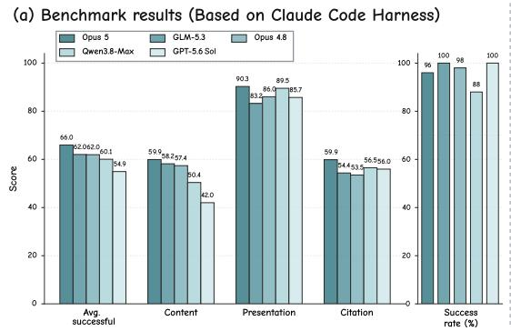
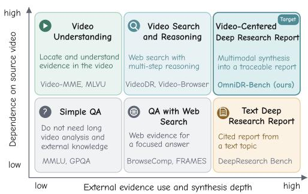
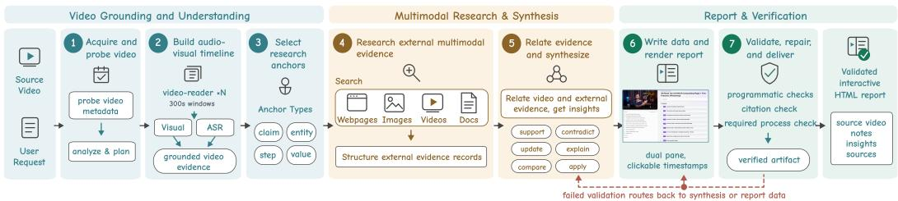
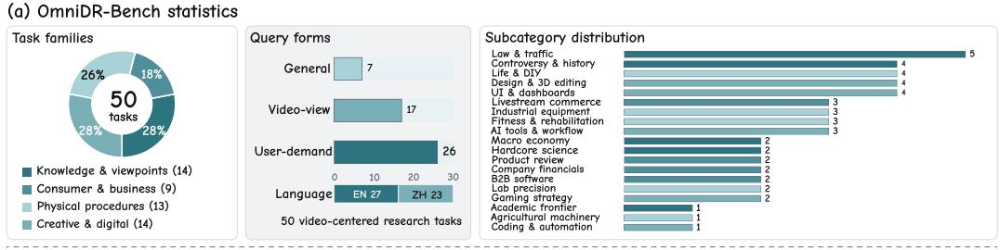
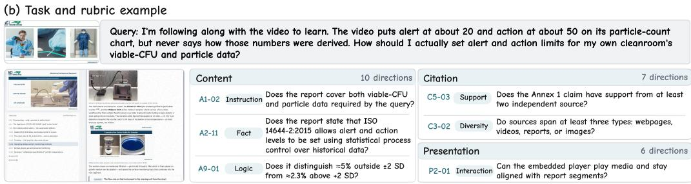
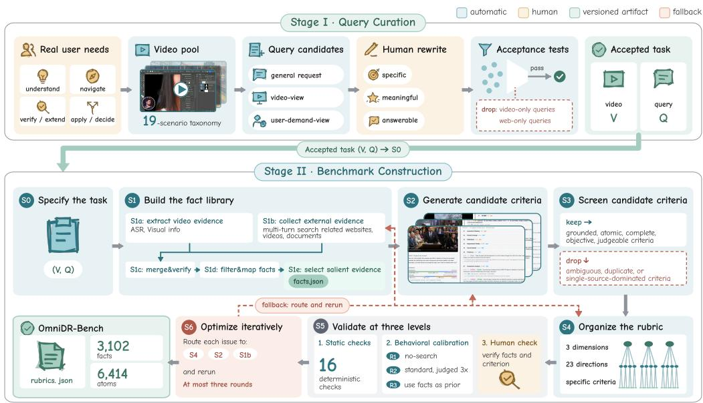
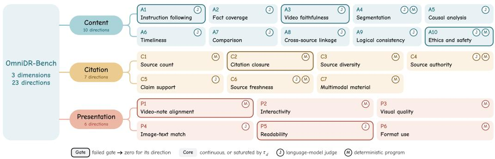
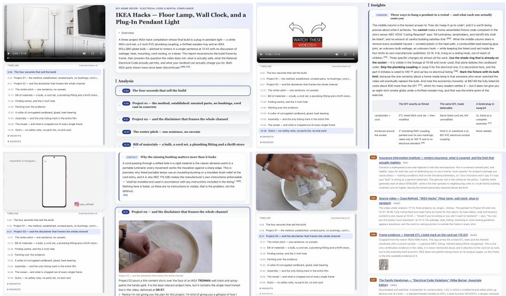

# BEYOND WATCHING AND SEARCHING: BENCHMARK-ING AGENTS FOR VIDEO-CENTERED DEEP RESEARCH REPORTS

Jiahao Meng1,2†, Qize Yang2, Yuxuan Wang2, Yunfei Chu2, Wensi Dai3, Jin Xu2,\*, Yunhai Tong1,\* 1Peking University 2Alibaba Token Hub, Alibaba Group 3Independent Researcher

Co-corresponding authors

## ABSTRACT

Deep research agents synthesize open-web evidence into long reports, but current benchmarks do not evaluate research centered on a source video. We introduce Video-Centered Deep Research Report Generation. Given a video and user request, an agent identifies research questions, retrieves external multimodal evidence, and produces an interactive report linked to relevant video moments. This task has direct practical value because it helps users locate relevant moments, verify claims, reproduce demonstrated procedures, and make informed decisions from video content. We present a skill-based workflow and OmniDR-Bench for this task. For evaluation, we propose Omni Atomic Rubric Trees (Omni-ARTs). Each tree contains three dimensions, 23 shared directions, and task-specific atomic binary criteria. The directions test audiovisual grounding, multimodal evidence use, and interactive presentation. Audited Rubric Construction (ARC) builds these trees through independent evidence collection, automated checks, behavioral calibration, and iterative human review. OmniDR-Bench contains 50 Chinese and English tasks across 19 realworld subcategories. It includes 6,414 criteria. Across 18 agent configurations, the best system scores 63.3 out of 100. Current agents still need broader content coverage, stronger causal and logical analysis across modalities, and more accurate citation support. We further analyze models, harnesses, skill configurations, video categories, and research trajectories. The code and data are released at https://github.com/marinero4972/OmniDR-Bench.

## 1 INTRODUCTION

Videos teach knowledge, share opinions, demonstrate procedures, and advertise products through speech, imagery, and temporal context. Compared with text, video natively preserves richer situational context, visible entities, spatial relations, and fine-grained actions that are difficult to verbalize completely. These cues can reveal questions about mechanisms, credibility, alternatives, and practical use that a broad text topic may not expose. Viewers may therefore need to locate relevant moments, verify claims and background, discover related material, or apply the content to a real decision. These needs call for research that remains centered on the source video.

Existing agents address only parts of this goal. Text-centered deep research agents produce cited reports through iterative web search and synthesis (Java et al., 2025; Li et al., 2025; Qiao et al., 2025). They do not require the audiovisual or temporal evidence of a given video. Video deep research combines source-video evidence with open-web retrieval and multi-step reasoning (Liang et al., 2025; Liu et al., 2026a; Gao et al., 2026; Fang et al., 2026; Liu et al., 2026b; Zhang et al., 2026b). Its benchmarks mainly target difficult question answering (QA) tasks with short answers. Text-image research report systems (Shi et al., 2026; Zhang et al., 2026a; Ma et al., 2026) synthesize multimodal web material without taking a source video or retrieved videos as research evidence. Figure 1 locate these settings by input, research depth, and output form. Table 1 further compares their operational boundaries. No existing setting evaluates a complete research report that is organized around one source video and enriched by external multimodal evidence.

  
Figure 1: Video-Centered Deep Research and representative OmniDR-Bench results. Left: successful-report scores and task success. Right: the task integrates source-video audiovisual con text with external text, image, and video evidence in an interactive, cited report.

We introduce Video-Centered Deep Research Report Generation to fill this gap. Given a source video and a user request, an agent identifies research-worthy claims, procedures, parameters, entities, and open questions. It investigates webpages, documents, images, and related videos, then connects this evidence to relevant source moments. The output is an interactive HTML report for understanding, verification, and practical application. We implement a skill-based reference workflow with specialized media readers, anchor-conditioned research, evidence verification, and interactive rendering.

Evaluating this task is difficult because an open-ended report has no unique reference answer. Valid reports may use different organizations and source sets (Du et al., 2026a; Sharma et al., 2025; Zhong et al., 2026). An evaluator must still distinguish citation volume from claim support and assess video grounding, cross-source reasoning, and the rendered artifact (Zhao et al., 2026; Leung et al., 2026; An et al., 2026). We address this challenge with Omni Atomic Rubric Trees (Omni-ARTs). Each tree has three levels beneath the aggregate score: three quality dimensions, 23 shared diagnostic directions, and task-specific atomic binary criteria. The hierarchy preserves comparable upper-level scores while testing the evidence needs of each task. Reliable trees also require a sufficiently broad and independently verified evidence base. We therefore propose Audited Rubric Construction (ARC), which collects multimodal evidence, screens candidate criteria, calibrates score behavior, and verifies every fact and criterion through iterative human review. Together, Omni-ARTs and ARC define OmniDR-Bench. Here, Omni denotes research across video, audio, image, and text, while DR denotes Deep Research.

OmniDR-Bench contains 50 tasks across 19 subcategories and 6,414 criteria. Experiments compare 18 configurations that pair models with agent harnesses, the execution frameworks that manage planning, context, delegation, and recovery. The strongest system achieves 63.3 on the 0–100 rubric scale. Presentation averages 81.8 points, while content and citation average only 45.4 and 47.8 points. Under the shared report template, current agents satisfy presentation requirements more consistently than audited coverage, reasoning, and citation-support criteria.

Our contributions are threefold. First, we propose Video-Centered Deep Research Report Generation, extending video deep research from short answers to complete and traceable reports. Second, we propose Omni-ARTs and ARC for fine-grained report evaluation and reliable benchmark construction. Third, we release OmniDR-Bench and a reference agent workflow. We analyze models, agent harnesses, skill configurations, video categories, and long-horizon research trajectories.

## 2 VIDEO-CENTERED DEEP RESEARCH

This section defines the input, output, and evidence requirements of Video-Centered Deep Research Report Generation. It then presents a skill-based agent workflow that implements the full research process.

  
Figure 2: Seven-stage reference workflow. Research anchors connect source-video moments to external webpage, image, video, and document evidence. The agent synthesizes these records into an interactive report and repairs failed checks.

Table 1: Task boundaries. Ours uses one given video as organizing evidence for an auditable report.
<table><tr><td>Setting</td><td>Source video</td><td>Open web</td><td>Video retrieval</td><td>Long report</td><td>Time links</td><td>Primary objective</td></tr><tr><td>Video summary</td><td>Yes</td><td>No</td><td>No</td><td>No</td><td>No</td><td>Condense one video</td></tr><tr><td>Text deep research</td><td>No</td><td>Yes</td><td>No</td><td>Yes</td><td>No</td><td>Research a standalone topic</td></tr><tr><td>Open-web video search</td><td>No</td><td>Yes</td><td>Yes</td><td>No</td><td>No</td><td>Find video evidence</td></tr><tr><td>Video deep research QA</td><td>Yes</td><td>Yes</td><td>No</td><td>No</td><td>No</td><td>Answer one hard question</td></tr><tr><td>Text-image research report</td><td>No</td><td>Yes</td><td>No</td><td>Yes</td><td>No</td><td>Synthesize text and image evidence</td></tr><tr><td>Ours</td><td>Yes</td><td>Yes</td><td>Yes</td><td>Yes</td><td>Yes</td><td>Research and audit one video</td></tr></table>

## 2.1 TASK DEFINITION

An instance contains a source video V , a user request Q, and an open tool environment E. An agent A produces an interactive HTML report

$$
H = \mathcal { A } ( V , Q , \mathcal { E } ) ,\tag{1}
$$

where H is the delivered report. This task helps users locate important material, verify claims and context, and apply video content to practical decisions. These uses require more than a recap. The report must preserve what the video shows and says while adding external research that addresses the user’s need.

Figure 2 makes this process concrete. Stage 3 turns request-relevant claims, procedures, parameters, entities, and open questions into research anchors. Stage 4 uses these anchors to retrieve evidence from webpages, images, videos, and documents. Stage 5 records how the external evidence supports, contradicts, updates, explains, compares, or applies the video content.

A valid report keeps the given video central and contributes research beyond a summary. Important findings must connect to both external sources and relevant video moments. Its text, media, citations, and interactions must let readers inspect the evidence. Together, these requirements capture video centrality, research depth, multimodal evidence use, traceability, and usability. We accept a task only when video-only analysis is insufficient and generic web research cannot replace the source video. Sufficient public evidence must also exist within a practical budget. Table 1 distinguishes our task from text-image report systems. Those systems start from a textual topic and synthesize webpages, images, and figures without reading a source video or retrieving external video evidence.

## 2.2 AGENT WORKFLOW

We package the seven-stage agentic workflow as a high-level video-research skill, a reusable instruction and tool module. It belongs to a suite of thirteen skills and invokes specialized video-reader and doc-reader modules as subagents. The main agent carries the timeline, research anchors, external evidence, cross-source relations, unresolved questions, and report data across stages. This shared state reduces repeated context loading and helps prevent goal drift in long trajectories (Wang et al., 2026).

Figure 2 summarizes the seven stages from video intake through report validation and repair. The agent first acquires the video and aligns visual observations with speech on one timeline. It then selects request-relevant anchors with timestamps or frame evidence. Parallel branches inspect webpages, images, videos, and documents. Each branch returns structured evidence with provenance. The main agent connects this evidence to the source video and synthesizes supported findings. It writes structured report data and renders an interactive report with video-time navigation. The final stage runs programmatic, citation, and required-process checks. Failed checks return to evidence synthesis or report data for targeted repair. Appendix D expands this control-flow overview with the reader roles, state fields, browser checks, evidence verification, and released budgets. Appendix Figure 6 shows the final interactive artifact for one complete example.

  
Figure 3: OmniDR-Bench statistics and one task that connects source-video evidence to external multimodal research. Selected content, citation, and presentation criteria show the evaluation scope. Appendix Tables 12 and 25 give more tasks, while Appendix Figures 5 and 6 show the full Omni-ART hierarchy and one complete report.

## 3 OMNIDR-BENCH

OmniDR-Bench evaluates open-ended reports with Omni Atomic Rubric Trees, separating videogrounded content, citation support, and interactive presentation. Audited Rubric Construction builds and verifies the evidence and criteria for each tree.

## 3.1 VIDEO COLLECTION AND QUERY CONSTRUCTION

We select four families that reflect common reasons for researching a video. Knowledge and viewpoint videos require explanation and verification. Consumer and business videos support comparison and decision making. Physical procedure videos require faithful reconstruction and diagnosis. Creative and digital videos emphasize workflows, tools, and transferable practice. Together, these families test distinct evidence needs and report outcomes. We manually source and download can didate videos from YouTube and Bilibili. Each retained video contains claims, steps, parameters, entities, or open questions that depend on visual or temporal context. The fixed benchmark contains 50 Chinese and English tasks across 19 subcategories, with the full collection and curation protocol documented in Appendix E.

The query pool combines a general report request with two focused views. The video view proposes research directions around theories, cases, objects, or claims. The user demand view formulates a concrete decision, diagnosis, reproduction, or application need. Annotators rewrite selected candidates and require each query to need both the given video and external evidence while remaining answerable from public sources. Figure 3 summarizes the resulting coverage, and Appendix C gives the query scoring, acceptance tests, and examples.

Each task averages 128 criteria, giving 6,414 fine-grained checks. One report takes roughly 2 hours, so one system requires about 100 agent-hours before repeated grading. The deliberate 50-task scale covers four families and 19 subcategories while keeping the 18-configuration comparison tractable and favoring dense diagnosis over short-answer volume. Appendix B lists all 19 subcategories, their definitions, and associated research needs.

  
Figure 4: Query curation and Audited Rubric Construction (ARC). Curation retains source-videodependent tasks that require external evidence. ARC independently gathers audiovisual and openweb multimodal evidence, derives an Omni Atomic Rubric Tree (Omni-ART), and validates both facts and criteria.

## 3.2 OMNI ATOMIC RUBRIC TREES

An Omni Atomic Rubric Tree (Omni-ART) has three rubric levels beneath the final aggregate score. The first level contains content, citation, and presentation. The second level contains 23 shared diagnostic directions. The third level contains task-specific criteria under each applicable direction. The Omni scope covers video, audio, image, and text evidence and the relations among them. Its directions therefore assess audiovisual faithfulness, cross-modal reasoning, multimodal source use, claim support, image-text correspondence, and video-time interaction. This hierarchy supports comparison at shared upper levels without prescribing one report structure or source set. Figure 5 in Appendix A shows the complete hierarchy, gate assignments, and model or deterministic evaluator types. Each leaf is an atomic binary criterion with an expected outcome, evaluator, and evidence difficulty. Semantic leaves bind to independent fact records; structural leaves bind to executable program or browser checks, making each decision auditable.

We propose Audited Rubric Construction (ARC) to build and verify each Omni-ART. Evaluated reports never enter ARC evidence acquisition or criterion generation. This separation matters because evaluated reports can omit valid facts or favor the sources selected by one system. ARC therefore builds an independent fact library before writing any criterion. For each task, isolated agents first produce a Video Evidence Map of timestamped audiovisual facts. They independently search webpages, documents, images, and related videos to build a Web Evidence Map. This external multimodal search adds visual analogues, demonstrations, primary records, standards, and updated context that text search alone may miss. ARC then connects the two maps through support, contradiction, update, explanation, comparison, and application relations. The resulting fact library makes cross-modal evidence explicit before any rubric leaf is written. Omni-ART scores the submitted report rather than compliance with the reference workflow in Section 2.2. Any internal process can receive credit when its final artifact satisfies the same criteria. The fact library specifies salient research targets; it does not prescribe the report’s organization or an identical set of retrieved sources.

Figure 4 summarizes the core ARC path from task specification to a versioned benchmark artifact. S0 fixes the task scope and search routes to prevent evidence collection from drifting toward the broad topic. S1 collects video evidence and external multimodal evidence in isolated branches to preserve provenance and keep either branch from copying the other’s framing. It then reconciles support and conflict, removes irrelevant or redundant records, and retains salient evidence for the user request. S2 converts this fact library and the report requirements into binary candidate criteria so that each leaf can be checked directly. Generated criteria can be ambiguous, duplicated, weakly supported, or concentrated in a few directions. S3 retains criteria that are grounded in evidence or executable behavior, atomic, complete enough to decide without unstated context, objectively worded, and judgeable by the assigned evaluator. It also checks uniqueness, source support, and direction coverage. S4 assembles and caps the retained leaves under the three dimensions and 23 directions so that high-volume directions do not dominate the score.

Table 2: Evaluation dimensions. Each direction contains task-specific binary criteria.
<table><tr><td>Dimension</td><td>Directions</td></tr><tr><td>Content</td><td>Instruction following, fact coverage, video faithfulness, segmentation, causal analysis, timeliness, comparison, cross-source linkage, logical consistency, ethics and safety</td></tr><tr><td>Citation</td><td>Source count, citation closure between inline citations and source records, source diversity, source authority, claim support, source freshness, multimodal material</td></tr><tr><td>Presentation</td><td>Video-note alignment, interactivity, visual quality, image-text match, readability, format use</td></tr></table>

S5 combines static checks, behavioral calibration, and human artifact verification. Static checks remove schema, identifier, evidence-binding, and logic errors before any behavioral test. Behavioral calibration compares a video-only report $R _ { 1 }$ , a full-tool research report $R _ { 2 }$ , and a fact-libraryassisted report $R _ { 3 }$ . All three reports are generated by Claude Opus 4.8 under Claude Code. $\dot { R } _ { 2 }$ uses the full tool set and video-research skill. Every retained task satisfies $R _ { 1 } < R _ { 2 } < R _ { 3 }$ and $R _ { 3 } - R _ { 1 } > \delta _ { \mathrm { c a l } }$ . Here, $\delta _ { \mathrm { c a l } }$ is the minimum required gain from $R _ { 1 }$ to $R _ { 3 } .$ . These three report levels check whether the Omni-ART responds to additional evidence access. We also score each $R _ { 2 }$ report three times. Appendix Table 13 summarizes this control with the other S5 checks. Only 0.89% of applicable criteria receive non-unanimous decisions on average, which indicates stable evaluation. Human reviewers inspect the facts and criteria and return semantic errors to S6. S6 routes repairable issues back to their originating stage, removes candidate packages with pervasive artifact errors, and advances accepted packages to the next validation round. After at most three rounds, ARC freezes the evidence, Omni-ART, and evaluator versions used in the released benchmark. The released snapshot contains 6,414 criteria. Appendix E details the persistent artifacts, isolated evidence collection, provenance and conflict handling, pruning rules, screening logic, calibration, and repair process. Appendix A.5 reports the human verification protocol and agreement.

## 3.3 EVALUATION METHODOLOGY

Table 2 defines the dimension and direction layers of an Omni-ART.

The evaluator uses two check types. J denotes semantic and visual decisions from a multimodal model judge. M denotes deterministic programs, including browser probes, that inspect files, structure, sources, assets, navigation, citation jumps, playback, and controls. Appendix A defines every direction and evaluator contract.

For direction $d ,$ let $A _ { d }$ be its applicable leaves after the guarded N/A procedure below, and let $a _ { j } \in \{ 0 , 1 \}$ be the outcome of leaf j. Its raw and credited rates are

$$
r _ { d } = \frac { 1 } { | A _ { d } | } \sum _ { j \in A _ { d } } a _ { j } , \qquad c _ { d } = \left\{ \begin{array} { l l } { \operatorname* { m i n } ( 1 , r _ { d } / \tau _ { d } ) , } & { d \in \mathcal { H } , } \\ { r _ { d } , } & { \mathrm { o t h e r w i s e } , } \end{array} \right.\tag{2}
$$

where $\mathcal { H }$ contains fact coverage, causal analysis, and comparison, and $\tau _ { d }$ is the pass-rate threshold for full credit. Let $g _ { d }$ be zero when direction d is a gate and fails, and one otherwise. Let $w _ { d }$ be the number of applicable leaves, capped by $\kappa _ { d }$ for directions in H. For dimension $k \in \{ C , R , P \}$ with direction set $\mathcal { D } _ { k }$ , the dimension and report scores are

$$
D _ { k } = \frac { \sum _ { d \in \mathcal { D } _ { k } } w _ { d } g _ { d } c _ { d } } { \sum _ { d \in \mathcal { D } _ { k } } w _ { d } } , \qquad S = 1 0 0 \sum _ { k \in \{ C , R , P \} } \lambda _ { k } D _ { k } .\tag{3}
$$

Here, $C , R ,$ and $P$ index content, citation, and presentation, respectively. The nonnegative dimension weights $\lambda _ { k }$ sum to one. Appendix A.1 reports all released values. Appendix F.2 reports task-bootstrap uncertainty and sensitivity to the released values of $\lambda _ { k } , \tau _ { d } ,$ and $\kappa _ { d } .$

Table 3: Results on 50 tasks with task-bootstrap 95% confidence intervals for Avg. Avg. counts failures as zero, while other quality scores use successful reports. Bold and underline mark the top two values except Success.
<table><tr><td>Harness</td><td>Model</td><td>Avg.</td><td>95% CI</td><td>Success</td><td>Avg. succ.</td><td>Max</td><td>Min</td><td>Content</td><td>Presentation</td><td>Citation</td></tr><tr><td rowspan="12">Claude Code</td><td>Claude Opus 5</td><td>63.3</td><td>[57.8, 68.3]</td><td>96.0%</td><td>66.0</td><td>88.6</td><td>26.5</td><td>59.9</td><td>90.3</td><td>59.9</td></tr><tr><td>Claude Opus 4.8</td><td>60.7</td><td>[56.8, 64.2]</td><td>98.0%</td><td>62.0</td><td>81.8</td><td>37.2</td><td>57.4</td><td>86.0</td><td>53.5</td></tr><tr><td>Claude Opus 4.7</td><td>58.4</td><td>[54.1, 62.1]</td><td>96.0%</td><td>60.9</td><td>77.7</td><td>44.5</td><td>58.7</td><td>84.8</td><td>48.5</td></tr><tr><td>GPT-5.6 Šol</td><td>54.9</td><td>[52.9, 57.1]</td><td>100.0%</td><td>54.9</td><td>74.3</td><td>39.6</td><td>42.0</td><td>85.7</td><td>56.0</td></tr><tr><td>GPT-5.5</td><td>50.4</td><td>[48.0, 52.9]</td><td>100.0%</td><td>50.4</td><td>74.0</td><td>28.7</td><td>38.7</td><td>80.9</td><td>49.6</td></tr><tr><td>Gemini-3.8-Flash</td><td>52.6</td><td>[50.2, 55.1]</td><td>100.0%</td><td>52.6</td><td>73.2</td><td>28.3</td><td>43.6</td><td>79.6</td><td>49.7</td></tr><tr><td>Qwen3.8-Omni-Flash</td><td>59.3</td><td>[55.7, 62.5]</td><td>98.0%</td><td>60.5</td><td>78.4</td><td>44.6</td><td>54.6</td><td>89.0</td><td>51.5</td></tr><tr><td>Qwen3.8-Max</td><td>52.9</td><td>[46.5, 58.8]</td><td>88.0%</td><td>60.1</td><td>91.5</td><td>37.4</td><td>50.4</td><td>89.5</td><td>56.5</td></tr><tr><td>Qwen3.7-Max</td><td>39.9</td><td>[34.7, 44.9]</td><td>88.0%</td><td>45.4</td><td>65.3</td><td>26.0</td><td>39.2</td><td>73.3</td><td>37.1</td></tr><tr><td>Qwen3.5-Omni-Plus</td><td>28.1</td><td>[21.8, 34.5]</td><td>62.0%</td><td>45.4</td><td>64.8</td><td>32.9</td><td>39.9</td><td>71.1</td><td>37.4</td></tr><tr><td>GLM-5.3</td><td>62.0</td><td>[59.4, 64.6]</td><td>100.0%</td><td>62.0</td><td>79.1</td><td>38.0</td><td>58.2</td><td>83.2</td><td>54.4</td></tr><tr><td>Kimi-K3</td><td>50.7</td><td>[45.4, 55.5]</td><td>92.0%</td><td>55.1</td><td>75.1</td><td>31.0</td><td>48.1</td><td>82.0</td><td>48.8</td></tr><tr><td rowspan="3">Codex</td><td>GPT-5.6 Sol</td><td>53.9</td><td>[50.8, 57.0]</td><td>100.0%</td><td>53.9</td><td>76.3</td><td>30.9</td><td>42.4</td><td>87.6</td><td>50.6</td></tr><tr><td>GPT-5.5</td><td>46.0</td><td>[42.7, 49.2]</td><td>98.0%</td><td>46.9</td><td>72.5</td><td>32.7</td><td>34.8</td><td>83.6</td><td>42.8</td></tr><tr><td>Qwen3.7-Max</td><td>45.3</td><td>[41.9, 48.6]</td><td>100.0%</td><td>45.3</td><td>72.0</td><td>23.5</td><td>38.5</td><td>69.8</td><td>40.3</td></tr><tr><td rowspan="3">OpenClaw</td><td>GPT-5.6 Sol</td><td>41.7</td><td>[35.4, 47.6]</td><td>82.0%</td><td>50.9</td><td>72.4</td><td>33.5</td><td>39.9</td><td>83.9</td><td>47.2</td></tr><tr><td>GPT-5.5</td><td>41.2</td><td>[36.2, 45.7]</td><td>90.0%</td><td>45.8</td><td>71.1</td><td>24.3</td><td>33.9</td><td>81.9</td><td>41.4</td></tr><tr><td>Qwen3.7-Max</td><td>35.3</td><td>[29.8, 40.6]</td><td>82.0%</td><td>43.0</td><td>73.4</td><td>18.3</td><td>37.2</td><td>70.2</td><td>34.5</td></tr></table>

For an omitted fact, failed citation criteria become N/A only if a direction-level guard finds that the content gain from stating it exceeds the citation gain from removing failed criteria; otherwise, they retain zero scores. Appendix A.4 details rollback and saturation handling. Evaluator errors are excluded from the corresponding denominator. A missing or unreadable report receives zero in the all-task average.

## 4 EXPERIMENTS

We compare current agents, their failure modes, and their behavior across models and harnesses.

## 4.1 EXPERIMENTAL SETUP

Implementation details. Each run receives the same video, query, tools, and report contract, with a shared interface template specifying the required HTML structure and behavior. Benchmark evidence remains hidden. Agents may inspect the video, search multimodal sources, and test the report in a browser. GPT-5.6 Sol judges semantic and visual criteria because it supports multimodal inputs, bilingual instructions, and structured outputs. Deterministic checks, including browser probes, verify observable properties. A run succeeds when its final report is recoverable and evaluable. Across the 900 model–task attempts, 835 reports are evaluable and 65 are unsuccessful or unavailable; 19 of the latter are detected unfilled interface skeletons and are counted as failures.

Evaluated systems. We evaluate 18 configurations from the Claude, GPT, Gemini, Qwen, GLM, and Kimi families (Anthropic, 2026c; OpenAI, 2026b; Google DeepMind, 2026; Qwen Team, 2026c; Z.AI, 2026; Moonshot AI, 2026). Claude Code covers twelve configurations, while Codex and OpenClaw each cover GPT-5.6 Sol, GPT-5.5, and Qwen3.7-Max. We retain each harness’s native behavior because it is part of the deployed agent system.

Reporting protocol. Scores use a 0–100 scale and aggregate by task; the all-task average assigns zero to failures, while Avg. succ. excludes them. Appendix A.6 reports atomic agreement and holistic human validation on generated reports. Appendices A, F, and G give evaluation protocols, configurations, budgets, detailed analyses, and prompts.

## 4.2 MAIN RESULTS

Overall performance. Table 3 reports the main scores and their task-bootstrap intervals, while Appendix F.2 tests scoring sensitivity. Claude Opus 5 has the highest point estimate at 63.3 overall and 66.0 on successful reports, but misses 4.0% of tasks. GLM-5.3 completes every task and scores 62.0. Their 1.3 point difference has a task-bootstrap 95% confidence interval of [−4.0, 5.6], so their order is uncertain. Qwen3.8-Max scores 60.1 on successful reports, yet its 88.0% completion lowers the overall score to 52.9.

Table 4: Successful-report means by major video family on a 0 to 100 scale.
<table><tr><td>Family</td><td>Overall</td><td>Content</td><td>Citation</td><td>Presentation</td></tr><tr><td>Knowledge and viewpoints</td><td>54.8</td><td>48.9</td><td>46.9</td><td>81.2</td></tr><tr><td>Consumer and business</td><td>52.8</td><td>41.5</td><td>51.3</td><td>83.3</td></tr><tr><td>Physical procedures</td><td>53.5</td><td>43.7</td><td>50.2</td><td>83.1</td></tr><tr><td>Creative and digital</td><td>53.4</td><td>47.0</td><td>45.5</td><td>81.4</td></tr></table>

Shared bottleneck. Table 3 and Appendix Table 16 show a shared gap between presentation and research substance. Under the shared interface template, presentation averages 81.8 points, compared with 45.4 for content and 47.8 for citation. Across configurations, the unweighted mean of configuration-level direct-video-fact pass rates is 79.9%. The mean falls to 8.7% for external evidence, 8.8% for cross-source verification, and 5.0% for multi-fact composition. Fact coverage, causal analysis, and comparison average only 7.6%, 9.5%, and 4.6%. The dashboard additionally pools atomic decisions across configurations; under that weighting, the corresponding L0–L3 rates are 80.4%, 9.0%, 9.2%, and 5.0%, and the three coverage-direction rates are 7.9%, 9.7%, and 4.6%. Video faithfulness averages 92.4%, but logical consistency and claim support reach only 21.2% and 15.9%. Inspection of failed coverage criteria shows that omissions of audited research targets dominate explicit contradictions. Reports satisfy presentation requirements more consistently than audited coverage, reasoning, and claim-support criteria.

Different systems fail differently. Under matched Claude Code runs, Table 3 shows distinct strengths and failure modes. Claude Opus 5 leads all three dimensions, while GLM-5.3 ranks second overall with complete delivery. GLM-5.3 combines complete delivery with strong content and citation. Qwen3.8-Omni-Flash is strong in content and presentation but weaker in citation, while Qwen3.8-Max has the highest single-report score but lower completion reliability. GPT-5.6 Sol and Gemini-3.8-Flash complete every task but remain content-limited. Kimi-K3 is mid-range, while Qwen3.5 and Qwen3.7 lag mainly in content, citation, and completion.

Finding sources is easier than using them. Appendix Table 17 exposes a recurring citation failure in the fine-grained directions. For example, under Claude Code, GPT-5.6 Sol passes 98.0% of source-count criteria and 93.5% of multimodal-material criteria, but only 23.9% of claim-support criteria. Gemini-3.8-Flash passes 93.0% of multimodal-material criteria, yet reaches 13.9% on claim support. Trace inspection shows that reports often collect links in a final Sources section without citing them beside the claims they should support. Thus, retrieval volume does not imply evidence integration or citation closure between inline citations and source records.

Video categories and query types. The four video families span only 2.0 points, from 52.8 to 54.8 (Table 4), while subcategories range from 46.0 to 59.1. General, video-view, and user-demand queries average 41.3, 52.5, and 50.4 points. These differences remain descriptive because subcategories contain one to five tasks and query forms are not randomly assigned; Appendix F.4 provides the detailed breakdowns.

## 4.3 FURTHER ANALYSIS

Skill ablations. Table 5 and Appendix Table 21 separate atomic skill access from high-level orchestration. The five-level ladder runs from an interface-only baseline to the full video-research skill, with exact capabilities and controls in Appendix F.5. All variants use the same model, harness, iteration limit, timeout, retry policy, and report contract. Actual compute use is determined by the agent under each capability configuration.

Adding text web research to source-video processing raises the all-task mean from 31.8 to 45.5 points and success from 73.3% to 100.0%. Multimodal retrieval adds 1.1 points overall: its 5.2-point content gain is partly offset by a 5.3-point citation loss, separating access to richer evidence from successful citation integration. Full orchestration adds 7.3 points over all atomic skills and improves 12 of 15 tasks, with a paired 95% interval of [3.4, 11.1]. Its largest gain is 20.7 citation points, while content rises by 0.8 points: the workflow’s clearest benefit is improved citation quality.

Table 5: Cumulative skill ablation on 15 matched tasks with GPT-5.6 Sol and Claude Code. Columns abbreviate interface (UI), multimodal retrieval (Multi.), video-research orchestration (VDR), and presentation (Pres.). Scores include failures except Avg. succ.
<table><tr><td></td><td colspan="5">Provided capability</td><td colspan="10">Evaluation result</td></tr><tr><td>Variant</td><td>UI</td><td>Video</td><td>Web</td><td>Multi.</td><td>VDR</td><td>Avg.</td><td>Success</td><td>Avg. succ.</td><td>Content</td><td>Pres.</td><td>Citation</td><td>Steps</td><td></td><td>Time (h)</td><td>Tokens (M)</td></tr><tr><td>(i)</td><td>√</td><td></td><td></td><td></td><td></td><td>28.0</td><td>66.7%</td><td>42.0</td><td>18.9</td><td>50.5</td><td></td><td>28.2</td><td>95.5</td><td>0.6</td><td>1.2</td></tr><tr><td>(ii)</td><td>√</td><td>√</td><td></td><td></td><td></td><td></td><td>31.8</td><td>73.3%</td><td>43.4 45.5</td><td>26.6</td><td>54.3</td><td>25.4</td><td>94.0</td><td>0.8</td><td></td></tr><tr><td>(iii)</td><td>√</td><td>√</td><td>√</td><td></td><td></td><td>45.5</td><td>100.0%</td><td></td><td></td><td>34.9 80.3</td><td></td><td>40.0</td><td>104.0</td><td>0.6</td><td>2.0</td></tr><tr><td>(iv)</td><td>√</td><td>√</td><td>√</td><td>√</td><td></td><td>46.6</td><td>100.0%</td><td></td><td>46.6</td><td>40.1</td><td>80.7</td><td>34.7</td><td>103.0</td><td>0.7</td><td>2.3</td></tr><tr><td>(v)</td><td>√</td><td>√</td><td>√</td><td>√</td><td></td><td>53.9</td><td>100.0%</td><td></td><td>53.9</td><td>40.9</td><td>83.9</td><td>55.4</td><td>167.0</td><td>1.6</td><td>4.7</td></tr></table>

This benefit raises median steps from 103 to 167, time from 0.7 to 1.6 hours, and tokens from 2.3M to 4.7M, describing a quality–cost trade-off.

Harness effects. Appendix F.6 and Table 22 compare the three harnesses under matched models. Claude Code and Codex both average 48.4 points on the three matched models, but Codex completes 99.3% of runs compared with 96.0% for Claude Code. Claude Code leads on both GPT models, while Codex leads on Qwen3.7-Max and has no median tool error. OpenClaw uses fewer tools and tokens but has the lowest mean of 39.4 and the lowest completion rate of 84.7%, showing that harness effects depend on the model and resource use.

Research trajectories and efficiency. Appendix Tables 23 and 24 report phase order across all 18 configurations. Under Claude Code, median post-write search ranges from 33.3% for GPT-5.6 Sol to 61.5% for Claude Opus 5, while GLM-5.3 reaches 54.2% with 15.5 median write blocks. Eight configurations meet our interleaving rule, suggesting that drafting often exposes evidence gaps and triggers retrieval (Wang et al., 2026). Interleaving alone does not ensure quality because productive evidence transfer matters more than trajectory length.

Failure patterns. Appendices F.7 and H show that short traces leave evidence gaps, while long traces may repeat errors or fail to transfer evidence into the report. Fragmented traces can still recover, so steps, tokens, and tool errors alone do not predict quality.

## 5 RELATED WORK

Deep research agents. Text agents produce cited reports through long-horizon retrieval and synthesis (Qiao et al., 2025; Li et al., 2025; Du et al., 2026b). Multimodal report agents add visual retrieval and interleaved output (Geng et al., 2025; Shi et al., 2026; Ma et al., 2026), whereas video deep research connects source-video grounding with open-web search (Gao et al., 2026; Liu et al., 2026b; Zhang et al., 2026b). The former does not center research on a supplied video, and the latter mainly targets short-answer QA. Our task uses the audiovisual timeline as the research backbone and returns a cited interactive report enriched with external multimodal evidence.

Deep research benchmarks. Long-video and browsing benchmarks test temporally distributed understanding or open-web multi-step QA (Fu et al., 2025; Meng et al., 2026; Liang et al., 2025; Liu et al., 2026a). Text report benchmarks assess factuality, completeness, citation quality, and user intent (Du et al., 2026a; Sharma et al., 2025; Zhong et al., 2026). Multimodal, process, and rubric studies further examine visual retrieval, tool use, trajectory errors, report logic, and citation support (Huang et al., 2026; Ye et al., 2026; Wang et al., 2026; Wan et al., 2026; Leung et al., 2026). OmniDR-Bench instead jointly evaluates video grounding, multimodal evidence, claim support, and interaction in complete reports.

## 6 CONCLUSION

We introduce Video-Centered Deep Research Report Generation and OmniDR-Bench. Omni-ART and ARC provide fine-grained evaluation grounded in audited multimodal evidence. Across 18 configurations, the best score is 63.3 out of 100, exposing gaps in coverage, cross-modal reasoning, and claim support. Future work targets better audiovisual use, efficiency, reasoning, and citations (Appendix I).

## AI USE STATEMENT

Generative AI assisted with language polishing and writing revision. AI models were also used as evaluated systems and as components of the benchmark evaluator.

## ETHICS STATEMENT

OmniDR-Bench uses public videos and web sources, which raise privacy, copyright, contextual integrity, and representation concerns. We exclude private or unsafe requests and follow applicable source licenses and platform terms. The set is not population representative, and its reports should not replace professional advice. Human verification follows applicable review, consent, and data protection requirements.

## REPRODUCIBILITY STATEMENT

Sections 2 through 4 and the appendix specify the task, workflow, benchmark, evaluation, experiments, taxonomy, queries, rubrics, and prompts. The release adds artifacts from S0 to S6, results, trajectories, evaluator code, harness configurations, scripts, and versioned source metadata.

## REFERENCES

Arctanx An, Shizhao Sun, Danqing Huang, Mingxi Cheng, Yan Gao, Ji Li, Yu Qiao, and Jiang Bian. Can vision language models assess graphic design aesthetics? a benchmark, evaluation, and dataset perspective. In International Conference on Learning Representations, 2026.

Anthropic. Introducing Claude Opus 4.7, 2026a. URL https://www.anthropic.com/ news/claude-opus-4-7.

Anthropic. Introducing Claude Opus 4.8, 2026b. URL https://www.anthropic.com/ news/claude-opus-4-8.

Anthropic. Introducing Claude Opus 5, 2026c. URL https://www.anthropic.com/news/ claude-opus-5.

Mingxuan Du, Benfeng Xu, Chiwei Zhu, Licheng Zhang, Xiaorui Wang, and Zhendong Mao. Deepresearch bench: A comprehensive benchmark for deep research agents. In International Conference on Learning Representations, 2026a.

Yuwen Du, Rui Ye, Shuo Tang, Keduan Huang, Xinyu Zhu, Yuzhu Cai, and Siheng Chen. Openseeker-v2: Pushing the limits of search agents with informative and high-difficulty trajectories. arXiv preprint arXiv:2605.04036, 2026b.

Zhen Fang, Yu Zeng, Wenxuan Huang, Yiming Zhao, Shiting Huang, et al. Video-deepresearch: Towards the next-generation multimodal deepresearch agent. arXiv preprint arXiv:2608.03979, 2026.

Chaoyou Fu, Yuhan Dai, Yongdong Luo, Lei Li, Shuhuai Ren, Renrui Zhang, Zihan Wang, Chenyu Zhou, Yunhang Shen, Mengdan Zhang, et al. Video-mme: The first-ever comprehensive evaluation benchmark of multi-modal llms in video analysis. In 2025 IEEE/CVF Conference on Computer Vision and Pattern Recognition (CVPR), pp. 24108–24118. IEEE, 2025.

Zhenkun Gao, Yicheng Bao, Jinlong Peng, Xueheng Li, Theo Huang, et al. Videosearcher: Empowering video deep research with multi-tool agentic reasoning via reinforcement learning. arXiv preprint arXiv:2607.02927, 2026.

Xinyu Geng, Peng Xia, Zhen Zhang, Xinyu Wang, Qiuchen Wang, Ruixue Ding, Chenxi Wang, Jialong Wu, Yida Zhao, Kuan Li, et al. Webwatcher: Breaking new frontier of vision-language deep research agent. arXiv preprint arXiv:2508.05748, 2025.

Google DeepMind. Gemini 3.8 Flash model card, 2026. URL https://deepmind.google/ models/model-cards/gemini-3-8-flash/.

Peizhou Huang, Zixuan Zhong, Zhongwei Wan, Donghao Zhou, Samiul Alam, et al. Mmdeepresearch-bench: A benchmark for multimodal deep research agents. arXiv preprint arXiv:2601.12346, 2026.

Abhinav Java, Ashmit Khandelwal, Sukruta Midigeshi, Aaron Halfaker, Amit Deshpande, Navin Goyal, Ankur Gupta, Nagarajan Natarajan, and Amit Sharma. Characterizing deep research: A benchmark and formal definition. arXiv preprint arXiv:2508.04183, 2025.

Ethan Leung, Elias Lumer, Corey Feld, Austin Huber, Vamse Kumar Subbiah, and Kevin Paul. Do you need a frontier model as a citation verifier? benchmarking rubric llms for deep-research source attribution. arXiv preprint arXiv:2607.08700, 2026.

Kuan Li, Zhongwang Zhang, Huifeng Yin, Liwen Zhang, Litu Ou, Jialong Wu, Wenbiao Yin, Baixuan Li, Zhengwei Tao, Xinyu Wang, et al. Websailor: Navigating super-human reasoning for web agent. arXiv preprint arXiv:2507.02592, 2025.

Zhengyang Liang, Yan Shu, Xiangrui Liu, Minghao Qin, Kaixin Liang, Nicu Sebe, Zheng Liu, and Lizi Liao. Video-browser: Towards agentic open-web video browsing. arXiv preprint arXiv:2512.23044, 2025.

Chengwen Liu, Xiaomin Yu, Zhuoyue Chang, Zhe Huang, Shuo Zhang, et al. Watching, reasoning, and searching: A video deep research benchmark on open web for agentic video reasoning. arXiv preprint arXiv:2601.06943, 2026a.

Wenqi Liu, Shijie Ma, Yunxiao Wang, Meng Liu, Qile Su, et al. Thinking beyond videos: Unifying video reasoning and deep research for open-world video agents. arXiv preprint arXiv:2608.23329, 2026b.

Xinkai Ma, Zhiqi Bai, Dingling Zhang, Pei Liu, Yishuo Yuan, et al. TVIR: Building deep research agents towards text-visual interleaved report generation. arXiv preprint arXiv:2606.02320, 2026.

Jiahao Meng, Yue Tan, Qi Xu, Haochen Wang, Zhongwei Ren, Weisong Liu, Yuhao Wang, Renrui Zhang, Xiangtai Li, Haodong Duan, Yunhai Tong, and Ming-Hsuan Yang. Videozerobench: Probing the limits of video mllms with spatio-temporal evidence verification. arXiv preprint arXiv:2604.01569, 2026.

Moonshot AI. Kimi K3, 2026. URL https://www.kimi.com/news/kimi-k3.

OpenAI. Introducing GPT-5.5, 2026a. URL https://openai.com/index/ introducing-gpt-5-5/.

OpenAI. Previewing GPT-5.6 Sol, 2026b. URL https://openai.com/index/ previewing-gpt-5-6-sol/.

Zile Qiao, Guoxin Chen, Xuanzhong Chen, Donglei Yu, Wenbiao Yin, Xinyu Wang, Zhen Zhang, Baixuan Li, Huifeng Yin, Kuan Li, et al. Webresearcher: Unleashing unbounded reasoning capability in long-horizon agents. arXiv preprint arXiv:2509.13309, 2025.

Qwen Team. Qwen3.5-Omni, 2026a. URL https://qwen.ai/blog?id=qwen3.5-omni.

Qwen Team. Qwen3.7, 2026b. URL https://qwen.ai/blog?id=qwen3.7.

Qwen Team. Qwen3.8, 2026c. URL https://qwen.ai/blog?id=qwen3.8.

Qwen Team. Qwen3.8-Omni-Flash, 2026d. URL https://qwen.ai/blog?id=qwen3. 8-omni-flash.

Manasi Sharma, Chen Bo Calvin Zhang, Chaithanya Bandi, Clinton Wang, Ankit Aich, et al. Researchrubrics: A benchmark of prompts and rubrics for evaluating deep research agents. arXiv preprint arXiv:2511.07685, 2025.

Zhuofan Shi, Peilun Jia, Baoqin Sun, Haiyang Shen, Sixiong Xie, Yun Ma, and Xiang Jing. ViDR: Grounding multimodal deep research reports in source visual evidence. arXiv preprint arXiv:2605.13034, 2026.

Yuxuan Wan, Tianqing Fang, Zaitang Li, Yintong Huo, Wenxuan Wang, Haitao Mi, Dong Yu, and Michael R. Lyu. Inference-time scaling of verification: Self-evolving deep research agents via test-time rubric-guided verification. arXiv preprint arXiv:2601.15808, 2026.

Jiaming Wang, Ziteng Feng, Jiangtao Wu, Ruihao Li, Qianqian Xie, Yuxiang Ren, He Zhu, Xueming Han, Fanyu Meng, Junlan Feng, and Jiaheng Liu. Where do deep-research agents go wrong? span-level error localization in agent trajectories. arXiv preprint arXiv:2606.02060, 2026.

Fangda Ye, Yuxin Hu, Pengxiang Zhu, Yibo Li, Ziqi Jin, et al. Miroeval: Benchmarking multimodal deep research agents in process and outcome. arXiv preprint arXiv:2603.28407, 2026.

Z.AI. GLM-5.3, 2026. URL https://z.ai/blog/glm-5.3.

Chenghao Zhang, Guanting Dong, Yufan Liu, Tong Zhao, Xiaoxi Li, and Zhicheng Dou. Towards verifiable multimodal deep research: A multi-agent harness for interleaved report generation. arXiv preprint arXiv:2605.29861, 2026a.

Xintong Zhang, Xiaomeng Fan, Shilin Yan, Ekko He, Zicheng Liu, et al. AdaVDR: Adaptive tool use and reflection for video deep research. arXiv preprint arXiv:2608.25559, 2026b.

Jujia Zhao, Zhaoxin Huan, Zihan Wang, Xiaolu Zhang, Jun Zhou, Suzan Verberne, and Zhaochun Ren. Reportlogic: Evaluating logical quality in deep research reports. arXiv preprint arXiv:2602.18446, 2026.

Joey Zhong, Hao Zhang, Clare Southern, Jeremy Yang, Thomas Wang, Kate Jung, Shu Zhang, Denis Yarats, Johnny Ho, and Jerry Ma. DRACO: A cross-domain benchmark for deep research accuracy, completeness, and objectivity. arXiv preprint arXiv:2602.11685, 2026.

## APPENDIX

Contents. The appendix provides the complete evaluation specification, task taxonomy, construction protocol, experimental details, prompts, examples, and limitations.

• Appendix A: Complete evaluation specification.

• Appendix B: Task taxonomy and collection details.

• Appendix C: Query construction details.

• Appendix D: Detailed agent workflow.

• Appendix E: Benchmark construction and annotation.

• Appendix F: Additional experimental details.

• Appendix G: Prompt and agent protocols.

• Appendix H: Qualitative task examples.

• Appendix I: Limitations and future work.

## A COMPLETE EVALUATION SPECIFICATION

## A.1 RELEASED HYPERPARAMETERS

The method uses symbols in its definitions so that the evaluation rule remains separate from one released configuration. Table 6 records the current values used to produce the reported scores. All values are fixed before evaluating the compared systems.

## A.2 OMNI-ART DIRECTION INVENTORY

The evaluator uses fixed direction definitions and instance-specific Omni-ART leaves. Figure 5 gives the complete direction inventory. The evaluator column indicates the check type. J is a multimodal model judgment. M is a deterministic verification, including static program rules and browser interaction probes. Figure 5 also distinguishes gate directions from core diagnostics. A failed gate zeros its direction. The three high-volume directions use saturation $\tau _ { d } ,$ while the remaining core directions aggregate continuously.

All content directions are primarily judged with J, except observable structural conditions that can be checked with M. The mixed design reserves model judgments for semantic properties and uses deterministic checks whenever the artifact exposes a direct signal.

## A.3 MODEL-JUDGE PROTOCOL

Judge choice. GPT-5.6 Sol can inspect both text and images, which is required for semantic content, citation-support, and visual-presentation criteria. It also supports bilingual instructions and structured outputs over long report contexts. We use the same model and prompt settings for every evaluated system.

Decision protocol. The judge receives one atomic binary criterion, its evidence note, and the relevant report material. It returns a binary decision, a short rationale, and supporting report evidence when available. It runs at temperature zero. Each non-gate model criterion is judged once. Gate criteria are evaluated three times and decided by majority vote because a failed gate sets its direction score to zero. M criteria evaluate directly observable properties without a model judge. Their deterministic checks include browser interaction probes. Interpretation. Fixing the judge improves comparability across systems but does not remove model-specific bias. The human study in Appendix A.5 verifies benchmark facts and criteria rather than every automatic report-level decision. The separate study in Appendix A.6 measures agreement between automatic and human rubric decisions on generated reports. Scores should therefore be interpreted under the released judge, prompts, and evaluator version.

Table 6: Symbols and current settings for construction, execution, and evaluation.
<table><tr><td>Symbol</td><td>Role</td><td>Released setting</td></tr><tr><td> $\pmb { \alpha } ^ { ( v ) }$ </td><td>Video-view query ranking weights</td><td>(0.35, 0.35, 0.20, 0.10)</td></tr><tr><td> $\pmb { \alpha } ^ { ( u ) }$ </td><td>User-demand query ranking weights</td><td>(0.30, 0.30, 0.20, 0.20)</td></tr><tr><td> $T _ { \mathrm { w i n } }$ </td><td>Source-video analysis window</td><td>300 seconds</td></tr><tr><td> $B _ { \mathrm { w e b } } , B _ { \mathrm { v i d e o } }$ </td><td>Minimum external-source and related-video budgets</td><td>25,5</td></tr><tr><td> $B _ { \mathrm { d o c } } , B _ { \mathrm { a n c h o r } }$ </td><td>Minimum document and per-anchor evidence budgets</td><td>3,3</td></tr><tr><td> $\tau _ { d }$ </td><td>Saturation for each high-volume coverage direction</td><td>0.18</td></tr><tr><td> $\kappa _ { d }$ </td><td>Atom-count cap for each high-volume direction</td><td>15</td></tr><tr><td> $( \lambda _ { C } , \lambda _ { R } , \lambda _ { P } )$ </td><td>Content, citation, and presentation weights</td><td>(0.50, 0.30, 0.20)</td></tr><tr><td> $( N _ { \mathrm { v o t e } } , T _ { J } )$ </td><td>Number of model-judge votes for gate criteria and judge temperature</td><td>(3, 0)</td></tr><tr><td> $R _ { \mathrm { m a x } }$ </td><td>Maximum issue-driven repair rounds</td><td>3</td></tr><tr><td> $\delta _ { \mathrm { c a l } }$ </td><td>Minimum score gap from  ${ \bf \ddot { \boldsymbol { R } } } _ { 1 }$  to  $R _ { 3 }$ </td><td>20%</td></tr></table>

Figure 5: Omni-ART hierarchy. Three dimensions and 23 directions test audiovisual grounding and cross-modal reasoning, source use and claim support, and interactive presentation. Task-specific binary leaves use a language-model judge (J), a deterministic program (M), or both, while outlined directions are gates.

## A.4 SCORING AND FAILURE HANDLING

For task i, direction d, and applicable atom $j ,$ the binary outcome is $a _ { i , d , j }$ . Let $n _ { i , d }$ be the number of applicable atoms for task i and direction d. The observed direction rate is

$$
r _ { i , d } = \frac { \sum _ { j } a _ { i , d , j } } { n _ { i , d } } .\tag{4}
$$

Fact coverage, causal analysis, and comparison are high-volume directions. Their credited rates use $c _ { i , d } = \operatorname* { m i n } ( 1 , r _ { i , d } / \tau _ { d } )$ , while other directions use $c _ { i , d } = r _ { i , d }$ . The saturation constant reflects the amount of required evidence that can fit in the standard report budget and is fixed before system comparison. The released value follows the report evidence budget divided by the median retained fact volume. Thus, the aggregate is a budget-normalized rubric score; raw atom pass rates separately report coverage of the audited evidence targets.

Each direction also evaluates its declared logic. For a core direction, this logic produces only a diagnostic status and does not change its credited rate. A failed gate receives an effective rate of zero for that direction. The default rule does not erase its complete dimension. The within-dimension weight is the number of scored atoms, capped by $\kappa _ { d }$ for C-FC, C-CA, and C-CMP. The cap prevents these high-volume directions from dominating the content dimension. The final score uses weights $\lambda _ { C } , \lambda _ { R } ,$ and $\lambda _ { P }$ for content, citation, and presentation. The released weights prioritize research substance, then source support, while retaining a smaller presentation component. Appendix F.2 tests alternative values without rerunning the judge.

Guarded citation N/A. The intended preference is a correctly stated and cited fact, followed by a correctly stated fact without adequate citation, followed by an omitted fact. A failed citation atom becomes an N/A candidate only when its linked, positive-polarity coverage checks have at least one scored decision and all scored decisions are zero. Failure to explain a mechanism or solve a reasoning problem alone is not evidence of omission. Passing citation atoms retain their credit.

Removing a failed citation atom also shrinks the citation denominator, so eligibility alone does not authorize N/A propagation. Before final aggregation, the implementation applies a direction-level guard. Let $\widehat { w } _ { d } ^ { C }$ and $\widehat { w } _ { i } ^ { R }$ be normalized within-dimension weights using the same count caps as Equation 3. For an affected content direction d, let $n _ { d }$ be its scored atom count and $\gamma _ { d }$ its marginalgain factor: $1 / \tau _ { d }$ below coverage saturation, zero at saturation, and one for an ordinary direction without saturation. For citation direction $j ,$ let $n _ { j }$ and $r _ { j }$ be the scored count and pass rate before the candidate removals, and $k _ { j }$ the number of candidates still proposed for removal. With B denoting content directions linked to these candidates, the guard compares

$$
\widehat { \Delta } _ { C } = \operatorname* { m i n } _ { d \in \mathcal { B } } \lambda _ { C } \widehat { w } _ { d } ^ { C } \frac { \gamma _ { d } } { n _ { d } } , \qquad \widehat { \Delta } _ { R } = \lambda _ { R } \sum _ { j : n _ { j } > k _ { j } } \widehat { w } _ { j } ^ { R } r _ { j } \frac { k _ { j } } { n _ { j } - k _ { j } } .\tag{5}
$$

These quantities are the direction-level content marginal estimate and citation-denominator gain estimate used by the implementation. N/A assignments are retained only while $\widehat { \Delta } _ { C } > \widehat { \Delta } _ { R } .$ . Otherwise, the evaluator restores one candidate to its original zero score, choosing from the fact with the most proposed removals, and recomputes the guard until it holds or no candidates remain. The final applicable sets and their weights are then used in Equations 2–3.

At coverage saturation, $\gamma _ { d } = 0$ triggers rollback: omitting a fact cannot receive the proposed denominator bonus merely because both reports already obtain full coverage credit. The stated and omitted cases can tie at saturation, so the intended preference does not imply a strict score increase beyond the cap. The evaluator records candidate, applied, and retracted counts and both guard readings in na\_guard; the offline na-order check verifies the guard on saved evaluations. Evaluator failures are separately marked as skipped and excluded from their direction denominators. A missing or unreadable report contributes zero to the all-task average.

## A.5 HUMAN VERIFICATION AND AGREEMENT

Human verification checks the two benchmark artifacts that define each task. Fact-library review asks whether every retained fact is supported by the cited video moment or external source. Criterion review asks whether every criterion is correct, judgeable, and bound to sufficient evidence. Reviewers inspect the complete fact library and complete criterion set for each assigned task.

The process contains two iterative validation rounds over a shrinking candidate pool. In each round, multiple reviewers independently inspect every assigned package in the current pool. Each fact and criterion is marked correct or incorrect under the supplied evidence and annotation rules. The item correctness rate is the percentage of reviewed fact and criterion judgments marked correct. Unanimity is the fraction of reviewed items for which all three reviewers assign the same label. S6 aggregates these item judgments into package-level error profiles after each round. Repairable packages are revised, packages with high or persistent artifact error rates are removed, and only accepted packages proceed to the next round. This human quality-control loop reduces the candidate pool from 82 to 60 and then to the final 50 tasks. Table 7 reports item-level rates before the repair and filtering decisions prompted by each round; the second-round value is not a post-correction error estimate for the released snapshot. After final correction, reviewers sample 20 fact or criterion items from each of the 50 task packages. More than 94.0% of these 1,000 sampled items are marked correct.

Table 7: Two-round human verification during task-package curation. Percentages are rounded to one decimal.
<table><tr><td>Round</td><td>Correctness</td></tr><tr><td></td><td>77.0%</td></tr><tr><td></td><td>81.0%</td></tr></table>

## A.6 HUMAN ALIGNMENT ON GENERATED REPORTS

We separately check the reliability of automatic rubric evaluation on generated reports. We randomly sample 15 reports generated by Claude Opus 4.8 and 15 generated by GPT-5.6 Sol. Three human raters independently evaluate each report under the released Omni-ART criteria. They also assign a holistic score from 1 to 5 based on the report’s usefulness and trustworthiness. Inter-rater agreement divides the decisions with three matching human labels by all comparable decisions. Machine-to-human agreement divides automatic decisions that match the human majority label by all comparable decisions. The two agreement rates are 93.0% and 91.0%, respectively. Across all 50 tasks, Claude Opus 4.8 and GPT-5.6 Sol score 60.7 and 54.9 with Omni-ART. On the 15 sampled reports per model, their mean holistic ratings are 3.73 and 3.51, respectively. Across the 30 reports, Omni-ART scores correlate with mean holistic ratings at Spearman $\rho = 0 . 6 4$ . Table 8 summarizes both atomic agreement and holistic validation.

Table 8: Human validation on 30 randomly sampled reports. Holistic ratings use a 1–5 scale, and the reported correlation uses report-level scores.
<table><tr><td>Measure</td><td>Reports</td></tr><tr><td>Human unanimity on atoms</td><td>30</td></tr><tr><td>Machine-human atom agreement</td><td>30</td></tr><tr><td>Opus 4.8 Omni-ART score</td><td>50 60.7/100</td></tr><tr><td>GPT-5.6 Sol Omni-ART score</td><td>50 54.9/100</td></tr><tr><td>Opus 4.8 holistic rating</td><td>15 3.73/5 3.51/5</td></tr><tr><td>GPT-5.6 Sol holistic rating</td><td>15</td></tr><tr><td>Omni-ART vs. holistic rating</td><td>30</td></tr></table>

## B TASK TAXONOMY AND COLLECTION DETAILS

## B.1 SCENARIO TAXONOMY

The taxonomy starts from user needs rather than video genres. It asks why a viewer would need research after watching and which audiovisual evidence makes the source video necessary. Table 9 lists the four families, all 19 subcategories, and their typical research needs.

The taxonomy covers three recurring user goals. The first is efficient understanding, where the report locates important moments and explains difficult material. The second is verification and extension, where external evidence checks claims and supplies missing context or alternatives. The third is practical application, where the report adapts a procedure, recommendation, or decision to a concrete need. These goals may coexist within one task.

## B.2 VIDEO INCLUSION AND EXCLUSION

Inclusion criteria. A candidate video must contain several researchable claims, entities, procedures, parameters, or unresolved questions. At least one important element must depend on visual, audiovisual, or temporal evidence rather than a title or transcript alone. The topic must also have enough public external evidence for verification, comparison, explanation, updating, or application.

Boundary tests. Each candidate is checked with the three acceptance tests in Table 10. The tests are applied to the complete video and query pair rather than to the video title alone. For example, the pendant-light task depends on the shown socket, coupling, assembly, and product markings, while its safety assessment requires external standards and product evidence (Table 25). These checks establish video dependence during curation; Table 5 studies capability groups and does not separately quantify the contribution of frames versus transcripts.

Exclusion criteria. We reject direct lookups, transcript restatements, queries whose answer is independent of the source video, and cases with insufficient public evidence. We also reject tasks that require private information, create avoidable safety risks, or depend on sources that cannot be stably identified.

## B.3 FIXED DATA SNAPSHOT

The current benchmark contains 50 tasks and 17.1 hours of source-video content. It includes 23 Chinese tasks and 27 English tasks drawn from YouTube and Bilibili. The query set contains 7 general queries, 17 video-view queries, and 26 user-demand queries. The four families are nearbalanced, while subcategory findings remain descriptive because some scenarios have few tasks.

Table 9: Full scenario taxonomy and typical research needs. One video may support multiple queries.
<table><tr><td>Family</td><td>Subcategory</td><td>Typical research need</td></tr><tr><td rowspan="5">Knowledge and viewpoints Macro economy</td><td>Academic frontier</td><td>Recover prerequisites, trace papers, check newer methods, and as- sess reproducibility</td></tr><tr><td></td><td>Verify statistics, update policy context, and trace effects to indus- tries or firms</td></tr><tr><td>Law and traffic</td><td>Connect visible events to rules, precedent, evidence requirements, and uncertainty</td></tr><tr><td>Controversy and history Hardcore science</td><td>Check claims against records and compare competing accounts Explain mechanisms, test boundary conditions, and identify safe</td></tr><tr><td></td><td>reproduction settings</td></tr><tr><td rowspan="4">Consumer and business</td><td>Product review</td><td>Verify product claims, compare alternatives, and assess long-term failure evidence</td></tr><tr><td>Company financials</td><td>Reconcile commentary with filings, current results, and industry comparisons</td></tr><tr><td>Livestream commerce</td><td>Check advertising claims, qualifications, prices, and comparable products</td></tr><tr><td>B2B software</td><td>Compare integration, migration, customization, cost, and opera- tional risk</td></tr><tr><td rowspan="5">Physical procedures</td><td>Life and DIY</td><td>Recover steps, parameters, substitutions, and failure diagnosis</td></tr><tr><td>Industrial equipment</td><td>Identify components and construct safe operation or maintenance procedures</td></tr><tr><td>Agricultural machinery</td><td>Adapt equipment and parameters to terrain, weather, and load con- ditions</td></tr><tr><td>Lab precision</td><td>Recover exact settings, calibration, safety constraints, and trou- bleshooting paths</td></tr><tr><td>Fitness and rehabilitation</td><td>Check movement, loading, contraindications, and person-specific adaptations</td></tr><tr><td rowspan="4">Creative and digital</td><td>Design and 3D editing</td><td>Reproduce effects across versions, plugins, parameters, and reusable assets</td></tr><tr><td>Coding and automation Gaming strategy</td><td>Recover code, dependencies, commands, and error handling Reconstruct mechanics and update tactics for patches, equipment,</td></tr><tr><td>UI and dashboards</td><td>or failure points Recover hidden operations, simplify effects, and adapt templates</td></tr><tr><td>AI tools and workflow</td><td>Reconstruct prompts and APIs, then check stability, cost, and cur- rent documentation</td></tr></table>

Table 10: Acceptance tests used during task selection.
<table><tr><td>Test</td><td>Acceptance condition</td></tr><tr><td>Video-only</td><td>The request cannot be completed from the source video alone and requires external informa- tion</td></tr><tr><td>Web-only</td><td>Generic web research cannot replace the given video because replacing the source changes</td></tr><tr><td>Answerability</td><td>the investigation and at least one important anchor requires visual or temporal evidence Public evidence is sufficient within a practical research budget</td></tr></table>

## C QUERY CONSTRUCTION DETAILS

## C.1 THREE QUERY FORMS

We use three query forms to separate broad video understanding from focused research needs. Their roles and final counts are shown in Table 11.

A general query requests broad research over the complete source video. A video-view query selects one theory, case, claim, object, style, or procedure that is present in the video and asks for wider investigation. A user-demand query starts from a plausible viewer’s concrete objective and uses the video as necessary evidence for that objective. The two focused views may share a video anchor, but they differ in who defines the research boundary.

## C.2 CANDIDATE MINING PIPELINE

Step 1: audiovisual understanding. The video is probed for duration and language, divided into windows of length $T _ { \mathrm { w i n } }$ when needed, and processed by parallel video readers. Timestamped speech, visible text, events, objects, and uncertain regions are merged into one dense understanding record. This record is the only shared input to the two query miners.

Table 11: Query forms in the fixed 50-task set.
<table><tr><td>Form</td><td></td><td>Count Intended scope</td></tr><tr><td>General</td><td></td><td>7 A complete video-centered research report</td></tr><tr><td>Video-view</td><td></td><td>17 A broad research direction grounded in the video</td></tr><tr><td>User-demand</td><td></td><td>26 A concrete decision, diagnosis, reproduction, or application need</td></tr></table>

Table 12: Representative query forms and the evidence that keeps each query video-centered.
<table><tr><td>Form</td><td>Query</td><td>Why the source video is necessary</td></tr><tr><td>General</td><td>Conduct a general, in-depth, video-centered research analysis of this video.</td><td>The complete timeline supplies the candi- date claims, demonstrations, and visual an- chors</td></tr><tr><td>Video-view</td><td>Study the trade-off between under-display-camera image quality and display quality, centered on the device shown in the video.</td><td>The shown device, tests, and visual artifacts define the object and comparison boundary</td></tr><tr><td>Video-view</td><td>Study the distinction between the equivalence point and the reaction endpoint in the titration curve explained by the video.</td><td>The demonstrated curve, terminology, and procedure determine what must be ex- plained and checked</td></tr><tr><td>User-demand</td><td>Assess whether the video&#x27;s claim about low debt-to-asset ratios among high-income households supports taking a leveraged home loan under current policy and market conditions.</td><td>The claim and its original measurement frame come from the video, while the deci- sion needs current policy and external data</td></tr></table>

Step 2: independent query views. An anchor miner proposes video-view questions from the theories, claims, cases, visual objects, and procedures present in the record. A demand miner uses the scenario playbook to propose realistic user-demand questions. The demand miner considers six user roles, namely novice, practitioner, reproducer, decision maker, verifier, and troubleshooter.

Step 3: scoring and deduplication. Each miner returns five to ten candidates with a rationale and a confidence score. Near duplicates within and across views are removed before ranking. The videoview score is $( \pmb { \alpha } ^ { ( v ) } ) ^ { \top } \mathbf { s } ^ { ( v ) }$ . Here, $\pmb { \alpha } ^ { ( v ) }$ is the fixed weight vector and $\mathbf { s } ^ { ( v ) }$ contains video centrality, research value, searchability, and distinctness. The user-demand score is $( \pmb { \alpha } ^ { ( u ) } ) ^ { \top } \mathbf { s } ^ { ( u ) }$ . Here, $\pmb { \alpha } ^ { ( u ) }$ is the fixed weight vector and $\mathbf { s } ^ { ( u ) }$ contains video necessity, external research need, concreteness, and demand fit. The released vectors are listed in Appendix A.1.

Step 4: schema and language checks. The candidates are sorted within each view and written to a fixed JSON schema. The output language follows the primary spoken language of the source video. Automated checks verify the required keys, candidate count, score range, ranking order, and language consistency.

## C.3 MANUAL ACCEPTANCE PROTOCOL

Annotators review the highest-ranked candidates against the full audiovisual record and the category-specific demand playbook. A video-view query is retained only when it is broad enough to require synthesis, specific enough to remain centered on the source, and supported by searchable external evidence. A user-demand query is retained only when three conditions hold together. It must express a user’s own task, depend on details from the given video, and require substantial external research.

The strip-the-persona test detects demand queries that only attach a user label to a generic research topic. Annotators remove the persona phrase and inspect the remainder. If the remainder only asks whether the video’s claim is correct, the candidate is reclassified or rejected. If it still describes a concrete action, decision, diagnosis, or reproduction problem, it remains a user-demand query.

We reject candidates that merely ask for the next step in the video or request one isolated fact. We also reject search recipes without a user need and requests that remain unchanged when the source video is swapped. The final choice balances query quality with language, platform, family, and subcategory coverage.

## C.4 REPRESENTATIVE QUERY TRANSFORMATIONS

Table 12 illustrates the difference among the three forms. The focused examples are translated when the original task is Chinese.

## D DETAILED AGENT WORKFLOW

## D.1 ROLES AND SHARED STATE

The main agent owns the user goal, execution order, shared evidence state, report assembly, and repair decisions. Specialized video-reader and doc-reader agents isolate long audiovisual and document contexts and return structured records. Each record stores its modality, source, date, excerpt, associated research anchor, and verification state.

## D.2 SEVEN EXECUTION STAGES

Stage 1: acquire and inspect the video. The workflow resolves the video source, probes its duration, frame rate, resolution, and audio, analyzes the request, and prepares an execution plan.

Stage 2: build the audiovisual timeline. The video is divided into windows of $T _ { \mathrm { w i n } }$ seconds and assigned to parallel video-reader instances. Each reader analyzes visual content and speech, and the main agent merges the results under absolute timestamps.

Stage 3: select research anchors. The main agent selects request-relevant claims, entities, procedures, and parameters from the timeline. Each anchor retains its timestamp, transcript evidence, or frame crop and states whether the goal is to explain, compare, verify, update, or apply the video content.

Stage 4: research external multimodal evidence. Anchor-specific branches search webpages, images, videos, and documents in parallel. The workflow opens sources beyond snippets, assigns related videos to a video-reader, and assigns long or visual documents to a doc-reader. Each branch returns evidence records with provenance, excerpts, media, dates, and confidence.

Stage 5: connect evidence and synthesize. The workflow relates video and external evidence through support, contradiction, update, explanation, comparison, and application. Corrective and comparative findings require independent support before the main agent converts them into report claims.

Stage 6: write data and render the report. The agent incrementally writes the overview, timeline segments, research findings, media, and sources into a structured window.DATA object. After schema and asset checks, a fixed renderer creates a dual-pane report with the source video, timealigned notes, evidence, citations, and clickable timestamps.

Stage 7: validate, repair, and deliver. Programmatic checks validate report data, local assets, citations, rendering, and browser interactions. Fresh-context evidence checks reopen cited sources and test whether they support the associated claims. Required-process checks confirm inspection of related videos, use of visual evidence, and verification of key data. The main agent repairs unsupported claims, replaces unreachable evidence, reruns affected checks, and delivers the validated report.

## D.3 RELEASED BUDGETS

The reference configuration uses $B _ { \mathrm { w e b } }$ and $B _ { \mathrm { v i d e o } }$ for minimum external-source and related-video counts. It uses $B _ { \mathrm { d o c } }$ and $B _ { \mathrm { a n c h o r } }$ for minimum document and per-anchor source counts. Table 6 reports their released values.

## E BENCHMARK CONSTRUCTION AND ANNOTATION

## E.1 SEVEN-STAGE CONSTRUCTION AND HUMAN CURATION

Audited Rubric Construction (ARC) turns each accepted video–query pair into a validated task package through seven stages, S0–S6. The stages form an iterative quality-control loop: S0–S4 construct the task artifacts, S5 detects failures through automatic and human validation, and S6 either repairs the package or removes it before the next round. Table 13 summarizes this flow.

Table 13: The seven ARC stages, their artifacts, and their quality controls.
<table><tr><td>Stage</td><td>Operation</td><td>Main output</td><td>Quality control</td></tr><tr><td>SO</td><td>Specify the task</td><td>Task scope and search plan</td><td>Source-video dependence, research focus, language, metadata, and route coverage</td></tr><tr><td>S1</td><td>Build the fact library</td><td>Timestamped video evidence, external evidence, and reconciled facts</td><td>Isolated collection, provenance, conflict preserva- tion, relevance filtering, and semantic deduplication</td></tr><tr><td>S2</td><td>Generate candidate criteria</td><td>Evidence-bound atomic questions</td><td>Binding to fact records or executable report proper- ties</td></tr><tr><td>S3</td><td>Screen the criteria</td><td>Validated criteria with difficulty labels</td><td>Grounding, atomicity, objectivity, judgeability, uniqueness, and coverage</td></tr><tr><td>S4</td><td>Assemble Omni-ART</td><td>A task-specific rubric tree</td><td>Three dimensions, 23 directions, and per-direction</td></tr><tr><td>S5</td><td>Validate the task package</td><td>Static, behavioral, stability, and human audit results</td><td>caps Checks of facts and criteria plus package-level issue rates</td></tr><tr><td>S6</td><td>Repair, filter, and freeze</td><td>A revised package or an exclusion deci- Route repairable issues to their source stage; remove sion</td><td>packages with pervasive errors; advance accepted packages to the next round</td></tr></table>

S0–S4 first produce 82 candidate task packages. During S5, reviewers inspect the facts and criteria in each package and record incorrect, unsupported, ambiguous, or unjudgeable items. S6 aggregates these findings at the package level: repairable issues are routed back to the stage that produced them, while packages with high or persistent artifact error rates are excluded rather than carried into evaluation. Only accepted or successfully repaired packages proceed to the next validation round. The first human-validation and S6 pass reduces the pool from 82 to 60 packages; the next pass yields the final 50-task benchmark. Thus, 82-to-60-to-50 is the attrition trace of the S5–S6 human quality-control loop, not a separate selection based on scores obtained by compared systems.

## E.2 INDEPENDENT EVIDENCE ACQUISITION

ARC separates video reading from external retrieval so that neither branch can copy the other’s framing. The two evidence maps are reconciled only after each branch records its own observations and provenance.

Video evidence map. S1a runs without web access and records timestamped speech, visible text, entities, actions, procedures, parameters, and unresolved visual details. Long videos are split into windows of length $T _ { \mathrm { w i n } }$ for parallel audiovisual reading. Every retained video fact has a time reference and its origin is marked as video.

Web evidence map. S1b has no path to the source video and searches six routes in isolated sessions. The routes cover named entities, primary provenance, concepts and standards, relevant people, analogous cases, and event timelines. Retrieval includes webpages, documents, images, and related videos because visual demonstrations and comparisons may not be recoverable from text alone. Each route records atomic claims, canonical URLs, source type, publication date, and a supporting quotation. Discovered entities are fed into later rounds. Collection stops after two consecutive saturated rounds or at the configured round limit. Saturation requires both new relevant claims and new relevant source domains to fall below their thresholds.

Reconciliation. S1c merges semantically equivalent statements while retaining alternate wording and provenance. Numerical or factual disagreements are preserved as explicit conflict edges rathe than silently resolved. Confidence is assigned by evidence structure. A record is verified when it has at least two independent domains or a suitable primary source. It is single-source when it has one source, disputed when supported records conflict, and unavailable when no usable source is found.

The evidence record is the auditable interface between retrieval and rubric construction. Table 14 shows the information preserved for each atomic claim. These fields ground later Omni-ART criteria in sources, video locations, verification states, relevance labels, and unresolved conflicts.

## E.3 RUBRIC TREE LEAF GENERATION AND SCREENING

S2 maps evidence types to candidate templates for fact coverage, faithfulness, causal explanation, comparison, cross-source linkage, citation support, and report behavior. This mapping ensures that the rubric tests both source-video understanding and the use of external multimodal evidence. Each model-judged atom contains a fact identifier, and each machine atom without a fact identifier states the reader-facing impact of failure. Criteria are phrased as binary questions with a fixed expected polarity. Compound statements and important numbers are split into separate atoms.

Table 14: Evidence-record schema for generating and auditing source-bound Omni-ART criteria.
<table><tr><td>Field</td><td>Meaning</td></tr><tr><td>fid</td><td>Stable fact identifier</td></tr><tr><td>claim</td><td>One checkable statement</td></tr><tr><td>type</td><td>Numeric, entity, date, place, quote, mechanism, opinion, or structural</td></tr><tr><td>origin</td><td>Video, external, or both</td></tr><tr><td>video_ref</td><td>Source-video time interval when applicable</td></tr><tr><td>sources</td><td>URL, quotation, date, and provenance tier such as primary, official, academic, media, or secondary</td></tr><tr><td>confidence</td><td>Verified, single-source, disputed, or unavailable</td></tr><tr><td>relevance</td><td>Core, background, or unrelated</td></tr><tr><td>conflicts_with</td><td>Identifiers of contradictory records</td></tr></table>

S3 removes candidates that lack evidence, contain several claims, use subjective language, duplicate another item, admit several interpretations, or fall outside their assigned direction. Difficulty is computed from evidence structure rather than predicted by a model. L0 requires one source-video fact, L1 requires external evidence, L2 requires independent verification or conflict handling, and L3 requires composition across distinct facts.

S4 places the retained criterion leaves into stable direction slots. An absent direction must have an instance-specific N/A reason. Caps prevent high-volume directions from overwhelming the remaining evaluation criteria. The fixed snapshot contains 4,060 content atoms, 1,234 citation atoms, and 1,120 presentation atoms. It contains 2,363 L0, 1,475 L1, 2,167 L2, and 409 L3 atoms. The retained rubrics reference 3,102 task-local fact identifiers, averaging approximately 62 per task.

## E.4 VALIDATION AT THREE LEVELS AND HUMAN REVIEW

Static validation. Sixteen checks cover schema validity, identifiers, direction membership, logic compatibility, evidence binding, gates, and presentation impact. They also test machine-check eligibility, subjective wording, duplicates, direction coverage, and difficulty balance. The remaining checks examine source concentration, empty-report behavior, direction boundaries, and language consistency. Errors must be resolved before release, while warnings require an explicit review decision. The empty-report check runs every deterministic atom against a valid but content-free report and rejects criteria that award unsupported credit.

Behavioral validation. $R _ { 1 }$ receives the video but cannot search the web. $R _ { 2 }$ uses Claude Opus 4.8 under Claude Code with the full tool set and video-research skill. $R _ { 3 }$ receives compact evidence map briefs. The same model and harness generate all three reports so that the calibration varies information access rather than the report generator. This is a construction-time check of sensitivity to evidence access; report-level agreement with human rubric decisions is evaluated separately in Appendix A.6. Each task must satisfy $R _ { 1 } < R _ { 2 } < R _ { 3 }$ and $R _ { 3 } - R _ { 1 } > \delta _ { \mathrm { c a l } }$ , where $\delta _ { \mathrm { c a l } }$ is the minimum calibration gain. All 50 retained tasks pass both conditions. Each $R _ { 2 }$ report is also scored three times to test judge stability during calibration. Across tasks, only 0.89% of applicable criteria receive non-unanimous decisions on average. This repeated scoring is an S5 stability test and is separate from the released evaluation protocol.

Human validation. Reviewers inspect the facts and criteria in each assigned candidate package. Each package is independently checked by multiple reviewers in the current validation pool. Fo each fact and criterion, reviewers mark whether it is correct under the provided source evidence and annotation rules. Majority vote determines each item label, and three-reviewer unanimity measures consistency. Round one records 64.0% item correctness and 77.0% unanimity. S6 uses the resulting package-level error profiles to repair viable packages and exclude high-error packages before the next round. Round two records 87.0% item correctness and 81.0% unanimity on the surviving pool. Its feedback drives the final repair and filtering pass before the snapshot is frozen. Appendix A.5 reports the protocol and results.

Issue-driven repair. Fact errors return to evidence acquisition, while criterion errors return to criterion generation or rubric assembly. After at most $R _ { \mathrm { m a x } }$ revision rounds, packages that pass validation are frozen with their evidence and evaluator versions; packages with persistent or pervasive errors are excluded.

Table 15: Sensitivity of the all-task ranking to score aggregation parameters. The final column is the largest absolute rank change from the released setting.
<table><tr><td>Setting</td><td> $( \lambda _ { C } , \lambda _ { R } , \lambda _ { P } )$ </td><td>Td</td><td>κd</td><td>Top three systems with scores</td><td>Max. rank change</td></tr><tr><td>Released</td><td>(0.50, 0.30, 0.20)</td><td>0.18</td><td>15</td><td>Opus 5 63.3, GLM-5.3 62.0, Opus 4.8 60.7</td><td>0</td></tr><tr><td>Equal weights</td><td>(0.33, 0.33, 0.33)</td><td>0.18</td><td>15</td><td>Opus 5 67.2, GLM-5.3 65.3, Opus 4.8 64.3</td><td>1</td></tr><tr><td>Content heavy</td><td>(0.60, 0.25, 0.15)</td><td>0.18</td><td>15</td><td>Opus 5 61.9, GLM-5.3 61.0, Opus 4.8 59.5</td><td>1</td></tr><tr><td>Citation heavy</td><td>(0.40, 0.40, 0.20)</td><td>0.18</td><td>15</td><td>Opus 5 63.3, GLM-5.3 61.7, Opus 4.8 60.3</td><td>1</td></tr><tr><td>Lower saturation</td><td>(0.50, 0.30, 0.20)</td><td>0.12</td><td>15</td><td>Opus 5 65.9, GLM-5.3 65.1, Opus 4.8 63.6</td><td>0</td></tr><tr><td>Higher saturation</td><td>(0.50, 0.30, 0.20)</td><td>0.24</td><td>15</td><td>Opus 5 60.5, GLM-5.3 59.4, Opus 4.8 57.9</td><td>1</td></tr><tr><td>Lower count cap</td><td>(0.50, 0.30, 0.20)</td><td>0.18</td><td>10</td><td>Opus 5 63.4, GLM-5.3 62.3, Opus 4.8 60.9</td><td>1</td></tr><tr><td>Higher count cap</td><td>(0.50, 0.30, 0.20)</td><td>0.18</td><td>20</td><td>Opus 5 63.2, GLM-5.3 62.0, Opus 4.8 60.6</td><td>0</td></tr></table>

## F ADDITIONAL EXPERIMENTAL DETAILS

## F.1 SYSTEM CONFIGURATIONS AND BUDGETS

The compared models and harnesses are listed in Table 3. Version-specific sources document Claude Opus 5, 4.8, and 4.7 (Anthropic, 2026c;b;a), GPT-5.6 Sol and GPT-5.5 (OpenAI, 2026b;a), Gemini-3.8-Flash (Google DeepMind, 2026), Qwen3.8-Omni-Flash, Qwen3.8-Max, Qwen3.7-Max, and Qwen3.5-Omni-Plus (Qwen Team, 2026d;c;b;a), GLM-5.3 (Z.AI, 2026), and Kimi-K3 (Moonshot AI, 2026). All systems receive the same report contract and tool environment. Agents may inspect the source video, search webpages and multimodal sources, and test the rendered report in a browser. Each report attempt has a 64K-token budget and a limit of 500 agent iterations. The process tables use different accounting units: steps count logged trajectory entries, while token totals accumulate usage across model requests, including repeated prompt processing. A failed model request may be retried up to 5 times. Each task receives at most 3 complete report attempts, with a 10-hour limit for each attempt. If all attempts fail or time out, the task is counted as unsuccessful. A run otherwise succeeds only when its final HTML report is recoverable and can be parsed by the evaluator.

## F.2 STATISTICAL UNCERTAINTY AND SCORE SENSITIVITY

We estimate uncertainty by resampling the 50 task identities with replacement for 20,000 bootstrap replicates. All systems are kept paired within each replicate, and failed tasks retain a score of zero. The resulting percentile intervals appear in Table 3. For Claude Opus 5 minus GLM-5.3, the paired mean difference is 1.3 points and its 95% confidence interval is [−4.0, 5.6]. The interval includes zero, so their order should be interpreted as a point-estimate ranking rather than a reliable separation.

Table 15 reaggregates the saved binary criterion decisions under alternative scoring parameters. It changes one parameter group at a time and requires no new model judgments. The alternatives retain the same top three systems in the same order. No system moves by more than one rank among all 18 configurations. Absolute scores vary most when the dimension weights or coverage saturation changes, so comparisons should retain the released parameter setting.

## F.3 DIRECTION-LEVEL ERROR ANALYSIS

The direction analysis in Section 4.2 covers all 835 evaluable reports from the 18 configurations. For each report and direction, the pass rate is the number of passed atoms divided by the number of applicable atoms. Table 16 reports every configuration and their cross-system mean. Its columns follow the L0 to L3 evidence levels and selected official Omni-ART directions. The final row is the unweighted arithmetic mean of the 18 configuration-level rates; it is therefore distinct from the dashboard’s pooled-atom aggregate, whose denominator weights configurations according to their numbers of scored atoms.

We also group failed-criterion rationales into four outcomes. The report may omit the fact, mention only its broad topic, omit its specific detail, or state an explicit factual error. Omissions at different levels of specificity dominate explicit factual contradictions. This analysis reuses the released atomic judgments and does not introduce an additional evaluator. Table 17 illustrates why source acquisition and source use must be evaluated separately. Both selected systems frequently include multimoda materials, yet support far fewer individual claims.

Table 16: Atomic pass rates for all 18 configurations and their arithmetic mean. FC, CA, CMP, VF, LC, and CS denote fact coverage, causal analysis, comparison, video faithfulness, logical consistency, and claim support.
<table><tr><td colspan="2"></td><td colspan="4">Evidence level</td><td colspan="5">Content directions</td><td colspan="2">Citation</td></tr><tr><td>Harness</td><td>Model</td><td>L0</td><td>L1</td><td>L2</td><td>L3</td><td>FC</td><td>CA</td><td>CMP</td><td>VF</td><td>LC</td><td></td><td>CS</td></tr><tr><td>Claude Code</td><td>Claude Opus 5</td><td>88.7</td><td>11.8</td><td>15.1</td><td>12.0</td><td>12.3</td><td>10.7</td><td>13.1</td><td>97.6</td><td></td><td>34.4</td><td>20.9</td></tr><tr><td>Claude Code</td><td>Claude Opus 4.8</td><td>85.7</td><td>11.4</td><td>12.2</td><td>7.5</td><td>10.5</td><td>12.8</td><td></td><td>6.9</td><td>89.6</td><td>23.0</td><td>22.1</td></tr><tr><td>Claude Code</td><td>Claude Opus 4.7</td><td>83.2</td><td>12.6</td><td>14.0</td><td>8.7</td><td>12.3</td><td>14.2</td><td></td><td>6.1</td><td>94.3</td><td>24.8</td><td>23.1</td></tr><tr><td>Claude Code</td><td>GPT-5.6 Šol</td><td>84.8</td><td>7.1</td><td>6.9</td><td>2.7</td><td>5.7</td><td>6.9</td><td></td><td>1.5</td><td>90.4</td><td>20.2</td><td>23.9</td></tr><tr><td>Claude Code</td><td>GPT-5.5</td><td>80.0</td><td>6.6</td><td>4.9</td><td>1.5</td><td>4.5</td><td>5.2</td><td></td><td>1.5</td><td>89.0</td><td>16.9</td><td>22.9</td></tr><tr><td>Claude Code</td><td>Gemini-3.8-Flash</td><td>78.2</td><td>8.4</td><td>7.0</td><td>4.2</td><td>6.6</td><td>8.2</td><td></td><td>3.7</td><td>83.8</td><td>17.1</td><td>13.9</td></tr><tr><td>Claude Code</td><td>Qwen3.8-Omni-Flash</td><td>86.9</td><td>10.0</td><td>10.8</td><td>6.2</td><td>9.4</td><td>12.6</td><td></td><td>5.4</td><td>96.3</td><td>20.5</td><td>18.3</td></tr><tr><td>Claude Code</td><td>Qwen3.8-Max</td><td>87.9</td><td>10.3</td><td>10.5</td><td>7.6</td><td>8.8</td><td>10.5</td><td></td><td>8.7</td><td>93.9</td><td>23.9</td><td>18.4</td></tr><tr><td>Claude Code</td><td>Qwen3.7-Max</td><td>69.7</td><td>8.0</td><td>9.4</td><td>3.1</td><td>7.2</td><td>10.4</td><td></td><td>4.6</td><td>87.3</td><td>25.7</td><td>14.5</td></tr><tr><td>Claude Code</td><td>Qwen3.5-Omni-Plus</td><td>70.4</td><td>6.0</td><td>5.7</td><td>3.5</td><td>5.5</td><td>6.4</td><td></td><td>2.3</td><td>93.8</td><td>10.4</td><td>16.5</td></tr><tr><td>Claude Code</td><td>GLM-5.3</td><td>84.3 80.1</td><td>11.8 9.9</td><td>13.5 10.7</td><td>5.2</td><td>11.3 9.2</td><td>12.9 10.7</td><td></td><td>7.6</td><td>94.9</td><td>18.7</td><td>22.7</td></tr><tr><td>Claude Code</td><td>Kimi-K3</td><td></td><td></td><td></td><td>5.4</td><td></td><td></td><td></td><td>4.3</td><td>93.5</td><td>22.8</td><td>17.8</td></tr><tr><td>Codex</td><td>GPT-5.6 Sol</td><td>84.7</td><td>7.2</td><td>8.0</td><td>2.4</td><td>7.0</td><td></td><td>8.7</td><td>3.2</td><td>94.4</td><td>17.2</td><td>9.5</td></tr><tr><td>Codex Codex</td><td>GPT-5.5 Qwen3.7-Max</td><td>79.5 69.4</td><td>7.8 7.2</td><td>4.6</td><td>1.8</td><td>5.0 7.2</td><td></td><td>5.7 6.0</td><td>3.5</td><td>93.3</td><td>14.8</td><td>6.4</td></tr><tr><td></td><td></td><td></td><td></td><td>7.1</td><td>5.3</td><td></td><td></td><td></td><td>3.3</td><td>88.9</td><td>19.0</td><td>7.3</td></tr><tr><td>OpenClaw</td><td>GPT-5.6 Sol</td><td>80.7</td><td>7.9</td><td>6.5</td><td>4.7</td><td>5.1</td><td>13.5</td><td></td><td>1.9</td><td>93.9</td><td>23.6</td><td>10.5</td></tr><tr><td>OpenClaw</td><td>GPT-5.5</td><td>77.4</td><td>5.6</td><td>5.3</td><td>3.5</td><td>4.3</td><td>8.2</td><td></td><td>2.3</td><td>96.8</td><td>20.3</td><td>6.1</td></tr><tr><td>OpenClaw</td><td>Qwen3.7-Max</td><td>66.7</td><td>7.5</td><td>6.7</td><td>4.7</td><td>5.7</td><td>7.7</td><td></td><td>3.8</td><td>91.2</td><td>29.2</td><td>11.7</td></tr><tr><td colspan="2">Mean across systems</td><td>79.9</td><td>8.7</td><td>8.8</td><td>5.0</td><td>7.6</td><td>9.5</td><td></td><td>4.6</td><td>92.4</td><td>21.2</td><td>15.9</td></tr></table>

Table 17: Selected citation-related atomic pass rates on the final task set.
<table><tr><td>Model</td><td>Source count</td><td>Multimodal material</td><td>Claim support</td></tr><tr><td>GPT-5.6 Sol</td><td>98.0%</td><td>93.5%</td><td>23.9%</td></tr><tr><td>Gemini-3.8-Flash</td><td>24.0%</td><td>93.0%</td><td>13.9%</td></tr></table>

## F.4 RESULTS BY VIDEO CATEGORY

The category analysis uses the successful-report mean from the fixed 50-task comparison page. Missing or unreadable reports are excluded from this diagnostic view because completion is reported separately in Table 3. Table 18 reports all-task means by query form, with failures assigned zero. Table 19 reports successful-report means for each system and major video family. Table 20 reports all 19 subcategories.

The broad families differ by only 2.0 score points, while the subcategory means span 13.1 points. The lowest subcategories combine dense factual claims, fast audiovisual presentation, and consequential parameters that require external checking. The highest subcategories tend to expose clearer state variables, comparison targets, or procedural boundaries. These interpretations are descriptive because each subcategory contains only one to five tasks. They motivate a larger balanced study rather than a claim that topic alone determines difficulty.

## F.5 CONTROLLED SKILL ABLATIONS

The ablation suite fixes GPT-5.6 Sol, Claude Code, the report contract, and 15 source tasks. It also fixes the iteration limit, timeout, and retry policy across all variants. Actual steps, elapsed time, and token use remain outcomes of the agent’s behavior under each capability configuration. The frozen subset contains four tasks from each of the first three major families and three from the fourth. It also contains ten YouTube videos and five Bilibili videos. Evaluating every configuration on every source produces 75 paired runs. Configuration order is rotated within each task to reduce time and changing-web confounds. Table 5 defines the five cumulative capability settings and reports their results. The fixed interface template contains no procedural instructions. Video processing includes transcription, frame extraction, and source-video multimodal reading. Text web research adds search and webpage reading, while multimodal retrieval further adds image and video search, download, and inspection. The video-research skill adds the high-level workflow for anchor discovery, multisource investigation, synthesis, rendering, and validation. The final two rows measure the effect of adding high-level orchestration when all atomic skills are already available, including the extra research and verification it induces. They do not hold realized compute constant because the model decides how much of the fixed allowance to use. The comparison therefore estimates the workflow’s deployed quality and cost trade-off.

Table 18: Results by query form over all 18 systems.
<table><tr><td>Query form</td><td>Tasks Avg.</td></tr><tr><td>General 7</td><td>41.3</td></tr><tr><td>Video-view</td><td>17 52.5</td></tr><tr><td>User-demand</td><td>26 50.4</td></tr></table>

Table 19: Successful-report means by model and major video family. K, C, P, and D denote knowledge, consumer, physical, and digital videos.
<table><tr><td>Harness</td><td>Model</td><td>K</td><td>C</td><td>P</td><td>D</td></tr><tr><td>Claude Code</td><td>Claude Opus 5</td><td>68.1</td><td>69.9</td><td>64.3</td><td>62.6</td></tr><tr><td>Claude Code</td><td>Claude Opus 4.8</td><td>62.0</td><td>60.8</td><td>64.0</td><td>60.7</td></tr><tr><td>Claude Code</td><td>Claude Opus 4.7</td><td>63.6</td><td>60.0</td><td>63.0</td><td>56.8</td></tr><tr><td>Claude Code</td><td>GPT-5.6 Sol</td><td>57.1</td><td>54.1</td><td>53.1</td><td>55.0</td></tr><tr><td>Claude Code</td><td>GPT-5.5</td><td>51.1</td><td>49.2</td><td>50.5</td><td>50.3</td></tr><tr><td>Claude Code</td><td>Gemini-3.8-Flash</td><td>53.9</td><td>51.7</td><td>50.9</td><td>53.5</td></tr><tr><td>Claude Code</td><td>Qwen3.8-Omni-Flash</td><td>62.6</td><td>55.3</td><td>62.4</td><td>60.2</td></tr><tr><td>Claude Code</td><td>Qwen3.8-Max</td><td>54.4</td><td>61.8</td><td>61.2</td><td>62.1</td></tr><tr><td>Claude Code</td><td>Qwen3.7-Max</td><td>46.0</td><td>43.9</td><td>41.5</td><td>49.2</td></tr><tr><td>Claude Code</td><td>Qwen3.5-Omni-Plus</td><td>43.7</td><td>49.0</td><td>43.7</td><td>45.4</td></tr><tr><td>Claude Code</td><td>GLM-5.3</td><td>61.9</td><td>61.6</td><td>62.7</td><td>61.8</td></tr><tr><td>Claude Code</td><td>Kimi-K3</td><td>57.2</td><td>58.1</td><td>51.6</td><td>53.8</td></tr><tr><td>Codex</td><td>GPT-5.6 Sol</td><td>53.9</td><td>52.4</td><td>54.6</td><td>54.3</td></tr><tr><td>Codex</td><td>GPT-5.5</td><td>46.7</td><td>42.3</td><td>49.9</td><td>47.6</td></tr><tr><td>Codex</td><td>Qwen3.7-Max</td><td>44.8</td><td>45.8</td><td>43.9</td><td>46.7</td></tr><tr><td>OpenClaw</td><td>GPT-5.6 Sol</td><td>56.1</td><td>44.9</td><td>49.0</td><td>52.0</td></tr><tr><td>OpenClaw</td><td>GPT-5.5</td><td>50.1</td><td>42.9</td><td>42.4</td><td>46.3</td></tr><tr><td>OpenClaw</td><td>Qwen3.7-Max</td><td>44.2</td><td>43.4</td><td>45.1</td><td>39.8</td></tr></table>

Quality is compared with paired task differences and bootstrap confidence intervals. Bootstrap samples resample source identities and keep the five configurations for each source together. The full workflow exceeds the all-atomic-skills variant by 7.3 points on average and wins 12 of 15 paired tasks. The corresponding paired bootstrap 95% confidence interval is [3.4, 11.1]. Completion is tested separately because a configuration may improve quality among successful reports while producing fewer valid reports. Process metrics include wall time, runner-reported tokens, trajectory steps, tool errors, source consumption, and verifier activity.

## F.6 CONTROLLED HARNESS COMPARISON

Table 22 compares the three harnesses only on the shared GPT-5.6 Sol, GPT-5.5, and Qwen3.7- Max models. Quality and success average over the three matched model runs. Process columns take the median of the three model-level medians over available task traces. They use runner-native measurements and are not hardware-normalized costs.

## F.7 TRAJECTORY AND EFFICIENCY STATISTICS

Table 23 gives medians over the fixed 50-task set for all 18 configurations. Runner-reported tokens are not fully comparable across harnesses because caching and subagent accounting differ. Claude Code main trajectories also omit internal steps executed in isolated subagent contexts. The table should therefore be read as a behavioral profile, not as a hardware-normalized efficiency leaderboard.

Table 24 reports ordering statistics for the same 18 configurations. First write and last search are normalized event positions, where 0% is the start of a trace and 100% is the end. Searches after write is the percentage of search calls that occur after the first report-writing event. Write blocks count contiguous report-writing episodes separated by other actions.

Table 20: Successful-report means for all video subcategories on a 0 to 100 scale.
<table><tr><td>Family</td><td>Subcategory</td><td>Tasks</td><td>Overall</td><td>Content</td><td>Citation</td><td>Presentation</td></tr><tr><td>Knowledge</td><td>Hardcore science</td><td>2</td><td>46.0</td><td>28.3</td><td>51.8</td><td>81.4</td></tr><tr><td>Physical</td><td>Fitness and rehabilitation</td><td>3</td><td>46.0</td><td>27.5</td><td>51.5</td><td>84.1</td></tr><tr><td>Physical</td><td>Agricultural machinery</td><td>1</td><td>48.7</td><td>33.2</td><td>51.0</td><td>83.9</td></tr><tr><td>Consumer</td><td>Livestream commerce</td><td>3</td><td>50.2</td><td>37.4</td><td>49.8</td><td>82.8</td></tr><tr><td>Consumer</td><td>B2B software</td><td>2</td><td>50.6</td><td>38.3</td><td>51.0</td><td>80.7</td></tr><tr><td>Digital</td><td>UI and dashboards</td><td>4</td><td>50.6</td><td>40.1</td><td>48.3</td><td>80.3</td></tr><tr><td>Knowledge</td><td>Academic frontier</td><td>1</td><td>52.0</td><td>47.2</td><td>41.4</td><td>80.2</td></tr><tr><td>Digital</td><td>AI tools and workflow</td><td>3</td><td>52.7</td><td>41.0</td><td>50.9</td><td>84.7</td></tr><tr><td>Digital</td><td>Coding and automation</td><td>1</td><td>53.9</td><td>51.2</td><td>39.1</td><td>83.2</td></tr><tr><td>Digital</td><td>Design and 3D editing</td><td>4</td><td>53.9</td><td>47.8</td><td>46.7</td><td>80.0</td></tr><tr><td>Consumer</td><td>Product review</td><td>2</td><td>54.1</td><td>43.9</td><td>50.8</td><td>84.5</td></tr><tr><td>Physical</td><td>Life and DIY</td><td>4</td><td>55.3</td><td>47.7</td><td>49.8</td><td>82.5</td></tr><tr><td>Knowledge</td><td>Controversy and history</td><td>4</td><td>55.5</td><td>50.6</td><td>46.0</td><td>81.8</td></tr><tr><td>Physical</td><td>Lab precision</td><td>2</td><td>56.1</td><td>50.3</td><td>48.1</td><td>82.4</td></tr><tr><td>Knowledge</td><td>Macro economy</td><td>2</td><td>56.2</td><td>50.9</td><td>48.6</td><td>80.8</td></tr><tr><td>Knowledge</td><td>Law and traffic</td><td>5</td><td>57.7</td><td>55.4</td><td>46.0</td><td>80.9</td></tr><tr><td>Consumer</td><td>Company financials</td><td>2</td><td>57.9</td><td>48.8</td><td>54.7</td><td>85.6</td></tr><tr><td>Physical</td><td>Industrial equipment</td><td>3</td><td>58.3</td><td>53.0</td><td>50.8</td><td>83.0</td></tr><tr><td>Digital</td><td>Gaming strategy</td><td>2</td><td>59.1</td><td>66.6</td><td>32.2</td><td>80.7</td></tr></table>

Table 21: Paired effect of adding the video-research workflow to all atomic skills.
<table><tr><td>Comparison</td><td>Mean gain</td><td>Wins 95% CI</td></tr><tr><td>Full vs. all atomic skills</td><td>7.3 12/15</td><td>[3.4, 11.1]</td></tr></table>

We label a configuration interleaved when its median share of searches after the first write is at least 30% and its median write-block count is at least four. Eight of 18 configurations meet this rule. This threshold is used only to summarize a continuous pattern. The underlying statistics are reported so that readers can apply another threshold.

The distributions show that a longer trace is neither necessary nor sufficient for a stronger report. High-scoring systems tend to combine sustained evidence acquisition with successful transfer of that evidence into the report. Low-scoring traces appear at both extremes, including short underresearched runs and long runs dominated by repeated repair or weak evidence integration.

Long but weakly converted research. One Qwen3.8-Omni-Flash run uses 549 steps, 272 tool calls, 31.6 million runner-reported tokens, and 4.6 hours, yet scores 63.1. The trace contains extensive video work, search, and report editing, but much of the acquired evidence does not become supported report claims.

Organized delegated research. One GPT-5.6 Sol run under Claude Code uses 226 main-agent steps, 167 tool calls, and 7.9 million tokens and scores 71.5. Its main trace uses explicit task checkpoints and 24 subagent calls for media reading, retrieval, and verification. This case shows how delegation can keep the main context focused while retaining a long evidence path.

Clean but shallow execution. One Qwen3.7-Max run under Codex uses 83 steps and 53 tool calls with no recorded tool error but scores 31.2. The execution is stable, yet the limited research path leaves the report thin in evidence coverage and cross-source analysis.

Repeated failure without repair. One Qwen3.5-Omni-Plus run uses 376 steps and 194 tool calls, records 126 tool errors, and scores 38.6. Many errors repeat the same invalid validation path instead of changing the command or locating the correct file. This loop consumes budget without improving the report.

Fragmented but recoverable execution. One GPT-5.6 Sol run under OpenClaw uses 586 steps, 324 tool calls, and 16 tool errors and scores 72.1. The trace decomposes retrieval and verification into many shell calls but still delivers a strong report. This contrast shows why trajectory length alone cannot distinguish productive iteration from fragmentation.

These cases were selected after the aggregate analysis to illustrate recurring mechanisms. They are not used as substitutes for system-level statistics.

Table 22: Controlled harness comparison over the three shared base models. Steps, tool calls, and errors are counts, time is in hours, and tokens are in millions.
<table><tr><td>Harness</td><td> $\operatorname { A v g } .$ </td><td>Success</td><td>Steps</td><td>Tool calls</td><td>Tool errors</td><td>Time</td><td>Tokens</td></tr><tr><td>Claude Code</td><td>48.4</td><td>96.0%</td><td>156.0</td><td>105.5</td><td>7.0</td><td>1.3</td><td>4.3</td></tr><tr><td>Codex</td><td>48.4</td><td>99.3%</td><td>134.0</td><td>114.5</td><td>0.0</td><td>0.7</td><td>6.2</td></tr><tr><td>OpenClaw</td><td>39.4</td><td>84.7%</td><td>173.0</td><td>91.0</td><td>5.0</td><td>0.5</td><td>2.7</td></tr></table>

Table 23: Median process statistics over available task traces for all 18 configurations. Steps count logged trajectory entries, and tool errors count failed invocations. The # columns are counts, time is in hours, and tokens are in millions.
<table><tr><td>Harness</td><td>Model</td><td>Steps (#)</td><td>Tool calls (#)</td><td>Tool errors (#)</td><td>Time (h)</td><td>Tokens (M)</td></tr><tr><td>Claude Code</td><td>Claude Opus 5</td><td>260.5</td><td>148.5</td><td>5.5</td><td>3.9</td><td>28.7</td></tr><tr><td>Claude Code</td><td>Claude Opus 4.8</td><td>286.0</td><td>131.0</td><td>2.0</td><td>1.9</td><td>21.5</td></tr><tr><td>Claude Code</td><td>Claude Opus 4.7</td><td>221.0</td><td>149.0</td><td>2.0</td><td>2.1</td><td>15.1</td></tr><tr><td>Claude Code</td><td>GPT-5.6 Sol</td><td>167.0</td><td>114.5</td><td>11.5</td><td>1.3</td><td>4.6</td></tr><tr><td>Claude Code</td><td>GPT-5.5</td><td>137.5</td><td>91.0</td><td>7.0</td><td>0.7</td><td>3.9</td></tr><tr><td>Claude Code</td><td>Gemini-3.8-Flash</td><td>237.0</td><td>125.0</td><td>9.0</td><td>3.1</td><td>10.9</td></tr><tr><td>Claude Code</td><td>Qwen3.8-Omni-Flash</td><td>373.5</td><td>183.5</td><td>5.0</td><td>5.1</td><td>14.8</td></tr><tr><td>Claude Code</td><td>Qwen3.8-Max</td><td>278.0</td><td>170.0</td><td>5.0</td><td>5.1</td><td>14.4</td></tr><tr><td>Claude Code</td><td>Qwen3.7-Max</td><td>156.0</td><td>105.5</td><td>7.0</td><td>2.4</td><td>4.3</td></tr><tr><td>Claude Code</td><td>Qwen3.5-Omni-Plus</td><td>151.5</td><td>84.5</td><td>14.0</td><td>0.4</td><td>4.4</td></tr><tr><td>Claude Code</td><td>GLM-5.3</td><td>679.5</td><td>248.0</td><td>6.0</td><td>5.4</td><td>31.7</td></tr><tr><td>Claude Code</td><td>Kimi-K3</td><td>248.0</td><td>142.0</td><td>3.0</td><td>4.6</td><td>11.0</td></tr><tr><td>Codex</td><td>GPT-5.6 Sol</td><td>134.0</td><td>114.5</td><td>0.0</td><td>0.8</td><td>11.8</td></tr><tr><td>Codex Codex</td><td>GPT-5.5</td><td>179.0</td><td>122.0</td><td>0.0</td><td>0.6</td><td>6.2</td></tr><tr><td></td><td>Qwen3.7-Max</td><td>98.5</td><td>66.0</td><td>0.0</td><td>0.7</td><td>4.1</td></tr><tr><td>OpenClaw</td><td>GPT-5.6 Sol</td><td>205.0</td><td>108.0</td><td>9.0</td><td>0.6</td><td>4.6</td></tr><tr><td>OpenClaw</td><td>GPT-5.5</td><td>156.0</td><td>79.5</td><td>5.0</td><td>0.5</td><td>2.7</td></tr><tr><td>OpenClaw</td><td>Qwen3.7-Max</td><td>173.0</td><td>91.0</td><td>4.0</td><td>0.4</td><td>0.3</td></tr></table>

## G PROMPT AND AGENT PROTOCOLS

This section records the stable prompt contracts used for task execution and benchmark construction. Paths, model names, and instance metadata are filled automatically. The released artifacts retain the complete prompts and machine-readable schemas.

## G.1 EVALUATED AGENT INSTRUCTION

Every evaluated system receives the same deliverable request in the language of the source video. The instruction identifies the local source video, its public source URL, the user focus, and the output directory. It does not expose the evidence map, criterion atoms, or evaluator decisions.

Evaluated Agent Instruction   
Use the video-research capability to conduct deep research on [VIDEO].   
The public source is [SOURCE URL].   
Focus on the following user need: [QUERY].   
Produce an illustrated and source-cited HTML report in [OUTPUT DIRECTORY].   
Retain detailed audiovisual notes, but make the search, analysis, and discussion answer the stated focus.

The high-level skill then supplies the seven-stage workflow described in Section 2.2. Each ablation configuration receives only the capability groups listed in Table 5. The fixed interface template is supplied separately and is not counted as a skill.

## G.2 QUERY MINING PROMPTS

The query miner first constructs a timestamped audiovisual record. Two isolated roles then receive that same record and the scenario label. The video-view role is instructed as follows.

<table><tr><td>User-Demand Query Mining Prompt</td></tr><tr><td>Propose five to ten realistic viewer needs involving a decision, diagnosis, reproduction, verification, or application problem.</td></tr><tr><td>Each query must express the user&#x27;s own task, depend on concrete audiovisual details in this video, and require external evidence beyond the video.</td></tr><tr><td>Do not create a generic fact-check request by adding a superficial persona.</td></tr><tr><td>Return the query, a video-grounded reason, and a confidence score.</td></tr></table>

Table 24: Median phase-order statistics over available task traces for all 18 configurations. Positions and search shares are percentages.
<table><tr><td>Harness</td><td>Model</td><td>Traces (#)</td><td>First write pos. (%)</td><td>Last search pos. (%)</td><td>Post-write search (%)</td><td>Write blocks (#)</td></tr><tr><td>Claude Code</td><td>Claude Opus 5</td><td>50</td><td>41.5</td><td>85.4</td><td>61.5</td><td>11.0</td></tr><tr><td>Claude Code</td><td>Claude Opus 4.8</td><td>50</td><td>57.4</td><td>87.0</td><td>38.0</td><td>7.0</td></tr><tr><td>Claude Code</td><td>Claude Opus 4.7</td><td>49</td><td>53.7</td><td>86.2</td><td>50.0</td><td>10.0</td></tr><tr><td>Claude Code</td><td>GPT-5.6 Sol</td><td>50</td><td>58.8</td><td>79.9</td><td>33.3</td><td>6.0</td></tr><tr><td>Claude Code</td><td>GPT-5.5</td><td>50</td><td>60.8</td><td>79.4</td><td>25.0</td><td>4.5</td></tr><tr><td>Claude Code</td><td>Gemini-3.8-Flash</td><td>50</td><td>69.0</td><td>87.7</td><td>18.5</td><td>6.0</td></tr><tr><td>Claude Code</td><td>Qwen3.8-Omni-Flash</td><td>50</td><td>46.2</td><td>91.8</td><td>55.5</td><td>10.0</td></tr><tr><td>Claude Code</td><td>Qwen3.8-Max</td><td>49</td><td>46.9</td><td>88.1</td><td>50.0</td><td>9.0</td></tr><tr><td>Claude Code</td><td>Qwen3.7-Max</td><td>46</td><td>60.6</td><td>65.4</td><td>0.0</td><td>6.0</td></tr><tr><td>Claude Code</td><td>Qwen3.5-Omni-Plus</td><td>40</td><td>67.7</td><td>70.9</td><td>0.0</td><td>5.0</td></tr><tr><td>Claude Code</td><td>GLM-5.3</td><td>50</td><td>50.1</td><td>92.3</td><td>54.2</td><td>15.5</td></tr><tr><td>Claude Code</td><td>Kimi-K3</td><td>46</td><td>46.4</td><td>83.2</td><td>50.0</td><td>10.0</td></tr><tr><td>Codex</td><td>GPT-5.6 Sol</td><td>50</td><td>75.6</td><td>90.5</td><td>14.3</td><td>6.0</td></tr><tr><td>Codex</td><td>GPT-5.5</td><td>49</td><td>71.2</td><td>86.4</td><td>23.1</td><td>7.0</td></tr><tr><td>Codex</td><td>Qwen3.7-Max</td><td>50</td><td>62.2</td><td>80.0</td><td>21.4</td><td>5.0</td></tr><tr><td>OpenClaw</td><td>GPT-5.6 Sol</td><td>43</td><td>60.6</td><td>78.8</td><td>34.8</td><td>2.0</td></tr><tr><td>OpenClaw</td><td>GPT-5.5</td><td>48</td><td>23.9</td><td>79.9</td><td>100.0</td><td>3.5</td></tr><tr><td>OpenClaw</td><td>Qwen3.7-Max</td><td>41</td><td>69.1</td><td>88.3</td><td>16.7</td><td>4.0</td></tr></table>

## Video-View Query Mining Prompt

Propose five to ten research directions that originate from claims, theories, cases, procedures, parameters, or visual objects in this video.

Each direction must require the given video, benefit from substantial external research, and remain broad enough for a report.

Return the query, a video-grounded reason, and a confidence score.

The user-demand role receives a different contract.

The schema checker enforces separate arrays, five to ten candidates per view, a score in [0, 1], descending order, and language consistency. Manual review then applies the boundary and persona tests described in Appendix C.

## G.3 INDEPENDENT EVIDENCE PROMPTS

The video-side collector is explicitly denied web access. It is asked to transcribe the complete video, inspect frames and visible text, and emit one checkable claim per JSONL row with an absolute timestamp. It must preserve the video’s own wording and uncertainty instead of correcting claims from memory.

The web-side collectors receive only the query, domain, language, route description, and accumulated search seeds. They cannot access the source video or another route’s workspace. Each collector searches one of six routes covering entities, provenance, concepts, people, analogues, and timelines. It must open candidate sources, copy supporting text, mark source type and date, and preserve unavailable or conflicting evidence.

The common output contract is:

Table 25: Representative tasks linking source-video and external evidence.
<table><tr><td>Example</td><td>User focus</td><td>Video evidence</td><td>External research needed</td></tr><tr><td>A</td><td>Decide whether a household should take additional mortgage leverage</td><td>The speaker&#x27;s debt-to-asset claim and its implied measurement frame</td><td>Current mortgage rules, interest rates, house- hold leverage data, price-to-income indica- tors, and decision uncertainty</td></tr><tr><td>B</td><td>Study the display and imaging trade- Device identity, test conditions, and off of the shown under-display camera visible display or camera artifacts</td><td></td><td>Device specifications, optical mechanisms, independent tests, competing designs, and later product updates</td></tr><tr><td>C</td><td>Explain the pH jump and the distinc- The demonstrated curve, terminology, tion between stoichiometric and ob- apparatus, and procedure served titration endpoints</td><td></td><td>Textbook definitions, indicator ranges, mea- surement error, instrument guidance, and comparable demonstrations</td></tr><tr><td>D</td><td>Assess whether the shown renter- Shown cord socket, PVC coupling, friendly plug-in pendant is safe and globe bulb, assembly steps, and visi- strain risks, rental rules, safer alternatives, code compliant</td><td>ble product markings</td><td>Electrical code, listing standards, heat and and current product evidence</td></tr><tr><td>E</td><td>Set alert and action limits for clean- The video&#x27;s particle-count chart, Cleanroom standards, viable and nonvi- room viable colony-forming-unit its approximate thresholds, and the able monitoring guidance, historical process- (CFU) and particle data</td><td>demonstrated monitoring context</td><td>control methods, and current regulatory re- quirements</td></tr></table>

## Atomic Evidence Record Contract

Emit one JSON object per atomic claim.   
Include claim, type, origin, video\_ref, sources, and conflicts\_with.   
Each source contains a canonical URL, source tier, publication date, and verbatim supporting quotation   
when available.   
Do not assign identifiers, confidence, difficulty, or relevance because later stages compute or adjudicate   
them.

## G.4 RUBRIC AND JUDGE PROMPTS

The atom generator receives the task specification and evidence records but no evaluated report. It produces binary criteria that ask one checkable question and bind semantic criteria to fact identifiers. The screening prompt rejects unsupported, compound, subjective, duplicate, ambiguous, or misassigned criteria.

At evaluation time, the judge receives one atom, its evidence note, and only the report material needed for that decision. It must return Yes, No, or N/A with a short report-grounded rationale and quoted evidence when present. It is instructed not to award credit from parametric knowledge or from evidence absent from the report. J and M criteria use the same expected polarity and identifier scheme. Model-judged gates use three independent votes.

## Atomic Rubric Judge Contract

## H QUALITATIVE TASK EXAMPLES

The examples below show how one source video determines the research boundary while external evidence changes the final value of the report. They span decision support, technical explanation, scientific procedure, regulatory monitoring, and public-event analysis. Table 25 summarizes the source-video evidence and external research required by each example.

  
Figure 6: Four views of an interactive report for the pendant-light safety task. The interface aligns the audiovisual timeline with research findings, multimodal media, claim-level citations, and source records.

## H.1 REPORT ORGANIZATION

A valid report separates what the source video shows from what external evidence adds. Each timeline section contains an absolute interval, an audiovisual note, and representative media. Research findings cite external sources and state their relation to one or more video moments. Comparisons and corrections retain uncertainty when sources disagree. The interface lets a reader move from a note to the corresponding video time and from a claim to its cited source. Figure 6 shows these elements in one generated report.

## H.2 COMMON REPORT FAILURES

Polished but incomplete. Some reports have strong hierarchy, imagery, and interaction, yet omit most evidence-map facts and comparisons. This pattern motivates separate content and presentation dimensions.

Source lists without claim support. Some reports contain many links, but the cited pages do not entail the nearby claims or are never connected to a source-video moment. This pattern motivates separate citation count, closure, authority, and support directions.

Transcript substitution. Some agents summarize speech and search its keywords without inspecting visible objects, charts, interfaces, motion, or other videos. This pattern can produce a plausible report while bypassing the audiovisual evidence that defines the task.

Research that never reaches the report. Long trajectories may open useful sources and inspect relevant media, but the final artifact can still omit the resulting facts or relations. This pattern motivates evaluating evidence integration in the delivered report and analyzing process traces separately.

## I LIMITATIONS AND FUTURE WORK

OmniDR-Bench currently covers 50 tasks across 19 subcategories, and future versions can collect more requests directly from users to expand task, scenario, and language coverage. Some evaluation directions reflect capabilities emphasized by the reference skills, although scoring uses only the final report and Table 5 compares several skill subsets. Future work should develop more general and efficient skills, tools, and subagents that transfer across agent frameworks. The current report interface uses a relatively fixed two-pane layout for audiovisual notes, research insights, and citations, which can be extended with richer structures and interactions. Finally, this task can require hundreds of agent steps, so training and releasing capable open-source models remains important for the research community.