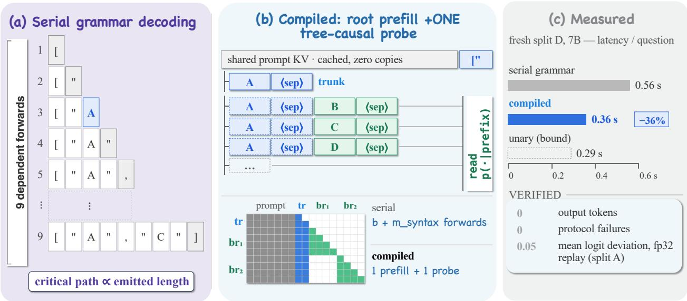
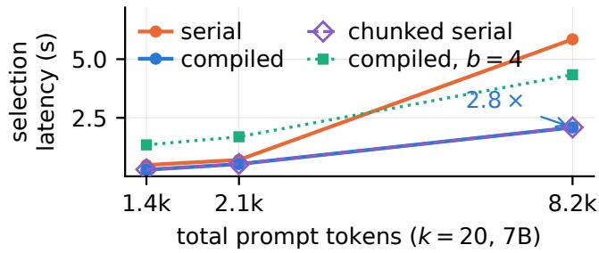

# COMPILING AUTOREGRESSIVE LLM CONTROL INTO POLICY-EXACT PARALLEL INFERENCE FOR HIERARCHICAL RAG

Zehao Lin1, Qianfeng Shen2, Xixuan Hao1,3, Shaobo Cui4, Chunyu Li1, Kai Chen1, Bo Tang1, Zhenjun Wang2, Jin Yan2, Zhiyu Li1∗, Feiyu Xiong1

1MemTensor (Shanghai) Technology Co., Ltd. 2China Haisum Engineering Co., Ltd. 3The Hong Kong University of Science and Technology (Guangzhou) 4Shanghai Jiao Tong University

{linzh,chenk,licy,tangb,lizy,xiongfy}@memtensor.cn, shaobo.cui@sjtu.edu.cn

{shenqf,wangzhenjun,yanjin}@haisum.com, xhao390@connect.hkust-gz.edu.cn

## ABSTRACT

Large language models increasingly act as controllers in structured decision pipelines, yet their decisions are still executed by autoregressive text decoding. Hierarchical RAG is one such setting: at each frontier of a document tree, an LLM commits to b of k sections under an input-dependent action grammar, executed as either failure-prone free-form JSON or reliable but strictly serial grammarconstrained generation. We show that this serialization is unnecessary for bounded-horizon control: the reachable future forms a shallow action-prefix tree, which we compile — one root prefill plus one tree-causal probe evaluate every prefix-conditioned action distribution with serial decoding’s tokens, positions, and causal ancestry. A prefix-state lemma makes compiled control policy-exact in exact arithmetic: the same policy with a two-forward critical path and zero output tokens. One further probe pass certifies the exact ordermarginalized MAP set. Across four document-disjoint splits and two scales on the primary MetaX device, compiled control matches the serial policy on 84–89% of questions — every instrumented divergence a floating-point near-tie — and cuts control latency by 35– 47% versus token-wise serial decoding and 6–7% versus an idealized chunked engine; an H800 repetition preserves the ordering.

Index Terms— retrieval-augmented generation, constrained decoding, parallel inference, LLM control, tree attention

## 1. INTRODUCTION

Hierarchical retrieval [1, 2, 3, 4] turns evidence gathering into sequential control: an LLM repeatedly selects b of k ≤ 20 candidate sections and descends into the selected subtrees. The action space is finite and input-dependent, yet deployed systems execute this controller by decoding text. That choice imposes a three-way dilemma. Free-form JSON leaves a protocol surface that dominates the error budget (3–65% of questions fail on syntax, identifiers, or cardinality in our companion interface study). Scoring all k verified single-token labels in one prefill — the unary shortcut — removes the protocol surface but also the controller’s memory: selection can no longer condition on earlier selections. Grammar-constrained decoding [5, 6] keeps the history-dependent policy and syntactic validity, but pays a serial critical path of b action tokens plus forced syntax tokens, one model forward each.

Our central observation is that this dilemma is an artifact of the execution model, not of the controller. A constrained controller with horizon b has a bounded reachable future: every state it can visit is a prefix over at most b distinct actions — for greedy control at our deployed horizon of three actions, at most k states remain once the first is fixed. We therefore compile the action grammar into its prefix tree and evaluate all reachable states at once: one root prefill resolves the first action; one tree-causal probe — a single forward pass over the concatenated prefix continuations, with a block-causal mask and serial position indices — returns every prefix-conditioned action distribution the controller can consult. Because each tree state sees exactly the tokens, positions, and causal ancestry it would see under serial decoding, its logits are the serial controller’s logits, and the greedy chain is recovered arithmetically. We do not approximate or distill the serial controller; we recompute it on a shallower execution graph (finite precision can still flip near ties; Sec. 4.1). The critical path drops from $b + m _ { \mathrm { s y n } }$ dependent forwards to two, independent of b; no token is ever generated; the protocol surface is zero by construction.

Compilation also upgrades what the controller can decide. The probe exposes the controller’s joint preferences, so unordered multiaction selection becomes exact posterior inference rather than a serialization artifact: we marginalize action order and certify the MAP set with a branch-and-bound certificate — no truncation heuristics. And the probe compares the two policies: the AR-vs-unary KL divergence bounds — via Pinsker — the expected-utility loss of the unary shortcut per input. The construction applies to any finiteaction constrained LLM controller (tool choice, routing, agenda selection); hierarchical RAG is our case study.

Contributions. (1) Finite-action control compilation: constrained controllers executed as one root prefill plus one tree-causal probe, zero decoded tokens (Sec. 3.2). (2) Policy-exactness theory: prefixstate equivalence and policy equivalence under matched tokens, positions, masks, and tie-breaking, with serial depth exchanged for bounded parallel width (Sec. 3.3). (3) Certified set inference and interaction mass: an order-marginalized set posterior with a branchand-bound MAP certificate, and a bound on the expected cost of unary execution (Sec. 3.4). (4) Evaluation: four document-disjoint splits, two scales, two accelerators, and a hierarchy-corruption stress test — policy fidelity, 100% certification in non-trivial rounds, and 35–47% lower control latency (Sec. 4).

## 2. RELATED WORK

Hierarchical RAG as control. Tree- and memory-structured retrieval [1, 2, 3, 4, 7] steers an LLM through document structure; retrieval grounding remains a standard hallucination mitigation [8], and evidence quality is sensitive to structure and OCR noise [9, 10]. A companion interface study (under review) locates this stack’s dominant failures in the protocol layer; here we change the execution of its strongest constrained controller.

  
Fig. 1. Compile, don’t decode. (a) Serial grammar decoding spends one dependent forward per emitted token $( b + m _ { \mathrm { s y n } } \approx 9 )$ . (b) Compilation: one root prefill, then a single tree-causal probe evaluates the trunk and every candidate branch under a block-causal mask — each row sees only the cached prompt and its own ancestors, so its logits equal the serial controller’s in exact arithmetic (Lemma 1). (c) Fresh split D, 7B: mean control latency −36%, zero output tokens and protocol failures; fp32 replay (split A): mean graph deviation ≈0.05.

Constrained decoding and logit selection. Grammar- and schemaconstrained decoding [5, 6, 11, 12] enforces validity but keeps the serial path; first-token logit selection [13] avoids decoding but abandons the sequential policy, inheriting label-position sensitivities [14, 15]. Compilation sits between the two: it preserves the sequential policy at the cost of one additional forward pass.

Tree-parallel execution. Token-tree verification is an established primitive in speculative and multi-head decoding [16, 17], with IOaware kernels [18]. Speculation accelerates decoding — draft, verify, reject. Our compiled tree is not a guess but the exhaustive reachable state space of a bounded-horizon control grammar: nothing to reject, no decoding left to accelerate, and an equivalence that is provable rather than distributional.

Parallel structured selection. Contextual Plackett–Luce learns pairwise interaction heads for subset selection [19]; mean-field parallel decoding coordinates token commitments via predictive interactions [20]. Both approximate or learn joint structure; we evaluate the frozen model’s exact prefix conditionals without training and certify the MAP. SimpleTool retrains the function-call representation for parallel fields [21]; LLMCompiler parallelizes external call orchestration [22]; neither compiles a frozen controller’s own conditionals, as we do exactly.

## 3. COMPILED AUTOREGRESSIVE CONTROL

## 3.1. The serial constrained controller

At a traversal round with candidates bound to contextually verified single-token labels $\mathcal { A } _ { x } \left( \left| \mathcal { A } _ { x } \right| \right. = k ;$ larger frontiers are batched deterministically), the grammar $\mathcal { G } _ { x }$ forces a JSON array of exactly $n = \operatorname* { m i n } ( b , k )$ distinct labels: forced syntax segments alternate with label slots masked to unused labels. Serial constrained decoding emits $\sigma = ( a _ { 1 } , \ldots , a _ { n } )$ greedily,

$$
a _ { t } = \arg \operatorname* { m a x } _ { a \in \mathcal { A } _ { x } \setminus \{ a < t \} } z \big ( a \mid x \oplus \rho _ { t } \big ) ,\tag{1}
$$

with $\rho _ { t }$ the emitted token prefix before slot t and z the next-token logits. Each of the $n + m _ { \mathrm { s y n } }$ emitted tokens costs one dependent forward: critical path $D _ { \mathrm { s e r i a l } } = n + m _ { \mathrm { s y n } } \approx 9$ for $n { = } 3 .$ . (Even an idealized chunked engine that fast-forwards known forced spans still pays one dependent forward per label slot, $D { = } n ;$ we measure it as a second baseline in Sec. 4.) Selected nodes’ children form the next frontier; selected sections are packed into the reader budget B in selection order.

## 3.2. Compilation to an action-prefix tree

Once $a _ { 1 }$ is fixed, the greedy controller can only ever consult

$$
\begin{array} { r } { N ( k , n ) = \sum _ { d = 0 } ^ { n - 2 } { ( k - 1 ) ! } / ( k - 1 - d ) ! } \end{array}\tag{2}
$$

prefix states — for $n { = } 3 ,$ exactly k: the trunk (a ) and the branches $( a _ { 1 } , c ) , c \neq a _ { 1 }$ . Compiled execution is therefore two steps. Root prefill: one pass over the prompt plus the forced opening syntax yields slot-1 logits and the shared KV cache; $a _ { 1 }$ resolves by Eq. (1). Tree-causal probe: the $N ( k , n )$ prefix continuations — each the exact forced token sequence serial decoding would emit — are concatenated into one query of a few hundred tokens and evaluated in a single forward under a block-causal mask: every position attends to the cached prompt and its own ancestors only, with serial position indices (branches may share or replicate the trunk; attended key– value sets coincide). The last position of each row is that prefix’s action distribution; $a _ { 2 } , a _ { 3 }$ follow arithmetically. The critical path is $D _ { \mathrm { c o m p } } = 2 $ forwards for any n, at parallel width $\Theta ( N ( k , n ) )$ probe rows: serial depth is exchanged for bounded parallel width, and compilation is profitable whenever

$$
\begin{array} { r } { T _ { \mathrm { p r o b e } } \left( N ( k , n ) \right) \ < \ \sum _ { t = 1 } ^ { n + m _ { \mathrm { s y n } } } T _ { \mathrm { s t e p } } , } \end{array}\tag{3}
$$

the regime of every n ≤ 3 configuration we measure at the deployed frontier width (Sec. 4.4).

## 3.3. Policy exactness

Lemma 1 (prefix-state equivalence). Iftree-packed and serial evaluation give a prefix ρ the same token ids, position ids, ancestorvisible attention set, and parameters, then all hidden states over ρ coincide at every layer, hence $z _ { \mathrm { t r e e } } ( \cdot \ | \ x , \rho ) = z _ { \mathrm { s e r i a l } } ( \cdot \ | \ x , \rho ) .$ Proof: induction over layers: embeddings agree; attention at each position reads an identical key/value set by the mask construction; MLPs and normalizations are deterministic per-position maps. □

Theorem 1 (policy equivalence). With identical admissible-label masks, candidate order, and first-maximum tie-breaking, compiled and serial greedy control select the same action sequence for every input: $\pi _ { \mathrm { c o m p } } ( x ) = \pi _ { \mathrm { s e r i a l } } ( x )$ . Proof: by Lemma 1 the two graphs produce identical logits at every slot; identical masks and tiebreaking then make each argmax identical, and induction over slots propagates the shared prefix. □

Corollary 1 (margin stability). Ifa slot’s decision margin under either graph exceeds $2 \varepsilon _ { \mathrm { m a x } } ,$ , where $\varepsilon _ { \mathrm { m a x } }$ bounds the cross-graph logit deviation, then the compiled and serial decisions at that slot coincide. Margins come at no extra cost from the probe, so decisions inside the flip window can be flagged online against a deviation bound calibrated on replays.

Exact arithmetic is the premise; hardware executes the two graphs with different floating-point reduction orders, so logits deviate by a data-dependent ε and near-tie slots can flip. This is a property of precision, not of compilation: empirically, every observed divergence sits at a slot whose margin lies within twice the observed deviation — the window where Corollary 1 permits flips (Sec. 4.1) — so the two executions coincide up to the precision the deployment already accepts.

## 3.4. Certified set inference and interaction mass

The reader consumes the selection as a set; we marginalize order for the decision and serialize the chosen set for packing by its highest-probability expanded ordering — order enters only there. The probe makes the order-marginalized posterior $P ( S \mid x ) =$ $\begin{array} { r } { \sum _ { \sigma \in \mathrm { P e r m } ( S ) } \prod _ { t } p \big ( \sigma _ { t } ~ | ~ x , \sigma _ { < t } \big ) } \end{array}$ computable exactly, and its MAP certifiable without full expansion: any unexpanded prefix $\rho$ bounds all completions by $P ( \rho )$ , giving $L ( \dot { S ) } \le P \hat { ( } S ) \le \hat { U ( } S )$ ; expanding ordered pairs by mass until

$$
L ( S ^ { \star } ) > \operatorname* { m a x } _ { S \neq S ^ { \star } } U ( S )\tag{4}
$$

certifies $S ^ { \star }$ as the exact MAP, else the remaining pairs are expanded in one further probe — the readout is always exact, never truncated. (Set-MAP adds one probe pass — a second only when the certificate defers; split E: 0.44 s/question vs. 0.37 compiled, 0.63 serial.) Empirically the certificate fires after the first 24 of up to 380 pairs in every non-trivial round (frontiers with $k \geq 4 ;$ smaller frontiers admit a single set) across four splits (527/527).

Finally, let PU be the Plackett–Luce policy induced by root logits with removal renormalization. The sequential interaction mass $\mathcal { T } _ { \mathrm { s e q } } ( x ) = \mathrm { K L } ( P _ { \mathrm { A R } } \| P _ { \mathrm { U } } )$ , computable in closed form from the probe, bounds the expected cost of the unary shortcut for any utility $u ~ \in ~ [ 0 , 1 ] \colon | \mathbb { E } _ { P _ { \mathrm { A R } } } u - \mathbb { E } _ { P _ { \mathrm { U } } } u | ~ \le ~ \sqrt { \mathcal { T } _ { \mathrm { s e q } } / 2 } ~ ( \mathrm { P i n s k e r } ) - \mathrm { a }$ statement about the two stochastic policies; greedy agreement is measured directly in Sec. 4.1. This is a post-compilation fidelity diagnostic: small $\mathcal { I } _ { \mathrm { s e q } }$ guarantees the unary shortcut loses little expected utility; predicting it before compilation is future work. Measured $\mathcal { T } _ { \mathrm { s e q } }$ is heavy-tailed (median 2.6, p90 8.3 nats over the 139 fully expanded rounds of split B). Only 14% of rounds fall below $\mathcal { T } _ { \mathrm { s e q } } \mathrm { = } 0 . 5$ (expected-utility gap at most 0.5): history dependence is pervasive, so the unary shortcut is rarely provably benign — exactly where preserving the autoregressive policy cheaply matters.

Table 1. Policy fidelity and control cost. “Agree”: exact actionsequence identity with the serial controller over the full traversal (divergences are floating-point near-ties, Sec. 4.1). Latency: mean (median) s/question. Out tok.: mean output tokens per question, serial / compiled.
<table><tr><td>Split</td><td>Agree</td><td>Serial lat.</td><td>Compiled lat. Out tok.</td></tr><tr><td>A (90q)</td><td>80/90</td><td>0.62 (0.50)</td><td>0.40 (0.33) 11.7 / 0</td></tr><tr><td>B (120q)</td><td>101/120</td><td>0.52 (0.46)</td><td>0.32 (0.28) 10.4 / 0</td></tr><tr><td>D (90q)</td><td>79/90</td><td>0.56 (0.48)</td><td>0.36 (0.32) 11.2/0</td></tr><tr><td>E (60q)</td><td>52/60</td><td>0.63 (0.50)</td><td>0.37 (0.30) 12.9/0</td></tr><tr><td>D, 3B</td><td>78/90</td><td>0.53 (0.44)</td><td>0.28 (0.24) 11.2 / 0</td></tr></table>

## 4. EXPERIMENTS

Setup. QASPER [23] with byte-verified evidence spans. The metric is AllEvidence@B: all spans of an annotated evidence group ≥ 80% covered in the budget-B packed context; error rows count zero. Five splits, labeled A–E in collection order, are all accounted for below. Prompts and interfaces were frozen on development split A (30 docs/90 questions); B (120 questions) is the developmentconfirmatory batch of the companion interface study; C/D are document-disjoint splits from the official test split (30 docs/90 questions each; C was consumed by the companion study’s policy analysis, so only D and E remain fresh); E (20 docs/60 questions) is preregistered: frozen after the compiler design, identity hashes recorded before its gold was read. Qwen2.5-7B/3B-Instruct [24], bf16, eager attention, one MetaX C500, offline; latency is perquestion wall-clock over full traversals, with identical configuration across interfaces and per-run code-hash manifests; document-cluster bootstrap CIs (10k resamples, seed 20260916). Baselines: serial grammar decoding, token-by-token as deployed grammar engines do (the compiled controller’s source policy); an idealized chunked serial engine that fast-forwards forced spans (one forward per slot); unary projection; sequential-label decoding; exact-b free generation; legacy capped JSON; and embedding-MMR diversity [25]. A byte-preserving false-nesting corruption stresses the hierarchy prior, and the four-arm runs and benchmark are repeated on NVIDIA H800s with the same runner, prompts, weights, and eager-attention configuration (one run per device).

## 4.1. Compilation reproduces the serial policy

Compiled control reproduces the serial controller’s exact action sequences (Table 1) on 84–89% of questions per split (87% at 3B) with zero output tokens, cutting mean control latency by 35–41% (47% at 3B). Selected sets agree on 87–90%: some divergences merely permute a selection. Agreement is higher per round (86–92%) than per question: one flipped round redirects the remaining traversal. A same-run four-arm comparison on D and E (one code hash, arms interleaved) adds the chunked engine; compiled control beats this fair baseline too: serial/chunked/compiled run at 0.58/0.37/0.35 s per question on D and 0.64/0.40/0.37 on E.

  
Fig. 2. Work–depth scaling at the deployed frontier (k=20, 7B, synthetic): serial grammar decoding, the idealized chunked engine $\scriptstyle ( D = n ;$ it overlaps compiled here, while Sec. 4.1 separates them on real workloads), and compiled control (D=2); the dotted b=4 probe shows the measured break-even of Eq. (3). The 3B model reproduces the pattern.

Both cluster-bootstrap CIs on the compiled−chunked delta exclude zero; a reversed arm order on E reproduces the gap (−0.028 s).

The divergences themselves are precision, not policy. Instrumented replays on identical prefixes show per-slot logit deviations between the graphs averaging 1.2 (p95 2.6) against serial decision margins of median 4.1, and on the margin-instrumented replays (B/D/E) all 39 diverging rounds occur at slots with margin $\leq 2 . 5$ — inside the 2ε flip window of Corollary 1 — never at a confidently separated decision. A full fp32 replay of split A collapses the deviations by over 20× (mean 0.05, p95 0.12), and under bf16 the compiled-vs-serial deviation on a slot-level diagnostic (1.25–2.5 across slots) is of the same order as re-chunking the same serial prompt (2.0).

Nor are near-tie flips specific to compilation. Chunking alone changes final selections at least as often (13 vs. 11 of 90 on D; 7 vs. 7 of 60 on E), and an NVIDIA H800 repetition preserves the latency ordering (0.28/0.16/0.15 s on D; 0.31/0.17/0.15 on E) while final-selection agreement drops to 65–77% — the per-token engine agrees with itself across the two accelerators on just 67–73% of questions. The realized bf16 policy is accelerator- and backenddependent: compiled-versus-serial disagreement is comparable to the serial policy’s cross-accelerator disagreement.

## 4.2. Quality tracks the source policy

Whether history-dependent selection beats unary marginals is distribution-dependent: the AR policy led unary by +5.9/+4.4 points at 2K on splits B/C yet trailed by 1.1 on D (CI [−8.9, +6.7]); embedding-MMR leaves 84/90 selections unchanged. Compilation makes this uncertainty cheap to hedge: both policies come from the same probe, and $\mathcal { T } _ { \mathrm { s e q } }$ (Sec. 3.4) flags when they can differ. Paired deltas quantify the tracking error: pooled over four splits and three budgets, compiled minus serial is −0.6 points, CI [−1.7, +0.5] (1080 cells); on the two fresh splits alone, −2.4 (CI [−4.9, −0.4]) — a deficit consistent with bf16 near-tie resolution: fp32 on A restores 89/90 identical sequences. Corollary 1 supplies a parity dial: rounds whose minimum margin falls below θ are replayed serially — serial decisions by construction. At θ=2, set post hoc above every observed flip margin, the hybrid’s final selections match the serial engine’s on all 150/150 D+E questions (60% of rounds gated) — but at 0.70–0.71 s it is slower than serial itself, and on H800 three flips escape the gate (147/150): θ, like ε, is hardware-specific. Exact parity via the dial is not cheap: compiled trades it for 41% lower latency, and parity-critical deployments keep the serial engine. Under false-nesting corruption compiled control keeps a zero protocol surface (44.4 AllEvidence@1K, 0 errors); free generation fails on 7.8–14.4% of questions.

## 4.3. Ablations

On development split A, reading only the controller’s first label slot (top-b of slot-1 marginals) collapses mid-budget quality: 42.2 vs. 51.1 AllEvidence@1K for the full compiled chain — later, historyconditioned slots carry information no single readout recovers. Conditionals are grammar-specific: a different serialization of the same task (sequential labels, no JSON syntax) yields a visibly different policy (44.4 vs. 50.0 @1K) — so we compile the deployed grammar, not a surrogate prompt. Repeat runs of every interface are bitidentical on fixed hardware; Table 1’s variance comes from the execution graph or precision, never the controller.

## 4.4. Work–depth scaling

Synthetic sweeps $( k \in \{ 4 , \ldots , 2 0 \} , n \in \{ 2 , 3 , 4 \}$ , prompts 1.4k– 8.2k tokens, both scales) isolate execution cost (Fig. 2). At the deployed frontier width $k { = } 2 0$ , compiled selection is 1.3–2.8× faster than serial decoding for $n \leq 3 .$ , and on the MetaX the advantage grows with prompt length (2.8× at 8k tokens; ≥ 2.2× at both scales) because every serial step re-reads the long KV cache; on the H800, whose decode kernels blunt that penalty, gains sit at 1.4–2.6×, peaking at short prompts. The idealized chunked engine (D=n) removes most of that per-token penalty (2.09 s at 8k, n=3, vs. 5.85 serial); compiled control matches it there (2.09 s) and beats it by 6–7% on the real workloads of Sec. 4.1, where the remaining dependent forwards still bind. At n=4 the 362-row probe loses at short prompts (0.4–0.6× vs. token-wise serial), recovers only 1.4× at 8k (1.1× at 3B), and never catches the chunked engine (4.34 vs. 2.15 s; the wall persists on the H800 at 0.5–0.9×) — the width wall that Eq. (2) predicts; past it, staged or chunked execution plans win.

Compilation spends parallel work to shorten the critical path, not to reduce total computation: at k=20, n=3 the probe evaluates 117 parallel token positions where serial decoding emits 9 sequential ones (13× the work, off the critical path), and at n=4 it grows to 362 rows and 3195 positions (about 270×) — exactly why the break-even recedes. An fp32 probe (89/90 parity) runs at 0.55 s/question — no more than bf16 serial decoding (0.56 s); fp32 serial pays 1.21 s; probe memory overhead is ≤ 5 MB at $n \leq 3$ and ≈3.7 GB at n=4.

## 5. CONCLUSION

A bounded-horizon constrained LLM controller does not need to be decoded; it can be compiled. Its reachable future is a shallow prefix tree that one tree-causal probe evaluates exactly, reproducing the serial policy in exact arithmetic with a depth-2 critical path and zero output tokens; certified set inference and an interaction-mass bound follow. Limits are explicit: probe width grows factorially beyond the greedy horizon, and bf16 leaves near-tie divergences that fp32 narrows to 89/90. The probe is an ordinary attention call, composable with tree-attention IO optimizations [18]; the guarantees transfer to any finite-action agent loop, and the compiler and benchmark harness will be released. The controller’s semantics are now a modeling choice decoupled from the serial critical path — for hierarchical RAG and every finite-action controller an LLM is asked to be.

## 6. COMPLIANCE WITH ETHICAL STANDARDS

This study uses only the publicly available QASPER dataset of scientific papers and involves no human subjects, animal experiments, or personally identifiable data; no ethical approval was required.

## 7. FUNDING AND CONFLICTS OF INTEREST

This work was supported by the Shanghai Special Fund for Promoting High-Quality Industrial Development: Pilot Industry Innovation and Development Program (Artificial Intelligence Track, Grant No. 2025-GZL-RGZN-02006). The authors declare no conflicts of interest.

## 8. REFERENCES

[1] Parth Sarthi, Salman Abdullah, Aditi Tuli, Shubh Khanna, Anna Goldie, and Christopher D. Manning, “RAPTOR: Recursive abstractive processing for tree-organized retrieval,” in Proc. ICLR, 2024.

[2] Howard Chen, Ramakanth Pasunuru, Jason Weston, and Asli Celikyilmaz, “Walking down the memory maze: Beyond context limit through interactive reading,” arXiv preprint arXiv:2310.05029, 2023.

[3] Mingtian Zhang, Yu Tang, and PageIndex Team, “PageIndex: Next-generation vectorless, reasoning-based RAG,” https://pageindex.ai/blog/pageindex-intro, 2025, Accessed 2026-08-29.

[4] Nilesh Gupta, Wei-Cheng Chang, Ngot Bui, Cho-Jui Hsieh, and Inderjit S. Dhillon, “LLM-guided hierarchical search for end-to-end reasoning intensive retrieval,” arXiv preprint arXiv:2510.13217, 2025.

[5] Torsten Scholak, Nathan Schucher, and Dzmitry Bahdanau, “PICARD: Parsing incrementally for constrained autoregressive decoding from language models,” in Proc. EMNLP, 2021, pp. 9895–9901.

[6] Saibo Geng, Martin Josifoski, Maxime Peyrard, and Robert West, “Grammar-constrained decoding for structured NLP tasks without finetuning,” in Proc. EMNLP, 2023, pp. 10932– 10952.

[7] Lingnan Xu, Chong Feng, Kaiyuan Zhang, Liu Zhengyong, Wenqiang Xu, and Fanqing Meng, “Equipping retrievalaugmented large language models with document structure awareness,” in Findings of EMNLP, 2025, pp. 24608–24631.

[8] Patrick Lewis, Ethan Perez, Aleksandra Piktus, Fabio Petroni, Vladimir Karpukhin, Naman Goyal, Heinrich Kuttler, Mike¨ Lewis, Wen-tau Yih, Tim Rocktaschel, Sebastian Riedel,¨ and Douwe Kiela, “Retrieval-augmented generation for knowledge-intensive NLP tasks,” in Proc. NeurIPS, 2020.

[9] Junyuan Zhang, Qintong Zhang, Bin Wang, Linke Ouyang, Zichen Wen, Ying Li, Ka-Ho Chow, Conghui He, and Wentao Zhang, “OCR hinders RAG: Evaluating the cascading impact of OCR on retrieval-augmented generation,” in Proc. ICCV, 2025, pp. 17443–17453.

[10] Joongmin Shin, Chanjun Park, Jeongbae Park, Jaehyung Seo, and Heuiseok Lim, “MultiDocFusion: Hierarchical and multimodal chunking pipeline for enhanced RAG on long industrial documents,” in Proc. EMNLP, 2025, pp. 20985–21004.

[11] Brandon T. Willard and Remi Louf, “Efficient guided´ generation for large language models,” arXiv preprint arXiv:2307.09702, 2023.

[12] Saibo Geng, Hudson Cooper, Michał Moskal, Samuel Jenkins, Julian Berman, Nathan Ranchin, Robert West, Eric Horvitz, and Harsha Nori, “JSONSchemaBench: A rigorous benchmark of structured outputs for language models,” arXiv preprint arXiv:2501.10868, 2025.

[13] Mingyu Derek Ma, Yanna Ding, Zijie Huang, Jianxi Gao, Yizhou Sun, and Wei Wang, “Inferring from logits: Exploring best practices for decoding-free generative candidate selection,” in Proc. ACL, 2025, pp. 33125–33144.

[14] Yuval Reif and Roy Schwartz, “Beyond performance: Quantifying and mitigating label bias in LLMs,” in Proc. NAACL, 2024, pp. 6784–6798.

[15] Pouya Pezeshkpour and Estevam Hruschka, “Large language models sensitivity to the order of options in multiple-choice questions,” in Findings ofNAACL, 2024, pp. 2006–2017.

[16] Xupeng Miao, Gabriele Oliaro, Zhihao Zhang, Xinhao Cheng, Zeyu Wang, Zhengxin Zhang, Rae Ying Yee Wong, Alan Zhu, Lijie Yang, Xiaoxiang Shi, Chunan Shi, Zhuoming Chen, Daiyaan Arfeen, Reyna Abhyankar, and Zhihao Jia, “SpecInfer: Accelerating large language model serving with tree-based speculative inference and verification,” in Proc. ASPLOS, 2024, pp. 932–949.

[17] Tianle Cai, Yuhong Li, Zhengyang Geng, Hongwu Peng, Jason D. Lee, Deming Chen, and Tri Dao, “Medusa: Simple LLM inference acceleration framework with multiple decoding heads,” in Proc. ICML, 2024, pp. 5209–5235.

[18] Jinwei Yao, Kaiqi Chen, Kexun Zhang, Jiaxuan You, Binhang Yuan, Zeke Wang, and Tao Lin, “DeFT: Decoding with flash tree-attention for efficient tree-structured LLM inference,” in Proc. ICLR, 2025.

[19] Noam Mizrachi, Nadav Har-Tuv, and Shai Shalev-Shwartz, “Contextual Plackett-Luce: An efficient neural model for probabilistic sequence selection under ambiguity,” arXiv preprint arXiv:2605.09112, 2026.

[20] Tamim Zoabi, Ameen Ali, Liran Ringel, and Lior Wolf, “Mean-field parallel decoding for discrete diffusion language models,” arXiv preprint arXiv:2606.15805, 2026.

[21] Xiaoxin Shi, Jiaxin Wan, Linkang Dong, Wei Jiang, Yue Liu, and Zengfeng Huang, “SimpleTool: Parallel decoding for realtime LLM function calling,” arXiv preprint arXiv:2603.00030, 2026.

[22] Sehoon Kim, Suhong Moon, Ryan Tabrizi, Nicholas Lee, Michael W. Mahoney, Kurt Keutzer, and Amir Gholami, “An LLM compiler for parallel function calling,” in Proc. ICML, 2024, pp. 24370–24391.

[23] Pradeep Dasigi, Kyle Lo, Iz Beltagy, Arman Cohan, Noah A. Smith, and Matt Gardner, “A dataset of information-seeking questions and answers anchored in research papers,” in Proc. NAACL, 2021, pp. 4599–4610.

[24] Qwen Team, “Qwen2.5 technical report,” arXiv preprint arXiv:2412.15115, 2024.

[25] Jaime Carbonell and Jade Goldstein, “The use of MMR, diversity-based reranking for reordering documents and producing summaries,” in Proc. SIGIR, 1998, pp. 335–336.