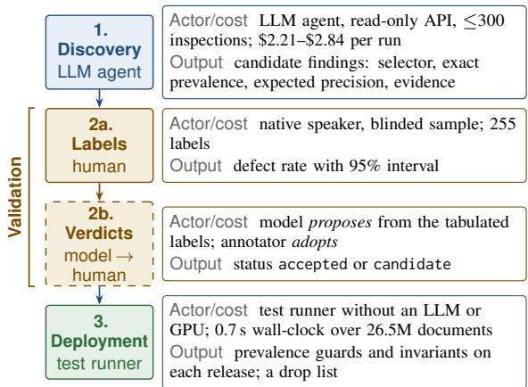
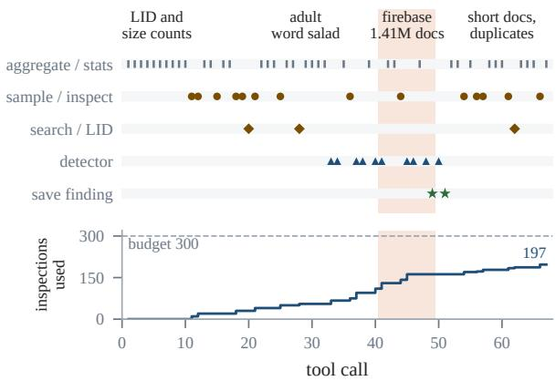
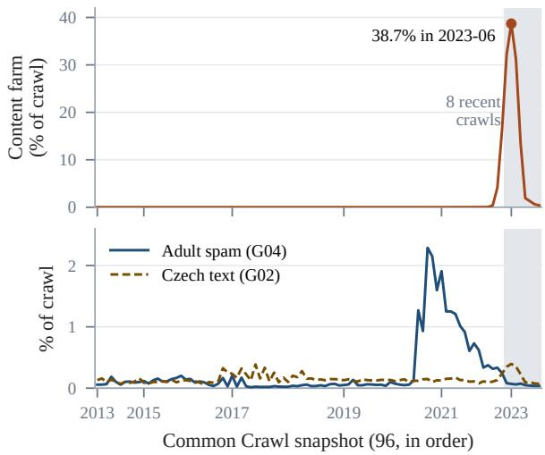
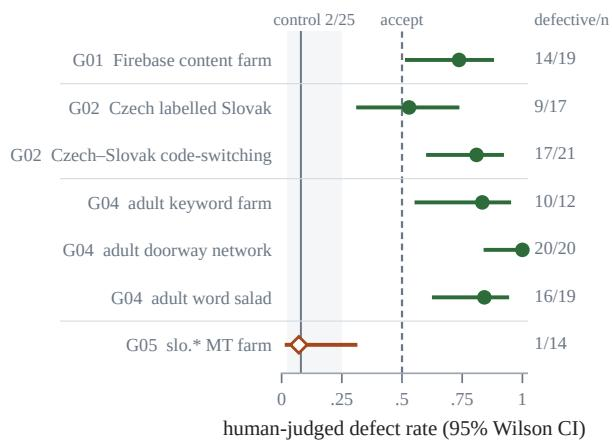
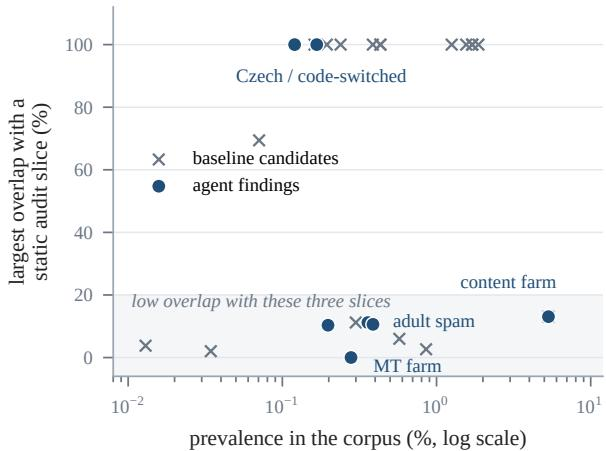
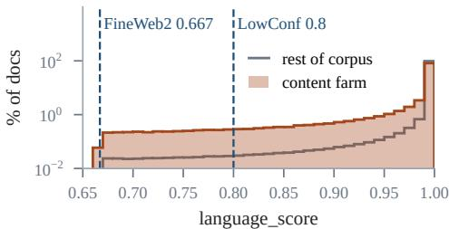
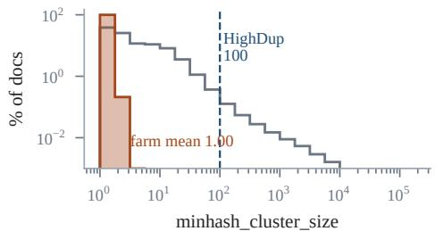
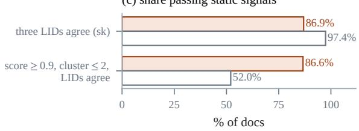
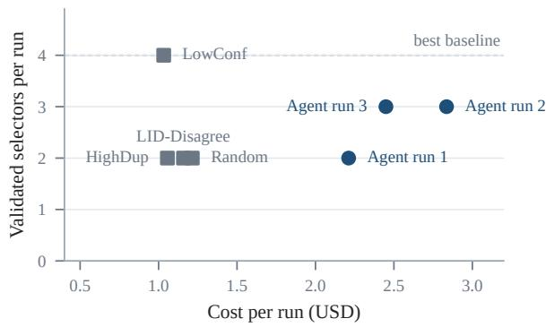

# Can an Agent Debug a Web Corpus? Agentic Auditing of Slovak FineWeb2

Marek Šuppa1,2 Ivan Vykopal3,4 Jaroslav Kopcan ˇ 3

1Comenius University in Bratislava 2Cisco Systems

3Kempelen Institute of Intelligent Technologies (KInIT) 4Brno University of Technology

## Abstract

Multilingual pipelines such as FineWeb2 apply one recipe across a thousand languages, leaving the failure modes of individual languages unanticipated. We use an LLM once, as a corpus debugger rather than a classifier: a tool-using agent explores the corpus through a read-only, budgeted API and compiles each finding into an executable test, which a native speaker then validates. On the 26.5M-document Slovak portion of FineWeb2, three runs costing \$2.21–\$2.84 each found seven findings over four phenomena. The largest is a machine-generated content farm of 1,408,437 documents (5.32%) that passed the pipeline’s filters, 86.6% of it passing even stricter thresholds. Blinded labels support 6 of the 7 findings (defect rates .53–1.00 against .08 in a random control) and do not support one. The compiled suite scans the full corpus in 0.7 s of wall-clock time without a GPU, against \$12k–\$90k per LLM classification pass. The best static sampling baseline validates more selectors than any agent run, at under half the cost. The agent contributes exact prevalence, a precision estimate checked against sampled documents, an account of why the pipeline missed each slice, and a reusable test. We release the framework, Slovak test suite, validation data and agent trajectories.

## 1 Introduction

Pretraining corpora are now built by pipelines rather than by hand. FineWeb2 (Penedo et al., 2025) derives more than a thousand languagespecific corpora from Common Crawl with one configurable recipe. That uniformity is what makes such resources feasible at all. One pipeline, engineered once, yields data for languages whose communities could never afford a bespoke crawl. It is also a structural blind spot, as the FineWeb2 authors say themselves. Their language identifier confuses closely related languages, and they could not test each language individually, so they ask users to review the filtering for the languages they care about. Their one mechanism against cousinlanguage contamination, a high-affinity wordlist filter, is applied only to languages whose measured contamination exceeded 10%, and not to a midresource language like Slovak with a large, closely related neighbour.

Reviewing a pipeline for one language is exactly the work that does not scale. Its established form is the manual audit (Kreutzer et al., 2022; Caswell et al., 2020), which is invaluable, and recent singlelanguage audits still pay off (Signoroni and Rychlý, 2026; Tatariya et al., 2026). But an audit is a oneshot artefact. It describes a corpus at one point in time, does not compose into machinery that can be re-run on the next crawl, and consumes expert attention linearly. The alternative, running an LLM over the data as a classifier, turns a curation problem into an inference bill and still explains nothing.

We explore a third option and use the LLM once, as a debugger. Our auditor is a tool-using agent that sees the corpus only through a small read-only API for aggregate SQL, conditional sampling, text search, sentence-level language identification, and defining and evaluating candidate detectors. It is asked, in deliberately generic terms, to find systematic defects and substantiate them. Its prompt contains no taxonomy of expected problems, names no defect or neighbouring language, and describes the pipeline only by its steps (language identification, quality heuristics, deduplication). Each output is a finding with a description, a cheap executable selector, a prevalence measured on the whole corpus, and a precision for human validation to establish. The result is pytestfor web corpora: a community contributes tests, and any future crawl or pipeline revision is checked against them for the cost of a scan over metadata the pipeline already computed. We instantiate it on Slovak1, which has five million speakers and a large closely related neighbour, and whose 26.5M-document FineWeb2 slice is neither high-resource enough to have received a dedicated audit nor small enough to read.

We frame an LLM, used once, as a corpus debug ger whose output is a test rather than a label or a data-selection policy. We build a reusable audit environment (DuckDB over Parquet, eleven read-only budgeted tools, a finding schema) with a FineWeb2 adapter, and an agentic auditor that runs inside it under a fixed inspection budget and a prompt that names neither a defect nor a neighbouring language. Around it sits a three-stage workflow (discovery by the agent, validation by a native speaker, deploy ment by a test runner with no model) in which validation can fail a finding. It failed one of our seven findings, which comes out at a .07 defect rate and ships flagged. Our audit of Slovak FineWeb2 yields seven findings over four phenomena with exact corpus-wide prevalences and blinded human precision (Table 2), among them a 5.32% content farm that the pipeline’s own language, duplication and auxiliary-LID signals do not filter, and a language\_score invariant that fails in 11 of 12 FineWeb2 configurations. A per-run budget matched comparison against four static selection strategies shows what the agent does and does not buy. It validates 2–3 selectors per run against 2–4 for the baselines, so the best baseline finds more than any agent run, and each phenomenon it val idated also lies within reach of a static strategy, although for the adult spam we analysed that strategy’s sample without running the model on it (§5). Its contribution is the measurement, the characterisation and the test. Finally, we release the Slovak regression-test suite, the patcher that turns it into a drop list, and the agent trajectories (Table 1). Every defect we report is a residual of an already heavily filtered corpus, and several are visible only because FineWeb2 publishes rich metadata.

We ask four research questions.

RQ1 Can an LLM agent with read-only tools discover systematic defects that a native speaker confirms?

RQ2 Can these defects be compiled into cheap executable tests?

RQ3 Do the agent’s findings lie outside the slices that static audit strategies select?

RQ4 At a matched per-run inspection budget, does the agent surface more humanvalidated defects than the same model reading a statically selected sample?

## 2 Related Work

Web corpora and their audits. FineWeb2 (Penedo et al., 2025) extends the FineWeb recipe (Penedo et al., 2024) to over a thousand languages using GlotLID (Kargaran et al., 2023) with a per-language confidence threshold, Gopherand FineWeb-style quality filters, and global perlanguage MinHash deduplication with rehydration. Earlier multilingual web corpora (Ortiz Suárez et al., 2020; Xue et al., 2021; Conneau et al., 2020; Kudugunta et al., 2023; Nguyen et al., 2024; Burchell et al., 2025) share its architecture and its exposure to the LID error that Caswell et al. (2020) and Burchell et al. (2023) document. Audits of such corpora are an established genre, covering 205 corpora by hand (Kreutzer et al., 2022), one English corpus in depth (Dodge et al., 2021), non-English Wikipedia (Tatariya et al., 2026) and Lombard (Signoroni and Rychlý, 2026). The WaC community studies the same failure surface from the pipeline side (Jakubícek et al.ˇ , 2020; Barbaresi and Lejeune, 2020; Laippala et al., 2020). We are downstream of these, asking how an audit can be made repeatable and executable. For Slovak, cleaning practice is established (Pikuliak et al., 2022) and Czech/Slovak is a known hard case for language ID (Tichý and Libovický, 2026). Sub-percent contamination still means hundreds of millions of tokens (Blevins and Zettlemoyer, 2022), though we promise no downstream gains (Artetxe et al., 2022).

Tests over data, and agents over data. Check-List (Ribeiro et al., 2020) argued that behavioural tests expose model failures that aggregate accuracy hides. We make that argument for corpora, and borrow the pattern of declarative data-quality assertions run on every build (Schelter et al., 2018), except that here the assertions must come from people who know the language. LLM agents have been applied to corpus-linguistic discovery (Yu et al., 2026) and to the curation loop, where Kang et al. (2026) find that coding agents optimise data-selection policies but tend to tune variants of a known policy. Ours optimises no downstream metric and outputs a test suite instead of a policy. We do not claim that LLMs are good language classifiers. The agent writes the tests that label the corpus and never labels it itself.

## 3 The Audit Environment

Corpus view. The adapter exposes a corpus as two DuckDB relations over Parquet. corpus\_meta has one row per document without text and serves exact corpus-wide prevalence, while corpus is a deterministic 1-in-13 subsample with text (2,034,894 documents) for whenever reading is needed. That split keeps the environment interactive, because metadata aggregates over 26.5M rows return in under a second while scanning 100 GB of text does not. The columns are the corpus’s own metadata (URL, crawl, date, the pipeline’s language and language\_score, minhash\_cluster\_size, the profanity-list count n\_bad\_words, the GlotLID top\_langs distribution, and the fastText, langdetect and Lingua predictions added by the ivykopal/fineweb2-slovak release), plus language-neutral derived columns (domain, size counts). Nothing in the schema names a language pair or a failure mode.

Tools. The agent acts through eleven tools, each listed with its budget cost in Appendix A. They cover aggregation, sampling and single-document inspection, text search, host and crawl statistics, sentence-level language identification, two tools that measure and sample what a candidate rule selects, and save\_finding. Aggregation is free, whereas every document read costs one inspection from a fixed budget, charged once per distinct id. Every call is logged to a JSONL trajectory, so an investigation can be replayed. The free aggregation tool did not stop a query from returning document text, for example substr(text, 1, 120) grouped and counted, so text could in principle be read without spending budget. We checked every logged aggregate call. In the three protocol runs none returned document text: the queries that touch text return counts only. The fourth run in Appendix K returned text fragments in three calls, the most frequent 100- and 120-character document prefixes and extracted e-mail strings, and its inspection count therefore understates what it read. Later versions of the environment refuse such queries.

Agent loop and prompt hygiene. The agent runs one long trajectory in which it orients on statistics, forms a hypothesis, retrieves evidence and counterevidence, refines or rejects it, measures prevalence, synthesises a selector, checks its precision and records a finding. Its system prompt (Appendix B) states the tools, the finding schema and the epistemic standard (systematic, reproducibly retrievable, grounded in inspected documents, quantified), and asks for calibrated precision estimates and counter-evidence. Because it does not name any defect, failure mode or neighbouring language, discovery stays attributable to the agent. Appendix C verifies this mechanically and states exactly what the agent was told. We run it through the Claude Code CLI with only the audit tools and Claude Code’s tool-schema lookup enabled, and no shell, file or web access.

  
Figure 1: The three stages. Every label is human. Verdicts are proposed by a model from those labels and adopted by the annotator, and only an adopted verdict assigns a status. Deployment uses no model.

Discovery, validation, deployment. The workflow has three stages with different actors and costs (Figure 1). Discovery is where the agent works, and it produces candidates. In validation a native speaker labels a blinded sample of each candidate’s documents, after which a model tabulates that evidence and proposes a verdict per candidate group that the annotator adopts or not (§4). Deployment runs the resulting tests without any model. Each test is a YAML file carrying its selector, an assertion about future corpora and its evidence (Appendix L), and a status: accepted when the blinded labels support it and the adopted verdict approves it, candidate otherwise. A suite is a directory of such files, executable against any corpus implementing the adapter interface.

Release. The release (Table 1) is the artefact a second community would reuse: the environment and runner, the prompt, the suite, and every input to the numbers in this paper, from trajectories to verdicts. The paper’s tables are generated from these artefacts by script.

<table><tr><td>Path</td><td>Contents</td></tr><tr><td>CODE</td><td></td></tr><tr><td>src/corpusaudit/</td><td>adapter (DuckDB over Parquet), the eleven tools as an MCP server, test runner, patcher</td></tr><tr><td>prompts/ tests/</td><td>the agent and baseline prompts the suite: 7 Slovak slice guards, 2</td></tr><tr><td>DATA &amp; RUNS</td><td>metadata invariants</td></tr><tr><td>out/runs/,</td><td>trajectories (every tool call) and baseline outputs</td></tr><tr><td>out/baselines/ out/annotation/</td><td>blinded package, guidelines, both</td></tr><tr><td></td><td>label passes</td></tr><tr><td>out/adjudication/</td><td>candidate groups, verdicts, how they were reached</td></tr><tr><td>ANALYSIS &amp; REPORTS</td><td></td></tr><tr><td>out/analysis/, out/REPORT.md</td><td>every measurement, and a generated report per finding</td></tr><tr><td>TOOLING</td><td>regeneration and checks, the</td></tr><tr><td>scripts/, selftest/</td><td>drop-list writer; a synthetic-corpus self-test that needs no data</td></tr></table>

Table 1: Layout of the released repository.

## 4 Experimental Setup

Data. We audit the Slovak portion of FineWeb2 (slk\_Latn) as redistributed with extra LID metadata by ivykopal/fineweb2-slovak. It holds 26,470,482 documents from 351,844 hosts and 96 Common Crawl snapshots (2013–2024), 438 words on average. No document scores below 0.667, the language\_score threshold FineWeb2 publishes for slk\_Latn. The auxiliary identifiers disagree with the pipeline label on 3.12% of documents.

Models and settings. All three agent runs and all four baselines use claude-sonnet-5 through the Claude Code CLI (version 2.1.231) at its default sampling settings, and we set no temperature. Each agent run is capped at 300 document inspections and 250 turns, each baseline at 6 turns. We report inspections, tokens and USD for every run and baseline. A fourth claude-opus-5 run, outside this protocol, is reported in Appendix K.

Baselines. Each baseline is a document-selection strategy that draws the same 300 documents the agent could have inspected and shows them to the same model, without tools or exploration. The model sees each document as its metadata and first 400 characters, whereas the agent can read whole documents, and the baseline instructions drop the requirement that a finding be quantified and have no prevalence field. We then measure the prevalence of each proposed selector ourselves, as for the agent. RANDOM samples uniformly. LOWCONF takes language\_score < 0.8, which is 0.49% of the corpus, LID-DISAGREE any auxiliary identifier disagreeing with the pipeline label (3.12%), and HIGHDUP minhash\_cluster\_size ≥ 100 (0.23%). The comparison changes two things at once. The agent chooses what to read, and it also has tools the baselines lack (aggregate queries, prevalence measurement, targeted sampling, detector evaluation). It therefore measures the whole agentic setup rather than adaptivity alone. For a fifth, profanity-ranked strategy we analyse only the sample it would draw, the 300 text-subsample documents with the most profanity-list matches, and we did not run the model on it.

Human validation. We drew 358 documents for blinded annotation by a native speaker: 25 for each of the 7 agent findings, 11–12 for each of 12 sampled baseline candidates, and 40 uniform controls, excluding every document any agent run inspected, shuffled and shown without provenance, URL or metadata. The exclusion list was built from truncated tool logs, so one drawn document (a code-switched Czech/Slovak item) had in fact been shown to an agent run by evaluate\_detector. It received no label, so no reported number changes. Each document gets a language label and a usefulness label on the scales in Appendix M. A document is a defect if its language label is cs, mix, other or its usefulness label is junk. sk, sk-pred, good and noisy are not defects. Slice precision is the human-judged defect rate and the control gives the corpus base rate. This estimates precision, how often a selected document is a defect, not recall, how much of a phenomenon a selector catches.

Of the 358 documents, 255 carry a label, none of them “uncertain” (labelled/drawn by source: agent slices 122/175, LOWCONF 26/36, LID-DISAGREE 30/36, HIGHDUP 28/36, RANDOM 24/35, control 25/40). The shortfall is not a per-selector choice: labelling ran in two passes with a clarified junk criterion between them, and the documents neither pass reached were dropped (Appendix M). Perfinding counts are in Table 2.

Adjudication. The agent runs and the baselines saved 34 candidate files (9 agent and 25 baseline). They hold 7 distinct agent selectors and 23 baseline selectors counted per baseline, 21 distinct across baselines, since RANDOM and LOWCONF share two. They were clustered mechanically into 11 groups by document overlap. A model, not the annotator, then tabulated, per group, the selector, exact prevalence, blinded label evidence, staticslice overlap and the auditor’s stated false positives, and proposed a verdict. The annotator read the tabulation and adopted the proposed verdicts without deliberating each one independently, although the labels themselves are human. Of the 24 decisions, 10 cover whole groups and 14 cover the members of G02, which was decided per candidate because its members’ defect rates ranged from .14 to .81. In total there are 11 approve, 8 reject and 5 unsure decisions. With labels, the rule approves at least .5 on at least five labels and rejects below it. Without labels, it rejects a selector its own auditor disqualified (a URL-keyword proxy, a closed list of domains from its own sample, a match on two documents) and otherwise marks it unsure. The one exception is the slo.\* farm (G05), which at .07 is marked unsure rather than rejected so that the unsupported finding stays visible. Two rows were corrected after adoption when seven labels lost in our tabulation were restored and attributed by selector (Appendix M); the correction adds one validated selector to each of RANDOM and LOWCONF in RQ4 and makes LOWCONF the best condition per run.

  
Figure 2: The 67 events logged for the main run (65 audit tool calls plus a run\_detector record per save\_finding), by tool type (top) and with cumulative document inspections against the budget of 300 (bottom). The shaded span, events 41 to 49, is the firebase investigation. The agent counts the \*.firebaseapp.com and \*.web.app hosts (1,408,437 documents), samples and evaluates the detector on them, and saves the finding at event 49. Run total 197 inspections.

## 5 Results

RQ1. The agent finds systematic defects that a speaker confirms. Across three runs the agent used 197, 180 and 173 of its 300 inspections and recorded 2, 4 and 3 findings. Figure 2 follows run 1 from its first free aggregate query to the saved content-farm finding at logged event 49, by which point it had spent 162 inspections. Run 1 found the content farm and an adult keyword farm. Run 2 found the farm, Czech text labelled Slovak, an adult doorway network and a machinetranslated farm on slo.\* hosts. Run 3 found the farm, an adult word-salad farm and Czech/Slovak code-switched documents. Deduplicating selectors leaves seven, which collapse by document overlap and nesting into four phenomena (Table 2): content farms on free-hosting subdomains (G01), Czech or code-switched documents labelled Slovak (G02), keyword-stuffed adult spam (G04) and the slo.\* farm (G05). The largest is a content farm on \*.firebaseapp.com and \*.web.app with 1,408,437 documents (5.32%) over 2,851 hosts. The farm is nearly absent before 2022, rises sharply from late 2022, peaks at 38.7% of the 2023-06 crawl and is still present in the last crawl, while the adult spam peaks in 2020 and then fades (Figure 3). At 1,011 words on average against a corpus mean of 438 it contributes 12.3% of all running words. All three runs found it independently, and we re-derived every statistic ourselves. The agent also volunteers evidence against its own hypotheses (Appendix J).

Blinded human labels (Figure 4) support 6 of the 7 findings at .53–1.00, against .08 in the 25- document control (interval to .25), so 3 of the four phenomena are supported. The labels do not support the slo.\* farm, which comes out at .07, and it ships with status candidate (§4).

RQ2. The compiled tests are cheap. All seven selectors are metadata-only, so the suite is exact over the full corpus. It runs over all 26,470,482 documents in 0.7 s of wall-clock time on one machine (about 13 s of CPU time across 20 cores), without GPU or LLM calls. Classifying every document with the same model instead costs \$3.42 per thousand documents, measured on 400-character snippets batched twenty per call. That is \$90,456 per pass, or \$12,309 at raw token prices without harness overhead, and it recurs every crawl. The comparison is not like for like. The tests are cheap because they reuse columns the pipeline and the redistributor already computed in corpus-wide passes (language identification, auxiliary identifiers, profanity counts, MinHash clusters), and a selector over raw text would cost a text scan. The LLM writes the test once, and that test runs at scale.

<table><tr><td>Finding</td><td>Group</td><td>Runs</td><td>Baselines</td><td>Prev. %</td><td>n</td><td>P [95% CI]</td><td>Ov. %</td><td>Status</td></tr><tr><td>firebase_content_farm_spam</td><td>G01</td><td>3/3</td><td>LD, LC, R</td><td>5.32 19</td><td></td><td>.74[.51,.88]</td><td>13</td><td>accepted</td></tr><tr><td>adult_spam_farm_wordsalad</td><td>G04</td><td>1/3</td><td></td><td>0.39 19</td><td></td><td>.84 [.62,.94]</td><td>11</td><td>accepted</td></tr><tr><td>porn_spam_keyword_farm</td><td>G04</td><td>1/3</td><td></td><td>0.3612</td><td></td><td>.83 [.55,.95]</td><td>11</td><td>accepted</td></tr><tr><td>slo_prefix_machine_translated_farm G05</td><td></td><td>1/3</td><td></td><td>0.28 14</td><td></td><td>.07 [.01,.31]</td><td>0</td><td>candidate</td></tr><tr><td>porn_doorway_spam_network</td><td>G04</td><td>1/3</td><td></td><td>0.20 20</td><td></td><td>1.00 [.84,1.00]</td><td>10</td><td>accepted</td></tr><tr><td>czech_slovak_code_switched_docs</td><td>G02</td><td>1/3</td><td></td><td>0.17 21</td><td></td><td>.81 [.60,.92]</td><td>100</td><td>accepted</td></tr><tr><td>czech_text_mislabeled_as_slovak</td><td>G02</td><td>1/3</td><td></td><td>0.12 17</td><td></td><td>.53 [.31,.74]</td><td>100</td><td>accepted</td></tr></table>

Table 2: The seven distinct findings from three agent runs. Group: phenomenon group assigned mechanically by document overlap (Jaccard $\geq 0 . 8 )$ or nesting; rows sharing a group are one phenomenon, so the seven findings are four defects. Runs: agent runs that produced the finding. Baselines: baselines that proposed an equivalent slice (Jaccard ≥ 0.8): R RANDOM, LC LOWCONF, LD LID-DISAGREE, HD HIGHDUP. Prev.: exact prevalence over all 26,470,482 documents. n: blinded labels. P: human-judged defect rate with Wilson interval. Ov.: largest share of the finding’s documents that the LOWCONF, LID-DISAGREE or HIGHDUP slice retrieves; the three G04 selectors lie entirely inside the profanity slice n\_bad\_words ≥ 3 (§5). Status: as released in the suite. The released suite also holds two metadata invariants that are not slice findings (§5).  
  
Figure 3: Share of each of the 96 Common Crawl snapshots matched by the accepted selectors, in crawl order. The Firebase content farm (top, 5.32% of the corpus overall) is almost absent before 2022 and reaches 38.7% of the 2023-06 crawl. The adult spam family (union of the three G04 selectors) peaks around 2020 and falls from 0.53% of older documents to 0.06% of the eight most recent crawls (shaded), while Czech text (union of the G02 selectors) stays below 0.4% throughout.

RQ3. Static strategies reach every validated phenomenon. The question here is which static audit would have led to the seven findings. The two Czech findings sit entirely inside the LID-DISAGREE slice (overlap 100%), as the agent built them from the auxiliary LID columns, the failure mode a disagreement audit is designed to catch. The adult-spam family (G04) overlaps the three slices of §4 by at most 11%, but its selectors threshold the corpus’s own profanity count: the slice n\_bad\_words $\geq 3$ (0.39% of the corpus) contains every G04 selector, and the 300 most profane documents of the text subsample belong to G04 and to no other agent finding (Appendix M). We did not run the model on this profanity-ranked sample, so whether it would have proposed and measured the slice is untested. The slo.\* farm falls outside every slice, with only 12 disagreements in 73,835 documents (Figure 5), but the labels do not support it.

  
Figure 4: Human-judged defect rate for each of the seven agent findings, grouped by phenomenon. Bars are 95% Wilson intervals and the right-hand column gives defective documents over documents judged. The shaded band is the interval for 25 uniformly sampled documents (rate .08) and the dashed line is the acceptance threshold of .5. Six findings clear it. The slo.\* selector (open marker, .07) is indistinguishable from the random control.

  
Figure 5: Where the discovered slices sit relative to three static audit slices. Each point is a candidate slice, placed by its prevalence in the corpus and by the largest share of its documents that LID-DISAGREE, LOWCONF or HIGHDUP already retrieves. Agent findings are filled circles and baseline candidates, the selectors the four static audits proposed at the same inspection budget, are crosses. The two Czech findings are inside the language-ID disagreement slice, as one would expect of a mislabelling defect. The content farm, the adult-spam family and the machine-translation farm are not, although the adult-spam family lies entirely inside a profanity-count slice not drawn here (§5).

The content farm is the one case where static filtering fails (Figure 6). Its mean language\_score is 0.98, well clear of the 0.8 cutoff, its mean Min-Hash cluster size is 1.00, so no farm document reaches the duplication threshold, and all three auxiliary identifiers agree with the label on 87% of them. Even at stricter thresholds (a score of at least 0.9, a cluster of at most two, all three identifiers agreeing), 1,220,394 of its 1,408,437 documents (86.6%) pass, as do 52.0% of the remaining documents, so these signals cannot single the farm out from the rest of the corpus. Static sampling does reach it. At 5.32% prevalence a 300-document draw holds ∼16 farm documents, and three baselines proposed it (RQ4). The answer to RQ3 is therefore no: each validated phenomenon is retrievable from one simple shipped signal (LID disagreement for G02, the profanity count for G04, uniform sampling for G01), and the agent contributed the measurement and characterisation.

A fourth run with claude-opus-5 (Appendix K) reproduced the content-farm slice exactly and reported a metadata invariant: 10,691,128 documents (40.4%) carry a language\_score above 1.0, up to 1.00001. This is a numerical convention rather than contamination (Appendix E), yet it matters to anyone who treats the field as a probability, for instance when re-thresholding with FineWeb2’s per-language cutoffs. We release it as an invariant test instead of a filter. The suite holds one more invariant, written by us with the framework rather than found by an agent, that document identifiers are unique. Thirteen identifiers occur twice in the release (26 rows), all in CC-MAIN-2024-10, the second-newest crawl (Appendix F).

(a) language identifier confidence  

(b) near-duplicate cluster size  

(c) share passing static signals  
  
Figure 6: The content farm (1,408,437 documents on \*.firebaseapp.com and \*.web.app) against the rest of the corpus on the three static signals. Panels (a) and (b) show the share of documents per bin on a log scale, with the LOWCONF cutoff of 0.8, the FineWeb2 threshold of 0.667 and the HIGHDUP threshold of 100 dashed. No farm document reaches the duplication threshold. Panel (c) shows the share on which all three auxiliary identifiers return Slovak, and the share that also has language\_score of at least 0.9 and a cluster size of at most 2, which is 86.6% of the farm (1,220,394 documents).

RQ4. Per run, the best baseline validates more than the agent. At 300 inspections each, the static strategies proposed 23 selectors counted per baseline, 21 of them distinct (two identical to an agent selector). Table 3 compares every run with every baseline. Each agent run validated 2–3 selectors over 2–3 groups, while the baselines validated

<table><tr><td>Condition</td><td>Insp. Cand. Val. Grp. G#</td><td></td><td></td><td></td><td></td><td>USD</td></tr><tr><td colspan="7">Baselines (single runs)</td></tr><tr><td>RANDOM</td><td>300</td><td>7</td><td>2</td><td></td><td>2 1,2</td><td>1.22</td></tr><tr><td>LOWCONF</td><td>300</td><td>6</td><td>4</td><td>3</td><td>1,2,9</td><td>1.03</td></tr><tr><td>LID-DISAGREE</td><td>300</td><td>5</td><td>2</td><td></td><td>2 1,2</td><td>1.16</td></tr><tr><td>HIGHDUP</td><td>300</td><td>5</td><td>2</td><td>2</td><td>2,10</td><td>1.06</td></tr><tr><td colspan="7">Agent (single runs)</td></tr><tr><td>Agent run 1</td><td>197</td><td>2</td><td>2</td><td></td><td>1,4</td><td>2.21</td></tr><tr><td>Agent run 2</td><td>180</td><td>4</td><td>3</td><td></td><td>1,2,4</td><td>2.84</td></tr><tr><td>Ağent run 3</td><td>173</td><td>3</td><td>3</td><td>２３３</td><td>1,2,4</td><td>2.45</td></tr><tr><td colspan="7">Pooled</td></tr><tr><td>All 4 baselines</td><td>1,200</td><td>21</td><td>6</td><td>4</td><td>1,2,9,10 4.46</td><td></td></tr><tr><td>All 3 agent runs</td><td>550</td><td>7</td><td>6</td><td>3</td><td>1,2,4</td><td>7.50</td></tr></table>

Table 3: Budget-matched comparison. Rows above the pooled block are single runs, each reading at most 300 documents; pooled rows aggregate the four baselines and the three agent runs, counting selectors that match the same documents within one group once. Insp.: documents read. Cand.: distinct candidate selectors. Val.: selectors with an adopted approve verdict on five or more blinded labels at a defect rate of at least .5 (§4); a selector two conditions proposed identically is credited to both. Grp., G#: phenomenon groups as numbered in Table 2 (1 = G01, . . . ; G09 is an adult tag farm, G10 an injected advertising widget). USD: LLM cost.

2–4. The best, LOWCONF, validates more selectors than any agent run (4 against 3) over as many groups (three) at under half the cost of each (Figure 7). RANDOM is credited with the farm and with an English-text selector because both are byteidentical to selectors another condition proposed, and 3 baselines produced their own validated selectors in the mislabelled-language group (G02) at .57–.78. Pooled, the four baselines cover 4 groups with 6 validated selectors, and the three agent runs 3 groups with 6. The groups differ. Only the agent validated G04 (0.20–0.39% of the corpus per selector), but LID-DISAGREE proposed a selector in the same group (language=’slk’ AND n\_bad\_words >= 4, 0.30%) that was approved with its group G04 although it drew no labels of its own, so it does not count, and the group is inside the profanity slice (RQ3). Only the baselines validated G09, G10, an adult tag farm of 1,717 documents (1.00, n = 9) and an advertising widget injected across unrelated hosts.

What differs is what comes with each selector. Both kinds carry an expected precision and counterevidence, but the baselines judged theirs from 400- character views of 300 documents, while every agent selector also arrives with an exact prevalence measured on the whole corpus. That characteri-

  
Figure 7: Validated selectors per run against the cost of the run. Agent runs are blue circles and static baselines grey squares. The best baseline, LOWCONF, validates four selectors over three phenomenon groups at \$1.03, more than any agent run at over twice the cost.

<table><tr><td>Test</td><td>train %</td><td>held-out ratio %</td><td></td></tr><tr><td>language_score_not_a_probability</td><td>40.389</td><td>40.230</td><td>1.00</td></tr><tr><td>firebase_content_farm_spam</td><td>5.321</td><td>5.024</td><td>0.94</td></tr><tr><td>adult_spam_farm_wordsalad</td><td>0.387</td><td>0.348</td><td>0.90</td></tr><tr><td>porn_spam_keyword_farm</td><td>0.359</td><td>0.334</td><td>0.93</td></tr><tr><td>slo_prefix_machine_translated_farm</td><td>0.279</td><td>0.292</td><td>1.05</td></tr><tr><td>porn_doorway_spam_network</td><td>0.198</td><td>0.171</td><td>0.86</td></tr><tr><td>czech_slovak_code_switched_docs</td><td>0.167</td><td>0.178</td><td>1.06</td></tr><tr><td>czech_text_mislabeled_as_slovak</td><td>0.120</td><td>0.118</td><td>0.99</td></tr><tr><td>document_ids_unique</td><td>0.000</td><td>0.000</td><td></td></tr></table>

Table 4: The released suite on the held-out split. Prevalences are exact counts on each split. Every slice prevalence lands within 0.86–1.06 times its training value; the invalid-confidence invariant fails there too, while the identifier invariant passes, as expected of 13 collisions in 26.5M training documents (Appendix F).

sation is work a curator would otherwise do by hand, and an agent run costs \$2.21–\$2.84 against \$1.03–\$1.22 per baseline.

Held-out split. The selectors were written from the text subsample of the training split, so they could be fitted to the shards the agent saw. All 9 tests run unchanged on an independent held-out split of 28,720 documents that the release defines and rebuilds and the agent never touched (Table 4). This is evidence against overfitting to the explored shards, not of stability over time (Appendix G).

## 6 Conclusion

An LLM agent audited Slovak FineWeb2 for \$2.21– \$2.84 a run. It found, measured and characterised slices that a native speaker then confirmed, and left a test suite that runs without a model. It validated fewer selectors per run than the same model reading a well-chosen static sample, and every defect it validated was within reach of one static strategy (we did not run the model on the profanity-ranked sample that reaches the adult spam, §5). The contribution is the workflow, which turns a one-off audit into executable, validated tests and can fail a finding, as it did for one of ours (shipped as a candidate). It already runs on eleven other FineWeb2 configurations (Appendix E), and another community can point the adapter at its own corpus and run the suite.

## Limitations

Scope. This study covers one language, one corpus and three runs of one model. Agentic discovery is shown only on Slovak, and the other languages in Appendix E only re-ran tests written for Slovak. A fourth, stronger-model run reproduced the largest phenomena outside the frozen protocol, but its extra findings are unvalidated. The agent used 58–66% of its allowance.

Validation. Human validation covers 255 documents labelled by one native speaker (12–21 per finding, median 19), which limits precision estimates and gives wide intervals. Labels were collected in two passes, and the criterion for unusable text was clarified between them: a fluent page that exists to place links or keywords counts as junk. 117 of the 255 labels were given before it and the annotator reviewed and kept them rather than judging those documents again, which matters most for the two slices where they dominate (12 of 14 and 11 of 17). The single-coder design does not measure agreement on ambiguous Czech/Slovak text. Among the 25 documents drawn per agent finding, at least 18 hosts are represented and no host contributes more than 16%. Validation measures precision only. We do not know the recall of any selector, so the tests guard specific patterns and do not show that they capture contamination broadly. Our defect criterion (not Slovak or junk) is coarse, and we do not measure downstream language-model effects (Artetxe et al., 2022).

Comparison. As §4 notes, the baselines lack the agent’s tools as well as its adaptivity. A profanityranked baseline was not run with the model, and we report only the slice analysis, which shows that the G04 selectors threshold n\_bad\_words, a column the release already ships. Some baseline candidates drew no labels, so their status rests on the no-labels branch of the adjudication rule, and every verdict was proposed by a model and adopted rather than deliberated independently. Two of those verdicts were later corrected by the stated rule, at the author’s direction and without a new deliberation, after labels lost in our tabulation were restored, and the correction moved the best baseline from tying the agent to exceeding it.

Cost and stability. The cost comparison relies on metadata the pipeline already computed (§5). All retained selectors use metadata only, so their prevalences are exact, whereas a text-dependent selector would use the text subsample and require extrapolation. The prevalence guards are calibrated for corpus-wide evaluation, and on a single crawl natural variation trips all seven guards and can produce false alarms. The detectors are cheap review aids that do not guarantee stability, and some host patterns will drift as the web changes.

## Ethical Considerations

The corpus is public web text redistributed under ODC-By, and we report aggregate statistics and short excerpts only. Several discovered slices consist of adult spam. The corpus release already flags profanity-list matches, and we neither reproduce such content in the paper nor include it in the released examples beyond what is necessary to document the finding. The annotation task required a native speaker to read web text that includes such material. Before the task began, the annotator was told to expect explicit content and that any document could be skipped and the work stopped at any time. Released excerpts and trajectories are redacted for third-party personal data. Real email addresses are replaced with a marker at the tool boundary, while the corpus’s own anonymisation placeholders are kept, since one candidate finding concerns them. The placeholders appear in 3.74% of sampled documents against 0.009% carrying an address that survived the pipeline’s scrubbing, so FineWeb2’s anonymisation is close to complete and we do not republish the residue.

## Acknowledgments

This work was partially supported by the European Union under the project lorAI – Low Resource Artificial Intelligence, GA No. 101136646; by AL-FIE – Assessment of Learning technologies and Frameworks for Intelligence, a project funded by European Union under the Horizon Europe, GA

No. 101177912; and carried out in the framework of CLARIN-SK infrastructure, the national node of the CLARIN-ERIC, and was supported by the Ministry of Education, Research, Development, and Youth of the Slovak Republic.

## References

Mikel Artetxe, Itziar Aldabe, Rodrigo Agerri, Olatz Perez-de Viñaspre, and Aitor Soroa. 2022. Does corpus quality really matter for low-resource languages? In Proceedings of the 2022 Conference on Empirical Methods in Natural Language Processing, pages 7383–7390, Abu Dhabi, United Arab Emirates. Association for Computational Linguistics.

Adrien Barbaresi and Gaël Lejeune. 2020. Out-of-thebox and into the ditch? multilingual evaluation of generic text extraction tools. In Proceedings of the 12th Web as Corpus Workshop, pages 5–13, Marseille, France. European Language Resources Association.

Terra Blevins and Luke Zettlemoyer. 2022. Language contamination helps explain the cross-lingual capabilities of English pretrained models. In Proceedings ofthe 2022 Conference on Empirical Methods in Natural Language Processing, pages 3563–3574, Abu Dhabi, United Arab Emirates. Association for Computational Linguistics.

Laurie Burchell, Alexandra Birch, Nikolay Bogoychev, and Kenneth Heafield. 2023. An open dataset and model for language identification. In Proceedings of the 61st Annual Meeting of the Association for Computational Linguistics (Volume 2: Short Papers), pages 865–879, Toronto, Canada. Association for Computational Linguistics.

Laurie Burchell, Ona de Gibert, Nikolay Arefyev, Mikko Aulamo, Marta Bañón, Pinzhen Chen, Mariia Fedorova, Liane Guillou, Barry Haddow, Jan Hajic, Jindˇ ˇrich Helcl, Erik Henriksson, Mateusz Klimaszewski, Ville Komulainen, Andrey Kutuzov, Joona Kytöniemi, Veronika Laippala, Petter Mæhlum, Bhavitvya Malik, and 16 others. 2025. An expanded massive multilingual dataset for high-performance language technologies (HPLT). In Proceedings ofthe 63rd Annual Meeting ofthe Associationfor Computational Linguistics (Volume 1: Long Papers), pages 17452–17485, Vienna, Austria. Association for Computational Linguistics.

Isaac Caswell, Theresa Breiner, Daan van Esch, and Ankur Bapna. 2020. Language ID in the wild: Unexpected challenges on the path to a thousand-language web text corpus. In Proceedings of the 28th Inter national Conference on Computational Linguistics, pages 6588–6608, Barcelona, Spain (Online). International Committee on Computational Linguistics.

Alexis Conneau, Kartikay Khandelwal, Naman Goyal, Vishrav Chaudhary, Guillaume Wenzek, Francisco

Guzmán, Edouard Grave, Myle Ott, Luke Zettlemoyer, and Veselin Stoyanov. 2020. Unsupervised cross-lingual representation learning at scale. In Proceedings of the 58th Annual Meeting of the Associationfor Computational Linguistics, pages 8440– 8451, Online. Association for Computational Linguistics.

Jesse Dodge, Maarten Sap, Ana Marasovic, William´ Agnew, Gabriel Ilharco, Dirk Groeneveld, Margaret Mitchell, and Matt Gardner. 2021. Documenting large webtext corpora: A case study on the colossal clean crawled corpus. In Proceedings of the 2021 Conference on Empirical Methods in Natural Language Processing, pages 1286–1305, Online and Punta Cana, Dominican Republic. Association for Computational Linguistics.

Miloš Jakubícek, Vojtˇ ech Kovᡠˇr, Pavel Rychlý, and Vit Suchomel. 2020. Current challenges in web corpus building. In Proceedings ofthe 12th Web as Corpus Workshop, pages 1–4, Marseille, France. European Language Resources Association.

Feiyang Kang, Hanze Li, Adam Nguyen, Mahavir Dabas, Jiaqi W. Ma, Frederic Sala, Dawn Song, and Ruoxi Jia. 2026. Can generalist agents automate data curation? Preprint, arXiv:2606.04261.

Amir Hossein Kargaran, Ayyoob Imani, François Yvon, and Hinrich Schuetze. 2023. GlotLID: Language identification for low-resource languages. In Findings of the Association for Computational Linguistics: EMNLP 2023, pages 6155–6218, Singapore. Association for Computational Linguistics.

Julia Kreutzer, Isaac Caswell, Lisa Wang, Ahsan Wahab, Daan van Esch, Nasanbayar Ulzii-Orshikh, Allahsera Tapo, Nishant Subramani, Artem Sokolov, Claytone Sikasote, Monang Setyawan, Supheakmungkol Sarin, Sokhar Samb, Benoît Sagot, Clara Rivera, Annette Rios, Isabel Papadimitriou, Salomey Osei, Pedro Ortiz Suarez, and 33 others. 2022. Quality at a glance: An audit of web-crawled multilingual datasets. Transactions ofthe Associationfor Computational Linguistics, 10:50–72.

Sneha Kudugunta, Isaac Caswell, Biao Zhang, Xavier Garcia, Christopher A. Choquette-Choo, Katherine Lee, Derrick Xin, Aditya Kusupati, Romi Stella, Ankur Bapna, and Orhan Firat. 2023. Madlad-400: A multilingual and document-level large audited dataset. Preprint, arXiv:2309.04662.

Veronika Laippala, Samuel Rönnqvist, Saara Hellström, Juhani Luotolahti, Liina Repo, Anna Salmela, Valtteri Skantsi, and Sampo Pyysalo. 2020. From web crawl to clean register-annotated corpora. In Proceedings of the 12th Web as Corpus Workshop, pages 14–22, Marseille, France. European Language Resources Association.

Thuat Nguyen, Chien Van Nguyen, Viet Dac Lai, Hieu Man, Nghia Trung Ngo, Franck Dernoncourt, Ryan A. Rossi, and Thien Huu Nguyen. 2024. CulturaX: A cleaned, enormous, and multilingual dataset

for large language models in 167 languages. In Proceedings ofthe 2024 Joint International Conference on Computational Linguistics, Language Resources and Evaluation (LREC-COLING 2024), pages 4226– 4237, Torino, Italia. ELRA and ICCL.

Pedro Javier Ortiz Suárez, Laurent Romary, and Benoît Sagot. 2020. A monolingual approach to contextualized word embeddings for mid-resource languages. In Proceedings of the 58th Annual Meeting of the Associationfor Computational Linguistics, pages 1703– 1714, Online. Association for Computational Linguistics.

Guilherme Penedo, Hynek Kydlícek, Loubna Ben al-ˇ lal, Anton Lozhkov, Margaret Mitchell, Colin Raffel, Leandro Von Werra, and Thomas Wolf. 2024. The fineweb datasets: Decanting the web for the finest text data at scale. Preprint, arXiv:2406.17557.

Guilherme Penedo, Hynek Kydlícek, Vinko Sabolˇ cec,ˇ Bettina Messmer, Negar Foroutan, Amir Hossein Kargaran, Colin Raffel, Martin Jaggi, Leandro Von Werra, and Thomas Wolf. 2025. Fineweb2: One pipeline to scale them all – adapting pre-training data processing to every language. Preprint, arXiv:2506.20920.

Matúš Pikuliak, Štefan Grivalský, Martin Konôpka, Miroslav Blšták, Martin Tamajka, Viktor Bachratý, Marian Simko, Pavol Balážik, Michal Trnka, and Filip Uhlárik. 2022. SlovakBERT: Slovak masked language model. In Findings ofthe Associationfor Computational Linguistics: EMNLP 2022, pages 7156–7168, Abu Dhabi, United Arab Emirates. Association for Computational Linguistics.

Marco Tulio Ribeiro, Tongshuang Wu, Carlos Guestrin, and Sameer Singh. 2020. Beyond accuracy: Behavioral testing of NLP models with CheckList. In Proceedings ofthe 58th Annual Meeting ofthe Association for Computational Linguistics, pages 4902– 4912, Online. Association for Computational Linguistics.

Sebastian Schelter, Dustin Lange, Philipp Schmidt, Meltem Celikel, Felix Bießmann, and Andreas Grafberger. 2018. Automating large-scale data quality verification. Proc. VLDB Endow., 11(12):1781– 1794.

Edoardo Signoroni and Pavel Rychlý. 2026. "chi nas dal soch el sent de legn" – auditing text corpora for lombard. Preprint, arXiv:2606.06349.

Kushal Tatariya, Artur Kulmizev, Wessel Poelman, Esther Ploeger, Marcel Bollmann, Johannes Bjerva, Jiaming Luo, Heather Lent, and Miryam de Lhoneux. 2026. How good is your Wikipedia? auditing data quality for low-resource and multilingual NLP. In Proceedings of the 64th Annual Meeting of the Associationfor Computational Linguistics (Volume 1: Long Papers), pages 29754–29774, San Diego, California, United States. Association for Computational Linguistics.

Michal Tichý and Jindˇrich Libovický. 2026. CHALIS: A challenge dataset for language identification in difficult scenarios. Preprint, arXiv:2606.06088.

Linting Xue, Noah Constant, Adam Roberts, Mihir Kale, Rami Al-Rfou, Aditya Siddhant, Aditya Barua, and Colin Raffel. 2021. mT5: A massively multilingual pre-trained text-to-text transformer. In Proceedings ofthe 2021 Conference ofthe North American Chapter ofthe Associationfor Computational Linguistics: Human Language Technologies, pages 483–498, Online. Association for Computational Linguistics.

Jia Yu, Weiwei Yu, Pengfei Xiao, and Fukun Xing. 2026. Agent-driven corpus linguistics: A framework for autonomous linguistic discovery. Preprint, arXiv:2604.07189.

## A Audit Tool API

The eleven tools exposed to the agent and their cost against the inspection budget, under which

aggregation is free and reading documents is not.

schema() free Describe the available relations, columns, and the remaining inspection budget.

aggregate(sql) free Run a read-only SQL query over the corpus relations (counts, distributions, group-bys).

sample\_documents(condition, n, seed) 1 inspection per document Draw a random sample of documents matching a SQL condition, returning metadata and a 400-character snippet each.

inspect\_document(doc\_id) 1 inspection per document Read one document in full (up to 6000 characters) together with all its metadata.

search\_text(pattern, condition, n) 1 inspection per document Count and retrieve documents whose text matches a regular expression.

domain\_stats(condition, n) free Most frequent hosts among documents matching a condition, with each host’s share of its own documents.

crawl\_stats(condition) free Rate of documents matching a condition in each crawl snapshot.

sentence\_lid(doc\_id) 1 inspection per document Run a sentence-level language identifier over one document and report the language of each line plus the aggregate distribution.

run\_detector(name, selector) free Measure how much of the corpus a candidate rule (SQL condition) selects, exactly on the full corpus when the rule uses metadata only.

evaluate\_detector(name, selector, n, seed) 1 inspection per document Inspect a random sample of the documents a candidate rule selects, to check its precision.

save\_finding(finding\_id, description, selector, evidence, example\_ids, expected\_precision,

likely\_false\_positives, assertion) free Record a supported finding as a machine-readable corpus test.

## B Agent Prompt

The agent’s complete system prompt, verbatim:

## System prompt (verbatim)

You are a careful empirical researcher auditing a large text corpus that was built automatically from web crawls. You interact with the corpus only through the provided tools. You cannot see the corpus any other way, and you cannot modify it.

The corpus under audit is one languagespecific slice of a large multilingual web corpus. Its curation pipeline labelled every document in it as Slovak (\`slk\_Latn\`), applied quality heuristics, and deduplicated it. The slice is intended to be used as pretraining data for language models and as a linguistic resource for Slovak.

Your job is to find out, empirically, in what ways this slice fails to be what it claims to be, and to leave behind machinecheckable evidence of each failure you can substantiate.

## # What counts as a finding

A finding is a \*systematic\* property of a \*coherent subset\* of documents that makes those documents wrong, misleading, or unusable given what the corpus claims to be. It must be:

1. \*\*Systematic\*\* -- it recurs across documents, hosts, or crawls; a single strange document is not a finding.

2. \*\*Reproducibly retrievable\*\* -- you can write a SQL condition over the available columns (optionally using the text) that selects the affected documents with reasonable precision.

3. \*\*Grounded\*\* -- you have actually inspected documents that the condition selects, and you know what the condition wrongly catches.

4. \*\*Quantified\*\* -- you have measured how much of the corpus it affects.

Do not invent categories a priori and go looking for them. Start from what the data actually shows: distributions, outliers, structure across hosts and crawls, and documents you have read. Let the corpus tell you what is wrong with it.

## # How to work

Iterate, and be explicit at each step:

1. Orient: look at the schema and at aggregate structure.

2. Form a specific hypothesis about a defect, stated so that it could be wrong.

3. Retrieve targeted evidence \*and\* counter-evidence. Look at documents that should be affected and documents that should not.

4. Refine or reject the hypothesis. Rejecting a hypothesis on evidence is a good outcome; say so and move on.

5. Estimate prevalence with \`run\_detector\`.

6. Where the phenomenon admits it, synthesise a cheap selector, check its precision yourself with \`evaluate\_detector\`, and record it with \`save\_finding\`, including what it wrongly catches.

## # Constraints

\* You have a strict budget of document inspections, shown by \`schema\` and after each inspecting call. Spend it deliberately: aggregates are free, reading documents is not. Reserve budget for checking your candidate selectors, not only for exploring.

\* Aim for a small number of strong, distinct findings rather than many weak ones. Do not split one phenomenon into arbitrary variants; one finding per phenomenon, with the best selector you can write.

\* A selector that only uses metadata columns can be measured exactly on the whole corpus, which is more useful than one that needs the text. Prefer cheap selectors when they are about as accurate.

\* Be calibrated. When you record a finding, your \`expected\_precision\` should be your honest estimate from the documents you inspected, and your \`evidence\` field should state what you checked, including anything that argues against the finding.

\* Never claim a measurement you did not make.

Work autonomously until your inspection budget is nearly exhausted or you have no further productive hypotheses. Then stop and summarise: the findings you recorded, the hypotheses you rejected and why, and what you would investigate next with more budget.

## C What the Agent Was Told

Two claims carry the experiment, so a script (check\_experiment\_integrity.py) checks both.

No taxonomy leakage. The prompt is tested against 41 terms naming defects, failure modes, or the neighbouring language, including every phenomenon the agent ended up reporting, and contains none of them, nor any instruction of the form "look for" or "typical defects". It does state that the slice claims to be Slovak, without which nothing could be judged, and what the pipeline did (language identification, quality heuristics, deduplication). The column documentation likewise explains the corpus’s own published fields, including that minhash\_cluster\_size counts nearduplicates and n\_bad\_words counts profanity-list matches, which is a data dictionary given identically to the baselines. Describing what a shipped column counts does not tell the agent that duplication or profanity is a defect, although it does make the profanity count visible, and the adult-spam selectors use it (§5).

No tools beyond the audit API. Scanning the recorded streams of the three frozen runs shows that every one of the 227 tool calls is an $\mathfrak { m } { \mathsf { c p } } _ { -- } { \mathsf { a u d i t } } _ { -- } { \star }$ call, except one call per run to the harness’s own tool-selection routine, which takes a list of tool names and returns their schemas. No shell, file access, network, or built-in retrieval tool was invoked.

## D Why the Czech Selector Needs Three Identifiers

The Czech findings rest on three auxiliary identifiers agreeing, so the quality of that rule needs its own check. CHALIS (Tichý and Libovický, 2026) is a benchmark of deliberately hard languageidentification cases that separates Czech/Slovak sentences with a single correct label from sentences that are equally valid in both languages, so it can calibrate the rule without asking a person.

No single identifier is defensible here. On the 36 single-label Slovak sentences, fastText is right 22.2% of the time, langdetect 69.4% and Lingua 66.7%; the majority class is Czech, and the Slovak side is where they fail. The conjunction is different. Requiring all three to say Czech fires on 257 of the 527 single-label sentences and is correct on 256 of them, for 99.6% precision on an external benchmark built to break language identification.

Two caveats keep this from standing in for human validation. CHALIS scores sentences (median 24 characters) while our selector scores documents, and our defect criterion is broader than language. And 55.4% of the benchmark’s Czech/Slovak material is inherently ambiguous, and on those 655 jointly valid sentences the conjunction still fires 28.5% of the time. This is the false-positive class the finding declares, short colloquial Slovak that reads as Czech to every identifier, and it is why the precision of these two slices must be judged by a speaker.

## E The Written Tests on Other Languages

This appendix tests whether the written tests and the framework carry over to other languages, not whether the agent discovers defects there, as we ran no agent on them. Nothing in the framework is Slovak except the tests, so we pointed it at the test shards of eleven other FineWeb2 configurations, plus FineWeb2’s own Slovak (our corpus is a redistribution of it with extra columns). Up stream ships fewer columns, lacking the auxiliary LID predictions and the profanity count, which is the situation a second language community is actually in. The adapter materialises absent columns as NULL and says so, and the runner then refuses to score a test it cannot measure. On upstream Slovak, five of the seven slice guards are therefore reported unmeasurable instead of passing at zero prevalence, which would have been the dangerous outcome. The two that survive on metadata alone reproduce there, the content farm at 3.72% and the machine-translation farm at 0.258%, so those slices come from FineWeb2, not the redistributor. On the 11 foreign corpora all seven Slovak tests are correctly reported out of scope, and the two language-neutral invariants run. Identifier unique ness passes everywhere, and the invalid-confidence invariant fails in 11 of 12 configurations (Table 5), with Swahili the one clean configuration at a maximum score of 0.99990. The shares vary by a factor of thirty-five, but the ceiling barely moves, and it has a mechanical cause. fastText avoids log 0 by computing log $\cdot ( p + 1 0 ^ { - 5 } )$ , so a maximally confident label is reported as $p + 1 0 ^ { - 5 }$ . The maximum we observe equals float32(1.00001) in 8 of the 11 affected configurations and lies within $2 \times 1 0 ^ { - 6 }$ of it in the other three (Amharic, Welsh and Hebrew). The pipeline’s language filter stores that number unchanged, which makes the defect an upstream convention faithfully passed through rather than a mistake in any one language. Although it leaves every document intact, it matters to a consumer who reads the field as a probability, for instance to re-threshold with FineWeb2’s per-language cutoffs or to average it as a confidence. The fix is one line: clamp the score, or subtract the epsilon before publishing it.

## F More on the Held-out Split

The invalid-confidence invariant fails on the heldout data too, at 40.23%. The identifier-uniqueness invariant passes there, as one would expect of 13 collisions in 26.5M documents. All of them sit in CC-MAIN-2024-10, the second-newest crawl, and in every case both rows come from the same WARC file with different extracted text, so a join on id fans out instead of deduplicating. Building the adapter over the held-out split takes seconds, which is also the shortest demonstration that a second corpus implementing the adapter interface needs no change to the suite.

<table><tr><td>Config</td><td>Script</td><td>docs</td><td>&gt;1.0</td><td>%</td><td>max</td></tr><tr><td>mlt_Latn</td><td>Latin</td><td>5,193</td><td>4,106</td><td>79.1</td><td>1.00001</td></tr><tr><td>hye_Armn</td><td>Armenian</td><td>16,131</td><td>10,281</td><td>63.7</td><td>1.00001</td></tr><tr><td>ces_Latn</td><td>Latin</td><td>28,051</td><td>16,798</td><td>59.9</td><td>1.00001</td></tr><tr><td>cym_Latn</td><td>Latin</td><td>8,395</td><td>4,348</td><td>51.8</td><td>1.00001</td></tr><tr><td>khm_Khmr</td><td>Khmer</td><td>16,337</td><td>8,369</td><td>51.2</td><td>1.00001</td></tr><tr><td>isl_Latn</td><td>Latin</td><td>32,586</td><td>15,215</td><td>46.7</td><td>1.00001</td></tr><tr><td>slk_Latn</td><td>Latin</td><td>32,557</td><td>12,288</td><td>37.7</td><td>1.00001</td></tr><tr><td>tha_Thai</td><td>Thai</td><td>24,037</td><td>6,575</td><td>27.4 </td><td>1.00001</td></tr><tr><td>nno_Latn</td><td>Latin</td><td>12,227</td><td>751</td><td>6.1</td><td>1.00001</td></tr><tr><td>amh_Ethi</td><td>Ethiopic</td><td>3,973</td><td>152</td><td>3.8</td><td>1.00001</td></tr><tr><td>heb_Hebr</td><td>Hebrew</td><td>26,089</td><td>597</td><td>2.3</td><td>1.00001</td></tr><tr><td>swh_Latn</td><td>Latin</td><td>12,669</td><td>0</td><td>0.0</td><td>0.99990</td></tr></table>

Table 5: language\_score above 1.0 in upstream FineWeb2, measured on each configuration’s test shard. max is the largest score observed. No shard contains a duplicate identifier.

## G Where the Slices Live in Time

A guard is only useful on a future crawl if the defect is still there, so we ran every test on each of the 96 snapshots separately (Table 6). Five of the seven slice guards appear in at least half the crawls, and the two Czech slices are present in every one of the 96 (at roughly 0.06–0.40% per crawl), so they are persistent properties of the pipeline and not incidents. The content farm is the opposite and more interesting. It appears in only 23 crawls but is 21.6 times larger in the eight newest than in everything before (15.9% against 0.74%). It rose sharply from late 2022, peaked at 38.7% of the 2023-06 snapshot and was still present in the last crawl at 0.39%, which is exactly when a regression test earns its keep. The adult-spam family runs the other way, peaking in 2020 and nearly gone by the end, so those guards document something that was, instead of filtering something that matters now. The corpus-wide prevalence alone would not have told us which was which.

## H Findings as Patches

A test states that a slice should not be there, and the same selector used as a filter is a patch. Applying all 7 retained selectors, including the slo.\* candidate that the labels do not support, gives an upper bound on what the audit would remove, dropping 1,615,885 of 26,470,482 documents (6.10%) and 16.31% of the words. The two figures differ because the slices run long, and the slo.\* machinetranslation farm is 0.28% of documents but 3.22% of the words. The release writes a drop list from the suite (apply\_patches.py), a Parquet file of the matched identifiers, so a correction travels without the corpus. Findings whose defect lives in the metadata instead of the documents (the identifier collisions and the out-of-range confidence) ship as tests only and never as filters, because deleting those rows would hide the bug instead of reporting it.

We check rather than assume that the two halves agree, materialising the patched corpus and rerunning the whole suite over it. Every patched guard goes to exactly zero matches, 93.90% of documents survive, and the two non-filterable invariants still fail, which is the intended asymmetry. As a side effect, removing the slices raises the invalidconfidence share from 40.4% to 41.5%, because the spam the filter removes scores below the corpus average. That defect is independent of the content defects, and only the pipeline, not a filter, can fix it.

## I Trajectory Replay

The trajectory log should make an investigation reproducible, so we re-executed every deterministic read-only call from the three frozen runs against the same corpus and compared the results with what was logged. Of the 147 logged calls, 144 (98.0%) return the same rows as a set and 139 (94.6%) are identical byte for byte, while the remaining 5 set matches return the same rows in a different order. The 3 calls that differ as sets are all LIMIT queries whose ordering key is tied at the cutoff: two hoststatistics calls where domains share a document count and one agent-written query where six URLs tie, so SQL is free to return a different tied subset. The host-statistics tool now imposes a total order, but we cannot constrain queries the agent writes itself.

<table><tr><td>Test</td><td>all</td><td>old</td><td>new</td><td>ratio</td><td>crawls</td><td>peak</td></tr><tr><td>language_score_not_a_probability</td><td>40.39</td><td>40.50</td><td>40.13</td><td>0.99×</td><td>96/96</td><td>2024-10 (46.9)</td></tr><tr><td>firebase_content_farm_spam</td><td>5.32</td><td>0.74</td><td>15.91</td><td>21.6×</td><td>23/96</td><td>2023-06 (38.7)</td></tr><tr><td>adult_spam_farm_wordsalad</td><td>0.39</td><td>0.53</td><td>0.06</td><td>0.11×</td><td>96/96</td><td>2020-40 (2.3)</td></tr><tr><td>porn_spam_keyword_farm</td><td>0.36</td><td>0.50</td><td>0.04</td><td>0.07×</td><td>95/96</td><td>2020-40 (2.3)</td></tr><tr><td>slo_prefix_machine_translated_farm</td><td>0.28</td><td>0.27</td><td>0.30</td><td>1.1×</td><td>46/96</td><td>2021-49 (0.9)</td></tr><tr><td>porn_doorway_spam_network</td><td>0.20</td><td>0.28</td><td>0.01</td><td>0.05×</td><td>84/96</td><td>2020-40 (1.4)</td></tr><tr><td>czech_slovak_code_switched_docs</td><td>0.17</td><td>0.15</td><td>0.22</td><td>1.5×</td><td>96/96</td><td>2023-06 (0.4)</td></tr><tr><td>czech_text_mislabeled_as_slovak</td><td>0.12</td><td>0.14</td><td>0.08</td><td>0.56×</td><td>96/96</td><td>2017-26 (0.4)</td></tr></table>

Table 6: Every test evaluated per crawl. all/old/new: prevalence (%) over the whole corpus, over all but the eight newest snapshots, and over those eight. ratio: new over old. crawls: snapshots in which the selector matches anything. peak: the snapshot where the slice is largest, with its prevalence there (%).

## J Counter-evidence the Agent Volunteered

The agent volunteers evidence against its own hypotheses. In a pilot run it reported that diacritic-free informal Slovak fools all three auxiliary identifiers into voting Czech, concluded that roughly half of a strict triple-agreement slice was therefore not a defect, and lowered its own expected precision to 0.5 accordingly, a caution about LID-disagreement audits that we never prompted for.

## K Cross-model Robustness

A fourth run used the same environment, prompt and 300-inspection budget with claude-opus-5 (147 turns, \$8.17). It is reported separately because it is outside the frozen three-run protocol and its findings were not part of the blinded annotation package. It recorded eight findings. Measured by document-set overlap against the seven primary findings, the firebase/web.app content farm is reproduced exactly (Jaccard 1.00, the identical 1,408,437 documents), the machinetranslated health farm is found with a broader selector (147,318 documents, Jaccard 0.31 with the slo.\* slice), and Czech mislabelling with a different selector (23,076 documents, Jaccard 0.09). Four further candidate phenomena are new and remain unvalidated: machine-translated sk.-locale subdomains of foreign sites (903,273 documents, excluding sk.wikipedia.org), flat-HTML offshore content farms (473,571), documents whose email addresses were silently replaced by placeholders (76,133), and advertising boilerplate spliced into article text (18,887). The eighth is the metadata invariant discussed in §5, which we verified arithmetically and released as a test. We draw one conclusion only: the largest phenomenon is a property of the corpus and not of one model, and a stronger model proposes more candidates, at 2.9– 3.7 times the cost of a primary run.

## L The Test Suite

Each test is a YAML file with an id, scope, status, description, selector, an assertion about future corpora, and an evidence block with the measured prevalence and Wilson interval, the auditor’s own expected precision, the human labels and the ids it inspected.

Each baseline draws the most extreme 300 documents of its own signal, such as the lowest confidences (0.667–0.671 here) or the largest duplicate clusters (1,349–1,370,347), and never a lukewarm sample from the thresholded slice, so every strategy sees the strongest version of the heuristic it stands for. The thresholds quoted in §4 are used for the overlap analysis, and we check that every drawn document falls inside them.

Self-termination is likewise checked rather than assumed. Each run ends with stop\_reason end\_turn, no error and its own written summary, after 67, 85 and 78 turns against a cap of 250, so the runs stopped because the model stopped, not because the harness cut them off.

So are the inspection budgets. Every baseline sample holds exactly 300 documents, and each agent run’s inspection counter is monotone, stays inside the same allowance and ends at the number the results quote (197, 180, 173). The counter is authoritative over the per-call field, because the frozen logs predate a fix in which each call reported the rows it returned instead of the documents it newly charged, which over-counted a re-read by 3, 8 and 10 calls respectively. The two now agree by construction, and the framework self-test asserts it.

The release also carries a generated report, REPORT.md, which restates every finding with its selector, the evidence the auditor gathered, its likely false positives, documents to start from, static-slice overlap, the per-crawl picture and the cost comparison. It is generated from the analysis artefacts, never written by hand, so it cannot drift from the measurements, and it is what a curator reads before deciding whether to act.

Findings compile into two kinds of test. Prevalence guards fail if a slice grows in a future release, and invariants fail if a condition occurs at all. A guard’s bound, 1.2 times the measured prevalence, is calibrated for corpus-wide evaluation. Over a narrow slice of crawls the same bound is easily exceeded by ordinary variation (2 of the seven guards over the eight newest snapshots, all seven over the single worst one), which is information about the crawl rather than a regression. For the content farm, the guard (1.2 times 5.32%) trips on the crawls around the peak, roughly 2022-40 to 2023-23, and not on the two newest, which is the guard working, since the farm far exceeds its corpus-wide share there. Both kinds are released, and a failing test is a live defect, not a broken harness. Each kind carries what makes it retraceable, and the release check enforces this. A guard ships the auditor’s stated evidence, up to five document ids to start from (all 32 resolve in the corpus) and the false positives it expects, while an invariant has none of those by construction and instead ships the mechanism that produces the violation.

Every finding retained after adjudication follows, as released. accepted marks a finding the blinded labels support and whose adopted verdict is approve, and candidate marks one kept in the suite without that support (here the slo.\* farm).

adult\_spam\_farm\_wordsalad

accepted

A cluster of throwaway-domain adult/porn spam sites contribute documents that are not coherent Slovak prose but auto-generated word-salad: SEO tag lists, stitched keyword fragments, and repeated boilerplate phrases (e.g. "zadarmo cierne Lesbi ˇ cky Sex Movies" injected ˇ dozens of times) built by a domain-spinning template. The corpus’s own language\_score is near-perfect (often >0.99) and all three shipped LID tools agree on ’sk’, yet the "documents" are not naturally authored Slovak text and provide no usable linguistic signal.

selector: n\_bad\_words >= 3   
prevalence 0.387% (102,474 documents, exact)   
defect rate 0.84 (n = 19)   
found in run rep2   
static overlap 11%   
Excerpt withheld: every document in this slice matches the profanity list.   
See the released examples.

czech\_slovak\_code\_switched\_docs

accepted

A systematic subset of documents are Czech-language or heavily Czech/Slovak code-switched, not clean Slovak, yet are labelled language=’slk’ with high language\_score. This mostly comes from (a) Slovak e-commerce sites that paste Czech-language product descriptions/reviews verbatim from shared CZ/SK catalogs and (b) cz.pinterest.com / forum pages whose captions and comments mix Czech and Slovak. Because Czech and Slovak are highly mutually intelligible, the pipeline’s own LID and all three shipped auxiliary LIDs (fasttext, langdetect, lingua) confidently but wrongly agree that many such documents are Slovak, and even when they agree the document is Czech, the corpus still ships it labelled slk.

selector: fasttext='cs' AND langdetect='cs' AND   
lingua\_top='cs'   
prevalence 0.167% (44,251 documents, exact)   
defect rate 0.81 (n = 21)   
found in run rep2   
static overlap 100%   
<urn:uuid:9c1d3b82-06a4-49fd-81e3-c1c0e6ed864f>: “Žiadne   
produkty Bazénová chémia Napsali o nás Jsem spokojen zboži bylo rychle   
a v poˇrádku doruˇceno Diky 2019-02-12 Po objednání zboží, bylo dodáno   
na druhý den. Vše probˇe. . . ”

czech\_text\_mislabeled\_as\_slovak

accepted

A systematic slice of documents are substantially or entirely Czech-language text (product data, forum posts, cookie notices, thesis metadata, Pinterest boards) that the corpus nonetheless labels as Slovak (slk\_Latn). These typically come from bilingual CZ/SK commerce platforms, cross-posted forums, and Pinterest country mirrors that reuse Czech copy on .sk domains or vice versa.

selector: fasttext='cs' AND langdetect='cs' AND   
lingua\_top='cs' AND NOT (domain LIKE '%.firebaseapp.com'   
OR domain LIKE '%.web.app')   
prevalence 0.120% (31,795 documents, exact)   
defect rate 0.53 (n = 17)   
found in run rep1   
static overlap 100%   
<urn:uuid:9c1d3b82-06a4-49fd-81e3-c1c0e6ed864f>: “Žiadne   
produkty Bazénová chémia Napsali o nás Jsem spokojen zboži bylo rychle   
a v poˇrádku doruˇceno Diky 2019-02-12 Po objednání zboží, bylo dodáno   
na druhý den. Vše probˇe. . . ”

firebase\_content\_farm\_spam

accepted

A large-scale, machine-generated content-farm/SEOspam network is hosted on randomly-named subdomains of Google’s free Firebase hosting (\*.firebaseapp.com, \*.web.app). Each subdomain name is a Slovak or Scandinavian finance/get-rich-quick keyword (e.g. "akozbohatnut" = how to get rich, "investerarpengar" = Swedish "invest money", "pracovnemiesta" = job vacancies, "danove" = taxes, "nakupzlata" = buy gold) plus a random letter suffix, and each hosts thousands of pages of incoherent, multi-topic text stitched together from scraped fragments (finance/crypto glossary snippets, news snippets, unrelated Q&A, sometimes switching middocument into Czech, Bosnian/Serbian, or Slovenian). The pages are not authored prose and are not really "Slovak documents" in the intended sense, despite passing the language filter with high average confidence (0.98) and evading near-duplicate dedup entirely (avg minhash\_cluster\_size ≈ 1, since every domain/page uses a unique random suffix/URL).

prevalence 5.321% (1,408,437 documents, exact)   
defect rate 0.74 (n = 19)   
found in run main, rep1, rep2   
static overlap 13%   
<urn:uuid:4ab0bcc3-6437-477c-a3bc-00cdc268b05a>: “Kl’úˇcenka   
na nákupy mincí Skvelá kl’úˇcenka pre menšie deti mini batôžtek na   
sladkosti alebo pre väˇcšie sleˇcny vrecúško na drobnosti mince a pod.   
Javascript neníprohlížeˇcem. . . ”

porn\_doorway\_spam\_network

accepted

A second, distinct content-farm/doorway-page spam network – unrelated to the firebaseapp/web.app finance farm – serves auto-generated pornography aggregator pages under \~60+ unrelated-looking domains with generic personal/company names and varied TLDs (advmoto-girl.bike, baazzaa.com, agencerepublique.net/.me, aaronpowell.me, bananapepper.fr, americanislandsregionalcenter.us, etc.). Pages are keyword-stuffed concatenations of pornographic video-tag phrases machine-translated/rendered into Slovak, not coherent prose, and repeat the same tag vocabulary across thousands of near-identical URLs per domain.

selector: n\_bad\_words > 5   
prevalence 0.198% (52,354 documents, exact)   
defect rate 1.00 (n = 20)   
found in run rep1   
static overlap 10%   
Excerpt withheld: every document in this slice matches the profanity list.   
See the released examples.

porn\_spam\_keyword\_farm

accepted

A second, separate spam network of thousands of randomly-named domains (English dictionaryword-like names + generic gTLDs/ccTLDs such as .com/.me/.fr/.bike/.online/.info/.nl/.it/.us/.br) hosts keyword-stuffed, incoherent "word salad" adult/porn doorway pages that are grammatically broken pastiches of scraped Slovak sentence fragments and tag lists, not genuine documents. Many share a literal CMS template header "Posted by Admin | in <Month> <Day>, 2020 |".

selector: n\_bad\_words >= 3 AND domain NOT LIKE '%.sk' AND   
domain NOT LIKE '%.cz'   
prevalence 0.359% (94,946 documents, exact)   
defect rate 0.83 (n = 12)   
found in run main   
static overlap 11%   
Excerpt withheld: every document in this slice matches the profanity list.   
See the released examples.

slo\_prefix\_machine\_translated\_farm

candidate

A third distinct content-farm network: hundreds of unrelated-looking, seemingly hijacked/repurposed domains (e.g. slo.andhramedicalcollegevizag.com, slo.istanbulmedicine.com, slo.kelinvestgroup.com, slo.orsitaning.ru) all serve the same machine-translated content mirror under a ’slo.’ (Slovak) subdomain. Content is overwhelmingly pseudo-medical/health/lifestyle articles whose URL slugs are transliterated Russian (e.g. ’diagnostika-raka-jaichek-u-muzhchin’, ’kod-po-mkbmehanicheskaja-zheltuha’), indicating the same Russianorigin article set has been bulk machine-translated into Slovak (and presumably many other languages via sibling subdomain prefixes) and republished across this domain farm. Unlike the firebaseapp.com spam, the translated text is fluent and grammatically coherent single-topic prose, so it reads as legitimate native Slovak and would not be caught by quality heuristics, but it is not organically authored Slovak content and the same articles are repeated near-verbatim across dozens of domains.

selector: domain LIKE 'slo.%'   
prevalence 0.279% (73,835 documents, exact)   
defect rate 0.07 (n = 14)   
found in run rep1   
static overlap 0%   
<urn:uuid:31d250de-9636-48d5-997e-a27d6aafc2db>: “Ruský biele   
kuracie plemeno, popis chovu Video: vajcia kuracie chovy obsah Video:   
Breed kurˇcatá - talianska, Menorca, Faverolles Kurˇca, Kuchinskaya   
výroˇcie, Orpington Sli. . . ”

## M Validation Details and Annotation Guidelines

Labelling passes. The first pass labelled the documents in their shuffled order and stopped after the first 235. After the criterion for junk was clarified, a second pass judged 138 documents under it: 171 documents had been listed for re-coding, and the second pass covered 54 of them and 84 others, 20 of the 138 beyond the first pass’s prefix. The other 117 listed documents keep their first-pass labels. The union is 255 labels, and documents neither pass reached were dropped.

Corrected adjudication rows. RANDOM and LOWCONF proposed the same English-text selector, and our tabulation merged the two under LOW-CONF’s name and lost the 7 labels drawn under RANDOM’s, so both rows were first marked unsure for want of labels. With the labels attributed by selector, the slice comes out at .57 (n = 7), and we changed both rows to approve by the stated rule, at the author’s direction and without a new deliberation.

Profanity-ranked sample. The slice n\_bad\_words ≥ 3 (102,474 documents) is byte-identical to one G04 selector and contains all three G04 selectors entirely. Among the 300 most profane documents in the text subsample (n\_bad\_words 15–31), all G04 by definition, 0 belong to any other agent finding, so a profanity-ranked audit would read only G04 documents.

Guidelines. The guidelines given to the annotator, verbatim, in their final version. The paragraph beginning “Readability is not the test” was added between the two passes, when the junk criterion was clarified; the 235 first-pass labels were given without it.

Annotation guidelines (verbatim, final version)   
# Slovak FineWeb2 audit: annotation   
# guidelines   
You will see documents drawn from a   
corpus that a curation pipeline labelled as   
\*\*Slovak\*\* and shipped as pretraining data.   
Documents are shown in random order; the   
sampling method and the reason a document   
was selected are deliberately hidden from   
you.   
For each document give \*\*two\*\* labels.   
## 1. Language

\* \`sk\` Slovak. Normal Slovak text. Informal, diacritic-free or misspelled Slovak still counts as Slovak.

\* \`sk-pred\` Predominantly Slovak: mostly Slovak, but with a non-trivial amount of another language (e.g. a Czech or English block).

\* \`cs\` Czech. The document is essentially Czech.

\* \`mix\` Mixed Slovak/Czech: substantial amounts of both, neither clearly dominant.

\* \`other\` Some other language, or genuinely multilingual beyond sk/cs.

\* \`?\` Uncertain.

\## 2. Usefulness as Slovak corpus text

\* \`good\` Useful natural text: coherent prose a person wrote (or a decent translation) that you would keep in a Slovak corpus.

\* \`noisy\` Usable but noisy: real content mixed with menus, repetition, formatting debris, or awkward machine translation.

\* \`junk\` Boilerplate, template, navigation, listing spam, keyword salad, incoherent machine-generated text, or otherwise not usable.   
\* \`?\` Uncertain.

Readability is not the test. Fluent, correctly spelled Slovak is still \`junk\` when the page exists to place links, keywords or advertising rather than to say something: doorway pages, tag and category listings, autogenerated product, crypto or gambling copy. \`noisy\` is for real content with debris around it, not for debris that happens to be readable.

Judge only what you see. If the excerpt is truncated, judge the excerpt.