# Cola Cola2: Co-Adaptive Hierarchical Language Modeling with Continuous Semantic Compression and Balanced Discrete Generation

Hongcan Guo1,2,‡, Yian Zhao2,3, Feng Wang2, Shen Nie4, Guoqiang Wei2,‡, Yan Zeng2,†,‡, Hengshuang Zhao1,B

1The University of Hong Kong, 2ByteDance Seed, 3Peking University, 4Renmin University of China

†Project Lead, ‡Major Contributor, BCorresponding author

## Abstract

Hierarchical language generation separates continuous semantic modeling from discrete text realization, but its efectiveness depends on what information the latent space should compress and how the discrete generator should use it. We propose Cola2, which jointly studies continuous semantic compression, the discrete reconstruction–generation balance, and their co-adaptation. Cola2 dynamically segments text into semantic spans, controls the compression rate with an auxiliary-loss-free negative-feedback mechanism, and combines reconstruction and generation supervision to learn compact and predictive latent representations. A block-causal masked difusion model (MDM) decoder is jointly trained under clean, noisy, and dropped latent conditions, and classifier-free guidance (CFG) adjusts the balance between semantic reconstruction and autonomous generation. During training, token-prediction gradients update the encoder through the latents, driving the continuous representation and discrete generation to co-adapt, while Flow Matching prior learning is decoupled from representation learning via stop-gradient. At inference, the generated text is re-encoded under the fixed span layout, keeping the latent history consistent with the actual text context. Systematic component analyses and controlled comparisons on five downstream tasks with about 210B training tokens validate the core designs and show competitive, unsaturated scaling. With only 346.03B source tokens, the unconverged checkpoint reaches a 60.10 eight-task average and surpasses Llama-3-8B on HellaSwag and StoryCloze despite its over 43× larger reported pretraining budget. These results indicate efective transfer of the Qwen initialized causal decoder’s generation capability and substantial scaling headroom for hierarchical language generation. More broadly, continuous-latent hierarchical modeling can combine efectively with established token-space generation paradigms, including autoregressive and masked-difusion decoders.

Date: October 23, 2026

Project Lead: Yan Zeng at zengyan.yanne@bytedance.com Correspondence: Hengshuang Zhao at hszhao@cs.hku.hk Project Page: https://hongcanguo.github.io/Cola2

## 1 Introduction

Large language models (LLMs) have made remarkable progress under the autoregressive (AR) paradigm [6, 43], but the fixed left-to-right generation order imposes an inherent serial dependency on inference. Difusion language models (DLMs) [1, 2, 34, 41] ofer a new way to break this constraint. Cola DLM [13] further decomposes text generation into semantic organization in a continuous latent space and text realization in a discrete space; through latent prior modeling and conditional decoding, it provides a viable path toward hierarchical language generation beyond direct token modeling.

However, a structural division between continuous and discrete spaces does not automatically yield an efective division of labor. The key questions are what information the latent space should compress and how the discrete generator should use it. Shortening the latent sequence is not equivalent to obtaining a compact semantic representation, and a reconstruction-only objective does not guarantee that the latents can predict missing or future text [19, 24, 29]. Meanwhile, the decoder must not only faithfully realize the latent semantics, but also generate the remaining content from the text context when the latent condition is incomplete or imprecise [44]. Semantic compression and discrete generation therefore cannot be designed independently: the information the latents should retain must be determined jointly with the information the decoder can complete.

This interdependence further raises the question of how continuous and discrete representations should be learned jointly. Fixing the encoder in advance determines the information carried by the latents before the discrete generator is fully learned, limiting the continual adaptation of the representation to decoding needs. At the same time, letting the latent-prior fitting objective directly shape the encoder may push the latents toward directions that are easier to fit but not necessarily more beneficial for discrete generation. Hierarchical language modeling thus requires not only learning continuous representations and a discrete generator, but also specifying which objectives should jointly shape the representation and which learning processes should remain decoupled.

To address these issues, we propose Cola2, which jointly studies continuous semantic compression, the discrete reconstruction–generation balance, and their co-adaptation within a unified hierarchical language modeling framework. Its core idea is that, under limited latent capacity, the actual demands of text reconstruction and generation jointly determine what the continuous representation should retain, while the discrete generator handles the residual uncertainty that the latents do not explain. Specifically, Cola2 dynamically segments text into semantic spans, controls the compression rate with an auxiliary-loss-free negative-feedback mechanism, and combines reconstruction and generation supervision to learn compact and predictive latent representations. On the discrete side, a block-causal masked difusion model (MDM) decoder [1, 41] is jointly trained under clean, noisy, and dropped latent conditions, balancing semantic reconstruction with context-based autonomous generation, and classifier-free guidance (CFG) [15] adjusts this balance at inference.

During training, the token-prediction loss is backpropagated through the latents to the encoder, so that the continuous representation and discrete generation co-adapt; the Difusion Transformer (DiT) [38] learns the current latent distribution via Flow Matching [26] without backpropagating gradients to the encoder, thereby decoupling prior fitting from representation learning. At inference, the model re-encodes the generated text block by block under the fixed span layout, keeping the latent history consistent with the actual text context and aligning the two spaces throughout generation.

Building on these ideas, we systematically study co-adaptive hierarchical language generation across continuous and discrete spaces from three perspectives: probabilistic modeling, representation learning, and generation performance. Our main contributions are as follows:

• We propose Cola2, a co-adaptive hierarchical language modeling framework. From the perspective of conditional information decomposition, we analyze semantic compression, the reconstruction–generation balance, and continuous–discrete co-adaptation in a unified manner, clarifying the relation between the information retained by the latents and the residual left to discrete generation.

• We develop a generation-oriented joint learning mechanism for continuous and discrete representations. It combines dynamic semantic compression, generation-oriented supervision, and training under latent conditions of varying reliability, and coordinates representation learning with prior fitting through gradient decoupling, so that compact semantic representations and discrete generation capability co-evolve.

• We validate the core designs and their scaling potential through systematic experiments. Controlled five-task scaling to about 210B tokens and a separate 346.03B-source-token pretraining run show competitive, unsaturated scaling. The latter reaches a 60.10 average over eight tasks and surpasses Llama-3-8B on HellaSwag and StoryCloze despite over 43× fewer reported tokens, demonstrating decoder capability transfer and compatibility with autoregressive and masked-difusion token-space generators.

## 2 Related Work

## 2.1 Semantic Compression and Hierarchical Language Models

Fixed-granularity methods shorten the modeled sequence through chunking or downsampling [33, 48]. Adaptive compression methods dynamically aggregate bytes or tokens according to content [18, 36, 39]. Concept-level methods organize generation through sentence representations or concept prediction [3, 7]. In contrast, Cola2 maintains the target compression rate through negative-feedback control without an auxiliary compression-rate loss, and combines reconstruction and generation supervision to learn compact and predictive continuous semantic representations.

## 2.2 Token-Space Language Models

Autoregressive methods generate text serially, token by token [6, 11, 45]. Discrete difusion methods predict multiple positions in parallel through iterative denoising [2, 27, 34, 41, 42, 47], and have been further extended to block-level generation and token editing [1, 4, 5]. Continuous-augmented methods use paired continuous states to assist discrete denoising [44, 51, 52]. In contrast, Cola2 learns a semantic prior in a compressed latent space and then performs conditional generation with a discrete decoder, handling semantic modeling and text realization hierarchically.

## 2.3 Continuous Representations and Latent-Space Language Models

Token-aligned methods perform difusion or flow modeling on continuous representations [8, 10, 12, 16, 22, 23, 46]. Autoencoder-based latent-space methods separate latent generation from text decoding [28, 29, 50]. Joint-learning methods further co-optimize the latent space and the generative model [13, 30]. In contrast, Cola2 drives representation learning with discrete reconstruction and generation supervision while isolating the prior-fitting gradient, so that semantic compression and the decoder’s reconstruction–generation balance are optimized jointly.

## 3 Cola2: Continuous Latent Diffusion for Hierarchical Text Modeling

We formulate hierarchical text generation as a continuous latent-variable model and, from an informationdecomposition perspective, discuss semantic compression, the reconstruction–generation balance, and continuous– discrete co-adaptation (Section 3.1). We then present the unified model, training procedure, latent-feedback inference procedure, and computational cost (Sections 3.2–3.3).

## 3.1 Probabilistic and Information-Theoretic Perspective

## 3.1.1 Hierarchical Probabilistic Modeling

Let C denote the observed context, Y the text to be generated, and $\boldsymbol { Z } = \left( z _ { 1 } , \dots , z _ { K } \right)$ a continuous latent sequence with $z _ { k } \in \mathbb { R } ^ { d _ { z } }$ . If Y contains T tokens, the compression rate is $\rho = K / T$ . Cola2 factorizes the text probability into a continuous latent prior and discrete conditional generation:

$$
p ( Y \mid C ) = \int p _ { \theta } ( Z \mid C ) p _ { \psi } ( Y \mid C , Z ) \mathrm { d } Z .\tag{3.1}
$$

During training, introducing the encoder $q _ { \phi } ( Z \mid C , Y )$ as an approximate posterior yields the conditional evidence lower bound (ELBO)

$$
\begin{array} { r l } & { \mathcal { L } _ { \mathrm { c E L B O } } = \mathbb { E } _ { q _ { \phi } } \bigl [ \log p _ { \psi } ( Y \mid C , Z ) \bigr ] } \\ & { \qquad - \operatorname { K L } ( q _ { \phi } ( Z \mid C , Y ) \parallel p _ { \theta } ( Z \mid C ) ) \le \log p ( Y \mid C ) . } \end{array}\tag{3.2}
$$

Defining the conditional aggregated posterior

$$
\bar { q } _ { \phi } ( Z \mid C ) = \int q _ { \phi } ( Z \mid C , Y ) p _ { \mathrm { d a t a } } ( Y \mid C ) \mathrm d Y ,\tag{3.3}
$$

the average negative ELBO decomposes as

$$
\begin{array} { r l } & { - \mathbb { E } \mathcal { L } _ { \mathrm { c E L B O } } = \mathbb { E } [ - \log p _ { \psi } ( Y \mid C , Z ) ] + I ( Y ; Z \mid C ) } \\ & { \qquad + \mathbb { E } _ { C } \mathrm { K L } ( \bar { q } _ { \phi } ( Z \mid C ) \parallel p _ { \theta } ( Z \mid C ) ) . } \end{array}\tag{3.4}
$$

Thus, the encoder determines which information is retained within the limited latent capacity, the discrete generator decoder implements $p _ { \psi } ( Y \mid C , Z )$ , and the latent DiT only needs to fit the $p _ { \theta } ( Z \mid C )$ induced by the online encoder.

## 3.1.2 Semantic Compression and Information Density

Given $C ,$ the uncertainty of the target text satisfies

$$
H ( Y \mid C ) = I ( Y ; Z \mid C ) + H ( Y \mid C , Z ) .\tag{3.5}
$$

If S denotes a high-level semantic variable determined by $Y _ { i \textrm { \scriptsize { F } } i }$ , the chain rule of mutual information gives

$$
{ \begin{array} { r l } & { H ( Y \mid C ) = \underbrace { I ( S ; Z \mid C ) } _ { \mathrm { s e m a n t i c ~ i n f o r m a t i o n } } + \underbrace { I ( Y ; Z \mid S , C ) } _ { { \mathrm { l o c a l ~ r e s i d u a l ~ i n f o r m a t i o n } } } } \\ & { + \underbrace { H ( Y \mid C , Z ) } _ { \mathrm { d i s c r e t e ~ g e n e r a t i o n ~ r e s i d u a l } } . } \end{array} }\tag{3.6}
$$

Under the compression constraint $K = \rho T$ , whether the latents are worth further modeling in continuous space depends not only on whether K is suficiently short, but more importantly on whether the information retained in the limited latent positions is semantic and predictive. To characterize this, we define the analytical quantity

$$
\mathcal { D } _ { \mathrm { s e m } } : = \frac { I ( S ; Z \mid C ) } { K } = \frac { I ( S ; Z \mid C ) } { \rho T } ,\tag{3.7}
$$

which measures the density of high-level semantic information carried per latent position. This quantity characterizes the design objective rather than serving as a loss estimated directly during training.

Furthermore, partitioning Y into a visible part $Y ^ { \mathrm { v i s } }$ and a target part $Y ^ { \mathrm { t a r } }$ gives

$$
\begin{array} { r l } & { I ( Y ^ { \mathrm { t a r } } ; Z \mid C , Y ^ { \mathrm { v i s } } ) = H ( Y ^ { \mathrm { t a r } } \mid C , Y ^ { \mathrm { v i s } } ) } \\ & { ~ - ~ H ( Y ^ { \mathrm { t a r } } \mid C , Y ^ { \mathrm { v i s } } , Z ) . } \end{array}\tag{3.8}
$$

Therefore, beyond local reconstructability, a high-quality latent space should also reduce the conditional uncertainty of future or missing tokens, i.e., concentrate more generative information within its limited capacity. Section 3.2 instantiates this principle through dynamic semantic compression and generation-oriented latent supervision.

## 3.1.3 Reconstruction--Generation Balance and Continuous--Discrete Co-adaptation

Let $\widetilde { Z }$ be the latent condition obtained by passing Z through a stochastic degradation channel, satisfying the conditional Markov chain $Y  Z  { \widetilde { Z } }$ given $C .$ . By the data processing inequality,

$$
I ( Y ; Z \mid C ) \ge I ( Y ; \widetilde { Z } \mid C ) , \qquad H ( Y \mid C , Z ) \le H ( Y \mid C , \widetilde { Z } ) .\tag{3.9}
$$

When the latent condition is intact, the decoder’s main task is to realize the continuous semantics as the corresponding discrete tokens; as the condition is perturbed or removed, $H ( Y \mid C , \widetilde { Z } )$ increases, and more uncertainty must be handled by the decoder’s own discrete prediction capability. This gives an informationtheoretic form of the reconstruction–generation trade-of.

On the other hand, since $H ( Y \mid C )$ is determined by the data distribution, changing the encoder efectively reallocates

$$
H ( Y \mid C ) = I ( Y ; Z _ { \phi } \mid C ) + H ( Y \mid C , Z _ { \phi } ) .\tag{3.10}
$$

If $E _ { \phi }$ is fixed before the decoder is trained, this allocation is determined before the discrete generator is learned. Cola2 instead jointly optimizes

$$
( \phi ^ { \star } , \psi ^ { \star } ) = \arg \operatorname* { m i n } _ { \phi , \psi } \mathbb { E } _ { p _ { \mathrm { d a t a } } ( C , Y ) } \mathbb { E } _ { q _ { \phi } ( Z | C , Y ) } [ - \log p _ { \psi } ( Y \mid C , Z ) ] \quad \mathrm { s . t . } \quad \frac { K } { T } \approx \rho ^ { \star } ,\tag{3.11}
$$

so that token prediction retains a direct gradient to the encoder:

$$
\nabla _ { \phi } \mathcal { L } _ { \mathrm { t o k } } = \frac { \partial \mathcal { L } _ { \mathrm { t o k } } } { \partial Z } \frac { \partial Z } { \partial \phi } \neq 0 .\tag{3.12}
$$

This lets the continuous latent space and the discrete realization co-adapt: the encoder learns semantic representations better suited to reconstruction and generation by the actual decoder, while latent-prior fitting is decoupled from this representation learning. The concrete mechanisms for compression, reliability training, gradient routing, and inference alignment are given in the next section.

## 3.2 Workflow

Figure 1 instantiates the above information decomposition with three coordinated modules: the compression variational autoencoder (VAE) encoder $E _ { \phi }$ learns continuous latents, the discrete generator decoder $D _ { \psi }$ realizes the latent condition as discrete tokens, and the block-causal DiT $G _ { \theta }$ learns the generative distribution of the detached online latents. Their relationship can be summarized as

$$
( C , Y ) \xrightarrow { E _ { \phi } } Z , \qquad ( C , Z ) \xrightarrow { D _ { \psi } } Y , \qquad \mathrm { s g } ( Z ) \xrightarrow { { \mathcal { L } } _ { \mathrm { F M } } } G _ { \theta } .\tag{3.13}
$$

Here $D _ { \psi }$ is a block-causal masked-difusion decoder (MDM), which is causal across blocks and performs bidirectional token denoising within the current block. Stage 1 jointly learns $E _ { \phi }$ and $D _ { \psi } ;$ Stage 2 retains this pathway and additionally trains a detached latent DiT. Full implementation details are given in Appendix G.

## 3.2.1 Model Architecture

Compression VAE encoder. The target sequence ${ Y } ~ = ~ ( y _ { 1 } , \ldots , y _ { T } )$ is dynamically partitioned into K contiguous spans. Let $S _ { k }$ denote the token index set of the k-th span and $L _ { k } = | S _ { k } |$ its length. Then

$$
\bigcup _ { k = 1 } ^ { K } S _ { k } = \{ 1 , \ldots , T \} , \qquad 1 \leq L _ { k } \leq L _ { \operatorname* { m a x } } , \qquad \rho = { \frac { K } { T } } .\tag{3.14}
$$

The encoder $E _ { \phi }$ first performs dynamic segmentation over token representations, then aggregates bidirectionally within each span and models causally along the latent axis, yielding a diagonal Gaussian posterior

$$
q _ { \phi } ( z _ { k } \mid C , Y ) = { \mathcal { N } } { \big ( } \mu _ { k } , \operatorname { d i a g } ( \sigma _ { k } ^ { 2 } ) { \big ) } , \qquad z _ { k } = \mu _ { k } + \sigma _ { k } \odot \epsilon _ { k } , \quad \epsilon _ { k } \sim { \mathcal { N } } ( 0 , I ) .\tag{3.15}
$$

The compression rate is maintained near the target $\rho ^ { \star }$ by an independent, gradient-free rate-bias controller rather than learned through an additional diferentiable rate loss. The dynamic boundaries, span-local pooling, and convergence properties of the controller are given in Appendix G.1.

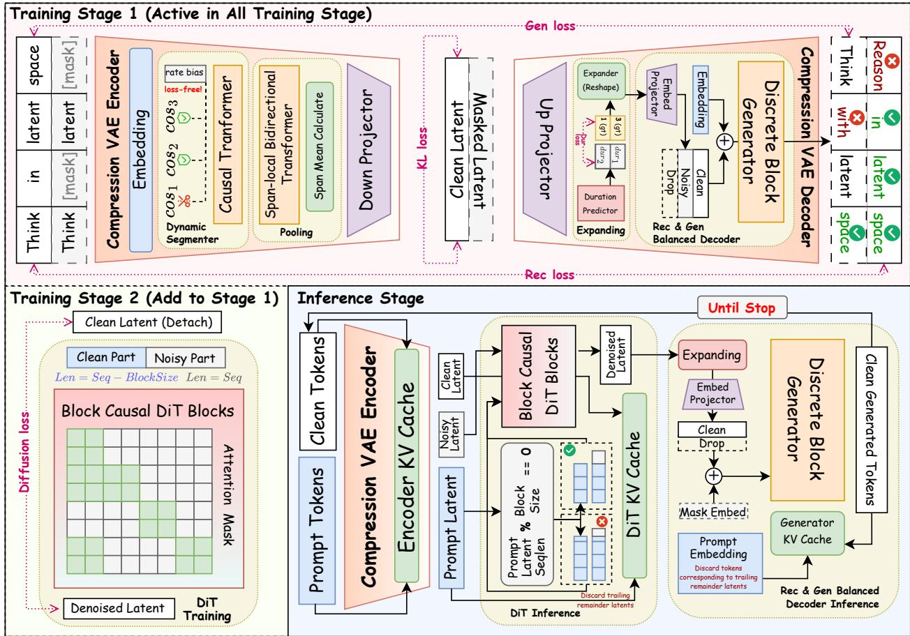  
Figure 1 Method overview. Stage 1 jointly trains the compression encoder and the reconstruction–generation balanced decoder; Stage 2 additionally trains a DiT on detached latents; at inference, the DiT generates latents block by block and the decoder decodes them into tokens.

Latent-to-token interface and block-causal MDM decoder. Each latent is first projected into the decoder hidden space, and a duration head predicts the number of tokens it covers:

$$
p _ { \psi } ( L _ { k } \mid z _ { k } ) = \mathrm { s o f t m a x } \big ( \mathrm { M L P _ { d u r } } ( W _ { \mathrm { i n } } z _ { k } ) \big ) .\tag{3.16}
$$

Given the span lengths, the latents are expanded into a token-aligned condition $H ^ { Z } = ( h _ { 1 } ^ { Z } , \dots , h _ { T } ^ { Z } )$ . If $g ( t ) = k$ indicates that token t belongs to span k, then

$$
h _ { t } ^ { Z } = \mathrm { E x p a n d } \left( z _ { g ( t ) } , j _ { t } , L _ { g ( t ) } \right) ,\tag{3.17}
$$

where $j _ { t }$ is the relative position of token t within its span. The block-causal MDM decoder $D _ { \psi }$ then predicts the target tokens in token space:

$$
p _ { \psi } \big ( y _ { t } \mid \mathcal { K } _ { t } , H _ { t } ^ { Z } \big ) = \mathrm { s o f t m a x } \big ( \mathrm { H e a d } \big ( D _ { \psi } ( \mathcal { K } _ { t } ) , H _ { t } ^ { Z } \big ) \big ) ,\tag{3.18}
$$

where $\textstyle { \mathcal { K } } _ { t }$ contains the historical clean blocks and the current masked block; attention is causal across blocks and bidirectional denoising is allowed within the current block, which cannot read its own clean copy. The attention mask and training objective are detailed in Appendix G.3.

Latent generator. The latent sequence is partitioned into contiguous blocks of fixed size $B _ { : }$

$$
\mathcal { B } _ { j } = \{ ( j - 1 ) B + 1 , \ldots , \operatorname* { m i n } ( j B , K ) \} , \qquad J = \left\lceil \frac { K } { B } \right\rceil .\tag{3.19}
$$

The generator $G _ { \theta }$ is a block-causal DiT: causal across blocks and bidirectional within the current block. It learns $p _ { \theta } ( Z \mid C )$ in continuous latent space via Flow Matching. High-level generation therefore iterates along a latent axis of length $K \approx \rho T$ , while discrete details are recovered by $D _ { \psi }$ in token space.

## 3.2.2 Training Procedure and Objectives

Stage 1: semantic compression and reconstruction–generation co-adaptation. Stage 1 jointly optimizes $E _ { \phi } ,$ the latent-to-token interface, and $D _ { \psi }$ . To cover the spectrum in Eq. (3.9) from strong-condition reconstruction to weak-condition generation, we sample one of three mutually exclusive condition-reliability states for each latent block. Let $A \in$ {cond, noise, drop} and define

$$
\widetilde { Z } _ { A } = \left\{ \begin{array} { l l } { Z , } & { A = \mathsf { c o n d } , } \\ { ( 1 - u ^ { \mathrm { c } } ) Z + u ^ { \mathrm { c } } \varepsilon , } & { A = \mathsf { n o i s e } , } \\ { \emptyset , } & { A = \mathsf { d r o p } , } \end{array} \right. \qquad \varepsilon \sim { \mathcal { N } } ( 0 , I ) ,\tag{3.20}
$$

where ∅ removes only the latent condition of the current block while retaining the same discrete token context. Let $\mathcal { L } _ { \mathrm { t o k } } ^ { A }$ denote the MDM prediction objective under state A. The three states form

$$
\begin{array} { r } { \mathcal { L } _ { \mathrm { b a l } } = \lambda _ { \mathrm { c } } \mathcal { L } _ { \mathrm { t o k } } ^ { \mathsf { c o n d } } + \lambda _ { \mathrm { n } } \mathcal { L } _ { \mathrm { t o k } } ^ { \mathsf { n o i s e } } + \lambda _ { \mathrm { d } } \mathcal { L } _ { \mathrm { t o k } } ^ { \mathsf { d r o p } } , } \end{array}\tag{3.21}
$$

where $\mathcal { L } _ { \mathrm { t o k } } ^ { A }$ is the masked denoising loss under the corresponding state, defined in Appendix G.3.

To increase the generative information in Eq. (3.8), we additionally introduce

$$
\mathcal { L } _ { \mathrm { g e n } } = \mathcal { L } _ { \mathrm { e n c m a s k } } ,\tag{3.22}
$$

which masks part of the encoder input under a fixed span layout and directly supervises the encoder through the corresponding token prediction. Thus,

$$
\mathcal { L } _ { \mathrm { D G D } } = \mathcal { L } _ { \mathrm { b a l } } + \lambda _ { \mathrm { g e n } } \mathcal { L } _ { \mathrm { g e n } } .\tag{3.23}
$$

The KL regularization of the diagonal Gaussian posterior is

$$
\mathcal { L } _ { \mathrm { K L } } = \frac { K _ { \mathrm { r e f } } d _ { \mathrm { r e f } } } { T _ { \mathrm { r e f } } } \frac { 1 } { K d _ { z } } \sum _ { k = 1 } ^ { K } \mathrm { K L } ( q _ { \phi } ( \boldsymbol { z } _ { k } \mid \boldsymbol { C } , Y ) \parallel \mathcal { N } ( 0 , I ) ) ,\tag{3.24}
$$

and the duration predictor is supervised with ground-truth span lengths, giving ${ \mathcal { L } } _ { \mathrm { d u r } }$ . The unified Stage 1 objective is

$$
\begin{array} { r } { \mathcal { L } ^ { ( 1 ) } = \mathcal { L } _ { \mathrm { D G D } } + \beta _ { \mathrm { K L } } \mathcal { L } _ { \mathrm { K L } } + \lambda _ { \mathrm { d u r } } \mathcal { L } _ { \mathrm { d u r } } . } \end{array}\tag{3.25}
$$

Its key gradient relation is

$$
\nabla _ { \phi } \mathcal { L } _ { \mathrm { D G D } } = \frac { \partial \mathcal { L } _ { \mathrm { D G D } } } { \partial Z } \frac { \partial Z } { \partial \phi } \neq 0 ,\tag{3.26}
$$

i.e., discrete token prediction directly shapes the encoder latents, so that $E _ { \phi }$ and $D _ { \psi }$ jointly determine the information allocation in Eq. (3.10). This pathway remains active in Stage 2.

Stage 2: detached latent difusion co-training. Stage 2 retains Eq. (3.25) and adds only detached latent-prior fitting. Let ${ \bar { Z } } = \operatorname { s g } ( Z )$ ; for the j-th latent block, we sample

$$
u _ { j } = \sigma ( \xi _ { j } ) , \qquad \xi _ { j } \sim \mathcal { N } ( \mu _ { u } , \sigma _ { u } ^ { 2 } ) ,\tag{3.27}
$$

and all latents within the block share the same $u _ { j }$ . Under the linear Flow Matching path,

$$
z _ { u } = ( 1 - u ) \bar { z } + u \epsilon , \qquad v ^ { \star } = \epsilon - \bar { z } , \qquad \epsilon \sim { \mathcal N } ( 0 , I ) ,\tag{3.28}
$$

which gives

$$
\mathcal { L } _ { \mathrm { F M } } = \mathbb { E } \Big [ \big \| G _ { \theta } \big ( z _ { u } , u ; \bar { Z } _ { < j } \big ) - v ^ { \star } \big \| _ { 2 } ^ { 2 } \Big ] .\tag{3.29}
$$

The total Stage 2 objective is therefore

$$
\begin{array} { r } { \mathcal { L } ^ { ( 2 ) } = \mathcal { L } ^ { ( 1 ) } + \lambda _ { \mathrm { F M } } \mathcal { L } _ { \mathrm { F M } } , } \end{array}\tag{3.30}
$$

and hence

$$
\nabla _ { \phi } \mathcal { L } _ { \mathrm { F M } } = 0 , \qquad \nabla _ { \phi } \mathcal { L } _ { \mathrm { D G D } } \neq 0 ,\tag{3.31}
$$

i.e., prior fitting is decoupled from representation learning, while the continuous representation and the discrete realization remain co-adapted end to end. The complete gradient routing is given in Appendix G.5.

## 3.2.3 Inference Procedure

Propose–decode–re-encode–commit. Given a prompt C, the encoder takes the posterior mode to obtain $K _ { \mathrm { p } }$ prompt latents. Writing

$$
K _ { \mathrm { p } } = B \left\lfloor { \frac { K _ { \mathrm { p } } } { B } } \right\rfloor + r , \qquad 0 \leq r < B ,\tag{3.32}
$$

only the complete block-aligned prefix is persistently committed; the trailing r latents and their tokens serve as the clean prefix of the first generated block, and the remaining $B - r$ latent slots are initialized from Gaussian noise.

The j-th generated block follows a unified transaction

$$
Z _ { j } ^ { \mathrm { p r o p } } ~ { \xrightarrow { { \cal D } _ { \psi } } } ~ Y _ { j } ~ { \xrightarrow { { \cal E } _ { \phi } ( \cdot ; \widehat S _ { j } ) } } ~ Z _ { j } ^ { \mathrm { c o r r } } ~ { \xrightarrow { \mathrm { c o m m i t } } } ~ { \ o \mathcal { K } } _ { j + 1 } ,\tag{3.33}
$$

where $\widehat { S } _ { j }$ is the span layout already determined by the duration predictor; feedback does not rerun the dynamic segmenter. The proposal serves only the current token block, and the persistent latent history always stores $Z _ { j } ^ { \mathrm { c o r r } }$

This design first preserves train–inference consistency. During training, the clean history is obtained by encoding ground-truth tokens; at inference,

$$
Z _ { \leq j } ^ { \mathrm { h i s t } } = E _ { \phi } \left( Y _ { \leq j } ; \widehat { S } _ { \leq j } \right) ,\tag{3.34}
$$

so the latent history read by the next block is still produced by the same encoder path as in training.

It also keeps the continuous latent context aligned with the discrete token context:

$$
K _ { \leq j } ^ { Z } \equiv E _ { \phi } \left( K _ { \leq j } ^ { Y } ; \widehat { S } _ { \leq j } \right) .\tag{3.35}
$$

If $Z _ { j } ^ { \mathrm { p r o p } }$ were committed directly, the subsequent DiT history and the token history actually generated by the decoder could stem from diferent semantic states, causing cumulative context bias; fixed-span feedback projects both back onto the same committed history. The cache protocol is detailed in Appendix G.6.

Two-level CFG. The latent DiT modulates the historical latent condition in velocity space:

$$
\begin{array} { r } { \hat { v } _ { \gamma } = v _ { \mathrm { u } } + \gamma _ { \mathrm { g e n } } ( v _ { \mathrm { c } } - v _ { \mathrm { u } } ) , } \end{array}\tag{3.36}
$$

where $v _ { \mathrm { c } }$ and $v _ { \mathrm { u } }$ are the velocity outputs with and without the historical latent condition, respectively, and $\gamma _ { \mathrm { g e n } }$ is the guidance scale. Its local probabilistic interpretation is given in Appendix F.

The MDM decoder uses masked\_only conditioning, so the historical token KV contains no latent condition, and applies prefix–latent two-axis CFG in logit space. Fixing the current masked block and the span layout, let $\ell _ { a b }$ denote the logits obtained by keeping (1) or masking (0) the historical token prefix and the current latent condition, where $a , b \in \{ 0 , 1 \}$ correspond to the two conditions, respectively. With two-axis scales $\gamma _ { \mathrm { p } } , \gamma _ { \mathrm { z } }$ we define

$$
\begin{array} { r l } & { \ell _ { \gamma _ { \mathrm { p } } , \gamma _ { \mathrm { z } } } = \gamma _ { \mathrm { p } } \gamma _ { \mathrm { z } } \ell _ { 1 1 } + \gamma _ { \mathrm { p } } ( 1 - \gamma _ { \mathrm { z } } ) \ell _ { 1 0 } } \\ & { \qquad + ( 1 - \gamma _ { \mathrm { p } } ) \gamma _ { \mathrm { z } } \ell _ { 0 1 } + ( 1 - \gamma _ { \mathrm { p } } ) ( 1 - \gamma _ { \mathrm { z } } ) \ell _ { 0 0 } . } \end{array}\tag{3.37}
$$

Setting $\gamma _ { \mathrm { p } } = 1$ modulates only the latent, setting $\gamma _ { \mathrm { z } } = 1$ modulates only the prefix, and setting both to 1 recovers the fully conditioned branch. This rule changes neither the training objective nor the feedback protocol. The four-branch definition and cache implementation are given in Appendices F.3 and G.6.1.

Let $S _ { \mathrm { g e n } }$ be the number of DiT denoising steps. On the uniform time grid $u _ { i } = 1 - i / S _ { \mathrm { g e n } }$ , the explicit Euler update is

$$
Z _ { j } ^ { ( i + 1 ) } = Z _ { j } ^ { ( i ) } - \frac { 1 } { S _ { \mathrm { g e n } } } \hat { v } _ { \gamma } \Bigl ( Z _ { j } ^ { ( i ) } , u _ { i } \Bigr ) , \qquad i = 0 , \ldots , S _ { \mathrm { g e n } } - 1 .\tag{3.38}
$$

Given the proposal, $D _ { \psi }$ completes the current token block with a few iterative demasking steps, followed by the feedback correction in $\operatorname { E q . }$ . (3.33).

## 3.3 Computational Cost

Let $D _ { s }$ be the training token budget of Stage $s , c _ { \mathrm { r e p } } ^ { ( s ) }$ the average per-token cost of the encoder–decoder path in that stage, and $c _ { G } ^ { ( 2 ) }$ the average per-token cost of the added DiT, both including the corresponding attention and output projections. Then

$$
\mathcal { C } _ { \mathrm { t r a i n } } \approx D _ { 1 } c _ { \mathrm { r e p } } ^ { ( 1 ) } + D _ { 2 } \big ( c _ { \mathrm { r e p } } ^ { ( 2 ) } + c _ { G } ^ { ( 2 ) } \big ) .\tag{3.39}
$$

Under the same prior architecture and a comparable layout, $K = \rho T$ reduces the dominant linear-layer and attention-pair terms to $\mathcal { O } ( \rho )$ and $\mathcal { O } ( \rho ^ { 2 } )$ of their token-axis counterparts, respectively, but the representation path persists in both stages.

Inference cost consists of DiT proposal/commit, discrete decoding (including condition preparation), and fixed-span feedback, denoted by ${ \mathcal { C } } _ { G } ^ { \mathrm { { i n f e r } } } , { \mathcal { C } } _ { D } ^ { \mathrm { { i n f e r } } }$ , and ${ \mathcal { C } } _ { \mathrm { f b } } ,$ respectively. Taking as reference the AR cost $\mathcal { C } _ { \mathrm { A R } } ^ { \mathrm { i n f e r } }$ under the same prompt/output budget and accounting convention,

$$
R _ { \mathrm { i n f e r } } = \frac { \mathcal { C } _ { G } ^ { \mathrm { i n f e r } } + \mathcal { C } _ { D } ^ { \mathrm { i n f e r } } + \mathcal { C } _ { \mathrm { f b } } } { \mathcal { C } _ { \mathrm { A R } } ^ { \mathrm { i n f e r } } } .\tag{3.40}
$$

Both sides exclude the one-time prefill but retain the cost of subsequently reading the prompt KV.

Let $\rho _ { \mathrm { g e n } }$ be the realized latent/token ratio of the generated text, and let $H _ { D }$ and $H _ { F }$ be the numbers of per-block call rounds for condition preparation/decoding/clean-token commit and for feedback/corrected-cache commit, respectively. Ignoring boundary efects and assuming ideally parallel CFG branches, the number of serial call rounds H satisfies

$$
\frac { \mathcal { H } _ { \mathcal { C o l a 2 } } } { \mathcal { H } _ { \mathrm { A R } } } \approx \frac { \rho _ { \mathrm { g e n } } } { B } \big ( S _ { \mathrm { g e n } } + H _ { D } + H _ { F } \big ) .\tag{3.41}
$$

This is a forward-round proxy rather than a latency guarantee. The end-to-end cost also depends on the actual number of CFG branches, the token decoder, and feedback; per-term counts, the AR comparison, and the KV analysis are given in Appendix H.

## 4 Experiments

Following the training pipeline in Section 3.2, our experiments address three questions: (1) how to build a compressed latent space that is semantically rich and easy to model; (2) how to train the latent generator; and (3) how the decoder should allocate its capacity between conditional reconstruction and autonomous generation.

## 4.1 Experimental Setup

Datasets. For the component analyses and controlled scaling experiments, we train on the open-source OLMo 2 pretraining corpus [35]. The component analyses are conducted mainly on LAMBADA and examine the construction of the semantic latent space, the learning of the latent generator, and the reconstruction– generation balance of the decoder. The controlled scaling experiments are conducted on five downstream tasks, RACE [21], OBQA [31], Story Cloze [32], LAMBADA [37], and SQuAD [40], and compare how diferent generation paradigms improve as training scales. The post-pretraining comparison additionally evaluates HellaSwag [49], NarrativeQA [20], ARC-Easy [9], TruthfulQA [25], and MMLU [14].

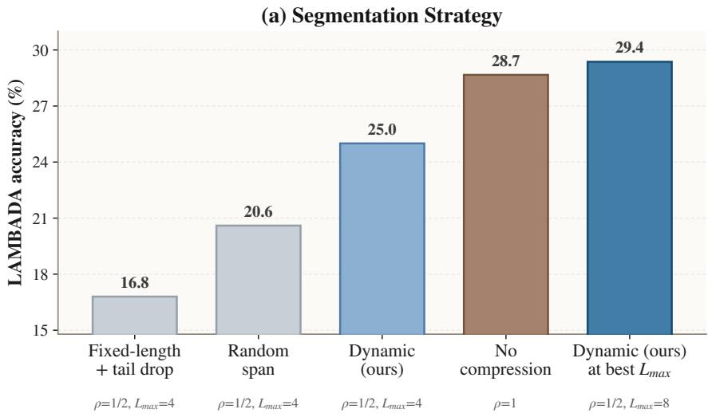

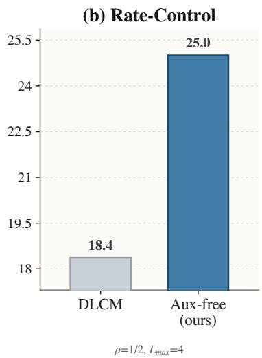  
Figure 2 Segmentation and rate control. Dynamic segmentation outperforms fixed-length and random segmentation; auxiliary-free negative-feedback control outperforms DLCM [39].

Baselines. Component studies compare Cola2 variants and DLCM [39] for rate control. Controlled scaling compares AR [6], LLaDA [34], Cola DLM [13], and the uncompressed Cola-MDM $( \rho = 1 )$ under matched model size, data, and evaluation; Cola-MDM shares the Cola2-MDM decoder to isolate the efect of compression. Post-pretraining comparisons use Llama-3-8B [11], Qwen2.5-7B [17], Qwen3-8B-Base [45], and LLaDA-8B Base [34].

Metrics. Answers are extracted from model outputs according to each task format, and accuracy (%) is computed by exact match. All tasks except LAMBADA use few-shot prompting. The internal ablations report LAMBADA accuracy by default, and the controlled scaling experiments report the accuracy on all five tasks and their average.

Settings. In the component analyses and controlled scaling experiments, we use the OLMo 2 (dolma2) tokenizer and the AdamW optimizer with $\beta = ( 0 . 9 , 0 . 9 5 )$ , weight decay 0.01, and a maximum sequence length of 512. Stage 1 jointly trains the encoder and decoder; Stage 2 trains the DiT while continuing to update the VAE, and blocks the Flow Matching gradient from reaching the encoder. The learning rates of the Stage 1 VAE and the Stage 2 DiT both start at $1 0 ^ { - 6 }$ , increase linearly over 5,000 warmup steps to $1 0 ^ { - 4 }$ and $1 . 5 \times 1 0 ^ { - 4 }$ , respectively, and then follow cosine decay to $1 0 ^ { - 6 }$ at step 50,000 and $1 0 ^ { - 5 }$ at step 1,000,000, respectively. In Stage 2, the VAE learning rate continues from Stage 1 with a 5,000-step transition, and the encoder learning rate is 0.1× that of the decoder. Unless otherwise stated, each latent covers 2 tokens on average, the latent dimension is 64, and the maximum span length is 8. DiT noise times follow a logit-normal distribution (loc = 2.0, scale = 1.0); the decoder samples clean, noisy, and dropped latent conditions per block with probabilities 0.2, 0.4, and 0.4, respectively. Inference uses 8 DiT denoising steps and 4 MDM demasking steps by default, and the controlled scaling experiments train on about 210B tokens.

## 4.2 Building the Semantic Latent Space

## 4.2.1 Dynamic Segmentation and Rate Control

Obs. 1 Dynamic segmentation is essential. With $\rho = 1 / 2$ and $L _ { \operatorname* { m a x } } = 4 .$ , dynamic segmentation (25.0%) outperforms random spans and fixed-length segmentation by 4.4 and 8.2 points (Figure 2); relaxing $L _ { \mathrm { m a x } }$ to 8 reaches 29.4%, exceeding the uncompressed model (28.7%), which shows that content-based compression is not only lossless but also beneficial.

(a) Encoder Layer Allocation  
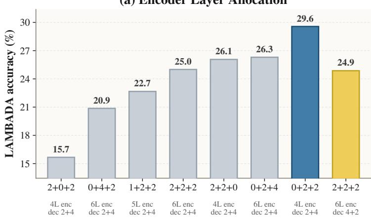  
Encoder layout (token + pool + latent)

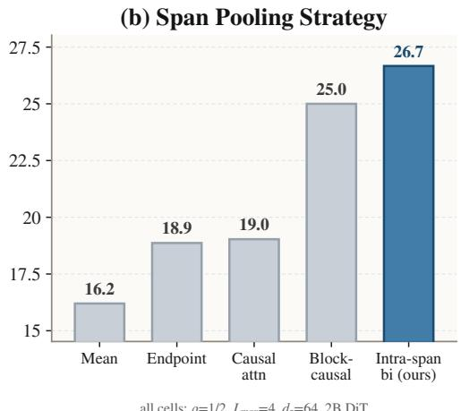  
Span pooling method

Figure 3 VAE architecture. Left: the allocation of encoder layers matters more than depth, with 0+2+2 performing best. Right: intra-span bidirectional attention is the best pooling operator.  
(a) Latent Channel Width  
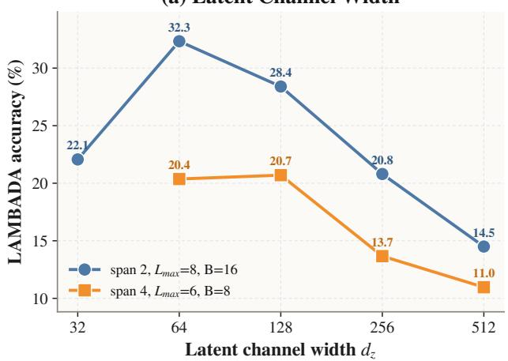

(b) Maximum Span  
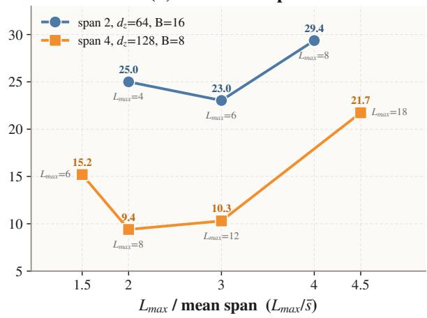  
Figure 4 Latent width and maximum span length. Left: $d _ { z }$ has an interior optimum. Right: the efect of $L _ { \mathrm { m a x } }$ non-monotonic.

Obs. 2 Feedback rate control beats an auxiliary rate loss. Under the same setting, the former reaches 25.0% whereas DLCM [39] reaches only 18.4%: directly regulating the hard compression rate avoids the competition between the rate loss and representation learning.

## 4.2.2 VAE Architecture

Obs. 3 Encoder layout matters more than size. The four-layer 0+2+2 encoder achieves the best result of 29.6%, outperforming all six-layer variants (20.9–26.3%); removing the pooling layers (2+0+2) yields only 15.7%, whereas reallocating decoder layers has almost no efect (25.0% vs. 24.9%; Figure 3, left). An oversized encoder makes the latent distribution more complex and harder for the DiT to model. Intra-span bidirectional attention performs best (26.7%), followed by block-causal attention (25.0%), while fully causal attention, endpoint pooling, and mean pooling all stay at or below 19.0% (Figure 3, right).

## 4.2.3 Compression and Latent Capacity

Obs. 4 Wider latents are not always better. With mean span length 2, accuracy peaks at 32.3% at $d _ { z } = 6 4$ and drops to 14.5% at $d _ { z } = 5 1 2$ (Figure 4, left). A larger $d _ { z }$ adds capacity, but also increases the complexity

(a) Latent Token Coverage: Actual Mean = 2.00  
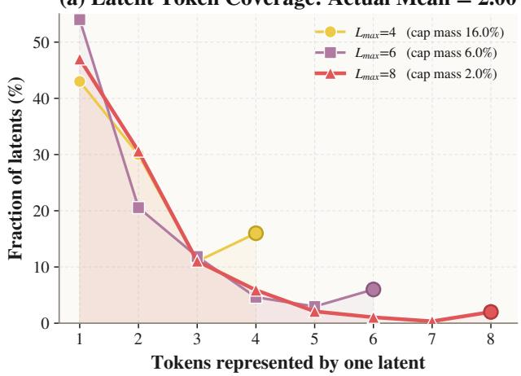

(b) Latent Token Coverage: Actual Mean = 4.00  
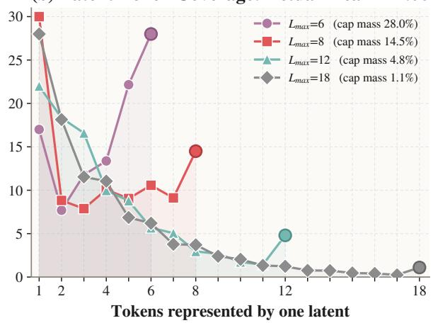  
Figure 5 Distribution of the number of tokens covered by each latent. Increasing $L _ { \mathrm { m a x } }$ reduces the number of forcibly truncated spans.

Table 1 Best configuration at each compression level. Accuracy decreases as compression becomes stronger.
<table><tr><td>Mean span length</td><td>Latent width  $d _ { z }$ </td><td> $L _ { \mathrm { m a x } }$ </td><td>LAMBADA (%)</td></tr><tr><td>2</td><td>64</td><td>8</td><td>32.3</td></tr><tr><td>3</td><td>128</td><td>8</td><td>26.9</td></tr><tr><td>4</td><td>256</td><td>18</td><td>25.2</td></tr></table>

of the distribution that the DiT must fit.

Obs. 5 Compression rate, $d _ { z }$ , and $L _ { \mathrm { m a x } }$ must be tuned jointly. Even with the best configuration at each compression level, accuracy still falls from 32.3% (span length 2) to 25.2% (span length 4), as shown in Table 1. The efect of $L _ { \mathrm { m a x } }$ (Figure 4, right) is governed by the truncation ratio (Figure 5): when truncation is frequent, a smaller $L _ { \mathrm { m a x } }$ keeps each latent simpler; once the cap mass drops to about $1 \%$ (span length 4, $L _ { \operatorname* { m a x } } = 1 8 )$ , preserving complete semantic spans dominates and accuracy rises to 21.7%.

## 4.2.4 Generative Supervision of the Encoder

Lemma 4.1 (Generative Supervision Promotes Predictive Representations). When the supervised tokens are hidden from the encoder, the generative objective cannot be satisfied by copying the current targets. When the encoder is trainable, reducing this objective encourages the latent to retain information predictive of missing or future tokens. If the encoder is frozen, the objective only improves the decoder’s use of information already present in the latent. See Appendix B for the proof.

Obs. 6 Generative supervision is key; its form is secondary. Pure reconstruction reaches only 15.7%, and adding the Span-AR or BERT-style objective raises accuracy to 25.2% and 26.5%, respectively (Figure 6). With a frozen encoder, the BERT-style objective yields a 2.2-point gain (28.9% → 31.1%), and unfreezing the encoder reaches 35.2%. Consistent with Lemma 4.1, the generative objective improves both the completion ability of the decoder and the latent itself.

Obs. 7 Encoder and decoder should co-evolve. With the MDM decoder, a frozen encoder yields 47.6%, end-to-end co-evolution raises accuracy to 53.5%, and further adding the generative loss reaches 58.2% (Figure 6, right). What the latent should retain must be determined jointly with what the decoder can complete.

## 4.3 Learning the Latent Generator

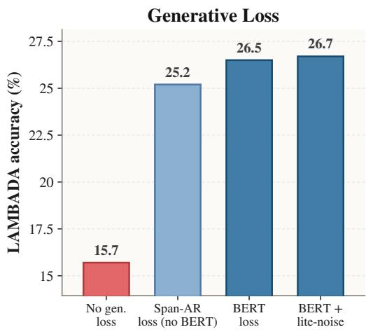

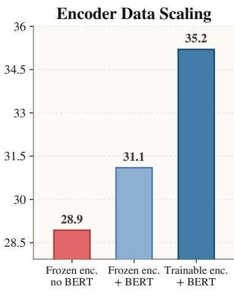

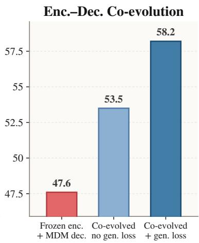

Figure 6 Generative supervision. Left: generative objectives substantially outperform pure reconstruction. Middle: the gain is larger when the encoder is trainable. Right: co-evolving the encoder and decoder with the generative loss performs best.  
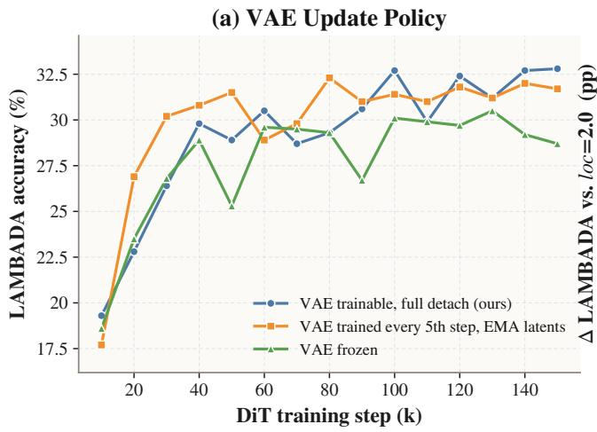

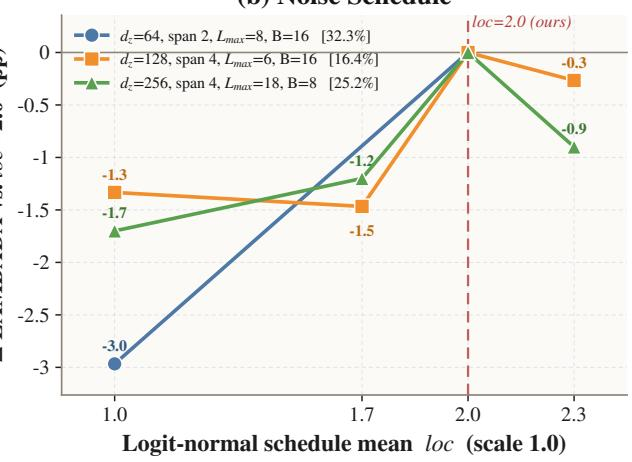  
Figure 7 VAE update policy and noise schedule. Left: continuing to train the VAE while detaching the DiT gradient performs best. Right: diferences relative to loc = 2.0; all three configurations are optimal at 2.0.

## 4.3.1 VAE Update Policy and Gradient Detachment

Lemma 4.2 (Prior Fitting and Representation Learning Should Be Decoupled). The DiT Flow Matching objective only requires the current latent to be easier for the prior to fit; its gradient is not guaranteed to align with the token-side representation objective. Applying stop-gradient to the DiT path ensures that prior fitting does not directly rewrite the encoder, while preserving end-to-end encoder updates from the decoder token loss. See Appendix C for the proof.

Obs. 8 Keep training the VAE, but detach the DiT gradient. A trainable VAE reaches 32.8%, whereas a frozen VAE reaches only 28.7% (Figure 7, left). Allowing the DiT gradient to flow into the encoder yields a 2.2-point lead early on, but this is overtaken after 80k steps and becomes a 1.0-point deficit at 140k steps (Table 2). This supports Lemma 4.2: the DiT gradient rewrites the latent to be easier to fit rather than more useful for text modeling, and detaching the gradient blocks this latent hacking.

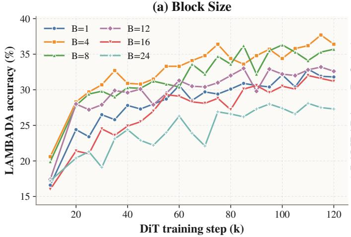

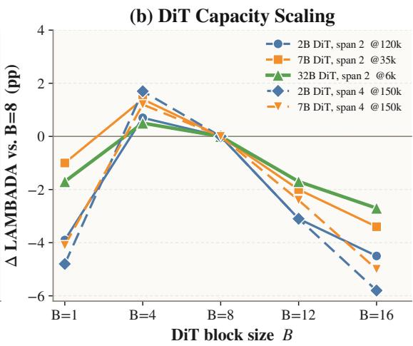

Figure 8 DiT block size and capacity. Left: moderate block sizes are optimal. Right: larger DiTs yield flatter curves.  
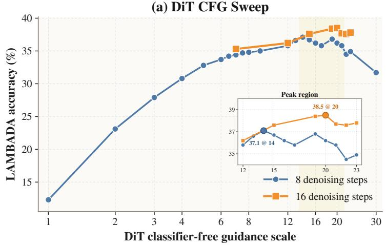

(b) DiT Steps Across Block Sizes  
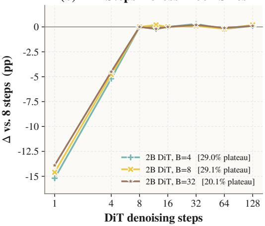  
Figure 9 DiT inference. Left: generator CFG sweep. Right: the DiT saturates at 8 steps.

## 4.3.2 Noise-Schedule Calibration

Lemma 4.3 (Efective Noise Is Jointly Determined by the Latent and Difusion). At the same DiT timestep, the available latent signal is afected by both VAE posterior uncertainty and difusion corruption. Consequently, changing the noise scale of the Stage 1 latent changes the efective signal-to-noise ratio induced by the same DiT schedule, so the noise schedule must be calibrated jointly with the latent distribution. See Appendix D for the proof.

Obs. 9 The noise schedule must match the representation. All three configurations achieve their best results at loc = 2.0, and deviating from it costs 0.3–3.0 points, with the magnitude varying with $d _ { z }$ and the compression level (Figure 7, right). By Lemma 4.3, the schedule should be recalibrated when the representation changes.

## 4.3.3 Block Size and Generator Capacity

Obs. 10 Moderate blocks are best, and larger DiTs tolerate larger blocks. For the 2B DiT, B = 4 is optimal (36.4%), whereas B = 1 and B = 24 reach only 31.8% and 27.3%, respectively (Figure 8, left). In the right panel of Figure 8, the slope of the decline for B > 8 becomes monotonically flatter with DiT size: the loss from B = 8→16 decreases from 4.5 points for 2B to 3.4 points for 7B and 2.7 points for 32B, and the same trend holds at mean span length 4. A larger DiT can jointly model more latents within a single block, which enlarges the range of block sizes it can use efectively.

Share of blocks trained on a noised latent  
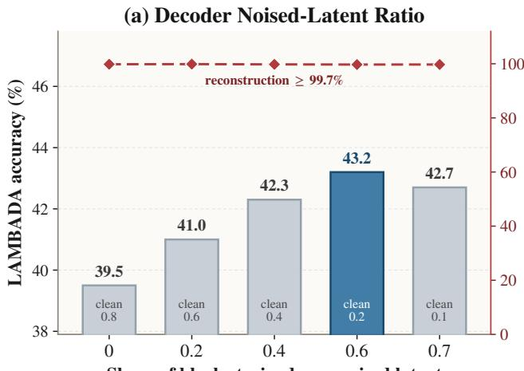

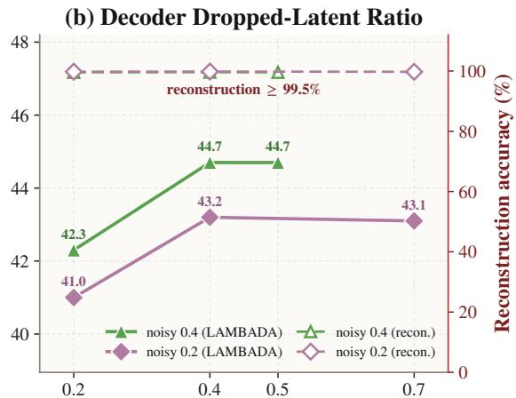  
Share of blocks trained with the latent dropped  
Figure 10 Decoder data partition. Left: varying the noisy-to-clean ratio. Right: varying the drop ratio. Reconstruction accuracy (right axis) stays above 99.5% throughout; $0 . 4 / 0 . 4 / 0 . 2$ gives the best balance.

Table 2 Whether the DiT gradient flows into the encoder. Gradient injection leads early, but is overtaken by full detachment in the middle and late stages of training
<table><tr><td>Gradient policy</td><td>20k steps</td><td>80k steps</td><td>140k steps</td></tr><tr><td>Full detachment (ours)</td><td>21.4</td><td>30.4</td><td>33.1</td></tr><tr><td>DiT velocity loss injected every 10 steps</td><td>23.6</td><td>29.9</td><td>32.1</td></tr><tr><td>Difference (ours — injection)</td><td>-2.2</td><td>+0.5</td><td>+1.0</td></tr></table>

## 4.3.4 Generator Guidance and Inference Steps

Obs. 11 The generator needs strong CFG and about 8 steps. At 8 steps, accuracy rises from 12.2% at $\gamma _ { \mathrm { g e n } } = 1$ to 37.1% at $\gamma _ { \mathrm { g e n } } = 1 4 ;$ at 16 steps, the peak moves to $\gamma _ { \mathrm { g e n } } = 2 0$ (38.5%) (Figure 9, left). Using 1 and 4 steps loses about 14 and 5 points, respectively, whereas results between 8 and 128 steps difer by at most 0.3 points (Figure 9, right).

## 4.4 Balancing the Reconstruction--Generation Decoder

Lemma 4.4 (Latent-Condition Strength Determines Residual Generation). Given the same discrete context, a more reliable latent condition provides more information and leaves less residual uncertainty for the decoder to generate on its own; when the latent is corrupted or removed, the residual uncertainty increases accordingly. Thus, mixed cond/noise/drop training covers the continuum from conditional reconstruction to autonomous generation. See Appendix E for the proof.

## 4.4.1 Decoder Type

Obs. 12 Decoder factorization matters little. At every checkpoint, the gap between them is at most 1.4 points, and the leader alternates during training (Table 3): AR-MTP leads by 0.9 points at 50k steps, whereas MDM leads by 0.7 and 1.4 points at 100k and 150k steps. This indicates that, given a shared latent–token interface, the specific decoder factorization is not the decisive factor for performance, and the hierarchical framework applies to both; subsequent experiments use the MDM decoder.

## 4.4.2 Decoder Data Partition

Obs. 13 Train mostly on noisy and dropped conditions, but keep clean ones. Reconstruction accuracy stays above 99.5% in all configurations, even when only 10% of blocks are clean (Figure 10), so most of the data can be devoted to generation under degraded conditions. With the drop ratio fixed at 0.2, shifting noisy/clean from 0.0/0.8 to 0.6/0.2 raises LAMBADA accuracy from 39.5% to 43.2%; raising the drop ratio from 0.2 to 0.4 adds another 2.2–2.4 points, while pushing further brings no gain (noisy 0.7: 42.7%; drop 0.7: 43.1%). The selected 0.4/0.4/0.2 (drop/noisy/clean) ties for the best result of 44.7% while retaining more clean data, confirming the reconstruction–generation continuum in Lemma 4.4.

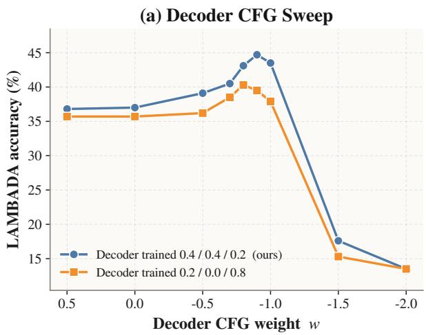

(b) Fixed-Budget Model Allocation  
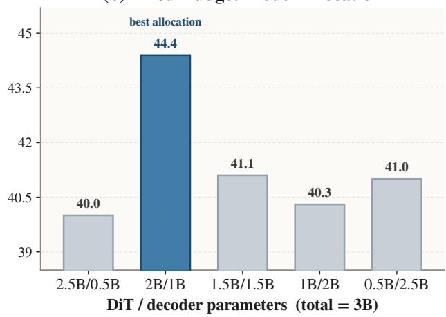  
Figure 11 Decoder guidance and parameter allocation. Left: the balanced decoder is optimal at $w _ { \mathrm { d e c } } = - 0 . 9 .$ Right: with 3B total parameters, a 2B DiT with a 1B decoder is optimal.

Table 3 Decoder factorization. The two decoders perform similarly.
<table><tr><td>Decoder</td><td>50k steps</td><td>100k steps</td><td>150k steps</td></tr><tr><td>AR-MTP decoder</td><td>39.7</td><td>43.7</td><td>44.1</td></tr><tr><td>MDM decoder</td><td>38.8</td><td>44.4</td><td>45.5</td></tr><tr><td>Difference (MDM – AR-MTP)</td><td>-0.9</td><td>+0.7</td><td>+1.4</td></tr></table>

## 4.4.3 Decoder Guidance

Obs. 14 Decoder CFG must match the training mixture. The balanced decoder reaches 44.7% at $w _ { \mathrm { d e c } } = - 0 . 9$ and collapses rapidly at more negative weights, whereas the clean-heavy decoder reaches at best 40.3% (Figure 11, left), indicating that inference-time guidance cannot compensate for an imbalanced training distribution.

## 4.4.4 Decoder Capacity

Obs. 15 Under a fixed budget, the DiT matters more. With the DiT fixed, increasing the decoder from 500M to 2B yields monotonic gains of 2.1–2.4 points (Figure 12); under a total budget of 3B, a 2B DiT with a 1B decoder (44.4%) outperforms the other allocations by 3.3–4.4 points, and imbalance in either direction degrades performance (Figure 11, right).

## 4.4.5 Demasking Steps and Latent Use

Obs. 16 Demasking saturates at about 8 steps. 8 DiT/8 demasking steps achieve the best result of 49.0% (Figure 13, left); fewer than 8 DiT steps cause a clear drop, while increasing demasking can partially compensate when the DiT uses too few steps. The 8/4 setting (48.2%) is only 0.8 points below the optimum and serves as the default low-cost setting.

Obs. 17 The decoder relies on aligned latents. Zeroing, resampling, and shufling the latent reduce accuracy from 46.5% to 41.2%, 39.3%, and 34.3%, respectively (Figure 13, right). Zeroing corresponds to the drop state seen in training and therefore degrades more gracefully; shufled latents are statistically realistic but semantically misaligned and cause the largest damage, showing that the decoder follows the latent content.

(a) Decoder Size: 8 DiT / 12 Demask Steps  
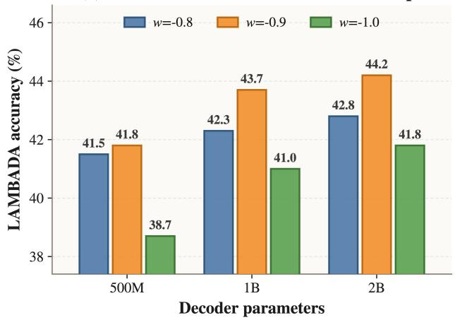

(b) Decoder Size: 16 DiT / 8 Demask Steps  
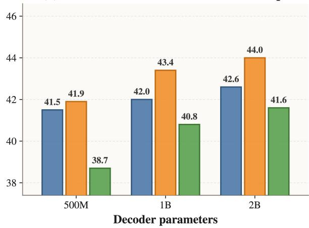

Figure 12 Scaling the decoder with a fixed DiT. Accuracy improves monotonically with decoder size.  
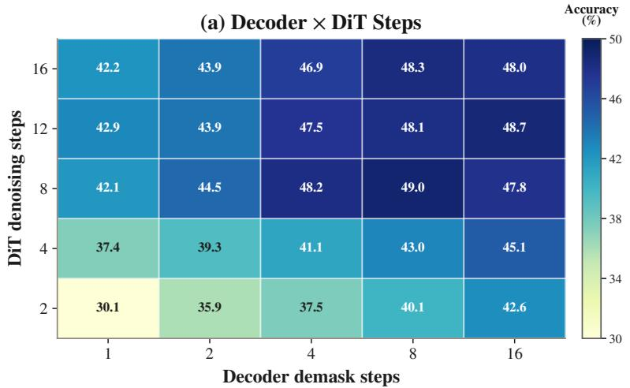

(b) Latent Ablation  
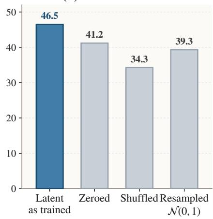  
Figure 13 Decoder inference and latent ablation. Left: 8/8 steps are optimal. Right: corrupting the latent substantially degrades performance, with shufling being the most harmful.

## 4.5 Scaling Experiments

## 4.5.1 Controlled Scaling Trends

Figure 14 extends training to about 210B tokens and compares the models on RACE, OBQA, Story Cloze, LAMBADA, and SQuAD. Cola-MDM (ρ = 1) and Cola2-MDM (with the compression VAE from Section 4.2) share the MDM decoder selected in Section 4.4, which separates the efect of the decoder design from that of dynamic compression.

Obs. 18 The MDM decoder yields the strongest scaling. Cola-MDM finally reaches a task average of about 34.5%, higher than AR (about 33%), and about 64% on LAMBADA, about 15 points above Cola DLM. The weakness of Cola DLM on generative tasks stems from its decoder rather than from the hierarchical framework.

Obs. 19 Compression preserves semantic tasks, with costs on exact-token tasks. Cola2-MDM matches AR on

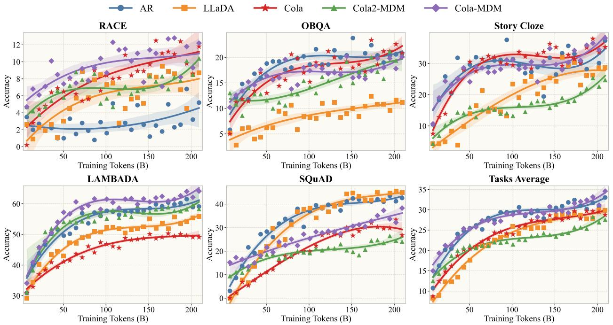

Figure 14 Scaling trends with training tokens. Cola-MDM achieves the strongest overall scaling; Cola2-MDM also exhibits strong and unsaturated scaling potential under compression.  
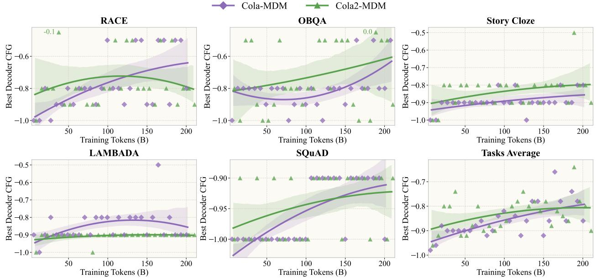  
Figure 15 Optimal decoder CFG weight during training. For both models, the optimal weight remains within $[ - 1 . 0 , - 0 . 8 ]$ , consistent with the −0.9 selected in Section 4.4, and drifts slowly toward 0 during training; the drift of Cola2-MDM is more gradual, consistent with its slower convergence.

LAMBADA (about 61%) and leads substantially on RACE (about 10.5% vs. 4.5%), with the gap concentrated on SQuAD and Story Cloze, which rely on verbatim reproduction.

Obs. 20 The compressed variant converges more slowly but keeps closing the gap. Since each latent summarizes more tokens, the latent DiT converges more slowly than the discrete generator. As training continues, the latent condition becomes increasingly useful: after about 150B tokens, the average gap to LLaDA shrinks from about 4 to 1.5 points without saturating. The mixed decoder setting $w _ { \mathrm { d e c } } = - 0 . 9$ (44.7%) also outperforms both the latent-free (43.5%) and fully conditioned (37.0%) settings, confirming that latent semantics and discrete generation are complementary.

Table 4 Post-pretraining evaluation. Accuracy (%) on eight downstream tasks, with tasks grouped by evaluation focus and models by generation paradigm. Cola2 uses 346.03B source tokens; the models are not compute-matched.
<table><tr><td rowspan="2">Task</td><td colspan="3">Autoregressive</td><td>Discrete diffusion</td><td>Continuous diffusion</td></tr><tr><td>Llama-3-8B</td><td>Qwen2.5-7B</td><td>Qwen3-8B-Base</td><td>LLaDA-8B-Base</td><td>Cola2</td></tr><tr><td>Pretraining tokens</td><td>15T+</td><td>18T</td><td>~36T</td><td>2.3T</td><td>346B</td></tr><tr><td>Reading comprehension</td><td></td><td></td><td></td><td></td><td></td></tr><tr><td>RACE</td><td>75.77</td><td>89.95</td><td>90.65</td><td>87.40</td><td>69.91</td></tr><tr><td>NarrativeQA</td><td>42.70</td><td>32.90</td><td>37.30</td><td>36.00</td><td>32.70</td></tr><tr><td>Commonsense reasoning</td><td></td><td></td><td></td><td></td><td></td></tr><tr><td>HellaSwag</td><td>39.21</td><td>75.67</td><td>68.13</td><td>69.65</td><td>41.75</td></tr><tr><td>StoryCloze</td><td>79.49</td><td>95.09</td><td>97.44</td><td>95.94</td><td>80.42</td></tr><tr><td>Language modeling</td><td></td><td></td><td></td><td></td><td></td></tr><tr><td>LAMBADA</td><td>75.70</td><td>71.82</td><td>71.20</td><td>67.90</td><td>63.00</td></tr><tr><td>Knowledge-oriented QA</td><td></td><td></td><td></td><td></td><td></td></tr><tr><td>ARC-Easy</td><td>90.86</td><td>96.00 69.03</td><td>97.35 72.58</td><td>93.85</td><td>87.62</td></tr><tr><td>TruthfulQA</td><td>63.04 63.19</td><td>70.16</td><td>72.31</td><td>64.87 61.27</td><td>54.10</td></tr><tr><td>MMLU</td><td></td><td></td><td></td><td></td><td>51.32</td></tr><tr><td>8-task average</td><td>66.25</td><td>75.08</td><td>75.87</td><td>72.11</td><td>60.10</td></tr></table>

## 4.5.2 Post-Pretraining Benchmark Comparison

The final checkpoint evaluated here uses a separate large-scale recipe from the controlled scaling study. It is trained on OLMo 2 pretraining data retokenized with the Qwen3-4B tokenizer, using length-4096 sequences. The decoder and the VAE encoder embedding are initialized from Qwen3-4B-Base. During decoder training, masked positions are represented by [MASK] inputs, while decoder self-attention remains causal. Stage I trains the dynamic-compression VAE on 52.43B source tokens. Stage II jointly updates the VAE and an approximately 4B-parameter latent DiT, with detached VAE latents, on an additional 125.83B source tokens. Stage III freezes the Stage-II EMA VAE and continues training only the DiT on 167.77B source tokens. The total is 346.03B source tokens. Architecture, optimization, objective, EMA, and state-transition details are provided in Appendix I.

Inference uses a low-noise-biased eight-step Euler DiT schedule, $t _ { i } = T ( 1 - i / 8 ) ^ { 2 } \mathrm { f o r } i = 0 , \dots , 8 ,$ with DiT CFG set to 10. Decoder CFG is −0.9, each decoding call generates one latent span, dynamic duration and latent feedback are enabled, and decoding is greedy.

We compare this checkpoint with representative 7B–8B pretrained models across eight downstream tasks. Each Cola2 task score reported below is the average of three sampled evaluations. Because the models’ training recipes, tokenizers, and token-counting conventions difer, this comparison contextualizes post-pretraining performance rather than isolating the efect of the generation paradigm.

Obs. 21 Cola2 shows strong scaling potential under a limited training budget. With only 346.03B source tokens and before convergence, Cola2 reaches an eight-task average of 60.10, only 6.15 points behind Llama-3-8B (66.25), which uses at least 15T tokens—over 43× more data. Cola2 also surpasses Llama-3-8B on HellaSwag (41.75 vs. 39.21) and StoryCloze (80.42 vs. 79.49), while reaching 87.62 on ARC-Easy. These results indicate substantial scaling headroom and successful transfer of the Qwen-initialized causal decoder’s text generation capability. More broadly, continuous-latent hierarchical modeling can integrate efectively with established token-space generation paradigms, including autoregressive and masked-difusion decoders.

## 4.6 Summary

The results support the design of Cola2 in three respects. Semantic compression: dynamic segmentation and generative supervision keep the latents strongly semantic at high compression rates; the former slightly surpasses the uncompressed model with an appropriate $L _ { \mathrm { m a x } }$ , and the latter raises accuracy from 15.7% to 26.7%. Reconstruction--generation balance: mixed training dominated by noisy and dropped conditions enables the decoder both to faithfully use the latent (shufling the latent costs 12.2 points) and to autonomously generate the residual information. Continuous--discrete co-adaptation: the information placed in the latent should be determined by the decoder; co-training the encoder and decoder yields a 5.9-point gain, and both continue to benefit from more training data, giving the hierarchical model scaling trends comparable to or better than AR and LLaDA.

## 5 Limitations & Future Prospects

Although our results provide initial evidence for the feasibility, competitiveness, and scaling potential of Cola2, we view the current system as a starting point rather than a finished endpoint. First, the model remains far from convergence, especially the latent DiT, while the present training scale is limited by available resources. Larger models, longer training, and broader data and compute budgets are therefore needed to establish its performance ceiling. Second, compression reduces the dominant linear and attention FLOPs of the latent prior in theory, but end-to-end generation speed also depends on the decoder, CFG branches, latent feedback, and hardware utilization. Infrastructure co-design—including specialized kernels, cache management, and parallel scheduling—is needed to translate theoretical savings into practical speedups. Third, Cola2 already shows compatibility with autoregressive and masked-difusion decoders, but their co-training objectives, inference trade-ofs, and optimal division of labor remain underexplored. Finally, the continuous latent space may provide a shared interface between text and other continuous modalities such as vision, opening a path toward unified latent representations, cross-modal priors, and unified understanding and generation.

## 6 Conclusion

We presented Cola2, a hierarchical language modeling framework that unifies dynamic semantic compression with balanced discrete reconstruction and generation through continuous–discrete co-adaptation. Dynamic compression and generation-oriented supervision encourage compact, predictive latent representations, while the decoder realizes latent semantics and handles residual uncertainty from context. Token-prediction gradients drive encoder–decoder co-adaptation, whereas latent-prior fitting remains decoupled from representation learning. Systematic component analyses and controlled evaluations on five downstream tasks, scaled to about 210B training tokens, support these design principles and show competitive, unsaturated scaling. In a separate resource-constrained run, the final checkpoint trained on 346.03B source tokens achieves a 60.10 average over eight tasks and surpasses Llama-3-8B on HellaSwag and StoryCloze, although that baseline reports over 43× more pretraining tokens. These results indicate successful transfer of the Qwen-initialized causal decoder’s generation capability and substantial scaling headroom, especially because the latent DiT remains far from convergence. More broadly, Cola2 shows that continuous-latent hierarchical modeling can integrate efectively with established token-space generators, including autoregressive and masked-difusion decoders, rather than depending on a single decoder paradigm.

## References

[1] Marianne Arriola, Aaron Gokaslan, Justin Chiu, Zhihan Yang, Zhixuan Qi, Jiaqi Han, Subham Sahoo, and Volodymyr Kuleshov. Block difusion: Interpolating between autoregressive and difusion language models. In International Conference on Learning Representations, volume 2025, pages 50726–50753, 2025.

[2] Jacob Austin, Daniel D Johnson, Jonathan Ho, Daniel Tarlow, and Rianne Van Den Berg. Structured denoising difusion models in discrete state-spaces. Advances in neural information processing systems, 34:17981–17993, 2021.

[3] Loïc Barrault, Paul-Ambroise Duquenne, Maha Elbayad, Artyom Kozhevnikov, Belen Alastruey, Pierre Andrews, Mariano Coria, Guillaume Couairon, Marta R Costa-jussà, David Dale, et al. Large concept models: Language modeling in a sentence representation space. arXiv preprint arXiv:2412.08821, 2024.

[4] Tiwei Bie, Maosong Cao, Kun Chen, Lun Du, Mingliang Gong, Zhuochen Gong, Yanmei Gu, Jiaqi Hu, Zenan Huang, Zhenzhong Lan, et al. Llada2. 0: Scaling up difusion language models to 100b. arXiv preprint arXiv:2512.15745, 2025.

[5] Tiwei Bie, Maosong Cao, Xiang Cao, Bingsen Chen, Fuyuan Chen, Kun Chen, Lun Du, Daozhuo Feng, Haibo Feng, Mingliang Gong, et al. Llada2. 1: Speeding up text difusion via token editing. arXiv preprint arXiv:2602.08676, 2026.

[6] Tom Brown, Benjamin Mann, Nick Ryder, Melanie Subbiah, Jared D Kaplan, Prafulla Dhariwal, Arvind Neelakantan, Pranav Shyam, Girish Sastry, Amanda Askell, et al. Language models are few-shot learners. Advances in neural information processing systems, 33:1877–1901, 2020.

[7] Jiaqi Cao, Chiyu Chen, Shuang Cheng, Xu Cheng, Beiya Dai, Yufan Feng, Kewen Ge, Ruijun Ge, Jiayi Huang, Yang Jiao, et al. Ncp-archpreview technical report: Moving towards latent space language models through next concept prediction. arXiv preprint arXiv:2609.10715, 2026.

[8] Yuxin Chen, Chumeng Liang, Hangke Sui, Ruihan Guo, Chaoran Cheng, Jiaxuan You, and Ge Liu. Langflow: Continuous difusion rivals discrete in language modeling. arXiv preprint arXiv:2604.11748, 2026.

[9] Peter Clark, Isaac Cowhey, Oren Etzioni, Tushar Khot, Ashish Sabharwal, Carissa Schoenick, and Oyvind Tafjord. Think you have solved question answering? try ARC, the AI2 reasoning challenge. arXiv preprint arXiv:1803.05457, 2018.

[10] Shansan Gong, Mukai Li, Jiangtao Feng, Zhiyong Wu, and LingPeng Kong. Difuseq: Sequence to sequence text generation with difusion models. arXiv preprint arXiv:2210.08933, 2022.

[11] Aaron Grattafiori, Abhimanyu Dubey, Abhinav Jauhri, Abhinav Pandey, Abhishek Kadian, Ahmad Al-Dahle, Aiesha Letman, Akhil Mathur, Alan Schelten, Alex Vaughan, et al. The llama 3 herd of models. arXiv preprint arXiv:2407.21783, 2024.

[12] Ishaan Gulrajani and Tatsunori B Hashimoto. Likelihood-based difusion language models. Advances in Neural Information Processing Systems, 36:16693–16715, 2023.

[13] Hongcan Guo, Qinyu Zhao, Yian Zhao, Shen Nie, Rui Zhu, Qiushan Guo, Feng Wang, Tao Yang, Hengshuang Zhao, Guoqiang Wei, et al. Continuous latent difusion language model. arXiv preprint arXiv:2605.06548, 2026.

[14] Dan Hendrycks, Collin Burns, Steven Basart, Andy Zou, Mantas Mazeika, Dawn Song, and Jacob Steinhardt. Measuring massive multitask language understanding. arXiv preprint arXiv:2009.03300, 2020.

[15] Jonathan Ho and Tim Salimans. Classifier-free difusion guidance. arXiv preprint arXiv:2207.12598, 2022.

[16] Keya Hu, Linlu Qiu, Yiyang Lu, Hanhong Zhao, Tianhong Li, Yoon Kim, Jacob Andreas, and Kaiming He. Elf: Embedded language flows. arXiv preprint arXiv:2605.10938, 2026.

[17] Binyuan Hui, Jian Yang, Zeyu Cui, Jiaxi Yang, Dayiheng Liu, Lei Zhang, Tianyu Liu, Jiajun Zhang, Bowen Yu, Keming Lu, et al. Qwen2.5-Coder technical report. arXiv preprint arXiv:2409.12186, 2024.

[18] Sukjun Hwang, Brandon Wang, and Albert Gu. Dynamic chunking for end-to-end hierarchical sequence modeling. In International Conference on Learning Representations, volume 2026, pages 149273–149313, 2026.

[19] Jiaxiu Jiang, Jingjing Ren, Wenbo Li, Bo Wang, Haoze Sun, Yijun Yang, Jianhui Liu, Yanbing Zhang, Shenghe Zheng, Yuan Zhang, Haoyang Huang, Nan Duan, and Wangmeng Zuo. TextLDM: Language modeling with continuous latent difusion. arXiv preprint arXiv:2605.07748, 2026.

[20] Tomáš Kočisk\`y, Jonathan Schwarz, Phil Blunsom, Chris Dyer, Karl Moritz Hermann, Gábor Melis, and Edward Grefenstette. The NarrativeQA reading comprehension challenge. Transactions of the Association for Computational Linguistics, 6:317–328, 2018.

[21] Guokun Lai, Qizhe Xie, Hanxiao Liu, Yiming Yang, and Eduard Hovy. Race: Large-scale reading comprehension dataset from examinations. In Proceedings of the 2017 conference on empirical methods in natural language processing, pages 785–794, 2017.

[22] Chanhyuk Lee, Jaehoon Yoo, Manan Agarwal, Sheel Shah, Jerry Huang, Aditi Raghunathan, Seunghoon Hong, Nicholas M Bofi, and Jinwoo Kim. Flow map language models: One-step language modeling via continuous denoising. arXiv preprint arXiv:2602.16813, 2026.

[23] Xiang Li, John Thickstun, Ishaan Gulrajani, Percy S Liang, and Tatsunori B Hashimoto. Difusion-lm improves controllable text generation. Advances in neural information processing systems, 35:4328–4343, 2022.

[24] Jiajun Liang, Yucheng Liao, Yukang Cao, Jiazhe Wei, Ken Li, Wende Tan, Jiankun Zhang, ZY Cui, Jingkang Yang, Liucheng Guo, Shiqi Yang, B. Yang, Caifeng Shan, Ziwei Liu, and Chenyang Si. AURORA-LM: Autoencoding unified representation for continuous-latent difusion language modeling. arXiv preprint arXiv:2608.02602, 2026.

[25] Stephanie Lin, Jacob Hilton, and Owain Evans. TruthfulQA: Measuring how models mimic human falsehoods. In Proceedings of the 60th Annual Meeting of the Association for Computational Linguistics (Volume 1: Long Papers), pages 3214–3252, 2022.

[26] Yaron Lipman, Ricky T. Q. Chen, Heli Ben-Hamu, Maximilian Nickel, and Matthew Le. Flow matching for generative modeling. In The Eleventh International Conference on Learning Representations, 2023.

[27] Aaron Lou, Chenlin Meng, and Stefano Ermon. Discrete difusion modeling by estimating the ratios of the data distribution. arXiv preprint arXiv:2310.16834, 2023.

[28] Justin Lovelace, Varsha Kishore, Chao Wan, Eliot Shekhtman, and Kilian Q Weinberger. Latent difusion for language generation. Advances in Neural Information Processing Systems, 36:56998–57025, 2023.

[29] Viacheslav Meshchaninov, Egor Chimbulatov, Alexander Shabalin, Aleksandr Abramov, and Dmitry Vetrov. Cosmos: Compressed and smooth latent space for text difusion modeling. Advances in Neural Information Processing Systems, 38:14271–14299, 2026.

[30] Viacheslav Meshchaninov, Alexander Shabalin, Egor Chimbulatov, Nikita Gushchin, Ilya Koziev, Alexander Korotin, and Dmitry Vetrov. How to train your latent difusion language model jointly with the latent space. arXiv preprint arXiv:2605.07933, 2026.

[31] Todor Mihaylov, Peter Clark, Tushar Khot, and Ashish Sabharwal. Can a suit of armor conduct electricity? a new dataset for open book question answering. In Proceedings of the 2018 conference on empirical methods in natural language processing, pages 2381–2391, 2018.

[32] Nasrin Mostafazadeh, Nathanael Chambers, Xiaodong He, Devi Parikh, Dhruv Batra, Lucy Vanderwende, Pushmeet Kohli, and James Allen. A corpus and cloze evaluation for deeper understanding of commonsense stories. In Proceedings of the 2016 Conference of the North American Chapter of the Association for Computational Linguistics: Human Language Technologies, pages 839–849, 2016.

[33] Piotr Nawrot, Szymon Tworkowski, Michał Tyrolski, Łukasz Kaiser, Yuhuai Wu, Christian Szegedy, and Henryk Michalewski. Hierarchical transformers are more eficient language models. In Findings of the Association for Computational Linguistics: NAACL 2022, pages 1559–1571, 2022.

[34] Shen Nie, Fengqi Zhu, Zebin You, Xiaolu Zhang, Jingyang Ou, Jun Hu, Jun Zhou, Yankai Lin, Ji-Rong Wen, and Chongxuan Li. Large language difusion models. Advances in Neural Information Processing Systems, 38: 50608–50646, 2026.

[35] Team OLMo, Pete Walsh, Luca Soldaini, Dirk Groeneveld, Kyle Lo, Shane Arora, Akshita Bhagia, Yuling Gu, Shengyi Huang, Matt Jordan, et al. 2 olmo 2 furious. arXiv preprint arXiv:2501.00656, 2024.

[36] Artidoro Pagnoni, Ramakanth Pasunuru, Pedro Rodriguez, John Nguyen, Benjamin Muller, Margaret Li, Chunting Zhou, Lili Yu, Jason E Weston, Luke Zettlemoyer, et al. Byte latent transformer: Patches scale better than tokens. In Proceedings of the 63rd Annual Meeting of the Association for Computational Linguistics (Volume 1: Long Papers), pages 9238–9258, 2025.

[37] Denis Paperno, Germán Kruszewski, Angeliki Lazaridou, Ngoc-Quan Pham, Rafaella Bernardi, Sandro Pezzelle, Marco Baroni, Gemma Boleda, and Raquel Fernández. The lambada dataset: Word prediction requiring a broad discourse context. In Proceedings of the 54th annual meeting of the association for computational linguistics (volume 1: Long papers), pages 1525–1534, 2016.

[38] William Peebles and Saining Xie. Scalable difusion models with transformers. In Proceedings of the IEEE/CVF International Conference on Computer Vision, pages 4195–4205, 2023.

[39] Xingwei Qu, Shaowen Wang, Zihao Huang, Kai Hua, Fan Yin, Rui-Jie Zhu, Jundong Zhou, Qiyang Min, Zihao Wang, Yizhi Li, et al. Dynamic large concept models: Latent reasoning in an adaptive semantic space. arXiv preprint arXiv:2512.24617, 2025.

[40] Pranav Rajpurkar, Jian Zhang, Konstantin Lopyrev, and Percy Liang. Squad: 100,000+ questions for machine comprehension of text. In Proceedings of the 2016 conference on empirical methods in natural language processing, pages 2383–2392, 2016.

[41] Subham S Sahoo, Marianne Arriola, Yair Schif, Aaron Gokaslan, Edgar Marroquin, Justin T Chiu, Alexander Rush, and Volodymyr Kuleshov. Simple and efective masked difusion language models. Advances in Neural Information Processing Systems, 37:130136–130184, 2024.

[42] Subham Sekhar Sahoo, Justin Deschenaux, Aaron Gokaslan, Guanghan Wang, Justin Chiu, and Volodymyr Kuleshov. The difusion duality. Proceedings of machine learning research, 267:52584, 2025.

[43] Hugo Touvron, Thibaut Lavril, Gautier Izacard, Xavier Martinet, Marie-Anne Lachaux, Timothée Lacroix, Baptiste Rozière, Naman Goyal, Eric Hambro, Faisal Azhar, Aurelien Rodriguez, Armand Joulin, Edouard Grave, and Guillaume Lample. LLaMA: Open and eficient foundation language models. arXiv preprint arXiv:2302.13971, 2023.

[44] Roy Uziel, Omer Belhasin, Itay Levy, Akhiad Bercovich, Ran El-Yaniv, Ran Zilberstein, and Michael Elad. Crocodil: Continuous and robust conditioned difusion for language. arXiv preprint arXiv:2603.20210, 2026.

[45] An Yang, Anfeng Li, Baosong Yang, Beichen Zhang, Binyuan Hui, Bo Zheng, Bowen Yu, Chang Gao, Chengen Huang, Chenxu Lv, et al. Qwen3 technical report. arXiv preprint arXiv:2505.09388, 2025.

[46] Zhihan Yang, Wei Guo, Shuibai Zhang, Subham Sekhar Sahoo, Yongxin Chen, Arash Vahdat, Morteza Mardani, and John Thickstun. Continuous difusion scales competitively with discrete difusion for language. arXiv preprint arXiv:2605.18530, 2026.

[47] Jiacheng Ye, Zhihui Xie, Lin Zheng, Jiahui Gao, Zirui Wu, Xin Jiang, Zhenguo Li, and Lingpeng Kong. Dream 7b: Difusion large language models, 2025. URL https://arxiv. org/abs/2508.15487.

[48] Lili Yu, Dániel Simig, Colin Flaherty, Armen Aghajanyan, Luke Zettlemoyer, and Mike Lewis. Megabyte: Predicting million-byte sequences with multiscale transformers. Advances in Neural Information Processing Systems, 36:78808–78823, 2023.

[49] Rowan Zellers, Ari Holtzman, Yonatan Bisk, Ali Farhadi, and Yejin Choi. HellaSwag: Can a machine really finish your sentence? In Proceedings of the 57th Annual Meeting of the Association for Computational Linguistics, pages 4791–4800, 2019.

[50] Yizhe Zhang, Jiatao Gu, Zhuofeng Wu, Shuangfei Zhai, Joshua Susskind, and Navdeep Jaitly. Planner: Generating diversified paragraph via latent language difusion model. Advances in Neural Information Processing Systems, 36: 80178–80190, 2023.

[51] Huangjie Zheng, Shansan Gong, Ruixiang Zhang, Tianrong Chen, Jiatao Gu, Mingyuan Zhou, Navdeep Jaitly, and Yizhe Zhang. Continuously augmented discrete difusion model for categorical generative modeling. In International Conference on Learning Representations, volume 2026, pages 34212–34242, 2026.

[52] Cai Zhou, Chenxiao Yang, Yi Hu, Chenyu Wang, Chubin Zhang, Muhan Zhang, Lester Mackey, Tommi Jaakkola, Stephen Bates, and Dinghuai Zhang. Coevolutionary continuous discrete difusion: Make your difusion language model a latent reasoner. arXiv preprint arXiv:2510.03206, 2025.

## Appendix

## A Detailed Derivations of the Probabilistic Model and Information Decomposition

## A.1 Conditional ELBO

During training, the encoder $q _ { \phi } ( Z \mid C , Y )$ serves as the approximate posterior, where ϕ denotes the encoder parameters. By Jensen’s inequality, the conditional log-likelihood in Eq. (3.1) satisfies

$$
\log p ( Y \mid C ) \ge \mathbb { E } _ { q _ { \phi } ( Z \mid C , Y ) } \left[ \log p _ { \psi } ( Y \mid C , Z ) - \log \frac { q _ { \phi } ( Z \mid C , Y ) } { p _ { \theta } ( Z \mid C ) } \right] .\tag{A.1}
$$

Define the conditional aggregated posterior as

$$
\bar { q } _ { \phi } ( Z \mid C ) = \int q _ { \phi } ( Z \mid C , Y ) p _ { \mathrm { d a t a } } ( Y \mid C ) \mathrm d Y .\tag{A.2}
$$

Adding and subtracting log $\bar { q } _ { \phi } ( Z \mid C )$ in the average KL term gives

$$
\begin{array} { r l } & { \mathbb { E } \operatorname { K L } ( q _ { \phi } ( Z \mid C , Y ) \| p _ { \theta } ( Z \mid C ) ) } \\ & { \ = I ( Y ; Z \mid C ) + \mathbb { E } _ { C } \operatorname { K L } ( { \bar { q } } _ { \phi } ( Z \mid C ) \| p _ { \theta } ( Z \mid C ) ) . } \end{array}\tag{A.3}
$$

Eq. (A.3) clarifies the probabilistic role of each of the three modules: the encoder determines what information the latent carries from the target text, the latent generator fits the conditional latent distribution induced by the encoder, and the decoder models tokens conditioned on the latent. Flow Matching is merely the particular solver used in this work to learn $p _ { \theta } ( Z \mid C )$ , not part of the definition of the generative model itself.

## A.2 Information Identities and Semantic Decomposition

Conditional mutual information is defined as

$$
I ( Y ; Z \mid C ) = H ( Y \mid C ) - H ( Y \mid C , Z ) ,\tag{A.4}
$$

and rearranging directly yields Eq. (3.5) in the main text.

If S is a high-level semantic variable determined by Y , then $I ( Y ; Z \mid C ) = I ( S , Y ; Z \mid C )$ . Applying the chain rule of mutual information,

$$
\begin{array} { c } { { I ( Y ; Z \mid C ) = I ( S , Y ; Z \mid C ) } } \\ { { { } } } \\ { { = I ( S ; Z \mid C ) + I ( Y ; Z \mid S , C ) , } } \end{array}\tag{A.5}
$$

which yields the semantic decomposition in Eq. (3.6). Under the compression constraint $K = \rho T$ , we further define the semantic information density per latent position as

$$
\mathcal { D } _ { \mathrm { s e m } } = \frac { I ( S ; Z | C ) } { K } .\tag{A.6}
$$

This quantity need not be estimated explicitly during training; it distinguishes two diferent objectives: merely shortening the latent sequence versus concentrating semantic information in a limited number of latent positions.

If the target tokens are partitioned into a visible part $Y ^ { \mathrm { v i s } }$ and a target part $Y ^ { \mathrm { t a r } }$ , then

$$
\begin{array} { r l } & { I ( Y ^ { \mathrm { t a r } } ; Z \mid C , Y ^ { \mathrm { v i s } } ) = H ( Y ^ { \mathrm { t a r } } \mid C , Y ^ { \mathrm { v i s } } ) } \\ & { ~ - ~ H ( Y ^ { \mathrm { t a r } } \mid C , Y ^ { \mathrm { v i s } } , Z ) . } \end{array}\tag{A.7}
$$

Generation-oriented latent supervision can therefore be interpreted as biasing the limited latent capacity toward predictive semantic information by reducing the conditional uncertainty of missing or future tokens given the latent. Section B gives a concrete interpretation of the fixed-span encoder-mask objective.

## A.3 KL, Compression Rate, and Latent Information Capacity

Let $p _ { 0 } ( Z \mid C )$ be the reference distribution used for regularization in Stage 1. For any such reference distribution,

$$
\begin{array} { r l } & { \mathbb { E } _ { C , Y } \mathrm { K L } ( q _ { \phi } ( Z \mid C , Y ) \| p _ { 0 } ( Z \mid C ) ) } \\ & { = I ( Y ; Z \mid C ) + \mathbb { E } _ { C } \mathrm { K L } ( \bar { q } _ { \phi } ( Z \mid C ) \| p _ { 0 } ( Z \mid C ) ) } \\ & { \geq I ( Y ; Z \mid C ) . } \end{array}\tag{A.8}
$$

Thus, the VAE KL term not only constrains the latent distribution but also upper-bounds the amount of information the latent can carry. If the posterior approximately factorizes across latents and dimensions, and the average KL per latent dimension stays roughly at ${ \bar { r } } ,$ then the total KL scales approximately with $K d _ { z }$ Since $K = \rho T$ , the information capacity available per token follows the approximate scaling

$$
\frac { 1 } { T } I ( Y ; Z \mid C ) \lesssim \rho d _ { z } \bar { r } .\tag{A.9}
$$

Cola2 normalizes the KL per latent element so that the regularization pressure on each latent dimension remains as comparable as possible across diferent K and $d _ { z }$ . Changing ρ can therefore be understood more directly as changing the number of latent channels available per token. Dynamic segmentation further determines where these limited latent positions are allocated under a fixed target compression rate: the compression rate controls how many representation positions exist, and semantic boundaries determine where they are placed.

## B Information-Theoretic Interpretation of Generation-Oriented Latent Supervision

The $\mathcal { L } _ { \mathrm { g e n } }$ term in the main text is not an additional inference-time sampler, but a fixed-span encoder-mask objective applied directly to the encoder. Its constraint is that a supervised token cannot simply rely on a complete current latent observation in one-to-one correspondence with itself, but must be predicted from a context in which its input is missing. The objective therefore specifically increases the predictive information of the latent rather than merely its local reconstructability.

## B.1 Fixed-Span Encoder-Mask / BERT-Style Objective

Let M denote a randomly selected set of spans, $Y _ { M }$ the text in these spans that is masked on the encoder side, $Y _ { \bar { M } }$ the remaining visible text, and $\bar { Z ^ { M } }$ the latent obtained by encoding the masked input under the fixed original span layout. Since the encoder cannot observe the ground-truth $Y _ { M }$ in this forward pass, we have, given $( C , M )$ , the Markov chain

$$
Y _ { M } \longrightarrow ( C , Y _ { \bar { M } } ) \longrightarrow Z ^ { M } .\tag{B.1}
$$

By the data processing inequality,

$$
I ( Y _ { M } ; Z ^ { M } \mid C , M ) \le I ( Y _ { M } ; Y _ { \bar { M } } \mid C , M ) .\tag{B.2}
$$

Hence the objective cannot be satisfied by directly copying the masked tokens; it can only exploit information in the visible context that is statistically related to the target spans. For any predictor $p _ { \eta } ( Y _ { M } \mid C , Z ^ { M } , M )$ ， the cross-entropy can be written as

$$
\begin{array} { r l } & { \mathcal { L } _ { \mathrm { g e n } } ^ { \mathrm { m a s k } } = H ( Y _ { M } \mid C , Z ^ { M } , M ) } \\ & { \qquad + \mathbb { E } \mathrm { K L } \big ( q ( Y _ { M } \mid C , Z ^ { M } , M ) \| p _ { \eta } ( Y _ { M } \mid C , Z ^ { M } , M ) \big ) . } \end{array}\tag{B.3}
$$

If the predictor is conditionally optimal, then

$$
\begin{array} { r l } & { ( \mathcal { L } _ { \mathrm { g e n } } ^ { \mathrm { m a s k } } ) ^ { \star } = H ( Y _ { M } \mid C , Z ^ { M } , M ) } \\ & { \quad \quad \quad = H ( Y _ { M } \mid C , M ) - I ( Y _ { M } ; Z ^ { M } \mid C , M ) . } \end{array}\tag{B.4}
$$

Therefore, when the encoder is trainable, reducing this objective drives the latent to contain more predictive information about the missing spans. The current MDM implementation uses fixed-span encoder-mask MDM: the first clean forward pass determines the hard spans, and the second pass replaces only the encoder observations without re-segmenting. Functionally, it thus imposes BERT-style generation pressure, but it is not equivalent to arbitrary forms of the span-BERT loss used in earlier implementations.

## C Latent Hacking and Gradient Decoupling in Compressed Representations

This appendix proves Lemma 4.2, and first distinguishes two kinds of “joint training.” We deliberately retain the gradient from the discrete generator decoder to the encoder, because token reconstruction and generation are precisely the discrete realization that the latent must ultimately serve. The risk discussed here refers only to allowing the DiT Flow Matching prior loss to backpropagate into the encoder. That loss optimizes how easily the current latent can be fit by the prior solver, which is not equivalent to the reconstructability or generability of the discrete semantics. Below, we first analyze the potential conflict between the two gradients, and then discuss representation drift under fixed capacity and local decoder geometry. These analyses do not require compression to necessarily shrink the valid region, nor do they constitute a general guarantee of training collapse.

## C.1 Joint Objective and Gradient Conflict

Collect the Stage 1 objectives that shape the representation into

$$
{ \mathcal { L } } _ { \mathrm { r e p } } ( \phi , \psi ) = { \mathcal { L } } _ { \mathrm { b a l } } + \lambda _ { \mathrm { g e n } } { \mathcal { L } } _ { \mathrm { g e n } } + \lambda _ { \mathrm { d u r } } { \mathcal { L } } _ { \mathrm { d u r } } + \lambda _ { \mathrm { K L } } { \mathcal { L } } _ { \mathrm { K L } } ,\tag{C.1}
$$

where $\phi$ and $\psi$ denote the encoder and decoder parameters, respectively; both $\mathcal { L } _ { \mathrm { b a l } }$ and $\mathcal { L } _ { \mathrm { g e n } }$ update the encoder through the token-prediction path of the discrete generator decoder. If the gradient of the DiT Flow Matching loss is fully allowed to reach the encoder, the encoder efectively optimizes

$$
\mathcal { L } _ { \mathrm { j o i n t } } = \mathcal { L } _ { \mathrm { r e p } } + \lambda _ { \mathrm { F M } } \mathcal { L } _ { \mathrm { F M } } .\tag{C.2}
$$

Define

$$
g _ { \mathrm { r e p } } = \nabla _ { \phi } \mathcal { L } _ { \mathrm { r e p } } , \qquad g _ { \mathrm { F M } } = \nabla _ { \phi } \mathcal { L } _ { \mathrm { F M } } .\tag{C.3}
$$

A single SGD update is

$$
\phi ^ { + } = \phi - \eta \big ( g _ { \mathrm { r e p } } + \lambda _ { \mathrm { F M } } g _ { \mathrm { F M } } \big ) .\tag{C.4}
$$

A first-order expansion of $\mathcal { L } _ { \mathrm { r e p } }$ gives

$$
\Delta \mathcal { L } _ { \mathrm { r e p } } \approx - \eta \| g _ { \mathrm { r e p } } \| _ { 2 } ^ { 2 } - \eta \lambda _ { \mathrm { F M } } \langle g _ { \mathrm { r e p } } , g _ { \mathrm { F M } } \rangle .\tag{C.5}
$$

Therefore, whenever

$$
\langle g _ { \mathrm { r e p } } , g _ { \mathrm { F M } } \rangle < - \frac { \| g _ { \mathrm { r e p } } \| _ { 2 } ^ { 2 } } { \lambda _ { \mathrm { F M } } } ,\tag{C.6}
$$

the DiT loss can decrease while the representation objective locally increases. This is the most basic condition for unstable joint training: the two gradients are not inherently aligned.

## C.2 The DiT-to-Encoder Gradient Is Not a Semantic Gradient

Let the encoder produce the clean latent via reparameterization,

$$
z _ { 0 } = g _ { \phi } ( x , \epsilon _ { 0 } ) , \qquad \epsilon _ { 0 } \sim \mathcal { N } ( 0 , I ) .\tag{C.7}
$$

A general v-prediction / Flow Matching process can be written as

$$
z _ { t } = \alpha _ { t } z _ { 0 } + \sigma _ { t } \epsilon , \qquad v _ { t } ^ { \star } = a _ { t } z _ { 0 } + b _ { t } \epsilon , \qquad \epsilon \sim \mathcal { N } ( 0 , I ) ,\tag{C.8}
$$

and we define

$$
r = v _ { \theta } ( z _ { t } , t , c ) - v _ { t } ^ { \star } , \qquad \ell _ { v } = \| r \| _ { 2 } ^ { 2 } ,\tag{C.9}
$$

where c denotes conditions such as previous latent blocks or the prompt representation. If c is detached from $z _ { \mathrm { 0 } }$ , the chain rule gives

$$
\nabla _ { z _ { 0 } } \ell _ { v } = 2 \big ( \alpha _ { t } J _ { v , z _ { t } } ^ { \top } - a _ { t } I \big ) r ,\tag{C.10}
$$

where $J _ { v , z _ { t } } = \partial v _ { \theta } / \partial z _ { t }$ . If the condition path also depends on z and is not detached, an additional term appears:

$$
2 J _ { c , z _ { 0 } } ^ { \top } J _ { v , c } ^ { \top } r .\tag{C.11}
$$

Finally,

$$
\nabla _ { \phi } \ell _ { v } = \left( \nabla _ { z _ { 0 } } \ell _ { v } \right) ^ { \top } \frac { \partial z _ { 0 } } { \partial \phi } .\tag{C.12}
$$

These gradients are determined jointly by the denoising residual, the DiT Jacobian, the condition path, and the noise schedule; they contain neither a reconstruction likelihood nor a semantic objective. Therefore, gFM serves to make the current latent representation easier for the prior solver to fit, rather than to guarantee that the decodable semantics of the latent remain intact.

## C.3 Lowering the FM Loss Admits a ‘‘Simpler Latent’’ Shortcut

Let $W = ( z _ { t } , t , c )$ and let the target velocity be $u _ { t }$ . For any vector field $v ( W )$ , the squared loss admits the conditional-expectation decomposition

$$
\begin{array} { r } { \mathbb { E } \| v ( W ) - u _ { t } \| _ { 2 } ^ { 2 } = \mathbb { E } \| v ( W ) - \mathbb { E } [ u _ { t } \mid W ] \| _ { 2 } ^ { 2 } } \\ { + \mathbb { E } \| u _ { t } - \mathbb { E } [ u _ { t } \mid W ] \| _ { 2 } ^ { 2 } . } \end{array}\tag{C.13}
$$

Hence

$$
v ^ { \star } ( W ) = \mathbb { E } [ u _ { t } \mid W ] , \qquad \mathcal { L } _ { \mathrm { F M } } ^ { \star } = \mathbb { E } [ \mathrm { V a r } ( u _ { t } \mid z _ { t } , t , c ) ] .\tag{C.14}
$$

Eq. (C.14) shows that, when the encoder is also trainable, the FM loss can decrease in two ways: the DiT can better approximate the conditional mean, or the encoder can actively alter the latent geometry so that the conditional variance of the target velocity itself decreases. The latter path directly flattens semantically meaningful modes.

As a simple counterexample, let the semantic variable $S \in \{ - 1 , + 1 \}$ be equiprobable and construct

$$
q _ { \mathrm { s e m } } ( z \mid S ) = { \mathcal { N } } ( m S e _ { 1 } , I ) , \quad m > 0 , \qquad q _ { \mathrm { c o l } } ( z \mid S ) = { \mathcal { N } } ( 0 , I ) .\tag{C.15}
$$

The former satisfies $I ( S ; Z _ { \mathrm { s e m } } ) > 0 .$ , whereas the latter satisfies $I ( S ; Z _ { \mathrm { c o l } } ) = 0 .$ . However, in high-noise or weak-conditioning regions, transporting the bimodal semantic distribution is more complex, while the collapsed distribution is closer to the base Gaussian. It is therefore possible that

$$
\begin{array} { r } { \mathcal { L } _ { \mathrm { F M } } ( q _ { \mathrm { c o l } } ) < \mathcal { L } _ { \mathrm { F M } } ( q _ { \mathrm { s e m } } ) , \qquad I ( S ; Z _ { \mathrm { c o l } } ) < I ( S ; Z _ { \mathrm { s e m } } ) . } \end{array}\tag{C.16}
$$

Consequently, a lower FM loss alone cannot rule out semantic collapse; under unrestricted joint training, collapse may even become an easier optimization direction.

## C.4 Information Constraints and Local Decoder Geometry under Compression

In this subsection, n denotes the number of tokens covered by a single latent $Z ,$ to distinguish it from the latent sequence length K used elsewhere. Given the data distribution and context $C ,$ define the minimum conditional information required to reach a total reconstruction-loss threshold ε as

$$
\begin{array} { r l } & { R _ { n } ^ { \star } ( \varepsilon ) = \underset { \underset { q ( z | X _ { 1 : n } , C ) } { \operatorname* { i n f } } } { \operatorname* { i n f } } \Big \lbrace I ( X _ { 1 : n } ; Z \mid C ) : } \\ & { \quad \quad \quad \underset { p _ { \psi } } { \operatorname* { i n f } } \mathbb { E } [ - \log p _ { \psi } ( X _ { 1 : n } \mid Z , C ) ] \leq \varepsilon \Big \rbrace . } \end{array}\tag{C.17}
$$

If the efective conditional information capacity of this latent is $C _ { n } .$ , the information slack is

$$
\Delta _ { n } = C _ { n } - { \cal R } _ { n } ^ { \star } ( \varepsilon ) .\tag{C.18}
$$

If additional tokens increase the required predictive information while $C _ { n }$ does not increase accordingly, the slack may decrease. This depends on the data, the context, and the distortion criterion, and does not imply an unconditional monotonic relation among separately retrained models with diferent compression rates.

To illustrate the geometric constraint, fix the decoder, the target span $x _ { 1 : n : }$ and the context c. Under the causal factorization, let $p _ { i } ( z ) = p _ { \psi } ( x _ { i } \mid x _ { < i } , z , c )$ , and let $\tau , \tau _ { i } \in ( 0 , 1 ]$ denote probability thresholds. Define

$$
\mathcal A _ { 1 : n } ( \tau ) = \left\{ z : \prod _ { i = 1 } ^ { n } p _ { i } ( z ) \ge \tau \right\} , \qquad \mathcal A _ { i } ( \tau _ { i } ) = \{ z : p _ { i } ( z ) \ge \tau _ { i } \} .\tag{C.19}
$$

Satisfying every per-token threshold is suficient for satisfying the joint threshold, so

$$
B _ { n } : = \bigcap _ { i = 1 } ^ { n } { \mathcal { A } } _ { i } ( \tau _ { i } ) \subseteq { \mathcal { A } } _ { 1 : n } \left( \prod _ { i = 1 } ^ { n } \tau _ { i } \right) .\tag{C.20}
$$

With the existing $p _ { i }$ and thresholds unchanged, adding one token constraint gives

$$
B _ { n + 1 } = B _ { n } \cap A _ { n + 1 } ( \tau _ { n + 1 } ) \subseteq B _ { n } .\tag{C.21}
$$

This only states that the intersection of fixed constraints does not grow; it does not guarantee strict shrinkage, nor does it directly compare relearned latent geometries.

To exclude the trivial scale growth caused by summing losses, we use the per-token average loss below. With $\ell _ { i } ( z ) = - \log p _ { i } ( z )$ 2

$$
\mathcal { L } _ { \mathrm { d e c } } ^ { ( n ) } ( z ) = \frac { 1 } { n } \sum _ { i = 1 } ^ { n } \ell _ { i } ( z ) .\tag{C.22}
$$

Its local Hessian is

$$
H _ { n } ( z ) = \nabla _ { z } ^ { 2 } \mathcal { L } _ { \mathrm { d e c } } ^ { ( n ) } ( z ) = \frac { 1 } { n } \sum _ { i = 1 } ^ { n } \nabla _ { z } ^ { 2 } \ell _ { i } ( z ) .\tag{C.23}
$$

For MDM, the same local analysis can take $\ell _ { i }$ as the token denoising loss under a fixed masked state, without treating the product as the full MDM sequence likelihood. If the loss is twice continuously diferentiable near $z ,$ then for a latent drift $\delta ,$

$$
\begin{array} { r l } & { \mathcal { L } _ { \mathrm { d e c } } ^ { ( n ) } ( z + \delta ) - \mathcal { L } _ { \mathrm { d e c } } ^ { ( n ) } ( z ) = \nabla \mathcal { L } _ { \mathrm { d e c } } ^ { ( n ) } ( z ) ^ { \top } \delta + \displaystyle \frac { 1 } { 2 } \delta ^ { \top } H _ { n } ( z ) \delta } \\ & { \qquad + o ( \| \delta \| _ { 2 } ^ { 2 } ) . } \end{array}\tag{C.24}
$$

Only when z is close to a stationary point, the first-order and higher-order terms are negligible, and $\Vert H _ { n } ( z ) \Vert _ { 2 } > 0$ , the local quadratic perturbation scale corresponding to an allowed average-loss increase $\epsilon _ { d } > 0$ is approximately

$$
r _ { n } ^ { \mathrm { q u a d } } ( \epsilon _ { d } ) \simeq \sqrt { \frac { 2 \epsilon _ { d } } { \| H _ { n } ( z ) \| _ { 2 } } } .\tag{C.25}
$$

This scale is neither the boundary of the actual valid region nor a guaranteed safe radius. More tokens need not increase the spectral norm of the average Hessian, and the actual loss change also depends on the drift direction. Only when the additional constraints increase the local curvature along the relevant directions can the decoder become more sensitive to drift along those directions.

## C.5 Prior-Induced Local Drift and Gradient Decoupling

Considering only the DiT gradient component acting on the encoder, one parameter update is

$$
\delta \phi _ { \mathrm { F M } } = - \eta \lambda _ { \mathrm { F M } } g _ { \mathrm { F M } } .\tag{C.26}
$$

Let $J _ { z , \phi } = \partial z _ { 0 } / \partial \phi$ be the encoder Jacobian. Taking $g _ { \mathrm { F M } } = \nabla _ { \phi } \ell _ { v }$ for the single-sample FM term, the induced first-order latent drift is

$$
\begin{array} { r l } & { \delta z _ { \mathrm { F M } } \approx J _ { z , \phi } \delta \phi _ { \mathrm { F M } } } \\ & { \qquad = - \eta \lambda _ { \mathrm { F M } } J _ { z , \phi } J _ { z , \phi } ^ { \top } \nabla _ { z _ { 0 } } \ell _ { v } . } \end{array}\tag{C.27}
$$

For batch updates, gFM should be replaced by the corresponding aggregated parameter gradient. Fixing the current decoder and setting $z = z _ { 0 } ,$ , Eq. (C.24) gives

$$
\begin{array} { r l } & { \Delta \mathcal { L } _ { \mathrm { d e c } } ^ { \mathrm { F M } } : = \mathcal { L } _ { \mathrm { d e c } } ^ { ( n ) } ( z + \delta z _ { \mathrm { F M } } ) - \mathcal { L } _ { \mathrm { d e c } } ^ { ( n ) } ( z ) } \\ & { ~ \approx \nabla \mathcal { L } _ { \mathrm { d e c } } ^ { ( n ) } ( z ) ^ { \top } \delta z _ { \mathrm { F M } } + \frac { 1 } { 2 } \delta z _ { \mathrm { F M } } ^ { \top } H _ { n } ( z ) \delta z _ { \mathrm { F M } } . } \end{array}\tag{C.28}
$$

Hence, the FM-induced drift may increase the token loss along sensitive directions of the decoder, with an efect that depends on the encoder Jacobian, the direction and magnitude of the drift, and the simultaneous adaptation of the decoder. This analysis characterizes the local risk of prior-induced representation drift; it does not establish a general relation between the compression rate and training collapse.

Full detachment directly removes the prior-solver gradient acting on the encoder:

$$
\nabla _ { \phi } \mathcal { L } _ { \mathrm { j o i n t } } \xrightarrow { \mathrm { f u l l ~ d e t a c h } } \nabla _ { \phi } \mathcal { L } _ { \mathrm { r e p } } , \qquad \nabla _ { \theta } \mathcal { L } _ { \mathrm { j o i n t } } = \lambda _ { \mathrm { F M } } \nabla _ { \theta } \mathcal { L } _ { \mathrm { F M } } .\tag{C.29}
$$

The VAE still learns under its own objectives, and the DiT still fits the aggregated posterior using samples from the current encoder. This operation guarantees that the path by which the prior loss directly rewrites the encoder is blocked, but does not guarantee that the full training process is necessarily stable.

## D Joint Information-Theoretic Interpretation of VAE and DiT Noise

This appendix proves Lemma 4.3. To analyze the relation between the Stage 1 latent noise and the Stage 2 difusion noise, we write the clean latent in the simplified form

$$
Z = G + N _ { 0 } ,\tag{D.1}
$$

where G denotes the signal associated with high-level semantics and $N _ { 0 }$ denotes the VAE posterior noise. The DiT further constructs

$$
Z _ { t } = \alpha _ { t } Z + \sigma _ { t } \varepsilon , \qquad \varepsilon \sim \mathcal { N } ( 0 , I ) .\tag{D.2}
$$

Under a Gaussian approximation, assume that $G \sim { \mathcal { N } } ( 0 , \Sigma _ { G } )$ and $N _ { 0 } \sim \mathcal { N } ( 0 , \Sigma _ { 0 } )$ are independent. Conditioned on $G ,$ the efective noise covariance of $Z _ { t }$ is $\begin{array} { r } { \alpha _ { t } ^ { 2 } \Sigma _ { 0 } + \sigma _ { t } ^ { 2 } I , } \end{array}$ and therefore

$$
I ( G ; Z _ { t } ) = \frac { 1 } { 2 } \log \operatorname * { d e t } \bigl [ I + \alpha _ { t } ^ { 2 } \Sigma _ { G } ( \alpha _ { t } ^ { 2 } \Sigma _ { 0 } + \sigma _ { t } ^ { 2 } I ) ^ { - 1 } \bigr ] .\tag{D.3}
$$

Defining $\lambda _ { t } = \log ( \alpha _ { t } ^ { 2 } / \sigma _ { t } ^ { 2 } )$ , the same expression can equivalently be written as

$$
I ( G ; Z _ { t } ) = \frac { 1 } { 2 } \log \operatorname * { d e t } \left[ I + \Sigma _ { G } ( \Sigma _ { 0 } + e ^ { - \lambda _ { t } } I ) ^ { - 1 } \right] .\tag{D.4}
$$

Eq. (D.4) expresses a central fact: the VAE posterior noise and the DiT corruption jointly determine how discriminable the latent semantic signal is. Applying the same DiT noise schedule to VAE latents of diferent sharpness therefore corresponds to diferent semantic-information regimes. We accordingly treat the two noise sources as quantities that must be calibrated jointly, rather than claiming that any fixed logSNR or timestep is a model-independent theoretical optimum.

## E Reconstruction--Generation Balance in the Discrete Generator Decoder

This appendix proves Lemma 4.4.

## E.1 Information Allocation under Different Latent Conditions

Let $Z _ { A }$ denote the current-block latent condition actually received by the discrete generator decoder under condition mode A, where A ∈ {cond, noise, drop}. For each condition, Eq. (3.5) in the main text holds:

$$
H ( Y \mid C ) = I ( Y ; Z _ { A } \mid C ) + H ( Y \mid C , Z _ { A } ) .\tag{E.1}
$$

The cond state uses the complete clean latent and therefore typically provides the most informative condition for the current block. The drop state zeros the latent condition of the current block, which corresponds to masked token prediction that does not depend on that latent. The noise state applies a small random perturbation to the clean latent to train the decoder’s robustness to imprecise conditions. Together, the three states cover three training regimes: strongly conditioned reconstruction, local robustness, and weakly conditioned generation.

For any discrete generator decoder $p _ { \psi } ( Y \mid C , Z _ { A } )$ , the cross-entropy decomposes exactly as

$$
\begin{array} { r } { \mathcal { L } _ { A } ( \psi ) = H ( Y \mid C , Z _ { A } ) \ } \\ { \quad \ + \mathbb { E } \mathrm { K L } ( q ( Y \mid C , Z _ { A } ) \| p _ { \psi } ( Y \mid C , Z _ { A } ) ) . } \end{array}\tag{E.2}
$$

The first term is determined by how much uncertainty remains under the given condition; the second is the modeling error of the finite-capacity discrete generator decoder relative to the optimal conditional distribution. Training only under cond mainly optimizes the strongly conditioned region and may make the model overly dependent on precise latents, whereas training only under drop may cause the discrete generator decoder to ignore the latent. Mixing cond, noise, and drop trains the same decoder parameters to reduce the modeling error across diferent levels of condition reliability. The optimal mixture depends on model capacity, training budget, and the distribution of latent errors at inference, and should therefore be determined empirically.

## E.2 Local Perturbation Path of the Noise Condition

The noise condition uses the same linear interpolation as the latent generator, but restricts the range of the perturbation coeficient. Let $u \in [ 0 , u _ { \mathrm { m a x } } ]$ , where $u _ { \mathrm { m a x } } \ll 1$ controls the perturbation scale; then

$$
Z _ { u } = ( 1 - u ) Z + u \varepsilon , \qquad \varepsilon \sim { \mathcal { N } } ( 0 , I ) .\tag{E.3}
$$

For a single $d _ { z }$ -dimensional latent, let $\Delta Z _ { u } = Z _ { u } - Z$ . Independent standard Gaussian noise gives

$$
\begin{array} { r } { \mathbb { E } [ \| \Delta Z _ { u } \| _ { 2 } ^ { 2 } \mid Z , u ] = u ^ { 2 } ( d _ { z } + \| Z \| _ { 2 } ^ { 2 } ) . } \end{array}\tag{E.4}
$$

A small u controls the mean-squared perturbation scale, but Gaussian noise does not have finite support. For each u, the decoder receives information $I ( Y ; Z _ { u } \mid C )$ ; if a stronger perturbation constitutes a more degraded stochastic channel, this mutual information does not increase, and the corresponding $H ( Y \mid C , Z _ { u } )$ does not decrease. The noise branch optimizes the expected token loss under this perturbation distribution to improve adaptation to imprecise latents; it neither assumes that the artificial perturbation shares the distribution of DiT output errors, nor guarantees uniform robustness to all inference-time deviations.

## F Probabilistic Derivation of Classifier-Free Guidance

The single-axis guidance of the latent DiT and each axis of the two-axis MDM guidance are based on the linear operator

$$
f _ { \gamma } = f _ { \mathrm { u } } + \gamma ( f _ { \mathrm { c } } - f _ { \mathrm { u } } ) ,\tag{F.1}
$$

where $f _ { \mathrm { c } }$ and $f _ { \mathrm { u } }$ are the branch outputs with and without the selected condition, and $\gamma$ is the guidance scale; the latent generator applies this operator to velocities, whereas the MDM decoder combines logits along the prefix and latent axes. Below, we give a per-noise-time interpretation under exact scores and optimal FM regression fields, and derive the token-probability reweighting under a fixed decoding state; neither automatically yields a power-mixture guarantee for the complete generated distribution.

## F.1 From Bayes’ Rule to the Guided Score

First consider a continuous variable $X _ { u }$ with a diferentiable positive density, where u is the noise time and x its value. Let K denote the context shared by the conditional and unconditional branches, let A denote the additional condition dropped in CFG, and define

$$
\begin{array} { r l } & { { s _ { \mathrm { c } } } ( x , u ) = \nabla _ { x } \log p _ { u } ( x \mid K , A ) , } \\ & { { s _ { \mathrm { u } } } ( x , u ) = \nabla _ { x } \log p _ { u } ( x \mid K ) . } \end{array}\tag{F.2}
$$

By Bayes’ rule,

$$
p _ { u } ( x \mid \mathcal { K } , A ) = \frac { p _ { u } ( A \mid x , \mathcal { K } ) p _ { u } ( x \mid \mathcal { K } ) } { p ( A \mid \mathcal { K } ) } ,\tag{F.3}
$$

and taking the gradient with respect to x yields

$$
s _ { \mathrm { c } } ( x , u ) - s _ { \mathrm { u } } ( x , u ) = \nabla _ { x } \log p _ { u } ( A \mid x , K ) .\tag{F.4}
$$

The standard CFG score therefore satisfies

$$
\begin{array} { r l } & { s _ { \gamma } = s _ { \mathrm { u } } + \gamma ( s _ { \mathrm { c } } - s _ { \mathrm { u } } ) } \\ & { \quad = \nabla _ { x } \log p _ { u } ( x \mid { \mathcal K } ) + \gamma \nabla _ { x } \log p _ { u } ( A \mid x , { \mathcal K } ) } \\ & { \quad = \nabla _ { x } \log \widetilde { p } _ { \gamma , u } ( x \mid { \mathcal K } , A ) , } \end{array}\tag{F.5}
$$

where the unnormalized guided distribution is

$$
\begin{array} { r l } & { \widetilde { p } _ { \gamma , u } ( x  { | }  { \mathcal K } , A ) \propto p _ { u } ( x  { | }  { \mathcal K } ) p _ { u } ( A  { | } x ,  { \mathcal K } ) ^ { \gamma } } \\ & { \qquad \propto p _ { u } ( x  { | }  { \mathcal K } , A ) ^ { \gamma } p _ { u } ( x  { | }  { \mathcal K } ) ^ { 1 - \gamma } . } \end{array}\tag{F.6}
$$

When the normalizing constant is finite, it is independent of x and does not afect the score. For a fixed $u ,$ in Eq. $( \mathrm { F } . 6 ) , \gamma = 0$ recovers the base density at that time, $\gamma = 1$ recovers the conditional density, $0 < \gamma < 1$ attenuates the conditional likelihood ratio, and $\gamma > 1$ amplifies it. This equivalence describes the instantaneous score field rather than the final sampling distribution.

## F.2 Equivalence of Flow Matching Velocity CFG and Score CFG

The latent generator of Cola2 predicts velocities rather than scores, so it remains to explain why applying the same linear combination to velocities, as in Eq. (3.36), is still valid. Consider a general Gaussian corruption path

$$
X _ { u } = \alpha _ { u } X _ { 0 } + \sigma _ { u } \varepsilon , \qquad \varepsilon \sim \mathcal { N } ( 0 , I ) ,\tag{F.7}
$$

where $\alpha _ { u }$ and $\sigma _ { u }$ are diferentiable path coeficients and dots denote derivatives with respect to the noise time u. The following identities apply at interior times with $\alpha _ { u } \neq 0$ and $\sigma _ { u } > 0$ . For an arbitrary condition Q, write

$$
s _ { Q } ( x , u ) = \nabla _ { x } \log p _ { u } ( x \mid Q ) .\tag{F.8}
$$

The score identity for Gaussian convolution gives

$$
\mathbb { E } [ \varepsilon \mid X _ { u } = x , Q ] = - \sigma _ { u } s _ { Q } ( x , u ) .\tag{F.9}
$$

On the other hand, since $x = \alpha _ { u } X _ { 0 } + \sigma _ { u } \varepsilon$

$$
\mathbb { E } [ X _ { 0 } \mid X _ { u } = x , Q ] = \frac { x + \sigma _ { u } ^ { 2 } s _ { Q } ( x , u ) } { \alpha _ { u } } .\tag{F.10}
$$

The optimal Flow Matching regression target is the conditional expected path velocity, so

$$
\begin{array} { l } { { \displaystyle v _ { Q } ( x , u ) = \mathbb { E } [ \dot { \alpha } _ { u } X _ { 0 } + \dot { \sigma } _ { u } \varepsilon \mid X _ { u } = x , Q ] } } \\ { { \displaystyle \qquad = \frac { \dot { \alpha } _ { u } } { \alpha _ { u } } x + \sigma _ { u } \left( \frac { \dot { \alpha } _ { u } \sigma _ { u } } { \alpha _ { u } } - \dot { \sigma } _ { u } \right) s _ { Q } ( x , u ) . } } \end{array}\tag{F.11}
$$

In other words, at a fixed u, the velocity and the score are related by an afine transformation shared by all conditions,

$$
v _ { Q } ( x , u ) = a _ { u } x + b _ { u } s _ { Q } ( x , u ) ,\tag{F.12}
$$

where $a _ { u } = \dot { \alpha } _ { u } / \alpha _ { u }$ and $b _ { u } = \sigma _ { u } ( \dot { \alpha } _ { u } \sigma _ { u } / \alpha _ { u } - \dot { \sigma } _ { u } )$ . When the conditional and unconditional branches are subtracted, the shared term $a _ { u } x$ cancels exactly, so

$$
\begin{array} { c } { { v _ { \mathrm { u } } + \gamma _ { \mathrm { g e n } } ( v _ { \mathrm { c } } - v _ { \mathrm { u } } ) = a _ { u } x + b _ { u } \left[ s _ { \mathrm { u } } + \gamma _ { \mathrm { g e n } } ( s _ { \mathrm { c } } - s _ { \mathrm { u } } ) \right] } } \\ { { { } } } \\ { { { } = a _ { u } x + b _ { u } s _ { \gamma } . } } \end{array}\tag{F.13}
$$

Therefore, under a shared Gaussian path and optimal branch regression fields, velocity CFG and score CFG correspond pointwise, with $\gamma = \gamma _ { \mathrm { g e n } }$ . For the linear path used in this work,

$$
\alpha _ { u } = 1 - u , \qquad \sigma _ { u } = u ,\tag{F.14}
$$

Eq. (F.11) further reduces to

$$
v _ { Q } ( x , u ) = - \frac { x } { 1 - u } - \frac { u } { 1 - u } s _ { Q } ( x , u ) , \qquad 0 < u < 1 ,\tag{F.15}
$$

with the endpoints understood as continuous limits when these exist. In $\mathcal { C } o l a 2 , v _ { \mathrm { c } }$ uses the historical latent cache while $v _ { \mathrm { u } }$ clears it, so $\gamma _ { \mathrm { g e n } }$ modulates the influence of the historical condition on the instantaneous field.

Let $v _ { \gamma } = v _ { \mathrm { u } } + \gamma ( v _ { \mathrm { c } } - v _ { \mathrm { u } } )$ . If the normalized density in Eq. (F.6) were also the actual marginal of this flow, it would have to satisfy the continuity equation

$$
\begin{array} { r } { \partial _ { u } \widetilde { p } _ { \gamma , u } + \nabla _ { x } \cdot \left( \widetilde { p } _ { \gamma , u } v _ { \gamma } \right) = 0 . } \end{array}\tag{F.16}
$$

The per-time score identity alone does not guarantee this path-consistency condition. Hence, even with exact branch fields, one cannot conclude that the endpoint of guided integration follows the data distribution reweighted by the same power.

## F.3 Prefix--Latent Two-Axis CFG for MDM

For the masked\_only MDM, let P be the committed pure-token prefix, U the token/mask state of the current block together with the fixed span layout, and $H ^ { Z }$ the current latent condition refined by the condition stack. Denoting the decoder logits by $\ell ( y \mid \cdot )$ , the four branches are

$$
\begin{array} { r l } & { \ell _ { 1 1 } ( y ) = \ell ( y \mid \mathcal { U } , \mathcal { P } , H ^ { Z } ) , \ell _ { 1 0 } ( y ) = \ell ( y \mid \mathcal { U } , \mathcal { P } , 0 ) , } \\ & { \ell _ { 0 1 } ( y ) = \ell ( y \mid \mathcal { U } , \mathcal { O } , H ^ { Z } ) , \ell _ { 0 0 } ( y ) = \ell ( y \mid \mathcal { U } , \mathcal { O } , 0 ) . } \end{array}\tag{F.17}
$$

The first subscript controls the visibility of the prefix token $\mathrm { K V } .$ , and the second controls the additive injection of the current latent; 0 is a zero condition tensor rather than a learnable null embedding. All four branches share U and the same $H ^ { Z }$ , so $\ell _ { 0 0 }$ can still read the known tokens of the current block and is not an uninformed unconditional text model.

Using guidance scales $\gamma _ { \mathrm { p } }$ and $\gamma _ { \mathbf { z } }$ for the prefix and latent axes, respectively, the expansion is

$$
\begin{array} { r l } & { \ell _ { \gamma _ { \mathrm { p } } , \gamma _ { \mathrm { z } } } = \gamma _ { \mathrm { p } } \gamma _ { \mathrm { z } } \ell _ { 1 1 } + \gamma _ { \mathrm { p } } ( 1 - \gamma _ { \mathrm { z } } ) \ell _ { 1 0 } } \\ & { \qquad + ( 1 - \gamma _ { \mathrm { p } } ) \gamma _ { \mathrm { z } } \ell _ { 0 1 } + ( 1 - \gamma _ { \mathrm { p } } ) ( 1 - \gamma _ { \mathrm { z } } ) \ell _ { 0 0 } . } \end{array}\tag{F.18}
$$

This bilinear combination is independent of the nesting order of the two axes. Setting $\gamma _ { \mathrm { p } } = 1$ modulates only the latent, $\gamma _ { \mathrm { z } } = 1$ modulates only the prefix, and $\gamma _ { \mathrm { z } } = 0$ does not use the current latent condition. In general, dropping nonzero terms no longer yields this two-axis rule.

Let $c _ { a b }$ be the coeficient of $\ell _ { a b }$ in Eq. (F.18), and $p _ { a b } = \mathrm { s o f t m a x } ( \ell _ { a b } )$ the corresponding token probability. For any candidate token y,

$$
\ell _ { a b } ( y ) = \log p _ { a b } ( y ) + \kappa _ { a b } ,\tag{F.19}
$$

where $\kappa _ { a b }$ is the log-partition constant of each branch and is independent of y. For a fixed current state,

$$
\sum _ { a , b \in \{ 0 , 1 \} } c _ { a b } = 1 , \qquad p _ { \gamma _ { \mathrm { p } } , \gamma _ { \mathrm { z } } } ( y ) \propto \prod _ { a , b \in \{ 0 , 1 \} } p _ { a b } ( y ) ^ { c _ { a b } } .\tag{F.20}
$$

This algebraic identity does not require the network to reach the true conditional distribution. The coeficients can be negative, so this is an afine combination of logits rather than a convex mixture of probabilities; coeficients summing to 1 also do not guarantee that the sharpness of the distribution or the confidence ranking used for demasking is preserved. Prefix-of only masks the token-cache read path and does not remove the historical information retained in $H ^ { Z }$ , so these operational branches are not directly equated with four marginal conditions of the true joint distribution.

This rule acts on the token distribution of each prediction; since the states and normalizers of multi-step demasking change with the generated results, a global power mixture of the complete text distribution does not follow automatically. The key mask, position indexing, and read-only cache protocol are given in Appendix G.6.1.

## G Implementation Details of the Overall Workflow

This appendix supplements the dynamic segmentation, the block-causal MDM decoder, the Stage 1/Stage 2 gradient routing, and the complete inference procedure with latent feedback omitted from Section 3.2. The main text retains only the core definitions needed for unified modeling; implementation details are expanded here.

## G.1 Dynamic Semantic Segmentation and Compression-Rate Control

Let $h _ { t } = \operatorname { E m b } ( y _ { t } )$ denote the token representation before segmentation. The semantic discontinuity between adjacent positions is defined as

$$
\delta _ { t } = 1 - \cos ( \mathrm { L N } ( h _ { t } ) , \mathrm { L N } ( h _ { t + 1 } ) ) , \qquad t = 1 , \dots , T - 1 ,\tag{G.1}
$$

and is mapped to a boundary probability by

$$
p _ { t } = \sigma ( \alpha ( \delta _ { t } - \tau _ { 0 } ) + b ) , \qquad \mathrm { b o u n d a r y } _ { t } = \mathbb { 1 } [ p _ { t } > 0 . 5 ] ,\tag{G.2}
$$

where α is the slope, τ0 the threshold, and b a scalar bias controlling the overall boundary density. If the target compression rate is $\rho ^ { \star }$ and the measured rate on the current global batch is $\hat { \rho } ,$ then b does not participate in backpropagation and is updated as

$$
b \gets \mathrm { c l i p } ( b - \eta _ { b } ( \hat { \rho } - \rho ^ { \star } ) , - c _ { b } , c _ { b } ) ,\tag{G.3}
$$

where $\eta _ { b }$ is the control step size and $c _ { b }$ the clipping range. The upper bound $L _ { \mathrm { m a x } }$ is enforced by forced cuts during a greedy scan.

## G.1.1 Convergence of Compression-Rate Control

By Eq. (G.2), a hard boundary satisfies

$$
p _ { t } > { \frac { 1 } { 2 } } \quad \Longleftrightarrow \quad \delta _ { t } > \tau _ { \mathrm { e f f } } ( b ) : = \tau _ { 0 } - { \frac { b } { \alpha } } .\tag{G.4}
$$

Thus, increasing b lowers the efective threshold and increases the boundary density; together with Eq. (G.3), the sign of b forms a negative-feedback loop. With the encoder and data distribution fixed, define

$$
r ( b ) : = \mathbb { E } [ \hat { \rho } \mid b ]\tag{G.5}
$$

as the expected compression rate after hard thresholding and length constraints. Length-based forced cuts introduce plateaus and an attainable lower bound into r(b), but as long as the target $\rho ^ { \star }$ lies within the attainable range and the local rate response near the equilibrium remains monotone, the following stability result holds.

Lemma G.1 (Local Convergence of Dynamic Compression-Rate Control). Assume that there exists $b ^ { \star } \in$ $\left( - c _ { b } , c _ { b } \right)$ such that $r ( b ^ { \star } ) = \rho ^ { \star }$ . If r is diferentiable in a neighborhood I of $b ^ { \star }$ and satisfies

$$
0 < m \leq r ^ { \prime } ( b ) \leq L < \infty , \qquad b \in \mathbb { Z } ,\tag{G.6}
$$

then for any $0 < \eta _ { b } < 2 / L$ , the mean-response update map

$$
F ( b ) = \Pi _ { [ - c _ { b } , c _ { b } ] } [ b - \eta _ { b } ( r ( b ) - \rho ^ { \star } ) ]\tag{G.7}
$$

is a contraction in a suficiently small neighborhood of $b ^ { \star }$ , with

$$
\begin{array} { r } { | b _ { n + 1 } - b ^ { \star } | \leq q | b _ { n } - b ^ { \star } | , \qquad q = \operatorname* { m a x } \{ | 1 - \eta _ { b } m | , | 1 - \eta _ { b } L | \} < 1 . } \end{array}\tag{G.8}
$$

Consequently, $b _ { n } \to b ^ { \star }$ and $r ( b _ { n } ) \to \rho ^ { \star }$ , with at least a geometric convergence rate $\mathcal { O } ( q ^ { n } )$

Proof. Let $e _ { n } = b _ { n } - b ^ { \star }$ . By the mean value theorem, there exists $\xi _ { n }$ between $b _ { n }$ and $b ^ { \star }$ such that

$$
r ( b _ { n } ) - r ( b ^ { \star } ) = r ^ { \prime } ( \xi _ { n } ) e _ { n } .\tag{G.9}
$$

Ignoring the projection, the mean-response update in Eq. (G.7) gives

$$
e _ { n + 1 } = { \bigl ( } 1 - \eta _ { b } r ^ { \prime } ( \xi _ { n } ) { \bigr ) } e _ { n } .\tag{G.10}
$$

From Eq. (G.6) and $0 < \eta _ { b } < 2 / L$ , we have $| 1 - \eta _ { b } r ^ { \prime } ( \xi _ { n } ) | \le q < 1$ . The interval projection $\Pi _ { [ - c _ { b } , c _ { b } ] }$ is non-expansive, and since $b ^ { \star }$ lies in the interior of the interval, the projection does not enlarge the error. This yields Eq. (G.8) and completes the proof. □

In practice, with the encoder fixed, the hard rate on a finite global batch can be written as $\hat { \rho } _ { n } = r ( b _ { n } ) + \varepsilon _ { n }$ where $\varepsilon _ { n }$ denotes measurement fluctuation. If the i-th sample contains $T _ { i }$ valid tokens, the quantization step of the rate is approximately $1 / \sum _ { i } T _ { i }$ . Under local stability and controlled noise, a fixed ηb typically results in fluctuation around the target; using a decreasing step size with $\textstyle \sum _ { n } \eta _ { n } = \infty$ and $\textstyle \sum _ { n } \eta _ { n } ^ { 2 } < \infty$ additionally requires stochastic-approximation conditions such as zero-mean bounded-variance noise and iterate stability before convergence can be discussed.

During joint training, let $\phi _ { n }$ be the encoder parameters at the n-th update, $r _ { n } ( b ) = \mathbb { E } [ \hat { \rho } _ { n } \mid b , \phi _ { n } ]$ the actual response, and $b _ { n } ^ { \star }$ its equilibrium satisfying $r _ { n } ( b _ { n } ^ { \star } ) = \rho ^ { \star }$ . If the response at every step has a uniform contraction factor $q < 1$ over the visited region, then

$$
| b _ { n + 1 } - b _ { n + 1 } ^ { \star } | \leq q | b _ { n } - b _ { n } ^ { \star } | + \eta _ { b } | \varepsilon _ { n } | + | b _ { n + 1 } ^ { \star } - b _ { n } ^ { \star } | ,\tag{G.11}
$$

where $\varepsilon _ { n } = \hat { \rho } _ { n } - r _ { n } ( b _ { n } )$ . The last term captures the target drift caused by encoder updates. The lemma therefore analyzes local convergence under a fixed response and provides a tracking interpretation for slowly varying responses, rather than a convergence guarantee for fully non-stationary joint training.

Given the assignment map $g ( t )$ , span pooling uses block-diagonal bidirectional attention:

$$
M _ { i j } ^ { \mathrm { p o o l } } = \mathbb { 1 } [ g ( i ) = g ( j ) ] , \qquad r _ { k } = \frac { 1 } { L _ { k } } \sum _ { t \in \mathcal { S } _ { k } } \widetilde { h } _ { t } ,\tag{G.12}
$$

where $\widetilde { h } = \mathrm { A t t n } _ { M ^ { \mathrm { p o o l } } } ( h )$ . A causal Transformer along the latent axis then produces $\bar { r } _ { k } .$ and the posterior parameters are

$$
[ \mu _ { k } , \log \sigma _ { k } ^ { 2 } ] = W _ { \mathrm { p o s t } } \bar { r } _ { k } .\tag{G.13}
$$

Reparameterized sampling is used during training, and the posterior mean is used at inference.

## G.2 Decoder Duration and Token-Level Conditioning

Let $g _ { k } = W _ { \mathrm { i n } } z _ { k }$ . The duration head outputs a distribution over $L _ { \mathrm { m a x } }$ classes,

$$
p ( L _ { k } \mid z _ { k } ) = \operatorname { s o f t m a x } ( \operatorname { M L P _ { d u r } } ( g _ { k } ) ) .\tag{G.14}
$$

Given $L _ { k } , g _ { k }$ is repeated $L _ { k }$ times and concatenated with the relative position within the span. If token t has local index $j$ in its span of length $L ,$ then

$$
h _ { t } ^ { Z } = W _ { c } \bigg [ g _ { g ( t ) } \bigg | \bigg | \mathrm { M L P } _ { \mathrm { l o c } } \bigg ( \frac { j } { L } , \frac { L - j } { L } , \log L \bigg ) \bigg ] .\tag{G.15}
$$

Before being injected into the token decoder, this condition is further refined by a few block-causal conditioning layers. Consequently, multiple token positions expanded from the same latent remain distinguishable.

## G.3 Block-Causal Masked-Diffusion Decoder

The main text denotes the token-side module by the discrete generator decoder $D _ { \psi }$ , instantiated as a block causal MDM. It receives the committed token context and the token-aligned latent condition $H ^ { Z }$ , and realizes continuous semantics as discrete tokens. The decoder is connected to the compression encoder through the duration/expansion interface, uses latent reliability augmentation, and is trained jointly with the detached DiT in Stage 2.

During training, the decoder uses a dual layout [clean | masked] of length 2T. The clean half stores the groundtruth tokens, while selected positions in the masked half are replaced with a learnable [MASK] embedding. Let $\beta ( i )$ denote the latent block containing token $i ,$ and let $\operatorname { c l } ( i ) \in \{ 0 , 1 \}$ indicate whether the position belongs to the clean half. The attention mask is

$$
\begin{array} { r } { \mathrm { A l l o w } ( i , j ) = \left\{ \begin{array} { l l } { \mathrm { c l } ( j ) \wedge [ \beta ( j ) \leq \beta ( i ) ] , } & { \mathrm { c l } ( i ) = 1 , } \\ { \big ( \mathrm { c l } ( j ) \wedge [ \beta ( j ) < \beta ( i ) ] \big ) \vee \big ( \neg \mathrm { c l } ( j ) \wedge [ \beta ( j ) = \beta ( i ) ] \big ) , } & { \mathrm { c l } ( i ) = 0 . } \end{array} \right. } \end{array}\tag{G.16}
$$

Hence token blocks are causal with respect to one another, while bidirectional denoising is allowed within the current masked block; a masked query cannot read the clean copy of its current block, which prevents target leakage. Under the masked\_only configuration, the clean half receives no latent condition, while the masked half receives a clean, noisy, or zero latent condition according to the condition state. This design naturally decouples the historical clean-token cache from the latent condition and allows the conditioned and unconditioned logits to share the same prefix cache.

During training, each token block independently samples a masking ratio $\pi _ { j } .$ , and the cross-entropy of each masked token is weighted by $\pi _ { j } ^ { - 1 }$ . With $\mathcal { M } _ { j }$ denoting the masked positions in block $j ,$

$$
\mathcal { L } _ { \mathrm { M D M } } ^ { A } = \frac { 1 } { \left| \mathcal { M } _ { A } \right| } \sum _ { t \in \mathcal { M } _ { A } } \frac { - \log p _ { \psi } ( y _ { t } \mid \widetilde { Y } , H _ { A } ^ { Z } ) } { \pi _ { \beta ( t ) } } , \qquad A \in \{ \mathsf { c o n d } , \mathsf { n o i s e } , \mathsf { d r o p } \} ,\tag{G.17}
$$

where the supervised sets of the three states are normalized independently. The implementation also uses fully masked blocks with some probability to directly train the recovery of a complete new block from the latent and the historical blocks.

The decoder uses the encoder-mask generation objective as $\mathcal { L } _ { \mathrm { g e n } }$ . A clean encoder forward pass first fixes the hard spans; a random subset of spans is then selected, their encoder input tokens are replaced with encoder-side masks, and a second encoder forward pass is performed without rerunning the dynamic segmenter. The decoder uses fully masked queries for blocks touched by these spans, but supervises only the tokens actually masked on the encoder side:

$$
\mathcal { L } _ { \mathrm { e n c m a s k } } = - \frac { 1 } { \left| \mathcal { M } _ { \mathrm { e } } \right| } \sum _ { t \in \mathcal { M } _ { \mathrm { e } } } \log p _ { \psi } ( y _ { t } \mid \widetilde { Y } , Z ^ { \mathrm { e n c m a s k } } ) .\tag{G.18}
$$

Since the span layout is fixed by stop-gradient, this branch forces the encoder to use context to form decodable latents when local observations are missing, rather than lowering the task dificulty by moving boundaries.

## G.4 Stage 1: Unified Compression VAE / Discrete Generator Decoder Objective

The block-causal MDM decoder is trained end to end with the encoder in Stage 1; this is the core of the co-adaptation between continuous semantics and discrete realization in this work, as opposed to first fixing the encoder and then fitting the decoder. For each block, a clean latent Z is first constructed, and then a mutually exclusive condition state is sampled. The clean state uses $Z$ directly; the noise state locally perturbs $Z ;$ the drop state removes only the latent condition of the current block while keeping the same token history. A generic formulation is

$$
\tilde { z } _ { k } = \left\{ \begin{array} { l l } { z _ { k } , } & { A _ { k } = \mathbf { c o n d } , } \\ { ( 1 - u _ { k } ^ { c } ) z _ { k } + u _ { k } ^ { c } \epsilon _ { k } , } & { A _ { k } = \mathbf { n o i s e } , } \\ { \varnothing , } & { A _ { k } = \mathbf { d r o p } , } \end{array} \right. \quad u _ { k } ^ { \mathrm { c } } \in [ 0 , u _ { \operatorname* { m a x } } ] , \quad \epsilon _ { k } \sim \mathcal { N } ( 0 , I ) .\tag{G.19}
$$

The implementation may additionally apply a weaker sample-level latent perturbation before state partitioning to improve adaptation to small latent perturbations; this is input augmentation rather than a separate reconstruction loss, and it does not assume the same distribution as the terminal error of the DiT.

Let $\mathcal { L } _ { \mathrm { t o k } } ^ { A }$ denote the MDM masked denoising objective under state A. The reconstruction–generation balance is

$$
\begin{array} { r } { \mathcal { L } _ { \mathrm { b a l } } = \lambda _ { \mathrm { c } } \mathcal { L } _ { \mathrm { t o k } } ^ { \mathsf { c o n d } } + \lambda _ { \mathrm { n } } \mathcal { L } _ { \mathrm { t o k } } ^ { \mathsf { n o i s e } } + \lambda _ { \mathrm { d } } \mathcal { L } _ { \mathrm { t o k } } ^ { \mathsf { d r o p } } , } \end{array}\tag{G.20}
$$

where $\mathcal { L } _ { \mathrm { t o k } } ^ { A } = \mathcal { L } _ { \mathrm { M D M } } ^ { A }$ as defined in Eq. (G.17).

Separately from the three-state decoder balance, we denote the objective dedicated to injecting generative predictive information into the encoder by

$$
\mathcal { L } _ { \mathrm { g e n } } = \mathcal { L } _ { \mathrm { e n c m a s k } } .\tag{G.21}
$$

The unified objective of the discrete generator decoder is therefore

$$
\mathcal { L } _ { \mathrm { D G D } } = \mathcal { L } _ { \mathrm { b a l } } + \lambda _ { \mathrm { g e n } } \mathcal { L } _ { \mathrm { g e n } } .\tag{G.22}
$$

The key target of $\mathcal { L } _ { \mathrm { g e n } }$ is the latent representation: the masked-input encoder must recover the missing semantics from context and receives gradients directly from ground-truth discrete token prediction.

The Gaussian KL of each latent is

$$
\mathrm { K L } _ { k } = \frac { 1 } { 2 } \sum _ { d = 1 } ^ { d _ { z } } \left( \mu _ { k , d } ^ { 2 } + \sigma _ { k , d } ^ { 2 } - 1 - \log \sigma _ { k , d } ^ { 2 } \right) ,\tag{G.23}
$$

and the duration loss is

$$
\mathcal { L } _ { \mathrm { d u r } } = - \frac { 1 } { K } \sum _ { k = 1 } ^ { K } \log p _ { \psi } ( L _ { k } \mid z _ { k } ) .\tag{G.24}
$$

Combined with Eq. (3.24), the total Stage 1 objective is

$$
\begin{array} { r } { \mathcal { L } ^ { ( 1 ) } = \mathcal { L } _ { \mathrm { D G D } } + \lambda _ { \mathrm { d u r } } \mathcal { L } _ { \mathrm { d u r } } + \beta _ { \mathrm { K L } } \mathcal { L } _ { \mathrm { K L } } . } \end{array}\tag{G.25}
$$

This objective remains active in Stage $2 ;$ the transition from Stage 1 to Stage 2 is therefore a full-state handof rather than “train the VAE, then freeze the VAE.” The discrete token losses can always shape the encoder latents through the condition path, and only the DiT prior loss is isolated by stop-gradient.

## G.5 Stage 2: Detached Block-Causal Flow Matching

Stage 2 additionally trains the latent DiT on top of Eq. (G.25). Let Z be the sampled posterior latent of the current online encoder. The DiT reads only

$$
{ \bar { Z } } = \operatorname { s g } ( Z ) ,\tag{G.26}
$$

so the DiT objective cannot backpropagate into the encoder; meanwhile, $E _ { \phi }$ , the latent condition path, and $D _ { \psi }$ are still updated normally by $\mathcal { L } ^ { ( \bar { 1 } ) }$

The latent sequence is grouped into blocks of B latents. Each block independently samples a noise level $u _ { j }$ all latents in a block share the same timestep, and the linear path in Eq. (3.28) is used. The training layout consists of clean history and noisy current blocks: every noisy query can read only strictly earlier clean latent blocks and interacts bidirectionally within its current noisy block. The attention mask can be written as

$$
\mathrm { A l l o w } _ { \mathrm { D i T } } ( i , j ) = \mathbb { 1 } \left[ \beta ( j ) < \beta ( i ) \right] \mathrm { c l } ( j ) \vee \mathbb { 1 } \left[ \beta ( j ) = \beta ( i ) \right] \neg \mathrm { c l } ( j ) ,\tag{G.27}
$$

where clean-history positions act as read-only conditions, and the current noisy block cannot read its corresponding clean target copy.

To cover inference cases in which the prompt is not aligned with latent block boundaries, training may randomly restore the first $c \in \{ 1 , \ldots , B - 1 \}$ latents of a noisy block to their clean values and remove them from the corresponding Flow Matching supervision. This partial-clean-prefix augmentation matches the handling of the first mixed block at inference. Finally,

$$
\nabla _ { \phi } \mathcal { L } _ { \mathrm { F M } } = 0 , \qquad \nabla _ { \theta } \mathcal { L } _ { \mathrm { F M } } \neq 0 ,\tag{G.28}
$$

and

$$
\begin{array} { r } { \mathcal { L } ^ { ( 2 ) } = \mathcal { L } ^ { ( 1 ) } + \lambda _ { \mathrm { F M } } \mathcal { L } _ { \mathrm { F M } } . } \end{array}\tag{G.29}
$$

Stage 2 can thus be understood as continuously updating the online compression encoder and discrete generator decoder while letting the DiT track their evolving latent distribution, but forbidding the DiT from shaping the encoder through the difusion loss.

## G.6 Complete Inference Procedure and Latent Feedback

Inference follows propose–decode–re-encode–commit. The dynamic encoder runs on the prompt only once at the beginning and uses the posterior mode. Suppose the prompt yields $K _ { \mathrm { p } }$ latents with

$$
K _ { \mathrm { p } } = B q + r , \qquad 0 \leq r < B .\tag{G.30}
$$

The first $B q$ block-aligned latents are prefilled into the persistent caches. If $r > 0$ , the trailing r prompt latents and their tokens are not written into the persistent cache as a completed block; instead, they are kept as the clean prefix of the first generated block, and the remaining $B - r$ latent slots are initialized from Gaussian noise:

$$
Z _ { j } ^ { ( 0 ) } = [ z _ { K _ { \mathrm { p } } - r + 1 : K _ { \mathrm { p } } } ^ { \mathrm { p } } \middle | | \epsilon _ { 1 } , \ldots , \epsilon _ { B - r } ] , \qquad \epsilon _ { i } \sim \mathcal { N } ( 0 , I ) .\tag{G.31}
$$

This explains the meaning of “discard trailing remainder” in Figure 1: the trailing remainder is excluded from the committed cache, not permanently removed from the prompt semantics. After each DiT Euler update, the clean prompt prefix in the mixed block is restored to its original values.

Latent proposal. The DiT performs $S _ { \mathrm { g e n } }$ denoising steps on top of the committed latent prefix. With CFG,

$$
\hat { v } = v _ { \mathrm { u } } + \gamma _ { \mathrm { g e n } } \big ( v _ { \mathrm { c } } - v _ { \mathrm { u } } \big ) ,\tag{G.32}
$$

where the conditional branch reads the committed corrected latent cache and the unconditional branch removes this prefix. Importantly, the current proposal remains a read-only temporary state until token generation and feedback correction are complete, and is not written into the persistent DiT/condition caches.

Duration and token decoding. The proposal latents first pass through the duration/expansion path. For newly generated latent slots,

$$
{ \widehat L } _ { k } = \arg \operatorname* { m a x } _ { L } p _ { \psi } ( L \mid z _ { k } ) ,\tag{G.33}
$$

whereas the slots belonging to the prompt tail in the mixed first block keep the ground-truth span lengths known to the encoder. This yields the efective width and the token-aligned condition of the current token block.

The MDM decoder initializes unknown positions to [MASK], repeatedly predicts them over several refinement steps, and progressively commits them by confidence; intermediate masked states do not enter the KV cache, and only after the whole block is determined is a single clean forward pass used to commit the final tokens, yielding the finalized clean token block Yj.

The decoder logits use the prefix–latent two-axis CFG in Eq. (3.37). The four branches share the current block state and the latent-free clean-token prefix cache; the prefix-of branches mask the historical token keys, and the latent-of branches zero the injection of the current proposal latent condition. Execution details are given below.

Fixed-span re-encoding. After the current token block is finalized, the feedback encoder does not rerun the dynamic segmenter. Instead, it directly constructs fixed span boundaries from the span lengths just determined by the duration predictor. It applies to these tokens the same span-local bidirectional pooling as the initial encoder, reads the committed encoder latent-prefix KV, obtains the posterior of the current block through the causal latent encoder, and takes its mode:

$$
\begin{array} { r } { Z _ { j } ^ { \mathrm { c o r r } } = \mu _ { \phi } \Big ( Y _ { j } ; \widehat { L } _ { B _ { j } } , \mathcal { K } _ { < j } ^ { E } \Big ) . } \end{array}\tag{G.34}
$$

For the first mixed block, the previously saved pooled representations of the prompt tail are concatenated with those of the newly generated spans to form a complete B-latent block before running the latent encoder. Since the span boundaries are fixed, this correction changes “the latent obtained by re-encoding the generated tokens under this span layout,” rather than re-optimizing the segmentation.

Atomic commit. After feedback, the proposal latent is replaced by $Z _ { j } ^ { \mathrm { c o r r } }$ , and the caches are updated according to the invariants

$$
\begin{array} { r l } & { \mathcal { K } _ { j } ^ { \mathrm { D i T } } = Z _ { \leq j } ^ { \mathrm { c o r r } } , } \\ & { \mathcal { K } _ { j } ^ { \mathrm { c o n d } } = \mathrm { C o n d } ( Z _ { \leq j } ^ { \mathrm { c o r r } } ) , } \\ & { \quad \mathcal { K } _ { j } ^ { E } = \mathrm { E n c S t a t e } ( Y _ { \leq j } ) , } \\ & { \mathcal { K } _ { j } ^ { \mathrm { t o k } } = Y _ { \leq j } ^ { \mathrm { c l e a n } } . } \end{array}\tag{G.35}
$$

That is, the DiT history, the condition history, and the encoder latent history all correspond to corrected encoder latents, while the token cache contains only the final clean tokens. The proposal latent never enters the persistent history. The current block is not regenerated after correction, so the efect of feedback starts from the next latent block.

This transaction also establishes an important train–inference consistency invariant. During training, the clean history fitted by the DiT consists of online-encoder latents of ground-truth tokens; at inference, after each block is completed, the next history is obtained from the final committed tokens through the same fixed-span encoder path. Hence, for the committed prefix,

$$
K _ { \leq j } ^ { Z } = E _ { \phi } \left( K _ { \leq j } ^ { Y } ; \widehat { S } _ { \leq j } \right) ,\tag{G.36}
$$

rather than $K _ { \le j } ^ { Z } = Z _ { \le j } ^ { \mathrm { p r o p } }$ . The former keeps the continuous context of the DiT, the latent history of the condition stack, and the clean-token context of the discrete generator decoder pointing to the same finalized content. If the proposal were committed directly, any proposal–decode discrepancy would be permanently written into the latent cache and would cause cross-space context bias in subsequent blocks; fixed-span correction is designed precisely to eliminate this cumulative mismatch. Since the correction reuses the spans just predicted, it only aligns the representation content without reintroducing segmentation drift at inference.

Algorithm 1 summarizes the unified procedure.

## G.6.1 Execution Details of MDM Prefix--Latent CFG

Condition preparation and scope. This path requires decoder\_cond\_drop\_scope=masked\_only, which guarantees that the prefix token KV contains no latent condition. We follow the branch subscripts a, b of

Algorithm 1 Unified block-wise inference of Cola2   
Require: Prompt C, latent block size B, DiT steps $S _ { \mathrm { g e n } }$   
1: $z _ { 1 : K _ { \mathrm { p } } } ^ { \mathrm { p } } \gets \mu ( E _ { \phi } ( C ) )$   
2: Prefill the complete block-aligned prompt prefix into the persistent caches, and keep the remainder as the   
clean prefix of the first block   
3: while stopping criterion not met do   
4: Initialize the current latent block from Gaussian noise (and the optional clean prompt tail)   
5: for $i = 0 , \ldots , S _ { \mathrm { g e n } } - 1$ do   
6: Update the DiT proposal on the committed corrected-latent prefix; restore the clean tail if present   
7: end for   
8: Predict span lengths from the proposal latents and construct the token-aligned latent condition   
9: Complete the current token block with the block-causal MDM decoder using the two-axis CFG in   
Eq. (3.37)   
10: Re-encode the final tokens with the fixed predicted spans to obtain $Z _ { j } ^ { \mathrm { c o r r } }$   
11: Atomically commit the finalized tokens, $Z _ { j } ^ { \mathrm { c o r r } }$ , and the corresponding condition/encoder states   
12: end while   
13: return the generated token sequence

Appendix F.3. The refined condition is prepared only once per block:

$$
H _ { j } ^ { Z } = \mathrm { C o n d } \Big ( \mathrm { E x p a n d } ( Z _ { j } ^ { \mathrm { p r o p } } , \widehat { L } _ { { \cal B } _ { j } } ) ; { \cal K } _ { < j } ^ { \mathrm { c o n d } } \Big ) , \qquad H _ { j } ^ { Z , ( b ) } = b H _ { j } ^ { Z } ,\tag{G.37}
$$

where $K _ { < j } ^ { \mathrm { c o n d } }$ is the committed condition-stack history and $\widehat { L } _ { B _ { j } }$ follows the existing duration rule. All four branches share the same $H _ { j } ^ { Z } ; b = 0$ zeros the injected condition after refinement, without recomputing the duration or the condition stack.

Prefix-key masking and position indexing. Omitting the batch index, let $m _ { r } \in \{ 0 , 1 \}$ indicate the validity of the r-th key slot, $N _ { \mathrm { k } }$ the total number of key slots, and $N _ { \mathrm { q } }$ the number of current query slots. The current block occupies the trailing index set $\mathcal { Q } _ { j } = \{ N _ { \mathrm { k } } - N _ { \mathrm { q } } + 1 , \ldots , N _ { \mathrm { k } } \}$ . The two prefix visibilities correspond to

$$
m _ { r } ^ { ( a ) } = m _ { r } \bigl ( a + ( 1 - a ) \mathbb { 1 } [ r \in \mathscr { Q } _ { j } ] \bigr ) , \qquad \mathrm { p o s } _ { r } ^ { ( a ) } = \operatorname* { m a x } \left( \sum _ { s = 1 } ^ { r } m _ { s } ^ { ( a ) } - 1 , 0 \right) .\tag{G.38}
$$

For valid current-block queries, $m ^ { ( a ) }$ controls both key visibility and position indexing. With $a = 0 ,$ , only the valid keys of the current block are kept, and their positions are indexed contiguously from 0. If the first mixed block contains a clean prompt tail, the tail still belongs to $\mathcal { Q } _ { j }$ and is not masked together with the persistent prefix.

Our implementation caches keys before RoPE and applies RoPE according to $\mathrm { p o s } ^ { ( a ) }$ after concatenating the cached and current keys. The two prefix branches thus reuse the same persistent KV without an additional cache or a modified RoPE operator, although the efective position indices difer between branches. Masking does not modify the tokens, the DiT proposal, or the condition-stack history. This rule adds no training objective; the first training block provides an input form without historical token keys, but we do not assume from this that all prefix-of inference states are in-distribution with respect to training.

Read-only branches, demasking, and commit. Let $M _ { j }$ be the number of refinement steps of the current block, $s \in \{ 0 , \ldots , M _ { j } - 1 \}$ the iteration index, and $\mathcal { M } _ { s }$ the valid positions that are still masked. At each step, the branches with nonzero coeficients are computed on the same current token state, all with update\_kv=False, and the logits are then combined according to Eq. (F.18). Denoting the combined logits at position t by $\ell _ { t } ^ { ( s ) }$ the candidate token and confidence under greedy decoding are

$$
\widehat { \boldsymbol { y } } _ { t } ^ { ( s ) } = \arg \operatorname* { m a x } _ { \boldsymbol { y } } \ell _ { t } ^ { ( s ) } ( \boldsymbol { y } ) , \qquad \boldsymbol { c } _ { t } ^ { ( s ) } = \log \operatorname { s o f t m a x } ( \ell _ { t } ^ { ( s ) } ) \big ( \widehat { \boldsymbol { y } } _ { t } ^ { ( s ) } \big ) , \quad t \in \mathcal { M } _ { s } .\tag{G.39}
$$

Under non-greedy decoding, candidates are sampled from the guided logits as configured. At each step, the highest-confidence candidates are kept according to the existing quota and the remaining positions stay masked; the known prompt tail does not participate in generation. Since $c _ { t } ^ { ( s ) }$ is also derived from the guided logits, the two-axis weights afect both token selection and potentially the unmasking order, and confidence efects cannot be ruled out merely by the scale invariance of the greedy argmax.

After the block is finalized, the final tokens are written into the cache by a single latent-free clean forward pass (update\_kv=True) without CFG, restoring full prefix visibility and normal position indexing. The original fixed-span feedback and corrected-history commit remain unchanged. The persistent token KV is determined only by finalized tokens; branch hidden states and masked states are temporary.

The two configuration parameters are mdm\_decoder\_cfg\_weight $( \gamma _ { \mathrm { z } } - 1 )$ and mdm\_decoder\_prefix\_cfg\_- weight $( \gamma _ { \mathrm { p } } - 1 )$ . The prefix parameter defaults to $0 ,$ corresponding to $\gamma _ { \mathrm { { p } } } = 1$ . For a fixed single-step state, the four branch logits can be cached and recombined with diferent weights; however, diferent weights change subsequent tokens, the unmasking order, and the committed history, so a complete rollout cannot share a single ofline logits trajectory.

## H Detailed Derivation of the Computational Cost

This section re-derives the computational cost according to the current training and inference execution graphs. There are two key diferences: Stage 2 continues training the same compression encoder and discrete generator decoder and only additionally adds a detached DiT; and inference performs fixed-span feedback after the discrete tokens of each block are finalized, before committing the corrected latent history. Hence, the previous accounting of “Stage 1 VAE + Stage 2 DiT/decoder” or a one-way “DiT → decoder” no longer applies.

## H.1 Notation

Below, one multiply–add counts as two FLOPs, and we count backbone linear layers, attention matrix multiplications, output heads, and auxiliary projections, while omitting element-wise operations such as embedding lookup, normalization, and softmax. Training includes the forward and backward passes, but excludes activation recomputation, optimizer updates, and communication. If these additional operations are counted, Cola2 and AR should use the same convention.

For a module $R ,$ let $N _ { R }$ be the number of its backbone linear-layer parameters (excluding separate heads/interfaces), $n _ { R }$ its number of layers, $d _ { R } ^ { \mathrm { q } }$ the total width of all query heads per layer, $Q _ { R }$ the cumulative number of processed positions, and $\mathcal { A } _ { R } ^ { \mathrm { e x e c } }$ the cumulative number of executed query–key pairs per layer. When all layers share the same shape,

$$
\begin{array} { r l } & { \mathcal { C } _ { R , \mathrm { b a c k b o n e } } ^ { \mathrm { f w d } } \approx 2 N _ { R } Q _ { R } + 4 n _ { R } d _ { R } ^ { \mathrm { q } } \mathcal { A } _ { R } ^ { \mathrm { e x e c } } , } \\ & { \mathcal { C } _ { R , \mathrm { b a c k b o n e } } ^ { \mathrm { t r a i n } } \approx 6 N _ { R } Q _ { R } + 1 2 n _ { R } d _ { R } ^ { \mathrm { q } } \mathcal { A } _ { R } ^ { \mathrm { e x e c } } , } \end{array}\tag{H.1}
$$

where the attention term includes both $Q K ^ { \top }$ and the attention–value product; heterogeneous layers are summed layer by layer. Let $\mathcal { A } _ { R } ^ { \mathrm { v a l i d } }$ be the number of pairs allowed by the mask; it equals the executed amount only when the kernel actually skips invalid regions, and dense masks, tile boundaries, and padding must be charged according to the actual shapes.

If the vocabulary size is V , the output hidden width is $d _ { \mathrm { o u t } }$ , and logits are actually computed at $Q _ { \mathrm { l o g i t } }$ positions, then

$$
\mathcal { C } _ { \mathrm { h e a d } } ^ { \mathrm { f w d } } \approx 2 V d _ { \mathrm { o u t } } Q _ { \mathrm { l o g i t } } , \qquad \mathcal { C } _ { \mathrm { h e a d } } ^ { \mathrm { t r a i n } } \approx 6 V d _ { \mathrm { o u t } } Q _ { \mathrm { l o g i t } } .\tag{H.2}
$$

Weight sharing with the embedding does not eliminate this output projection, and supervising only a subset of positions does not automatically reduce the backbone $Q _ { R }$ . All of the above are approximations of the dominant matrix-multiplication terms; the total cost accumulates over actual calls rather than being counted by the number of distinct parameters.

A training sequence contains T valid tokens and, after compression,

$$
K = \rho T .\tag{H.3}
$$

At inference, let $T _ { \mathrm { n e w } }$ be the number of newly generated tokens, $K _ { \mathrm { n e w } }$ the number of corresponding latents, and $\rho _ { \mathrm { g e n } } = K _ { \mathrm { n e w } } / T _ { \mathrm { n e w } }$ the realized ratio. Ignoring truncation at the beginning and end, the average number of tokens $P$ covered by a latent block of size B and the number of blocks J satisfy

$$
P \approx { \frac { B } { \rho _ { \mathrm { g e n } } } } , \qquad J \approx { \frac { \rho _ { \mathrm { g e n } } T _ { \mathrm { n e w } } } { B } } .\tag{H.4}
$$

Duration prediction does not guarantee $\rho _ { \mathrm { g e n } } = \rho ^ { \star }$ . The prompt tail in the first block, truncation in the last block, and batch padding may make the actual processed amount larger than the efective output, so we first give per-call counts and then approximations that ignore boundary efects.

## H.2 Training: Persistent Representation/Decoder Path and an Additional Detached DiT

Stage 1 representation/decoder path. Denote the training cost of this path by $\mathcal { C } _ { \mathrm { r e p } } ( T , K )$ . Clean, noisy, and drop are mutually exclusive condition states within the same main request, so the backbone forward pass is not multiplied by three; the additional requests of the generation-oriented ${ \mathcal { L } } _ { \mathrm { g e n } } ,$ however, must be counted separately. Below, $\mathcal { C } _ { E }$ includes the encoder and the posterior projection, $\mathcal { C } _ { D } ^ { \mathrm { { M D M } } }$ includes the MDM token backbone, attention, and the corresponding output head, and the remaining operations such as conditioning and duration are listed as separate terms.

The MDM main request uses one clean encoder pass and one dual-layout decoder pass of length 2T; Lencmask fixes the original spans and runs an additional masked-input encoder pass and a separate MDM request. Hence, when both requests are fully executed,

$$
\begin{array} { r l } & { \mathcal { C } _ { \mathrm { r e p } } ^ { \mathrm { M D M } } ( T , K ) \approx 2 \mathcal { C } _ { E } ( T , K ) + 2 \mathcal { C } _ { D } ^ { \mathrm { M D M } } ( 2 T ) } \\ & { \qquad + \mathcal { C } _ { \mathrm { c o n d / d u r / K L } } ^ { \mathrm { M D M } } , } \end{array}\tag{H.5}
$$

where each single-pass cost is the average over the two requests. The two decoder requests together process about $4 T$ backbone positions, with a dominant linear training term of $2 4 N _ { D } T$ , where $N _ { D }$ is the number of MDM backbone parameters. Concatenating the two requests along the batch dimension does not change this count; the output head is charged by the actual logit positions, and repeated calls of the condition path are included in the last term. The two-axis inference CFG does not increase the number of training requests in either stage.

Let $\mathbb { E } _ { s }$ denote the average over the actual training samples or batch layouts of Stage $s ,$ and $T$ the corresponding number of valid tokens. Define

$$
c _ { \mathrm { r e p } } ^ { ( s ) } : = \frac { \mathbb { E } _ { s } [ \mathcal { C } _ { \mathrm { r e p } } ( T , K ) ] } { \mathbb { E } _ { s } [ T ] } , \qquad s \in \{ 1 , 2 \} .\tag{H.6}
$$

This definition normalizes the actual executed amount by valid tokens. The representation path remains fully present in Stage 2, but when the sequence length, compression layout, or request configuration changes, $c _ { \mathrm { r e p } } ^ { ( 1 ) } = c _ { \mathrm { r e p } } ^ { ( 2 ) }$ need not hold.

Stage 2 detached DiT. The same clean encoder latent participates in the token objectives and also enters the DiT as ${ \bar { Z } } = \operatorname { s g } ( Z )$ . Suppose the training sequence has $J _ { \mathrm { t r } } = \lceil K / B \rceil$ latent blocks, and the last block has length $r _ { \mathrm { l a s t } } = K - B ( J _ { \mathrm { t r } } - 1 ) \in \{ 1 , \dots , B \}$ . Omitting the clean copy of the last block, $K _ { \mathrm { c } } = K - r _ { \mathrm { l a s t } }$ , and we define

$$
\chi _ { G } = \frac { K + K _ { \mathrm { c } } } { K } , 1 \leq \chi _ { G } < 2 .\tag{H.7}
$$

When K is divisible by $B , r _ { \mathrm { l a s t } } = B$ rather than 0. The dominant linear training term of the DiT backbone is

$$
\mathcal { C } _ { G , \mathrm { l i n e a r } } ^ { \mathrm { t r a i n } } ( T , K ) \approx 6 N _ { G } ( K + K _ { \mathrm { c } } ) = 6 \chi _ { G } \rho N _ { G } T .\tag{H.8}
$$

Detachment only cuts the gradient to the encoder; it does not skip the backward pass of the DiT itself.

When $K = J _ { \mathrm { t r } } B$ and the clean stream is also computed block-causally, the numbers of valid pairs of clean and noisy queries correspond to the first $J _ { \mathrm { t r } } - 1$ blocks and all $J _ { \mathrm { t r } }$ blocks, respectively:

$$
\mathcal { A } _ { G } ^ { \mathrm { v a l i d } } = B ^ { 2 } \left( \sum _ { j = 1 } ^ { J _ { \mathrm { t r } } - 1 } j + \sum _ { j = 1 } ^ { J _ { \mathrm { t r } } } j \right) = K ^ { 2 } .\tag{H.9}
$$

Layouts with incomplete blocks remain $\mathcal { O } ( K ^ { 2 } )$ . The dominant attention training term is

$$
\mathcal { C } _ { G , \mathrm { a t t n } } ^ { \mathrm { t r a i n } } \approx 1 2 n _ { G } d _ { G } ^ { \mathrm { q } } \mathcal { A } _ { G } ^ { \mathrm { e x e c } } , \qquad \mathcal { A } _ { G } ^ { \mathrm { v a l i d } } = \mathcal { O } ( \rho ^ { 2 } T ^ { 2 } ) ,\tag{H.10}
$$

where $n _ { G }$ and $d _ { G } ^ { \mathrm { q } }$ follow the module-level notation. Let $\mathcal { C } _ { G , \mathrm { a u x } } ^ { \mathrm { t r a i n } }$ include the latent input/output and time/condition projections not counted in $N _ { G }$ . The average per-token cost of the added DiT is then

$$
c _ { G } ^ { ( 2 ) } = \frac { \mathbb { E } _ { 2 } [ \mathcal { C } _ { G , \mathrm { l i n e a r } } ^ { \mathrm { t r a i n } } + \mathcal { C } _ { G , \mathrm { a t t n } } ^ { \mathrm { t r a i n } } + \mathcal { C } _ { G , \mathrm { a u x } } ^ { \mathrm { t r a i n } } ] } { \mathbb { E } _ { 2 } [ T ] } .\tag{H.11}
$$

Hence $\rho$ and $\rho ^ { 2 }$ describe the scaling of the linear length and the attention pairs under the same architecture and a comparable layout, rather than a fixed speedup factor for the complete system or an arbitrary kernel.

Total training cost and AR reference. If the two stages process $D _ { 1 }$ and $D _ { 2 }$ valid tokens, respectively, then

$$
\mathcal { C } _ { \mathcal { C o l a 2 } } ^ { \mathrm { t r a i n } } \approx D _ { 1 } c _ { \mathrm { r e p } } ^ { ( 1 ) } + D _ { 2 } \big ( c _ { \mathrm { r e p } } ^ { ( 2 ) } + c _ { G } ^ { ( 2 ) } \big ) .\tag{H.12}
$$

With the same representation configuration, the first part can be merged into $( D _ { 1 } + D _ { 2 } ) c _ { \mathrm { r e p } }$ , but the DiT attention and auxiliary projections must still be retained.

Taking as reference an AR model with training budget $D _ { \mathrm { A R } }$ and average per-token cost $c _ { \mathrm { A R } } ^ { \mathrm { t r a i n } }$ under the same convention, define

$$
r _ { \mathrm { r e p } } ^ { ( s ) } = \frac { c _ { \mathrm { r e p } } ^ { ( s ) } } { c _ { \mathrm { A R } } ^ { \mathrm { t r a i n } } } , \qquad r _ { G } ^ { \mathrm { t r a i n } } = \frac { c _ { G } ^ { ( 2 ) } } { c _ { \mathrm { A R } } ^ { \mathrm { t r a i n } } } .\tag{H.13}
$$

Then

$$
\begin{array} { r l r } {  { R _ { \mathrm { t r a i n } } : = \frac { \mathcal { C } _ { C o l a 2 } ^ { \mathrm { t r a i n } } } { D _ { \mathrm { A R } } c _ { \mathrm { A R } } ^ { \mathrm { t r a i n } } } } } \\ & { } & { \approx \frac { D _ { 1 } } { D _ { \mathrm { A R } } } r _ { \mathrm { r e p } } ^ { ( 1 ) } + \frac { D _ { 2 } } { D _ { \mathrm { A R } } } \big ( r _ { \mathrm { r e p } } ^ { ( 2 ) } + r _ { G } ^ { \mathrm { t r a i n } } \big ) . } \end{array}\tag{H.14}
$$

The AR cost $c _ { \mathrm { A R } } ^ { \mathrm { t r a i n } }$ likewise includes attention and the output head. $6 N _ { \mathrm { A R } } D _ { \mathrm { A R } }$ is only its backbone linear reference and cannot serve as the denominator for a complete cost that includes other operations. Compression mainly reduces the cost of the added prior and does not automatically make the entire training scale with $\rho .$

## H.3 Inference: Proposal, Discrete Decoding, Feedback, and Commit

Excluding the one-time prompt encoding/prefill, the transaction of each generated block is

DiT proposal → DGD token decoding → fixed-span re-encoding → corrected-cache commit. (H.1

5)

Subsequent attention still reads the prompt $\mathrm { K V } .$ so its history length cannot be dropped merely because prefill is excluded. Below, ${ \mathcal { C } } _ { G } ^ { \mathrm { i n f e r } }$ includes the DiT proposal/commit, ${ \mathcal { C } } _ { D } ^ { \mathrm { i n f e r } }$ includes condition preparation, token decoding, and the token-cache commit, and ${ \mathcal { C } } _ { \mathrm { f b } }$ includes the feedback encoder and the corrected condition commit; the three parts do not overlap.

DiT proposal and corrected DiT commit. Let $B _ { j } ^ { \mathrm { e x e c } }$ be the number of latent query slots actually processed in the j-th block, and $\nu _ { G , j , i }$ the number of velocity branches actually executed at its i-th denoising step. Then

$$
\begin{array} { l } { { \displaystyle Q _ { G } ^ { \mathrm { p r o p } } = \sum _ { j = 1 } ^ { J } B _ { j } ^ { \mathrm { e x e c } } \sum _ { i = 1 } ^ { S _ { \mathrm { g e n } } } \nu _ { G , j , i } } } \\ { { \approx \rho _ { \mathrm { g e n } } \nu _ { \mathrm { g e n } } S _ { \mathrm { g e n } } T _ { \mathrm { n e w } } . } } \end{array}\tag{H.16}
$$

The second line assumes a uniform branch count $\nu _ { \mathrm { g e n } }$ and ignores boundaries and padding. The proposal does not write to the persistent cache; corrected latents are committed only after feedback. To avoid folding attention into the linear coeficient, define

$$
\kappa _ { G } ^ { \mathrm { c o m m i t } } : = \frac { \mathcal { C } _ { G , \mathrm { l i n e a r } } ^ { \mathrm { c o m m i t } } } { 2 N _ { G } K _ { \mathrm { n e w } } } ,\tag{H.17}
$$

where the numerator is only the backbone linear cost of the corrected DiT commit. If each new latent requires one additional full clean forward pass, $\kappa _ { G } ^ { \mathrm { c o m m i t } } \approx 1$ ignoring boundaries. The total cost is

$$
\begin{array} { r l } & { \mathcal { C } _ { G } ^ { \mathrm { i n f e r } } \approx 2 N _ { G } Q _ { G } ^ { \mathrm { p r o p } } + \mathcal { C } _ { G , \mathrm { l i n e a r } } ^ { \mathrm { c o m m i t } } } \\ & { ~ + \mathcal { C } _ { G , \mathrm { a t t n } } ^ { \mathrm { i n f e r } } + \mathcal { C } _ { G , \mathrm { a u x } } ^ { \mathrm { i n f e r } } , } \end{array}\tag{H.18}
$$

where the last two terms accumulate the attention and remaining input/output projections of the proposal and commit. If the current efective block width is $b _ { j }$ and the committed latent history length is $P _ { j } ^ { Z }$ , the numbers of valid pairs per branch with prefix on and of are $b _ { j } ( P _ { j } ^ { Z } + b _ { j } )$ and $b _ { j } ^ { 2 }$ , respectively; these are accumulated over the actual denoising steps and commits, and the executed pair counts are substituted into Eq. (H.1).

MDM discrete generator decoder. Let $W _ { j } ^ { \mathrm { e x e c } }$ be the query width actually processed in each refinement of the j-th block, $W _ { j } ^ { \mathrm { c o m } }$ the number of positions processed in the final clean commit, $M _ { j }$ the number of refinement steps, and $\nu _ { D , j , i }$ the number of decoder branches actually executed at step $i .$ Then

$$
\begin{array} { r l } {  { \mathcal { C } _ { D } ^ { \mathrm { M D M } } \approx 2 N _ { D } \sum _ { j = 1 } ^ { J } ( W _ { j } ^ { \mathrm { e x e c } } \sum _ { i = 1 } ^ { M _ { j } } \nu _ { D , j , i } + W _ { j } ^ { \mathrm { c o m } } ) } } \\ & { + \mathcal { C } _ { D , \mathrm { a t t n } } ^ { \mathrm { M D M } } + \mathcal { C } _ { \mathrm { h e a d / i n t e r f a c e } } ^ { \mathrm { M D M } } . } \end{array}\tag{H.19}
$$

Ignoring the beginning, end, and padding, if $\nu _ { \mathrm { d e c } }$ branches are computed at every step, the dominant linear term reduces to $\begin{array} { r } { 2 N _ { D } \sum _ { j } ( \nu _ { \mathrm { d e c } } M _ { j } + 1 ) W _ { j } } \end{array}$ , where $W _ { j }$ is the efective block width; with a uniform $M _ { j } = M$ , it is approximately $2 N _ { D } ( \dot { \nu _ { \mathrm { d e c } } } M + 1 ) T _ { \mathrm { r } }$ ew.

The full two-axis CFG executes four branches, but $\nu _ { D , j , i }$ counts the actual forward passes rather than only the nonzero coeficients. The cost is reduced only if the code skips zero-coeficient branches or merges identical branches before the call; multiplying logits by zero after the call saves no backbone FLOPs. The four branches share one proposal condition preparation per block, and only one clean-token commit without CFG is performed at the end.

To expand the efect of prefix visibility, let $P _ { j } ^ { Y }$ be the number of tokens committed before the j-th block (including the prompt), and $\nu _ { j , i } ^ { \mathrm { o n } }$ the number of branches with the prefix kept at that step. With efective width $W _ { j }$ , the number of valid pairs over all refinements and the clean commit is

$$
\begin{array} { l } { { \displaystyle { \mathcal A } _ { D } ^ { \mathrm { v a l i d } } = \sum _ { j = 1 } ^ { J } \left[ \sum _ { i = 1 } ^ { M _ { j } } \left( \nu _ { j , i } ^ { \mathrm { o n } } W _ { j } P _ { j } ^ { Y } + \nu _ { D , j , i } W _ { j } ^ { 2 } \right) \right. } } \\ { { \displaystyle \left. + W _ { j } ( P _ { j } ^ { Y } + W _ { j } ) \right] . } } \end{array}\tag{H.20}
$$

The full two-axis CFG has $\left( \nu ^ { \mathrm { o n } } , \nu _ { \mathrm { d e c } } \right) = \left( 2 , 4 \right)$ . Prefix-of branches only allow keys from the current block, but if the kernel does not skip the masked historical blocks, the actual FLOPs must use $\mathcal { A } _ { D } ^ { \mathrm { e x e c } }$

$$
\mathcal { C } _ { D , \mathrm { a t t n } } ^ { \mathrm { M D M } } \approx 4 n _ { D } d _ { D } ^ { \mathrm { q } } \mathcal { A } _ { D } ^ { \mathrm { e x e c } } .\tag{H.21}
$$

$\mathcal { C } _ { \mathrm { h e a d / i n t e r f a c e } } ^ { \mathrm { M D M } }$ includes all actual logit projections and one proposal duration/expansion/condition refinement.   
The recomputation of the corrected condition is attributed to feedback and is not double-counted here.

Fixed-span feedback and corrected condition commit. Each finalized block is re-encoded with fixed spans, without rerunning the dynamic segmenter. Let $N _ { F , t }$ and $N _ { F , z }$ be the numbers of linear-layer parameters of the span-local token pooling and the causal latent encoder, and $Q _ { F , t }$ and $Q _ { F , z }$ the numbers of positions they actually process. Then

$$
\begin{array} { r l } & { \mathcal { C } _ { \mathrm { f b , e n c } } \approx 2 N _ { F , t } Q _ { F , t } + 2 N _ { F , z } Q _ { F , z } } \\ & { ~ + \mathcal { C } _ { \mathrm { f b , a t t n } } + \mathcal { C } _ { \mathrm { f b , p r o j } } , } \end{array}\tag{H.22}
$$

where $\mathcal { C } _ { \mathrm { f b , p r o j } }$ includes projections such as the posterior head that are not counted in the above parameters; ignoring boundaries and padding, $Q _ { F , t } \approx T _ { \mathrm { n e w } }$ and $Q _ { F , z } \approx K _ { \mathrm { n e w } }$ . A token-encoder depth of zero does not eliminate the computation of span-local pooling. Its valid attention pairs accumulate as $\textstyle \sum _ { k } L _ { k } ^ { 2 }$ over spans, and the latent encoder is charged according to the causal prefix/current layout.

After obtaining $Z _ { j } ^ { \mathrm { c o r r } }$ , the corrected condition-stack KV must also be rebuilt and committed; denoting its cumulative cost by $\mathcal { C } _ { \mathrm { c o n d , c o m m i t } }$ , we have ${ \mathcal { C } } _ { \mathrm { f b } } = { \mathcal { C } } _ { \mathrm { f b , e n c } } + { \mathcal { C } } _ { \mathrm { c o n d , c o m m i t } }$ . The proposal condition preparation and the corrected condition commit are two distinct computations, but neither is multiplied by four for the four CFG branches; the corrected DiT commit is already included in ${ \mathcal { C } } _ { G } ^ { \mathrm { i n f e r } }$

Unified AR comparison convention. AR likewise excludes the one-time prefill. Let $Q _ { \mathrm { A R } }$ be the number of positions actually processed by its incremental backbone, $\mathcal { A } _ { \mathrm { A R } } ^ { \mathrm { e x e c } }$ the executed attention pairs, and $\mathcal { C } _ { \mathrm { h e a d } , \mathrm { A R } } ^ { \mathrm { i n f e r } }$ the output-projection cost. Then

$$
\begin{array} { r l } & { \mathcal { C } _ { \mathrm { A R } } ^ { \mathrm { i n f e r } } \approx 2 N _ { \mathrm { A R } } Q _ { \mathrm { A R } } + 4 n _ { \mathrm { A R } } d _ { \mathrm { A R } } ^ { \mathrm { q } } \mathcal { A } _ { \mathrm { A R } } ^ { \mathrm { e x e c } } } \\ & { ~ + \mathcal { C } _ { \mathrm { h e a d , A R } } ^ { \mathrm { i n f e r } } . } \end{array}\tag{H.23}
$$

If the initial KV length is $T _ { \mathrm { p } } .$ , processing $Q _ { \mathrm { A R } }$ new queries consecutively yields $Q _ { \mathrm { A R } } T _ { \mathrm { p } } + Q _ { \mathrm { A R } } ( Q _ { \mathrm { A R } } + 1 ) / 2$ valid pairs; $Q _ { \mathrm { A R } } \approx T _ { \mathrm { n e w } }$ only ignores boundary diferences in where logits are taken. Using denominators under the same convention, define

$$
r _ { G } ^ { \mathrm { i n f e r } } = \frac { \mathcal { C } _ { G } ^ { \mathrm { i n f e r } } } { \mathcal { C } _ { \mathrm { A R } } ^ { \mathrm { i n f e r } } } , \quad r _ { \mathrm { D G D } } = \frac { \mathcal { C } _ { D } ^ { \mathrm { i n f e r } } } { \mathcal { C } _ { \mathrm { A R } } ^ { \mathrm { i n f e r } } } , \quad r _ { \mathrm { f b } } = \frac { \mathcal { C } _ { \mathrm { f b } } } { \mathcal { C } _ { \mathrm { A R } } ^ { \mathrm { i n f e r } } } ,\tag{H.24}
$$

so that

$$
R _ { \mathrm { { i n f e r } } } = \frac { \displaystyle C _ { G } ^ { \mathrm { i n f e r } } + \mathcal { C } _ { D } ^ { \mathrm { { i n f e r } } } + \mathcal { C } _ { \mathrm { { f b } } } } { \displaystyle \mathcal { C } _ { \mathrm { { A R } } } ^ { \mathrm { { i n f e r } } } } = r _ { G } ^ { \mathrm { { i n f e r } } } + r _ { \mathrm { { D G D } } } + r _ { \mathrm { { f b } } } .\tag{H.25}
$$

Using only the AR backbone linear term as reference and ignoring boundaries, the corresponding DiT contribution is

$$
\frac { 2 N _ { G } Q _ { G } ^ { \mathrm { p r o p } } + \mathcal C _ { G , \mathrm { l i n e a r } } ^ { \mathrm { c o m m i t } } } { 2 N _ { \mathrm { A R } } T _ { \mathrm { n e w } } } \approx \rho _ { \mathrm { g e n } } \bigl ( \nu _ { \mathrm { g e n } } S _ { \mathrm { g e n } } + \kappa _ { G } ^ { \mathrm { c o m m i t } } \bigr ) \frac { N _ { G } } { N _ { \mathrm { A R } } } .\tag{H.26}
$$

This is not the total inference ratio. When end-to-end initialization is included, the numerator and denominator of Eq. (H.25) should add the prefill costs of Cola2 and AR, respectively.

## H.4 Serial Call Rounds, Latency, and Block Parallelism

We use H as a forward-round proxy, not as Transformer layer depth or actual latency. By convention, one module forward pass counts as one round, and independent CFG branches at the same step count as one group under ideal parallelism. Let $H _ { D , j }$ be the number of call rounds for condition preparation, token decoding,

and clean-token commit of the j-th block, and $H _ { F , j }$ the number of rounds for the feedback encoder and the corrected condition/DiT commit. Then

$$
\mathcal { H } _ { \mathcal { C o l a 2 } } \approx \sum _ { j = 1 } ^ { J } \big ( S _ { \mathrm { g e n } } + H _ { D , j } + H _ { F , j } \big ) .\tag{H.27}
$$

Ignoring boundaries, AR corresponds to $\mathcal { H } _ { \mathrm { A R } } \approx T _ { \mathrm { n e w } }$ . With $H _ { D }$ and $H _ { F }$ denoting the average per-block numbers of rounds,

$$
\frac { \mathcal { H } _ { \mathcal { C o l a 2 } } } { \mathcal { H } _ { \mathrm { A R } } } \approx \frac { \rho _ { \mathrm { g e n } } } { B } \big ( S _ { \mathrm { g e n } } + H _ { D } + H _ { F } \big ) .\tag{H.28}
$$

Thus, the condition under which this idealized call-round proxy is smaller is

$$
B > \rho _ { \mathrm { g e n } } ( S _ { \mathrm { g e n } } + H _ { D } + H _ { F } ) ,\tag{H.29}
$$

which is not a suficient condition for end-to-end speedup. The decoding part of MDM contains about $M _ { j }$ refinement groups and one clean commit. If the CFG branches are invoked sequentially, every forward pass must be counted, and they cannot be treated as one round merely because the formula is parallelizable.

Let $\tau _ { \mathrm { i n i t } }$ be the one-time initialization latency, $\tau _ { G , j , i }$ the latency of the i-th DiT update of the j-th block (including the actual CFG scheduling), and $\tau _ { \mathrm { p r e p } , j } , \tau _ { D , j }$ , and $\tau _ { F , j }$ the latencies of condition preparation, token decoding/commit, and feedback/corrected-cache commit, respectively. Under the current serial transaction,

$$
\tau _ { \mathcal { C } o l a 2 } \approx \tau _ { \mathrm { i n i t } } + \sum _ { j = 1 } ^ { J } \left[ \sum _ { i = 1 } ^ { S _ { \mathrm { g e n } } } \tau _ { G , j , i } + \tau _ { \mathrm { p r e p } , j } + \tau _ { D , j } + \tau _ { F , j } \right] .\tag{H.30}
$$

These latencies depend on module size, query/prefix length, branch batching, and hardware utilization, and should be measured on the corresponding execution paths; the same time cannot be assigned to every module forward pass.

## H.5 KV Cache and Temporary States

Let $K _ { \mathrm { h i s t } }$ and $T _ { \mathrm { h i s t } }$ be the lengths of the committed latent/token histories, including the prompt. The DiT and feedback latent-encoder KV lie on the latent axis with length $\mathcal { O } ( K _ { \mathrm { h i s t } } )$ ; the condition-stack and token-decoder KV lie on the token axis with length $\mathcal { O } ( T _ { \mathrm { h i s t } } )$ . The MDM token cache is bidirectional within a block and causal across blocks.

For $R \in \{ G , E , C , D \}$ , denoting the DiT, the feedback latent encoder, the condition stack, and the token decoder, respectively, let $n _ { R }$ be the number of KV layers and $d _ { R } ^ { \mathrm { K V } } = n _ { \mathrm { k v } , R } d _ { \mathrm { h e a d } , R }$ the total KV-head width per layer, where $n _ { \mathrm { k v } , R }$ and $d _ { \mathrm { h e a d } , R }$ are the number of KV heads and the per-head width. For an equal-length batch of $N _ { \mathrm { s e q } }$ sequences with sKV bytes per cached element,

$$
\begin{array} { r l } & { \mathrm { M e m } _ { \mathrm { K V } } \approx 2 s _ { \mathrm { K V } } N _ { \mathrm { s e q } } \Big [ \big ( n _ { G } d _ { G } ^ { \mathrm { K V } } + n _ { E } d _ { E } ^ { \mathrm { K V } } \big ) K _ { \mathrm { h i s t } } } \\ & { \qquad + \left( n _ { C } d _ { C } ^ { \mathrm { K V } } + n _ { D } d _ { D } ^ { \mathrm { K V } } \right) T _ { \mathrm { h i s t } } \Big ] . } \end{array}\tag{H.31}
$$

The factor 2 accounts for keys and values; diferent lengths, KV layer shapes, or precisions are summed according to the actual allocation, and padding must also be counted. Under $\mathrm { G Q } \mathrm { \bar { A } } , d _ { R } ^ { \mathrm { K V } }$ should be used instead of the hidden width.

The four MDM CFG branches share one persistent token KV, so Eq. (H.31) is not multiplied by four; temporary logits, branch hidden states, and attention workspaces still afect peak memory. Proposals and masked states do not accumulate as history, but the sizes of cache concatenation, RoPE, and attention temporaries may still depend on the prefix length. This formula therefore counts only persistent KV and does not equal the total peak memory.

In summary, compression shortens the sequence and the latent-axis history of the latent prior, while continuous representation learning, token decoding, CFG, and feedback all retain their own costs. End-to-end comparisons should use a unified FLOP accounting scope and separately report actually processed positions, serial call rounds, latency, and KV capacity, rather than equating any single metric with overall speedup.

## I Final-Checkpoint Pretraining Recipe

This section describes the large-scale recipe used for the final checkpoint in Table 4. It is separate from the matched component and controlled scaling setup in Section 4.1.

## I.1 Shared Training Configuration

The pretraining corpus uses OLMo 2 pretraining data retokenized with the Qwen3-4B tokenizer. The sequence length is 4096.

All stages use AdamW with $\beta = ( 0 . 9 , 0 . 9 5 )$ and weight decay 0.01. The EMA decay in Stages II and III is 0.9998. At stage boundaries, model parameters, optimizer state, the learning-rate scheduler, and the data cursor are restored.

## I.2 Stage I: Dynamic-Compression VAE

Stage I processes approximately 52.43B source tokens. Dynamic segmentation compresses about two tokens into one latent on average, with maximum span length 8 and latent dimension 64. The decoder is initialized from Qwen3-4B-Base, and the VAE encoder embedding is copied from the same model; the remaining compression modules are initialized from scratch.

The Qwen-initialized parameters remain frozen for the first 5.24B source tokens and are subsequently updated at 0.1× the main learning rate; the compression encoder also uses a 0.1× multiplier. The learning rate is linearly warmed up from $\mathrm { \bar { 1 0 } ^ { - 6 } ~ t o ~ 1 0 ^ { - 4 } }$ over the first 5.24B source tokens and then cosine-decayed to $1 0 ^ { - 6 }$

The decoder uses a causal dual-stream objective. Masked positions are supplied as [MASK] inputs, but the decoder self-attention remains causal rather than becoming bidirectional. Clean, noisy, and dropped latent conditions are sampled with proportions $0 . 4 / 0 . 3 / 0 . 3$ , and their three token-loss weights are all 1. The KL, duration, and encoder-mask auxiliary loss weights are $1 0 ^ { - 4 } , 0 . 1$ , and 1, respectively, and the encoder-mask span ratio is 0.15.

## I.3 Stage II: Joint VAE and Latent-DiT Training

Stage II restores the complete VAE checkpoint, optimizer, scheduler, and data cursor from Stage I. It introduces an approximately 4B-parameter latent DiT with 34 Transformer layers, hidden dimension 2560, 20 attention heads, and latent block size 8. This stage processes approximately 125.83B source tokens.

The VAE continues to use the Stage-I causal dual-stream objective, with the encoder-mask span ratio increased to 0.30. The DiT reads detached VAE latents, so its difusion loss does not backpropagate into the VAE; the VAE is updated only by its compression and decoder objectives. The DiT uses velocity-prediction MSE, with timesteps sampled from LogitNormal(loc = 2, scale = 1).

The DiT learning rate is warmed up from $1 0 ^ { - 6 }$ to $1 . 5 \times 1 0 ^ { - 4 }$ and then cosine-decayed. The schedule is defined over a nominal 2.1T-token horizon, although training terminates before reaching that horizon.

## I.4 Stage III: Frozen VAE and Continued DiT Training

Stage III restores the complete DiT parameters, EMA, optimizer, learning-rate scheduler, and data cursor from the Stage-II checkpoint. The Stage-II EMA VAE encoder is frozen, and only the DiT continues to be optimized. The released model uses the matching EMA VAE decoder associated with this encoder.

The timestep distribution remains LogitNormal(loc = 2, scale = 1). This stage processes approximately 167.77B source tokens from the retokenized OLMo 2 corpus.

## I.5 Source-Token Accounting

Table 5 Final-checkpoint pretraining budget. Token counts report source-token positions processed in each stage.

<table><tr><td>Stage</td><td>Source tokens</td><td>Primary update</td></tr><tr><td>Stage I</td><td>52.43B</td><td>Dynamic-compression VAE</td></tr><tr><td>Stage II</td><td>125.83B</td><td>VAE and latent DiT</td></tr><tr><td>Stage III</td><td>167.77B</td><td>Latent DiT only</td></tr><tr><td>Total</td><td>346.03B</td><td>一</td></tr></table>