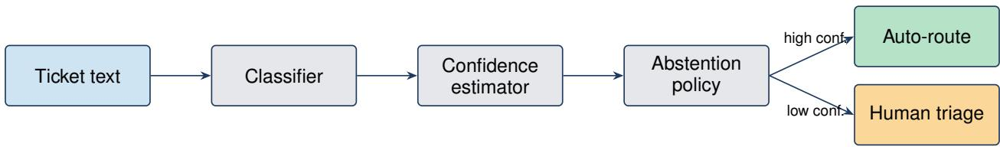
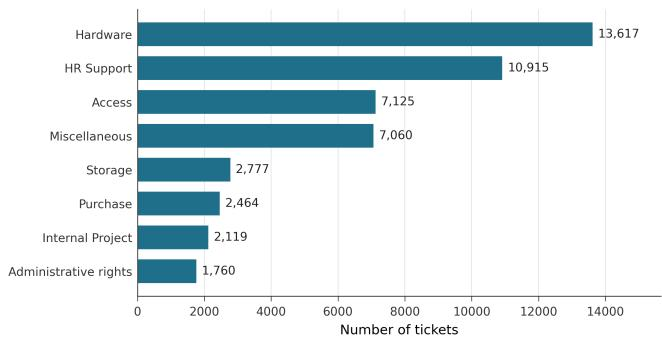
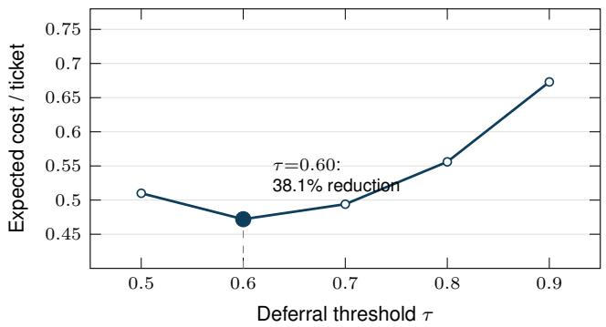
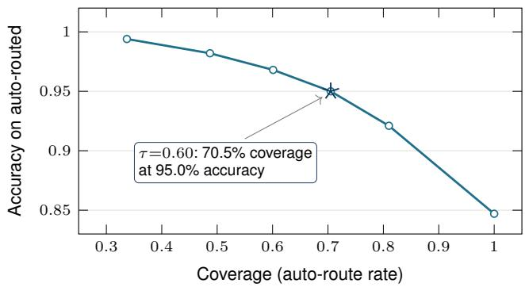
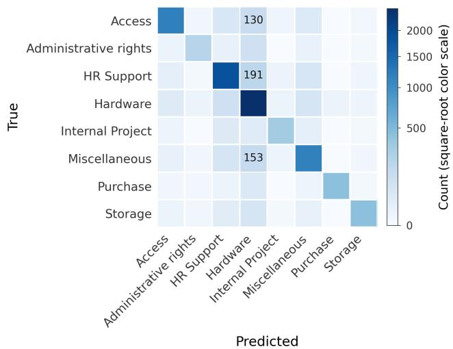

# Cost-Aware Abstention for LLM-Based IT Ticket Classification

Sachin Gupta

Independent Researcher

United States

sachinkg12@gmail.com

Abstract—Wrong automatic routing of an IT support ticket can cost more than human triage. We evaluate cost-aware abstention as an offline, cost-conditional readiness assessment: a routing policy is selected on calibration data under asymmetric costs and evaluated once on held-out test data. On a public 47,837- ticket, eight-class corpus, we compare four trained classifiers with four large language models under zero- and few-shot prompting. With illustrative per-ticket costs of zero for a correct route, one for human triage, and five for a wrong route, term-frequency– inverse-document-frequency logistic regression selects a threshold of 0.60 and reduces test cost from 0.763 to 0.472, a 38.1 % relative reduction (95 % bootstrap confidence interval, 35.7 %– 40.4 %), while lowering wrong routes from 15.3 % to 3.5 %. In a post-hoc 16-setting analysis, calibration-selected policies beat both always-route and always-defer in 14 settings. The strongest prompted configuration reaches 0.477 accuracy on a stratified 1,000-ticket subset, versus 0.879 for fine-tuned DistilBERT on the same tickets. Isotonic recalibration reduces expected calibration error but does not reliably improve ranking discrimination; one GPT-4o-mini setting emits a single confidence value and has correctness area under the receiver operating characteristic curve of 0.500. At the break-even probability of 0.80, seven prompted conditions defer every ticket, and Haiku few-shot routes 19 of 1,000. A language-model-only agreement control and margin- and entropy-based rejection scores for the logistic-regression baseline provide nontrivial comparators. The findings are scoped to this dataset, prompt design, model endpoints, and illustrative costs; the work is an evaluation framework, not a new abstention algorithm or universal deployment certification.

Index Terms—trustworthy machine learning, calibration, costaware abstention, selective prediction, large language models, text classification, IT service management

## I. INTRODUCTION

Enterprise IT service desks process tens of thousands of internal tickets per month, where the “customer” is an employee asking internal IT for help with hardware, access, or software (not an external consumer). HDI/MetricNet reports the North American average cost per voice IT service-desk ticket at US\$17.19, with walk-up tickets averaging US\$37.52 [1]. Routing happens under an asymmetric cost structure. Sending a ticket to the correct queue is nearly free. Sending it to a human triager is moderately costly. Sending it to the wrong queue is much more expensive once you account for handoff latency, double work, and missed service levels. Accuracy or macro-F1 alone cannot represent this asymmetry or indicate when to trust an automated decision [2], [3].

Two trends make this gap more pressing. First, large language models (LLMs) can be prompted as zero- or few-shot text classifiers [4], [5], potentially reducing the need for taskspecific training. Second, modern neural classifiers, including LLMs, are known to be poorly calibrated. They often produce high confidence values regardless of actual accuracy [6]–[9]. Together these trends raise a concrete operational question: should a prompted LLM be allowed to auto-route IT tickets, and if so, under what abstention policy?

We study this question on the public IT Service Ticket Classification Dataset (47,837 tickets, eight categories). We treat cost-aware abstention not as a way to improve a classifier but as an empirical readiness test under stated assumptions. Predictors, confidence estimators, rejection scores, and policies remain separate. Our contributions are:

1) A comparison of four trained non-LLM classifiers and eight prompted LLM conditions on the same public corpus, including a common 1,000-ticket test subset.

2) A calibration analysis that reports expected calibration error (ECE), correctness area under the receiver operating characteristic curve (AUROC), and tie-aware area under the risk–coverage curve (AURC), plus separate mixed (M=9) and LLM-only (M=8) agreement pools.

3) A calibration-selected, paired-bootstrap cost analysis with top-probability, probability-margin, and entropy rejection scores; a post-hoc 16-setting cost-parameter analysis; and LLM policies that use a cost-derived threshold rather than test tuning.

4) A reproducible evaluation framework and per-ticket artifacts that expose prediction, confidence, rejection, and cost as separately auditable stages.

The main observation is simple: abstention does not repair a weak classifier. It exposes when auto-routing is cost-preferred under a particular dataset, confidence signal, and cost model.

Positioning. The components we combine are individually established: Chow-style error-reject [3], Elkan-style costsensitive decision-making [10], ECE-based calibration diagnostics [6], [11], isotonic recalibration, and self-consistencyinspired agreement signals [12]. We introduce no new abstention algorithm. This paper’s contribution is an empirical evaluation of deployment-relevant assumptions and its reproducible implementation, not a universal readiness certificate.

## II. RELATED WORK

Selective prediction and abstention. The classical framework for rejecting uncertain inputs traces back to Chow’s error-reject trade-off [3]. It has been formalized for modern classifiers under the names selective prediction [2], [13] and learning with abstention [14]; a recent survey organizes LLM abstention methods, benchmarks, and evaluation metrics [15]. The closest line is learning to $d e f e r$ , where a classifier is trained jointly with the option to pass an instance to a human expert [16], [17]. Our training-free confidence-threshold policy addresses the same route-or-defer action space without joint training. We evaluate its decisions under an explicit cost model following Elkan’s cost-sensitive formulation [10].

Calibration and overconfidence. Guo et al. [6] documented systematic overconfidence in deep neural classifiers and popularized Expected Calibration Error (ECE) [11] as a diagnostic. A growing literature studies whether LLMs are well-calibrated [7]–[9], [18]. The broad finding is that verbalized confidence runs too high. We contribute a publicdataset measurement of LLM ECE in an asymmetric-cost classification setting, and report agreement-across-predictors as a confidence signal inspired by self-consistency [12].

LLMs for text classification. Off-the-shelf prompting of LLMs as classifiers [4], [5], [19] is operationally attractive, but on short, lexical-signal-heavy tasks strong classical text classifiers such as linear SVMs [20] remain highly competitive, as our IT-ticket results confirm (§V-A). Cost-driven LLM cascades and routing lower inference cost by escalating only hard inputs to a stronger model [21]; we instead hold the model fixed and use abstention to decide when not to auto-route at all. Our evaluation lands in the same mixed picture for the IT-ticket domain.

IT ticket classification. Automated routing of support tickets has a long applications-track history [22], [23] but is rarely evaluated under explicit cost models or with abstention. Our framework is structured as a deferral layer that could be integrated into an IT service management pipeline rather than as a new classifier.

## III. METHOD

## A. Problem setup

Let X be the space of ticket texts and Y a set of K disjoint downstream queues. A base classifier $h : \mathcal { X }  \mathcal { Y }$ emits a label. The policy-wrapped decision $d : \mathcal { X } \to \mathcal { Y } \cup \{ \perp \}$ either routes $h ( x )$ or abstains (⊥); abstained tickets go to a human triager. Each decision incurs one of three costs: $c _ { \mathrm { o k } }$ (correct auto-route), $c _ { \mathrm { t r i a g e } }$ (human triage), and $c _ { \mathrm { w r o n g } }$ (incorrect autoroute). The expected per-ticket cost is

$$
\begin{array} { r } { \mathbb { E } [ c ] = \mathbb { P } ( \bot ) c _ { \mathrm { t r i a g e } } + \mathbb { P } ( \mathrm { c o r r e c t } , \top \bot ) c _ { \mathrm { o k } } } \\ { + \mathbb { P } ( \mathrm { w r o n g } , \top \bot ) c _ { \mathrm { w r o n g } } . \qquad } \end{array}\tag{1}
$$

Our primary analysis uses $( c _ { \mathrm { o k } } , c _ { \mathrm { t r i a g e } } , c _ { \mathrm { w r o n g } } ) ~ = ~ ( 0 , 1 , 5 )$ These values are illustrative rather than calibrated to any single organization, but they encode the qualitative ordering that motivates abstention: a misroute is costlier than a human triage because it still incurs the triage after a delayed hand-off plus rework, whereas a correct auto-route is effectively free. Because the ratio is an assumption rather than a measured quantity, every deployment conclusion is conditional on it. Equation (2) shows how local costs determine the routing threshold; an organization must estimate its own triage and misroute costs before use. As a post-hoc sensitivity analysis, we also cross $c _ { \mathrm { t r i a g e } } ~ \in ~ \{ 0 . 5 , 1 , 1 . 5 , 2 \}$ with $c _ { \mathrm { w r o n g } } ~ \in$ $\{ 2 , 5 , 1 0 , 2 0 \}$ while fixing $c _ { \mathrm { o k } } = 0 .$ . The (2, 2) pair is an equalcost boundary; the other 15 pairs retain $c _ { \mathrm { w r o n g } } > c _ { \mathrm { t r i a g e } } .$

## B. Predictors

We evaluate four non-LLM baselines and four prompted LLMs.

Non-LLM baselines. TF-IDF (term frequency–inverse document frequency) uni- and bi-gram features feed three classifiers. Logistic regression and linear support vector machine (SVM) cap the vocabulary at 100,000 features; random forest caps it at 50,000. The headline baseline is multiclass logistic regression (LR; L2 regularization, $C { = } 1 . 0 )$ . The linear SVM head is a one-vs-rest linear support vector classifier (SVC) wrapped in sigmoid-calibrated probability outputs. The random forest head uses 300 trees with default depth. Separately, the fourth baseline fine-tunes DistilBERT (distilbert-base-uncased) on tokenized ticket text from the full training split for two epochs with batch size 32 and maximum sequence length 256. All four are fit on the same train split.

LLM predictors. Each LLM is queried per ticket with a structured prompt (template v1; the strict v2 is used only in §V-D) that lists the allowed labels, the ticket text, and an instruction to return JSON $\{ { \ " \mathrm { ~ l ~ a b e ~ l ~ } } { \ " } : \quad . \dots , \quad { \ " } _ { \mathrm { ~ C O n f ~ i d e n c e ~ } } { \ " } : \quad . \dots \}$ Fewshot variants prepend k=3 exemplars per class (24 in total, class-balanced across the eight categories), drawn only from the training split. The main prompts contain label names and examples but no natural-language category definitions; the comparison therefore characterizes these prompting conditions, not each LLM’s intrinsic capability. We use temperature 0 and max\_tokens=64 for all main runs. Out-of-set labels are tagged as invalid; malformed JSON is tagged as a parse error. Both invalid labels and parse errors are scored as incorrect predictions and assigned confidence 0; the threshold policies defer such rows rather than auto-route them, while always\_route, by definition, routes them and incurs $c _ { \mathrm { w r o n g } } .$ The four models are GPT-4o-mini [24], Claude Haiku 4.5 [25], Qwen2.5-7B-Instruct [26], and Llama-3-8B-Instruct-Lite [27]. GPT-4o-mini and Claude Haiku are queried through their vendor $\mathrm { \ A P I s . ^ { 1 } }$ The open-weights models use Together AI endpoints Qwen2.5-7B-Instruct-Turbo and Meta-Llama-3-8B-Instruct-Lite, providerdocumented at query time as 8-bit floating point (FP8) and 4-bit integer (INT4), respectively; precision is absent from our saved responses and is not independently verified. We re-run the model families through DeepInfra (provider-documented bfloat16, or BF16) as a cross-provider check that does not isolate quantization; our conclusions are unchanged (§V-E).

## C. Confidence and rejection scores

We evaluate probability estimates and ranking signals separately.

Model-reported. For a non-LLM baseline this is the maximum class-probability estimate returned by that model: multinomial probabilities for logistic regression, sigmoid-calibrated outputs for the SVM, tree-vote fractions for the random forest, and softmax for DistilBERT. For LLMs it is the confidence field parsed from the JSON output.

Cross-predictor agreement. Given M predictors evaluated on the same ticket, the agreement-confidence for the primary predictor is the fraction of the M predictors that emit the same label. No held-out labels are used to compute this score at application time. In our mixed configuration M=9: the four LLMs in zero-shot and few-shot settings (eight prompted variants) plus the classical TF-IDF + LR baseline. Because this pool mixes the eight LLM variants with the stronger classical baseline, an LLM’s agreement partly reflects concordance with a more accurate supervised predictor, not peer consensus alone. We therefore also report an LLM-only M=8 control. Operational trade-off: agreement requires running all M predictors at inference. Because the pool is heterogeneous, its dollar cost and latency depend on the endpoints and are not necessarily M× those of the primary alone. Isotonic incurs one calibration-time pass per prompted predictor and a constant-time lookup at inference.

Isotonic regression on a held-out calibration split. LLMemitted confidence fields are bounded in [0, 1] but are not logits, so parametric Platt or temperature scaling do not apply cleanly. We instead fit one isotonic regression per prompted LLM condition on the calibration split: pairs $\{ ( c _ { i } , { \bf 1 } [ \hat { y } _ { i } ] =$ $y _ { i } ] ) \}$ of raw confidence and ground-truth correctness, mapped via sklearn.isotonic.IsotonicRegression [28] (monotone non-decreasing, output clipped to [0, 1]) into a recalibration c 7→ Pr(ˆ correct). For each LLM predictor we fit on a stratified 500-ticket subsample of the calibration split (4,000 calibration queries across the 8 prompted variants). Calibration and test splits are disjoint: the isotonic mapping is learned only from calibration pairs and applied unchanged to test confidences. ECE is computed with 10 equal-width bins on test predictions.

Discrimination metrics. ECE measures probability-level calibration but not whether confidence ranks correct predictions above errors. We therefore report correctness AUROC (ties receive half credit) and area under the risk–coverage curve (AURC; lower is better). Since LLM scores contain many ties, our AURC adds each equal-score group as a block and integrates the right-continuous risk step, avoiding arbitrary ordering within ties.

Nontrivial rejection comparators. For TF-IDF + LR we also use the top-two probability margin $p _ { ( 1 ) } - p _ { ( 2 ) }$ and normalized inverse entropy $1 - H ( p ) / \log K$ . Each score’s threshold is selected on calibration over a 0.01-spaced grid in [0, 1] and then evaluated once on test.

## D. Abstention policies

For the primary non-LLM analysis we compare always\_route (route every ticket) with threshold@τ for $\tau \in \ \{ 0 . 5 , 0 . 6 , 0 . 7 , 0 . 8 , 0 . 9 \}$ (route if conf $\geq \tau ,$ defer otherwise). Where stated, we also use the trivial always\_defer reference policy, which defers every ticket at cost $c _ { \mathrm { t r i a g e } }$ by construction. It appears in the LLM breakeven comparison and the post-hoc cost grid; the primary non-LLM analysis uses always\_route as its baseline. Cross-predictor agreement enters our experiments only as a confidence estimator (above), not as a deferral policy.

Threshold selection. Non-LLM operating points are selected on the calibration split under the configured cost model. The best threshold over the stated grid, $\tau ^ { * } = \arg \operatorname* { m i n } _ { \tau } \mathbb { E } _ { \mathrm { c a l i b } } [ c \ |$ $\tau ] .$ , is then evaluated once on the held-out test split. For the classical TF-IDF + LR baseline this procedure selects $\tau ^ { * } = 0 . 6 0$ (calibration costs at $\tau \in \{ 0 . 5 , 0 . 6 , 0 . 7 , 0 . 8 , 0 . 9 \}$ are $\{ 0 . 4 9 3 , 0 . 4 6 1 , 0 . 4 7 7 , 0 . 5 3 7 , 0 . 6 5 4 \}$ ). Calibration and test splits are disjoint by construction.

For each post-hoc cost-sensitivity setting, we select on calibration among always\_route, always\_defer, and thresholds from 0.01 to 0.99 in steps of 0.01, then evaluate the frozen choice once on test. For exact calibrationcost ties, the deterministic order is always\_route, then always\_defer, then the smallest threshold among tied threshold policies.

For LLMs we do not select a threshold on test. If an isotonic score is interpreted as $p = { \mathrm { P r } } ( { \mathrm { c o r r e c t } } )$ , auto-routing is costpreferred when

$$
p c _ { \mathrm { o k } } + ( 1 - p ) c _ { \mathrm { w r o n g } } \leq c _ { \mathrm { t r i a g e } } ,\tag{2}
$$

which gives the fixed break-even threshold $p ~ \geq ~ 0 . 8 0$ under $( 0 , 1 , 5 )$ . Raw verbalized scores are not treated as probabilities for policy optimization.

## E. Modular evaluation pipeline

Predictors, confidence estimators, abstention policies, and the cost model are separated by interfaces. Registry-based predictor addition does not require changing the evaluator; other extension types require explicit builder or policy-set wiring in the current code. Fig. 1 shows the flow.

## IV. EXPERIMENTAL SETUP

## A. Dataset and splits

We use the public IT Service Ticket Classification Dataset [29]: 47,837 tickets, 8 categories (Access, Administrative rights, HR Support, Hardware, Internal Project, Miscellaneous, Purchase, Storage), median ticket length 175 characters, maximum/minimum class size 13,617 / 1,760 (7.74× imbalance; Fig. 2). We use a stratified 70/10/20 train/calibration/test split (Table I). Few-shot exemplars are drawn only from the training split. The dataset is publicly available on Kaggle under its posted terms. We use that preprocessed public release. The complete dataset and perticket text arrays are not redistributed in the camera-ready artifacts; only three brief illustrative excerpts from the public dataset are quoted in Section V-F. Each dataset row pairs a short internal IT request with a category label.

  
Fig. 1. Evaluation pipeline from ticket text to auto-routing or human triage, with prediction, confidence estimation, and abstention separated.

TABLE I  
DATASET SUMMARY (PUBLIC IT SERVICE TICKET CLASSIFICATION DATASET).
<table><tr><td>Property</td><td>Value</td></tr><tr><td># tickets</td><td>47,837 8</td></tr><tr><td># classes</td><td></td></tr><tr><td>Train / Calib. / Test</td><td>33,486 / 4,784 /  9,567</td></tr><tr><td>Median ticket length (chars) Class imbalance (max/min)</td><td>175 7.74×</td></tr></table>

TABLE II  
NON-LLM BASELINES ON THE LLM TEST SUBSET (n = 1,000).
<table><tr><td>Baseline (on 1,000-ticket subsample)</td><td>Acc.</td><td>Macro-F1</td><td>ECE-raw</td></tr><tr><td>TF-IDF + LR</td><td>0.847</td><td>0.842</td><td>0.111</td></tr><tr><td>TF-IDF + Linear SVM</td><td>0.867</td><td>0.869</td><td>0.056</td></tr><tr><td>TF-IDF + Random Forest</td><td>0.804</td><td>0.791</td><td>0.172</td></tr><tr><td>DistilBERT (fine-tuned)</td><td>0.879</td><td>0.883</td><td>0.043</td></tr></table>

## B. Test subsample for LLM predictors

Per-call API budget makes evaluating all four LLMs on the full 9,567-ticket test set impractical. The 8 LLM configurations alone issue 8,000 test queries on the subsample described below, and scaling to the full test set would multiply that by an order of magnitude. LLMs are therefore evaluated on a stratified 1,000-ticket subsample (seed 42). To assess whether that subset preserves the non-LLM baseline ordering, we re-evaluate every non-LLM baseline on the same 1,000- ticket subsample (Table II). Subsample and full-test numbers differ by at most 1.6 percentage points for every baseline. The strongest non-LLM baseline (DistilBERT) reaches 0.879 accuracy on the subsample, versus 0.477 for the best LLM on the same tickets, confirming the same ordering on identical examples.

## C. Reproducibility

Runs save configuration, seeds, dataset and split hashes, package versions, and per-ticket outputs. Intervals use 1,000 paired resamples with seed 1337; reported percentage reductions recompute the ratio inside each resample. The public project repository is https://github. com/sachinkg12/RouteGuard; the frozen camera-ready claim manifest, automated recomputation receipt from a separate verification script, tables, text-free per-ticket vectors, and code snapshot are archived as a versioned series at doi:10.5281/zenodo.22609128. The supplement pins the verified x86-64/Python 3.14 environment because estimator refits can vary slightly across architectures; the frozen prediction vectors remain the audit record.

## V. RESULTS

## A. Base-classifier predictive performance

We compare four non-LLM baselines against eight prompted hosted LLM configurations (Table III). Among non-LLM baselines the fine-tuned encoder is strongest. DistilBERT reaches accuracy 0.877 and macro-F1 0.874 on the full 9,567- ticket test set after two epochs of training on a single GPU with batch size 32 and maximum sequence length 256. The next non-LLM baseline is a sigmoid-calibrated linear SVM over TF-IDF features (accuracy 0.863, macro-F1 0.864), followed by the TF-IDF + logistic regression baseline (0.847 / 0.842) and a TF-IDF random forest (0.818 / 0.806).

The best prompted LLM is Claude Haiku 4.5 with k=3 few-shot prompting at 0.477/0.459. GPT-4o-mini few-shot follows (0.459 / 0.450), then Qwen2.5-7B-Instruct few-shot (0.447 / 0.454) and Llama-3-8B-Instruct-Lite zero-shot (0.378 / 0.284). On the common 1,000-ticket subset, DistilBERT reaches 0.879 and Haiku few-shot 0.477, so the measured gap is not caused by different test examples. It is not, however, a pure capability comparison: the trained models learn the taxonomy from 33,486 labeled tickets, whereas the prompted LLMs receive label names and, at most, 24 examples without category definitions. Ambiguous labels such as Miscellaneous, Internal Project, and Administrative rights make that distinction material. We therefore scope the result to these training and prompt-information regimes.

Few-shot prompting helps three of the four LLMs but hurts Llama-3-8B-Instruct-Lite by 12.3 percentage points. Inspection of the raw outputs shows that the model often emits a conversational preamble (“I’ll classify the ticket and return the JSON.”) that uses up the output budget before any JSON is emitted, which produces a 15.1 % parse-error rate.2 We dig into this in §V-D.

  
Fig. 2. Class distribution of the 47,837-ticket corpus across the eight categories.

## B. Is the confidence signal useful?

Every prompted LLM is overconfident: raw ECE spans [0.332, 0.594], and GPT-4o-mini few-shot assigns confidence 1.000 to every ticket despite 0.459 accuracy. Isotonic regression fitted on the disjoint calibration subset reduces LLM ECE to [0.014, 0.049], an 86–98 % relative reduction.

That ECE result must not be read as improved error ranking. Isotonic is monotone and changes correctness AUROC by at most 0.007 in these runs; AURC also does not improve consistently (Table III). The limiting example is GPT-4o-mini few-shot: raw confidence is the constant 1.000, isotonic maps it to the constant 0.480, and both correctness AUROC and AURC remain 0.500 and 0.541. Isotonic corrects the probability level by mapping a non-discriminative score to the base accuracy; it does not create information that was absent from the score.

Agreement can carry ranking signal, but the voter pool matters. Table IV separates the mixed M=9 pool from the LLMonly M=8 control. The M=8 correctness AUROC spans 0.590–0.773, descriptive evidence that peer-only agreement contains ranking signal on these data. Its ECE also improves over raw confidence in all eight conditions, but ECE alone would not establish discrimination. The mixed pool is better in every listed ECE and AUROC cell, but it includes the supervised TF-IDF + LR vote. Thus M=9 uses no held-out calibration labels when a score is computed, yet it is not free of supervised information. It also requires all predictors at inference.

## C. Which routing policy is cost-preferred?

a) Headline result on the classical baseline: We illustrate the cost framework on the TF-IDF + LR baseline because it is the simplest and most reproducible substrate. The same machinery applies to any predictor in Table III: stronger non-LLM baselines (DistilBERT, linear SVM) defer less aggressively but follow the same qualitative shape, since they enter the cost calculation through a better-calibrated, more accurate confidence signal.

At the illustrative cost setting (0, 1, 5), the calibrationselected threshold $\tau ^ { * } = 0 . 6 0$ reduces expected cost per ticket from 0.763 to 0.472 on the held-out test split, a relative reduction of 38.1 % (95 % paired-bootstrap CI [35.7 %, 40.4 %]). The ratio is recomputed inside each paired bootstrap resample; the corresponding absolute cost difference is −0.291 (95 % CI [−0.318, −0.263]) per ticket. The wrong-route rate drops from 15.3 % to 3.5 % while the system still auto-routes 70.5 % of tickets at 95.0 % on-routed accuracy (Fig. 4). The evaluated cost points form a U-shape with a minimum at $\tau ^ { * }$ (Table ${ \mathrm { V } } ,$ Fig. 3), and the bootstrap interval excludes zero by a wide margin (Table VI).

b) Cost analysis is consistent across non-LLM baselines: We re-run the same procedure (per-model calibration-selected $\tau ^ { * }$ , evaluated on the held-out test split) for the SVM, randomforest, and DistilBERT baselines. Table VI reports the results. The relative cost reduction at each model’s $\tau ^ { * }$ clusters in a narrow band of 35.5 to 38.1 %, with overlapping bootstrap intervals, even though the always-route baseline cost varies substantially (from 0.615 for DistilBERT to 0.910 for the random forest) and the selected $\tau ^ { * }$ varies from 0.60 to 0.90: LR and random forest select 0.60, SVM selects 0.70, and DistilBERT selects 0.90. Because these thresholds also depend on each model’s score scale and calibration, they do not establish a general relationship between accuracy and threshold. DistilBERT’s choice is the edge value on the predeclared grid. A post-hoc 0.01-spaced sensitivity sweep moves the calibration choice to 0.94 and gives test cost 0.401 (34.7 % reduction), close to the primary 0.396 (35.5 %) result. Thus grid density changes the operating point but not the qualitative conclusion; the dense sweep does not replace the predeclared analysis.

c) Cost-parameter sensitivity: Table VII varies both uncertain costs while selecting one policy per setting on calibration. A threshold policy is selected in 15 of 16 settings. On held-out test data, the frozen choice costs less than both trivial policies in 14 settings, and all 14 paired ratiobootstrap 95 % intervals exclude zero. At the equal-cost (2, 2) boundary, calibration selects always\_route. At (1.5, 2), the calibration-selected threshold is 0.2 % costlier than the lower-cost trivial test comparator, illustrating finite-split selection variation rather than a universal gain. As the wrong-route cost grows relative to triage, the selected threshold generally rises. The (1, 5) cell uses the post-hoc dense grid and therefore matches the 36.9 % top-probability result in Table VIII; it does not replace the primary five-threshold 38.1 % result.

d) Rejection-score comparators: Table VIII compares rejection scores. Its post-hoc 0.01-grid top-probability threshold (0.65) yields 36.9 % on test, versus 38.1 % at 0.60 on the primary predeclared grid; this calibration-to-test variation does not replace the primary result. Margin is slightly better and entropy worse, but each CI overlaps the top-probability CI. Because the intervals are not paired between rules, their ordering is descriptive. All three reduce cost.

TABLE III  
CLASSIFICATION AND CONFIDENCE RESULTS. NON-LLM: FULL TEST; LLM: COMMON 1,000-TICKET SUBSET. r/i: RAW/ISOTONIC (FIT ON CALIBRATION); ECE AND TIE-GROUP AURC ↓, AUROC ↑. BOLD MARKS THE BEST VALUE PER METRIC WITHIN EACH EVALUATION BLOCK.
<table><tr><td>Model</td><td>Setting Acc.</td><td>Macro-F1</td><td></td><td>ECEr</td><td>ECEi</td><td> $\mathbf { A U R O C } _ { r }$ </td><td>AUROCi</td><td>AURCr</td><td>AURCi</td></tr><tr><td> $\mathrm { T F \mathrm { - } I D F + L R }$ </td><td>classical</td><td>0.847</td><td>0.842</td><td>0.107</td><td></td><td></td><td></td><td></td><td></td></tr><tr><td>TF-IDF + Linear SVM</td><td>classical</td><td>0.863</td><td>0.864</td><td>0.046</td><td></td><td></td><td></td><td></td><td></td></tr><tr><td>TF-IDF + Random Forest</td><td>classical</td><td>0.818</td><td>0.806</td><td>0.182</td><td></td><td></td><td></td><td></td><td></td></tr><tr><td>DistilBERT (fine-tuned)</td><td>classical</td><td>0.877</td><td>0.874</td><td>0.041</td><td></td><td></td><td></td><td></td><td></td></tr><tr><td>Claude Haiku 4.5</td><td>few-shot</td><td>0.477</td><td>0.459</td><td>0.386</td><td>0.035</td><td>0.664</td><td>0.659</td><td>0.417</td><td>0.430</td></tr><tr><td>GPT-4o-mini</td><td>few-shot</td><td>0.459</td><td>0.450</td><td>0.541</td><td>0.021</td><td>0.500</td><td>0.500</td><td>0.541</td><td>0.541</td></tr><tr><td>Qwen2.5-7B-Instruct</td><td>few-shot</td><td>0.447</td><td>0.454</td><td>0.524</td><td>0.049</td><td>0.509</td><td>0.509</td><td>0.548</td><td>0.549</td></tr><tr><td>Llama-3-8B-Inst.-Lite</td><td>zero-shot</td><td>0.378</td><td>0.284</td><td>0.428</td><td>0.025</td><td>0.513</td><td>0.513</td><td>0.616</td><td>0.616</td></tr><tr><td>GPT-4o-mini</td><td>zero-shot</td><td>0.376</td><td>0.372</td><td>0.456</td><td>0.030</td><td>0.655</td><td>0.655</td><td>0.537</td><td>0.537</td></tr><tr><td>Claude Haiku 4.5</td><td>zero-shot</td><td>0.360</td><td>0.364</td><td>0.332</td><td>0.047</td><td>0.671</td><td>0.678</td><td>0.526</td><td>0.541</td></tr><tr><td>Qwen2.5-7B-Instruct</td><td>zero-shot</td><td>0.355</td><td>0.363</td><td>0.468</td><td>0.032</td><td>0.555</td><td>0.555</td><td>0.619</td><td>0.618</td></tr><tr><td>Llama-3-8B-Inst.-Lite</td><td>few-shot</td><td>0.255</td><td>0.266</td><td>0.594</td><td>0.014</td><td>0.601</td><td>0.601</td><td>0.706</td><td>0.706</td></tr></table>

TABLE IV

MIXED AND LLM-ONLY AGREEMENT CONTROLS ON THE COMMON 1,000-TICKET TEST SUBSET. THE MIXED M=9 POOL ADDS SUPERVISED TF-IDF + LR TO THE EIGHT PROMPTED CONDITIONS.
<table><tr><td>Model</td><td>Setting</td><td> $\mathrm { E C E } _ { M 9 }$ </td><td> $\mathrm { E C E } _ { M 8 }$ </td><td> $\mathbf { A U R O C } _ { M 9 }$ </td><td> $\mathbf { A U R O C } _ { M 8 }$ </td></tr><tr><td>Claude Haiku 4.5</td><td>few-shot</td><td>0.148</td><td>0.210</td><td>0.692</td><td>0.590</td></tr><tr><td>GPT-4o-mini</td><td>few-shot</td><td>0.205</td><td>0.239</td><td>0.707</td><td>0.593</td></tr><tr><td>Qwen2.5-7B-Instruct</td><td>few-shot</td><td>0.196</td><td>0.238</td><td>0.708</td><td>0.603</td></tr><tr><td>Llama-3-8B-Inst.-Lite</td><td>zero-shot</td><td>0.193</td><td>0.209</td><td>0.750</td><td>0.658</td></tr><tr><td>GPT-4o-mini</td><td>zero-shot</td><td>0.271</td><td>0.305</td><td>0.800</td><td>0.694</td></tr><tr><td>Claude Haiku 4.5</td><td>zero-shot</td><td>0.251</td><td>0.283</td><td>0.814</td><td>0.721</td></tr><tr><td>Qwen2.5-7B-Instruct</td><td>zero-shot</td><td>0.264</td><td>0.299</td><td>0.814</td><td>0.718</td></tr><tr><td>Llama-3-8B-Inst.-Lite</td><td>few-shot</td><td>0.212</td><td>0.239</td><td>0.840</td><td>0.773</td></tr></table>

TABLE V

TF-IDF + LR TEST COST UNDER (0, 1, 5). BOLD MARKS THECALIBRATION-SELECTED OPERATING POINT; REDUCTIONS ARE RELATIVE$\mathrm { T O ~ \mathbb { A } \mathbb { L } W \mathbb { A } Y \mathbb { S } \_ R O U T E } .$
<table><tr><td>Policy</td><td> $\mathbb { E } [ c ]$ </td><td>Reduction %</td><td>Cov. %</td><td>Acc. %</td></tr><tr><td>always_route</td><td>0.763</td><td></td><td>100.0</td><td>84.7</td></tr><tr><td>threshold@0.50</td><td>0.510</td><td>33.1</td><td>81.0</td><td>92.1</td></tr><tr><td>threshold@0.60</td><td>0.472</td><td>38.1</td><td>70.5</td><td>95.0</td></tr><tr><td>threshold@0.70</td><td>0.494</td><td>35.2</td><td>60.1</td><td>96.8</td></tr><tr><td>threshold@0.80</td><td>0.556</td><td>27.2</td><td>48.7</td><td>98.2</td></tr><tr><td>threshold@0.90</td><td>0.673</td><td>11.8</td><td>33.7</td><td>99.4</td></tr></table>

TABLE VI

NON-LLM TEST COSTS AT CALIBRATION-SELECTED THRESHOLDS UNDER (0, 1, 5). $\mathbb { E } [ c ] _ { \mathrm { a } } \colon$ ALWAYS-ROUTE COST; WR.: POST-THRESHOLD WRONG-ROUTE RATE; RATIO-BOOTSTRAP 95 % CIS.
<table><tr><td>Baseline</td><td> $\tau ^ { * }$ </td><td> $\mathbb { E } [ c ] _ { \mathrm { a } }$ </td><td> $\mathbb { E } [ c ] _ { \tau ^ { * } }$ </td><td>Reduction %</td><td>95 % CI</td><td>Wr.%</td></tr><tr><td>TF  $- \mathrm { I D F } + \mathrm { L R }$ </td><td>0.60</td><td>0.763</td><td>0.472</td><td>38.1</td><td>[35.7,40.4]</td><td>3.5</td></tr><tr><td>TF-IDF + Linear SVM</td><td>0.70</td><td>0.687</td><td>0.434</td><td>36.7</td><td>[34.3, 39.1]</td><td>3.7</td></tr><tr><td>TF-IDF + Random Forest</td><td>0.60</td><td>0.910</td><td>0.571</td><td>37.3</td><td>[35.0, 39.5]</td><td>2.1</td></tr><tr><td>DistilBERT (fine-tuned)</td><td>0.90</td><td>0.615</td><td>0.396</td><td>35.5</td><td>[32.9, 38.2]</td><td>3.3</td></tr></table>

e) LLM break-even policies: We evaluate the isotonic scores at the break-even probability 0.80 derived in (2); it is fixed by the cost model, not selected from test outcomes. Seven of eight prompted conditions route 0/1,000 tickets and therefore equal the always-defer cost of 1.0. Claude Haiku few-shot routes 19/1,000 (1.9 % coverage); all 19 are correct, giving cost 0.981 and a 1.9 % reduction versus always-defer (paired ratio-bootstrap 95 % CI [1.1 %, 2.8 %]). Because all 19 routed tickets are correct, this bootstrap interval reflects observed coverage variation and cannot generate an unseen routed error. The exact binomial 95 % CI for routed accuracy is [82.4 %, 100 %], with its lower bound only 2.4 percentage points above the 80 % break-even. This is a low-coverage observation, not evidence of a broadly useful LLM routing policy. Raw verbalized confidence is not used for this decision because its probability interpretation is contradicted by the ECE results.

  
Fig. 3. TF-IDF + LR test cost over the predeclared threshold grid under (0, 1, 5). The calibration-selected τ = 0.60 yields a 38.1 % reduction (95 % CI [35.7 %, 40.4 %]).

The outcome is conditional on (0, 1, 5). Different local costs move the analytic break-even point, and local prevalence or drift can change calibration. We therefore treat defer-all as the go/no-go outcome for seven evaluated LLM conditions, not as a universal claim about these model families.

TABLE VII  
POST-HOC TF-IDF + LR COST-PARAMETER SENSITIVITY. FOR EACH SETTING, ONE POLICY IS SELECTED ON CALIBRATION OVER ALWAYS\_ROUTE, ALWAYS\_DEFER, AND THRESHOLDS 0.01–0.99, THEN EVALUATED ONCE ON TEST. CELLS SHOW POLICY / TEST E[c] / REDUCTION RELATIVE TO THE LOWER-COST TRIVIAL TEST COMPARATOR. NEGATIVE REDUCTION DENOTES HIGHER COST. T@X ABBREVIATES THRESHOLD@X; † MARKS THE EQUAL-COST BOUNDARY.
<table><tr><td> $c _ { \mathrm { t r i a g e } } \backslash c _ { \mathrm { w r o n g } }$ </td><td>2</td><td>5</td><td>10</td><td>20</td></tr><tr><td>0.5</td><td> $\pm ( \sharp 0 . 5 5 / 0 . 2 2 0 / 2 7 . 9 \%$ </td><td>t @0 .71 / 0.293 / 41.4%</td><td>t@0.79 / 0.342 / 31.6%</td><td>t@0.88 / 0.374 / 25.2%</td></tr><tr><td>1.0</td><td> $\pm ( \sharp 0 . 3 9 / 0 . 2 9 8 / 2 . 4 \%$ </td><td>t @0 . 65 / 0.482 / 36.9%</td><td> $\pm ( \sharp 0 . 7 1 / 0 . 5 8 6 / 4 1 . 4 \%$ </td><td>t @0.79 / 0.684 / 31.6%</td></tr><tr><td>1.5</td><td> $\pm \emptyset 0 . 2 2 / 0 . 3 0 6 / - 0 . 2 \%$ </td><td>t@0 .53 / 0.606 / 20.6%</td><td> $\pm ( \ell { 0 } . 6 5 / 0 . 7 8 9 / 4 7 . 4 \%$ </td><td>t @0 .79 / 0.934 / 37.7%</td></tr><tr><td>2.0</td><td>always_route† / 0.305 / 0.0%</td><td> $\pm ( \sharp 0 . 4 2 / 0 . 6 9 8 / 8 . 5 \%$ </td><td> $\pm ( \ell 0 . 6 5 \mathrm { ~ / ~ } 0 . 9 6 3 \mathrm { ~ / ~ } 3 6 . 9 \%$ </td><td> $\pm ( \sharp 0 . 7 1 / 1 . 1 7 3 / 4 1 . 4 \%$ </td></tr></table>

TABLE VIII

TF-IDF + LR REJECTION SCORES UNDER (0, 1, 5). THRESHOLDS ARE SELECTED ON CALIBRATION OVER A 0.01 GRID AND EVALUATED ON TEST. COST REDUCTIONS AND PAIRED RATIO-BOOTSTRAP 95 % CIS ARE RELATIVE TO ALWAYS-ROUTE.
<table><tr><td>Score</td><td>*</td><td>E[c]</td><td>Reduction %</td><td>95 %CI</td><td>Cov. %</td></tr><tr><td>Top probability</td><td>0.65</td><td>0.482</td><td>36.9</td><td>[34.2, 39.3]</td><td>65.2</td></tr><tr><td>Top-two margin</td><td>0.43</td><td>0.467</td><td>38.8</td><td>[36.5, 41.1]</td><td>68.5</td></tr><tr><td>Inverse entropy</td><td></td><td>0.44 0.507</td><td>33.6</td><td>[30.8, 36.2]</td><td>68.3</td></tr></table>

  
Fig. 4. TF-IDF + LR coverage–accuracy curve. The marked calibrationselected point routes 70.5 % of test tickets at 95.0 % accuracy.

## D. Prompt/budget sensitivity

We probe the brittleness seen in §V-A by comparing two joint prompt/output-budget configurations on Llama-3-8B-Instruct-Lite, evaluated on a stratified 200-ticket subsample (Table IX). The two configurations change the prompt template and the token budget together: v1/64 (the verbose main-run prompt at a 64-token cap) versus v2/128 (a stricter “JSONonly, no preamble” prompt at a 128-token cap), so the experiment measures their combined effect rather than isolating prompt format. Switching from v1/64 to v2/128 removes few-shot parse errors (18.5 % to 0 %) and improves fewshot accuracy by +7.5 percentage points. The same change hurts zero-shot accuracy by −9.5 percentage points, as the model instead falls back to the catch-all Miscellaneous label on 77.5 % of inputs. No single configuration wins across both settings for this model. This setting-dependent sensitivity is another operational reason to place a deferral guardrail around this evaluated Llama configuration rather than autoroute unguarded.

TABLE IX  
JOINT PROMPT/BUDGET SENSITIVITY FOR LLAMA-3-8B ON A 200-TICKET SUBSET. TEMPLATE AND TOKEN BUDGET CHANGE TOGETHER. BOLD MARKS THE HIGHER ACCURACY WITHIN EACH ZERO-/FEW-SHOT PAIR.
<table><tr><td>Setting</td><td></td><td>Prompt Max tok.</td><td>Acc.</td><td>Macro-F1</td><td>Parse err.</td></tr><tr><td>zero-shot</td><td>v1</td><td>64</td><td>0.345</td><td>0.245</td><td>0.000</td></tr><tr><td>zero-shot</td><td>v2</td><td>128</td><td>0.250</td><td>0.197</td><td>0.000</td></tr><tr><td>few-shot</td><td>v1</td><td>64</td><td>0.245</td><td>0.271</td><td>0.185</td></tr><tr><td>few-shot</td><td>v2</td><td>128</td><td>0.320</td><td>0.289</td><td>0.000</td></tr></table>

## E. Alternate-provider/precision check

The primary open-model endpoints were documented by Together as FP8 and INT4; response metadata did not record precision (§III). We re-ran the corresponding model families through DeepInfra, documented by that provider as BF16, on the same 1,000-ticket subsample ( Qwen/Qwen2.5-7B-Instruct and meta-llama/Meta-Llama-3-8B-Instruct, queried 2026-07-17, temperature 0, max\_tokens=64, same v1 template). Because provider and provider-documented precision changed together, this is not a controlled quantization ablation. Qwen barely moves (zero-shot 0.355 → 0.369, few-shot 0.447 → 0.459; parse errors 0 % throughout). Llama moves more and unevenly: few-shot recovers substantially (0.255 → 0.409, with the parse-error rate falling 15.1 → 3.3 %) despite the unchanged v1/64 prompt/output-budget configuration, while zero-shot does not improve $( 0 . 3 7 8  0 . 3 1 9 ;$ parse errors 0 → 0.8 %). The best alternate-provider open-model result (0.459) still trails the best prompted LLM (Claude Haiku few-shot, 0.477) and remains far below the classical baselines, so our conclusions are unchanged.

## F. Error analysis

The most frequent confusion pair for the TF-IDF + LR baseline is HR Support → Hardware (191 tickets), followed by Miscellaneous → Hardware (153) and Access → Hardware (130). These are typically short tickets with generic IT vocabulary that lacks the lexical anchors this model relies on. Fig. 5 shows its confusion matrix without abstention.

LLM errors show two recurring prediction patterns plus one configuration-specific parsing failure:

  
Fig. 5. TF-IDF + LR confusion matrix without abstention on the full test set (n = 9,567). Color uses a square-root count scale; the three largest offdiagonal cells are labeled.

(a) Catch-all over-prediction. In 7 of 8 LLM variants, the destination in the most frequent wrong class pair is Miscellaneous; in the remaining one (Haiku few-shot) it is Access. Short, generic tickets also default to these catch-alls (e.g. Llama few-shot routes 72 true-Access tickets to Miscellaneous, such as “password hello please help passwords guest thank”).

(b) Surface-keyword bias. LLMs latch onto single tokens without context. Llama zero-shot routes 80 true-Access tickets to Hardware (e.g. “visual studio professional license”), and Qwen zero-shot routes 58 true-Hardware tickets to Access (e.g. “weekend access and for the event”).

(c) Parse failures (Llama few-shot only). At the 64-token output budget the model emits a conversational preamble that exhausts the budget before any JSON is produced (15.1 % parse-error rate). §V-D analyzes this prompt/output-budget sensitivity. Because the LLM scores rank errors weakly, the conservative LLM policy avoids most of these errors mainly by deferring nearly all traffic; we do not claim that modes (a)–(b) are reliably assigned low scores.

## VI. DISCUSSION

## A. Cost-aware abstention is a guardrail, not a fix

Under the evaluated data and (0, 1, 5) costs, thresholds selected on calibration data reduce modeled cost for all four trained classifiers. The fixed break-even rule instead defers all traffic for seven prompted LLM conditions. This does not improve those classifiers; it prevents their weak or nondiscriminative confidence signals from becoming automatic routing errors.

ECE and discrimination answer different questions. Isotonic can correct average probability levels without consistently improving AUROC or AURC. Agreement can add ranking signal, but the stronger mixed pool imports supervised information, requires multiple predictor evaluations, and increases cost and latency. The margin and entropy comparators show that the cost result is not specific to one rejection score. The post-hoc cost grid further shows that the qualitative benefit is not confined to (0, 1, 5), while its one slight held-out reversal reinforces the need to freeze policy choices before test evaluation.

## B. Implications for deployment

The framework could be integrated into an IT service management pipeline as a deferral layer, subject to operational validation. Here, “readiness” remains conditional: an operator must estimate local costs, reserve calibration data, freeze the policy, and monitor drift. Defer-all is a warning under those inputs, not a permanent verdict about a model family. The framework is agnostic to how the underlying classifier was produced.

## C. Limitations and threats to validity

Internal: label noise, prompt/output-budget sensitivity, and remote-endpoint change remain possible despite temperature 0. The LLMs saw names and at most three examples per class, not label definitions or fine-tuning; the observed accuracy gap therefore mixes model behavior with unequal taxonomy access. A definition-rich prompt is an important future control, but rerunning changed proprietary endpoints would not be directly comparable to the frozen May 2026 outputs. External: generalization to private enterprise corpora is not established, and the cost model is illustrative: real cost parameters need to be estimated per organization. The post-hoc grid broadens the tested ratios but does not validate them as realistic for any service desk. All results use one public corpus, and remote endpoints are snapshots rather than a longitudinal test; we do not test temporal drift, crossorganization transfer, or input distribution shift, and multicorpus validation is future work. A single stratified random split can also place near-duplicate or template-like tickets in both train and test, which could favor the lexical classifiers. We normalized ticket text and represented it with TF-IDF unigrams and bigrams capped at 30,000 features, defining near-twins by cosine similarity $\geq 0 . 9 0$ . No normalized texts are exact duplicates; 3,986/47,837 tickets (8.3 %) have a near twin, and 674/9,567 random-split test tickets (7.1 %) have one in train. As a robustness check, we connected each ticket to at most its five nearest non-self neighbors above the same threshold, treated connected components as groups, and formed a group-disjoint 33,379/14,458 train/test split. Its 69.8 % train share matches the primary split; the remaining 30.2 % is a single test partition because this classifier-accuracy check does not select an abstention threshold. Because the finiteneighbor graph can omit qualifying edges, a direct group test-to-train scan still finds 26/14,458 near-twins (0.18 %). Logistic-regression accuracy remains essentially unchanged (0.847 → 0.850), suggesting that near-duplicate leakage does not materially explain the classifier-versus-LLM gap. Temporal splitting remains future work. Construct: accuracy on auto-routed tickets assumes a fixed mapping from category to downstream queue, and we assume deferred tickets are ultimately routed correctly, modeling human triage only as a fixed cost $c _ { \mathrm { t r i a g e } }$ (triager error and variable handling time are out of scope). Misroute consequences can vary across organizations and across ticket priorities. We compare scorebased rejection, including margin and entropy, but not a jointly trained learning-to-defer system or a model of human triager error. ECE uses ten fixed bins; AUROC and tie-group AURC are included because low-resolution confidence can make ECE look good without supporting selective routing.

## VII. CONCLUSION

We presented a reproducible empirical framework for asking whether automatic ticket routing is cost-preferred under stated assumptions. On one public corpus and primary illustrative (0, 1, 5) costs, a calibration-selected TF-IDF + LR policy reduces held-out modeled cost by 38.1 %; in a post-hoc 16- setting cost analysis, frozen calibration-selected policies beat both always-route and always-defer in 14 settings. The fixed break-even rule defers every ticket for seven prompted LLM conditions and routes only 19/1,000 for Haiku few-shot. Isotonic lowers ECE but generally does not improve correctness ranking. The result is a scoped deployment warning, not a universal ranking of model families. Separating prediction, confidence, rejection, and cost makes each assumption auditable and allows future datasets, prompts, learned deferral methods, and local cost estimates to be evaluated under the same protocol.

## REFERENCES

[1] J. Rumburg, “Understanding the service desk metric of cost per ticket,” HDI SupportWorld (MetricNet), December 2021, last updated 10 Oct 2024. Accessed: 2026-05-22. https://www.thinkhdi.com/library/ supportworld/2021/understanding-cost-per-ticket.

[2] R. El-Yaniv and Y. Wiener, “On the foundations of noise-free selective classification,” Journal of Machine Learning Research, vol. 11, pp. 1605–1641, 2010.

[3] C. K. Chow, “On optimum recognition error and reject tradeoff,” IEEE Transactions on Information Theory, vol. 16, no. 1, pp. 41–46, 1970.

[4] T. B. Brown, B. Mann, N. Ryder et al., “Language models are fewshot learners,” in Advances in Neural Information Processing Systems (NeurIPS), 2020.

[5] J. Wei, X. Wang, D. Schuurmans et al., “Chain-of-thought prompting elicits reasoning in large language models,” in Advances in Neural Information Processing Systems (NeurIPS), 2022.

[6] C. Guo, G. Pleiss, Y. Sun, and K. Q. Weinberger, “On calibration of modern neural networks,” in International Conference on Machine Learning (ICML), 2017.

[7] S. Kadavath, T. Conerly, A. Askell et al., “Language models (mostly) know what they know,” arXiv preprint arXiv:2207.05221, 2022.

[8] K. Tian, E. Mitchell, A. Zhou, A. Sharma, R. Rafailov, H. Yao, C. Finn, and C. D. Manning, “Just ask for calibration: Strategies for eliciting calibrated confidence scores from language models fine-tuned with human feedback,” in Conference on Empirical Methods in Natural Language Processing (EMNLP), 2023, pp. 5433–5442.

[9] S. Lin, J. Hilton, and O. Evans, “Teaching models to express their uncertainty in words,” Transactions on Machine Learning Research, 2022.

[10] C. Elkan, “The foundations of cost-sensitive learning,” in International Joint Conference on Artificial Intelligence (IJCAI), 2001.

[11] M. P. Naeini, G. F. Cooper, and M. Hauskrecht, “Obtaining well calibrated probabilities using Bayesian binning,” in AAAI Conference on Artificial Intelligence, 2015, pp. 2901–2907.

[12] X. Wang, J. Wei, D. Schuurmans et al., “Self-consistency improves chain of thought reasoning in language models,” in International Conference on Learning Representations (ICLR), 2023.

[13] Y. Geifman and R. El-Yaniv, “Selective classification for deep neural networks,” in Advances in Neural Information Processing Systems (NeurIPS), 2017.

[14] C. Cortes, G. DeSalvo, and M. Mohri, “Learning with rejection,” in Algorithmic Learning Theory (ALT), 2016, pp. 67–82.

[15] B. Wen, J. Yao, S. Feng, C. Xu, Y. Tsvetkov, B. Howe, and L. L. Wang, “Know your limits: A survey of abstention in large language models,” Transactions of the Association for Computational Linguistics, vol. 13, pp. 529–556, 2025. [Online]. Available: https://aclanthology.org/2025.tacl-1.26/

[16] D. Madras, T. Pitassi, and R. Zemel, “Predict responsibly: Improving fairness and accuracy by learning to defer,” in Advances in Neural Information Processing Systems (NeurIPS), 2018.

[17] H. Mozannar and D. Sontag, “Consistent estimators for learning to defer to an expert,” in International Conference on Machine Learning (ICML), 2020.

[18] M. Xiong, Z. Hu, X. Lu, Y. Li, J. Fu, J. He, and B. Hooi, “Can LLMs express their uncertainty? an empirical evaluation of confidence elicitation in LLMs,” in International Conference on Learning Representations (ICLR), 2024.

[19] X. Sun, X. Li, J. Li, F. Wu, S. Guo, T. Zhang, and G. Wang, “Text classification via large language models,” in Findings of the Association for Computational Linguistics: EMNLP 2023, 2023, pp. 8990–9005.

[20] T. Joachims, “Text categorization with support vector machines: Learning with many relevant features,” in European Conference on Machine Learning (ECML), 1998.

[21] L. Chen, M. Zaharia, and J. Zou, “FrugalGPT: How to use large language models while reducing cost and improving performance,” Transactions on Machine Learning Research, 2024. [Online]. Available: https://openreview.net/forum?id=cSimKw5p6R

[22] Y. Diao, H. Jamjoom, and D. M. Loewenstern, “Rule-based problem classification in IT service management,” in IEEE International Conference on Cloud Computing, 2009, pp. 221–228.

[23] S. P. Paramesh, C. Ramya, and K. S. Shreedhara, “Classifying the unstructured IT service desk tickets using ensemble of classifiers,” in 2018 3rd International Conference on Computational Systems and Information Technology for Sustainable Solutions (CSITSS), 2018, pp. 221–227.

[24] OpenAI, “GPT-4o mini: advancing cost-efficient intelligence,” OpenAI blog post, July 2024, accessed: 2026-05-22. https://openai.com/index/ gpt-4o-mini-advancing-cost-efficient-intelligence/.

[25] Anthropic, “Introducing Claude Haiku 4.5,” Anthropic announcement, 2025, released 15 October 2025. Accessed: 2026-09-06. https://www. anthropic.com/news/claude-haiku-4-5.

[26] Qwen Team, “Qwen2.5 technical report,” arXiv preprint arXiv:2412.15115, 2024.

[27] Llama Team, AI @ Meta, “The Llama 3 herd of models,” arXiv preprint arXiv:2407.21783, 2024.

[28] F. Pedregosa et al., “Scikit-learn: Machine learning in Python,” Journal of Machine Learning Research, vol. 12, pp. 2825–2830, 2011.

[29] A. Goh, “IT service ticket classification dataset,” Kaggle dataset, 2024, accessed: 2026-09-06. https://www.kaggle.com/datasets/adisongoh/ it-service-ticket-classification-dataset/versions/1.