# Direct Pass@k Optimization for Thought Pruning: Balancing Quality and Diversity in Test-Time Reasoning

Mahdi Salmani, Adel Javanmard, Devansh Gupta, and Meisam Razaviyayn

University of Southern California {salmanis, ajavanma, guptadev, razaviya}@usc.edu

## Abstract

Test-time scaling has emerged as a key inference strategy for reasoning models, where a model generates a large number of candidate solutions in the hope of finding at least one correct solution. Running all candidate solutions to completion can be computationally demanding, so recent work prunes the candidate pool after generating only a short prefix, committing further computation only to the surviving candidates. Existing pruning strategies divide broadly into two categories: Quality-based methods assign a score to each partial solution and discard those predicted to ultimately lead to an incorrect final solution, while diversity-based methods select partial solutions that follow diferent reasoning trajectories and are therefore likely to cover diferent final solutions. The tension between these two objectives is an instance of exploration versus exploitation, yet little to no prior work on pruning exposes this trade-of directly, let alone optimizes it. In this paper, we introduce a pruning procedure that addresses this trade-of directly by optimizing pass@k over the selected solution pool. In particular, it chooses the pool to maximize the probability that at least one of its partial solutions, when continued to completion, yields a correct answer. Because this objective simultaneously rewards high-quality partial solutions and penalizes redundancy among them, quality and diversity are naturally balanced by the criterion itself rather than through separate ad-hoc design choices. On eight open-weight reasoning models, our method outperforms existing quality-based and diversity-based pruning strategies. The gains are particularly pronounced when the pruning procedure keeps a moderate number of partial solutions for continued generation, highlighting the value of directly balancing quality and diversity during pruning.

## 1 Introduction

Large Language Models (LLMs) have demonstrated remarkable capabilities in complex reasoning, showcasing a strong aptitude for solving complex problems that require multi-step logic [15, 18, 21, 45, 52]. To further enhance these capabilities, test-time scaling has emerged as a prominent strategy, where generating multiple candidate solutions for a single problem allows the model to explore diverse reasoning strategies and achieve substantially better final performance [3, 35, 44, 48]. However, a significant challenge in scaling test-time compute is the prohibitive cost of generating many full solutions, which we refer to as rollouts moving forward [23, 33]. Beyond generation, there is also the cost of evaluating the finished rollouts in best-of-N methods, which score each rollout with a reward model, and this is computationally demanding on a large pool of long reasoning traces [11, 26, 36]. This computational bottleneck, both in generation and in evaluating all N rollouts in best-of-N methods, necessitates test-time pruning of partial rollouts before they reach a final answer and terminate. In other words, we generate all N rollouts only up to a cutof of T tokens, keep the k most promising of them and run those to the full token budget B, as illustrated in Fig. 1.

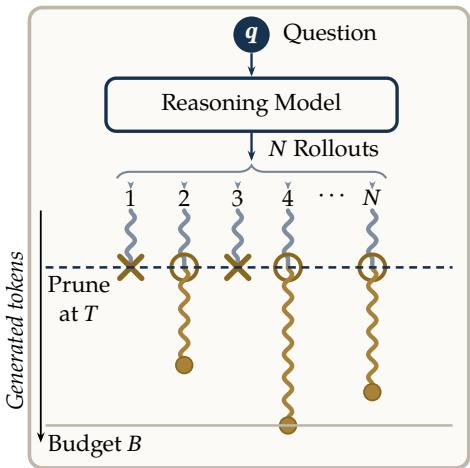  
Figure 1: Test-time pruning. Only k of the N rollouts (ringed) continue past the cutof T, up to the budget B.

One family of methods examines the confidence dynamics of the model during generation, utilizing metrics such as logit entropy or confidence [17, 30, 43, 50]. The underlying intuition is that if a model is overly confident at an intermediate decoding step, extending the reasoning process is a waste of compute; conversely, if the model is entirely lacking in confidence, it is unlikely to reach a correct solution regardless of the additional compute provided, allowing for early termination. Another line of work leverages the model’s internal state, specifically the hidden states of its transformer blocks, to identify which rollouts are worth continuing [1, 54]. By “probing” these internal states, one can predict whether the model will ultimately arrive at a correct solution, efectively framing the pruning problem as a classification task. This allows for the early discarding of partial rollouts that are unlikely to yield a correct final answer. In parallel, a separate line of research prioritizes representation exploration (RepExp) to select a subset of rollouts that cover as many distinct reasoning strategies as possible [39]. By selecting partial rollouts whose corresponding embeddings are dissimilar, RepExp aims to explore a diverse set of reasoning trajectories.

These approaches, however, sit at the two ends of a spectrum, and neither directly optimizes the quantity we actually care about. The problem with probing methods is that the rollouts they rank highest tend to be similar to one another. As a result, the probe may be confidently wrong about all of the kept rollouts at once, and none of them reaches a correct answer. This is the problem of pure exploitation (Fig. 2a). RepExp, on the other hand, finds diverse rollouts, but because it ignores the quality of the rollouts, it can spend much of its budget on rollouts that are unlikely to succeed (Fig. 2b). These limitations motivate selecting the rollouts by the metric we actually want to optimize, choosing the set S of k rollouts that maximizes pass@k, that is, max $\scriptstyle | S | = k \operatorname { p a s s } @ k ( S )$ which we formalize in Eq. 3. Optimizing this objective directly keeps the selected rollouts diverse enough to avoid shared failures while still favoring high-quality ones (Fig. 2c).

To this end, we propose PKTP (Pass@k Thought Pruning), a pruning framework that chooses the kept rollouts by maximizing pass@k directly. The main dificulty is that, even if the rollouts are sampled independently, their outcomes are not independent (conditioned on the partial observation of the rollout). Hence, pass@k depends on their joint distribution (i.e., rollouts with similar partial rollouts tend to succeed or fail together). We model this joint distribution with a latent Gaussian model, in which the correctness of each rollout is obtained by thresholding a Gaussian

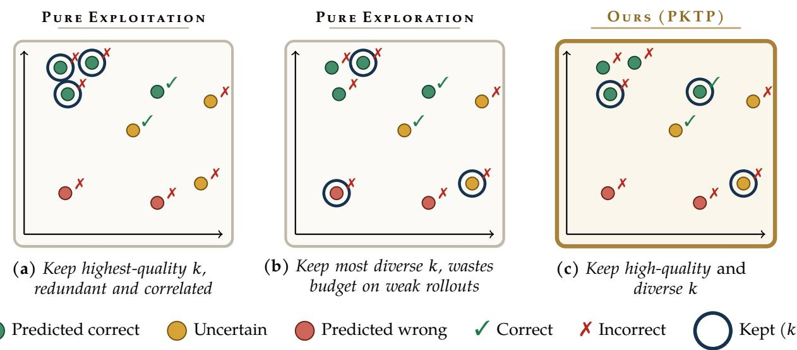

Figure 2: Conceptual illustration. The same pool of candidate rollouts, positioned by their partial rollout representations in embedding space, under three pruning strategies. Each rollout is colored by its predicted correctness and marked $\checkmark / \pmb { x }$ by its actual outcome; the $k = 3$ kept rollouts are ringed. (a) Pure exploitation keeps the highest-scoring rollouts, but they are correlated and cluster together, so they miss the correct rollout. (b) Pure exploration keeps a maximally diverse subset yet spends its budget on low-quality rollouts, also missing it. (c) Our method optimizes pass@k directly over the kept subset, balancing quality and diversity, and retains the correct rollout.

score. Evaluating pass@k under this model requires an expectation over the latent variables, so we instead derive a closed-form second-order approximation of it. We show that this approximation is submodular, enabling us to approximately solve it using a greedy procedure to find a subset of size k. An important aspect of the proposed framework is that the latent model is trained only once and does not depend on $k ,$ and a single greedy pass yields a nested sequence of subsets, so the budget k can be chosen online at inference time without retraining.

Contributions. First, we cast pruning as maximizing the pass@k of the kept set, and we model how similar rollouts fail together. Second, we derive a closed-form, submodular approximation of pass@k that links the probe and RepExp. Third, through experiments on eight reasoning models, we show that PKTP improves over existing pruning methods, especially for moderate values of k.

## 2 Problem Formulation and Related Work

Setup. Given a question q, we draw N candidate reasoning rollouts $y ^ { ( i ) } \sim \pi ( \cdot \mid q )$ from a model π. Each rollout is observed only through its first T tokens, the prefix $y _ { 1 : T } ^ { ( i ) }$ . We encode this prefix as a representation vector $h _ { i } = h \Big ( y _ { 1 : T } ^ { ( i ) } \Big )$ , a hidden-state embedding of the reasoning up to token T. Pruning then keeps $k \leq N$ rollouts, runs them to the full token budget $B ,$ and discards the rest. A completed rollout $y _ { 1 : B }$ is either correct or not, recorded by the sign $C ( y _ { 1 : B } ) \in \{ - 1 , + 1 \}$ ,

$$
C ( y _ { 1 : B } ) = \left\{ { \begin{array} { l l } { + 1 , } & { { \mathrm { i f ~ } } \mathrm { V E R I F Y } \big ( y _ { 1 : B } \big ) , } \\ { - 1 , } & { { \mathrm { o t h e r w i s e . } } } \end{array} } \right.\tag{1}
$$

Here Verify is a task-specific checker that returns true exactly when a completed rollout reaches a correct final answer, for instance by matching a reference solution on a math problem or passing the unit tests on a coding task. We write $C ( \boldsymbol { y } ^ { ( i ) } )$ for the outcome of the i-th rollout once it is run to the budget B.

Representations. To prune partial rollouts, we need to map each prefix to a vector that captures its essential information. One line of work relies on hand-designed features of the rollout and the model’s internal states, such as token confidence, the geometry of the hidden-state trajectory, or the convergence of intermediate answers. These features are usually very low dimensional [13, 19, 28, 38, 40]. A second line of work instead keeps the hidden states of the transformer and pools them into a single vector [29, 39, 42], and this is the class we use. In particular, we take $h _ { i }$ to be an exponential moving average (EMA) of the hidden states, which has proven an efective pooling operation [29]. Our improvements are thus shown for this class of embeddings, although our framework can be applied to other embeddings as well. Appendix F gives the details of the representation we use.

Objective. At pruning time the outcomes $C ( \boldsymbol { y } ^ { ( i ) } )$ are still unknown, since each depends on a (random) continuation we have not yet generated. How, then, should we choose the set $S \subseteq$ $\{ 1 , \ldots , N \}$ of $| S | = k$ rollouts to keep? Two extreme choices are as follows.

(i) (Pure exploitation) Keep in $S$ the rollouts $\{ i \}$ with the highest predicted success $\mathbb { P } \big ( C ( \boldsymbol { y } ^ { ( i ) } ) =$ $+ 1 \mid q , y _ { 1 : T } ^ { ( i ) } )$ , estimated by a linear probe trained on the representations $h _ { i } \ [ 5 4 ]$ , that is, the k rollouts with the largest scores $w ^ { \top } h _ { i }$ for a learned weight vector w. We refer to this pruning policy as Linear Probe.

(ii) (Pure exploration) Build a diverse $S ,$ starting from a random rollout and greedily adding to $S$ the rollout $i ^ { \star }$ by solving

$$
i ^ { \star } = \arg \operatorname* { m a x } _ { i \notin S } ~ h _ { i } ^ { \top } \Big ( \tau I + \sum _ { j \in S } h _ { j } h _ { j } ^ { \top } \Big ) ^ { - 1 } h _ { i } ,\tag{2}
$$

that is, we add, the rollout whose representation is least explained by those already chosen, where $\tau > 0$ is a regularizer. This is the RepExp pruning policy [39].

Neither extreme balances quality against diversity. What we actually want is the set of k rollouts with the best pass@k. Mathematically, we seek the set $S$ most likely to contain a correct rollout,

$$
\mathop { \sum \operatorname* { s s s } } _ { S \subseteq \{ 1 , \dots , N \} } \mathbb { P } \biggl ( \sum _ { i \in S } \mathbf { 1 } \{ C ( y ^ { ( i ) } ) = + 1 \} ~ \geq ~ 1 ~ \biggl | ~ q , y _ { 1 : T } ^ { ( 1 ) } , \dots , y _ { 1 : T } ^ { ( N ) } \biggr ) ~ \mathrm { s . t . } ~ | S | = k .\tag{3}
$$

Here, $\mathbf { 1 } \{ \cdot \}$ is the indicator function, i.e., ${ \bf 1 } \{ T r u e \} = 1$ and $\mathbf { 1 } \{ F a l s e \} = 0$ . The objective in Eq. 3 is exactly pass@k of the kept pool, the probability that at least one surviving rollout, once run to the budget B, yields a correct answer. We also assume that the final outcomes are binary, although the same approach generalizes to continuous outcomes, where each completed rollout is scored by a reward model and the goal is to maximize the best of the kept rollouts [10], in which case Eq. 3 becomes a max@k objective [41].

Related work. Existing pruning methods score each rollout on its own, using the model’s confidence [13, 30], a reward model [36], or a probe on its hidden states [25, 54], or they select a diverse set, as RepExp does [39]. Pass@k has also been used as a training objective for reasoning models [8, 41], but not to decide which partial rollouts to keep. Outside of language models, choosing a set so that at least one item succeeds has been studied in information retrieval and Bayesian optimization [6, 34, 46]. Appendix G gives an extended discussion. In what follows, we discuss how such an objective can be solved.

## 3 Method

There are some challenges in solving Eq. 3: First, we need to obtain the pass@k of a given set of rollouts. We address this by learning the joint distribution of the rollouts’ outcomes under a probabilistic model, from which the pass@k of any set can be estimated. Second, even with such an estimate, finding the subset of k rollouts with the highest estimated pass@k is a mixed-integer program. We can therefore view our framework as two components, learning the joint distribution of the outcomes (Section 3.1), and solving this mixed-integer program at selection time (Section 3.2).

## 3.1 Probabilistic model

Let $H = [ h _ { 1 } , \ldots , h _ { N } ] \in \mathbb { R } ^ { d \times N }$ collect the representations of the N generated partial rollouts, $Q _ { \theta } : \mathbb { R } ^ { d } $ R be a learnable mapping predicting the rollout quality, and define $Q _ { \theta } ( H ) = [ q _ { 1 } , \dots , q _ { N } ] ^ { \top }$ with $q _ { i } : = Q _ { \theta } ( h _ { i } )$ . We model the latent scores of the rollouts as

$$
{ \bf Z } = \underbrace { \underbrace { Q _ { \theta } ( H ) } _ { \mathrm { R o l l o u t ~ Q u a l i t y } } + \underbrace { H ^ { \top } { \bf f } } _ { \mathrm { R o l l o u t s ~ C o r r e l a t i o n } } + \underbrace { \bf m } _ { \mathrm { O u t c o m e ~ N o i s e } } } _ { \mathrm { R o l l o u t ~ Q u a l i t y } } , \quad \quad { \bf m } \sim { \mathcal N } ( 0 , I _ { N } ) , \quad { \bf f } \sim { \mathcal N } ( 0 , I _ { d } ) ,\tag{4}
$$

where m and f are independent. Intuitively, $\mathbf { Z } _ { i }$ is a score of how promising rollout i is, so the higher its quality $q _ { i }$ , the higher its score. On top of $q _ { i }$ , the term $h _ { i } ^ { \top }$ f is a random efect shared by rollouts with similar representations, which makes them succeed or fail together. Indeed, for distinct rollouts, $\operatorname { C o v } ( \mathbf { Z } _ { i } , \mathbf { Z } _ { j } \mid H ) = h _ { i } ^ { \top } h _ { j }$ , so rollouts with aligned $h _ { i }$ have positively correlated outcomes. Finally, $\mathbf { m } _ { i }$ is noise specific to rollout i.

The correctness $C ( \boldsymbol { y } ^ { ( i ) } )$ of rollout i is then modeled by thresholding its score at zero. More specifically, we define the random variable $\mathbf { C } _ { i } = 2 \times \mathbf { 1 } \{ \mathbf { Z } _ { i } \geq 0 \} - 1$ . In other words, a positive score implies that the rollout is correct, while a negative score implies that it is incorrect. Since the scores are independent conditionally on f, the likelihood of an observed correctness pattern $c \in \{ - 1 , 1 \} ^ { N }$ is

$$
\operatorname* { P r } \big [ \mathbf { C } = c \mid H \big ] = \mathbb { E } _ { \mathbf { f } } \Big [ \prod _ { i = 1 } ^ { N } \Phi \big ( c _ { i } ( q _ { i } + h _ { i } ^ { \top } \mathbf { f } ) \big ) \Big ] ,\tag{5}
$$

where $\Phi$ is the standard Gaussian CDF, and the derivation can be found in Appendix A.1.

Suppose we have M training questions, where question m consists of the representations $H ^ { ( m ) }$ of a pool and its observed outcomes $c ^ { ( m ) } \in \{ - 1 , 1 \} ^ { N }$ . The mapping $Q _ { \theta }$ is trained by maximizing their likelihood under Eq. 5, that is, by solving

$$
\operatorname* { m a x } _ { \theta } \ \frac { 1 } { M } \sum _ { m = 1 } ^ { M } \log \mathrm { P r } _ { \theta } \big [ \mathbf { C } = c ^ { ( m ) } \ | \ H ^ { ( m ) } \big ] ,\tag{6}
$$

where $\operatorname { P r } _ { \theta }$ is the likelihood of Eq. 5 with $H = H ^ { ( m ) } = [ h _ { 1 } ^ { ( m ) } , \dots , h _ { N } ^ { ( m ) } ]$ and $q _ { i } = Q _ { \theta } ( h _ { i } ^ { ( m ) } )$ . Solving Eq. 6 directly is hard, since the expectation over f in Eq. 5 has no closed form. We therefore expand

each log-factor to second order in $h _ { i } ^ { \top } { \bf f } ,$ which turns the expectation into a Gaussian integral that can be evaluated exactly (Theorem 1).

Theorem 1 (Second-order surrogate). For a pattern $c \in \{ - 1 , 1 \} ^ { N }$ , let ϕ be the standard Gaussian density, $\lambda _ { i } ( c _ { i } ) = \phi ( q _ { i } ) / \Phi ( c _ { i } q _ { i } ) , \kappa _ { i } ( c _ { i } ) = \lambda _ { i } ( c _ { i } ) \big ( \lambda _ { i } ( c _ { i } ) + c _ { i } q _ { i } \big )$

$$
\Sigma ( c ) = \sum _ { i = 1 } ^ { N } \kappa _ { i } ( c _ { i } ) h _ { i } h _ { i } ^ { \top } , \qquad b ( c ) = \sum _ { i = 1 } ^ { N } c _ { i } \lambda _ { i } ( c _ { i } ) h _ { i } .\tag{7}
$$

Then, as $\varepsilon \to 0$

$$
\log \Phi \left( c _ { i } ( q _ { i } + \varepsilon ) \right) = \log \Phi \left( c _ { i } q _ { i } \right) + c _ { i } \lambda _ { i } ( c _ { i } ) \varepsilon - \frac { \kappa _ { i } ( c _ { i } ) } { 2 } \varepsilon ^ { 2 } + O ( | \varepsilon | ^ { 3 } ) ,\tag{8}
$$

and replacing each log-factor of $\operatorname* { P r } [ \mathbf { C } = c \mid H ]$ in Eq. 5 by this expansion at $\varepsilon = h _ { i } ^ { \top } \mathbf { f }$ gives

$$
{ \widetilde { \operatorname* { P r } } } [ \mathbf { C } = c \mid H ] = \Big ( \prod _ { i = 1 } ^ { N } \Phi ( c _ { i } q _ { i } ) \Big ) \operatorname* { d e t } \big ( I _ { d } + \Sigma ( c ) \big ) ^ { - 1 / 2 } \exp \Big ( \frac { 1 } { 2 } b ( c ) ^ { \top } \big ( I _ { d } + \Sigma ( c ) \big ) ^ { - 1 } b ( c ) \Big ) .\tag{9}
$$

The proof is in Appendix B.1.1. The expansion is local, so we use Eq. 9 as a tractable surrogate rather than as an exact identity or a bound. We therefore replace $\operatorname { P r } _ { \theta }$ in Eq. 6 by $\widetilde { \mathrm { P r } _ { \theta } }$

Instead of using $h _ { i }$ directly in the correlation term, one could learn an encoder $\mathcal { E } _ { \psi }$ of the representations and use $\mathcal { E } _ { \psi } ( h _ { i } )$ in its place, but its helpfulness depends on the amount of data. Since our data is limited, we keep $h _ { i }$ fixed, so that $Q _ { \theta }$ is the only learned component, and for the same reason we use a simple linear model $Q _ { \theta } ( h ) = \theta ^ { \top } h + \theta _ { 0 }$ for $Q _ { \theta }$ , as in the Linear Probe [54]. Unlike the Linear Probe, which is trained on the correctness of each rollout separately, $Q _ { \theta }$ is trained on the joint outcomes of all rollouts of a question, so the quality it learns already accounts for the correlation between them. Since Eq. 9 is in closed form and diferentiable in $\theta ,$ , we maximize the surrogate likelihood by stochastic gradient ascent over the training questions.

## 3.2 Subset selection

Maximizing pass@k in $\operatorname { E q }$ . 3 is the same as minimizing the probability that every kept rollout fails. Under the latent Gaussian model, and suppressing the conditioning on $H$ , the failure probability of a set $S$ of kept rollouts is

$$
L ( S ) = \mathrm { P r } \big [ \mathbf { C } _ { i } = - 1 \ \forall i \in S \big ] = \mathbb { E } _ { \mathbf { f } \sim \mathcal { N } ( 0 , I _ { d } ) } \Big [ \prod _ { i \in S } \Phi \big ( - ( q _ { i } + h _ { i } ^ { \top } \mathbf { f } ) \big ) \Big ] ,\tag{10}
$$

and we seek the set of k rollouts that minimizes it. Since $L ( S )$ has no closed form, we approximate it with Theorem 1.

Corollary 1 (Selection surrogate). For a set $S \subseteq [ N ] : = \{ 1 , \dots , N \}$ , let $\lambda _ { i } = \phi ( q _ { i } ) / \Phi ( - q _ { i } )$ $\begin{array} { r } { \kappa _ { i } = \lambda _ { i } ( \lambda _ { i } - q _ { i } ) , \Sigma _ { S } = \sum _ { i \in S } \kappa _ { i } h _ { i } h _ { i } ^ { \top } } \end{array}$ and $\begin{array} { r } { b _ { S } = \sum _ { i \in S } \lambda _ { i } h _ { i } . \ A p p l y i n g } \end{array}$ Theorem 1 to the rollouts in S with $c _ { i } = - 1$ for every $i \in S$ gives a surrogate $\widetilde L ( S )$ of $L ( S )$ with

$$
\log \widetilde { L } ( S ) = \underbrace { \sum _ { i \in S } \log \Phi ( - q _ { i } ) } _ { \mathrm { R o l l o u t ~ Q u a l i t y } } + \underbrace { \left( - { \frac { 1 } { 2 } } \log \operatorname* { d e t } ( I _ { d } + \Sigma _ { S } ) + { \frac { 1 } { 2 } } b _ { S } ^ { \top } ( I _ { d } + \Sigma _ { S } ) ^ { - 1 } b _ { S } \right) } _ { \mathrm { R o l l o u t s ~ C o r r e l a t i o n } } .\tag{11}
$$

The proof is in Appendix B.1.2. We therefore minimize log $\widetilde L ( S )$ over $| S | = k$ . Each term of Eq. 11 has a direct interpretation. The first term favors large $q _ { i }$ , because the baseline failure factor $\Phi ( - q _ { i } )$ decreases with $q _ { i }$ . The negative log-determinant rewards a collection of $h _ { i } \mathrm { ^ { * } s }$ that covers several directions instead of repeatedly selecting the same direction. The last term is nonnegative and penalizes sets whose weighted vectors $\lambda _ { i } h _ { i }$ add up in the same direction, which the determinant alone cannot detect since it treats $h _ { i }$ and $- h _ { i }$ identically. For example, two rollouts of the same quality fail together more often with $h _ { 2 } = h _ { 1 }$ than with $h _ { 2 } = - h _ { 1 }$ , yet both cases give the same $\Sigma _ { S }$ and hence the same determinant, while $b _ { S }$ is $2 \lambda _ { 1 } h _ { 1 }$ in the first case and 0 in the second.

However, minimizing log $\widetilde L ( S )$ exactly is hard.

Proposition 1 (Hardness of exact selection). Minimizing log $\widetilde L ( S )$ over all $S \subseteq [ N ]$ with $| S | = k$ is NP-hard.

The proof is in Appendix B.3, by a reduction from the maximum independent set problem. When the objective is monotone and submodular, however, a greedy optimizer that adds one rollout at a time is guaranteed to achieve at least a $( 1 - e ^ { - 1 } )$ fraction of the optimal value [32]. The exact pass probability $P ( S ) : = 1 - L ( S )$ is known to be monotone and submodular [46]. An approximation of a submodular function, though, is not necessarily submodular, so we prove that its surrogate ${ \widetilde { P } } ( S ) : = 1 - { \widetilde { L } } ( S )$ is also monotone and submodular, and hence the greedy optimizer and its approximation guarantee apply to our problem.

Theorem 2 (Greedy guarantee). $\widetilde { P }$ is normalized $( \widetilde P ( \varnothing ) = 0 )$ monotone $( \widetilde P ( A ) \ \le \ \widetilde P ( B )$ whenever $A \subseteq B )$ , and submodular, that is, for all $A \subseteq B \subseteq [ N ]$ and $j \notin B$

$$
\widetilde { P } ( A \cup \{ j \} ) - \widetilde { P } ( A ) \geq \widetilde { P } ( B \cup \{ j \} ) - \widetilde { P } ( B ) .\tag{12}
$$

Consequently, the set $S _ { k } ^ { \mathrm { g r e e d y } }$ obtained by adding, k times, the candidate that most increases $\widetilde { P }$ satisfies

$$
\widetilde P ( S _ { k } ^ { \mathrm { g r e e d y } } ) \ge ( 1 - e ^ { - 1 } ) \operatorname* { m a x } _ { | S | \le k } \widetilde P ( S ) .\tag{13}
$$

The proof is in Appendix B.2.

Greedy optimization. The greedy optimizer starts from the empty set and, at each step, adds the candidate $j \not \in S$ with the smallest change $\Delta _ { j } ( S ) = \log \widetilde { L } ( S \cup \{ j \} ) - \log \widetilde { L } ( S )$ . Since adding a candidate changes $\Sigma _ { S }$ by a rank-one matrix, this change has a closed form that can be updated cheaply without rebuilding the determinant and the inverse (Appendix A.2). With these rank-one updates, the greedy optimizer costs $O \big ( k ( N d + d ^ { 2 } ) \big )$  time and $O ( N d + d ^ { 2 } )$ memory. By comparison, a naive implementation that rebuilds and factorizes $I _ { d } + \Sigma _ { S \cup \{ j \} }$ for every candidate costs $O ( d ^ { 3 } )$ per candidate, that is, $O ( k N d ^ { 3 } )$ time, with the same $O ( N d + d ^ { 2 } )$ memory.

## 3.3 Relation to Linear Probe and RepExp

The surrogate makes the quality–diversity trade-of explicit and connects to the two baseline criteria in limiting regimes. If the correlation term in Eq. 11 is switched of, then log $\begin{array} { r } { \widetilde L ( S ) = \sum _ { i \in S } \log \Phi ( - q _ { i } ) } \end{array}$ so minimizing it keeps the k largest quality scores and recovers a quality-only, probe-style ranking; it coincides with Linear Probe when $Q _ { \theta }$ is the corresponding linear probe. At the other extreme, suppose that the quality scores are equal and that the penalty term is negligible throughout selection. Then every $\kappa _ { i }$ equals a common value $\kappa ,$ so $\textstyle \sum _ { S } = \kappa \sum _ { i \in S } h _ { i } h _ { i } ^ { \intercal }$ and the relevant set-dependent term is $- \frac 1 2$ log det $\left( I _ { d } + \Sigma _ { S } \right)$ . By the matrix determinant lemma, its greedy marginal ranks a candidate j by $h _ { j } ^ { \mp } ( I _ { d } + \Sigma _ { S } ) ^ { - 1 } h _ { j } ,$ the residual-variance criterion used by RepExp on the same representations (see Appendix A.3 for the derivation). Between these limits, the modular quality, log-determinant diversity, and penalty terms jointly determine the selected set.

The above two extremes do not show how PKTP moves from Linear Probe to RepExp as k grows. To see this, we expand log $L ( S )$ and its surrogate when the correlations are weak.

Proposition 2 (Weak correlations). Fix $S , q _ { i }$ and $h _ { i }$ , and replace f by ρ f. As $\rho \to 0 _ { ; }$

$$
\log L ( S ) = \sum _ { i \in S } \Bigl [ \log \Phi ( - q _ { i } ) + \frac { \rho ^ { 2 } } { 2 } \lambda _ { i } q _ { i } \| h _ { i } \| ^ { 2 } \Bigr ] + \rho ^ { 2 } \sum _ { i < j \in S } \lambda _ { i } \lambda _ { j } h _ { i } ^ { \top } h _ { j } + O ( \rho ^ { 4 } ) ,\tag{14}
$$

and log $\widetilde L ( S )$ has the same expansion.

Proposition 2 shows how the correlation strength $\rho$ controls where PKTP sits between the two baselines. At $\rho = 0$ the rollouts are independent, the expansion reduces to $\textstyle \sum _ { i \in S }$ log $\Phi ( - q _ { i } )$ , and PKTP ranks the rollouts by quality, as Linear Probe does. For $\rho > 0$ , every pair of kept rollouts adds a penalty $\rho ^ { 2 } \lambda _ { i } \lambda _ { j } h _ { i } ^ { \top } h _ { j }$ , which is large when their representations are similar. A rollout added to a set of t rollouts pays t such penalties, so the first pick is decided by quality alone, and as the set grows the penalties add up until they outweigh the diferences in quality, after which PKTP spreads its picks out, as RepExp does. The larger $\rho$ is, the sooner this happens, so $\rho$ sets how fast PKTP moves from Linear Probe to RepExp as k grows.

Appendix C makes the two ends of this behavior precise for a fixed $\rho .$ At small $k ,$ if the gap between the kth and (k + 1)th largest qualities exceeds a constant multiple of $k \rho ^ { 2 }$ , PKTP keeps exactly the k candidates with the largest $q _ { i } .$ , as Linear Probe does, and in the same order when this holds at every budget up to k. At large k, when a few candidates of high quality stand out from a bulk of lower quality, the objective of PKTP, averaged over the bulk qualities, reduces to the RepExp objective plus a term for these candidates. Its minimizers therefore keep them and nearly maximize the RepExp objective. Finally, the conditions of these two results do not conflict. We construct a single model, with one quality distribution and one value of $\rho ,$ in which PKTP follows Linear Probe at small $k ,$ while its averaged objective reduces to the RepExp objective as k grows.

## 4 Experiments

## 4.1 Setup

Models. We evaluate on eight open-weight reasoning models in two size tiers. The small tier is Qwen3-0.6B, Qwen3-1.7B [49], OpenMath-Nemotron-1.5B [31] and DeepSeek-R1-Distill-Qwen-1.5B [15], and the large tier is Qwen3-8B, OpenMath-Nemotron-7B, DeepSeek-R1-Distill-Qwen-7B and Skywork-OR1-Math-7B [16]. Every model generates its rollouts with temperature 0.8, top-p of 0.95, and a full token budget of $B = 3 2 , 7 6 8$ tokens.

Datasets. We pool problems from several benchmark sources rather than a single one, since a pruning policy has to be trained on part of the problems and evaluated on the rest, and no single competition benchmark is large enough for both. The two model tiers are evaluated on diferent benchmark substrates, chosen so that neither tier is saturated. Both tiers use AIME 2024, 2025 and 2026 and HMMT 2024, 2025 and 2026 [2], together with RIMO-N [9]. The small tier adds BeyondAIME [4], OlymMATH (Easy) [37] and Omni-MATH levels 7 and 8 [14], while the large tier replaces these by AMO-Bench [27], OlymMATH (Hard) and Omni-MATH levels 8 and 9. This gives around 600 problems per model. For each model we then remove the problems on which it generates all correct or all wrong solutions in 128 trials.

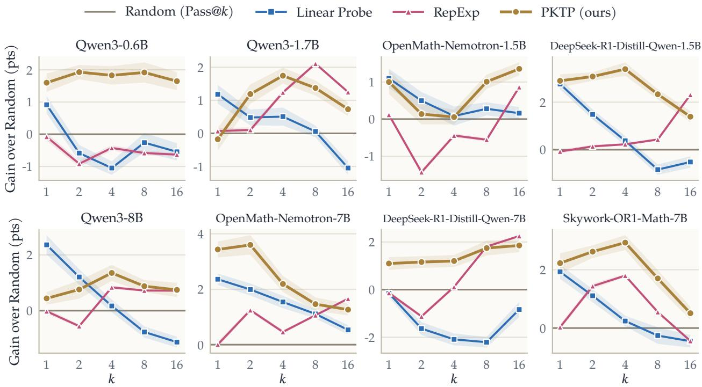  
Figure 3: Gain in pass@k over random pruning. For every model, the pooled pass@k of each pruning policy minus that of Random (Pass@k), in percentage points, as a function of the number k of rollouts kept, with a band of one standard error of the repetition-by-repetition diference. The absolute numbers are in Table 1 and the per-benchmark breakdown in Appendix D.

Verification. A completed rollout counts as correct when its final answer matches the reference answer of the problem. We take that answer from the \boxed{} expression of the rollout and ask a Qwen3-32B judge [49] whether it is equivalent to the reference answer. We use a judge rather than a symbolic checker such as math-verify [24], because benchmarks like AMO-Bench have descriptive answers that a symbolic checker cannot handle.

Evaluation. Only a few hundred problems are available for each model, so a single split into training and test problems would leave too few on either side, and we evaluate with cross-validation instead. For each model we partition its problems into eight folds, with each benchmark spread evenly across the folds. Each fold serves once as the test set while the learned components are trained on the other seven, so every problem is scored exactly once by a model that was not trained on it. One such pass over all eight folds forms a repetition. Because the outcome of a repetition depends on how the problems happen to be divided, we run 20 repetitions, each with a new random partition obtained by shufling the problems of every benchmark before assigning them to folds, and with fresh random seeds for training. Every reported number is the average over the 20 repetitions, and its standard error is computed across them. For RepExp we set the regularizer to τ = 1. For all methods, the representation $h _ { i }$ of a partial rollout is the EMA of its hidden states with rate 10−3.

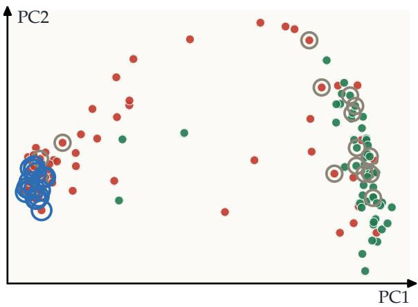  
Figure 4: Linear Probe keeps a cluster of rollouts that fail together. The 128 rollouts of one problem (Qwen3-8B, AMO-Bench), projected on the first two principal components of their representations, with correct rollouts in green and wrong rollouts in red. The 16 rollouts ranked highest by the Linear Probe (blue rings) lie close together and are all wrong, while 16 random picks (gray rings) include 7 correct rollouts.

## 4.2 Experimental Evaluation and Comparison

Figure 3 reports our main setting, in which each method selects $k \in \{ 1 , 2 , 4 , 8 , 1 6 \}$ of the $N = 1 2 8$ rollouts of a problem from their prefixes, and we set the cutof threshold to T = 4000 tokens. For every model it shows the pass@k of each pruning policy minus that of Random (Pass@k), pooled over all test problems. Random keeps k rollouts chosen uniformly at random, which is equivalent to sampling k rollouts without any pruning, so it is the natural reference point. The absolute numbers are given in Table 1 and the breakdown by benchmark in Appendix D.

As evident in Fig. 3, the Linear Probe performs strongly at k = 1, but as k increases it gets closer and closer to Random, as in the Qwen models, and in some cases it even becomes worse than Random at large k. This can be attributed to a bias towards a cluster of rollouts that the model predicts to be correct but that may not be, in the case where the classifier is wrong. In other words, ranking by the probe sharpens the distribution of the kept rollouts around what the probe considers correct. This mirrors the efect observed in reinforcement learning, where models trained with GRPO outperform their base models at small k but are outperformed by them at large k [53]. As an example, Fig. 4 shows the 128 rollouts of one problem (Qwen3-8B, AMO-Bench), projected on the first two principal components of their representations. The 16 rollouts ranked highest by the probe are all close to each other and all wrong, while 16 random picks include 7 correct ones.

Figure 3 also shows that RepExp behaves in the opposite way to the Linear Probe. At k = 1 it shows, as expected, a performance similar to Random, since its first pick is random. As k increases, the general trend is that RepExp gets better and better than Random, especially at k = 16 (e.g., the DeepSeek-R1-Distill models). Interestingly, however, for moderate k it is sometimes outperformed by Random, for instance on OpenMath-Nemotron-1.5B and Qwen3-8B. We attribute this to a tendency of RepExp to favor outliers at small and moderate k, since the rollouts farthest from those already selected are often unusual rollouts that are unlikely to be correct. A similar efect is reported by Tuyls et al. [39], where RepExp stops helping under high-temperature sampling, since the less coherent responses look novel in representation space yet do not necessarily contain correct answers. As an example, Fig. 5 shows the 128 rollouts of one problem (Qwen3-8B, Omni-MATH), embedded in two dimensions with multidimensional scaling on their representations. After its first, random pick, RepExp selects outliers far from the other rollouts, and all 4 of its picks are wrong, while 4 random picks include 1 correct one.

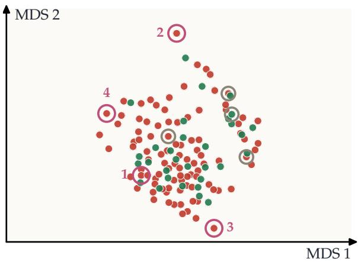  
Figure 5: RepExp keeps outliers that are unlikely to be correct. The 128 rollouts of one problem (Qwen3-8B, Omni-MATH), embedded in two dimensions by multidimensional scaling of their representations, with correct rollouts in green and wrong rollouts in red. After a random first pick, RepExp (pink rings, numbered in pick order) selects rollouts far from the rest, and all 4 of its picks are wrong, while 4 random picks (gray rings) include 1 correct rollout.

Finally, Fig. 3 shows that PKTP outperforms both the Linear Probe and RepExp, and its advantage is clearest at moderate k, where each baseline sufers from its own bias. On DeepSeek-R1- Distill-Qwen-1.5B at $k = 4 .$ , for example, PKTP is 3.0 points above the Linear Probe and 3.2 points above RepExp. On Qwen3-0.6B it leads both baselines by more than 2 points at every $k \geq 2$ , and on DeepSeek-R1-Distill-Qwen-7B it is 3.3 points above the Linear Probe at $k = 4$ . Unlike the two baselines, PKTP also stays above Random on every model for $k \geq 2 .$ , since it keeps the correctness signal of the probe while spreading the kept rollouts over outcomes that are unlikely to fail together. At large k, however, the performance of PKTP and RepExp gets closer. We believe this is due to the weak correctness signal in the embeddings of the partial rollouts, which raises the question of how a quality embedding can be obtained from a partial rollout, and whether this is possible at all.

Results for the other pool sizes, N ∈ {32, 48, 64, 80, 96, 112} with the same cutof $T = 4 0 0 0$ , are given in Appendix E.

## 4.3 Efect of the cutof threshold

An important aspect of pruning is the cutof threshold $T ,$ and how the algorithm behaves as the cutof grows. Figure 6 varies T on Qwen3-1.7B and DeepSeek-R1-Distill-Qwen-7B. For every $T \geq 4 0 0 0$ , PKTP outperforms all other methods on both models. An interesting observation is that a later cutof in general improves the performance of PKTP. On Qwen3-1.7B its pass@4 rises from 63.5% at $T = 2 0 0 0$ to 65.9% at $T = 8 0 0 0$ , and on DeepSeek-R1-Distill-Qwen-7B from 57.4% to 61.7%. Intuitively, the more tokens are generated, the more is revealed about the quality of a rollout and where it is heading, so there is more signal to exploit. Interestingly, however, the same does not necessarily happen for the Linear Probe and RepExp. On Qwen3-1.7B, for example, the Linear Probe drifts down from 64.2% to 62.3% and ends below Random. One reason can be the representation we use. Since the EMA with rate $1 0 ^ { - 3 }$ efectively averages over the last 1000 tokens, it may lose the signal in the earlier tokens.

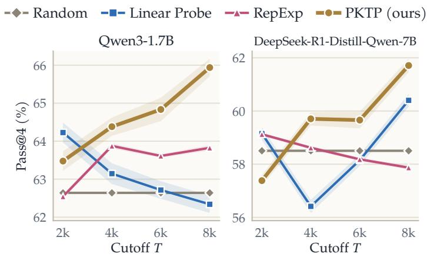

Figure 6: A later cutof improves PKTP. Pass@4 on Qwen3-1.7B and DeepSeek-R1-Distill-Qwen-7B as the cutof T grows from 2000 to 8000 tokens, with $N = 1 2 8$ . PKTP is the best method for every $T \geq 4 0 0 0$ and keeps improving with longer prefixes, while the Linear Probe and RepExp gain much less, and the Linear Probe on Qwen3-1.7B even drifts below Random. Bands are one standard error.  
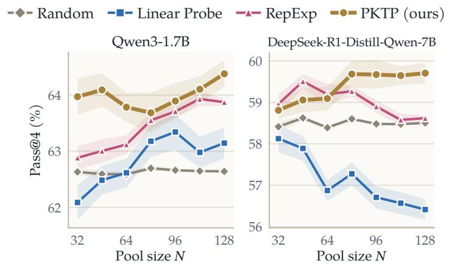  
Figure 7: PKTP leads once the pool is large enough. Pass@4 on Qwen3-1.7B and DeepSeek-R1-Distill-Qwen-7B as the pool size N grows from 32 to 128, with $T = 4 0 0 0$ . PKTP is the best method for every N on Qwen3-1.7B and from $N = 8 0$ on DeepSeek-R1-Distill-Qwen-7B, where the Linear Probe falls as the pool grows and stays below Random. Bands are one standard error.

## 4.4 Efect of the pool size

Another important aspect of pruning is the size N of the pool the k rollouts are chosen from. Figure 7 varies N on Qwen3-1.7B and DeepSeek-R1-Distill-Qwen-7B. PKTP outperforms all other methods for every N on Qwen3-1.7B, and on DeepSeek-R1-Distill-Qwen-7B once the pool reaches

N = 80. A larger pool ofers more candidates to choose from, and on Qwen3-1.7B both baselines benefit from it, with RepExp rising from 62.9% at N = 32 to 63.9% at N = 128 as the pool becomes more diverse and the Linear Probe from 62.1% to 63.1%. Interestingly, however, the same does not hold on DeepSeek-R1-Distill-Qwen-7B, where the Linear Probe falls from 58.1% to 56.4% and stays below Random for every N, and RepExp falls from 59.5% at N = 48 to 58.6%, while PKTP rises from 58.8% to 59.7%. One reason can be that a larger pool also contains more outliers, which raises the chance that extreme cases like RepExp and the Linear Probe select them at a moderate k such as k = 4.

## 5 Conclusion

We introduced PKTP, a pruning framework that chooses which partial rollouts to keep by directly optimizing pass@k. PKTP learns the joint distribution of the rollouts’ outcomes with a latent Gaussian model, approximates the resulting likelihood in closed form, and selects the kept set greedily, with an approximation guarantee on the surrogate objective. Across eight reasoning models, it outperforms both quality-based and diversity-based pruning, and the gains are largest at moderate k, where each of these baselines sufers from its own bias. Since PKTP can be combined with any representation of partial rollouts, representations that better capture the correctness of a rollout would directly strengthen it, and developing them is a natural direction for future work.

## Acknowledgments

This work was supported in part by a Generative AI Research Award from the USC Ofice of Research and Innovation, the NSF NRT program, the USC-Meta Center for Research and Education in AI and Learning, and a gift from Amazon. AJ was supported in part by the NSF Award DMS-2311024, an Amazon Faculty Research Award, an Adobe Faculty Research Award, and an iORB grant from USC Marshall School of Business.

## AI use statement

In this work, we used generative AI tools to assist with several parts of the project. For the write-up, we used them to edit and polish the text and to format the LATEX source. For the figures, we used them to write the scripts that plot our experimental results. For the code, we used them to help implement parts of our implementation. For the theory, we used them to help derive and write parts of the proofs in the appendix. We have not used generative AI tools to generate data or experimental results. All AI-assisted content, including the code and the proofs, was reviewed and verified by the authors, who take full responsibility for the content of this paper.

## References

[1] Anum Afzal, Florian Matthes, Gal Chechik, and Yftah Ziser. Knowing before saying: LLM representations encode information about chain-of-thought success before completion. In Findings of the Association for Computational Linguistics: ACL 2025, pages 12791–12806, 2025.

[2] Mislav Balunovi´c, Jasper Dekoninck, Ivo Petrov, Nikola Jovanovi´c, and Martin Vechev. Math-Arena: Evaluating LLMs on uncontaminated math competitions. In Advances in Neural Information Processing Systems, Datasets and Benchmarks Track, 2025.

[3] Bradley Brown, Jordan Juravsky, Ryan Ehrlich, Ronald Clark, Quoc V Le, Christopher R´e, and Azalia Mirhoseini. Large language monkeys: Scaling inference compute with repeated sampling. arXiv preprint arXiv:2407.21787, 2024.

[4] ByteDance Seed. Seed1.5-Thinking: Advancing superb reasoning models with reinforcement learning. arXiv preprint arXiv:2504.13914, 2025.

[5] Jaime Carbonell and Jade Goldstein. The use of MMR, diversity-based reranking for reordering documents and producing summaries. In Proceedings of the 21st Annual International ACM SIGIR Conference on Research and Development in Information Retrieval, 1998.

[6] Harr Chen and David R. Karger. Less is more: Probabilistic models for retrieving fewer relevant documents. In Proceedings of the 29th Annual International ACM SIGIR Conference on Research and Development in Information Retrieval, pages 429–436, 2006.

[7] Yilei Chen, Souradip Chakraborty, Lorenz Wolf, Yannis Paschalidis, and Aldo Pacchiano. Posttraining large language models for diverse high-quality responses. In International Conference on Learning Representations, 2026.

[8] Zhipeng Chen, Xiaobo Qin, Youbin Wu, Yue Ling, Qinghao Ye, Wayne Xin Zhao, and Guang Shi. Pass@k training for adaptively balancing exploration and exploitation of large reasoning models. arXiv preprint arXiv:2508.10751, 2025.

[9] Ziye Chen, Chengwei Qin, and Yao Shu. RIMO: An easy-to-evaluate, hard-to-solve olympiad benchmark for advanced mathematical reasoning. arXiv preprint arXiv:2509.07711, 2025.

[10] Yinlam Chow, Guy Tennenholtz, Izzeddin Gur, Vincent Zhuang, Bo Dai, Sridhar Thiagarajan, Craig Boutilier, Rishabh Agarwal, Aviral Kumar, and Aleksandra Faust. Inference-aware fine-tuning for best-of-N sampling in large language models. In International Conference on Learning Representations, 2025.

[11] Karl Cobbe, Vineet Kosaraju, Mohammad Bavarian, Mark Chen, Heewoo Jun, Lukasz Kaiser, Matthias Plappert, Jerry Tworek, Jacob Hilton, Reiichiro Nakano, Christopher Hesse, and John Schulman. Training verifiers to solve math word problems. arXiv preprint arXiv:2110.14168, 2021.

[12] Rick Durrett. Probability: Theory and Examples. Cambridge University Press, 5th edition, 2019. doi: 10.1017/9781108591034.

[13] Yichao Fu, Xuewei Wang, Hao Zhang, Yuandong Tian, and Jiawei Zhao. Deep think with confidence. In International Conference on Learning Representations, 2026.

[14] Bofei Gao, Feifan Song, Zhe Yang, Zefan Cai, Yibo Miao, Qingxiu Dong, Lei Li, Chenghao Ma, Liang Chen, Runxin Xu, et al. Omni-MATH: A universal olympiad level mathematic benchmark for large language models. In International Conference on Learning Representations, 2025.

[15] Daya Guo, Dejian Yang, Haowei Zhang, Junxiao Song, Peiyi Wang, Qihao Zhu, Runxin Xu, Ruoyu Zhang, Shirong Ma, Xiao Bi, et al. DeepSeek-R1 incentivizes reasoning in LLMs through reinforcement learning. Nature, 645(8081):633–638, 2025.

[16] Jujie He, Jiacai Liu, Chris Yuhao Liu, Rui Yan, Chaojie Wang, Peng Cheng, Xiaoyu Zhang, Fuxiang Zhang, Jiacheng Xu, Wei Shen, et al. Skywork open reasoner 1 technical report. arXiv preprint arXiv:2505.22312, 2025.

[17] Parsa Hosseini, Sumit Nawathe, Mahdi Salmani, Meisam Razaviyayn, and Soheil Feizi. Early stopping for large reasoning models via confidence dynamics. arXiv preprint arXiv:2604.04930, 2026.

[18] Aaron Jaech, Adam Kalai, Adam Lerer, Adam Richardson, Ahmed El-Kishky, Aiden Low, Alec Helyar, Aleksander Madry, Alex Beutel, Alex Carney, et al. OpenAI o1 system card. arXiv preprint arXiv:2412.16720, 2024.

[19] Xinyan Jiang, Ninghao Liu, Di Wang, and Lijie Hu. Beyond scalars: Evaluating and understanding LLM reasoning via geometric progress and stability. In International Conference on Machine Learning, 2026.

[20] Richard M. Karp. Reducibility among combinatorial problems. In Complexity of Computer Computations, pages 85–103. Plenum Press, 1972.

[21] Takeshi Kojima, Shixiang Shane Gu, Machel Reid, Yutaka Matsuo, and Yusuke Iwasawa. Large language models are zero-shot reasoners. Advances in Neural Information Processing Systems, 35:22199–22213, 2022.

[22] Alex Kulesza and Ben Taskar. Determinantal point processes for machine learning. Foundations and Trends in Machine Learning, 5(2–3):123–286, 2012.

[23] Woosuk Kwon, Zhuohan Li, Siyuan Zhuang, Ying Sheng, Lianmin Zheng, Cody Hao Yu, Joseph Gonzalez, Hao Zhang, and Ion Stoica. Eficient memory management for large language model serving with PagedAttention. In Proceedings of the 29th Symposium on Operating Systems Principles, pages 611–626, 2023.

[24] Hynek Kydl´ıˇcek. Math-Verify: Math verification library. https://github.com/huggingface/ Math-Verify, 2025.

[25] Zhixiang Liang, Beichen Huang, Zheng Wang, and Minjia Zhang. Hidden states as early signals: Step-level trace evaluation and pruning for eficient test-time scaling. In Findings of the Association for Computational Linguistics: ACL 2026, pages 26800–26813, 2026.

[26] Hunter Lightman, Vineet Kosaraju, Yura Burda, Harri Edwards, Bowen Baker, Teddy Lee, Jan Leike, John Schulman, Ilya Sutskever, and Karl Cobbe. Let’s verify step by step. In International Conference on Learning Representations, 2024.

[27] Junlin Liu, Shengnan An, Shuang Zhou, Dan Ma, Yehao Lin, Xinxuan Lv, Xuanlin Wang, Xiaoyu Li, Ziwen Wang, Xuezhi Cao, and Xunliang Cai. AMO-Bench: Large language models still struggle in high school math competitions. In Findings of the Association for Computational Linguistics: ACL 2026, pages 2120–2137, 2026.

[28] Xin Liu and Lu Wang. Answer convergence as a signal for early stopping in reasoning. In Proceedings of the 2025 Conference on Empirical Methods in Natural Language Processing, pages 17896–17907, 2025.

[29] Haolang Lu, Minghui Pan, Ripeng Li, Guoshun Nan, Jialin Zhuang, Zijie Zhao, Zhongxiang Sun, Kun Wang, and Yang Liu. Streaming hallucination detection in long chain-of-thought reasoning. In Findings of the Association for Computational Linguistics: ACL 2026, pages 21157–21183, 2026.

[30] Rohin Manvi, Anikait Singh, and Stefano Ermon. Adaptive inference-time compute: LLMs can predict if they can do better, even mid-generation. arXiv preprint arXiv:2410.02725, 2024.

[31] Ivan Moshkov, Darragh Hanley, Ivan Sorokin, Shubham Toshniwal, Christof Henkel, Benedikt Schiferer, Wei Du, and Igor Gitman. AIMO-2 winning solution: Building state-of-the-art mathematical reasoning models with OpenMathReasoning dataset. arXiv preprint arXiv:2504.16891, 2025.

[32] George L. Nemhauser, Laurence A. Wolsey, and Marshall L. Fisher. An analysis of approximations for maximizing submodular set functions. Mathematical Programming, 14(1):265–294, 1978.

[33] Reiner Pope, Sholto Douglas, Aakanksha Chowdhery, Jacob Devlin, James Bradbury, Jonathan Heek, Kefan Xiao, Shivani Agrawal, and Jef Dean. Eficiently scaling transformer inference. Proceedings of Machine Learning and Systems, 5:606–624, 2023.

[34] Scott Sanner, Shengbo Guo, Thore Graepel, Sadegh Kharazmi, and Sarvnaz Karimi. Diverse retrieval via greedy optimization of expected 1-call@k in a latent subtopic relevance model. In Proceedings of the 20th ACM International Conference on Information and Knowledge Management, 2011.

[35] Charlie Snell, Jaehoon Lee, Kelvin Xu, and Aviral Kumar. Scaling LLM test-time compute optimally can be more efective than scaling parameters for reasoning. In International Conference on Learning Representations, 2025.

[36] Hanshi Sun, Momin Haider, Ruiqi Zhang, Huitao Yang, Jiahao Qiu, Ming Yin, Mengdi Wang, Peter Bartlett, and Andrea Zanette. Fast best-of-N decoding via speculative rejection. In Advances in Neural Information Processing Systems, 2024.

[37] Haoxiang Sun, Yingqian Min, Zhipeng Chen, Wayne Xin Zhao, and Ji-Rong Wen. Challenging the boundaries of reasoning: An olympiad-level math benchmark for large language models. In Proceedings of the 64th Annual Meeting of the Association for Computational Linguistics (Volume 1: Long Papers), pages 17438–17457, 2026.

[38] Lihao Sun, Hang Dong, Bo Qiao, Qingwei Lin, Dongmei Zhang, and Saravan Rajmohan. LLM reasoning as trajectories: Step-specific representation geometry and correctness signals. In Proceedings of the 64th Annual Meeting of the Association for Computational Linguistics (Volume 1: Long Papers), pages 26872–26887, 2026.

[39] Jens Tuyls, Dylan J. Foster, Akshay Krishnamurthy, and Jordan T. Ash. Representation-based exploration for language models: From test-time to post-training. In International Conference on Learning Representations, 2026.

[40] Martina G. Vilas, Safoora Yousefi, Besmira Nushi, Eric Horvitz, and Vidhisha Balachandran. Tracing the traces: Latent temporal signals for eficient and accurate reasoning. In International Conference on Learning Representations, 2026.

[41] Christian Walder and Deep Tejas Karkhanis. Pass@K policy optimization: Solving harder reinforcement learning problems. In Advances in Neural Information Processing Systems, volume 38, pages 152416–152445, 2025.

[42] Sophie L. Wang, Phillip Isola, and Brian Cheung. The truth lies somewhere in the middle (of the generated tokens). In International Conference on Machine Learning, 2026.

[43] Xi Wang, James McInerney, Lequn Wang, and Nathan Kallus. Entropy after </think> for reasoning model early exiting. arXiv preprint arXiv:2509.26522, 2025.

[44] Xuezhi Wang, Jason Wei, Dale Schuurmans, Quoc Le, Ed Chi, Sharan Narang, Aakanksha Chowdhery, and Denny Zhou. Self-consistency improves chain of thought reasoning in language models. In International Conference on Learning Representations, 2023.

[45] Jason Wei, Xuezhi Wang, Dale Schuurmans, Maarten Bosma, Brian Ichter, Fei Xia, Ed Chi, Quoc V. Le, and Denny Zhou. Chain-of-thought prompting elicits reasoning in large language models. Advances in Neural Information Processing Systems, 35:24824–24837, 2022.

[46] James T. Wilson, Frank Hutter, and Marc Peter Deisenroth. Maximizing acquisition functions for Bayesian optimization. In Advances in Neural Information Processing Systems, 2018.

[47] Xueqing Wu, Langxing Bai, Hritik Bansal, Po-Nien Kung, Shuo Li, Hao Liu, Nanyun Peng, and Kai-Wei Chang. Planned test-time scaling with coordinated reasoning paths. arXiv preprint arXiv:2609.27374, 2026.

[48] Yangzhen Wu, Zhiqing Sun, Shanda Li, Sean Welleck, and Yiming Yang. Inference scaling laws: An empirical analysis of compute-optimal inference for LLM problem-solving. In International Conference on Learning Representations, 2025.

[49] An Yang, Anfeng Li, Baosong Yang, Beichen Zhang, Binyuan Hui, Bo Zheng, Bowen Yu, Chang Gao, Chengen Huang, Chenxu Lv, et al. Qwen3 technical report. arXiv preprint arXiv:2505.09388, 2025.

[50] Chenxu Yang, Qingyi Si, Yongjie Duan, Zheliang Zhu, Chenyu Zhu, Qiaowei Li, Minghui Chen, Zheng Lin, and Weiping Wang. Dynamic early exit in reasoning models. In International Conference on Learning Representations, volume 2026, pages 88170–88210, 2026.

[51] Lijie Yang, Hongyin Luo, Jiawei Zhao, Tri Dao, and Ravi Netravali. Thought-level beam search for reasoning. In Conference on Language Modeling, 2026.

[52] Shunyu Yao, Dian Yu, Jefrey Zhao, Izhak Shafran, Tom Grifiths, Yuan Cao, and Karthik Narasimhan. Tree of thoughts: Deliberate problem solving with large language models. Advances in Neural Information Processing Systems, 36:11809–11822, 2023.

[53] Yang Yue, Zhiqi Chen, Rui Lu, Andrew Zhao, Zhaokai Wang, Yang Yue, Shiji Song, and Gao Huang. Does reinforcement learning really incentivize reasoning capacity in LLMs beyond the base model? In Advances in Neural Information Processing Systems, 2025.

[54] Anqi Zhang, Yulin Chen, Jane Pan, Chen Zhao, Aurojit Panda, Jinyang Li, and He He. Reasoning models know when they’re right: Probing hidden states for self-verification. In Conference on Language Modeling, 2025.

## A Derivations

## A.1 The likelihood

Write $\mathbf Z _ { i } = q _ { i } + \mathbf m _ { i } + h _ { i } ^ { \top } \mathbf f$ . Conditioned on f, the $\mathbf { Z } _ { i }$ are independent of each other, so

$$
\mathrm { P r } \left[ \mathbf { C } _ { 1 } = c _ { 1 } , \ldots , \mathbf { C } _ { N } = c _ { N } \mid \mathbf { f } \right] = \prod _ { i = 1 } ^ { N } \mathrm { P r } [ c _ { i } \mathbf { Z } _ { i } \geq 0 \mid \mathbf { f } ]\tag{15}
$$

$$
= \prod _ { i = 1 } ^ { N } \operatorname* { P r } [ c _ { i } ( q _ { i } + \mathbf { m } _ { i } + h _ { i } ^ { \top } \mathbf { f } ) \geq 0 \mid \mathbf { f } ]\tag{16}
$$

$$
\mathbf { \Sigma } = \prod _ { i = 1 } ^ { N } \operatorname* { P r } [ c _ { i } \mathbf { m } _ { i } \geq - c _ { i } ( q _ { i } + h _ { i } ^ { \top } \mathbf { f } ) \mid \mathbf { f } ] .\tag{17}
$$

Since the standard Gaussian is symmetric about 0, −cimi follows the same distribution as $\mathbf { m } _ { i } .$ , and with $\Phi ( x ) : = \mathrm { P r } _ { Z \sim \mathcal { N } ( 0 , 1 ) } [ Z \le x ]$ each factor equals $\Phi \big ( c _ { i } ( q _ { i } + h _ { i } ^ { \top } \mathbf { f } ) \big )$ . Taking the expectation with respect to f on both sides gives Eq. 5.

## A.2 Rank-one greedy updates

As in Corollary 1, let $\begin{array} { r } { \Sigma _ { S } = \sum _ { i \in S } \kappa _ { i } h _ { i } h _ { i } ^ { \top } } \end{array}$ and $\textstyle b _ { S } = \sum _ { i \in S } \lambda _ { i } h _ { i }$ . Write $\Omega _ { S } = ( I _ { d } + \Sigma _ { S } ) ^ { - 1 } , r _ { j } = h _ { j } ^ { \top } \Omega _ { S } h _ { j }$ and $u _ { j } = h _ { j } ^ { \top } \Omega _ { S } b _ { S }$ . Adding a candidate $j \not \in S$ changes $\Sigma _ { S }$ by the rank-one matrix $\kappa _ { j } h _ { j } h _ { j } ^ { \intercal }$ . The matrix determinant lemma gives

$$
\operatorname* { d e t } ( I _ { d } + \Sigma _ { S } + \kappa _ { j } h _ { j } h _ { j } ^ { \top } ) = \operatorname* { d e t } ( I _ { d } + \Sigma _ { S } ) \big ( 1 + \kappa _ { j } r _ { j } \big ) ,\tag{18}
$$

while Sherman–Morrison gives

$$
( I _ { d } + \Sigma _ { S } + \kappa _ { j } h _ { j } h _ { j } ^ { \top } ) ^ { - 1 } = \Omega _ { S } - \frac { \kappa _ { j } \Omega _ { S } h _ { j } h _ { j } ^ { \top } \Omega _ { S } } { 1 + \kappa _ { j } r _ { j } } .\tag{19}
$$

Substituting Eq. 18 and $\operatorname { E q }$ . 19 into Eq. 11, and using $b _ { S \cup \{ j \} } = b _ { S } + \lambda _ { j } h _ { j }$ , the corresponding change in the unhalved quadratic form is

$$
2 \lambda _ { j } u _ { j } + \lambda _ { j } ^ { 2 } r _ { j } - \frac { \kappa _ { j } ( u _ { j } + \lambda _ { j } r _ { j } ) ^ { 2 } } { 1 + \kappa _ { j } r _ { j } } = \frac { 2 \lambda _ { j } u _ { j } + \lambda _ { j } ^ { 2 } r _ { j } - \kappa _ { j } u _ { j } ^ { 2 } } { 1 + \kappa _ { j } r _ { j } } .\tag{20}
$$

Half of this, together with the change $- \frac { 1 } { 2 } \log ( 1 + \kappa _ { j } r _ { j } )$ in the determinant term and the new quality term log $\Phi ( - q _ { j } )$ , yields

$$
\Delta _ { j } ( S ) = \log \widetilde { L } ( S \cup \{ j \} ) - \log \widetilde { L } ( S ) = \log \Phi ( - q _ { j } ) - \frac { 1 } { 2 } \log ( 1 + \kappa _ { j } r _ { j } ) + \frac { 2 \lambda _ { j } u _ { j } + \lambda _ { j } ^ { 2 } r _ { j } - \kappa _ { j } u _ { j } ^ { 2 } } { 2 ( 1 + \kappa _ { j } r _ { j } ) } .\tag{21}
$$

The greedy step adds the candidate with the smallest $\Delta _ { j } ( S )$ . After selecting $j ,$ the maintained state updates are

$$
\Omega _ { S \cup \{ j \} } = \Omega _ { S } - \frac { \kappa _ { j } \Omega _ { S } h _ { j } h _ { j } ^ { \top } \Omega _ { S } } { 1 + \kappa _ { j } r _ { j } } , \qquad b _ { S \cup \{ j \} } = b _ { S } + \lambda _ { j } h _ { j } .\tag{22}
$$

The remaining scalars $r _ { \ell }$ and $u _ { \ell }$ can be updated recursively as well. If $g _ { \ell } = h _ { \ell } ^ { \top } \Omega _ { S } h _ { j }$ , then

$$
r _ { \ell } \gets r _ { \ell } - \frac { \kappa _ { j } g _ { \ell } ^ { 2 } } { 1 + \kappa _ { j } r _ { j } } , \qquad u _ { \ell } \gets u _ { \ell } + \frac { \lambda _ { j } - \kappa _ { j } u _ { j } } { 1 + \kappa _ { j } r _ { j } } g _ { \ell } .\tag{23}
$$

With all $h _ { i }$ retained in memory, each greedy step costs $O ( N d + d ^ { 2 } )$ , so one forward pass costs $O \big ( k ( N d + d ^ { 2 } ) \big )$ time and $O ( N d + d ^ { 2 } )$ storage. A naive implementation that instead rebuilds and factorizes $I _ { d } + \Sigma _ { S } + \kappa _ { j } h _ { j } h _ { j } ^ { \top }$ for every candidate costs $O ( d ^ { 3 } )$ per candidate, hence $O ( k N d ^ { 3 } )$ time, with the same $O ( N d + d ^ { 2 } )$ storage.

## A.3 Greedy marginal in the equal-quality limit

Suppose that every quality score equals a common value q, so that $\lambda _ { i } = \lambda$ and $\kappa _ { i } = \kappa$ for every $i ,$ and that the penalty term is dropped. Then Eq. 11 reduces to

$$
\log \widetilde { L } ( S ) = | S | \log \Phi ( - q ) - \frac { 1 } { 2 } \log \operatorname * { d e t } ( I _ { d } + \Sigma _ { S } ) , \qquad \Sigma _ { S } = \kappa \sum _ { i \in S } h _ { i } h _ { i } ^ { \top } .\tag{24}
$$

Adding a candidate $j \not \in S$ changes $\Sigma _ { S }$ by the rank-one matrix $\kappa h _ { j } h _ { j } ^ { \top }$ . The matrix determinant lemma, det $( A + u v ^ { \top } ) = \operatorname* { d e t } ( A ) \big ( 1 + v ^ { \top } A ^ { - 1 } u \big )$ for an invertible A, applied with $A = I _ { d } + \Sigma _ { S }$ and $u = v = \sqrt { \kappa } h _ { j }$ , gives

$$
\operatorname * { d e t } \bigl ( I _ { d } + \Sigma _ { S \cup \{ j \} } \bigr ) = \operatorname * { d e t } \bigl ( I _ { d } + \Sigma _ { S } \bigr ) \bigl ( 1 + \kappa h _ { j } ^ { \top } ( I _ { d } + \Sigma _ { S } ) ^ { - 1 } h _ { j } \bigr ) .\tag{25}
$$

Subtracting Eq. 24 at S from Eq. 24 at $S \cup \{ j \}$ and using Eq. 25, the factor det $\left( I _ { d } + \Sigma _ { S } \right)$ cancels and

$$
\Delta _ { j } ( S ) = \log \Phi ( - q ) - { \frac { 1 } { 2 } } \Bigl ( \log \operatorname * { d e t } ( I _ { d } + \Sigma _ { S \cup \{ j \} } ) - \log \operatorname * { d e t } ( I _ { d } + \Sigma _ { S } ) \Bigr )\tag{26}
$$

$$
= \log \Phi ( - q ) - \frac { 1 } { 2 } \log \bigl ( 1 + \kappa h _ { j } ^ { \top } ( I _ { d } + \Sigma _ { S } ) ^ { - 1 } h _ { j } \bigr ) .\tag{27}
$$

The first term of Eq. 27 is the same for every candidate, and $x \mapsto \log ( 1 + \kappa x )$ is increasing since $\kappa > 0$ , so the candidate with the smallest $\Delta _ { j } ( S )$ is the one with the largest $h _ { j } ^ { \top } ( I _ { d } + \Sigma _ { S } ) ^ { - 1 } h _ { j }$ Moreover, $\begin{array} { r } { ( I _ { d } + \Sigma _ { S } ) ^ { - 1 } = \kappa ^ { - 1 } \big ( \kappa ^ { - 1 } I _ { d } + \sum _ { i \in S } h _ { i } h _ { i } ^ { \top } \big ) ^ { - 1 } } \end{array}$ , so this ranking is the RepExp rule of Section 2 with regularizer $\tau = 1 / \kappa$

## B Proofs

## B.1 Proofs of Theorem 1 and Corollary 1

## B.1.1 Proof of Theorem 1

Here $\operatorname* { P r } [ \mathbf { C } = c \mid H ]$ is given by Eq. 5. Fix outcomes $c \in \{ - 1 , 1 \} ^ { N }$ , and write $\lambda _ { i } , \kappa _ { i } , \Sigma$ and b for $\lambda _ { i } ( c _ { i } )$ $\kappa _ { i } ( c _ { i } ) , \Sigma ( c )$ and $b ( c )$ . For each $i \in [ N ]$ and a scalar perturbation x, let $\ell _ { i } ( x ) : = \log \Phi \bigl ( c _ { i } ( q _ { i } + x ) \bigr )$ and let $r ( u ) : = \phi ( u ) / \Phi ( u )$ , which satisfies $r ^ { \prime } ( u ) = - r ( u ) \big ( u + r ( u ) \big )$ . Since $c _ { i } ^ { 2 } = 1$ and ϕ is even, $r ( c _ { i } q _ { i } ) = \lambda _ { i }$ , and

$$
\ell _ { i } ^ { \prime } ( x ) = c _ { i } r \big ( c _ { i } ( q _ { i } + x ) \big ) \implies \ell _ { i } ^ { \prime } ( 0 ) = c _ { i } \lambda _ { i } , \qquad \ell _ { i } ^ { \prime \prime } ( 0 ) = r ^ { \prime } ( c _ { i } q _ { i } ) = - \lambda _ { i } ( \lambda _ { i } + c _ { i } q _ { i } ) = - \kappa _ { i } .\tag{28}
$$

To see that $\kappa _ { i } > 0$ , let $u = c _ { i } q _ { i }$ . For $u \geq 0$ this follows immediately from $\lambda _ { i } > 0$ . For $u < 0$

$$
\Phi ( u ) = \int _ { | u | } ^ { \infty } \phi ( t ) d t < { \frac { 1 } { | u | } } \int _ { | u | } ^ { \infty } t \phi ( t ) d t = { \frac { \phi ( u ) } { | u | } } ,\tag{29}
$$

and hence $\lambda _ { i } > | u | = - c _ { i } q _ { i }$ . Taylor expansion around $x = 0$ now gives

$$
\log \Phi \left( c _ { i } ( q _ { i } + x ) \right) = \log \Phi ( c _ { i } q _ { i } ) + c _ { i } \lambda _ { i } x - { \frac { \kappa _ { i } } { 2 } } x ^ { 2 } + R _ { i } ( x ) , \qquad R _ { i } ( x ) = O ( | x | ^ { 3 } ) .\tag{30}
$$

We now substitute $x = h _ { i } ^ { \top } \mathbf { i }$ f and sum Eq. 30 over $i \in [ N ]$ . Since f is common for all $i \in [ N ]$ , the only aggregate quantities that arise are Σ and b, and the term inside the expectation can be written as

$$
\prod _ { i = 1 } ^ { N } \Phi \big ( c _ { i } ( q _ { i } + h _ { i } ^ { \top } \mathbf f ) \big ) = \left( \prod _ { i = 1 } ^ { N } \Phi ( c _ { i } q _ { i } ) \right) \exp \left( b ^ { \top } \mathbf f - \frac { 1 } { 2 } \mathbf f ^ { \top } \Sigma \mathbf f + \sum _ { i = 1 } ^ { N } R _ { i } ( h _ { i } ^ { \top } \mathbf f ) \right) .\tag{31}
$$

Dropping the accumulated remainder gives the quadratic approximation

$$
{ \widetilde { \operatorname* { P r } } } [ \mathbf { C } = c \mid H ] : = \left( \prod _ { i = 1 } ^ { N } \Phi ( c _ { i } q _ { i } ) \right) \mathbb { E } _ { \mathbf { f } } \exp \left( b ^ { \top } \mathbf { f } - { \frac { 1 } { 2 } } \mathbf { f } ^ { \top } { \boldsymbol { \Sigma } } \mathbf { f } \right) .\tag{32}
$$

The expectation in Eq. 32 has a closed form. Combining its exponent with the standard Gaussian density gives

$$
\mathbb { E } _ { \mathbf { f } } \exp \left( b ^ { \top } \mathbf { f } - \frac { 1 } { 2 } \mathbf { f } ^ { \top } \Sigma \mathbf { f } \right) = ( 2 \pi ) ^ { - d / 2 } \int _ { \mathbb { R } ^ { d } } \exp \left( - \frac { 1 } { 2 } f ^ { \top } ( I _ { d } + \Sigma ) f + b ^ { \top } f \right) d f .\tag{33}
$$

Because $\kappa _ { i } > 0 , \Sigma \succeq 0$ and the matrix $I _ { d } + \Sigma$ is positive definite. Completing the square,

$$
- \frac { 1 } { 2 } f ^ { \top } ( I _ { d } + \Sigma ) f + b ^ { \top } f = - \frac { 1 } { 2 } \big ( f - ( I _ { d } + \Sigma ) ^ { - 1 } b \big ) ^ { \top } ( I _ { d } + \Sigma ) \big ( f - ( I _ { d } + \Sigma ) ^ { - 1 } b \big )\tag{34}
$$

$$
+ \frac 1 2 b ^ { \top } ( I _ { d } + \Sigma ) ^ { - 1 } b .\tag{35}
$$

After translating the integration variable, the remaining Gaussian integral contributes det $( I _ { d } + \Sigma ) ^ { - 1 / 2 }$ 2 which gives Eq. 9. □

## B.1.2 Proof of Corollary 1

Integrating out the outcomes of the rollouts outside S in Eq. 5 leaves the same expression with the product over $i \in S$ , so Theorem 1 applies to the rollouts in S, with $\Sigma _ { S } ( c )$ and $b _ { S } ( c )$ the sums over $i \in S$ . Take $c _ { i } = - 1$ for every $i \in S$ . Then $\lambda _ { i } ( - 1 ) = \phi ( q _ { i } ) / \Phi ( - q _ { i } ) , \kappa _ { i } ( - 1 ) = \lambda _ { i } ( \lambda _ { i } - q _ { i } )$ , and $\begin{array} { r } { b _ { S } ( c ) = - \sum _ { i \in S } \lambda _ { i } h _ { i } } \end{array}$ , and throughout the appendix we write $\textstyle b _ { S } = \sum _ { i \in S } \lambda _ { i } h _ { i }$ . Since bS enters Eq. 9 only through $b _ { S } ^ { \top } ( I _ { d } + \Sigma _ { S } ) ^ { - 1 } b _ { S }$ , the surrogate of $L ( S )$ is $\widetilde L ( S )$ , and since the logarithm is increasing, minimizing $\widetilde L ( S )$ is equivalent to minimizing log $\widetilde L ( S )$ □

## B.2 Proof of Theorem 2

The submodularity of the exact pass probability is a standard property of the probability of a union of events [46], and we prove it here for completeness. The new result is that the surrogate keeps this property.

Definition 1 (Submodular function). A set function $G : 2 ^ { [ N ] } \to \mathbb { R }$ is submodular if, for every $A \subseteq B \subseteq [ N ]$ and every $j \notin B$

$$
G ( A \cup \{ j \} ) - G ( A ) \geq G ( B \cup \{ j \} ) - G ( B ) .\tag{36}
$$

Definition 2 (Monotone function). A set function $G : 2 ^ { [ N ] } \to \mathbb { R }$ is monotone $i f G ( A ) \leq G ( B )$ whenever $A \subseteq B \subseteq [ N ]$

Definition 3 (Normalized function). A set function $G : 2 ^ { [ N ] } \to \mathbb { R }$ is normalized if $G ( \emptyset ) = 0$

## B.2.1 Submodularity of Exact pass@k Probability

First, we show that the exact pass@k probability is already a normalized monotone submodular set function. To see this, let $\mathcal { C } _ { i }$ denote the event that response i is correct. The exact pass probability can be written as

$$
P ( S ) : = \operatorname* { P r } \left( \bigcup _ { i \in S } { \mathcal { C } } _ { i } \right) .\tag{37}
$$

For any $A \subseteq B \subseteq [ N ]$ and $j \notin B$ , the marginal improvement from adding response $j$ is

$$
P ( A \cup \{ j \} ) - P ( A ) = \mathrm { P r } \left( { \mathcal C } _ { j } \setminus \bigcup _ { i \in A } { \mathcal C } _ { i } \right) ,\tag{38}
$$

$$
P ( B \cup \{ j \} ) - P ( B ) = \mathrm { P r } \left( { \mathcal C } _ { j } \setminus \bigcup _ { i \in B } { \mathcal C } _ { i } \right) .\tag{39}
$$

Since $A \subseteq B ,$

$$
{ \Big ( } { \mathcal { C } } _ { j } \setminus \bigcup _ { i \in B } { \mathcal { C } } _ { i } { \Big ) } \subseteq { \Big ( } { \mathcal { C } } _ { j } \setminus \bigcup _ { i \in A } { \mathcal { C } } _ { i } { \Big ) } .\tag{40}
$$

Taking probabilities therefore gives

$$
P ( A \cup \{ j \} ) - P ( A ) \geq P ( B \cup \{ j \} ) - P ( B ) ,\tag{41}
$$

which is precisely the submodular function property. Moreover, $P ( \varnothing ) = 0 .$ , and $P ( A ) \leq P ( B )$ whenever $A \subseteq B$ . Hence the exact pass probability is normalized, monotone, and submodular. This conclusion holds for an arbitrary joint distribution of the correctness events and does not require any latent-variable model or conditional independence.

## B.2.2 Submodularity of the Approximate Pass Probability

Now, we show that the approximation under the Gaussian latent model itself is a monotone submodular function. Note that, every approximation of a submodular function may not necessarily be submodular. Before, we proceed, let’s try to get an intuition on the fact that $\widetilde L ( S )$ indeed represents some notion of a probability. Conditional on $\mathbf { f } ,$ each term of the product in $\tilde { L } ( S )$ can be written as

$$
\begin{array} { r } { g _ { i } ( \mathbf { f } ) : = \Phi ( - q _ { i } ) \exp \left( - \lambda _ { i } h _ { i } ^ { \top } \mathbf { f } - \frac { \kappa _ { i } } { 2 } ( h _ { i } ^ { \top } \mathbf { f } ) ^ { 2 } \right) . } \end{array}\tag{42}
$$

Consequently,

$$
\widetilde { L } ( S ) = \mathbb { E } _ { \mathbf { f } \sim \mathcal { N } ( 0 , I _ { d } ) } \prod _ { i \in S } g _ { i } ( \mathbf { f } ) .\tag{43}
$$

Hence, for $\widetilde L ( S )$ to be a definition of some kind of failure probability of selection of correct elements conditioned on f, it would sufice to prove that $g _ { i } ( \mathbf { f } ) < 1$ . Towards this, for a scalar $q ,$ write

$$
\lambda ( q ) : = \frac { \phi ( q ) } { \Phi ( - q ) } , \qquad \kappa ( q ) : = \lambda ( q ) ( \lambda ( q ) - q ) ,\tag{44}
$$

and define

$$
\beta ( q ) : = \Phi ( - q ) \exp \left( \frac { \lambda ( q ) ^ { 2 } } { 2 \kappa ( q ) } \right) = \Phi ( - q ) \exp \left( \frac { \lambda ( q ) } { 2 ( \lambda ( q ) - q ) } \right) .\tag{45}
$$

Lemma 1. For every finite $q \in \mathbb { R }$ , one has $0 < \beta ( q ) < 1$ . Moreover, $\beta ( q )$ is strictly decreasing in $q .$

Proof. Let $\overline { { \Phi } } ( q ) : = \Phi ( - q ) = 1 - \Phi ( q )$ and put

$$
v ( q ) : = \lambda ( q ) - q > 0 , \qquad r ( q ) : = \log \beta ( q ) = \log \overline { { { \Phi } } } ( q ) + \frac { \lambda ( q ) } { 2 v ( q ) } .\tag{46}
$$

Since $\overline { { \Phi } } ^ { \prime } ( q ) = - \phi ( q )$ , we have

$$
\frac { d } { d q } \log \overline { { { \Phi } } } ( q ) = - \lambda ( q ) .\tag{47}
$$

Also, direct diferentiation gives

$$
\lambda ^ { \prime } ( q ) = \lambda ( q ) ( \lambda ( q ) - q ) = \lambda ( q ) v ( q ) , \qquad v ^ { \prime } ( q ) = \lambda ( q ) v ( q ) - 1 .\tag{48}
$$

Consequently,

$$
r ^ { \prime } ( q ) = - \lambda ( q ) + \frac { \lambda ^ { \prime } ( q ) v ( q ) - \lambda ( q ) v ^ { \prime } ( q ) } { 2 v ( q ) ^ { 2 } } = \frac { \lambda ( q ) } { 2 v ( q ) ^ { 2 } } \left( 1 - q v ( q ) - 2 v ( q ) ^ { 2 } \right) .\tag{49}
$$

It remains to show that the expression in parentheses is negative. For this, let $X \sim N ( 0 , 1 )$ Using the fact that, $\mathbb { E } [ X \mid X > q ] = \lambda ( q )$ , and $\mathbb { E } [ X ^ { 2 } \mid X > q ] = 1 + q \lambda ( q )$ , we get

$$
\operatorname { \mathbb { E } } \left[ X - q \mid X > q \right] = v ( q ) , \qquad \operatorname { \mathbb { E } } \left[ ( X - q ) ^ { 2 } \mid X > q \right] = 1 - q v ( q ) .\tag{50}
$$

Hence, it would sufice to prove that

$$
\frac { 1 } { 2 } \mathbb { E } \left[ ( X - q ) ^ { 2 } \mid X > q \right] \leq \left( \mathbb { E } \left[ X - q \mid X > q \right] \right) ^ { 2 } .\tag{51}
$$

To prove the above expression, consider

$$
T ( x ) : = \mathrm { P r } ( X - q > x | X > q ) = \frac { \overline { { { \Phi } } } ( q + x ) } { \overline { { { \Phi } } } ( q ) } , \qquad x \geq 0 .\tag{52}
$$

Under the conditional law given $X > q ,$ the random variable $X - q$ is nonnegative. Hence, by the tail-integral formula for second moments [12, Lemma 2.2.13],

$$
{ \frac { 1 } { 2 } } \mathbb { E } { \bigl [ } ( X - q ) ^ { 2 } \mid X > q { \bigr ] } = \mathbb { E } [ \int _ { 0 } ^ { \infty } t \mathbf { 1 } _ { \{ X - q > t \} } d t | X > q ]\tag{53}
$$

$$
= \int _ { 0 } ^ { \infty } t \operatorname* { P r } ( X - q > t \mid X > q ) d t = \int _ { 0 } ^ { \infty } t T ( t ) d t .\tag{54}
$$

The interchange of expectation and integration is justified by Tonelli’s theorem [12, Theorem 1.7.2], since the integrand is nonnegative. Moreover, substituting $t = x + y$ in the inner integral and then exchanging the order of integration by Tonelli’s theorem again, we obtain

$$
\int _ { 0 } ^ { \infty } \int _ { 0 } ^ { \infty } T ( x + y ) d x d y = \int _ { 0 } ^ { \infty } \int _ { y } ^ { \infty } T ( t ) d t d y = \int _ { 0 } ^ { \infty } \int _ { 0 } ^ { t } T ( t ) d y d t = \int _ { 0 } ^ { \infty } t T ( t ) d t .\tag{55}
$$

Here the integration region is $\{ ( y , t ) : 0 \leq y \leq t < \infty \}$ , and nonnegativity of $T$ justifies the exchange. We know that λ is strictly increasing because $\lambda ^ { \prime } ( q ) = \kappa ( q ) > 0$ . Hence, for $x , y > 0$ 2

$$
{ \frac { T ( x + y ) } { T ( x ) } } = \exp \biggl ( - \int _ { x } ^ { x + y } \lambda ( q + t ) d t \biggr ) < \exp \biggl ( - \int _ { 0 } ^ { y } \lambda ( q + t ) d t \biggr ) = T ( y ) ,\tag{56}
$$

and therefore $T ( x + y ) < T ( x ) T ( y )$ . Thus, we get that

$$
{ \frac { 1 } { 2 } } \mathbb { E } \left[ ( X - q ) ^ { 2 } \mid X > q \right] = \int _ { 0 } ^ { \infty } t T ( t ) d t = \int _ { 0 } ^ { \infty } \int _ { 0 } ^ { \infty } T ( x + y ) d x d y\tag{57}
$$

$$
< \left( \int _ { 0 } ^ { \infty } T ( x ) d x \right) ^ { 2 } = \left( \mathbb { E } \left[ X - q \mid X > q \right] \right) ^ { 2 } .\tag{58}
$$

Combining Eq. 50 and Eq. 58 yields

$$
1 - q v ( q ) - 2 v ( q ) ^ { 2 } < 0 .\tag{59}
$$

By $\mathrm { E q . ~ 4 9 , ~ } r ^ { \prime } ( q ) < 0$ . Finally, as $q \to - \infty , { \overline { { \Phi } } } ( q ) \to 1 , \lambda ( q ) \to 0$ , and $\lambda ( q ) / ( 2 v ( q ) ) \to 0$ . Thus $r ( q ) \to 0$ . Since r is strictly decreasing, $r ( q ) < 0$ for every finite q. Equivalently, $0 < \beta ( q ) < 1$ , and $\beta$ is strictly decreasing. □

Thus, coming back to $g _ { i } ( \mathbf { f } )$ , completing the square in the scalar $x = h _ { i } ^ { \top } \mathbf { f }$ gives

$$
g _ { i } ( \mathbf { f } ) = \Phi ( - q _ { i } ) \exp \left( - \frac { \kappa _ { i } } { 2 } \left( x + \frac { \lambda _ { i } } { \kappa _ { i } } \right) ^ { 2 } + \frac { \lambda _ { i } ^ { 2 } } { 2 \kappa _ { i } } \right) \leq \beta ( q _ { i } ) < 1\tag{60}
$$

by Lemma 1. Thus $0 < g _ { i } ( \mathbf { f } ) < 1$ for every i and every f. Hence, one can define the approximate pass@k probability by

$$
{ \widetilde { P } } ( S ) : = 1 - { \widetilde { L } } ( S ) .\tag{61}
$$

It follows immediately from Eq. 43 that $\widetilde { L }$ decreases under set inclusion, and hence $\widetilde { P } = 1 - \widetilde { L }$ is monotone. Also, $\widetilde P ( \varnothing ) = 1 - 1 = 0$ , so $\widetilde { P }$ is normalized.

Now let $A \subseteq B$ and $j \notin B$ . The marginal improvement obtained by adding j is

$$
\widetilde { P } ( A \cup \{ j \} ) - \widetilde { P } ( A ) = \widetilde { L } ( A ) - \widetilde { L } ( A \cup \{ j \} ) = \mathbb { E } _ { \mathbf { f } } \left[ ( 1 - g _ { j } ( \mathbf { f } ) ) \prod _ { i \in A } g _ { i } ( \mathbf { f } ) \right] .\tag{62}
$$

Because every $g _ { i } ( \mathbf { f } )$ lies in (0, 1),

$$
( 1 - g _ { j } ( \mathbf { f } ) ) \prod _ { i \in A } g _ { i } ( \mathbf { f } ) \geq ( 1 - g _ { j } ( \mathbf { f } ) ) \prod _ { i \in B } g _ { i } ( \mathbf { f } )\tag{63}
$$

pointwise in f. Taking expectations proves that $\widetilde { P }$ is submodular.

## B.2.3 Greedy Guarantee

Since $\widetilde { P }$ is normalized, monotone, and submodular (Appendix B.2.2), by Nemhauser et al. [32], the greedy solution satisfies the guarantee of Theorem 2. □

## B.3 Proof of Proposition 1

Proof. We show that the problem is NP-hard even when all $q _ { i }$ equal the same integer and all $h _ { i }$ have entries in $\{ 0 , 1 \}$ . We reduce from the independent set problem, which asks whether a graph contains k pairwise non-adjacent vertices and is NP-complete [20]. Let G be a graph on the vertex set [N] with edge set $E ,$ adjacency matrix A and maximum degree $\Delta \geq 1$ (the case without edges is trivial). For $S \subseteq [ N ]$ , let $A _ { S }$ be the adjacency matrix of the subgraph induced by $S$ and $e ( S )$ its number of edges. We construct an instance whose minimizers are independent sets of size k whenever such a set exists.

Let $d = | E | + N \Delta$ . The first |E| coordinates of $\mathbb { R } ^ { d }$ are indexed by the edges of $G ,$ and the remaining ones are split into N blocks of $\Delta$ coordinates, one block per vertex. For each vertex $i ,$ let $h _ { i } \in \{ 0 , 1 \} ^ { d }$ have a one in the coordinate of every edge incident to i and a one in $\Delta - \deg ( i )$ coordinates of its own block. Two distinct vertices share a nonzero coordinate only if they are adjacent, and then they share exactly one, so $\| h _ { i } \| _ { 2 } ^ { 2 } = \Delta$ and $h _ { i } ^ { \top } h _ { j } = A _ { i j }$ for $i \neq j$ , and the Gram matrix of $\{ h _ { i } \} _ { i \in S }$ is $\Delta I _ { k } + A _ { S }$ . We further set $q _ { i } = q$ for all i, for an integer $q \leq - 1$ fixed below, so that $\lambda _ { i } = \lambda$ and $\kappa _ { i } = \kappa$ . Then $\textstyle \sum _ { S } = \kappa \sum _ { i \in S } h _ { i } h _ { i } ^ { \intercal }$ and $\begin{array} { r } { b _ { S } = \lambda \sum _ { i \in S } h _ { i } } \end{array}$ , and Eq. 11 reads

$$
\log \widetilde { L } ( S ) = k \log \Phi ( - q ) - \frac { 1 } { 2 } D ( S ) + R ( S ) ,\tag{64}
$$

where $D ( S ) =$ log det $\left( I _ { d } + \Sigma _ { S } \right)$ and $\begin{array} { r } { R ( S ) = \frac 1 2 b _ { S } ^ { \top } ( I _ { d } + \Sigma _ { S } ) ^ { - 1 } b _ { S } \geq 0 } \end{array}$ . Since $q \leq - 1$ , we have $\Phi ( - q ) \geq { \frac { 1 } { 2 } }$ , hence $\begin{array} { r } { \lambda \le 2 \phi ( q ) < \frac { 1 } { 2 } } \end{array}$ and $\begin{array} { r } { \lambda | q | \le 2 \bar { | } q | \phi ( q ) \le 2 \phi ( 1 ) < \frac { 1 } { 2 } } \end{array}$ , where we used that $t \phi ( t )$ is decreasing for $t \geq 1$ . Consequently,

$$
\lambda | q | \leq \kappa = \lambda ^ { 2 } + \lambda | q | < 1 .\tag{65}
$$

We first show that D is maximized exactly by the independent sets, with an explicit margin. By Sylvester’s determinant identity and the form of the Gram matrix,

$$
{ \cal D } ( S ) = \log \operatorname * { d e t } \bigl ( ( 1 + \kappa \Delta ) I _ { k } + \kappa A _ { S } \bigr ) = k \log ( 1 + \kappa \Delta ) + \sum _ { j = 1 } ^ { k } \log ( 1 + x _ { j } ) , \qquad x _ { j } = \frac { \kappa \mu _ { j } } { 1 + \kappa \Delta } ,\tag{66}
$$

where $\mu _ { 1 } , \ldots , \mu _ { k }$ are the eigenvalues of $A _ { S }$ . They satisfy $\textstyle \sum _ { j } \mu _ { j } = \operatorname { t r } A _ { S } = 0 , \sum _ { j } \mu _ { j } ^ { 2 } = \operatorname { t r } A _ { S } ^ { 2 } = 2 e ( S )$ and $| \mu _ { j } | \le \Delta$ , hence $\textstyle \sum _ { j } x _ { j } = 0$ and $| x _ { j } | < 1$ . If S is independent, then $A _ { S } = 0$ and $D ( S ) =$ k $\log ( 1 + \kappa \Delta )$ . Otherwise $e ( S ) \geq 1$ , and the inequality log $( 1 + x ) \leq x - x ^ { 2 } / 8$ for $| x | < 1$ , together with Eq. 65, gives

$$
D ( S ) \leq k \log ( 1 + \kappa \Delta ) - \frac { 1 } { 8 } \sum _ { j = 1 } ^ { k } x _ { j } ^ { 2 } = k \log ( 1 + \kappa \Delta ) - \frac { \kappa ^ { 2 } e ( S ) } { 4 ( 1 + \kappa \Delta ) ^ { 2 } } \leq k \log ( 1 + \kappa \Delta ) - \frac { \kappa ^ { 2 } } { 4 ( 1 + \Delta ) ^ { 2 } } .\tag{67}
$$

We next bound the penalty term uniformly over S. Since $( I _ { d } + \Sigma _ { S } ) ^ { - 1 } \preceq I _ { d }$ and $\begin{array} { r l } { \left\| \sum _ { i \in S } h _ { i } \right\| _ { 2 } ^ { 2 } = } & { { } } \end{array}$ $k \Delta + 2 e ( S ) \le k ( \Delta + k )$ , we have $\begin{array} { r } { 0 \leq R ( S ) \leq \frac { 1 } { 2 } \| b _ { S } \| _ { 2 } ^ { 2 } \leq \frac { 1 } { 2 } \lambda ^ { 2 } k ( \Delta + k ) } \end{array}$

Now suppose that G contains an independent set $S ^ { \circ }$ of size $k ,$ , and let S be a set of size k with $e ( S ) \geq 1$ . Combining the two bounds with Eq. 65,

$$
\log \widetilde { L } ( S ) - \log \widetilde { L } ( S ^ { \circ } ) \ge \frac { 1 } { 2 } \big ( D ( S ^ { \circ } ) - D ( S ) \big ) - R ( S ^ { \circ } ) \ge \frac { \kappa ^ { 2 } } { 8 ( 1 + \Delta ) ^ { 2 } } - \frac { \lambda ^ { 2 } } { 2 } k ( \Delta + k )\tag{68}
$$

$$
\geq \lambda ^ { 2 } \Big ( \frac { q ^ { 2 } } { 8 ( 1 + \Delta ) ^ { 2 } } - \frac { k ( \Delta + k ) } { 2 } \Big ) ,\tag{69}
$$

and the right-hand side is positive for $q = - 2 ( 1 + \Delta ) ( \Delta + k )$ . With this choice, every minimizer of log $\widetilde { L }$ is an independent set whenever G contains one of size k, so $G$ contains an independent set of size k if and only if a minimizer of log $\widetilde { L }$ is independent. The instance consists of N binary vectors of dimension $d = | E | + N \Delta$ and a single integer q of polynomial magnitude, so it is constructed in polynomial time, which proves the claim. □

## B.4 Proof of Proposition 2

This section proves Proposition 2, which describes the failure probability and its surrogate when the correlations between rollouts are weak. To weaken the correlations while keeping the quality scores fixed, we replace f by $\rho \mathbf { f }$ for $\rho > 0$ , so that

$$
\mathbf { Z } _ { i } = q _ { i } + \rho h _ { i } ^ { \top } \mathbf { f } + \mathbf { m } _ { i } , \qquad \operatorname { C o v } ( \mathbf { Z } _ { i } , \mathbf { Z } _ { j } \mid H ) = \rho ^ { 2 } h _ { i } ^ { \top } h _ { j } \quad ( i \neq j ) ,\tag{70}
$$

and $\rho = 1$ recovers the model of Section 3.1. The quality scores $q _ { i } = Q _ { \theta } ( h _ { i } )$ and the representations $h _ { i }$ are held fixed. Since only the products $\rho h _ { i }$ enter the model, this is equivalent to scaling the representations by $\rho$ with the $q _ { i }$ fixed, as in assumption (A2) of Appendix C. The failure probability of a set S becomes

$$
L ( S ) = \mathbb { E } _ { \mathbf { f } } \prod _ { i \in S } \Phi { \big ( } - q _ { i } - \rho h _ { i } ^ { \top } \mathbf { f } { \big ) } , \quad\tag{71}
$$

and its surrogate is Eq. 11 with every $h _ { i }$ replaced by $\rho h _ { i }$

Proof of Proposition 2. Let $\varepsilon _ { i } = \rho h _ { i } ^ { \top } \mathbf { f }$ for $i \in S$ , so that $\varepsilon _ { S } \sim \mathcal { N } ( 0 , K )$ with $K _ { i j } = \rho ^ { 2 } h _ { i } ^ { \top } h _ { j }$ , and let $u _ { i } ( x ) = \log { \Phi ( - q _ { i } - x ) }$ . Then $u _ { i } ^ { \prime } ( 0 ) = - \lambda _ { i }$ and $u _ { i } ^ { \prime \prime } ( 0 ) = - \kappa _ { i } ,$ , and every derivative of log Φ of order two or higher is bounded on R. By Taylor’s theorem, for all $x \in \mathbb { R }$ 2

$$
u _ { i } ( x ) - u _ { i } ( 0 ) = - \lambda _ { i } x - \frac { 1 } { 2 } \kappa _ { i } x ^ { 2 } + \frac { 1 } { 6 } u _ { i } ^ { \prime \prime } ( 0 ) x ^ { 3 } + r _ { i } ( x ) , \qquad | r _ { i } ( x ) | \leq C x ^ { 4 } ,\tag{72}
$$

where C does not depend on $\rho .$ . Let $\begin{array} { r } { X = \sum _ { i \in S } \bigl ( u _ { i } ( \varepsilon _ { i } ) - u _ { i } ( 0 ) \bigr ) } \end{array}$ , so that $\begin{array} { r } { L ( S ) = \prod _ { i \in S } \Phi ( - q _ { i } ) \mathbb { E } e ^ { X } } \end{array}$ Since $\Phi \le 1$ , we have $\begin{array} { r } { e ^ { X } \leq M _ { S } : = \prod _ { i \in S } \Phi ( - q _ { i } ) ^ { - 1 } } \end{array}$ , and Taylor’s theorem for the exponential gives $\begin{array} { r } { \left| e ^ { X } - 1 - X - \frac { 1 } { 2 } X ^ { 2 } - \frac { 1 } { 6 } X ^ { 3 } \right| \le \frac { M _ { S } } { 2 4 } X ^ { 4 } } \end{array}$ . Moreover, $| X | \leq C ^ { \prime } \bigl ( \| \varepsilon _ { S } \| + \| \varepsilon _ { S } \| ^ { 2 } \bigr )$ for a constant $C ^ { \prime }$ , so E $X ^ { 4 } = O ( \rho ^ { 4 } )$ and

$$
\mathbb { E } e ^ { X } = 1 + \mathbb { E } X + \frac { 1 } { 2 } \mathbb { E } X ^ { 2 } + \frac { 1 } { 6 } \mathbb { E } X ^ { 3 } + O ( \rho ^ { 4 } ) .\tag{73}
$$

The odd moments of $\varepsilon _ { S }$ vanish, and its moments of order four are $O ( \rho ^ { 4 } )$ . Hence

$$
\mathbb { E } X = - \frac { 1 } { 2 } \sum _ { i \in S } \kappa _ { i } K _ { i i } + O ( \rho ^ { 4 } ) , \quad \quad \quad \mathbb { E } X ^ { 2 } = \sum _ { i , j \in S } \lambda _ { i } \lambda _ { j } K _ { i j } + O ( \rho ^ { 4 } ) , \quad \quad \quad \mathbb { E } X ^ { 3 } = O ( \rho ^ { 4 } ) .\tag{74}
$$

With $\begin{array} { r } { a : = - \frac { 1 } { 2 } \sum _ { i \in S } \kappa _ { i } K _ { i i } + \frac { 1 } { 2 } \sum _ { i , j \in S } \lambda _ { i } \lambda _ { j } K _ { i j } = O ( \rho ^ { 2 } ) } \end{array}$ , this gives E $e ^ { X } = 1 + a + O ( \rho ^ { 4 } )$ , and therefore log E $e ^ { X } = a + O ( \rho ^ { 4 } )$ . Splitting the double sum into its diagonal and of-diagonal parts and using $\lambda _ { i } ^ { 2 } - \kappa _ { i } = \lambda _ { i } q _ { i }$ yields

$$
a = \frac { \rho ^ { 2 } } { 2 } \sum _ { i \in S } \lambda _ { i } q _ { i } \| h _ { i } \| ^ { 2 } + \rho ^ { 2 } \sum _ { i < j \in S } \lambda _ { i } \lambda _ { j } h _ { i } ^ { \top } h _ { j } ,\tag{75}
$$

which proves the expansion of log $L ( S )$

For the surrogate, Eq. 11 with $\rho h _ { i }$ in place of $h _ { i }$ reads

$$
\log \widetilde { L } ( S ) = \sum _ { i \in S } \log \Phi ( - q _ { i } ) - \frac { 1 } { 2 } \log \operatorname* { d e t } ( I _ { d } + \rho ^ { 2 } \Sigma _ { S } ) + \frac { \rho ^ { 2 } } { 2 } b _ { S } ^ { \top } ( I _ { d } + \rho ^ { 2 } \Sigma _ { S } ) ^ { - 1 } b _ { S } .\tag{76}
$$

Since log det(Id + ρ2ΣS) = ρ2 tr ΣS + O(ρ4) and (Id + ρ2ΣS)−1 = Id + O(ρ2),

$$
\log \widetilde { L } ( S ) = \sum _ { i \in S } \log \Phi ( - q _ { i } ) - \frac { \rho ^ { 2 } } { 2 } \sum _ { i \in S } \kappa _ { i } \| h _ { i } \| ^ { 2 } + \frac { \rho ^ { 2 } } { 2 } \biggl \| \sum _ { i \in S } \lambda _ { i } h _ { i } \biggr \| ^ { 2 } + O ( \rho ^ { 4 } ) ,\tag{77}
$$

and expanding the square gives the same expansion as for log $L ( S )$ .

## C Selection Behavior Across Budgets

Proposition 2 gives intuition for how PKTP moves from Linear Probe to RepExp as $k$ grows when the correlations are weak. This section makes the two ends of this behavior precise for a fixed correlation scale $\mathrm { . } \rho .$ PKTP starts from the empty set and repeatedly adds the candidate $j$ with the smallest log $\widetilde { L } ( S \cup \{ j \} ) - \log \widetilde { L } ( S )$ , and we call this the surrogate greedy rule. At one end, the probe-style rule keeps the k candidates with the largest $q _ { i } .$ , as Linear Probe does. At the other end, RepExp is implicitly a greedy rule as well. After a random first pick, RepExp with regularizer $\tau$ adds at each step the candidate that most increases log det $\left( I _ { d } + \tau ^ { - 1 } G _ { S } \right)$ , where $\begin{array} { r } { G _ { S } : = \sum _ { i \in S } h _ { i } h _ { i } ^ { \top } } \end{array}$ is the Gram matrix of the kept representations (Appendix A.3).

We keep the notation of Corollary 1, with $\lambda ( q ) : = \phi ( q ) / \Phi ( - q ) , \kappa ( q ) : = \lambda ( q ) ( \lambda ( q ) - q ) , \lambda _ { i } = \lambda ( q _ { i } )$ and $\kappa _ { i } = \kappa ( q _ { i } )$ . Then $\begin{array} { r } { \Sigma _ { S } = \sum _ { i \in S } \kappa _ { i } h _ { i } h _ { i } ^ { \top } , b _ { S } = \sum _ { i \in S } \lambda _ { i } h _ { i } } \end{array}$ , and, as in Eq. 11,

$$
\log \widetilde { L } ( S ) = \sum _ { i \in S } \log \Phi ( - q _ { i } ) - \frac { 1 } { 2 } \log \operatorname* { d e t } ( I _ { d } + \Sigma _ { S } ) + \frac { 1 } { 2 } b _ { S } ^ { \top } ( I _ { d } + \Sigma _ { S } ) ^ { - 1 } b _ { S } .\tag{78}
$$

We now give an overview of the results of Appendix C and the assumptions they rely on.

## C.1 Overview of Appendix C

Appendix C.2 states the three assumptions that the results rely on. The first is that most candidates, the bulk, have qualities drawn independently from a fixed bounded distribution, while a few candidates, the spikes, have fixed qualities above every bulk quality. In other words, the pool contains a few spikes whose quality is higher than that of any other candidate, while the bulk consists of lower-quality candidates drawn from a common distribution. The second is that the representations are $h _ { i } = \rho v _ { i }$ with $\| v _ { i } \| _ { 2 } \leq 1$ for a fixed scale $\rho ,$ and do not depend on the qualities. Thus $\rho$ caps how strongly two candidates can be correlated, since $\operatorname { C o v } ( \mathbf { Z } _ { i } , \mathbf { Z } _ { j } \mid H ) = h _ { i } ^ { \top } h _ { j } \leq \rho ^ { 2 }$ , as in Proposition 2, and the similarity between candidates carries no information about their qualities. The third is needed only for large budgets. There we minimize the objective over a family of size-k sets, and we require these sets to be diverse, meaning that their representations point in all directions rather than being concentrated in a few.

Appendix C.3 shows that at small budgets the two rules agree when the gap between the kth and (k + 1)th largest qualities, measured as log $\Phi ( - q _ { ( k + 1 ) } ) - \log \Phi ( - q _ { ( k ) } )$ , exceeds a constant multiple of $k \rho ^ { 2 }$ , which bounds the correlation terms that k picks can accumulate. The surrogate greedy rule then returns exactly the top-k set of the probe-style rule, and if this condition holds at every budget up to $k ,$ it also adds these candidates in the same order.

Appendix C.4 shows that at large budgets PKTP and RepExp optimize nearly the same objective. To see this, we average the objective of PKTP over the bulk qualities, for the diverse sets of the third assumption. Apart from a constant and an error that shrinks as k grows, minimizing this average is the same as keeping the spikes and maximizing the RepExp objective. This is a statement about the objectives, and it does not mean that PKTP and RepExp pick the same set.

Appendix C.5 constructs an explicit model in which both results hold. It fixes one quality distribution and one correlation scale $\rho .$ In this model, the surrogate greedy rule follows the probe-style rule for every $k \leq 3$ , while the large-budget result holds as k grows.

## C.2 Assumptions

We use k for the selection budget, with $1 \leq k \leq N$ for a fixed candidate pool. The three assumptions below concern the quality scores and the representations of the candidates.

(A1) Bulk and spikes. There is a fixed set $O = \{ o _ { 1 } , \ldots , o _ { r } \}$ of $r \geq 1$ candidates, the spikes. The qualities of all other candidates, the bulk, are drawn independently from a distribution $\mathcal { D } _ { q }$ supported in a fixed interval $[ w _ { 0 } , w ] \subseteq [ - M , M ]$ for a finite M. The spike qualities are fixed, lie in $[ - M , M ]$ , and satisfy

$$
q _ { o _ { 1 } } > q _ { o _ { 2 } } > \cdots > q _ { o _ { r } } > w ,\tag{79}
$$

so every spike has a higher quality than every bulk candidate.

(A2) Correlation scale. The representations are $h _ { i } = \rho v _ { i }$ with $\| v _ { i } \| _ { 2 } \leq 1$ and a fixed $0 < \rho \leq 1$ They are deterministic, so they do not depend on the bulk qualities. A small $\rho$ means weak correlations between candidates, as in Proposition 2. The small-budget result needs $\rho$ to be small compared to a quality gap, while the large-budget results allow any fixed $\rho > 0$

(A3) Diverse representations. For large budgets, we let $k  \infty$ along a sequence of candidate pools of sizes $N _ { k } \ge k$ , while the dimension $d ,$ the spikes and their qualities, the scale $\rho ,$ and the distribution $\mathcal { D } _ { q }$ stay fixed. The large-budget results minimize the objective over a family $\mathcal { A } _ { k }$ of size-k subsets of $[ N _ { k } ]$ with the following properties. It is deterministic and chosen independently of the bulk qualities. It is nonempty for every suficiently large $k ,$ and every $S \in { \mathcal { A } } _ { k }$ satisfies

$$
c _ { 0 } k I _ { d } \preceq \sum _ { i \in S } v _ { i } v _ { i } ^ { \top } \preceq C _ { 0 } k I _ { d } , \qquad \left\| \sum _ { i \in S \backslash O } v _ { i } \right\| _ { 2 } \leq B _ { 0 } ,\tag{80}
$$

where $c _ { 0 } , C _ { 0 } , B _ { 0 } > 0$ do not depend on k or S. The first condition says that the representations in $S$ cover every direction, with a total weight that grows linearly in $k ,$ and the second says that the representations of the bulk candidates nearly cancel out. Diferent sets in $\mathcal { A } _ { k }$ may contain diferent spikes.

## C.3 Small budget k: a quality gap yields the probe-style rule

This subsection shows that when the gap between the kth and $( k + 1 )$ th largest qualities is large compared to $k \rho ^ { 2 }$ , PKTP keeps exactly the top-k candidates, as the probe-style rule does. We write

$$
\Lambda : = \operatorname* { m a x } _ { q \in [ - M , M ] } \lambda ( q ) < \infty\tag{81}
$$

for the largest value of λ over the possible qualities, which bounds every $\lambda _ { i }$ . Order the realized qualities as $q _ { ( 1 ) } \geq \cdot \cdot \cdot \geq q _ { ( N ) }$ , and let $S _ { k } ^ { \mathrm { t o p } }$ be the set of the k candidates with the largest qualities. For $1 \leq k < N$ , define

$$
\begin{array} { r } { \Gamma _ { k } : = \log \Phi ( - q _ { ( k + 1 ) } ) - \log \Phi ( - q _ { ( k ) } ) . } \end{array}\tag{82}
$$

Since $\begin{array} { r } { \frac { d } { d q } \log \Phi ( - q ) = - \lambda ( q ) < 0 } \end{array}$ , we have $\Gamma _ { k } > 0$ exactly when $q _ { ( k ) } > q _ { ( k + 1 ) }$ . This gap measures the quality loss from replacing the weakest member of $S _ { k } ^ { \mathrm { t o p } }$ by the strongest candidate outside it. The next lemma says that adding a candidate $j$ to a set of t candidates changes the objective by its own failure term log $\Phi ( - q _ { j } )$ , up to an error that grows with t and vanishes as $\rho \to 0$

Lemma 2. Under (A1) and (A2), $i f \left| S \right| = t$ and $j \not \in S$ , then

$$
\left| \log \widetilde { L } ( S \cup \{ j \} ) - \log \widetilde { L } ( S ) - \log \Phi ( - q _ { j } ) \right| \le \frac { \rho ^ { 2 } } { 2 } + \Lambda ^ { 2 } \left( t + \frac { 1 } { 2 } \right) \rho ^ { 2 } + \frac { \Lambda ^ { 2 } t ^ { 2 } \rho ^ { 4 } } { 2 } .\tag{83}
$$

Proof. We first record $0 < \kappa ( q ) < 1$ . Positivity is shown in Appendix B.1.1. For the upper bound, let $Z \sim N ( 0 , 1 )$ and recall that

$$
\mathbb { E } [ Z \mid Z > q ] = \lambda ( q ) , \qquad \mathbb { E } [ Z ^ { 2 } \mid Z > q ] = 1 + q \lambda ( q ) .\tag{84}
$$

Hence, the conditional variance is

$$
0 < \operatorname { V a r } ( Z \mid Z > q ) = 1 + q \lambda ( q ) - \lambda ( q ) ^ { 2 } = 1 - \kappa ( q ) .\tag{85}
$$

Let $A = I _ { d } + \Sigma _ { S } , a _ { j } = h _ { j } ^ { \top } A ^ { - 1 } h _ { j }$ , and $u _ { j } = h _ { j } ^ { \top } A ^ { - 1 } b _ { S }$ . The matrix determinant lemma and the Sherman–Morrison formula give

$$
\operatorname* { d e t } ( A + \kappa _ { j } h _ { j } h _ { j } ^ { \top } ) = \operatorname* { d e t } ( A ) ( 1 + \kappa _ { j } a _ { j } ) ,\tag{86}
$$

$$
( A + \kappa _ { j } h _ { j } h _ { j } ^ { \top } ) ^ { - 1 } = A ^ { - 1 } - \frac { \kappa _ { j } A ^ { - 1 } h _ { j } h _ { j } ^ { \top } A ^ { - 1 } } { 1 + \kappa _ { j } a _ { j } } .\tag{87}
$$

Expanding the quadratic term with $b _ { S \cup \{ j \} } = b _ { S } + \lambda _ { j } h _ { j }$ consequently yields

$$
\log \widetilde { L } ( S \cup \{ j \} ) - \log \widetilde { L } ( S ) = \log \Phi ( - q _ { j } ) - \frac { 1 } { 2 } \log ( 1 + \kappa _ { j } a _ { j } ) + \frac { \lambda _ { j } u _ { j } + \lambda _ { j } ^ { 2 } a _ { j } / 2 - \kappa _ { j } u _ { j } ^ { 2 } / 2 } { 1 + \kappa _ { j } a _ { j } } .\tag{88}
$$

By (A2), $\| h _ { j } \| _ { 2 } \leq \rho ,$ and by (A1), $| q _ { i } | \le M$ , so $\lambda _ { i } \leq \Lambda$ . Since $A \succeq I _ { d }$ , we have $0 \le a _ { j } \le \rho ^ { 2 }$ and

$$
| u _ { j } | \leq \| h _ { j } \| _ { 2 } \| A ^ { - 1 } \| _ { \mathrm { o p } } \| b _ { S } \| _ { 2 } \leq t \Lambda \rho ^ { 2 } .\tag{89}
$$

Using $\kappa _ { j } < 1$ , and $1 + \kappa _ { j } a _ { j } \geq 1$ in Eq. 88, the absolute correction to log $\Phi ( - q _ { j } )$ is at most

$$
\frac { \rho ^ { 2 } } { 2 } + \Lambda ( t \Lambda \rho ^ { 2 } ) + \frac { \Lambda ^ { 2 } \rho ^ { 2 } } { 2 } + \frac { t ^ { 2 } \Lambda ^ { 2 } \rho ^ { 4 } } { 2 } ,\tag{90}
$$

which is the bound in Eq. 83.

Theorem 3. Under $( A I )$ and $( A \mathcal { Q } )$ , if $k \rho ^ { 2 } \le 1$ and $\Gamma _ { k } > ( 1 + 3 \Lambda ^ { 2 } ) k \rho ^ { 2 }$ , then $S _ { k } ^ { \mathrm { t o p } }$ is the unique size-k minimizer of log ${ \widetilde { \cal L } } ,$ and the surrogate greedy rule returns $S _ { k } ^ { \mathrm { t o p } }$ after k steps.

Proof. First, note that if $t \le k - 1$ and $k \rho ^ { 2 } \le 1$ , then twice the bound of Lemma 2 satisfies

$$
\rho ^ { 2 } + \Lambda ^ { 2 } ( 2 t + 1 ) \rho ^ { 2 } + \Lambda ^ { 2 } t ^ { 2 } \rho ^ { 4 } \leq k \rho ^ { 2 } + 2 \Lambda ^ { 2 } k \rho ^ { 2 } + \Lambda ^ { 2 } k ^ { 2 } \rho ^ { 4 } \leq ( 1 + 3 \Lambda ^ { 2 } ) k \rho ^ { 2 } < \Gamma _ { k } .\tag{91}
$$

For any $i \in S _ { k } ^ { \mathrm { t o p } } , \ : j \notin S _ { k } ^ { \mathrm { t o p } }$ , and common current set $S$ excluding $i , j$ , Lemma 2 gives, when $| S | = t \leq k - 1$

$$
\log \widetilde { L } ( S \cup \{ i \} ) - \log \widetilde { L } ( S \cup \{ j \} ) \leq \log \Phi ( - q _ { i } ) - \log \Phi ( - q _ { j } ) + ( 1 + 3 \Lambda ^ { 2 } ) k \rho ^ { 2 }\tag{92}
$$

$$
\leq - \Gamma _ { k } + ( 1 + 3 \Lambda ^ { 2 } ) k \rho ^ { 2 } < 0 .\tag{93}
$$

If the current set of the surrogate greedy rule is contained in $S _ { k } ^ { \mathrm { t o p } }$ , at least one member of $S _ { k } ^ { \mathrm { t o p } }$ is still available until the kth selection. By Eq. 93, every outside candidate is worse than an available inside candidate. Starting with the empty set and inducting therefore proves that the first k selections form $S _ { k } ^ { \mathrm { t o p } }$

For global optimality, take a size-k set $R \neq S _ { k } ^ { \mathrm { t o p } }$ . There exist $j \in R \backslash S _ { k } ^ { \mathrm { t o p } }$ and $i \in S _ { k } ^ { \mathrm { t o p } } \backslash R$ . Apply Eq. 93 with $S = R \backslash \{ j \}$ . Replacing $j$ by i strictly decreases log $\widetilde { L }$ , so R cannot be an optimizer. This proves uniqueness of the optimizing set, even if some qualities within $S _ { k } ^ { \mathrm { t o p } }$ are tied. □

Applying Theorem 3 at every budget up to k shows that the surrogate greedy rule also adds these candidates in the probe-style order, as long as every gap up to position k is large enough. The spikes give such gaps, which leads to the following corollary.

Corollary 2. Under (A1) and (A2), suppose $1 \leq r < N$ and define

$$
\Gamma _ { * } : = \operatorname* { m i n } \left( \{ \log \Phi ( - q _ { o _ { j + 1 } } ) - \log \Phi ( - q _ { o _ { j } } ) : 1 \leq j < r \} \cup \{ \log \Phi ( - w ) - \log \Phi ( - q _ { o _ { r } } ) \} \right) > 0 .\tag{94}
$$

$I f r \rho ^ { 2 } \leq 1$ and $( 1 + 3 \Lambda ^ { 2 } ) r \rho ^ { 2 } < \Gamma _ { * }$ , then, for every realization of the bulk qualities, the first r selections of the surrogate greedy rule are $o _ { 1 } , \ldots , o _ { r }$ in the order selected by the probe-style rule.

Proof. All bulk qualities are at most w. Thus the top r candidates are the ordered spikes, and each of the gaps $\Gamma _ { 1 } , \dots , \Gamma _ { r }$ r is at least $\Gamma _ { * }$ . Apply Theorem 3 separately at each budget $k \leq r$ . The nested top-k sets identify the full greedy order. □

The spikes are what keep this result meaningful in large pools. With bulk qualities alone, the gap between the kth and (k + 1)th largest qualities typically shrinks as the pool grows, so the condition of Theorem 3 eventually fails. The gaps around the spikes do not depend on the bulk, so Corollary 2 holds for every pool size, while the bulk qualities keep a fixed variance.

## C.4 Large budget k: the expected objective reduces to the RepExp objective

We now keep $\rho > 0$ fixed and let k grow. Since $\begin{array} { r } { G _ { S } = \rho ^ { 2 } \sum _ { i \in S } v _ { i } v _ { i } ^ { \top } } \end{array}$ , (A3) gives $G _ { S } \succeq c _ { 0 } \rho ^ { 2 } k I _ { d }$ . The Gram matrix of a diverse set therefore still grows linearly in $k ,$ and a small $\rho$ only slows this growth by the factor $\rho ^ { 2 }$ . The constants below depend on $\rho$ and on the constants in $\left( \mathrm { A 1 } \right) { - } ( \mathrm { A 3 } )$ , so the results of this section hold for each fixed $\rho$ as $k  \infty$ , but not necessarily when $\rho$ shrinks as k grows. Define the constants

$$
\begin{array} { r } { \overline { c } : = \mathbb { E } _ { q \sim \mathcal { D } _ { q } } \log \Phi ( - q ) , \qquad \overline { \lambda } : = \mathbb { E } _ { q \sim \mathcal { D } _ { q } } \lambda ( q ) , \qquad \overline { \kappa } : = \mathbb { E } _ { q \sim \mathcal { D } _ { q } } \kappa ( q ) , \qquad v _ { \lambda } : = \mathrm { V a r } _ { q \sim \mathcal { D } _ { q } } ( \lambda ( q ) ) . } \end{array}\tag{95}
$$

These expectations are finite by bounded support, and $\overline { { \kappa } } > 0$ since $\kappa ( q ) > 0$

Theorem 4. Under (A1)–(A3), uniformly over $S \in { \mathcal { A } } _ { k }$ 2

$$
\mathbb { E } \log \widetilde { L } ( S ) = k \bar { c } + \sum _ { o \in S \cap O } \left( \log \Phi ( - q _ { o } ) - \bar { c } \right) + \frac { d v _ { \lambda } } { 2 \bar { \kappa } } - \frac { 1 } { 2 } \log \operatorname* { d e t } ( I _ { d } + \bar { \kappa } G _ { S } ) + O ( k ^ { - 1 / 2 } ) .\tag{96}
$$

The expectation is over the bulk qualities, for the fixed set $S .$

In words, after averaging over the bulk qualities, the objective of a diverse set depends on S only through the spikes it keeps and through log det $\left( I _ { d } + \overline { { \kappa } } G _ { S } \right)$ , while all other terms are constants. The theorem concerns this average, not log $\widetilde L ( S )$ for a single draw of the bulk qualities.

Proof. Fix $S \in \mathcal A _ { k }$ , and write $J = S \cap O$ and $B = S \backslash O$ . The expectation of the scalar quality term is exactly

$$
\mathbb { E } \sum _ { i \in S } \log \Phi ( - q _ { i } ) = k \bar { c } + \sum _ { o \in J } ( \log \Phi ( - q _ { o } ) - \bar { c } ) .\tag{97}
$$

We treat the determinant and quadratic terms separately. Define

$$
G _ { B } = \sum _ { i \in B } h _ { i } h _ { i } ^ { \top } , \qquad \Sigma _ { J } = \sum _ { o \in J } \kappa ( q _ { o } ) h _ { o } h _ { o } ^ { \top } , \qquad b _ { J } = \sum _ { o \in J } \lambda ( q _ { o } ) h _ { o } ,\tag{98}
$$

$$
A _ { 0 } = I _ { d } + \overline { { \kappa } } G _ { B } + \Sigma _ { J } , \qquad \Delta = \sum _ { i \in B } ( \kappa ( q _ { i } ) - \overline { { \kappa } } ) h _ { i } h _ { i } ^ { \top } , \qquad A = I _ { d } + \Sigma _ { S } = A _ { 0 } + \Delta .\tag{99}
$$

There are at most r spike contributions. Removing them from $G _ { S }$ changes its operator norm by at most $r \rho ^ { 2 }$ , so $G _ { B } \succeq c _ { 1 } k I _ { d }$ for all suficiently large $k ,$ with $c _ { 1 } > 0$ depending on the fixed $\rho .$ Compactness of the quality interval gives a positive lower bound on every $\kappa ( q _ { i } )$ . Hence $A , A _ { 0 }$ , and every matrix on their connecting line segment have smallest eigenvalue at least $c _ { 2 } k$

The determinant term. Independence and centering eliminate the cross terms in the squared Frobenius norm, yielding

$$
\mathbb { E } \Delta = 0 , \qquad \mathbb { E } \| \Delta \| _ { F } ^ { 2 } = \operatorname { V a r } _ { q \sim \mathcal { D } _ { q } } ( \kappa ( q ) ) \sum _ { i \in B } \| h _ { i } \| _ { 2 } ^ { 4 } = O ( k ) .\tag{100}
$$

For $A _ { t } = A _ { 0 } + t \Delta$ , diferentiation gives

$$
\frac { d } { d t } \log \operatorname * { d e t } A _ { t } = \mathrm { t r } ( A _ { t } ^ { - 1 } \Delta ) , \qquad \frac { d ^ { 2 } } { d t ^ { 2 } } \log \operatorname * { d e t } A _ { t } = - \mathrm { t r } ( A _ { t } ^ { - 1 } \Delta A _ { t } ^ { - 1 } \Delta ) .\tag{101}
$$

The absolute second derivative is at most $\| A _ { t } ^ { - 1 } \| _ { \mathrm { o p } } ^ { 2 } \| \Delta \| _ { F } ^ { 2 } \leq C k ^ { - 2 } \| \Delta \| _ { F } ^ { 2 }$ . Taylor’s formula and Eq. 100 therefore imply

$$
\mathbb { E } \log \operatorname* { d e t } A = \log \operatorname* { d e t } A _ { 0 } + O ( k ^ { - 1 } ) .\tag{102}
$$

Also, $\begin{array} { r } { A _ { 0 } - ( I _ { d } + \overline { { \kappa } } G _ { S } ) = \sum _ { o \in J } ( \kappa ( q _ { o } ) - \overline { { \kappa } } ) h _ { o } h _ { o } ^ { \intercal } } \end{array}$ has bounded norm. The same line-segment derivative identity, with inverse norm $O ( k ^ { - 1 } )$ , gives

$$
\log \operatorname * { d e t } A _ { 0 } = \log \operatorname * { d e t } ( I _ { d } + \overline { { { \kappa } } } G _ { S } ) + O ( k ^ { - 1 } ) .\tag{103}
$$

The quadratic term. Decompose

$$
b _ { S } = \overline { { { b } } } + \zeta , \qquad \overline { { { b } } } = b _ { J } + \overline { { { \lambda } } } \sum _ { i \in B } h _ { i } , \qquad \zeta = \sum _ { i \in B } ( \lambda ( q _ { i } ) - \overline { { { \lambda } } } ) h _ { i } .\tag{104}
$$

By balance and bounded spike contributions (Assumptions (A1) and (A3)), $\| { \bar { b } } \| = O ( 1 )$ . Independence gives $\mathbb { E } \zeta = 0$ and $\mathbb { E } \zeta \zeta ^ { \top } = v _ { \lambda } G _ { B }$ . Consequently,

$$
\mathbb { E } [ b _ { S } ^ { \top } A _ { 0 } ^ { - 1 } b _ { S } ] = \bar { b } ^ { \top } A _ { 0 } ^ { - 1 } \bar { b } + v _ { \lambda } \operatorname { t r } ( A _ { 0 } ^ { - 1 } G _ { B } ) = \frac { d v _ { \lambda } } { \overline { { \kappa } } } + O ( k ^ { - 1 } ) .\tag{105}
$$

For the last equality, the first term is $O ( k ^ { - 1 } )$ and

$$
A _ { 0 } ^ { - 1 } G _ { B } = { \frac { 1 } { \overline { { { \kappa } } } } } \big ( I _ { d } - A _ { 0 } ^ { - 1 } ( I _ { d } + \Sigma _ { J } ) \big ) .\tag{106}
$$

It remains to replace $A _ { 0 } ^ { - 1 }$ by the correlated random inverse $A ^ { - 1 }$ . The resolvent identity yields $A ^ { - 1 } - A _ { 0 } ^ { - 1 } = - A ^ { - \bar { 1 } } \Delta A _ { 0 } ^ { - 1 }$ . Moreover, $\mathbb { E } \| b _ { S } \| _ { 2 } ^ { 4 } = O ( k ^ { 2 } )$ . To justify this last estimate, write each coordinate of $\zeta$ as a sum of independent centered bounded variables $X _ { i }$ . Expanding its fourth power gives

$$
\mathbb { E } \left( \sum _ { i } X _ { i } \right) ^ { 4 } = \sum _ { i } \mathbb { E } X _ { i } ^ { 4 } + 6 \sum _ { i < j } \mathbb { E } X _ { i } ^ { 2 } \mathbb { E } X _ { j } ^ { 2 } = O ( k ^ { 2 } ) .\tag{107}
$$

There are only d coordinates, and $\begin{array} { r } { ( \sum _ { a = 1 } ^ { d } z _ { a } ^ { 2 } ) ^ { 2 } \leq d \sum _ { a = 1 } ^ { d } z _ { a } ^ { 4 } } \end{array}$ , so the vector estimate follows; adding $\bar { b } = O ( 1 )$ does not change its order. Cauchy–Schwarz now gives

$$
\mathbb { E } \left| b _ { S } ^ { \top } ( A ^ { - 1 } - A _ { 0 } ^ { - 1 } ) b _ { S } \right| \leq \frac { C } { k ^ { 2 } } \mathbb { E } [ \| b _ { S } \| _ { 2 } ^ { 2 } \| \Delta \| _ { F } ] \leq \frac { C } { k ^ { 2 } } \sqrt { \mathbb { E } \| b _ { S } \| _ { 2 } ^ { 4 } \mathbb { E } \| \Delta \| _ { F } ^ { 2 } } = O ( k ^ { - 1 / 2 } ) .\tag{108}
$$

Combining Eq. 97–Eq. 108 with Eq. 78 proves the theorem. Every bound used only the common constants in $\left( \mathrm { A 1 } \right) { - } ( \mathrm { A 3 } )$ , so the error is uniform over $\mathcal { A } _ { k }$ □

The penalty term does not vanish, but on average it contributes the same constant d ${ v _ { \lambda } } / ( 2 \overline { { \kappa } } )$ to every diverse set. The spike term in Eq. 96, in contrast, depends on which spikes S keeps, so it cannot be dropped while keeping a spike is still a choice.

When the large-budget optimizer includes the spikes. Theorem 4 holds whichever spikes a set contains. To show that the best sets keep all the spikes, we need one more condition on $\mathcal { A } _ { k }$ namely that a missing spike can always be swapped in for a bulk candidate.

Definition 4 (Closure under insertion of a missing spike). A family $\mathcal { A } _ { k }$ of size-k subsets has the required closure property $i f ,$ whenever $S \in \mathcal A _ { k }$ and $o \in O \backslash S$ , there is a bulk candidate $i \in S \backslash O$ such that

$$
S ^ { \prime } = ( S \setminus \{ i \} ) \cup \{ o \} \in \mathcal { A } _ { k } .\tag{109}
$$

This condition only requires one permissible replacement for each missing spike. It is not automatic for a family defined only by the diversity conditions, and Appendix C.5 gives a concrete family for which it holds.

Lemma 3 (The averaged objective keeps the spikes). Suppose $r \geq 1$ , every spike has a fixed quality $q _ { o } > w$ , and $\mathcal { A } _ { k }$ satisfies Definition $\not \angle \cdot$ Under the assumptions of Theorem $^ { 4 , }$ every minimizer of E log $\overrightharpoon { L } ( S )$ over $S \in \mathcal A _ { k }$ contains all of O for all suficiently large $k .$

Proof. We first bound the efect of one replacement on a log determinant. Suppose $S ^ { \prime } = ( S \backslash \{ i \} ) \cup \{ o \}$ 2 where i is a bulk candidate, and both $S , S ^ { \prime } \in \mathcal { A } _ { k }$ . Fix $\nu > 0$ and set

$$
A ( t ) = I _ { d } + \nu \bigl ( ( 1 - t ) G _ { S } + t G _ { S ^ { \prime } } \bigr ) , \qquad 0 \leq t \leq 1 .\tag{110}
$$

The uniform covariance lower bound gives $A ( t ) \succeq ( 1 + \nu c k ) I _ { d }$ for some fixed $c > 0$ . Also $G _ { S ^ { \prime } } - G _ { S } =$ $h _ { o } h _ { o } ^ { \top } - h _ { i } h _ { i } ^ { \top }$ , so

$$
\left| \frac { d } { d t } \log \operatorname* { d e t } A ( t ) \right| = \nu \left| h _ { o } ^ { \top } A ( t ) ^ { - 1 } h _ { o } - h _ { i } ^ { \top } A ( t ) ^ { - 1 } h _ { i } \right| \leq \frac { \nu ( \| h _ { o } \| _ { 2 } ^ { 2 } + \| h _ { i } \| _ { 2 } ^ { 2 } ) } { 1 + \nu c k } \leq \frac { 2 \nu \rho ^ { 2 } } { 1 + \nu c k } .\tag{111}
$$

Integrating over $t \in [ 0 , 1 ]$ shows, uniformly in the permissible replacement,

$$
| \mathrm { l o g } \mathrm { d e t } ( I _ { d } + { \nu } G _ { S ^ { \prime } } ) - \mathrm { l o g } \mathrm { d e t } ( I _ { d } + { \nu } G _ { S } ) | = O ( k ^ { - 1 } ) .\tag{112}
$$

Recall that $\overline { { c } } = \mathbb { E } _ { q \sim \mathcal { D } _ { q } } \log { \Phi ( - q ) }$ . Since $q \leq w < q _ { o }$ almost surely under $q \sim \mathcal { D } _ { q }$ and $q \mapsto$ log $\Phi ( - q )$ is strictly decreasing,

$$
\eta : = \operatorname* { m i n } _ { o \in O } \bigl ( \overline { { c } } - \log \Phi ( - q _ { o } ) \bigr ) > 0 .\tag{113}
$$

The set O is finite, so this minimum is a fixed positive number. If S misses spike $^ { O , }$ choose the replacement supplied by the closure condition. The expansion in Theorem 4 and $\operatorname { E q } .$ . 112, with $\nu = { \overline { { \kappa } } } .$ , give

$$
\mathbb { E } \log \widetilde { L } ( S ^ { \prime } ) - \mathbb { E } \log \widetilde { L } ( S ) = \log \Phi ( - q _ { o } ) - \overline { { c } } - \frac { 1 } { 2 } \left[ \log \operatorname* { d e t } ( I _ { d } + \overline { { \kappa } } G _ { S ^ { \prime } } ) - \log \operatorname* { d e t } ( I _ { d } + \overline { { \kappa } } G _ { S } ) \right] + O ( k ^ { - 1 / 2 } )\tag{114}
$$

$$
\leq - \eta + O ( k ^ { - 1 / 2 } ) < 0\tag{115}
$$

for all suficiently large k. The threshold is uniform over the family. Therefore no minimizer can omit a spike. □

Once all spikes are kept, the spike term is the same for every remaining set, so minimizing the average comes down to maximizing the log-determinant. The next corollary makes this precise.

Corollary 3. Let $\mathcal { A } _ { k } ^ { O } = \{ S \in \mathcal { A } _ { k } : O \subseteq S \}$ , and for $\nu > 0$ let

$$
D _ { \nu } ( S ) = \log \operatorname * { d e t } ( I _ { d } + \nu G _ { S } ) , \qquad S _ { k } ^ { \operatorname * { d e t } } ( \nu ) \in \arg \operatorname * { m a x } _ { S \in \mathcal { A } _ { k } ^ { O } } D _ { \nu } ( S ) .\tag{116}
$$

Under the assumptions of Lemma ${ \mathcal { B } } ,$ let $\widehat { S } _ { k } ^ { \mathrm { l o g } }$ minimize E log $\widetilde L ( S )$ over $\mathcal { A } _ { k }$ . Then, for all suficiently large k,

$$
0 \le D _ { \overline { { \kappa } } } ( S _ { k } ^ { \mathrm { d e t } } ( \overline { { \kappa } } ) ) - D _ { \overline { { \kappa } } } ( \widehat S _ { k } ^ { \mathrm { l o g } } ) = O ( k ^ { - 1 / 2 } ) .\tag{117}
$$

Proof. Lemma 3 places each optimizer in $\mathcal { A } _ { k } ^ { O }$ for all suficiently large k. On this family, Theorem 4 has the form

$$
\mathbb { E } \log \widetilde { L } ( S ) = C _ { k } - \frac { 1 } { 2 } D _ { \overline { { \kappa } } } ( S ) + e _ { k } ( S ) , \qquad \operatorname* { s u p } _ { S \in \mathcal { A } _ { k } ^ { O } } | e _ { k } ( S ) | \leq C k ^ { - 1 / 2 } ,\tag{118}
$$

where $C _ { k }$ is independent of S. Optimality of $\widehat { S } _ { k } ^ { \mathrm { l o g } }$ , compared with $S _ { k } ^ { \mathrm { d e t } } ( \overline { { \kappa } } )$ , implies

$$
\begin{array} { r } { \frac 1 2 \big [ D _ { \overline { { \kappa } } } \big ( S _ { k } ^ { \mathrm { d e t } } ( \overline { { \kappa } } ) \big ) - D _ { \overline { { \kappa } } } \big ( \widehat S _ { k } ^ { \mathrm { l o g } } \big ) \big ] \leq e _ { k } \big ( S _ { k } ^ { \mathrm { d e t } } ( \overline { { \kappa } } ) \big ) - e _ { k } \big ( \widehat S _ { k } ^ { \mathrm { l o g } } \big ) \leq 2 C k ^ { - 1 / 2 } . } \end{array}\tag{119}
$$

This proves Eq. 117.

Since $D _ { \overline { { \kappa } } }$ is the RepExp objective with $\tau = 1 / \overline { { \kappa } }$ (Appendix A.3), the minimizer of the averaged objective nearly maximizes the RepExp objective among the diverse sets that keep all the spikes.

## C.5 An explicit model with both regimes

This subsection constructs an explicit model in which the assumptions of Appendix C.3 and Appendix C.4 hold at the same time, for one fixed quality distribution and one fixed $\rho .$ Let N denote the total candidate-pool size, and consider a nested sequence of pools as $N  \infty$ . Each pool contains the same three spikes $\boldsymbol { O } = \{ o _ { 1 } , o _ { 2 } , o _ { 3 } \}$ , identified with the indices {1, 2, 3}, and a bulk set $B _ { N } = [ N ] \backslash O$ of size $N - 3$ . The pools may be coupled by taking one infinite sequence of bulk candidates and letting B contain its first $N - 3$ members. Throughout the construction, the dimension d is fixed. For the large-budget regime, fix any exponent $\alpha \in ( 0 , 1 )$ and define the integer-valued budget schedule

$$
k ( N ) : = \lfloor N ^ { \alpha } \rfloor .\tag{120}
$$

Then $k ( N ) \to \infty$ and $k ( N ) / N \to 0$ as $N  \infty .$ while $3 \le k ( N ) \le N - 3$ for all suficiently large N. In the small-budget part of this construction, $k \in \{ 1 , 2 , 3 \}$ denotes a fixed selection budget, whereas $k ( N )$ is the budget used in the large-budget regime. We first choose the quality distribution, then fix the common scale $\rho ,$ and finally construct the growing pools and their families $\mathcal { A } _ { k }$

For the quality model in (A1), draw the bulk qualities independently from $\mathcal { D } _ { q } = \mathrm { U n i f } [ - \gamma , \gamma ]$ once for the nested sequence of pools, and let the three spike qualities be

$$
q _ { o 1 } = 4 \gamma , q _ { o 2 } = 3 \gamma , q _ { o 3 } = 2 \gamma .\tag{121}
$$

Here $\gamma > 0$ is a fixed constant. Thus we may take $w _ { 0 } = - \gamma , w = \gamma$ , and $M = 4 \gamma$ . Every spike has quality strictly above the entire bulk quality distribution, and

$$
\mathrm { V a r } _ { q \sim \mathcal { D } _ { q } } ( q ) = \frac { \gamma ^ { 2 } } { 3 } > 0 .\tag{122}
$$

In particular, the bulk qualities retain a fixed, nonzero variance as N grows.

Next, consider the small-budget quality gaps. Since $q \mapsto \log \Phi ( - q )$ is strictly decreasing, the quantity

$$
\Gamma _ { * } = \operatorname* { m i n } \{ \log \Phi ( - 3 \gamma ) - \log \Phi ( - 4 \gamma ) , \log \Phi ( - 2 \gamma ) - \log \Phi ( - 3 \gamma ) , \log \Phi ( - \gamma ) - \log \Phi ( - 2 \gamma ) \}\tag{123}
$$

is strictly positive. These gaps do not depend on the number of bulk candidates, since no bulk candidate has a quality above γ. More explicitly, since $\begin{array} { r } { \frac { d } { d q } \log \Phi ( - q ) = - \lambda ( q ) } \end{array}$ and $\lambda ^ { \prime } ( q ) = \kappa ( q ) > 0$ each diference in this minimum is the integral of λ over an interval of length $\gamma$ contained in $[ \gamma , 4 \gamma ]$ Consequently,

$$
\Gamma _ { * } \geq \gamma \lambda ( \gamma ) > 0 .\tag{124}
$$

Let $\Lambda = \operatorname* { m a x } _ { q \in [ - 4 \gamma , 4 \gamma ] } \lambda ( q )$ , and choose the fixed scale $\rho > 0$ so that

$$
0 < \rho ^ { 2 } < \operatorname * { m i n } \left\{ \frac { 1 } { 3 } , \frac { \Gamma _ { * } } { 3 ( 1 + 3 \Lambda ^ { 2 } ) } \right\} .\tag{125}
$$

Take deterministic vectors $v _ { i }$ with $\| v _ { i } \| _ { 2 } \leq 1$ , and set $h _ { i } = \rho v _ { i }$ , as required by (A2). This choice gives

$$
3 \rho ^ { 2 } \le 1 , \qquad 3 ( 1 + 3 \Lambda ^ { 2 } ) \rho ^ { 2 } < \Gamma _ { * } .\tag{126}
$$

For every $N > 3$ and every realization of the bulk qualities, Corollary 2 therefore applies, so the first three greedy selections are $O 1 , O 2 , O 3$ in that order. For each fixed $k \in \{ 1 , 2 , 3 \}$ , Theorem 3 also shows that the set $\{ o _ { 1 } , \ldots , o _ { k } \}$ is the unique size-k minimizer of log $\widetilde { L } .$ . Thus the small-budget conclusion holds uniformly as the pool size N grows.

For the large-budget part, we first describe a general way to obtain families with the closure property of Definition 4. Let $\mathcal { C } _ { k }$ be any nonempty deterministic family of bulk-only size-k sets such that, for fixed constants $B _ { \mathrm { c o r e } } , c _ { \mathrm { c o r e } } , C _ { \mathrm { c o r e } } > 0$ independent of $k$

$$
\left\| \sum _ { i \in U } v _ { i } \right\| _ { 2 } \leq B _ { \mathrm { c o r e } } , \qquad c _ { \mathrm { c o r e } } k I _ { d } \preceq \sum _ { i \in U } v _ { i } v _ { i } ^ { \top } \preceq C _ { \mathrm { c o r e } } k I _ { d } , \qquad U \in \mathcal { C } _ { k } .\tag{127}
$$

As before, $h _ { i } = \rho v _ { i }$ with $\| v _ { i } \| _ { 2 } \leq 1$ , and $\rho > 0$ is fixed. Define

$$
\begin{array} { r } { \mathcal A _ { k } = \left\{ \left( U \setminus R \right) \cup J : U \in \mathcal C _ { k } , \ J \subseteq O , \ R \subseteq U , \ | R | = | J | \right\} . } \end{array}\tag{128}
$$

If $S = ( U \setminus R ) \cup J$ misses a spike o, replacing any $i \in U \backslash R$ by o gives the same representation with $R \cup \{ i \}$ and $J \cup \{ o \}$ . Thus this family is closed in the sense of Definition 4, for $k \geq r$ . Moreover, since at most r vectors are removed or inserted,

$$
\left\| \sum _ { i \in S \setminus O } h _ { i } \right\| _ { 2 } \le \rho ( B _ { \mathrm { c o r e } } + r ) ,\tag{129}
$$

$$
\rho ^ { 2 } ( c _ { \mathrm { c o r e } } k - r ) I _ { d } \preceq G _ { S } \preceq \rho ^ { 2 } ( C _ { \mathrm { c o r e } } k + r ) I _ { d } .\tag{130}
$$

For the matrix bounds, use $0 \preceq v _ { i } v _ { i } ^ { \top } \preceq I _ { d }$ for each removed or inserted vector. For all suficiently large k, these imply (A3), for example with $B _ { 0 } = B _ { \mathrm { c o r e } } + r , c _ { 0 } = c _ { \mathrm { c o r e } } / 2$ , and $C _ { 0 } = C _ { \mathrm { c o r e } } + 1$

We now build such a core family from antipodal pairs. Let the bulk directions belong to $\{ \pm e _ { 1 } , \ldots , \pm e _ { d } \}$ , where $e _ { 1 } , \ldots , e _ { d }$ are the standard basis vectors. An antipodal pair consists of two distinct candidates with directions $e _ { j }$ and $- e _ { j }$ . Its contributions to the vector sum and Gram matrix are, respectively,

$$
e _ { j } + ( - e _ { j } ) = 0 , \qquad e _ { j } e _ { j } ^ { \top } + ( - e _ { j } ) ( - e _ { j } ) ^ { \top } = 2 e _ { j } e _ { j } ^ { \top } .\tag{131}
$$

Thus pairing cancels the vector sum while preserving covariance in direction $e _ { j }$

Write $b _ { \ell } : = 3 + \ell$ for the ℓth candidate in the infinite bulk sequence, and assign the directions of $b _ { 1 } , b _ { 2 } , \dotsc$ . in the repeating order

$$
e _ { 1 } , - e _ { 1 } , e _ { 2 } , - e _ { 2 } , \ldots , e _ { d } , - e _ { d } , e _ { 1 } , - e _ { 1 } , \ldots .\tag{132}
$$

Thus $B _ { N } = \{ b _ { 1 } , \ldots , b _ { N - 3 } \}$ . The directions are deterministic and independent of the random quality realizations, and the spike directions may be arbitrary deterministic vectors of norm at most one. For all suficiently large N, define the bulk-only core and its singleton family by

$$
U _ { N } : = \{ b _ { 1 } , \ldots , b _ { k ( N ) } \} , \qquad \mathcal { C } _ { N } : = \{ U _ { N } \} .\tag{133}
$$

Then $| U _ { N } | = k ( N )$ . Let $n _ { N , j }$ denote the number of complete antipodal pairs on axis $j$ among the first $2 \lfloor k ( N ) / 2 \rfloor$ members of $U _ { N }$ . If $k ( N )$ is even, $U _ { N }$ consists entirely of these pairs, and the cyclic construction gives

$$
2 \sum _ { j = 1 } ^ { d } n _ { N , j } = k ( N ) , \qquad n _ { N , j } \geq { \frac { k ( N ) } { 4 d } } \quad { \mathrm { f o r ~ e v e r y ~ } } j\tag{134}
$$

for all suficiently large N. The lower bound means that at least a fraction $1 / ( 2 d )$ of the selected vectors lies on each axis. In this case,

$$
\sum _ { i \in U _ { N } } v _ { i } = 0 , \qquad \frac { k ( N ) } { 2 d } I _ { d } \preceq \sum _ { i \in U _ { N } } v _ { i } v _ { i } ^ { \top } = 2 \mathrm { d i a g } ( n _ { N , 1 } , \ldots , n _ { N , d } ) \preceq k ( N ) I _ { d } .\tag{135}
$$

If $k ( N )$ is odd, its first $k ( N ) - 1$ members form the complete pairs counted by $n _ { N , j }$ , and these counts satisfy

$$
2 \sum _ { j = 1 } ^ { d } n _ { N , j } = k ( N ) - 1 , \qquad n _ { N , j } \geq \frac { k ( N ) - 1 } { 4 d }\tag{136}
$$

for all suficiently large N. The remaining member has direction $e _ { j _ { N } }$ for an axis $j _ { N } \in \{ 1 , \ldots , d \}$ determined by the cyclic ordering. Thus

$$
\left\| \sum _ { i \in U _ { N } } v _ { i } \right\| _ { 2 } = 1 , \qquad \frac { k ( N ) - 1 } { 2 d } I _ { d } \preceq \sum _ { i \in U _ { N } } v _ { i } v _ { i } ^ { \top } \preceq k ( N ) I _ { d } .\tag{137}
$$

Consequently, for both parities and all suficiently large N, the core-family bounds hold with the fixed constants

$$
B _ { \mathrm { c o r e } } = 1 , \qquad c _ { \mathrm { c o r e } } = { \frac { 1 } { 4 d } } , \qquad C _ { \mathrm { c o r e } } = 1 .\tag{138}
$$

Enlarging this core family as in Eq. 128, with $r = 3 .$ , gives a family $\mathcal { A } _ { N } ^ { \mathrm { c o n } }$ of $\mathrm { s i z e } { - } k ( N )$ subsets of $[ N ]$ that is closed under insertion of a missing spike. By Eqs. 129 and 130, it satisfies (A3) for all suficiently large N, with $B _ { 0 } = 4 , c _ { 0 } = 1 / ( 8 d )$ and $C _ { 0 } = 2$ . When applying the general large-budget results to this construction, their budget parameter k is instantiated as $k ( N )$ . To recover the generic budget-indexed notation, set

$$
N _ { k } : = \left\lceil k ^ { 1 / \alpha } \right\rceil , \qquad \mathcal { A } _ { k } : = \mathcal { A } _ { N _ { k } } ^ { \mathrm { c o n } } .\tag{139}
$$

For $0 < \alpha < 1$ , this choice satisfies $\lfloor N _ { k } ^ { \alpha } \rfloor = k$ and $N _ { k } \ge k + 3$ for all suficiently large k.

Consequently, Lemma 3 applies, so for all suficiently large N every minimizer of E log $\widetilde L ( S )$ over $\mathcal { A } _ { N } ^ { \mathrm { c o n } }$ contains all three spikes, and Corollary 3 holds.

In summary, one fixed quality distribution and one fixed $\rho$ give both regimes. For every $k \leq 3$ the correlation terms, of order $( 1 + 3 \Lambda ^ { 2 } ) k \rho ^ { 2 }$ , stay below the fixed gap $\Gamma _ { * } ,$ so the surrogate greedy rule follows the probe-style rule for every pool size. $\mathrm { A s ~ } k ( N ) \to \infty$ , the Gram matrix of every set in $\mathcal { A } _ { N } ^ { \mathrm { c o n } }$ grows like $k ( N ) \rho ^ { 2 }$ , and the results of Appendix C.4 apply, while the kept fraction $k ( N ) / N$ of the pool vanishes.

## D Benchmark-Stratified Results from Section 4.2

This section reports the numbers behind Fig. 3. Table 1 gives, for every model, the pass@k of each pruning policy pooled over all test problems, and Tables 2 to 9 break these results down by benchmark, one table per model. All tables use the setting of Section 4.1, with a pool of N = 128 rollouts, a cutof of $T = 4 0 0 0$ tokens and eight-fold cross-validation repeated 20 times. Each entry is the average pass@k over the repetitions, in percent, and the value in parentheses is its standard error over those repetitions.

Table 1: Pass@k (%), pooled over problems.  
Qwen3-0.6B
<table><tr><td></td><td>@1</td><td>@2</td><td>@4</td><td>@8</td><td>@16</td></tr><tr><td>Random (Pass@k)</td><td>24.0 (0.00)</td><td>34.4 (0.00)</td><td>45.4 (0.00)</td><td>56.5 (0.00)</td><td>67.6 (0.00)</td></tr><tr><td>Linear Probe</td><td>24.9 (0.27) 33.8 (0.25)</td><td></td><td>44.3 (0.21)</td><td>56.2 (0.30)</td><td>67.1 (0.27)</td></tr><tr><td>RepExp</td><td>23.9 (0.12) 33.5 (0.10)</td><td></td><td>45.0 (0.08)</td><td>55.9 (0.08) 67.0 (0.06)</td><td></td></tr><tr><td>PKTP</td><td>25.6 (0.29) 36.3 (0.22) 47.2 (0.29)</td><td></td><td></td><td>58.4 (0.31) 69.3 (0.28)</td><td></td></tr></table>

OpenMath-Nemotron-1.5B

Qwen3-1.7B
<table><tr><td></td><td>@1</td><td>@2</td><td>@4</td><td></td><td>@8</td><td>@16</td></tr><tr><td>Random (Pass@k)</td><td>39.5 (0.00)</td><td>51.5 (0.00)</td><td>62.6 (0.00)</td><td></td><td>72.5 (0.00)</td><td>81.0 (0.00)</td></tr><tr><td>Linear Probe</td><td>40.7 (0.28)</td><td>52.0 (0.24)</td><td>63.1 (0.27)</td><td>72.5 (0.18)</td><td></td><td>79.9 (0.20)</td></tr><tr><td>RepExp</td><td>39.6 (0.08)</td><td>51.6 (0.08)</td><td>63.9 (0.07)</td><td></td><td></td><td>74.6 (0.04) 82.2 (0.03)</td></tr><tr><td>PKTP</td><td>39.3 (0.35) 52.7 (0.29)</td><td></td><td>64.4 (0.24)</td><td></td><td></td><td>73.8 (0.23) 81.7 (0.21)</td></tr></table>

<table><tr><td></td><td>@1</td><td>@2</td><td>@4</td><td>@8</td><td>@16</td></tr><tr><td>Random (Pass@k)</td><td>47.1 (0.00)</td><td>59.3 (0.00)</td><td>69.3 (0.00)</td><td>77.3 (0.00)</td><td>83.9 (0.00)</td></tr><tr><td>Linear Probe</td><td>48.2 (0.26)</td><td>59.8 (0.23)</td><td>69.4 (0.26)</td><td>77.6 (0.18)</td><td>84.0 (0.16)</td></tr><tr><td>RepExp</td><td>47.3 (0.06)</td><td>57.9 (0.07)</td><td>68.9 (0.05)</td><td></td><td>76.8 (0.05) 84.7 (0.03)</td></tr><tr><td>PKTP</td><td>48.1 (0.32) 59.4 (0.28)</td><td></td><td>69.4 (0.20)</td><td></td><td>78.3 (0.19) 85.2 (0.17)</td></tr></table>

Qwen3-8B

DeepSeek-R1-Distill-Qwen-1.5B
<table><tr><td></td><td>@1</td><td>@2</td><td>@4</td><td>@8</td><td>@16</td></tr><tr><td>Random (Pass@k)</td><td>27.4 (0.00)</td><td>38.4 (0.00)</td><td>49.5 (0.00)</td><td>60.2 (0.00)</td><td>70.3 (0.00)</td></tr><tr><td>Linear Probe</td><td>30.1 (0.22) 39.8 (0.21)</td><td></td><td>49.9 (0.20)</td><td>59.4 (0.22)</td><td>69.7 (0.24)</td></tr><tr><td>RepExp</td><td>27.3 (0.08) 38.5 (0.07)</td><td></td><td>49.8 (0.04)</td><td></td><td>60.6 (0.06) 72.6 (0.03)</td></tr><tr><td>PKTP</td><td></td><td></td><td></td><td></td><td>30.3 (0.28) 41.4 (0.18) 52.9 (0.28) 62.5 (0.21) 71.7 (0.23)</td></tr></table>

OpenMath-Nemotron-7B

<table><tr><td></td><td>@1</td><td>@2</td><td>@4</td><td>@8</td><td>@16</td></tr><tr><td>Random (Pass@k)</td><td>46.9 (0.00)</td><td>58.0 (0.00)</td><td>67.2 (0.00)</td><td>75.2 (0.00)</td><td>82.3 (0.00)</td></tr><tr><td>Linear Probe</td><td>49.2 (0.35)</td><td>59.2 (0.28)</td><td>67.4 (0.23)</td><td>74.4 (0.20)</td><td>81.2 (0.19)</td></tr><tr><td>RepExp</td><td>46.9 (0.09) 57.4 (0.06)</td><td></td><td>68.1 (0.07)</td><td>75.9 (0.04) 83.0 (0.04)</td><td></td></tr><tr><td>PKTP</td><td>47.3 (0.23) 58.7 (0.33)</td><td></td><td>68.6 (0.29)</td><td></td><td>76.0 (0.22) 83.0 (0.26)</td></tr></table>

<table><tr><td></td><td>@1</td><td>@2</td><td>@4</td><td></td><td>@8 @16</td></tr><tr><td>Random (Pass@k)</td><td>44.0 (0.00)</td><td>55.5 (0.00)</td><td>66.0 (0.00)</td><td>75.2 (0.00)</td><td>83.1 (0.00)</td></tr><tr><td>Linear Probe</td><td>46.3 (0.21)</td><td>57.5 (0.22)</td><td>67.5 (0.23)</td><td>76.3 (0.16)</td><td>83.6 (0.17)</td></tr><tr><td>RepExp</td><td>44.0 (0.11) 56.8 (0.07)</td><td></td><td>66.4 (0.07)</td><td>76.3 (0.04) 84.7 (0.05)</td><td></td></tr><tr><td>PKTP</td><td>47.4 (0.29) 59.1 (0.35)</td><td></td><td>68.2 (0.29)</td><td></td><td>76.7 (0.24) 84.3 (0.21)</td></tr></table>

DeepSeek-R1-Distill-Qwen-7B
<table><tr><td></td><td>@1</td><td>@2</td><td>@4</td><td>@8</td><td>@16</td></tr><tr><td>Random (Pass@k)</td><td>37.5 (0.00)</td><td>48.3 (0.00)</td><td>58.5 (0.00)</td><td>68.2 (0.00)</td><td>77.5 (0.00)</td></tr><tr><td>Linear Probe</td><td>37.4 (0.17)</td><td>46.7 (0.27)</td><td>56.4 (0.25)</td><td>66.0 (0.22)</td><td>76.6 (0.32)</td></tr><tr><td>RepExp</td><td>37.4 (0.08) 47.2 (0.08)</td><td></td><td>58.6 (0.07)</td><td></td><td>70.0 (0.04) 79.7 (0.04)</td></tr><tr><td>PKTP</td><td>38.6 (0.27) 49.5 (0.24)</td><td></td><td>59.7 (0.25)</td><td></td><td>70.0 (0.31) 79.3 (0.28)</td></tr></table>

Skywork-OR1-Math-7B
<table><tr><td></td><td>@1</td><td>@2</td><td>@4</td><td>@8</td><td>@16</td></tr><tr><td>Random (Pass@k)</td><td>42.5 (0.00)</td><td>53.1 (0.00)</td><td>62.7 (0.00)</td><td>71.5 (0.00)</td><td>79.8 (0.00)</td></tr><tr><td>Linear Probe</td><td>44.4 (0.24)</td><td>54.2 (0.22)</td><td>62.9 (0.18)</td><td>71.3 (0.29)</td><td>79.4 (0.22)</td></tr><tr><td>RepExp</td><td>42.5 (0.09)</td><td>54.5 (0.09)</td><td>64.5 (0.06)</td><td>72.1 (0.04)</td><td>79.4 (0.05)</td></tr><tr><td>PKTP</td><td>44.7 (0.34) 55.7 (0.22)</td><td></td><td></td><td>65.6 (0.26) 73.2 (0.29) 80.3 (0.22)</td><td></td></tr></table>

Table 2: Per-benchmark pass@k (%), Qwen3-0.6B.  
AIME
<table><tr><td></td><td>@1</td><td>@2</td><td>@4</td><td>@8</td><td></td><td>@16</td></tr><tr><td>Random (Pass@k)</td><td>23.2 (0.00)</td><td>33.8 (0.00)</td><td>45.5 (0.00)</td><td></td><td>58.3 (0.00)</td><td>71.2 (0.00)</td></tr><tr><td>Linear Probe</td><td>26.6 (0.70)</td><td>35.6 (0.61)</td><td>43.6 (0.84)</td><td>56.5 (0.89)</td><td></td><td>72.5 (0.79)</td></tr><tr><td>RepExp</td><td>23.3 (0.28) 29.5 (0.23)</td><td></td><td>41.4 (0.20)</td><td>53.7 (0.22)</td><td></td><td>66.5 (0.15)</td></tr><tr><td>PKTP</td><td>25.2 (1.07) 36.7 (1.01)</td><td></td><td>50.2 (1.11)</td><td></td><td></td><td>64.2 (0.79) 75.5 (0.78)</td></tr></table>

BeyondAIME

HMMT
<table><tr><td></td><td>@1</td><td>@2</td><td>@4</td><td>@8</td><td>@16</td></tr><tr><td>Random (Pass@k)</td><td>20.8 (0.00)</td><td>29.9 (0.00)</td><td>39.9 (0.00)</td><td>50.8 (0.00)</td><td>62.1 (0.00)</td></tr><tr><td>Linear Probe</td><td>27.1 (0.68)</td><td>33.3 (0.84)</td><td>43.0 (0.69)</td><td>49.9 (0.60)</td><td>60.5 (0.60)</td></tr><tr><td>RepExp</td><td>20.3 (0.24) 30.9 (0.25)</td><td></td><td>39.1 (0.20)</td><td>47.7 (0.20)</td><td>60.0 (0.14)</td></tr><tr><td>PKTP</td><td>26.3 (0.95) 39.0 (0.75)</td><td></td><td>48.5 (0.83)</td><td>55.0 (0.52)</td><td>63.4 (0.56)</td></tr></table>

OlymMATH (Easy)

<table><tr><td></td><td>@1</td><td>@2</td><td>@4</td><td>@8</td><td>@16</td></tr><tr><td>Random (Pass@k)</td><td>11.7 (0.00)</td><td>19.5 (0.00)</td><td>29.6 (0.00)</td><td>41.2 (0.00)</td><td>54.2 (0.00)</td></tr><tr><td>Linear Probe</td><td>15.9 (0.76)</td><td>22.6 (0.76)</td><td>34.1 (0.86)</td><td>44.3 (1.09)</td><td>52.0 (0.89)</td></tr><tr><td>RepExp</td><td>11.7 (0.28) 19.2 (0.22)</td><td></td><td>30.8 (0.24)</td><td></td><td>44.8 (0.22) 58.8 (0.14)</td></tr><tr><td>PKTP</td><td>12.8 (0.72)19.2 (0.76)28.0 (0.76)</td><td></td><td></td><td>41.2 (1.02) 54.8 (0.68)</td><td></td></tr></table>

<table><tr><td></td><td>@1</td><td>@2</td><td>@4</td><td>@8</td><td>@16</td></tr><tr><td>Random (Pass@k)</td><td>13.3 (0.00)</td><td>21.4 (0.00)</td><td>31.7 (0.00)</td><td>44.0 (0.00)</td><td>57.8 (0.00)</td></tr><tr><td>Linear Probe</td><td>13.1 (0.55)</td><td>19.6 (0.63)</td><td>29.0 (0.68)</td><td>41.2 (0.74)</td><td>53.0 (0.87)</td></tr><tr><td>RepExp</td><td>13.4 (0.18) 21.2 (0.18)</td><td></td><td>31.6 (0.18)</td><td>42.3 (0.21)58.5 (0.15)</td><td></td></tr><tr><td>PKTP</td><td>13.3 (0.51) 19.5 (0.71) 28.5 (0.77) 43.1 (1.11) 59.7 (0.80)</td><td></td><td></td><td></td><td></td></tr></table>

Omni-MATH
<table><tr><td></td><td>@1</td><td>@2</td><td>@4</td><td>@8</td><td>@16</td></tr><tr><td>Random (Pass@k)</td><td>28.3 (0.00)</td><td>39.4 (0.00)</td><td>50.2 (0.00)</td><td>59.7 (0.00)</td><td>68.8 (0.00)</td></tr><tr><td>Linear Probe</td><td>27.1 (0.63)</td><td>36.7 (0.77)</td><td>48.4 (0.41)</td><td>60.9 (0.61)</td><td>70.1 (0.51)</td></tr><tr><td>RepExp</td><td>28.0 (0.20)</td><td>39.7 (0.17)</td><td>52.6 (0.12)</td><td>59.8 (0.11)</td><td>67.1 (0.10)</td></tr><tr><td>PKTP</td><td>28.7 (0.72) 40.2 (0.72)</td><td></td><td>52.5 (0.75)</td><td>62.5 (0.41) 71.9 (0.58)</td><td></td></tr></table>

RIMO-N
<table><tr><td></td><td>@1</td><td>@2</td><td>@4</td><td>@8</td><td>@16</td></tr><tr><td>Random (Pass@k)</td><td>38.9 (0.00)</td><td>53.0 (0.00)</td><td>65.5 (0.00)</td><td>76.0 (0.00)</td><td>84.3 (0.00)</td></tr><tr><td>Linear Probe</td><td>36.5 (0.60)</td><td>49.9 (0.66)</td><td>61.6 (0.55)</td><td>75.7 (0.72)</td><td>86.1 (0.50)</td></tr><tr><td>RepExp</td><td>38.9 (0.28)</td><td>50.9 (0.20)</td><td>63.3 (0.21)</td><td></td><td>77.2 (0.11) 84.2 (0.08)</td></tr><tr><td>PKTP</td><td>41.0 (0.86) 56.5 (0.69)</td><td></td><td>67.6 (0.49)</td><td></td><td>76.5 (0.41) 83.2 (0.41)</td></tr></table>

Table 3: Per-benchmark pass@k (%), Qwen3-1.7B.  
AIME
<table><tr><td></td><td>@1</td><td>@2</td><td>@4</td><td>@8</td><td>@16</td></tr><tr><td>Random (Pass@k)</td><td>47.0 (0.00)</td><td>59.6 (0.00)</td><td>70.4 (0.00)</td><td>78.9 (0.00)</td><td>85.4 (0.00)</td></tr><tr><td>Linear Probe</td><td>51.7 (0.60)</td><td>63.3 (0.65)</td><td>73.2 (0.56)</td><td>81.0 (0.57)</td><td>87.3 (0.31)</td></tr><tr><td>RepExp</td><td>47.4 (0.21) 60.7 (0.23)</td><td></td><td>72.2 (0.19)</td><td></td><td>85.6 (0.09) 90.6 (0.07)</td></tr><tr><td>PKTP</td><td></td><td>44.0 (0.96) 58.3 (0.62)</td><td></td><td>71.5 (0.57) 80.3 (0.44) 87.2 (0.41)</td><td></td></tr></table>

BeyondAIME

HMMT
<table><tr><td></td><td>@1</td><td>@2</td><td>@4</td><td></td><td>@8</td><td>@16</td></tr><tr><td>Random (Pass@k)</td><td>41.9 (0.00)</td><td>52.4 (0.00)</td><td>62.7 (0.00)</td><td>72.7 (0.00)</td><td></td><td>82.2 (0.00)</td></tr><tr><td>Linear Probe</td><td>45.8 (0.58)</td><td>56.0 (0.63)</td><td>62.1 (0.48)</td><td>69.9 (0.51)</td><td></td><td>78.1 (0.63)</td></tr><tr><td>RepExp</td><td>41.7 (0.21) 51.7 (0.22)</td><td></td><td>64.2 (0.18)</td><td></td><td></td><td>76.7 (0.18) 85.2 (0.09)</td></tr><tr><td>PKTP</td><td>42.7 (0.83) 54.8 (0.91) 66.6 (0.67) 74.7 (0.51) 82.1 (0.65)</td><td></td><td></td><td></td><td></td><td></td></tr></table>

OlymMATH (Easy)

<table><tr><td></td><td>@1</td><td>@2</td><td>@4</td><td>@8</td><td>@16</td></tr><tr><td>Random (Pass@k)</td><td>35.0 (0.00)</td><td>45.7 (0.00)</td><td>55.8 (0.00)</td><td>65.8 (0.00)</td><td>75.7 (0.00)</td></tr><tr><td>Linear Probe</td><td>34.2 (0.67)</td><td>44.4 (0.81)</td><td>55.6 (0.88)</td><td>65.9 (0.60)</td><td>76.2 (0.60)</td></tr><tr><td>RepExp</td><td>34.9 (0.23) 41.6 (0.24)</td><td></td><td>55.2 (0.14)</td><td></td><td>66.7 (0.14) 77.3 (0.09)</td></tr><tr><td>PKTP</td><td>32.0 (0.79) 43.7 (0.70)</td><td></td><td></td><td></td><td>54.3 (0.74) 65.2 (0.61) 76.0 (0.75)</td></tr></table>

<table><tr><td></td><td>@1</td><td>@2</td><td>@4</td><td>@8</td><td>@16</td></tr><tr><td>Random (Pass@k)</td><td>42.4 (0.00)</td><td>57.5 (0.00)</td><td>71.3 (0.00)</td><td>81.8 (0.00)</td><td>89.6 (0.00)</td></tr><tr><td>Linear Probe</td><td>41.8 (0.54)</td><td>56.1 (0.70)</td><td>72.3 (0.65)</td><td>84.2 (0.51)</td><td>89.7 (0.33)</td></tr><tr><td>RepExp</td><td>42.6 (0.19) 56.6 (0.18)</td><td></td><td>71.3 (0.14)</td><td></td><td>79.7 (0.10) 89.0 (0.09)</td></tr><tr><td>PKTP</td><td>42.9 (0.71) 59.2 (0.84) 73.4 (0.56) 84.5 (0.46) 91.4 (0.37)</td><td></td><td></td><td></td><td></td></tr></table>

Omni-MATH
<table><tr><td></td><td>@1</td><td>@2</td><td>@4</td><td>@8</td><td>@16</td></tr><tr><td>Random (Pass@k)</td><td>31.9 (0.00)</td><td>42.0 (0.00)</td><td>51.8 (0.00)</td><td>61.2 (0.00)</td><td>70.3 (0.00)</td></tr><tr><td>Linear Probe</td><td>27.8 (0.44)</td><td>38.5 (0.56)</td><td>49.7 (0.53)</td><td>59.5 (0.25)</td><td>66.4 (0.50)</td></tr><tr><td>RepExp</td><td>31.9 (0.17) 44.2 (0.16)</td><td></td><td>55.1 (0.11)</td><td>64.4 (0.09)</td><td>70.1 (0.08)</td></tr><tr><td>PKTP</td><td>31.3 (0.70)42.1 (0.41)</td><td></td><td>51.2 (0.38)</td><td></td><td>61.2 (0.47) 70.2 (0.26)</td></tr></table>

RIMO-N
<table><tr><td></td><td>@1</td><td>@2</td><td>@4</td><td></td><td>@8</td><td>@16</td></tr><tr><td>Random (Pass@k)</td><td>41.5 (0.00)</td><td>54.2 (0.00)</td><td>65.8 (0.00)</td><td></td><td>76.3 (0.00)</td><td>84.9 (0.00)</td></tr><tr><td>Linear Probe</td><td>48.8 (0.70)</td><td>58.9 (0.52)</td><td>68.6 (0.64)</td><td>76.3 (0.65)</td><td></td><td>84.6 (0.40)</td></tr><tr><td>RepExp</td><td>41.6 (0.24)</td><td>55.8 (0.20)</td><td>66.4 (0.19)</td><td></td><td></td><td>76.9 (0.16) 85.0 (0.10)</td></tr><tr><td>PKTP</td><td>45.7 (0.76) 60.8 (0.59)</td><td></td><td>72.3 (0.65)</td><td></td><td></td><td>79.2 (0.48) 85.4 (0.55)</td></tr></table>

Table 4: Per-benchmark pass@k (%), OpenMath-Nemotron-1.5B.  
AIME
<table><tr><td></td><td>@1</td><td>@2</td><td>@4</td><td></td><td>@8</td><td>@16</td></tr><tr><td>Random (Pass@k)</td><td>59.1 (0.00)</td><td>72.1 (0.00)</td><td>80.8 (0.00)</td><td>86.2 (0.00)</td><td></td><td>90.1 (0.00)</td></tr><tr><td>Linear Probe</td><td>63.5 (0.68)</td><td>75.4 (0.43)</td><td>83.3 (0.45)</td><td>89.1 (0.37)</td><td></td><td>92.1 (0.25)</td></tr><tr><td>RepExp</td><td>59.1 (0.17) 70.7 (0.15)</td><td></td><td>77.6 (0.11)</td><td>84.7 (0.10) 91.6 (0.06)</td><td></td><td></td></tr><tr><td>PKTP</td><td>62.1 (0.61) 74.1 (0.75)</td><td></td><td>82.3 (0.41)</td><td>85.9 (0.33) 89.9 (0.36)</td><td></td><td></td></tr></table>

BeyondAIME

HMMT
<table><tr><td></td><td>@1</td><td>@2</td><td>@4</td><td></td><td>@8 @16</td></tr><tr><td>Random (Pass@k)</td><td>41.3 (0.00)</td><td>51.2 (0.00)</td><td>60.5 (0.00)</td><td>69.1 (0.00)</td><td>76.9 (0.00)</td></tr><tr><td>Linear Probe</td><td>45.5 (0.60)</td><td>55.2 (0.69)</td><td>63.9 (0.69)</td><td>71.6 (0.59)</td><td>77.4 (0.35)</td></tr><tr><td>RepExp</td><td>41.5 (0.26)</td><td>51.5 (0.24)</td><td>63.7 (0.16)</td><td>72.2 (0.15)</td><td>80.0 (0.10)</td></tr><tr><td>PKTP</td><td>49.3 (0.64) 56.4 (0.71)</td><td></td><td>65.6 (0.72)</td><td>74.2 (0.45)</td><td>83.0 (0.40)</td></tr></table>

<table><tr><td></td><td>@1</td><td>@2</td><td>@4</td><td></td><td>@8</td><td>@16</td></tr><tr><td>Random (Pass@k)</td><td>43.8 (0.00)</td><td>54.7 (0.00)</td><td>63.8 (0.00)</td><td></td><td>71.5 (0.00)</td><td>78.1 (0.00)</td></tr><tr><td>Linear Probe</td><td>46.0 (0.71)</td><td>56.8 (0.67)</td><td>65.7 (0.67)</td><td>74.1 (0.46)</td><td></td><td>81.1 (0.42)</td></tr><tr><td>RepExp</td><td>43.8 (0.16) 52.9 (0.14)</td><td></td><td>63.4 (0.12)</td><td></td><td>72.3 (0.13) 79.6 (0.12)</td><td></td></tr><tr><td>PKTP</td><td>43.8 (0.51) 53.9 (0.63) 62.7 (0.55)</td><td></td><td></td><td></td><td></td><td>72.2 (0.45)80.9 (0.56)</td></tr></table>

Omni-MATH

OlymMATH (Easy)
<table><tr><td></td><td>@1</td><td>@2</td><td>@4</td><td>@8</td><td>@16</td></tr><tr><td>Random (Pass@k)</td><td>54.7 (0.00)</td><td>69.9 (0.00)</td><td>81.4 (0.00)</td><td>88.7 (0.00)</td><td>92.9 (0.00)</td></tr><tr><td>Linear Probe</td><td>58.8 (0.61)</td><td>69.2 (0.59)</td><td>79.4(0.50)</td><td>88.4 (0.48)</td><td>93.9 (0.20)</td></tr><tr><td>RepExp</td><td>54.9 (0.16)</td><td>66.1 (0.16)</td><td>75.4 (0.14)</td><td>83.2 (0.13)</td><td>89.9 (0.06)</td></tr><tr><td>PKTP</td><td>59.4 (0.53) 72.2 (0.61)</td><td></td><td>80.8 (0.42)</td><td>87.6 (0.32) 91.5 (0.24)</td><td></td></tr></table>

<table><tr><td></td><td>@1</td><td>@2</td><td>@4</td><td>@8</td><td>@16</td></tr><tr><td>Random (Pass@k)</td><td>41.2 (0.00)</td><td>52.5 (0.00)</td><td>62.8 (0.00)</td><td>72.1 (0.00)</td><td>80.6 (0.00)</td></tr><tr><td>Linear Probe</td><td>37.4 (0.38)</td><td>50.3 (0.39)</td><td>61.2 (0.47)</td><td>70.1 (0.32)</td><td>78.6 (0.35)</td></tr><tr><td>RepExp</td><td>41.2 (0.15)</td><td>51.8 (0.15)</td><td>65.0 (0.13)</td><td>72.1 (0.08) 81.9 (0.04)</td><td></td></tr><tr><td>PKTP</td><td>38.0 (0.59) 50.5 (0.49)</td><td></td><td>62.9 (0.66)</td><td>74.6 (0.45) 82.2 (0.30)</td><td></td></tr></table>

RIMO-N
<table><tr><td></td><td>@1</td><td>@2</td><td>@4</td><td></td><td>@8</td><td>@16</td></tr><tr><td>Random (Pass@k)</td><td>44.7 (0.00)</td><td>56.7 (0.00)</td><td>67.2 (0.00)</td><td></td><td>75.9 (0.00)</td><td>83.6 (0.00)</td></tr><tr><td>Linear Probe</td><td>43.8 (0.80)</td><td>56.4 (0.82)</td><td>66.0 (0.55)</td><td>74.4 (0.51)</td><td></td><td>81.7 (0.59)</td></tr><tr><td>RepExp</td><td>45.0 (0.21) 55.9 (0.22)</td><td></td><td>69.0 (0.19)</td><td></td><td></td><td>77.5 (0.13) 85.7 (0.09)</td></tr><tr><td>PKTP</td><td>41.5 (0.80) 52.5 (0.79)</td><td></td><td></td><td></td><td></td><td>63.1 (0.78)74.9 (0.52)84.2 (0.41)</td></tr></table>

Table 5: Per-benchmark pass@k (%), DeepSeek-R1-Distill-Qwen-1.5B.  
AIME
<table><tr><td></td><td>@1</td><td>@2</td><td>@4</td><td>@8</td><td>@16</td></tr><tr><td>Random (Pass@k)</td><td>31.8 (0.00)</td><td>42.5 (0.00)</td><td>53.1 (0.00)</td><td>63.4 (0.00)</td><td>73.2 (0.00)</td></tr><tr><td>Linear Probe</td><td>39.3 (0.55)</td><td>47.2 (0.41)</td><td>57.0 (0.57)</td><td>65.4 (0.59)</td><td>75.3 (0.50)</td></tr><tr><td>RepExp</td><td>31.9 (0.21) 38.9 (0.13)</td><td></td><td>50.2 (0.15)</td><td></td><td>63.1 (0.18) 73.8 (0.11)</td></tr><tr><td>PKTP</td><td>37.2 (0.67) 48.9 (0.84)</td><td></td><td>59.3 (0.73)</td><td></td><td>67.8 (0.63) 76.1 (0.42)</td></tr></table>

BeyondAIME

HMMT
<table><tr><td></td><td>@1</td><td>@2</td><td>@4</td><td>@8</td><td>@16</td></tr><tr><td>Random (Pass@k)</td><td>27.0 (0.00)</td><td>37.1 (0.00)</td><td>47.5 (0.00)</td><td>57.3 (0.00)</td><td>66.9 (0.00)</td></tr><tr><td>Linear Probe</td><td>34.6 (0.92)</td><td>45.2 (0.73)</td><td>54.2 (0.62)</td><td>60.1 (0.50)</td><td>68.3 (0.65)</td></tr><tr><td>RepExp</td><td>26.8 (0.34) 36.1 (0.28)</td><td></td><td>47.7 (0.15)</td><td></td><td>54.0 (0.11) 67.0 (0.14)</td></tr><tr><td>PKTP</td><td>34.1 (0.73) 43.3 (0.72)</td><td></td><td></td><td></td><td>49.5 (0.69) 56.0 (0.65) 64.1 (0.72)</td></tr></table>

OlymMATH (Easy)

<table><tr><td></td><td>@1</td><td>@2</td><td>@4</td><td>@8</td><td>@16</td></tr><tr><td>Random (Pass@k)</td><td>16.2 (0.00)</td><td>24.6 (0.00)</td><td>34.5 (0.00)</td><td>45.9 (0.00)</td><td>58.4 (0.00)</td></tr><tr><td>Linear Probe</td><td>17.0 (0.34)</td><td>23.2 (0.57)</td><td>29.4(0.74)</td><td>38.3 (0.69)</td><td>51.3 (0.67)</td></tr><tr><td>RepExp</td><td>16.0 (0.16) 22.5 (0.13)</td><td></td><td>31.8 (0.15)</td><td>45.9 (0.21) 62.1 (0.12)</td><td></td></tr><tr><td>PKTP</td><td>19.2 (0.55) 25.6 (0.61) 36.3 (0.64) 46.5 (0.54) 58.2 (0.89)</td><td></td><td></td><td></td><td></td></tr></table>

<table><tr><td></td><td>@1</td><td>@2</td><td>@4</td><td>@8</td><td>@16</td></tr><tr><td>Random (Pass@k)</td><td>17.2 (0.00)</td><td>27.8 (0.00)</td><td>40.8 (0.00)</td><td>54.4 (0.00)</td><td>67.3 (0.00)</td></tr><tr><td>Linear Probe</td><td>16.1 (0.45)</td><td>27.5 (0.68)</td><td>41.0 (0.58)</td><td>50.9 (0.64)</td><td>62.8 (0.48)</td></tr><tr><td>RepExp</td><td>16.9 (0.22) 31.9 (0.21)</td><td></td><td>42.4 (0.19)</td><td>53.6 (0.15) 68.7 (0.12)</td><td></td></tr><tr><td>PKTP</td><td>18.5 (0.63) 29.0 (0.99) 41.9 (0.91) 55.7 (0.56) 69.9 (0.38)</td><td></td><td></td><td></td><td></td></tr></table>

Omni-MATH
<table><tr><td></td><td>@1</td><td>@2</td><td>@4</td><td>@8</td><td>@16</td></tr><tr><td>Random (Pass@k)</td><td>29.3 (0.00)</td><td>40.9 (0.00)</td><td>51.5 (0.00)</td><td>60.7 (0.00)</td><td>69.7 (0.00)</td></tr><tr><td>Linear Probe</td><td>32.5 (0.42)</td><td>42.3 (0.46)</td><td>52.0 (0.50)</td><td>62.3 (0.51)</td><td>72.3 (0.42)</td></tr><tr><td>RepExp</td><td>29.2 (0.14) 42.5 (0.16)</td><td></td><td>54.7 (0.12)</td><td></td><td>63.3 (0.10) 74.5 (0.07)</td></tr><tr><td>PKTP</td><td>31.4 (0.57) 44.9 (0.65)</td><td></td><td>57.8 (0.53)</td><td></td><td>65.2 (0.30) 71.1 (0.40)</td></tr></table>

RIMO-N
<table><tr><td></td><td>@1</td><td>@2</td><td>@4</td><td>@8</td><td></td><td>@16</td></tr><tr><td>Random (Pass@k)</td><td>39.8 (0.00)</td><td>53.1 (0.00)</td><td>65.2 (0.00)</td><td></td><td>75.3 (0.00)</td><td>82.7 (0.00)</td></tr><tr><td>Linear Probe</td><td>40.4 (0.48)</td><td>52.0 (0.68)</td><td>63.0 (0.74)</td><td>74.2 (0.56)</td><td></td><td>83.4 (0.64)</td></tr><tr><td>RepExp</td><td>40.0 (0.19) 52.9 (0.16)</td><td></td><td></td><td></td><td>64.8 (0.12) 77.1 (0.13)84.2 (0.10)</td><td></td></tr><tr><td>PKTP</td><td>40.6 (0.82) 53.7 (0.67) 66.6 (0.59) 77.5 (0.51) 85.5 (0.39)</td><td></td><td></td><td></td><td></td><td></td></tr></table>

Table 6: Per-benchmark pass@k (%), Qwen3-8B.  
AIME
<table><tr><td></td><td>@1</td><td>@2</td><td>@4</td><td></td><td>@8</td><td>@16</td></tr><tr><td>Random (Pass@k)</td><td>70.2 (0.00)</td><td>80.6 (0.00)</td><td>86.3 (0.00)</td><td>90.1 (0.00)</td><td></td><td>93.1 (0.00)</td></tr><tr><td>Linear Probe</td><td>69.3 (0.64)</td><td>77.7 (0.50)</td><td>83.6 (0.34)</td><td>87.3 (0.32)</td><td></td><td>90.8 (0.38)</td></tr><tr><td>RepExp</td><td>70.0 (0.28)</td><td>80.9 (0.12)</td><td>86.6 (0.10)</td><td>91.0 (0.06) 92.8 (0.07)</td><td></td><td></td></tr><tr><td>PKTP</td><td>64.1 (0.69) 77.9 (0.55)</td><td></td><td>84.2 (0.43)</td><td></td><td></td><td>88.6 (0.43) 93.6 (0.41)</td></tr></table>

AMO-Bench

HMMT
<table><tr><td></td><td>@1</td><td>@2</td><td>@4</td><td></td><td>@8</td><td>@16</td></tr><tr><td>Random (Pass@k)</td><td>46.2 (0.00)</td><td>56.3 (0.00)</td><td>65.3 (0.00)</td><td></td><td>73.1 (0.00)</td><td>80.3 (0.00)</td></tr><tr><td>Linear Probe</td><td>54.3 (0.57)</td><td>65.1 (0.61)</td><td>70.1 (0.57)</td><td>75.2 (0.33)</td><td></td><td>78.7 (0.33)</td></tr><tr><td>RepExp</td><td>46.3 (0.23)</td><td>56.5 (0.20)</td><td>65.5 (0.17)</td><td>74.9 (0.15)</td><td></td><td>84.3 (0.08)</td></tr><tr><td>PKTP</td><td>51.7 (0.68) 61.8 (0.49)</td><td></td><td>70.6 (0.54)</td><td></td><td></td><td>76.6 (0.59) 82.9 (0.50)</td></tr></table>

<table><tr><td></td><td>@1</td><td>@2</td><td>@4</td><td>@8</td><td>@16</td></tr><tr><td>Random (Pass@k)</td><td>22.9 (0.00)</td><td>32.4 (0.00)</td><td>43.2 (0.00)</td><td>55.5 (0.00)</td><td>69.2 (0.00)</td></tr><tr><td>Linear Probe</td><td>25.7 (0.68)</td><td>34.1 (0.83)</td><td>47.2 (1.40)</td><td>57.8 (0.96)</td><td>71.0 (1.01)</td></tr><tr><td>RepExp</td><td>22.4 (0.30) 32.3 (0.35)</td><td></td><td>40.5 (0.33)</td><td></td><td>53.0 (0.29) 65.1 (0.26)</td></tr><tr><td>PKTP</td><td>27.2 (1.03) 37.9 (0.79) 48.4 (0.95)</td><td></td><td></td><td></td><td>60.5 (1.36) 73.8 (1.10)</td></tr></table>

OlymMATH (Hard)
<table><tr><td></td><td>@1</td><td>@2</td><td>@4</td><td>@8</td><td>@16</td></tr><tr><td>Random (Pass@k)</td><td>30.2 (0.00)</td><td>44.0 (0.00)</td><td>57.8 (0.00)</td><td>70.0 (0.00)</td><td>80.4 (0.00)</td></tr><tr><td>Linear Probe</td><td>31.9 (0.67)</td><td>44.1 (0.80)</td><td>57.9 (0.60)</td><td>70.3 (0.53)</td><td>82.2 (0.67)</td></tr><tr><td>RepExp</td><td>30.3 (0.23)</td><td>46.2 (0.19)</td><td>61.7 (0.16)</td><td>73.8 (0.11) 83.2 (0.10)</td><td></td></tr><tr><td>PKTP</td><td>33.5 (0.80) 45.9 (0.73)</td><td></td><td>59.3 (0.78)</td><td>69.7 (0.76)79.3 (0.56)</td><td></td></tr></table>

Omni-MATH
<table><tr><td></td><td>@1</td><td>@2</td><td>@4</td><td>@8</td><td>@16</td></tr><tr><td>Random (Pass@k)</td><td>46.0 (0.00)</td><td>56.9 (0.00)</td><td>65.8 (0.00)</td><td>73.1 (0.00)</td><td>79.7 (0.00)</td></tr><tr><td>Linear Probe</td><td>45.3 (0.72)</td><td>54.4 (0.51)</td><td>61.7 (0.43)</td><td>68.5 (0.43)</td><td>75.7 (0.43)</td></tr><tr><td>RepExp</td><td>46.0 (0.19)</td><td>55.6 (0.15)</td><td>68.6 (0.12)</td><td>74.5 (0.11)</td><td>79.9 (0.08)</td></tr><tr><td>PKTP</td><td>45.5 (0.52) 56.5 (0.58)</td><td></td><td>64.5 (0.44)</td><td></td><td>71.3 (0.33) 77.7 (0.47)</td></tr></table>

RIMO-N
<table><tr><td></td><td>@1</td><td>@2</td><td>@4</td><td>@8</td><td>@16</td></tr><tr><td>Random (Pass@k)</td><td>55.3 (0.00)</td><td>65.9 (0.00)</td><td>74.0 (0.00)</td><td>80.3 (0.00)</td><td>85.7 (0.00)</td></tr><tr><td>Linear Probe</td><td>60.9 (0.68)</td><td>70.9 (0.59)</td><td>77.8 (0.67)</td><td>82.7 (0.50)</td><td>86.5 (0.29)</td></tr><tr><td>RepExp</td><td>55.3 (0.15) 61.8 (0.16)</td><td></td><td>70.7 (0.14)</td><td></td><td>76.5 (0.08) 84.8 (0.08)</td></tr><tr><td>PKTP</td><td>53.9 (1.00) 64.0 (0.76) 77.3 (0.74)</td><td></td><td></td><td></td><td>85.0 (0.63) 89.8 (0.32)</td></tr></table>

Table 7: Per-benchmark pass@k (%), OpenMath-Nemotron-7B.  
AIME
<table><tr><td></td><td>@1</td><td>@2</td><td>@4</td><td>@8</td><td>@16</td></tr><tr><td>Random (Pass@k)</td><td>68.7 (0.00)</td><td>80.0 (0.00)</td><td>87.0 (0.00)</td><td>91.7 (0.00)</td><td>95.2 (0.00)</td></tr><tr><td>Linear Probe</td><td>71.5 (0.67)</td><td>81.8 (0.47)</td><td>86.8 (0.35)</td><td></td><td>90.5 (0.35) 93.8 (0.35)</td></tr><tr><td>RepExp</td><td>69.1 (0.25) 81.1 (0.16)</td><td></td><td></td><td>89.6 (0.12) 93.5 (0.09) 98.1 (0.05)</td><td></td></tr><tr><td>PKTP</td><td>72.1 (0.71) 82.9 (0.29) 87.6 (0.31) 90.6 (0.45) 94.3 (0.42)</td><td></td><td></td><td></td><td></td></tr></table>

AMO-Bench

HMMT
<table><tr><td></td><td>@1</td><td>@2</td><td>@4</td><td>@8</td><td>@16</td></tr><tr><td>Random (Pass@k)</td><td>41.4 (0.00)</td><td>52.3 (0.00)</td><td>62.9 (0.00)</td><td>73.1 (0.00)</td><td>82.4 (0.00)</td></tr><tr><td>Linear Probe</td><td>43.0 (0.50)</td><td>52.6 (0.70)</td><td>63.4 (0.46)</td><td>72.4 (0.40)</td><td>80.7 (0.63)</td></tr><tr><td>RepExp</td><td>41.4 (0.28)</td><td>54.1 (0.25)</td><td>62.5 (0.18)</td><td>73.6 (0.11)</td><td>83.6 (0.09)</td></tr><tr><td>PKTP</td><td>47.0 (0.68) 58.7 (0.88)</td><td></td><td>67.9 (0.55)</td><td>77.8 (0.44) 83.9 (0.51)</td><td></td></tr></table>

<table><tr><td></td><td>@1</td><td>@2</td><td>@4</td><td>@8</td><td>@16</td></tr><tr><td>Random (Pass@k)</td><td>16.9 (0.00)</td><td>27.0 (0.00)</td><td>38.9 (0.00)</td><td>51.2 (0.00)</td><td>63.6 (0.00)</td></tr><tr><td>Linear Probe</td><td>18.8 (1.35)</td><td>29.2 (1.13)</td><td>41.8 (1.44)</td><td>54.0 (0.82)</td><td>66.3 (0.80)</td></tr><tr><td>RepExp</td><td>17.1 (0.35)</td><td>34.0 (0.33)</td><td>43.1 (0.28)</td><td>55.7 (0.27)</td><td>71.0 (0.19)</td></tr><tr><td>PKTP</td><td>20.5 (0.78) 27.0 (0.76)</td><td></td><td>35.5 (1.06)</td><td></td><td>47.7 (1.11) 67.7 (1.14)</td></tr></table>

OlymMATH (Hard)
<table><tr><td></td><td>@1</td><td>@2</td><td>@4</td><td>@8</td><td>@16</td></tr><tr><td>Random (Pass@k)</td><td>24.5 (0.00)</td><td>36.9 (0.00)</td><td>50.4 (0.00)</td><td>63.1 (0.00)</td><td>73.7 (0.00)</td></tr><tr><td>Linear Probe</td><td>28.7 (0.87)</td><td>42.4 (0.68)</td><td>55.9 (0.68)</td><td>68.2 (0.52)</td><td>77.2 (0.51)</td></tr><tr><td>RepExp</td><td>24.4 (0.23) 38.6 (0.21)</td><td></td><td>53.3 (0.16)</td><td>67.1 (0.13) 75.4 (0.10)</td><td></td></tr><tr><td>PKTP</td><td>29.7 (0.75) 43.6 (0.90)</td><td></td><td>55.3 (0.65)</td><td>67.5 (0.45) 77.4 (0.50)</td><td></td></tr></table>

Omni-MATH
<table><tr><td></td><td>@1</td><td>@2</td><td>@4</td><td>@8</td><td>@16</td></tr><tr><td>Random (Pass@k)</td><td>47.4 (0.00)</td><td>59.1 (0.00)</td><td>69.6 (0.00)</td><td>78.7 (0.00)</td><td>86.1 (0.00)</td></tr><tr><td>Linear Probe</td><td>47.1 (0.36)</td><td>58.9 (0.48)</td><td>69.3 (0.41)</td><td>77.9 (0.39)</td><td>85.6 (0.29)</td></tr><tr><td>RepExp</td><td>47.2 (0.17) 57.9 (0.11)</td><td></td><td>65.8 (0.10)</td><td>77.4 (0.07)</td><td>87.4 (0.06)</td></tr><tr><td>PKTP</td><td>48.1 (0.44) 60.9 (0.57)</td><td></td><td>71.9 (0.61)</td><td>80.1 (0.43) 87.1 (0.22)</td><td></td></tr></table>

RIMO-N
<table><tr><td></td><td>@1</td><td>@2</td><td>@4</td><td>@8</td><td>@16</td></tr><tr><td>Random (Pass@k)</td><td>49.5 (0.00)</td><td>61.1 (0.00)</td><td>70.6 (0.00)</td><td>78.3 (0.00)</td><td>84.9 (0.00)</td></tr><tr><td>Linear Probe</td><td>55.5 (0.82)</td><td>65.2 (0.75)</td><td>73.3 (0.50)</td><td>82.0 (0.55)</td><td>87.2 (0.35)</td></tr><tr><td>RepExp</td><td>49.6 (0.17) 64.1 (0.18)</td><td></td><td>74.0 (0.11)</td><td></td><td>78.9 (0.11) 83.9 (0.10)</td></tr><tr><td>PKTP</td><td>54.4 (0.81) 64.5 (0.65)</td><td></td><td>71.1 (0.43)</td><td></td><td>78.2 (0.54)84.5 (0.42)</td></tr></table>

Table 8: Per-benchmark pass@k (%), DeepSeek-R1-Distill-Qwen-7B.  
AIME
<table><tr><td></td><td>@1</td><td>@2</td><td>@4</td><td>@8</td><td>@16</td></tr><tr><td>Random (Pass@k)</td><td>52.7 (0.00)</td><td>66.5 (0.00)</td><td>76.9 (0.00)</td><td>83.5 (0.00)</td><td>88.2 (0.00)</td></tr><tr><td>Linear Probe</td><td>51.6 (0.58)</td><td>65.4 (0.47)</td><td>75.1 (0.44)</td><td>80.9 (0.35)</td><td>87.4 (0.60)</td></tr><tr><td>RepExp</td><td>52.3 (0.25)</td><td>65.0 (0.25)</td><td>77.1 (0.16)</td><td>87.2 (0.09) 90.5 (0.04)</td><td></td></tr><tr><td>PKTP</td><td>55.2 (0.87) 68.6 (0.57)</td><td></td><td>78.1 (0.40)</td><td></td><td>86.1 (0.45) 90.2 (0.33)</td></tr></table>

AMO-Bench

HMMT
<table><tr><td></td><td>@1</td><td>@2</td><td>@4</td><td>@8</td><td>@16</td></tr><tr><td>Random (Pass@k)</td><td>38.1 (0.00)</td><td>47.0 (0.00)</td><td>55.7 (0.00)</td><td>65.4 (0.00)</td><td>75.4 (0.00)</td></tr><tr><td>Linear Probe</td><td>41.5 (0.40)</td><td>45.4 (0.38)</td><td>51.7 (0.68)</td><td>62.3 (0.59)</td><td>77.1 (0.71)</td></tr><tr><td>RepExp</td><td>38.0 (0.16)</td><td>46.1 (0.20)</td><td>55.0 (0.22)</td><td>68.7 (0.19)</td><td>80.2 (0.10)</td></tr><tr><td>PKTP</td><td>41.0 (0.73) 48.6 (0.76)</td><td></td><td>57.9 (0.82)</td><td></td><td>68.3 (0.63) 77.5 (0.65)</td></tr></table>

<table><tr><td></td><td>@1</td><td>@2</td><td>@4</td><td>@8</td><td>@16</td></tr><tr><td>Random (Pass@k)</td><td>7.0 (0.00)</td><td>12.5 (0.00)</td><td>21.1 (0.00)</td><td>33.3 (0.00)</td><td>48.8 (0.00)</td></tr><tr><td>Linear Probe</td><td>6.3 (0.59)</td><td>12.4 (0.79)</td><td>23.7 (1.11)</td><td>42.0 (1.52)</td><td>57.6 (1.26)</td></tr><tr><td>RepExp</td><td></td><td>7.4 (0.36) 12.2 (0.39)</td><td>26.2 (0.50)</td><td></td><td>41.7 (0.31) 60.4 (0.24)</td></tr><tr><td>PKTP</td><td></td><td></td><td></td><td></td><td>10.7 (1.32) 20.0 (1.82) 33.9 (1.40) 49.3 (1.45) 62.4 (1.27)</td></tr></table>

Omni-MATH

OlymMATH (Hard)
<table><tr><td></td><td>@1</td><td>@2</td><td>@4</td><td>@8</td><td>@16</td></tr><tr><td>Random (Pass@k)</td><td>11.5 (0.00)</td><td>19.2 (0.00)</td><td>29.9 (0.00)</td><td>43.3 (0.00)</td><td>57.9 (0.00)</td></tr><tr><td>Linear Probe</td><td>13.7 (0.53)</td><td>21.2 (0.60)</td><td>28.0 (0.42)</td><td>37.7 (0.65)</td><td>52.7 (0.73)</td></tr><tr><td>RepExp</td><td>11.6 (0.18) 19.2 (0.20)</td><td></td><td>27.8 (0.17)</td><td>39.5 (0.16)</td><td>60.6 (0.10)</td></tr><tr><td>PKTP</td><td>10.6 (0.46) 20.3 (0.56)</td><td></td><td></td><td>29.4 (0.54) 43.4 (0.73) 58.0 (0.59)</td><td></td></tr></table>

<table><tr><td></td><td>@1</td><td>@2</td><td>@4</td><td>@8</td><td></td><td>@16</td></tr><tr><td>Random (Pass@k)</td><td>41.6 (0.00)</td><td>53.1 (0.00)</td><td>63.3 (0.00)</td><td>72.8 (0.00)</td><td></td><td>81.5 (0.00)</td></tr><tr><td>Linear Probe</td><td>40.6 (0.35)</td><td>50.2 (0.60)</td><td>60.5 (0.48)</td><td></td><td>70.6 (0.41)</td><td>80.8 (0.34)</td></tr><tr><td>RepExp</td><td>41.4 (0.14)</td><td>51.5 (0.11)</td><td>64.0 (0.12)</td><td></td><td>74.4 (0.08)</td><td>80.4 (0.04)</td></tr><tr><td>PKTP</td><td>42.8 (0.64) 54.0 (0.54)</td><td></td><td>64.4 (0.54)</td><td></td><td>74.0 (0.53) 83.5 (0.36)</td><td></td></tr></table>

RIMO-N
<table><tr><td></td><td>@1</td><td>@2</td><td>@4</td><td>@8</td><td>@16</td></tr><tr><td>Random (Pass@k)</td><td>50.2 (0.00)</td><td>63.3 (0.00)</td><td>74.4 (0.00)</td><td>83.3 (0.00)</td><td>89.9 (0.00)</td></tr><tr><td>Linear Probe</td><td>47.2 (0.89)</td><td>59.3 (0.80)</td><td>73.3 (0.64)</td><td>82.1 (0.51)</td><td>87.8 (0.40)</td></tr><tr><td>RepExp</td><td>50.1 (0.30)</td><td>61.8 (0.22)</td><td>74.6 (0.17)</td><td></td><td>85.8 (0.11) 92.3 (0.03)</td></tr><tr><td>PKTP</td><td>49.4 (0.71) 61.7 (0.87)</td><td></td><td>73.0 (0.43)</td><td></td><td>81.1 (0.43) 89.2 (0.35)</td></tr></table>

Table 9: Per-benchmark pass@k (%), Skywork-OR1-Math-7B.  
AIME
<table><tr><td></td><td>@1</td><td>@2</td><td>@4</td><td>@8</td><td>@16</td></tr><tr><td>Random (Pass@k)</td><td>59.7 (0.00)</td><td>71.2 (0.00)</td><td>79.1 (0.00)</td><td>84.7 (0.00)</td><td>89.2 (0.00)</td></tr><tr><td>Linear Probe</td><td>62.3 (0.73)</td><td>70.7 (0.67)</td><td>80.2 (0.44)</td><td>85.3 (0.37)</td><td>89.8 (0.29)</td></tr><tr><td>RepExp</td><td>59.7 (0.23)</td><td>73.2 (0.16)</td><td>82.0 (0.12)</td><td>85.4 (0.08) 92.8 (0.08)</td><td></td></tr><tr><td>PKTP</td><td>63.6 (0.89) 75.4 (0.49)</td><td></td><td>80.6 (0.46)</td><td>84.6 (0.27) 88.4 (0.45)</td><td></td></tr></table>

AMO-Bench

HMMT
<table><tr><td></td><td>@1</td><td>@2</td><td>@4</td><td>@8</td><td>@16</td></tr><tr><td>Random (Pass@k)</td><td>35.8 (0.00)</td><td>43.8 (0.00)</td><td>52.3 (0.00)</td><td>61.7 (0.00)</td><td>71.7 (0.00)</td></tr><tr><td>Linear Probe</td><td>40.3 (0.47)</td><td>48.2 (0.57)</td><td>54.5 (0.63)</td><td>62.5 (0.48)</td><td>70.8 (0.45)</td></tr><tr><td>RepExp</td><td>35.8 (0.18)</td><td>41.9 (0.20)</td><td>50.5 (0.16)</td><td>64.0 (0.13)</td><td>70.6 (0.10)</td></tr><tr><td>PKTP</td><td>37.1 (0.63) 46.2 (0.64)</td><td></td><td></td><td>56.1 (0.79) 64.8 (0.78) 71.5 (0.45)</td><td></td></tr></table>

<table><tr><td></td><td>@1</td><td>@2</td><td>@4</td><td>@8</td><td>@16</td></tr><tr><td>Random (Pass@k)</td><td>11.9 (0.00)</td><td>18.7 (0.00)</td><td>26.5 (0.00)</td><td>35.0 (0.00)</td><td>45.0 (0.00)</td></tr><tr><td>Linear Probe</td><td>11.7 (0.84)</td><td>17.6 (0.80)</td><td>23.7 (0.74)</td><td>29.3 (0.76)</td><td>41.3 (0.92)</td></tr><tr><td>RepExp</td><td>12.1 (0.40) 21.7 (0.24)</td><td></td><td>30.9 (0.23)</td><td>38.4 (0.35) 53.1 (0.24)</td><td></td></tr><tr><td>PKTP</td><td>12.8 (0.97) 22.8 (1.30) 32.2 (1.15) 43.0 (1.44) 61.1 (1.65)</td><td></td><td></td><td></td><td></td></tr></table>

OlymMATH (Hard)
<table><tr><td></td><td>@1</td><td>@2</td><td>@4</td><td>@8</td><td>@16</td></tr><tr><td>Random (Pass@k)</td><td>19.7 (0.00)</td><td>31.0 (0.00)</td><td>44.5 (0.00)</td><td>58.6 (0.00)</td><td>72.2 (0.00)</td></tr><tr><td>Linear Probe</td><td>19.0 (0.52)</td><td>28.5 (0.67)</td><td>39.8 (0.72)</td><td>55.6 (0.92)</td><td>72.1 (0.89)</td></tr><tr><td>RepExp</td><td>19.9 (0.18) 30.6 (0.23)</td><td></td><td>44.2 (0.20)</td><td></td><td>52.3 (0.14) 64.3 (0.20)</td></tr><tr><td>PKTP</td><td></td><td></td><td></td><td></td><td>20.4 (0.61)31.7 (0.96) 45.6 (0.93) 58.0 (0.64) 72.2 (0.62)</td></tr></table>

Omni-MATH
<table><tr><td></td><td>@1</td><td>@2</td><td>@4</td><td>@8</td><td>@16</td></tr><tr><td>Random (Pass@k)</td><td>50.2 (0.00)</td><td>61.4 (0.00)</td><td>70.7 (0.00)</td><td>78.8 (0.00)</td><td>85.6 (0.00)</td></tr><tr><td>Linear Probe</td><td>53.5 (0.60)</td><td>63.6 (0.40)</td><td>71.8 (0.42)</td><td>79.9 (0.41)</td><td>85.1 (0.32)</td></tr><tr><td>RepExp</td><td>50.1 (0.21)</td><td>63.5 (0.12)</td><td>73.4 (0.12)</td><td>81.5 (0.08) 84.8 (0.08)</td><td></td></tr><tr><td>PKTP</td><td>52.1 (0.63) 63.3 (0.41) 74.5 (0.38)</td><td></td><td></td><td>81.1 (0.42) 84.5 (0.26)</td><td></td></tr></table>

RIMO-N
<table><tr><td></td><td>@1</td><td>@2</td><td>@4</td><td>@8</td><td>@16</td></tr><tr><td>Random (Pass@k)</td><td>53.1 (0.00)</td><td>65.1 (0.00)</td><td>74.6 (0.00)</td><td>82.4 (0.00)</td><td>89.2 (0.00)</td></tr><tr><td>Linear Probe</td><td>53.1 (0.61)</td><td>67.2 (0.58)</td><td>76.7 (0.51)</td><td>82.8 (0.45)</td><td>88.9 (0.46)</td></tr><tr><td>RepExp</td><td>53.1 (0.25) 69.5 (0.16)</td><td></td><td>78.4 (0.16)</td><td>83.4 (0.11) 90.3 (0.11)</td><td></td></tr><tr><td>PKTP</td><td>57.0 (1.01) 68.9 (0.82)</td><td></td><td>77.5 (0.60)</td><td></td><td>83.5 (0.59) 89.0 (0.46)</td></tr></table>

## E Results on diferent pool sizes

This section repeats Fig. 3 for the other pool sizes, $N \in \{ 3 2 , 4 8 , 6 4 , 8 0 , 9 6 , 1 1 2 \}$ , where the pool of each problem is drawn from its 128 generated rollouts and the cutof is $T = 4 0 0 0$ as in the main setting.

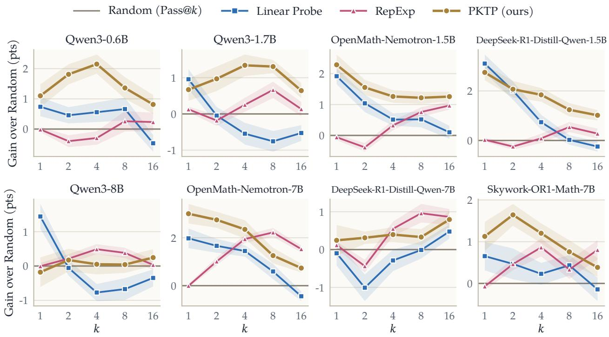  
Figure 8: Gain in pass@k over random pruning with $N = 3 2$ . As in Fig. 3, with a pool of $N = 3 2$ rollouts drawn from the 128 generated for each problem and $T = 4 0 0 0$

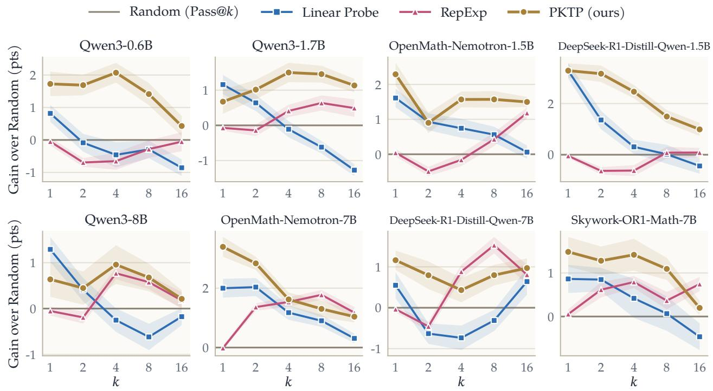  
Figure 9: Gain in pass@k over random pruning with N = 48. As in Fig. 3, with a pool of N = 48 rollouts drawn from the 128 generated for each problem and T = 4000.

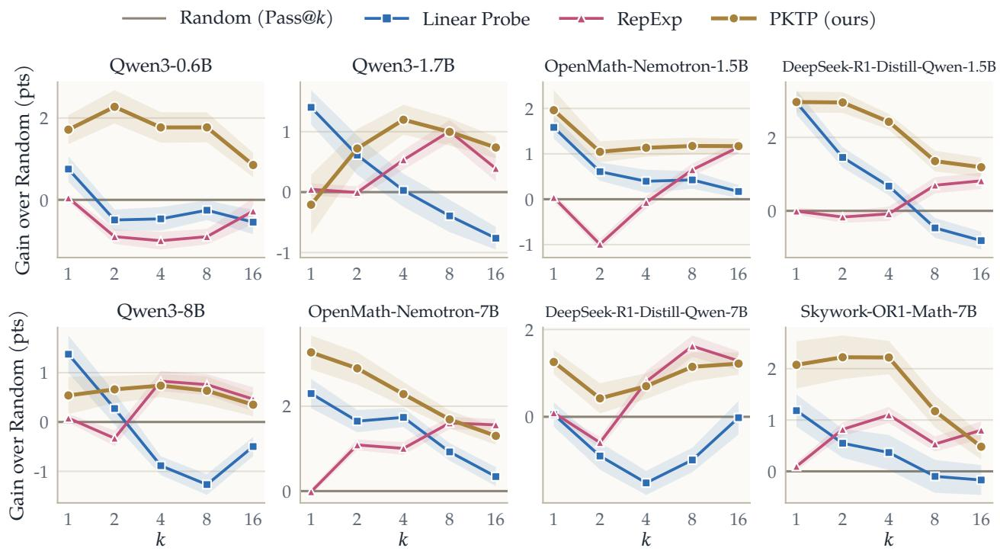  
Figure 10: Gain in pass@k over random pruning with N = 64. As in Fig. 3, with a pool of N = 64 rollouts drawn from the 128 generated for each problem and $T = 4 0 0 0$

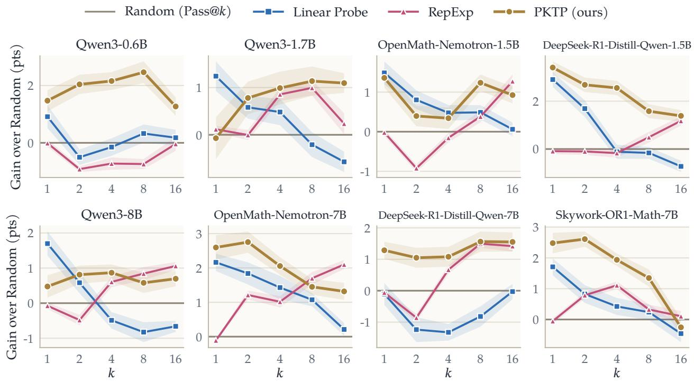  
Figure 11: Gain in pass@k over random pruning with N = 80. As in Fig. 3, with a pool of N = 80 rollouts drawn from the 128 generated for each problem and T = 4000.

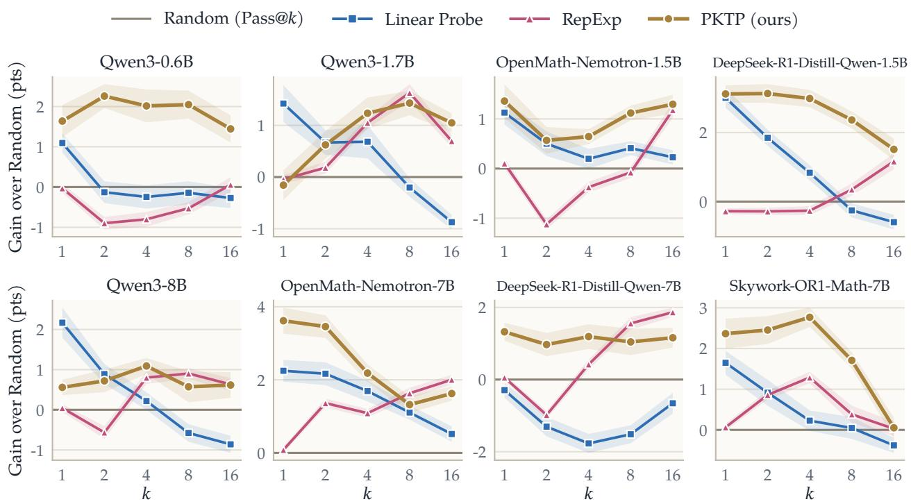  
Figure 12: Gain in pass@k over random pruning with N = 96. As in Fig. 3, with a pool of N = 96 rollouts drawn from the 128 generated for each problem and $T = 4 0 0 0$

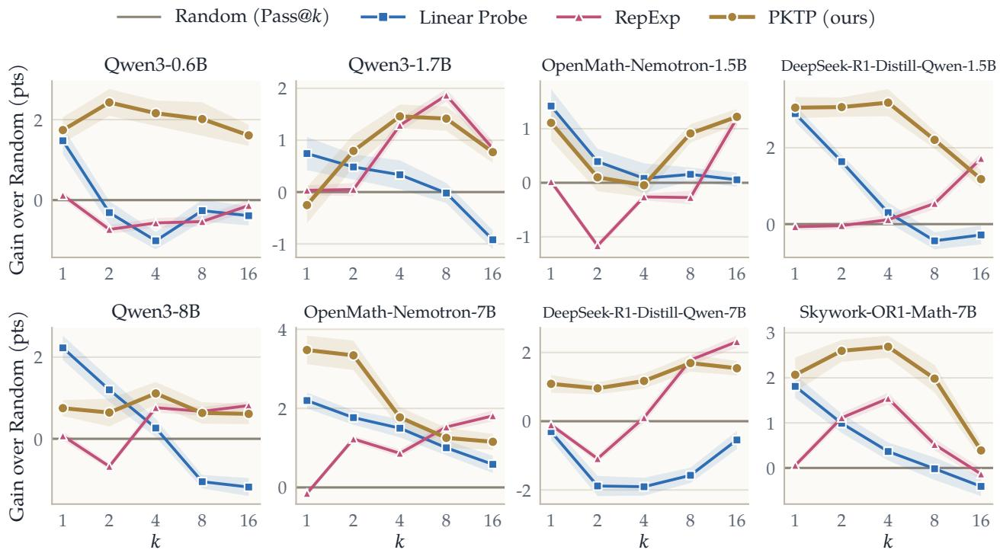  
Figure 13: Gain in pass@k over random pruning with N = 112. As in Fig. 3, with a pool of $N = 1 1 2$ rollouts drawn from the 128 generated for each problem and $T = 4 0 0 0 .$

## F Representation details

For each rollout, let $x _ { t } \in \mathbb { R } ^ { d }$ be the hidden state of the last transformer block of the model at the t-th generated token, where d is the hidden size of the model, which is 1024 for Qwen3-0.6B, 2048 for Qwen3-1.7B, 4096 for Qwen3-8B, 1536 for OpenMath-Nemotron-1.5B and DeepSeek-R1-Distill-Qwen-1.5B, and 3584 for OpenMath-Nemotron-7B, DeepSeek-R1-Distill-Qwen-7B and Skywork-OR1-Math-7B. The EMA follows $e _ { t } = \left( 1 - \alpha \right) e _ { t - 1 } + \alpha x _ { t }$ with $\alpha = 1 0 ^ { - 3 }$ , and $h _ { i }$ is the normalized value of $e _ { t }$ after the first $T$ generated tokens, or after all of them for a rollout that ends before the cutof.

## G Extended related work

Pruning rollouts at test time. Test-time scaling generates many rollouts per problem and aggregates them [3, 35, 44, 48], and a growing line of work saves compute by stopping unpromising rollouts early. One family uses the model’s own confidence, such as token-level confidence or its self-estimate of success, to decide which rollouts to continue [13, 30]. Another scores partia rollouts with a reward model [36] or with a probe on the hidden states [1, 25, 54]. Yang et al. [51] concurrently use such a probe for a beam search over partial rollouts, pruning weak rollouts and branching new rollouts from the best prefixes. All of these score each rollout on its own and keep the highest-scoring ones, which is the pure exploitation extreme of Section 2. At the other extreme, RepExp [39] selects rollouts whose representations are least explained by those already chosen, without using their quality. PKTP sits between the two, since it models how the outcomes of the rollouts depend on each other and chooses the set with the highest predicted pass@k.

Pass@k as an objective. Pass@k is a standard evaluation metric for reasoning and code generation, and several works optimize it during training. Walder and Karkhanis [41] derive lowvariance policy-gradient estimators for pass@k, Chen et al. [8] use pass@k as the reward to balance exploration and exploitation, and Chow et al. [10] fine-tune a model for best-of-N inference. Chen et al. [7] reward a group of responses for both quality and diversity, measuring diversity by the determinant of their similarity matrix. These are post-training methods, while PKTP leaves the model unchanged and optimizes pass@k at inference time by choosing which partial rollouts to continue. Concurrently, Wu et al. [47] also leave the reasoning model unchanged, but use pass@k as the reward to train a planner that writes a diferent outline for each rollout before it is generated. They thus change how the rollouts are sampled, while PKTP takes N independently sampled partial rollouts as given and chooses which k of them to continue.

Related objectives: maximizing at least one success. The same objective appears in information retrieval as the expected 1-call@k, the probability that at least one of the top k documents is relevant. Chen and Karger [6] optimize it greedily, and Sanner et al. [34] show that greedy optimization under a latent subtopic model of relevance leads to diverse rankings, in the same way that our latent factor leads to diverse kept sets. In Bayesian optimization, the batch probability of improvement is the probability that at least one point of a batch improves on the incumbent, and it is monotone and submodular, so it can be maximized greedily [32, 46]. Other methods balance quality and diversity with a hand-set trade-of, such as maximal marginal relevance [5] and determinantal point processes [22]. In contrast to these works, PKTP applies to partial reasoning rollouts, learns the joint distribution of their outcomes from their representations, and optimizes a closed-form surrogate that keeps the submodularity of the exact objective.