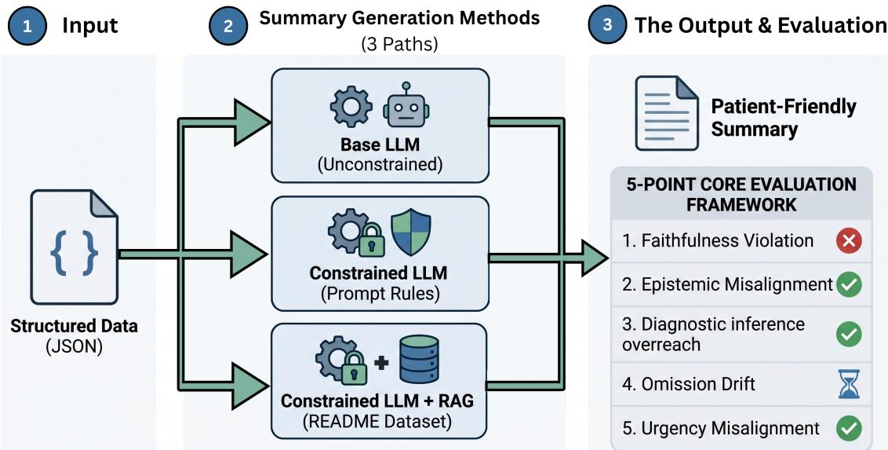
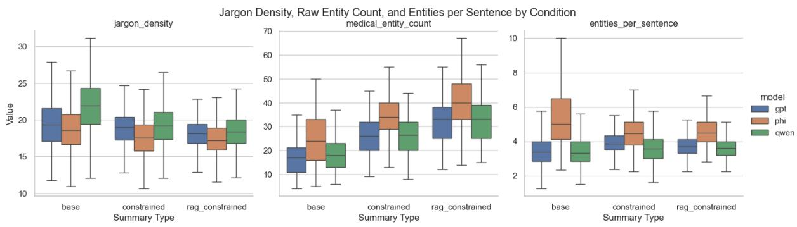
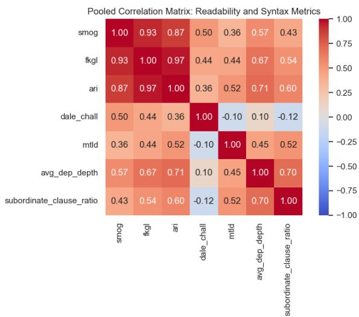

# From Structured Records to Patient Narratives: Preserving Clinical Alignment in LLM-Generated Health Summaries

Bayram Ayadi<sup>1,2</sup> Florian Geissler<sup>2</sup> Johanna Schmidhuber<sup>2</sup>

<sup>1</sup>University of Passau, Passau, Germany

<sup>2</sup>Fraunhofer Institute for Cognitive Systems IKS, Munich, Germany ayadi02@ads.uni-passau.de, florian.geissler@iks.fraunhofer.de

## Abstract

As wearable and digital health systems increasingly generate longitudinal physiological records, communicating these observations in patient-accessible language remains a significant challenge. Large Language Models (LLMs) offer a promising mechanism for translating structured clinical information into readable narratives, but this process may introduce semantic drift, where clinically precise meaning is distorted during simplification.

We investigate evidence-grounded health summarization for menstrual health monitoring using a constrained generation framework that combines structured evidence conditioning with Retrieval-Augmented Generation (RAG) using a prompt-based constrained generation framework. We evaluate semantic alignment using Natural Language Inference (NLI), atomic factuality metrics, and readability measures.

Across three LLMs and 4,500 generated summaries, explicit grounding constraints consistently improve clinical alignment, particularly by improving uncertainty preservation and, once faithfulness is evaluated against retrieved evidence, generally preserving or improving faithfulness, while effects on omission remain model-dependent. We also find that improved clinical alignment comes at the cost of increased reading difficulty and medical terminology. These findings highlight the need to jointly evaluate faithfulness, uncertainty preservation, and readability when developing patient-facing medical LLM systems.

## 1 Introduction

The growing integration of wearable and digital health technologies into everyday life has created an expanding stream of longitudinal physiological data (spanning menstrual cycle phases, heart rate variability (HRV), skin temperature, and sleep quality) that is increasingly interpreted by patients themselves rather than by clinicians. Communicating these observations in accessible lay language is therefore a task with direct implications for patient safety and health literacy.

Large Language Models (LLMs) present a compelling mechanism for this translation. Recent work demonstrates that adapted LLMs can match or exceed medical expert performance on standard clinical summarization benchmarks (Van Veen et al., 2024), and the field has seen rapid advances in factuality verification, constrained generation, and longitudinal narrative synthesis. Semantic drift, defined as the accumulation of semantic change as medical concepts move from clinical to public discourse, has been shown to be greatest at precisely this transition point (Karakkaparambil James et al., 2026). Our work operationalizes this broader phenomenon in the context of automated summarization, introducing a five-category clinical alignment taxonomy and a constrained generation framework to systematically measure and mitigate misalignment across these dimensions.

Existing approaches to health text simplification assume a semantically equivalent reference document to simplify. Our setting is fundamentally different, generating patient-facing narratives directly from structured physiological observations, where faithfulness must be verified against raw evidence rather than a reference text. This gap is particularly consequential in menstrual health monitoring, where cyclical signals, intrinsic uncertainty, and the documented consequences of urgency miscalibration make evidence-grounded generation especially critical.

This paper makes the following contributions:

• We formalize the structured-to-narrative summarization task for longitudinal physiological records and introduce an evaluation concept using a taxonomy of five semantic drift conditions: Faithfulness Violation, Epistemic Misalignment, Diagnostic Inference Overreach, Omission Drift, and Urgency Mis-

## alignment.

• We design and implement a framework for the semi-synthetic generation of medically grounded menstrual health data.

• We propose an LLM-based generation pipeline combining explicit evidencegrounding constraints, targeting each alignment category in the taxonomy, with RAG that supports simplification through retrieved lay-term definitions.

• We systematically evaluate the clinical alignment of generated patient narratives along the defined taxonomy and derive preliminary insights on favorable configurations of such a setup in menstrual health monitoring.

Taken together, this work positions trustworthy simplification as a central and measurable challenge in human-centered digital health.

## 2 Related Work

## 2.1 Clinical Summarization and Lay-Language Simplification

Clinical summarization includes both expert-toexpert tasks, such as radiology impressions and discharge summaries, and expert-to-patient communication, which requires lay-language simplification grounded in health literacy. (Van Veen et al., 2024) show that adapted LLMs can match or exceed human expert performance across multiple clinical summarization tasks, suggesting that output fluency is less of a bottleneck than semantic fidelity. In longitudinal settings, CLIN-SUMM (D’souza et al., 2025) demonstrates the value of temporally structured summarization, while (Ferrazzi et al., 2026) show that supervised fine-tuning and constrained decoding can allow small domainspecific models to outperform much larger ones. This motivates our use of explicit generation constraints, though we apply them at the prompting level rather than through decoding-time control.

For patient-facing communication, simplification is closely tied to health literacy and selfmanagement outcomes (Fitzpatrick, 2023). Resources such as README (Yao et al., 2024) and multi-stage simplification pipelines like S3 support medical-to-lay translation, but prior work consistently highlights a trade-off between readability and fidelity. Simplification can improve accessibility while omitting or distorting clinically important qualifiers, a pattern consistent with semantic drift in the transition from evidence to narrative (Karakkaparambil James et al., 2026). Recent work addresses this tension through fidelity-readability optimization (Verma et al., 2026), and reproductive health further complicates simplification due to indirect or stigmatized language (Hua et al., 2026). These findings underscore the need for evidencegrounded generation.

However, existing benchmarks focus on summarizing or simplifying existing clinical text. They do not address generation directly from structured physiological observations, where faithfulness must be preserved against raw evidence rather than a reference document.

## 2.2 NLI-Based Faithfulness Assessment and Hallucination Verification

Natural Language Inference (NLI) (Bowman et al., 2015; Williams et al., 2018) is widely used for factuality assessment in summarization, especially when combined with atomic fact decomposition (Min et al., 2023; Kamoi et al., 2023). In medical settings, this is particularly relevant because hallucinations often reflect reasoning failures rather than missing knowledge (Pal et al., 2023). Benchmarks such as Med-HALT and MedHalu show that instruction tuning can even worsen hallucination behavior, motivating verification-based evaluation.

Clinical NLI was established by MedNLI (Romanov and Shivade, 2018), but several limitations remain. Clinical NLI datasets contain annotation artifacts that can inflate performance (Herlihy and Rudinger, 2021), NLI models degrade under domain shift (Jullien et al., 2024), and textual entailment is not equivalent to factual support (Mor-Lan and Levi, 2024). In addition, atomic-level verification depends heavily on the consistency of fact decomposition in clinical text (Munnangi et al., 2025).

The most relevant paradigm is decompose-thenverify. FActScore (Min et al., 2023) evaluates generated text at the atomic-claim level against trusted evidence, while AlignScore (Zha et al., 2023) learns a broader alignment function across NLI, QA, and IR tasks. Despite known limitations, these claim-level methods are better suited than surface metrics such as ROUGE for detecting the subtle semantic drift central to our setting.

Overall, prior work has studied constrained generation, factuality verification, and longitudinal summarization largely in isolation. To our knowledge, no work has combined them for structuredto-narrative, patient-facing summarization of wearable health data. Our paper addresses this gap.

## 3 Methodology

This work investigates whether evidence-grounded and constrained language generation can improve semantic alignment during the simplification of longitudinal health observations into patient-facing summaries. The framework targets factual consistency, uncertainty calibration, and clinical faithfulness while maintaining accessibility for non-expert users.

## 3.1 Task Definition

Given a structured set of physiological observations derived from longitudinal health monitoring, the task is to generate a patient-oriented natural language summary that remains faithful to the underlying evidence, avoids unsupported medical claims, preserves clinically relevant uncertainty, and is understandable to non-expert users. Formally, let $X = \{ x _ { 1 } , x _ { 2 } , . . . , x _ { n } \}$ denote a structured physiological record containing observed signals, symptom annotations, and contextual metadata. The objective is to generate a lay-language summary Y such that the generated content remains semantically aligned with X while minimizing factual distortion. The evaluation of this semantic alignment is detailed in Sec. 3.5.

## 3.2 Dataset Construction

Due to the limited availability of publicly accessible longitudinal menstrual-health datasets paired with patient-oriented summaries, this study employs a semi-synthetic structured dataset generated via a causal directed acyclic graph (DAG) that encodes known physiological dependencies across the menstrual cycle. The generator produces 500 single-day observations, each drawn from a stochastically determined cycle, following a biologically motivated causal ordering: temporal structure (cycle and luteal-phase length, calibrated to population data (Bull et al., 2019; Fehring et al., 2006)) determines phase and cycle day; sleep quality and duration are conditioned on phase, reflecting progesterone-mediated sleep disruption (Baker and Driver, 2007); resting heart rate and HRV trend are jointly conditioned on phase and sleep, capturing both hormonal modulation (Tenan et al., 2014)

and acute sympathetic override; $\mathrm { { S p O _ { 2 } } }$ is sampled independently as a homeostatically regulated signal; and symptoms are generated as downstream consequences of these upstream states rather than independent annotations.

To simulate real-world data sparsity, each sample is assigned one of five user profiles (minimal\_tracker to advanced\_wearable) that determine which fields are observable, probabilistically available, or systematically absent, producing behaviorally mediated structured missingness. A confidence score, derived from resulting data completeness and phase clarity, provides uncertainty metadata for downstream generation. The full causal record (pre-masking) is retained as ground truth X, enabling evaluation of whether generated summaries faithfully reflect available evidence without hallucinating masked information.

Full details of the generative DAG and an example record are provided in Appendix A.

## 3.3 System Overview

Our system takes each patient’s structured menstrual-health record (fields such as cycle timing, symptoms, trends, and related clinical context) and generates patient-facing summaries under three generation regimes: Base, Constrained, and RAG-Constrained. In the Base setting, the model summarizes directly from the record with minimal control; in the Constrained setting, the same input is generated under explicit clinical communication constraints, implemented as structured instructions within the prompt (for example, factual grounding, uncertainty handling, and nuance-preservation rules, full prompts in Appendix B). Finally, in the RAG-Constrained setting, those constraints are retained while adding retrieved lay-term definitions to support clearer, simplified explanations (see Appendix C for implementation details). Specifically, the role of Retrieval-Augmented Generation (RAG) in this setting is to facilitate text simplification using the README dataset, an extensive collection of over 50,000 unique pairs of medical terms and their lay definitions (Yao et al., 2024). Together, these constraints enforce evidence-aware summarization over open-ended medical interpretation.

## 3.4 Experimental Setup and Baselines

To systematically evaluate the impact of our evidence-grounded generation framework, we benchmarked the task across three distinct tiers of Large Language Models. This selection allows us to observe how model scale affects clinical alignment and constraint adherence:

  
Figure 1: Overview of the pipeline and five-category semantic alignment evaluation framework.

• GPT-4o: Representing a state-of-the-art, large-scale proprietary model (OpenAI et al., 2024).

• Qwen2.5:14B-Instruct: Representing a highly capable, mid-sized open-weight model (Qwen et al., 2025).

• Phi-4-mini-4B: Representing a lightweight, efficient small language model (SLM) suitable for low-latency or on-device health applications (Microsoft et al., 2025).

For our experiments, we sampled 500 records from the semi-synthetic menstrual health dataset. Each record was processed across the three models using three distinct generation configurations, resulting in a total corpus of 4,500 patient-facing summaries. The configurations evaluated include:

• Base(Vanilla LLM): The model directly translates the structured physiological observations into a summary.

• Constrained: The model generates a summary utilizing explicit evidence-grounding constraints (e.g., Uncertainty Preservation, Diagnostic Constraint) injected into the prompt, but operates without Retrieval-Augmented Generation (RAG).

• RAG-Constrained: The full pipeline combining non-parametric retrieval from a curated medical knowledge base (medical term, lay definition) with explicit prompt based clinical constraints.

## 3.5 Evaluation

We define all semantic alignment metrics so that a score of zero indicates perfect alignment and higher values indicate greater drift. Let X denote the structured physiological record and Y the generated patient-facing summary.

Faithfulness violation $( M _ { \mathrm { f a i t h } } )$ . Each summary’s precomputed atomic\_facts are checked against a textual premise formed by concatenating all non-null fields of X (excluding sample\_id) into field-value statements. Each claim $a _ { i } \in A$ is tested with pritamdeka/PubMedBERT-MNLI-MedNLI (Deka et al., 2023) via the Hugging Face textclassification pipeline; a claim is supported only if labeled entailment:

For each atomic claim $a _ { i } \in \mathsf { \Gamma } A$ , we query pritamdeka/PubMedBERT-MNLI-MedNLI via the Hugging Face text-classification pipeline, using X as the premise and a<sub>i</sub> as the hypothesis. Let $\begin{array} { r l } { \mathrm { { N L I } } ( X , a _ { i } ) } & { { } \in } \end{array}$ {entailment, neutral, contradiction} denote the predicted label. We define the support indicator:

$$
\mathbb { I } _ { \mathrm { s u p } } ( a _ { i } ) = { \left\{ \begin{array} { l l } { 1 } & { { \mathrm { i f ~ } } \mathrm { N L I } ( X , a _ { i } ) = { \mathrm { e n t a i l m e n t } } } \\ { 0 } & { { \mathrm { o t h e r w i s e } } } \end{array} \right. }\tag{1}
$$

$$
M _ { \mathrm { f a i t h } } = \frac { 1 } { \left| A \right| } \sum _ { i = 1 } ^ { \left| A \right| } \left( 1 - \mathbb { I } _ { \operatorname* { s u p } } ( a _ { i } ) \right)\tag{2}
$$

Epistemic misalignment $( M _ { \mathrm { e p i s t } } ) .$ . A record bears uncertainty if confidence\_score $< ~ 0 . 6 0$ or missing\_fields is non-empty. Claims from such records are uncertainty-sensitive if they contain cycle- or interpretation-related keywords (e.g., phase, ovulation, trend, normal). A claim is definitive if it contains no hedge markers (e.g., may, might, likely) and is asserted directly:

<table><tr><td>Alignment Condi- Definition tion</td><td></td><td>Example</td><td>Metric</td><td>Related Work</td></tr><tr><td>Faithfulness Viola- tion</td><td>Unsupported physiologi- cal claims generated be- yond the scope of the structured evidence</td><td>Stating elevated HRV when only temperature data is present</td><td>Eq. 2</td><td>Faithfulness and factual- ity(Maynez et al., 2020)</td></tr><tr><td>Epistemic mis- alignment</td><td>Amplification of uncer- tain observations into definitive statements</td><td>“Your cycle is irregular&quot; in- Eq. 3 stead of “your cycle may be irregular&quot;</td><td></td><td>(Clark et al., 2025)</td></tr><tr><td>Diagnostic infer- ence overreach</td><td>Implication of pathology unsupported by the under- lying evidence</td><td>Suggesting endometriosis from mild cramp annotations</td><td>Eq. 4</td><td>(Zhu et al., 2026)</td></tr><tr><td>Omission Drift</td><td>Removal of clinically rel- evant nuance during sim- plification</td><td>Dropping confidence scores or phase uncertainty from the summary</td><td>Eq.5</td><td>(Oukelmoun et al., 2025)</td></tr><tr><td>Urgency Misalign- ment</td><td>Unnecessarily alarming or over-reassuring lan- guage</td><td>“This is completely normal&quot; for an ambiguous HRV drop</td><td>Eq. 6</td><td></td></tr></table>

Table 1: Semantic alignment taxonomy covering five clinical alignment conditions, their definitions, illustrative examples, formal metrics, and connections to related literature concepts.

$$
M _ { \mathrm { e p i s t } } = { \frac { 1 } { | A _ { \mathrm { u n c } } | } } \sum _ { a \in A _ { \mathrm { u n c } } } \mathbb { I } ( \mathrm { I s D e f i n i t i v e } ( a ) ) .\tag{3}
$$

With $M _ { \mathrm { e p i s t } } = 0$ , no uncertainty-sensitive claims exist.

Diagnostic inference overreach $( M _ { \mathrm { d i a g } } )$ . Unsupported pathology mentions are detected via scispaCy en\_ner\_bc5cdr\_md with medSpaCy negation handling; only non-negated DISEASE mentions are retained as $D _ { Y }$ . A summary overreaches if any extracted diagnosis is absent from the textualized source record:

$$
M _ { \mathrm { d i a g } } = \mathbb { I } ( D _ { Y } \not \subseteq X ) .\tag{4}
$$

We also report a corrected version excluding pregnancy and ectopic pregnancy, which manual review showed were typically explanatory reproductive-context mentions rather than unsupported diagnoses.

Omission drift $( M _ { \mathrm { o m i t } } )$ . For a fixed salient-field set (cycle timing, phase, ovulation estimate, sleep, resting heart rate, HRV trend, SpO , temperature trend, symptoms), we generate a reference statement per non-null field and test reversed entailment with the same NLI model (summary as premise, field statement as hypothesis). Unentailed fields count as omitted:

$$
M _ { \mathrm { o m i t } } = \frac { \# \mathrm { o m i t t e d s a l i e n t f i e l d s } } { \# \mathrm { n o n } \mathrm { - n u l l s a l i e n t f i e l d s i n } X } .\tag{5}
$$

Urgency misalignment $( M _ { \mathrm { u r g } } )$ . Unlike the claimlevel metrics above, urgency concerns perceived tone rather than entailment. Each summary Y is rated by an LLM judge (Claude-3.5-Haiku (Anthropic, 2024) , temperature 0) on a continuous scale from reassuring to alarming, independent of whether that tone is clinically warranted:

$$
M _ { \mathrm { u r g } } = \mathrm { J u d g e } ( Y ) \in [ 0 , 1 ] .\tag{6}
$$

Readability, lexical diversity, and jargon. We assess the fidelity-accessibility trade-off along three axes.

Grade-level readability: SMOG, FKGL, and ARI, plus Dale-Chall (vocabulary familiarity, largely length-independent); since the three grade-level indices are highly correlated, FKGL is our primary endpoint, with SMOG and ARI as robustness checks.

Lexical and syntactic complexity: MTLD (forwardbackward averaged, factor threshold 0.72) for lexical variety, and a fixed spaCy parser for mean dependency-tree depth and subordinate-clause ratio, applied identically across conditions; word counts are tracked to detect verbosity inflation.

Medical jargon: scispaCy with a UMLS linker identifies terms resolving to a documented UMLS concept, reported as density (entities per 100 words), raw entity count, and entities per sentence.

## 3.6 Statistical Procedure

For each metric we run paired Wilcoxon signedrank tests (Wilcoxon, 1992) , since the design is fully matched and several metrics are not normally distributed. We report the paired mean and median difference, a paired Cohen’s d (mean difference over the standard deviation of the paired differences), and the matched-pairs rank-biserial correlation as a non-parametric effect size. Two families of contrasts are tested separately: Within-model comparisons across the three summary types, and within-summary-type comparisons across the three models. Because n = 500 pairs per test, most contrasts reach statistical significance; we therefore treat effect size, not the raw p-value, as the basis for interpretation. p-values are corrected for multiple comparisons with the Benjamini-Hochberg procedure, applied separately within each of the two contrast families.

## 4 Results

We evaluated three models (GPT-4o, Phi-4-mini, and Qwen2.5-14B) across three generation settings (base, constrained, and rag\_constrained) on 500 structured records, yielding 4,500 generated summaries in total. We report the five semanticalignment metrics (Table 1), together with readability, lexical-diversity, syntactic-complexity, and jargon measures to characterize the fidelityaccessibility trade-off. Because the grade-level readability metrics are strongly intercorrelated, we use FKGL as the primary grade-level endpoint and treat SMOG and ARI as robustness checks; Dale-Chall, MTLD, dependency depth, and subordinateclause ratio are interpreted as distinct constructs.

## 4.1 Clinical alignment

Faithfulness violation. Table 2 reports mean faithfulness violation rates across models and settings (corrected for RAG-constrained as described in §5.2). For all three models, $M _ { \mathrm { f a i t h } }$ is lowest or comparable in the RAG-constrained condition relative to constrained: GPT-4o improves further under retrieval (0.186 → 0.152), Qwen2.5-14B is essentially unchanged (0.165 → 0.162), and Phi-4-mini shows a small increase (0.212 → 0.220). All three models remain well below their base levels. Pooled across settings, mean $M _ { \mathrm { f a i t h } }$ is 0.242 for base, 0.188 for constrained, and 0.178 for rag\_constrained; across models, Qwen2.5-14B performs best overall (0.172), followed by GPT-4o (0.201) and Phi-4- mini (0.235).

Epistemic misalignment. As shown in Table 2, $M _ { \mathrm { e p i s t } }$ decreases monotonically from base to constrained to rag\_constrained for all three models, with the pooled mean falling from 0.297 to 0.263 to 0.248. GPT-4o achieves the lowest final value (0.237); Phi-4-mini and Qwen2.5-14B show the same monotonic pattern. Median $M _ { \mathrm { e p i s t } }$ is 0.0 in every model-by-setting cell, so the mean is driven by a smaller subset of problematic cases. Notably, this improvement occurs despite the average number of uncertainty-sensitive claims rising across settings (pooled: $1 . 1 7  1 . 7 6  2 . 7 0 )$ , indicating that explicit uncertainty-preservation instructions and retrieved explanatory support help models state uncertain observations more cautiously rather than more definitively.

Diagnostic inference overreach. The raw diagnostic-overreach metric suggested substantial monotonic increases under constraints and retrieval; manual inspection traced nearly all flagged cases to pregnancy or ectopic pregnancy mentions used in fertility-window or ovulation explanations rather than as unsupported diagnoses (discussed further in §5.2). After excluding these two terms, overreach collapses to near zero in every cell: GPT-4o and Qwen2.5-14B fall to 0.000 in all settings, while Phi-4-mini reaches only 0.004 in base and 0.006 in rag\_constrained.

Omission drift. Omission drift shows more heterogeneous behavior. GPT-4o improves monotonically, from 0.219 (base) to 0.130 (rag\_constrained), with a median of 0.0 under rag\_constrained. Qwen2.5-14B performs best under constrained generation (0.147) and rises slightly under retrieval (0.167), remaining below its base value (0.176). Phi-4-mini is the only model that worsens monotonically, from 0.264 to 0.286. Pooled across settings, omission drift declines only modestly $( 0 . 2 2 0  0 . 2 0 5  0 . 1 9 4 )$ , masking these model-specific differences; we relate Phi-4-mini’s reversal to its more discursive output style in §5.2.

Urgency misalignment. Mean $M _ { \mathrm { u r g } }$ increases significantly from base to constrained for all three models (e.g., GPT-4o: 0.170 → 0.227, d = −0.61; all $p _ { \mathrm { F D R } } < 1 0 ^ { - 5 } )$ , then drops significantly from constrained to rag\_constrained for every model $( d = 0 . 3 7 \mathrm { - } 0 . 4 5 ,$ , all $p _ { \mathrm { F D R } } < 1 0 ^ { - 1 3 } )$ , returning GPT-4o and Phi-4-mini to base levels while Qwen2.5-14B only partially recovers. Across settings, GPT-4o is consistently the least alarming model, though this gap narrows once retrieval is added.

<table><tr><td>Model</td><td>Setting</td><td> $M _ { \mathrm { f a i t h } } \downarrow$ </td><td> $M _ { \mathrm { e p i s t } } \downarrow$ </td><td> $M _ { \mathbf { d i a g } } \downarrow$ </td><td> $M _ { \bf o m i t } .$  →</td><td> $M _ { \mathbf { u r g } }$ </td></tr><tr><td>GPT-40</td><td>Base</td><td>0.264</td><td>0.293</td><td>0.000</td><td>0.219</td><td>0.170</td></tr><tr><td></td><td>Constrained</td><td>0.186</td><td>0.243</td><td>0.000</td><td>0.195</td><td>0.227</td></tr><tr><td></td><td>RAG-Constrained</td><td>0.152</td><td>0.237</td><td>0.000</td><td>0.130</td><td>0.179</td></tr><tr><td>Qwen2.5-14B</td><td>Base</td><td>0.190</td><td>0.299</td><td>0.000</td><td>0.176</td><td>0.247</td></tr><tr><td></td><td>Constrained</td><td>0.165</td><td>0.275</td><td>0.000</td><td>0.147</td><td>0.270</td></tr><tr><td></td><td>RAG-Constrained</td><td>0.162</td><td>0.251</td><td>0.000</td><td>0.167</td><td>0.199</td></tr><tr><td>Phi-4-mini</td><td>Base</td><td>0.273</td><td>0.298</td><td>0.004</td><td>0.264</td><td>0.237</td></tr><tr><td></td><td>Constrained</td><td>0.212</td><td>0.270</td><td>0.000</td><td>0.273</td><td>0.263</td></tr><tr><td></td><td>RAG-Constrained</td><td>0.220</td><td>0.255</td><td>0.006</td><td>0.286</td><td>0.181</td></tr></table>

Table 2: Clinical alignment metrics by model and generation setting, ordered by model scale (large to small). $M _ { \mathrm { f a i t h } }$ faithfulness violation rate (RAG-constrained: entailed by X or retrieved context); $M _ { \mathrm { e p i s t } } \mathrm { : }$ epistemic misalignment; $M _ { \mathrm { d i a g } } { \mathrm { : } }$ diagnostic inference overreach (corrected, excluding pregnancy/ectopic pregnancy mentions); $M _ { \mathrm { o m i t } } \mathrm { : }$ omission drift; $M _ { \mathrm { u r g } } { \mathrm { : } }$ urgency misalignment. All metrics range [0, 1] with lower values indicating better alignment.

## 4.2 Readability and stylistic trade-offs

Grade-level readability and syntactic complexity. Across all three models, readability worsens under added control: all three grade-level metrics increase monotonically or near-monotonically from base to constrained to rag\_constrained (Table 6), with FKGL as the primary endpoint. For GPT-4o, the largest shift occurs between base and constrained (FKGL paired $d = 1 . 3 9 ;$ ARI d = 1.22; Dale-Chall $d = 1 . 2 3 ;$ all $p _ { \mathrm { F D R } } < 1 0 ^ { - 7 0 } )$ while the further increase from constrained to rag\_constrained is modest for FKGL $( d = 0 . 2 6 )$ and negligible for ARI $( d ~ = ~ - 0 . 0 8$ , n.s. after correction) and Dale-Chall $( d = - 0 . 0 9$ , significant but trivial). Dependency-tree depth follows the same pattern: a large increase from base to constrained $( d = 0 . 9 0 )$ with essentially no further change under retrieval $( d = 0 . 0 1 , \mathrm { n . s . } )$ . This suggests explicit grounding constraints, rather than retrieval itself, are the main driver of increased reading difficulty. Table 6 shows the same qualitative pattern across models: Phi-4-mini produces the highest grade-level outputs under all settings, GPT-4o occupies the middle range, and Qwen2.5- 14B is typically lowest on FKGL and ARI once constraints are applied.

Lexical diversity. Using MTLD (to assess lexical variety independent of length), GPT-4o shows a clear decline from base to rag\_constrained, modest between base and constrained $( d \mathbf { \theta } =$ −0.26) and substantially larger between base and rag\_constrained $( d = - 0 . 6 3 )$ . Phi-4-mini declines similarly, from a much higher starting point. Qwen2.5-14B is comparatively stable, even rising slightly from base to constrained before returning near baseline under retrieval. The lexicaldiversity cost of constrained generation is therefore model-dependent rather than universal.

Medical jargon. Medical-jargon usage shows a more nuanced trade-off than a single measure captures. As shown in Table 7, raw medical entity count rises consistently from base to rag\_constrained for every model, with large effects for GPT-4o (constrained minus base: d = 1.89; rag\_constrained minus base: $d = 2 . 2 4 )$ By contrast, jargon density (entities per 100 words) declines across settings for all models, since total word count grows.

## 5 Discussion

## 5.1 Readability

Taken together, these results indicate that the evidence-grounding mechanisms evaluated for their effect on factual alignment in Section 3 carry a measurable cost in accessibility. Grade-level readability increases substantially once explicit constraints are applied, largely independent of whether retrieval is also used, while lexical diversity decreases and domain-term mentions increase in absolute terms even as their density per word declines. This is consistent with the readability-fidelity tension noted in constrained clinical summarization more broadly (Verma et al., 2026), and suggests that the drift-reduction constraints introduced in this work should be evaluated jointly against both factual alignment and reading difficulty rather than either in isolation. We treat this joint analysis, correlating the per-sample drift metrics of Table 1 against the per-sample readability measures reported here, as a direct extension of the present results. One caveat applies to how we measure readability: FKGL, ARI, and SMOG are based on sentence length and syllable counts, not on how conceptually difficult a word actually is. This means a technical term like "ptosis" can score as easier than an everyday word like "congratulations" simply because it has fewer syllables. This matters for our RAG results as FKGL increases modestly from Constrained to RAG-Constrained (d=0.26) despite stable sentence length, driven mainly by near-doubled medical-term counts. This suggests the extra difficulty these formulas detect comes mainly from added vocabulary, not from harder sentence structure, especially since RAG also supplies a lay definition alongside each term. This doesn’t remove the broader readability cost we report above, but it suggests the part of that cost caused specifically by RAG may be smaller than the raw grade-level scores suggest.

## 5.2 Clinical Alignment

Table 2 reports all four clinical alignment metrics across models and generation settings. Across the four metrics, only epistemic misalignment improves consistently across all three models as generation moves from base to Constrained to RAG-Constrained. The other three metrics deviate for distinct, explainable reasons.

Faithfulness under retrieval was underestimated by the original formulation. $M _ { f a i t h }$ verifies claims against the structured record X alone, ignoring retrieved context. Because RAGconstrained prompts instruct models to use retrieved lay-term definitions for explanations, valid supporting content (e.g., a plain-language definition of “HRV”) is generated but flagged as unsupported, inflating $M _ { f a i t h }$ without reflecting genuine unfaithfulness. We correct this by treating a claim as supported if entailed by X or by the retrieved context. Under this correction, mean $M _ { f a i t h }$ for rag\_constrained drops significantly for all three models relative to the original formulation $( d = 0 . 7 6 \mathrm { - } 0 . 8 0$ , all $p < 1 0 ^ { - 4 0 } )$ , and is now significantly lower than constrained for GPT-4o $( d = 0 . 2 8 4 , p = 1 . 0 7 \times 1 0 ^ { - 1 0 } )$ and statistically indistinguishable for Phi-4-mini and Qwen2.5-14B $( p > 0 . 1 5 )$

Diagnostic overreach is almost entirely a vocabulary artifact. Its apparent rise under RAG is fully explained by terms like "pregnancy" and "ectopic pregnancy." Pregnancy is a physiological state and not a true pathology that legitimately surfaces when explaining fertility, which RAG actively supplies. Removing these terms drops overreach to ≤0.6 percent for every model and condition, proving that the models almost never suggest genuinely unsupported pathologies. We recommend reporting these corrected figures as the primary result and separating reproductive contexts from the pathological diagnostic vocabulary.

Omission drift is model-dependent: GPT-4o benefits from the full pipeline, Qwen2.5-14B from constraints alone, and Phi-4-mini uniquely worsens with more grounding. Phi-4-mini’s regression aligns with its readability profile; it adds discursive, explanatory prose rather than restating specific field values outright (e.g., "Resting HR: 71.3"). Because the omission metric checks for direct statements of salient fields, Phi-4-mini fails the strict entailment check even when the underlying information is not truly lost. This indicates the metric is sensitive to surface realization and stylistic differences.

These results complicate a simple "more grounding is better" narrative. Explicit constraints alone account for most metric improvements. Retrieval’s marginal contribution is genuinely positive for epistemic calibration and, once corrected, largely positive or neutral for faithfulness but its effect on omission remains mixed, and its apparent cost for diagnostic overreach is a vocabulary artifact rather than a real effect.

## 6 Conclusion

We find that evidence-grounded constrained generation improves clinical alignment along specific dimensions. The clearest and most consistent effect across all three models is reduced epistemic misalignment. Retrieval further improves faithfulness for GPT-4o and is faithfulness-neutral for the other two models, while its effects on omission and urgency remain smaller and model-dependent. At the same time, constrained and RAG-constrained outputs become harder to read, often less lexically diverse, and heavier in medical terminology.

These results suggest that safer health summarization is not a single-metric problem. Systems must be evaluated jointly for faithfulness, uncertainty preservation, coverage, and readability. This work provides practical guidance to tackle this challenge. More broadly, it contributes a structured-tonarrative evaluation setting and a semantic alignment framework for studying how LLMs turn physiological data into patient-readable explanations.

## Limitations

Our study has several limitations that should inform how these results are interpreted.

No human validation of automatic metrics. All five clinical alignment metrics rely on automatic tools: an NLI model (PubMedBERT-MNLI-MedNLI) for faithfulness violation and omission drift, a named entity recognizer with negation handling for diagnostic inference overreach, and a single LLM judge for urgency misalignment. While these are established approaches in the factuality literature, prior work has documented that clinical NLI models contain annotation artifacts and degrade under domain shift, and that textual entailment does not always correspond to factual support. We do not have a human-annotated subsample to validate any of the five metrics against clinician or expert judgment, and we treat this as the most important direction for follow-up work.

Single LLM judge for urgency. Urgency misalignment is scored by a single model (Claude 3.5 Haiku) at a fixed temperature, without inter-rater reliability checks, comparison to human raters, or an ensemble of judges. Given that this metric concerns tone rather than propositional content, it is more subjective than the other four and may be more sensitive to idiosyncrasies of the judge model.

Synthetic data without clinician review. Our dataset is generated from a causal DAG that encodes documented physiological relationships between cycle phase, sleep, and autonomic measures, and includes internal coherence checks (Appendix A). The DAG structure and its parameters are our own modeling choices, and neither the generated records nor the associated ground truth have been reviewed by a clinician for biological realism. We note that this limitation is partially mitigated by the nature of our evaluation: our alignment metrics measure whether a generated summary Y is semantically faithful to its own source record X, not whether X itself is a biologically accurate depiction of the menstrual cycle. In this sense the task is closer to a semantic consistency analysis than a biological validity analysis, and the alignment scores we report do not depend on the DAG being an accurate model of physiology. Clinician review of the DAG would therefore primarily affect the realism of the input distribution rather than the validity of the alignment measurements themselves. That said, this gap still matters for generalization as real-world self-tracked data is likely to be noisier, more idiosyncratic, and structured differently than data produced by a hand-specified generative model, and our results should be understood as characterizing model behavior on this particular semi-synthetic input distribution rather than on real user data.

Narrow instantiation of retrieval. In our RAG-Constrained setting, retrieval is limited to lay-term definitions drawn from the README dataset and is not used to supply additional clinical evidence beyond the structured record. Our findings about the marginal contribution of retrieval should therefore be understood as specific to this specific use of RAG, and may not generalize to settings where retrieval is used to bring in additional clinical context.

No external baseline system. As discussed in the main text, we are not aware of prior systems that perform structured-to-narrative generation in this domain, so we rely on internal ablations (Base, Constrained, RAG-Constrained) rather than comparison to an external baseline. This limits our ability to situate the absolute performance of our pipeline relative to other possible approaches.

Domain and demographic scope. Our experiments focus exclusively on menstrual health monitoring using a semi-synthetic dataset. We do not evaluate other physiological domains, and the generative model does not represent the full diversity of menstrual cycle presentations, medical conditions, or demographic variation present in real populations. Findings may not transfer directly to other health domains or to more clinically atypical records.

## Ethical Considerations

Data and privacy. All experiments in this paper use a semi-synthetic dataset generated from a causal statistical model (Appendix A). No real patient records, wearable device data, or personally identifiable health information were collected, accessed, or used at any stage of this work. This eliminates direct privacy risk from our experiments, though it also means our findings should not be taken as validated on real-world data distributions.

Risk of misuse or overreliance. This work studies failure modes, including faithfulness violation, epistemic misalignment, diagnostic inference overreach, omission drift, and urgency misalignment, in LLM-generated health summaries. Our intent is diagnostic and evaluative: to make these failure modes measurable so that they can be mitigated, not to present any of the three tested generation configurations as ready for deployment in a real patientfacing product. None of the metrics or pipelines described here have been clinically validated, and none should be used, as-is, to make or support real health or diagnostic decisions. In particular, our diagnostic inference overreach metric is intended to detect unsupported pathology mentions for research purposes; it is not a clinical safety filter and should not be relied on as one.

Reproductive health context. Menstrual health monitoring involves personal and sometimes stigmatized health information. We chose this domain because cyclical signals, intrinsic physiological uncertainty, and the documented consequences of urgency miscalibration make it a particularly informative and consequential setting for studying evidence-grounded generation, not because we treat it as a low-stakes proxy for health tasks more broadly. We encourage readers to interpret our results as evidence for the general difficulty of structured-to-narrative health summarization, rather than as specific claims about menstrual health applications being closer to solved than other clinical domains.

Automatic and LLM-based evaluation. Several of our metrics rely on automatic NLI models, named entity recognition, and an LLM-as-judge (for urgency misalignment). These are research instruments for comparing generation configurations at scale and have known limitations, including domain shift sensitivity and lack of validated correspondence to clinician judgment (see Limitations). They should not be interpreted as clinically validated safety metrics, and results derived from them should not be used to certify any system as safe for patient-facing use.

Downstream use. We release our dataset generation code (Appendix A) to support reproducibility and further research into evidence-grounded health summarization. We do not release, and did not train, any model intended for deployment. We encourage future work building on this framework to include clinician review and human evaluation of generated summaries before considering any realworld patient-facing application.

## Acknowledgments

We thank Reinhard Stolle and Annette Hautli-Janisz for their valuable guidance, insightful discussions, and continuous support throughout this project.

This work was supported by the Free State of Bavaria within the DSgenAI project under Grant No. RMF-SG20-3410-2-18-4.

## References

Anthropic. 2024. Model card addendum: Claude 3.5 haiku and upgraded claude 3.5 sonnet. Technical report, Anthropic.

Fiona C Baker and Helen S Driver. 2007. Circadian rhythms, sleep, and the menstrual cycle. Sleep medicine, 8(6):613–622.

Samuel R. Bowman, Gabor Angeli, Christopher Potts, and Christopher D. Manning. 2015. A large annotated corpus for learning natural language inference. In Proceedings of the 2015 Conference on Empirical Methods in Natural Language Processing, pages 632–642, Lisbon, Portugal. Association for Computational Linguistics.

Jonathan R Bull, Simon P Rowland, Elina Berglund Scherwitzl, Raoul Scherwitzl, Kristina Gemzell Danielsson, and Joyce Harper. 2019. Real-world menstrual cycle characteristics of more than 600,000 menstrual cycles. NPJ digital medicine, 2(1):83.

Cecilia Castro-Diehl, Ana V Diez Roux, Susan Redline, Teresa Seeman, Paula McKinley, Richard Sloan, and Steven Shea. 2016. Sleep duration and quality in relation to autonomic nervous system measures: The multi-ethnic study of atherosclerosis (mesa). Sleep, 39(11):1927–1940.

Nicholas Clark, Hua Shen, Bill Howe, and Tanu Mitra. 2025. Epistemic alignment: A mediating framework for user-LLM knowledge delivery. In Second Conference on Language Modeling.

Pritam Deka, Anna Jurek-Loughrey, and Deepak P. 2023. Multiple evidence combination for factchecking of health-related information. In The 22nd Workshop on Biomedical Natural Language Processing and BioNLP Shared Tasks, pages 237–247, Toronto, Canada. Association for Computational Linguistics.

Valentina D’souza, Alaleh Azhir, Danielle F. Pace, Samuel Friedman, Arash Nargesi, Tristan Naumann, Christopher D. Anderson, Steven J. Atlas, Judy Hung, and Mahnaz Maddah. 2025. Clin-summ: Temporal summarization of longitudinal clinical notes. medRxiv.

Richard J. Fehring, Mary Schneider, and Kathleen Raviele. 2006. Variability in the phases of the menstrual cycle. Journal of Obstetric, Gynecologic, & Neonatal Nursing, 35(3):376–384.

Pietro Ferrazzi, Milica Cvjeticanin, Alessio Piraccini, and Davide Giannuzzi. 2026. Is agentic rag worth it? an experimental comparison of rag approaches. Preprint, arXiv:2601.07711.

Patrick J Fitzpatrick. 2023. Improving health literacy using the power of digital communications to achieve better health outcomes for patients and practitioners. Frontiers in digital health, 5:1264780.

Christine Herlihy and Rachel Rudinger. 2021. MedNLI is not immune: Natural language inference artifacts in the clinical domain. In Proceedings of the 59th Annual Meeting ofthe Associationfor Computational Linguistics and the 11th International Joint Conference on Natural Language Processing (Volume 2: Short Papers), pages 1020–1027, Online. Association for Computational Linguistics.

Ashley Hua, Adya Daruka, Yang Hong, and Sharifa Sultana. 2026. "openbloom": A question-based llm tool to support stigma reduction in reproductive wellbeing. Preprint, arXiv:2602.00243.

Mael Jullien, Marco Valentino, and André Freitas. 2024. SemEval-2024 task 2: Safe biomedical natural language inference for clinical trials. In Proceedings of the 18th International Workshop on Semantic Evaluation (SemEval-2024), pages 1947–1962, Mexico City, Mexico. Association for Computational Linguistics.

Ryo Kamoi, Tanya Goyal, Juan Diego Rodriguez, and Greg Durrett. 2023. WiCE: Real-world entailment for claims in Wikipedia. In Proceedings of the 2023 Conference on Empirical Methods in Natural Language Processing, pages 7561–7583, Singapore. Association for Computational Linguistics.

Charu Karakkaparambil James, Marcio Monteiro, and Sophie Fellenz. 2026. Semantic echo pathways (SEP): Tracing how medical language propagates and transforms. In Proceedings of the 1st Workshop on Linguistic Analysis for Health (HeaLing 2026), pages 55–66, Rabat, Morocco. Association for Computational Linguistics.

Joshua Maynez, Shashi Narayan, Bernd Bohnet, and Ryan McDonald. 2020. On faithfulness and factuality in abstractive summarization. In Proceedings of the 58th Annual Meeting of the Association for Computational Linguistics, pages 1906–1919, Online. Association for Computational Linguistics.

Microsoft, :, Abdelrahman Abouelenin, Atabak Ashfaq, Adam Atkinson, Hany Awadalla, Nguyen Bach, Jianmin Bao, Alon Benhaim, Martin Cai, Vishrav Chaudhary, Congcong Chen, Dong Chen, Dongdong Chen, Junkun Chen, Weizhu Chen, Yen-Chun Chen, Yi ling Chen, Qi Dai, and 57 others. 2025. Phi-4-mini technical report: Compact yet powerful multimodal language models via mixture-of-loras. Preprint, arXiv:2503.01743.

Sewon Min, Kalpesh Krishna, Xinxi Lyu, Mike Lewis, Wen-tau Yih, Pang Koh, Mohit Iyyer, Luke Zettlemoyer, and Hannaneh Hajishirzi. 2023. FActScore: Fine-grained atomic evaluation of factual precision in long form text generation. In Proceedings ofthe 2023 Conference on Empirical Methods in Natural Language Processing, pages 12076–12100, Singapore. Association for Computational Linguistics.

Guy Mor-Lan and Effi Levi. 2024. Exploring factual entailment with NLI: A news media study. In Proceedings of the 13th Joint Conference on Lexical and Computational Semantics (\*SEM 2024), pages 190–199, Mexico City, Mexico. Association for Computational Linguistics.

Monica Munnangi, Akshay Swaminathan, Jason Alan Fries, Jenelle A Jindal, Sanjana Narayanan, Ivan Lopez, Lucia Tu, Philip Chung, Jesutofunmi Omiye, Mehr Kashyap, and Nigam Shah. 2025. FactEHR: A dataset for evaluating factuality in clinical notes using LLMs. In Proceedings of the 10th Machine Learningfor Healthcare Conference, volume 298 of Proceedings of Machine Learning Research. PMLR.

OpenAI, Josh Achiam, Steven Adler, Sandhini Agarwal, Lama Ahmad, Ilge Akkaya, Florencia Leoni Aleman, Diogo Almeida, Janko Altenschmidt, Sam Altman, Shyamal Anadkat, Red Avila, Igor Babuschkin, Suchir Balaji, Valerie Balcom, Paul Baltescu, Haiming Bao, Mohammad Bavarian, Jeff Belgum, and 262 others. 2024. Gpt-4 technical report. Preprint, arXiv:2303.08774.

Achir Oukelmoun, Nasredine Semmar, Gaël de Chalendar, Clement Cormi, Mariame Oukelmoun, Eric Vibert, and Marc-Antoine Allard. 2025. Detecting omissions in LLM-generated medical summaries. In Proceedings of the 2025 Conference on Empirical Methods in Natural Language Processing: Industry Track, pages 325–337, Suzhou (China). Association for Computational Linguistics.

Ankit Pal, Logesh Kumar Umapathi, and Malaikannan Sankarasubbu. 2023. Med-HALT: Medical domain hallucination test for large language models. In Proceedings ofthe 27th Conference on Computational Natural Language Learning (CoNLL), pages 314– 334, Singapore. Association for Computational Linguistics.

Qwen, :, An Yang, Baosong Yang, Beichen Zhang, Binyuan Hui, Bo Zheng, Bowen Yu, Chengyuan Li, Dayiheng Liu, Fei Huang, Haoran Wei, Huan Lin, Jian Yang, Jianhong Tu, Jianwei Zhang, Jianxin Yang, Jiaxi Yang, Jingren Zhou, and 25 others. 2025. Qwen2.5 technical report. Preprint, arXiv:2412.15115.

Alexey Romanov and Chaitanya Shivade. 2018. Lessons from natural language inference in the clinical domain. In Proceedings ofthe 2018 Conference on Empirical Methods in Natural Language Processing, pages 1586–1596, Brussels, Belgium. Association for Computational Linguistics.

Mohaned Shilaih, Brianna M Goodale, Lisa Falco, Florian Kübler, Valerie De Clerck, and Brigitte Leeners. 2018. Modern fertility awareness methods: wrist wearables capture the changes in temperature associated with the menstrual cycle. Bioscience reports, 38(6):BSR20171279.

Matthew S. Tenan, R. Matthew Brothers, Andrew J. Tweedell, Anthony C. Hackney, and Lisa Griffin. 2014. Changes in resting heart rate variability across the menstrual cycle. Psychophysiology, 51(10):996– 1004.

Dave Van Veen, Cara {Van Uden}, Louis Blankemeier, Jean-Benoit Delbrouck, Asad Aali, Christian Bluethgen, Anuj Pareek, Malgorzata Polacin, {Eduardo Pontes} Reis, Anna Seehofnerová, Nidhi Rohatgi, Poonam Hosamani, William Collins, Neera Ahuja, {Curtis P} Langlotz, Jason Hom, Sergios Gatidis, John Pauly, and {Akshay S} Chaudhari. 2024. Adapted large language models can outperform medical experts in clinical text summarization. Nature Medicine, 30(4):1134–1142. © 2024. The Author(s), under exclusive licence to Springer Nature America, Inc.

Deepika Verma, Daison Darlan, and Rammohan Mallipeddi. 2026. Multi-objective optimization of large language model summaries for clinical text narratives. IEEE Access, 14:13597–13609.

Frank Wilcoxon. 1992. Individual comparisons by ranking methods. In Breakthroughs in statistics: Methodology and distribution, pages 196–202. Springer.

Adina Williams, Nikita Nangia, and Samuel R. Bowman. 2018. A broad-coverage challenge corpus for sentence understanding through inference. In Proceedings ofthe 2018 Conference ofthe North American Chapter of the Association for Computational Linguistics: Human Language Technologies, Volume 1 (Long Papers), pages 1112–1122, New Orleans, Louisiana. Association for Computational Linguistics.

Zonghai Yao, Nandyala Siddharth Kantu, Guanghao Wei, Hieu Tran, Zhangqi Duan, Sunjae Kwon, Zhichao Yang, and Hong Yu. 2024. README: Bridging medical jargon and lay understanding for patient education through data-centric NLP. In Findings ofthe Associationfor Computational Linguistics: EMNLP 2024, pages 12609–12629, Miami, Florida, USA. Association for Computational Linguistics.

Yuheng Zha, Yichi Yang, Ruichen Li, and Zhiting Hu. 2023. AlignScore: Evaluating factual consistency with a unified alignment function. In Proceedings of the 61st Annual Meeting of the Association for Computational Linguistics (Volume 1: Long Papers), pages 11328–11348, Toronto, Canada. Association for Computational Linguistics.

Shanshan Zhu, Han Zhang, J. Doris Chi, Subigya Nepal, and Koustuv Saha. 2026. Causal stories from sensor traces: Auditing epistemic overreach in llm-

generated personal sensing explanations. Preprint, arXiv:2605.08590.

## A Synthetic Data Generation: Causal DAG Specification

This appendix details the generative model used to produce the semi-synthetic menstrual health dataset described in Section 3.2. The generator implements a timeline-first causal DAG in which each variable is sampled conditional only on its causal parents, ensuring that inter-variable correlations arise from shared physiological mechanisms rather than arbitrary co-occurrence.

## A.1 Causal Graph Structure

The generation follows a strict topological ordering:

```csv
Cycle Length → Luteal Length → Phase Bound
aries → Cycle Day → Phase
,→ Sleep Quality → Sleep Duration
,→ RHR, HRV (conditioned on Phase +
Sleep)
,→ SpO (independent)
,→ Temperature Trend → Symptoms
```

## A.2 Node 1: Cycle Length

Cycle length is drawn from a lognormal distribution, reflecting the right-skewed population distribution documented in Bull et al. (2019) (N > 600,000 cycles):

$$
\begin{array} { c } { L _ { \mathrm { c y c l e } } \sim \mathrm { L o g n o r m a l } ( \mu = 3 . 3 5 5 , \sigma = 0 . 1 5 5 ) , } \\ { L _ { \mathrm { c y c l e } } \in [ 2 1 , 5 0 ] } \end{array}
$$

This parameterization yields a median of approximately 28.7 days, a mean of approximately 29.3 days, and standard deviation of approximately 4.4 days.

## A.3 Node 2: Luteal Phase Length

The luteal phase is sampled from a tight normal distribution, encoding the well-established finding that inter-cycle variability is attributable almost entirely to the follicular phase, with luteal length remaining approximately constant (Fehring et al., 2006):

$$
L _ { \mathrm { l u t e a l } } \sim \mathcal { N } ( \mu = 1 4 . 0 , ~ \sigma = 1 . 5 ) , \quad L _ { \mathrm { l u t e a l } } \in [ 1 0 , 1 7 ]
$$

## A.4 Node 3: Phase Boundary Derivation

Phase boundaries are computed deterministically rather than assigned via hard-coded day ranges:

$$
\begin{array} { r l } { d _ { \mathrm { o v u l a t i o n } } = L _ { \mathrm { c y c l e } } - L _ { \mathrm { l u t e a l } } } & { } \\ { \mathrm { M e n s t r u a l } { : } } & { \mathrm { d a y s ~ } 1 - 5 } \\ { \mathrm { F o l l i c u l a r } { : } } & { \mathrm { d a y s ~ } 6 - ( d _ { \mathrm { o v u l a t i o n } } - 1 ) } \\ { \mathrm { O v u l a t o r y } { : } } & { \mathrm { d a y ~ } d _ { \mathrm { o v u l a t i o n } } } \\ { \mathrm { L u t e a l } { : } } & { \mathrm { d a y s ~ } ( d _ { \mathrm { o v u l a t i o n } } + 1 ) - L _ { \mathrm { c y c l e } } } \end{array}
$$

A cycle day is then sampled uniformly: $d \sim$ Uniform $\{ 1 , \ldots , L _ { \mathrm { c y c l e } } \}$

## A.5 Node 4–5: Sleep (Phase-Conditioned)

Sleep quality is drawn from a categorical distribution conditioned on the current phase, reflecting progesterone-mediated sleep architecture disruption (Baker and Driver, 2007):

$$
\mathrm { S l e e p Q u a l i t y } \sim \mathrm { C a t e g o r i c a l } ( P ( \mathrm { q u a l i t y } \mid \mathrm { p h a s e } ) )
$$

Table 3: Conditional probability table: P(sleep quality | phase)
<table><tr><td>Phase</td><td>Poor</td><td>Moderate</td><td>Good</td></tr><tr><td>Menstrual</td><td>0.35</td><td>0.40</td><td>0.25</td></tr><tr><td>Follicular</td><td>0.08</td><td>0.32</td><td>0.60</td></tr><tr><td>Ovulatory</td><td>0.12</td><td>0.40</td><td>0.48</td></tr><tr><td>Luteal</td><td>0.32</td><td>0.43</td><td>0.25</td></tr></table>

Sleep duration is then sampled conditional on quality from a truncated normal:

Duration $\sim \mathcal { N } ( \mu _ { q } , \sigma _ { q } )$ clipped to $[ \operatorname* { m i n } _ { q } , \operatorname* { m a x } _ { q } ]$

where the parameters $( \mu _ { q } , \sigma _ { q } , \operatorname* { m i n } _ { q } , \operatorname* { m a x } _ { q } )$ are (4.5, 0.6, 3.5, 5.5) for poor, $( 6 . 3 , 0 . 5 , 5 . 5 , 7 . 2 )$ for moderate, and (7.8, 0.6, 7.0, 9.2) for good quality.

## A.6 Nodes 6–7: Autonomic Biometrics (Phase + Sleep Override)

Resting heart rate is drawn from a phase-specific baseline with an additive penalty for poor sleep:

$$
\begin{array} { r l } & { \mathrm { R H R } = \underbrace { \mathcal N ( \mu _ { \mathrm { p h a s e } } , \sigma _ { \mathrm { p h a s e } } ) } _ { \mathrm { h o r m o n a l ~ b a s e l i n e } } } \\ & { ~ + \underbrace { \mathrm { U n i f o r m } ( 4 , 8 ) \cdot \mathbf { 1 } [ \mathrm { s l e e p } = \mathrm { p o o r } ] } _ { \mathrm { a c u t e ~ s y m p a t h e t i c ~ p e n a l t y } } } \end{array}
$$

This encodes both chronic luteal-phase elevation (Tenan et al., 2014) and acute sleep-deprivation effects on sympathovagal balance (Castro-Diehl et al., 2016).

Table 4: RHR baseline parameters by phase (bpm)
<table><tr><td>Phase</td><td>μ</td><td>σ</td><td>Min</td><td>Max</td></tr><tr><td>Menstrual</td><td>63.0</td><td>3.0</td><td>57</td><td>71</td></tr><tr><td>Follicular</td><td>60.0</td><td>2.5</td><td>55</td><td>66</td></tr><tr><td>Ovulatory</td><td>64.0</td><td>3.0</td><td>58</td><td>72</td></tr><tr><td>Luteal</td><td>67.0</td><td>3.5</td><td>61</td><td>78</td></tr></table>

HRV trend is sampled categorically from phase-specific probabilities, with a hard override when sleep quality is poor (forcing sympatheticdominant states):

$$
P ( { \mathrm { H R V ~ t r e n d ~ } } | { \mathrm { ~ p o o r ~ s l e e p } } ) = { \left\{ \begin{array} { l l } { 0 . 5 5 } & { { \mathrm { d e c r e a s i n g } } } \\ { 0 . 4 5 } & { { \mathrm { e r r a t i c } } } \end{array} \right. }
$$

## A.7 Node 8: $\mathbf { S p O } _ { 2 }$ (Independent)

Blood oxygen saturation is sampled independently of all other nodes, reflecting tight chemoreceptormediated homeostatic regulation in healthy individuals:

$$
\mathrm { S p O _ { 2 } } \sim \mathcal { N } ( 9 7 . 8 , 0 . 8 ) , \quad \mathrm { S p O _ { 2 } } \in [ 9 5 . 0 , 1 0 0 . 0 ]
$$

## A.8 Node 9: Temperature Trend

Temperature trend is sampled categorically from phase-specific probabilities, encoding the welldocumented biphasic thermal shift driven by postovulatory progesterone thermogenesis (Shilaih et al., 2018).

## A.9 Node 10: Symptoms (Causal Placeholder)

Symptoms are generated as logical consequences of upstream states rather than as independent draws. The causal triggers include:

• Fatigue: triggered by poor sleep OR elevated RHR (> 70 bpm)

• Headache: triggered by poor sleep AND declining/erratic HRV

• Cramps, back pain: phase-gated (menstrual)

• Bloating, breast tenderness, mood changes: phase-gated (luteal)

• Mood changes: also triggered by autonomic stress (poor sleep + declining HRV)

This ensures that symptom co-occurrence patterns reflect plausible physiological mechanisms rather than arbitrary correlation.

## A.10 User Profile Masking

After complete record generation, a masking layer simulates five distinct user archetypes that determine field observability:

Table 5: User profile distribution and data access characteristics
<table><tr><td>Profile</td><td>N</td><td>Mean Fields</td></tr><tr><td>Minimal tracker</td><td>75</td><td>~2-3</td></tr><tr><td>App logger</td><td>100</td><td>~4-5</td></tr><tr><td>Basic wearable</td><td>125</td><td>~6-8</td></tr><tr><td>Advanced wearable</td><td>125</td><td>~9-12</td></tr><tr><td>Inconsistent user</td><td>75</td><td>~3-5</td></tr></table>

Each profile specifies fields as always present, probabilistically available (with per-field inclusion probabilities), or never observed. This produces structured missingness patterns that simulate the heterogeneous data completeness characteristic of real-world self-tracking behavior.

## A.11 Confidence Score

A data-driven confidence score is computed from the ratio of present diagnostic fields to total possible fields, modulated by phase clarity (menstrual phase being most identifiable due to bleeding, follicular least identifiable due to ambiguous signals):

$$
\begin{array} { l } { C = 0 . 3 0 + 0 . 5 0 \cdot { \frac { \left| { \mathrm { p r e s e n t d i a g n o s t i c ~ f i e l d s } } \right| } { \left| { \mathrm { t o t a l ~ d i a g n o s t i c ~ f i e l d s } } \right| } } } \\ { + 0 . 2 0 \cdot { \mathrm { c l a r i t y } } ( { \mathrm { p h a s e } } ) + \epsilon } \end{array}
$$

where ϵ ∼ N (0, 0.03) and clarity values are {menstrual: 0.90, luteal: 0.80, ovulatory: 0.75, follicular: 0.70}.

## A.12 Causal Coherence Validation

To verify that the DAG produces internally consistent data, we report two key checks on the generated dataset:

• Sleep → RHR: Mean RHR under poor sleep is elevated by +6–8 bpm compared to good sleep, consistent with the encoded sympathetic penalty.

• Sleep → HRV override: When sleep is poor, 100% of HRV trends are either “decreasing” or “erratic,” confirming the hard override mechanism.

## A.13 Example Record

An example ground-truth record produced by the generator, prior to user-profile masking, is shown below.

```json
{
"cycle_day": 22,
"phase": "luteal",
"temperature_trend": "elevated",
"hrv_trend": "decreasing",
"symptoms": ["fatigue", "cramps"],
"sleep_quality": "poor",
"resting_hr_bpm": 71.3,
"confidence_score": 0.81,
"missing_fields": ["spo2_pct",
"sleep_duration_hrs"]
}
```

## B System Prompts and Hyperparameters

This appendix provides the exact system prompts and generation configurations used across the three experimental settings described in Section 3.4. For all generation runs, the model temperature was set to T = 0.4 to balance deterministic fidelity with linguistic fluency.

## B.1 Base (Vanilla LLM) Setting

## System Prompt:

“You are a helpful health assistant. Summarize the following user tracking data into a friendly, patient-facing health summary using simple language.”

## User Prompt Template:

USER DATA:

{user\_data}

Return only the summary text.

## B.2 Constrained Setting

## System Prompt:

“You are a highly precise clinical summarization assistant. Your task is to translate structured, longitudinal physiological data into an accessible, lay-language patient narrative. You must strictly follow the constraints below:

## INPUT DATA:

\- Structured Physiological Record (X): {user\_data}

STAGE-GATED GENERATION CON-STRAINTS:

1. Evidence Consistency: Only write claims directly supported by the provided record. Do not mention, assume, or infer missing metrics.

2. Uncertainty Preservation: Use hedged language when confidence is low or evidence is incomplete.

3. Diagnostic Restraint: Do not infer or suggest any diagnosis, disease, or pathology.

4. Nuance Preservation: Keep important qualifiers like phase context and explicit trends. 5. Tone Calibration: Keep tone supportive and balanced; avoid panic or over-reassurance.

OUTPUT FORMAT:   
Return only a patient-facing summary with:   
- Your Current Status   
- What your data is showing”

## B.3 RAG-Constrained (Proposed) Setting System Prompt:

“You are a highly precise clinical summarization assistant. Your task is to translate structured, longitudinal physiological data into an accessible, lay-language patient narrative. You must strictly follow the constraints below:

\- Structured Physiological Record (X): {user\_data}

RETRIEVED CONTEXT:   
Use this context only as support for explanations. Do not contradict the record.   
{retrieved\_context} STAGE-GATED GENERATION CON-STRAINTS:   
1. Evidence Consistency: Only write claims directly supported by record and context.   
2. Uncertainty Preservation: Use hedged language when confidence is low.   
3. Diagnostic Restraint: Do not infer or suggest any diagnosis or pathology.   
4. Nuance Preservation: Keep important qualifiers and explicit trends.   
5. Tone Calibration: Keep tone supportive, avoiding panic/over-reassurance.   
OUTPUT FORMAT:   
Return only a patient-facing summary with:   
- Your Current Status   
- What your data is showing   
- Symptom Context”

## C Retrieval-Augmented Generation Details

This appendix specifies the retrieval component used in the RAG-Constrained setting. Retrieval plays a deliberately narrow role: it supplies layterm definitions that support simplification, rather than injecting new clinical evidence. All grounding definitions are drawn from the README dataset (Yao et al., 2024), represented as (medical term, lay definition) pairs, where the term field is indexed for retrieval and the definition field is returned as grounding context. Prior to indexing, we drop rows with a missing term or definition and remove exact duplicate pairs after case- and whitespace-normalization, so that a single definition cannot occupy multiple retrieval slots; only the deduplicated, non-null rows are indexed.

We use a sparse TF–IDF retriever with cosine similarity. At this corpus size, TF–IDF is fully local (requiring no model download or additional network dependency), fast to build and query, and provides a transparent, inspectable matching signal, while leaving a clear upgrade path to dense retrieval without changing the surrounding pipeline. The term index is built with an sklearn TfidfVectorizer using English stop-word removal and an n-gram range of (1, 2); combining unigram and bigram features allows multi-word terms such as “menstrual cramps” to match on shared unigrams while still retaining some phraselevel signal. For a given query q, we compute cosine similarity against all indexed terms, rank candidates in descending order, and return at most k = 3 definitions, retaining only matches with similarity at least 0.12. This similarity floor treats weak lexical overlap as “no match” rather than forcing spurious grounding, and any duplicate definitions surviving to the ranking stage are skipped so that the injected context contains distinct entries. The concatenated text forms the retrieval query, and the top-k retrieved definitions are formatted as a bulleted RETRIEVED CONTEXT block and inserted into the RAG-Constrained prompt (Appendix B).

The prompt further constrains how retrieved content may be used: definitions serve only as support for explanations and wording, and must not contradict or extend the structured record X.

## D Readability metrics

<table><tr><td>Model</td><td>Metric</td><td>Base</td><td>Constrained</td><td>RAG-constrained</td></tr><tr><td>GPT-40</td><td>FKGL</td><td>7.38</td><td>9.93</td><td>10.31</td></tr><tr><td>GPT-40</td><td>ARI</td><td>8.35</td><td>10.97</td><td>10.83</td></tr><tr><td>GPT-40</td><td>Dale-Chall</td><td>9.67</td><td>10.60</td><td>10.54</td></tr><tr><td>Phi-4-mini</td><td>FKGL</td><td>10.63</td><td>12.18</td><td>12.32</td></tr><tr><td>Phi-4-mini</td><td>ARI</td><td>12.63</td><td>14.13</td><td>14.29</td></tr><tr><td>Phi-4-mini</td><td>Dale-Chall</td><td>9.84</td><td>10.44</td><td>10.38</td></tr><tr><td>Qwen2.5-14B</td><td>FKGL</td><td>7.64</td><td>9.72</td><td>10.39</td></tr><tr><td>Qwen2.5-14B</td><td>ARI</td><td>8.07</td><td>10.66</td><td>11.64</td></tr><tr><td>s Qwen2.5-14B</td><td>Dale-Chall</td><td>10.07</td><td>11.01</td><td>10.92</td></tr></table>

Table 6: Mean grade-level readability scores by model and generation setting.

## Appendix E: Medical Jargon-Related Metrics

  
Figure 2: Distribution of jargon density, raw medical entity counts, and entities per sentence across generation conditions (base, constrained, rag\_constrained) for all evaluated models.

<table><tr><td>Model</td><td>Summary Type</td><td>Jargon</td><td>Med. Ent.</td><td>Ent./Sent.</td><td>Sent.</td></tr><tr><td>GPT-40</td><td>base</td><td>19.26</td><td>16.63</td><td>3.51</td><td>4.80</td></tr><tr><td>Phi-4</td><td>base</td><td>18.91</td><td>24.28</td><td>5.59</td><td>4.97</td></tr><tr><td>Qwen</td><td>base</td><td>21.90</td><td>18.38</td><td>3.44</td><td>5.34</td></tr><tr><td>GPT-40</td><td>constrained</td><td>18.92</td><td>26.07</td><td>3.92</td><td>6.67</td></tr><tr><td>Phi-4</td><td>constrained</td><td>17.65</td><td>33.61</td><td>4.54</td><td>7.65</td></tr><tr><td>Qwen</td><td>constrained</td><td>19.31</td><td>26.26</td><td>3.63</td><td>7.45</td></tr><tr><td>GPT-40</td><td>rag-constr.</td><td>18.07</td><td>32.29</td><td>3.78</td><td>8.65</td></tr><tr><td>Phi-4</td><td>rag-constr.</td><td>17.37</td><td>40.96</td><td>4.57</td><td>9.14</td></tr><tr><td>Qwen</td><td>rag-constr.</td><td>18.37</td><td>32.44</td><td>3.63</td><td>9.04</td></tr></table>

Table 7: Summary of medical jargon-related metrics (mean values).

## F Metric correlations

  
Figure 3: Pooled pairwise correlations (r) across seven readability, lexical, and syntactic-complexity metrics computed over all 4, 500 generated summaries. Gradelevel indices are strongly intercorrelated $( r \ge 0 . 8 7 )$