# IQuest-Q1: Advancing Foundation Capabilities for Agentic CLI Systems

IQuest Research

## Abstract

We present IQuest-Q1, a sparse Mixture-of-Experts (MoE) agentic foundation model with 320B total parameters (15B activated). IQuest-Q1 is developed through a three-stage process: (1) stable and efficient pre-training, combining Stable SplitNorm, Muon, and $\mu \mathrm { P }$ with a two-stage curriculum whose second stage increases the coding-data mixture, preserving a wide stability margin between safe and optimal learning rates; (2)fine-grained mid-training, expanding the data mixture across domains and formats and progressively extending the context; and (3) multi-scaffold with multi-version post-training, combining SFT, domainspecialized RL, and MOPD across various scaffolds to integrate complementary training signals and strengthen agentic coding capabilities. Furthermore, model merging combines different experts and checkpoints from different stages while mitigating conflicts among their parameter updates. The resulting IQuest-Q1 demonstrates capabilities in both coding and general tasks. We release IQuest-Q1 as an open-source model to support community research and development.

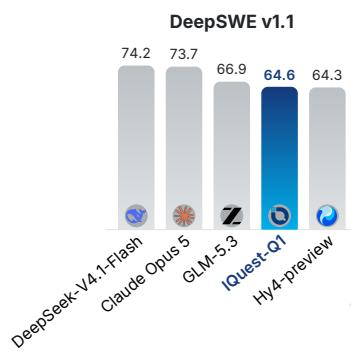

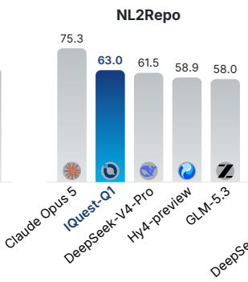

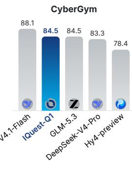

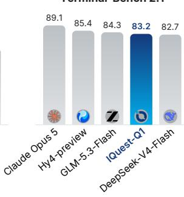

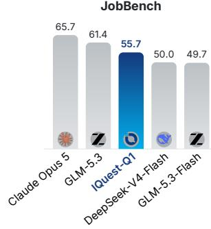

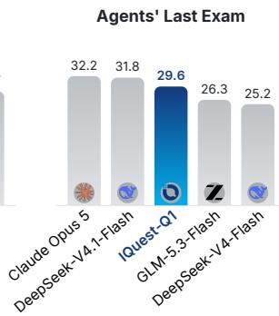

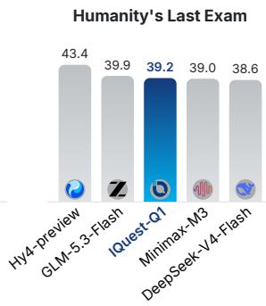

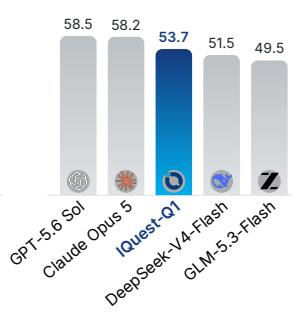

Figure 1. IQuest-Q1 performance across benchmarks. DeepSeek-V4-Flash/Pro refer to the official 0731/0813 releases, respectively. Humanity’s Last Exam is reported without tools. IQuest-CLIBench is our proprietary built-in benchmark for evaluating human-agent collaboration and user experience (see Section 5 for details).

## 1. Introduction

LLM-based agents allow language models [1–7] to perform tasks through iterative reasoning, action, and interaction with external environments, rather than merely generating responses [8– 10]. Among these environments, command-line interfaces (CLIs) have become one of the most general ways for language models to interact with external systems, use tools, access files, and execute code. As a result, building more capable agentic models requires stronger CLI capabilities.

In this work, we release IQuest-Q1, an open-source agentic foundation model with broad CLI capabilities across a wide range of general and coding tasks, with strengths in software engineering, general-purpose task execution, long-horizon reasoning and execution, and cybersecurity. We also optimize IQuest-Q1 for real-world CLI use, with reliable tool use and robust performance across different agent harnesses.

Methods. IQuest-Q1 is trained through a multi-stage pipeline (see Figure 2) to progressively develop general knowledge, long-context capabilities, and agentic CLI capabilities. General pre-training combines Stable SplitNorm [11, 12], Muon [13], and �P parameterization [14] with a two-stage curriculum that increases the coding-data mixture in the second stage. This design improves scaling efficiency while maintaining a wide stability margin between safe and optimal learning rates. Mid-training then expands the data mixture across domains and formats while progressively extending the context. Post-training (shown in Figure 6) builds diverse CLI [8, 15] capabilities through synthesized tasks executed in production environments. Specifically, SFT establishes basic CLI interaction, while RL enhances capabilities through tasklevel feedback and multi-teacher on-policy distillation (MOPD) consolidates complementary model capabilities from diverse frozen experts into a unified model. Model merging further combines complementary capabilities from expert models trained for different CLIs, while mitigating conflicts among their parameter updates.

Results. Figure 1 shows the results of IQuest-Q1 on 8 agentic and reasoning benchmarks, highlighting three aspects of its capabilities: (1) Advancing coding capability. IQuest-Q1 demonstrates coding capabilities across benchmarks, including DeepSWE v1.1, CyberGym, and NL2Repo. (2) Broad general agentic and reasoning capability. Beyond coding, IQuest-Q1 demonstrates capabilities on general agentic and reasoning benchmarks, including JobBench, Agents’ Last Exam, and Humanity’s Last Exam. (3) Optimized CLI interaction experience. On our internal IQuest-CLIBench, IQuest-Q1 manifests user-facing CLI interaction capabilities on interactive task.

Beyond benchmark performance, IQuest-Q1 participates in an iterative model-development process built on our internal infrastructure, contributing to the development of its own successors under human supervision. This human-on-the-loop process provides a practical pathway towards recursive self-improvement, allowing model-generated improvements to accelerate subsequent model iterations.

Our contributions are summarized as follows:

• IQuest-Q1: an open-weight agentic model optimized for CLI capability. IQuest-Q1 is a sparse MoE model with 320B total parameters, of which 15B are activated per token, combining substantial general-purpose, coding-agent, and CLI interaction capabilities. We release its model weights to support further research and development in the community.

• CLI-centric training pipeline. We build the training pipeline around CLI-based agentic interaction. Pre-training progressively develops the capabilities required for downstream interaction through staged data mixtures. Post-training specializes these capabilities through task and environment synthesis, multi-scaffold ${ \mathrm { R L } } ,$ and MOPD to consolidate multiple models into a unified model.

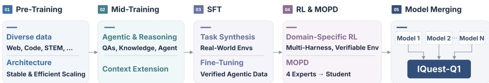  
Figure 2. Training pipeline of IQuest-Q1.

• Model development with human-on-the-loop RSI. We incorporate IQuest-Q1 into our iterative model-development process, allowing it to evaluate its capabilities and suggest potential improvements through a unified infrastructure interface under human supervision. This process enables continuous model improvement while shortening the overall development cycle.

## 2. Model Architecture

## 2.1. Overall Architecture

IQuest-Q1 builds on the Transformer architecture [16] with sparse Mixture-of-Experts (MoE) layers [17] and hybrid sliding-window attention (see Figure 3). The attention stack interleaves Grouped-Query Attention (GQA) [18] and Sliding Window Attention (SWA) [19]. Within each attention module, a query-aware sink token [20] provides an adaptive destination for excess attention mass. Query–key normalization (QKNorm) stabilizes attention by controlling query and key scales [21], and QKNorm Clip is additionally applied to prevent excessively large affine parameters. Partial RoPE applies rotary position embeddings [22] to only a subset of the dimensions in each attention head. On the feed-forward side, the first Transformer layer replaces sparse MoE routing with a dense MLP to mitigate expert load imbalance in the earliest layer of the model. To improve scaling effectiveness, IQuest-Q1 adopts Stable SplitNorm to increase effective depth [23, 24]. For efficient and stable scaling, we combine the Muon optimizer [13] with $\mu \mathrm { P }$ parameterization [14], supporting efficient optimization and learning-rate transfer across model sizes.

Stable SplitNorm. Traditional Pre-Norm [25] may underutilize the depth of the model. As the unnormalized residual stream accumulates across layers, its variance can grow with depth, reducing the relative contribution of later residual updates [26]. Motivated by these observations, IQuest-Q1 adopts a hybrid normalization design introduced in prior work [11, 12]. We refer to this design as SplitNorm, which splits the normalization strategy across Transformer sublayers: the residual stream entering the attention sublayer is normalized, whereas the residual stream entering the feed-forward network (FFN) is kept unnormalized. This design combines the stability benefits of Pre-Norm with the stronger depth utilization associated with Post-Norm, mitigating the underutilization of deeper layers in Pre-Norm architectures. Given an input �, the SplitNorm block used here is formulated using RMSNorm [27] as:

$$
z = { \mathrm { R M S N o r m } } ( x ) , \qquad h = z + { \mathrm { A t t e n t i o n } } ( z ) , \qquad y = h + { \mathrm { F F N } } { \big ( } { \mathrm { R M S N o r m } } ( h ) { \big ) } .\tag{1}
$$

where � denotes the input hidden state, � denotes the RMSNorm-normalized input, ℎ is the intermediate representation after the attention block with a residual connection, and � is the output after the FFN block with another residual connection.

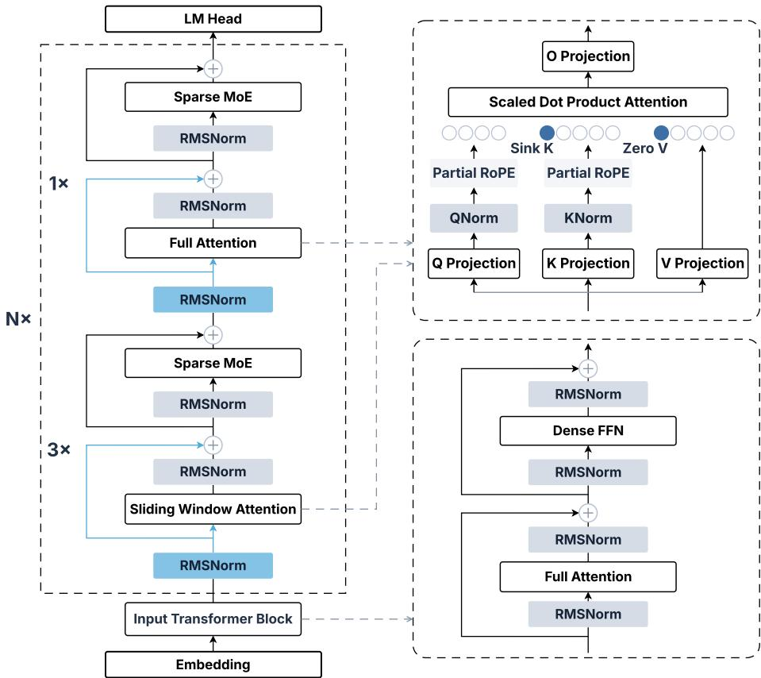  
Figure 3. Overall architecture of IQuest-Q1.

This hybrid design combines normalized attention states with an identity residual path around the FFN. However, directly scaling this formulation to large models can lead to unstable optimization. To address this issue, IQuest-Q1 further introduces two modifications. First, an RMSNorm is applied to the attention output to prevent activation explosion, such that the attention update in Equation 1 becomes ℎ = � + RMSNorm(Attention(�)). Second, a SandwichNorm structure [28], implemented with RMSNorm, is used for the first layer to stabilize the model input at the beginning of the residual stream.

�P: Transfer Across Width and Depth. IQuest-Q1 adopts �P parameterization [14] for widthwise learning-rate transfer. Depth-wise transfer depends on additional parameterization choices, as studied in Depth-�P [29] and CompleteP [30]. Under our adopted parameterization, empirical validation demonstrates hyper-parameter transfer across models spanning a 4× range in width and a 4× range in depth. Instead of tuning the learning rate directly at the target scale, we perform the search on a small proxy model with a hidden width of 896 and 18 layers. The learning rate selected on this proxy is then transferred zero-shot to the target model under the adopted parameterization, without additional learning-rate tuning at the target scale. We provide detailed �P scaling factors in Table 3 in the appendix.

Recursive Multi-token Prediction. To improve backbone learning through additional futuretoken supervision, we incorporate two multi-token prediction (MTP) [31, 32] layers from the start of pre-training. After completing the training pipeline, we adapt the first layer into a recursive drafter for speculative decoding and discard the second layer in a dedicated training stage. As in EAGLE-3 [33], we extend the speculation horizon with a fixed parameter budget by reusing the same MTP layer across seven drafting steps [4, 34]. In each drafting step, the output hidden state and generated token are fed back into the same MTP layer to produce subsequent predictions. We also replace its attention with SWA using a smaller window, which bounds the per-step attention cost as the context grows. Details can be found in Figure 11 in the appendix.

## 2.2. Scaling Efficiency and Stability

Scaling efficiency. To evaluate scaling efficiency, we conduct a controlled comparison between IQuest-Q1 and a representative Qwen3-MoE-style design [35] following the Qwen3-30B-A3B configuration, using identical training data. As shown in Figure 4a, IQuest-Q1 consistently achieves lower training cross-entropy loss at a given training FLOPs budget. Overall, IQuest-Q1 exhibits a 1.93× higher scaling efficiency than the baseline, requiring $1 / 1 . 9 3 \approx 5 2 \%$ of the training compute to reach the same training loss. These results demonstrate the cumulative benefit of the proposed model design under controlled training conditions.

Scaling stability. Inspired by the Critical Batch Size (CBS) perspective [36, 37], we propose a complementary framework for characterizing the scaling limit imposed by training stability. CBS identifies the largest batch size that can be used without substantially degrading optimization efficiency; analogously, our framework aims to identify the largest model size that can be trained under a given architecture and optimization recipe without sacrificing either stability or optimization efficiency.

For a model of size $N ,$ we consider two learning-rate boundaries: the optimal learning rate $\eta _ { \mathrm { o p t } } ( N )$ which gives the most efficient optimization under a fixed training budget, and the safe learning rate $\eta _ { \mathrm { s a f e } } ( N )$ , defined as the largest learning rate that remains within the stable training regime. We provide the definition and evaluation criteria for stable training in Appendix A. The available stability headroom can be quantified as:

$$
H _ { N } = \log \frac { \eta _ { \mathrm { s a f e } } ( N ) } { \eta _ { \mathrm { o p t } } ( N ) } .\tag{2}
$$

A positive $H _ { N }$ indicates that the efficiency-optimal operating point remains within the stable regime, while $H _ { N } \leq 0$ indicates that optimization has become stability-constrained. We therefore define the Critical Model Size (CMS) $N _ { \mathrm { C M S } }$ as the model scale at which the optimal and safe learning rates coincide:

$$
\eta _ { \mathrm { o p t } } ( N _ { \mathrm { C M S } } ) = \eta _ { \mathrm { s a f e } } ( N _ { \mathrm { C M S } } ) .\tag{3}
$$

This provides a compact measure of how far a given architecture and training recipe can scale while simultaneously maintaining training stability and optimization efficiency, serving as a proxy metric for the model’s scaling stability.

Figure 4b shows the scaling trends of both learning rates observed in our experiments. For $\mathrm { I Q u e s t - Q 1 } , \eta _ { \mathrm { s a f e } }$ remains substantially above $\eta _ { \mathrm { o p t } }$ across the measured scales. Extrapolating the fitted trends yields $N _ { \mathrm { C M S } } ^ { \mathrm { a c t } }$ ≈ 572B and $N _ { \mathrm { C M S } } ^ { \mathrm { t o t a l } } \approx 1 2 \mathrm { T } ,$ where $N _ { \mathrm { C M S } } ^ { \mathrm { a c t } }$ and $N _ { \mathrm { C M S } } ^ { \mathrm { t o t a l } }$ denote the CMS measured by activated and total parameters, respectively. These results indicate substantial stability headroom for scaling IQuest-Q1 beyond the model sizes studied.

## 2.3. Infrastructure

Data Packing. Sequence packing reduces padding overhead in language-model training [38]. To improve effective token throughput at a fixed sequence length and global batch size, we apply best-fit packing to the globally shuffled data stream using a bounded look-ahead window. The window contains up to 2�� tokens, where � denotes the global batch size and � the sequence length. Samples left unpacked in the current window are carried over and prioritized in the next iteration, preventing them from being indefinitely delayed by subsequent packing decisions.

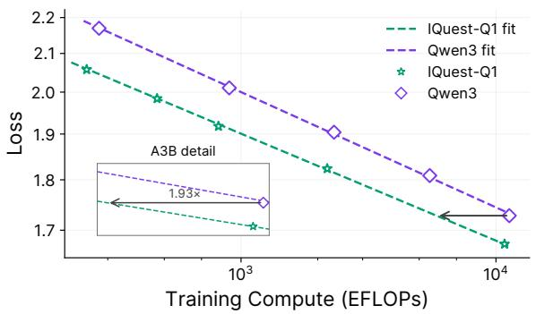  
(a) Scaling efficiency of IQuest-Q1 and Qwen3-MoE using identical training data.

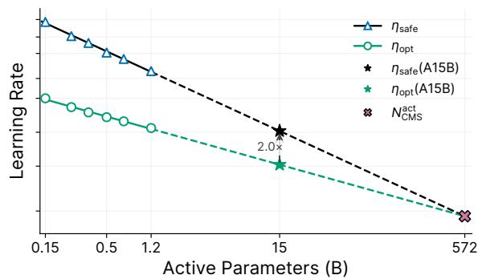  
(b) Maximum safe and optimal learning rates across activated-parameter scales.  
Figure 4. Scaling efficiency and stability of IQuest-Q1.

Long-context training amplifies compute imbalance arising from document-length variation. Packed sequences are therefore reordered across data-parallel replicas to balance computation at micro-batch granularity.

Sink Attention and Context Parallelism. Context parallelism uses ring-based K/V exchange for full attention [39], while sliding-window attention exchanges only the required halo and overlaps these exchanges with computation in both the forward and backward passes. During halo exchange, each rank computes attention over its local K/V, producing outputs for interior queries and partial outputs with associated Log-Sum-Exp (LSE) statistics for boundary queries. Once the halo arrives, the rank computes the complementary contributions for boundary queries and combines the local and halo partial outputs through LSE-based renormalization. This allows boundary queries to make progress before remote K/V becomes available while preserving sliding-window attention semantics. We illustrate the halo exchange schedule and partial output merging in Figure 10 in the appendix. Both full and sliding-window attention execution paths fuse learnable sink contributions into attention computation to reduce memory traffic.

Correctness Validation. To reduce silent errors introduced by model and training changes during RSI, the agent mines semantic invariants from the model’s training setup. These invariants are converted into checks that run during distributed training to detect deviations from single-machine semantics and violations of predefined correctness constraints.

## 3. Pre-Training

## 3.1. Pre-Training Data

We construct a high-quality, multilingual pre-training corpus spanning diverse domains, drawing from web pages, public GitHub code, books, academic papers, news, and domain-specific materials. For the code, we preserve diversity across programming languages, modalities, and task granularities, dimensions emphasized by prior work on multilingual code generation, multi-granularity evaluation, and repository-level executable completion [40–45]. Our unified data processing pipeline includes cleaning, quality filtering, exact deduplication, and fuzzy deduplication to reduce noise and redundancy while preserving diversity.

General pre-training proceeds in two stages with a progressively adjusted data mixture. Stage 1 establishes foundational language capabilities and general knowledge through diverse corpora, maximizing unique token counts across multiple domains. Stage 2 gradually increases the proportion of code and STEM data to strengthen programming, mathematical, and scientific problem-solving capabilities. Specifically, we design a four-phase pipeline increasing code data percentage from 40% to 70%.

Table 1. Summary of the main model architecture parameters.
<table><tr><td>Configuration</td><td>Value</td></tr><tr><td>Total Parameters</td><td>320B</td></tr><tr><td>Activated Parameters</td><td>15B</td></tr><tr><td>Transformer Layers</td><td>88</td></tr><tr><td>Hidden Dimension</td><td>3,072</td></tr><tr><td>Attention Heads (Q/KV)</td><td>48/8</td></tr><tr><td>Head Dimension</td><td>128</td></tr><tr><td>Hybrid Attention Pattern</td><td>3 SWA + 1 FA</td></tr><tr><td>Sliding Window Size</td><td>4,096</td></tr><tr><td>Partial RoPE Dimensions</td><td>32</td></tr><tr><td>Experts (Total/Activated)</td><td>256/8</td></tr><tr><td>MTP Layers</td><td>2 Independent (Training) 1 Recursive ×8 (Inference)</td></tr><tr><td>MTP Sliding Window Size</td><td>512 (Inference)</td></tr></table>

Mid-training then combines high-quality natural corpora [46], QA pairs [47–50], and agentic trajectories [51] to prepare the model for downstream reasoning and agentic tasks. Across pre-training and mid-training, the model is trained on a total of 29T tokens.

## 3.2. Hyper-Parameters

Model Hyper-Parameters. As summarized in Table 1, IQuest-Q1 has 88 Transformer layers and a hidden dimension of 3,072. Attention uses 48 query heads and 8 key–value heads, each with a dimension of 128. The first two and last two layers use full attention (FA) to capture global information and improve training stability, while the intermediate layers repeat three SWA layers followed by one FA layer, yielding a 3:1 local-to-global ratio within each repeating block. The SWA uses a window size of 4,096. Partial RoPE is applied to 32 dimensions of each attention head, with RoPE bases of 10,000 and 1,000,000 for SWA and FA, respectively. Query-Aware Sink Attention is enabled in all attention layers. The first Transformer layer uses a dense FFN with an intermediate dimension of 12,288, while the remaining layers use sparse MoE FFNs. Each MoE layer contains 256 routed experts, with 8 experts activated per token and an intermediate dimension of 1,536 for each expert. Both dense and expert FFNs adopt SwiGLU. The vocabulary size is 160,000, with untied input embeddings and output weights. During pre-training, IQuest-Q1 adopts two Multi-Token Prediction (MTP) layers to improve the performance of the backbone model. Each prediction order uses an embedding dimension of 128 and 8 attention heads, and the MTP loss is weighted by 0.3.

Training Hyper-Parameters. We employ Muon [13] for all parameters except token embeddings, the language modeling head, normalization parameters, and MoE routers, which are optimized with Adam. For Adam, we set $\beta _ { 1 } = 0 . 9 , \beta _ { 2 } = 0 . 9 5 ,$ , and $\epsilon = 1 0 ^ { - 1 5 }$ . For Muon, we set the momentum to 0.95. For an � × � weight matrix, we scale the orthogonalized update by $0 . 2 \sqrt { \operatorname* { m a x } ( m , n ) }$ , combining spectral scaling with an additional factor of 0.2 to align the update RMS with that of Adam-style updates [13]. We apply weight decay with a coefficient of 0.1 to all parameters except layer normalization parameters, which are exempt from weight decay. We additionally apply QKNorm Clip, capping the affine parameters of QKNorm at 10. We adopt a warmup-stable-decay learning rate schedule. The learning rate is warmed up to $6 \times 1 0 ^ { - 4 }$ and held constant for the remainder of Stage 1, then decays to $2 \times 1 0 ^ { - 4 }$ by the end of Stage 2 and to $6 \times 1 0 ^ { - 5 }$ by the end of mid-training.

## 3.3. Mid-Training and Long-Context Extension

## 3.3.1. Training Curriculum

Mid-training bridges broad pre-training and specialized agent post-training through a curriculum that combines a diverse data mixture, selective token-level supervision, and progressive context extension.

Data Organization. The mid-training mixture comprises three principal categories: highquality natural corpora, QA pairs, and agentic trajectories. We organize training data using a chat template adapted for mid-training, retaining a selected subset of special tokens, including those associated with reasoning and tool calls.

Token-Level Loss Masking. We specify loss masks directly for individual tokens, independently of the role-specific special tokens used to determine supervision in a typical post-training setup. This decouples data formatting from loss computation and allows supervision to be tailored to selected spans within each training example, with finer control than masking entire conversational roles.

Progressive Context Extension. We extend the maximum training context lengths through 32K, 128K, and 512K tokens, using variable-length sequence packing throughout. The globalattention RoPE base increases from 500, 000 at 32K to 1, 000, 000 in the subsequent phases; the hybrid attention pattern, 4, 096 sliding window, and SWA RoPE base of 10, 000 remain fixed.

Optimization across Phases. The mid-training learning rate follows a single cosine decay across all three context-length phases, with no additional warmup. At phase transitions, we transfer model weights and reinitialize the optimizer state while preserving the learning-rate schedule’s progress.

## 3.3.2. Agentic Data Construction Guided by Trajectories

Agentic mid-training requires large and diverse trajectory corpora, but suitable trajectories are scarce and concentrated in a limited set of tasks and environments. To expand coverage while preserving realistic interaction patterns, we use selected trajectories as behavioral anchors and pre-training documents to broaden technical and task coverage.

Using these sources, we construct executable, containerized instances from compatible code repositories, following prior work on tasks derived from repositories and trajectory generation at scale [52, 53]. This process yields more than one million instances. We roll out an agent on each instance and retain valid and complete trajectories for mid-training.

## 3.4. Evaluation

We evaluate pre-training and mid-training using two complementary types of evaluations. First, we compute bits-per-byte (BPB) on held-out agent trajectories. Lower BPB indicates that the model assigns higher likelihood to behaviors observed in competent agent trajectories, providing a generation-free measure of how well the model captures the trajectory distribution. This metric can provide a fine-grained training signal that complements downstream task-level evaluations.

We further decompose long-horizon agent behavior into atomic abilities and evaluate how reliably the model performs each ability. This fine-grained evaluation helps identify specific capability gaps and informs data selection and curriculum design. Together, these two evaluation paradigms provide complementary signals for tracking and improving agentic capabilities during pre-training and mid-training.

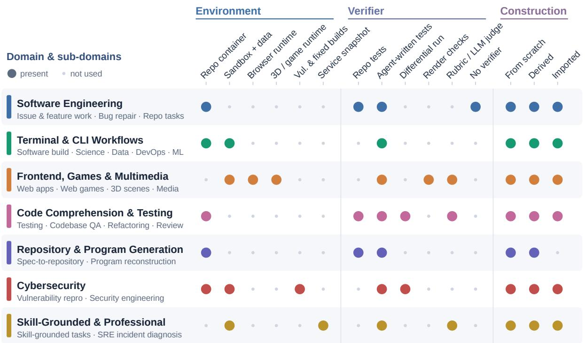  
Figure 5. Overview of coding-agent task instances and their environments, verifiers, and construction methods.

## 4. Post-Training

## 4.1. Large-Scale and Diverse Task Synthesis

We organize the task synthesis framework into three settings: general, reasoning, and coding.   
Each setting uses diverse data sources and a domain-specific pipeline to generate tasks at scale.

General Agent. We collect APIs and MCP servers from RapidAPI1 and Smithery2, public skills from the web, and workspace files for task synthesis. Guided by the Standard Occupational Classification [54], we cover a broad range of occupations and synthesize high-coverage environments and tasks, which are iteratively refined through a solve-then-refine loop.

Reasoning Agent. We synthesize tasks through a document-grounded pipeline that jointly controls concept coverage, material quality, and task difficulty. The pipeline first expands a broad concept inventory into fine-grained scientific topics, then retrieves and curates documents for each topic, filters the documents before synthesis, and finally converts the retained materials into tasks with reference answers. By covering high-value knowledge through the document collection, the pipeline promotes corresponding coverage in the synthesized prompts.

Coding Agent. We construct executable environments from GitHub repositories and industrial data [3, 52, 55–59] using multiple versions of coding-agent harnesses such as Claude Code and Codex, with our model driving environment construction and skills supporting setup. Task queries draw on PRs and issues, repository knowledge graphs and documentation, and reusable patterns extracted from cleaned, de-identified usage logs. Skills capture task structure and common failure modes to guide instance synthesis. Verifiers combine agent-written tests, adapted repository tests, and checks derived from documented behavior. For offline instances, external dependencies are replaced by local fixtures or mocks. An agent-judge loop checks executability, leakage, and consistency among instructions, reference solutions, environments, and verifiers, repairing defective instances and rejecting weak assertions. Reference solutions must pass while no-op solutions must fail. Rubric-based trajectory review further filters cheating and low-quality execution beyond binary success. Repeated agent runs estimate difficulty, and overly easy instances are enriched with additional skills or constraints before revalidation; valid instances exposing model failures are retained.

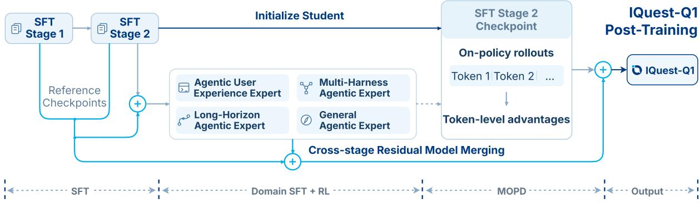  
Figure 6. IQuest-Q1 Post-Training Pipeline.

An overview of coding-agent task instances is shown in Figure 5. We construct instances through two complementary modes: building new environments from raw sources and updating verified environments through re-tasking, rewriting, fault injection, evolution, hardening and repair, and selective re-rolling. The resulting library covers software engineering, interactive and multimodal tasks, cybersecurity, and skill-grounded professional work, with domain-specific runtimes and verifiers.

## 4.2. Environment Integrity and Reward Hacking Mitigation

Agentic training environments are vulnerable to reward hacking, where models exploit leaked solutions or weaknesses in task verifiers instead of solving the intended tasks. Such behavior can contaminate SFT data and introduce misleading reward signals during RL. To prevent this, we apply three layers of protection: environment preparation, execution-time checks, and trajectory auditing.

Environment Preparation. Before collecting trajectories, we prepare task environments to prevent solution leakage. Depending on the task, we clean Git history, remove files that could reveal existing solutions, or create fresh environments containing only the required materials. We also isolate task environments to prevent unintended access to hidden evaluation data or resources from other tasks.

Execution-Time Checks. During rollouts, we restrict access to external resources and sensitive task files. Depending on the environment, we enforce network restrictions or intercept tool calls before execution. We develop blocking rules from observed hacking behaviors to prevent agents from retrieving existing solutions, upstream code, or hidden evaluation materials. These checks preserve access to legitimate dependencies and task resources. Blocked operations return explicit feedback, allowing agents to continue without the prohibited access.

Trajectory Auditing. We further audit collected trajectories using rule-based checks and rubricguided LLM judgments. The audits examine executed commands, tool outputs, and submitted solutions to identify behaviors such as retrieving leaked fixes, accessing hidden tests, or modifying evaluation scripts. Confirmed hacking trajectories are excluded from training, while suspicious cases can be flagged for further review. We also use detected cases to refine our environment restrictions and blocking rules.

Task-Specific Safeguards. We adapt these safeguards to the needs of each task. For SWE-like tasks, we keep only the Git history up to the base commit and use hooks in Claude Code, Codex, and OpenCode to block attempts to retrieve existing solutions. For Terminal-Bench, we remove Git history when it is not needed and check commands before execution when it must be preserved. ProgramBench takes a different approach, building fresh containers with only the compiled oracle and task documentation, without exposing the original repository.

## 4.3. Supervised Fine-Tuning

As shown in Figure 6, we initialize supervised fine-tuning (SFT) from the mid-trained checkpoint to prepare the policy for reinforcement learning. We optimize the autoregressive cross-entropy loss on assistant responses, including tool-call tokens, while masking user instructions and tool observations from the loss. SFT proceeds in two stages (240B+ tokens in Stage 1 and 50B+ tokens in Stage 2), with initial learning rates of $5 \times 1 0 ^ { - 5 }$ and $1 . 5 \times 1 0 ^ { - 5 }$ , respectively, and cosine learning-rate decay within each stage. Multiple samples are packed into each sequence, with attention masking to prevent cross-sample attention.

## 4.4. Environment-Centered Reinforcement Learning

We outline an RL design that targets verifiable task completion while accounting for user constraints and execution cost. It draws on configurable-harness training in Kimi K3 [5] and domain-specialized Group Relative Policy Optimization (GRPO) in DeepSeek-V4 [3].

Multi-harness, Multi-version Episodes. To improve the model’s performance across different agent harnesses and versions, we train a shared policy on trajectories collected from diverse harness configurations, including Claude Code, Codex, and their different versions. Each episode specifies a task domain, harness and its version, environment, and evaluator. During training, the policy interacts with different harnesses, observing public instructions, tools, and execution feedback while reference solutions and hidden checks remain isolated. GRPO compares repeated rollouts of the same task under a fixed harness and evaluator version. Sampling balances domain–harness combinations and retains regression cases.

Rewards and Failure Attribution. Independent verifiers determine terminal correctness. For long trajectories, auxiliary segment-level rewards are restricted to measurable progress, while penalties address unnecessary computation, constraint violations, and reward hacking. Modelgenerated diagnoses require evidence from execution records before contributing to these signals. Failures are attributed before optimization: policy-caused errors supply learning signals, environment or harness faults unrelated to policy behavior are masked, and evaluator faults block sample consumption. Token-level updates use recorded rollout probabilities through the existing Token-In, Token-Out (TITO) pipeline. The resulting specialized policies can subsequently be consolidated through MOPD.

## 4.5. Multi-Teacher On-Policy Distillation

As shown in Figure 6, we initialize the student from SFT Stage 2 and distill knowledge from four frozen expert models: (1) an agentic user experience expert for terminal interaction, tool use, web development, and coding workflows; (2) a multi-harness agentic expert for operation across Claude Code, Codex, and OpenCode; (3) a long-horizon agentic expert for extended coding and cybersecurity tasks; and (4) a general agentic expert for working-agent tasks, web search, multi-turn conversation, and reasoning.

Following MOPD [5, 60], we collect � rollouts from $p _ { k } = p _ { \theta _ { k } }$ and select a frozen teacher $q _ { d _ { i } }$ for each task �� according to its domain, $d _ { i } = d ( x _ { i } )$ . Given the interaction context $h _ { i , t } ,$ the teacher evaluates student-generated tokens to obtain a clipped distillation advantage:

$$
\tilde { a } _ { i , t } = \mathrm { c l i p } \left( \log \frac { q _ { d _ { i } } ( y _ { i , t } \mid h _ { i , t } ) } { p _ { k } ( y _ { i , t } \mid h _ { i , t } ) } , - c , c \right) , \quad c > 0 .\tag{4}
$$

Motivated by reverse-KL distillation [61], we optimize the length-normalized surrogate:

$$
L _ { k } ( \boldsymbol { \theta } ) = - \frac { 1 } { B } \sum _ { i = 1 } ^ { B } \frac { m _ { i } } { T _ { i } } \sum _ { t \in \mathcal { A } _ { i } } \widetilde { a } _ { i , t } \log p _ { \theta } ( y _ { i , t } \mid h _ { i , t } ) ,\tag{5}
$$

where $\mathbf { \mathcal { A } } _ { i }$ contains model-generated token positions, including tool-call tokens, and $T _ { i } = | { \mathcal { A } } _ { i } |$ Instructions and tool observations provide context but are excluded from the loss. We set $m _ { i } = 0$ for repetitive rollouts and $m _ { i } = 1$ otherwise. Rollouts, contexts, advantages, and masks are fixed during differentiation.

## 4.6. Model Merging

As shown in Figure 6, starting from SFT Stage 1, we interleave training with residual model merging across stages and within expert branches, ultimately incorporating expert and MOPD checkpoints into IQuest-Q1. Each merge combines parameter deltas relative to a designated reference checkpoint using prescribed weights and global ℓ2-norm calibration, then adds the resulting update back to the reference parameters.

## 4.7. Post-Training Infrastructure

Multi-harness and Multi-version Agent Runtime. A single policy can be trained on trajectories from multiple harnesses and versions within one run. Each training instance specifies its scaffold, task environment, and verifier. The runtime executes the corresponding configuration and verifies the task in an isolated sandbox while preserving tool orchestration, context management, and interaction flow. We map different API protocols to a unified policy interface to reduce the difficulty of downstream integrations.

Rollout-training Consistency. We implement an end-to-end TITO path at the model-serving boundary. Specifically, we apply a session-level prefix tree to retain token histories shared across turns and branches. A request then combines its environment observations with a recorded token prefix. The corresponding response is returned in the structured format expected by the scaffold. Finally, we retain trajectories paired with rewards and token-level masks from the tree at the end of the sequence.

Asynchronous Distillation and Teacher Execution. We implement MOPD in a fully asynchronous training system. We apply periodic synchronization of student parameters and explicit control of sample staleness, limiting the policy lag introduced by asynchronous execution. We execute teacher forward passes with the training engine on trajectories generated online by the student, producing token-level teacher log probabilities. We use the same execution path for teacher evaluation and student log-probability computation to reduce discrepancies caused by the training engine.

This framework supports independently configured teachers through a common scheduling interface. Teachers reuse the same execution resources through weight switching. We store teacher weights in distributed storage and load them on demand, with only the shards required by the active teacher placed in GPU memory. Weights of the next teacher are prefetched during the current forward pass with overlapping computation. This design supports additional teachers without a proportional increase in resident GPU replicas.

## 5. Evaluation

## 5.1. Benchmarks

We evaluate IQuest-Q1 on a comprehensive suite of benchmarks spanning two broad capability axes, covering both coding and general agentic capabilities:

• Coding Agent: DeepSWE v1.1 [62, 63], SWE-bench Multilingual [42, 52], SWE-Bench Pro [41], NL2Repo-Bench [40], ProgramBench [64], CyberGym [65], SkillsBench [66], Terminal-Bench 2.1 [67, 68], Terminal-Bench 3.0 [67, 69], Terminal-Bench 4.0 [67, 70], PaperBench [71], Live-CodeBench v6 [72, 73], IQuest-CLIBench.

• General Capabilities: GPQA Diamond [74], Humanity’s Last Exam [75], GDPval [76], APEX-Agents v1.1 [77], Toolathlon-Verified [78], MCP-Atlas [79], Claw-Eval [80], Automation-Bench [81], JobBench [82], Agents’ Last Exam (ALE) [83], �3-Banking [84, 85], BrowseComp [86], WideSearch [87], Humanity’s Last Exam (w/ tools) [75], HealthBench Professional [88], IMOAnswerBench-Verified [89], CritPt [90].

IQuest-CLIBench is an in-house benchmark for evaluating CLI agents in human-in-the-loop settings through script-driven user simulation, using both execution traces and environmentlevel state invariants. We integrate it into the core evaluation suite of IQuest-Q1 to assess user experience and interaction quality alongside conventional task performance.

## 5.2. Baselines

We compare IQuest-Q1 with proprietary and open-source models. For proprietary models, we compare against Claude Opus 5 [2] and GPT-5.6 Sol [1]. For open-source models, we compare with GLM-5.3-Flash [91], DeepSeek-V4-Flash-0731 [3], Hy3 [92], and MiniMax M3 [93].

## 5.3. Evaluation Configurations

For each model, we report a publicly available score when one is available; otherwise, we evaluate the model using the corresponding benchmark setup: (1) Harness: For agentic coding tasks, we use mini-SWE-agent [94] for DeepSWE v1.1, BasicAgent [71] for PaperBench, and Claude Code [9] for other tasks. For general agentic tasks, we use our internal harness for search agent tasks and Humanity’s Last Exam, and the benchmark-provided harnesses for other tasks. (2) Runtime: We set six-hour limits for CyberGym [65] and ProgramBench, eight hours for Terminal-Bench 2.1 [68], ten hours for Terminal-Bench 3.0 [69] and 4.0 [70], and 12 hours for PaperBench [71].

## 5.4. Results

Table 2 shows the results under the reported evaluation configurations. We highlight representative results and remaining gaps below.

Coding and Software Engineering. IQuest-Q1 demonstrates a broad range of repository-level coding capabilities, including bug fixing and feature addition, achieving scores of 57.5 on

Table 2. Performance across coding and general capability benchmarks. Scores are reported at the highest available reasoning effort for each model. DS denotes DeepSeek. ProgramBench reports raw pass rates. PaperBench is evaluated in the CodeDev setting. IQuest-CLIBench‡ is our proprietary built-in benchmark for evaluating human-agent collaboration and user experience (see Section 5 for details). Results with \* are from our own testing.
<table><tr><td>Benchmark</td><td>IQuest-Q1</td><td>GLM-5.3 Flash</td><td>DS-V4 Flash-0731</td><td>Tencent Hy3</td><td>MiniMax M3</td><td>Claude Opus-5</td><td>GPT-5.6 Sol</td></tr><tr><td>Coding Capabilities</td><td></td><td></td><td></td><td></td><td></td><td></td><td></td></tr><tr><td>DeepSWE v1.1</td><td>64.6</td><td>63.4</td><td>54.4</td><td>28.0</td><td></td><td>73.7</td><td>73.0</td></tr><tr><td>SWE-bench Multilingual</td><td>80.3</td><td>79.7*</td><td>78.7*</td><td>75.8</td><td>75.0*</td><td>89.5</td><td>74.1</td></tr><tr><td>SWE-Bench Pro</td><td>57.5</td><td>59.4*</td><td>57.3*</td><td>57.9</td><td>59.0</td><td>79.2</td><td>64.6</td></tr><tr><td>NL2Repo-Bench</td><td>63.0</td><td>56.3</td><td>54.2</td><td>45.6</td><td>42.1</td><td>75.3</td><td>56.8</td></tr><tr><td>ProgramBench</td><td>60.9</td><td>58.5*</td><td>62.1*</td><td>47.4*</td><td>33.8*</td><td>82.3</td><td>77.6</td></tr><tr><td>CyberGym</td><td>84.5</td><td>81.6*</td><td>76.7</td><td>51.8</td><td>40.3*</td><td></td><td>83.6</td></tr><tr><td>SkillsBench</td><td>74.1</td><td>56.2*</td><td>72.0*</td><td>63.9*</td><td>54.2*</td><td>76.2*</td><td>71.5*</td></tr><tr><td>Terminal-Bench 2.1</td><td>83.2</td><td>84.3</td><td>82.7</td><td>71.7</td><td>66.0</td><td>89.1</td><td>88.8</td></tr><tr><td>Terminal-Bench 3.0</td><td>17.9</td><td>30.0*</td><td>7.6</td><td>3.0*</td><td>1.7*</td><td>42.7</td><td>34.6</td></tr><tr><td>Terminal-Bench 4.0</td><td>22.7</td><td>32.8</td><td>7.0</td><td>4.5*</td><td>2.0</td><td>53.9</td><td>37.3</td></tr><tr><td>IQuest-CLIBench‡</td><td>53.7</td><td>49.5*</td><td>51.5*</td><td>36.6*</td><td>30.7*</td><td>58.2*</td><td>58.5*</td></tr><tr><td>PaperBench</td><td>86.0</td><td>86.5*</td><td>85.8*</td><td>68.4*</td><td>67.7*</td><td>91.8*</td><td>90.5</td></tr><tr><td>LiveCodeBench v6</td><td>89.7</td><td>88.0*</td><td>90.6</td><td>91.0</td><td>81.1*</td><td></td><td></td></tr><tr><td>General Capabilities</td><td></td><td></td><td></td><td></td><td></td><td></td><td></td></tr><tr><td>GPQA Diamond</td><td>93.3</td><td>92.2</td><td>89.9</td><td>90.9</td><td>92.9</td><td>93.4</td><td>94.6</td></tr><tr><td>Humanity&#x27;s Last Exam</td><td>39.2</td><td>39.9</td><td>38.6</td><td>33.5</td><td>39.0</td><td>54.9</td><td>49.5</td></tr><tr><td>Humanity&#x27;s Last Exam (w/ tools)</td><td>55.7</td><td>55.3</td><td>51.5</td><td>53.2</td><td>41.2*</td><td>60.9</td><td>60.2</td></tr><tr><td>CritPt</td><td>18.3</td><td>15.4</td><td>16.6</td><td>4.9</td><td>3.7</td><td>29.1</td><td>32.3</td></tr><tr><td>IMOAnswerBench-Verified</td><td>93.0</td><td>75.3*</td><td>92.8*</td><td>92.8*</td><td>79.6*</td><td></td><td></td></tr><tr><td>GDPval v2.1</td><td>1530</td><td>1641</td><td>1427</td><td>1045</td><td>1230</td><td>1708</td><td>1588</td></tr><tr><td>Toolathlon-Verified</td><td>75.0</td><td>78.4</td><td>70.3</td><td>56.2</td><td>53.7*</td><td>80.6</td><td>74.9</td></tr><tr><td>MCP-Atlas</td><td>78.4</td><td>75.6</td><td>72.8*</td><td>79.1</td><td>74.2</td><td>85.8</td><td>81.8</td></tr><tr><td>Claw-Eval</td><td>77.1</td><td>74.2*</td><td>68.8*</td><td>63.5*</td><td>69.8*</td><td>79.6*</td><td>70.2*</td></tr><tr><td>AutomationBench</td><td>52.7</td><td>48.8</td><td>37.7</td><td>16.1</td><td>19.7*</td><td>50.3</td><td>45.8</td></tr><tr><td>APEX-Agents 1.1</td><td>50.9</td><td>52.8</td><td>36.9*</td><td></td><td></td><td>65.8</td><td>51.4</td></tr><tr><td>JobBench</td><td>55.7</td><td>49.7*</td><td>50.0*</td><td>34.6</td><td>40.1*</td><td>65.7</td><td>45.4</td></tr><tr><td>Agents&#x27; Last Exam</td><td>29.6</td><td>26.3</td><td>25.2</td><td>17.1</td><td>9.1*</td><td>32.2</td><td>30.6</td></tr><tr><td>τ3-Banking</td><td>51.8</td><td>47.2</td><td>39.4</td><td>22.9</td><td>15.3</td><td>44.7</td><td>44.3</td></tr><tr><td>BrowseComp</td><td>85.5</td><td></td><td>78.0*</td><td>84.2</td><td>83.5</td><td>90.8</td><td>90.4</td></tr><tr><td>WideSearch</td><td>81.8</td><td></td><td>80.5</td><td>81.9</td><td>73.5*</td><td>84.0</td><td>86.3</td></tr><tr><td>HealthBench Professional</td><td>33.4</td><td>47.1*</td><td>26.4*</td><td>29.8*</td><td>24.7*</td><td>59.8</td><td>60.5</td></tr></table>

SWE-Bench Pro and 64.6 on DeepSWE v1.1. It also handles repository generation from natural language across NL2Repo-Bench (63.0) and PaperBench (86.0), covering general programming and research code reproduction. Terminal-Bench and SkillsBench further evaluate long-horizon terminal workflows and skill-driven coding. On our internal IQuest-CLIBench, IQuest-Q1 further demonstrates practical CLI interaction capabilities.

General Capabilities. IQuest-Q1 scores 75.0 on Toolathlon-Verified, 52.7 on AutomationBench, and 77.1 on Claw-Eval, reflecting its capabilities in tool use and multi-step task execution. On BrowseComp and WideSearch, it reaches 85.5 and 81.8, respectively, demonstrating informationseeking capabilities across the two search settings. It also records 55.7 on JobBench and 50.9 on APEX-Agents 1.1, covering task execution in professional workflows. Beyond agentic interaction, scores of 93.3 on GPQA Diamond and 93.0 on IMOAnswerBench-Verified reflect its scientific and mathematical reasoning capabilities. Expert-level reasoning remains challenging: HLE scores of 39.2 without tools and 55.7 with tools indicate room for improvement in both settings.

## 6. Capabilities with CLI Agents

  
(a) Underwater sandbox.

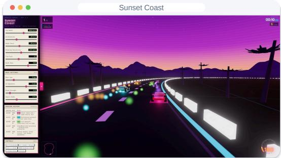  
(b) Sunset racing game.

  
(c) Interactive garden editor.

  
(d) Three bodies visualization.  
Figure 7. Representative interactive frontend applications generated by IQuest-Q1 from natural-language specifications, covering game worlds, scene editing, and scientific exploration.

## 6.1. Interactive Frontend Generation

IQuest-Q1 generates diverse interactive frontend applications from user queries, combining visual design, scene construction, and interaction logic in browser-runnable HTML, CSS, and JavaScript. These tasks showcase its CLI coding capabilities by turning implementations into interactive artifacts.

We provide examples (see Figure 7) from domains including games, creative tools, and scientific visualization. For example, the underwater sandbox combines an explorable world with building and mining, while the sunset racing game couples vehicle control with camera movement and race-state feedback. The garden editor links flower parameters and planting actions to a 3D scene. Together, they suggest how IQuest-Q1 coordinates rendering, user input, and application state to create interactive web experiences with distinct visual styles.

## 6.2. Iterative Development under Human Supervision

We illustrate a model development iteration in which an agent built on IQuest-Q1 identifies a capability gap, implements a solution, and evaluates the model under human supervision and intervention. The iteration targets adaptation to different scaffolds and tool-call schemas. While the model handles familiar schemas well, it can fail on unfamiliar ones, producing 35 tool-call errors in one long-horizon task due to mismatched tool names and parameters.

Trace Tool-call Failures and Identify Data Inconsistencies. The agent traces the failures across 6,054 tool calls and finds that the training data is heavily biased toward a single tool-call schema, with some records containing mismatches between tool definitions and call parameters due to preprocessing. It proposes cleaning these inconsistent records and augmenting the training data with diverse tool-call schemas. Human experts review the diagnosis and proposed intervention before approving the training run.

Implement Mixed-schema Data Augmentation and Model Training. The agent implements the data cleaning and augmentation pipeline and prepares the experiment configuration. The training run uses 2.35B tokens and 938.7 GPU hours. The resulting model checkpoint is evaluated on held-out schemas and familiar schemas, while checking for performance regressions.

This iteration demonstrates the potential of iterative model development with IQuest-Q1, while also highlighting the importance of human supervision. The agent drives failure analysis, intervention design, implementation, and evaluation, with human experts reviewing key decisions and controlling costly experiments and changes carried forward to subsequent iterations.

## 6.3. Cyber Security

Beyond general software engineering tasks, we further evaluate IQuest-Q1 on defensive cybersecurity tasks, where understanding and validating vulnerabilities are essential for improving software security. IQuest-Q1 achieves a score of 84.5 on CyberGym [65], a benchmark that evaluates the ability to reproduce and validate real-world vulnerabilities in large open-source codebases, providing evidence to support vulnerability diagnosis and remediation.

We further assess the practical utility of these capabilities in real-world security workflows. During a three-day deployment, human cyber security experts, assisted by IQuest-Q1, produced 30 vulnerability reports. All reports were independently validated by fellow security experts, and findings affecting open-source projects were responsibly disclosed to their respective maintainers. The participating experts reported that IQuest-Q1 provided substantial support for their defensive security work, particularly in understanding and validating security issues.

## Limitations

• Text-only input. IQuest-Q1 has no native image, audio, or video input capability.

• Output reliability. Generated explanations and code may be incorrect. Code changes should be reviewed or verified with task-appropriate tests.

• Tool integration. Tool calls use the IQuest-specific format in the chat template. Structured tool execution and reasoning extraction require compatible serving parsers and an agent harness.

• Challenges in Real-World CLI Tasks. Real-world CLI tasks often require iterative debugging and verification. IQuest-Q1 may overlook constraints, repeat failed attempts, or leave issues unresolved, necessitating human review and supervision.

• Ongoing development. IQuest-Q1 still has limitations in its capabilities and reliability, and we will continue to advance its capabilities. Furthermore, we release the model weights, deployment configurations, and agent-integration instructions to facilitate further research and continued development in the community.

## Conclusion

We present IQuest-Q1, an open-source agentic foundation model with broad CLI capabilities. We train IQuest-Q1 through a multi-stage pipeline to progressively develop general knowledge, long-context capabilities, and agentic CLI capabilities. IQuest-Q1 demonstrates capabilities on coding, general agentic tasks, and reasoning-heavy tasks. Furthermore, IQuest-Q1 participates in our internal iterative model-development loop, providing a foundation for continuing model development.

## 7. Contributions and Acknowledgements

The authors of this paper are listed follows: A. Jian Yang∗, An Huang∗, Bo Dan∗, Chen Mu∗, Chengran Yang∗, Chuan Shi∗, Feng Chang∗, Hongxin Li∗, Hongyuan Tao∗, Jinxing Zhang∗, Jujie He∗, Kun Wang∗, Lin Jing∗, Ming Yang∗, Qicheng Hu∗, Renyuan Li∗, Shark Liu∗, Shawn Guo∗, Shi Qing∗, Shi Zhong∗, Tianyu Zheng∗, Wei Liu∗, Wei Zhang∗, Wenrui Cai∗, Wenxiao Chen∗, Xuxing Chen∗, Yan Xing∗, Yi Xing∗, Yifan Luo∗, Yiran Xing∗, Yizhi Li∗, Yongsheng Kang∗, Yucheng Ding∗, Yue Song∗, Yun Qing∗, Yunqi Liu∗, Zelong Huang∗, Zhengmao Ye∗, Zhentao Fan∗, Zhiteng Li∗, Ziling Huang∗, Bihong Tang, Bingli Wang, Ce Jun, Changhao Chen, Chen Hu, Chen Xiao, Chi Liu, Chunjiang Ge, Danyang Li, Deyang Kong, Dian Qi, Ding Tan, Evan Yang, Fanglin Xu, Fei Bai, Gang Liu, Guochang Li, Hao Tang, Haoran Feng, Haowen Wang, Huahao Hu, Huanjin Yao, Huatong Song, Jia Deng, Jiajun Wu, Jialiang Cheng, Jiayi Liang, Jiayi Wu, Jie Deng, Jiejun Tan, Jing Yang, Jingda Xu, Junhang Cheng, Junxiao Liu, Kai Lv, Kaixiang Pan, Kecheng Lu, Kun Zeng, Kun Zheng, Kunbo Ding, Liang Qiu, Lingyi Sun, Luan Zhang, Mengxiao Lv, Ning Dong, Pei Wang, Peng Zhang, Qingsong Cai, Qixiang Yin, Qiyao Wang, Renbiao Liu, Renfei Dang, Ruihang Li, Ruirui Huang, Shanhui Yin, Shen Jian, Shengjie Fang, Shikai Li, Shinan Zhang, Shiqi Chen, Shuai Liu, Shuangqi Li, Shuo Tang, Shuqing Deng, Sijin Hao, Siwei Wu, Siyue Wang, Tao Hai, Tao Ren, TingYang Chen, Wei Shao, Weicheng Gu, Weihan Peng, Wenlong Miao, Xavier Yu, Xiangyuan Ji, Xiaocheng Li, Xiaodong Huang, Xiaohan Ge, Xiaoxiang Shi, Xiaoyang Zhang, Xiaoyu Yang, Xidong Wang, Xin Li, Xinyu Tang, Xiyuan Yang, Xudong Ma, Ya Tong, Yachao Wang, Yang Tian, Yaxin Du, Yeli Ruan, Yi Wang, Yi Yu, Yibin Feng, Yibo Tan, Yihang Wang, Yiming Ju, Yinda Chen, Yinda Chen, Yingjie Du, Yiwei Liu, Yizhi Zhou, Yuan Wei, Yuli Chen, Yuqi Zhu, Yuwen Li, Yuxi Dong, Yuxuan Zhang, Yuyang Song, Zhange Zhang, Zhaohan Zhang, Zhaoyi Li, Zhen Zhang, Zhengbo Zhang, Zhihang Hu, Zhiwei Yu, Zhixin Xie, Zhiyu Chen, Zhizhao Luo, Zhongyuan Wu, Zhou Fang, Zhu Lin, Zhuocheng Gong, Zixi Zhao, Ziyang Zeng, Ziyi Wang, Ziyu Zhao, Ran Tao†, Mingjie Tang†, Chuan Hao†, Peihao Wu†, Jianzhou Wang†, Nan Jiang†, Yuan Zhi†, Bryan Dai‡.

## References

1 OpenAI. GPT-5.6 system card, July 2026. URL https://deploymentsafety.openai.com/gp t-5-6. Published July 9, 2026; accessed September 28, 2026.

2 Anthropic. Introducing Claude Opus 5, July 2026. URL https://www.anthropic.com/news /claude-opus-5. Published July 24, 2026; accessed September 28, 2026.

3 DeepSeek-AI. DeepSeek-V4: Towards highly efficient million-token context intelligence, 2026. URL https://arxiv.org/abs/2606.19348. Technical report, version 1.

4 Aohan Zeng, Xin Lv, Zhenyu Hou, Zhengxiao Du, Qinkai Zheng, Bin Chen, Da Yin, Chendi Ge, Chenghua Huang, Chengxing Xie, et al. Glm-5: from vibe coding to agentic engineering. arXiv preprint arXiv:2602.15763, 2026.

5 Kimi Team, Tongtong Bai, Yifan Bai, Yiping Bao, M. C., Jianfeng Cai, Xinyuan Cai, Peizhou Cao, Yuxuan Cao, Ziwei Chai, Y. Charles, H. S. Che, Guanduo Chen, Guangyu Chen, Guanzheng Chen, Huarong Chen, Jia Chen, Jianlong Chen, Jun Chen, Kexin Chen, Peng Chen, Ruijue Chen, Wentao Chen, Xin Chen, Yang Chen, Yanru Chen, Yifei Chen, Yingjiang Chen, Yuankun Chen, Yujie Chen, Yutian Chen, Zhirong Chen, Dazhi Cheng, Yean Cheng, Jialei Cui, Jingbing Cui, Anqi Dai, Jiaqi Deng, Hao Ding, Rui Ding, Shaofeng Ding, Mengfan Dong, Mengnan Dong, Yuhao Dong, Yuxin Dong, Angang Du, Chenzhuang Du, Dikang Du, Jusen Du, Yulun Du, Yu Fan, Jing Feng, Qiulin Feng, Yichen Feng, Kelin Fu, Qiang Fu, Fuxuan Gao, Hongcheng Gao, Jingyue Gao, Tong Gao, Weijia Gao, Shangyi Geng, Jie Gong, Linhu Gong, Shengao Gong, Xiaochen Gong, Qizheng Gu, Yicheng Gu, Shuhao Guan, Haiqing Guo, Shiqi Guo, Xiang Guo, Zhengyan Guo, Beixi Hao, Wenxin Hao, Xiaoru Hao, Dailan He, Haotian He, Lehan He, Qi He, Weiran He, Xinran He, Xinyi He, Yibo He, Yunjia He, Chao Hong, Tiange Hong, Hao Hu, Jiaxi Hu, Ruikun Hu, Weiming Hu, Yangyang Hu, Zhenxing Hu, Liang Hua, Jinbin Huang, Ke Huang, Ruiyuan Huang, Siying Huang, Weixiao Huang, Yan Huang, Zhengjie Huang, Zhiqi Huang, Yulong Hui, Chaobo Jia, Yutong Jiang, Zhejun Jiang, Zuoyou Jiang, Wenyi Jin, Xinyi Jin, Yu Jing, Huanjun Kong, Guokun Lai, Aidi Li, Cheng Li, Chengyuan Li, Cong Li, Fang Li, Guanyu Li, Haoyang Li, Jia Li, Junxiong Li, Lei Li, Letian Li, Lincan Li, Weihong Li, Wentao Li, Xintong Li, Yang Li, Yishen Li, Yiwei Li, Yuxiao Li, Zhaowei Li, Zhaoxi Li, Zheming Li, Zhengxiao Li, Zhiyuan Li, Jiawei Lin, Xiaohan Lin, Yibo Lin, Zichao Lin, Ziyan Lin, Bill Liu, Boxiao Liu, Chuan Liu, Liang Liu, Shaowei Liu, Shudong Liu, Shuran Liu, Tianwei Liu, Weizhou Liu, Yangyang Liu, Yanming Liu, Yibo Liu, Yipeng Liu, Zhengying Liu, Zhiheng Liu, Enzhe Lu, Haoyu Lu, Linqiang Lu, Tingzhan Lu, Zhiyuan Lu, Aotian Luo, G. Luo, Junyu Luo, Yifan Luo, B. Lyu, Wenzhou Lyu, Shaoguang Mao, Yuan Mei, Xin Men, Minqing Ni, Yixuan Niu, Siyuan Pan, Shujun Peng, Zhangyang Qi, Ruoyu Qin, ZeChao Qin, Zeyu Qin, Haiquan Qiu, Jianxin Qiu, Jiezhong Qiu, Bowen Qu, Yuhao Qu, Zeyu Shang, Youbo Shao, Han Shen, Jincheng Shi, Juanfeng Shi, Lidong Shi, Shengyuan Shi, Wingchun Siu, Pengwei Song, Xiaoxi Song, Jianlin Su, Yunfeng Su, Zhaochen Su, Lin Sui, Jingsong Sun, Junyao Sun, Shaoning Sun, Shuzhe Sun, Tongyu Sun, Yujun Sun, Yunpeng Tai, Chuning Tang, Heyi Tang, Sirui Tang, Zecheng Tang, Chaoran Tian, Rongpeng Tian, Yu Tian, Wei Tu, Chensi Wang, Chuang Wang, Chunjie Wang, Dinglu Wang, Feng Wang, Hailong Wang, Haiming Wang, Hao Wang, Hao Wang, Huaqing Wang, Hui Wang, Jiayi Wang, Jinglong Wang, Jinhong Wang, Jiuzheng Wang, Linian Wang, Shaobo Wang, Shenzhi Wang, Shuyi Wang, Si Wang, Siyuan Wang, Tianfu Wang, Wenjue Wang, Xingran Wang, Xinmei Wang, Xinyuan Wang, Xusheng Wang, Yalin Wang, Yangkun Wang, Yao Wang, Yaoyu Wang, Yejie Wang, Yiqin Wang, Yucheng Wang, Yuzhi Wang, Zhaoji Wang, Zhaowei Wang, Zhengtao Wang, Zhenhao Wang, Zhongsheng Wang, Zifan Wang, Chu Wei, Ming Wei, Shouxin Wei, Zichen Wen, Fan Wu, Haoning Wu, Rucong Wu, Wenhao Wu,

Xiaoxue Wu, Yingcong Wu, Yongqi Wu, Yuxin Wu, Zijian Wu, Xinglang Xian, Chenxuan Xiang, Yuye Xiang, Bocheng Xiao, Chenjun Xiao, Xin Xiao, Jin Xie, Xiaotong Xie, Yifeng Xie, Zhe Xie, Bowei Xing, Yiming Xiong, Baosheng Xu, Boyu Xu, Jiale Xu, Jianfan Xu, Jing Xu, Jinjing Xu, L. H. Xu, Qingtao Xu, Shuyao Xu, Suting Xu, Tiantian Xu, Tianxiang Xu, Weixin Xu, Xinran Xu, Yangchuan Xu, Ye Xu, Yueni Xu, Ziyao Xu, Haonan Xue, Junjie Yan, Yaoyao Yan, Fan Yang, Guangyao Yang, Hao Yang, Junwei Yang, Ruoyu Yang, Wenjie Yang, Xiaofei Yang, Xinyu Yang, Yi Yang, Yiling Yang, Ying Yang, Yuchen Yang, Zhen Yang, Zhilin Yang, Zian Yang, Zuhao Yang, Haotian Yao, Dan Ye, Haoran Ye, Wenjie Ye, Zhanbo Ye, Bohong Yin, Haoxiang Yin, Xietong Yin, Chengzhen Yu, Haozhen Yu, Longhui Yu, Shengnan Yu, Shuying Yu, Tianxiang Yu, Enming Yuan, Mengjie Yuan, Tongtian Yue, Wei Yue, Yang Yue, Dunyuan Zha, Haobing Zhan, B. H. Zhang, Dehao Zhang, Fei Zhang, Hao Zhang, Haoyuan Zhang, Huanyu Zhang, Jiapei Zhang, Jiaxuan Zhang, Jin Zhang, Kaiyi Zhang, Miaozhen Zhang, Puqi Zhang, Qinglei Zhang, Rong Zhang, Rui Zhang, Shaoshuai Zhang, Shiyi Zhang, Xiaobin Zhang, Xiaoyun Zhang, Y. Zhang, Yangkun Zhang, Ye Zhang, Yichi Zhang, Yikun Zhang, Yizhi Zhang, Yongting Zhang, Yu Zhang, Yutao Zhang, Yutong Zhang, Zheng Zhang, Zijing Zhang, Bin Zhao, Chenguang Zhao, Feifan Zhao, Jinglun Zhao, Jinxiang Zhao, Shuai Zhao, Wenshuo Zhao, Xiangyu Zhao, Xuanle Zhao, Yikai Zhao, Zijia Zhao, Haozhi Zheng, Huabin Zheng, Ruihan Zheng, Shaojie Zheng, Tengyang Zheng, Haofeng Zhong, Lei Zhong, Longguang Zhong, M. Zhou, Qiankang Zhou, Runjie Zhou, Ruozhang Zhou, Xinyu Zhou, Yiqiao Zhou, Zaida Zhou, Jinguo Zhu, Liya Zhu, Xinhao Zhu, Yangjunfeng Zhu, Yuxuan Zhu, Zhen Zhu, Chen Zhuang, Weiyu Zhuang, and Xinxing Zu. Kimi k3: Open frontier intelligence, 2026. URL https://arxiv.org/abs/2607.24653.

6 Jian Yang, Wei Zhang, Shawn Guo, Zhengmao Ye, Lin Jing, Shark Liu, Yizhi Li, Jiajun Wu, Cening Liu, X Ma, et al. Iquest-coder-v1 technical report. arXiv preprint arXiv:2603.16733, 2026.

7 Jian Yang, Wei Zhang, Jiajun Wu, Junhang Cheng, Tuney Zheng, Fanglin Xu, Weicheng Gu, Lin Jing, Yaxin Du, Joseph Li, Yizhi Li, Yan Xing, Chuan Hao, Ran Tao, Ruihao Gong, Aishan Liu, Zhoujun Li, Mingjie Tang, Chenghua Lin, Siheng Chen, Wayne Xin Zhao, Xianglong Liu, Ming Zhou, Bryan Dai, and Weifeng Lv. Incoder-32b-thinking: Industrial code world model for thinking, 2026. URL https://arxiv.org/abs/2604.03144.

8 OpenAI. Introducing upgrades to codex: Gpt-5-codex. https://openai.com/index/introdu cing-upgrades-to-codex/, 2025.

9 Anthropic. Claude Code overview, 2025. URL https://code.claude.com/docs/en/overview. Accessed: 2026-09-27.

10 Jian Yang, Xianglong Liu, Weifeng Lv, Ken Deng, Shawn Guo, Lin Jing, Yizhi Li, Shark Liu, Xianzhen Luo, Yuyu Luo, et al. From code foundation models to agents and applications: A comprehensive survey and practical guide to code intelligence. arXiv preprint arXiv:2511.18538, 2025.

11 Zhijian Zhuo, Yutao Zeng, Ya Wang, Sijun Zhang, Xiaoqing Li, Jian Yang, Jinwen Ma, et al. Hybridnorm: Towards stable and efficient transformer training via hybrid normalization. Advances in Neural Information Processing Systems, 38:25106–25147, 2026.

12 WeChat AI Team. Building effective sparse moe models with moderate resources, 2026. URL https://welm.weixin.qq.com/posts/building-effective-sparse-moe-models-with-mod erate-resources/.

13 Jingyuan Liu, Jianlin Su, Xingcheng Yao, Zhejun Jiang, Guokun Lai, Yulun Du, Yidao Qin, Weixin Xu, Enzhe Lu, Junjie Yan, Yanru Chen, Huabin Zheng, Yibo Liu, Shaowei Liu, Bohong Yin, Weiran He, Han Zhu, Yuzhi Wang, Jianzhou Wang, Mengnan Dong, Zheng Zhang, Yongsheng Kang, Hao Zhang, Xinran Xu, Yutao Zhang, Yuxin Wu, Xinyu Zhou, and Zhilin Yang. Muon is scalable for LLM training. arXiv preprint arXiv:2502.16982, 2025.

14 Greg Yang, Edward J. Hu, Igor Babuschkin, Szymon Sidor, Xiaodong Liu, David Farhi, Nick Ryder, Jakub Pachocki, Weizhu Chen, and Jianfeng Gao. Tensor programs V: Tuning large neural networks via zero-shot hyperparameter transfer. In Advances in Neural Information Processing Systems, volume 34, pages 17084–17097, 2021. URL https://proceedings.neurip s.cc/paper/2021/hash/8df7c2e3c3c3be098ef7b382bd2c37ba-Abstract.html.

15 Shukai Liu, Linzheng Chai, Jian Yang, Jiajun Shi, He Zhu, Liran Wang, Jin Ke, Wei Zhang, Hualei Zhu, Shuyue Guo, Tao Sun, Jiaheng Liu, Yunlong Duan, Yu Hao, Liqun Yang, Guanglin Niu, Ge Zhang, and Zhoujun Li. MdEval: Massively multilingual code debugging. In Maria Liakata, Viviane P. Moreira, Jiajun Zhang, and David Jurgens, editors, Findings of the Association for Computational Linguistics: ACL 2026, pages 20780– 20797, San Diego, California, United States, July 2026. Association for Computational Linguistics. ISBN 979-8-89176-395-1. doi: 10.18653/v1/2026.findings-acl.1041. URL https://aclanthology.org/2026.findings-acl.1041/.

16 Ashish Vaswani, Noam Shazeer, Niki Parmar, Jakob Uszkoreit, Llion Jones, Aidan N. Gomez, Lukasz Kaiser, and Illia Polosukhin. Attention is all you need. In NIPS, pages 5998–6008, 2017.

17 William Fedus, Barret Zoph, and Noam Shazeer. Switch transformers: Scaling to trillion parameter models with simple and efficient sparsity. Journal of Machine Learning Research, 23 (120):1–39, 2022. URL https://jmlr.org/papers/v23/21-0998.html.

18 Joshua Ainslie, James Lee-Thorp, Michiel de Jong, Yury Zemlyanskiy, Federico Lebron, and Sumit Sanghai. GQA: Training generalized multi-query transformer models from multi-head checkpoints. In Proceedings of the 2023 Conference on Empirical Methods in Natural Language Processing, pages 4895–4901. Association for Computational Linguistics, 2023. doi: 10.18653 /v1/2023.emnlp-main.298. URL https://aclanthology.org/2023.emnlp-main.298/.

19 Albert Q. Jiang, Alexandre Sablayrolles, Arthur Mensch, Chris Bamford, Devendra Singh Chaplot, Diego de las Casas, Florian Bressand, Gianna Lengyel, Guillaume Lample, Lucile Saulnier, Lélio Renard Lavaud, Marie-Anne Lachaux, Pierre Stock, Teven Le Scao, Thibaut Lavril, Thomas Wang, Timothée Lacroix, and William El Sayed. Mistral 7b, 2023. URL https://arxiv.org/abs/2310.06825.

20 Sandhini Agarwal, Lama Ahmad, Jason Ai, Sam Altman, Andy Applebaum, Edwin Arbus, Rahul K Arora, Yu Bai, Bowen Baker, Haiming Bao, et al. gpt-oss-120b & gpt-oss-20b model card. arXiv preprint arXiv:2508.10925, 2025.

21 Alex Henry, Prudhvi Raj Dachapally, Shubham Shantaram Pawar, and Yuxuan Chen. Querykey normalization for transformers. In Findings of the Association for Computational Linguistics: EMNLP 2020, pages 4246–4253. Association for Computational Linguistics, 2020. doi: 10.186 53/v1/2020.findings-emnlp.379. URL https://aclanthology.org/2020.findings-emnlp.3 79/.

22 Jianlin Su, Murtadha Ahmed, Yu Lu, Shengfeng Pan, Wen Bo, and Yunfeng Liu. RoFormer: Enhanced transformer with rotary position embedding. Neurocomputing, 568:127063, 2024. doi: 10.1016/j.neucom.2023.127063. URL https://doi.org/10.1016/j.neucom.2023.127063.

23 Róbert Csordás, Christopher D Manning, and Christopher Potts. Do language models use their depth efficiently? In The Thirty-ninth Annual Conference on Neural Information Processing Systems, 2025. URL https://arxiv.org/abs/2505.13898.

24 Avi Schwarzschild, Arjun Gupta, Amin Ghiasi, Micah Goldblum, and Tom Goldstein. The uncanny similarity of recurrence and depth. In International Conference on Learning Representations, 2022. URL https://arxiv.org/abs/2102.11011.

25 Ruibin Xiong, Yunchang Yang, Di He, Kai Zheng, Shuxin Zheng, Chen Xing, Huishuai Zhang, Yanyan Lan, Liwei Wang, and Tieyan Liu. On layer normalization in the transformer architecture. In International conference on machine learning, pages 10524–10533. PMLR, 2020.

26 Wenfang Sun, Xinyuan Song, Pengxiang Li, Lu Yin, Yefeng Zheng, and Shiwei Liu. The curse of depth in large language models. Advances in Neural Information Processing Systems, 38:163104–163136, 2026.

27 Biao Zhang and Rico Sennrich. Root mean square layer normalization. In Advances in Neural Information Processing Systems, volume 32. Curran Associates, Inc., 2019. URL https://procee dings.neurips.cc/paper/2019/hash/1e8a19426224ca89e83cef47f1e7f53b-Abstract.html.

28 Ming Ding, Zhuoyi Yang, Wenyi Hong, Wendi Zheng, Chang Zhou, Da Yin, Junyang Lin, Xu Zou, Zhou Shao, Hongxia Yang, and Jie Tang. CogView: Mastering text-to-image generation via transformers. In Advances in Neural Information Processing Systems, volume 34, pages 19822–19835. Curran Associates, Inc., 2021. URL https://proceedings.neurips.cc/p aper/2021/hash/a4d92e2cd541fca87e4620aba658316d-Abstract.html.

29 Greg Yang, Dingli Yu, Chen Zhu, and Soufiane Hayou. Tensor programs VI: Feature learning in infinite depth neural networks. In The Twelfth International Conference on Learning Representations, 2024. URL https://proceedings.iclr.cc/paper\_files/paper/2024/hash/f2ce452a 4a7352feb7a9fb885267ff24-Abstract-Conference.html.

30 Nolan Dey, Bin Claire Zhang, Lorenzo Noci, Mufan Li, Blake Bordelon, Shane Bergsma, Cengiz Pehlevan, Boris Hanin, and Joel Hestness. Don’t be lazy: CompleteP enables computeefficient deep transformers. In Advances in Neural Information Processing Systems, volume 38, pages 137707–137739, 2025. doi: 10.52202/085713-4597. URL https://proceedings.neurip s.cc/paper\_files/paper/2025/hash/c917d8b9e01427f3184d80ade22f4d1f-Abstract-Con ference.html.

31 Fabian Gloeckle, Badr Youbi Idrissi, Baptiste Roziere, David Lopez-Paz, and Gabriel Synnaeve. Better & faster large language models via multi-token prediction. In Forty-first International Conference on Machine Learning, 2024. URL https://arxiv.org/abs/2404.19737.

32 DeepSeek-AI. Deepseek-v3 technical report, 2024. URL https://arxiv.org/abs/2412.19437.

33 Yuhui Li, Fangyun Wei, Chao Zhang, and Hongyang Zhang. Eagle-3: Scaling up inference acceleration of large language models via training-time test. Advances in Neural Information Processing Systems, 38:136737–136756, 2026.

34 Yuxuan Cai, Xiaozhuan Liang, Xinghua Wang, Jin Ma, Haijin Liang, Jinwen Luo, Xinyu Zuo, Lisheng Duan, Yuyang Yin, and Xi Chen. Fastmtp: Accelerating llm inference with enhanced multi-token prediction. arXiv preprint arXiv:2509.18362, 2025.

35 An Yang, Anfeng Li, Baosong Yang, Beichen Zhang, Binyuan Hui, Bo Zheng, Bowen Yu, Chang Gao, Chengen Huang, Chenxu Lv, et al. Qwen3 technical report. arXiv preprint arXiv:2505.09388, 2025.

36 Sam McCandlish, Jared Kaplan, Dario Amodei, and OpenAI Dota Team. An empirical model of large-batch training. arXiv preprint arXiv:1812.06162, 2018.

37 Will Merrill, Shane Arora, Dirk Groeneveld, and Hanna Hajishirzi. Critical batch size revisited: A simple empirical approach to large-batch language model training. Advances in Neural Information Processing Systems, 38:116936–116959, 2026.

38 Mario Michael Krell, Matej Kosec, Sergio P Perez, and Andrew Fitzgibbon. Efficient sequence packing without cross-contamination: Accelerating large language models without impacting performance. arXiv preprint arXiv:2107.02027, 2022. URL https://arxiv.org/abs/2107 .02027v2. Version 2, revised October 5, 2022.

39 Hao Liu, Matei Zaharia, and Pieter Abbeel. RingAttention with blockwise transformers for near-infinite context. In The Twelfth International Conference on Learning Representations, 2024. URL https://proceedings.iclr.cc/paper\_files/paper/2024/hash/1119587863e78451f0 80da2a768c4935-Abstract-Conference.html.

40 Jingzhe Ding, Shengda Long, Changxin Pu, Ge Zhang, Huan Zhou, Hongwan Gao, et al. Nl2repo-bench: Towards long-horizon repository generation evaluation of coding agents. In International Conference on Machine Learning, 2026. URL https://icml.cc/virtual/2026/pos ter/60772.

41 Xiang Deng, Jeff Da, Edwin Pan, Yannis Yiming He, Charles Ide, et al. Swe-bench pro: Can ai agents solve long-horizon software engineering tasks? arXiv preprint arXiv:2509.16941, 2025. URL https://arxiv.org/abs/2509.16941.

42 Kabir Khandpur, Kilian Lieret, Carlos E. Jimenez, Ofir Press, and John Yang. Swe-bench multilingual, 2025. URL https://www.swebench.com/multilingual.html.

43 Linzheng Chai, Jian Yang, Shukai Liu, Wei Zhang, Liran Wang, Ke Jin, Tao Sun, Congnan Liu, Chenchen Zhang, Hualei Zhu, Jiaheng Liu, Xianjie Wu, Ge Zhang, Tianyu Liu, and Zhoujun Li. Multilingual multimodal software developer for code generation, 2025. URL https://arxiv.org/abs/2507.08719.

44 Fanglin Xu, Wei Zhang, Jian Yang, Guo Chen, Aishan Liu, Zhoujun Li, Xianglong Liu, and Bryan Dai. M2g-eval: Enhancing and evaluating multi-granularity multilingual code generation, 2025. URL https://arxiv.org/abs/2512.22628.

45 Jian Yang, Jiajun Zhang, Jiaxi Yang, Ke Jin, Lei Zhang, Qiyao Peng, Ken Deng, Yibo Miao, Tianyu Liu, Zeyu Cui, Binyuan Hui, and Junyang Lin. Execrepobench: Multi-level executable code completion evaluation, 2024. URL https://arxiv.org/abs/2412.11990.

46 Anton Lozhkov, Raymond Li, Loubna Ben Allal, Federico Cassano, Joel Lamy-Poirier, Nouamane Tazi, Ao Tang, Dmytro Pykhtar, Jiawei Liu, Yuxiang Wei, Tianyang Liu, Max Tian, Denis Kocetkov, Arthur Zucker, Younes Belkada, Zijian Wang, Qian Liu, Dmitry Abulkhanov, Indraneil Paul, Zhuang Li, Wen-Ding Li, Megan Risdal, Jia Li, Jian Zhu, Terry Yue Zhuo, Evgenii Zheltonozhskii, Nii Osae Osae Dade, Wenhao Yu, Lucas Krauß, Naman Jain, Yixuan Su, Xuanli He, Manan Dey, Edoardo Abati, Yekun Chai, Niklas Muennighoff, Xiangru Tang, Muhtasham Oblokulov, Christopher Akiki, Marc Marone, Chenghao Mou, Mayank Mishra, Alex Gu, Binyuan Hui, Tri Dao, Armel Zebaze, Olivier Dehaene, Nicolas Patry, Canwen Xu, Julian McAuley, Han Hu, Torsten Scholak, Sebastien Paquet, Jennifer Robinson, Carolyn Jane Anderson, Nicolas Chapados, Mostofa Patwary, Nima Tajbakhsh, Yacine Jernite,

Carlos Muñoz Ferrandis, Lingming Zhang, Sean Hughes, Thomas Wolf, Arjun Guha, Leandro von Werra, and Harm de Vries. Starcoder 2 and the stack v2: The next generation, 2024. URL https://arxiv.org/abs/2402.19173.

47 Wasi Uddin Ahmad, Aleksander Ficek, Mehrzad Samadi, Jocelyn Huang, Vahid Noroozi, Somshubra Majumdar, and Boris Ginsburg. Opencodeinstruct: A large-scale instruction tuning dataset for code llms. arXiv preprint arXiv:2504.04030, 2025.

48 Tianyu Zheng, Ge Zhang, Tianhao Shen, Xueling Liu, Bill Yuchen Lin, Jie Fu, Wenhu Chen, and Xiang Yue. Opencodeinterpreter: Integrating code generation with execution and refinement. arXiv preprint arXiv:2402.14658, 2024.

49 Xiang Yue, Tuney Zheng, Ge Zhang, and Wenhu Chen. Mammoth2: Scaling instructions from the web. In A. Globerson, L. Mackey, D. Belgrave, A. Fan, U. Paquet, J. Tomczak, and C. Zhang, editors, Advances in Neural Information Processing Systems, volume 37, pages 90629–90660. Curran Associates, Inc., 2024. doi: 10.52202/079017-2877. URL https: //proceedings.neurips.cc/paper\_files/paper/2024/file/a4ca07aa108036f80cbb5b82285 fd4b1-Paper-Conference.pdf.

50 Jian Yang, Wei Zhang, Yizhi Li, Shawn Guo, Haowen Wang, Aishan Liu, Ge Zhang, Zili Wang, Zhoujun Li, Xianglong Liu, and Weifeng Lv. Codesimpleqa: Scaling factuality in code large language models, 2025. URL https://arxiv.org/abs/2512.19424.

51 Niklas Muennighoff, Qian Liu, Armel Zebaze, Qinkai Zheng, Binyuan Hui, Terry Yue Zhuo, Swayam Singh, Xiangru Tang, Leandro von Werra, and Shayne Longpre. Octopack: Instruction tuning code large language models, 2024. URL https://arxiv.org/abs/2308.0 7124.

52 John Yang, Kilian Lieret, Carlos E. Jimenez, Alexander Wettig, Kabir Khandpur, Yanzhe Zhang, Binyuan Hui, Ofir Press, Ludwig Schmidt, and Diyi Yang. Swe-smith: Scaling data for software engineering agents, 2025. URL https://arxiv.org/abs/2504.21798.

53 Siwei Wu, Yizhi Li, Yuyang Song, Wei Zhang, Yang Wang, Riza Batista-Navarro, Xian Yang, Mingjie Tang, Bryan Dai, Jian Yang, and Chenghua Lin. Large-scale terminal agentic trajectory generation from dockerized environments, 2026. URL https://arxiv.org/abs/26 02.01244.

54 U.S. Bureau of Labor Statistics. 2018 standard occupational classification system, 2018. URL https://www.bls.gov/soc/2018/major\_groups.htm.

55 Carlos E Jimenez, John Yang, Alexander Wettig, Shunyu Yao, Kexin Pei, Ofir Press, and Karthik Narasimhan. Swe-bench: Can language models resolve real-world github issues? In International Conference on Learning Representations, volume 2024, pages 54107–54157, 2024.

56 Jiayi Pan, Xingyao Wang, Graham Neubig, Navdeep Jaitly, Heng Ji, Alane Suhr, and Yizhe Zhang. Training software engineering agents and verifiers with swe-gym. In Proceedings of the 42nd International Conference on Machine Learning (ICML 2025), 2025. URL https: //arxiv.org/abs/2412.21139. arXiv:2412.21139, accepted at ICML 2025.

57 Jian Yang, Wei Zhang, Jiajun Wu, Junhang Cheng, Shawn Guo, Haowen Wang, Weicheng Gu, Yaxin Du, Joseph Li, Fanglin Xu, Yizhi Li, Lin Jing, Yuanbo Wang, Yuhan Gao, Ruihao Gong, Chuan Hao, Ran Tao, Aishan Liu, Tuney Zheng, Ganqu Cui, Zhoujun Li, Mingjie Tang, Chenghua Lin, Wayne Xin Zhao, Xianglong Liu, Ming Zhou, Bryan Dai, and Weifeng

Lv. Incoder-32b: Code foundation model for industrial scenarios, 2026. URL https://arxiv. org/abs/2603.16790.

58 Jian Yang, Wei Zhang, Shuyue Guo, Yizhi Li, Linzheng Chai, Zhengmao Ye, Shukai Liu, Yuyang Song, Jiajun Wu, Che Liu, et al. Loopcoder: Scaling code intelligence via looped language models. In Findings of the Association for Computational Linguistics: ACL 2026, pages 16209–16223, 2026.

59 Jian Yang, Shawn Guo, Wei Zhang, Tianyu Zheng, Yaxin Du, Haau-Sing Li, Jiajun Wu, Yue Song, Yan Xing, Qingsong Cai, et al. Loopcoder-v2: Only loop once for efficient test-time computation scaling. arXiv preprint arXiv:2606.18023, 2026.

60 Wenhan Ma, Jianyu Wei, Liang Zhao, Hailin Zhang, Bangjun Xiao, Lei Li, Qibin Yang, Bofei Gao, Yudong Wang, Rang Li, Jinhao Dong, Zhifang Sui, and Fuli Luo. Mopd: Multiteacher on-policy distillation for capability integration in llm post-training, 2026. URL https://arxiv.org/abs/2606.30406.

61 Yuxian Gu, Li Dong, Furu Wei, and Minlie Huang. MiniLLM: On-policy distillation of large language model. In The Twelfth International Conference on Learning Representations, 2024. URL https://arxiv.org/abs/2306.08543v3.

62 Wenqi Huang, Charley Lee, Leonard Tng, and Serena Ge. Deepswe: Measuring frontier coding agents on original, long-horizon engineering tasks. arXiv preprint arXiv:2607.07946, 2026. URL https://arxiv.org/abs/2607.07946.

63 Wenqi Huang and Peter Jiang. Deepswe v1.1: A cleaner, more reproducible benchmark for frontier coding agents, 2026. URL https://deepswe.datacurve.ai/blog/deepswe-v1-1.

64 John Yang, Kilian Lieret, Jeffrey Ma, Parth Thakkar, Dmitrii Pedchenko, Sten Sootla, Emily McMilin, Pengcheng Yin, Rui Hou, Gabriel Synnaeve, Diyi Yang, and Ofir Press. Programbench: Can language models rebuild programs from scratch?, 2026. URL https: //arxiv.org/abs/2605.03546.

65 Zhun Wang, Tianneng Shi, Jingxuan He, Matthew Cai, Jialin Zhang, and Dawn Song. Cybergym: Evaluating AI agents’ real-world cybersecurity capabilities at scale. In The Fourteenth International Conference on Learning Representations, 2026. URL https://arxiv.org/abs/2506 .02548.

66 Xiangyi Li, Yimin Liu, Wenbo Chen, Bingran You, Zonglin Di, Yifeng He, et al. Skillsbench: Benchmarking how well agent skills work across diverse tasks. arXiv preprint arXiv:2602.12670, 2026. URL https://arxiv.org/abs/2602.12670.

67 Mike A. Merrill, Alexander G. Shaw, Nicholas Carlini, Boxuan Li, Harsh Raj, et al. Terminalbench: Benchmarking agents on hard, realistic tasks in command line interfaces. In The Fourteenth International Conference on Learning Representations, 2026. URL https://openrevi ew.net/forum?id=a7Qa4CcHak.

68 Harbor Framework Team. Terminal-bench 2.1, 2026. URL https://github.com/harbor-fra mework/terminal-bench-2-1.

69 Terminal-Bench Team. Terminal-bench 3.0, 2026. URL https://www.tbench.ai/news/termi nal-bench-3-0.

70 Terminal-Bench Team. Terminal-bench 4.0, 2026. URL https://www.tbench.ai/news/termi nal-bench-4-0.

71 Giulio Starace, Oliver Jaffe, Dane Sherburn, James Aung, Jun Shern Chan, Leon Maksin, Rachel Dias, Evan Mays, Benjamin Kinsella, Wyatt Thompson, Johannes Heidecke, Amelia Glaese, and Tejal Patwardhan. PaperBench: Evaluating AI’s ability to replicate AI research. In Proceedings of the 42nd International Conference on Machine Learning, volume 267, pages 56843–56873. PMLR, 2025. URL https://proceedings.mlr.press/v267/starace25a.html.

72 Naman Jain, King Han, Alex Gu, Wen-Ding Li, Fanjia Yan, Tianjun Zhang, Sida Wang, Armando Solar-Lezama, Koushik Sen, and Ion Stoica. LiveCodeBench: Holistic and contamination free evaluation of large language models for code. In International Conference on Learning Representations, 2025. URL https://proceedings.iclr.cc/paper\_files/paper/20 25/hash/94074dd5a072d28ff75a76dabed43767-Abstract-Conference.html.

73 LiveCodeBench Team. LiveCodeBench release\_v6, 2025. URL https://github.com/LiveCod eBench/LiveCodeBench. Dataset version release\_v6.

74 David Rein, Betty Li Hou, Asa Cooper Stickland, Jackson Petty, Richard Yuanzhe Pang, Julien Dirani, Julian Michael, and Samuel R. Bowman. GPQA: A graduate-level google-proof q&a benchmark. In First Conference on Language Modeling, 2024. URL https://arxiv.org/abs/23 11.12022.

75 Long Phan, Alice Gatti, Ziwen Han, Nathaniel Li, Josephina Hu, Hugh Zhang, Chen Bo Calvin Zhang, Mohamed Shaaban, John Ling, Sean Shi, et al. Humanity’s last exam, 2025. URL https://arxiv.org/abs/2501.14249.

76 Tejal Patwardhan, Rachel Dias, Elizabeth Proehl, Grace Kim, Michele Wang, Olivia Watkins, Simón Posada Fishman, Marwan Aljubeh, Phoebe Thacker, Laurance Fauconnet, Natalie S. Kim, Patrick Chao, Samuel Miserendino, Gildas Chabot, David Li, Michael Sharman, Alexandra Barr, Amelia Glaese, and Jerry Tworek. GDPval: Evaluating AI model performance on real-world economically valuable tasks, 2025. URL https://arxiv.org/abs/2510.04374. ICLR 2026.

77 Austin Bennett, Bertie Vidgen, Arnav Garg, and Akul Datta. Introducing APEX-Agents 1.1. Mercor, September 2026. URL https://www.mercor.space/blog/introducing-apex-agent s-1-1/. Published September 8, 2026; accessed September 28, 2026.

78 Junlong Li, Wenshuo Zhao, Jian Zhao, Weihao Zeng, Haoze Wu, Xiaochen Wang, Rui Ge, Yuxuan Cao, Yuzhen Huang, Wei Liu, Junteng Liu, Zhaochen Su, Yiyang Guo, Fan Zhou, Lueyang Zhang, Juan Michelini, Xingyao Wang, Xiang Yue, Shuyan Zhou, Graham Neubig, and Junxian He. The tool decathlon: Benchmarking language agents for diverse, realistic, and long-horizon task execution, 2025. URL https://arxiv.org/abs/2510.25726. ICLR 2026.

79 Chaithanya Bandi, Razvan-Gabriel Dumitru, Ben Hertzberg, Divyansh Agarwal, Geobio Boo, Tejas Polakam, Sami Hassaan, Jeff Da, HiJae Kim, Vipul Gupta, et al. Mcp-atlas: A large-scale benchmark for tool-use competency with real mcp servers. arXiv preprint arXiv:2602.00933, 2026.

80 Bowen Ye, Rang Li, Qibin Yang, Yuanxin Liu, Linli Yao, Hanglong Lv, Zhihui Xie, Chenxin An, Lei Li, Lingpeng Kong, Qi Liu, Zhifang Sui, and Tong Yang. Claw-eval: Towards trustworthy evaluation of autonomous agents, 2026. URL https://arxiv.org/abs/2604.06132.

81 Daniel Shepard and Robin Salimans. Automationbench, 2026. URL https://arxiv.org/ab s/2604.18934.

82 Yuetai Li, Yichen Feng, Zhangchen Xu, Zixian Ma, Kaiyuan Zheng, Fengqing Jiang, Xinghua Sun, Rulin Shao, Zichen Chen, Yue Huang, Xinyang Han, Brian Lee, Kayla Xu, Shenglai Zeng, Hang Hua, Xiangliang Zhang, Basel Alomair, Ranjay Krishna, Luke Zettlemoyer, Pang Wei Koh, Bhaskar Ramasubramanian, Luyao Niu, Xiang Yue, and Radha Poovendran. Jobbench: Aligning agent work with human will, 2026. URL https://arxiv.org/abs/2605.26329.

83 Yiyou Sun, Xinyang Han, Weichen Zhang, Yuanbo Pang, Tianyu Wang, Yuhan Cao, Yixiao Huang, Chris Duroiu, Haoyun Zhang, Jeffrey Lin, Weishu Zhang, Tyler Zeng, Ying Yan, Bo Liu, Hanson Wen, Mingyang Xu, Xiaoyuan Liu, Zimeng Chen, Weiyan Shi, Amanda Dsouza, et al. Agents’ last exam, 2026. URL https://arxiv.org/abs/2606.05405.

84 Quan Shi, Alexandra Zytek, Pedram Razavi, Karthik Narasimhan, and Victor Barres. �- Knowledge: Evaluating conversational agents over unstructured knowledge, 2026. URL https://arxiv.org/abs/2603.04370.

85 Sierra. �3-Bench: Advancing agent benchmarking to knowledge and voice, 2026. URL https: //sierra.ai/blog/bench-advancing-agent-benchmarking-to-knowledge-and-voice.

86 Jason Wei, Zhiqing Sun, Spencer Papay, Scott McKinney, Jeffrey Han, Isa Fulford, Hyung Won Chung, Alex Tachard Passos, William Fedus, and Amelia Glaese. BrowseComp: A simple yet challenging benchmark for browsing agents, 2025. URL https://arxiv.org/abs/2504.1 2516.

87 Ryan Z. Y. Wong, Jiawei Wang, Junjie Zhao, Li Chen, Yan Gao, Long Zhang, Xuan Zhou, Zuo Wang, Kai Xiang, Ge Zhang, Wenhao Huang, Yang Wang, and Ke Wang. Widesearch: Benchmarking agentic broad info-seeking, 2025. URL https://arxiv.org/abs/2508.07999. ICLR 2026.

88 Rebecca Soskin Hicks, Mikhail Trofimov, Dominick Lim, Rahul K. Arora, Foivos Tsimpourlas, Preston Bowman, Michael Sharman, Chi Tong, Kavin Karthik, Arnav Dugar, Akshay Jagadeesh, Khaled Saab, Johannes Heidecke, Ashley Alexander, Nate Gross, and Karan Singhal. Healthbench professional: Evaluating large language models on real clinician chats, 2026. URL https://arxiv.org/abs/2604.27470.

89 Thang Luong, Dawsen Hwang, Hoang H. Nguyen, Golnaz Ghiasi, Yuri Chervonyi, Insuk Seo, Junsu Kim, Garrett Bingham, Jonathan Lee, Swaroop Mishra, Alex Zhai, Clara Huiyi Hu, Henryk Michalewski, Jimin Kim, Jeonghyun Ahn, Junhwi Bae, Xingyou Song, Trieu H. Trinh, Quoc V. Le, and Junehyuk Jung. Towards robust mathematical reasoning. In Proceedings of the 2025 Conference on Empirical Methods in Natural Language Processing, 2025. URL https: //aclanthology.org/2025.emnlp-main.1794/.

90 Minhui Zhu, Minyang Tian, Xiaocheng Yang, Tianci Zhou, Lifan Yuan, Penghao Zhu, Eli Chertkov, Shengyan Liu, Yufeng Du, Ziming Ji, et al. Probing the critical point (critpt) of ai reasoning: a frontier physics research benchmark. arXiv preprint arXiv:2509.26574, 2025.

91 Z.ai. GLM-5.3-Flash, 2026. URL https://huggingface.co/zai-org/GLM-5.3-Flash. Official model card; accessed September 28, 2026.

92 Tencent Hy Team. Hy3, 2026. URL https://github.com/Tencent-Hunyuan/Hy3. Official model repository; accessed September 28, 2026.

93 MiniMax. MiniMax-M3, 2026. URL https://huggingface.co/MiniMaxAI/MiniMax-M3. Official model card; accessed September 28, 2026.

94 SWE-agent Team. mini-swe-agent, 2025. URL https://github.com/SWE-agent/mini-swe-a gent.

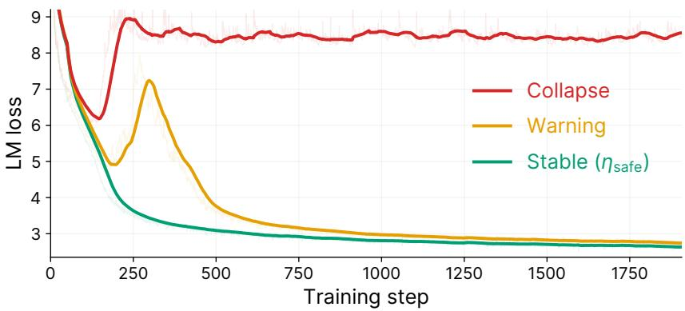

Figure 8. Representative training-loss trajectories for the model under stable, warning, and collapsed training regimes.
<table><tr><td>Module</td><td>Initialization Std.</td><td>Learning Rate</td></tr><tr><td>Embedding</td><td>O(1)</td><td>O(1)</td></tr><tr><td>Linear</td><td> $\mathcal { O } ( d ^ { - 1 / 2 } )$ </td><td> $\mathcal { O } ( d ^ { - 1 / 2 } L ^ { - 1 / 4 } )$ </td></tr><tr><td>RMSNorm</td><td>一</td><td> $\mathcal { O } ( L ^ { - 1 / 4 } )$ </td></tr><tr><td>LM head</td><td> $\mathcal { O } ( d ^ { - 1 } )$ </td><td> $\mathcal { O } ( d ^ { - 1 } )$ </td></tr></table>

Table 3. Width- and depth-dependent $\mu \mathrm { P }$ scaling rules used for different modules. Here, � denotes the hidden width and � denotes the model depth.

## A. Pre-Training

Safe learning rate. We perform a grid search over learning rates and classify the resulting training-loss trajectories as stable, warning, or collapsed, as illustrated in Figure 8. Stable runs show consistently decreasing loss; warning runs exhibit a transient rebound before recovering, while collapsed runs rebound and remain at high loss. We define the safe learning rate, $\scriptstyle \eta _ { \mathrm { s a f e } } ,$ as the largest tested learning rate classified as stable.

$\mu \mathbf { P }$ scaling factors. Table 3 summarizes the width- and depth-dependent scaling rules used to train IQuest-Q1. Following CompleteP [30], we apply an output scaling factor of $L ^ { - 1 / 2 }$ to both the attention and FFN branches. For the attention branch, this factor is incorporated into the output RMSNorm. For the FFN branch, it is applied directly to the branch output.

As shown in Figure 9, these scaling rules enable consistent transfer of the optimal learning rate across models with different widths and depths.

SWA linear context parallelism with partial halo attention. Figure 10 illustrates the setting $0 < H < S ,$ where � denotes the number of tokens in each contiguous sequence shard and � denotes the number of preceding tokens accessible to each query. In panel (b), query and key positions are measured relative to the start of the local shard. For a query at position �, valid key positions satisfy $i - H \leq j \leq$ �; negative key positions belong to the preceding shard. The horizontal dashed line separates boundary queries from queries whose attention windows lie entirely within the local shard. The pairs $( O _ { \ell } , L _ { \ell } )$ and $( O _ { h } , L _ { h } )$ denote the normalized attention outputs and corresponding per-query, per-head log-sum-exp statistics for the local and halo contributions, respectively. Panel (c) depicts execution dependencies schematically.

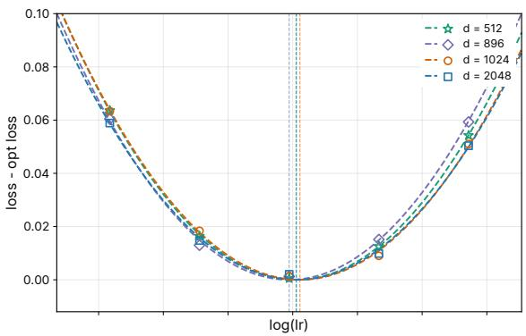  
(a) Across different widths.

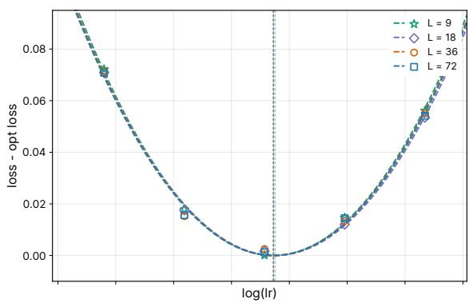  
(b) Across different depths.  
Figure 9. Optimal learning rate transfer across model widths and depths under �P scaling.

Recursive Multi-token Prediction. Figure 11 illustrates the workflow of recursive multi-token prediction. We adopt the MTP architecture of DeepSeek-V3 [32], which concatenates a hidden representation with a token embedding to form the input to the MTP block. At the first drafting step, the hidden representation comes from the final layer of the backbone model. At each subsequent step, we concatenate the previous step’s output hidden representation with the embedding of the token predicted at that step and feed the result back into the same MTP block, enabling recursive draft generation with shared parameters.

(a) Contiguous partitioning and halo exchange  
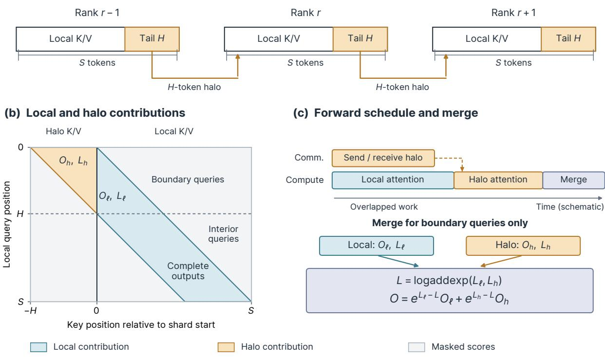  
Figure 10. Overlapping halo exchange with partial attention computation.

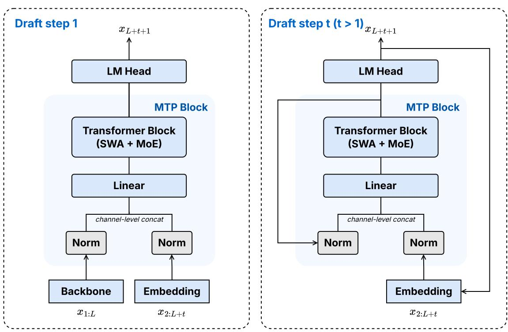  
Figure 11. Illustration of recursive multi-token prediction. Here, � denotes the input sequence length and � denotes the drafting step.