# Inherited, Not Invented: Tracing the Provenance of Wait in Reasoning Models

Zhizhuo Kou1,3 Sizai Hou 1 Long Chen 1 Jian Yang 1 Junyu Luo 2 Jingshu Peng 1 Wenkai Zhang 3 Sirui Han1\* Yike Guo1

1The Hong Kong University of Science and Technology 2Peking University 3Huawei Noah’s Ark Lab

zkouaa@connect.ust.hk, siruihan@ust.hk

## Abstract

Reinforcement learning (RL) is credited with teaching reasoning models to write wait before reconsidering a step, yet large RL accuracy gains do not require the word. This view can confuse what RL discovers with what a model inherits from its training data. We trace the word through open models’ training histories, reading it with label-free indices of frequency, position, form and usage and an injected-error test, all computed from sampled outputs. We find that zero-RL almost never coins the marker: on bases that lack the word, RL raises MATH-500 accuracy substantially while wait stays near absent. It arrives with training data: mid-training in OLMo-3, and fine-tuning on reasoning traces installs it in most models whose base lacks it. Where the base already uses it, both released RL-Zero recipes (OLMo-3, MiMo) multiply it, whereas KL-free GRPO from the same base does not; OLMo-3’s recipe wears down its form and makes it a more sensitive but more liberal alarm; RL after supervised fine-tuning barely changes it, and our GRPO recipe erases a marker seeded by fine-tuning. Finally, we show that marker frequency alone does not indicate RL-induced reasoning and caution against LLM-as-a-judge revision metrics, as automated judges can reverse human-labelled trends.

## 1 Introduction

Revision markers have emerged as the most visible sign of reasoning in large language models (LLMs). For example, when asked a competition problem, OLMo-3 writes “Wait, is that correct?” before it re-checks a step; after RL, the same model writes “Wait, but hold on.” and “Wait, 2 is 2/1.” among 36 occurrences of the word in one solution. In the R1-Zero run, wait and its kin become several times more frequent, prompting reports of an “aha moment” in which the model learns to re-evaluate (Guo et al., 2025). Consequently, uncertainty heuristics count these markers as doubt (Pandey et al., 2026; Vanhoyweghen et al., 2025), and chain-of-thought monitors process traces full of them (Korbak et al., 2025; Baker et al., 2025).

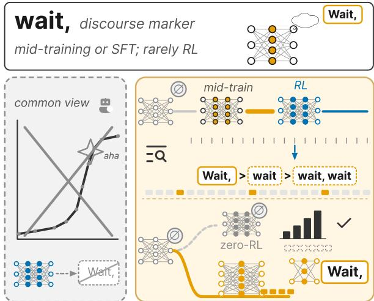  
Figure 1: RL rarely coins wait: the marker enters with mid-training or fine-tuning on traces.

While recent studies track reflective behaviours during RL runs, they leave the true origin of revision markers untested. Existing studies count reflective keywords or judged behaviours (Hu et al., 2025a; Zeng et al., 2025), and critiques of the “aha moment” show that reflective behaviour already exists in base models (Liu et al., 2025d; Essential AI et al., 2025; Gandhi et al., 2025). However, they rest on an untested assumption that RL explicitly coins the revision marker and fixes its semantic meaning throughout training. Neither assumption has been tested along open training trajectories that start from a base model before RL. Where the word comes from, and what RL does to it, remains open. We therefore ask: where does wait come from, and what does RL do to it? Leveraging open releases, we track the pretraining and mid-training checkpoints of open source model (eg. OLMo-3 (Team Olmo et al., 2025)), their RL trajectories, zero-RL runs from bases that do not use the marker, and descendants of one base trained on reasoning traces. At the analytical level, we construct indices of frequency, position, form, and usage, alongside an injected-error test of what the marker signals. We evaluate this history exactly as a historical linguist reads a word, from its occurrences alone.

Our analysis shows in all traced lineages but one, the revision marker originates in pre-RL training data, drawing upon grammaticalization (Hopper and Traugott, 2003; Lehmann, 2015; Bybee, 2003) (Figure 1). In OLMo-3 marker is absent (∅, below our 0.05 per 1k token threshold) after pretraining and appears during mid-training, RL-Zero wears down its form (Wait, > wait > wait, wait). Zero-RL across Qwen2.5, Mistral and Qwen3 bases (0.5B–32B) almost never produces it, confirming that RL alone rarely generates the marker.

Our contributions are fourfold: ❶ RL rarely coins the marker; training data supplies it. Zero-RL from bases without wait raises accuracy by a median of 42.9 points and keeps the marker below 0.05 per 1k tokens in 17/18 runs across 9 Qwen2.5, Mistral and Qwen3 bases. The marker enters OLMo-3 mid-training, and 13/14 models finetuned on traces from a non-marking base adopt it. ❷ RL reshapes an inherited marker differently across recipes. Both RL-Zero recipes (OLMo-3, MiMo) multiply the marker, whereas KL-free GRPO from the same base does not. OLMo-3’s recipe turns its form into a more sensitive yet liberal alarm. SFT followed by RL changes the marker rate little, and our GRPO recipe erases a seeded marker. ❸ A label-free instrument tracks the marker. Frequency, position, form, and usage indices with an injected-error alarm test read a marker without labels, judges, or internal access, making it portable across open lineages. An LLM judge, by contrast, reverses human revision trends. ❹ Provenance maps and blind audits provide reusable resources. We provide a provenance map of 120 model endpoints with lineages and marker indices, plus blind revision audits with expert consensus.

## 2 Background and Related Work

Pre-RL origin of reflective markers. Outcomebased RL with verifiable rewards trains a model on its own sampled solutions and rewards only the final answer (Shao et al., 2024; Guo et al., 2025). Technical reports have described reflection emerging during these training runs, measured by counting words like wait, recheck and verify (Guo et al., 2025; Hu et al., 2025a; Zeng et al., 2025). Two lines of work qualify this timeline: base models exhibit reflective behaviour before RL (Liu et al., 2025d; Essential AI et al., 2025; Yeo et al., 2025; Gandhi et al., 2025), and verifiable rewards mostly sharpen this existing capability (Yue et al., 2025; Zhao et al., 2025b; Shao et al., 2026); mid-training dictates RL responsiveness (Wang et al., 2025d; Zhang et al., 2026), and distilled models use hesitation words far more often than zero-RL models (Hu et al., 2025b). While these works have achieved commendable progress in locating the behaviour before RL, the developmental origin of the marker form remains open. We date the arrival of theform within a single open lineage and track it through RL from bases with and without it.

Functional interpretation and temporal dynamics. The functional interpretation of linguistic markers in final models remains actively disputed. Post-answer reflections are mostly confirmatory (Kang et al., 2025), many reasoning steps are decorative (Zhao et al., 2025a), and suppressing marker tokens costs RL-trained models little (Wang et al., 2025a), yet inflections occur where probes register belief shifts (Boppana et al., 2026). Interventions have tested these tokens by deleting, appending or inserting markers (Qian et al., 2025; Muennighoff et al., 2025). Chain-of-thought monitors and uncertainty heuristics treat these words as evidence of reasoning (Korbak et al., 2025; Baker et al., 2025; Pandey et al., 2026), while behaviour labels often rely on LLM judges of uneven validity (Zheng et al., 2023; Bavaresco et al., 2025). These studies examine final models only, without the axis of training time. We introduce this temporal dimension, identifying where a word enters a model’s history and measuring how each training stage alters its meaning for future model deployment.

Grammaticalization as a tracking framework. Grammaticalization provides a measurable framework from historical linguistics to explain how a word becomes a grammatical marker (Hopper and Traugott, 2003). The process requires a source construction already in use; it then raises the marker’s frequency (Bybee, 2003), fixes its position, wears down its form (attrition) and binds it to neighbouring material (Lehmann, 2015). Researchers can measure these parameters directly from occurrences, just as lexical-semantic-change methods quantify change from usage (Hamilton et al., 2016; Giulianelli et al., 2020), making them suitable for tracking model checkpoints. Language also changes under optimisation in learning agents:

communication optimised for reward drifts from natural language (Lewis et al., 2017; Lazaridou et al., 2020), and o3 has developed hard-to-read terms that grew more frequent over RL (Schoen et al., 2025). We using these grammaticalization parameters as a rigorous vocabulary and construct a set of predictions fixed before the main run.

## 3 Method

To analyse language evolution during training, we treat the samples of one model across its checkpoints as a diachronic corpus. We construct a marker’s history from its occurrences through the four stages introduced in Figure 2.

Reasoning lineages To isolate the origins of reasoning markers, we analyse three distinct classes of model history. (i) Fully open lineages with all stages released: OLMo-3 7B from pretraining through mid-training to base (Team Olmo et al., 2025), followed by RL-Zero or SFT/preference/RL tuning (OLMo-3 Think; 32B replication: OLMo-3.1 Think). (ii) RL-Zero runs from marker-free bases: our GRPO on Qwen2.5-Math (1.5B with two seeds, 7B), plus DAPO (Yu et al., 2025) and Open-Reasoner-Zero (Hu et al., 2025a) on Qwen2.5-32B. (iii) Fine-tuned descendants on reasoning traces from Qwen2.5-32B (QwQ-32B, R1-Distill), Phi-4, Qwen3, Llama, GLM, MiMo, and SmolLM3. Sections A.1 and B.2 detail all 120 endpoints and recipes. Each checkpoint evaluates MATH-500 problems (Hendrycks et al., 2021; Lightman et al., 2024) using fixed decoding per series, sampling 2–8 responses per problem.

Occurrence matching. Let $O _ { t } ( m )$ denote the occurrences of marker m in the traces of checkpoint $\pmb \theta _ { t } .$ To ensure robust quantification, we match these occurrences on detokenised text across every spelling variant (Wait,, wait, Wait., . . . ). We define the marker frequency $\mathrm { F R E Q } _ { m } ( t )$ as $| O _ { t } ( m ) |$ per 1k generated tokens. Per-response and per-word rates consistently produce the same ordering (Section 4).

Label-free linguistic indices. At the linguistic level, we extract the parameters of Section 2 solely from $O _ { t } ( m )$ . Fixation represents the sentenceinitial share:

$$
\mathrm { S I } _ { m } ( t ) = \frac { 1 } { | O _ { t } ( m ) | } \sum _ { o \in O _ { t } ( m ) } \mathrm { i n i t } ( o ) ,\tag{1}
$$

where init(o) = 1 if o starts its sentence, complemented by positional entropy $H _ { \mathrm { p o s } }$ Form (ORTH) measures the canonical Wait, share. Bonding (CHAIN) calculates the proportion continuing a reduplicated chain (Wait, wait). Erosion (EROS) tracks token distance to the next mathematical action and sentence length. Finally, usage drift computes Jensen–Shannon divergence between marker usage-cluster distributions at checkpoint t versus the base using a fixed encoder (Giulianelli et al., 2020; Kutuzov and Giulianelli, 2020), benchmarked against the base split-half noise floor.

Injected-error alarm test. To determine what wait signals, we construct a prefix of correct steps and a parallel copy with one injected arithmetic error for each problem. We continue both prefixes with $\theta _ { t }$ and record whether a revision marker appears within two sentences. The registered outcome counts any form of the revision paradigm (wait, hmm, actually, . . . ; Section B.2); we report wait alone beside it. Given the hit rate HR = P(marker | error) and the false-alarm rate FA = P(marker | no error), we compute signal detection metrics:

$$
\begin{array} { r } { d ^ { \prime } ( t ) = z ( \mathrm { H R } ) - z ( \mathrm { F A } ) , \quad } \\ { c ( t ) = - \frac { 1 } { 2 } \big [ z ( \mathrm { H R } ) + z ( \mathrm { F A } ) \big ] , } \end{array}\tag{2}
$$

where $d ^ { \prime }$ measures how effectively the marker separates errors from correct steps and c measures how readily it fires (Green and Swets, 1966; Macmillan and Creelman, 2004). The marker indices and the alarm test operate strictly on deterministic rules, requiring no human or LLM judgment of behaviour.

Portability & Statistical design. The indices and the alarm test need only sampled outputs and the list of marker forms. We apply them unchanged to 120 model endpoints, from pretraining checkpoints to released reasoning models, and the code, the provenance map and the blind audits are linked in the abstract (Section A.2).

Statistics. Exact Poisson intervals treat occurrences as independent; ratios such as A and the alarm’s $d ^ { \prime }$ use a cluster bootstrap over problems, which absorbs clustering within responses. The injection protocol and the usage encoder are specified in Sections B.1 and B.3. All reported intervals represent 95% cluster-bootstrap intervals over problems. Rates of rare events carry Poisson-model intervals. We distinguish the registered near-absence threshold (0.05 per 1k tokens on the point estimate)

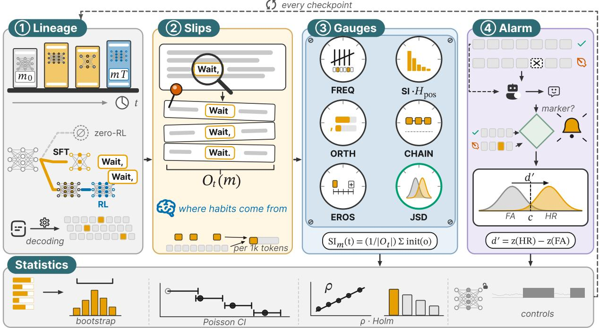  
Figure 2: Our methodology extracts a marker’s evolutionary history from its occurrences, one checkpoint at a time. The pipeline processes ❶ lineages and sampled traces into ❷ matched occurrences, from which we construct ❸ label-free indices and validate the ❹ injected-error alarm test, with statistics at every checkpoint (bottom).

<table><tr><td>Training route</td><td>Write it</td><td>Median per 1k</td></tr><tr><td>Zero-RL from a base without it</td><td>1 of 18</td><td>0</td></tr><tr><td>Fine-tuned on traces, base without it</td><td>13 of 14</td><td>3.54</td></tr><tr><td>Post-trained on a base that writes it</td><td>9 of 9</td><td>3.77</td></tr><tr><td>RL on a model that writes it</td><td>9 of 9</td><td>4.23</td></tr><tr><td>Base not released</td><td>4 of 4</td><td>4.24</td></tr></table>

Table 1: Zero-RL rarely yields wait; every other route to it passes through training data. Models that write it after training (≥0.05 per 1k tokens)

from these intervals. Trends use Spearman correlations with the RL step, Holm-corrected over the primary indices. To maintain exactness, we never pool series. The open series originate from single training runs, so their intervals strictly cover evaluation sampling only. Sections B.2 and D.3 provide further details, including the judge-based indices and the human annotation audits.

## 4 Main Experiments Results

Zero-RL rarely coins the marker. Large RL accuracy gains occur without frequent use of wait. Across 18 zero-RL runs from bases that lack it, accuracy rises by a median of 42.9 points, and in 17 of them the marker’s 95% upper bound stays below 0.06 per 1k tokens. Table 1 groups models by documented training recipe, while Tables 2 and 4 report the main values. All 120 endpoints, including instruct models, further bases and models with undisclosed training (Figures 5 and 6 and Table 13).

Zero-RL from marker-free bases maintains marker absence. Qwen2.5-32B evaluated with its own prompt template, Open-Reasoner-Zero raises MATH-500 accuracy from 10.8% to 91.4% (the base scores low under this template); wait occurs 4 times in 2,379,766 sampled tokens (base: 0 in 424,454). Our GRPO runs on Qwen2.5-Math raise accuracy from 16.9% to 76.0% at 7B and to 74.4% and 74.2% at 1.5B, and their last checkpoints contain 0, 0 and 0 occurrences. Released zero-RL models from other recipes (SimpleRL-Zoo, Open-Reasoner-Zero, Oat-Zero) agree wherever our evaluation reproduces their published accuracy (Table 13). In 17 of these 18 runs, from 9 Qwen2.5, Mistral and Qwen3 bases, the exact 95% upper bound stays below 0.06/1k tokens (Table 1).

None of the other reflection openers in our inventory (hmm, hold on, let me check, . . . ) takes its place (Section C.1). General-Reasoner on Qwen3- 4B-Base (Ma et al., 2025) is the exception: it reproduces its published accuracy, its base has 1 occurrence of wait in 434,190 tokens, while the RL model writes it 0.29 times per 1k (95% CI [0.24, 0.34]), mostly as sentence-initial self-corrections such as “Wait, there’s a discrepancy here. Let’s re-examine.” The marker persists under other decodes: 0.37 per 1k at temperature 0.6 with four samples per problem, and 0.18, 0.15 and 0.14 per 1k under three sampling seeds. The same recipe on Qwen3-14B-Base stays below the threshold (0.04 per 1k). We hypothesize that the marker was latent in this base: the Qwen3 report describes a pretraining stage with a raised share of STEM, coding, reasoning and synthetic data (Yang et al., 2025a, §3.2), leaving it unclear whether reasoning traces were included. RL from marker-free instruct models does not produce the marker either (below 0.01 per 1k at all 8 checkpoints). The 7B run was registered as a replication before it ran. The pattern holds beyond MATH-500 (Table 3): on AIME24, AIME25, AMC23, GSM8K and MMLU-Pro, zero-RL from Qwen2.5-7B never writes wait more than 3 times. OLMo-3 RL-Zero raises it on every benchmark, from 4.62 to 17.10 per 1k on GSM8K; only under the official few-shot prompt of MMLU-Pro does it barely write the marker (0.03 to 0.22/ 1k).

<table><tr><td rowspan="2">Model</td><td></td><td colspan="2">MATH-500 (%)</td><td colspan="2">wait per 1k tokens</td></tr><tr><td>Training</td><td>before</td><td>after</td><td>before</td><td>after</td></tr><tr><td colspan="6">ZERO-RL FROM A BASE WITHOUT THE MARKER</td></tr><tr><td>Open-Reasoner-Zero-32B</td><td>PPO</td><td>10.8</td><td>91.4</td><td>0[0, &lt;.01]</td><td>&lt;.01[&lt;.01, &lt;.01]</td></tr><tr><td>Qwen2.5-Math-7B</td><td>GRPO</td><td>16.9</td><td>76.0</td><td>&lt;.01[&lt;.01, &lt;.01]</td><td>0[0, &lt;.01]</td></tr><tr><td>REF-Qwen3-4B</td><td>GRPO</td><td>41.2</td><td>84.1</td><td>0.02[0.01, 0.03]</td><td>0.03 [0.02, 0.04]</td></tr><tr><td>Mistral-Small-24B-SimpleRL-Zoo</td><td>GRPO</td><td>21.4</td><td>75.8</td><td>0[0, 0.01]</td><td>&lt;.01 [&lt;.01, &lt;.01]</td></tr><tr><td>General-Reasoner-Qwen3-4B (exception)</td><td>GRPO</td><td>71.2</td><td>79.0</td><td>&lt;.01 [&lt;.01, 0.01]</td><td>0.29 [0.24, 0.34] ↑</td></tr><tr><td colspan="6">FINE-TUNED ON REASONING TRACES</td></tr><tr><td>DeepSeek-R1-Distill-Qwen-32B</td><td>SFT</td><td>35.8</td><td>89.5</td><td>&lt;.01 [&lt;.01, 0.02]</td><td>3.25 [3.18, 3.32]↑</td></tr><tr><td>Phi-4-reasoning</td><td>SFT</td><td>82.0</td><td>93.0</td><td>0[0, &lt;.01]</td><td>1.56[1.50, 1.62]↑</td></tr><tr><td>MiMo-7B-SFT</td><td>SFT</td><td>65.8</td><td>85.6</td><td>4.95 [4.86, 5.04]</td><td>3.77 [3.69, 3.84] ↓</td></tr><tr><td colspan="6">QWEN3: SFT AND RL ON ITS OWN BASE (BEFORE = ITS BASE)</td></tr><tr><td>Qwen3-8B</td><td>SFT+RL</td><td>66.5</td><td>84.9</td><td>0[0, &lt;.01]</td><td>3.93 [3.87, 4.00]↑</td></tr><tr><td>Qwen3-14B</td><td>SFT+RL</td><td>66.5</td><td>87.9</td><td>0.03 [0.01, 0.05]</td><td>3.03 [2.98, 3.10] ↑</td></tr><tr><td>Qwen3-30B-A3B</td><td>SFT+RL</td><td>52.2</td><td>86.8</td><td>0.02 [0.01, 0.03]</td><td>2.83 [2.77, 2.88] ↑</td></tr><tr><td colspan="6">TRAINING STAGES OF OLMO-3-1025-7B (BEFORE = PREVIOUS STAGE)</td></tr><tr><td>Pretraining</td><td>stage 1</td><td>0.0</td><td>0.1</td><td>0.04[0.03, 0.05]</td><td>0.04 [0.03, 0.06]</td></tr><tr><td>Mid-training</td><td>stage 2</td><td>0.1</td><td>35.7</td><td>0.04[0.03, 0.06]</td><td>4.03 [3.92, 4.14] ↑</td></tr><tr><td>Base</td><td>stage 3</td><td>35.7</td><td>51.2</td><td>4.03 [3.92, 4.14]</td><td>4.94[4.85, 5.03]↑</td></tr><tr><td colspan="6">RL FROM A MODEL THAT USES THE MARKER</td></tr><tr><td>Olmo-3-7B-RL-Zero-Math</td><td>RL-Zero</td><td>52.3±1.2 84.9±0.9</td><td></td><td> $5 . 0 7 \pm 0 . 1 7$ </td><td>12.68±1.55↑</td></tr><tr><td>Olmo-3-7B-Think</td><td>SFT, DPO, RL</td><td>90.0</td><td>91.0</td><td>3.86[3.79, 3.94]</td><td>4.52[4.44, 4.59] ↑</td></tr><tr><td>Olmo-3.1-32B-Think</td><td>SFT, DPO, RL</td><td>91.4</td><td>93.0</td><td>4.52[4.46, 4.58]</td><td>4.23 [4.17, 4.29] ↓</td></tr><tr><td>MiMo-7B-RL-Zero</td><td>RL-Zero</td><td>65.8</td><td>76.4</td><td>4.95 [4.86, 5.04]</td><td>6.62 [6.53, 6.71] ↑</td></tr><tr><td>MiMo-7B-RL</td><td>SFT, then RL</td><td>85.6</td><td>87.6</td><td>3.77 [3.69, 3.84]</td><td>6.65 [6.56, 6.74] ↑</td></tr><tr><td colspan="6">NEWEST GENERATION: QWEN3.5 AND QWEN3.8 (BEFORE = ITS BASE)</td></tr><tr><td>Qwen3.5-0.8B</td><td>post-training</td><td>43.8</td><td>48.1</td><td>1.96[1.92, 1.99]</td><td>1.83 [1.80, 1.86]‡↓</td></tr><tr><td>Qwen3.5-2B</td><td>post-training</td><td>74.5</td><td>76.8</td><td>1.31 [1.27, 1.34]</td><td>0.86[0.84, 0.89]↓</td></tr><tr><td>Qwen3.5-4B</td><td>post-training</td><td>89.6</td><td>88.2</td><td>1.15[1.11, 1.20]</td><td> $3 . 8 2 [ 3 . 7 8 , 3 . 8 5 ] ^ { \ddagger } \uparrow$ </td></tr><tr><td>Qwen3.5-9B</td><td>post-training</td><td>88.1</td><td>92.1</td><td>0.93 [0.89, 0.98]</td><td> $2 . 9 4 [ 2 . 9 1 , 2 . 9 7 ] \uparrow$ </td></tr></table>

Table 2: Zero-RL rarely installs wait; training data does, and released RL-Zero recipes amplify it. Largest (bold), second increase (underline), intervals overlap (gray); ±: s.d. over six decoding seeds, else [95% CI]. Shading: wait per 1k after training (log scale, darker = more); ↑/↓: rise/fall with non-overlapping intervals.

Training data supplies the marker. 13 of 14 models fine-tuned on reasoning traces from markerfree bases write the marker ≥ 0.5 times/1k tokens (Table 1). Another 9 start from marked bases, while 4 lack measured bases (e.g., Qwen2.5-32B R1-Distill 3.25, QwQ-32B 4.42, Qwen3-8B 3.93, Phi-4-reasoning 1.56, and R1-Distill-Llama-8B 4.8). An exception, OpenReasoning-Nemotron-7B (NVIDIA, 2025), opens sentences with but (98.3/1k) and perhaps (28.1/1k) instead of wait (0.2/1k), showing marker forms track trace transfers. In OLMo-3 (Figure 7a), wait occurs ≤ 0.04 times per 1k in pretraining, but rises post-midtraining to 4.03 (88.6% sentence-initial), coinciding with thinking traces included for RL-Zero (Team Olmo et al., 2025). Pretrained bases whose mixtures include reasoning data already write it, including MiMo-7B-Base (4.95/1k) and SmolLM3- 3B-Base (4.18 per 1k) (LLM-Core Xiaomi et al., 2025; Bakouch et al., 2025).

All four Qwen3.5 bases write wait (0.93/1k at

<table><tr><td>Model (before → after)</td><td>AIME24</td><td>AIME25</td><td>AMC23</td><td>GSM8K</td><td>MMLU-Pro</td></tr><tr><td> $\mathrm { O L M o } { - } 3 7 \mathrm { B } \mathrm { R L } { - } \mathrm { Z e r o }$ </td><td> $5 . 0 3  7 . 3 7$ </td><td> $5 . 2 3  7 . 6 3$ </td><td> $5 . 4 9  9 . 7 8$ </td><td> $4 . 6 2  1 7 . 1 0$ </td><td> $0 . 0 3  0 . 2 2$ </td></tr><tr><td> $\mathrm { O L M o } { - } 3 7 \mathrm { B } \mathrm { T h i n k }$ </td><td> $4 . 3 0  4 . 9 0$ </td><td> $4 . 6 7  5 . 2 2$ </td><td> $3 . 6 8  4 . 3 3$ </td><td> $2 . 9 5  3 . 3 2$ </td><td> $1 . 6 1  2 . 3 4$ </td></tr><tr><td> $\mathrm { Q w e n 2 . 5 { \cdot } 7 B  S i m p l e R L { \cdot } Z o o }$ </td><td> $< . 0 1  0$ </td><td> $< . 0 1  0$ </td><td> $< . 0 1  0$ </td><td> $0 . 0 1  < . 0 1$ </td><td> $0  0$ </td></tr><tr><td> $\mathrm { R 1 - D i s t i l l - Q w e n { - } 7 B }$ </td><td>4.75</td><td>6.04</td><td>3.93</td><td>3.37</td><td>4.10</td></tr></table>

Table 3: Zero-RL from Qwen2.5-7B leaves wait absent on all five benchmarks; models that inherited it keep it on the mathematical ones. Rate per 1k tokens of finished responses, before → after training; grey: 95% intervals overlap; MMLU-Pro: official few-shot prompt.

<table><tr><td>Model</td><td>Training</td><td>MATH-500 (%)</td><td>wait per 1k</td></tr><tr><td>Qwen3.8-27B</td><td>post-training</td><td>96.4</td><td>0.91 [0.86, 0.96]</td></tr><tr><td>openPangu-Embedded-7B-V1.1</td><td>post-training</td><td>95.8</td><td>0.44[0.42, 0.47]</td></tr><tr><td>openPangu-Embedded-7B</td><td>post-training</td><td>91.8</td><td> $1 . 4 1 \ [ 1 . 3 7 , 1 . 4 5 ]$ </td></tr></table>

Table 4: Models released without a base also write wait.

9B to 1.96/1k at 0.8B); post-training decreases frequency at 0.8B (2.21 to 0.90) and 2B (1.39 to 0.72), but increases it at 4B (1.18 to 1.68) and 9B (0.97 to 1.43). Qwen3.8-27B writes it 0.91 times/1k (Table 4), and openPangu-Embedded-7B-V1.1 and V1 write 0.41 and 1.32 (Table 13). By contrast, OLMo-2 7B’s base rarely writes the marker (0.16/1k) and yields downstream models that never do (Table 13).

Training data supplies the marker. These observational comparisons date the marker’s onset relative to training stages, not to individual training examples.

Takeaway. Zero-RL rarely installs wait. In all but one of 18 runs from a base without it, RL raises accuracy while the marker stays below 0.05 per 1k tokens. The marker becomes frequent with mid-training, reasoning-rich pretraining or fine-tuning on traces.

Where the Marker Exists, Released RL-Zero Recipes Multiply It. Both released RL-Zero recipes multiply the marker. Figure 3 follows the two OLMo-3 trajectories. The Qwen2.5 GRPO runs emit fewer than 100 occurrences at every checkpoint and are omitted. Along OLMo-3 RL-Zero, the rate of wait rises from 4.9 to a peak of 17.0/ 1k tokens at step 1900, ending at 12.4 at the released final checkpoint (Figure 3a; Holmadjusted $p < 0 . 0 0 1 )$ . Over 6 decoding seeds, the final rate is $1 2 . 6 8 \pm 1 . 5 5$ (Table 2). The size of the rise depends on decoding: at temperature 0.6 instead of 1.0, the final checkpoint writes 76.5 occurrences per 1k tokens compared to 5.1 for the base, and 29.1% of its responses reach the length limit (base 17.8%). We therefore compare rates only within a series at fixed settings. The rise also depends on the recipe: run for 400 steps from the same base and evaluated identically, our KL-free GRPO recipe does not multiply the marker, ending at 0.81 times the base’s rate on all responses and 0.93 on finished ones, against 1.58 for the released run, with disjoint intervals at steps 200 and 400. With a small KL penalty, the registered outcome is undetermined (Section D.2). RL-Zero on another base that already writes the marker also multiplies it (MiMo-7B: 4.95 to 6.62). RL after fine-tuning on traces in Phi-4 (1.56 to 2.58), DeepScaleR (3.65 to 4.07 among finished responses) and Light-R1 (2.79 to 3.21) shows similar amplification.

Our GRPO recipe erases a marker seeded by fine-tuning. In a registered transplant, we finetune Qwen2.5-Math-1.5B on 512 correct traces whose sentences open with Wait, and then train it with our GRPO recipe. After fine-tuning, the model writes wait 7.52 times per 1k tokens. After 400 RL steps, it writes none (0 occurrences in 3,066,514 tokens). Accuracy rises from 41.0% to 77.6%, and responses shrink from 2,466 to 767 tokens. As wait disappears, the neutral Next, grows 4.83-fold in the same runs. When the seed traces carry Next, instead, RL keeps 0.12 of it. This run has a confound: 48.4% of the fine-tuned responses reach the 3,072-token limit and earn no reward, so RL also shortens responses. The arm seeded with 64 traces, whose fine-tuned responses reach the limit less often (18.5%), loses the marker as well (1.60 per 1k after fine-tuning; 2 occurrences in 2,523,676 tokens after RL). The marker falls just as fast among finished responses (6.91 to 0.0 per 1k). A registered control rules out length as the cause: with an 8,192-token limit, the same transplant goes from 7.45 to <.01 per 1k among finished responses (A = 0.0003, 95% CI [0.0001, 0.0006]), far below the registered threshold of 0.2 for a penalty on the marker itself, and the same control seeded with Next, reaches similar accuracy while writing no wait at step 400 (Section D.2).

OLMo-3 RL-Zero (RL from the base): multiplies it and erodes its form  
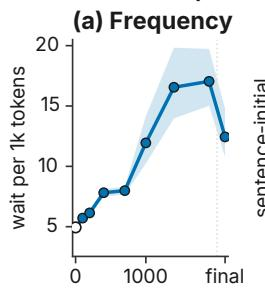

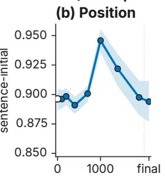

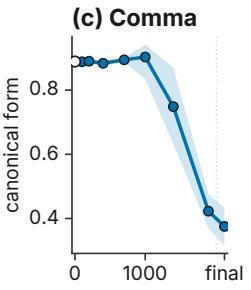

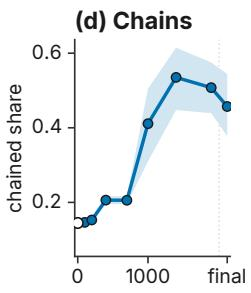

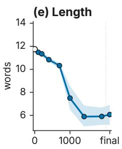

OLMo-3 Think (RL after SFT and DPO): rate changes little, comma form restored  
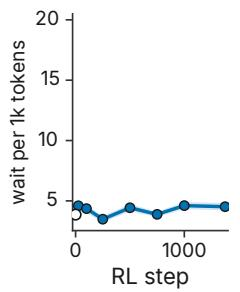

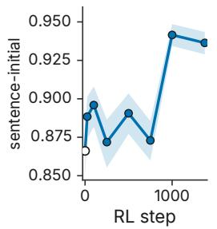

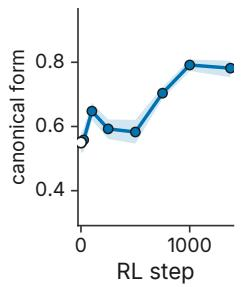

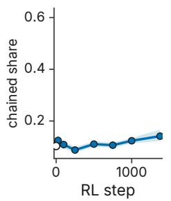

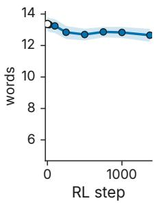  
Figure 3: OLMo-3 RL-Zero multiplies wait and erodes its form; RL after fine-tuning changes its rate little and restores its comma. (top) OLMo-3 RL-Zero; (bottom) OLMo-3 Think; (a)–(e) rate, sentence-initial share, Wait, share, chaining, sentence length; hollow: base; bands: 95% cluster-bootstrap CIs.

The marker’s form wears down. Its position was already fixed before RL and remains so: 89.6% of occurrences open their sentence at the base, and 89.4% do so at the end (Figure 3b). The form itself erodes instead. The share written Wait, falls from 88.9% to 37.5% as the comma drops (Wait no, Wait let me). This marks a change of level between steps 1000 and 1900 rather than a gradual trend (Figure 3c). Reduplicated chains (Wait, wait) rise from 117.6 to 213.0 per 1k occurrences, and marker-initial sentences shrink from 11.8 to 6.1 words. In grammaticalization terms, this is attrition, the loss of substance typical of a marker’s late stages (Lehmann, 2015). Its contexts of use also shift: the usage distribution of the last checkpoint differs from the base’s by a Jensen–Shannon divergence of 0.05, compared to a noise floor of 0.002. Running example of this attrition is in Section C.2.3.

RL follows a different path after supervised fine-tuning. Along OLMo-3 Think, where RL starts from a fine-tuned and preference-tuned checkpoint, the rate changes little (3.9 to 4.5; RL-Zero: 4.9 to 12.4). The comma form is restored (55.0% to 78.2%; Holm-adjusted p = 0.029), and usage stays at the noise floor. At 32B, OLMo-3.1 Think keeps the rate flat (4.5 to 4.2). Along the supervised fine-tuning trajectory of the same base, the marker barely changes (rate 5.1 to 4.8; comma share 92.1% to 91.7%). Robustness to template and decoding appears in Section C.1.

Takeaway. Where pretraining or mid-training supplies wait, both released RL-Zero recipes (OLMo-3, MiMo) multiply it, and OLMo-3’s drops its comma and chains it. In OLMo-3, RL following supervised fine-tuning changes its rate little. Meanwhile, our GRPO recipe erases a marker seeded by fine-tuning. The separate roles of source and recipe remain open.

## 4.1 Analysis

The Marker Becomes a More Sensitive but More Liberal Alarm. On prefixes with and without an injected error, the registered outcome—any revision marker—becomes more sensitive, with $d ^ { \prime }$ rising from 0.57 to 1.09 (95% CI [0.97, 1.24]). It also becomes more liberal: the criterion falls from 0.11 to −0.24 (Figure 4). Wait alone shows a similar trend: $d ^ { \prime }$ rises from 0.77 to 1.29 (CI [1.16, 1.44]) and c falls from 0.46 to 0.01. Wait alone follows 73.7% of prefixes with an error (base 47.1%) but also 25.4% of error-free ones (base 19.9%). The marker therefore maintains its link to errors rather than bleaching, contradicting our preregistered prediction (Section D.2). After supervised fine-tuning, RL leaves the alarm almost unchanged: the criterion moves from −0.14 to −0.19 at 7B and from −0.2 to −0.05 at 32B, while d′ moves from 0.82 to 1.02 and from 0.97 to 0.86, against 0.57 to 1.09 along RL-Zero. Under RL-Zero, the marker thus remains a signal of errors but fires more readily, even after error-free steps, so its evidential weight is a property of the checkpoint.

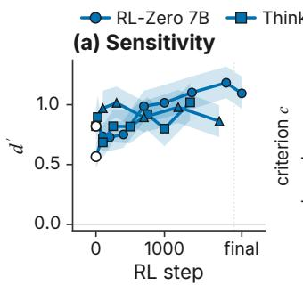

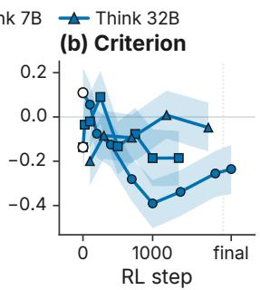  
Figure 4: Under RL-Zero, revision markers become a more sensitive but more liberal alarm. Sensitivity d′ and criterion c of any revision marker after clean versus error-injected prefixes, per checkpoint, with 95% cluster-bootstrap bands.

Judged Revisions Can Reverse the Human-Labelled Trend. On a 60-sentence blind audit with expert consensus labels, one of two LLM judges reverses the human-labelled direction of the revision rate along RL-Zero. LLM judges are a common shortcut for labelling reflective behaviour along training (Zeng et al., 2025; Gandhi et al., 2025). We test this against a blind human audit of 60 sentences from the base and the last RL-Zero checkpoint, stratified by marker. The primary judge agrees with the consensus labels at κ = 0.64. However, the judge over-calls revisions at the base: on the same weighted items, its revision ratefalls from 26.0% to 12.9%, while the consensus rate rises from 1.3% to 15.9%. A second judge tracks the consensus labels (1.5% to 12.9%; κ = 0.71). Our findings therefore rest on direct marker measurements; the audit is descriptive. Judge-based indices and all audits appear in Sections D.2 and D.3.

## 5 Discussion

RL reshapes inherited markers; it rarely coins them. A rise in wait during RL does not show that RL introduced the marker; the starting checkpoint may already use it. In every lineage traced but one, the marker possesses a prior source: midtraining data, a reasoning-rich pretraining mixture, or fine-tuning on traces. Reports of an “aha moment” should state whether the base already writes the marker, and how often. Marker counts alone therefore cannot show that reflection was newly acquired.

Marker frequency and meaning shift across training. Marker frequency and meaning shift across training, which undermines uncertainty heuristics that read wait as a fixed signal of doubt. Along OLMo-3 RL-Zero, the marker fires more often after errors and correct steps alike. The ratio rises, so when it fires it remains a strong signal, but its overall frequency changes. RL after supervised fine-tuning leaves the alarm almost unchanged. A marker’s evidential weight requires direct measurement on the specific checkpoint, for example with the label-free injected-error test of Section 3.

Automated behavioural judgments require human validation. Judge-labelled behaviour rates scale, but one of our judges reversed the humanlabelled trend despite moderate item-level agreement. Direct marker measurements must therefore support lexical claims, and behavioural judgments need human validation.

Language change under optimisation is recipespecific rather than a single cline; Section D.1 relates our results to grammaticalization theory.

## 6 Conclusion

We find that zero-RL almost never coins the reflection marker wait across the training history of open models. From bases lacking the marker, zero-RL raises accuracy and keeps the marker below 0.05 per 1k tokens in most runs. The marker arrives instead with mid-training, reasoning-rich pretraining, or fine-tuning on traces. When pretraining or midtraining supplies the marker, both released RL-Zero recipes multiply it, while KL-free GRPO from the same base does not. OLMo-3’s recipe erodes its form and makes it a more liberal alarm. In OLMo-3, RL after supervised fine-tuning changes its rate little, and RL erases a marker seeded by light finetuning. Understanding reasoning traces starts with knowing where their words originate. By mapping these developmental trajectories, we establish that training data seeds reflection markers while specific RL recipes dictate their ultimate survival guiding the future reasoning model training.

## Limitations

Our provenance evidence is observational. The compared lineages differ in data and recipe alongside the marker. The zero-RL result rests on 18 runs from Qwen2.5, Mistral and Qwen3 bases. Each open checkpoint series constitutes a single training run, so its intervals capture evaluation sampling variance rather than training variance. All RL runs involve 0.5B–32B models trained with outcome rewards on English mathematics. Frontier-scale RL, other domains, other languages, and process rewards remain untested.

Our measurements capture the lexical form rather than underlying reflective behaviour. A model can reflect without writing wait, and markers outside our inventory escape detection. Judgebased quantities agree weakly to moderately with the human consensus labels (Section D.3). The audits are consensus labels on a sample, with no independent double annotation, so inter-annotator agreement is not reported; because they remain descriptive, our headline claims rest on label-free indices and pre-registered tests. The alarm test covers only the arithmetic errors we inject. Several predictions we registered did not hold (Section D.2).

## Ethical Considerations

Artefacts. We use publicly released checkpoints, datasets and code under their licences (Section A.2); no model was trained on personal data by us, and our runs use a public mathematics dataset. Code and data are at https://anonymous.4open. science/r/wait-provenance/: the provenance map, the result keys, the label-free index suite and the three expert-consensus audits, under CC-BY-4.0 (Section A.2).

Human participants. No crowd workers were involved. In three blind validity audits of modelgenerated mathematics, the third with further marker occurrences (Section D.3), labels are consensus labels from a panel of ten annotators with PhD-level training in related fields, agreed through discussion; an author recorded them with a software tool that suggested no answers. All other reference labels were produced by LLM raters and are described as such.

Dual use. Showing that a reasoning marker changes its evidential weight with training could help someone evade a monitor that reads such markers. The effect we report is a drift that arises without any adversary, and the remedy is simple and public: calibrate any marker-based reading on the checkpoint being read. We therefore see the benefit to monitor builders as outweighing the risk.

AI assistance. AI assistants were used for code writing and polish but the whole research is design and checked by researchers.

## References

Iván Arcuschin, Jett Janiak, Robert Krzyzanowski, Senthooran Rajamanoharan, Neel Nanda, and Arthur Conmy. 2025. Chain-of-thought reasoning in the wild is not always faithful. Preprint, arXiv:2503.08679.

Bowen Baker, Joost Huizinga, Leo Gao, Zehao Dou, Melody Y. Guan, Aleksander Madry, Wojciech Zaremba, Jakub Pachocki, and David Farhi. 2025. Monitoring reasoning models for misbehavior and the risks of promoting obfuscation. Preprint, arXiv:2503.11926.

Elie Bakouch, Loubna Ben Allal, Anton Lozhkov, Nouamane Tazi, Lewis Tunstall, Carlos Miguel Patiño, Edward Beeching, Aymeric Roucher, Aksel Joonas Reedi, Quentin Gallouédec, Kashif Rasul, Nathan Habib, Clémentine Fourrier, Hynek Kydlicek, Guilherme Penedo, Hugo Larcher, Mathieu Morlon, Vaibhav Srivastav, Joshua Lochner, and 4 others. 2025. SmolLM3: smol, multilingual, long-context reasoner. https://huggingface.co/blog/smollm3.

Anna Bavaresco, Raffaella Bernardi, Leonardo Bertolazzi, Desmond Elliott, Raquel Fernández, Albert Gatt, Esam Ghaleb, Mario Giulianelli, Michael Hanna, Alexander Koller, Andre Martins, Philipp Mondorf, Vera Neplenbroek, Sandro Pezzelle, Barbara Plank, David Schlangen, Alessandro Suglia, Aditya K Surikuchi, Ece Takmaz, and Alberto Testoni. 2025. LLMs instead of human judges? a large scale empirical study across 20 NLP evaluation tasks. In Proceedings ofthe 63rd Annual Meeting ofthe Associationfor Computational Linguistics (Volume 2: Short Papers), pages 238–255, Vienna, Austria. Association for Computational Linguistics.

Stella Biderman, Hailey Schoelkopf, Quentin Anthony, Herbie Bradley, Kyle O’Brien, Eric Hallahan, Mohammad Aflah Khan, Shivanshu Purohit, USVSN Sai Prashanth, Edward Raff, Aviya Skowron, Lintang Sutawika, et al. 2023. Pythia: A suite for analyzing large language models across training and scaling. In Proceedings ofthe 40th International Conference on Machine Learning.

Paul C. Bogdan, Uzay Macar, Neel Nanda, and Arthur Conmy. 2025. Thought anchors: Which LLM reasoning steps matter? Preprint, arXiv:2506.19143.

Siddharth Boppana, Annabel Ma, Max Loeffler, Raphaël Sarfati, Eric Bigelow, Atticus Geiger, Owen

Lewis, and Jack Merullo. 2026. Reasoning theater: Disentangling model beliefs from chain-of-thought. In Forty-third International Conference on Machine Learning.

Laurel J. Brinton. 1996. Pragmatic Markers in English: Grammaticalization and Discourse Functions. DE GRUYTER MOUTON.

Laurel J. Brinton. 2017. The Evolution of Pragmatic Markers in English: Pathways of Change. Cambridge University Press.

Laurel J. Brinton and Elizabeth Closs Traugott. 2005. Lexicalization and Language Change. Cambridge University Press.

Joan Bybee. 2003. Mechanisms of change in grammaticization: The role of frequency. In Brian D. Joseph and Richard D. Janda, editors, The Handbook ofHistorical Linguistics, pages 602–623. Blackwell, Malden, MA.

Rahma Chaabouni, Eugene Kharitonov, Emmanuel Dupoux, and Marco Baroni. 2019. Anti-efficient encoding in emergent communication. In Advances in Neural Information Processing Systems, volume 32. Curran Associates, Inc.

Tyler A. Chang and Benjamin K. Bergen. 2022. Word acquisition in neural language models. Transactions of the Association for Computational Linguistics, 10:1–16.

Tyler A. Chang, Zhuowen Tu, and Benjamin K. Bergen. 2024. Characterizing learning curves during language model pre-training: Learning, forgetting, and stability. Transactions of the Association for Computational Linguistics, 12:1346–1362.

Yanda Chen, Joe Benton, Ansh Radhakrishnan, Jonathan Uesato, Carson Denison, John Schulman, Arushi Somani, Peter Hase, Misha Wagner, Fabien Roger, et al. 2025. Reasoning models don’t always say what they think. Preprint, arXiv:2505.05410.

Yueh-Han Chen, Robert McCarthy, Bruce W. Lee, He He, Micah Carroll, and Tomek Korbak. 2026a. Reasoning models struggle to control their chains of thought. In Forty-third International Conference on Machine Learning.

Zihan Chen, Di Zhu, Lei Zheng, and Weiling Li. 2026b. Beyond accuracy: How procedural traces shift the decision criterion of LLM overseers. Preprint, arXiv:2609.18204.

Ganqu Cui, Yuchen Zhang, Jiacheng Chen, Lifan Yuan, Zhi Wang, Yuxin Zuo, Haozhan Li, Yuchen Fan, Huayu Chen, Weize Chen, et al. 2025. The entropy mechanism of reinforcement learning for reasoning language models. Preprint, arXiv:2505.22617.

Liv G. d’Aliberti and Manoel Horta Ribeiro. 2026. The illusion of insight in reasoning models. In Findings of the Associationfor Computational Linguistics: ACL

2026, pages 924–966, San Diego, California, United States. Association for Computational Linguistics.

Liesbeth Degand and Jacqueline Evers-Vermeul. 2015. Grammaticalization or pragmaticalization of discourse markers?: More than a terminological issue. Journal ofHistorical Pragmatics, 16(1):59–85.

Siddartha Devic, Charlotte Peale, Arwen Bradley, Sinead Williamson, Preetum Nakkiran, and Aravind Gollakota. 2025. Trace length is a simple uncertainty signal in reasoning models. Preprint, arXiv:2510.10409.

Bowen Ding, Yuhan Chen, Futing Wang, Lingfeng Ming, and Tao Lin. 2025. Do thinking tokens help or trap? towards more efficient large reasoning model. Preprint, arXiv:2506.23840.

Kevin Du, Alexander Miserlis Hoyle, Laura Ruis, and Acyr Locatelli. 2026. Legibility is not interpretability: Evaluating judged importance versus actual importance in chain-of-thought reasoning steps. In Third Conference on Language Modeling.

Bradley Efron and Robert J. Tibshirani. 1993. An Introduction to the Bootstrap. Chapman & Hall, New York.

Essential AI, Darsh J Shah, Peter Rushton, Somanshu Singla, Mohit Parmar, Kurt Smith, Yash Vanjani, Ashish Vaswani, Adarsh Chaluvaraju, Andrew Hojel, et al. 2025. Rethinking reflection in pre-training. Preprint, arXiv:2504.04022.

Chongyu Fan, Yihua Zhang, Jinghan Jia, Alfred Hero, and Sijia Liu. 2026. Cyclicreflex: Improving reasoning models via cyclical reflection token scheduling. In The Fourteenth International Conference on Learning Representations.

C. A. Field and A. H. Welsh. 2007. Bootstrapping clustered data. Journal of the Royal Statistical Society: Series B (Statistical Methodology), 69(3):369–390.

David Firth. 1993. Bias reduction of maximum likelihood estimates. Biometrika, 80(1):27–38.

Bruce Fraser. 1999. What are discourse markers? Journal ofPragmatics, 31(7):931–952.

Lukas Galke, Yoav Ram, and Limor Raviv. 2022. Emergent communication for understanding human language evolution: What’s missing? Preprint, arXiv:2204.10590.

Kanishk Gandhi, Ayush K Chakravarthy, Anikait Singh, Nathan Lile, and Noah Goodman. 2025. Cognitive behaviors that enable self-improving reasoners, or, four habits of highly effective STaRs. In Second Conference on Language Modeling.

Soumya Suvra Ghosal, Souradip Chakraborty, Avinash Reddy, Yifu Lu, Mengdi Wang, Dinesh Manocha, Furong Huang, Mohammad Ghavamzadeh, and Amrit Singh Bedi. 2025. Does thinking more always

help? mirage of test-time scaling in reasoning models. In The Thirty-ninth Annual Conference on Neural Information Processing Systems.

Mario Giulianelli, Marco Del Tredici, and Raquel Fernández. 2020. Analysing lexical semantic change with contextualised word representations. In Proceedings of the 58th Annual Meeting of the Associationfor Computational Linguistics, pages 3960– 3973, Online. Association for Computational Linguistics.

Mario Giulianelli, Iris Luden, Raquel Fernandez, and Andrey Kutuzov. 2023. Interpretable word sense representations via definition generation: The case of semantic change analysis. In Proceedings ofthe 61st Annual Meeting ofthe Associationfor Computational Linguistics (Volume 1: Long Papers), pages 3130–3148, Toronto, Canada. Association for Computational Linguistics.

David M. Green and John A. Swets. 1966. Signal Detection Theory and Psychophysics. Wiley, New York.

Melody Y. Guan, Miles Wang, Micah Carroll, Zehao Dou, Annie Y. Wei, Marcus Williams, Benjamin Arnav, Joost Huizinga, Ian D Kivlichan, Amelia Glaese, Jakub Pachocki, and Bowen Baker. 2026. Monitoring monitorability. In Forty-third International Conference on Machine Learning.

Daya Guo, Dejian Yang, Haowei Zhang, Junxiao Song, Peiyi Wang, Qihao Zhu, Runxin Xu, Ruoyu Zhang, Shirong Ma, Xiao Bi, et al. 2025. Deepseek-r1 incentivizes reasoning in LLMs through reinforcement learning. Nature, 645(8081):633–638.

William L. Hamilton, Jure Leskovec, and Dan Jurafsky. 2016. Diachronic word embeddings reveal statistical laws of semantic change. In Proceedings ofthe 54th Annual Meeting ofthe Associationfor Computational Linguistics (Volume 1: Long Papers), pages 1489–1501, Berlin, Germany. Association for Computational Linguistics.

Martin Haspelmath. 1999. Why is grammaticalization irreversible? Linguistics, 37(6).

Michael J. Hautus. 1995. Corrections for extreme proportions and their biasing effects on estimated values of d′. Behavior Research Methods, Instruments, & Computers, 27(1):46–51.

Andre Wang He, Daniel Fried, and Sean Welleck. 2025. Rewarding the unlikely: Lifting GRPO beyond distribution sharpening. In Proceedings of the 2025 Conference on Empirical Methods in Natural Language Processing, pages 25548–25560, Suzhou, China. Association for Computational Linguistics.

Bernd Heine. 2013. On discourse markers: Grammaticalization, pragmaticalization, or something else? Linguistics, 51(6).

Bernd Heine and Tania Kuteva. 2002. World Lexicon of Grammaticalization. Cambridge University Press.

Dan Hendrycks, Collin Burns, Saurav Kadavath, Akul Arora, Steven Basart, Eric Tang, Dawn Song, and Jacob Steinhardt. 2021. Measuring mathematical problem solving with the MATH dataset. In Proceedings of the Neural Information Processing Systems Track on Datasets and Benchmarks, volume 1.

Sture Holm. 1979. A simple sequentially rejective multiple test procedure. Scandinavian Journal ofStatistics, 6(2):65–70.

Paul J. Hopper. 1991. On some principles of grammaticization. In Elizabeth Closs Traugott and Bernd Heine, editors, Approaches to Grammaticalization. Volume I: Theoretical and Methodological Issues, number 19 in Typological Studies in Language, pages 17–36. John Benjamins, Amsterdam.

Paul J. Hopper and Elizabeth Closs Traugott. 2003. Grammaticalization, 2 edition. Cambridge University Press.

Jingcheng Hu, Yinmin Zhang, Qi Han, Daxin Jiang, Xiangyu Zhang, and Heung-Yeung Shum. 2025a. Open-reasoner-zero: An open source approach to scaling up reinforcement learning on the base model. In The Thirty-ninth Annual Conference on Neural Information Processing Systems.

Xiao Hu, Xingyu Lu, Liyuan Mao, YiFan Zhang, Tianke Zhang, Bin Wen, Fan Yang, Tingting Gao, and Guorui Zhou. 2025b. Why distillation can outperform Zero-RL: The role of flexible reasoning. Preprint, arXiv:2505.21067.

Jaehui Hwang, Byeongho Heo, Sangdoo Yun, and Dongyoon Han. 2026. Oops, wait: Discourse tokens matter in reasoning model. Preprint, arXiv:2601.17421.

Lingyu Jiang, Zirui Li, Shuo Xing, Peiran Li, Tsubasa Takahashi, Dengzhe Hou, Zhengzhong Tu, Kazunori Yamada, and Fangzhou Lin. 2026. PathCal: Stateaware reflection-marker calibration for efficient reasoning. Preprint, arXiv:2605.23074.

Arun Jose. 2025. Reasoning models sometimes output illegible chains of thought. In The Thirty-ninth Annual Conference on Neural Information Processing Systems.

Saurav Kadavath, Tom Conerly, Amanda Askell, Tom Henighan, Dawn Drain, Ethan Perez, Nicholas Schiefer, Zac Hatfield-Dodds, Nova DasSarma, Eli Tran-Johnson, et al. 2022. Language models (mostly) know what they know. Preprint, arXiv:2207.05221.

Liwei Kang, Yue Deng, Yao Xiao, Zhanfeng Mo, Wee Sun Lee, and Lidong Bing. 2025. First try matters: Revisiting the role of reflection in reasoning models. Preprint, arXiv:2510.08308.

Aayush Karan and Yilun Du. 2026. Reasoning with sampling: Your base model is smarter than you think. In The Fourteenth International Conference on Learning Representations.

Constantinos Karouzos, Xingwei Tan, and Nikolaos Aletras. 2026. Where does output diversity collapse in post-training? Preprint, arXiv:2604.16027.

Tomek Korbak, Mikita Balesni, et al. 2025. Chain of thought monitorability: A new and fragile opportunity for AI safety. Preprint, arXiv:2507.11473.

Satwik Kottur, José Moura, Stefan Lee, and Dhruv Batra. 2017. Natural language does not emerge ‘naturally in multi-agent dialog. In Proceedings of the 2017 Conference on Empirical Methods in Natural Language Processing, pages 2962–2967, Copenhagen, Denmark. Association for Computational Linguistics.

Tom Kouwenhoven, Max Peeperkorn, and Tessa Verhoef. 2025. Searching for structure: Investigating emergent communication with large language models. In Proceedings of the 31st International Conference on Computational Linguistics, pages 9977– 9991, Abu Dhabi, UAE. Association for Computational Linguistics.

Kai Kugler. 2025. Emergent lexical semantics in neural language models: Testing martin’s law on LLMgenerated text. Preprint, arXiv:2511.21334.

Andrey Kutuzov and Mario Giulianelli. 2020. UiO-UvA at SemEval-2020 task 1: Contextualised embeddings for lexical semantic change detection. In Proceedings ofthe Fourteenth Workshop on Semantic Evaluation, pages 126–134, Barcelona (online). International Committee for Computational Linguistics.

Andrey Kutuzov, Lilja Øvrelid, Terrence Szymanski, and Erik Velldal. 2018. Diachronic word embeddings and semantic shifts: a survey. In Proceedings of the 27th International Conference on Computational Linguistics, pages 1384–1397, Santa Fe, New Mexico, USA. Association for Computational Linguistics.

Woosuk Kwon, Zhuohan Li, Siyuan Zhuang, Ying Sheng, Lianmin Zheng, Cody Hao Yu, Joseph Gonzalez, Hao Zhang, and Ion Stoica. 2023. Efficient memory management for large language model serving with PagedAttention. In Proceedings ofthe 29th Symposium on Operating Systems Principles, pages 611–626, New York, NY, USA. ACM.

Tamera Lanham, Anna Chen, Ansh Radhakrishnan, Benoit Steiner, Carson Denison, Danny Hernandez, Dustin Li, Esin Durmus, Evan Hubinger, Jackson Kernion, et al. 2023. Measuring faithfulness in chainof-thought reasoning. Preprint, arXiv:2307.13702.

Angeliki Lazaridou and Marco Baroni. 2020. Emergent multi-agent communication in the deep learning era. Preprint, arXiv:2006.02419.

Angeliki Lazaridou, Anna Potapenko, and Olivier Tieleman. 2020. Multi-agent communication meets natural language: Synergies between functional and structural language learning. In Proceedings ofthe 58th Annual Meeting of the Association for Computational Linguistics, pages 7663–7674, Online. Association for Computational Linguistics.

Daniel Lee, Owen Queen, and James Zou. 2026. ReasonOps: Operator segmentation for LLM reasoning traces. Preprint, arXiv:2605.29192.

Dongryeol Lee, Yerin Hwang, Yongil Kim, Joonsuk Park, and Kyomin Jung. 2025. Are LLM-judges robust to expressions of uncertainty? investigating the effect of epistemic markers on LLM-based evaluation. In Proceedings ofthe 2025 Conference ofthe Nations ofthe Americas Chapter ofthe Association for Computational Linguistics: Human Language Technologies (Volume 1: Long Papers), pages 8962– 8984, Albuquerque, New Mexico. Association for Computational Linguistics.

Jason Lee, Kyunghyun Cho, and Douwe Kiela. 2019. Countering language drift via visual grounding. In Proceedings of the 2019 Conference on Empirical Methods in Natural Language Processing and the 9th International Joint Conference on Natural Language Processing (EMNLP-IJCNLP), pages 4385– 4395, Hong Kong, China. Association for Computational Linguistics.

Christian Lehmann. 2015. Thoughts on Grammaticalization, 3 edition. Number 1 in Classics in Linguistics. Language Science Press, Berlin.

Mike Lewis, Denis Yarats, Yann Dauphin, Devi Parikh, and Dhruv Batra. 2017. Deal or no deal? end-toend learning of negotiation dialogues. In Proceedings of the 2017 Conference on Empirical Methods in Natural Language Processing, pages 2443–2453, Copenhagen, Denmark. Association for Computational Linguistics.

Hunter Lightman, Vineet Kosaraju, Yuri Burda, Harrison Edwards, Bowen Baker, Teddy Lee, Jan Leike, John Schulman, Ilya Sutskever, and Karl Cobbe. 2024. Let’s verify step by step. In International Conference on Learning Representations, volume 2024, pages 39578–39601.

Stephanie Lin, Jacob Hilton, and Owain Evans. 2022. Teaching models to express their uncertainty in words. Transactions on Machine Learning Research.

Bryce Little. 2026. Length penalties make chain-of-thought less monitorable. Preprint, arXiv:2607.09786.

Kaiyuan Liu, Chen Shen, Zhanwei Zhang, Junjie Liu, Xiaosong Yuan, and Jieping ye. 2025a. Efficient reasoning through suppression of self-affirmation reflections in large reasoning models. Preprint, arXiv:2506.12353.

Mingjie Liu, Shizhe Diao, Ximing Lu, Jian Hu, Xin Dong, Yejin Choi, Jan Kautz, and Yi Dong. 2025b. ProRL: Prolonged reinforcement learning expands reasoning boundaries in large language models. In The Thirty-ninth Annual Conference on Neural Information Processing Systems.

Zichen Liu, Changyu Chen, Wenjun Li, Tianyu Pang, Chao Du, and Min Lin. 2025c. There may not

be aha moment in R1-Zero-like training — a pilot study. https://oatllm.notion.site/oat-zero. Notion blog.

Zichen Liu, Changyu Chen, Wenjun Li, Penghui Qi, Tianyu Pang, Chao Du, Wee Sun Lee, and Min Lin. 2025d. Understanding R1-Zero-Like training: A critical perspective. In Second Conference on Language Modeling.

LLM-Core Xiaomi, Bingquan Xia, et al. 2025. MiMo: Unlocking the reasoning potential of language model – from pretraining to posttraining. Preprint, arXiv:2505.07608.

Quanyu Long, Kai Jie Jiang, Jianda Chen, Xu Guo, Leilei Gan, and Wenya Wang. 2026. Selfverification dilemma: Experience-driven suppression of overused checking in LLM reasoning. Preprint, arXiv:2602.03485.

Yuchen Lu, Soumye Singhal, Florian Strub, Aaron Courville, and Olivier Pietquin. 2020. Countering language drift with seeded iterated learning. In Proceedings ofthe 37th International Conference on Machine Learning, volume 119 of Proceedings of Machine Learning Research, pages 6437–6447. PMLR.

Xueguang Ma et al. 2025. General-reasoner: Advancing LLM reasoning across all domains. Preprint, arXiv:2505.14652.

Uzay Macar, Paul C. Bogdan, Senthooran Rajamanoharan, and Neel Nanda. 2026. Thought branches: Interpreting LLM reasoning requires resampling. In The Fourteenth International Conference on Learning Representations.

Matt MacDermott, Qiyao Wei, Rada Djoneva, and Francis Rhys Ward. 2025. Reasoning under pressure: How do training incentives influence chain-ofthought monitorability? Preprint, arXiv:2512.00218.

Neil A. Macmillan and C. Douglas Creelman. 2004. Detection Theory: A User’s Guide, 2 edition. Lawrence Erlbaum.

Mayug Maniparambil, Arjun Karuvally, Terrence Sejnowski, and Fergal Reid. 2026. When RL suppresses its own vocabulary: Recovering reasoning diversity in puzzle-to-math transfer. Preprint, arXiv:2605.29190.

Sabrina J. Mielke, Arthur Szlam, Emily Dinan, and Y-Lan Boureau. 2022. Reducing conversational agents’ overconfidence through linguistic calibration. Transactions ofthe Associationfor Computational Linguistics, 10:857–872.

Niklas Muennighoff, Zitong Yang, Weijia Shi, Xiang Lisa Li, Li Fei-Fei, Hannaneh Hajishirzi, Luke Zettlemoyer, Percy Liang, Emmanuel Candès, and Tatsunori Hashimoto. 2025. s1: Simple test-time scaling. In Proceedings of the 2025 Conference on Empirical Methods in Natural Language Processing, pages 20275–20321, Suzhou, China. Association for Computational Linguistics.

Sagnik Mukherjee, Lifan Yuan, Dilek Hakkani-Tür, and Hao Peng. 2025. Reinforcement learning finetunes small subnetworks in large language models. In The Thirty-ninth Annual Conference on Neural Information Processing Systems.

Ryo Nagata, Daichi Mochihashi, Misato Ido, Yusuke Kubota, Naoki Otani, Yoshifumi Kawasaki, and Hiroya Takamura. 2026. Cross-lingual and wordindependent methods for quantifying degree of grammaticalization. In Proceedings of the 19th Conference of the European Chapter of the Association for Computational Linguistics (Volume 1: Long Papers), pages 4775–4787, Rabat, Morocco. Association for Computational Linguistics.

Allen Nie, Erin Bennett, and Noah Goodman. 2019. DisSent: Learning sentence representations from explicit discourse relations. In Proceedings ofthe 57th Annual Meeting ofthe Associationfor Computational Linguistics, pages 4497–4510, Florence, Italy. Association for Computational Linguistics.

NVIDIA. 2025. OpenReasoning-Nemotron-7B model card. https://huggingface.co/nvidia/ OpenReasoning-Nemotron-7B. Hugging Face model card (released 2025-07-16); base model Qwen2.5-7B; supervised fine-tuning on DeepSeek-R1-0528 responses.

Team OLMo, Pete Walsh, Luca Soldaini, Dirk Groeneveld, Kyle Lo, Shane Arora, Akshita Bhagia, Yuling Gu, Shengyi Huang, Matt Jordan, Nathan Lambert, Dustin Schwenk, et al. 2024. 2 olmo 2 furious. Preprint, arXiv:2501.00656.

Dario Paape. 2026. What can LLMs tell us about the mechanisms behind polarity illusions in humans? experiments across model scales and training steps. Preprint, arXiv:2603.27855.

Satwik Pandey, Suresh Raghu, and Shashwat Pandey. 2026. SELFDOUBT: Uncertainty quantification for reasoning LLMs via the hedge-to-verify ratio. Preprint, arXiv:2604.06389.

Liam Paninski. 2003. Estimation of entropy and mutual information. Neural Computation, 15(6):1191–1253.

Francesco Periti and Stefano Montanelli. 2024. Lexical semantic change through large language models: a survey. ACM Computing Surveys, 56(11):1–38.

Chen Qian, Dongrui Liu, Haochen Wen, Zhen Bai, Yong Liu, and Jing Shao. 2025. Demystifying reasoning dynamics with mutual information: Thinking tokens are information peaks in LLM reasoning. In The Thirty-ninth Annual Conference on Neural Information Processing Systems.

Qwen Team. 2025. QwQ-32B: Embracing the power of reinforcement learning. https://qwenlm.github. io/blog/qwq-32b/. Blog post, 6 March 2025. Verified 2026-10-02 (WebFetch): “We began with a coldstart checkpoint and implemented a reinforcement learning (RL) scaling approach driven by outcomebased rewards.”.

reasoning-cues. 2026. reasoning-cues: Rollout datasets for OLMo-3-7B and OLMo-3- 7B-RL-Zero-Math. Hugging Face datasets reasoning-cues/rollouts-olmo7b and reasoning-cues/rollouts-olmo7b-rlzero.

Yi Ren, Shangmin Guo, Linlu Qiu, Bailin Wang, and Danica J. Sutherland. 2024. Bias amplification in language model evolution: An iterated learning perspective. In The Thirty-eighth Annual Conference on Neural Information Processing Systems.

Liran Ringel, Elad Tolochinsky, and Yaniv Romano. 2025. Learning a continue-thinking token for enhanced test-time scaling. In Proceedings of the 14th International Joint Conference on Natural Language Processing and the 4th Conference of the Asia-Pacific Chapter of the Association for Computational Linguistics, pages 3324–3345, Mumbai, India. The Asian Federation of Natural Language Processing and The Association for Computational Linguistics.

Mathieu Rita, Rahma Chaabouni, and Emmanuel Dupoux. 2020. “LazImpa”: Lazy and impatient neural agents learn to communicate efficiently. In Proceedings of the 24th Conference on Computational Natural Language Learning, pages 335–343, Online. Association for Computational Linguistics.

Deborah Schiffrin. 1987. Discourse Markers. Cambridge University Press.

Dominik Schlechtweg, Barbara McGillivray, Simon Hengchen, Haim Dubossarsky, and Nina Tahmasebi. 2020. SemEval-2020 task 1: Unsupervised lexical semantic change detection. In Proceedings of the Fourteenth Workshop on Semantic Evaluation, pages 1–23, Barcelona (online). International Committee for Computational Linguistics.

Dominik Schlechtweg and Sabine Schulte im Walde. 2018. Distribution-based prediction of the degree of grammaticalization for German prepositions. In Proceedings ofthe 12th International Conference on the Evolution ofLanguage (Evolang12). Wydawnictwo Naukowe Uniwersytetu Mikołaja Kopernika.

Bronson Schoen, Evgenia Nitishinskaya, Mikita Balesni, Axel Højmark, Felix Hofstätter, Jérémy Scheurer, Alexander Meinke, Jason Wolfe, Teun van der Weij, Alex Lloyd, et al. 2025. Stress testing deliberative alignment for anti-scheming training. Preprint, arXiv:2509.15541.

Rulin Shao, Shuyue Stella Li, Rui Xin, Scott Geng, Yiping Wang, Sewoong Oh, Simon Shaolei Du, Nathan Lambert, Sewon Min, Ranjay Krishna, et al. 2026. Spurious rewards: Rethinking training signals in RLVR. In Forty-third International Conference on Machine Learning.

Zhihong Shao, Peiyi Wang, Qihao Zhu, Runxin Xu, Junxiao Song, Xiao Bi, Haowei Zhang, Mingchuan Zhang, Y. K. Li, Y. Wu, and Daya Guo. 2024. DeepSeekMath: Pushing the limits of mathematical reasoning in open language models. Preprint, arXiv:2402.03300.

Idan Shenfeld, Jyothish Pari, and Pulkit Agrawal. 2026. RL’s razor: Why online reinforcement learning forgets less. In The Fourteenth International Conference on Learning Representations.

Guangming Sheng, Chi Zhang, Zilingfeng Ye, Xibin Wu, Wang Zhang, Ru Zhang, Yanghua Peng, Haibin Lin, and Chuan Wu. 2025. HybridFlow: A flexible and efficient RLHF framework. In Proceedings of the Twentieth European Conference on Computer Systems, pages 1279–1297, New York, NY, USA. ACM.

Damien Sileo, Tim Van De Cruys, Camille Pradel, and Philippe Muller. 2019. Mining discourse markers for unsupervised sentence representation learning. In Proceedings of the 2019 Conference of the North American Chapter of the Association for Computational Linguistics: Human Language Technologies, Volume 1 (Long and Short Papers), pages 3477–3486, Minneapolis, Minnesota. Association for Computational Linguistics.

B. F. Skinner. 1948. ‘superstition’ in the pigeon. Journal of Experimental Psychology, 38(2):168–172.

Yuda Song, Julia Kempe, and Remi Munos. 2025. Outcome-based exploration for LLM reasoning. Preprint, arXiv:2509.06941.

Elias Stengel-Eskin, Newton Sander, Carlos Bonetti, Sasha Boguraev, James Bowler, Hale Sirin, and Simon Kirby. 2026. GlossoGen: Emergent language in complex multi-agent LLM interactions. Preprint, arXiv:2609.01491.

Nina Tahmasebi, Lars Borin, and Adam Jatowt. 2018. Survey of computational approaches to lexical semantic change. Preprint, arXiv:1811.06278.

Xinyu Tang, Qianggang Cao, Yurou Liu, Yuliang Zhan, Xiaochong Lan, Yifan Li, Yuchen Yan, Han Peng, Zican Dong, Zhenduo Zhang, Tianshu Wang, Xinyu Kong, et al. 2026. Ring-zero: Scaling zero rl to a trillion parameters for emergent reasoning. Preprint, arXiv:2607.12395.

Team Olmo, Allyson Ettinger, Amanda Bertsch, Bailey Kuehl, David Graham, David Heineman, Dirk Groeneveld, Faeze Brahman, Finbarr Timbers, Hamish Ivison, et al. 2025. Olmo 3. Preprint, arXiv:2512.13961.

Elizabeth Closs Traugott. 1989. On the rise of epistemic meanings in english: An example of subjectification in semantic change. Language, 65(1):31–55.

Elizabeth Closs Traugott and Richard B. Dasher. 2001. Regularity in Semantic Change. Cambridge University Press.

Dmitrii Troitskii, Koyena Pal, Chris Wendler, and Callum Stuart McDougall. 2025. Internal states before wait modulate reasoning patterns. In Findings of the Association for Computational Linguistics: EMNLP 2025, pages 18640–18649, Suzhou, China. Association for Computational Linguistics.

Miles Turpin, Julian Michael, Ethan Perez, and Samuel Bowman. 2023. Language models don’t always say what they think: Unfaithful explanations in chain-ofthought prompting. In Advances in Neural Information Processing Systems, volume 36, pages 74952– 74965. Curran Associates, Inc.

Arne Vanhoyweghen, Brecht Verbeken, Andres Algaba, and Vincent Ginis. 2025. Lexical hints of accuracy in LLM reasoning chains. Preprint, arXiv:2508.15842.

Constantin Venhoff, Iván Arcuschin, Philip Torr, Arthur Conmy, and Neel Nanda. 2025. Understanding reasoning in thinking language models via steering vectors. Preprint, arXiv:2506.18167.

Constantin Venhoff, Iván Arcuschin, Philip Torr, Arthur Conmy, and Neel Nanda. 2026. Base models know how to reason, thinking models learn when. In Fortythird International Conference on Machine Learning.

Chenlong Wang, Yuanning Feng, Dongping Chen, Zhaoyang Chu, Ranjay Krishna, and Tianyi Zhou. 2025a. Wait, we don’t need to “wait”! removing thinking tokens improves reasoning efficiency. In Findings ofthe Associationfor Computational Linguistics: EMNLP 2025, pages 7459–7482, Suzhou, China. Association for Computational Linguistics.

Haozhe Wang, Qixin Xu, Che Liu, Junhong Wu, Fangzhen Lin, and Wenhu Chen. 2026. Emergent hierarchical reasoning in llms through reinforcement learning. In The Fourteenth International Conference on Learning Representations.

Junlin Wang, Shang Zhu, Jon Saad-Falcon, Ben Athiwaratkun, Qingyang Wu, Jue Wang, Shuaiwen Leon Song, Ce Zhang, Bhuwan Dhingra, and James Zou. 2025b. Rethinking inference-time scaling: Efficiency limits and linguistic signals. Preprint, arXiv:2504.14047.

Peiyi Wang, Lei Li, Liang Chen, Zefan Cai, Dawei Zhu, Binghuai Lin, Yunbo Cao, Lingpeng Kong, Qi Liu, Tianyu Liu, and Zhifang Sui. 2024. Large language models are not fair evaluators. In Proceedings of the 62nd Annual Meeting of the Association for Computational Linguistics (Volume 1: Long Papers), pages 9440–9450, Bangkok, Thailand. Association for Computational Linguistics.

Shenzhi Wang, Le Yu, Chang Gao, Chujie Zheng, Shixuan Liu, Rui Lu, Kai Dang, Xiong-Hui Chen, Jianxin Yang, Zhenru Zhang, et al. 2025c. Beyond the 80/20 rule: High-entropy minority tokens drive effective reinforcement learning for LLM reasoning. In The Thirty-ninth Annual Conference on Neural Information Processing Systems.

Zengzhi Wang, Fan Zhou, Xuefeng Li, and Pengfei Liu. 2025d. Octothinker: Mid-training incentivizes reinforcement learning scaling. Preprint, arXiv:2506.20512.

Jake Ward, Chuqiao Lin, Constantin Venhoff, and Neel Nanda. 2025. Reasoning-finetuning repurposes

latent representations in base models. Preprint, arXiv:2507.12638.

Fang Wu, Weihao Xuan, Ximing Lu, Mingjie Liu, Yi Dong, Zaid Harchaoui, and Yejin Choi. 2025a. The invisible leash: Why RLVR may or may not escape its origin. Preprint, arXiv:2507.14843.

Tong Wu, Chong Xiang, Jiachen T. Wang, G. Edward Suh, and Prateek Mittal. 2025b. Effectively controlling reasoning models through thinking intervention. Preprint, arXiv:2503.24370.

Mengzhou Xia, Mikel Artetxe, Chunting Zhou, Xi Victoria Lin, Ramakanth Pasunuru, Danqi Chen, Luke Zettlemoyer, and Veselin Stoyanov. 2023. Training trajectories of language models across scales. In Proceedings of the 61st Annual Meeting of the Association for Computational Linguistics (Volume 1: Long Papers), pages 13711–13738, Toronto, Canada. Association for Computational Linguistics.

Zidi Xiong, Shan Chen, and Himabindu Lakkaraju. 2026. Monitorability as a free gift: How RLVR spontaneously aligns reasoning. In Forty-third International Conference on Machine Learning.

An Yang, Anfeng Li, Baosong Yang, Beichen Zhang, Binyuan Hui, Bo Zheng, Bowen Yu, Chang Gao, Chengen Huang, Chenxu Lv, et al. 2025a. Qwen3 technical report. Preprint, arXiv:2505.09388.

An Yang, Beichen Zhang, Binyuan Hui, Bofei Gao, Bowen Yu, Chengpeng Li, Dayiheng Liu, Jianhong Tu, Jingren Zhou, Junyang Lin, et al. 2024. Qwen2.5-Math technical report: Toward mathematical expert model via self-improvement. Preprint, arXiv:2409.12122.

Shu Yang, Junchao Wu, Xin Chen, Yunze Xiao, Xinyi Yang, Derek F. Wong, and Di Wang. 2025b. Understanding aha moments: from external observations to internal mechanisms. Preprint, arXiv:2504.02956.

Edward Yeo, Yuxuan Tong, Morry Niu, Graham Neubig, and Xiang Yue. 2025. Demystifying long chain-of-thought reasoning in LLMs. Preprint, arXiv:2502.03373.

Qiying Yu, Zheng Zhang, Ruofei Zhu, Yufeng Yuan, Xiaochen Zuo, YuYue, Weinan Dai, Tiantian Fan, Gaohong Liu, Juncai Liu, et al. 2025. DAPO: An open-source LLM reinforcement learning system at scale. In The Thirty-ninth Annual Conference on Neural Information Processing Systems.

Yahan Yu, Noa Nakanishi, and Fei Cheng. 2026. Revisiting anthropomorphic reflection markers in large language model reasoning. Preprint, arXiv:2605.28305.

Aojie Yuan, Zhiyuan Julian Su, Haiyue Zhang, Yi Nian, and Yue Zhao. 2026. Hidden error awareness in chain-of-thought reasoning: The signal is diagnostic, not causal. Preprint, arXiv:2605.09502.

Yang Yue, Zhiqi Chen, Rui Lu, Andrew Zhao, Zhaokai Wang, Yang Yue, Shiji Song, and Gao Huang. 2025. Does reinforcement learning really incentivize reasoning capacity in LLMs beyond the base model? In The Thirty-ninth Annual Conference on Neural Information Processing Systems.

Weihao Zeng, Yuzhen Huang, Qian Liu, Wei Liu, Keqing He, Zejun MA, and Junxian He. 2025. SimpleRL-zoo: Investigating and taming zero reinforcement learning for open base models in the wild. In Second Conference on Language Modeling.

Anqi Zhang, Yulin Chen, Jane Pan, Chen Zhao, Aurojit Panda, Jinyang Li, and He He. 2025a. Reasoning models know when they’re right: Probing hidden states for self-verification. In Second Conference on Language Modeling.

Charlie Zhang, Graham Neubig, and Xiang Yue. 2026. On the interplay of pre-training, mid-training, and rl on reasoning language models. In Forty-third International Conference on Machine Learning.

Yuqing Zhang, Ecesu Ürker, Tessa Verhoef, Gemma Boleda, and Arianna Bisazza. 2025b. NeLLComlex: A neural-agent framework to study the interplay between lexical systems and language use. In Findings of the Association for Computational Linguistics: EMNLP 2025, pages 10929–10945, Suzhou, China. Association for Computational Linguistics.

Zhenru Zhang, Chujie Zheng, Yangzhen Wu, Beichen Zhang, Runji Lin, Bowen Yu, Dayiheng Liu, Jingren Zhou, and Junyang Lin. 2025c. The lessons of developing process reward models in mathematical reasoning. In Findings ofthe Associationfor Computational Linguistics: ACL 2025, pages 10495–10516, Vienna, Austria. Association for Computational Linguistics.

Jiachen Zhao, Yiyou Sun, Weiyan Shi, and Dawn Song. 2025a. Can aha moments be fake? towards quantifying decorative and true thinking in chain-of-thought. Preprint, arXiv:2510.24941.

Rosie Zhao, Alexandru Meterez, Sham M. Kakade, Cengiz Pehlevan, Samy Jelassi, and Eran Malach. 2025b. Echo chamber: RL post-training amplifies behaviors learned in pretraining. In Second Conference on Language Modeling.

Chujie Zheng, Zhenru Zhang, Beichen Zhang, Runji Lin, Keming Lu, Bowen Yu, Dayiheng Liu, Jingren Zhou, and Junyang Lin. 2025. ProcessBench: Identifying process errors in mathematical reasoning. In Proceedings of the 63rd Annual Meeting of the Associationfor Computational Linguistics (Volume 1: Long Papers), pages 1009–1024, Vienna, Austria. Association for Computational Linguistics.

Lianmin Zheng, Wei-Lin Chiang, Ying Sheng, Siyuan Zhuang, Zhanghao Wu, Yonghao Zhuang, Zi Lin, Zhuohan Li, Dacheng Li, Eric P. Xing, Hao Zhang,

Joseph E. Gonzalez, et al. 2023. Judging llm-asa-judge with mt-bench and chatbot arena. In Advances in Neural Information Processing Systems 36 (Datasets and Benchmarks Track).

Kaitlyn Zhou, Jena D. Hwang, Xiang Ren, and Maarten Sap. 2024. Relying on the unreliable: The impact of language models’ reluctance to express uncertainty. In Proceedings of the 62nd Annual Meeting of the Associationfor Computational Linguistics (Volume 1: Long Papers), pages 3623–3643, Bangkok, Thailand. Association for Computational Linguistics.

Kaitlyn Zhou, Dan Jurafsky, and Tatsunori Hashimoto. 2023. Navigating the grey area: How expressions of uncertainty and overconfidence affect language models. Preprint, arXiv:2302.13439.

Xudong Zhu, Jiachen Jiang, Mohammad Mahdi Khalili, and Zhihui Zhu. 2025. From emergence to control: Probing and modulating self-reflection in language models. Preprint, arXiv:2506.12217.

Daniel M. Ziegler, Nisan Stiennon, Jeffrey Wu, Tom B. Brown, Alec Radford, Dario Amodei, Paul Christiano, and Geoffrey Irving. 2019. Fine-tuning language models from Human preferences. Preprint, arXiv:1909.08593.

## Appendix Contents

A Data and Resources 16   
A.1 Models and Checkpoints 17   
A.2 Artefacts and Licences 17   
B Experimental Setup 18   
B.1 From Parameters to Measurements 18   
B.2 Method Details 19   
B.3 Experimental Details 20   
B.4 Baseline Details 21   
C Additional Results 21   
C.1 Additional Results . 21   
C.2 Further Analyses 24   
D Pre-registration and Analysis Details 25   
D.1 Grammaticalization and What RL   
Could Do to a Marker . 25   
D.2 Pre-registered Predictions and Out  
comes 26   
D.3 Statistical Procedures 31

## E Related Work

## A Data and Resources

The models, checkpoints and licensed artefacts the paper uses.

## A.1 Models and Checkpoints

This section lists every checkpoint series we analyse, with its base, recipe and evaluated steps (Table 5).

Checkpoint provenance. The final OLMo-3 RL-Zero checkpoint is the released model, whose optimizer step is not documented (it is later than step 1900); we treat it as the last point without placing it on the step axis. Some secondary series have no licence or step metadata (index-only ordering for one series, repository names as the only provenance for another); they are used for robustness only and never for a headline number. Only our own GRPO condition has two training seeds. openPangu-R-7B-2512 is not runnable on our CUDA stack (part of its weights requires the vendor’s NPU kernels) and is omitted. Concurrent, unpublished work on reasoning registers uses the same OLMo-3 checkpoints (reasoning-cues, 2026).

## A.2 Artefacts and Licences

Every model, dataset and tool we use is listed in Table 6 with the licence stated on its official card or licence file, checked on 5 October 2026; all repositories are official and ungated.

Intended use. We use every artefact for measurement only: we run inference on public benchmark prompts, count reasoning markers in the outputs and grade the answers, and our own GRPO runs fine-tune Apache-2.0 Qwen bases on the MITlicensed MATH training split. This is within the research-use grant of every licence listed, and none of them restricts publishing such measurements. We redistribute no model weights, no derived checkpoints, including our own, and no dataset contents. The artefacts we release, under CC-BY-4.0, are the provenance map (every endpoint with its lineage, recipe group and marker indices), the result keys behind every number in the paper, the three consensus-labelled audits with their annotation guidelines, and the analysis code. Models whose distributors state no licence are never used for a headline number.

<table><tr><td>ID</td><td>Series (Hugging Face)</td><td>Base (t0)</td><td>Training</td><td>Checkpoints used</td><td>Role</td></tr><tr><td>S1</td><td>allenai/0lmo-3-7B-RL- Zero-Math</td><td>01mo-3-1025-7B</td><td>RL from the base</td><td>base, 100, 200, 400. 700, 1000, 1400, 1900, final</td><td>primary</td></tr><tr><td>S1-pre</td><td>allenai/0lmo-3-1025- 7B (branches)</td><td></td><td>pretraining, mid-training</td><td>stage 1: 141k, 707k, 1.41M; stage 2: 47.7k; stage 3: 6k, 11.9k</td><td>source</td></tr><tr><td>S2</td><td>allenai/0lmo-3-7B- Think</td><td>O1mo-3-7B-Think-DPO</td><td>RL after SFT and DPO</td><td>DPO, 25, 100, 250, 500, 750, 1000, 1375</td><td>primary</td></tr><tr><td>S2-ctl</td><td>allenai/0lmo-3-7B- Think-SFT</td><td>01mo-3-1025-7B</td><td>SFT only</td><td>5k, 15k, 25k, 35k, 43k</td><td>lineage control</td></tr><tr><td>S9</td><td>allenai/0lmo-3.1-32B- Think</td><td>O1mo-3-32B-Think-DPO</td><td>RL after SFT and DPO</td><td>DPO, 100, 300, 700, 1200, 1800, 2300</td><td>32B replication</td></tr><tr><td>S8</td><td>Qwen2.5-32B → ORZ / DAPO / QwQ / R1-Distill</td><td>Qwen2.5-32B</td><td>RL/ distillation</td><td>endpoints</td><td>same-base comparison</td></tr><tr><td>S10</td><td>gpt-oss-120b (low / medium / high effort)</td><td>none released</td><td>undisclosed</td><td>endpoint</td><td>frontier endpoint</td></tr><tr><td>S3a</td><td>od2961/Qwen2.5-1.5B- Open-R1-GRPO-math-v1</td><td>Qwen2.5-1.5B-Instruct</td><td>GRPO</td><td>base, last</td><td>secondary (no licence)</td></tr><tr><td>REF</td><td>our GRPO (verl)</td><td>Qwen2.5-Math-1.5B (2 seeds), Qwen2.5-Math-7B</td><td>zero-RL</td><td>base, 400</td><td>zero-RL control</td></tr><tr><td>Fork</td><td>our GRPO, β = 0.001 and β = 0</td><td>01mo-3-1025-7B</td><td>zero-RL</td><td>every 10 steps to 100, then every 50 to 400</td><td>controlled fork (D48)</td></tr><tr><td>Seeded</td><td>SFT on 64 or 512 seed traces, then our GRPO</td><td>Qwen2.5-Math-1.5B</td><td>SFT → RL</td><td>SFT-only, 400</td><td>transplant (D43)</td></tr><tr><td>Q3</td><td>our GRPO, 1 seed</td><td>Qwen3-4B-Base</td><td>zero-RL</td><td>base, 100–400</td><td>zero-RL count (D49)</td></tr></table>

Table 5: Checkpoint series. Released trajectories (top) and our own runs (bottom). Every released endpoint is listed in Table 13; licences are in Section A.2. openPangu-v2.1-Pro (API) in Table 4: vendor API queried 2026-10-13, weights not public, thinking cannot be disabled via the API; the API is rate-limited, so n = 745 samples over 190 of 200 problems; rate per 1k output tokens (thinking and answer), 0.75 on the 182 problems with all four samples against 0.77 on all.
<table><tr><td>Licence</td><td>Models, datasets and tools</td></tr><tr><td>Apache-2.0</td><td>OLMo-2 and OLMo-3 (all series, branches and Think models); Qwen2.5, Qwen2.5-Math, Qwen3, Qwen3.5, Qwen3.8 and QwQ models; SmolLM3; Granite 3.3; Mistral-7B-v0.1 and Mistral-Small-24B; Yi-1.5; OpenThinker-7B; Bespoke-Stratos-7B; Light-R1-14B-DS; DAPO-Qwen-32B; SimpleRL-Zoo (all but the 14B release); Oat-Zero; General-Reasoner; One-Shot-RLVR; gpt-oss; AIME 2024 and 2025; vLLM; verl; Math-Verify</td></tr><tr><td>MIT</td><td>Phi-4 family; DeepSeek-R1-Distill (Qwen and Llama); DeepScaleR-1.5B; Open-Reasoner-Zero; MiMo-7B; GLM-4 and GLM-Z1; GSM8K; MMLU-Pro; MATH (training split); MATH-500 (its card states no licence; both of its sources are MIT)</td></tr><tr><td>cense</td><td>Llama 3.1 Community Li- Llama-3.1-Tülu-3 8B models</td></tr><tr><td>NVIDIA Open Model Li- AceReason-Nemotron-7B cense</td><td></td></tr><tr><td>CC-BY-4.0 Qwen License Agreement</td><td>OpenReasoning-Nemotron-7B; reasoning-cues rollouts Qwen2.5-Math-PRM-7B</td></tr><tr><td>OpenPangu Model License</td><td>openPangu models; research use is permitted, and its §3 excludes use within the European Union.</td></tr><tr><td>v1.0</td><td>We run them outside the EU and distribute nothing built on them.</td></tr><tr><td>No licence text</td><td>SimpleRL-Zoo 14B and the Qwen2.5-1.5B Open-R1 GRPO run (used as secondary rows only, never for a headline count); AMC 2023 (no licence or source stated on the Hugging Face dataset; competition problems © MAA; evaluation prompts only)</td></tr></table>

Table 6: Licences of all artefacts. One row per licence.per-repository identifiers and checks are at https: //anonymous.4open.science/r/wait-provenance/.

## B Experimental Setup

How each index is defined, how every series is sampled and graded, and how the baselines are run.

## B.1 From Parameters to Measurements

This section maps each grammaticalization parameter to the index that measures it.

## B.2 Method Details

This section details the models, data, indices and alarm test of Section 3.

Models and checkpoints. We need RL trajectories whose intermediate checkpoints are public, from bases that differ in origin. The primary series is OLMo-3-7B RL-Zero-Math, trained with RL di rectly from the fully open OLMo-3 base (Team Olmo et al., 2025); a fully open base, with its pre training checkpoints, lets us test rather than assume where the marker comes from (S1-pre), a ques tion raised for Qwen bases, whose RLVR gains depend on behaviours already present before RL (Shao et al., 2026). The second series, OLMo-3-7B Think, applies RL to a model that already reasons after supervised fine-tuning and preference tuning, so the markers exist at $t _ { 0 }$ and we test whether the cline continues. For provenance we compare these trajectories with released endpoints grouped by their documented recipe (Table 13): zero-RL runs from bases that do not use the marker, our own GRPO runs among them, trained with verl (Sheng et al., 2025) on Qwen2.5-Math (Yang et al., 2024) and Qwen3-4B bases; descendants of one base trained on reasoning traces, QwQ-32B (Qwen Team, 2025) and R1-Distill-Qwen-32B (Guo et al., 2025) from Qwen2.5-32B; and the pretraining and mid-training branches of the OLMo-3 base (S1- pre). OLMo-3.1-32B-Think replicates the Think trajectory at 32B, and gpt-oss-120b at three reasoning efforts is an endpoint without a released base. A secondary GRPO run from Qwen2.5-1.5B Instruct (no licence metadata; robustness only) and the supervised fine-tuning trajectory of the OLMo-3 thinker (same base, no RL) serve as controls. We use 96 checkpoints in total. A checkpoint is any evaluated point of a training series; an endpoint is a released or final model, of which the provenance map lists 120; the zero-RL count uses base–final pairs (18 runs from 9 bases); identifiers, revisions and licences are in Section A.1.

Data and sampling. Traces come from MATH-500 (Hendrycks et al., 2021; Lightman et al., 2024) (the 32B endpoints add AIME 2024), sampled with vLLM (Kwon et al., 2023) under each series’ own training template and temperature (Section B.3). Markers are matched on detokenised text, never on token identifiers, because tokenisers split Wait,, Wait and wait differently.

Revision events. Indices defined on revision events are reported in Section D.2, because a human audit did not validate their trends. A revision event is a sentence that changes a previously stated value, negates an earlier statement or restarts a derivation (rule-based detector plus an open-weight LLM judge whose consistency with adjudicated LLM reference labels, and whose agreement with a human audit, we report; Section B.3). Over the paradigm F of forms that open revisions (wait, hold on, hmm, actually, but, let me check, . . . ),

$$
H _ { \mathrm { p a r a } } ( t ) = - \sum _ { f \in F } p _ { t } ( f ) \log _ { 2 } p _ { t } ( f ) ,\tag{3}
$$

where $p _ { t } ( f )$ is the share of $f$ among the forms that open revision events; $N _ { \mathrm { { e f f } } } ~ = ~ 2 ^ { \overset { . } { H } _ { \mathrm { { p a r a } } } }$ is the effective paradigm size. Obligatoriness is the share of revision events opened by some form of the paradigm,

$$
{ \mathrm { O B L } } ( t ) = \mathbb { P } _ { t } { \big ( } f \in F ~ | { \mathrm { ~ r e v i s i o n } } { \big ) } ,\tag{4}
$$

and its converse, the marker’s reliability REL(t), is the probability that a revision event follows within two sentences of the marker.

A seeded-marker control. To test the provenance claim causally, we registered a transplant experiment before running it. A base that does not use the marker (Qwen2.5-Math-1.5B) is first fine-tuned on a small number $N \in \{ 6 4 , 5 1 2 \}$ of correct reasoning traces in which sentences open with Wait,, and then trained with the same GRPO recipe as our zero-RL runs. Two matched arms use the same traces with the opener replaced by the neutral filler Next, or deleted. Comparing the marker’s rate after fine-tuning with its rate after RL separates what the traces install from what RL amplifies, and the Next, arm separates the form of an opener from its function. The seed traces are short, finished and use wait only as a sentence-initial opener. Results are in Section 4 and Section D.2.

Interventions. The operator test inserts a form after a sentence boundary at which the prefix is correct and the checkpoint’s own next sentence continued rather than revised, so the insertion is counterfactual. Arms are Wait, (the operator form), Hold on, and Hmm, (members of its paradigm), the neutral filler Next, (the reference), Okay, and no insertion. Hmm, is itself a reflection marker (Qian et al., 2025; Yu et al., 2026) and Okay, is the opener cue of concurrent work (reasoning-cues, 2026), so neither can serve as a null; we keep Okay, for comparability with that work. A secondary set adds a random function word of matched length, which tests whether any insertion perturbs the model. The base arm is crossed: prefixes derived from base traces and from late traces are each continued by the base and by the late policy, so a null in the base model cannot be an artefact of an off-distribution prefix. The outcome is whether the first three sentences revise the step, judged by an open-weight model that never sees the inserted form (it is stripped before judging, for every arm), and whether the revision makes a correct value wrong. We report the risk difference $\mathrm { R D } _ { \mathrm { o p } } ( t ) = \mathbb { P } _ { t }$ (revise | Wait,) − Pt(revise | Next,) beside the odds ratio

$$
\operatorname { O R } _ { \operatorname { o p } } ( t ) = { \frac { \operatorname { o d d s } _ { t } ( { \mathrm { r e v i s e } } \mid \mathsf { w a i t } , ) } { \operatorname { o d d s } _ { t } ( { \mathrm { r e v i s e } } \mid \mathsf { N e x t } , ) } } .\tag{5}
$$

A deletion arm removes a marker the checkpoint did emit; together with insertion it separates operators (both effects) from rituals (neither).

Statistics. All intervals are 95% cluster-bootstrap intervals over problems, paired across the checkpoints of a series; series are never pooled, and a hypothesis holds if it holds on two of three series. Trend claims use Spearman correlations with step; insertion effects are estimated by cluster bootstrap. We registered a fixed test sequence (operator, bleaching, cline indices, monitors) with Holm correction inside each step, but did not apply it; Section D.3 lists the trend tests actually run, and every analysis is marked as registered, amended (dated) or exploratory in Section D.2. The open series each come from one training run, so their intervals cover evaluation sampling only; our own runs report the standard deviation over seeds.

## B.3 Experimental Details

This section gives the prompts, decoding settings and grading used for every series.

Prompts and decoding. Each series is sampled with its own training template. For OLMo-3 RL-Zero this is the repository chat template, which renders:

Solve the following math problem step by step. The last line of your response should be the answer to the problem in form Answer: \$Answer (without quotes) where \$Answer is the answer to the problem.\n\n{problem}\n\nRemember to put your answer on its own line after "Answer:"

OLMo-3 Think uses its chat template with the default system prompt and a <think> prefill; markers are counted inside the think block. Qwen series use the \boxed{} instruction of their training recipes. Decoding follows each release’s recommendation: T = 0.6, top-p 0.95 for the thinking models released with that setting (OLMo-3 Think and its SFT trajectory, OLMo-3.1 32B Think, QwQ-32B, R1-Distill-Qwen-32B), and T = 1.0 otherwise (RL-Zero, the pretraining branches, base models, the zero-RL Qwen runs and gpt-oss-120b; DAPO with its top-p 0.7). Problems and samples per problem: all 500 MATH-500 problems with 2 samples for OLMo-3 RL-Zero, the pretraining branches and OLMo-3.1 32B Think, and with 4 for the Qwen2.5-1.5B GRPO run; a fixed subset of 300 problems with 2 samples for OLMo-3 Think and its SFT trajectory; 200 problems with 4 samples for the Qwen2.5-32B panel and with 8 for our GRPO seeds (traces per series: RL-Zero 9,000, Think 4,800, SFT 3,000, pretraining branches 5,000, Qwen2.5-1.5B GRPO 14,000, our GRPO seeds 80,000, OLMo-3.1 32B Think 7,000, Qwen2.5-32B panel 4,000, gpt-oss-120b 2,400); at most 8,192 new tokens (12,288 for the Think models; 7,000 for the early pretraining branches, whose context is 8k; 4,096 and 3,072 for the 1.5B runs). Insertion continuations use $T = 1 . 0$ and at most 1,536 tokens, signal-detection windows at most 300 tokens, and judges greedy decoding. A generic step-by-step template on two checkpoints per series and a greedy subset are robustness rows.

Marker matching and revision events. Markers are matched with regular expressions on detokenised text (case-insensitive, all orthographic variants), never on token ids. The paradigm F is wait, hold on, hmm, actually, but, however, alternatively, oh, no, let me (re-)check / doublecheck / verify, I made a mistake, that’s not right, let me reconsider. Revision events combine a rule (a value stated earlier is replaced by a different one, or an explicit negation) with an openweight judge (Qwen2.5-7B-Instruct, temperature 0, one-letter answer) that sees the sentence with its sentence-initial discourse word mechanically removed; the insertion judge never sees the inserted form. Prompts are at https://anonymous. 4open.science/r/wait-provenance/.

## B.4 Baseline Details

All baselines are re-implemented or re-run on our checkpoints; none of their numbers is copied. Prior measures. DeepSeek-R1: rate of the ten reflective words wait, mistake, however, but, retry, error, verify, wrong, evaluate, check per 1k tokens (the original counts are unnormalised). Open-Reasoner-Zero: its five case-sensitive reflection patterns from the released code. SimpleRL-Zoo: its seven keywords and its behaviour prompt with an open-weight judge. Interventions. Budget forcing appends Wait, Hmm or Alternatively at the end-of-thinking point (the Answer: line for RL-Zero, </think> for Think models, the \boxed{} sentence for Qwen), 1–6 times, greedy decoding. NoWait bans its 17 listed words and Yu et al. (2026) their 35 markers by setting their logits to −∞. Monitors. SELFDOUBT uses the published dictionaries and hedge-to-verify ratio $h / ( v + 1 )$ , plus a variant with our paradigm F added, since the published lexicon does not contain wait; lexical hints use the published hedge lexicon; the inflection monitor of Boppana et al. (2026) uses its verbatim prompt with an open-weight judge; the hidden-state probe follows Zhang et al. (2025a) but reads a fixed position (the last token of the marker sentence) instead of marker-delimited chunks. Every monitor is Platt-scaled on the same calibration split.

## C Additional Results

The full provenance results, per-series indices and further controls.

## C.1 Additional Results

This section collects the full provenance results and the per-series index tables.

Reading Figure 7 and Tables 7 to 9. In Figure 7a the pretraining branches are stage 1 checkpoints, at which the model solves almost no problem; the dashed line marks the change from training stages to RL steps, and checkpoints are evenly spaced. Quotes are verbatim, chosen by a fixed rule: the shortest marker-initial sentence of 4–64 characters with at least four words. In Figure 7b the rate axis is symmetric-log, so that zero is shown. In Table 7, intervals cover evaluation sampling only (B = 2,000; one training run per series). The prior measures are DeepSeek-R1’s ten reflective keywords (Guo et al., 2025), the rate of wait and SimpleRL-Zoo’s keyword count (Zeng et al., 2025), all per 1k tokens, and revision events per 100 sentences; $H _ { \mathrm { p a r a } }$ is in bits, rarefied to equal counts. Revision events, $H _ { \mathrm { p a r a } }$ , OBL and REL depend on revision labels (primary judge Qwen2.5-7B) that the human audit did not validate for these trends (Section D.2); they are shown for completeness, not as findings. In Table 9, each row continues the same 300 prefixes (steps judged correct) with the base, a middle or the last checkpoint, four continuations per arm, judged blind to the arm; RD is in points with the half-width of the 95% clusterbootstrap CI over prefixes $( B = 1 0 , 0 0 0 ) ; \mathrm { R D } _ { \mathrm { s y n } }$ compares Wait, with the mean of Hold on, and Hmm,; False is the share of revisions after Wait, that replace the correct value with a wrong one. Its bottom block uses 150 prefixes from base-model traces, which rules out an off-distribution explanation of the base model’s null.

Other reflection openers under zero-RL. A zero-RL run could replace wait with another opener of the same paradigm. In our GRPO runs from Qwen2.5-Math, the paradigm’s sentence-initial openers at the last checkpoint are almost all the contrastive connective however (99.6%, 100.0% and 100.0% in the three runs), and hmm, hold on and let me check make up 0.0%, 0.0% and 0.0% in the first run; no reflection opener takes the place of wait.

Benchmarks beyond MATH-500. Each model in Table 3 is sampled with its MATH-500 settings: AIME24 and AIME25 with 16 samples per problem, AMC23 with 8, GSM8K (first 500 problems) and MMLU-Pro with 2. MMLU-Pro is a fixed sample of 500 questions, 125 each from physics, chemistry, biology and engineering, scored with its official five-shot prompt and answer extraction; unlike the official protocol we sample rather than decode greedily, allow 8,192 tokens and give reasoning models the raw five-shot prompt instead of their chat template. The thinking models often reach the 16,384-token limit on AIME, so the table counts finished responses only. The AMC 2023 set has no licence or source stated on the Hugging Face dataset (competition problems © MAA); like unlicensed models, it is used for this table only.

The driver sweep of H5 (KL coefficient and length penalty from a marker-rich base) was not run for compute (Section D.2).

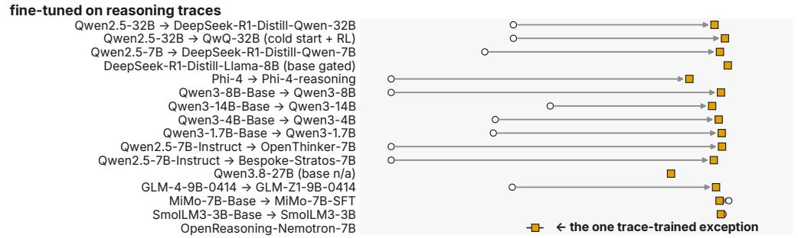

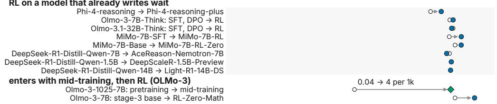  
Figure 5: All 120 endpoints of the provenance map. One dot per model after training, adding instruct models without trace training (light squares), pretrained bases not shown elsewhere (MiMo-7B-Base and SmolLM3-3B-Base already write wait) and gpt-oss-120b at three reasoning efforts (training undisclosed).

<table><tr><td></td><td></td><td colspan="4">Prior measures</td><td colspan="5">Grammaticalization indices</td></tr><tr><td>Series</td><td>Stage</td><td>R1 kw.↑</td><td></td><td>FREQ↑ SimpleRL kw. ↑ Rev. rate</td><td></td><td></td><td>SI (%) ↑ ORTH (%) ↑</td><td> $H _ { \mathrm { p a r a } } \downarrow$ </td><td></td><td>OBL (%)↑REL (%)↓</td></tr><tr><td rowspan="4">OLMo-3 7B</td><td>base</td><td> $1 3 . 7 1 \pm 0 . 7$ </td><td> $4 . 9 \pm 0 . 4$ </td><td> $1 5 . 1 2 \pm 1 . 7 4$ </td><td> $1 7 . 9 9 \pm 2 . 1 6$ </td><td> $8 9 . 6 \pm 0 . 9$ </td><td> $8 8 . 9 \pm 1 . 0$ </td><td> $2 . 6 \pm 0 . 0 8$ </td><td> $4 9 . 6 \pm 5 . 6$ </td><td> $5 1 . 0 \pm 4 . 4$ </td></tr><tr><td>mid</td><td> $1 7 . 0 2 \pm 0 . 5 2$ </td><td> $8 . 0 \pm 0 . 3$ </td><td> $3 5 . 4 3 \pm 2 . 9 3$ </td><td> $1 4 . 4 \pm 1 . 7 7$ </td><td> $9 0 . 1 \pm 0 . 7$ </td><td> $8 9 . 4 \pm 0 . 7$ </td><td> $2 . 4 9 \pm 0 . 0 5$ </td><td> $6 1 . 9 \pm 6 . 4$ </td><td> $5 0 . 8 \pm 4 . 6$ </td></tr><tr><td>late</td><td> $2 5 . 7 7 \pm 2 . 7$ </td><td> $1 7 . 0 \pm 2 . 7$ </td><td> $8 4 . 0 1 \pm 1 2 . 1 3$ </td><td> $1 3 . 8 \pm 1 . 8 3$ </td><td> $8 9 . 7 \pm 1 . 5$ </td><td> $4 2 . 3 \pm 5 . 4$ </td><td> $2 . 3 7 \pm 0 . 0 5$ </td><td> $5 1 . 8 \pm 7 . 0$ </td><td> $4 2 . 0 \pm 6 . 8$ </td></tr><tr><td>ρ(step)</td><td>0.98</td><td>1.0</td><td>1.0</td><td></td><td>0.55</td><td> $- 0 . 3 3$ </td><td>-0.9</td><td> $- 0 . 1 7$ </td><td>-0.83</td></tr><tr><td rowspan="4"> $\mathrm { O L M o } { - 3 7 \mathrm { B } }$  Think</td><td>base</td><td> $1 1 . 4 3 \pm 0 . 6 4$ </td><td> $3 . 9 \pm 0 . 3$ </td><td> $2 4 . 6 6 \pm 3 . 3 8$ </td><td> $1 3 . 9 2 \pm 1 . 9 8$ </td><td> $8 6 . 6 \pm 1 . 5$ </td><td> $5 5 . 0 \pm 3 . 3$ </td><td> $2 . 8 7 \pm 0 . 0 7$ </td><td> $4 4 . 0 \pm 6 . 8$ </td><td> $4 6 . 6 \pm 3 . 8$ </td></tr><tr><td>mid</td><td> $1 2 . 0 2 \pm 0 . 5 9$ </td><td> $4 . 4 \pm 0 . 3$ </td><td> $2 7 . 0 8 \pm 3 . 2 8$ </td><td> $1 1 . 9 6 \pm 1 . 7 8$ </td><td> $8 9 . 1 \pm 1 . 4$ </td><td> $5 8 . 3 \pm 3 . 7$ </td><td> $2 . 7 8 \pm 0 . 0 5$ </td><td> $5 3 . 7 \pm 6 . 5$ </td><td> $4 4 . 8 \pm 4 . 3$ </td></tr><tr><td>late</td><td> $1 1 . 6 3 \pm 0 . 5 2$ </td><td> $4 . 5 \pm 0 . 3$ </td><td> $3 2 . 3 5 \pm 3 . 4 7$ </td><td> $1 4 . 1 1 \pm 2 . 0 2$ </td><td> $9 3 . 6 \pm 0 . 7$ </td><td> $7 8 . 2 \pm 2 . 9$ </td><td> $2 . 8 \pm 0 . 0 4$ </td><td> $4 3 . 6 \pm 6 . 2$ </td><td> $4 6 . 2 \pm 4 . 9$ </td></tr><tr><td>ρ(step)</td><td>-0.1</td><td>0.4</td><td>0.64</td><td></td><td>0.67</td><td>0.88</td><td>-0.48</td><td> $- 0 . 1 4$ </td><td>-0.48</td></tr><tr><td rowspan="4">OLMo-3.1 32B Think</td><td>base</td><td>1</td><td> $4 . 5 \pm 0 . 3$ </td><td></td><td> $1 4 . 5 8 \pm 2 . 0 9$ </td><td> $9 3 . 2 \pm 0 . 7 $ </td><td> $8 0 . 7 \pm 1 . 4$ </td><td> $2 . 8 1 \pm 0 . 0 5$ </td><td> $4 4 . 3 \pm 6 . 9$ </td><td> $4 8 . 6 \pm 4 . 3$ </td></tr><tr><td>mid</td><td></td><td> $3 . 8 \pm 0 . 2$ </td><td></td><td> $1 3 . 3 8 \pm 1 . 9 6$ </td><td> $9 4 . 1 \pm 0 . 7$ </td><td> $8 2 . 0 \pm 1 . 5$ </td><td> $2 . 7 5 \pm 0 . 0 6$ </td><td> $4 3 . 8 \pm 6 . 9$ </td><td> $4 4 . 6 \pm 4 . 1$ </td></tr><tr><td>late</td><td></td><td> $4 . 2 \pm 0 . 3$ </td><td>一</td><td> $1 2 . 4 5 \pm 1 . 6 7$ </td><td> $8 5 . 6 \pm 1 . 3$ </td><td> $6 8 . 5 \pm 2 . 1$ </td><td> $2 . 7 6 \pm 0 . 0 8$ </td><td> $4 9 . 2 \pm 7 . 3$ </td><td> $4 9 . 6 \pm 4 . 8$ </td></tr><tr><td>ρ(step)</td><td>一</td><td>-0.61</td><td>一</td><td>一</td><td>-0.71</td><td> $- 0 . 7 5$ </td><td>-0.75</td><td>0.0</td><td>0.14</td></tr><tr><td>OLMo-3 SFT (no RL)</td><td>ρ(step)</td><td>-0.8</td><td>-0.6</td><td>-0.9</td><td></td><td>-0.1</td><td>-0.6</td><td>0.0</td><td>-0.7</td><td>-0.1</td></tr></table>

Table 7: Keyword counts register that the frequency of wait changes; the form indices register how. Base, middle and last checkpoint of each trajectory: mean ± 95% CI half-width (cluster bootstrap over problems); ρ: Spearman correlation with RL step; arrows: direction grammaticalization predicts; –: not run.
<table><tr><td rowspan="2">Series</td><td rowspan="2">Stage</td><td>Prior</td><td colspan="4">Grammaticalization indices</td></tr><tr><td>FREQ↑</td><td> $\mathrm { S I } \left( \% \right) \uparrow$ </td><td>ORTH (%)↑ OBL (%)↑ REL (%)↓</td><td></td><td></td></tr><tr><td rowspan="4">Qwen2.5-1.5B mid GRPO</td><td>base</td><td> $0 . 0 \pm 0 . 0$   $0 . 0 \pm 0 . 0$ </td><td> $0 . 0 \pm 0 . 0$   $0 . 0 \pm 0 . 0$ </td><td> $0 . 0 \pm 0 . 0$   $0 . 0 \pm 0 . 0$ </td><td> $3 . 8 \pm 1 . 0$   $4 . 5 \pm 1 . 3$ </td><td> $5 4 . 5 \pm 5 . 3$   $5 5 . 7 \pm 5 . 0$ </td></tr><tr><td>late</td><td> $0 . 0 \pm 0 . 0$ </td><td> $0 . 0 \pm 0 . 0$ </td><td> $0 . 0 \pm 0 . 0$ </td><td> $3 . 6 \pm 1 . 0$ </td><td> $5 4 . 5 \pm 6 . 0$ </td></tr><tr><td>ρ(step)</td><td> $- 0 . 2$ </td><td> $- 0 . 3 5$ </td><td> $- 0 . 3 5$ </td><td>0.29</td><td>0.21</td></tr><tr><td>32B: one base, four post-trained endpoints</td><td></td><td></td><td></td><td></td><td></td></tr><tr><td colspan="5"> $0 . 0 \pm 0 . 0$   $2 7 . 8 \pm 2 2 . 2$   $2 7 . 8 \pm 2 2 . 2$   $0 . 0 \pm 0 . 0$   $0 . 0 \pm 0 . 0$   $0 . 0 \pm 0 . 0$   $4 . 4 \pm 0 . 4$   $9 4 . 8 \pm 0 . 7$   $8 9 . 3 \pm 1 . 3$ </td><td></td><td></td></tr><tr><td colspan="5">ORZ-32B (RL)</td><td></td><td></td></tr><tr><td colspan="5"></td><td> $7 . 5 \pm 2 . 0$ </td><td> $4 . 2 \pm 1 . 2$ </td></tr><tr><td colspan="5">DAPO-32B (RL)</td><td> $6 . 1 \pm 3 . 6$ </td><td> $9 . 7 \pm 3 . 5$ </td></tr><tr><td colspan="5">QwQ-32B (RL)</td><td> $6 2 . 6 \pm 3 . 8$ </td><td> $9 . 3 \pm 1 . 2$ </td></tr><tr><td colspan="5">R1-Distill-32B (SFT)</td><td> $5 6 . 0 \pm 5 . 8$ </td><td> $8 . 9 \pm 1 . 6$ </td></tr><tr><td colspan="5">Frontier-scale endpoint without a base checkpoint</td><td></td><td></td></tr><tr><td colspan="5">gpt-oss-120b, low effort  $0 . 4 \pm 0 . 1$   $9 5 . 7 \pm 2 . 6 $   $0 . 8 \pm 0 . 1$   $9 7 . 4 \pm 1 . 5$ </td><td></td><td> $2 . 7 \pm 1 . 5$ </td></tr><tr><td colspan="5">medium</td><td> $1 3 . 0 \pm 7 . 1$ </td><td></td></tr><tr><td colspan="5"></td><td></td><td></td></tr><tr><td colspan="5">high</td><td> $1 6 . 3 \pm 7 . 0$ </td><td> $2 . 6 \pm 1 . 0$ </td></tr><tr><td colspan="5"></td><td></td><td></td></tr><tr><td colspan="5"></td><td> $2 0 . 5 \pm 3 . 8$ </td><td> $2 . 3 \pm 0 . 6$ </td></tr></table>

Table 8: Cline indices for Qwen2.5-1.5B GRPO, the 32B endpoints and gpt-oss-120b. Same protocol and conventions as Table 7.

<table><tr><td></td><td></td><td colspan="6">P(revise a correct step) after the inserted form (%)</td><td colspan="4">Operator force of Wait,</td><td></td></tr><tr><td>Series</td><td>Policy</td><td>∅ Next,</td><td></td><td> ${ \mathsf { O k a y } } ,$ </td><td>Hold on, Hmm,</td><td></td><td> $\mathsf { W a i t } ,$ </td><td> $\mathrm { R D _ { o p } } \uparrow$ </td><td> $\mathrm { R R _ { o p } } \uparrow$ </td><td> $\mathrm { O R } _ { \mathrm { o p } } \uparrow$ </td><td> $\mathrm { R D _ { s y n } } \ \mathrm { \uparrow }$ </td><td>False (%)</td></tr><tr><td rowspan="3"> $\mathrm { O L M o } { - 3 7 \mathrm { B } }$  RL-Zero</td><td>base</td><td>3.8</td><td>5.0</td><td>4.4</td><td>13.3</td><td>8.8</td><td>11.7</td><td> $6 . 7 \pm 2 . 2$ </td><td>2.32</td><td>2.5</td><td>0.6</td><td>0.2</td></tr><tr><td>mid</td><td>4.8</td><td>4.8</td><td>5.0</td><td>15.1</td><td>9.0</td><td>12.8</td><td> $7 . 9 \pm 2 . 4$ </td><td>2.62</td><td>2.86</td><td>0.7</td><td>0.4</td></tr><tr><td>last</td><td>6.7</td><td>5.5</td><td>5.4</td><td>21.3</td><td>13.2</td><td>20.8</td><td> $1 5 . 3 \pm 3 . 3$ </td><td>3.77</td><td>4.5</td><td>3.6</td><td>0.3</td></tr><tr><td rowspan="3">OLMo-3 7B Think</td><td>base</td><td>4.7</td><td>3.8</td><td>5.3</td><td>10.2</td><td>7.7</td><td>12.2</td><td> $8 . 4 \pm 3 . 0$ </td><td>3.17</td><td>3.47</td><td>3.2</td><td>1.3</td></tr><tr><td>mid</td><td>5.1</td><td>4.1</td><td>4.3</td><td>10.8</td><td>8.2</td><td>13.8</td><td> $9 . 7 \pm 3 . 1$ </td><td>3.31</td><td>3.68</td><td>4.3</td><td>0.8</td></tr><tr><td>last</td><td>5.1</td><td>6.0</td><td>4.7</td><td>11.8</td><td>8.9</td><td>15.1</td><td> $9 . 1 \pm 3 . 2$ </td><td>2.51</td><td>2.78</td><td>4.7</td><td>1.2</td></tr></table>

Table 9: An inserted Wait, pushes every checkpoint, the base included, toward revising a correct step; the size of the push is not identified. The registered control on prefixes from base-model traces was also run; its results are in the supplementary material. Share of continuations that revise a correct step after each inserted form; RD, RR, OR: risk difference, ratio and odds ratio of Wait, against Next,.

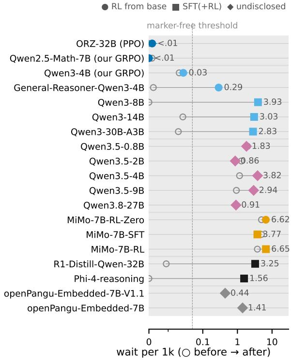  
Figure 6: Across major model families, wait follows the training route. Rate before (◦) and after training, 95% CI; shape marks the route, colour the family (Qwen2.5, Qwen3, Qwen3.5/3.8, MiMo, DeepSeek/Phi, openPangu).

## C.2 Further Analyses

This section reports length and lineage controls and what the results mean for readers of markers.

## C.2.1 Length and Lineage Controls

Longer traces contain more of everything, so every rate is also computed per response and per 1k words; the ordering of models and checkpoints is the same under all three units (Section 4). Supervised fine-tuning as a control. If learning from demonstrations alone produced the zero-RL profile, the supervised fine-tuning trajectory of the same OLMo-3 base would show it too. It does not: rate, comma form and chains stay close to their starting values (Section 4), and the prior keyword counts move little $( \rho = - 0 . 8$ for the count of wait, −0.9 for SimpleRL-Zoo’s keywords).

## C.2.2 Consequence for Readers of Markers

H6 predicted that monitors which read wait literally lose precision as RL makes the marker a more liberal alarm, while a monitor calibrated to the checkpoint does not. The signal-detection result does not by itself fix the direction, because sensitivity rises as false alarms rise: at the last checkpoint of OLMo-3 RL-Zero a revision marker follows 37.8% of error-free prefixes (wait alone: 25.4%). The monitor comparison itself was not run, so the prediction is untested.

<table><tr><td>Finding</td><td>Analysis choice</td><td>Value</td></tr><tr><td rowspan="6">Zero-RL keeps the marker absent (confirming / runs)</td><td>registered rule (≥0.05 per 1k and above the base&#x27;s CI) threshold 0.1 per 1k</td><td>17/18 17/18</td></tr><tr><td>threshold 0.02 per 1k</td><td>15/17</td></tr><tr><td>≥0.05 per 1k, no CI comparison</td><td>17/18</td></tr><tr><td>released runs only</td><td>13/14</td></tr><tr><td>earlier decode, T = 1.0</td><td></td></tr><tr><td>without the reproduction gate</td><td>5/5 22/23</td></tr><tr><td rowspan="5">OLMo-3 RL-Zero multiplies it (step 400 / base)</td><td>with the unlicensed run</td><td>23/24</td></tr><tr><td>all responses, per 1k tokens</td><td>1.58</td></tr><tr><td>finished responses only</td><td>1.7</td></tr><tr><td>per 100 sentences</td><td>1.43</td></tr><tr><td>greedy decoding (per 1k; per 100 sent.) base rate over 6 sampling seeds (per 1k)</td><td>1.55; 1.53</td></tr><tr><td rowspan="3">GRPO erases a seeded marker (step 400 / SFT)</td><td>512 seed traces, 3,072-token cap</td><td>4.9-5.4 0.0</td></tr><tr><td>64 seed traces, 3,072-token cap</td><td></td></tr><tr><td>512 seed traces, 8,192 + YaRN, finished only</td><td>0.0005 0.0003</td></tr></table>

Table 10: The main findings hold across analysis choices. Unregistered rows are descriptive.

## C.2.3 A Running Example

Problem 2 is the first MATH-500 problem that the base, step 700 and the last checkpoint of OLMo-3 RL-Zero all solve, a selection rule fixed before reading the traces. In traces of similar length (2,162, 2,022 and 2,764 tokens), wait occurs 10, 16 and 36 times, and reduplicated chains appear 0, 4 and 9 times. The base writes “Wait, is that correct?” and “Wait, that can’t be right.”. The last checkpoint writes “Wait, but hold on.” and “Wait, 2 is 2/1.” (verbatim; the shortest marker-initial sentences of 4–70 characters and at least four words). At the base, the marker opens questions about a result. At the last checkpoint, it also opens restatements of values that were already correct.

## C.2.4 Sensitivity Analysis

The three main findings are robust to the counting choices (Table 10). The zero-RL count retains a single counterexample at a threshold of 0.1 per 1k tokens, without the interval condition, on released runs only, without the reproduction gate and with the unlicensed run. The stricter 0.02 threshold adds one more, and every run with the earlier decode confirms the finding. The rise along OLMo-3 RL-Zero holds per token and per sentence, on finished responses and under greedy decoding. Its base rate also varies little across sampling seeds. Finally, our GRPO recipe consistently erases the seeded marker at both seed sizes and under the longer length cap.

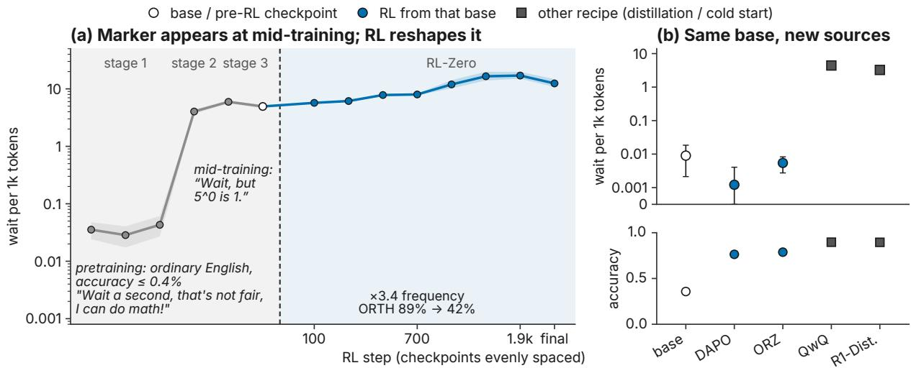  
Figure 7: In OLMo-3, wait enters with mid-training; Qwen2.5-32B’s descendants use it only after trace training. (a) Rate with 95% bands and comma share across OLMo-3 training stages and RL-Zero steps. (b) Qwen2.5- 32B and its descendants: rate with 95% CIs, and accuracy.

## D Pre-registration and Analysis Details

The theory behind the registered predictions, every prediction with its outcome, and the statistical procedures.

## D.1 Grammaticalization and What RL Could Do to a Marker

This section summarises the theory and the predictions we derived from it.

Grammaticalization. A lexical item grammaticalizes when, in particular contexts, it comes to serve a grammatical function (Hopper and Traugott, 2003); the textbook case is the English motion phrase going to becoming a future marker. Lehmann (2015) makes the process measurable with six parameters on two axes. Along the paradigmatic axis, a grammaticalizing sign loses integrity (its meaning bleaches), gains paradigmaticity (it joins a small, closed set of alternatives), and loses paradigmatic variability (its use becomes obligatory in its slot). Along the syntagmatic axis, its scope shrinks, its bondedness to neighbouring material grows, and its syntagmatic variability falls (its position becomes fixed). Bybee (2003) identifies frequency of use as the driver: repetition automates a construction, habituation bleaches its meaning, and the frequent form becomes autonomous from its source. Hopper (1991) adds principles that hold during the change, of which two matter here: layering, the coexistence of old and new uses of a form, and persistence, the survival of traces of the old meaning in where the new form may occur.

Discourse markers such as well or I mean develop through closely related paths (Brinton and Traugott, 2005).

What outcome-based RL could do to a marker. The theory supplies the vocabulary for this process. Its first lesson, that a grammatical marker needs a source construction already in use, is the one that organises our findings (Section 4). Under outcomebased RL such as GRPO (Shao et al., 2024), all tokens of a sampled trace share its advantage. A marker that precedes a useful move, such as a recheck that sometimes catches an error, is therefore reinforced wherever it occurs in successful traces, not only where an error was present. What RL reinforces is the contingency ‘marker → move’, not $\mathrm { ^ { \circ } e r r o r } \to \mathrm { m a r k e r } ^ { , }$ . Repeated over many updates, this raises the marker’s frequency, which is Bybee’s driver. It concentrates the marker in the slots where the move pays off (fixation), makes it the default entry to the move (obligatoriness, a smaller paradigm), and loosens its dependence on the presence of an error (bleaching). We define two quantities for a marker m at checkpoint $\theta _ { t }$ . Its report meaning is how much m tells about an error, $\mathbb { P } _ { t } ( \mathrm { e r r o r } \mid m ) - \mathbb { P } _ { t } ( \mathrm { e r r o r } )$ . We call m an operator when its effect on the model’s next move is procedural and independent of its lexical meaning; its operator force is the causal effect of emitting m on that move, $\mathbb { P } _ { t } ( { \mathrm { r e v i s e ~ } } | { \mathrm { ~ d o } } ( m ) ) - \mathbb { P } _ { t } ( { \mathrm { r e v i s e ~ } } | { \mathrm { ~ d o } } ( m _ { 0 } ) )$ for a neutral filler m0 (in our experiments Next,). Section 4.1 measures the first with injected errors.

In all but one ofthe runs we observe, outcomebased RL does not coin the reflection marker wait. Where the base model lacks it, zero-RL leaves it absent while accuracy rises; the marker enters with mid-training or with training on reasoning traces; and where it is present, RL changes its frequency and form in a way that depends on the recipe and on the marker’s starting state.

Rival accounts. Two alternatives predict the same frequency curves and different everything else. ❶ Honest report: RL improves error detection and the marker reports it. Then the marker’s sensitivity d′ rises with its frequency, and inserting it after a correct step changes little, because the policy checks the state rather than obeying the word. ❷ Ritual: noisy credit assignment stamps in constructions that do nothing, like the adventitious reinforcement of Skinner (1948). Then the marker is frequent but causally inert under insertion and deletion, and rituals should be rarer when larger groups make advantage estimates less noisy. A third contrast is internal to linguistics: frequency drives bleaching in grammaticalization (Bybee, 2003), whereas the law of conformity states that frequent words change less (Hamilton et al., 2016). The two make opposite predictions about which markers change fastest.

Measurement. Section 3 defines the indices formally, and Table 11 in Section B.1 maps every parameter to its measurement. Before the main run we fixed six predictions with their falsifiers; Section D.2 states them and reports every outcome.

Scope of the theory import. Grammaticalization is used as a source of predictions about a training process, not as a claim about how people process language or about the history of English. Its vocabulary (source, frequency, attrition) organises our measurements; most of its specific predictions about RL fail on our data, and we do not claim that RL is grammaticalization.

Discussion: Language change under optimisation is recipe-specific. Language change under optimisation operates as recipe-specific pressures on training data rather than a single cline. The grammaticalization vocabulary describes two phenomena we find: a marker requires a source, and its form can wear down. However, several registered predictions fail (Section D.2): the marker does not bleach, its form erodes instead of fixing, and the changes do not construct one path across recipes. Instead, RL multiplied a marker that midtraining supplied and erased one that light finetuning seeded.

<table><tr><td>Parameter (change)</td><td>Measurement on checkpoints</td><td>Hyp.</td></tr><tr><td>Frequency of use (context)</td><td>rate of wait and its paradigm per 1k tokens and per 100 sentences; known to rise (Guo et al., 2025) sentence-initial share SI,</td><td>H1</td></tr><tr><td>Syntagmatic variability (↓, fixation) Bondedness (↑),</td><td>canonical-form share ORTH, position entropy  $H _ { \mathrm { p o s } }$  of wait next-word entropy  $H _ { \mathrm { n e x t } } ;$  tokens</td><td>H1</td></tr><tr><td>scope (↓) Integrity (↓, bleaching)</td><td>from marker to next action hit and false-alarm rates, d&#x27; and c on prefixes with vs. without an injected error; usage-embedding</td><td>H2</td></tr><tr><td>Paradigmatic variability (↓), paradigmaticity</td><td>change (APD, PRT, JSD); substitutability of synonyms entropy  $H _ { \mathrm { p a r a } }$  and effective size Neff of the forms opening revisions;</td><td>H3</td></tr><tr><td>(↑) Procedural function</td><td>policy-side entropy  $H _ { \mathrm { s u b } } ;$  obligatoriness OBL risk difference and odds ratio of revising a correct step after inserted</td><td>H4</td></tr><tr><td>(operator) Frequency of</td><td>Wait, vs. Next, and synonyms, late vs. base policy index slopes under KL coefficient,</td><td>H5</td></tr><tr><td>use (driver)</td><td>group size and length penalty</td><td></td></tr><tr><td>Layering (consequence)</td><td>precision and calibration of literal-reading monitors vs. step</td><td>H6</td></tr></table>

Table 11: Each grammaticalization parameter becomes a quantity measured on RL checkpoints. Parameters follow Lehmann (2015); arrows give the direction predicted under grammaticalization. Definitions are in Section 3.

## D.2 Pre-registered Predictions and Outcomes

This section lists every prediction we registered before the main run, with its outcome. We also pre-registered a decoding intervention on the alarm finding, Calibrated Wait (D50), which masks the marker after low-entropy steps; it was run on four models and did not pass its criteria, and its registration, every arm and all results are at https://anonymous.4open.science/r/ wait-provenance/ (DECISIONS.md, D50–D51).

The predictions below, their falsifiers and the order of the primary tests were fixed in the experiment plan before the main run; the gate criteria were amended once on 2026-09-30, after the pilot and before any number from the second or third series, and the label-free insertion outcome was declared before it was computed. The source test of

Section 4 was formulated after the first marker-free runs and is reported as such. Table 12 lists every outcome; the paragraphs after it give the numbers.

Counting zero-RL runs (D47, D47a). Before evaluating the released zero-RL models, we fixed when a run counts against the source claim: its base writes wait less than 0.05 times per 1k tokens, its final model at least 0.05 times, and the final model’s exact 95% lower bound lies above the base’s upper bound (D47). After the first non-Qwen runs reached far lower accuracy than their authors report, and before any re-evaluation, we added a reproduction rule (D47a). A released run counts only if our evaluation reaches at least half of the MATH-500 accuracy its authors publish and fewer than 20% of its responses are truncated; our own runs need only the truncation condition. Runs below that are marked as not reproduced, and runs whose authors publish no MATH-500 accuracy are marked n.r.; both are listed in Table 13 and counted neither way. Under these rules 18 runs count, with 1 counterexamples. The only counted run whose final model writes wait at all in a genuine use is SimpleRL-Zoo on Mistral-Small-24B (7 matches in 1,500,001 tokens; base: none). Read verbatim, its few genuine uses are all “But wait!” written after the boxed final answer, never a pivot inside the reasoning; its remaining matches lie inside degenerate token sequences. DAPO-Qwen-32B is marked n.r.: a third-party evaluation reports 71.8% MATH-500 accuracy for this checkpoint (Hu et al., 2025a), and ours gives 76.4%; we keep the rule as registered. Our single-seed GRPO run from Qwen3-4B-Base (D49) counts as a confirming run: its rate goes from 0.02 per 1k tokens at the base to 0.03 at step 400, after a transient 0.08 at steps 100 and 200; with one seed we do not separate the base from the recipe.

Grammaticalization or frequency? Frequency alone predicts only that a marker is used more often. Grammaticalization predicts, beyond frequency, that the marker becomes fixed in position, obligatory in its slot and one of fewer alternatives, that its link to errors weakens while its causal force grows, and that these changes do not reverse (unidirectionality, a strong tendency in language change; Haspelmath, 1999). Each of these can be measured on checkpoints and each can fail.

Six predictions were derived from the thesis. Each is evaluated per series and holds if it holds on at least two of three series; the falsifiers and the order in which the primary tests are run were fixed before any result (Section D.3).

H1 (Fixation). Along RL steps, reasoning markers become positionally and orthographically fixed: the sentence-initial share of wait and the share of its capitalised-comma form Wait, rise, and the entropy of its position falls. Falsified if the Spearman correlation with step is below 0.5 on at least two of three series, or the supervised fine-tuning trajectory of the same base shows the same trend at the same rate.

H2 (Bleaching). Markers decouple from error presence: on prefixes with and without an injected error, the false-alarm rate P(marker | no error) rises while the sensitivity d′ does not. Falsified if d′ rises in step with the false-alarm rate (the marker is an honest detector; operationally, the lower 95% bound of ∆d′ exceeds +0.25), or the false-alarm rate is flat.

H3 (Paradigm loss and obligatoriness). The paradigm of forms that open revisions shrinks (its entropy falls) and some marker becomes nearobligatory before revision events. Falsified if the paradigm entropy is flat or rising (ρ > −0.5 with step), or fewer than 60% of revisions carry a marker at the last checkpoint on all series.

H4 (Operator). Inserting Wait, after a correct step causes revision of that step far more often in late RL checkpoints than in the base model on the same prefixes, and more often than the synonyms Hold on, and Hmm,; the gap widens with RL. The matched control is the neutral filler Next, at the same position. Falsified if at the last checkpoint the risk difference to Next, is below 10 points or the odds ratio is below 2 (interval including 1), or the effect is less than 1.5 times the base model’s, or the synonyms equal the exact form at every checkpoint.

H5 (Drivers). In controlled GRPO, KL and length pressure set the speed of the cline: a lower KL coefficient speeds fixation and bleaching, a length penalty speeds erosion, and larger groups leave fewer inert rituals. Falsified if the condition slopes overlap within seed variation for all knobs.

H6 (Monitors). Literal-reading judges and hedge-counting uncertainty heuristics lose precision against true error presence as RL proceeds, while a bleaching-aware monitor does not. Falsified if the literal monitors’ precision is flat across checkpoints, or the bleaching-aware monitor drifts as much as they do.

<table><tr><td>Prediction</td><td>Pre-registered test</td><td>Result</td><td>Verdict</td></tr><tr><td>H1 Fixation</td><td>sentence-initial and Wait, shares rise with step  $( \rho \ge 0 . 5$  on 2 of 3 series)</td><td>S1: SI 89.6→89.4%  $( \rho = 0 . 5 5 ) ; { \mathsf { w a i t } } ,$   $8 8 . 9 \substack {  3 7 . 5 \% } ( \rho = - 0 . 3 3 ) ; \mathrm { S 2 } \colon \mathsf { w a i t } ,$   $\rho = 0 . 8 8$ </td><td>falsified: position inherited, form erodes (S1) or is restored (S2)</td></tr><tr><td>H2 Bleaching</td><td>false alarms rise,  $d ^ { \prime }$  does not (falsified if  $\Delta d ^ { \prime }$  lower bound  $> 0 . 2 5 )$ </td><td> $\mathrm { S 1 } \colon d ^ { \prime } 0 . 5 7 \substack { \longrightarrow 1 . 0 9 [ 0 . 9 7 , 1 . 2 4 ] } ; c$   $0 . 1 1  - 0 . 2 4 ; \mathrm { F A } 3 4 . 7  3 7 . 8 \%$ </td><td>falsified: a more sensitive, more liberal alarm</td></tr><tr><td>H3 Paradigm loss, obligatoriness</td><td>paradigm entropy  $\rho \leq - 0 . 5 ; \geq 6 0 \%$  of revisions carry a marker</td><td> $\rho ( H _ { \mathrm { p a r a } } ) \colon \mathbf { S } 1 - 0 . 9 , \mathbf { S } 2 - 0 . 4 8 , 3 2 \mathbf { B }$   $- 0 . 7 5 ;$  obligatoriness at the end of S1  $4 6 . 1 \%$ </td><td>paradigm narrows on S1 only; obligatoriness falsified</td></tr><tr><td>H4 Operator</td><td>Wait, − Next, ≥ 10 pts,  $\mathrm { O R \ge 2 , }$   $\geq 1 . 5 \times$  the base model; same trend under both prefix sources</td><td>judge: 15.8 pts,  $R _ { \mathrm { a m p } } = 2 . 3 6 ;$  second judge 5.4 pts; label-free value change  $- 2 . 3 [ - 5 . 7 , 0 . 8 ] .$  but its detector fails its check (precision 10.0%)</td><td>inconclusive: judge result exploratory (human κ = 0.3), label-free</td></tr><tr><td>H5 Drivers</td><td>KL and length pressure set the speed (controlled GRPO)</td><td>controlled runs from a marker-rich base not run</td><td>untested</td></tr><tr><td>H6 Monitors</td><td>literal readers lose precision with RL; a calibrated monitor does not</td><td>not run</td><td>untested</td></tr><tr><td>Cline across series (gate)</td><td> $\geq 2$  of {paradigm ↓, judged reliability ↓, S1 3 of 3; S2 0 of 3; Qwen2.5-1.5B no attrition ↑} with  $| \rho | \geq 0 . 7 \mathrm { o n } \geq 2 \mathrm { o f } 3$  series, flat across pretraining</td><td>marker; pretraining branches not flat; along SFT the indices barely move (comma drop  $4 . 0 \substack {  } 4 . 3 \% )$ </td><td>not met</td></tr><tr><td>Keyword counts saturate (§5b)</td><td>late half: keyword  $| \rho | < 0 . 5$  while  $\geq 2$  indices keep  $| \rho | \geq 0 . { \dot { 7 } }$ </td><td>keywords  $\rho = 1 . 0 , 1 . 0 ; \mathrm { o u r s } - 0 . 8 , - 0 . 8$ </td><td>falsified: indices add constructs, not a better count</td></tr><tr><td>before the 32B data)</td><td>Liberal criterion (D41, c falls, d&#x27; does not, on 32B Think</td><td> $c - 0 . 2 {  } \mathrm { - } 0 . 0 5 ; d ^ { \prime } 0 . 9 7 {  } 0 . 8 6$ </td><td>falsified: the liberal shift is specific to zero-RL</td></tr><tr><td>Seeded marker grows (D43, before the runs)</td><td>a marker seeded by fine-tuning on 512 traces is amplified by RL (A &gt; 1)</td><td>Wait, 7.5221→0.0 per 1k  $( A = 0 . 0 ) ;$  Next, arm keeps 0.1173</td><td>falsified: RL erases the seeded</td></tr><tr><td>Marker-free arms stay free (D43, P-seed1) Amplification in a</td><td>with wait deleted from the seed traces, wait stays  $\leq 0 . 0 5$  per 1k after RL our GRPO recipe from the OLMo-3</td><td> $\mathrm { D 5 1 2 : 0 . 0 3 \mathrm {  } \mathrm { < . 0 1 ; D 6 4 : 0 . 0 3 \mathrm {  } 0 p e r } }$  1k</td><td>marker holds</td></tr><tr><td>controlled fork (D48, before the matched evaluation)</td><td>base amplifies wait (A(400) 1ower bound  $\bar { > } 1 . 2 )$  or not (CI includes 1, or upper bound  $< 1 . 2 ) ;$  disagreeing measures ⇒ undetermined</td><td> $\beta { = } 0 . 0 0 1 \colon A = 0 . 9 7 ( \mathrm { a l l } ) , 1 . 1 3 ( \mathrm { f i n . } ) ;$   $\beta = 0 \colon 0 . 8 1 , 0 . 9 3$ </td><td>undetermined; β=0: none, recipes differ</td></tr><tr><td>Length control for the transplant (D46, D46b) Dose (D43, P-seed4)</td><td>finished-only  $A ( 4 0 0 ) \geq 0 . 5 \colon$  length artefact;  $< 0 . 2 \dot { : }$  marker penalised  $A _ { \mathrm { w a i t } }$  rises with the number of seed</td><td> $A = 0 . 0 0 0 3 ( \mathrm { f i n . } ) , 0 . 0 0 0 3 ( \mathrm { a l l } )$ </td><td>marker penalised</td></tr><tr><td></td><td>traces (W64 vs W512)</td><td> $A = 0 . 0 0 0 5 \ : ( \mathrm { W } 6 4 ) \mathrm { v s } \ : 0 . 0 \ : ( \mathrm { W } 5 1 2 )$ </td><td>not shown: RL removes the marker at both doses</td></tr><tr><td>first marker-free runs) per 1k ends above 0.5 per 1k</td><td>Source (added after the no zero-RL run from a base below 0.05</td><td>18 runs, highest last checkpoint 0.29 per holds 1k (General-Reasoner-Qwen3-4B; the stricter counting rule D47 flags it as installing the marker); registered 7B replication: 0 occurrences in 967,101</td><td></td></tr></table>

Table 12: Of six pre-registered hypotheses, three fail, one is unsupported and two were not run; further registered tests fail too. Tests and thresholds as fixed before the main run (Section D.3). S1: OLMo-3 RL-Zero; S2: OLMo-3 Think; 32B: OLMo-3.1 32B Think; SI and Wait, shares in $\% ; \mathrm { F A } ;$ false-alarm rate.

The theory also makes predictions that neither rival makes: usage clusters of wait split into an older lexical and a newer operator sense whose share grows (layering); no index reverses once it has moved (unidirectionality); and the operator keeps a trace of its source by preceding revision moves more than a neutral connective does (persistence). We report these as secondary tests (Section C.2.1).

Fixation (H1) and obligatoriness (H3). The position of wait was already fixed before RL, and its canonical form erodes along RL-Zero instead of spreading (Section 4); at the last checkpoint 51.8% of revisions carry a marker, below the 60% we required.

Bleaching (H2): falsified. H2 predicted that the marker would decouple from errors: false alarms would rise while sensitivity did not. On prefixes with and without an injected error in OLMo-3 RL-Zero, a revision marker (the registered outcome, any form of the paradigm) appears within two sentences after 37.8% of error-free prefixes at the final checkpoint (base 34.7%) and the criterion falls from 0.11 to −0.24, but d′ rises, from 0.57 to 1.09 (95% CI [0.97, 1.24]); for wait alone, false alarms rise from 19.9% to 25.4% and $d ^ { \prime }$ from 0.77 to 1.29. The marker becomes a more liberal alarm that is also more sensitive to real errors; it does not lose its link to them. What weakens is its link to revision: fewer markers are followed by a revision event (Section 4). A reader that takes wait as evidence of an error is calibrated to a criterion that RL moves. The liberal shift is specific to zero-RL. Along OLMo-3.1 32B Think, whose RL follows supervised fine-tuning, the criterion moves the other way, from −0.2 to −0.05, and $d ^ { \prime }$ stays within its interval (0.97 to 0.86, 95% CI [0.73, 1.0]), which falsifies the liberal-criterion prediction we registered for that series. Along OLMo-3 7B Think the registered direction holds only weakly: the criterion moves from −0.14 to −0.19 (95% CI [−0.31, −0.06]) and d′ from 0.82 to 1.02.

Operator (H4): an inserted Wait, changes no more values than a neutral filler. H4 predicted that an inserted Wait, after a correct step would become an operator: that late checkpoints would revise the step far more often than after the neutral filler Next,, and far more than the base model does. We pre-registered a label-free outcome for this test before computing it: whether the continuation restates the quantity of the last step with a different value. At the last checkpoint of OLMo-3 RL-Zero, Wait, changes no more values than Next, (risk difference −1.2 points, 95% CI [−4.5, 2.0]; prefixes from base-model traces: 0.0 [−2.5, 2.5]), and the difference does not grow with RL $( \rho = - 0 . 3 8 )$ The test uses the prefixes whose last step contains an extractable equation (172 of 300 excluded). The Qwen2.5-32B models give the same null: in the base, Wait, and Next, are followed by a changed value in 3.8% and 3.8% of windows. By the judges labels, in contrast, Wait, is followed by a revision more often than Next, at every checkpoint: 15.3 points at the last checkpoint against 6.7 for the base model on the same prefixes $( R _ { \mathrm { a m p } } = 2 . 3 6 ;$ second judge 6.2 points), and 36.2 points in the Qwen2.5- 32B base, which never writes the marker itself (Table 9 and Figure 8). A replicate with freshly sampled base-model prefixes reproduces the rise: 12.0 points at the base, 24.2 at step 1900 and 26.3 at the final checkpoint (95% CI [20.7, 32.5]); second judge 5.0, 14.0 and 12.8. These judged effects are exploratory: on 40 blind insertion windows with expert consensus labels, the primary judge agrees at $\kappa = 0 . 3$ (sensitivity 26.8%, specificity 93.9%), below the threshold we fixed before the audit. The two outcomes rarely coincide. On the same windows at the last checkpoint, only 8.0% of judged revisions are flagged as value changes (28 of 349), and only 17.1% of flagged value changes are judged revisions; in the Qwen2.5-32B base the shares are 2.5% and 23.3%. The registered check of the value-change detector explains part of this: an open-weight LLM rater (Qwen3-32B) confirms a value change in only 5 of 50 windows the de tector flags (precision 10.0%, 95% CI [4.3, 21.4]), and the detector flags none of the 19 judge-labelled revisions that the rater calls value changes (recall proxy 0.0%). The value-change outcome is therefore not a valid label-free substitute, its null is uninformative, and the insertion test is inconclusive: the judged effect is exploratory and the label-free outcome fails its own check.

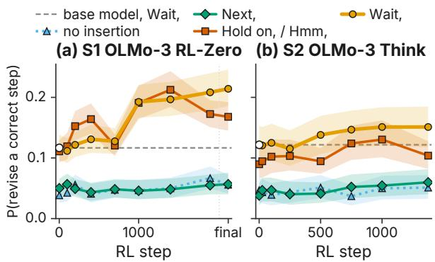  
Figure 8: By the judges’ labels, an inserted Wait, pushes every checkpoint toward revision, the base included. Judged probability of revising a correct step per inserted form along (a) OLMo-3 RL-Zero and (b) OLMo-3 7B Think, with 95% cluster-bootstrap bands. Exploratory: the judge’s sensitivity against the human audit is low (Section D.3).

Along OLMo-3 7B Think, whose RL follows supervised fine-tuning, the judged effect does not grow (8.4 to 9.1 points, $R _ { \mathrm { a m p } } = 1 . 0 9 [ 0 . 7 2 , 1 . 6 1 ] )$ and the label-free value change is null at its last checkpoint (−1.5 points, 95% CI [−4.9, 1.2]).

Indices defined on revision events (moved from the main text by the pre-declared rule of audit 4). The forms that open revisions shrink from 6.05 to 5.19 effective forms $( \rho = - 0 . 9 )$ , with wait taking 45.6% of revision openings (base 31.2%), while judge-labelled revision events per 100 sentences fall from 17.99 to 13.8. A further blind audit (audit 4) tested these labels on 60 sentences from the base and step 1900, stratified by marker and by the rule detector. By the consensus labels, the weighted share of sentences that revise is 1.3% at the base and 15.9% at step 1900 (95% CI [4.4, 36.0]), so the human labels do not show revisions becoming rarer. The detectors agree with the consensus labels at $\kappa = 0 . 6 4$ (Qwen2.5-7B), 0.71 (gpt-oss-20b) and 0.3 (rule detector), yet on the same weighted items the primary judge’s revision rate falls from 26.0% to 12.9%, because it over-calls revisions at the base; gpt-oss-20b tracks the consensus labels (1.5% to 12.9%). By the rule we fixed before the audit, the revision-rate and paradigm results therefore leave the main text. In the same audit, 2 of 27 stage-1 occurrences of wait and 15 of 27 stage-2 occurrences were judged reflective uses; the stage-2 share is below the pre-declared bar of 75% for describing stage-2 uses as reflective, so the main text reports counts only. Labels are consensus labels from a panel of ten annotators with PhD-level training in related fields, agreed through discussion without seeing any suggested answer; an author recorded them with a software tool. In an earlier version of this audit (audit 3), an AI agent drafted the labels and the panel checked and confirmed every item (Section D.3).

Unidirectionality. The theory predicts that the indices do not reverse. Between step 1900 and the final checkpoint of OLMo-3 RL-Zero, the rate of wait falls from 17.0 to 12.4 per 1k tokens, so the prediction fails for frequency; the comma form continues to erode (42.3% to 37.5%).

Controlled fork (D48). We trained our GRPO recipe for 400 steps from the OLMo-3 base and evaluated every checkpoint with the settings of the released RL-Zero series. Relative to the base, the rate of wait at step 400 is $A = 0 . 9 7$ (95% CI [0.91,

1.04]) on all responses and 1.13 ([1.05, 1.22]) on finished responses. The first meets our registered criterion for no amplification and the second meets neither criterion, so the registered outcome is undetermined for this fork. The fork without a KL penalty $( \beta = 0 )$ gives A = 0.81 ([0.76, 0.87]) on all responses and 0.93 ([0.85, 1.01]) on finished responses; both meet the criterion for no amplification, and its intervals are disjoint from the released run’s at step 200 (0.82 against 1.24) and at step 400, so by the registered rule the two recipes differ. For description only: at the same steps the released run reaches A = 1.24 at step 200 and 1.58 at step 400 (finished responses 1.34 and 1.7), against 0.87 and 0.97 for the fork.

Seeded marker and response length (D43, D46). The transplant of Section 4 has a length confound: about half of the fine-tuned model’s responses reach the 3,072-token limit. Before running the registered length control, we measured the fine-tuned checkpoint under three limits (Table 14). Accuracy and the marker’s rate among finished responses are stable, but about a fifth of responses still reach the 8,192-token limit, so the control’s primary outcome is the marker’s rate among finished responses (amendment D46b, made before any RL step). In the control (8,192 tokens with YaRN), 23.3% of the fine-tuned responses are truncated. After 400 RL steps the marker’s rate among finished responses is $A = 0 . 0 0 0 3 \ ( [ 0 . 0 0 0 1 , 0 . 0 0 0 6 ] )$ times its finetuned rate, and 0.0003 ([0.0002, 0.0005]) on all responses, while accuracy rises from 43.9% to 68.2% and truncation falls to 18.6%. Both are below 0.2, so by the registered rule RL penalises the marker itself, not only long responses. In the matching control seeded with Next, instead (X512-LY), RL does not coin wait: after fine-tuning the model writes it 0.02 times per 1k tokens, and at step 400 0 times in 8,239,334 tokens, while accuracy rises from 40.2% to 66.6%. Both length-controlled arms end at similar accuracy (68.2% and 66.6%), so the gain does not need the marker.

Keyword saturation. We registered that keyword counts would saturate in the late half of a series while our indices kept moving. They do not saturate: in the late half of OLMo-3 RL-Zero, $\rho ~ = ~ 1 . 0$ for DeepSeek-R1’s keywords and 1.0 for SimpleRL-Zoo’s counts, against −0.8 for the comma form and −0.8 for paradigm entropy.

Cross-series gate: the changes do not form one cline. The gate test we fixed before the main run required at least two of {paradigm narrowing, falling judged reliability, attrition} with $| \rho | \geq 0 . 7$ on two of three series, and no such trend across the base’s pretraining branches. It holds on OLMo-3 RL-Zero (all three), not on OLMo-3 Think (none) and cannot be computed on the Qwen2.5-1.5B run, which has no marker. Across the pretraining branches the indices are not flat: judged reliability falls $( \rho = - 1 . 0 )$ and chains rise $( \rho = 0 . 8 9 )$ , as along RL. These correlations come from the step between stage 1 (at most 0.04 occurrences per 1k tokens) and mid-training (4.03; Section 4); from mid-training to the RL base the rate stays between 4.03 and 5.95 per 1k and the comma form between 87.8% and 89.7% (post hoc). Along the supervised fine-tuning trajectory of the same base, the indices change by small amounts in a consistent direction $( \rho = 0 . 8 $ for comma drop, −1.0 for chains), but the comma drop moves only from 4.0% to 4.3%, against 2.7% to 57.8% along RL-Zero.

## D.3 Statistical Procedures

This section describes the resampling units, intervals and tests behind every reported number.

Resampling unit. Occurrences are nested in traces and traces in problems, and every checkpoint of a series is evaluated on the same problems (the insertion experiment also uses the same prefixes for every arm and for the base model). All intervals are therefore 95% percentile intervals from a cluster bootstrap over problems (Efron and Tibshirani, 1993; Field and Welsh, 2007), with $B = 2 { , } 0 0 0$ replicates for curves and $B = 1 0 { , } 0 0 0$ for the primary estimands. One replicate resamples problem identifiers once and recomputes the statistic at every checkpoint, so differences and trends between checkpoints are paired. Series are never pooled. The open series each come from a single training run, so their intervals cover evaluation sampling only; training-seed variation is estimated only for our own GRPO runs.

Trends and entropies. Trend claims use the Spearman correlation between step and index over the checkpoints of a series, with its bootstrap interval; no test is run at individual checkpoints. Entropies are computed on the same number of occurrences at every checkpoint (rarefaction, 100 subsamples) with the Miller–Madow correction (Paninski, 2003), because the plug-in estimate is biased at small counts and the counts grow with RL.

Signal detection. Hit and false-alarm rates receive the log-linear correction before the probit transform (Hautus, 1995); $d ^ { \prime } = z ( \mathrm { H R } ) - z ( \mathrm { F A } )$ and $\begin{array} { r } { c = - \frac { 1 } { 2 } \left( z ( \mathrm { H R } ) + z ( \mathrm { F A } ) \right) } \end{array}$ (Green and Swets, 1966; Macmillan and Creelman, 2004). H2 is a non-superiority claim: it holds only if the upper end of the 90% interval of $\Delta d ^ { \prime }$ lies below +0.25.

Insertion effects. The primary estimands are the risk difference $\mathrm { R D _ { o p } }$ , the risk ratio and the odds ratio of revision after Wait, against the neutral filler Next,, with cluster-bootstrap intervals over prefixes. The risk difference is the headline scale because selecting cut points at which the model continued pushes the reference rate toward zero, where odds ratios become unstable; odds ratios use Firth’s penalty when a cell has fewer than five events (Firth, 1993). The amplification over the base model, $R _ { \mathrm { a m p } } = \mathrm { R D _ { o p } ( l a s t ) } / \mathrm { R D _ { o p } ( b a s e ) }$ , is evaluated in the equivalent linear form $\mathrm { R D _ { o p } ( l a s t ) - }$ $1 . 5 \mathrm { R D } _ { \mathrm { o p } } ( \mathrm { b a s e } ) > 0$ whenever the base effect is close to zero. In the crossed design (prefix source × continuing policy), a GEE logistic model with prefix clusters estimates the arm × policy interaction adjusted for prefix source; a logistic mixed model with a random intercept per prefix is a secondary check.

Tests. We registered a fixed order of primary tests per series, with Holm’s correction within steps (Holm, 1979). In the event we report trend tests (Spearman correlation with step and its permutation p-value) with Holm’s correction over the primary indices, and interval estimates for everything else; the registered gate sequence was not applied, and no per-marker test batteries were computed.

Judge validity. Revision labels come from an open-weight judge (Qwen2.5-7B-Instruct, fixed before any audit; gpt-oss-20b, a different family, is reported beside it everywhere). We distinguish consistency, agreement with reference labels produced by LLM raters (two Claude tiers on a 60-item overlap, inter-rater agreement 71.7, $\kappa = 0 . 5 4$ ; Qwen3-32B on all items; adjudicated), from validity, agreement with the human consensus labels. A panel of ten annotators with PhDlevel training in related fields labelled two blind audits drawn from the same pools, agreeing on one consensus label per item through discussion: 60 sentence-function items (audit 1; 59 labelled) and 40 insertion-outcome windows balanced by the judge’s own label (audit 2; items marked unsure are included, and excluded as a sensitivity check). On the binary revise decision, audit 1 gives $\kappa = 0 . 1 9$ for Qwen2.5-7B and 0.63 for gpt-oss-20b, and audit 2 gives 0.3 and 0.43 (sensitivity 26.8 %, specificity 93.9 % for the primary judge). Because revisions are rare among the audited sentences, κ is depressed by prevalence; Gwet’s AC1, which is not, gives 0.79 (Qwen2.5-7B) and 0.92 (gpt-oss-20b) on audit 1, but 0.34 and 0.69 on audit 2, where revisions are common. The primary judge’s disagreement with the human on the insertion outcome is therefore real, not a preva lence artefact. Audit 4, the third human audit (Section D.2), labelled 60 sentences for revision events: there the judges agree with the consensus labels at $\kappa = 0 . 6 4$ (Qwen2.5-7B) and 0.71 (gptoss-20b), and the rule detector at 0.3. In an earlier version of that audit (audit 3), an AI agent drafted the labels and the panel checked and confirmed every item; on its 48 sentences the judges agree with these panel-confirmed labels at $\kappa ~ = ~ 0 . 5 4$ (Qwen2.5-7B), 0.66 (gpt-oss-20b) and 0.33 (rule detector). Because sensitivity is low and the audits are small, the magnitude of any judge-based rate is not identified; we therefore report judge based quantities (OBL, REL, the insertion outcome) only as exploratory, and we base headline claims on label-free indices (frequency, comma loss, marker chains, sentence length, next-word en tropy, paradigm share). Ratios and rank trends are unchanged by a non-differential correction; differential misclassification across checkpoints would bias them, and the audits are too small to rule it out. Every judge-based effect is also recomputed with rule-based labels.

<table><tr><td rowspan="2">Model</td><td rowspan="2">Training step</td><td colspan="2">MATH-500 (%)</td><td colspan="2">wait per 1k tokens</td></tr><tr><td>before</td><td>after</td><td>before</td><td>after</td></tr><tr><td colspan="6">RL FROM MODELS THAT DO NOT USE THE MARKER (ZERO-RL FROM A BASE, EXCEPT THE LAST ROW)</td></tr><tr><td>DAPO-Qwen-32Bn.r.</td><td>DAPO, Qwen2.5-32B</td><td>35.8</td><td>76.4</td><td>&lt;.01 [&lt;.01, 0.02]</td><td>&lt;.01[&lt;.01, &lt;.01]</td></tr><tr><td>Open-Reasoner-Zero-32B*</td><td>PPO, Qwen2.5-32B</td><td>10.8</td><td>91.4</td><td>0[0, &lt;.01]</td><td>&lt;.01 [&lt;.01, &lt;.01]</td></tr><tr><td>RÉF-s1 (ours)</td><td>GRPO, Qwen2.5-Math-1.5B</td><td>19.1</td><td>74.4</td><td>&lt;.01[&lt;.01, &lt;.01]</td><td>0 [0, &lt;.01]</td></tr><tr><td>REF-s2 (ours)</td><td>GRPO, Qwen2.5-Math-1.5B</td><td>17.8</td><td>74.2</td><td>&lt;.01 [&lt;.01, &lt;.01]</td><td>0 [0, &lt;.01]</td></tr><tr><td>REF-7B (ours)</td><td>GRPO, Qwen2.5-Math-7B</td><td>16.9</td><td>76.0</td><td>&lt;.01[&lt;.01, &lt;.01]</td><td>0 [0, &lt;.01]</td></tr><tr><td>Qwen-2.5-0.5B-SimpleRL-Zoo</td><td>GRPO, Qwen2.5-0.5B</td><td>8.6</td><td>30.8</td><td>&lt;.01[&lt;.01, &lt;.01]</td><td>&lt;.01[&lt;.01, &lt;.01]</td></tr><tr><td>Qwen-2.5-1.5B-SimpleRL-Zoo°</td><td>GRPO, Qwen2.5-1.5B</td><td>2.6</td><td>12.6</td><td>&lt;.01 [&lt;.01, &lt;.01]</td><td>&lt;.01[&lt;.01, &lt;.01]</td></tr><tr><td>Qwen-2.5-7B-SimpleRL-Zoo</td><td>GRPO, Qwen2.5-7B</td><td>48.2</td><td>77.2</td><td>0[0, 0.01]</td><td>0[0, 0.01]</td></tr><tr><td>Open-Reasoner-Zero-7B</td><td>PPO, Qwen2.5-7B</td><td>13.2</td><td>81.8</td><td>&lt;.01 [&lt;.01, 0.02]</td><td>0 [0, &lt;.01]</td></tr><tr><td>Qwen-2.5-Math-7B-SimpleRL-Zoo</td><td>GRPO, Qwen2.5-Math-7B</td><td>43.0</td><td>75.6</td><td>0[0, &lt;.01]</td><td>0[0, 0.01]</td></tr><tr><td>Qwen2.5-Math-7B-Oat-Zero</td><td>Dr. GRPO, Qwen2.5-Math-7B</td><td>35.8</td><td>79.8</td><td>0[0, &lt;.01]</td><td>0[0, 0.01]</td></tr><tr><td>Qwen-2.5-14B-SimpleRL-Zoo†</td><td>GRPO, Qwen2.5-14B</td><td>53.2</td><td>82.6</td><td>0[0, 0.01]</td><td>0[0, 0.01]</td></tr><tr><td>Qwen-2.5-32B-SimpleRL-Zoo</td><td>GRPO, Qwen2.5-32B</td><td>50.4</td><td>83.8</td><td>0[0, 0.01]</td><td>0[0, 0.01]</td></tr><tr><td>Mistral-7B-v0.1-SimpleRL-Zoo°</td><td>GRPO, Mistral-7B-v0.1</td><td>0.4</td><td>5.0</td><td>0.07 [0.02, 0.16]</td><td>0[0, &lt;.01] ↓</td></tr><tr><td>Mistral-Small-24B-SimpleRL-Zoo</td><td>GRPO, Mistral-Small-24B</td><td>21.4</td><td>75.8</td><td>0 [0, 0.01]</td><td>&lt;.01[&lt;.01, &lt;.01]</td></tr><tr><td>DeepSeek-Math-7B-SimpleRL-Zoo°</td><td>GRPO, DeepSeek-Math-7B</td><td>1.4</td><td>19.2</td><td>0[0, 0.02]</td><td>0[0, 0.01]</td></tr><tr><td>General-Reasoner-Qwen2.5-7B</td><td>GRPO, Qwen2.5-7B</td><td>61.6</td><td>75.6</td><td>0[0, 0.01]</td><td>0[0, &lt;.01]</td></tr><tr><td>General-Reasoner-Qwen2.5-14B</td><td>GRPO, Qwen2.5-14B</td><td>67.0</td><td>77.0</td><td>0[0, &lt;.01]</td><td>0[0, &lt;.01]</td></tr><tr><td>General-Reasoner-Qwen3-4B</td><td>GRPO, Qwen3-4B</td><td>71.2</td><td>79.0</td><td>&lt;.01 [&lt;.01, 0.01]</td><td>0.29 [0.24, 0.34] ↑</td></tr><tr><td>General-Reasoner-Qwen3-14B</td><td>GRPO, Qwen3-14B</td><td>79.2</td><td>85.2</td><td>0[0, 0.01]</td><td>0.04 [0.02, 0.06] ↑</td></tr><tr><td>One-Shot-RLVR-Qwen2.5-Math-1.5B-pi1 GRPO (1 example), Qwen2.5-Math-1.5B</td><td></td><td>32.8</td><td>72.6</td><td>0[0, &lt;.01]</td><td>0[0, 0.01]</td></tr><tr><td>Qwen2.5-Math-1.5B-Oat-Zero</td><td>Dr. GRPO, Qwen2.5-Math-1.5B</td><td>24.6</td><td>72.6</td><td>&lt;.01[&lt;.01, &lt;.01]</td><td>0[0, 0.01]</td></tr><tr><td>REF-Qwen3-4B (ours)</td><td>GRPO, Qwen3-4B</td><td>41.2 42.0</td><td>84.1 45.9</td><td>0.02[0.01, 0.03]</td><td>0.03 [0.02, 0.04]</td></tr><tr><td colspan="6">Qwen2.5-1.5B-Open-R1-GRPO-math-v1† GRPO, Qwen2.5-1.5B-Inst.</td></tr><tr><td>FINE-TUNED ON REASONING TRACES (DISTILLATION OR COLD START) QwQ-32B</td><td>cold start+RL, Qwen2.5-32B</td><td>35.8</td><td>89.6</td><td>&lt;.01 [&lt;.01, 0.02]</td><td>4.42[4.34, 4.49]↑</td></tr><tr><td>DeepSeek-R1-Distill-Qwen-32B</td><td>SFT, Qwen2.5-32B</td><td>35.8</td><td>89.5</td><td>&lt;.01 [&lt;.01, 0.02]</td><td>3.25 [3.18, 3.32] ↑</td></tr><tr><td>Phi-4-reasoning</td><td>SFT, Phi-4</td><td>82.0</td><td>93.0</td><td>0[0, &lt;.01]</td><td>1.56[1.50, 1.62] ↑</td></tr><tr><td>Phi-4-reasoning-plus</td><td>SFT+RL, Phi-4</td><td>82.0</td><td>91.1</td><td>0[0, &lt;.01]</td><td>2.58 [2.51, 2.65] ↑</td></tr><tr><td>Qwen3-8B</td><td>SFT+RL, Qwen3-8B</td><td>66.5</td><td>84.9</td><td>0[0, &lt;.01]</td><td>3.93 [3.87, 4.00] ↑</td></tr><tr><td>Qwen3-14B</td><td>SFT+RL, Qwen3-14B</td><td>66.5</td><td>87.9</td><td>0.03 [0.01, 0.05]</td><td>3.03 [2.98, 3.10] ↑</td></tr><tr><td>Qwen3-30B-A3B</td><td>SFT+RL, Qwen3-30B-A3B</td><td>52.2</td><td>86.8</td><td>0.02[0.01, 0.03]</td><td>2.83 [2.77, 2.88] ↑</td></tr><tr><td>OpenThinker-7B</td><td>SFT, Qwen2.5-7B-Inst.</td><td>74.8</td><td>79.9</td><td>0[0, &lt;.01]</td><td>4.05 [3.98, 4.13] ↑</td></tr><tr><td>Bespoke-Stratos-7B</td><td>SFT, Qwen2.5-7B-Inst.</td><td>74.8</td><td>79.2</td><td>0[0, &lt;.01]</td><td>3.19 [3.11, 3.26]↑</td></tr><tr><td colspan="6">TRAINING STAGES OF OLMO-3-1025-7B (BEFORE = PREVIOUS STAGE)</td></tr><tr><td>Pretraining</td><td>stage 1, step 707k</td><td>0.0</td><td>0.4</td><td>0.04[0.03, 0.05]</td><td>0.03 [0.02, 0.04]</td></tr><tr><td>Pretraining</td><td>stage 1, step 1.41M</td><td>0.4</td><td>0.1</td><td>0.03 [0.02, 0.04]</td><td>0.04 [0.03, 0.06]</td></tr><tr><td>Mid-training</td><td>stage 2</td><td>0.1</td><td>35.7</td><td>0.04[0.03, 0.06]</td><td>4.03 [3.92, 4.14] ↑</td></tr><tr><td>Base</td><td>stage 3</td><td>35.7</td><td>51.2</td><td>4.03[3.92, 4.14]</td><td>4.94 [4.85, 5.03]↑</td></tr><tr><td colspan="6">RL FROM A MODEL THAT USES THE MARKER (AFTER = LAST CHECKPOINT)</td></tr><tr><td>Olmo-3-7B-RL-Zero-Math</td><td>RL-Zero</td><td>52.3 ± 1.2 84.9 ± 0.9</td><td></td><td>5.07 ± 0.17</td><td>12.68±1.55↑</td></tr><tr><td>Olmo-3-7B-Think</td><td>SFT, DPO, RL</td><td>90.0</td><td>91.0</td><td>3.86[3.79, 3.94]</td><td>4.52 [4.44, 4.59] ↑</td></tr><tr><td>Olmo-3.1-32B-Think</td><td>SFT, DPO, RL</td><td>91.4</td><td>93.0</td><td>4.52[4.46, 4.58]</td><td>4.23 [4.17, 4.29] ↓</td></tr><tr><td>MiMo-7B-RL-Zero</td><td>RL-Zero, MiMo-7B</td><td>65.8</td><td>76.4</td><td>4.95[4.86, 5.04]</td><td>6.62[6.53, 6.71] ↑</td></tr><tr><td>DeepScaleR-1.5B-Preview</td><td>RL, R1-Distill-1.5B</td><td>80.1</td><td>89.1</td><td>5.04[4.95, 5.12]</td><td>4.15 [4.07, 4.23] ↓</td></tr><tr><td>Light-R1-14B-DS</td><td>RL, R1-Distill-14B</td><td>89.0</td><td>88.4</td><td>3.77 [3.70, 3.85]</td><td>4.01 [3.93, 4.08] ↑</td></tr><tr><td colspan="6">NEWEST GENERATION: QWEN3.5 (BEFORE = ITS BASE)</td></tr><tr><td>Qwen3.5-0.8B</td><td></td><td>43.8</td><td>48.1</td><td>1.96[1.92, 1.99]</td><td>1.83[1.80, 1.86]</td></tr><tr><td>Qwen3.5-2B</td><td>post-training post-training</td><td>74.5</td><td>76.8</td><td>1.31 [1.27, 1.34]</td><td>0.86 [0.84, 0.89]↓</td></tr><tr><td>Qwen3.5-4B</td><td>post-training</td><td>89.6</td><td>88.2</td><td>1.15[1.11, 1.20]</td><td>3.82[3.78, 3.85]</td></tr><tr><td>Qwen3.5-9B</td><td>post-training</td><td>88.1</td><td>92.1</td><td>0.93 [0.89, 0.98]</td><td>2.94[2.91, 2.97]↑</td></tr><tr><td colspan="6"></td></tr><tr><td>OLMO-2 7B LINEAGE (BEFORE = THE BASE) OLMo-2-1124-7B-SFT</td><td>SFT, OLMo-2-7B</td><td>4.1</td><td>25.9</td><td>0.16[0.13, 0.19]</td><td>0[0, &lt;.01] ↓</td></tr><tr><td>OLMo-2-1124-7B-DPO</td><td>DPO after SFT</td><td>4.1</td><td>35.0</td><td>0.16[0.13, 0.19]</td><td>0 [0, &lt;.01] ↓</td></tr><tr><td>OLMo-2-1124-7B-Instruct</td><td>RLVR after DPO</td><td>4.1</td><td>37.5</td><td>0.16[0.13, 0.19]</td><td>0[0, &lt;.01] ↓</td></tr></table>

Table 13: Full provenance table: all but one reproduced zero-RL run stay without wait; documented routes to it otherwise pass through training data. Format as in Table 2. Models without a measured starting point are in Table 4. Shading: wait per 1k after training (log scale, darker = more); ↑/↓: rise/fall with non-overlapping intervals; grey rows: our runs.

†Secondary, not counted: the release has no licence text (the open run also starts from an instruct model). ⋄Run with the vendor’s required Chinese system prompt (its evaluation note says the system prompt is empty; without it the model degenerates); wait per 1k thinking tokens. ∗Base and final use the ORZ prompt template, under which the base scores low; the accuracy gain partly reflects the template. ◦Not reproduced: accuracy below half the published value or at least 20% truncated; not counted (D47a, Section D.2). n.r.No MATH-500 reference published by its authors; counted neither way (D47a, Section D.2). ‡Base gated (manual approval); not used. §Base gated, not measured. ¶At least 20% of responses reach the length limit; not marked, direction from finished responses in Section 4. QwQ-32B’s cold-start data are not public (Qwen Team, 2025).

<table><tr><td>Limit</td><td>Acc. (%) Trunc. (%) Loops Tokens wait/1k finished</td><td></td><td></td><td></td><td></td><td></td></tr><tr><td>3,072</td><td>45.4</td><td>46.8</td><td>15.4</td><td>2,416</td><td>7.55</td><td>7.07</td></tr><tr><td>8,192</td><td>45.2</td><td>23.1</td><td>15.2</td><td>3,954</td><td>9.13</td><td>6.32</td></tr><tr><td>8,192 + YaRN</td><td>47.4</td><td>22.3</td><td>20.4</td><td>4,670</td><td>6.82</td><td>7.52</td></tr></table>

Table 14: The seeded checkpoint under three response limits (800 responses each): accuracy, share truncated, looping share, tokens per response, and wait per 1k tokens in all and in finished responses. YaRN: rope scaling ×2.25.

## E Related Work

The extended discussion of related work.

Where reflection comes from. The “aha moment” of R1-Zero, in which reflective words be come several times more frequent and wait appears abruptly (Guo et al., 2025), has been questioned on the level of behaviour. Self-reflection already appears in DeepSeek-V3-Base and in Qwen2.5 bases and does not raise accuracy by itself (Liu et al., 2025d,c); self-correction emerges during pretraining (Essential AI et al., 2025), error correction is present in base models (Yeo et al., 2025), and reflection is latent in pretrained Qwen2.5 (Gandhi et al., 2025; Zhu et al., 2025). A second line finds that RL with verifiable rewards sharpens what the base already does rather than expanding it: it narrows the base’s distribution (Yue et al., 2025; Wu et al., 2025a), converges on output modes learned in pretraining (Zhao et al., 2025b), amplifies base behaviours even under spurious rewards (Shao et al., 2026), and can be matched by sampling from the base (Karan and Du, 2026); prolonged RL may still extend the set of solutions (Liu et al., 2025b). On the other side, strategic phrases have been treated as tokens that RL discovers (Wang et al., 2026), and behaviours including self-verification are reported to emerge in zero-RL at the trillion-parameter scale (Tang et al., 2026), without the base’s own rate of the marker. These works locate the behaviour before RL. We follow theform: across one base’s pretraining and mid-training branches to where it enters, between zero-RL and trace-trained descendants of one base, and along RL from bases with and without it. DAPO’s case study of an emerging “wait a moment” (Yu et al., 2025) is, at our measured rates, an isolated case.

Distillation, mid-training and training dynamics. Distilled models use hesitation words such as wait and logical connectors far more often than zero-RL models (Hu et al., 2025b), discourse tokens differ between small-scale fine-tuning and largescale post-training (Hwang et al., 2026), and model diffing suggests that RL teaches when to use mechanisms the base already has while fine-tuning on traces installs new ones (Venhoff et al., 2026). Midtraining decides how well a base responds to RL (Wang et al., 2025d), and in controlled pipelines what RL can extend depends on exposure during pretraining and mid-training (Zhang et al., 2026). Checkpoint suites made such questions answerable for pretraining (Biderman et al., 2023; Xia et al., 2023), with word-level learning curves (Chang and Bergen, 2022; Chang et al., 2024) and linguistic regularities tracked across checkpoints (Kugler, 2025; Paape, 2026); open pipelines with released data and intermediate checkpoints extend this to post-training (OLMo et al., 2024; Team Olmo et al., 2025), and diversity collapse has been traced along OLMo 3 lineages (Karouzos et al., 2026). RL updates stay close to the base in KL and touch sparse subnetworks (Shenfeld et al., 2026; Mukherjee et al., 2025), concentrate on high-entropy forking tokens (Wang et al., 2025c) and reduce output diversity (Song et al., 2025; He et al., 2025; Cui et al., 2025). We bring these strands to a single lexical form whose arrival can be dated within one open lineage and whose later reshaping can be measured on public RL trajectories.

Reasoning markers and their manipulation. Along zero-RL, Open-Reasoner-Zero and SimpleRL-Zoo track reflection keywords (Hu et al., 2025a; Zeng et al., 2025), and SimpleRL-Zoo finds keyword counts and judged behaviours moving apart (Zeng et al., 2025); comparing whole training stages, RL suppresses exploratory steps such as hypothesising and backtracking (Maniparambil et al., 2026). Studies of final models disagree about what markers do: post-answer reflections are mostly confirmatory (Kang et al., 2025), self-affirming reflections are pervasive (Liu et al., 2025a), a large share of steps is decorative (Zhao et al., 2025a), thinking tokens trigger unnecessary reflection (Ding et al., 2025; Long et al., 2026), and markers are “surface cues” whose suppression need not remove reflection (Yu et al., 2026); yet inflections track probe-measured belief shifts (Boppana et al., 2026), and mid-trace shifts do not become more frequent across GRPO checkpoints (d’Aliberti and Ribeiro, 2026). “Aha” has also been described as anthropomorphic tone plus adaptive uncertainty (Yang et al., 2025b). Interventions delete markers, append or insert them, resample sentences or steer along latent directions (Wang et al., 2025a; Qian et al., 2025; Muennighoff et al., 2025; Ghosal et al., 2025; Jiang et al., 2026; Bogdan et al., 2025; Macar et al., 2026; Venhoff et al., 2025; Ward et al., 2025; Troitskii et al., 2025), and engineering work schedules or learns reflection tokens (Fan et al., 2026; Ringel et al., 2025; Wu et al., 2025b). Suppressing thinking tokens harms accuracy in Qian et al. (2025) but costs RL-trained models little in NoWait (Wang et al., 2025a), so deletion alone cannot tell what a marker does. Clusters of sentence-initial pivots have been called “reasoning operators” (Lee et al., 2026). Unlike these works, we follow markers along training with label-free diagnostics beyond frequency, and run an insertion test at every checkpoint with base-model and neutral-filler arms (Section D.2). Concurrent work releases rollouts in which trace openers are inserted into base models on the same OLMo-3 checkpoints (reasoning-cues, 2026).

Monitorability, hedges and judges. Chain-ofthought monitoring reads traces for the model’s intent and treats this monitorability as fragile (Korbak et al., 2025; Baker et al., 2025); traces are not always faithful (Turpin et al., 2023; Lanham et al., 2023; Chen et al., 2025; Arcuschin et al., 2025), legibility is not interpretability (Du et al., 2026), and whether RL erodes monitorability is contested (Guan et al., 2026; MacDermott et al., 2025; Little, 2026; Jose, 2025; Xiong et al., 2026; Chen et al., 2026a). Verbalised uncertainty can be taught and calibrated (Lin et al., 2022; Mielke et al., 2022; Kadavath et al., 2022), epistemic markers shift both model accuracy and user reliance (Zhou et al., 2023, 2024), and hedges and self-checks in reasoning traces serve as single-pass uncertainty signals (Pandey et al., 2026; Vanhoyweghen et al., 2025; Wang et al., 2025b; Devic et al., 2025). Hidden states reveal errors that the text does not (Zhang et al., 2025a; Yuan et al., 2026), and trace-reading overseers shift their criterion rather than their sensitivity (Chen et al., 2026b). Behaviour labels in this literature often come from LLM judges, whose validity is uneven (Zheng et al., 2023; Wang et al., 2024; Bavaresco et al., 2025): step-level error judging is hard even for strong models (Zheng et al., 2025; Zhang et al., 2025c), and judges penalise expressions of uncertainty (Lee et al., 2025). Our results inform all three: the words monitors and uncertainty heuristics read are inherited from earlier training, the evidential weight of wait shifts with the recipe and the checkpoint, and judge-labelled revisions are not identified against human labels in our setting.

Language change in linguistics and in learning agents. Discourse markers form a functional category (Schiffrin, 1987; Fraser, 1999), and pragmatic markers arise through grammaticalization and subjectification (Brinton, 1996, 2017; Traugott, 1989; Traugott and Dasher, 2001); whether discourse markers grammaticalize or rather pragmaticalize is debated (Heine, 2013; Degand and Evers-Vermeul, 2015). Grammaticalization theory describes how content words become grammatical markers (Hopper and Traugott, 2003; Lehmann, 2015; Bybee, 2003; Heine and Kuteva, 2002; Haspelmath, 1999), and lexical-semantic-change methods measure change from usage embeddings (Hamilton et al., 2016; Giulianelli et al., 2020; Kutuzov and Giulianelli, 2020; Schlechtweg et al., 2020; Giulianelli et al., 2023; Kutuzov et al., 2018; Tahmasebi et al., 2018; Periti and Montanelli, 2024), including the degree of grammaticalization (Schlechtweg and Schulte im Walde, 2018; Nagata et al., 2026). NLP work that learns from discourse markers treats them as stable signals (Nie et al., 2019; Sileo et al., 2019). In learning agents, communication for a reward drifts away from natural language or invents codes (Lewis et al., 2017; Kottur et al., 2017; Lee et al., 2019; Lazaridou et al., 2020; Lazaridou and Baroni, 2020); efficiency pressures shape emergent lexicons (Chaabouni et al., 2019; Rita et al., 2020); KL penalties (Ziegler et al., 2019), grounding (Lee et al., 2019) and iterated learning (Lu et al., 2020) counter the drift; and simulations with neural and LLM agents study lexical change and its limits as a model of human language evolution (Ren et al., 2024; Zhang et al., 2025b; Kouwenhoven et al., 2025; Galke et al., 2022; Stengel-Eskin et al., 2026). Reasoning models show related changes: R1-Zero mixes languages (Guo et al., 2025), and o3 developed a hardto-read dialect whose terms became more frequent over RL (Schoen et al., 2025). Outcome-based RL of a pretrained model is a large natural-language case of such change, observed on successive checkpoints of one model: in it a marker is inherited and then reshaped in a recipe-dependent way, rather than coined.