# Interpretive Variation and Discourse Structure in Detecting Enthymemes in Controversial Political Discourse

Martial Pastor∗ Nelleke Oostdijk

Centre for Language Studies, Radboud University, Nijmegen, The Netherlands martial.pastor@ru.nl nelleke.oostdijk@ru.nl

## Abstract

Enthymemes are arguments that leave a premise or conclusion unstated, and they are a common persuasion device on social media. Because readers must fill in the missing part themselves, they often disagree on whether a text contains one. This paper asks how to detect and evaluate enthymemes when such disagreement is part of the task. On tweets about vaccination and immigration, each labeled by five annotators, F1 stalls around 0.67 for every fine-tuned model we train, regardless of data size, added features or label type. We therefore ask how these models should be evaluated instead, and propose metrics that compare predictions with the full distribution of annotator votes, together with a model that predicts this distribution directly and captures disagreement better at no cost in F1. We then ask what role discourse structure plays. Models learn to rely on explicit argumentative structure: they reliably recognize tweets without an enthymeme but rarely commit on tweets that contain one. Both the models and a discourse parser miss arguments whose links are left implicit and must be inferred by the reader. Finally, we discuss what these blind spots mean for content moderation systems trained on majority labels.

## 1 Introduction

This paper investigates the detection of arguments with missing premises or conclusions, known as enthymemes (Walton 2008; Razuvayevskaya and Teufel 2017), in short texts. The study is motivated by the need to detect enthymemes in social media, where they are a frequent means of persuasion: by leaving part of the argument unstated, they lower the critical attention paid to its implicit content, which eases the acceptance of fallacies and false information and facilitates deceptive argumentation (Lombardi Vallauri et al. 2020).

For example, in the tweet “Life isn’t a movie and vaccines aren’t created in 24hrs. The covid vaccine doesn’t work and never has.”, the missing component is a premise:

$P _ { 1 }$ : Vaccines aren’t created in 24 hours

P2: The COVID vaccine was created in 24 hours (implicit premise)

C: The COVID vaccine doesn’t work and never has

Enthymemes cannot however be approached as a standard detection task evaluated, since their presence is not determined by the explicit text alone. Detecting one depends on how a reader reconstructs the missing component, so that accounting for variation in human judgment is part of the task. We therefore take a perspectivist approach that models not only whether an enthymeme is detected, but also how consistently it is recognized across readers.

Accordingly, one of the challenges we take up in this paper is how to evaluate enthymeme detection under human label variation and disagreement. Once the multiple annotations are kept, the majority-vote verdict is no longer the only object to be predicted, and several properties of the vote distribution become relevant targets (Plank 2022; Uma et al. 2021). We address this challenge in three steps. First, we bring together metrics from work on learning and evaluating with disagreement (Baan et al. 2022; Rizzi et al. 2024; Leonardelli et al. 2025) and add a per-vote metric conditioned on annotator behavior (Section 5, and Section 5.3 for the per-vote metric). Second, we introduce betabin, a model that predicts a distribution over the vote count, thereby separating the leaning of a tweet from the expected division among its readers (Section 4.5). Then follows an error analysis organized by the variation metrics (Section 6). Its goal is to make the variation visible and to explain it. We study where the betabin model gains over the others, and what the tweets it gains on have in common in terms of discourse structure.

Running alongside the above objective of measuring variation is a second complementary thread that concerns discourse structure. Here we use discourse structure not only as a source of predictive information, but also as a way to understand what makes an enthymeme easier or harder to detect and where human judgments diverge. We first encode the RST tree of each tweet as a set of features and inject them into the detection model, following the discourse-enhanced architecture of Chernyavskiy, Ilvovsky, and Nakov (2024), which tests whether the structure carries information that the text alone does not (Sections 4.1 and 4.4). We then reuse the same features as descriptive dimensions in the success and error analysis announced above, to characterize the tweets on which the models succeed, fail, and place near-threshold probabilities (Section 6). To further examine how the model interacts with discourse structure, we probe the encoder before and after fine-tuning and ask which discourse configurations it represents and which the detection task strengthens (Section 7). The three steps together let us examine discourse structure from both sides. On the model side, they identify the discourse profiles a system can rely on to detect an enthymeme under label variation and those it fails to read, which lead in turn to failures in capturing the phenomenon. On the reader side, the same dimensions describe the tweets on which annotators divide, which gives a discourse-based account of interpretive variation and disagreement.

We finish by discussing what the variation metrics make visible, and what this implies for pipelines that classify and moderate social media content on the basis of majority labels (Section 8). We first give F1 its due and set out why our data leaves little room for improving on it (Section 8.1). We then describe three distortions of the discourse ecosystem that a verdict-based evaluation leaves unmeasured, and how a distributional output addresses each (Section 8.2).

The main contributions of the paper are as follows:

• An evaluation of enthymeme detection under human label variation. We bring together metrics from work on learning with disagreement, organized by the question each answers about the vote distribution, and add a per-vote metric that tests whether a model’s errors fall on the votes that are unusual for the annotator who cast them.

• Betabin, Section 4.5, a model that predicts a distribution over the vote count rather than a label. Unlike soft-label training, which fits a single vote fraction, it predicts a leaning and a confidence in that leaning. It matches the text-only baseline on macro-F1, improves on every measure of vote distribution shape, and its output is interpretable in vote units.

• Evidence that F1 is bounded at around 0.67 regardless of data volume, feature injection, or label regime, from a systematic comparison of feature-only, classical and transformer systems with learning curves for each. The properties of the vote distribution are learnable where the verdict is not.

• A discourse-structural account of where detection succeeds and fails. Injected RST features are redundant, but the same dimensions used descriptively show that the models rely on explicit argumentative structure as a proxy for the label, that the certain absence of an enthymeme is learned while its certain presence is not, and that a reported speech and evaluation configuration marks the tweets on which readers divide.

• Probing evidence that fine-tuning promotes explicit stance and attribution configurations but not implicit marking, and sheds trope content, which accounts for the redundancy of the injected RST features and for the failure on unmarked junctions.

## 2 Related Work

## 2.1 Enthymeme Detection

The term enthymeme first appears in Aristotle’s Prior Analytics, where it names an incomplete syllogism, an argument with a proposition left unstated (Walton 2008). This deductive reading, the enthymeme as a truncated syllogism whose missing part can be supplied to restore validity, persisted into modern logic (Hitchcock 1985), and has since given way to a rhetorical and pragmatic conception. On this account the enthymeme is a form of defeasible reasoning that holds unless there is evidence to the contrary, and its missing component is omitted because the audience is expected to supply it, which is the source of its persuasive force (Walton, Reed, and Macagno 2008; Razuvayevskaya and Teufel 2017). A contestable proposition introduced implicitly can therefore enter discourse without the scrutiny an explicit assertion would attract (Reboul 2011; Lombardi Vallauri et al. 2020).

Detecting whether a text is enthymematic has received less attention than recovering the implicit component. Recovery itself has been pursued through logic-based decoding (Hunter 2022), LLM-assisted logical reconstruction (Feng and Hunter 2026), and neural generation drawing on commonsense knowledge (Chakrabarty, Trivedi, and Muresan 2021; Stahl et al. 2023). For enthymemes, detection has been approached with feature-based classifiers (Rajendran, Bollegala, and Parsons 2016) and fine-tuned neural models (Stahl et al. 2023), though on data constructed diferently from ours: their texts are made enthymematic by deleting a component, so every item contains one by design, whereas our tweets occur naturally and may contain none. These lines of work do not, however, study detection under label variation, for lack of a resource that keeps more than one annotation per item.

## 2.2 Discourse Structure and Implicit Argumentation

Eforts to detect implicit argumentative content have mostly drawn on external knowledge rather than on discourse structure. Chakrabarty, Trivedi, and Muresan (2021) augment a generation model with commonsense knowledge to recover implicit premises, and Becker (2024) reconstructs implicit knowledge from commonsense resources, while noting that surface discourse markers can mislead a system as often as they guide it. The role of discourse structure itself in signalling implicit argumentation has received little attention.

The main exception is the work of Green (2010). She proposes ArgRST, a hybrid representation that encodes argument components (data, claim, warrant, backing) within an RST tree, mapping them onto relations such as evidence, antithesis and concession. On a corpus of genetic-counseling letters, she uses this representation to characterize the discourse contexts that license the omission of an argument element. In ArgRST, omitted argument components are reconstructed as implicit propositions within the discourse tree. Her analyses therefore provide a precedent for using discourse structure to characterize the contexts in which implicit argumentation occurs.

To our knowledge, no study has further examined whether discourse-structural relations can be used to detect the presence of an implicit premise or conclusion in short text, still less how that signal relates to the variation among readers who judge it.

## 2.3 Perspectivist NLP and Variation

NLP evaluation has traditionally assumed that each instance has a single correct label. Disagreement between annotators is therefore commonly treated as annotation noise to be resolved through aggregation. Aroyo and Welty (2015) challenged this view by showing that disagreement can reflect diferences in how people interpret and annotate the same instance. This perspective has since developed into perspectivist NLP, which treats variation between human judgments as potentially informative for data collection, modeling, and evaluation (Basile et al. 2021; Plank 2022; Cabitza, Campagner, and Basile 2023).

This shift has motivated methods that retain disagreement in both learning and evaluation. Uma et al. (2021) survey approaches to learning from disagreement, including methods that model individual annotators and methods that represent multiple judgments directly. Gordon et al. (2021) show that aggregated labels can obscure the distinction between model error and disagreement between human judgments, and propose disagreement deconvolution to separate these sources of variation. Gordon et al. (2022) extend this perspective to model training with Jury Learning, which incorporates individual judgments rather than reducing them to a single label.

More recent work has focused on metrics for evaluating predictions against distributions of human judgments. Baan et al. (2022) argue that calibration should be evaluated against human judgment distributions when annotators disagree. Rizzi et al. (2024) compare soft metrics for evaluation under disagreement and show that diferent metrics capture diferent properties of the annotation distribution. The LeWiDi shared tasks have further developed evaluation of systems that learn from disagreement (Leonardelli et al. 2025).

Enthymeme detection provides a relevant setting for this perspective. Identifying an implicit premise or conclusion requires semantic interpretation of the text and its possible argument structure. Diferent readers can therefore arrive at diferent judgments about whether an implicit component is present. In this setting, variation between judgments provides information about how the text can be interpreted.

## 3 Task, Dataset, and Annotation

This paper draws throughout on the resource of Pastor and Oostdijk (2026), which supplies the formal definition of the task, the annotation guidelines, and the annotated tweets, including the five votes per item on which the evaluation of Section 5 rests. We restate below the parts of that framework the rest of the paper depends on.

## 3.1 Enthymemes

An enthymeme is an argument with a missing component. Given premises $p _ { 1 } , p _ { 2 }$ and a conclusion c, one of the three is absent from the text. We follow the definition of Pastor and Oostdijk (2026), which grounds the reconstruction of the missing component in Walton’s argumentation schemes (Walton, Reed, and Macagno 2008). The tweet below, from Burke and Vlah (2023), leaves its second premise unstated. The reconstruction is licensed by the scheme Argument from Negative Consequences.

$^ { 6 6 } I$ don’t wanna get a COVID vaccine because some days I would like to have babies”

$P _ { 1 }$ : I want to have babies

$P _ { 2 } { \mathrm { : } }$ The vaccine causes infertility (implicit)

C: I don’t want to get the COVID vaccine

Because reconstructing an implicit component is otherwise open to subjective or distorted readings, the framework of Pastor and Oostdijk (2026) constrains it: the inferential license of the argumentation scheme is reified as a propositional conditional and added to the premise set, so that the reconstructed premises classically entail the conclusion. Entailment serves as a completeness check on the reconstruction.

Furthermore, not every unstated proposition counts as a missing component. The annotation guidelines of Pastor and Oostdijk (2026) annotate an implicit component only when it is controversial. In these guidelines, a controversial component expresses a stance on a state of afairs, that is, a position on values, beliefs or attitudes, of the kind that can influence the convictions, choices and behavior of other people. An implicit component that carries no stance, committing the author to nothing, is out of scope and annotated as none. The dataset restricts this criterion to two topics, vaccination and immigration.

## 3.2 Task

Each annotation assigns one of three labels to a tweet, none, implicit premise or implicit conclusion, and records the propositional decomposition in the format above together with the argumentation scheme. In this work we merge the two implicit labels into a single enthymeme label and treat detection as a binary task: enthymeme against none. Each tweet carries the votes of five annotators. As we will see below, we keep these votes rather than reducing them to a majority label, and the evaluation of Section 5 is built on them.

## 3.3 Dataset and Annotation

The dataset of Pastor and Oostdijk (2026) contains 1,482 English tweets drawn from the trope dataset of Flaccavento et al. (2025), which was collected with keyword queries on vaccines and immigration between late 2019 and late 2023. The tweets were sampled to balance trope against no-trope labels. Vaccination accounts for 1,169 tweets (78.9%) and immigration for 313 (21.1%). Each tweet carries five votes, which are used throughout this work. By majority vote, none accounts for 980 tweets (66.1%), implicit premise for 439 (29.6%) and implicit conclusion for 63 (4.3%).

## 3.4 Trope and RST Annotations

This paper works mainly with parser-generated RST features, both for the experiments and as the basis for the later discourse analysis. Alongside them we use the gold trope labels of the dataset the enthymeme resource was built on, to compare two possible linguistic means of signalling an enthymeme: discourse structure, which captures the formal organization of a tweet, and online tropes, which invoke recurring, culturally situated figures readers recognize.

Tropes have been defined in media studies as a storytelling device or shortcut that assumes the audience recognizes the situation (Gala et al. 2020). By online trope we mean such a device used in online discussion. Online tropes refer to human situations rather than plots, are often implied rather than stated, and are readily understood by readers. Examples include recurring situations such as distrust experts, hidden agenda, and natural is better. Every tweet carries the gold trope labels of Flaccavento et al. (2025), which cover nine trope categories. Tropes describe the content of a tweet, not its form.

Rhetorical Structure Theory (RST; Mann and Thompson 1988) describes the coherence of a text as a tree. The text is segmented into elementary discourse units (EDUs), clause-like spans, and EDUs are linked by coherence relations such as elaboration, contrast, cause and temporal. In each relation one unit, the nucleus, carries the essential content, and the other, the satellite, adds to it. These relations combine recursively, so that a whole tweet is represented as a single tree, of the kind shown in Appendix B. Some relations, such as joint and same-unit, are multinuclear. RST trees for all tweets were produced automatically with the IsaNLP RST parser (Chistova 2024), using its model trained on the RST Discourse Treebank, with the harmonized set of 18 relation labels of Braud, Coavoux, and Søgaard (2017). Section 4.1 describes how the trees and the trope labels are encoded as features.

## 4 Modeling Enthymeme Detection

We begin with the standard methodology: enthymeme detection framed as binary supervised classification — enthymeme vs. no enthymeme — evaluated against gold labels.1 Our objective is to find the best performing detection model under gold-label F1, and to measure whether the explicit use of external features such as tropes and RST discourse features helps.

## 4.1 RST and Trope Feature Representations

Our RST features follow, as a starting point, the encoding proposed by Chernyavskiy, Ilvovsky, and Nakov (2024) for propaganda detection, which represents each text through per-EDU nuclearity and relation information together with global tree statistics such as the number of EDUs, tree depth, and relation counts. However, a feature-only diagnostic revealed that on short tweets these count-based features largely reduce to proxies for text length: a logistic regression on the features alone barely outperforms one trained on length alone, and once the length-correlated component is removed from the features, performance drops below the length baseline.

We therefore constructed a compact 24-dimensional encoding built exclusively from indicators and ratios, making it insensitive to text length. These more focused features emphasize discourse structure, that is, which relations organize the tweet, how they are configured, and how the tree is shaped, rather than how much material it contains: they record the presence and placement of the core relations, the proportions in which relations occur, nuclearity and satellite ordering, coordination patterns such as root and embedded joint, and global shape ratios over the nuclear spine and branching. Table A.1 in Appendix A lists each feature together with the motivation for its selection.

The tropes are encoded as a nine-dimensional binary vector of gold trope annotations covering all 1,482 tweets. Unlike the RST features, tropes require no structural transformation: they operate at the level of content rather than form.

Features-only diagnostics place tropes alone at 0.538 macro-F1 and the combined 33- dimensional RST and tropes set at 0.608, so both feature families are individually predictive before any injection into a neural model.

## 4.2 Classical Approaches

Before turning to fine-tuned transformers, we experiment with classical approaches in order to establish baselines and to investigate the role played by RST and trope features at this level. We train a balanced Logistic Regression and a linear SVM (Cortes and Vapnik 1995), implemented via Scikit-learn (Pedregosa et al., 2011; Buitinck et al., 2013), on combinations of three feature blocks: a TF-IDF text representation (Salton and Buckley 1988) with word 1-2-grams and character 3-5-grams, the 24-dimensional RST features, and the trope flags. All models are evaluated out-of-fold on the same 5-fold partition later used for the neural experiments, and on the held-out test set of 148 tweets, with vectorizers and scalers fit on the training data only. Logistic Regression is the stronger model in every combination, so we report its scores in Section 4.6.

## 4.3 Fine-Tuned Transformers with Hard vs. Soft Labels

We use DeBERTa-v3-base (He, Gao, and Chen 2023) as our detection model. Fine-tuned DeBERTa has proven efective for detecting implicit content in short texts in a setting close to ours (Stahl et al. 2023), and as an open encoder it lets us intervene on the model itself: inject external features into its architecture, and later probe its internal representations. We fine-tune with a maximum length of 128 tokens, an efective batch size of 32, a learning rate of 1e-5 with layer-wise decay, and up to 10 epochs with early stopping on validation loss.

Each tweet in our dataset carries the votes of five annotators. This gives us access not only to a majority-vote label, but also to the label variation behind it, which is what is needed for a semantic interpretation task like enthymeme detection, where the judgment genuinely varies across readers and a majority vote erases the interpretation diversity behind the label.

We therefore train under two regimes. In the hard regime, the target is the majority vote and the loss is a class-weighted cross-entropy. In the soft regime, the target is the vote fraction, treated as a two-way distribution; the loss is a soft focal cross-entropy (Lin et al. 2017), which down-weights confidently wrong predictions on contested items to the degree the annotators themselves were split. Everything else is held identical, so any diference in behavior is attributable to the choice of target. Results are reported in Section 4.6.

## 4.4 Feature Injection Architectures

A first way to inject features is to concatenate them with the text representation, following Chernyavskiy, Ilvovsky, and Nakov (2024), whose discourse features improved propaganda detection on news paragraphs. We experimented with their approach, both their original encoding and the concatenation-based injection, but it performed poorly in our setting of much shorter texts.

Concatenation makes the features available to the classifier for every prediction. Our featureonly diagnostics show that the features predict the label well above chance but well below the text representation, so on most tweets they add little to what the text already provides. We therefore use an architecture that can consult the features selectively or ignore them entirely with a learned gate weights the feature representation before it is added residually to the text representation.2 With the gate closed, the model degrades to the baseline: the injection can only add information, never displace the text. To stabilize the fused system on our small dataset, we freeze the parameters of the lower half of the encoder layers, which helps only the gated models, not the baseline.

This architecture is run with three feature sets: the 24-dimensional RST features, the 9 trope flags, and their concatenation.

## 4.5 Betabin: Modeling the Votes

The architectures above inject information at the input. Lastly, we suggest injecting nothing and instead changing what is modeled, namely, the vote distribution itself. If disagreement is part of the phenomenon, then the natural training target is not the verdict, nor even the vote fraction, but the annotation process: five readers casting votes. A model trained this way must learn not only which way a tweet leans but how divided its readers will be, a property we will evaluate directly with the disagreement metrics of Section 5.

Beta distributions over annotator response probabilities go back to classical annotation modeling (Dawid and Skene 1979; Paun et al. 2018); we introduce this objective for disagreement modeling in our setting. The head predicts, for each tweet, the two parameters of a Beta distribution over the probability that a reader votes enthymeme, and training maximizes the likelihood of the observed vote count (e.g., 3 of 5) under it.3 The prediction thus carries two degrees of freedom instead of one: a leaning, and a confidence in that leaning, so the model can distinguish “I expect readers to split on this tweet” from “I do not know this tweet”, two beliefs a single probability collapses into the same hedged output. At evaluation, the predicted mean drops into the same thresholding pipeline as every other system, so hard-label F1 remains directly comparable.

Table 1: Test-set results (148 tweets; 97 none, 51 enthymeme). P = precision, R = recall. The None and Enthymeme columns give per-class scores, treating none and enthymeme in turn as the positive class. All systems were developed on the 1,334-tweet train+dev pool, with selection based on out-of-fold cross-validation scores, and evaluated on the test set once. Shallow models (Logistic Regression) are single deterministic fits; transformers report mean ± standard deviation over 5 seeds, with per-class scores from the seed-averaged predictions, at a fixed 0.5 threshold unless noted. The hard-label row at 0.5 includes one near-degenerate seed, which raises its standard deviation to .06 against .01 to .03 for all other transformer rows; its dev-tuned row repairs the threshold per seed. Best score per column in bold.
<table><tr><td rowspan="2">System</td><td colspan="2"></td><td colspan="3">None</td><td colspan="3">Enthymeme</td></tr><tr><td>Acc</td><td>Macro-F1</td><td>P</td><td>R</td><td>F1</td><td>P</td><td>R</td><td>F1</td></tr><tr><td>Features alone (LogReg)</td><td></td><td></td><td></td><td></td><td></td><td></td><td></td><td></td></tr><tr><td>RST (24d)</td><td>.608</td><td>.607</td><td>.831</td><td>.505</td><td>.628</td><td>.461</td><td>.804</td><td>.586</td></tr><tr><td>Tropes (9d)</td><td>.547</td><td>.544</td><td>.734</td><td>.485</td><td>.584</td><td>.405</td><td>.667</td><td>.504</td></tr><tr><td>RST + tropes</td><td>.588</td><td>.582</td><td>.765</td><td>.536</td><td>.630</td><td>.438</td><td>.686</td><td>.534</td></tr><tr><td>Classical text (LogReg)</td><td></td><td></td><td></td><td></td><td></td><td></td><td></td><td></td></tr><tr><td>TF-IDF</td><td>.588</td><td>.554</td><td>.696</td><td>.660</td><td>.677</td><td>.411</td><td>.451</td><td>.430</td></tr><tr><td> $\mathrm { T F \mathrm { - } I D F + R S T }$ </td><td>.622</td><td>.605</td><td>.753</td><td>.629</td><td>.685</td><td>.463</td><td>.608</td><td>.525</td></tr><tr><td> $\mathrm { T F \mathrm { - } I D F + t r o p e s }$ </td><td>.608</td><td>.580</td><td>.719</td><td>.660</td><td>.688</td><td>.441</td><td>.510</td><td>.473</td></tr><tr><td> $\mathrm { T F \mathrm { - } I D F + R S T + }$  tropes</td><td>.635</td><td>.624</td><td>.779</td><td>.619</td><td>.690</td><td>.479</td><td>.667</td><td>.557</td></tr><tr><td colspan="9">Transformers (5 seeds, mean ± sd)</td></tr><tr><td>Text-only, soft</td><td> $. 6 8 5 \pm . 0 2$ </td><td> $. 6 7 1 \pm . 0 2$ </td><td>.816</td><td>.674</td><td>.736</td><td>.534</td><td>.706</td><td>.606</td></tr><tr><td>Text-only, hard</td><td> $. 6 3 0 \pm . 0 6$ </td><td> $. 6 2 7 \pm . 0 6$ </td><td>.903</td><td>.489</td><td>.626</td><td>.485</td><td>.898</td><td>.628</td></tr><tr><td>Text-only, hard (dev-tuned t)</td><td> $. 6 6 6 \pm . 0 2$ </td><td> $. 6 6 2 \pm . 0 2$ </td><td>.865</td><td>.584</td><td>.695</td><td>.510</td><td>.824</td><td>.629</td></tr><tr><td> $+ \ \mathrm { R S T \ ( g a t e d , s o f t ) }$ </td><td> $. 6 7 3 \pm . 0 2$ </td><td> $. 6 6 7 \pm . 0 1$ </td><td>.855</td><td>.608</td><td>.707</td><td>.519</td><td>.796</td><td>.626</td></tr><tr><td>+ Tropes (gated, soft)</td><td> $. 6 7 4 \pm . 0 3$ </td><td> $. 6 5 0 \pm . 0 2$ </td><td>.783</td><td>.703</td><td>.736</td><td>.530</td><td>.620</td><td>.563</td></tr><tr><td>Betabin (vote-count head, soft)</td><td> $\mathbf { . 6 8 6 \ \pm . 0 2 }$ </td><td> $\mathbf { . 6 7 5 \ \pm . 0 2 }$ </td><td>.822</td><td>.666</td><td>.736</td><td>.533</td><td>.725</td><td>.615</td></tr></table>

## 4.6 Results on Hard-Label F1

Table 1 reports all systems on the held-out test set of 148 tweets. Every model was developed exclusively on the pool of 1,334 train and development tweets: model and representation choices were made against out-of-fold scores on a fixed 5-fold partition of this pool, so that no decision ever consulted the test data, and each configuration was evaluated on the test set only once. Transformer results are averaged over five random seeds afecting parameter initialization and training; the shallow models are deterministic single fits and therefore carry no seed variance.

## 4.6.1 Results of Features Alone

We first evaluate performance using the features alone without ever adding any tweet text as input. Both feature families carry signal on their own: RST features alone reach 0.583 macro-F1 out-of-fold (0.607 on test) and trope flags 0.538 (0.544), against a chance level of 0.398.4 Their

profiles difer in an instructive way (Table 1): the RST features over-call the enthymeme class, reaching the highest enthymeme recall of any shallow system (0.804) at the cost of none recall (0.505).

## 4.6.2 Results of Classical Approaches

Adding features to TF-IDF improves the classical systems modestly: TF-IDF alone reaches 0.554 macro-F1 on test, RST lifts it to 0.605, and the full combination tops out at 0.624.5 The RST gain is largely stability: TF-IDF falls 5.6 points from cross-validation (0.610) to test, while the RST features are the only block that improves out of sample (0.583 to 0.607) and, added to TF-IDF, restore most of the lost transfer. The per-class profiles in Table 1 show where the features act: they chiefly raise enthymeme recall (0.451 to 0.667 for the full combination), correcting TF-IDF’s failure on the minority class. The classical ceiling nonetheless remains well below the fine-tuned transformers, raising the question of the next subsection: whether injecting these same features helps where they are no longer the model’s only source of signal.

## 4.6.3 Results of Transformer Approaches

The text-only soft-label baseline reaches 0.671 ± 0.02 macro-F1 on test, 4.7 points above the best classical system. Three comparisons against this baseline structure the results.

Hard vs. soft labels. Soft training beats hard training modestly but consistently: across all seed-paired comparisons the soft model gains around one point, and it never lost to its hard twin in any pairing. At a fixed 0.5 threshold the gap widens to 4.4 points (0.671 vs. 0.627), but most of this is calibration: hard training with class weights inflates the probabilities, so that at 0.5 the model over-calls the enthymeme class (recall 0.898, none recall 0.489), and per-seed threshold tuning on the development set is needed to recover 0.662. The soft model requires no such repair, as its tuned thresholds all fall within 0.49 to 0.52. Soft training thus self-calibrates the decision boundary that hard training must fix post hoc.

Feature injection. No injection beats the baseline. The gated RST system reaches 0.667 ± 0.01, the gated tropes system 0.650 ± 0.02, and every diference has a confidence interval spanning zero. The details of the null are themselves informative. The RST system is the only configuration whose test score exceeds its cross-validation score, and it shows the lowest seed variance of any system we trained: consistent with the shallow results, structure is a stable signal, only a redundant one. The tropes are the sharper case: gold annotations, injected as an oracle unavailable at real inference time, produce the best cross-validation score of any configuration and then fail to transfer to the test set.6

Betabin. The vote-modeling architecture reaches 0.675 ± 0.02, nominally the highest test score of all systems in Table 1, though seed-paired against the baseline the diference is noise: the correct reading is parity. It is nonetheless the only "non-baseline" configuration in all our test shots that does not lose to the text-only soft, and it does so while predicting a strictly richer object, a full distribution over vote counts rather than a label. On gold-label F1, that additional structure is invisible by construction. Indeed, a model of the verdict and a model of the votes score the same. Whether the votes were worth modeling is exactly what the disagreement metrics of Section 5 are built to see. These metrics compare the predicted probability with the five-vote distribution of each tweet rather than with its majority label, and score whether the model locates the contested tweets, how far its probabilities sit from the vote fractions, and whether they are calibrated in vote units.

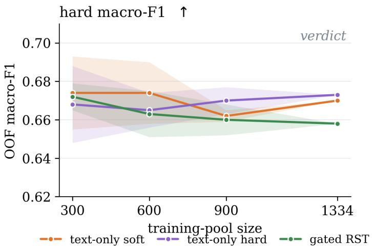  
Figure 1: Out-of-fold (OOF) macro-F1 as a function of training-pool size (honest cross-validation, per-fold tuned thresholds). The arrow next to the metric name gives the direction of improvement (↑: higher is better). Shaded bands $\mathrm { g i v e } \pm 1$ sd over repeated draws; the full-size points (1,334) carry no standard deviation, as they use the entire training pool and admit no repeated draws.

## 4.7 Learning Curves and the Performance Ceiling

To understand what limits performance, we further trained three systems on stratified subsets of increasing size (300, 600, 900, and the full 1,334 examples), all on identical draws so the curves are directly comparable: the text-only model under both label regimes, and the gated RST system. Figure 1 shows the resulting learning curves, and three observations emerge from them together with Table 1.

First, we observe that more data does not help. All three curves stay within a band of under two points from 300 to 1,334 examples; every step along the curve is smaller than the spread across draws at $n = 3 0 0$ , and which 300 tweets a model sees matters more than seeing four times as many. Second, the RST features are redundant rather than harmful. The gated system is the best-behaved model at $n = 3 0 0$ , where the feature branch steadies small-data training, and declines mildly as data grows: as the encoder sees more text, it appears to acquire on its own what the features carry, until the fusion pathway is pure overhead. The features lose to the baseline not because discourse structure is irrelevant but, we will argue, because it is already represented, a hypothesis we test directly in Section 7. Third, with thresholds tuned, hard and soft training are indistinguishable on macro-F1 at every training size, even though they are trained toward diferent targets and, as we will see in the next section, learn measurably diferent things.

Macro-F1 thus remains around 0.67 regardless of data volume, feature engineering, or label regime; across all our transformer configurations, scores cluster between 0.65 and 0.69. One plausible reading is that this reflects a property of the task rather than of the models: enthymeme detection is an interpretation task, and our five annotators disagree on 37% of items. Our data shows early signs in this direction: model errors concentrate on the contested items, and the models place their probabilities diferently on contested and consensus tweets. Gold-label F1, which scores every prediction against a single collapsed verdict, cannot register any of this. In the next sections we turn to what lies behind the label: the shape of the disagreement the majority vote collapses, what makes items contested, and how to measure what the models have learned about this variation.

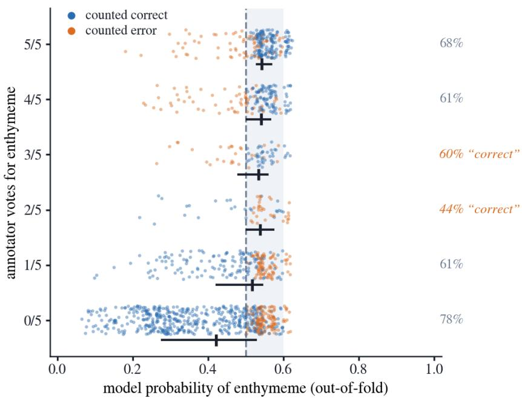  
Figure 2: Out-of-fold probabilities of the text-only soft baseline by annotator vote band (points jittered vertically within each band; horizontal bars give the band mean). Blue points are counted correct by F1, orange as errors; the dashed line marks the 0.5 threshold. Only the $0 / 5$ band spreads across the scale. The bands from $2 / 5$ to $5 / 5$ all sit between 0.5 and 0.62 and overlap, so contested tweets and unanimous enthymemes receive the same probabilities, a diference F1 does not register.

## 5 Evaluation Under Annotator Disagreement

Human label variation was long treated as noise to be minimized under the assumption of a single ground truth; in NLP evaluation literature, a growing body of work instead treats it as signal, reflecting genuine diferences in interpretation (Plank 2022; Uma et al. 2021), and calls for models to be evaluated on their ability to recognize this variation (Leonardelli et al. 2025). Enthymeme detection belongs squarely in this class and the five-way annotations present in the dataset makes the variation measurable.

This section proposes an evaluation for this setting. We first review why gold-label F1 falls short here, then assess existing disagreement-aware metrics and what they capture for enthymeme detection, and finally propose a metric targeting a distinction the existing ones miss: whether a model’s errors fall on the votes that are unusual for the annotator who cast them, which are the votes most likely to reflect inconsistent annotation rather than genuine disagreement.

## 5.1 Why Gold-Label F1 Falls Short

Enthymeme detection is a semantic interpretation task: identifying an implicit premise requires segmenting the text into propositions, recovering its argument structure, and drawing on commonsense, speech act perception, and background knowledge, processes that legitimately vary across readers. Analyzing disagreement on this dataset, Pastor and van Arkel (2026) show that a substantial part of it is genuine, grounded in valid interpretive variation (which reconstruction of a multi-proposition tweet is soundest, how a rhetorical question or an argument scheme is perceived) rather than annotator lapses. If disagreement is part of the phenomenon, an evaluation that first collapses five judgments into one verdict discards precisely the variation to be modeled: what should be measured is not only whether a model matches the majority, but whether it captures the shape of the disagreement.

The second reason is empirical, from the modeling side. Figure 2 shows the out-of-fold probabilities of the text-only soft baseline by annotator vote band. The model has learned that the task is ambiguous: its probabilities all sit between 0.07 and 0.62, unanimous enthymemes receive barely more than 0.5, and the two contested bands are indistinguishable from each other. The 0.67 ceiling is obtained by cutting this narrow band at a tuned threshold. F1 only asks which side of that cut each item falls on; it cannot tell a confident model from one that hedges everywhere, and it cannot see whether consensus and contested items receive diferent probabilities. Under F1, we are blind to how the annotators are actually divided.

## 5.2 Capturing Disagreement with Standard Soft Metrics

Rizzi et al. (2024) assess existing soft metrics and find them non-equivalent, and model rankings shift with the chosen metric (Sarumi, Welch, and Braun 2025). These shifts are expected once one notes that the metrics answer diferent questions about the vote distribution; we therefore report a set of metrics organized by the question each answers.

## 5.2.1 Existing Metrics and What They Measure

First we can ask where the disagreement is. Ambiguity Spearman computes the rank correlation (Spearman 1904) between the model’s uncertainty7 and the vote entropy of each tweet, and thus measures whether the model locates the contested items where the annotators do.

Next we can look at depth following Leonardelli et al. (2025): the Manhattan distance between the predicted probability and the vote fraction measures the average misplacement on the vote scale. We also run soft cross entropy which penalizes the same misplacement logarithmically, so that confident errors weigh more.

Lastly we have calibration: soft-ECE adapts expected calibration error to the vote distribution, following the argument of Baan et al. (2022) that calibration under disagreement must be measured against human judgment distributions rather than a gold label; it checks that the predicted probability matches the votes it announces, so that a tweet scored 0.6 indeed received about three enthymeme votes out of five. We also add consensus separation, computed as the diference in mean predicted probability between the unanimous enthymemes and the unanimous nones. It complements soft-ECE in that calibration is averaged over all tweets and can remain acceptable when errors at the poles are diluted by the contested bands, whereas the groupmean diference isolates the unanimous tweets and collapses to zero for the model that hedges everything near the threshold.

One further remark justifies the composition of our choice of metrics. The depth metrics have a weakness, in that a model predicting close to 0.5 everywhere scores well on the contested items, simply because the vote fractions there sit close to 0.5 as well. Such a model looks accurate on these items without knowing anything about them. The where and calibration metrics are included because they catch this behavior: a model that predicts 0.5 everywhere cannot rank contested items above consensus ones, and its probabilities do not match the votes on consensus items.

## 5.2.2 Results Under Soft Metrics

Table 2 reports the best classical system and the four transformer systems. Under hard F1 the soft-label transformers are at parity (.667–.675, within one standard deviation), well above the classical system (.624), while the hard-label model scores .627 at the fixed 0.5 threshold (Section 4.6.3). Under every where, depth and calibration metric the transformer ordering is strict: betabin, then the text-only baseline, then gated RST. The classical system, despite its lower F1, beats gated RST on most shape metrics; for the shape of the vote distribution, injecting RST features may thus be considered harmful to the transformer, plausibly for the same reason it was useless on F1: the information is redundant with what the encoder already represents, and the added pathway only perturbs the output distribution.

Betabin reduces Manhattan distance by 13%, raises consensus separation from .188 to .286, raises ambiguity Spearman from .172 to .282, regenerates the exact vote split 1.6 times more often (23.8% vs. 14.6%), and is 6.7 times better calibrated (soft-ECE .017 vs. .114). Its output is interpretable in vote units: a prediction of 0.6 means three of five annotators. Modeling the votes rather than the verdict thus costs nothing on F1 and further improves every measure of vote distribution shape.

These metrics nonetheless share a limit. They score the fit between predicted and observed distributions, but they are silent on the source of a disagreement, which can reflect valid interpretive variation as well as inconsistent annotation under task complexity (Pastor and van Arkel 2026). The available vote annotations do not themselves distinguish those sources. Moreover, a model can match a flat distribution without accounting for the individual votes that compose it: whether a particular vote is routine for its annotator or unusual. The next subsection proposes a metric that evaluates individual votes against annotator behavior. It does not determine whether a reading is licensed by the text: regularity in an annotator’s voting is only a proxy for a stable perspective, and an unusual vote is not necessarily a lapse. It instead tests whether the model’s errors align with this behavioral regularity.

## 5.3 An Annotator-Conditioned Per-Vote Metric

The metrics above compare distributions per tweet and never look at an individual vote. Here, a dissenting vote is a vote that difers from the majority of the other four annotators; it is defined only where those four votes have a majority. Not all such votes are alike: some may express valid minority readings, whereas others may reflect inconsistent annotation (Pastor and van Arkel 2026). The available annotations do not label that distinction. We therefore turn to the one additional signal in the vote matrix: annotator behavior.

A dissenting vote from an annotator who regularly casts such votes is behaviorally expected; the same vote from an annotator who almost never casts one is behaviorally unusual. The metric below asks whether a model’s surprise at individual votes tracks this reference. Importantly, the model is not given annotator identities and makes one tweet-level prediction for all five votes. The metric therefore does not show that it predicts any one annotator’s judgment. Rather, it tests whether the errors of that shared prediction are larger on votes that are unusual for their respective annotators.

Indeed, the five annotators difer in their voting behavior: the annotator who most frequently casts dissenting votes disagrees with the majority of the other four annotators up to twelve times as often as the most conformist annotator, and this behavior is stable across contexts. A dissenting vote that is routine for one annotator can be behaviorally unusual for another.8 The per-vote evaluation we introduce here aims not to treat all dissenting votes as interchangeable: the same lone dissenting vote can be expected from one annotator and surprising from another, which motivates the annotator-conditioned reference d introduced below.

The metric is a Spearman rank correlation between two quantities computed for every vote, both introduced below: the model’s surprise at the vote, sij, and the vote’s deviation given who cast it, $d _ { i j }$ , for the vote of annotator j on tweet i. First, we compute the model’s surprise at a vote. Let $v _ { i j } \in \{ 0 , 1 \}$ be the vote of annotator $j$ on tweet i (1 for enthymeme) and $p _ { i }$ the model’s predicted probability of enthymeme; the surprise is the probability mass placed against the vote,

Algorithm 1 Annotator-conditioned per-vote metric   
Require: model probabilities $p _ { i }$ , votes $v _ { i j }$ for tweets i, annotators $j$   
1: for all votes $( i , j )$ do   
2: $s _ { i j } \gets | v _ { i j } - p _ { i } |$ ▷ step 1: model surprise   
3: end for   
4: for all annotators $j ,$ other-vote contexts $c \in \{ 4 { - } 0 , 3 { - } 1 , 2 { - } 2 \}$ do   
5: $P _ { j } ( 1 \mid c )$ ← share of enthymeme votes $j$ cast when the other four votes form context c   
(with Laplace smoothing; for each scored vote, recomputed leaving its tweet out)   
6: end for   
7: for all votes $( i , j )$ do   
8: c ← context formed by the other four votes on tweet i   
9: $d _ { i j } \gets 1 - P _ { j } ( v _ { i j } \mid c )$ ▷ step 2: deviation given who cast it   
10: end for   
11: $\rho \gets \mathrm { S p e a r m a n } \big ( \{ s _ { i j } \} , \{ d _ { i j } \} \big )$ over all votes ▷ step 3: summary   
12: return $\rho$

$$
\begin{array} { r } { s _ { i j } = | v _ { i j } - p _ { i } | . } \end{array}
$$

Second, the vote’s deviation $d _ { i j }$ : how unexpected this vote is, given who cast it. For each annotator, we build a behavioral profile: how often they cast each vote when the other four annotators lean a given way (unanimously, three to one, or evenly). The deviation of a vote is then the improbability of that vote under its annotator’s profile,

$$
d _ { i j } = 1 - P _ { j } ( v _ { i j } \mid \mathrm { o t h e r \mathrm { - v o t e } ~ c o n t e x t ) , }
$$

where $P _ { j }$ is annotator $j ^ { \prime } \mathrm { s }$ estimated propensity to cast vote $v _ { i j }$ in the given context of the other four annotators, computed over all tweets except tweet i. A dissenting vote from an annotator who regularly casts one is expected and receives a low deviation; the same vote from an annotator who rarely casts one receives a high deviation. The profiles never see the vote being scored and consult no majority label.

Third, the summary: the Spearman rank correlation $\rho = \mathrm { S p e a r m a n } ( \{ s _ { i j } \} , \{ d _ { i j } \} )$ over all votes, which asks whether the model’s surprise ranks votes the way the behavioral reference does. A rank correlation is used so that the compressed probability scales observed above cannot distort the result. Algorithm 1 summarizes the full computation. We discuss what the metric reveals about our models in the next section.

## 5.3.1 Results under the Annotator-Conditioned Per-Vote Metric

Figure 3 (panel f) shows the metric across training-pool sizes, and the out-of-fold curves reproduce the ordering of Table 2. Betabin improves with data and reaches the highest value at full size (.239 in Table 2), while the classical system, despite improving steadily, remains below the soft-label transformers (.181). Gated RST inverts the distributional ordering: weakest of the transformers on the shape metrics, it is second on the per-vote metric (.232 vs. .205 for the text-only soft model), suggesting that the injected discourse features, which did not help for the verdict and for the distribution shape, carry some signal about which individual votes deviate.

On consensus tweets, our per-vote consistency metric behaves like a sharpened form of the depth and calibration measures, but with a diferent reference: rather than comparing the prediction with the vote fraction, it evaluates each vote against the behavioral profile of the annotator who cast it. Thus, a routine dissenting vote is discounted, and a model that commits against it is rewarded rather than penalized. As we will see in the error analysis, the tweets on which this discounting decides the ordering concentrate in one specific discourse profile.

Table 2: Evaluation of the best classical system (TF-IDF + RST + tropes, Logistic Regression with probability outputs) and the transformer systems, grouped by the question each metric answers about the vote distribution. Test set (148 tweets; 5 seeds for transformers, single deterministic fit for the classical system), except soft-ECE and the annotator-conditioned pervote metric (consistency, ours, defined in Section 5.3), computed out-of-fold (1,334 tweets). Arrows give the direction of improvement; best score per row in bold.
<table><tr><td>Metric</td><td>Question</td><td></td><td>Best classical</td><td>Gated RST</td><td>Text-only hard</td><td>Text-only soft</td><td>Betabin</td></tr><tr><td>Hard macro-F1</td><td>majority verdict</td><td>↑</td><td>.624</td><td>.667</td><td>.627</td><td>.671</td><td>.675</td></tr><tr><td>Ambiguity Spearman</td><td>where</td><td>↑</td><td>.143</td><td>.115</td><td>.058</td><td>.172</td><td>.282</td></tr><tr><td>Manhattan distance</td><td>depth</td><td>↓</td><td>.331</td><td>.346</td><td>.339</td><td>.323</td><td>.282</td></tr><tr><td>Soft cross-entropy</td><td>depth</td><td>↓</td><td>.656</td><td>.627</td><td>.674</td><td>.597</td><td>.584</td></tr><tr><td>Soft-ECE</td><td>calibration</td><td>→←</td><td>.097</td><td>.116</td><td>.083</td><td>.114</td><td>.017</td></tr><tr><td>Consensus separation</td><td>calibration</td><td></td><td>.198</td><td>.138</td><td>.313</td><td>.188</td><td>.286</td></tr><tr><td>Per-vote ρ(s, d) (ours)</td><td>consistency</td><td>↑</td><td>.181</td><td>.232</td><td>.112</td><td>.205</td><td>.239</td></tr></table>

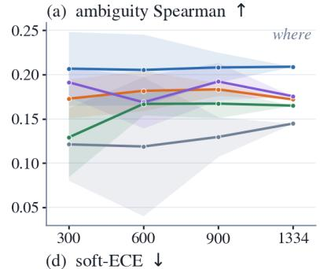

(b) Manhattan distance ↓  
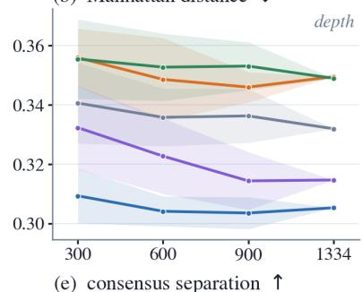

(c) soft cross-entropy↓  
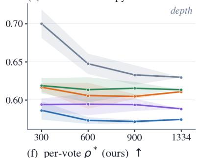

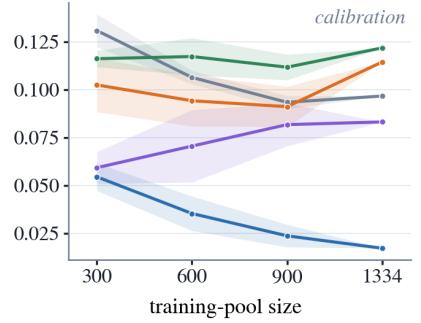

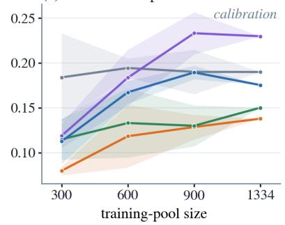

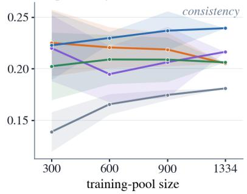  
—— classical —— text-only soft —— text-only hard —— gated RST —— betabin  
Figure 3: Soft metrics vs. training-pool size (out-of-fold; mean ±1 sd over repeated draws; arrows = direction of improvement). The full-size points (1,334) carry no standard deviation, as they use the entire training pool and admit no repeated draws.

## 5.4 Summary and Scope of the Variation Metric Results

Figure 3 shows the metrics across training-pool sizes. Across panels the pattern is consistent, in that hard F1 is flat from 300 examples on, while the distribution-level metrics change with data and the systems diverge under them. Betabin’s calibration improves continuously (panel d), the hard model’s consensus separation increases while its ambiguity Spearman remains low, and the gated RST system is flat or declining on nearly every panel. With more data, the models thus improve not on the verdict but on properties of the vote distribution, and the training regimes difer in which properties improve.

We should however reflect on how far these numbers take us. Each metric answers the question it was built for, whether the model locates the contested tweets, how far its probabilities are from the vote fractions, whether its outputs are calibrated in vote units, and the curves show that these properties are learnable where the verdict is not. What happens statistically behind a given improvement, why one regime improves calibration while another improves separation, is more than we can establish here, and this is not a statistics paper; the aggregate curves also do not show on which tweets the diferences arise. What we can do is give these numbers a linguistic interpretation. The next section examines which tweets the models succeed on, fail on, and hedge on, and describes them by their discourse profiles.

## 6 Discourse-Structure-Oriented Success and Error Analysis

Given that one of the goals of this paper is to understand the role discourse structure plays in enthymeme detection, and to ground the disagreements of our annotators in discourse-oriented terms, we proceed to an error and success analysis using the 24 RST feature dimensions9 defined in Section 4.1, on the out-of-fold sample. Since the best transformer systems are indistinguishable on F1, the comparison operates entirely on the variation metrics for the success analysis.

For the success analysis, we single out the tweets on which betabin scores consistently better than the second-best system, the text-only soft model, on each metric family in turn (where, depth, calibration, consistency), and ask whether discourse structure can explain these gains. For the error analysis, we turn to the tweets on which betabin fails across all metrics, and ask which forms of variation the model cannot capture, and what their discourse profile is.

## 6.1 Success Cases on Consensus Tweets

We first ask what the transformer systems find easy under F1, and profile these easy cases with the RST dimensions of Section 4.1 (Table A.1, Appendix A). A tweet counts as easy if all four transformer systems of Table 2 classify it correctly out-of-fold.10 In what follows, “easy enthymeme” is shorthand for an easy tweet labeled as containing an enthymeme; its RST tree always represents the full tweet, not the enthymeme alone.

This yields 756 of 1,334 tweets: 512 easy none cases, that is, nones that all four systems classify correctly, and 244 easy enthymemes. Ease tracks consensus: where the five annotators agree, the models are usually right too (.65 of unanimous nones and .59 of unanimous enthymeme cases are easy); where they split, easy tweets thin out (.26 on even splits). We profile easy nones against the remaining nones and easy enthymemes against the remaining enthymemes within the same vote bands, so the profiles reflect discourse structure rather than vote composition; Table 3 reports the enriched and depleted dimensions.

Table 3: RST dimensions distinguishing the easy tweets, band-matched within each class. Easy and Rest give the mean value of each dimension in the two groups (for binary dimensions, the share of tweets that have it); δ is Clif’s delta, the strength of the diference: comparing one easy tweet and one rest tweet at random, δ says how much more often the easy one has the higher value (0: no diference; ±1: one group is always higher, whatever the size of the gap, since δ depends only on the ordering of the values). For binary dimensions δ equals the diference in shares. Green marks enrichment, red depletion; shading intensity is proportional to |δ|. p is the Mann–Whitney (continuous) or Fisher exact (binary) test; values below .001 are collapsed.
<table><tr><td>Dimension</td><td>Easy</td><td>Rest</td><td>δ</td><td>p</td></tr><tr><td colspan="5">Easy nones (512 vs. 371)</td></tr><tr><td>Spine ratio</td><td>.52</td><td>.32</td><td>+.48</td><td>&lt; .001</td></tr><tr><td>Max-relation share</td><td>.58</td><td>.50</td><td>+.16</td><td>&lt; .001</td></tr><tr><td>Embedded JOINT</td><td>.12</td><td>.35</td><td>-.22</td><td>&lt; .001</td></tr><tr><td>EVALUATION satellite</td><td>.05</td><td>.19</td><td>-.14</td><td>&lt; .001</td></tr><tr><td>ATTRIBUTION present</td><td>.21</td><td>.33</td><td>–.12</td><td>&lt; .001</td></tr><tr><td>EXPLANATION satellite</td><td>.04</td><td>.12</td><td>-.08</td><td>.001</td></tr><tr><td>CAUSE satelliteª</td><td>.08</td><td>.12</td><td>-.04</td><td>.048</td></tr><tr><td>CONDITION satellite</td><td>.03</td><td>.07</td><td>-.03</td><td>.022</td></tr><tr><td>CONTRAST satellite</td><td>.03</td><td>.05</td><td>-.03</td><td>.045</td></tr><tr><td colspan="5">Easy tweets containing an enthymeme (244 vs. 207)</td></tr><tr><td>Shallowest-ARG span</td><td>.20</td><td>.13</td><td>+.25</td><td>&lt; .001</td></tr><tr><td>ARG share of satellites</td><td>.27</td><td>.18</td><td>+.24</td><td>&lt; .001</td></tr><tr><td>NN share</td><td>.27</td><td>.22</td><td>+.16</td><td>.003</td></tr><tr><td>SN share</td><td>.14</td><td>.12</td><td>+.14</td><td>.006</td></tr><tr><td>Embedded JOINT</td><td>.40</td><td>.26</td><td>+.14</td><td>.003</td></tr><tr><td>ATTRIBUTION present</td><td>.40</td><td>.27</td><td>+.13</td><td>.004</td></tr><tr><td>EVALUATION satellite</td><td>.26</td><td>.15</td><td>+.12</td><td>.002</td></tr><tr><td>EXPLANATION satellite</td><td>.18</td><td>.09</td><td>+.09</td><td>.006</td></tr><tr><td>Judgment and reason</td><td>.15</td><td>.06</td><td>+.09</td><td>.004</td></tr><tr><td>Judgment without reason</td><td>.25</td><td>.17</td><td>+.08</td><td>.049</td></tr></table>

a The mildest of the satellite depletions, at .66 of the reference rate.

## 6.1.1 Discourse Profile of Easy Nones

The 512 easy nones have flat trees. Most of their EDUs are nuclei connected in sequence, with few satellites attached (spine ratio .52 vs. .32, δ +.48: the fraction of EDUs that are nuclei on the main path of the tree, without subordinated material). A single relation labels most of the internal nodes, typically elaboration or joint (max-relation share +.16: the count of the most frequent relation divided by the number of internal nodes). Argumentative relations are largely absent: satellites of cause, explanation, condition, evaluation or contrast occur at markedly lower rates than in the band-matched reference (half or less for explanation, condition and evaluation), attribution nodes are rare (.21 vs. .33), and joint nodes embedded below the root are infrequent (.12 vs. .35).

The easy none is a sequence of nuclei under one repeated relation, with almost no argumentative or attributive satellites, and all four systems classify this configuration correctly.

Table 4: Discourse profiles of the four success sets: 22 of the 24 dimensions (the condition and comparison satellite indicators are not shown) compared against vote-band-matched references (conventions as in Table 3: set and ref give means, or shares for binary dimensions; δ is Clif’s delta, equal to the diference in shares for binary dimensions; p is the Mann–Whitney or Fisher exact test, values below .001 collapsed). Green marks enrichment, red depletion; shading intensity is proportional to |δ| and encodes efect size, not significance. With set sizes ranging from 15 to 158, significance tracks sample size as much as efect: small significant efects in the large sets and large non-significant efects in the small where set should be read accordingly.
<table><tr><td rowspan=2 colspan=17>Where (15)          Depth (158)       Calibration (123)    Consistency (49)Dimension              setref  δ    p  set</td></tr><tr><td rowspan=1 colspan=4></td><td rowspan=1 colspan=4></td><td rowspan=1 colspan=1>ref</td><td rowspan=1 colspan=2></td></tr><tr><td rowspan=1 colspan=1>ATTRIBUTION present</td><td rowspan=1 colspan=1>.53</td><td rowspan=1 colspan=1>.25</td><td rowspan=1 colspan=1>+.29</td><td rowspan=1 colspan=1>.031</td><td rowspan=1 colspan=1>.28</td><td rowspan=1 colspan=1>.25</td><td rowspan=1 colspan=2>+.03 .48</td><td rowspan=1 colspan=1>.26</td><td rowspan=1 colspan=1>.24</td><td rowspan=1 colspan=2>+.02 .73</td><td rowspan=1 colspan=1>.24</td><td rowspan=1 colspan=1>.25</td><td rowspan=1 colspan=1>-.00</td><td rowspan=1 colspan=1>&gt;.99</td></tr><tr><td rowspan=1 colspan=1>ELABORATION share</td><td rowspan=1 colspan=1>.33</td><td rowspan=1 colspan=1>.43</td><td rowspan=1 colspan=1>-.27</td><td rowspan=1 colspan=1>.087</td><td rowspan=1 colspan=1>.38</td><td rowspan=1 colspan=1>.35</td><td rowspan=1 colspan=1>+.03</td><td rowspan=1 colspan=1>.49</td><td rowspan=1 colspan=1>.38</td><td rowspan=1 colspan=1>.34</td><td rowspan=1 colspan=1>+.05</td><td rowspan=1 colspan=1>.35</td><td rowspan=1 colspan=1>.38</td><td rowspan=1 colspan=1>.35</td><td rowspan=1 colspan=1>+.07</td><td rowspan=1 colspan=1>.40</td></tr><tr><td rowspan=1 colspan=1>Max-relation share</td><td rowspan=1 colspan=1>.48</td><td rowspan=1 colspan=1>.54</td><td rowspan=1 colspan=1>-.23</td><td rowspan=1 colspan=1>.14</td><td rowspan=1 colspan=1>.58</td><td rowspan=1 colspan=1>.54</td><td rowspan=1 colspan=1>+.07</td><td rowspan=1 colspan=1>.15</td><td rowspan=1 colspan=1>.57</td><td rowspan=1 colspan=1>.55</td><td rowspan=1 colspan=1>+.04</td><td rowspan=1 colspan=1>.50</td><td rowspan=1 colspan=1>.56</td><td rowspan=1 colspan=1>.55</td><td rowspan=1 colspan=1>+.04</td><td rowspan=1 colspan=1>.64</td></tr><tr><td rowspan=1 colspan=1>ATTRIBUTION share</td><td rowspan=1 colspan=1>.12</td><td rowspan=1 colspan=1>.07</td><td rowspan=1 colspan=1>+.23</td><td rowspan=1 colspan=1>.071</td><td rowspan=1 colspan=1>.11</td><td rowspan=1 colspan=1>.09</td><td rowspan=1 colspan=1>+.03</td><td rowspan=1 colspan=1>.38</td><td rowspan=1 colspan=1>.11</td><td rowspan=1 colspan=1>.09</td><td rowspan=1 colspan=1>+.02</td><td rowspan=1 colspan=1>.60</td><td rowspan=1 colspan=1>.08</td><td rowspan=1 colspan=1>.10</td><td rowspan=1 colspan=1>-.01</td><td rowspan=1 colspan=1>.88</td></tr><tr><td rowspan=1 colspan=1>EVALUATION satellite</td><td rowspan=1 colspan=1>.33</td><td rowspan=1 colspan=1>.13</td><td rowspan=1 colspan=1>+.20</td><td rowspan=1 colspan=1>.054</td><td rowspan=1 colspan=1>.06</td><td rowspan=1 colspan=1>.11</td><td rowspan=1 colspan=1>-.05</td><td rowspan=1 colspan=1>.10</td><td rowspan=1 colspan=1>.07</td><td rowspan=1 colspan=1>.10</td><td rowspan=1 colspan=1>-.03</td><td rowspan=1 colspan=1>.38</td><td rowspan=1 colspan=1>.12</td><td rowspan=1 colspan=1>.09</td><td rowspan=1 colspan=1>+.04</td><td rowspan=1 colspan=1>.43</td></tr><tr><td rowspan=1 colspan=1>Asyndeton</td><td rowspan=1 colspan=1>.59</td><td rowspan=1 colspan=1>.67</td><td rowspan=1 colspan=1>-.20</td><td rowspan=1 colspan=1>.20</td><td rowspan=1 colspan=1>.63</td><td rowspan=1 colspan=1>.63</td><td rowspan=1 colspan=1>+.02</td><td rowspan=1 colspan=1>.68</td><td rowspan=1 colspan=1>.63</td><td rowspan=1 colspan=1>.59</td><td rowspan=1 colspan=1>+.06</td><td rowspan=1 colspan=1>.26</td><td rowspan=1 colspan=1>.68</td><td rowspan=1 colspan=1>.59</td><td rowspan=1 colspan=1>+.11</td><td rowspan=1 colspan=1>.17</td></tr><tr><td rowspan=1 colspan=1>Spine ratio</td><td rowspan=1 colspan=1>.30</td><td rowspan=1 colspan=1>.33</td><td rowspan=1 colspan=1>−.17</td><td rowspan=1 colspan=1>.29</td><td rowspan=1 colspan=1>.47</td><td rowspan=1 colspan=1>.44</td><td rowspan=1 colspan=1>+.13</td><td rowspan=1 colspan=1>.013</td><td rowspan=1 colspan=1>.48</td><td rowspan=1 colspan=1>.47</td><td rowspan=1 colspan=1>+.05</td><td rowspan=1 colspan=1>.42</td><td rowspan=1 colspan=1>.41</td><td rowspan=1 colspan=1>.48</td><td rowspan=1 colspan=1>−.12</td><td rowspan=1 colspan=1>.17</td></tr><tr><td rowspan=1 colspan=1>SN share</td><td rowspan=1 colspan=1>.14</td><td rowspan=1 colspan=1>.12</td><td rowspan=1 colspan=1>+.16</td><td rowspan=1 colspan=1>.25</td><td rowspan=1 colspan=1>.13</td><td rowspan=1 colspan=1>.12</td><td rowspan=1 colspan=1>+.00</td><td rowspan=1 colspan=1>.96</td><td rowspan=1 colspan=1>.13</td><td rowspan=1 colspan=1>.12</td><td rowspan=1 colspan=1>-.01</td><td rowspan=1 colspan=1>.91</td><td rowspan=1 colspan=1>.13</td><td rowspan=1 colspan=1>.12</td><td rowspan=1 colspan=1>+.06</td><td rowspan=1 colspan=1>.36</td></tr><tr><td rowspan=1 colspan=1>ARG share of satellites</td><td rowspan=1 colspan=1>.23</td><td rowspan=1 colspan=1>.18</td><td rowspan=1 colspan=1>+.15</td><td rowspan=1 colspan=1>.30</td><td rowspan=1 colspan=1>.13</td><td rowspan=1 colspan=1>.16</td><td rowspan=1 colspan=1>-.08</td><td rowspan=1 colspan=1>.075</td><td rowspan=1 colspan=1>.14</td><td rowspan=1 colspan=1>.15</td><td rowspan=1 colspan=1>-.04</td><td rowspan=1 colspan=1>.45</td><td rowspan=1 colspan=1>.18</td><td rowspan=1 colspan=1>.14</td><td rowspan=1 colspan=1>+.09</td><td rowspan=1 colspan=1>.22</td></tr><tr><td rowspan=1 colspan=1>Relation diversity</td><td rowspan=1 colspan=1>.80</td><td rowspan=1 colspan=1>.76</td><td rowspan=1 colspan=1>+.08</td><td rowspan=1 colspan=1>.59</td><td rowspan=1 colspan=1>.79</td><td rowspan=1 colspan=1>.73</td><td rowspan=1 colspan=1>+.13</td><td rowspan=1 colspan=1>.009</td><td rowspan=1 colspan=1>.78</td><td rowspan=1 colspan=1>.73</td><td rowspan=1 colspan=1>+.08</td><td rowspan=1 colspan=1>.12</td><td rowspan=1 colspan=1>.79</td><td rowspan=1 colspan=1>.74</td><td rowspan=1 colspan=1>+.04</td><td rowspan=1 colspan=1>.58</td></tr><tr><td rowspan=1 colspan=1>Shallowest-ARG span</td><td rowspan=1 colspan=1>.18</td><td rowspan=1 colspan=1>.15</td><td rowspan=1 colspan=1>+.13</td><td rowspan=1 colspan=1>.36</td><td rowspan=1 colspan=1>.09</td><td rowspan=1 colspan=1>.12</td><td rowspan=1 colspan=1>-.08</td><td rowspan=1 colspan=1>.048</td><td rowspan=1 colspan=1>.09</td><td rowspan=1 colspan=1>.10</td><td rowspan=1 colspan=1>-.03</td><td rowspan=1 colspan=1>.48</td><td rowspan=1 colspan=1>.13</td><td rowspan=1 colspan=1>.10</td><td rowspan=1 colspan=1>+.09</td><td rowspan=1 colspan=1>.20</td></tr><tr><td rowspan=1 colspan=1>Judgment without reason</td><td rowspan=1 colspan=1>.27</td><td rowspan=1 colspan=1>.16</td><td rowspan=1 colspan=1>+.11</td><td rowspan=1 colspan=1>.28</td><td rowspan=1 colspan=1>.10</td><td rowspan=1 colspan=1>.15</td><td rowspan=1 colspan=1>-.06</td><td rowspan=1 colspan=1>.075</td><td rowspan=1 colspan=1>.08</td><td rowspan=1 colspan=1>.13</td><td rowspan=1 colspan=1>-.05</td><td rowspan=1 colspan=1>.16</td><td rowspan=1 colspan=1>.12</td><td rowspan=1 colspan=1>.12</td><td rowspan=1 colspan=1>+.00</td><td rowspan=1 colspan=1>&gt;.99</td></tr><tr><td rowspan=1 colspan=1>SN support-first</td><td rowspan=1 colspan=1>.16</td><td rowspan=1 colspan=1>.13</td><td rowspan=1 colspan=1>+.09</td><td rowspan=1 colspan=1>.38</td><td rowspan=1 colspan=1>.08</td><td rowspan=1 colspan=1>.09</td><td rowspan=1 colspan=1>-.03</td><td rowspan=1 colspan=1>.29</td><td rowspan=1 colspan=1>.06</td><td rowspan=1 colspan=1>.10</td><td rowspan=1 colspan=1>-.04</td><td rowspan=1 colspan=1>.18</td><td rowspan=1 colspan=1>.10</td><td rowspan=1 colspan=1>.09</td><td rowspan=1 colspan=1>+.00</td><td rowspan=1 colspan=1>.98</td></tr><tr><td rowspan=1 colspan=1>JOINT at root</td><td rowspan=1 colspan=1>.00</td><td rowspan=1 colspan=1>.08</td><td rowspan=1 colspan=1>-.08</td><td rowspan=1 colspan=1>.60</td><td rowspan=1 colspan=1>.09</td><td rowspan=1 colspan=1>.08</td><td rowspan=1 colspan=1>+.01</td><td rowspan=1 colspan=1>.63</td><td rowspan=1 colspan=1>.05</td><td rowspan=1 colspan=1>.09</td><td rowspan=1 colspan=1>-.04</td><td rowspan=1 colspan=1>.19</td><td rowspan=1 colspan=1>.08</td><td rowspan=1 colspan=1>.08</td><td rowspan=1 colspan=1>+.00</td><td rowspan=1 colspan=1>&gt;.99</td></tr><tr><td rowspan=1 colspan=1>NN share</td><td rowspan=1 colspan=1>.21</td><td rowspan=1 colspan=1>.21</td><td rowspan=1 colspan=1>-.03</td><td rowspan=1 colspan=1>.85</td><td rowspan=1 colspan=1>.20</td><td rowspan=1 colspan=1>.21</td><td rowspan=1 colspan=1>–.05</td><td rowspan=1 colspan=1>.33</td><td rowspan=1 colspan=1>.18</td><td rowspan=1 colspan=1>.20</td><td rowspan=1 colspan=1>–.05</td><td rowspan=1 colspan=1>.40</td><td rowspan=1 colspan=1>.23</td><td rowspan=1 colspan=1>.19</td><td rowspan=1 colspan=1>+.08</td><td rowspan=1 colspan=1>.28</td></tr><tr><td rowspan=1 colspan=1>NS share</td><td rowspan=1 colspan=1>.65</td><td rowspan=1 colspan=1>.66</td><td rowspan=1 colspan=1>-.02</td><td rowspan=1 colspan=1>.93</td><td rowspan=1 colspan=1>.58</td><td rowspan=1 colspan=1>.57</td><td rowspan=1 colspan=1>+.02</td><td rowspan=1 colspan=1>.70</td><td rowspan=1 colspan=1>.59</td><td rowspan=1 colspan=1>.56</td><td rowspan=1 colspan=1>+.05</td><td rowspan=1 colspan=1>.36</td><td rowspan=1 colspan=1>.62</td><td rowspan=1 colspan=1>.56</td><td rowspan=1 colspan=1>+.08</td><td rowspan=1 colspan=1>.37</td></tr><tr><td rowspan=1 colspan=1>Embedded JOINT</td><td rowspan=1 colspan=1>.33</td><td rowspan=1 colspan=1>.32</td><td rowspan=1 colspan=1>+.01</td><td rowspan=1 colspan=1>&gt;.99</td><td rowspan=1 colspan=1>.16</td><td rowspan=1 colspan=1>.22</td><td rowspan=1 colspan=1>-.06</td><td rowspan=1 colspan=1>.12</td><td rowspan=1 colspan=1>.15</td><td rowspan=1 colspan=1>.19</td><td rowspan=1 colspan=1>-.04</td><td rowspan=1 colspan=1>.37</td><td rowspan=1 colspan=1>.24</td><td rowspan=1 colspan=1>.18</td><td rowspan=1 colspan=1>+.07</td><td rowspan=1 colspan=1>.25</td></tr><tr><td rowspan=1 colspan=1>CONTRAST satellite</td><td rowspan=1 colspan=1>.00</td><td rowspan=1 colspan=1>.06</td><td rowspan=1 colspan=1>-.06</td><td rowspan=1 colspan=1>.60</td><td rowspan=1 colspan=1>.03</td><td rowspan=1 colspan=1>.04</td><td rowspan=1 colspan=1>-.02</td><td rowspan=1 colspan=1>.49</td><td rowspan=1 colspan=1>.02</td><td rowspan=1 colspan=1>.04</td><td rowspan=1 colspan=1>–.02</td><td rowspan=1 colspan=1>.39</td><td rowspan=1 colspan=1>.00</td><td rowspan=1 colspan=1>.04</td><td rowspan=1 colspan=1>-.04</td><td rowspan=1 colspan=1>.39</td></tr><tr><td rowspan=1 colspan=1>TOPIC-COMMENT present</td><td rowspan=1 colspan=1>.13</td><td rowspan=1 colspan=1>.09</td><td rowspan=1 colspan=1>+.04</td><td rowspan=1 colspan=1>.64</td><td rowspan=1 colspan=1>.04</td><td rowspan=1 colspan=1>.06</td><td rowspan=1 colspan=1>-.02</td><td rowspan=1 colspan=1>.43</td><td rowspan=1 colspan=1>.04</td><td rowspan=1 colspan=1>.04</td><td rowspan=1 colspan=1>-.00</td><td rowspan=1 colspan=1>&gt;.99</td><td rowspan=1 colspan=1>.10</td><td rowspan=1 colspan=1>.04</td><td rowspan=1 colspan=1>+.06</td><td rowspan=1 colspan=1>.050</td></tr><tr><td rowspan=1 colspan=1>CAUSE satellite</td><td rowspan=1 colspan=1>.13</td><td rowspan=1 colspan=1>.08</td><td rowspan=1 colspan=1>+.05</td><td rowspan=1 colspan=1>.62</td><td rowspan=1 colspan=1>.06</td><td rowspan=1 colspan=1>.10</td><td rowspan=1 colspan=1>-.04</td><td rowspan=1 colspan=1>.13</td><td rowspan=1 colspan=1>.08</td><td rowspan=1 colspan=1>.08</td><td rowspan=1 colspan=1>+.00</td><td rowspan=1 colspan=1>.85</td><td rowspan=1 colspan=1>.08</td><td rowspan=1 colspan=1>.08</td><td rowspan=1 colspan=1>+.00</td><td rowspan=1 colspan=1>&gt;.99</td></tr><tr><td rowspan=1 colspan=1>EXPLANATION satellite</td><td rowspan=1 colspan=1>.13</td><td rowspan=1 colspan=1>.17</td><td rowspan=1 colspan=1>-.03</td><td rowspan=1 colspan=1>&gt;.99</td><td rowspan=1 colspan=1>.07</td><td rowspan=1 colspan=1>.07</td><td rowspan=1 colspan=1>+.00</td><td rowspan=1 colspan=1>&gt;.99</td><td rowspan=1 colspan=1>.06</td><td rowspan=1 colspan=1>.06</td><td rowspan=1 colspan=1>-.01</td><td rowspan=1 colspan=1>&gt;.99</td><td rowspan=1 colspan=1>.10</td><td rowspan=1 colspan=1>.06</td><td rowspan=1 colspan=1>+.04</td><td rowspan=1 colspan=1>.22</td></tr><tr><td rowspan=1 colspan=1>Judgment and reason</td><td rowspan=1 colspan=1>.07</td><td rowspan=1 colspan=1>.07</td><td rowspan=1 colspan=1>–.01</td><td rowspan=1 colspan=1>&gt;.99</td><td rowspan=1 colspan=1>.03</td><td rowspan=1 colspan=1>.07</td><td rowspan=1 colspan=1>-.04</td><td rowspan=1 colspan=1>.071</td><td rowspan=1 colspan=1>.04</td><td rowspan=1 colspan=1>.06</td><td rowspan=1 colspan=1>–.02</td><td rowspan=1 colspan=1>.40</td><td rowspan=1 colspan=1>.02</td><td rowspan=1 colspan=1>.06</td><td rowspan=1 colspan=1>-.04</td><td rowspan=1 colspan=1>.35</td></tr></table>

## 6.1.2 Discourse Profile of Easy Tweets Containing an Enthymeme

The 244 easy tweets containing an enthymeme show the opposite configuration: their RST trees contain many argumentative satellites attached close to the root. These satellites of the argumentative relations (cause, explanation, condition, evaluation, contrast, comparison) occur at depth one or two and cover a larger share of the tweet (+.25); they also make up a larger fraction of all satellites in its tree (+.24). Configurations in which an evaluation or contrast node co-occurs with a cause, explanation or condition node in the same tree are 2.4 times more frequent than in the remaining tweets labeled as potential enthymemes; explanation and condition satellites individually are twice as frequent, evaluation 1.8 times. attribution nodes are 1.5 times more frequent, adjacent EDUs are more often linked by an overt connective, satellite-before-nucleus (SN) order is more frequent, and multinuclear joint nodes embedded below the root are 1.5 times more frequent.

In these tweets, most components of the argument are expressed as labeled relations in the full-tweet tree, and only part of the argument remains implicit, which is what makes the tweets detectable for all four systems.

The two profiles difer on the same dimensions in opposite directions: the dimensions less frequent in easy nones are the dimensions more frequent in easy enthymemes, so what all four systems find easy is related to the number and placement of argumentative satellites.

## 6.2 Success Analysis by Variation Metric Family

Both success poles can be stated in advance. The where set contains the genuinely contested tweets, with 2/5 and 3/5 vote splits, on which betabin correctly registers the split; the depth, calibration and consistency sets are almost exclusively unanimous nones $( 0 / 5 )$ , tweets that all five annotators rejected but on which the text-only model still places near-threshold probabilities. The two poles thus show the same model earning its advantage in opposite directions: restraint where readers divide, commitment where they agree. Table 4 gives the full discourse profiles of the four sets.

## 6.2.1 Discourse Profile of Where Contested Enthymemes

The where set contains 15 tweets, 11 with $2 / 5$ and 4 with 3/5 enthymeme votes, and these alone account for the full ambiguity-Spearman gap (.172 to .209 out-of-fold). Figure 4 shows both models on these tweets. The text-only model sits confidently on one side, a tight cluster at .55 to .62; since 11 of the 15 are majority-none items, it is on the F1 wrong side of the split for most of them. Betabin moves every one of these tweets toward .5. Both models remain inside the loose target zone, so the gain is not absolute calibration but ranking: a probability of .60 on a contested tweet ranks it as less uncertain than the model’s own hedged unanimous nones, breaking the uncertainty ordering, whereas betabin’s .51 here, against its committed nones near .07, places the contested tweets at the top of its uncertainty ranking, where the annotators place them.

The discourse profile of these 15 tweets, compared with the 109 other contested items, points to a single shared configuration: attribution nodes are twice as frequent $( . 5 3 \ \mathrm { v s . } \ . 2 5 , p = . 0 3 1 )$ evaluation satellites 2.6 times more frequent $( . 3 3 \ \mathrm { v s . } \ . 1 3 , p = . 0 5 4 )$ , and elaboration share is lower $( \delta ~ - . 2 7 )$ . A structural backbone emerges: an attribution node paired with an evaluation satellite, that is, reported speech from an exterior source together with a judgment of it. An example tree from this set is shown in Figure B.1 of Appendix B.

This configuration generates both types of disagreement in enthymeme annotation identified in Pastor and van Arkel (2026). Where the attribution nucleus points to material outside the tweet, orphaned references and bridging inferences make resolution possible but costly, and annotators are more prone to inconsistent annotation. Then, in this set, the evaluation is often ironic or framed as a rhetorical question: no retrieval settles whether an implicit premise is advanced, and the divergence reflects subjective perception of the speech act, corresponding to genuine disagreement. Most of the fifteen cases admit both readings, while sharing the same discourse structure backbone which is why they are maximally contested.

The models hence divide accordingly: the text-only model reads the attribution– evaluation surface as enthymematic and commits (median .59); betabin has learned that this configuration produces split votes, and remains at .51.11

## 6.2.2 Discourse Profile of Depth, Calibration, Consistency Unanimous Nones

The remaining sets of tweets from the three other metrics are entirely diferent. The depth set contains 158 tweets, of which 154 are unanimous nones; the calibration set (123) and the consistency set (49) are unanimous nones entirely, and the three overlap heavily, with a 40-tweet core common to all of them. No $3 / 5 ~ 4 / 5 ~ 5 / 5$ enthymeme appears in any set.

Figure 5 shows the union: on tweets that received zero enthymeme votes, the text-only model places a median probability of .47, with 77% of the set at the threshold and none committed, while betabin commits on 57% of them, median .17. The pattern holds for the full population of 608 unanimous nones.

The discourse profiles at this pole are real but less pronounced than for the easy nones of Table 3. Against the band-matched reference, the depth set shows a weaker version of the easynone configuration (spine ratio $\delta + . 1 3 , p = . 0 1 3$ ; relation diversity $\delta + . 1 3 , p = . 0 0 9 )$ . A direct comparison with the easy unanimous nones indicates however the tweets on which the text-only model stays at the threshold contain residual argumentative structure, with more EDUs (3.7 vs.

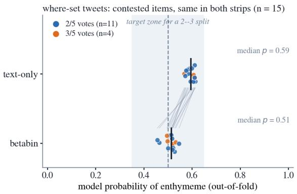

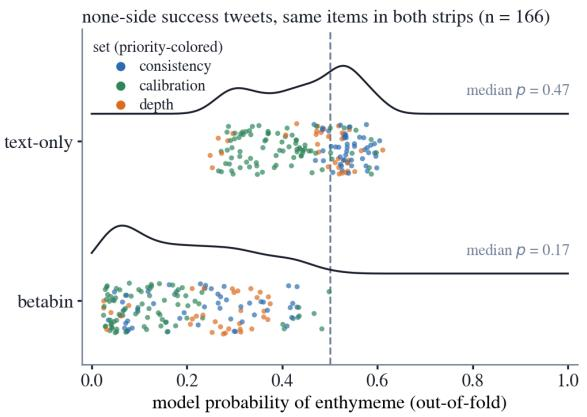  
Figure 4: The 15 tweets of the where success set (11 with $2 / 5$ votes, 4 with $3 / 5 )$ , same items in both strips; lines connect identical tweets. The shaded band is the target zone for a $_ { 2 - 3 }$ split, whose calibrated probability is near .5. The text-only model clusters at a median of .59; betabin returns the same tweets to a median of .51.  
Figure 5: The 166 tweets of the none-side success sets (union of depth, calibration and consistency; colored by set), same items in both strips. Only the horizontal position is informative; points are jittered vertically within a band of fixed height, which gives each strip its rectangular outline, and the curve above each strip is the density of the probabilities. On tweets all five annotators rejected, the text-only model stays at a median of .47, with no tweet below $. 2 ;$ betabin commits, median .17.

3.0, $p < . 0 0 1 )$ , larger argumentative satellites $( \delta + . 1 1 , p = . 0 0 8 )$ , more attribution nodes (.28 vs. .18, $p = . 0 1 6 )$ and a lower spine ratio $( \delta - . 1 4 , p = . 0 1 0 )$ . It seems this residual structure is suficient to hold the text-only model at the threshold, but not suficient for the annotators to identify an enthymeme. Betabin, whose training objective penalizes near-threshold predictions on unanimous items, commits despite it. The calibration set shows no enriched dimension at all, indicating that betabin’s calibration gain does not depend on discourse structure.

The consistency set shows one enriched dimension, topic–comment framing (.10 vs. .04, $p = . 0 5 0 )$ , alongside depleted joint presence and a higher single-relation share. The efects are marginal, but the frame is telling: its subtypes include rhetorical questions and comments, which Pastor and van Arkel (2026) identify as a source of spurious disagreement, since converting a rhetorical question into a proposition is a reconstruction step the guidelines do not prescribe, so that whether an annotator performs it varies from one annotator to another and from one tweet to the next. These are the nones most likely to draw a stray vote. Figure 5 shows the corresponding behaviors: the text-only model holds these tweets just below the threshold, registering the ambiguity without resolving it, while betabin moves them to the none side with visibly diferent degrees of commitment. Because betabin models the individual votes rather than the majority label, it learns how likely a reader is to reconstruct, or fail to reconstruct, the argument behind such a frame, and so measures the possibility of an inconsistent vote itself. Only the per-vote consistency metric can observe this, since a majority-label metric registers the stray vote as noise and a single threshold value cannot represent a doubt that is not uniform across tweets. Figure B.4 of Appendix B shows one such tree.

Taken together, the two poles show the same model obtaining its advantage through opposite behaviors: it commits where the annotators are unanimous and remains near the threshold where they divide. The discourse profiles indicate that each behavior corresponds to an identifiable structure: the absence of argumentative satellites at the ‘none’ pole, reported speech with evaluative satellites in the contested middle. A model with a single compressed probability scale exhibits neither behavior, and a metric computed against the majority label registers neither.

Table 5: Discourse profile of the where-failure set — the 120 tweets whose contestedness every system misjudges (uncertainty rank displaced from the vote-entropy rank by more than 30 percentile points in all four transformers) — split by vote band and compared against the remaining tweets of the same bands (same conventions as in previous Tables).
<table><tr><td rowspan=1 colspan=23>Consensus none                 Contested                Consensus enth.68 (32×0/5, 36×1/5)           18 (11×2/5, 7×3/5)          34 (13×4/5, 21×5/5)Dimension                set   ref    δ      p    set   ref     δ      p    set   ref     δ      p</td></tr><tr><td></td><td rowspan=1 colspan=1>Spine ratio</td><td rowspan=1 colspan=1>.42</td><td rowspan=1 colspan=1>.45</td><td rowspan=1 colspan=2>-.03</td><td rowspan=1 colspan=1>.72</td><td rowspan=1 colspan=1></td><td rowspan=1 colspan=1>.42</td><td rowspan=1 colspan=1></td><td rowspan=1 colspan=1>.31</td><td rowspan=1 colspan=1></td><td rowspan=1 colspan=1>+.34</td><td rowspan=1 colspan=1></td><td rowspan=1 colspan=1>.022</td><td rowspan=1 colspan=1></td><td rowspan=1 colspan=1>.40</td><td rowspan=1 colspan=1></td><td rowspan=1 colspan=1>.33</td><td rowspan=1 colspan=1></td><td rowspan=1 colspan=1>+.21</td><td rowspan=1 colspan=1></td><td rowspan=1 colspan=1>.042</td></tr><tr><td></td><td rowspan=1 colspan=1>ATTRIBUTION present</td><td rowspan=1 colspan=1>.27</td><td rowspan=1 colspan=1>.26</td><td rowspan=1 colspan=1>+.01</td><td rowspan=1 colspan=1></td><td rowspan=1 colspan=1>.89</td><td rowspan=1 colspan=1></td><td rowspan=1 colspan=1>.06</td><td rowspan=1 colspan=1></td><td rowspan=1 colspan=1>.32</td><td rowspan=1 colspan=1></td><td rowspan=1 colspan=1>–.26</td><td rowspan=1 colspan=1></td><td rowspan=1 colspan=1>.022</td><td rowspan=1 colspan=1></td><td rowspan=1 colspan=1>.18</td><td rowspan=1 colspan=1></td><td rowspan=1 colspan=1>.37</td><td rowspan=1 colspan=1></td><td rowspan=1 colspan=1>–.19</td><td rowspan=1 colspan=1></td><td rowspan=1 colspan=1>.037</td></tr><tr><td></td><td rowspan=1 colspan=1>Max-relation share</td><td rowspan=1 colspan=1>.57</td><td rowspan=1 colspan=1>.54</td><td rowspan=1 colspan=1>+.06</td><td rowspan=1 colspan=2>.44</td><td rowspan=1 colspan=1></td><td rowspan=1 colspan=1>.56</td><td rowspan=1 colspan=1></td><td rowspan=1 colspan=1>.53</td><td rowspan=1 colspan=1></td><td rowspan=1 colspan=1>+.06</td><td rowspan=1 colspan=1></td><td rowspan=1 colspan=1>.67</td><td rowspan=1 colspan=1></td><td rowspan=1 colspan=1>.59</td><td rowspan=1 colspan=1></td><td rowspan=1 colspan=1>.48</td><td rowspan=1 colspan=1></td><td rowspan=1 colspan=1>+.25</td><td rowspan=1 colspan=1></td><td rowspan=1 colspan=1>.014</td></tr><tr><td></td><td rowspan=1 colspan=1>ATTRIBUTION share</td><td rowspan=1 colspan=1>.12</td><td rowspan=1 colspan=1>.09</td><td rowspan=1 colspan=1>+.02</td><td rowspan=1 colspan=1></td><td rowspan=1 colspan=1>.71</td><td rowspan=1 colspan=1></td><td rowspan=1 colspan=1>.03</td><td rowspan=1 colspan=1></td><td rowspan=1 colspan=1>.09</td><td rowspan=1 colspan=1></td><td rowspan=1 colspan=1>-.25</td><td rowspan=1 colspan=1></td><td rowspan=1 colspan=1>.033</td><td rowspan=1 colspan=1></td><td rowspan=1 colspan=1>.06</td><td rowspan=1 colspan=1></td><td rowspan=1 colspan=1>.10</td><td rowspan=1 colspan=1></td><td rowspan=1 colspan=1>–.17</td><td rowspan=1 colspan=1></td><td rowspan=1 colspan=1>.053</td></tr><tr><td></td><td rowspan=1 colspan=1>Relation diversity</td><td rowspan=1 colspan=1>.77</td><td rowspan=1 colspan=1>.74</td><td rowspan=1 colspan=1>+.02</td><td rowspan=1 colspan=1></td><td rowspan=1 colspan=1>.82</td><td rowspan=1 colspan=1></td><td rowspan=1 colspan=1>.81</td><td rowspan=1 colspan=1></td><td rowspan=1 colspan=1>.76</td><td rowspan=1 colspan=1></td><td rowspan=1 colspan=1>+.20</td><td rowspan=1 colspan=1></td><td rowspan=1 colspan=1>.15</td><td rowspan=1 colspan=1></td><td rowspan=1 colspan=1>.82</td><td rowspan=1 colspan=1></td><td rowspan=1 colspan=1>.77</td><td rowspan=1 colspan=1></td><td rowspan=1 colspan=1>+.13</td><td rowspan=1 colspan=1></td><td rowspan=1 colspan=1>.19</td></tr><tr><td></td><td rowspan=1 colspan=1>ELABORATION share</td><td rowspan=1 colspan=1>.36</td><td rowspan=1 colspan=1>.35</td><td rowspan=1 colspan=1>+.01</td><td rowspan=1 colspan=1></td><td rowspan=1 colspan=1>.84</td><td rowspan=1 colspan=1></td><td rowspan=1 colspan=1>.47</td><td rowspan=1 colspan=1></td><td rowspan=1 colspan=1>.41</td><td rowspan=1 colspan=1></td><td rowspan=1 colspan=1>+.08</td><td rowspan=1 colspan=1></td><td rowspan=1 colspan=1>.57</td><td rowspan=1 colspan=1></td><td rowspan=1 colspan=1>.45</td><td rowspan=1 colspan=1></td><td rowspan=1 colspan=1>.33</td><td rowspan=1 colspan=1></td><td rowspan=1 colspan=1>+.19</td><td rowspan=1 colspan=1></td><td rowspan=1 colspan=1>.069</td></tr><tr><td rowspan=1 colspan=2>Embedded JOINT</td><td rowspan=1 colspan=1>.18</td><td rowspan=1 colspan=1>.21</td><td rowspan=1 colspan=1>-.03</td><td rowspan=1 colspan=1></td><td rowspan=1 colspan=1>.64</td><td rowspan=1 colspan=1></td><td rowspan=1 colspan=1>.17</td><td rowspan=1 colspan=1></td><td rowspan=1 colspan=1>.35</td><td rowspan=1 colspan=1></td><td rowspan=1 colspan=1>-.18</td><td rowspan=1 colspan=1></td><td rowspan=1 colspan=1>.17</td><td rowspan=1 colspan=1></td><td rowspan=1 colspan=1>.35</td><td rowspan=1 colspan=1></td><td rowspan=1 colspan=1>.34</td><td rowspan=1 colspan=1></td><td rowspan=1 colspan=1>+.01</td><td rowspan=1 colspan=1></td><td rowspan=1 colspan=1>&gt;.99</td></tr><tr><td rowspan=1 colspan=2>Asyndeton</td><td rowspan=1 colspan=1>.72</td><td rowspan=1 colspan=1>.63</td><td rowspan=1 colspan=1>+.16</td><td rowspan=1 colspan=1></td><td rowspan=1 colspan=1>.024</td><td rowspan=1 colspan=1></td><td rowspan=1 colspan=1>.63</td><td rowspan=1 colspan=1></td><td rowspan=1 colspan=1>.67</td><td rowspan=1 colspan=1></td><td rowspan=1 colspan=1>-.02</td><td rowspan=1 colspan=1></td><td rowspan=1 colspan=1>.92</td><td rowspan=1 colspan=1></td><td rowspan=1 colspan=1>.74</td><td rowspan=1 colspan=1></td><td rowspan=1 colspan=1>.67</td><td rowspan=1 colspan=1></td><td rowspan=1 colspan=1>+.17</td><td rowspan=1 colspan=1></td><td rowspan=1 colspan=1>.097</td></tr><tr><td rowspan=1 colspan=2>SN share</td><td rowspan=1 colspan=1>.14</td><td rowspan=1 colspan=1>.13</td><td rowspan=1 colspan=1>-.04</td><td rowspan=1 colspan=1></td><td rowspan=1 colspan=1>.47</td><td rowspan=1 colspan=1></td><td rowspan=1 colspan=1>.09</td><td rowspan=1 colspan=1></td><td rowspan=1 colspan=1>.12</td><td rowspan=1 colspan=1></td><td rowspan=1 colspan=1>-.14</td><td rowspan=1 colspan=1></td><td rowspan=1 colspan=1>.29</td><td rowspan=1 colspan=1></td><td rowspan=1 colspan=1>.13</td><td rowspan=1 colspan=1></td><td rowspan=1 colspan=1>.13</td><td rowspan=1 colspan=1></td><td rowspan=1 colspan=1>–.05</td><td rowspan=1 colspan=1></td><td rowspan=1 colspan=1>.61</td></tr><tr><td rowspan=1 colspan=2>EXPLANATION satellite</td><td rowspan=1 colspan=1>.09</td><td rowspan=1 colspan=1>.07</td><td rowspan=1 colspan=1>+.02</td><td rowspan=1 colspan=1></td><td rowspan=1 colspan=1>.47</td><td rowspan=1 colspan=1></td><td rowspan=1 colspan=1>.06</td><td rowspan=1 colspan=1></td><td rowspan=1 colspan=1>.18</td><td rowspan=1 colspan=1></td><td rowspan=1 colspan=1>-.12</td><td rowspan=1 colspan=1></td><td rowspan=1 colspan=1>.30</td><td rowspan=1 colspan=1></td><td rowspan=1 colspan=1>.06</td><td rowspan=1 colspan=1></td><td rowspan=1 colspan=1>.15</td><td rowspan=1 colspan=1></td><td rowspan=1 colspan=1>-.09</td><td rowspan=1 colspan=1></td><td rowspan=1 colspan=1>.20</td></tr><tr><td></td><td rowspan=1 colspan=1>NS share</td><td rowspan=1 colspan=1>.60</td><td rowspan=1 colspan=1>.57</td><td rowspan=1 colspan=1>+.07</td><td rowspan=1 colspan=1></td><td rowspan=1 colspan=1>.36</td><td rowspan=1 colspan=1></td><td rowspan=1 colspan=1>.68</td><td rowspan=1 colspan=1></td><td rowspan=1 colspan=1>.66</td><td rowspan=1 colspan=1></td><td rowspan=1 colspan=1>+.10</td><td rowspan=1 colspan=1></td><td rowspan=1 colspan=1>.50</td><td rowspan=1 colspan=1></td><td rowspan=1 colspan=1>.62</td><td rowspan=1 colspan=1></td><td rowspan=1 colspan=1>.61</td><td rowspan=1 colspan=1></td><td rowspan=1 colspan=1>+.04</td><td rowspan=1 colspan=1></td><td rowspan=1 colspan=1>.69</td></tr><tr><td rowspan=2 colspan=2>EVALUATION satellite</td><td rowspan=1 colspan=5>Judgment and reason</td><td rowspan=1 colspan=2>.04</td><td rowspan=1 colspan=2>.07</td><td rowspan=1 colspan=2>-.02</td><td rowspan=1 colspan=1></td><td rowspan=1 colspan=1>.61</td><td rowspan=1 colspan=1></td><td rowspan=1 colspan=1>.00</td><td rowspan=1 colspan=1></td><td rowspan=1 colspan=1>.09</td><td rowspan=1 colspan=1></td><td rowspan=1 colspan=1>-.08</td><td rowspan=1 colspan=1></td><td rowspan=1 colspan=1>.35</td></tr><tr><td rowspan=1 colspan=1>.07</td><td rowspan=1 colspan=1>.10</td><td rowspan=1 colspan=1>-.03</td><td rowspan=1 colspan=1></td><td rowspan=1 colspan=1>.53</td><td rowspan=1 colspan=1></td><td rowspan=1 colspan=1>.11</td><td rowspan=1 colspan=1></td><td rowspan=1 colspan=1>.16</td><td rowspan=1 colspan=1></td><td rowspan=1 colspan=1>-.05</td><td rowspan=1 colspan=1></td><td rowspan=1 colspan=1>.74</td><td rowspan=1 colspan=1></td><td rowspan=1 colspan=1>.15</td><td rowspan=1 colspan=1></td><td rowspan=1 colspan=1>.23</td><td rowspan=1 colspan=1></td><td rowspan=1 colspan=1>–.08</td><td rowspan=1 colspan=1></td><td rowspan=1 colspan=1>.39</td></tr><tr><td rowspan=1 colspan=2>NN share</td><td rowspan=1 colspan=1>.20</td><td rowspan=1 colspan=1>.21</td><td rowspan=1 colspan=1>-.02</td><td rowspan=1 colspan=1></td><td rowspan=1 colspan=1>.72</td><td rowspan=1 colspan=1></td><td rowspan=1 colspan=1>.18</td><td rowspan=1 colspan=1></td><td rowspan=1 colspan=1>.22</td><td rowspan=1 colspan=1></td><td rowspan=1 colspan=1>-.08</td><td rowspan=1 colspan=1></td><td rowspan=1 colspan=1>.59</td><td rowspan=1 colspan=1></td><td rowspan=1 colspan=1>.26</td><td rowspan=1 colspan=1></td><td rowspan=1 colspan=1>.25</td><td rowspan=1 colspan=1></td><td rowspan=1 colspan=1>-.04</td><td rowspan=1 colspan=1></td><td rowspan=1 colspan=1>.73</td></tr><tr><td rowspan=2 colspan=2>CAUSE satelliteARG share of satellites</td><td rowspan=1 colspan=1>.10</td><td rowspan=1 colspan=1>.10</td><td rowspan=1 colspan=1>+.01</td><td rowspan=1 colspan=1></td><td rowspan=1 colspan=1>.83</td><td rowspan=1 colspan=1></td><td rowspan=1 colspan=1>.11</td><td rowspan=1 colspan=1></td><td rowspan=1 colspan=1>.09</td><td rowspan=1 colspan=1></td><td rowspan=1 colspan=1>+.03</td><td rowspan=1 colspan=1></td><td rowspan=1 colspan=1>.66</td><td rowspan=1 colspan=1></td><td rowspan=1 colspan=1>.21</td><td rowspan=1 colspan=1></td><td rowspan=1 colspan=1>.13</td><td rowspan=1 colspan=1></td><td rowspan=1 colspan=1>+.07</td><td rowspan=1 colspan=1></td><td rowspan=1 colspan=1>.29</td></tr><tr><td rowspan=1 colspan=1>.15</td><td rowspan=1 colspan=1>.16</td><td rowspan=1 colspan=1>-.01</td><td rowspan=1 colspan=1></td><td rowspan=1 colspan=1>.82</td><td rowspan=1 colspan=1></td><td rowspan=1 colspan=1>.22</td><td rowspan=1 colspan=1></td><td rowspan=1 colspan=1>.18</td><td rowspan=1 colspan=1></td><td rowspan=1 colspan=1>-.01</td><td rowspan=1 colspan=1></td><td rowspan=1 colspan=1>.96</td><td rowspan=1 colspan=1></td><td rowspan=1 colspan=1>.23</td><td rowspan=1 colspan=1></td><td rowspan=1 colspan=1>.23</td><td rowspan=1 colspan=1></td><td rowspan=1 colspan=1>-.07</td><td rowspan=1 colspan=1></td><td rowspan=1 colspan=1>.50</td></tr><tr><td rowspan=2 colspan=2>CONTRAST satelliteJudgment without reason</td><td rowspan=1 colspan=1>.03</td><td rowspan=1 colspan=1>.04</td><td rowspan=1 colspan=1>-.01</td><td rowspan=1 colspan=1></td><td rowspan=1 colspan=1>&gt;.99</td><td rowspan=1 colspan=1></td><td rowspan=1 colspan=1>.11</td><td rowspan=1 colspan=1></td><td rowspan=1 colspan=1>.05</td><td rowspan=1 colspan=1></td><td rowspan=1 colspan=1>+.06</td><td rowspan=1 colspan=1></td><td rowspan=1 colspan=1>.27</td><td rowspan=1 colspan=1></td><td rowspan=1 colspan=1>.03</td><td rowspan=1 colspan=1></td><td rowspan=1 colspan=1>.04</td><td rowspan=1 colspan=1></td><td rowspan=1 colspan=1>-.01</td><td rowspan=1 colspan=1></td><td rowspan=1 colspan=1>&gt;.99</td></tr><tr><td rowspan=1 colspan=1>.10</td><td rowspan=1 colspan=1>.14</td><td rowspan=1 colspan=1>-.04</td><td rowspan=1 colspan=1></td><td rowspan=1 colspan=1>.47</td><td rowspan=1 colspan=1></td><td rowspan=1 colspan=1>.22</td><td rowspan=1 colspan=1></td><td rowspan=1 colspan=1>.16</td><td rowspan=1 colspan=1></td><td rowspan=1 colspan=1>+.06</td><td rowspan=1 colspan=1></td><td rowspan=1 colspan=1>.51</td><td rowspan=1 colspan=1></td><td rowspan=1 colspan=1>.18</td><td rowspan=1 colspan=1></td><td rowspan=1 colspan=1>.22</td><td rowspan=1 colspan=1></td><td rowspan=1 colspan=1>-.05</td><td rowspan=1 colspan=1></td><td rowspan=1 colspan=1>.67</td></tr><tr><td rowspan=1 colspan=2>SN support-first</td><td rowspan=1 colspan=1>.04</td><td rowspan=1 colspan=1>.09</td><td rowspan=1 colspan=1>-.06</td><td rowspan=1 colspan=1></td><td rowspan=1 colspan=1>.16</td><td rowspan=1 colspan=1></td><td rowspan=1 colspan=1>.11</td><td rowspan=1 colspan=1></td><td rowspan=1 colspan=1>.14</td><td rowspan=1 colspan=1></td><td rowspan=1 colspan=1>-.06</td><td rowspan=1 colspan=1></td><td rowspan=1 colspan=1>.55</td><td rowspan=1 colspan=1></td><td rowspan=1 colspan=1>.14</td><td rowspan=1 colspan=1></td><td rowspan=1 colspan=1>.13</td><td rowspan=1 colspan=1></td><td rowspan=1 colspan=1>+.04</td><td rowspan=1 colspan=1></td><td rowspan=1 colspan=1>.60</td></tr><tr><td rowspan=2 colspan=2>TOPIC-COMMENT presentShallowest-ARG span</td><td rowspan=1 colspan=1>.03</td><td rowspan=1 colspan=1>.05</td><td rowspan=1 colspan=1>-.02</td><td rowspan=1 colspan=1></td><td rowspan=1 colspan=1>.57</td><td rowspan=1 colspan=1></td><td rowspan=1 colspan=1>.06</td><td rowspan=1 colspan=1></td><td rowspan=1 colspan=1>.10</td><td rowspan=1 colspan=1></td><td rowspan=1 colspan=1>-.05</td><td rowspan=1 colspan=1></td><td rowspan=1 colspan=1>&gt;.99</td><td rowspan=1 colspan=1></td><td rowspan=1 colspan=1>.06</td><td rowspan=1 colspan=1></td><td rowspan=1 colspan=1>.11</td><td rowspan=1 colspan=1></td><td rowspan=1 colspan=1>-.06</td><td rowspan=1 colspan=1></td><td rowspan=1 colspan=1>.56</td></tr><tr><td rowspan=1 colspan=1>.13</td><td rowspan=1 colspan=1>.11</td><td rowspan=1 colspan=1>+.00</td><td rowspan=1 colspan=1></td><td rowspan=1 colspan=1>.95</td><td rowspan=1 colspan=1></td><td rowspan=1 colspan=1>.14</td><td rowspan=1 colspan=1></td><td rowspan=1 colspan=1>.15</td><td rowspan=1 colspan=1></td><td rowspan=1 colspan=1>-.03</td><td rowspan=1 colspan=1></td><td rowspan=1 colspan=1>.83</td><td rowspan=1 colspan=1></td><td rowspan=1 colspan=1>.18</td><td rowspan=1 colspan=1></td><td rowspan=1 colspan=1>.17</td><td rowspan=1 colspan=2>-.05</td><td rowspan=1 colspan=1></td><td rowspan=1 colspan=1>.58</td></tr></table>

The asymmetry also introduces the error analysis: betabin never commits at the enthymeme pole, and we argue that this is systematic since the certain absence of an enthymeme is identifiable from discourse structure while its certain presence is not.

## 6.3 Error Analysis by Variation Metric Family

We organize this error analysis by the metric families of Section 5.2, since each family isolates a diferent model behavior and, with it, a diferent set of tweets. We begin with the where family, which covers both the contested band and the consensus poles. We then treat the three remaining families together, depth, calibration and consistency, because their success sets are not independent: the tweets they single out nest into one another, from the broad depth set down to the small consistency set, so the three are best read as successive refinements of one behavior at the consensus poles rather than as three separate phenomena.

## 6.3.1 Discourse Profile of Where Failures

The where metric concerns the ranking of tweets by uncertainty rather than the placement of a probability. It only scores an ordering, asking whether the tweets the model is least certain about, those with probabilities near .5, are the tweets with contested vote counts rather than unanimous ones. A model can thus place its probabilities close to the vote fractions and still order the tweets wrongly, and conversely order them correctly while misplacing many probabilities. Its failure set contains the 120 tweets whose position in this ordering all four systems misjudge, profiled by vote band in Table 5 (68 consensus nones, 18 contested, 34 consensus enthymemes).

The misranked consensus nones show a single enrichment in terms of discourse dimensions. Relative to the other tweets in the same vote bands, they have the highest share of implicitly marked relations (asyndeton .72 vs. .63, p = .024), while on every other dimension they do not difer, with $| \delta | \leq . 0 7$ throughout. Implicit marking is itself an ambiguous cue for enthymemes, which may be what moves these tweets toward ambiguity. The same enrichment appears in the full consensus settled enthymemes below (.74 vs. .67), where the unmarked junctions conceal evidence relations and their unstated warrants; on these nones, the same surface configuration conceals nothing. An unmarked junction is compatible with both readings, and a model that has learned to treat implicit marking as a signal of possible implicitness will misrank precisely the consensus nones that happen to be least marked.

The misranked contested tweets carry a high spine ratio $( + . 3 4 , p = . 0 2 2 )$ and almost no reported speech, with an attribution node in 1 of the 18 (.06 vs. .32, $p = . 0 2 2 )$ ; all four systems place them among their most confident nones. Furthermore, the comparison with the where-success set, drawn from the same 124 contested items, yields a sharp distinction, since the correctly ranked contested tweets carry attribution at .53 and the misranked ones at .06. Reported speech thus functions as the models’ cue for contestedness, and a contested tweet without an exterior source tends to be classified towards the plain nones.

The full consensus settled enthymemes on which no system commits show the same configuration in a stronger form, with one relation dominating the tree (max-relation share +.25, $p = . 0 1 4 $ elaboration share +.19, $p = . 0 6 9 )$ , a high spine ratio $( + . 2 1 , p = . 0 4 2 )$ , depleted reported speech (−.19, p = .037), and a high share of implicitly marked relations (+.17, $p = . 0 9 7 )$ . Four or five annotators recognized these tweets as arguments; every model treats them as contested. This set and the misranked contested set share the same profile, a tree with a high spine ratio and little reported speech, while the annotators behave diferently on them, splitting on the former and afirming the latter. Since the models observe only this shared surface, genuinely contested tweets and unanimously afirmed enthymemes fall into a single probability region and these consensus enthymemes are never fully commited.

We suggest that these full consensus enthymeme failures are structural rather than reducible by more training data, and that the implicit marking of coherence relations is what makes them so. In these misranked full consensus enthymemes, the relations between EDUs are not explicitly signaled, and the parser annotates the unmarked junctions as elaboration or joint. This is a parser mistake, since the operative relations by the criteria of Mann and Thompson (1988) are semantic ones such as evidence, cause or explanation, and where these relations are not explicitly signaled, an unstated warrant supplied by the reader is very often in place.

Even though only some of our models receive the parsed RST features as inputs, all of them read the same unmarked surface and make the same mistake, treating these junctions as continuation12 where some annotators identified an argument.

What separates the two readings is not in the text. The junction carries indeed an evidence relation no matter what, but reading it requires supplying the warrant that connects the two spans. For a reader who holds that warrant the inference fires without being noticed, since the connection is sedimented; a reader who lacks it registers a gap and can question what the junction claims. Whether a reader holds the warrant depends on their background, on what circulates as accepted in their community. The parser (or enthymeme detection system) holds nothing, and mistakes the unmarked junction for mere continuation. Figure 6 shows the two readings on Tweet #196, where the warrant to supply is conspiratorial : ”Imagine that Bill Gates invested in the Monkey Pox vaccine at Bavarian Nordic — Wow — He knows in advance what viruses are going to hit the world — Imagine that,” received two enthymeme votes out of five.

## 6.3.2 Discourse Profile of Depth, Calibration, Consistency Failures

The depth, calibration and consistency failures are not three populations but nested sets at both consensus poles (consistency ⊂ calibration ⊂ depth). We therefore give their discourse profile all at once, through the commitment criterion of Table 6, comparing consensus tweets on which no system places a probability within .35 of the majority pole against the committed tweets of the same bands. The poles are strongly asymmetric, with 299 of 826 consensus nones uncommitted (36%) against 313 of 384 consensus enthymemes (81%).

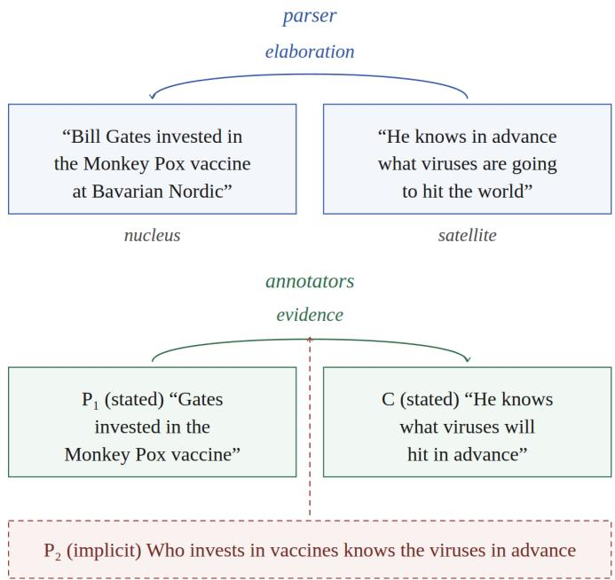  
Figure 6: The two construals of the unmarked junction on Tweet #196 (2/5 votes). The parser reads elaboration, a continuation; the annotators who hold the implicit warrant $P _ { 2 }$ read evidence. The structure fixes the site of the argument; whether it is read depends on the reader supplying P .

Table 6: The two consensus-pole failure profiles, extracted from the nested depth, calibration and consistency failure sets. Shown is the no-commitment criterion applied to the consensus bands: tweets on which no system places a probability within .35 of the majority pole, profiled against the committed tweets of the same bands (conventions as in Table 3; δ is Clif’s delta; p is Mann–Whitney / Fisher exact; green marks enrichment, red depletion, shading proportional to |δ|; uncorrected screening).
<table><tr><td rowspan=1 colspan=15>Uncommitted consensus nones            Uncommitted consensus enth.299 (185×0/5, 114×1/5) vs. 527               313 (131×4/5, 182×5/5) vs. 71Dimension                   set     ref       δ            p          set     ref       δ            p</td></tr><tr><td rowspan=1 colspan=1>Spine ratio</td><td rowspan=1 colspan=1>.32</td><td rowspan=1 colspan=1></td><td rowspan=1 colspan=1>.51</td><td rowspan=1 colspan=1></td><td rowspan=1 colspan=1>–.45</td><td rowspan=1 colspan=1></td><td rowspan=1 colspan=1>&lt;.001</td><td rowspan=1 colspan=1>.34</td><td rowspan=1 colspan=2>.31</td><td rowspan=1 colspan=2>+.06</td><td rowspan=1 colspan=1></td><td rowspan=1 colspan=1>.41</td></tr><tr><td rowspan=1 colspan=1>Shallowest-ARG span</td><td rowspan=1 colspan=1>.17</td><td rowspan=1 colspan=1></td><td rowspan=1 colspan=1>.08</td><td rowspan=1 colspan=1></td><td rowspan=1 colspan=1>+.29</td><td rowspan=1 colspan=1></td><td rowspan=1 colspan=1>&lt;.001</td><td rowspan=1 colspan=1>.17</td><td rowspan=1 colspan=2>.18</td><td rowspan=1 colspan=2>–.14</td><td rowspan=1 colspan=1></td><td rowspan=1 colspan=1>.053</td></tr><tr><td rowspan=1 colspan=1>ARG share of satellites</td><td rowspan=1 colspan=1>.23</td><td rowspan=1 colspan=1></td><td rowspan=1 colspan=1>.12</td><td rowspan=1 colspan=1></td><td rowspan=1 colspan=1>+.29</td><td rowspan=1 colspan=1></td><td rowspan=1 colspan=1>&lt;.001</td><td rowspan=1 colspan=1>.21</td><td rowspan=1 colspan=2>.32</td><td rowspan=1 colspan=1></td><td rowspan=1 colspan=1>-.23</td><td rowspan=1 colspan=1></td><td rowspan=1 colspan=1>.001</td></tr><tr><td rowspan=1 colspan=1>NN share</td><td rowspan=1 colspan=1>.25</td><td rowspan=1 colspan=1></td><td rowspan=1 colspan=1>.18</td><td rowspan=1 colspan=1></td><td rowspan=1 colspan=1>+.22</td><td rowspan=1 colspan=1></td><td rowspan=1 colspan=1>&lt;.001</td><td rowspan=1 colspan=1>.25</td><td rowspan=1 colspan=2>.29</td><td rowspan=1 colspan=1></td><td rowspan=1 colspan=1>-.14</td><td rowspan=1 colspan=1></td><td rowspan=1 colspan=1>.060</td></tr><tr><td rowspan=1 colspan=1>Max-relation share</td><td rowspan=1 colspan=1>.50</td><td rowspan=1 colspan=1></td><td rowspan=1 colspan=1>.57</td><td rowspan=1 colspan=1></td><td rowspan=1 colspan=1>–.17</td><td rowspan=1 colspan=1></td><td rowspan=1 colspan=1>&lt;.001</td><td rowspan=1 colspan=1>.51</td><td rowspan=1 colspan=1></td><td rowspan=1 colspan=1>.42</td><td rowspan=1 colspan=1></td><td rowspan=1 colspan=1>+.21</td><td rowspan=1 colspan=1></td><td rowspan=1 colspan=1>.005</td></tr><tr><td rowspan=1 colspan=1>Asyndeton</td><td rowspan=1 colspan=1>.68</td><td rowspan=1 colspan=1></td><td rowspan=1 colspan=1>.61</td><td rowspan=1 colspan=1></td><td rowspan=1 colspan=1>+.03</td><td rowspan=1 colspan=1></td><td rowspan=1 colspan=1>.46</td><td rowspan=1 colspan=1>.69</td><td rowspan=1 colspan=1></td><td rowspan=1 colspan=1>.63</td><td rowspan=1 colspan=2>+.19</td><td rowspan=1 colspan=1></td><td rowspan=1 colspan=1>.013</td></tr><tr><td rowspan=1 colspan=1>Embedded JOINT</td><td rowspan=1 colspan=1>.32</td><td rowspan=1 colspan=1></td><td rowspan=1 colspan=1>.14</td><td rowspan=1 colspan=1></td><td rowspan=1 colspan=1>+.18</td><td rowspan=1 colspan=1></td><td rowspan=1 colspan=1>&lt;.001</td><td rowspan=1 colspan=1>.33</td><td rowspan=1 colspan=1></td><td rowspan=1 colspan=1>.41</td><td rowspan=1 colspan=2>-.08</td><td rowspan=1 colspan=1></td><td rowspan=1 colspan=1>.21</td></tr><tr><td rowspan=2 colspan=1>EVALUATION satellite</td><td rowspan=1 colspan=1>.18</td><td rowspan=1 colspan=1></td><td rowspan=1 colspan=1>.06</td><td rowspan=1 colspan=1></td><td rowspan=1 colspan=1>+.13</td><td rowspan=1 colspan=1></td><td rowspan=1 colspan=1>&lt;.001</td><td rowspan=1 colspan=1>.19</td><td rowspan=1 colspan=1></td><td rowspan=1 colspan=1>.34</td><td rowspan=1 colspan=1></td><td rowspan=1 colspan=1>-.14</td><td rowspan=1 colspan=1></td><td rowspan=1 colspan=1>.011</td></tr><tr><td rowspan=1 colspan=1>Judgment without reason</td><td rowspan=1 colspan=1>.23</td><td rowspan=1 colspan=1></td><td rowspan=1 colspan=1>.09</td><td rowspan=1 colspan=1></td><td rowspan=1 colspan=1>+.14</td><td rowspan=1 colspan=1></td><td rowspan=1 colspan=1>&lt;.001</td><td rowspan=1 colspan=1>.20</td><td rowspan=1 colspan=1></td><td rowspan=1 colspan=1>.28</td><td rowspan=1 colspan=1></td><td rowspan=1 colspan=1>-.08</td><td rowspan=1 colspan=1></td><td rowspan=1 colspan=1>.16</td></tr><tr><td rowspan=1 colspan=1>ELABORATION share</td><td rowspan=1 colspan=1>.35</td><td rowspan=1 colspan=1></td><td rowspan=1 colspan=1>.36</td><td rowspan=1 colspan=1></td><td rowspan=1 colspan=1>+.04</td><td rowspan=1 colspan=1></td><td rowspan=1 colspan=1>.36</td><td rowspan=1 colspan=1>.36</td><td rowspan=1 colspan=1></td><td rowspan=1 colspan=1>.29</td><td rowspan=1 colspan=1></td><td rowspan=1 colspan=1>+.12</td><td rowspan=1 colspan=1></td><td rowspan=1 colspan=1>.12</td></tr><tr><td rowspan=2 colspan=1>Relation diversityJudgment and reason</td><td rowspan=1 colspan=1>.76</td><td rowspan=1 colspan=1></td><td rowspan=1 colspan=1>.74</td><td rowspan=1 colspan=1></td><td rowspan=1 colspan=1>-.09</td><td rowspan=1 colspan=1></td><td rowspan=1 colspan=1>.028</td><td rowspan=1 colspan=1>.77</td><td rowspan=1 colspan=1></td><td rowspan=1 colspan=1>.81</td><td rowspan=1 colspan=1></td><td rowspan=1 colspan=1>-.10</td><td rowspan=1 colspan=1></td><td rowspan=1 colspan=1>.19</td></tr><tr><td rowspan=1 colspan=1>.12</td><td rowspan=1 colspan=1></td><td rowspan=1 colspan=1>.03</td><td rowspan=1 colspan=1></td><td rowspan=1 colspan=1>+.09</td><td rowspan=1 colspan=1></td><td rowspan=1 colspan=1>&lt;.001</td><td rowspan=1 colspan=1>.10</td><td rowspan=1 colspan=1></td><td rowspan=1 colspan=1>.17</td><td rowspan=1 colspan=2>–.07</td><td rowspan=1 colspan=1></td><td rowspan=1 colspan=1>.098</td></tr><tr><td rowspan=1 colspan=1>EXPLANATION satellite</td><td rowspan=1 colspan=1>.13</td><td rowspan=1 colspan=1></td><td rowspan=1 colspan=1>.04</td><td rowspan=1 colspan=1></td><td rowspan=1 colspan=1>+.09</td><td rowspan=1 colspan=1></td><td rowspan=1 colspan=1>&lt;.001</td><td rowspan=1 colspan=1>.12</td><td rowspan=1 colspan=1></td><td rowspan=1 colspan=1>.21</td><td rowspan=1 colspan=2>-.09</td><td rowspan=1 colspan=1></td><td rowspan=1 colspan=1>.057</td></tr><tr><td rowspan=2 colspan=1>NS shareTOPIC-COMMENT present</td><td rowspan=1 colspan=1>.62</td><td rowspan=1 colspan=1></td><td rowspan=1 colspan=1>.54</td><td rowspan=1 colspan=2>+.09</td><td rowspan=1 colspan=1></td><td rowspan=1 colspan=1>.032</td><td rowspan=1 colspan=1>.62</td><td rowspan=1 colspan=2>.58</td><td rowspan=1 colspan=2>+.09</td><td rowspan=1 colspan=2>.25</td></tr><tr><td rowspan=1 colspan=1>.11</td><td rowspan=1 colspan=1></td><td rowspan=1 colspan=1>.02</td><td rowspan=1 colspan=1></td><td rowspan=1 colspan=1>+.09</td><td rowspan=1 colspan=1></td><td rowspan=1 colspan=1>&lt;.001</td><td rowspan=1 colspan=1>.11</td><td rowspan=1 colspan=2>.13</td><td rowspan=1 colspan=2>-.02</td><td rowspan=1 colspan=2>.67</td></tr><tr><td rowspan=1 colspan=1>SN share</td><td rowspan=1 colspan=1>.12</td><td rowspan=1 colspan=1></td><td rowspan=1 colspan=1>.13</td><td rowspan=1 colspan=1></td><td rowspan=1 colspan=1>+.09</td><td rowspan=1 colspan=1></td><td rowspan=1 colspan=1>.015</td><td rowspan=1 colspan=1>.13</td><td rowspan=1 colspan=2>.13</td><td rowspan=1 colspan=2>–.02</td><td rowspan=1 colspan=2>.72</td></tr><tr><td rowspan=2 colspan=1>SN support-firstATTRIBUTION present</td><td rowspan=1 colspan=1>.13</td><td rowspan=1 colspan=1></td><td rowspan=1 colspan=1>.07</td><td rowspan=1 colspan=1></td><td rowspan=1 colspan=1>+.08</td><td rowspan=1 colspan=1></td><td rowspan=1 colspan=1>&lt;.001</td><td rowspan=1 colspan=1>.12</td><td rowspan=1 colspan=2>.17</td><td rowspan=1 colspan=2>-.06</td><td rowspan=1 colspan=2>.26</td></tr><tr><td rowspan=1 colspan=1>.31</td><td rowspan=1 colspan=1></td><td rowspan=1 colspan=1>.23</td><td rowspan=1 colspan=1></td><td rowspan=1 colspan=1>+.08</td><td rowspan=1 colspan=1></td><td rowspan=1 colspan=1>.013</td><td rowspan=1 colspan=1>.34</td><td rowspan=1 colspan=2>.39</td><td rowspan=1 colspan=2>-.06</td><td rowspan=1 colspan=1></td><td rowspan=1 colspan=1>.41</td></tr><tr><td rowspan=1 colspan=1>CAUSE satellite</td><td rowspan=1 colspan=1>.13</td><td rowspan=1 colspan=1></td><td rowspan=1 colspan=1>.08</td><td rowspan=1 colspan=2>+.05</td><td rowspan=1 colspan=2>.013</td><td rowspan=1 colspan=1>.14</td><td rowspan=1 colspan=2>.13</td><td rowspan=1 colspan=2>+.01</td><td rowspan=1 colspan=1></td><td rowspan=1 colspan=1>.85</td></tr><tr><td rowspan=2 colspan=1>CONDITION satelliteATTRIBUTION share</td><td rowspan=1 colspan=1>.08</td><td rowspan=1 colspan=2>.03</td><td rowspan=1 colspan=2>+.05</td><td rowspan=1 colspan=2>.001</td><td rowspan=1 colspan=1>.07</td><td rowspan=1 colspan=2>.07</td><td rowspan=1 colspan=2>+.00</td><td rowspan=1 colspan=2>&gt;.99</td></tr><tr><td rowspan=1 colspan=1>.08</td><td rowspan=1 colspan=2>.11</td><td rowspan=1 colspan=1></td><td rowspan=1 colspan=1>+.04</td><td rowspan=1 colspan=2>.18</td><td rowspan=1 colspan=1>.09</td><td rowspan=1 colspan=2>.08</td><td rowspan=1 colspan=2>-.01</td><td rowspan=1 colspan=2>.86</td></tr><tr><td rowspan=1 colspan=1>CONTRAST satellite</td><td rowspan=1 colspan=1>.06</td><td rowspan=1 colspan=2>.02</td><td rowspan=1 colspan=1></td><td rowspan=1 colspan=1>+.04</td><td rowspan=1 colspan=2>.013</td><td rowspan=1 colspan=1>.04</td><td rowspan=1 colspan=1></td><td rowspan=1 colspan=1>.04</td><td rowspan=1 colspan=2>-.01</td><td rowspan=1 colspan=1></td><td rowspan=1 colspan=1>.73</td></tr><tr><td rowspan=2 colspan=2>JOINT at root                  .09COMPARISON satellite           .01</td><td rowspan=1 colspan=2>.09</td><td rowspan=1 colspan=2>.08</td><td rowspan=1 colspan=1></td><td rowspan=1 colspan=1>+.01</td><td rowspan=1 colspan=3>.59</td><td rowspan=1 colspan=2>.06</td><td rowspan=1 colspan=1></td><td rowspan=1 colspan=1>.03</td></tr><tr><td rowspan=1 colspan=4>.00     +.01</td><td rowspan=1 colspan=2>.36</td><td rowspan=1 colspan=1>.00</td><td rowspan=1 colspan=4>.00     +.00</td><td rowspan=1 colspan=2>&gt;.99</td></tr></table>

First, the uncommitted consensus nones are nones with argument structure. Their trees branch rather than chain (spine ratio .32 vs. .51, $\delta = - . 4 5 , p < . 0 0 1 )$ , and every argumentative dimension is enriched, with the share of argumentative satellites at double the reference (.23 vs. .12, $p \ < \ . 0 0 1 )$ and close to the root (shallowest-arg span +.29), evaluation (.18 vs. .06) and explanation (.13 vs. .04) satellites, judgments with and without a stated reason, topic–comment structures (.11 vs. .02) and embedded joint nodes (.32 vs. .14), all at $p < . 0 0 1$ This is the configuration of the easy enthymemes of Table 3. These tweets state a judgment and support it; what they do not do is omit a premise. The models place near-threshold probabilities on precisely the nones that carry the surface structure of argument, and implicit marking plays no role on this side (asyndeton $+ . 0 3 , \mathrm { n . s . } )$

The uncommitted consensus enthymemes show the configuration of the misranked settled enthymemes of the where analysis, now at scale (313 tweets against 34). Argumentative satellites are depleted (arg share −.23, $p = . 0 0 1$ ; evaluation −.14, $p = . 0 1 1 \rangle$ ), one relation dominates the tree (max-relation share +.21, $p = . 0 0 5 )$ , and the junctions are implicitly marked (asyndeton .69 vs. .63, $p = . 0 1 3 )$ . The mechanism proposed there applies here as well, since the parser assigns elaboration or joint to the unmarked junctions where the operative relations are semantic ones such as evidence or cause, which very often hold through an unstated warrant, and the models observe the same unmarked surface. The committed minority of 71 consensus enthymemes are those whose argumentative structure is visible. Two trees of the uncommitted majority are shown in Figures B.2 and B.3 of Appendix B.

## 6.4 Summary of the Success and Error Analysis

We conclude with three observations. First, the asymmetry of the poles has a direct reading, in that certain absence of an enthymeme is mostly learned while certain presence mostly is not. This asymmetry, like the commitment of betabin at the poles and its restraint where the readers divide (Section 6.2.1), is measurable only through the variation metrics, and at no cost on F1; a model can be made to perform as well on the verdict while behaving better on the votes. The attribution–evaluation configuration of Section 6.2.1 shows moreover that the variation so captured is discourse-principled reader variation, and that a model can be taught to capture it. The per-vote consistency metric completes this picture on the other side, since it sheds light on the inconsistent votes and represents them with more precision than any of the other variation metrics (Section 6.2.2).

Second, the two failure profiles reverse the two easy profiles almost feature by feature, with the sign flipping between the columns on spine ratio, argumentative share, evaluation, explanation, the judgment configurations and max-relation share. Success and failure are thus outcomes of the same reading, in which the models rely on surface argumentative structure as a proxy for the label; the proxy is reliable exactly when discourse form and label align, and when the two dissociate the error runs in both directions at once, moving the none that argues explicitly toward the enthymeme region and leaving the enthymeme without argumentative marking near the threshold. This last point can be explained but the fact the implicit content itself, the object the annotators were asked to identify, is not what any model reads, and at the unmarked junctions where it operates, the parser makes the corresponding mistake, reading continuation where the relation is evidential (Section 6.3.1).

Third, the failure appears structural, since the enthymeme-side set spans 81% of its band including nearly the whole unanimous band, and the learning curves of Section 4.7 give no indication that any metric family improves onto these tweets with more data.

## 7 Discourse Structure Inside the Model

The injection results of Section 4.6 showed that RST features are redundant for the fine-tuned models, and the error analysis of Section 6.3 showed that their successes and failures follow discourse profiles the features describe. This section asks whether these two observations have a common representational basis, namely whether the discourse dimensions of the profiles are encoded inside the model, and whether fine-tuning for enthymeme detection promotes or sheds them.

## 7.1 Probing Setup

We compare the pretrained DeBERTa encoder with the same encoder after enthymeme finetuning, both frozen, and represent each tweet by its last-layer CLS state.13 The probed concepts are binary discourse configurations derived from the profile dimensions,14 covering single relations (evaluation, attribution, elaboration), configurations (contrast ∧ evaluation, attribution ∧ explanation, embedded joint, high asyndeton), a disjunction of stance config urations, contestedness on compact self-contained trees, and the gold trope flags. Each concept is probed by a logistic regression on the frozen representation, scored by out-of-fold macro-F1, and the quantity of interest is the fine-tuning shift ∆, the probe score on the fine-tuned encoder minus the score on the pretrained one. A positive ∆ means the task promotes the concept in the representation, a negative one that it sheds it.15

## 7.2 Probing Results

As we can see from (Figure 7), the main observation is that Fine-tuning promotes the scafold of explicit argument. Every promoted configuration is a stance or attribution configuration, with contrast ∧ evaluation at +.061, evaluation at +.048, attribution ∧ explanation at +.045, the stance disjunction at +.044 and attribution at +.043. These are the configurations of the easy-enthymeme profile (Table 3) and the contestedness cue of the where analysis, so the probing recovers inside the encoder the same proxy the error analysis recovered from the outputs. Contested tweets with compact, self-contained trees are also promoted (+.040), and selectively so, since disagreement accompanied by complexity cues shifts only +.017 and contestedness in general not at all (−.001). The encoder learns to recognize the tweets whose disagreement has no structural excuse.

Continuation structure and implicit marking, by contrast, are not promoted. elaboration (−.020), embedded joint (−.029) and high asyndeton (−.020) all shift slightly downward, but within the random-signature floor, so the task does not strengthen them. Fine-tuning thus leaves aside the surface under which the unstated warrants of the failure analysis sit, and the model does not become more attuned to the unmarked junctions where the annotators locate the enthymemes it misses.16

Tropes move in the opposite direction from discourse structure. While the discourse configurations are promoted, trope content is shed. The presence of any trope drops by −.055, the largest demotion of the battery and the only one beyond the random-signature floor, and multiple tropes (−.031) and distrust of experts (−.019) move in the same direction within it.17 Enthymeme training thus recruits discourse form and discards content, which is consistent with the injection results of Section 4.6, where the RST features were redundant but stable while the trope oracle failed to transfer. Efect sizes are moderate and the battery is a screening rather than a hypothesis test,18 so we read the pattern rather than the individual numbers. We can conclude overall that fine-tuning promotes the explicit argumentative configurations, leaves implicit marking and continuation unpromoted, and sheds content.

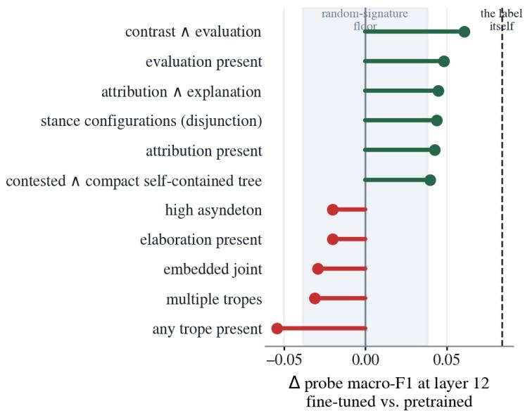  
Figure 7: Fine-tuning shift ∆ per probed signature (probe macro-F1 on the fine-tuned encoder minus the pretrained one, last-layer CLS). The shaded band marks the random-signature floor (±.038); the dashed line marks the label’s own shift (+.084).

## 8 Discussion

This section steps back from the models to ask what our results mean in practice: what is lost when systems that classify and moderate social media content are trained and evaluated on majority labels, and whether evaluating against the variation among readers can help. We saw what evaluating under F1 alone can hide from us. On the basis of our results, we can only speculate on what such pipelines miss, but the profiles above indicate what a verdict-based evaluation leaves unmeasured.

We wish nonetheless to point out that the aggregation practice follows a known platform logic: content ranking and moderation at scale rest on aggregated signals, quantified engagement on one side (van Dijck 2014; Zubof 2019), and human judgments collapsed into majority labels for training, a practice shown to hide disagreement in social-computing tasks (Gordon et al. 2021) and observed in a deployed moderation classifier (Gordon et al. 2022). Such pipelines are therefore blind to a linguistic reality in which disagreement and semantic interpretation are constitutive parts of the phenomena being classified, enthymemes among them, which is one of the central critiques advanced by perspectivist NLP (Aroyo and Welty 2015; Basile et al. 2021; Plank 2022; Cabitza, Campagner, and Basile 2023).

The stakes for the distortion of discourse ecosystem are significant for the controversial implicit content that goes undetected. Indeed, implicit content is accommodated into the common ground (Lewis 1979; Stalnaker 2002), and what is accommodated repeatedly over time sediments into the taken-for-granted knowledge of a community (Berger and Luckmann 1966; Lombardi Vallauri 2016). Hence a missed enthymeme could potentially be a premise left to sediment into commonsense, which is how controversial content polarizes without ever arguing: communities come to difer not in the claims they debate but in the premises they no longer state.

We take up this point by returning to what the variation metrics make visible, and by speculating on how they could help mitigate such distortions for implicit controversial content.

## 8.1 Closing the Case for F1 in Semantic Interpretation Tasks

But first we ought to give back to F1 what belongs to F1. The missed paratactic enthymemes of Section 6.3, whose clauses sit side by side with no marked link, are partly visible to the verdict metric, since those that fall below the threshold count as errors, and a better model under F1 would mitigate part of the risk of distortion mentioned above; on our data it already catches the enthymemes whose argumentative satellites are visible and clears the flat single-relation nones.

However, our data gives little reason to expect much more. Every transformer configuration we trained lands between 0.65 and 0.69 macro-F1, the learning curves are flat from 300 examples on, and the failure on the paratactic profile spans 81% of the consensus enthymemes with no sign of improving with data. This is consistent with what is reported on other semantic interpretation tasks where annotators genuinely diverge: on natural language inference, models reach nearperfect accuracy on high-agreement items while barely beating chance on the contested ones, which questions the value of further optimizing hard-label metrics on that portion of the data (Pavlick and Kwiatkowski 2019; Nie, Zhou, and Bansal 2020).

Furthermore, a deployed detector creates an adversarial scenario in which producers adapt the surface until the metric is flunked, as with AI-text detectors defeated by paraphrasing and humanization (Krishna et al. 2023; Li et al. 2026), and in our case the paratactic profile, such as the one in Figure B.3, shows exactly which surface to adopt. If the verdict cannot be predicted much better because it collapses a divided judgment, and if optimizing it only redirects content toward the form it misses, then F1 is not the adapted metric for this content, and the question becomes what should be measured instead.

## 8.2 Variation Metrics and the Discourse Ecosystem

With the lens of our variation metrics we can speculate on several discourse ecosystem distortions. What these metrics observe, and what F1 does not, is the diference between a model that decides, a model that hedges, and a model that registers a split. F1 turns every probability into a verdict, so a prediction obtained at the threshold and a committed one enter ranking and moderation pipelines with the same authority. The variation metrics are distributional, meaning they keep these behaviors apart, and each of the distortions below arises from erasing one of these diferences before the score reaches the systems that act on it.

A first distortion concerns the consensus nones on which the models remain at the threshold, which the error analysis of Section 6.3.2 identifies as tweets that state a complete argument, a judgment supported by an explicit reason. F1 counts a probability of .47 on a $0 / 5$ tweet as a correct rejection. The depth and calibration metrics show instead that the model never decided, as Figure 5 illustrates. In a moderation or ranking pipeline that reads the raw score, these tweets enter with a near-controversial score although every annotator rejected them. What raises the score is the discourse form of these tweets, a judgment supported by an explicit reason, not any implicit claim they make. The distortion is therefore a bias against explicit argumentation: content that states its premises receives the same treatment as content that leaves them unstated, and a pipeline that demotes or flags near-boundary scores acts on the former as if it were the latter. A calibrated distributional output separates the confident rejection from the undecided one, and the betabin results show that this separation is obtained at no cost on F1.

A second distortion concerns the contested tweets of Section 6.2, whose reported speech from an exterior source together with a judgment of it divides the annotators. Here F1 works against the ecosystem directly, since it penalizes the model that returns these tweets to .51, where the annotators actually place them, as exemplified in Figure 4, and rewards the model that settles a reading no reader consensus supports, attributing quoted content to the tweet author or resolving irony one way for all readers. A model evaluated on the where metric can instead flag these tweets as contested, so that a pipeline can reroute them and withhold automatic action on them rather than enforce one reading.

A third distortion concerns the consensus enthymeme pole of Section 6.3, on which no model commits and threshold tuning converts near-threshold scores into verdicts. This case the variation metrics cannot repair, since the certain presence of an enthymeme is not learned by any of our systems; what they can do is make it honest, in that a pipeline reading the distribution knows that these verdicts were never backed by commitment, which separates a declared blind spot from a false clearance.

## 9 Conclusion

This paper set out to detect enthymemes in tweets and to account for the variation among the readers who judge them. We close by returning to what each part of the study established, and on what evidence.

On detection, the result is a ceiling on macro-F1 that no configuration we trained exceeds. Every fine-tuned configuration, under hard and soft labels, with and without injected features, and with a vote-count head, scores between 0.65 and 0.69 macro-F1 (the hard-label model once its threshold is tuned), and the feature-only and TF-IDF classifiers stay below this range (Table 1). The learning curves of Section 4.7 are flat from 300 examples on (Figure 1), so neither more data nor a diferent objective moves the verdict. We read this as a property of the task rather than of the models. Enthymeme detection is a semantic interpretation task on which five readers disagree on 37% of items, and Figure 2 shows the consequence for the best system, whose probabilities all fall between 0.07 and 0.62 and whose contested bands are indistinguishable from each other. Against this ceiling we introduced betabin (Section 4.5), which predicts a distribution over the vote count instead of a label. It scores at parity with the text-only baseline on macro-F1 and is the only non-baseline configuration that never loses to it.

On evaluation, the paper replaced the verdict with a set of questions about the vote distribution (Section 5.2.1): where the contested tweets are, how far the probabilities sit from the vote fractions, whether they are calibrated in vote units, and, with the per-vote metric of Section 5.3, whether the model’s errors fall on the votes that are unusual for the annotator who cast them. Under these metrics the systems that tie on F1 separate (Table 2), and the properties they measure improve with data where the verdict does not (Figure 3). Betabin obtains its advantage through two behaviors. It moves the contested tweets of the where set back to .51, where the annotators place them (Figure 4), and it commits on the unanimous nones that the text-only model holds at .47 (Figure 5). Both behaviors are invisible to a metric computed against the majority label.

The per-vote metric adds a distinction the distributional metrics do not make. It scores each vote against the behavioral profile of its annotator, so that a dissenting vote which is routine for one annotator and unusual for another is not treated as the same event. The tweets on which this metric decides the ordering are unanimous nones framed as rhetorical questions, the topic–comment configuration of Section 6.2.2, on which one annotator can build a full argument and still vote none (Figure B.4). Since a vote that departs from its annotator’s otherwise stable behavior is the one most likely to be inconsistent, modeling the votes and conditioning on annotator behavior gives a first step toward separating inconsistent annotation from genuine disagreement, on the evidence of the vote matrix alone.

On discourse structure, the paper found the RST features redundant for the fine-tuned models (Section 4.6) and then explained why. The probing of Section 7 shows that fine-tuning promotes the explicit stance and attribution configurations but not elaboration, embedded joint or asyndeton (Figure 7). The encoder already represents what the features encode. The same dimensions, used descriptively, show that the models rely on explicit argumentative structure as a proxy for the label. The proxy holds on the easy tweets of Table 3, where the easy none is a sequence of nuclei under one relation and the easy enthymeme carries argumentative satellites close to the root. It fails when form and label dissociate, and it fails in both directions at once (Table 6). The nones that state a judgment and support it are held at the threshold, and the enthymemes without argumentative marking are never committed.

The second of these failures is the finding we consider most consequential. It concerns 81% of the consensus enthymemes, and the learning curves give no indication that it recedes with data. These tweets share a profile of implicitly marked junctions, a single dominant relation and little reported speech (Section 6.3.1, Table 5). At the unmarked junctions the parser assigns elaboration or joint, an additive relation in the sense of Sanders, Spooren, and Noordman (1992), where the operative relation is evidence or cause, a pragmatic one that holds through an unstated warrant. Figure 6 shows the two construals on one tweet, and Figures B.2 and B.3 show trees on which five annotators agreed and the parser recorded no argumentative relation at all. What distinguishes the two readings is not in the text. It is the warrant a reader supplies, and the parser, like the detection system, supplies none. The error analysis therefore identifies a failure of the parser and of the systems together, on the same surface, and it locates the limit of current detection at the certain presence of a component that the text does not contain.

The contested middle has a discourse profile of its own. The tweets on which readers divide combine an attribution node with an evaluation satellite, reported speech from an exterior source together with a judgment of it, and the judgment is often ironic or a rhetorical question (Section 6.2.1, Figure B.1). The configuration produces both kinds of disagreement identified by Pastor and van Arkel (2026), costly resolution of the exterior source and subjective perception of the speech act. Betabin learned that this configuration yields split votes, and the probing shows that fine-tuning promotes the same configuration inside the encoder. Interpretive variation on this task has a discourse-structural basis, and a model trained on the votes can learn it.

The consequences of evaluating on the verdict alone extend beyond the models. A premise left unstated and accepted sediments into what a community no longer argues about (Section 8), and a detector evaluated on the verdict lets it pass on the consensus enthymemes and settles by a threshold the tweets on which readers divide (Section 8.2). A pipeline built on the alternative can withhold action where readers divide and can leave the argument that states its premises out of the near-controversial band. What such a pipeline needs is not more text but reader interpretation. The variation measured here exists only because five people judged each tweet, and the content the systems miss is supplied by the reader’s background, not by the text (Section 6.3.1). Systems trained on a majority label fix what counts as controversial at the moment of annotation and remove the variation that could revise it. Systems that keep reader judgments, keep collecting them and representing their variation, leave that question open and able to change. The metrics and the model introduced here are expected to contribute to the second kind, in which what a community treats as settled remains visible as a distribution of readings rather than a verdict. The premise that passes unmeasured may be one of the ways polarization takes hold, and a pipeline of this kind is at least able to see it.

These results point to two directions for future work. First, more data of the same kind is unlikely to help, since the learning curves are flat. What should grow instead is the information collected per item, with more annotators per tweet, individual votes rather than a majority label, and each annotator’s reconstruction of the missing component, so that models can learn the inference readers make and not only its outcome. Second, the parser’s blind spot at unmarked junctions calls for discourse parsers that can recover implicit relations such as evidence, and for manually corrected trees against which to test them.

## 10 Limitations

A limitation of the research presented here is the size of the dataset, which provides limited insights into the types of patterns we observe, particularly with regard to model generalisation—even within the same type and topic distribution. This leads us to note that the phenomena we identify may be closely tied to our specific topic.

Moreover, it is important to note that we only work with generated data for RST annotations, and that better labeling of less recognized relations by parsers could have yielded diferent results.

## Acknowledgments

This work was produced as part of the HYBRIDS project, a Marie Skłodowska-Curie Doctoral Network funded by the European Union under grant no. 101073351 and the UK Research and Innovation (UKRI) Horizon Funding Guarantee, and the AI-CODE project, funded under the European Union’s Horizon Europe research and innovation programme, grant agreement no. 101135437. We also acknowledge the annotators: Nienke Gelderland, Afrooz Bolboli, Jarno Van Arkel, Peter Beinema, Ulas Askin, Huixin Lan and Pascale Mannone.

## References

Aroyo, Lora and Chris Welty. 2015. Truth is a lie: Crowd truth and the seven myths of human annotation. AI Magazine, 36(1):15–24.

Baan, Joris, Wilker Aziz, Barbara Plank, and Raquel Fernández. 2022. Stop measuring calibration when humans disagree. In Proceedings of the 2022 Conference on Empirical Methods in Natural Language Processing, pages 1892–1915, Association for Computational Linguistics, Abu Dhabi, United Arab Emirates.

Basile, Valerio, Michael Fell, Tommaso Fornaciari, Dirk Hovy, Silviu Paun, Barbara Plank, Massimo Poesio, and Alexandra Uma. 2021. We need to consider disagreement in evaluation. In Proceedings of the 1st Workshop on Benchmarking: Past, Present and Future, pages 15–21, Association for Computational Linguistics.

Becker, Maria. 2024. Building bridges. Reconstructing implicit information in argumentative texts using commonsense knowledge. Number 61 in amades - Arbeiten und Materialien zur deutschen Sprache. Leibniz-Institut für Deutsche Sprache (IDS).

Berger, Peter L. and Thomas Luckmann. 1966. The Social Construction of Reality: A Treatise in the Sociology of Knowledge. Doubleday, Garden City, NY.

Braud, Chloé, Maximin Coavoux, and Anders Søgaard. 2017. Cross-lingual RST discourse parsing. In Proceedings of the 15th Conference of the European Chapter of the Association for Computational Linguistics: Volume 1, Long Papers, pages 292–304, Association for Computational Linguistics, Valencia, Spain.

Buitinck, Lars, Gilles Louppe, Mathieu Blondel, Fabian Pedregosa, Andreas Mueller, Olivier Grisel, Vlad Niculae, Peter Prettenhofer, Alexandre Gramfort, Jaques Grobler, Robert Layton, Jake Vanderplas, Arnaud Joly, Brian Holt, and Gaël Varoquaux. 2013. API design for machine

learning software: experiences from the scikit-learn project. In European Conference on Machine Learning and Principles and Practices of Knowledge Discovery in Databases, Prague, Czech Republic.

Burke, Michael and Ana Vlah. 2023. Teaching the enthymeme: On becoming a critical-rhetorical consumer of verbal and visual arguments. In D. Tomić, J. Vlašić Duić, and E. Pletikos Olof, editors, Rhetorical Research and Didactics: RHEFINE. Rhetoric for innovative education. University of Warsaw, Warsaw, pages 37–55.

Cabitza, Federico, Andrea Campagner, and Valerio Basile. 2023. Toward a perspectivist turn in ground truthing for predictive computing. Proceedings of the AAAI Conference on Artificial Intelligence, 37(6):6860–6868.

Chakrabarty, Tuhin, Aadit Trivedi, and Smaranda Muresan. 2021. Implicit premise generation with discourse-aware commonsense knowledge models. In Proceedings of the 2021 Conference on Empirical Methods in Natural Language Processing, pages 6247–6252, Association for Computational Linguistics, Online and Punta Cana, Dominican Republic.

Chernyavskiy, Alexander, Dmitry Ilvovsky, and Preslav Nakov. 2024. Unleashing the power of discourse-enhanced transformers for propaganda detection. In Proceedings of the 18th Conference of the European Chapter of the Association for Computational Linguistics (Volume 1: Long Papers), pages 1452–1462, Association for Computational Linguistics, St. Julian’s, Malta.

Chistova, Elena. 2024. Bilingual rhetorical structure parsing with large parallel annotations. In Findings of the Association for Computational Linguistics: ACL 2024, pages 9689–9706, Association for Computational Linguistics, Bangkok, Thailand.

Cortes, Corinna and Vladimir Vapnik. 1995. Support-vector networks. Machine Learning, 20(3):273–297.

Dawid, Alexander Philip and Allan M. Skene. 1979. Maximum likelihood estimation of observer error-rates using the EM algorithm. Journal of the Royal Statistical Society: Series C (Applied Statistics), 28(1):20–28.

van Dijck, José. 2014. Datafication, dataism and dataveillance: Big data between scientific paradigm and ideology. Surveillance & Society, 12(2):197–208.

Dror, Rotem, Gili Baumer, Segev Shlomov, and Roi Reichart. 2018. The hitchhiker’s guide to testing statistical significance in natural language processing. In Proceedings of the 56th Annual Meeting of the Association for Computational Linguistics (Volume 1: Long Papers), pages 1383–1392, Association for Computational Linguistics, Melbourne, Australia.

Feng, Xuyao and Anthony Hunter. 2026. Making implicit premises explicit in logical understanding of enthymemes. ArXiv preprint.

Flaccavento, Alessandra, Youri Peskine, Paolo Papotti, Riccardo Torlone, and Raphael Troncy. 2025. Automated detection of tropes in short texts. In Proceedings of the 31st International Conference on Computational Linguistics, pages 5936–5951, Association for Computational Linguistics, Abu Dhabi, UAE.

Gala, Dhruvil, Mohammad Omar Khursheed, Hannah Lerner, Brendan O’Connor, and Mohit Iyyer. 2020. Analyzing gender bias within narrative tropes. In Proceedings of the Fourth Workshop on Natural Language Processing and Computational Social Science, pages 212–217, Association for Computational Linguistics, Online.

Gordon, Mitchell L., Michelle S. Lam, Joon Sung Park, Kayur Patel, Jef Hancock, Tatsunori Hashimoto, and Michael S. Bernstein. 2022. Jury learning: Integrating dissenting voices into machine learning models. In Proceedings of the 2022 CHI Conference on Human Factors in Computing Systems, ACM.

Gordon, Mitchell L., Kaitlyn Zhou, Kayur Patel, Tatsunori Hashimoto, and Michael S. Bernstein. 2021. The disagreement deconvolution: Bringing machine learning performance metrics in line with reality. In Proceedings of the 2021 CHI Conference on Human Factors in Computing Systems, ACM.

Green, Nancy L. 2010. Representation of argumentation in text with rhetorical structure theory. Argumentation, 24(2):181–196.

He, Pengcheng, Jianfeng Gao, and Weizhu Chen. 2023. DeBERTaV3: Improving DeBERTa using ELECTRA-style pre-training with gradient-disentangled embedding sharing. In International Conference on Learning Representations.

Hitchcock, David. 1985. Enthymematic arguments. Informal Logic, 7(2–3):83–97.

Hunter, Anthony. 2022. Understanding enthymemes in deductive argumentation using semantic distance measures. In Proceedings of the Thirty-Sixth AAAI Conference on Artificial Intelligence (AAAI-22), volume 36 of Proceedings of the AAAI Conference on Artificial Intelligence, pages 5729–5736, AAAI Press, Palo Alto, California, USA.

Koehn, Philipp. 2004. Statistical significance tests for machine translation evaluation. In Proceedings of the 2004 Conference on Empirical Methods in Natural Language Processing, pages 388–395, Association for Computational Linguistics, Barcelona, Spain.

Krishna, Kalpesh, Yixiao Song, Marzena Karpinska, John Wieting, and Mohit Iyyer. 2023. Paraphrasing evades detectors of AI-generated text, but retrieval is an efective defense. In Advances in Neural Information Processing Systems 36.

Leonardelli, Elisa, Silvia Casola, Siyao Peng, Giulia Rizzi, Valerio Basile, Elisabetta Fersini, Diego Frassinelli, Hyewon Jang, Maja Pavlovic, Barbara Plank, and Massimo Poesio. 2025. LeWiDi-2025 at NLPerspectives: Third edition of the learning with disagreements shared task. In Proceedings of the 4th Workshop on Perspectivist Approaches to NLP, Association for Computational Linguistics, Suzhou, China.

Lewis, David. 1979. Scorekeeping in a language game. Journal of Philosophical Logic, 8(1):339– 359.

Li, Yang, Qiang Sheng, Zhengjia Wang, Yehan Yang, Danding Wang, and Juan Cao. 2026. Beyond the final actor: Modeling the dual roles of creator and editor for fine-grained LLMgenerated text detection. In Proceedings of the 64th Annual Meeting of the Association for Computational Linguistics, Association for Computational Linguistics.

Lin, Tsung-Yi, Priya Goyal, Ross Girshick, Kaiming He, and Piotr Dollár. 2017. Focal loss for dense object detection. In Proceedings of the IEEE International Conference on Computer Vision (ICCV), pages 2980–2988, IEEE.

Lombardi Vallauri, Edoardo. 2016. The “exaptation” of linguistic implicit strategies. SpringerPlus, 5:1106.

Lombardi Vallauri, Edoardo, Laura Baranzini, Doriana Cimmino, Federica Cominetti, Claudia Coppola, and Giorgia Mannaioli. 2020. Implicit argumentation and persuasion. Journal of Argumentation in Context, 9(1):95–123.

Mann, William C and Sandra A Thompson. 1988. Rhetorical structure theory: Toward a functional theory of text organization. Text-interdisciplinary Journal for the Study of Discourse, 8(3):243–281.

Nie, Yixin, Xiang Zhou, and Mohit Bansal. 2020. What can we learn from collective human opinions on natural language inference data? In Proceedings of the 2020 Conference on Empirical Methods in Natural Language Processing, pages 9131–9143, Association for Computational Linguistics.

Pastor, Martial and Jarno van Arkel. 2026. Disagreement in enthymeme annotation. In Proceedings of the MediaEval 2026 Multimedia Evaluation Workshop, CEUR Workshop Proceedings, CEUR-WS.org, Amsterdam, Netherlands and Online.

Pastor, Martial and Nelleke Oostdijk. 2026. A resource for enthymeme detection in controversial political discourse. arXiv preprint arXiv:2606.12186.

Paun, Silviu, Bob Carpenter, Jon Chamberlain, Dirk Hovy, Udo Kruschwitz, and Massimo Poesio. 2018. Comparing Bayesian models of annotation. Transactions of the Association for Computational Linguistics, 6:571–585.

Pavlick, Ellie and Tom Kwiatkowski. 2019. Inherent disagreements in human textual inferences. Transactions of the Association for Computational Linguistics, 7:677–694.

Pedregosa, Fabian, Gaël Varoquaux, Alexandre Gramfort, Vincent Michel, Bertrand Thirion, Olivier Grisel, Mathieu Blondel, Peter Prettenhofer, Ron Weiss, Vincent Dubourg, Jake Vanderplas, Alexandre Passos, David Cournapeau, Matthieu Brucher, Matthieu Perrot, and Édouard Duchesnay. 2011. Scikit-learn: Machine learning in python. Journal of Machine Learning Research, 12(85):2825–2830.

Plank, Barbara. 2022. The “problem” of human label variation: On ground truth in data, modeling and evaluation. In Proceedings of the 2022 Conference on Empirical Methods in Natural Language Processing, pages 10671–10682, Association for Computational Linguistics, Abu Dhabi, United Arab Emirates.

Rajendran, Pavithra, Danushka Bollegala, and Simon Parsons. 2016. Contextual stance classification of opinions: A step towards enthymeme reconstruction in online reviews. In Proceedings of the Third Workshop on Argument Mining (ArgMining2016), pages 31–39, Association for Computational Linguistics, Berlin, Germany.

Razuvayevskaya, Olesya and Simone Teufel. 2017. Finding enthymemes in real-world texts: A feasibility study. Argument & Computation, 8(2):113–129.

Reboul, Anne. 2011. A relevance-theoretic account of the evolution of implicit communication. Studies in Pragmatics, 13(1):1–19.

Rizzi, Giulia, Elisa Leonardelli, Massimo Poesio, Alexandra Uma, Maja Pavlovic, Silviu Paun, Paolo Rosso, and Elisabetta Fersini. 2024. Soft metrics for evaluation with disagreements: an assessment. In Proceedings of the 3rd Workshop on Perspectivist Approaches to NLP (NLPerspectives 2024), pages 84–94, ELRA and ICCL, Torino, Italy.

Salton, Gerard and Christopher Buckley. 1988. Term-weighting approaches in automatic text retrieval. Information Processing & Management, 24(5):513–523.

Sanders, Ted J. M., Wilbert P. M. Spooren, and Leo G. M. Noordman. 1992. Toward a taxonomy of coherence relations. Discourse Processes, 15(1):1–35.

Sarumi, Olufunke O., Charles Welch, and Daniel Braun. 2025. NLP-ResTeam at LeWiDi-2025: Performance shifts in perspective aware models based on evaluation metrics. In Proceedings of the The 4th Workshop on Perspectivist Approaches to NLP, pages 219–227, Association for Computational Linguistics, Suzhou, China.

Spearman, Charles. 1904. The proof and measurement of association between two things. The American Journal of Psychology, 15(1):72–101.

Stahl, Maja, Nick Düsterhus, Mei-Hua Chen, and Henning Wachsmuth. 2023. Mind the gap: Automated corpus creation for enthymeme detection and reconstruction in learner arguments. In Findings of the Association for Computational Linguistics: EMNLP 2023, pages 4703–4717, Association for Computational Linguistics, Singapore.

Stalnaker, Robert. 2002. Common ground. Linguistics and Philosophy, 25(5–6):701–721.

Uma, Alexandra N., Tommaso Fornaciari, Dirk Hovy, Silviu Paun, Barbara Plank, and Massimo Poesio. 2021. Learning from disagreement: A survey. Journal of Artificial Intelligence Research, 72:1385–1470.

Walton, D. 2008. The three bases for the enthymeme: A dialogical theory. Journal of Applied Logic, 6(3):361–379.

Walton, Douglas, Chris Reed, and Fabrizio Macagno. 2008. Argumentation Schemes. Cambridge University Press, Cambridge, UK.

Zubof, Shoshana. 2019. The Age of Surveillance Capitalism: The Fight for a Human Future at the New Frontier of Power. PublicAfairs, New York.

## A RST Feature Encoding

Table A.1: The 24-dimensional RST feature encoding. All features are indicators (present or absent) or ratios computed over the automatically generated RST tree. The candidate features were constructed from two motivated sources: the argumentative-satellite patterns hypothesized to distinguish explicit from implicit arguments, and the discourse configurations associated with annotator disagreement in our data. From this pool, we kept the 24 dimensions that remained predictive across training folds. We kept features given nonzero weight by an L1 logistic regression in at least three of five training folds.
<table><tr><td>Dim</td><td>Feature</td><td>Motivation</td></tr><tr><td colspan="3">Relational composition</td></tr><tr><td>1-6</td><td>Satellite of each core relation present at depth ≤ 2 (indicators)</td><td>Discourse relations are the feature type that helped most in Chernyavskiy, Ilvovsky, and Nakov (2024); a satellite with one of these relations gives explicit support to the main claim.</td></tr><tr><td>7</td><td>Share of core-relation satellites among all satellites</td><td>How much of the extra information supports the claim rather than just adding to it.</td></tr><tr><td>8</td><td>Character span of the shallowest core-relation satellite / text length</td><td>How much of the tweet is spent on explicit support.</td></tr><tr><td>9</td><td>Fraction of core-relation satellites in SN order</td><td>Whether the support comes before the claim. How much of the tweet is essential content (Nucleus)</td></tr><tr><td>10</td><td>Spine ratio: EDUs on an all-nucleus path / number of EDUs NN nodes / all internal nodes</td><td>with no extra information attached. Whether the tweet joins statements of equal weight or</td></tr><tr><td></td><td></td><td>subordinates one to another; nuclearity was the other most useful feature type in Chernyavskiy, Ilvovsky, and Nakov (2024).</td></tr><tr><td colspan="3"></td></tr><tr><td>12 13</td><td>ELABORATION share of internal nodes Dominant-relation share (most frequent relation /</td><td>How much of the tree just adds detail. Whether one single relation organizes the whole tweet.</td></tr><tr><td></td><td>internal nodes)</td><td></td></tr><tr><td>14 15</td><td>Relation diversity / internal nodes TOPIC-COMMENT present (indicator)</td><td>How varied the relations are, independent of tree size. A framing pattern frequent in social media posts.</td></tr><tr><td>16</td><td>Asyndeton: share of adjacent EDUs joined with no</td><td>Statements placed side by side with nothing marking</td></tr><tr><td></td><td>connective JOINT at the root; JOINT under a non-joint root</td><td>the link; the reader must supply it. Whether the tweet is a list of claims, or accumulates</td></tr><tr><td>17-18</td><td>(indicators)</td><td>claims inside a larger structure. Reported speech: the tweet says who said what.</td></tr><tr><td>19-20</td><td>ATTRIBUTION share of internal nodes; ATTRIBUTION present</td><td></td></tr><tr><td>21</td><td>Judgment relation (EVALUATION or CONTRAST) present with no reason relation</td><td>A judgment with no stated grounds.</td></tr><tr><td>22</td><td>Judgment and reason relation both present</td><td>A judgment with its grounds stated.</td></tr><tr><td>23-24</td><td>NS share; SN share of internal nodes</td><td>In which direction extra information attaches across the tree.</td></tr></table>

## B RST Trees of the Discourse Profiles

This appendix shows, for the discourse profiles of Section 6 on which the models divide, one or two tweets whose tree exemplifies the profile. Each figure gives the RST tree of the full tweet on which the 24 dimensions of Table A.1 were computed, rendered with the RST Annotator tool: satellites point to their nucleus with a red arc labeled by the relation, and multinuclear relations are in blue. The trees are the parser’s output with manual corrections in the coarse RST-DT relation set: where a corrected relation departs from the parser’s, both labels are shown, the re-annotated one in red above and the parser’s in blue below, and mis-segmented EDUs are merged. Where the tweet is an enthymeme, the gold argument reconstruction follows in the format $P _ { 1 } , P _ { 2 } , C ,$ taken verbatim from the annotator whose decomposition is the soundest among those recorded for the tweet, with the implicit component in blue. Vote counts give the number of annotators, out of five, who labeled the tweet as an enthymeme. Figure B.1 shows the contested where-success set of Section 6.2.1; Figures B.2 and B.3 show the uncommitted “Germany is experiencing a dramatic decline in births in Q1 2022. German government answer: people had too many kids and do not want to make any more. The vaccine is DEFINITELY not to blame! Please share widely to reach crazy moms of US babies 2b vaxed!”

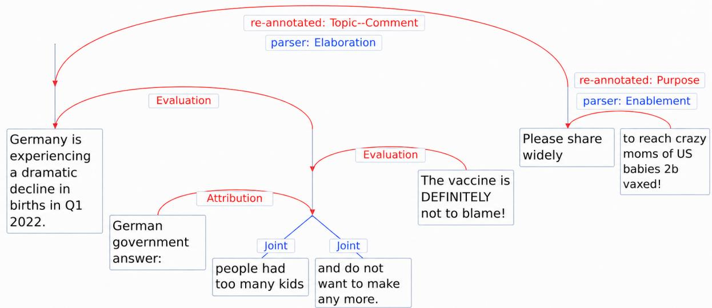  
Tweet #1965 (2/5 enthymeme votes; where success set)

P1: Germany is experiencing a dramatic decline in births in Q1 2022

P2: Dramatic birth declines in Germany are vaccine-related (implicit)

C: The vaccine is DEFINITELY not to blame! [ironic]

Figure B.1: Contested where-success set (Section 6.2.1), 2/5 enthymeme votes, reconstruction of annotator 1. The backbone of the profile is visible: an attribution node (“German government answer:”) reports an explanation from an exterior source, and an evaluation satellite (“The vaccine is DEFINITELY not to blame!”) judges it ironically. The conclusion is explicit only through the irony, and the annotators split three ways (premise, conclusion, none). Where a manual re-annotation departs from the parser, both labels are shown (re-annotated above, parser below).

consensus enthymemes of Section 6.3.2; Figure B.4 shows the consistency set of Section 6.2.2.

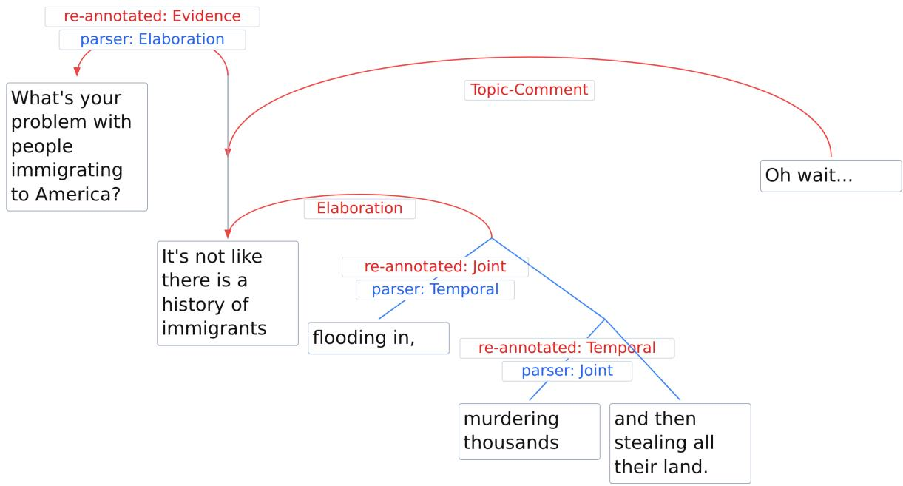  
Tweet #3283 (5/5 enthymeme votes; uncommitted consensus enthymemes)

“What’s your problem with people immigrating to America? It’s not like there is a history of immigrants flooding in, murdering thousands and then stealing all their land. Oh wait...”

P1: It’s not like there is a history of immigrants flooding in, murdering thousands and then stealing all their land. Oh wait... [sarcastic: there is such a history]

P : People whose ancestors engaged in mass immigration that displaced the original inhabitants have no moral standing to oppose current immigration (implicit)

C: What’s your problem with people immigrating to America? [rhetorical: you have no grounds for one]

Figure B.2: Uncommitted consensus enthymeme (Section 6.3.2), 5/5 votes, implicit premise of annotator 1. Parser tree with manual corrections: where the re-annotation departs from the parser, both labels are shown (re-annotated in red above, parser in blue below), and the question’s two EDUs are merged. The parser tree fits the profile of the set: no argumentative satellite, elaboration on half the nodes, unmarked junctions. It labels the second sentence elaboration where it is the evidence for the rhetorical question, and attaches the sarcasm marker “Oh wait...” to the whole tweet; the warrant linking evidence and question is the implicit premise, and nothing in the parser’s tree encodes it.

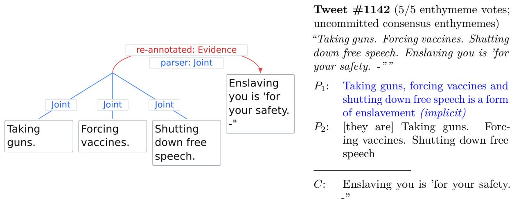  
Figure B.3: Uncommitted consensus enthymeme (Section 6.3.2), 5/5 enthymeme votes. Parser tree with manual corrections (re-annotated in red above, parser in blue below; the list is flattened and the split last clause merged). The parser gives a bare paratactic joint chain with a spine ratio of 1 and no connective: the list of actions is the evidence for the judgment in the last EDU, but nothing in the parser’s tree marks it as such.

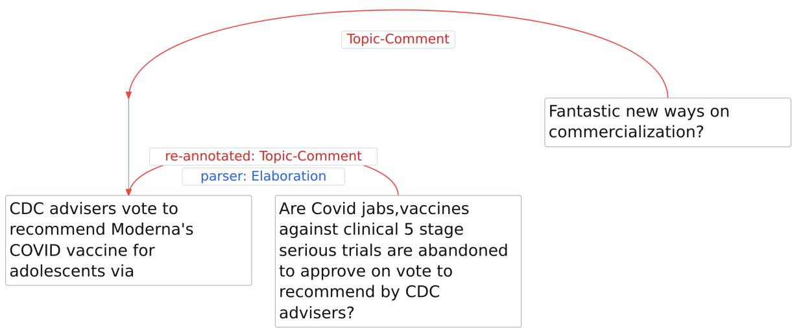  
Tweet #481 (0/5 enthymeme votes; consistency set)  
“CDC advisers vote to recommend Moderna’s COVID vaccine for adolescents via Are Covid jabs,vaccines against clinical 5 stage serious trials are abandoned to approve on vote to recommend by CDC advisers? Fantastic new ways on commercialization?”

Figure B.4: Consistency set (Section 6.2.2), 0/5 enthymeme votes. Parser tree with corrections (re-annotated in red above, parser in blue below; the split first question is merged). Both topic–comment satellites are rhetorical questions, which can be rephrased as propositions and used in an argument, a reconstruction step that tends to produce inconsistent annotator behavior: here one annotator built the full argument with a scheme and still voted none. The text-only model only senses that this structure may yield ambiguous votes and stays near the threshold; betabin has learned that an enthymeme reading is possible but most likely an inconsistency, and commits the tweet toward none. Only the per-vote consistency metric can observe this diference.