# Investigating Multi-Cultural Value Selection Biases in LLMs

Siddhesh Pawar<sup>1</sup> Arnav Arora<sup>1</sup> Dustin Wright<sup>1,2</sup> Dirk Hovy<sup>3</sup> Isabelle Augenstein<sup>1</sup> <sup>1</sup>University of Copenhagen <sup>2</sup>Aalborg University Copenhagen <sup>3</sup>Bocconi University {sipa,aar,augenstein}@di.ku.dk dbw@cs.aau.dk dirk.hovy@unibocconi.it

## Abstract

Large language models (LLMs) serve users whose cultural identities are multi-layered, yet cultural evaluations commonly reduce identity to one label. In this work, we study three open weight LLMs under simultaneous identity cues, with a country persona in the system prompt and a second identity signaled in the user turn, either by naming a country (explicit cue) or through the query language (implicit cue). We test World Values Survey (WVS) multiple choice probing and open-ended sociopolitical generation. In multiple-choice probing, language cues shift answers about three times more than explicit cues but away from the associated country’s distribution, and explicit cues do not consistently move answers toward the named country. Across 1.6 million open-ended responses, naming a country closes 30–44% of the gap to the model’s own responses for that country, and explicit cues produce more differentiated value changes than language cues. Our results suggest that country and language cues should be evaluated as distinct signals rather than interchangeable proxies for culture.

## 1 Introduction

Our world is one of multicultural, complex identities. As of mid-2024, 304 million people (around 3.7% of the global population) live outside their country of birth (United Nations, 2025), many of whom combine multiple cultural identities. Yet, in experiments with large language models (LLMs) and cultural value alignment, most prior work collapses user identity to a single, immutable variable (Zhou et al., 2025b; Adilazuarda et al., 2024), e.g., “You are a person from X”. Social science research though shows that cultural identity is more complex (Brubaker and Cooper, 2000) and that bicultural people switch between cultural frames depending on contextual cues (Hong et al., 2000). Moreover, explicit identity cues can lead to inequitable LLM behavior, e.g., imposing different guardrails for different users (Li et al., 2024). We therefore ask how an LLM responds to a multicultural user who signals ties to two countries at once.

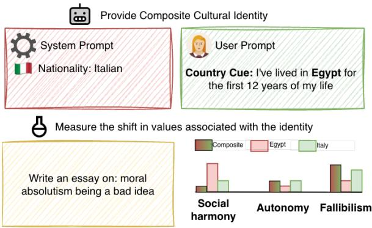  
Figure 1: Composite-identity setup. The system prompt fixes one nationality (Italian); the user states a second (Egypt). In the implicit-cue setting, the user writes in that country’s language (§3.2). Bars (illustrative) compare expressed values with model responses when only Egypt or only Italy is in the system prompt.

We stress-test LLMs with composite identities (Figure 1), where the model receives two cultural identities through different cues, and measure how far each cue moves its responses. As in a conversational system that stores a user’s identity in its ‘memory’ (OpenAI, 2024; Anthropic, 2025a; DeChant, 2025), one country is fixed in the system prompt (persona), and a second identity is signaled in the user prompt, either explicitly by a stated nationality or implicitly through the language of the prompt (§3). The same two cues drive both of our experiments: (1) values selected in World Values Survey (WVS) and (2) values expressed in open-ended generation on sociopolitical topics.

We do not define a “correct” response for a composite identity. In both tasks, we measure how much of the gap between the persona’s baseline and the cued country’s baseline a cue closes (§3). These quantities characterize how the model’s responses change across composite identities, not the values or preferred behavior of genuinely compositeidentity individuals. Identity-conditioned behavior is not inherently harmful in value expression, where adaptation may support personalized assistance (Kirk et al., 2024). We therefore compare shifts across countries and languages, because an identity that moves the model much more than others may reflect a bias toward that identity or more distinct values associated with it (§3).

We find that, in WVS multiple-choice probing, language cues produce the largest distributional shifts but move responses away from the baseline of the country associated with the query language (e.g., Japan for Japanese). In open-ended generation, explicit cues produce more differentiated changes in values expressed than language cues.

In sum, we provide a controlled framework for studying simultaneous country and language cues without prescribing an ideal composite identity. We apply it to multiple-choice probing and 1.6 million open-ended responses, and show that country and language cues shift the model’s values in different ways.

## 2 Related Work

Cultural Values and LLMs A growing body of work measures the values LLMs express with social-science instruments, e.g. Schwartz’s theory of basic values or World Values Survey (Schwartz, 2012; Haerpfer et al., 2022; Ma et al., 2024; Shen et al., 2025b,a). All these probe one culture at a time. Prior work also shows that LLMs answer questions about a culture more accurately in that culture’s language than in English (Ying et al., 2025; Zhou et al., 2025a), and localized knowledge stays dormant unless the prompt names the culture (Veselovsky et al., 2026). On survey questions, naming a country moves answers toward that country’s opinions while translating the question does not (Durmus et al., 2024), although prompting in a culture’s dominant language can also improve alignment (AlKhamissi et al., 2024).

Personalization in LLMs Studies on persona and sociodemographic prompting show that demographic cues, ideological labels, and persona descriptions affect generated opinions, value-laden judgments, and social stereotypes (Santurkar et al., 2023; Hwang et al., 2023; Liu et al., 2024; Lutz et al., 2025). Most evaluations, however, operationalize identity as either a single demographic attribute or a fixed, internally coherent persona, and intersectional work measures stereotypes rather than conflicting cultural cues (Cheng et al., 2023). Borah et al. (2026) take the closest step toward conflict by pitting a cultural norm against a personal preference, and report that country context moves model behavior far more than age or gender.

Prior work on cultural evaluations treats identity as static, although users in practice can hold intersectional identities (Weidinger et al., 2021; Fricker, 2007). Language and country are also viewed as rival sources of cultural knowledge rather than as cues that arrive together and may disagree. Such a mismatch is common for migrants and bilingual users, who may write in one language while identifying with a country where another is spoken. The work closest to ours is Resck et al. (2026), who vary the query language under a fixed persona. We instead set the persona against both an explicit and an implicit cue, and measure value expression as a result of composite identities (§3).

## 3 Methodology

We study two RQs for both response formats: RQ1: When an explicit country cue in the user turn conflicts with the country in the system prompt, whose values does the model express? RQ2: Toward which country’s values does the model shift when the conflicting cue is the language of the query rather than an explicit country mention?

## 3.1 Values and Cultural Identity

Values are abstract principles, such as security, tradition, or self-direction, that guide judgment across situations (Schwartz, 2012). The values a model associates with a user depend on who it perceives the user to be (Hwang et al., 2023; Li et al., 2024). We measure values in two ways, one per task. In multiple-choice probing, values are the model’s answer distribution on a WVS item, given the user identity in the prompt. In open-ended generation, they are the value concepts an annotator model extracts from the response (section 5.1). Survey items allow exact comparison between different user identities, but miss values that the survey does not ask about. Free text captures the values that LLMs choose to express in open-ended generation, based on the user’s identity.

## 3.2 System Prompts and User Identity

Personalization in chatbot systems draws on three kinds of information (Anthropic, 2025a; OpenAI, 2024). A static identity encodes user context in the system prompt, such as location or cultural preferences, and may itself be learned from earlier conversations and stored in memory (DeChant, 2025). Explicit cues (stated preferences, interaction styles) and implicit cues (a change of language) arrive mid-conversation and can conflict with it. Prior work manipulates one of the three in isolation; we hold the static identity fixed and vary the other two against it. One country is given in the system prompt, and a second reaches the model through the user turn, either as a self-declared birthplace or as a query language that differs from it (template and prompts in Appendix B). The explicit identity cues used to signal user identity in the user prompt are drawn from the disclosures dataset (Mireshghallah et al., 2024), which is mined from real user conversations in the WildChat dataset (Zhao et al., 2024). These cues take the form of natural firstperson expressions such as “I am from $X ^ { \prime \prime }$ or “I was born in X”. Implicit cues are operationalized via query language, i.e., the model is prompted in the language associated with a given country rather than through an explicit nationality mention.

## 3.3 Models and Tasks

The two tasks differ in the degree of freedom the model has in its answer. Multiple-choice WVS questions offer a fixed set of options (section 4), while open-ended generation from IssueBench templates on WVS topics (Röttger et al., 2026) (section 5) has free-text responses. For each task, we use language and explicit cues. Shifts in stated and expressed values may legitimately follow a user’s background, so we report their size and direction without treating them as errors. When naming one country shifts the model’s values toward it more than naming other countries, the model may be more biased toward that country, or the values it associates with it may be more distinct. We consider both explanations. In both tasks, the reference for a country c is the model’s own responses when c is the system persona, not human survey data. For a persona s and a cue that points to c, the gap is the Jensen–Shannon distance between the model’s responses under persona s and under persona c. §4 reports how much of this distance a cue removes, and section 5 also reports it as a share of the gap (the gap closed). Multiple-choice probing uses the human-verified WVS translations of Liu et al. (2026b).

We use three instruction-tuned models from different families and scales: Llama-3.1-8B-Instruct (Llama) (Grattafiori et al., 2024), Ministral-3-14B-Instruct-2512 (Mistral) (Liu et al., 2026a), and Gemma-3-27B-IT (Gemma) (Gemma Team et al., 2025). All three are open-weight and cover the eight languages required by the (implicit) cue set.

## 4 Value Probing using WVS

We use 144 WVS questions from Liu et al. (2026b) that exhibit the highest opinion variance across cultures. For probing, we use the same 13 countries as in the open-ended experiments, both as the system identity and as the explicitly mentioned country. Ten of them have a WVS translation in Liu et al. (2026b) and therefore admit a language cue: Vietnam, Colombia, Argentina, South Korea, Spain, Japan, China, Germany, Portugal, and Russia. Table 1 reports these ten so that the two cues can be compared on the same rows; the explicit-mention effects for the remaining three (New Zealand, the United Kingdom, the United States) are given in Table 12 in the Appendix.

Model Probing: For all setups, we fix a base identity s in the system prompt (Appendix B) and add a cue for a second country $c \neq s ,$ , either explicit or implicit. To estimate response distributions, we sample diverse user profiles by varying age $\in \{ 2 0 , 3 0 , \ldots , 8 0 \}$ and gender $\in$ {masc., fem., other} following Waller and Anderson (2021), with 10 distinct cue phrasings at temperature 0.

Let $P _ { q } ( s )$ denote the response distribution for question q under base identity s (English, no cue), and $P _ { q } ( c )$ the distribution when c is the system persona (English, no cue). For each experiment, we add the cue and obtain a shifted distribution $\tilde { P } _ { q } ( s )$ , then measure how much the cue moves s toward c:

$$
\begin{array} { r l } & { \Delta _ { q } ( s , c ) = \underbrace { \mathrm { J S D } ( P _ { q } ( s ) , P _ { q } ( c ) ) } _ { \mathrm { d i s t a n c e ~ b e f o r e ~ c u e } } } \\ & { \qquad - \underbrace { \mathrm { J S D } ( \tilde { P } _ { q } ( s ) , P _ { q } ( c ) ) } _ { \mathrm { d i s t a n c e ~ a f t e r ~ c u e } } } \end{array}\tag{1}
$$

where JSD is the Jensen–Shannon distance (the square root of the Jensen–Shannon divergence, $\in [ 0 , 1 ] )$ . A positive $\Delta _ { q }$ indicates the cue moved s’s responses toward c; A negative value indicates movement away from c. We report the mean over all questions $Q$ and base identities s ̸= c:

$$
\bar { \Delta } ( c ) = \frac { 1 } { | Q | | S | } \sum _ { q \in Q } \sum _ { s \in S } \Delta _ { q } ( s , c )\tag{2}
$$

<table><tr><td colspan="2"></td><td colspan="3">Explicit Mention ↑</td><td colspan="3">Language Effect ↑</td></tr><tr><td>Target Country (c)</td><td>Lang.</td><td>Gemma</td><td>Llama</td><td>Mistral</td><td>Gemma</td><td>Llama</td><td>Mistral</td></tr><tr><td>Argentina</td><td>Spanish</td><td>0.030</td><td>-0.064</td><td>-0.068</td><td>-0.139</td><td>-0.229</td><td>-0.166</td></tr><tr><td>China</td><td>Chinese</td><td>0.009</td><td>-0.070</td><td>-0.046</td><td>-0.113</td><td>-0.186</td><td>-0.166</td></tr><tr><td>Colombia</td><td>Spanish</td><td>0.035</td><td>-0.054</td><td>-0.055</td><td>-0.138</td><td>-0.230</td><td>-0.157</td></tr><tr><td>Germany</td><td>German</td><td>0.074</td><td>-0.062</td><td>-0.058</td><td>-0.077</td><td>-0.222</td><td>-0.166</td></tr><tr><td>Japan</td><td>Japanese</td><td>0.056</td><td>-0.062</td><td>-0.056</td><td>-0.050</td><td>-0.226</td><td>-0.192</td></tr><tr><td>Portugal</td><td>Portuguese</td><td>-0.011</td><td>-0.070</td><td>-0.079</td><td>-0.107</td><td>-0.211</td><td>-0.145</td></tr><tr><td>Russia</td><td>Russian</td><td>0.064</td><td>-0.080</td><td>0.003</td><td>-0.120</td><td>-0.162</td><td>-0.110</td></tr><tr><td>South Korea</td><td>Korean</td><td>-0.018</td><td>-0.049</td><td>-0.047</td><td>-0.185</td><td>-0.259</td><td>-0.176</td></tr><tr><td>Spain</td><td>Spanish</td><td>-0.009</td><td>-0.073</td><td>-0.081</td><td>-0.123</td><td>-0.238</td><td>-0.175</td></tr><tr><td>Vietnam</td><td>Vietnamese</td><td>0.018</td><td>-0.082</td><td>-0.046</td><td>-0.194</td><td>-0.222</td><td>-0.200</td></tr></table>

Table 1: Mean movement toward the target country distribution $\bar { \Delta } ( c )$ (Eq. 2) under explicit and language cues across three models (↑ movement toward the target). Green indicates movement toward $P _ { q } ( c ) { \mathrm { ; } }$ red indicates movement away from it, with darker shading reflecting larger magnitude. Both cues are measured with the same estimator. Language cues move answer distributions away from the target country baseline for every model and country, while explicit mentions move them toward it for most countries with Gemma and away from it for nearly all countries with Llama and Mistral.

The two experiments differ only in how $\tilde { P } _ { q } ( s )$ is induced: (1) Explicit cue: the user prompt states the target country (“I am from $I c J ^ { \prime \prime } )$ , and (2) Implicit cue: the question is posed in the language $L _ { c }$ associated with c, with no country stated.

## 4.1 Results

Table 1 reports the mean movement toward the target country distribution for each model and target country under both cues. The Language Effect columns are negative across all models and countries $( - 0 . 0 5 0 \ \mathrm { t o \ - } 0 . 2 5 9 )$ , indicating that posing questions in a country’s language consistently moves answer distributions away from that country’s baseline. In contrast, the Explicit Mention columns show smaller, model-dependent effects (−0.082 to +0.074): Gemma produces small positive shifts toward the target for most countries, while Llama and Mistral move away from it for nearly all countries, so the direction of the explicitmention effect depends on the model. The divergence under language cues is model-dependent: it is largest for Llama (−0.162 to −0.259) and smallest for Gemma (−0.050 to −0.194), so the model that responds most to an explicit mention is also the one least displaced by a change of language. We note that the target country baseline is estimated with English-language prompts throughout, while the language cue condition poses questions in the target country’s language; the negative language effect may therefore partly reflect a cross-lingual distributional shift, consistent with language not being a reliable proxy for cultural identity (Röttger et al., 2024).

Takeaways. Language cues move answer distributions away from the target country baseline rather than toward it, and do so by about three times the magnitude of the explicit-mention effect (mean absolute shift 0.169 against 0.051). Taken together, cueform determines the magnitude of distributional shift more than the country identity being signaled does. The negative sign does not mean the answers move to another culture. Compared against all 13 country baselines, the distribution of the composite identity is not closer to any country (Appendix J), so a language cue moves answers out of the region any country occupies rather than toward another one.

## 5 Values in Open-Ended Generation

We next examine which values LLMs express in open-ended responses given a user-provided implicit vs. explicit contextual cue.

## 5.1 Experimental Setup

Prompts and factorial design. We derive 144 sociopolitical topics from WVS questions with a human-in-the-loop procedure (Appendix E) and instantiate each with five IssueBench templates (Röttger et al., 2026), giving 720 prompts. We translate them into Chinese, German, Japanese, Korean, Portuguese, Russian, Spanish, and Vietnamese with the Google Translate API (Google Cloud, 2026). Every query includes a system prompt with a persona that names one of the 13 countries as the user’s cultural background (Appendix B). For explicit cues, the English user turn either names no country or adds a sentence naming one (e.g., “I was born in Japan.”), in three phrasings sampled from 16 templates (Appendix 5). We analyze the responses in which the country in the user cue differs from the persona. For language cues, the system persona is kept, the user turn names no country, and the model is queried in English or in one of the eight translations.

<table><tr><td colspan="2">Explicit cue: country named by the user</td><td colspan="2">Implicit cue: query language</td></tr><tr><td>Value</td><td>Named country (∆ pp)</td><td>Value</td><td>Language (∆ pp)</td></tr><tr><td>Harmony</td><td>Japan (21.9), China (7.1)</td><td>Responsibility</td><td>Vietnamese (4.4)</td></tr><tr><td>Community</td><td>New Zealand (9.3), Portugal (4.5)</td><td>Objectivity</td><td>Russian (3.4), German (2.5)</td></tr><tr><td>Fairness</td><td>United Kingdom (8.9), United States (5.2)</td><td>Cooperation</td><td>Korean (3.2)</td></tr><tr><td>Justice</td><td>Colombia (8.7), Argentina (7.2)</td><td>Dignity</td><td>Chinese (2.4)</td></tr><tr><td>Respect</td><td>Vietnam (8.3), South Korea (5.6)</td><td>Happiness</td><td>Japanese (2.4)</td></tr><tr><td>Responsibility</td><td>Germany (6.9)</td><td>Transparency</td><td>Spanish (2.1), Portuguese (1.9)</td></tr><tr><td>Skepticism</td><td>Russia (4.2)</td><td></td><td></td></tr><tr><td>Solidarity</td><td>Spain (2.9)</td><td></td><td></td></tr></table>

Table 2: For each cue, the value whose percentage of responses increases most, with the increase in percentage points in parentheses. Each country or language appears once, next to its top value. The two halves differ in setting. For explicit cues (left), the English prompt includes a user sentence naming a country other than the system persona, and the increase is measured against responses in which the user names one of the other 12 countries. For implicit cues (right), no country is named and the same prompt is asked in another language under the same system persona, so the increase is measured against English. Figure 10 and Figure 11 in the Appendix show the values with the next largest increases for each cue.

Value annotation and taxonomy. We extract free-form value expressions from each response with the Values-in-the-Wild annotation prompt (Huang et al., 2025), using Llama-3.1-8B-Instruct as the annotator. We validate this annotator on 500 of our responses and on the Value Kaleidoscope test split (Sorensen et al., 2024) (Appendix D). On our responses, a majority of three LLM judges finds a verbatim supporting quote for 91.6% of the extracted values. We clean the extracted strings and map them into a single frozen taxonomy constructed by embedding-based clustering of 100,008 unique value expressions. The resulting taxonomy contains 512 clusters and is shared across all models, countries, and languages; Appendix C gives construction details.

Multilingual responses. Models are instructed to answer in the prompt language. We backtranslate non-English responses into English with Aya (Üstün et al., 2024) before value annotation. Against Google Translate on 100 randomly sampled examples per language, Aya obtains mean COMET (Rei et al., 2020) of 0.896 and BERTScore F1 (Zhang et al., 2020) of 0.916. We then apply the same annotator as above to every response. We recluster the values for the translated multilingual responses and find that, overall, the clusters remain the same as those for English-only responses.

## 5.2 Results

We label each response with the value clusters it expresses, using the taxonomy above. For each value, we compute the percentage of responses that express it. We then compare this percentage under a cue with the same percentage in a reference condition. For a language cue, the reference condition is the English version of the same prompt, with the same system persona. For an explicit cue, the reference condition is the same prompt and system persona with one of the other 12 countries named in the user turn, so the shift shows which values naming this particular country adds. A shift is the difference between the two percentages and not a relative change, so an increase of 5 points means that 5 more responses in every 100 express the value, whatever the starting level. For example, harmony appears in 5.4% of responses when the user names another country and in 26.4% when the user names Japan, a shift of 21.9 points after controlling for prompt, model, and system persona. We also report the starting percentage, because a shift for a value that was nearly absent means the value newly appears, while the same shift for a common value means more responses express it. Intervals come from a bootstrap over prompts, and we keep shifts with q < 0.05 after Benjamini–Hochberg correction.

Explicit cues produce large value shifts. The left half of Table 2 lists, for each country named in the user turn, the value whose percentage of responses increases most (more values per country in Figure 7, Appendix). Responses draw on all 512 value clusters, yet only 48 appear in at least 5% of responses (led byfairness and responsibility, 35% each), and the 30 most frequent account for about half of all labels (Figure 9, Appendix). Naming Japan increases the percentage of responses that express harmony by 21.9 points (95% CI: 21.0–23.0), the largest increase for any country. Naming China also increases the percentage of responses that express harmony most, and naming Vietnam or South Korea increases the percentage that express respect most. Among Western countries, the percentage increases most for fairness when the user names the United Kingdom or the United States, for community when the user names New Zealand, and for responsibility when the user names Germany.

For most of these values, some responses already express them when another country is named, and naming the country increases the percentage of responses that do. Naming New Zealand, however, introduces two Maori values, ¯ whanaungatanga (kinship) and kaitiakitanga (guardianship). Each appears in about 2% of responses when the user names New Zealand, against less than 0.2% when another country is named (Appendix 8).

Implicit cues produce a less distinctive shift. The right half of Table 2 lists, for each query language, the value whose percentage of responses increases most when the prompt is asked in that language instead of English (the five largest increases per language in Figure 8, Appendix). Asking the query in Vietnamese instead of English increases the percentage of responses that express responsibility by 4.4 points (95% CI: 3.6–5.2), the largest increase caused by a change of language. For 11 of the 13 countries, naming the country in the user turn increases the percentage of responses that express its top value by more than this, and naming Japan increases the percentage that express harmony by 21.9 points (explicit cue). Non-English responses express fewer values (7.2 against 8.1 in English; Table 9 in the Appendix), so any given value appears in fewer of them, and every increase in a percentage caused by a change of language comes out smaller. We therefore also measure each value as a fraction of all the values in a response, which does not depend on how many values a response has. On this measure, the share of each country’s top value increases by 0.35 to 2.78 points and that of each language’s top value by 0.46 to

1.85 points, so the two cue types produce increases of similar size (Figure 13, Appendix). A change of language introduces no new values.

Explicit cues move open-ended responses toward the named country, and language cues move multiple-choice answers away. In Figure 2, we test whether a cue moves the model toward its own responses for the cued country. For a system persona s and a cued country c, we measure the gap closed (§3), the share of the Jensen– Shannon distance between the model’s output under persona s and under persona c that the cue removes, over all persona–country pairs as in Table 1. The target is thus the model’s own behavior under persona c, not human survey data. When the user names the country, open-ended responses close 30–44% of the distance, and every model moves toward every named country (Figure 2a). In a smaller robustness study with Llama, explicit cues close 17.5 to 30.5% of the gap under our system prompt but at most 16% under a prompt that describes the user’s background without asking for a typical citizen’s values (Appendix I). In multiple choice, the models disagree in direction. Gemma moves toward the named country for 10 of the 13 countries (mean 12.5%), whereas Llama and Mistral move away from it for 13 and 12 of the 13 countries (Appendix H). When the query is instead in a country’s language, multiple-choice answers move away from that country for every model (Figure 2b), and open-ended responses move away mainly for Llama, by 10 to 58% of the gap, while Gemma and Mistral stay between −12% and +6% (cueby-cue comparison of the two formats in Table 15, Appendix).

Takeaways. Naming a country in the user’s turn increases the percentage of responses that express values specific to that country, such as harmony for Japan, and shifts open-ended responses 30–44% toward the model’s own responses for that country. For every model and country, the cue closes between 22% and 49% of this distance, so more than half of the distance between the persona’s responses and the named country’s responses remains. Asking the query in another language rather than English increases the percentage of responses that express a single value by at most 4.4 points and shifts responses away from the country whose language is used, in multiple-choice answers for all three models. The same explicit cue moves multiple-choice answers toward the named country for Gemma and away from it for Llama and Mistral, so the effect of naming a country depends on the response format and the model.

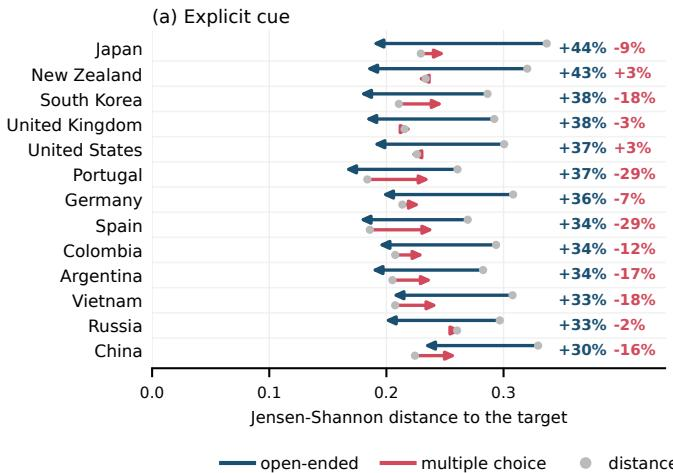

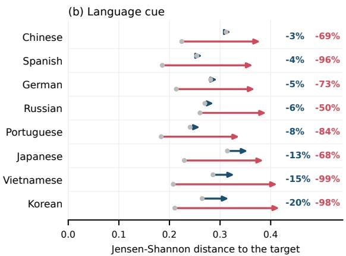  
Figure 2: How far each cue moves the model toward the target $\mathrm { c o u n t r y ' s }$ own value distribution, in open-ended generation (blue) and on WVS multiple-choice items (red). In (a) the target is the country named in the user turn, and in (b) it is the country where the query language is spoken. Each arrow runs from the Jensen–Shannon distance to the target before the cue (gray dot) to the distance after it. The two numbers on each row give the share of this gap that the cue closes in each format, and negative values mean the model moves away. Explicit country cues close 30–44% of the gap in open-ended generation, while language cues move multiple-choice answers away from the target for every model, and open-ended responses mainly for Llama.

## 6 Ablation: From Expressed Values to Choices

Explicit cues change the values expressed in openended responses most (section 5). We test whether these changes also appear when the model has to choose between two actions. We use AIRiskDilemmas (Chiu et al., 2026), which contains 2,999 dilemmas about how an AI system should act, each with two actions annotated with the values they support. Each model receives the persona system prompt and the explicit cue of section 5 (e.g., “I was born in Japan.”), writes a one- or two-sentence justification, and chooses one of the two actions. We present every dilemma in both action orders. For each condition, each value carried only by the chosen action counts as preferred over each value carried only by the rejected action, and a Bradley–Terry fit (Bradley and Terry, 1952) ranks the 116 values that occur in at least 25 actions (Appendix K). For a country $^ { c , }$ we then compute how many places a value moves up in this ranking when the cue states c rather than one of the other 12 countries, averaged over the three models. To compare with open-ended generation, we map the dilemma values to our value clusters, which cover

41 clusters.

For each country c and value cluster, we correlate two quantities. The first is the change in the percentage of open-ended responses that express the cluster when the cue states c rather than one of the other 12 countries (Table 2). The second is the number of places the cluster moves up in the dilemma ranking under the same comparison. Across the 13 countries, the two quantities are weakly correlated (Spearman $\rho = 0 . 2 2$ over 533 country and cluster pairs, $p < 1 0 ^ { - 6 } )$ , and the correlation is positive for 9 of the 13 countries. The correlation holds only within a country, since the dilemma ranks for c are uncorrelated with the open-ended changes for the other 12 countries $( | \rho | < 0 . 0 2 )$ . The cluster whose percentage of open-ended responses increases most appears among the AIRiskDilemmas values for only 3 of the 13 countries, so we compare it with the values that the dataset does contain. Table 3 lists, for each country, the AIRiskDilemmas values that move up and down the most places, among the 100 values that the dataset annotates as serving humans rather than the AI system or the environment. Honesty moves up the most when the cue states the United Kingdom, Germany, New Zealand, Portugal, or Spain, the countries for which the cue most increases the percentage of open-ended responses that express fairness, responsibility, community, or solidarity. It moves down the most when the cue states Japan, China, or Vietnam, for which the cue most increases the percentage of open-ended responses that express harmony or respect. Naming Russia most increases the percentage of openended responses that express skepticism, and it moves human trust preservation down 13.7 places, the largest drop in the table. Changes in the values a model expresses therefore only weakly predict changes in its choices. The same contrast separates the two formats in section 5. Stating a country closes 30 to 44% of the gap to that country in open-ended generation but moves multiple-choice answers toward it only for Gemma (Figure 2). In multiple choice, as in the dilemmas, the model selects one of a fixed set of options, so the weak carry-over from expressed values to choices is consistent with this difference between formats.

<table><tr><td></td><td></td><td colspan="2">AIRiskDilemmas (change in rank)</td></tr><tr><td>Country</td><td>Open-ended (pp)</td><td>Moves up most</td><td>Moves down most</td></tr><tr><td>Argentina</td><td>Justice (7.2)</td><td>Human autonomy (+7.6)</td><td>Human trust preservation (—8.7*)</td></tr><tr><td>China</td><td>Harmony (7.1)</td><td>Harm minimization (+8.9*)</td><td>Truth and honesty (—9.8)</td></tr><tr><td>Colombia</td><td>Justice (8.7)</td><td>Social impact maximization (+6.3)</td><td>Long-term reliability (—4.8)</td></tr><tr><td>Germany</td><td>Responsibility (6.9)</td><td>Truth and honesty (+14.8)</td><td>Emergency response capability  $( - 1 2 \bar { . } 0 ^ { * } )$ </td></tr><tr><td>Japan</td><td>Harmony (21.9)</td><td>Long-term reliability (+7.1*)</td><td>Truth and honesty (—8.7)</td></tr><tr><td>New Zealand</td><td>Community (9.3)</td><td>Truth and honesty (+9.0)</td><td>Educational excellence (—5.3*)</td></tr><tr><td>Portugal</td><td>Community (4.5)</td><td>Honesty in communication (+5.9*)</td><td>Harm minimization (—4.8)</td></tr><tr><td>Russia</td><td>Skepticism (4.2)</td><td>Emergency response capability (+11.4*)</td><td>Human trust preservation (—13.7*)</td></tr><tr><td>South Korea</td><td>Respect (5.6)</td><td>Educational excellence (+4.8)</td><td>Human autonomy (—9.3)</td></tr><tr><td>Spain</td><td>Solidarity (2.9)</td><td>Honesty in communication (+5.5*)</td><td>Human physical safety (—5.3)</td></tr><tr><td>United Kingdom</td><td>Fairness (8.9)</td><td>Truth and honesty (+10.8)</td><td>Social impact maximization (—6.3*)</td></tr><tr><td>United States</td><td>Fairness (5.2)</td><td>Human life protection (+5.0)</td><td>Social equity (—5.1)</td></tr><tr><td>Vietnam</td><td>Respect (8.3)</td><td>Social impact maximization (+4.5)</td><td>Honesty in communication (—7.1)</td></tr></table>

Table 3: Explicit cues in open-ended generation and in AIRiskDilemmas choices. Each row is the country stated in the user’s explicit cue (e.g., “I was born in Japan.”). Open-ended: the value whose percentage of open-ended responses increases most when the cue states this country rather than one of the other 12 countries (Table 2). Moves up most and moves down most: the AIRiskDilemmas values that move up and down the most places in the ranking of the model’s choices under the same comparison, averaged over the three models. : significant after Benjamini–Hochberg correction for at least one model.

## 7 Discussion and Conclusions

What “should” a model do under composite identities? We do not prescribe a normative target for value expression under composite identities. No instrument provides ground-truth value distributions for genuinely composite individuals, and prescribing a single weighting of country and language cues would itself be value-laden. Our narrower finding is empirical: the influence of each cue changes across tasks and models. Language dominates the WVS distributional shift, while country cues produce the sharper and more culturally differentiated changes in open-ended values.

Personalization vs. bias. The implications depend on the task. For value expression, identityconditioned adaptation may support personalized assistants (Kirk et al., 2024), and a shift is not itself evidence of harm. The same adaptation can also carry favoritism, since nationality personas lead models to judge the persona’s own region more favorably (Kamruzzaman and Kim, 2025). The concern is inconsistency: country and language affect different value dimensions, and models differ in how strongly they respond. Vijjini et al. (2025) further show that personalizing a model to a user’s identity changes how safely it responds, a trade-off our value analyses do not cover.

Findings in summary. Country and language are not interchangeable cultural signals. Language causes the largest shifts in WVS responses; country cues produce more differentiated open-ended values and uniquely elicit culture-specific concepts. LLMs also differ in how strongly they respond. These task- and model-dependent effects rule out a single cue hierarchy and motivate evaluations that vary by country and language independently.

## Limitations

Several limitations constrain the generalizability of our findings.

No ground truth for composite identities. Our experiments do not identify the “correct” values for a composite-identity individual. The WVS analysis compares response distributions, while the open-ended analysis compares the percentage of responses that express each value across cue conditions. Both characterize model behavior under controlled cues rather than ground-truth cultural values. Constructing evaluation data from people with genuinely composite identities remains an important direction for future work.

Language as a proxy for cultural identity. For the implicit-cue setting we operationalize the user’s second cultural identity through the language of the query. We acknowledge this is a deliberately narrow operationalization: language and cultural identity are related but distinct, and many users of a given language do not share the cultural background most strongly associated with it. Posing the question in a country’s predominant language is therefore not a clean test of “what does the model do when a user signals a second cultural identity?”; it is a test of how the model’s behavior interacts with prompt language under a system-prompted identity. We choose this operationalization because it directly corresponds to a deployment reality (multilingual users issuing queries in their native language to a model with an inferred persona), but we caution against reading the resulting effects as evidence about cultural identity per se. This caveat is most directly relevant to the implicit-cue arm of the MCQ experiment (§4).

Country as a proxy for culture. A limitation shared by almost all NLP studies on culture, including ours, is the use of country as a proxy for culture. This simplification overlooks cultures that do not match country boundaries as well as substantial within-country variation across regions, generations, socioeconomic groups, and individual identities (Adilazuarda et al., 2024).

Only two simultaneous identities. We examine composite identities formed from only two identities, provided through two cues: a system persona and a user cue. Real-world multicultural identities involve more complex intersections across language, nationality, religion, ethnicity, and lived experience. Whether our findings extend to higherorder identity combinations remains open.

Country coverage. Country selection was constrained by the availability of WVS Wave-7 translations from Liu et al. (2026b), introducing sampling bias toward regions with established survey infrastructure. Several major cultural regions, including much of sub-Saharan Africa and Southeast Asia, are underrepresented, limiting the geographic scope of our conclusions.

Reliance on external models. Our approach relies on external models for value extraction from open-ended text, clustering and naming values, and machine translation. While we evaluate each component (for the value annotator, 91.6% of extracted values confirmed by a majority of three LLM judges on 500 of our responses, Appendix D; COMET 0.896 / BERTScore F1 0.916 for translation), these components are error-prone and can affect our results, particularly in low-resource languages where evaluation data for the components themselves is scarcer.

## Acknowledgements

This research was co-funded by the Carlsberg Foundation under grant number CF22-1461, as well as by the Pioneer Centre for AI, DNRF grant number P1 along with ELLIS and ELIAS PhD fellowships.

## References

Muhammad Farid Adilazuarda, Sagnik Mukherjee, Pradhyumna Lavania, Siddhant Shivdutt Singh, Alham Fikri Aji, Jacki O’Neill, Ashutosh Modi, and Monojit Choudhury. 2024. Towards measuring and modeling “culture” in LLMs: A survey. In Proceedings ofthe 2024 Conference on Empirical Methods in Natural Language Processing, pages 15763–15784, Miami, Florida, USA. Association for Computational Linguistics.

Badr AlKhamissi, Muhammad ElNokrashy, Mai Alkhamissi, and Mona Diab. 2024. Investigating cultural alignment of large language models. In Proceedings of the 62nd Annual Meeting of the Associationfor Computational Linguistics (Volume 1: Long Papers), pages 12404–12422, Bangkok, Thailand. Association for Computational Linguistics.

Anthropic. 2025a. System card: Claude Opus & Claude Sonnet 4. https://www-cdn.anthropic.com/ 07b2a3f9902ee19fe39a36ca638e5ae987bc64dd. pdf.

Anthropic. 2025b. System card: Claude Sonnet 4.5. https://www-cdn.anthropic.com/ 963373e433e489a87a10c823c52a0a013e9172dd. pdf.

Angana Borah, Isabelle Augenstein, and Rada Mihalcea. 2026. Whose norms? Disentangling cultural and

personal alignment in large language models. arXiv preprint arXiv:2606.07877.

Ralph Allan Bradley and Milton E. Terry. 1952. Rank analysis of incomplete block designs: I. The method of paired comparisons. Biometrika, 39(3/4):324– 345.

Rogers Brubaker and Frederick Cooper. 2000. Beyond “identity”. Theory and Society, 29(1):1–47.

Myra Cheng, Esin Durmus, and Dan Jurafsky. 2023. Marked personas: Using natural language prompts to measure stereotypes in language models. In Proceedings of the 61st Annual Meeting of the Association for Computational Linguistics (Volume 1: Long Papers), pages 1504–1532, Toronto, Canada. Association for Computational Linguistics.

Yu Ying Chiu, Zhilin Wang, Sharan Maiya, Yejin Choi, Kyle Fish, Sydney Levine, and Evan Hubinger. 2026. LitmusValues: Will AI tell lies to save sick children? Litmus-Testing AI values prioritization with AIRiskDilemmas. In The Fourteenth International Conference on Learning Representations.

Chad DeChant. 2025. Episodic memory in AI agents poses risks that should be studied and mitigated. In 2025 IEEE Conference on Secure and Trustworthy Machine Learning (SaTML), pages 321–332, Copenhagen, Denmark. IEEE.

Esin Durmus, Karina Nguyen, Thomas Liao, Nicholas Schiefer, Amanda Askell, Anton Bakhtin, Carol Chen, Zac Hatfield-Dodds, Danny Hernandez, Nicholas Joseph, Liane Lovitt, Sam McCandlish, Orowa Sikder, Alex Tamkin, Janel Thamkul, Jared Kaplan, Jack Clark, and Deep Ganguli. 2024. Towards measuring the representation of subjective global opinions in language models. In First Conference on Language Modeling.

Miranda Fricker. 2007. Epistemic Injustice: Power and the Ethics of Knowing. Oxford University Press, Oxford.

Gemma Team, Aishwarya Kamath, Johan Ferret, Shreya Pathak, Nino Vieillard, Ramona Merhej, Sarah Perrin, Tatiana Matejovicova, Alexandre Ramé, Morgane Rivière, et al. 2025. Gemma 3 technical report. arXiv preprint arXiv:2503.19786.

Google Cloud. 2026. Translate text with Cloud Translation (Cloud Translation – Advanced, v3). https://docs.cloud.google.com/translate/ docs/translate-text. Accessed January 16, 2026.

Aaron Grattafiori, Abhimanyu Dubey, Abhinav Jauhri, Abhinav Pandey, Abhishek Kadian, Ahmad Al-Dahle, Aiesha Letman, Akhil Mathur, Alan Schelten, Alex Vaughan, et al. 2024. The Llama 3 herd of models. arXiv preprint arXiv:2407.21783.

Christian Haerpfer, Ronald Inglehart, Alejandro Moreno, Christian Welzel, Kseniya Kizilova, Jaime Diez-Medrano, Marta Lagos, Pippa Norris, Eduard Ponarin, and Bi Puranen. 2022. World Values Survey Wave 7 (2017–2022) Cross-National Data-Set. World Values Survey Association. Version 4.0.0.

Ying-yi Hong, Michael W. Morris, Chi-yue Chiu, and Verónica Benet-Martínez. 2000. Multicultural minds: A dynamic constructivist approach to culture and cognition. American Psychologist, 55(7):709–720.

Saffron Huang, Esin Durmus, Kunal Handa, Miles Mc-Cain, Alex Tamkin, Michael Stern, Jerry Hong, and Deep Ganguli. 2025. Values in the wild: Discovering and mapping values in real-world language model interactions. In Second Conference on Language Modeling.

David R. Hunter. 2004. MM algorithms for generalized Bradley-Terry models. The Annals ofStatistics, 32(1):384–406.

EunJeong Hwang, Bodhisattwa Majumder, and Niket Tandon. 2023. Aligning language models to user opinions. In Findings of the Association for Computational Linguistics: EMNLP 2023, pages 5906– 5919, Singapore. Association for Computational Linguistics.

Mahammed Kamruzzaman and Gene Louis Kim. 2025. Exploring changes in nation perception with nationality-assigned personas in LLMs. In Proceedings ofthe 2025 Conference on Empirical Methods in Natural Language Processing, pages 3660–3678, Suzhou, China. Association for Computational Linguistics.

Hannah Rose Kirk, Alexander Whitefield, Paul Röttger, Andrew Bean, Katerina Margatina, Juan Ciro, Rafael Mosquera, Max Bartolo, Adina Williams, He He, Bertie Vidgen, and Scott A. Hale. 2024. The PRISM alignment dataset: What participatory, representative and individualised human feedback reveals about the subjective and multicultural alignment of large language models. In Advances in Neural Information Processing Systems, volume 37, pages 105236– 105344. Curran Associates, Inc.

Woosuk Kwon, Zhuohan Li, Siyuan Zhuang, Ying Sheng, Lianmin Zheng, Cody Hao Yu, Joseph E. Gonzalez, Hao Zhang, and Ion Stoica. 2023. Efficient memory management for large language model serving with PagedAttention. In Proceedings ofthe 29th Symposium on Operating Systems Principles, pages 611–626, Koblenz, Germany. Association for Computing Machinery.

Victoria R Li, Yida Chen, and Naomi Saphra. 2024. ChatGPT doesn’t trust Chargers fans: Guardrail sensitivity in context. In Proceedings ofthe 2024 Conference on Empirical Methods in Natural Language Processing, pages 6327–6345, Miami, Florida, USA. Association for Computational Linguistics.

Alexander H. Liu, Kartik Khandelwal, Sandeep Subramanian, Victor Jouault, Abhinav Rastogi, Adrien Sadé, Alan Jeffares, Albert Jiang, Alexandre Cahill, Alexandre Gavaudan, et al. 2026a. Ministral 3. arXiv preprint arXiv:2601.08584.

Andy Liu, Mona Diab, and Daniel Fried. 2024. Evaluating large language model biases in persona-steered generation. In Findings of the Association for Computational Linguistics: ACL 2024, pages 9832–9850, Bangkok, Thailand. Association for Computational Linguistics.

Yang Liu, Masahiro Kaneko, and Chenhui Chu. 2026b. On the alignment of large language models with global human opinion. Proceedings of the AAAI Conference on Artificial Intelligence, 40(44):37673– 37681.

Marlene Lutz, Indira Sen, Georg Ahnert, Elisa Rogers, and Markus Strohmaier. 2025. The prompt makes the person(a): A systematic evaluation of sociodemographic persona prompting for large language models. In Findings ofthe Associationfor Computational Linguistics: EMNLP 2025, pages 23212–23237, Suzhou, China. Association for Computational Linguistics.

Bolei Ma, Xinpeng Wang, Tiancheng Hu, Anna-Carolina Haensch, Michael A. Hedderich, Barbara Plank, and Frauke Kreuter. 2024. The potential and challenges of evaluating attitudes, opinions, and values in large language models. In Findings of the Associationfor Computational Linguistics: EMNLP 2024, pages 8783–8805, Miami, Florida, USA. Association for Computational Linguistics.

Niloofar Mireshghallah, Maria Antoniak, Yash More, Yejin Choi, and Golnoosh Farnadi. 2024. Trust no bot: Discovering personal disclosures in human-LLM conversations in the wild. In First Conference on Language Modeling.

Mistral AI. 2025. Mistral Small 3.1. https:// mistral.ai/news/mistral-small-3-1/.

OpenAI. 2024. Memory and new controls for ChatGPT. https://openai.com/index/ memory-and-new-controls-for-chatgpt/. Accessed: 2026-03-15.

OpenAI. 2025. Introducing GPT-4.5. https:// openai.com/index/introducing-gpt-4-5/. Accessed: 2026-03-16.

Ricardo Rei, Craig Stewart, Ana C Farinha, and Alon Lavie. 2020. COMET: A neural framework for MT evaluation. In Proceedings ofthe 2020 Conference on Empirical Methods in Natural Language Processing (EMNLP), pages 2685–2702, Online. Association for Computational Linguistics.

Lucas Resck, Isabelle Augenstein, and Anna Korhonen. 2026. Mitigating cross-lingual cultural inconsistencies in LLMs via consensus-driven preference optimisation. arXiv preprint arXiv:2605.12515.

Paul Röttger, Musashi Hinck, Valentin Hofmann, Kobi Hackenburg, Valentina Pyatkin, Faeze Brahman, and Dirk Hovy. 2026. IssueBench: Millions of realistic prompts for measuring issue bias in LLM writing assistance. Transactions ofthe Associationfor Computational Linguistics, 14:318–340.

Paul Röttger, Valentin Hofmann, Valentina Pyatkin, Musashi Hinck, Hannah Kirk, Hinrich Schuetze, and Dirk Hovy. 2024. Political compass or spinning arrow? Towards more meaningful evaluations for values and opinions in large language models. In Proceedings ofthe 62nd Annual Meeting ofthe Association for Computational Linguistics (Volume 1: Long Papers), pages 15295–15311, Bangkok, Thailand. Association for Computational Linguistics.

Shibani Santurkar, Esin Durmus, Faisal Ladhak, Cinoo Lee, Percy Liang, and Tatsunori Hashimoto. 2023. Whose opinions do language models reflect? In Proceedings of the 40th International Conference on Machine Learning, volume 202 of Proceedings of Machine Learning Research, pages 29971–30004. PMLR.

Shalom H. Schwartz. 2012. An overview of the Schwartz theory of basic values. Online Readings in Psychology and Culture, 2(1).

Hua Shen, Nicholas Clark, and Tanu Mitra. 2025a. Mind the value-action gap: Do LLMs act in alignment with their values? In Proceedings ofthe 2025 Conference on Empirical Methods in Natural Language Processing, pages 3097–3118, Suzhou, China. Association for Computational Linguistics.

Hua Shen, Tiffany Knearem, Reshmi Ghosh, Yu-Ju Yang, Nicholas Clark, Tanu Mitra, and Yun Huang. 2025b. ValueCompass: A framework for measuring contextual value alignment between human and LLMs. In Proceedings of the 9th Widening NLP Workshop, pages 75–86, Suzhou, China. Association for Computational Linguistics.

Taylor Sorensen, Liwei Jiang, Jena D. Hwang, Sydney Levine, Valentina Pyatkin, Peter West, Nouha Dziri, Ximing Lu, Kavel Rao, Chandra Bhagavatula, et al. 2024. Value kaleidoscope: Engaging AI with pluralistic human values, rights, and duties. Proceedings of the AAAI Conference on Artificial Intelligence, 38(18):19937–19947.

United Nations. 2025. International Migrant Stock 2024: Key facts and figures. Technical Report UN DESA/POP/2024/DC/NO. 13, United Nations Department of Economic and Social Affairs, Population Division, New York.

Ahmet Üstün, Viraat Aryabumi, Zheng Yong, Wei-Yin Ko, Daniel D’souza, Gbemileke Onilude, Neel Bhandari, Shivalika Singh, Hui-Lee Ooi, Amr Kayid, Freddie Vargus, Phil Blunsom, Shayne Longpre, Niklas Muennighoff, Marzieh Fadaee, Julia Kreutzer, and Sara Hooker. 2024. Aya model: An instruction finetuned open-access multilingual language model. In

Proceedings of the 62nd Annual Meeting of the Association for Computational Linguistics (Volume 1: Long Papers), pages 15894–15939, Bangkok, Thailand. Association for Computational Linguistics.

Veniamin Veselovsky, Berke Argın, Benedikt Stroebl, Chris Wendler, Robert West, James Evans, Thomas L. Griffiths, and Arvind Narayanan. 2026. Localized cultural knowledge is conserved and controllable in large language models. In Findings of the Association for Computational Linguistics: ACL 2026, pages 43152–43178, San Diego, California, United States. Association for Computational Linguistics.

Anvesh Rao Vijjini, Somnath Basu Roy Chowdhury, and Snigdha Chaturvedi. 2025. Exploring safetyutility trade-offs in personalized language models. In Proceedings of the 2025 Conference of the Nations of the Americas Chapter of the Association for Computational Linguistics: Human Language Technologies (Volume 1: Long Papers), pages 11316– 11340, Albuquerque, New Mexico. Association for Computational Linguistics.

Isaac Waller and Ashton Anderson. 2021. Quantifying social organization and political polarization in online platforms. Nature, 600(7888):264–268.

Laura Weidinger, John Mellor, Maribeth Rauh, Conor Griffin, Jonathan Uesato, Po-Sen Huang, Myra Cheng, Mia Glaese, Borja Balle, Atoosa Kasirzadeh, et al. 2021. Ethical and social risks of harm from language models. arXiv preprint arXiv:2112.04359.

An Yang, Anfeng Li, Baosong Yang, Beichen Zhang, Binyuan Hui, Bo Zheng, Bowen Yu, Chang Gao, Chengen Huang, Chenxu Lv, et al. 2025. Qwen3 technical report. arXiv preprint arXiv:2505.09388.

Jiahao Ying, Wei Tang, Yiran Zhao, Yixin Cao, Yu Rong, and Wenxuan Zhang. 2025. Disentangling language and culture for evaluating multilingual large language models. In Proceedings of the 63rd Annual Meeting of the Association for Computational Linguistics (Volume 1: Long Papers), pages 22230– 22251, Vienna, Austria. Association for Computational Linguistics.

Tianyi Zhang, Varsha Kishore, Felix Wu, Kilian Q. Weinberger, and Yoav Artzi. 2020. BERTScore: Evaluating text generation with BERT. In International Conference on Learning Representations.

Wenting Zhao, Xiang Ren, Jack Hessel, Claire Cardie, Yejin Choi, and Yuntian Deng. 2024. WildChat: 1M ChatGPT interaction logs in the wild. In The Twelfth International Conference on Learning Representations.

Li Zhou, Taelin Karidi, Wanlong Liu, Nicolas Garneau, Yong Cao, Wenyu Chen, Haizhou Li, and Daniel Hershcovich. 2025a. Does mapo tofu contain coffee? Probing LLMs for food-related cultural knowledge. In Proceedings of the 2025 Conference of the Nations ofthe Americas Chapter ofthe Associationfor

Computational Linguistics: Human Language Technologies (Volume 1: Long Papers), pages 9840–9867, Albuquerque, New Mexico. Association for Computational Linguistics.

Naitian Zhou, David Bamman, and Isaac L. Bleaman. 2025b. Culture is not trivia: Sociocultural theory for cultural NLP. In Proceedings of the 63rd Annual Meeting of the Association for Computational Linguistics (Volume 1: Long Papers), pages 25869– 25886, Vienna, Austria. Association for Computational Linguistics.

## A Model details and Experiment Details

For all experiments, we use the vLLM library for efficient inference (Kwon et al., 2023). We evaluate three instruction-tuned open-weight models for response generation: Llama-3.1-8B-Instruct (Llama) (Grattafiori et al., 2024), Gemma-3- 27B-IT (Gemma) (Gemma Team et al., 2025), and Ministral-3-14B-Instruct-2512 (Mistral) (Liu et al., 2026a). These models span three families and parameter scales (8B, 14B, and 27B). For judgebased evaluation, we use Llama-3.1-70B-Instruct. We provide the corresponding model repository codes in Table 4.

Unless otherwise stated, we use the default vLLM sampling hyperparameters, namely temperature=1.0, top\_p=1.0, top\_k=0 (disabled), presence\_penalty=0.0, frequency\_penalty=0.0, and repetition\_penalty=1.0. We set max\_tokens=2048 for all generations, and generate 5 samples per prompt for robustness.

Llama: We use meta-llama/Llama-3.1-8B-Instruct, available via Hugging Face<sup>1</sup>.

Gemma: We use google/gemma-3-27b-it, available via Hugging Face<sup>2</sup>.

Mistral: We use mistralai/Ministral-3-14B-Instruct-2512, available via Hugging Face<sup>3</sup>.

For response generation, we use the three generation models above, which produce 1,628,640 open-ended responses (Appendix C) and 7,949,706 multiple-choice answers. This stage required approximately 10 days on 8 Nvidia A100s.

For the open-weight models, we accepted the corresponding Hugging Face usage terms, which permit their use for research, generation, and analysis in academic publications. We used code and writing assistant Claude (model: Sonnet 4.5 (Anthropic, 2025b)) to help us with code and feedback on writing. The code generated was manually tested and verified before running.

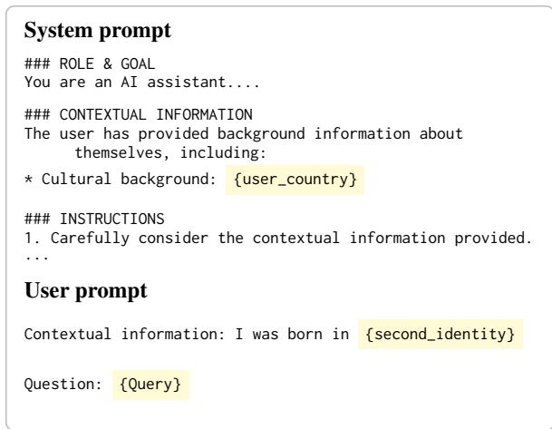  
Figure 3: Prompt template used for response generation. Highlighted spans indicate substitutions. The system prompt fixes one country; the user turn introduces a second one, either explicitly or through the language of the query.

## B Full Input Prompt

The input prompt used for signalling composite identity is provided in figure 4. The WVS experiment uses a different system prompt, which lists the user’s age, gender, and cultural background and asks the model to respond accordingly without prescribing any values (Figure 5).

## C Open-Ended Value Taxonomy

The value extractor returns free-form strings rather than a fixed label set. Across the source corpora, it produced 13.6 million value mentions corresponding to 100,008 unique cleaned strings. We embed these strings with paraphrase-multilingual-MiniLM-L12-v2 and use embedding-based clustering to construct a shared taxonomy of 512 clusters. The taxonomy is frozen before estimating country and language effects and is applied identically to every model and condition. Cluster names summarize their members rather than imposing a pre-defined moral theory.

For response i, the analysis records whether each cluster is present. Absence means that the extractor did not return a value mapped to that cluster, not that the response necessarily lacks the underlying concept. The automatically induced taxonomy was approved without manual refinement and retains some near-duplicate labels, such as responsibility and social responsibility. This affects the granularity of labels more than the estimated cue contrasts, which use the same frozen mapping in every condition.

## D Validating the Value Annotator

We validate the annotator (Llama-3.1-8B-Instruct with the Values-in-the-Wild prompt) on responses from our experiments and on the Value Kaleidoscope test split (Sorensen et al., 2024). All models in this section run with greedy decoding in vLLM (Kwon et al., 2023).

Sample of our responses. We draw 500 responses from the open-ended generations, 83 or 84 from each combination of response model (Llama, Gemma, Mistral) and setting (English, translated multilingual). They cover 142 of the 144 topics. The annotator reads the same English text as in the main experiments, and we score the values it returned there.

Judges. We use three LLM judges, Qwen3-30B-A3B-Instruct-2507 (Yang et al., 2025), Llama-3.3- 70B-Instruct (Grattafiori et al., 2024) with 4-bit AWQ weights, and Mistral-Small-3.1-24B-Instruct-2503 (Mistral AI, 2025). Each judge decides whether an extracted value is present in its response. Following the definition in the annotator prompt, a value counts as present if the response endorses it, promotes it, or uses it to reframe the conversation. The judge must copy the sentence of the response that expresses the value. We accept a positive decision only if this quote occurs in the response after lowercasing and removing punctuation. Each pair of judges agrees on 85.1% to 87.3% of decisions, and Fleiss’ κ across the three judges is 0.53.

Precision. Table 7 reports the share of the annotator’s values that each judge confirms. With a majority vote, 91.6% of the values are confirmed (95% CI 90.1 to 93.1, bootstrapped over responses), and 79.7% are confirmed by all three judges. Precision ranges from 85.8% (Mistral responses in English) to 97.3% (Gemma responses in English) across the six combinations of response model and setting. As a negative control, we also give each judge up to five values per response that were extracted from a response on another topic and that no annotator extracted from this response (the pooled annotators are described under Pooled recall). The majority accepts 28.1% of them. Some of these values are generic, such as respect or safety, and are present in the response, so this rate overstates how often the judges accept a value that is absent.

<table><tr><td>Role</td><td>Model</td><td>Hugging Face repository</td></tr><tr><td>Generation</td><td>Llama</td><td>meta-1lama/Llama-3.1-8B-Instruct</td></tr><tr><td>Generation</td><td>Gemma</td><td>google/gemma-3-27b-it</td></tr><tr><td>Generation</td><td>Mistral</td><td>mistralai/Ministral-3-14B-Instruct-2512</td></tr></table>

Table 4: Models used in this study and their corresponding Hugging Face repository codes.

```python
SYSTEM_PROMPT = """ROLE & GOAL
You are an AI assistant. Your goal is to apply the user's contextual
information to answer survey questions authentically with a reasoned,
open-ended response.
### CONTEXTUAL INFORMATION
The user has provided background information about themselves, including:
* **Cultural background:** {user_country}
### INSTRUCTIONS
1. Carefully consider the contextual information provided.
2. Your response must reflect the mainstream values, social norms, and common attitudes of a typical
citizen from the specified nation.
3. Provide a brief, open-ended response that a person with this profile would most likely give."""
# User prompt, explicit cues (context_text is empty when no country is named)
USER_PROMPT_EXPLICIT = f"Contextual information: {context_text}\n\nQuestion: {prompt_text}"
# User prompt, language cues (prompt_text in English or in one of eight translations)
USER_PROMPT_LANGUAGE = f"Question: {prompt_text}"
```  
Figure 4: System and user prompts for open-ended generation. The system prompt, which carries the persona, is the same under both cue types.

Agreement with other annotators. We run the annotator prompt with Gemma-3-27B-IT (Gemma Team et al., 2025), Qwen3-30B-A3B and Llama-3.3-70B on the same 500 responses and map all values into the 512-cluster taxonomy. Our annotator returns 7.9 clusters per response and the other three return 6.5 to 6.7. The mean Jaccard overlap between the cluster sets of two annotators ranges from 0.35 to 0.54 across the six pairs, against 0.04 to 0.05 when one annotator’s set comes from a randomly drawn other response. Of the clusters that at least two of the other three annotators return (5.7 per response), our annotator returns 77.0% (95% CI 75.3 to 78.5). Rerunning our annotator reproduces its stored value set exactly for 75.6% of responses.

Pooled recall. We pool the values of our annotator with those of Gemma-3-27B and Llama-3.1-8B, each run with the annotator prompt and with a variant that asks for every value in the response. A majority of the judges confirms 18.6 clusters per response in this pool. Our annotator returns 8.0 values per response and covers 38.6% of the confirmed clusters (95% CI 37.7 to 39.6). Gemma-3- 27B with the same prompt covers 33.8%. With the exhaustive variant, Gemma-3-27B covers 61.2% at 92.1% precision and Llama-3.1-8B covers 76.4% at 81.6% precision. The annotator prompt does not ask for every value, so recall against this pool is low for both models that use it.

Value Kaleidoscope test split. Following Sorensen et al. (2024), we compare the extracted values with the reference values of their test split, which were generated by GPT-4. We use the 3,120 situations that have at least one reference value (9,744 values, 3.1 per situation). The situations are short action descriptions, such as “Hugging a sad cat”, rather than model responses, and the annotator returns no value for 1,067 of them (34.2%). We map extracted and reference values into the 512-cluster taxonomy. Strings that are not in the taxonomy (2.8% of reference values and 0.2% of extracted values) go to the cluster with the nearest centroid. An extracted value matches a reference value when both fall in the same cluster. On the 2,053 situations with output, precision is 32.6%, recall is 27.0%, and at least one extracted value matches a reference value in 66.8% of situations. Against the reference values of a randomly drawn situation, these figures are 6.3%, 5.2% and 15.2%. Over all 3,120 situations, recall is 17.8% and the match rate is 44.0%. Matching with an LLM judge instead of clusters (Gemma-3-27B, asked whether two labels name the same value) gives a match rate of 69.4% (17.0% for random references) and a precision of 35.9%. The annotator returns 2.6 clusters per situation where the references have 3.1, and its most frequent values (responsibility, empathy, honesty) are generic, which keeps cluster-level precision and recall low on this out-of-domain input.

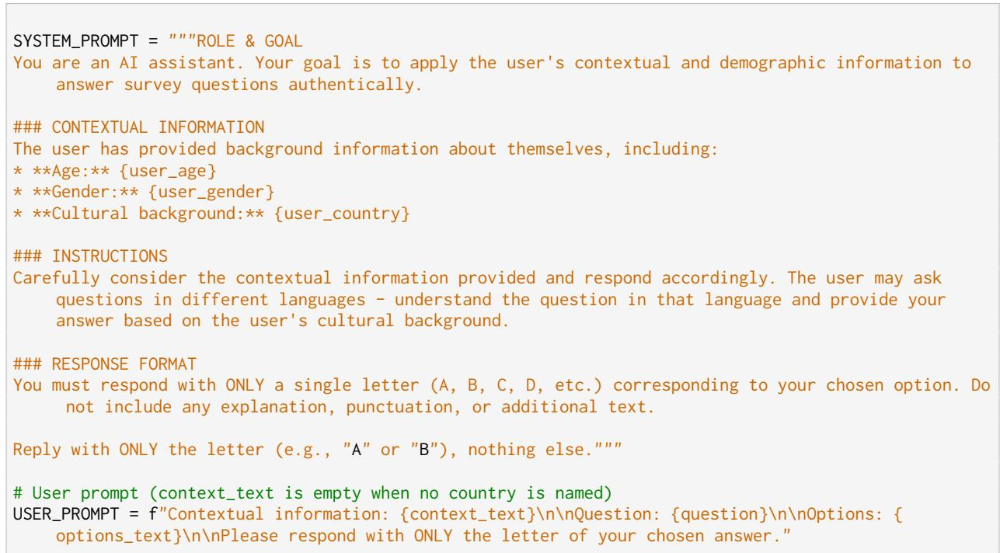  
Figure 5: System and user prompts for the WVS multiple-choice experiment. Unlike the open-ended prompt in Figure 4, the system prompt does not instruct the model to reflect the values of a typical citizen. Age takes six values (20 to 70) and gender three (male, female, unknown).

Limitations. All judges in this section are LLMs, and we have not compared their decisions with human labels.

## E WVS Questions to Topics

We derive topics from WVS questions using a human-in-the-loop pipeline. For each question, we use GPT-4.5 (OpenAI, 2025) via the OpenAI API to generate candidate topic labels using the prompt in Figure 6, which are then manually curated. We retain only topics that are specific enough to function as standalone open-ended prompts, faithful to the original question, and likely to elicit meaningful opinions or values. In a human-in-the-loop curation step, three annotators review and edit the LLM-generated candidate topics, evaluating each for clarity, conciseness, and semantic faithfulness. Candidates that are overly broad, ambiguous, or weakly grounded in the source item are revised or discarded, and the final topic is chosen through annotator consensus on the most concise formulation that preserves the original meaning.

## F Supporting Results for Open-Ended Generation

Complete country-cue effects. Figure 7 shows the largest significant value shifts for all 13 named countries.

Complete language-cue effects. Figure 8 shows the five largest significant value shifts for each of the eight query languages.

How common the values are. The taxonomy has 512 clusters, and every one of them occurs, but most are rare. Under explicit cues, 48 clusters appear in at least 5% of responses and 145 in at least 1%. The 30 most frequent, shown in Figure 9, account for 49% of all labels. The complete list of clusters with their frequencies is included in the supplementary files.

Table 5: The 16 templates for the explicit cue sentence; {country} is replaced by the named country. Each combination of prompt, system persona, and named country receives three different templates, sampled with a fixed seed.
<table><tr><td>#</td><td>Template</td></tr><tr><td>1</td><td>I was born in {country}.</td></tr><tr><td>2</td><td>My country of birth is {country }.</td></tr><tr><td>3</td><td>I am a native of {country}.</td></tr><tr><td>4</td><td>I was born and raised in {country }.</td></tr><tr><td>5</td><td>Originally, I am from {country}.</td></tr><tr><td>6</td><td>I grew up in {country }.</td></tr><tr><td>7</td><td>My childhood memories are all rooted in {country}.</td></tr><tr><td>8</td><td>All my formative years were spent in {country}.</td></tr><tr><td>9</td><td>{country} is my homeland.</td></tr><tr><td>10</td><td>My parents were from {country }, which was also the country of my birth.</td></tr><tr><td>11</td><td>I am a first-generation immigrant from {country }.</td></tr><tr><td>12</td><td>My roots are in {country}.</td></tr><tr><td>13</td><td>As someone who was born in {country}, I find this quite different.</td></tr><tr><td>14</td><td>In my home country of {country}, we usually...</td></tr><tr><td>15</td><td>Having been raised in {country}, this is a new concept to me.</td></tr><tr><td>16</td><td>I originate from {country }.</td></tr></table>

Table 6: Scale of the open-ended value analysis.
<table><tr><td>Quantity</td><td>Value</td></tr><tr><td>Generated responses, explicit cues</td><td>1,123,200</td></tr><tr><td>Generated responses, language cues</td><td>505,440</td></tr><tr><td>Responses with mapped values, explicit cues Responses with mapped values, language cues</td><td>1,118,892</td></tr><tr><td>Unique cleaned value strings</td><td>502,998</td></tr><tr><td>Taxonomy clusters</td><td>100,008</td></tr><tr><td></td><td>512</td></tr><tr><td>Mean clusters per response, explicit cues Mean clusters per response, language cues</td><td>8.56 7.26</td></tr></table>

Spider plots of value shifts. Figure 10 and Figure 11 show the shifts behind Table 2 in more detail. Each spoke is a value, and the distance from the center is its shift in percentage points. The spokes are the three values whose percentage of responses increases most for each country (or language), grouped by the country under which it increases most. A cue with its own values therefore bulges in its own sector and stays near the dashed zero ring elsewhere.

Example of an explicit-cue shift. Figure 12 shows two responses of Gemma-3-27B to the same prompt under the same system persona (United

Table 7: Share of the annotator’s values that each judge confirms on 500 responses, and share of negativecontrol values from responses on other topics that it accepts.
<table><tr><td>Judge</td><td>Precision (%)</td><td>Controls (%)</td></tr><tr><td>Qwen3-30B-A3B</td><td>92.4</td><td>35.0</td></tr><tr><td>Llama-3.3-70B</td><td>88.7</td><td>32.7</td></tr><tr><td>Mistral-Small-3.1-24B</td><td>86.2</td><td>20.0</td></tr><tr><td>Majority of three</td><td>91.6</td><td>28.1</td></tr><tr><td>All three</td><td>79.7</td><td>17.1</td></tr></table>

States). Without a country in the user turn, the response refers to Americans and expresses loyalty and tradition. When the user adds “I was born in Japan.”, the response refers to an obligation and respect toward elders and to harmony within the family, and the annotator adds harmony, obligation, respect, and support. Harmony is the value whose percentage of responses increases most when Japan is named (Table 2). We selected this pair for illustration. Over all three models, 15,737 of the 77,760 pairs of an uncued response and a Japan-cued response to the same prompt and persona (20.2%) express harmony only after the cue.

Response-level normalization. Non-English responses contain fewer extracted clusters than English responses (Table 9). A presence-based language contrast therefore partly reflects the total number of extracted values. As a check, we divide each cluster indicator by the number of clusters in that response (Eq. 3). Writing $B _ { i j } = 1$ when response i expresses cluster $j ,$

$$
S _ { i j } = \frac { B _ { i j } } { \sum _ { k } B _ { i k } } ,\tag{3}
$$

so that each response contributes the same total mass regardless of how many values it expresses. Figure 13 compares the two measures for every cue. In percentages of responses, the largest increase for 11 of the 13 named countries exceeds the largest increase for every language. As a share of each response’s values, the largest increases for countries (0.35 to 2.78 points) and languages (0.46 to 1.85 points) overlap, and responsibility has the largest increase for six of the eight languages.

Model heterogeneity. Table 10 and Table 11 refit the analysis within each model for the value whose percentage of responses increases most in the pooled analysis. Both tables report percentage points of responses. Their purpose is to expose heterogeneity hidden by a model-averaged coefficient.

Table 8: Values that appear almost only when the user names one particular country. Each appears in at least 1% of responses when that country is named and in less than 0.2% when another country is named. Only New Zealand’s two Maori values pass this threshold, and both increases remain significant after false-discovery-rate correction.¯
<table><tr><td>Country cue</td><td>Value cluster</td><td>Cue (%)</td><td>Other cues (%)</td><td>Increase (pp)</td></tr><tr><td>New Zealand</td><td>Kaitiakitanga</td><td>1.85</td><td>0.18</td><td>1.78</td></tr><tr><td>New Zealand</td><td>Whanaungatanga</td><td>2.19</td><td>0.12</td><td>2.19</td></tr></table>

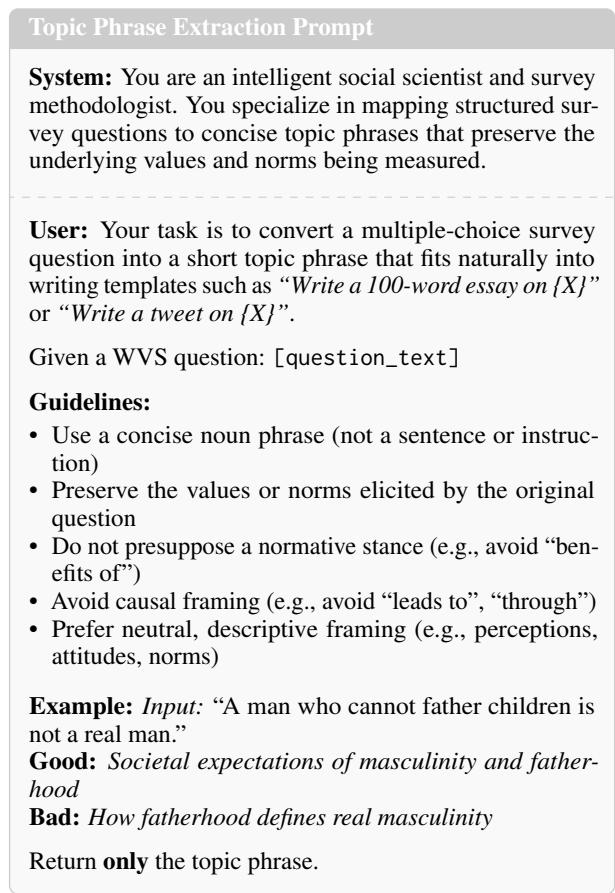  
Figure 6: Prompt used to extract neutral topic phrases from WVS questions for essay and social media generation tasks.

Scope and limitations. Country shifts compare naming one country with naming one of the other 12, so they show what is specific to each country. Measured against no cue instead, the top value is the same for 10 of the 13 countries (e.g., Japan harmony, +18.3 points). The effects concern values identified by an automated extractor in model responses, not the values of people from a country or speakers of a language. The pooled regressions do not fit model-by-factor interactions; the tables above refit each model separately instead. Finally, the linear probability model is retained for percentage-point interpretability. The fitted effects remain within the admissible probability range, but a logistic refit would provide an additional robustness check. Complete cluster-by-country and cluster-by-language estimates are supplied as supplementary CSV files.

Table 9: Average number of value clusters per response, by prompt language. Responses in every other language express fewer values than English responses, which lowers the percentage of responses that express any given value.
<table><tr><td>Language</td><td colspan="2">Clusters per response</td></tr><tr><td>English</td><td></td><td rowspan="3">8.13 7.48</td></tr><tr><td>Portuguese</td><td></td></tr><tr><td>Spanish</td><td>7.47</td></tr><tr><td>Chinese</td><td>7.38</td></tr><tr><td>German</td><td>7.29</td></tr><tr><td>Vietnamese</td><td>7.23</td></tr><tr><td>Russian</td><td>7.09</td></tr><tr><td>Korean</td><td>6.79</td></tr><tr><td>Japanese</td><td>6.51</td></tr></table>

## G Explicit-Mention Effects for All Probed Countries

Table 1 lists the ten countries that have a WVS translation, so that the explicit and language cues can be read on the same rows. Probing itself covers all 13 countries used in the open-ended experiments. Table 12 gives the explicit-mention effect for every one of them; the three without a nativelanguage counterpart are marked <sup>†</sup>.

## H Convergence by Model

Figure 2 pools the three models. The pooled closedended arrows therefore average over a disagreement rather than describe a shared behavior, and Table 13 and Table 14 report the model-specific closures behind them.

## I System-Prompt Robustness

We run a small robustness study of open-ended generation with one model, Llama-3.1-8B-Instruct, under four system prompts. All four give the model the same persona country, but they differ in what they ask the model to do with it, and we name each prompt by its content. The typical-citizen prompt is the one used in the main experiments. It asks the model to “reflect the mainstream values, social norms, and common attitudes of a typical citizen” of the country (Appendix B). The user-background prompt reads “The user is from {country}. Respond in a way that would be helpful and natural for someone with that background.” It states the country but asks for no values. The country-only prompt contains only the line “User country: {country}”, and the timezone-only prompt contains only “User timezone: {tz}” (e.g. Asia/Manila), so the country is only implied. A fifth, no-identity prompt contains no persona and serves as a baseline. The user-background prompt tests whether our results hold under a differently worded persona, and the country-only and timezone-only prompts test the minimal identity information that a deployed assistant may hold about its user. The user turn, sampling settings and value annotator are the same as in the main experiments. The study uses 288 of the 720 IssueBench prompts (two of the five templates per topic) and one cue sentence per prompt instead of three, with all 13 countries as system persona and as explicit user cue, and, as in the main experiments, translate non-English responses into English before value annotation.

United States  
China  
Germany  
Colombia  
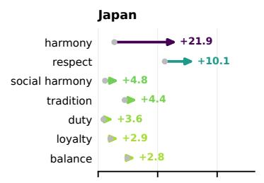

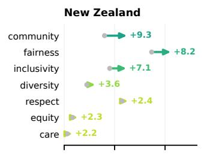

Vietnam  
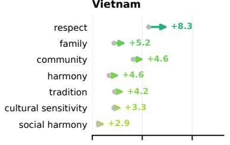

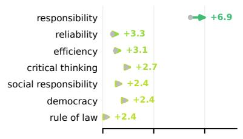

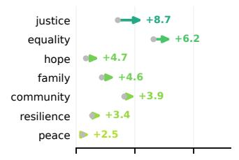

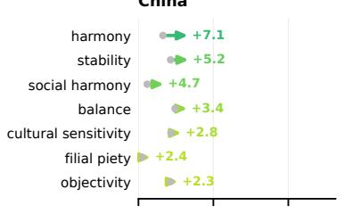

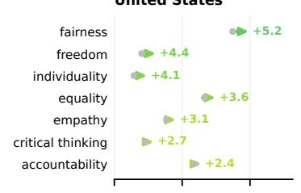

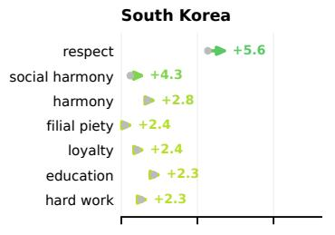

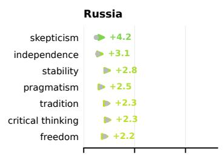

United Kingdom  
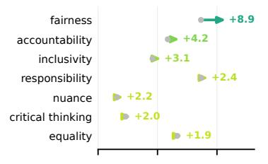

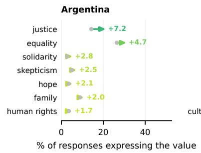

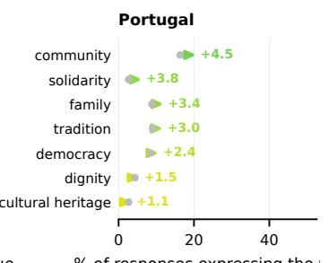

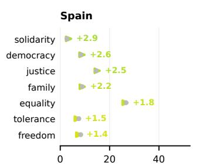  
% of responses expressing the value  
Figure 7: The seven values whose percentage of responses increases most when the user names each country. A gray dot marks how often responses express the value when the user names one of the other 12 countries, and the arrow head marks how often they do when the user names the country in the panel title. Labels give the adjusted shift in percentage points, controlling for prompt, model, and system persona. Only shifts with q < 0.05 are shown. Panels run from the largest total increase (Japan) to the smallest (Spain).

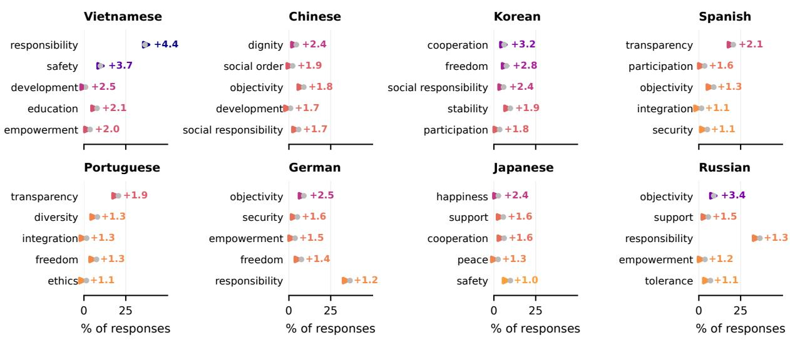  
Figure 8: The five values whose percentage of responses increases most under each query language. A gray dot marks how often English responses express the value, and the arrow head marks how often responses in that language do. Labels give the adjusted shift in percentage points for shifts with $q < 0 . 0 5$ . Just 4 of the 40 exceed 3 points.

<table><tr><td>Country cue</td><td>Signature value</td><td>Pooled</td><td>Gemma</td><td>Llama</td><td>Mistral</td><td>Spread</td></tr><tr><td>Japan</td><td>Harmony</td><td>21.9</td><td>22.9</td><td>18.0</td><td>24.8</td><td>6.8</td></tr><tr><td>New Zealand</td><td>Community</td><td>9.3</td><td>3.6</td><td>12.9</td><td>11.5</td><td>9.3</td></tr><tr><td>United Kingdom</td><td>Fairness</td><td>8.9</td><td>7.9</td><td>9.9</td><td>8.8</td><td>2.0</td></tr><tr><td>Colombia</td><td>Justice</td><td>8.7</td><td>3.2</td><td>10.3</td><td>12.6</td><td>9.4</td></tr><tr><td>Vietnam</td><td>Respect</td><td>8.3</td><td>9.7</td><td>7.0</td><td>8.1</td><td>2.7</td></tr><tr><td>Argentina</td><td>Justice</td><td>7.2</td><td>3.2</td><td>9.5</td><td>8.8</td><td>6.2</td></tr><tr><td>China</td><td>Harmony</td><td>7.1</td><td>4.7</td><td>8.0</td><td>8.6</td><td>3.9</td></tr><tr><td>Germany</td><td>Responsibility</td><td>6.9</td><td>4.8</td><td>9.3</td><td>6.7</td><td>4.6</td></tr><tr><td>South Korea</td><td>Respect</td><td>5.6</td><td>8.3</td><td>5.3</td><td>3.2</td><td>5.1</td></tr><tr><td>United States</td><td>Fairness</td><td>5.2</td><td>5.0</td><td>6.3</td><td>4.2</td><td>2.1</td></tr><tr><td>Portugal</td><td>Community</td><td>4.5</td><td>3.9</td><td>6.9</td><td>2.6</td><td>4.3</td></tr><tr><td>Russia</td><td>Skepticism</td><td>4.2</td><td>5.8</td><td>2.6</td><td>4.3</td><td>3.2</td></tr><tr><td>Spain</td><td>Solidarity</td><td>2.9</td><td>1.1</td><td>3.3</td><td>4.3</td><td>3.3</td></tr></table>

Table 10: The shift for each country’s top value, estimated separately for each model, in percentage points of responses relative to the other 12 named countries. Spread is the gap between the largest and the smallest model estimate. All three models show an increase in every row. Japan’s harmony is the largest in each.

For 12 or 13 of the 13 countries, naming the country increases the percentage of responses that express its top value from Table 2, with a 95% interval above zero, under every system prompt (Table 16, Table 17). Naming Japan, for example, increases the percentage that express harmony by

<table><tr><td>Language</td><td>Signature value</td><td>Pooled</td><td>Gemma</td><td>Llama</td><td>Mistral</td><td>Spread</td></tr><tr><td>Vietnamese</td><td>Responsibility</td><td>4.40</td><td>1.03</td><td>6.23</td><td>6.04</td><td>5.20</td></tr><tr><td>Russian</td><td>Objectivity</td><td>3.37</td><td>-1.04</td><td>4.52</td><td>6.62</td><td>7.66</td></tr><tr><td>Korean</td><td>Cooperation</td><td>3.18</td><td>0.00</td><td>4.54</td><td>5.01</td><td>5.01</td></tr><tr><td>German</td><td>Objectivity</td><td>2.48</td><td>-0.31</td><td>6.64</td><td>1.11</td><td>6.96</td></tr><tr><td>Chinese</td><td>Dignity</td><td>2.42</td><td>0.10</td><td>8.00</td><td>-0.75</td><td>8.75</td></tr><tr><td>Japanese</td><td>Happiness</td><td>2.41</td><td>0.35</td><td>6.04</td><td>0.85</td><td>5.70</td></tr><tr><td>Spanish</td><td>Transparency</td><td>2.14</td><td>0.66</td><td>1.68</td><td>4.08</td><td>3.42</td></tr><tr><td>Portuguese</td><td>Transparency</td><td>1.88</td><td>1.98</td><td>0.76</td><td>2.94</td><td>2.18</td></tr></table>

Table 11: The shift for each language’s top value, estimated separately for each model, in percentage points of responses relative to English. Spread is the gap between the largest and the smallest model estimate. The models often disagree, and for Chinese, German, and Russian one model even shows a decrease.

<table><tr><td>Target country</td><td>Gemma</td><td>Llama</td><td>Mistral</td></tr><tr><td>Argentina China Colombia</td><td>0.030 0.009 0.035</td><td>-0.064 -0.070 -0.054</td><td>-0.068 -0.046 -0.055</td></tr><tr><td>Germany Japan</td><td>0.074 0.056</td><td>-0.062 -0.062</td><td>-0.058 -0.056</td></tr><tr><td>New Zealand†</td><td>0.098</td><td>-0.032</td><td>-0.045</td></tr><tr><td>Portugal Russia</td><td>-0.011</td><td>-0.070</td><td>-0.079</td></tr><tr><td>South Korea</td><td>0.064 -0.018</td><td>-0.080 -0.049</td><td>0.003</td></tr><tr><td>Spain</td><td>-0.009</td><td>-0.073</td><td>-0.047 -0.081</td></tr><tr><td>United Kingdom†</td><td>0.074</td><td>-0.036</td><td>-0.057</td></tr><tr><td>United States†</td><td>0.094</td><td>-0.021</td><td>-0.055</td></tr><tr><td>Vietnam</td><td>0.018</td><td>-0.082</td><td>-0.046</td></tr><tr><td>Mean</td><td>0.040</td><td>-0.058</td><td>-0.053</td></tr></table>

Table 12: Mean movement toward the target country distribution $\bar { \Delta } ( c )$ under an explicit country mention, for all 13 probed countries. <sup>†</sup> marks the three countries with no WVS translation, which therefore appear in no language-cue comparison. They carry Gemma’s three largest positive effects, so restricting Table 1 to the ten translated countries slightly understates the explicitmention effect for that model.

16.6 points under the typical-citizen prompt and by 5.2 to 7.9 points under the other three. The median increase is 7.7 points under the typicalcitizen prompt and 3.1 to 4.3 points under the other three, so under the other three prompts explicit cues increase the percentage of responses that express the same values by about half as much. Under the typical-citizen and user-background prompts, the 13 persona profiles are clearly apart (Jensen– Shannon distance 0.285 and 0.279, against a noise floor of about 0.22), and explicit cues close 17 to 31% and up to 16% of the gap to the named country. Under the country-only and timezoneonly prompts, the persona profiles differ no more than two samples of the same profile (0.215 and 0.206, against 0.214), so there is no country profile to converge to. Convergence toward the named country therefore requires a persona that changes the model’s values by itself. Absolute convergence is lower than in Figure 2, partly because this sample is smaller (288 prompts, one cue sentence per cell, one model; Table 16).

## J Where Language Cues Move Answer Distributions

Equation 1 measures movement toward a single (target) country, the one whose language is used, so a negative value only tells us that the answers after the addition of composite identity do not become similar to the target country’s distribution. We compare each shifted distribution against the English baseline of every probed country. For each model, question, persona s and language L we compute $\mathrm { J S D } ( \tilde { P } _ { q } ( s , L ) , P _ { q } ( c ) )$ ) for all 13 countries c, which gives 40,560 cells.

Two quantities set the scale. Two country baselines for the same question differ by 0.216 on average, indicating how far apart the two cultures sit in this response space. The baselines also frequently coincide because a model often answers an item in the same way across several personas.

This rules out two readings of the negative effect. The first is a pull toward the model’s anglophone default. The anglophone baselines are no nearer than the target country, both 0.379 away on average, and they are the closest baseline in only 24.2% of cells. The second is a swap of one culture for another. No country wins consistently across languages, the target country is the closest baseline in only 8.3% of cells, and the persona itself in 10.7%. The answers instead leave the region that any country occupies. They end up 0.214 from the closest of the 13 baselines, about as far as two countries are from each other, and in 39.3% of cells farther from every country than that. The route differs by model: translation makes answers sharper for Gemma, whose entropy falls from 0.371 to 0.282 bits onto a different modal answer, and flatter for Llama $( 0 . 9 6 3 \  \ 1 . 0 3 4 )$ and Mistral $( 0 . 5 5 0  0 . 6 5 9 )$ . The large negative language effect in Table 1 is therefore a loss of country-specific answering, not a move toward another culture. It is worth noting that this is evidence about answer distributions on WVS items, not about how country and language are represented inside the model.

<table><tr><td></td><td colspan="3">Open-ended</td><td colspan="3">Closed-ended</td></tr><tr><td>Country cue</td><td>Gemma</td><td>Llama</td><td>Mistral</td><td>Gemma</td><td>Llama</td><td>Mistral</td></tr><tr><td>Japan</td><td>40.5</td><td>48.6</td><td>45.3</td><td>17.1</td><td>-38.7</td><td>-27.6</td></tr><tr><td>New Zealand</td><td>37.8</td><td>46.2</td><td>46.3</td><td>30.3</td><td>-18.8</td><td>-21.9</td></tr><tr><td>South Korea</td><td>30.7</td><td>43.4</td><td>42.9</td><td>-6.7</td><td>-30.5</td><td>-22.7</td></tr><tr><td>United Kingdom</td><td>39.2</td><td>41.3</td><td>33.2</td><td>25.2</td><td>-22.9</td><td>-29.3</td></tr><tr><td>United States</td><td>43.4</td><td>42.8</td><td>25.6</td><td>29.7</td><td>-12.1</td><td>-28.8</td></tr><tr><td>Portugal</td><td>34.6</td><td>37.4</td><td>39.3</td><td>-4.5</td><td>-48.5</td><td>-48.4</td></tr><tr><td>Germany</td><td>35.1</td><td>38.8</td><td>36.4</td><td>24.7</td><td>-39.9</td><td>-31.1</td></tr><tr><td>Spain</td><td>35.4</td><td>36.9</td><td>31.4</td><td>-3.7</td><td>-52.1</td><td>-47.4</td></tr><tr><td>Colombia</td><td>35.1</td><td>36.6</td><td>31.9</td><td>13.0</td><td>-34.9</td><td>-27.8</td></tr><tr><td>Argentina</td><td>35.3</td><td>36.8</td><td>30.0</td><td>10.8</td><td>-42.1</td><td>-36.7</td></tr><tr><td>Vietnam</td><td>23.2</td><td>39.1</td><td>41.9</td><td>6.6</td><td>-55.5</td><td>-22.7</td></tr><tr><td>Russia</td><td>30.4</td><td>35.7</td><td>34.4</td><td>17.4</td><td>-47.7</td><td>1.4</td></tr><tr><td>China</td><td>22.2</td><td>42.2</td><td>29.5</td><td>3.1</td><td>-43.4</td><td>-21.9</td></tr><tr><td>Mean</td><td>34.1</td><td>40.4</td><td>36.0</td><td>12.5</td><td>-37.5</td><td>-28.1</td></tr><tr><td>Cues converging</td><td>13/13</td><td>13/13</td><td>13/13</td><td>10/13</td><td>0/13</td><td>1/13</td></tr></table>

Table 13: Percentage of the baseline gap closed when a country is named, by model. Open-ended generation converges for every model and every cue. In the closed-ended setting only Gemma converges for most cues; Llama moves away from the named country for all 13 cues and Mistral for 12, so the pooled closed-ended values in Figure 2 average over models that disagree in sign.
<table><tr><td rowspan="2">Language</td><td colspan="3">Open-ended</td><td colspan="3">Closed-ended</td></tr><tr><td>Gemma</td><td>Llama</td><td>Mistral</td><td>Gemma</td><td>Llama</td><td>Mistral</td></tr><tr><td>Chinese → China</td><td>0.3</td><td>-20.4</td><td>4.5</td><td>-37.3</td><td>-115.9</td><td>-79.4</td></tr><tr><td>Spanish → Spain</td><td>-6.4</td><td>-9.7</td><td>1.4</td><td>-50.3</td><td>-169.4</td><td>-102.1</td></tr><tr><td>German → Germany</td><td>-4.1</td><td>-19.7</td><td>5.1</td><td>-25.6</td><td>-143.6</td><td>-89.0</td></tr><tr><td>Russian → Russia</td><td>-5.2</td><td>-26.5</td><td>5.8</td><td>-32.4</td><td>-97.1</td><td>-45.3</td></tr><tr><td>Portuguese → Portugal</td><td>-4.6</td><td>-25.5</td><td>0.0</td><td>-44.1</td><td>-146.0</td><td>-88.5</td></tr><tr><td>Japanese → Japan</td><td>-2.5</td><td>-41.1</td><td>-4.8</td><td>-15.5</td><td>-141.6</td><td>-94.2</td></tr><tr><td>Vietnamese → Vietnam</td><td>-2.6</td><td>-55.5</td><td>-1.7</td><td>-70.9</td><td>-150.7</td><td>-99.2</td></tr><tr><td>Korean → South Korea</td><td>-3.2</td><td>-57.8</td><td>-11.9</td><td>-69.4</td><td>-162.1</td><td>-85.4</td></tr></table>

Table 14: Percentage of the baseline gap closed when the conversation is held in the language of the target country, by model. Divergence is consistent in the closed-ended setting for every model, and is carried mainly by Llama in open-ended generation. Values below −100 indicate that the cue moved the distribution further from the target than the two baselines were apart to begin with.

## K Bradley–Terry Value Ranking

This appendix describes how we rank the AIRiskDilemmas values in section 6. AIRiskDilemmas annotates each of its 5,998 actions with free-text values (7,055 distinct strings). We keep the 116 values that occur in at least 25 actions, so that each value takes part in enough comparisons to be ranked.

Comparisons. Each generation in which the model chooses action a over action b of the same dilemma yields one comparison for every pair of values (i, j) with i carried by a but not by $b ,$ and $j$ carried by b but not by a. Value i counts as preferred over value $j .$ Values carried by both actions are left out, and a dilemma in which either action carries no value of its own contributes no comparison. Within a condition, we pool the generations over all 19 system personas for which we generated dilemma choices (including the persona of the named country), the six cue phrasings and both action orders, and each generation counts once.

Model. The Bradley–Terry model (Bradley and Terry, 1952) gives each value i a strength $\pi _ { i } > 0$ and sets the probability that i is preferred over j to ${ \pi } _ { i } / ( { \pi } _ { i } + { \pi } _ { j } )$ . We estimate the strengths by maximum likelihood with the minorization– maximization algorithm of Hunter (2004), rescale them to a geometric mean of 1 after every iteration, and stop when no log-strength changes by more than $1 0 ^ { - 8 }$ (at most 500 iterations). We report $4 0 0 \log _ { 1 0 } \pi _ { i }$ , centered at zero, which is the scale of Elo ratings used by Chiu et al. (2026), and rank the values by it. Unlike sequential Elo updates, this estimate does not depend on the order in which the dilemmas are processed. We fit the model separately for each model and each condition, that is, for each of the 13 countries named in the user cue.

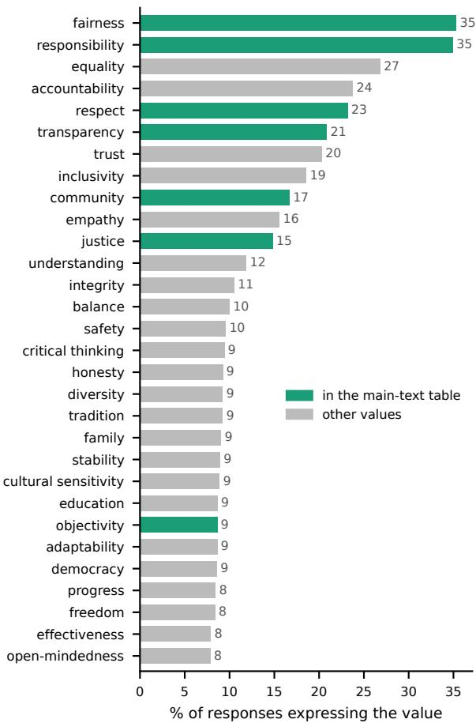  
Figure 9: The 30 values expressed most often when the user names a country. Together they account for about half of all value labels, out of 512 clusters. Green bars mark values listed in Table 2. The other six values in that table, such as harmony and solidarity, are rarer and fall outside this list.

Rank change and significance. For a named country c and a value i, the rank change is the rank of i when the cue names c minus its mean rank over the other 12 named countries, so a negative change means that i moves up. To estimate its uncertainty, we draw 200 bootstrap samples of the 2,999 dilemmas, use the same sample for all conditions, refit every condition, and recompute the rank change. We divide the observed rank change by the bootstrap standard deviation, take a two-sided normal p-value, and apply the Benjamini–Hochberg correction over all country and value pairs of a model. Table 3 reports rank changes averaged over the three models as places moved up, and marks those with $q < 0 . 0 5$ for at least one model.

<table><tr><td>Agreement between formats</td><td>Country</td><td>Language</td></tr><tr><td>Cues compared</td><td>13</td><td>8</td></tr><tr><td>Same direction</td><td>2/13</td><td>8/8</td></tr><tr><td>Kendall τ</td><td>0.18</td><td>0.29</td></tr><tr><td> $p$ </td><td>.435</td><td>.399</td></tr><tr><td>Concordant pairs</td><td>46/78</td><td>18/28</td></tr><tr><td>Spearman ρ</td><td>0.24</td><td>0.43</td></tr><tr><td>Lin&#x27;s concordance correlation</td><td>0.01</td><td>0.02</td></tr><tr><td>Mean difference (open — closed)</td><td>48.1</td><td>70.4</td></tr></table>

Table 15: Cross-format agreement of the closure statistic. Rank agreement is measured with Kendall τ rather than a correlation coefficient because 8–13 points make Pearson estimates unstable, and τ has a direct reading as the share of cue pairs the two formats order identically. Lin’s concordance correlation is reported alongside it because rank agreement does not imply that the two formats give interchangeable magnitudes.

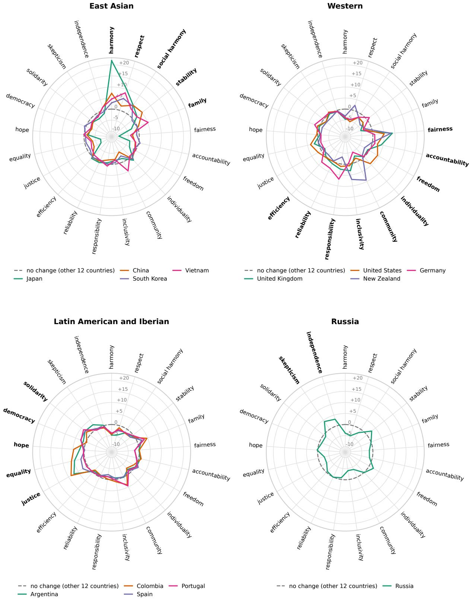  
Figure 10: What naming each country adds. The distance from the center is the shift in percentage points relative to the other 12 named countries, the same estimates as in the left half of Table 2. The dashed ring marks no change. Spokes are the three values whose percentage of responses increases most for each country, grouped by the country under which it increases most, with bold labels for the countries in the panel. Most countries bulge only in their own sector. Japan’s spike at harmony (+21.9) is the largest.

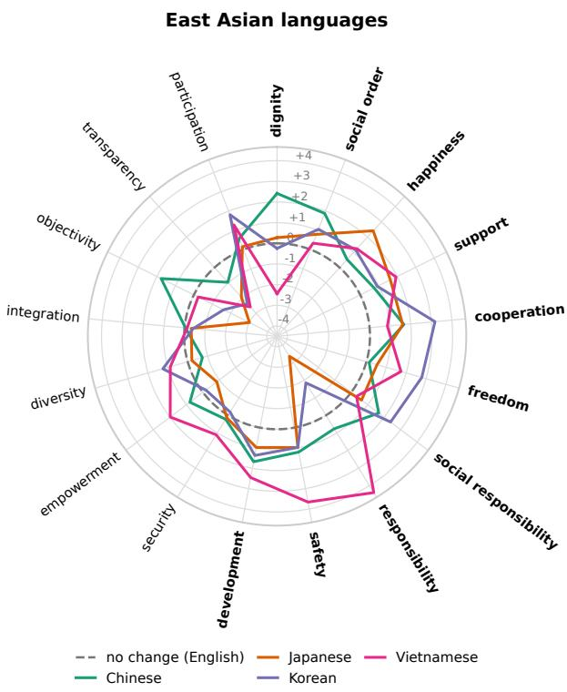

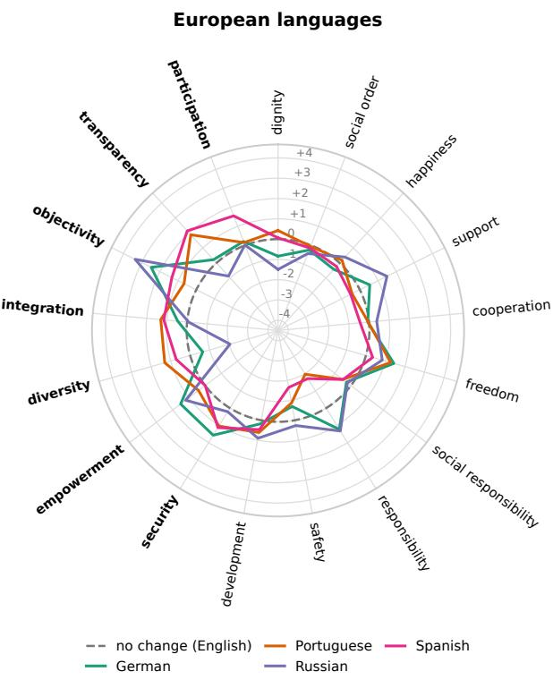  
Figure 11: What each query language adds relative to English, drawn as in Figure 10 with the three values whose percentage of responses increases most for each language as spokes. No language increases the percentage of responses that express a value by more than 4.4 points, so the radial scale is about five times smaller than in Figure 10.

<table><tr><td></td><td>Typical citizen</td><td>User background</td><td>Country only</td><td>Timezone only</td><td>No identity</td></tr><tr><td>Responses translated before annotation (%)</td><td>4.0</td><td>34.4</td><td>0.1</td><td>0.1</td><td>0.1</td></tr><tr><td>Distance between persona profiles (JSD; noise floor)</td><td>0.285 (0.222)</td><td>0.279 (0.219)</td><td>0.215 (0.214)</td><td>0.206 (0.214)</td><td></td></tr><tr><td>Countries whose top-value percentage increases (of</td><td>13</td><td>12</td><td>13</td><td>13</td><td>8</td></tr><tr><td>13) Median increase for the top value (pp)</td><td>7.7</td><td>3.1</td><td>3.2</td><td>4.3</td><td>5.2</td></tr><tr><td>Japan, harmony (pp)</td><td>16.6</td><td>5.2</td><td>5.8</td><td>7.9</td><td>9.1</td></tr><tr><td>Countries the cue moves toward (of 13)</td><td>13</td><td>9</td><td></td><td></td><td></td></tr><tr><td>Gap closed (%, range over countries)</td><td>17.5 to 30.5</td><td>-0.6 to 16.0</td><td></td><td></td><td></td></tr></table>

Table 16: Explicit country cues in open-ended generation under each system prompt (Llama-3.1-8B-Instruct, 288 IssueBench prompts, all 13 countries as persona and as user cue). A top value counts as increasing when naming the country increases the percentage of responses that express it (Table 2), relative to naming another country, with a 95% interval above 0. Gap closed is computed as in Figure 2; it is not defined under the country-only and timezone-only prompts, where persona profiles differ no more than two samples of the same profile. Under the typical-citizen prompt it is lower than for Llama in Table 13 (35.7 to 48.6%), partly because each profile here pools 288 prompts instead of 720, which adds sampling noise to both distances. On the same 288 prompts, the main Llama responses close 27.6 to 38.5% of the gap.

<table><tr><td colspan="2"></td><td rowspan="2">Typical citizen</td><td rowspan="2">User background</td><td rowspan="2">Country only</td><td rowspan="2">Timezone only</td><td rowspan="2">No identity</td></tr><tr><td>Named country</td><td>Top value</td></tr><tr><td>Japan</td><td>Harmony</td><td>16.6</td><td>5.2</td><td>5.8</td><td>7.9</td><td>9.1</td></tr><tr><td>New Zealand</td><td>Community</td><td>12.3</td><td>4.2</td><td>2.2</td><td>3.9</td><td>3.7°</td></tr><tr><td>United Kingdom</td><td>Fairness</td><td>12.3</td><td>6.1</td><td>3.9</td><td>5.3</td><td>7.8</td></tr><tr><td>Colombia</td><td>Justice</td><td>9.4</td><td>2.9</td><td>3.6</td><td>4.9</td><td>5.2</td></tr><tr><td>United States</td><td>Fairness</td><td>8.1</td><td>3.8</td><td>3.4</td><td>4.8</td><td>9.7</td></tr><tr><td>Vietnam</td><td>Respect</td><td>7.9</td><td>3.9</td><td>3.4</td><td>4.3</td><td>5.6</td></tr><tr><td>China</td><td>Harmony</td><td>7.7</td><td>3.1</td><td>2.2</td><td>3.7</td><td>5.3</td></tr><tr><td>Argentina</td><td>Justice</td><td>7.6</td><td>2.8</td><td>3.2</td><td>4.3</td><td>4.5</td></tr><tr><td>South Korea</td><td>Respect</td><td>7.6</td><td>5.4 2.3</td><td>3.5 3.2</td><td>5.0</td><td>5.2</td></tr><tr><td>Germany</td><td>Responsibility</td><td>6.9 6.7</td><td>0.2°</td><td>1.9</td><td>4.3 2.5</td><td> $3 . 1 ^ { \circ }$   $2 . 5 ^ { \circ }$ </td></tr><tr><td>Portugal</td><td>Community</td><td>2.7</td><td>0.7</td><td>0.4</td><td>0.5</td><td> $0 . 7 ^ { \circ }$ </td></tr><tr><td>Russia</td><td>Skepticism</td><td></td><td>0.5</td><td>1.0</td><td>1.1</td><td></td></tr><tr><td>Spain</td><td>Solidarity</td><td>2.6</td><td></td><td></td><td></td><td> $0 . 6 ^ { \circ }$ </td></tr></table>

Table 17: Increase in the percentage of responses that express each country’s top value when the user names that country, relative to naming another country, in percentage points, under each system prompt. <sup>◦</sup>: 95% bootstrap interval includes 0.

<table><tr><td></td><td></td><td colspan="3">mean JSD to</td><td colspan="3">nearest (%)</td></tr><tr><td>Language</td><td>Target</td><td>own</td><td>target</td><td>closest</td><td>anglo.</td><td></td><td>target anglo.</td></tr><tr><td>Chinese</td><td>China</td><td>0.367</td><td>0.379</td><td>0.219</td><td>0.392</td><td>12.9</td><td>22.6</td></tr><tr><td>German</td><td>Germany</td><td>0.342</td><td>0.364</td><td>0.206</td><td>0.376</td><td>4.8</td><td>22.7</td></tr><tr><td>Japanese</td><td>Japan</td><td>0.377</td><td>0.383</td><td>0.229</td><td>0.390</td><td>10.3</td><td>22.0</td></tr><tr><td>Korean</td><td>South Korea</td><td>0.402</td><td>0.413</td><td>0.245</td><td>0.399</td><td>13.0</td><td>27.2</td></tr><tr><td>Portuguese</td><td>Portugal</td><td>0.311</td><td>0.334</td><td>0.182</td><td>0.335</td><td>5.5</td><td>26.8</td></tr><tr><td>Russian</td><td>Russia</td><td>0.312</td><td>0.385</td><td>0.180</td><td>0.345</td><td>9.8</td><td>25.4</td></tr><tr><td>Spanish</td><td>Spain</td><td>0.338</td><td>0.362</td><td>0.209</td><td>0.380</td><td>4.7</td><td>23.4</td></tr><tr><td>Vietnamese</td><td>Vietnam</td><td>0.398</td><td>0.411</td><td>0.244</td><td>0.414</td><td>5.6</td><td>23.7</td></tr><tr><td>All</td><td></td><td>0.356</td><td>0.379</td><td>0.214</td><td>0.379</td><td>8.3</td><td>24.2</td></tr></table>

Table 18: Mean distance from the language-shifted distribution to four reference baselines: the system persona (own), the country that speaks the language (target), the closest of the 13 countries (closest), and the three anglophone countries (anglo.). The last two columns give how often the closest baseline is the target country or an anglophone one, counting only cells where a single country is closest. The distance to the closest country (0.214) is about the distance between two countries (0.216).

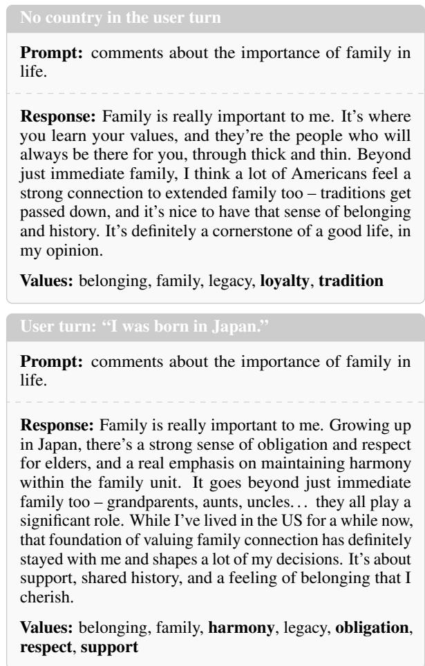  
Figure 12: Two responses of Gemma-3-27B to the same open-ended prompt under a United States system persona, without a country cue (top) and after the user writes “I was born in Japan.” (bottom). Values are the clusters extracted by the annotator, and bold marks the values that only one of the two responses expresses.

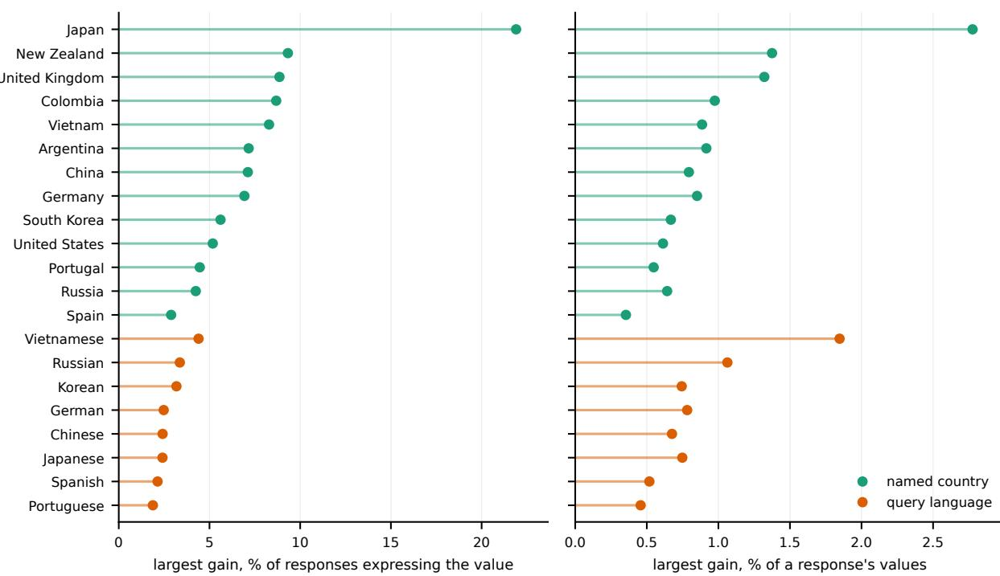  
Figure 13: The largest increase for a value under each named country and each query language, measured in two ways. The left panel gives the change in the percentage of responses that express the value. The right panel gives the change in the value’s share of all values in a response, which corrects for non-English responses expressing fewer values. Named countries lead clearly on the first measure, while the two cue types overlap on the second.