# Joint or Per-Option? Compact Encoders for Closed-Set Decisions from 17 Million to 1 Billion Parameters

Tardelli Ronan Coelho Stekel

Federal Institute of São Paulo (IFSP), São Paulo, Brazil stekel@ifsp.edu.br ORCID: 0000-0002-3135-3656

Abstract. Many language-model pipelines end in a closed-set decision, such as selecting a tool. Prompting a large language model for it is slow and order-sensitive. We ask how small an encoder for such decisions can be and whether it should read the options jointly or separately. In a three-seed study at 32 million parameters, per-option scoring beats joint scoring on a held-out sample of a 37-benchmark decision suite by 5.8 points of chance-corrected skill at matched optimizer steps and by 2.8 at approximately matched training compute; two external benchmarks agree, though not significantly on their unseen tasks. Crossing reader with initialisation shows that the advantage requires a reranker initialisation, whose query–candidate pair input matches per-option reading; from the raw encoder the two readers are indistinguishable. Per-option scoring needs 5 to 13 times more encoder passes: at most twice the median latency, but more than four times the mean. Of six released joint encoders (17 million to 1 billion parameters), the 68- and 150-million-parameter models exceed a 435-million-parameter DeBERTa-v3 zero-shot classifier by 4.9 and 5.9 accuracy points on 209 overlap-audited System1-Arena tasks and are at least on par with it on the 145 tasks unseen in training. The smallest answers a median request in 14 milliseconds on 16 processor threads, against 728 for the classifier. Reordering options changes 12 to 23% of the joint models’ answers (per-option scoring: none). Up to 68 million parameters, they lead their size range on a public leaderboard’s private, mainly in-distribution tests.

Index Terms. Knowledge distillation, multiple-choice scoring, natural language processing, robustness, text classification, transformers, zero-shot learning.

## 1 Introduction

Many uses of a language model end in a decision from a closed set: which tool to call, whether a retrieved passage supports a claim, which intent a message expresses, which of four answers is right. In established terms these are zero-shot classification and multiple-choice problems whose label set changes from instance to instance. Current practice answers them in one of three ways. A large language model (LLM) can be prompted and its output parsed, which is slow and sensitive to the order in which the options are listed [1, 2]. A natural language inference (NLI) model can score each candidate label as a hypothesis [3, 4], which needs one forward pass per option. Or a classifier can be fine-tuned for each task, which does not transfer to new label sets. A recent request format, introduced with the Jev decision model [5] and formalised by later work [6,7], packages such problems as typed decisions: a structured request (a state plus typed questions) goes in, and a probability for every allowed option comes out, with no generated text (Fig. 2).

Because the output space is fixed, a model for such decisions can in principle be small. This paper asks two questions: how small an encoder can be, and how it should read the options. The second question has two classical answers. Per-option scoring, as in BERT’s multiple-choice head [8, 9] and in NLI zero-shot classification, encodes the context once per option and normalises the scores across options; joint scoring encodes the context with all options in one sequence and reads one score per option from marker tokens, as in UniMC [10] and, for typed decisions, Dinah-0 [11]. Joint scoring costs one pass per question instead of n, which is why recent compact decision models use it, but the two have not been compared under controlled conditions for this kind of decision.

We train Crivo, a family of six joint encoders from 17M to 1B parameters fine-tuned from the Ettin rerankers [12, 13] with an [OPT] readout adapted from Dinah-0, and we run a three-seed controlled grid at 32M that compares joint and per-option reading with everything else fixed, from two initialisations. The grid is scored on a held-out sample of the 37- benchmark public suite of the Decision Index [14] (hereafter, the board), a public leaderboard for this format (public-suite skill). We evaluate the family on two public external benchmarks audited for overlap with our training data, System1- Arena (S1-Arena) [15] for typed decisions and BTZSC [16] for zero-shot text classification, against named baselines run under one protocol, and we measure option-order robustness, calibration and latency on stated hardware. As supporting evidence we report the board’s private tests, whose official score comes only from tests its maintainers run, together with Prumo, a rule engine with no learned parameters that shows what those tests reward without learning. Fig. 1 summarises the external and the private-test results.

## 1.1 Contributions

1. A controlled comparison of joint and per-option reading. In a 32M grid with three seeds per arm, peroption scoring beats the joint reader used in the released models, when both start from the reranker, by +0.058 public-suite skill at matched optimizer steps and by +0.028 at approximately matched training compute, with the same sign on S1-Arena and BTZSC but no significant difference on their unseen tasks. $\mathrm { ~ A ~ 2 ~ } \times \mathrm { ~ 2 ~ }$ of initialisation by reader locates the advantage: it appears only from the cross-encoder reranker, whose pair input matches per-option reading; from the raw encoder the two readers are indistinguishable. Per-option scoring costs 5–13 times more encoder passes, felt mostly in mean and tail latency (Section 5).

(b) Decision Index 0.4 private tests (supporting), 204 sized entries  
(a) S1-Arena, external audited benchmark (95% item CIs)  
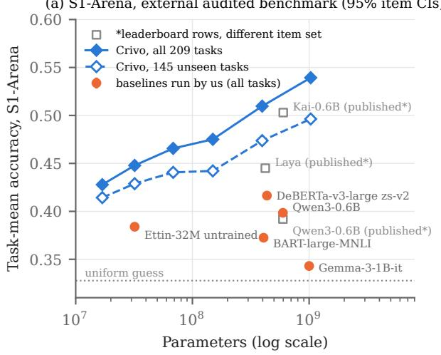

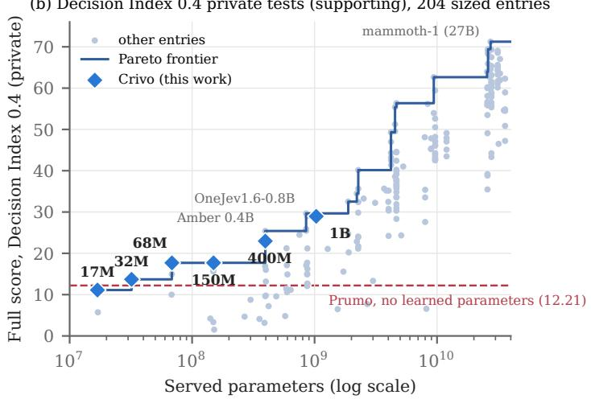  
Figure 1: Compact encoders on closed-set decisions. (a) S1-Arena, our runs: task-mean accuracy over all 209 tasks (filled) and over the 145 tasks unseen by the Crivo training data (open), with 95% per-item bootstrap intervals, against baselines run under the same protocol (orange; the two LLMs use a letter readout without a chat template) and three published leaderboard rows (squares; full benchmark, not paired). (b) Supporting evidence: Decision Index 0.4, official Full score (private tests only) against served parameters for the 204 sized entries (snapshot of 2026-10-20; board maximum 71.24); staircase: size–score Pareto frontier; differences below 0.9 points are within the board’s rank-group rule. Prumo (no learned parameters) is the dashed line.

2. Six compact joint encoders with contaminationaudited external evaluation. The released models (17M–1B) took about US\$80 of rented GPU time (US\$54 recorded, the rest estimated). On all 209 S1-Arena tasks, Crivo-68M and Crivo-150M exceed DeBERTa-v3-large zero-shot (435M) by +0.049 and +0.059 in task-mean accuracy, also after a Holm correction; on the 145 unseen tasks they are at least on par with it. On the four unseen BTZSC datasets, Crivo-400M and Crivo-1B match or exceed published zero-shot rows of up to 8B parameters (Sections 6.1 and 6.2).

3. Robustness, calibration and cost on stated hardware. Reordering options changes 12–23% of Crivo’s answers (DeBERTa 2%, per-option scoring none); the models are over-confident on unseen tasks; Crivo-17M answers a median request in 13.5 ms on 16 CPU threads, against 728 ms for DeBERTa (Sections 6.3–6.5).

4. Private-test evidence and a probe of the benchmark. On the board’s maintainer-run private tests, Crivo-17M, -32M and -68M lead their size range on mostly indistribution skills but stay near the floor on new domains, and our own development panels, drawn from the same pool as the training data, overestimated every model’s private score (Section 7.3). Prumo, a rule engine with no learned parameters, matches Crivo-17M on the same-skill tests while staying near chance externally, which exposes format-specific solving in part of the board (Section 7).

The task format [5] and the [OPT] readout [11] are prior work. All weights, code, run outputs and the scripts behind every table and figure are released (Section 9). Section 2 reviews related work, Section 3 gives the protocol and Section 4 the models. Section 5 reports the reader study, Section 6 the external results and Section 7 the private tests; Section 8 discusses implications and limitations.

## 2 Related Work

## 2.1 Option scoring: per-option, joint and listwise

How an encoder should read a set of candidate answers is an old question, and the reader study of Section 5 belongs to it. Per-option scoring encodes the context once per option and normalises the scores across options. It is the standard multiple-choice head of BERT-style encoders on SWAG and RACE [8,9,17], the basis of zero-shot classification by entailment, which scores each label as an NLI hypothesis [3] using models trained on corpora such as MNLI [18] (BART-large-MNLI [19] and the DeBERTa-v3 [20] classifiers of Laurer et al. [4, 21] are the standard checkpoints), and of label-pair classifiers such as TARS [22]. Its cost grows with the number of options, and options cannot be compared directly, which multiple-choice reading-comprehension models address with option-comparison and co-matching layers [23, 24].

Joint scoring puts the context and all options in one sequence and reads one score per option. UniMC [10], extended in IEEE Access [25], recasts natural language understanding tasks as multiple choice: an option-mask token precedes every option, each predicts “yes” through the maskedlanguage-model head, and the “yes” logits are normalised across options; an attention mask keeps the options from attending to each other, so all options are read in one pass but scored without direct comparison. GLiNER [26] prepends one marker per entity type and reads all types in one pass; GLiClass [27] applies the same idea to zero-shot sequence classification, encoding a text with all its candidate labels, which attend to each other and to the text, and reports several times the throughput of pairwise NLI cross-encoders; and LACO [28] jointly encodes a document with all labels of a fixed label set for supervised multi-label classification. Recasting classification as multiple choice over category labels has also been studied in IEEE Access [29].

In retrieval, listwise cross-encoders such as Set-Encoder [30] let candidates attend to each other and make the result invariant to their order. For LLMs, multiple-choice answers are usually read from the logit of the option letter [31], which is sensitive to option order [1, 2]. BTZSC compares crossencoders, embedding models, rerankers and LLMs under one zero-shot protocol [16].

Crivo’s released reader is a joint reader in the UniMC line, adapted to typed decisions through Dinah-0. Unlike UniMC, and like GLiClass, it lets the options attend to each other; it also uses a fresh head on a reranker backbone and is trained on typed decisions rather than on converted multiple-choice datasets. Our reader study compares it with per-option scoring under controlled conditions (Section 5).

## 2.2 Typed decision models

Jev introduced the request format used here, under the name “System One”, together with a hosted decision model [5]. Independent evaluations and an early evidence review followed within weeks [32–35], among them S1-Arena, a typeddecision benchmark built from 268 public sources with a public leaderboard [15], and a harness in which a fine-tuned DeBERTa-v3-large wins on almost every labelled benchmark [36]. Most open decision models are decoders read through option letters or deliberation [37–40]. Encoder approaches are closer to ours. Decision models have been built from biomedical sentence encoders [41]; Bekko released a large training set and 17M–400M models on the same Ettin rerankers that we start from [42, 43]; Laya, a 421M ModernBERT-based model, was independently reproduced and found under-confident [44]; Verdict answers all questions of a request in one pass under a structured attention mask [45]; and Narrow Decision Models and Jeva formalise the interface with a bidirectional encoder and structural requirements such as permutation invariance [6,7]. The [OPT] readout that Crivo uses comes from the Dinah-0 model [11], a 150M encoder for this format whose option markers resemble UniMC’s.

## 2.3 Cross-encoders, compact encoders and distillation

Crivo is a cross-encoder in the sense of monoBERT [46], as opposed to the siamese bi-encoders of Sentence-BERT [47]: the context and the candidates are encoded jointly. Its backbones are the reranker fine-tunes [13] of the Ettin encoders [12], which follow ModernBERT [48], a successor of BERT [8]. Smaller family members are distilled from larger ones, as compact encoders often are: with soft targets [49] as in DistilBERT [50], by attention distillation as in MiniLM [51], and in recent task-aware distillation into encoders [52].

## 2.4 Calibration and selective prediction

We report expected calibration error [53, 54], the Brier score [55] and selective-prediction risk [56]. Pre-trained transformers are reasonably calibrated in domain and less so out of domain [57]; decision models have been found over-confident when answers need specialist knowledge [33] and underconfident in the case of Laya [44].

## 2.5 Leaderboards, holdout reuse and contamination

Reusing a test set for selection overfits it [58], models lose accuracy on fresh test sets built to replicate the original distribution [59], and leaderboards can be distorted when some providers test many private variants and publish only the best [60]; contamination audits [61] are one response. Our negative result (Section 7.3) is a case where the proxy that failed was our own development panel, not the public test set. Following Schwartz et al. [62], we report quality against cost.

## 2.6 Rule-based and parameter-free baselines

Parameter-free classifiers such as compression with nearest neighbours [63] and deterministic tiers that hand over to a model only when needed [64] show that simple baselines can be strong and diagnostic. Prumo follows this line: a fixed pipeline of classical components (BM25 [65], code execution, game-tree search, truth tables, calendar arithmetic) used as a diagnostic of what a decision benchmark rewards without learning.

## 3 Task and Evaluation Protocol

## 3.1 Typed decisions

A request has a state (text or JSON: a conversation, a document, a tool catalogue, a board position) and one or more questions, each with instructions. A multiple-choice question lists option keys, optionally with descriptions, and expects a probability for every key. A binary predicate question expects the probability that a statement is true. An ordinal question expects a distribution over ordered levels. The answer is the argmax; probabilities also serve ranking benchmarks and selective prediction. (In the Jev format these types are called choice, noul and score.) Fig. 2 shows an invented support ticket with one question of each type and the answers of a released Crivo model. In a pipeline the encoder sits between the application or LLM agent that builds the request and a rule that acts on the probabilities: route the ticket, pick a tool, or block an action when a guardrail question passes a threshold.

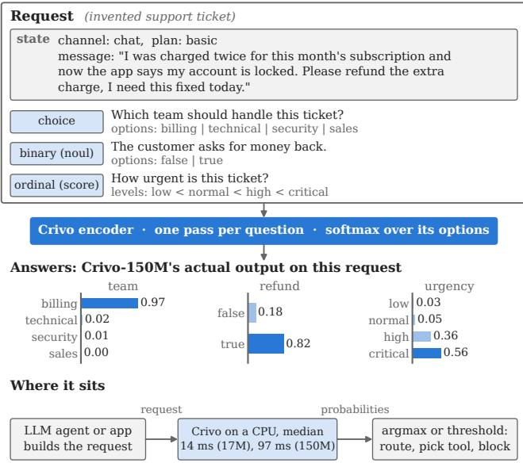  
Figure 2: A typed decision request and where a compact encoder sits. The invented request holds a state and three typed questions; each question is one encoder pass and receives a probability for every option. Bars are the output of the released Crivo-150M on this request, run once on a CPU (an illustration, not a benchmark sample). Latencies are the 16-thread CPU medians of Table 7.

## 3.2 External benchmarks

System1-Arena (S1-Arena) [15] is a typed-decision benchmark in the same request format, with open data and code and a public leaderboard. We use the 13 non-agentic domains of its public snapshot, which its overall leaderboard score averages: 41,183 requests, 72,817 questions and 209 tasks (the published leaderboard also includes 2,043 requests that can only be built locally, so its rows are not on exactly our item set). We map binary questions to binary predicates; nothing else is changed. The statistic is the benchmark’s own: pertask accuracy averaged over tasks, computed with its scorer (unanswered counts as wrong). Every Crivo leaves 72 questions unanswered: they belong to 24 requests longer than the 32,768 tokens that the released engine reads, which it declines rather than truncates.

BTZSC [16] is a zero-shot text classification benchmark of 22 datasets in sentiment, emotion, intent and topic, with published results for NLI cross-encoders, rerankers, embedding models and LLMs. We render each item as one multiplechoice question whose options are BTZSC’s own label verbalisations, with one fixed instruction chosen before any run. The metric is macro-F1 averaged over datasets. Running Crivo-17M through the official harness on 50 items per dataset gave per-dataset scores identical to our adapter’s.

Table 1: Contamination audit of the external benchmarks against the training data of the released Crivo models.
<table><tr><td>Benchmark (unit)</td><td>Unseen</td><td></td><td>Seen: split Seen: overlap</td><td>Unseen items</td></tr><tr><td>S1-Arena (tasks)</td><td>145</td><td>25</td><td>39</td><td>28,723 / 41,183</td></tr><tr><td>BTZSC (datasets)</td><td>4</td><td>12</td><td>6</td><td>18,852 / 172,501</td></tr></table>

## 3.3 Contamination policy and audit

Our policy has three parts. (i) Training may use the train and development splits of a benchmark’s source datasets, never test items. The Decision Index permits this, our board entries disclose it, and the board counts any test item found in training data as wrong. (ii) A firewall drops training rows that match a public-suite test row by normalised state and question, by a distinctive state, or by a shared passage of at least 120 characters; a final audit of the exact training files against all 563,686 suite questions found no match. (iii) The external benchmarks were run on 2026-10-20, after every model had been released, and were never used for training, selection or tuning: one run per model with one fixed rendering. After training, we audited them against every string in the training data (Table 1). A task or dataset is unseen if no training source is the same dataset or corpus and fewer than 0.5% of its test items overlap a training string (exact match of at least five words, or at least 80% of the item’s word 8-grams inside one training string); seen: split if its source corpus was in training but the overlap is below 0.5%; and seen: overlap otherwise. The S1-Arena audit uses each item’s longest state string and therefore flags shared premises as overlap. We report unseen and seen results separately and call only unseen results evidence of generalisation; nothing in seen sets is called zeroshot.

Only 4 of 22 BTZSC datasets are unseen (appreviews, empathetic, trueteacher, capsotu), so BTZSC is a secondary validation; 145 of 209 S1-Arena tasks are unseen. The Morit zLaurer zeroshot-v2.0 checkpoints were fine-tuned on training data of all 22 BTZSC datasets, whose label verbalisations BTZSC inherits from the same dataset pool [16, 66], so on BTZSC they are a supervised upper reference, not a zeroshot baseline; we did not audit their exposure to S1-Arena.

## 3.4 Baselines

All baselines are public checkpoints run by us through the same request files:

• NLI zero-shot: DeBERTa-v3-large-zeroshot-v2.0 (435M) and ModernBERT-large-zeroshot-v2.0 (395M, BTZSC only) of Laurer et al. [4, 66], called “zs-v2” below, and BART-large-MNLI [19] (407M, S1-Arena only); premise = rendered state, hypothesis = question plus option, softmax of the entailment logits over options. As in BTZSC’s harness, the premise is truncated at 512 tokens (1,024 for BART).

• Small LLMs with a letter readout: Qwen3-0.6B [67] and Gemma-3-1B-it [68]; next-token probabilities of the option letters, renormalised, with BTZSC’s prompt generalised to a question. Both run without a chat template or permutation debiasing [1]; they measure a plain letter readout, not the best these models can do (Gemma-3- 1B-it is close to the uniform guess on S1-Arena).

• The untrained Ettin-32M reranker, i.e. Crivo-32M before training, scoring each option as a document.

• A uniform guess.

Inputs a baseline cannot process (too long or too many options) count as wrong, as in the Decision Index. We also cite the published S1-Arena and BTZSC rows, which come from the benchmarks’ own harnesses and carry no paired intervals. We did not run the compact decision encoders of other authors (Bekko, Dinah-1, the tasksource decider, Mola) or GLi-Class [27] on the external benchmarks, and none of them publishes results on S1-Arena or BTZSC that we could compare with; they appear only on the Decision Index.

## 3.5 The Decision Index public suite

The Decision Index [14, 69] is a public leaderboard for this format. Entrants run a public suite of 37 benchmarks in five areas (knowledge and reasoning, language understanding, retrieval and classification, tools and automation, arts and taste) with the open kit and submit their outputs. Each benchmark is chance-corrected, $( s - c ) / ( 1 - c )$ clipped to [0, 1], and the public index is 100 times the weighted mean. The suite covers tool use [70–73], intent classification [74, 75], fact verification [76, 77], NLI [78–80], sentiment and stance [81–84], commonsense and knowledge [85–89], reasoning and code [90–95], retrieval [96, 97], and arts and taste [98–101]. The board’s official ranking uses only private tests run by its maintainers (Section 7).

## 3.6 Statistics

For S1-Arena and BTZSC we use a per-item paired bootstrap: requests are resampled with replacement inside each task or dataset (the questions of a request move together), the official statistic is recomputed, and the same draws serve all systems $( B \ = \ 2 , 0 0 0 )$ . This interval is conditional on the benchmark’s tasks. A second, wider interval resamples tasks within domains (S1-Arena) or datasets (BTZSC) and speaks to “tasks like these”. For the twelve comparisons of the six Crivo models with DeBERTa (all and unseen tasks) we also give Holm-adjusted bootstrap p-values. The ablation grid uses Welch 95% intervals over three seeds per arm; with 3 against 3 seeds they have 2–4 degrees of freedom and assume normality, and an exact permutation test could not go below $p = 0 . 1 0$ , so we treat intervals that barely exclude zero as suggestive. Correlations across board entries use a bootstrap over entries $( B = 1 0 , 0 0 0 ) ;$ entries are not independent (several are fine-tunes of one base), and we did not cluster the bootstrap. Tables and text give accuracy, skill and their differences as fractions; where we speak of “points” (abstract, introduction) a point is 0.01 of such a fraction, while board scores are on a 0–100 scale.

## 3.7 Robustness and latency measurement

Option-order robustness uses 3,841 multiple-choice questions (2,833 requests) sampled from the public suite: each is answered under three random permutations and under reversed order, and 258 binary requests are also answered with their two options swapped. We report the share of questions whose chosen option changes; requests a system cannot process (121 for DeBERTa, 200 for the two LLMs) are excluded. Latency is measured one request at a time on the first 1,000 requests of a seeded shuffle of this sample, the same for every system: on one unshared NVIDIA A100-SXM4 40 GB (bf16 autocast, 20 warm-up requests), and on 16 threads of an AMD EPYC 7J13 with nothing else running (fp32, 10 warm-up requests, first 80 requests, all answered by every system). Each request is timed once, except in a paired GPU run of the peroption checkpoint P (Section 5) and Crivo-32M, whose two alternating passes are averaged. Crivo batches up to 32 questions of a request per call, the NLI baseline up to 32 premise– hypothesis pairs, and the per-option reader all options of a request in shared batches. On the GPU, requests a system cannot process are not timed (40 of 1,000 for DeBERTa, which flatters it).

## 4 Models

## 4.1 Reader

Crivo follows the [OPT] readout of Dinah-0 [11], which in turn resembles the option-mask tokens of UniMC [10]: one marker token per option inside a single sequence, scored and normalised across the options. Each question becomes one sequence,

$$
\begin{array} { r l } { [ \mathsf { C L S } ] \quad \mathrm { i n s t r } } & { [ \mathsf { S E P } ] \quad \mathrm { s t a t e } \quad [ \mathsf { S E P } ] \quad [ \mathsf { O P T } ] \quad o _ { 1 } } \\ & { \hphantom { { \times } } \cdot \hphantom { \frac { 1 } { \sqrt { 3 } } } [ \mathsf { O P T } ] \quad o _ { n } , } \end{array}
$$

where an option $o _ { i }$ is rendered as key: description, or as key alone. A binary predicate becomes two options (false, true) and an ordinal question one option per level; JSON is rendered compactly with sorted keys. [OPT] is a new token initialised from [SEP]. The hidden state $h _ { i }$ at the i-th [OPT], plus a learned embedding $e _ { t }$ of the question type t, goes through a small head (LayerNorm, Linear, GELU, Linear; in fp32) to one logit, and

$$
p ( o _ { i } \mid x ) = { \frac { \exp f ( h _ { i } + e _ { t } ) } { \sum _ { j = 1 } ^ { n } \exp f ( h _ { j } + e _ { t } ) } } .\tag{1}
$$

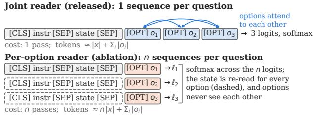  
Figure 3: The two readers compared in Section 5. Both apply the same head at the [OPT] positions and a softmax over the question’s options. The joint reader (released) encodes one sequence in which the options attend to each other; the per-option reader encodes n sequences, re-reading the instruction and state (|x| tokens) once per option, and its options never see each other. Token counts per question are approximate (markers omitted).

Table 2: The Crivo models. Parameters are the board’s served count; teachers distil stages 1–2 only. Cost: rented GPU time for training plus evaluation.
<table><tr><td>Model</td><td>Params</td><td>Layers/dim</td><td>Teacher</td><td>Cost (US$)</td></tr><tr><td>Crivo-17M</td><td>16.9M</td><td>7/ 256</td><td>Crivo-150M v1</td><td>13–16 (with 68M)a</td></tr><tr><td>Crivo-32M</td><td>32.0M</td><td>10 / 384</td><td>Crivo-400M</td><td>10 (with 150M)a</td></tr><tr><td>Crivo-68M</td><td>68.4M</td><td>19 /512</td><td>Crivo-400M</td><td>(with 17M)</td></tr><tr><td>Crivo-150M</td><td>149.6M</td><td></td><td>22 / 768 Crivo-400M</td><td>(with 32M)</td></tr><tr><td>Crivo-400M</td><td>395.8M</td><td>28 / 1024 none</td><td></td><td>28</td></tr><tr><td>Crivo-1B</td><td>1.03B</td><td>28 /1792</td><td>none</td><td>26</td></tr><tr><td>Crivo-32M v1</td><td>32.0M</td><td></td><td>10 / 384 Crivo-150M v1 7</td><td></td></tr><tr><td>Crivo-150M v1 1</td><td>149.6M</td><td>22 / 768 none</td><td></td><td>14</td></tr></table>

aEstimated; each pair was trained in one shared A100 session (∼7 h and ∼5 h). Other costs are recorded cloud bills.

Options attend to each other, so a question costs one encoder pass whatever its number of options; we call this the joint reader.

The per-option reader of the reader study (Section 5) encodes n sequences [CLS] instr [SEP] state [SEP] [OPT] oi, with the same head and the same softmax across them (Fig. 3); it is the multiple-choice head of BERT [8] with an [OPT] marker in place of [CLS].

The state is tokenised once per request and all questions of a request are batched. The backbones use rotary positions with alternating local (128-token) and global attention; models are trained up to 8,192 tokens and read inputs whole up to 32,768 tokens, so nothing is truncated at inference. Option order is shuffled in training; the released engine reads one order.

## 4.2 Model family

All models start from the Ettin reranker of the same size (cross-encoder/ettin-reranker- -v1) [13]; Table 2 lists them. The six released models share the recipe below. Two models trained with an earlier recipe, Crivo-150M v1 and Crivo-32M v1, appear only as the teacher of Crivo-17M (Crivo-150M v1) and in the recipe comparison of Section 7.3; unmarked names refer to the released models.

## 4.3 Training data

The training mix has 638,306 questions in stage 1, 169,437 in stage 2 and 24,635 in stage 3. It combines the Bekko System One data [42] (at most 1,200 rows per subset), 328 tasksource families [102,103] (40 further families held out entirely), procedural typed decisions [104, 105], code-generated decision families with exact labels (policies with exceptions, opaque label rules, schedules, ordinal severity, dates, propositional logic, executed code), synthetic tool-use dialogues built from public function-calling data, and the train splits of the public suite’s source datasets, capped at 5,000 rows per source, about half rewritten into other request layouts. No outputs of Jev or of other proprietary decision APIs were used as targets. The API-Bank [72] train split repeats dialogues of the board’s test pool; it is excluded from the released recipe but was in the training data of Crivo-150M v1, the teacher of Crivo-17M.

## 4.4 Objective, stages and selection

Each question is a softmax over its options. The loss is cross-entropy plus 0.5× the Brier score; with a teacher it is $\alpha ( \mathrm { C E } + 0 . 5 \mathrm { B r i e r } ) + ( 1 - \alpha ) \tau ^ { 2 } \mathrm { K L } ( p _ { \tau } ^ { \mathrm { t e a c h e r } } \| p _ { \tau } ^ { \mathrm { s t u d e n t } } )$ with $\alpha ~ = ~ 0 . 5$ and $\tau \ = \ 2$ for more than two options $( \tau = 1$ otherwise); some sources train on gold labels only. Stage 1 trains on the main mix at up to 2,048 tokens with a weight EMA [106]; stage 2 continues on a smaller mix; stage 3 trains on long inputs (up to 8,192 tokens) with gold labels only, so long rows are moved rather than cut. We use AdamW (weight decay 0.01), linear warm-up (5% in stage 1, 3% later) and decay, bf16 and separate learning rates for encoder and head, the head’s 5–10 times the encoder’s; the models take 5.9k–16.3k optimizer steps in stage 1, 2.3k–5.2k in stage 2 and 2.6k–5.2k in stage 3, with 16k–33k tokens per step and encoder learning rates from $1 0 ^ { - 4 }$ (17M and 32M, stage 1) down to $5 \times 1 0 ^ { - 6 }$ (1B, stage 3). The per-stage values are in the model cards.

Checkpoints (end of stage 2 or 3, their average, or an interpolation toward the base model [107]) were chosen on internal panels: development sets for 8 of the board’s skills built from sibling sources, 21 held-out decision families, and a sample of the public suite. The complete public suite was run once, on the final checkpoint, and each model was submitted to the board once, after its checkpoint was fixed. The board influenced the recipe once: the released recipe was designed in response to the gap between the public and private scores of the v1 models (Section 7.3), a mild form of the adaptive holdout reuse that Dwork et al. [58] warn about. Every model was trained on one rented GPU (A100 40 GB or H100 80 GB); costs are in Table 2.

## 4.5 Prumo: a floor with no learned parameters

Prumo reads the same requests and returns the same typed answers, but contains no model, no embeddings and no corpus statistics. Each question passes through twelve capabilities in a fixed order: sandboxed code execution, chess search (alpha–beta, 7,000 nodes), BM25 tool relevance with schema validation, BM25 retrieval, lexical grounding, a consensus centroid, IDF label overlap, chord templates, exact Boolean logic and SAT, exhaustive puzzle search (claimed only if the solution is unique), calendar arithmetic, and exact-fraction arithmetic. A capability either claims the question and returns probabilities or passes it on; unclaimed questions get the uniform distribution, so their expected score is exactly chance. The engine never reads benchmark names or item ids. It is about 2.7k lines of Python with one dependency (python-chess); its only numbers are 527 hand-set constants, 454 of them chess piece-square values. Thresholds were chosen on train and development splits. All budgets are counted in operations, so outputs are bit-identical across machines. Prumo executes code taken from requests in a sandbox with resource limits and should not be exposed to untrusted input without further isolation.

## 5 Reader Study: Joint versus Per-Option Scoring

## 5.1 Design

Joint reading lets options attend to each other in one pass, which could help comparison; per-option reading re-reads the context for every option but matches the (query, document) format on which cross-encoder rerankers are trained. To compare them with everything else fixed, we trained a grid at 32M on a fixed subset of 150,000 questions sampled from the stage-1 mix, for one epoch, with the same rows, hyperparameters (those of Crivo-32M stage 1), Crivo-400M teacher logits and evaluation sets for every arm, and three seeds per arm. The arms are: J, the released reader and objective (reranker initialisation, CE + 0.5 Brier + distillation); P, the per-option reader (Fig. 3) with everything else equal; J without Brier; J without distillation; and J-raw, J from the raw Ettin encoder instead of the reranker. Evaluation uses sets that are never trained on: a stratified 15% sample of the public suite (pub15; 13,358 requests; chance-corrected skill averaged over the 37 benchmarks, not the official index), 60 items per S1-Arena task (S1-60; 12,540 requests), BTZSC’s 500-item harness sample (BTZSC-500; 11,000 requests), and the order perturbations of Section 3.7. The arms and metrics were fixed before the grid ran.

Because each per-option sequence holds a single option, P takes about 3.25 times more optimizer steps than J at the same per-step token budget (6,858 against 2,112 on the same rows). Two joint controls separate the reader from this difference. Jsteps shrinks the per-step budget so that J takes ${ \bf P } { \bf \bar { s } }$ number of steps; it matches updates, not compute, and was added after the grid had started. J-comp, the primary comparison, keeps J’s flags and per-step budget and trains for exactly P’s number of steps in each seed (6,858–6,860) with the same schedule length. It reads each row about 3.25 times, so it is a repetition control rather than a fresh-data control, and it is close to but not exactly matched in encoded tokens (136.7M against 161.3M, 1.18 times) and GPU time (per-option runs took about four times longer because batches were padded to the longest sequence). The primary endpoint is the Welch interval of P − J-comp on pub15 skill. $\mathrm { ~ A ~ 2 ~ } \times \mathrm { ~ 2 ~ }$ of initialisation (reranker or raw Ettin encoder) by reader adds P-raw and J-comp-raw, three seeds each, with contrasts C1 (P-raw − J-comp-raw), C2 (P − P-raw), C3 (J-comp − J-comp-raw) and their interaction ${ \bf C } 4 = { \bf C } 2 - { \bf C } 3$ (Welch–Satterthwaite over the four cells). The plans and decision rules of J-comp and the $2 \times 2$ were recorded in a dated experiment log before the runs (released with the code). The $2 \times 2$ cells come from three runs on the same GPU type with identical code, data, flags and scorers, so a run effect cannot be separated. P lost 2, 0 and 6 of about 6,860 training batches to out-of-memory errors; no other arm lost any.

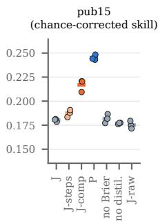

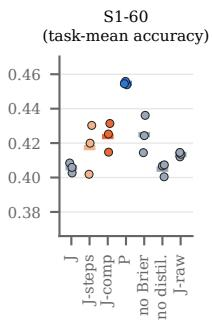

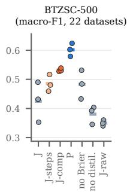

Initialisation 2 × 2 at matched compute (3 seeds per cell)  
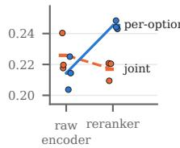

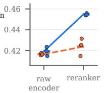

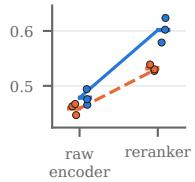  
Figure 4: Reader study at 32M: per-arm mean (horizontal tick) and the three seeds (dots) on pub15, S1-60 and BTZSC-500. Top: P (peroption, blue) is above every joint arm on all three, including J-comp (orange), which matches P’s optimizer steps and per-step token budget, and J-steps (light orange), which matches only its steps. Bottom: the initialisation $2 \times 2$ at matched compute, per-option (P-raw to P, blue, solid) and joint (J-comp-raw to J-comp, orange, dashed): the per-option reader gains from the reranker on all three sets, the joint reader only on BTZSC-500. Axes do not start at zero.

## 5.2 Per-option against joint reading

Table 3 and Fig. 4 give the result. At matched steps, the peroption reader is better on every evaluation set: pub15 skill +0.058 [+0.050, +0.065], S1-60 task-mean accuracy +0.037 [+0.002, +0.073] (+0.022 on unseen tasks) and BTZSC-500 macro-F1 +0.116 [+0.056, +0.177] (+0.058 on the unseen datasets). The S1-60 and BTZSC-500 intervals are wide or barely exclude zero and should be read as consistent with the pub15 gain rather than as separate confirmations. Matching steps closes little of the gap: J-steps improves on J only from 0.180 to 0.187 pub15 skill, while P reaches 0.245.

Compute-matched control. The gap is not only a compute effect. J-comp, which trains the joint reader for as many steps and about as many tokens as $\mathrm { P } ,$ reaches 0.217 pub15 skill, and P remains ahead (+0.028 [+0.015, +0.042]; S1-60 +0.031 [+0.010, +0.051]; BTZSC-500 +0.070 [+0.018, +0.121]). Compute closes about half of the step-matched pub15 gap (J-comp − J-steps +0.029 [+0.016, +0.043]) but less on S1-60 (+0.006) and BTZSC-500 (+0.047), where the intervals include zero. The advantage is not significant on unseen data: on the unseen S1- Arena tasks and the unseen BTZSC datasets the computematched differences are +0.011 [−0.009, +0.031] and +0.025 [−0.034, +0.084]. Calibration does not follow accuracy. Jcomp has the lowest pub15 ECE of all arms (P − J-comp +0.063 [+0.023, +0.102]) but a worse S1-60 Brier score (0.672, against 0.602 for J-steps), as does J-comp-raw; both read each row about 3.25 times, which fits over-confidence from repetition.

Table 3: Reader study at 32M (150k questions, one epoch except J-comp and J-comp-raw, three seeds per arm; arms defined in Section 5.1). Top: mean ± standard deviation over seeds. Lower blocks: differences with Welch 95% intervals over seeds (bold: interval excludes 0). “–”: flips not measured (per-option reading has none by construction). ‡Not a grid arm: the released model’s outputs on the same requests (pub15 on the 12,833 requests in its public-suite run; P scores 0.245 there). Lower is better for Brier, ECE and flips.
<table><tr><td>Arm</td><td>pub15 skill</td><td>S1-60 acc.</td><td>S1-60 unseen</td><td>BTZSC-500 F1</td><td>unseen-4 F1</td><td>S1-60 Brier</td><td>pub15 ECE</td><td>Perm. flips</td></tr><tr><td>Mean ± s.d. over 3 seeds</td></tr><tr><td>J (released reader)</td><td>0.180±0.002</td><td>0.406±0.003</td><td>0.401±0.003</td><td>0.425±0.069</td><td>0.386±0.062</td><td>0.612±0.002</td><td>0.123±0.017</td><td>0.277±0.015</td></tr><tr><td>J-steps (steps matched to P)</td><td>0.187±0.004</td><td>0.417±0.014</td><td>0.406±0.009</td><td>0.485±0.029</td><td>0.439±0.020</td><td>0.602±0.002</td><td>0.102±0.036</td><td>0.262±0.030</td></tr><tr><td>J-comp (compute matched to P)</td><td>0.217±0.006</td><td>0.424±0.008</td><td>0.417±0.009</td><td>0.532±0.006</td><td>0.472±0.011</td><td>0.672±0.008</td><td>0.040±0.014</td><td>0.253±0.009</td></tr><tr><td>P (per-option)</td><td>0.245±0.003</td><td>0.455±0.001</td><td>0.428±0.003</td><td>0.602±0.022</td><td>0.497±0.028</td><td>0.584±0.003</td><td>0.103±0.019</td><td>0.000±0.000</td></tr><tr><td>J-comp-raw (J-comp from raw encoder)</td><td>0.226±0.013</td><td>0.416±0.001</td><td>0.406±0.002</td><td>0.459±0.011</td><td>0.431±0.033</td><td>0.676±0.004</td><td>0.056±0.039</td><td></td></tr><tr><td>P-raw (P from raw encoder)</td><td>0.214±0.011</td><td>0.419±0.004</td><td>0.408±0.002</td><td>0.478±0.014</td><td>0.403±0.006</td><td>0.608±0.008</td><td>0.108±0.008</td><td>0.000</td></tr><tr><td>J without Brier</td><td>0.182±0.005</td><td>0.425±0.011</td><td>0.420±0.007</td><td>0.483±0.049</td><td>0.448±0.028</td><td>0.603±0.003</td><td>0.135±0.021</td><td>0.265±0.034</td></tr><tr><td>J without distillation</td><td>0.177±0.001</td><td>0.405±0.004</td><td>0.398±0.007</td><td>0.380±0.031</td><td>0.363±0.034</td><td>0.608±0.004</td><td>0.127±0.009</td><td>0.276±0.002</td></tr><tr><td>J-raw (J from raw encoder)</td><td>0.175±0.004</td><td>0.413±0.001</td><td>0.405±0.007</td><td>0.350±0.010</td><td>0.311±0.029</td><td>0.608±0.003</td><td>0.149±0.019</td><td>0.223±0.007</td></tr><tr><td>Crivo-32M released (joint, full recipe)‡</td><td>0.305</td><td>0.447</td><td>0.430</td><td>0.597</td><td>0.506</td><td>0.609</td><td></td><td>0.196</td></tr><tr><td colspan="9">Differences, Welch 95% CI over seeds (3 vs 3)</td></tr><tr><td>P — J-comp (matched compute)</td><td>+0.028 [+0.015, +0.042]</td><td>+0.031 [+0.010, +0.051]</td><td>+0.011 [−0.009, +0.031]</td><td>+0.070 [+0.018, +0.121]</td><td>+0.025</td><td>-0.088 [−0.106, —0.070]</td><td>+0.063 [+0.023, +0.102]</td><td>-0.253 [-0.275, -0.231]</td></tr><tr><td>P — J-steps (matched steps)</td><td>+0.058</td><td>+0.037</td><td>+0.022</td><td>+0.116</td><td>[—0.034, +0.084] +0.058</td><td>-0.019</td><td>+0.001</td><td>-0.262</td></tr><tr><td></td><td>[+0.050, +0.065]</td><td>[+0.002, +0.073]</td><td>[+0.002, +0.042]</td><td>[+0.056, +0.177]</td><td>[+0.002, +0.115]</td><td>[−0.024, −0.013]</td><td>[—0.072, +0.075]</td><td>[-0.336, -0.188]</td></tr><tr><td colspan="9">Initialisation 2 × 2, Welch 95% CI over seeds</td></tr><tr><td>C1: P-raw — J-comp-raw</td><td>-0.011 [-0.038, +0.015]</td><td>+0.003 [−0.007, +0.013] +0.036</td><td>+0.002 [−0.003, +0.007]</td><td>+0.020 [−0.010, +0.050]</td><td>-0.028</td><td>-0.068 [−0.107, +0.050] [−0.084, -0.052] -0.025</td><td>+0.053 [−0.039, +0.144]</td><td></td></tr><tr><td>C2: P − P-raw</td><td>+0.031 [+0.006, +0.055] -0.009</td><td>[+0.026, +0.046]</td><td>+0.020 [+0.014, +0.026]</td><td>+0.123 [+0.077, +0.169]</td><td>+0.094 [+0.030, +0.159] [−0.041, —0.008]</td><td></td><td>-0.005 [−0.046, +0.036]</td><td></td></tr><tr><td>C3: J-comp — J-comp-raw</td><td>[−0.035, +0.017]</td><td>+0.007 [−0.013, +0.028]</td><td>+0.011 [−0.010, +0.032]</td><td>+0.073 [+0.051, +0.095]</td><td>+0.041 [−0.031, +0.113]</td><td>-0.005 [−0.021, +0.012]</td><td>-0.015 [−0.100, +0.070]</td><td></td></tr><tr><td>C4: C2 − C3 (interaction)</td><td>+0.040 [+0.014, +0.066]</td><td>+0.028 [+0.011, +0.045]</td><td>+0.009 [−0.009, +0.028]</td><td>+0.050 [+0.006, +0.094]</td><td>+0.053</td><td>-0.020 [−0.015, +0.121] [−0.038, -0.002]</td><td>+0.010 [−0.066, +0.086]</td><td></td></tr><tr><td></td><td></td><td></td><td></td><td></td><td></td><td></td><td></td><td></td></tr></table>

Per benchmark. The compute-matched pub15 gain is concentrated (Fig. 5). P is better on 22 benchmarks and worse on 10; the paired interval excludes zero for 8 gains and one loss (ContractNLI, −0.127); the median gain is only +0.009. Five benchmarks (BPoMP, iSarcasmEval, API-Bank, MuSR and ACOS, +0.12 to +0.33) carry most of the mean (+0.015 without the top two), and on two of them (ACOS and iSarcasmEval) J-comp falls below J, again consistent with repetition. The gain does not grow with the number of options or with input length (Spearman ρ = −0.14 and −0.06 across benchmarks), and the joint arms’ position bias (accuracy 0.015 lower with the gold option first or last) is too small to explain it. On S1-60 P is better on 125 of 209 tasks, on BTZSC-500 on 19 of 22 datasets.

Initialisation. The 2 × 2 (Table 3, bottom; Fig. 4, bottom) shows that the per-option advantage depends on the starting checkpoint. From the raw Ettin encoder the two readers are indistinguishable at matched compute (C1 contains zero on all three sets; pub15 −0.011 [−0.038, +0.015]). The reranker helps the per-option reader on all three sets (C2: +0.031, +0.036, +0.123) but the joint reader only on BTZSC-500 (C3: +0.073), and the interaction C4 is positive on all three. The most direct reading is a format match: Ettin rerankers are trained on (query, document) pairs, exactly the per-option input, whereas a sequence holding all options is new to the checkpoint under either initialisation. The 2 × 2 does not test this mechanism, and with three seeds per cell it cannot exclude a small advantage of either reader at raw initialisation; it does show that at 32M and matched compute there is no evidence that reading options separately is better in itself. On pub15 the path from J to P thus decomposes into a small step effect (0.180 to 0.187), a compute effect (+0.029) and a per-option advantage of similar size (+0.028) that exists only with the reranker initialisation.

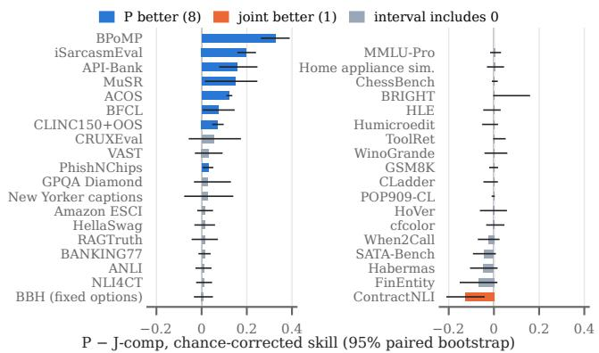  
Figure 5: Per-benchmark difference P − J-comp (computematched) in chance-corrected skill on the 37 benchmarks of pub15 (seed means of three seeds per arm; bars sorted, continued in the right panel; lines: 95% paired cluster-bootstrap intervals, requests resampled within benchmark). A few benchmarks carry most of the mean gain; the joint reader is better on ContractNLI.

Against the released model. The released Crivo-32M (joint) was trained for two epochs on the full 638k-row stage-1 mix and then a second stage, about five times more distinct rows than P’s one epoch on 150k rows. On the grid’s subsets (Table 3, ‡) the released model is clearly ahead on pub15 (0.305 against 0.245), whose source datasets fill much of its mix, but P matches it on the external ones: S1-60 0.455 against 0.447 (unseen 0.428 against 0.430), BTZSC-500 0.602 against 0.597 (unseen-4 0.497 against 0.506); Crivo-68M scores 0.466 and 0.662. These unpaired comparisons across very different budgets suggest, but do not show, that a per-option model trained from the reranker with the full recipe would be the more accurate 32M model; we leave that run to future work (Section 10).

## 5.3 Cost

Per request, the per-option reader needs 5.2 times more forward sequences on pub15, 6.4 times on S1-60 and 13.1 times on BTZSC-500, because it re-encodes the state once per option. We timed the per-option checkpoint P (seed 0) against the released joint Crivo-32M, which has the same architecture, on the same requests (Table 7, paired block). On the A100, over 1,000 requests in two alternating passes, the medians are the same (10.7 against 10.4 ms), but the mean is 4.3 times higher (59.0 against 13.7 ms) and the 95th percentile 10 times. On 16 CPU threads the median request takes 41.0 against 21.9 ms (1.9 times), the mean 3,728 against 139 ms (27 times) and the 95th percentile 32 times longer. Typical requests are cheap either way; the cost falls on long requests with many options. Per-option training with the full recipe would cost about 3.8–4.2 times the joint reader’s tokens on the main stages and 23 times on the long-input stage (catalogues of about 44 tools share one state). The choice is therefore a trade-off. Where many options or questions share one long state (tool catalogues, intent lists with 77–151 labels), the joint reader is far cheaper. Where a reranker checkpoint is available and mean and tail latency are acceptable, the per-option reader is more accurate, even at approximately matched training compute. From a raw encoder, per-option reading bought no accuracy in our runs.

## 5.4 Objective and initialisation of the joint reader

The remaining factors have small effects at this scale (arm means in Table 3; differences and intervals here). Removing the Brier term changes pub15 skill by +0.002 [−0.009, +0.012] and lowers the S1-60 Brier score slightly (−0.009 [−0.016, −0.003]), so we cannot claim that the Brier term improves calibration. Removing distillation costs −0.003 [−0.006, −0.000] skill; its BTZSC-500 change (−0.044 [−0.190, +0.101]) is within the seed noise. Jraw, the joint reader from the raw Ettin encoder at J’s budget, leaves pub15 skill (−0.005) and S1-60 accuracy (+0.008) almost unchanged, lowers order sensitivity (−0.053 [−0.086, −0.021]) and gives the lowest BTZSC-500 score of all arms (−0.075 [−0.242, +0.091]).

## 6 External Results

## 6.1 S1-Arena: external typed decisions

Table 4 gives task-mean accuracy on all, unseen and seen tasks, and the difference to the strongest baseline, DeBERTav3-large zs-v2, with both intervals.

All tasks. On all 209 tasks every Crivo beats every baseline with the item interval excluding zero, and every pair except Crivo-17M against DeBERTa also with the task interval. After a Holm adjustment over the twelve Crivo–DeBERTa comparisons (all and unseen tasks), 6 remain significant at the task level (68M–1B on all tasks, 400M and 1B on unseen tasks) and 11 at the item level. Accuracy rises with size, least between 68M and 150M (+0.009, item interval only), and reaches 0.539 at 1B.

Unseen tasks. On the 145 unseen tasks the margins over DeBERTa shrink to about 0.03 for the mid-size models and are fragile. Crivo-68M (+0.027) and Crivo-150M (+0.028) are ahead with both intervals excluding zero, but their tasklevel lower bounds are near zero and neither survives the Holm adjustment (p = 0.11 and 0.16). Crivo-32M is ahead at the item level only, and Crivo-17M ties (+0.000) with 25 times fewer parameters. The result also depends on aggregation: pooled over questions rather than averaged over tasks, a few large unseen tasks on which DeBERTa is strong dominate, Crivo-17M and Crivo-68M fall below it, Crivo-150M ties, and only Crivo-400M and Crivo-1B stay ahead (+0.043 for 1B). For models up to 150M we therefore read the unseentask result as parity with a 435M zero-shot classifier, not as a gain. The seen–unseen gap also widens with size (0.459 against 0.414 at 17M, 0.637 against 0.496 at 1B), so part of the larger models’ advantage comes from tasks whose source corpora were in training.

Published rows. The strongest sub-1B published rows, Decision-2.0-Kai-0.6B (0.503), Laya 421M (0.445) and Qwen3-0.6B (0.392), are on the full benchmark and cannot be paired with our runs (our own Qwen3-0.6B run gives 0.398). Prumo reaches 0.340 (unseen 0.345), close to the uniform guess (0.328): its exact solvers rarely fire on this benchmark’s formats.

## 6.2 BTZSC: zero-shot text classification

Table 5 separates the four datasets unseen in training from the 18 whose source corpora (and, for six of them, a small share of test items) were seen.

On the unseen datasets, Crivo-400M (0.636) and Crivo-1B (0.686) match or exceed the published BTZSC zeroshot rows, the best being an instruction-tuned 7B embed-

Table 4: S1-Arena, task-mean accuracy (the benchmark’s statistic) on its public snapshot, with 95% per-item paired bootstrap intervals. Unseen/seen follow the audit of Section 3.3. The last two columns give the difference to DeBERTa-v3-large zs-v2 with the wider task interval; ∗ the per-item interval excludes 0 (its half-width is about 0.006), † the task interval excludes 0. Intervals are not adjusted for multiplicity (see text).
<table><tr><td></td><td></td><td colspan="3">Task-mean accuracy</td><td colspan="3">∆ vs DeBERTa zs-v2 [task CI]</td></tr><tr><td>System</td><td>Params</td><td>All (209) [item CI]</td><td>Unseen (145) [item CI]</td><td>Seen (64)</td><td>All tasks</td><td>Unseen tasks</td><td></td></tr><tr><td>Crivo-17M</td><td>16.9M</td><td>0.428 [0.423, 0.432]</td><td>0.414 [0.409, 0.420]</td><td>0.459</td><td>+0.011*[-0.013, +0.037]</td><td></td><td>+0.000 [-0.021, +0.021]</td></tr><tr><td>Crivo-32M</td><td>32.0M</td><td>0.448 [0.444, 0.452]</td><td>0.429 [0.424, 0.434]</td><td>0.491</td><td></td><td>+0.031*† [+0.007, +0.057]</td><td>+0.015* [-0.005, +0.035]</td></tr><tr><td>Crivo-68M</td><td>68.4M</td><td>0.466 [0.461, 0.470]</td><td>0.441 [0.435, 0.446]</td><td>0.522</td><td>+0.049*†</td><td>[+0.024, +0.074]</td><td>+0.027* † [+0.004, +0.049]</td></tr><tr><td>Crivo-150M</td><td>149.6M</td><td>0.475 [0.471, 0.480]</td><td>0.442 [0.437, 0.447]</td><td>0.550</td><td>+0.059*†</td><td>[+0.031, +0.086] +0.028*†</td><td>[+0.001, +0.055]</td></tr><tr><td>Crivo-400M</td><td>395.8M</td><td>0.510 [0.505, 0.514]</td><td>0.474 [0.468, 0.479]</td><td>0.591</td><td>+0.093*† [+0.066, +0.120]</td><td>+0.060*†</td><td>[+0.032, +0.086]</td></tr><tr><td>Crivo-1B</td><td>1.03B</td><td>0.539 [0.535, 0.544]</td><td>0.496 [0.491, 0.502]</td><td>0.637</td><td>+0.123*† [+0.095, +0.151]</td><td></td><td>+0.082* † [+0.055, +0.109]</td></tr><tr><td>Crivo-150M v1</td><td>149.6M</td><td>0.483 [0.478, 0.487]</td><td>0.448 [0.442, 0.453]</td><td>0.561</td><td>+0.066*† [+0.039, +0.093]</td><td></td><td>+0.034* † [+0.007, +0.060]</td></tr><tr><td>DeBERTa-v3-large zs-v2</td><td>435.0M</td><td>0.416 [0.412, 0.420]</td><td>0.414 [0.409, 0.419]</td><td>0.422</td><td></td><td></td><td></td></tr><tr><td>BART-large-MNLI</td><td>407.0M</td><td>0.373 [0.369, 0.376]</td><td>0.375 [0.370, 0.380]</td><td>0.367</td><td></td><td></td><td></td></tr><tr><td>Qwen3-0.6B (letter)</td><td>596.0M</td><td>0.398 [0.394, 0.403]</td><td>0.402 [0.397, 0.407]</td><td>0.390</td><td></td><td></td><td></td></tr><tr><td>Gemma-3-1B-it (letter)</td><td>1.00B</td><td>0.343 [0.339, 0.347]</td><td>0.345 [0.340, 0.350]</td><td>0.339</td><td></td><td></td><td></td></tr><tr><td>Ettin-32M reranker (untrained)</td><td>32.0M</td><td>0.384 [0.380, 0.388]</td><td>0.388 [0.383, 0.393]</td><td>0.376</td><td></td><td></td><td></td></tr><tr><td>Uniform</td><td></td><td>0.328 [0.324, 0.332]</td><td>0.334 [0.329, 0.339]</td><td>0.313</td><td></td><td></td><td></td></tr></table>

Table 5: BTZSC, macro-F1 averaged over datasets. Unseen-4 = appreviews, empathetic, trueteacher, capsotu; seen-18 = the rest (seen by the Crivo training data, not zero-shot for Crivo). Intervals: 95% per-item bootstrap. Published rows come from the benchmark’s own runs and are not paired with ours. §Trained on the train splits of all 22 datasets with BTZSC’s label verbalisations: a supervised reference, not zero-shot.
<table><tr><td>System</td><td>Params</td><td>Unseen-4 [item CI]</td><td>Seen-18</td><td>All-22</td></tr><tr><td colspan="5">This work (seen-18 = training split seen)</td></tr><tr><td>Crivo-17M</td><td>16.9M</td><td>0.469 [0.460, 0.476]</td><td>0.523</td><td>0.513</td></tr><tr><td>Crivo-32M</td><td>32.0M</td><td>0.514 [0.506, 0.521]</td><td>0.622</td><td>0.603</td></tr><tr><td>Crivo-68M</td><td>68.4M</td><td>0.553 [0.545, 0.561]</td><td>0.693</td><td>0.667</td></tr><tr><td>Crivo-150M</td><td>149.6M</td><td>0.564 [0.554, 0.572]</td><td>0.695</td><td>0.671</td></tr><tr><td>Crivo-400M</td><td>395.8M</td><td>0.636 [0.627, 0.643]</td><td>0.713</td><td>0.699</td></tr><tr><td>Crivo-1B</td><td>1.03B</td><td>0.686 [0.677, 0.693]</td><td>0.765</td><td>0.751</td></tr><tr><td colspan="5">Zero-shot baselines run by us (same adapter)</td></tr><tr><td>Qwen3-0.6B (letter)</td><td></td><td>596.0M 0.451 [0.443, 0.459]</td><td>0.319</td><td>0.343</td></tr><tr><td>Gemma-3-1B-it (letter)</td><td>1.00B</td><td>0.265 [0.261, 0.270]</td><td>0.394</td><td>0.370</td></tr><tr><td>Ettin-32M reranker (untrained)</td><td>32.0M</td><td>0.358 [0.350, 0.364]</td><td>0.349</td><td>0.351</td></tr><tr><td colspan="5">Published BTZSC zero-shot baselines (no CI)</td></tr><tr><td>e5-mistral-7b-instruct</td><td>7B</td><td>0.618</td><td>0.566</td><td>0.576</td></tr><tr><td>Qwen3-Reranker-8B</td><td>8B</td><td>0.608</td><td>0.748</td><td>0.722</td></tr><tr><td>Qwen3-Embedding-8B</td><td>8B</td><td>0.589</td><td>0.592</td><td>0.591</td></tr><tr><td>gte-reranker-modernbert-base</td><td>149M</td><td>0.577</td><td>0.579</td><td>0.578</td></tr><tr><td>e5-base-v2</td><td>110M</td><td>0.566</td><td>0.603</td><td>0.597</td></tr><tr><td>Qwen3-Reranker-0.6B</td><td>600M</td><td>0.540</td><td>0.620</td><td>0.606</td></tr><tr><td>bart-large-mnli</td><td>407M</td><td>0.539</td><td>0.501</td><td>0.508</td></tr><tr><td>Qwen3-4B</td><td>4B</td><td>0.531</td><td>0.675</td><td>0.649</td></tr><tr><td>deberta-v3-large-nli</td><td>434M</td><td>0.481</td><td>0.616</td><td>0.591</td></tr><tr><td>ms-marco-MiniLM-L6-v2</td><td>22M</td><td>0.395</td><td>0.428</td><td>0.422</td></tr><tr><td>gemma-3-1b-it</td><td>1B</td><td>0.347</td><td>0.362</td><td>0.359</td></tr></table>

$$
{ \bf z } { \bf s } { - } { \bf v } 2 ^ { \ S }
$$

ding model (0.618) and an 8B reranker (0.608); the margin of Crivo-400M over the best row is small, and the comparison is unpaired across separate runs. Crivo-68M (0.553) is above the published DeBERTa-v3-large NLI cross-encoder (0.481) and BART-large-MNLI (0.539) in the same unpaired sense. Every Crivo, Crivo-17M included, beats the zeroshot baselines we ran (Qwen3-0.6B, Gemma-3-1B, untrained Ettin) on unseen-4 with the item interval excluding zero; the tightest case is Crivo-17M against Qwen3-0.6B, +0.017 [+0.007, +0.027]. Unseen-4 has only four datasets and their spread is large, so BTZSC is secondary evidence. The supervised zs-v2 models beat every Crivo (Crivo-1B trails De-BERTa zs-v2 by 0.058 on unseen-4 and by 0.047 on seen-18); this is the gap to a supervised classifier of about Crivo-400M’s size trained on in-task data.

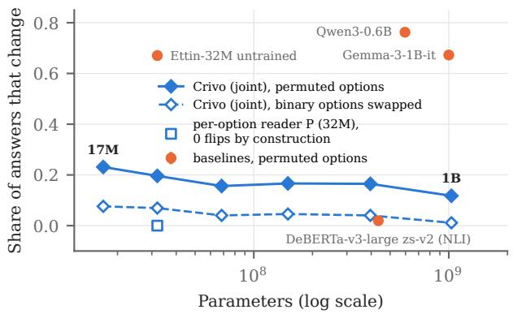  
Figure 6: Option-order robustness against size: share of answers that change when the options of 3,841 questions are permuted (mean of three random permutations, 95% cluster-bootstrap intervals) and, for Crivo, when the two options of 258 binary requests are swapped. The per-option reader is the 32M arm P of Section 5 (three seeds). Prumo (rules, no size) is invariant.

## 6.3 Robustness to option order

Fig. 6 gives the share of questions whose chosen option changes under the perturbations of Section 3.7, against model size. Reversing the order gives rates within 0.02 of the permutations for every Crivo (0.127 to 0.242), and swapping the two options of a binary request changes 1–8% of Crivo’s an swers.

Crivo answers change in 12–23% of questions, falling with size. Per-option scorers do much better: the NLI crossencoder changes only 2% of its answers, and the per-option reader of Section 5 none, by construction, because each option is read alone. The two letter-readout LLMs change 67– 76% and the untrained reranker 67%; for the LLMs this is an upper bound, since permutation debiasing reduces such sensitivity [1]. The NLI cross-encoder is not exactly invariant; we did not trace its residual changes. Crivo’s joint reader sees the order, which is the price of reading all options in one pass.

Table 6: Calibration. Board ECE: maintainer-computed. S1-Arena and BTZSC: our runs, ECE with 10 equal-mass bins and multi-class Brier score, each task or dataset weighted equally. Lower is better. A near-constant system (uniform) has a low ECE without being useful, and binned ECE on small tasks is biased upward.
<table><tr><td rowspan="3"></td><td rowspan="3">Board</td><td colspan="3">S1-Arena</td><td colspan="3">BTZSC</td></tr><tr><td colspan="2">all 209</td><td>unseen</td><td>all-22</td><td colspan="2">unseen-4</td></tr><tr><td>ECE</td><td>ECE</td><td>Brier</td><td>Brier</td><td>ECE</td><td>ECE Brier</td></tr><tr><td>Crivo-17M</td><td>0.080</td><td>0.069</td><td>0.603</td><td>0.621</td><td>0.029</td><td>0.061</td><td>0.616</td></tr><tr><td>Crivo-32M</td><td>0.133</td><td>0.125</td><td>0.610</td><td>0.633</td><td>0.022</td><td>0.013</td><td>0.577</td></tr><tr><td>Crivo-68M</td><td>0.103</td><td>0.133</td><td>0.595</td><td>0.625</td><td>0.040</td><td>0.087</td><td>0.520</td></tr><tr><td>Crivo-150M</td><td>0.115</td><td>0.174</td><td>0.617</td><td>0.658</td><td>0.086</td><td>0.161</td><td>0.560</td></tr><tr><td>Crivo-400M</td><td>0.121</td><td>0.164</td><td>0.593</td><td>0.640</td><td>0.059</td><td>0.066</td><td>0.446</td></tr><tr><td>Crivo-1B</td><td>0.151</td><td>0.191</td><td>0.579</td><td>0.636</td><td>0.049</td><td>0.043</td><td>0.395</td></tr><tr><td>DeBERTa zs-v2</td><td></td><td>0.090</td><td>0.632</td><td>0.638</td><td>0.099</td><td>0.092</td><td>0.351</td></tr><tr><td>Qwen3-0.6B</td><td></td><td>0.229</td><td>0.712</td><td>0.706</td><td>0.257</td><td>0.084</td><td>0.668</td></tr><tr><td>Gemma-3-1B-it</td><td></td><td>0.417</td><td>0.936</td><td>0.947</td><td>0.363</td><td>0.386</td><td>0.959</td></tr><tr><td>Uniform</td><td></td><td>0.038</td><td>0.616</td><td>0.619</td><td></td><td></td><td></td></tr></table>

## 6.4 Calibration

Table 6 collects the board’s calibration measurement (maintainer-computed on a 1-in-6 request sample) and ours on the external benchmarks (expected calibration error with 10 equal-mass bins, ECE, averaged with equal weight per task or dataset; and the multi-class Brier score).

Crivo’s calibration depends on whether it has seen the source corpora: its ECE is lowest where most datasets were seen in training, and it is over-confident on unseen tasks. On all 22 BTZSC datasets, 18 of them seen in training, every Crivo has a lower ECE than every baseline (item intervals exclude zero); on the four unseen datasets this no longer holds: Qwen3-0.6B has a lower ECE than Crivo-68M and Crivo-150M, and DeBERTa than Crivo-150M. On S1- Arena, Crivo-17M has a lower ECE than DeBERTa (−0.021 [−0.027, −0.015]) and every Crivo a lower ECE than the two LLMs, but ECE does not fall with size and the larger Crivos are worse than DeBERTa. On unseen S1-Arena tasks every Crivo has a Brier score no better than the uniform guess (0.619): the models are over-confident on new tasks. On the public suite, ECE rises from 0.076 at 17M to 0.158 at 1B, while the probabilities rank each model’s own errors better as it grows (area under the risk–coverage curve 0.29 to 0.16). Board ECE for the Crivos is 0.080–0.151, in the middle of the small-model field.

## 6.5 Efficiency

Table 7 reports latency per request under the protocol of Section 3.7.

Table 7: Latency per request (ms), one request at a time, on fixed public-suite requests (Section 3.7). A100: 1,000 requests. CPU: AMD EPYC 7J13, 16 threads, the same first 80 requests for every system; a few very long requests dominate the CPU means and 95th percentiles. Paired block: the per-option checkpoint P (seed 0) of Section 5 and Crivo-32M timed together on the GPU (the ratios of Section 5.3); their CPU cells repeat the single CPU run. On the GPU, DeBERTa could not process 40 of the 1,000 requests (not timed). Board: the maintainers’ measurement (RTX PRO 6000).
<table><tr><td></td><td colspan="3">A100 GPU, ms</td><td colspan="3">CPU, 16 threads, ms</td><td>Board</td></tr><tr><td>System</td><td>med.</td><td>mean</td><td>p95</td><td>med.</td><td>mean</td><td></td><td>p95 med. (ms)</td></tr><tr><td>Crivo-17M</td><td>8.2</td><td>10.9</td><td>24.9</td><td>13.5</td><td>80</td><td>486</td><td>5.9</td></tr><tr><td>Crivo-32M</td><td>10.5</td><td>13.9</td><td>33.3</td><td>21.9</td><td>139</td><td>856</td><td>7.6</td></tr><tr><td>Crivo-68M</td><td>17.6</td><td>22.5</td><td>52.3</td><td>53.2</td><td>384</td><td>2,173</td><td>12.4</td></tr><tr><td>Crivo-150M</td><td>19.8</td><td>27.5</td><td>78.4</td><td>97.3</td><td>684</td><td>3,859</td><td>13.4</td></tr><tr><td>Crivo-400M</td><td>24.1</td><td>37.5</td><td>129.3</td><td>253.4</td><td>1,434</td><td>7,554</td><td>16.7</td></tr><tr><td>Crivo-1B</td><td>24.3</td><td>50.2</td><td>225.8</td><td>578.6</td><td>3,123</td><td>19,457</td><td>16.4</td></tr><tr><td>DeBERTa zs-v2</td><td>36.1</td><td>119.1</td><td>552.2</td><td>728.3</td><td>12,103</td><td>61,022</td><td></td></tr><tr><td>Ettin-32M untrained</td><td></td><td>9.5 148.7</td><td>890.9</td><td>38.5</td><td></td><td>3,75028,202</td><td></td></tr><tr><td>Prumo (rules)</td><td></td><td></td><td></td><td></td><td></td><td></td><td>0.3</td></tr><tr><td colspan="8">Paired GPU run: same A100, two alternating passes</td></tr><tr><td>Crivo-32M (joint)</td><td>10.4</td><td>13.7</td><td>32.9</td><td>21.9</td><td>139</td><td>856</td><td>一</td></tr><tr><td>32M per-option (P)</td><td>10.7</td><td></td><td>59.0 328.7</td><td>41.0</td><td></td><td>3,72827,771</td><td></td></tr></table>

Crivo-17M answers in a median 8.2 ms on the GPU and 13.5 ms on 16 CPU threads (means 10.9 and 80 ms). DeBERTa-v3-large zs-v2, which needs one NLI pass per option, takes a median 36.1 ms on the GPU and 728 ms on the CPU (means 119.1 and 12,103 ms), about 54 times Crivo-17M’s CPU median on the same requests. At batch size one, GPU latency is dominated by fixed overhead: Crivo-400M and Crivo-1B have almost the same median (24.1 and 24.3 ms), so GPU medians say little about model size and the CPU columns are the better guide to compute. The median hides a heavy tail of long tool-retrieval requests with up to 32 questions, visible in the means. Prumo answers in a median of 0.2 ms on one CPU thread (1,000 requests, measured separately; not comparable with the 16-thread column).

Fig. 7 places each system’s S1-Arena accuracy against its median CPU latency on the same requests. Along the Crivo family, accuracy rises by about 0.11 (0.428 to 0.539) for a 43- fold increase in median latency, roughly linearly in its logarithm. Every Crivo up to 1B has a lower median latency than DeBERTa-v3-large zs-v2, and every one is at least as accurate on all 209 tasks; the untrained Ettin-32M reranker, scored per option, has a median between those of Crivo-32M and Crivo-68M but is well below both in accuracy.

## 7 Supporting Evidence: Private Tests of the Decision Index

The board’s maintainers run each entrant, with the entrant’s own serving code, on two private parts: tests “of equivalent competence for most public tasks, built from fresh data” (same skills, S) and decision tasks from new domains (O). In edition 0.4 (October 2026) the ranking score is

$$
\mathrm { F u l l } = 0 . 6 0 S ^ { \prime } + 0 . 4 0 O ^ { \prime } ,\tag{2}
$$

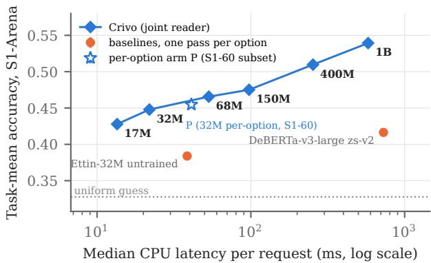  
Figure 7: Accuracy against CPU cost: S1-Arena task-mean accuracy over all 209 tasks (95% per-item intervals) against the median latency per request on 16 CPU threads, on the same 80 public-suite requests for every system (log scale); dotted: uniform guess. The per-option arm P has no full S1-Arena run; its hollow star is its accuracy on S1-60 (mean and range of three seeds), where the released Crivo-32M scores 0.447 (0.448 on all items).

where $S ^ { \prime }$ and $O ^ { \prime }$ are S and O “mapped onto the public scale with untuned stock models”; the public index is shown but not counted. The mapping is not documented, but on our snapshot it is affine for all 208 entries (our fit: $S ^ { \prime } = 1 . 0 1 2 S - 1 . 0 5 , O ^ { \prime } = 1 . 2 1 7 O + 1 . 3 3 .$ , maximum deviations 0.009 and 0.010), so rankings and correlations are unchanged and we report the displayed S and O. Entries within 0.9 points of the first model of a group share a rank group (54 groups); the board publishes no per-item private data, so rank groups are the only uncertainty we can attach to private scores. Latency is measured by the maintainers on one NVIDIA RTX PRO 6000 (96 GB), one request at a time. All Full, S and O values are the board’s (edition 0.4, snapshot of 2026-10-20); public indices come from our complete runs of the official kit, which the board adopted.

Two properties limit what the board can show for our models. First, the board permits training on the train splits of the suite’s source datasets, and Crivo does so (Section 4), so S, which uses fresh items for the same tasks, measures indistribution transfer to fresh items for Crivo, much as BTZSC does for the zs-v2 baselines; only O measures new domains. Second, the field is sparse at our sizes: 24 of the 204 sized entries have at most 420M parameters, 5 of them ours, and most of the others are undocumented uploads. We therefore treat the board as supporting evidence, after the external benchmarks.

## 7.1 Official scores

Table 8 gives the official results of the six released models and Prumo, next to the board entries closest in size, two stock checkpoints served by their entrants, and the other rule-based entry.

Size range. No entry by another author with fewer than 395.9M parameters outscores Crivo-68M (17.69); the closest are DecisionTune 1.0 (16.88, in its rank group), Bekko v0 400M (16.00) and Mola-68M (14.96). Crivo-17M, the smallest sized entry, starts the size–Full Pareto frontier, which continues through Crivo-32M, Mola-68M and Crivo-68M (Fig. 1b). The frontier positions of Crivo-150M and Crivo-400M are not meaningful: Crivo-150M is 0.01 points above Crivo-68M, far inside the 0.9-point rank-group rule, and Crivo-400M precedes Amber 0.4B (25.41) by 0.04M parameters. Crivo-1B (28.96) is the highest-scoring encoder on the board but not on the frontier, since two smaller 0.8B decoders in its rank group, OneJev1.6 (29.66) and StartLux-Decision (29.02), score higher. The field at these sizes is sparse: 24 sized entries up to 420M, 5 of them ours.

Where the scores come from. Same-skill scores rise with size (15.88 to 38.75) except at 150M (Section 7.3). Newdomain scores stay between 3.2 and 5.5 up to 150M, below Prumo’s 5.60, and rise only at 400M (9.09) and 1B (11.39): unfamiliar decision tasks are where small encoders are weak est.

## 7.2 Public index and private tests

Public-suite skill (pub15 in Section 5) is the primary endpoint of the reader study, so its relation to the private tests matters. Across all 208 entries of Decision Index 0.4, the public index and the private same-skill score correlate with Pearson $r =$ 0.981 [0.974, 0.986] and Spearman $\rho = 0 . 9 7 8 \left[ 0 . 9 6 9 , 0 . 9 8 3 \right]$ (the same on the mapped scale, since the mapping is affine). It is not only an artefact of pooling 17M with 30B models: within 5 size buckets it stays between 0.94 and 0.98, and the partial correlation after controlling for log parameters is 0.965 [0.951, 0.974] (the bootstrap is not clustered, Section 3.6, so the intervals are too narrow).

## 7.3 A negative result: development panels moved with the training data

Our internal development panels failed as predictors of the private tests. For every released model they overestimated the private same-skill score by 5.6–7.1 points, and they ranked two training recipes in the wrong order. The released recipe differs from the one used for the v1 models in several ways at once: it caps training on the suite’s own source splits (v1 used about 210k such rows, uncapped and in the suite’s layouts), rewrites half of those rows into other layouts, and adds sibling sources, code-generated families and a teacher. Under the new recipe both panels rose at both sizes (same-skill panel 0.459 to 0.556 at 150M and 0.390 to 0.453 at 32M; internal numbers), yet the board’s same-skill score on identical private tests1 fell from 27.74 to 24.93 at 150M and from 18.84 to 18.44 at 32M. Per benchmark the 150M change is not significant (mean private skill −0.021 [−0.075, +0.038], Wilcoxon $p = 0 . 3 6 )$ , but S1-Arena, on which neither recipe was tuned, points the same way at the item level (−0.008, [−0.013, −0.002]; the task interval includes zero). The public index fell with the private score at 150M but rose at 32M (25.06 to 27.34). The panels were built from sibling sources of the board’s skills, and the new recipe added sources of exactly that kind: a development panel drawn from the same pool as new training data is no longer an independent estimate of performance on fresh items, a close relative of the adaptive holdout reuse described by Dwork et al. [58].

Table 8: Decision Index 0.4, official scores (board snapshot of 2026-10-20). $\mathrm { F u l l } = 0 . 6 S ^ { \prime } + 0 . 4 O ^ { \prime }$ on the board’s mapped private scores; S and O are the displayed private same-skill and new-domain scores; “Public” is shown but not counted. S uses fresh items for tasks whose train splits Crivo trained on. Latency is median / p95 per request on one RTX PRO 6000, measured by the maintainers. “Group”: rank group (Section 7). Our entries in bold.
<table><tr><td>Model</td><td>Params</td><td>Full 0.4</td><td>Same skills S</td><td>New domains O</td><td>Public</td><td>Latency (ms)</td><td>Group</td></tr><tr><td>≤20M</td><td></td><td></td><td></td><td></td><td></td><td></td><td></td></tr><tr><td>Crivo-17M</td><td>16.9M</td><td>11.11</td><td>15.88</td><td>3.22</td><td>22.15</td><td>5.9 / 10.0</td><td>47</td></tr><tr><td>Bekko v0 17M</td><td>17.0M</td><td>5.72</td><td>5.89</td><td>4.61</td><td>7.44</td><td>6.8 / 16.5</td><td>51</td></tr><tr><td>32M</td><td></td><td></td><td></td><td></td><td></td><td></td><td></td></tr><tr><td>Crivo-32M</td><td>32.0M</td><td>13.70</td><td>18.44</td><td>5.34</td><td>27.34</td><td>7.6/ 11.6</td><td>45</td></tr><tr><td>68M</td><td></td><td></td><td></td><td></td><td></td><td></td><td></td></tr><tr><td>Crivo-68M</td><td>68.4M</td><td>17.69</td><td>25.27</td><td>5.03</td><td>32.82</td><td>12.4 / 17.6</td><td>42</td></tr><tr><td>Mola-68M</td><td>68.3M</td><td>14.96</td><td>21.99</td><td>3.52</td><td>27.27</td><td>11.4 / 18.0</td><td>44</td></tr><tr><td>Bekko v0 68M</td><td>68.0M</td><td>9.99</td><td>12.62</td><td>4.98</td><td>13.01</td><td>11.8 / 30.6</td><td>48</td></tr><tr><td>150M</td><td></td><td></td><td></td><td></td><td></td><td></td><td></td></tr><tr><td>Crivo-150M</td><td>149.6M</td><td>17.70</td><td>24.93</td><td>5.48</td><td>34.38</td><td>13.4 / 24.5</td><td>42</td></tr><tr><td>Mola-150M</td><td>149.3M</td><td>16.15</td><td>23.55</td><td>4.03</td><td>31.34</td><td>12.8 / 21.1</td><td>43</td></tr><tr><td>Dinah-1</td><td>149.6M</td><td>16.08</td><td>22.29</td><td>5.45</td><td>34.32</td><td>14.2 / 57.6</td><td>43</td></tr><tr><td>tasksource nano v4</td><td>149.0M</td><td>15.63</td><td>22.08</td><td>4.79</td><td>30.90</td><td>14.2 / 22.6</td><td>43</td></tr><tr><td>400M</td><td></td><td></td><td></td><td></td><td></td><td></td><td></td></tr><tr><td>Crivo-400M</td><td>395.8M</td><td>22.96</td><td>30.70</td><td>9.09</td><td>39.79</td><td>16.7 / 39.9</td><td>39</td></tr><tr><td>Amber 0.4B</td><td>395.9M</td><td>25.41</td><td>35.73</td><td>7.86</td><td>49.74</td><td>42.5 / 47.2</td><td>37</td></tr><tr><td>DecisionTune 1.0</td><td>394.8M</td><td>16.88</td><td>22.11</td><td>7.31</td><td>28.85</td><td>13.8 / 111.0</td><td>42</td></tr><tr><td>Bekko v0 400M</td><td>400.0M</td><td>16.00</td><td>21.55</td><td>6.20</td><td>22.45</td><td>17.1 / 72.2</td><td>43</td></tr><tr><td>Laya</td><td>421.3M</td><td>7.21</td><td>9.08</td><td>3.69</td><td>6.19</td><td>5.8 / 222.5</td><td>50</td></tr><tr><td>0.6-1B</td><td></td><td></td><td></td><td></td><td></td><td></td><td></td></tr><tr><td>Crivo-1B OneJev1.6-0.8B</td><td>1.03B</td><td>28.96</td><td>38.75</td><td>11.39</td><td>47.77</td><td>16.4 / 70.7</td><td>35</td></tr><tr><td>StartLux-Decision v1.1 0.8B</td><td>853.0M</td><td>29.66</td><td>40.49</td><td>10.65</td><td>48.76</td><td>13.1 / 103.9</td><td>35</td></tr><tr><td>vLLM-SR Decision 2.0 Kai 0.6B</td><td>873.4M</td><td>29.02</td><td>41.29</td><td>8.35</td><td>53.79</td><td>29.9 / 87.1</td><td>35</td></tr><tr><td></td><td>600.0M</td><td>14.89</td><td>16.90</td><td>9.72</td><td>16.68</td><td>18.5</td><td>44</td></tr><tr><td>stock checkpoints served by their entrants (no own training)</td><td></td><td></td><td></td><td></td><td></td><td></td><td></td></tr><tr><td>jeff Qwen-2.5-1B-RLCD</td><td>575.7M</td><td>4.81</td><td>6.86</td><td>1.53 5.78</td><td>8.27 4.02</td><td>21.8 / 67.6 43.8 / 75.2</td><td>52</td></tr><tr><td></td><td>1.54B</td><td>6.48</td><td>6.21</td><td></td><td></td><td></td><td>51</td></tr><tr><td>no learned parameters Prumo</td><td></td><td></td><td></td><td></td><td></td><td></td><td></td></tr><tr><td>Zev</td><td>一</td><td>12.21</td><td>15.78</td><td>5.60</td><td>20.14 1.55</td><td>0.3 / 11.5</td><td>46</td></tr><tr><td></td><td></td><td>1.91</td><td>1.79</td><td>1.89</td><td></td><td>0.5 / 1.7</td><td>54</td></tr></table>

## 7.4 What a rule engine reveals about the board

With no learned parameters, Prumo scores a Full of 12.21 on the private tests $( S = 1 5 . 7 8 , O = 5 . 6 0 )$ , above Crivo-17M (11.11) and both Bekko models at 17M and 68M (5.72, 9.99), and below Crivo-32M (13.70). On the same skills it ties Crivo-17M (15.78 against 15.88), and on new domains it is above every Crivo below 400M, probably because some new-domain tasks contain structures it solves exactly. On the external benchmarks it is near chance (S1-Arena 0.340, BTZSC 0.209). The natural reading is that part of the board rewards format-specific solving, which a hand-written engine can do without any notion of the task; this weakens the board as evidence for the encoders, and is why we place it after the external benchmarks. Its board ECE (0.047) is low mostly because unclaimed questions receive uniform answers.

Because Prumo learns nothing, its public–private gap on a benchmark measures how well a hand-written capability transfers to fresh items of the same skill (Fig. 8; r = 0.77 over 34 benchmarks): lexical capabilities hold (tool retrieval 0.39 public, 0.51 private), exact solvers do not (CRUXEval 0.997, 0.28; BBH 0.47, 0.07), presumably because a parser exact on the public format stops firing on another presentation.

## 8 Discussion and Limitations

Implications. For practitioners the reader choice reduces to two questions: is a pair-trained (reranker) checkpoint available, and how heavy is the tail of the request distribution? With a reranker and short option lists, per-option scoring is the more accurate design and is order-invariant by construction; with long shared states (tool catalogues, large intent sets) or a tight mean-latency budget, the joint reader costs one pass per question and, from a raw encoder, showed no loss in our runs. For benchmark maintainers, a parameter-free engine that matches a 17M model on same-skill private tests is a cheap probe for format-specific shortcuts.

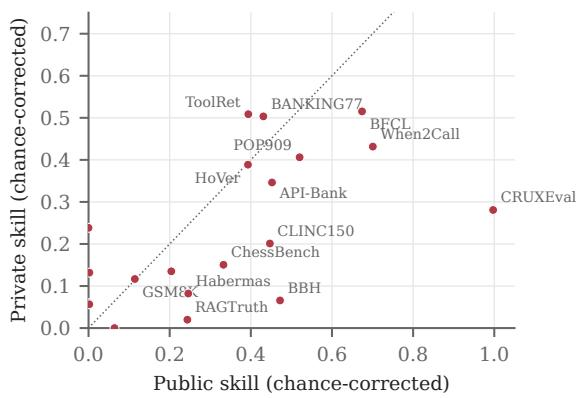  
Figure 8: Prumo, public against private chance-corrected skill per benchmark (board data; dotted: y = x). Lexical heuristics (retrieval, label overlap, grounding) keep their skill on fresh items; exact solvers keyed to a format (code execution on CRUXEval, BBH solvers, chess) lose most of it.

Reader study. The study uses one 150k-row subset and one size (32M); neither reader was trained with the full recipe in a controlled way or above 32M. J-comp reaches P’s compute by repeating rows, so a joint arm on about 3.25 times as many distinct rows would be the stricter control. A UniMCstyle masked-attention joint reader would separate “options do not see each other” from “the state is re-read per option”.

External evaluation. The S1-Arena audit is name- and string-based, and only four BTZSC datasets are unseen. The comparison is with generic NLI classifiers and small LLMs, not the closest same-interface encoders (Section 3.4), and it mixes backbone, readout and training data; only the readout is isolated.

Board, baselines and latency. Private scores come from one run of each model on tests we cannot inspect. We did not fine-tune DeBERTa-v3-large per task, the supervised ceiling reported elsewhere [36]. Latency has no batched throughput or operation counts, and the 80-request CPU sample makes means sensitive to a few long requests.

Use and scope. The models are over-confident on new tasks, so thresholds for routing actions must be set on the target task; in a hand-coded sample of 70 Crivo-68M errors on the public suite, the most confident errors were wrong tool or action selections. They do not replace supervised intask training or large models on knowledge-heavy and newdomain decisions. Training and evaluation are in English only. The Crivo weights are CC BY-NC 4.0 because several training sources are non-commercial; the Ettin bases and Prumo are Apache-2.0.

## 9 Data and Code Availability

All artefacts are public on the Hugging Face Hub under the account tardellirs:

• model weights and cards: https://huggingface. co/tardellirs/crivo-17m, crivo-32m, crivo-68m, crivo-150m, crivo-400m and crivo-1b (the v1 models are earlier revisions of crivo-32m and crivo-150m: Crivo-32M v1 is revision bbf3f19, Crivo-150M v1 revision 7a6c745); licence CC BY-NC 4.0;

• the three per-option 32M checkpoints of the reader study (arm P, seeds 0–2) with their inference engine: https://huggingface.co/tardellirs/ crivo-32m-per-option-ablation(CC BY-NC 4.0);

• Prumo: https://huggingface.co/ tardellirs/prumo and https:// github.com/tardellirs/prumo (Apache-2.0); public-suite run outputs: the dataset tardellirs/decision-index-results.

The Decision Index kit and leaderboard are public [14, 69], as are S1-Arena and BTZSC. The experiment code of this paper (training code, benchmark adapters, baseline wrappers, contamination audit, ablation grid, statistics), the scripts that generate every table and figure from the board snapshot and our run outputs, and the experiment log, which records the plan and decision rule of the computematched and initialisation controls before they were run, are at https://github.com/tardellirs/crivodecision-encoders, together with an archived copy of the board snapshot of 2026-10-20. The training mixes (Section 4) are not redistributed, since several sources carry their own licences.

## 10 Conclusion

Joint or per-option? At 32M and matched compute, the answer depends on the starting checkpoint. From a crossencoder reranker, whose pair input matches per-option reading, scoring each option separately is more accurate (+0.028 public-suite skill, with the same sign on two external benchmarks but not significantly on their unseen tasks); from the raw encoder, the cheaper joint reader is as good. Per-option scoring costs 5–13 times the encoder passes, little at the median and much in the tail, so the reader should follow the application’s latency budget. How small? Joint encoders from 68M up beat a 435M zero-shot NLI classifier on all tasks of an overlap-audited typed-decision benchmark, models up to 150M are at least on par with it on unseen tasks, and the 17M model answers a median request in about 14 ms on a CPU. On private leaderboard tests the smallest models lead their size range on in-distribution skills but stay near the floor on new domains, and a rule engine with no learned parameters matches the smallest model on the same-skill tests. Future work should train the per-option reader with the full recipe and above 32M, compare it with the closest same-interface encoders under the same audit, and widen coverage of new domains.

## Acknowledgment

The author thanks the maintainers of the Decision Index for running the private tests, and the authors of S1-Arena and BTZSC for releasing data, code and baseline results.

Use of generative AI. An AI assistant, Claude Code (Anthropic), was used to write and debug code and to revise the text. The author verified all content and takes full responsibility for it.

## References

[1] C. Zheng, H. Zhou, F. Meng, J. Zhou, and M. Huang, “Large language models are not robust multiple choice selectors,” in Proc. Int. Conf. Learning Representations (ICLR), 2024, arXiv:2309.03882. [Online]. Available: https://arxiv.org/abs/2309.03882

[2] P. Pezeshkpour and E. Hruschka, “Large language models sensitivity to the order of options in multiple-choice questions,” in Findings of the Association for Computational Linguistics: NAACL 2024, 2024, pp. 2006–2017.

[3] W. Yin, J. Hay, and D. Roth, “Benchmarking zero-shot text classification: Datasets, evaluation and entailment approach,” in Proc. 2019 Conf. Empirical Methods in Natural Language Processing and 9th Int. Joint Conf. Natural Language Processing (EMNLP-IJCNLP), 2019, pp. 3914–3923.

[4] M. Laurer, W. van Atteveldt, A. Casas, and K. Welbers, “Building efficient universal classifiers with natural language inference,” arXiv:2312.17543, 2023.

[5] D. Almeida, “Introducing System One models & Jev,” TypeSafe AI blog, Sep. 2026, accessed 2026-10-20. [Online]. Available: https://typesafe.ai/blog/introducing-system-one-models-and-jev

[6] C. A. Antunes, A. Albuquerque, G. de Melo Schmith, N. Batista, P. O. E. da Silva et al., “Narrow decision models: A System-1 architecture for calibrated, typed decisions,” arXiv:2610.25553, 2026.

[7] Q. Li and X. Wang, “Jeva: System One models from first principles,” arXiv:2610.18773, 2026.

[8] J. Devlin, M.-W. Chang, K. Lee, and K. Toutanova, “BERT: Pre-training of deep bidirectional transformers for language understanding,” in Proceedings of the 2019 Conference of the North American Chapter of the Association for Computational Linguistics: Human Language Technologies, Volume 1 (Long and Short Papers). Minneapolis, Minnesota: Association for Computational Linguistics, Jun. 2019, pp. 4171–4186. [Online]. Available: https://aclanthology.org/N19-1423/

[9] R. Zellers, Y. Bisk, R. Schwartz, and Y. Choi, “SWAG: A large-scale adversarial dataset for grounded commonsense inference,” in Proceedings of the 2018 Conference on Empirical Methods in Natural Language Processing (EMNLP). Brussels, Belgium: Association for Computational Linguistics, 2018, pp. 93–104.

[10] P. Yang, J. Wang, R. Gan, X. Zhu, L. Zhang, Z. Wu, X. Gao, J. Zhang, and T. Sakai, “Zero-shot learners for natural language understanding via a unified multiple choice perspective,” in Proceedings of the 2022 Conference on Empirical Methods in Natural Language Processing (EMNLP). Abu Dhabi, United Arab Emirates: Association for Computational Linguistics, 2022, pp. 7042–7055.

[11] Lukita, “Dinah-0: A 150M-parameter encoder that makes typed decisions,” Hugging Face model card, 2026, accessed 2026-10-20. [Online]. Available: https://huggingface.co/Lukitaduarte/dinah-0

[12] O. Weller, K. Ricci, M. Marone, A. Chaffin, D. Lawrie, and B. Van Durme, “Seq vs Seq: An open suite of paired encoders and decoders,” in Proceedings ofthe Fourteenth International Conference on Learning Representations (ICLR), 2026. [Online]. Available: https://openreview.net/forum?id=z5Mn8Rxi3l

[13] T. Aarsen, “Introducing the Ettin reranker family,” Hugging Face blog post and model cards, 2026, accessed 2026-10-20. [Online]. Available: https://huggingface.co/blog/ettin-reranker

[14] multimodalart, “Jev Decision Index,” Hugging Face Space (leaderboard), 2026, accessed 2026-10-20. [Online]. Available: https://huggingface.co/spaces/multimodalart/jev-decision-index

[15] T. Chen, X. Liu, R. An, Z. Wang, and M. Zhou, “System1-Arena: Which decisions can be left to system 1?” arXiv:2610.21244, 2026.

[16] I. Aarab, “BTZSC: A benchmark for zero-shot text classification across cross-encoders, embedding models, rerankers and LLMs,” in Proceedings of the Fourteenth International Conference on Learning Representations (ICLR), 2026. [Online]. Available: https: //openreview.net/forum?id=IxMryAz2p3

[17] G. Lai, Q. Xie, H. Liu, Y. Yang, and E. Hovy, “RACE: Large-scale ReAding comprehension dataset from examinations,” in Proceedings of the 2017 Conference on Empirical Methods in Natural Language Processing (EMNLP). Copenhagen, Denmark: Association for Computational Linguistics, 2017, pp. 785–794.

[18] A. Williams, N. Nangia, and S. R. Bowman, “A broad-coverage challenge corpus for sentence understanding through inference,” in Proc. 2018 Conf. North American Chapter Assoc. Computational Linguistics: Human Language Technologies (NAACL-HLT), 2018, pp. 1112– 1122.

[19] M. Lewis, Y. Liu, N. Goyal, M. Ghazvininejad, A. Mohamed, O. Levy, V. Stoyanov, and L. Zettlemoyer, “BART: Denoising sequence-to-sequence pre-training for natural language generation, translation, and comprehension,” in Proc. 58th Annu. Meeting Assoc. Computational Linguistics (ACL), 2020, pp. 7871–7880.

[20] P. He, J. Gao, and W. Chen, “DeBERTaV3: Improving DeBERTa using ELECTRA-style pre-training with gradient-disentangled embedding sharing,” in Proceedings of the Eleventh International Conference on Learning Representations (ICLR), 2023. [Online]. Available: https://openreview.net/forum?id=sE7-XhLxHA

[21] M. Laurer, W. van Atteveldt, A. Casas, and K. Welbers, “Less annotating, more classifying: Addressing the data scarcity issue of supervised machine learning with deep transfer learning and BERT-NLI,” Political Analysis, vol. 32, no. 1, pp. 84–100, 2024.

[22] K. Halder, A. Akbik, J. Krapac, and R. Vollgraf, “Task-aware representation of sentences for generic text classification,” in Proceedings of the 28th International Conference on Computational Linguistics (COLING). Barcelona, Spain (Online): International Committee on Computational Linguistics, 2020, pp. 3202–3213.

[23] Q. Ran, P. Li, W. Hu, and J. Zhou, “Option comparison network for multiple-choice reading comprehension,” arXiv:1903.03033, 2019.

[24] S. Zhang, H. Zhao, Y. Wu, Z. Zhang, X. Zhou, and X. Zhou, “DCMN+: Dual co-matching network for multi-choice reading comprehension,” in Proceedings of the AAAI Conference on Artificial Intelligence, vol. 34, no. 5, 2020, pp. 9563–9570.

[25] J. Wang, P. Yang, R. Gan, Y. Zhang, J. Zhang, and T. Sakai, “Zero-shot learners for natural language understanding via a unified multiple-choice perspective,” IEEE Access, vol. 11, pp. 142 829– 142 845, 2023.

[26] U. Zaratiana, N. Tomeh, P. Holat, and T. Charnois, “GLiNER: Generalist model for named entity recognition using bidirectional transformer,” in Proceedings of the 2024 Conference of the North American Chapter of the Association for Computational Linguistics: Human Language Technologies (Volume 1: Long Papers). Mexico City, Mexico: Association for Computational Linguistics, 2024, pp. 5364– 5376.

[27] I. Stepanov, M. Shtopko, D. Vodianytskyi, O. Lukashov, A. Yavorskyi, and M. Yaroshenko, “GLiClass: Generalist lightweight model for sequence classification tasks,” arXiv:2508.07662, 2025.

[28] X. Zhang, Q.-W. Zhang, Z. Yan, R. Liu, and Y. Cao, “Enhancing label correlation feedback in multi-label text classification via multi-task learning,” in Findings of the Association for Computational Linguistics: ACL-IJCNLP 2021. Online: Association for Computational Linguistics, 2021, pp. 1190–1200.

[29] K. Zhang, Q. Zhang, C.-C. Wang, and J.-S. R. Jang, “Comprehensive study on zero-shot text classification using category mapping,” IEEE Access, vol. 13, pp. 23 526–23 546, 2025.

[30] F. Schlatt, M. Fröbe, H. Scells, S. Zhuang, B. Koopman, G. Zuccon, B. Stein, M. Potthast, and M. Hagen, “Set-Encoder: Permutationinvariant inter-passage attention for listwise passage re-ranking with cross-encoders,” in Advances in Information Retrieval: 47th European Conference on Information Retrieval (ECIR 2025), Part II, ser. Lecture Notes in Computer Science, vol. 15573. Cham: Springer, 2025, pp. 1–19.

[31] J. Robinson and D. Wingate, “Leveraging large language models for multiple choice question answering,” in Proceedings of the Eleventh International Conference on Learning Representations (ICLR), 2023. [Online]. Available: https://openreview.net/forum?id=yKbprarjc5B

[32] T. Deußer, L. Sparrenberg, and R. Sifa, “Evaluating and benchmarking the System One model Jev,” arXiv:2609.37647, 2026.

[33] F. Duan, J. Lin, J. Wang, J. Xiang, J. Wu, X. Zhang, H. Yan, S. Wang, and Z. Wei, “General decision models: Benchmarking and insights beyond Jev,” arXiv:2610.03935, 2026.

[34] R. Sharma, A. B. Duncan, G. Marceau Caron, and S. J. Vollmer, “TypedBench: A benchmark for calibration, framing sensitivity, and cost in System One decision models,” arXiv:2610.11392, 2026.

[35] L. Tang and Y. Zheng, “Typed decision models: An early evidence audit and evaluation checklist,” arXiv:2609.32160, 2026.

[36] A. Rafe and S. Das, “Benchmarking System One decision models against trained classifiers and language models for automated decision gates,” arXiv:2610.00346, 2026.

[37] J. Geuter, A. Cheng, and D. Alvarez-Melis, “Releasing the inner Jev: A simple recipe for open decision models,” arXiv:2610.17205, 2026.

[38] Y. Li and J. Wagle, “LLM-as-Jev: LLMs are already Jev-style decision models – when and how to fine-tune them,” arXiv:2610.02076, 2026.

[39] J. Zhang, T. Yang, Y. Shi, E. Chen, Z. Nie et al., “AnyJev technical report,” arXiv:2610.00831, 2026.

[40] X. Zhuang, Z. Su, J. Pan, N. Wong, G. Chen, and C.-W. Kuo, “StartLux-Decision: AutoThink decision models with reinforcement learning for calibrated deliberative decisions,” arXiv:2610.17309, 2026.

[41] P. Deka, “From retrieval to typed decisions: Calibrated System One models from biomedical sentence encoders,” arXiv:2610.02486, 2026.

[42] Y. Tateno, “Bekko System One dataset v0,” Hugging Face dataset card, 2026, accessed 2026-10-20. [Online]. Available: https: //huggingface.co/datasets/hotchpotch/bekko-system-one-dataset-v0

[43] ——, “Bekko System One v0 (17M, 68M, 400M),” Hugging Face model cards, 2026, accessed 2026-10-20. [Online]. Available: https://huggingface.co/hotchpotch/bekko-system-one-v0-68m

[44] G. Nandakishore, “Laya as a typed probabilistic assessor: An independent reproduction and a preregistered study of calibration and selective escalation,” arXiv:2609.33843, 2026.

[45] A. S. Chouhan and J. Perry, “Verdict: Encode once, decide many,” arXiv:2610.20778, 2026.

[46] R. Nogueira and K. Cho, “Passage re-ranking with BERT,” arXiv:1901.04085, 2019.

[47] N. Reimers and I. Gurevych, “Sentence-BERT: Sentence embeddings using Siamese BERT-networks,” in Proceedings of the 2019 Conference on Empirical Methods in Natural Language Processing and the 9th International Joint Conference on Natural Language Processing (EMNLP-IJCNLP). Hong Kong, China: Association for Computational Linguistics, Nov. 2019, pp. 3982–3992. [Online]. Available: https://aclanthology.org/D19-1410/

[48] B. Warner, A. Chaffin, B. Clavié, O. Weller, O. Hallström, S. Taghadouini, A. Gallagher, R. Biswas, F. Ladhak, T. Aarsen, G. T. Adams, J. Howard, and I. Poli, “Smarter, better, faster, longer: A modern bidirectional encoder for fast, memory efficient, and long context finetuning and inference,” in Proceedings of the 63rd Annual Meeting of the Association for Computational Linguistics (Volume 1: Long Papers). Vienna, Austria: Association for Computational Linguistics, Jul. 2025, pp. 2526–2547. [Online]. Available: https://aclanthology.org/2025.acl-long.127/

[49] G. Hinton, O. Vinyals, and J. Dean, “Distilling the knowledge in a neural network,” arXiv:1503.02531, 2015.

[50] V. Sanh, L. Debut, J. Chaumond, and T. Wolf, “DistilBERT, a distilled version of BERT: smaller, faster, cheaper and lighter,” arXiv:1910.01108, 2019.

[51] W. Wang, F. Wei, L. Dong, H. Bao, N. Yang, and M. Zhou, “MiniLM: Deep self-attention distillation for task-agnostic compression of pretrained transformers,” in Advances in Neural Information Processing Systems, vol. 33. Curran Associates, Inc., 2020, pp. 5776–5788. [Online]. Available: https://proceedings.neurips.cc/paper\_files/paper/ 2020/hash/3f5ee243547dee91fbd053c1c4a845aa-Abstract.html

[52] E. Yoo, J. Kang, S. Choi, Y. Kim, and J. Sim, “Token-based taskaware knowledge distillation for encoder adaptation,” IEEE Access, vol. 14, pp. 99 526–99 540, 2026.

[53] M. P. Naeini, G. Cooper, and M. Hauskrecht, “Obtaining well calibrated probabilities using Bayesian binning,” in Proc. AAAI Conf. Artificial Intelligence, vol. 29, no. 1, 2015.

[54] C. Guo, G. Pleiss, Y. Sun, and K. Q. Weinberger, “On calibration of modern neural networks,” in Proceedings of the 34th International Conference on Machine Learning, ser. Proceedings of Machine Learning Research, vol. 70. PMLR, 2017, pp. 1321–1330.

[55] G. W. Brier, “Verification of forecasts expressed in terms of probability,” Monthly Weather Review, vol. 78, no. 1, pp. 1–3, 1950.

[56] Y. Geifman and R. El-Yaniv, “Selective classification for deep neural networks,” in Advances in Neural Information Processing Systems, vol. 30. Curran Associates, Inc., 2017. [Online]. Available: https://proceedings.neurips.cc/paper\_files/paper/ 2017/hash/4a8423d5e91fda00bb7e46540e2b0cf1-Abstract.html

[57] S. Desai and G. Durrett, “Calibration of pre-trained transformers,” in Proc. 2020 Conf. Empirical Methods in Natural Language Processing (EMNLP), 2020, pp. 295–302.

[58] C. Dwork, V. Feldman, M. Hardt, T. Pitassi, O. Reingold, and A. Roth, “The reusable holdout: Preserving validity in adaptive data analysis,” Science, vol. 349, no. 6248, pp. 636–638, 2015.

[59] B. Recht, R. Roelofs, L. Schmidt, and V. Shankar, “Do ImageNet classifiers generalize to ImageNet?” in Proceedings of the 36th International Conference on Machine Learning, ser. Proceedings of Machine Learning Research, vol. 97. PMLR, 2019, pp. 5389–5400.

[60] S. Singh, Y. Nan, A. Wang, D. Dsouza, S. Kapoor, A. Üstün, S. Koyejo, Y. Deng, S. Longpre, N. Smith, B. Ermis, M. Fadaee, and S. Hooker, “The leaderboard illusion,” in Advances in Neural Information Processing Systems (Datasets and Benchmarks Track), vol. 38. Curran Associates, Inc., 2025, pp. 86 910–86 964.

[61] O. Sainz, J. Campos, I. García-Ferrero, J. Etxaniz, O. L. de Lacalle, and E. Agirre, “NLP evaluation in trouble: On the need to measure LLM data contamination for each benchmark,” in Findings of the Association for Computational Linguistics: EMNLP 2023. Singapore: Association for Computational Linguistics, Dec. 2023, pp. 10 776–10 787. [Online]. Available: https://aclanthology.org/ 2023.findings-emnlp.722/

[62] R. Schwartz, J. Dodge, N. A. Smith, and O. Etzioni, “Green AI,” Communications of the ACM, vol. 63, no. 12, pp. 54–63, 2020.

[63] Z. Jiang, M. Yang, M. Tsirlin, R. Tang, Y. Dai, and J. Lin, “‘Low-Resource’ text classification: A parameter-free classification method with compressors,” in Findings ofthe Associationfor Computational Linguistics: ACL 2023, 2023, pp. 6810–6828.

[64] S. Lim, H.-C. Kwon, and M. Kim, “When to invoke an LLM in industrial natural-language-to-DSL conversion: A taxonomy-driven, confidence-gated selective hybrid for safety-critical avionics testscript authoring,” IEEE Access, vol. 14, pp. 137 408–137 433, 2026.

[65] S. Robertson and H. Zaragoza, “The probabilistic relevance framework: BM25 and beyond,” Foundations and Trends in Information Retrieval, vol. 3, no. 4, pp. 333–389, 2009.

[66] M. Laurer, “deberta-v3-large-zeroshot-v2.0 (Zeroshot Classifiers v2.0),” Hugging Face model card, 2024, accessed 2026-10-21. [Online]. Available: https://huggingface.co/MoritzLaurer/debertav3-large-zeroshot-v2.0

[67] A. Yang, A. Li, B. Yang, B. Zhang, B. Hui et al., “Qwen3 technical report,” arXiv:2505.09388, 2025.

[68] Gemma Team, A. Kamath, J. Ferret, S. Pathak, N. Vieillard et al., “Gemma 3 technical report,” arXiv:2503.19786, 2025.

[69] apolinario, “Decision Index: reproduce the Jev decision-model benchmark suite locally or as one HF Job,” GitHub repository, 2026, accessed 2026-10-20. [Online]. Available: https://github.com/ apolinario/decision-index

[70] S. G. Patil, H. Mao, F. Yan, C. C.-J. Ji, V. Suresh, I. Stoica, and J. E. Gonzalez, “The Berkeley function calling leaderboard (BFCL): From tool use to agentic evaluation of large language models,” in Proceedings of the 42nd International Conference on Machine Learning, ser. Proceedings of Machine Learning Research, vol. 267. PMLR, 2025, pp. 48 371–48 392. [Online]. Available: https://proceedings.mlr.press/v267/patil25a.html

[71] H. Ross, A. S. Mahabaleshwarkar, and Y. Suhara, “When2Call: When (not) to call tools,” in Proceedings of the 2025 Conference of the Nations of the Americas Chapter of the Association for Computational Linguistics: Human Language Technologies (Volume 1: Long Papers). Albuquerque, New Mexico: Association for Computational Linguistics, Apr. 2025, pp. 3391–3409. [Online]. Available: https://aclanthology.org/2025.naacl-long.174/

[72] M. Li, Y. Zhao, B. Yu, F. Song, H. Li, H. Yu, Z. Li, F. Huang, and Y. Li, “API-bank: A comprehensive benchmark for tool-augmented LLMs,” in Proceedings of the 2023 Conference on Empirical Methods in Natural Language Processing. Singapore: Association for Computational Linguistics, Dec. 2023, pp. 3102–3116. [Online]. Available: https://aclanthology.org/2023.emnlp-main.187/

[73] Z. Shi, Y. Wang, L. Yan, P. Ren, S. Wang, D. Yin, and Z. Ren, “Retrieval models aren’t tool-savvy: Benchmarking tool retrieval for large language models,” in Findings of the Association for Computational Linguistics: ACL 2025. Vienna, Austria: Association for Computational Linguistics, Jul. 2025, pp. 24 497–24 524. [Online]. Available: https://aclanthology.org/2025.findings-acl.1258/

[74] I. Casanueva, T. Temcinas, D. Gerz, M. Henderson, andˇ I. Vulic, “Efficient intent detection with dual sentence encoders,”´ in Proceedings of the 2nd Workshop on Natural Language Processing for Conversational AI. Online: Association for Computational Linguistics, Jul. 2020, pp. 38–45. [Online]. Available: https://aclanthology.org/2020.nlp4convai-1.5/

[75] S. Larson, A. Mahendran, J. J. Peper, C. Clarke, A. Lee, P. Hill, J. K. Kummerfeld, K. Leach, M. A. Laurenzano, L. Tang, and J. Mars, “An evaluation dataset for intent classification and out-of-scope prediction,” in Proceedings of the 2019 Conference on Empirical Methods in Natural Language Processing and the 9th International Joint Conference on Natural Language Processing (EMNLP-IJCNLP). Hong Kong, China: Association for Computational Linguistics, Nov. 2019, pp. 1311–1316. [Online]. Available: https://aclanthology.org/D19-1131/

[76] Y. Jiang, S. Bordia, Z. Zhong, C. Dognin, M. Singh, and M. Bansal, “HoVer: A dataset for many-hop fact extraction and claim verification,” in Findings of the Association for Computational Linguistics: EMNLP 2020. Online: Association for Computational Linguistics, Nov. 2020, pp. 3441–3460. [Online]. Available: https://aclanthology.org/2020.findings-emnlp.309/

[77] C. Niu, Y. Wu, J. Zhu, S. Xu, K. Shum, R. Zhong, J. Song, and T. Zhang, “RAGTruth: A hallucination corpus for developing trustworthy retrieval-augmented language models,” in Proceedings of the 62nd Annual Meeting of the Association for Computational Linguistics (Volume 1: Long Papers). Bangkok, Thailand: Association for Computational Linguistics, Aug. 2024, pp. 10 862– 10 878. [Online]. Available: https://aclanthology.org/2024.acl-long. 585/

[78] Y. Nie, A. Williams, E. Dinan, M. Bansal, J. Weston, and D. Kiela, “Adversarial NLI: A new benchmark for natural language understanding,” in Proceedings of the 58th Annual Meeting of the Association for Computational Linguistics. Online: Association for Computational Linguistics, Jul. 2020, pp. 4885–4901. [Online]. Available: https://aclanthology.org/2020.acl-main.441/

[79] Y. Koreeda and C. Manning, “ContractNLI: A dataset for documentlevel natural language inference for contracts,” in Findings of the Association for Computational Linguistics: EMNLP 2021. Punta Cana, Dominican Republic: Association for Computational Linguistics, Nov. 2021, pp. 1907–1919. [Online]. Available: https://aclanthology.org/2021.findings-emnlp.164/

[80] M. Jullien, M. Valentino, and A. Freitas, “SemEval-2024 task 2: Safe biomedical natural language inference for clinical trials,” in Proceedings of the 18th International Workshop on Semantic Evaluation (SemEval-2024). Mexico City, Mexico: Association for Computational Linguistics, Jun. 2024, pp. 1947–1962. [Online]. Available: https://aclanthology.org/2024.semeval-1.271/

[81] H. Cai, R. Xia, and J. Yu, “Aspect-category-opinion-sentiment quadruple extraction with implicit aspects and opinions,” in Proceedings of the 59th Annual Meeting of the Association for Computational Linguistics and the 11th International Joint Conference on Natural Language Processing (Volume 1: Long Papers). Online: Association for Computational Linguistics, Aug. 2021, pp. 340–350. [Online]. Available: https://aclanthology.org/ 2021.acl-long.29/

[82] Y. Tang, Y. Yang, A. Huang, A. Tam, and J. Tang, “FinEntity: Entitylevel sentiment classification for financial texts,” in Proceedings of the 2023 Conference on Empirical Methods in Natural Language Processing. Singapore: Association for Computational Linguistics, Dec. 2023, pp. 15 465–15 471. [Online]. Available: https://aclanthology.org/2023.emnlp-main.956/

[83] E. Allaway and K. McKeown, “Zero-Shot Stance Detection: A Dataset and Model using Generalized Topic Representations,” in Proceedings of the 2020 Conference on Empirical Methods in Natural Language Processing (EMNLP). Online: Association for Computational Linguistics, Nov. 2020, pp. 8913–8931. [Online]. Available: https://aclanthology.org/2020.emnlp-main.717/

[84] I. Abu Farha, S. V. Oprea, S. Wilson, and W. Magdy, “SemEval-2022 task 6: iSarcasmEval, intended sarcasm detection in English and Arabic,” in Proceedings of the 16th International Workshop on Semantic Evaluation (SemEval-2022). Seattle, United States: Association for Computational Linguistics, Jul. 2022, pp. 802–814. [Online]. Available: https://aclanthology.org/2022.semeval-1.111/

[85] R. Zellers, A. Holtzman, Y. Bisk, A. Farhadi, and Y. Choi, “HellaSwag: Can a machine really finish your sentence?” in Proceedings of the 57th Annual Meeting of the Association for Computational Linguistics. Florence, Italy: Association for Computational Linguistics, Jul. 2019, pp. 4791–4800. [Online]. Available: https://aclanthology.org/P19-1472/

[86] K. Sakaguchi, R. Le Bras, C. Bhagavatula, and Y. Choi, “Wino-Grande: An adversarial Winograd schema challenge at scale,” in Proceedings of the AAAI Conference on Artificial Intelligence, vol. 34, 2020, pp. 8732–8740.

[87] Y. Wang, X. Ma, G. Zhang, Y. Ni, A. Chandra, S. Guo, W. Ren, A. Arulraj, X. He, Z. Jiang, T. Li, M. Ku, K. Wang, A. Zhuang, R. Fan, X. Yue, and W. Chen, “MMLU-Pro: A more robust and challenging multi-task language understanding benchmark,” in Advances in Neural Information Processing Systems, vol. 37, 2024, pp. 95 266–95 290.

[88] D. Rein, B. L. Hou, A. C. Stickland, J. Petty, R. Y. Pang, J. Dirani, J. Michael, and S. R. Bowman, “GPQA: A graduatelevel Google-proof Q&A benchmark,” in Proceedings of the First Conference on Language Modeling (COLM), 2024. [Online]. Available: https://openreview.net/forum?id=Ti67584b98

[89] Center for AI Safety, Scale AI, and HLE Contributors Consortium, “A benchmark of expert-level academic questions to assess AI capabilities,” Nature, vol. 649, no. 8099, pp. 1139–1146, 2026.

[90] M. Suzgun, N. Scales, N. Schärli, S. Gehrmann, Y. Tay, H. W. Chung, A. Chowdhery, Q. Le, E. Chi, D. Zhou, and J. Wei, “Challenging BIG-bench tasks and whether chain-of-thought can solve them,” in Findings of the Association for Computational Linguistics: ACL 2023. Toronto, Canada: Association for Computational Linguistics, Jul. 2023, pp. 13 003–13 051. [Online]. Available: https://aclanthology.org/2023.findings-acl.824/

[91] K. Cobbe, V. Kosaraju, M. Bavarian, M. Chen, H. Jun, L. Kaiser, M. Plappert, J. Tworek, J. Hilton, R. Nakano, C. Hesse, and J. Schulman, “Training verifiers to solve math word problems,” arXiv:2110.14168, 2021.

[92] A. Gu, B. Rozière, H. Leather, A. Solar-Lezama, G. Synnaeve, and S. I. Wang, “CRUXEval: A benchmark for code reasoning, understanding and execution,” in Proceedings of the 41st International Conference on Machine Learning, ser. Proceedings of Machine Learning Research, vol. 235. PMLR, 2024, pp. 16 568–16 621.

[93] Z. Jin, Y. Chen, F. Leeb, L. Gresele, O. Kamal, Z. Lyu, K. Blin, F. G. Adauto, M. Kleiman-Weiner, M. Sachan, and B. Schölkopf, “CLadder: Assessing causal reasoning in language models,” in Advances in Neural Information Processing Systems, vol. 36, 2023, pp. 31 038– 31 065.

[94] Z. Sprague, X. Ye, K. Bostrom, S. Chaudhuri, and G. Durrett, “MuSR: Testing the limits of chain-of-thought with multistep soft reasoning,” in The Twelfth International Conference on Learning Representations (ICLR), 2024, pp. 14 670–14 728.

[95] A. Ruoss, G. Delétang, S. Medapati, J. Grau-Moya, L. K. Wenliang, E. Catt, J. Reid, C. A. Lewis, J. Veness, and T. Genewein, “Amortized planning with large-scale transformers: A case study on chess,” in Advances in Neural Information Processing Systems, vol. 37, 2024, pp. 65 765–65 790.

[96] C. K. Reddy, L. Màrquez, F. Valero, N. Rao, H. Zaragoza, S. Bandyopadhyay, A. Biswas, A. Xing, and K. Subbian, “Shopping queries dataset: A Large-Scale ESCI benchmark for improving product search,” arXiv:2206.06588, 2022.

[97] H. Su, H. Yen, M. Xia, W. Shi, N. Muennighoff, H. Wang, H. Liu, Q. Shi, Z. S. Siegel, M. Tang, R. Sun, J. Yoon, S. O. Arik, D. Chen, and T. Yu, “BRIGHT: A realistic and challenging benchmark for reasoning-intensive retrieval,” in Proceedings of the Thirteenth International Conference on Learning Representations (ICLR), 2025, pp. 48 941–48 991. [Online]. Available: https: //openreview.net/forum?id=ykuc5q381b

[98] N. Hossain, J. Krumm, and M. Gamon, “‘President vows to cut <Taxes> Hair’: Dataset and analysis of creative text editing for humorous headlines,” in Proceedings of the 2019 Conference of the North American Chapter of the Association for Computational Linguistics: Human Language Technologies, Volume 1 (Long and Short Papers). Minneapolis, Minnesota: Association for Computational Linguistics, Jun. 2019, pp. 133–142. [Online]. Available: https://aclanthology.org/N19-1012/

[99] J. Hessel, A. Marasovic, J. D. Hwang, L. Lee, J. Da, R. Zellers, R. Mankoff, and Y. Choi, “Do androids laugh at electric sheep? Humor ‘understanding’ benchmarks from The New Yorker Caption Contest,” in Proceedings of the 61st Annual Meeting of the Association for Computational Linguistics (Volume 1:

Long Papers). Toronto, Canada: Association for Computational Linguistics, Jul. 2023, pp. 688–714. [Online]. Available: https: //aclanthology.org/2023.acl-long.41/

[100] M. Yao, K. Chen, S. Dubnov, and T. Berg-Kirkpatrick, “BACHI: Boundary-aware symbolic chord recognition through masked iterative decoding on pop and classical music,” in Proceedings of the IEEE International Conference on Acoustics, Speech and Signal Processing (ICASSP), Barcelona, Spain, 2026, pp. 15 257–15 261.

[101] M. H. Tessler, M. A. Bakker, D. Jarrett, H. Sheahan, M. J. Chadwick, R. Koster, G. Evans, L. Campbell-Gillingham, T. Collins, D. C. Parkes, M. Botvinick, and C. Summerfield, “AI can help humans find common ground in democratic deliberation,” Science, vol. 386, no. 6719, p. eadq2852, 2024.

[102] D. Sileo, “tasksource: A large collection of NLP tasks with a structured dataset preprocessing framework,” in Proceedings of the 2024 Joint International Conference on Computational Linguistics, Language Resources and Evaluation (LREC-COLING 2024). Torino, Italia: ELRA and ICCL, May 2024, pp. 15 655– 15 684. [Online]. Available: https://aclanthology.org/2024.lrec-main. 1361/

[103] tasksource, “tasksource-jev-typed-decisions,” Hugging Face dataset card, 2026, accessed 2026-10-20. [Online]. Available: https: //huggingface.co/datasets/tasksource/tasksource-jev-typed-decisions

[104] ——, “procedural-typed-decisions,” Hugging Face dataset card, 2026, accessed 2026-10-20. [Online]. Available: https://huggingface. co/datasets/tasksource/procedural-typed-decisions

[105] D. Sileo, V. Lacombe, and D. Kachler, “Reasoning Core: Designing broad procedural data for Completion-Supervised reasoning training,” arXiv:2608.05148, 2026.

[106] A. Tarvainen and H. Valpola, “Mean teachers are better role models: Weight-averaged consistency targets improve semi-supervised deep learning results,” in Advances in Neural Information Processing Systems, vol. 30. Curran Associates, Inc., 2017. [Online]. Available: https://proceedings.neurips.cc/paper\_files/paper/ 2017/hash/68053af2923e00204c3ca7c6a3150cf7-Abstract.html

[107] M. Wortsman, G. Ilharco, J. W. Kim, M. Li, S. Kornblith, R. Roelofs, R. Gontijo-Lopes, H. Hajishirzi, A. Farhadi, H. Namkoong, and L. Schmidt, “Robust fine-tuning of zero-shot models,” in 2022 IEEE/CVF Conference on Computer Vision and Pattern Recognition (CVPR). IEEE, 2022, pp. 7949–7961.